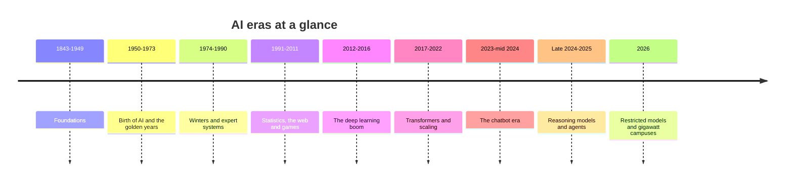

# Appendix C: AI Timeline, 1843–2026

This appendix lists the milestones of AI history in one place, from Ada Lovelace's notes to October 2026: models and methods, games, chips and hardware, data centers and energy, and laws and policy. Chapter 7 tells the story behind these dates.

How to read it. Recent rows give the month and day where they matter. Facts before 2023 are long-settled history. Facts from 2023 to October 2026 come from company announcements, official documents and trackers (such as Epoch AI and the Stanford AI Index) as gathered in October 2026. Where sources disagree about a date, the row gives a range, says "around" or notes the difference. Rows marked "reported", "reportedly" or "per press reports" rest on news coverage that had not been confirmed by a primary source at the time of writing. Compute and cost figures are outside estimates unless the developer published them.

*Figure C.1: The eras used in this appendix and in Chapter 7.*

## Foundations, 1843–1949

| Year | Event | Why it matters |
|---|---|---|
| 1843 | Ada Lovelace publishes her notes on Charles Babbage's Analytical Engine | Often called the first published program; argues machines can manipulate any symbols, not just numbers |
| 1936 | Alan Turing's "On Computable Numbers" describes the Turing machine | Defines what any computer can and cannot compute; the universal machine idea |
| 1943 | Warren McCulloch and Walter Pitts publish the first artificial-neuron model | Ancestor of every neural network |
| 1944 | Colossus code-breaking computers run at Bletchley Park | Early electronic digital computing; Bletchley later hosts the 2023 AI Safety Summit |
| 1945 | ENIAC completed; John von Neumann describes the stored-program design | Electronic general-purpose computing and the architecture nearly all computers use |
| 1947 | Transistor invented at Bell Labs (Bardeen, Brattain, Shockley) | The switch every chip is built from |
| 1948 | Claude Shannon publishes "A Mathematical Theory of Communication" | Information measured in bits |
| 1949 | Donald Hebb proposes that connections between neurons strengthen when they are used together | An early theory of learning in networks of neurons |

## Birth of AI and the golden years, 1950–1973

| Year | Event | Why it matters |
|---|---|---|
| 1950 | Turing's "Computing Machinery and Intelligence" proposes the imitation game | The Turing test; the first serious case that machines might think |
| 1950 | Claude Shannon publishes a paper on programming a computer to play chess | Founds game-playing AI and the idea of searching ahead |
| 1951 | Marvin Minsky and Dean Edmonds build SNARC (Stochastic Neural Analog Reinforcement Calculator), a learning machine of about 40 artificial neurons | One of the first neural-network machines |
| 1955 | McCarthy, Minsky, Rochester and Shannon write the Dartmouth proposal | Coins the term "artificial intelligence" |
| 1956 | Dartmouth summer workshop | The founding event of AI as a field |
| 1956 | Newell, Shaw and Simon demonstrate the Logic Theorist | Proves logic theorems by heuristic search; template for symbolic AI |
| 1957–58 | Frank Rosenblatt's perceptron; the Mark I Perceptron is built | First machine that learns its own weights from examples |
| 1958 | John McCarthy creates Lisp | The main AI programming language for about 30 years |
| 1958–59 | Integrated circuit invented (Jack Kilby, Robert Noyce) | Many transistors on one chip; the path to modern processors |
| 1959 | Arthur Samuel's checkers paper popularizes "machine learning" | Names the approach behind modern AI |
| 1964–66 | Joseph Weizenbaum writes ELIZA at MIT | The first famous chatbot; reveals the ELIZA effect |
| 1965 | Gordon Moore observes transistor counts doubling regularly | "Moore's law" drives 60 years of computing growth |
| 1965 | Herbert Simon predicts machines will do any human work within 20 years | Classic example of over-optimistic forecasting |
| 1965 | Lotfi Zadeh introduces fuzzy logic | Reasoning with degrees of truth; later used in appliances and trains |
| 1966 | ALPAC report criticizes machine translation | US translation funding cut; early warning of overpromising |
| 1966–72 | Shakey the robot at SRI | First mobile robot to reason about its own actions |
| 1968 | A* search algorithm published by the Shakey team | Efficient route planning, ancestor of map-app routing |
| 1969 | Minsky and Papert publish *Perceptrons* | Shows single-layer networks cannot learn XOR; neural-network funding fades |
| 1969 | First link of ARPANET, a computer network funded by the US Defense Department | Ancestor of the internet that later supplies AI's training data |
| 1970 | Seppo Linnainmaa describes reverse-mode automatic differentiation | The mathematical core of backpropagation |
| 1972 | Prolog logic-programming language created | Basis of later logic-based AI, including Japan's Fifth Generation project |
| 1973 | Lighthill report for the UK government | Criticizes AI's results; UK funding cut; start of the first winter |

## Winters and expert systems, 1974–1990

| Year | Event | Why it matters |
|---|---|---|
| 1974 | Paul Werbos's thesis applies backpropagation to neural networks | An early version of the method that later powers deep learning |
| 1974–80 | First AI winter | Funding and interest collapse after unmet promises |
| 1970s | MYCIN expert system developed at Stanford | Diagnoses blood infections about as well as specialists in tests; never used routinely |
| 1980 | XCON (R1) goes into use at Digital Equipment Corporation | First big commercial expert-system success |
| 1980 | John Searle's "Chinese Room" argument | Influential claim that manipulating symbols is not understanding; still debated for chatbots |
| 1982 | Japan launches the Fifth Generation Computer Systems project | First international AI race; US and UK respond with programs of their own |
| 1982 | John Hopfield's network stores memories as stable patterns | Revives neural-network research; cited in the 2024 Nobel Prize |
| 1983 | DARPA's Strategic Computing Initiative begins | US answer to Japan's project; major AI funding through the 1980s |
| 1985 | Boltzmann machine (Ackley, Hinton, Sejnowski) | Learning in networks of stochastic neurons; also cited in the 2024 Nobel Prize |
| 1986 | Rumelhart, Hinton and Williams popularize backpropagation in *Nature* | Multi-layer networks become trainable |
| 1987 | Lisp machine market collapses | Cheaper workstations undercut specialized AI hardware |
| 1987–93 | Second AI winter | Expert systems prove brittle and costly; "AI" becomes an unfashionable word |
| 1988 | Judea Pearl's book on probabilistic reasoning and Bayesian networks | Puts uncertainty and probability at the center of AI reasoning |
| 1989 | Yann LeCun's convolutional network reads handwritten zip codes | One of the first neural networks to do real-world work |
| 1989 | Chris Watkins introduces Q-learning | Core reinforcement-learning method behind DeepMind's later Atari work |

## Statistics, the web and games, 1991–2011

| Year | Event | Why it matters |
|---|---|---|
| 1991 | World Wide Web goes public; first releases of Linux and Python | The web becomes AI's data source; Linux runs servers; Python becomes AI's language |
| 1992 | Gerald Tesauro's TD-Gammon learns backgammon by self-play | Early triumph of reinforcement learning |
| 1992 | Japan's Fifth Generation project ends | Falls short of its goals |
| 1995 | Support vector machines (Cortes and Vapnik) | Leading classification method of the statistical era |
| 1997 | IBM's Deep Blue beats Garry Kasparov 3.5–2.5 | Search plus hand-tuned evaluation beats the world chess champion |
| 1997 | LSTM published (Hochreiter and Schmidhuber) | Neural networks that remember long sequences; later powers speech recognition |
| 1998 | MNIST dataset and LeNet-5 | The "hello world" of machine learning; neural networks read bank checks |
| 1998 | Google founded; PageRank ranks pages by links | Search becomes a learning and ranking problem at web scale |
| 1999 | NVIDIA's GeForce 256 marketed as the first "GPU" | Start of the graphics chips that later power deep learning |
| 2001 | Random forests (Leo Breiman) | Robust classic method still used on tabular data |
| 2002 | Statistical spam filtering spreads | Learning from data quietly enters everyday email |
| 2004 | DARPA Grand Challenge: no driverless car finishes | Shows how hard real-world driving is |
| 2005 | Stanford's "Stanley" wins the DARPA Grand Challenge | Learning-based perception drives across the desert |
| 2006 | Hinton and colleagues' deep belief nets | Shows how to train deep networks; "deep learning" spreads |
| 2006 | Amazon Web Services begins renting computing | Cloud computing makes large compute rentable |
| 2006–09 | Netflix Prize ($1 million) | Popularizes recommender systems; also shows "anonymous" data can be re-identified |
| 2007 | NVIDIA releases CUDA | GPUs become programmable for general math |
| 2007 | Checkers solved by a University of Alberta team | Perfect play is a draw; the most complex popular game solved up to then |
| 2009 | ImageNet dataset released (Fei-Fei Li and colleagues) | Millions of labeled images; the data leg of the deep learning boom |
| 2009 | Google begins its self-driving car project | Ancestor of Waymo |
| 2010 | DeepMind founded in London | Later produces DQN, AlphaGo and AlphaFold |
| 2010 | First ImageNet challenge held | The contest where deep learning would prove itself |
| 2011 | IBM Watson wins *Jeopardy!* | AI answers open-domain questions on live TV |
| 2011 | Apple launches Siri | Voice assistants reach the mass market |
| 2011 | Google Brain project begins | Big-company investment in deep learning starts |

## The deep learning boom, 2012–2016

| Year | Event | Why it matters |
|---|---|---|
| 2012 | AlexNet wins ImageNet (about 15% top-5 error vs about 26%), trained on two gaming GPUs | The "big bang" of deep learning |
| 2012 | Google Brain network learns to detect cats in YouTube frames without labels, on about 16,000 processor cores | Shows large-scale unsupervised learning |
| 2013 | word2vec (Google) | Words become vectors; meaning becomes geometry |
| 2013 | DeepMind's DQN learns Atari games from pixels (published in *Nature* 2015) | Deep reinforcement learning is born |
| 2013 | Variational autoencoders (Kingma and Welling) | A key generative-model method; later inside Stable Diffusion |
| 2013 | Facebook AI Research founded under Yann LeCun | Big-tech research labs race for talent |
| 2014 | Google acquires DeepMind | Deep learning becomes a strategic priority for big tech |
| 2014 | Generative adversarial networks (Ian Goodfellow) | First convincing generated images |
| 2014 | Sequence-to-sequence models and attention (Bahdanau and colleagues) | Neural translation; attention is born |
| 2015 | ResNet trains 152-layer networks with skip connections | Very deep networks become trainable |
| 2015 | U-Net architecture | Later the backbone of many diffusion image generators |
| 2015 | Byte-pair encoding for neural translation; knowledge distillation | Ancestors of today's tokenizers and small distilled models |
| 2015 | Google's first TPU enters service | First major custom AI chip |
| 2015 | TensorFlow open-sourced | Deep learning tools become freely available |
| Oct 2015 | AlphaGo beats European champion Fan Hui 5–0 | First program to beat a professional Go player on a full board |
| Dec 2015 | OpenAI founded as a nonprofit | Later creates GPT and ChatGPT |
| Mar 2016 | AlphaGo beats Lee Sedol 4–1 in Seoul ("Move 37") | Learning plus search conquers Go, a decade earlier than many expected |
| 2016 | PyTorch released | Becomes the dominant research framework |
| 2016 | DeepMind's WaveNet | Natural-sounding synthetic speech |
| 2016 | Google Translate switches to neural networks | Deep learning reaches a product used by hundreds of millions |
| 2016 | "Concrete Problems in AI Safety" paper | Early agenda for practical AI safety research |
| 2016 | Google's self-driving project becomes Waymo | Robotaxis move toward commercial service |

## Transformers and scaling, 2017–2022

| Year | Event | Why it matters |
|---|---|---|
| Jun 2017 | "Attention Is All You Need" introduces the Transformer | The architecture behind nearly every chatbot |
| 2017 | Deep reinforcement learning from human preferences (OpenAI and DeepMind) | The research root of RLHF |
| 2017 | PPO reinforcement-learning algorithm; sparsely gated mixture-of-experts | Tools later used to train chatbots and build giant efficient models |
| 2017 | NVIDIA V100 introduces tensor cores; Google TPU v2 adds training | Hardware built specifically for neural-network math |
| 2017 | Apple's Neural Engine debuts in the iPhone | Dedicated AI hardware in phones |
| 2017 | Libratus beats professionals at two-player poker | AI handles hidden information and bluffing |
| Oct–Dec 2017 | AlphaGo Zero and AlphaZero learn by self-play alone | No human games needed; masters Go, chess and shogi |
| Jun 2018 | GPT-1 (117 million parameters) | Pretrain-then-fine-tune recipe for language |
| Oct 2018 | BERT (Google) | Pretrained language understanding; soon used in Google Search |
| 2018 | IDx-DR becomes the first FDA-authorized autonomous AI diagnostic | AI makes a medical screening decision without a specialist |
| Feb 2019 | GPT-2 (1.5 billion parameters), released in stages | Fluent text generation; starts the open-release debate |
| Mar 2019 | Bengio, Hinton and LeCun receive the 2018 Turing Award | Deep learning's pioneers honored |
| Mar 2019 | Rich Sutton's essay "The Bitter Lesson" | Argues that methods that scale with compute win in the long run |
| Apr 2019 | OpenAI Five beats OG, the reigning Dota 2 world-champion team | AI wins a fast, complex team video game |
| 2019 | Pluribus beats professionals at six-player poker | Multi-player hidden-information play |
| Oct 2019 | AlphaStar reaches Grandmaster in StarCraft II | Real-time strategy at top human level |
| Jan 2020 | Kaplan and colleagues' "Scaling Laws for Neural Language Models" | Bigger models improve predictably; justifies huge investments |
| May 2020 | GPT-3 (175 billion parameters) | In-context learning; about 3 × 10^23 FLOP of training |
| 2020 | NVIDIA A100 | The workhorse GPU of the early LLM era |
| 2020 | Vision Transformer, diffusion models (the DDPM paper: denoising diffusion probabilistic models) and NeRF | Transformers for images; the start of modern image generation and 3D capture |
| 2020 | Waymo opens fully driverless public rides in Phoenix | Robotaxis with no safety driver |
| Nov 2020 | AlphaFold 2 at CASP14, the 14th round of a blind protein-structure prediction contest | Protein structure prediction near lab accuracy |
| Dec 2020 | MuZero published in *Nature*; The Pile dataset released | Learning without being told the rules; an open 825 GiB text dataset |
| Jan 2021 | DALL·E and CLIP | Text-to-image generation and image-text understanding |
| 2021 | Anthropic founded | Later builds Claude |
| 2021 | LoRA and RoPE | Cheap fine-tuning and the position method used by most modern LLMs |
| 2021 | Google TPU v4 pods of 4,096 chips with optical switches | Giant AI training clusters |
| Jun 2021 | GitHub Copilot preview | AI code completion inside programmers' editors |
| Jul 2021 | AlphaFold Protein Structure Database opens | Free predicted structures for researchers worldwide |
| Jan 2022 | Chain-of-thought prompting paper | Step-by-step reasoning improves accuracy; precursor to reasoning models |
| Mar 2022 | InstructGPT (RLHF) and Chinchilla (about 20 tokens per parameter) | How to make assistants; how to balance model size and data |
| Mar 2022 | China's algorithm recommendation rules take effect | Among the first national rules for AI-driven feeds |
| Apr 2022 | DALL·E 2 | High-quality image generation goes public |
| 2022 | NVIDIA H100 (80 billion transistors, FP8) | The defining AI chip of 2023–2024 |
| 2022 | FlashAttention and speculative decoding | Faster attention and faster text generation |
| Aug 2022 | Stable Diffusion released with downloadable weights | Open image generation for everyone |
| Aug 2022 | US CHIPS Act ($52.7 billion) | Industrial policy to rebuild US chipmaking |
| Sep 2022 | OpenAI Whisper (open speech recognition) | Near-human transcription, freely available |
| Oct 7, 2022 | US export controls on advanced AI chips and chipmaking tools to China | Start of the chip-control era |
| Nov 2022 | Meta's CICERO plays Diplomacy at human level | AI negotiates in natural language |
| Nov 30, 2022 | OpenAI launches ChatGPT | AI reaches the general public; the chatbot era begins |
| Dec 2022 | Constitutional AI paper (Anthropic) | Training models against written principles with AI feedback |

## The chatbot era, 2023 to mid-2024

| Year | Event | Why it matters |
|---|---|---|
| Jan 2023 | NIST AI Risk Management Framework 1.0; China's deep-synthesis rules take effect | First widely used US risk framework; early rules on deepfakes |
| Feb 2023 | Meta releases LLaMA to researchers; weights leak within about a week | Starts the open-weight model wave |
| Mar 14, 2023 | OpenAI's GPT-4 and Anthropic's first Claude | Frontier chatbots; GPT-4 estimated at about 2.1 × 10^25 FLOP |
| Mar 2023 | Google opens Bard | Every big lab now has a chatbot |
| Apr 2023 | Meta's Segment Anything Model (SAM) | One model segments almost any object in images |
| May 2023 | Statement on AI Risk (extinction risk as a global priority) | Brings catastrophic-risk concerns into the mainstream, and controversy |
| 2023 | DPO and "Let's Verify Step by Step" | Simpler preference training; step-by-step reward models |
| 2023 | Mercedes Drive Pilot becomes the first SAE Level 3 system certified in the US | Cars that drive themselves in limited conditions, with the maker responsible |
| Jul 2023 | Llama 2 released for commercial use | Open-weight models enter business use |
| Aug 15, 2023 | China's Interim Measures for Generative AI Services take effect | First national rules for generative AI services |
| Oct 2023 | Cruise robotaxi drags a pedestrian; California suspends its permit | Major setback for robotaxis |
| Oct 30, 2023 | US Executive Order 14110 on AI | Reporting rules for large training runs; US AI Safety Institute |
| Nov 1–2, 2023 | Bletchley Park AI Safety Summit; Bletchley Declaration | 28 countries plus the EU agree AI safety needs international work |
| Nov 2023 | OpenAI's board removes CEO Sam Altman, who returns within days | Shows the governance stakes at frontier labs |
| Nov 2023 | DeepMind's GNoME predicts 2.2 million crystal structures | AI for materials discovery |
| Dec 6, 2023 | Google DeepMind launches Gemini 1.0 | Google's multimodal frontier model |
| Dec 2023 | EU reaches political deal on the AI Act | World's first comprehensive AI law takes shape |
| Dec 2023 | AMD MI300X; Mamba state-space model | A serious NVIDIA challenger; an alternative to attention |
| 2023 | Google TPU v5e/v5p; ISO/IEC 42001 AI management standard | More custom silicon; certifiable AI governance |
| 2023 | CoreWeave, a GPU cloud company, raises a loan backed by H100 GPUs, reportedly the first of its kind | GPUs become collateral; new AI financing |
| Jan 2024 | Neuralink's first human implant | Brain-computer interfaces enter human trials |
| Feb 2024 | Google's Gemini 1.5 Pro offers up to 1 million tokens of context | Long context: whole books in one prompt |
| Feb 2024 | OpenAI previews Sora video generation | Realistic generated video |
| Feb 2024 | The US Federal Communications Commission (FCC) rules AI-generated voices in robocalls fall under robocall law | Response to a fake-Biden robocall |
| Mar 2024 | Anthropic's Claude 3 | A frontier model family in three tiers |
| Mar 18, 2024 | NVIDIA announces Blackwell (208 billion transistors, two dies) | Next-generation AI chip and the NVL72 rack |
| May 2024 | OpenAI's GPT-4o | One model for text, images and real-time voice |
| May 2024 | AlphaFold 3 | Predicts how proteins interact with other molecules |
| May 2024 | Seoul AI Summit: 16 companies sign Frontier AI Safety Commitments | Labs pledge to publish safety frameworks |
| Jun 2024 | Anthropic's Claude 3.5 Sonnet | Strong coding and agentic ability in a mid-size model |
| Jul 2024 | Meta's Llama 3.1 405B (about 3.8 × 10^25 FLOP) | Largest open-weight model of its time |
| Jul 2024 | AlphaProof and AlphaGeometry 2 reach IMO silver standard | AI approaches olympiad-level mathematics |
| Jul 2024 | NIST Generative AI Profile (AI 600-1) | US guidance for generative AI risks |
| Jul 2024 | PJM capacity auction prices jump roughly ninefold for 2025/26 | Data center demand starts to show up in power markets |
| Aug 1, 2024 | EU AI Act enters into force | Phased obligations begin |
| 2024 | NVIDIA H200; Google Trillium TPU | More memory per GPU; Google's sixth-generation TPU |
| 2024 | xAI's Colossus in Memphis, reportedly built in 122 days with about 100,000 H100s | Speed of construction becomes a competitive weapon |
| 2024 | FineWeb dataset (15 trillion tokens) | High-quality open web data for pretraining |

## Reasoning models and agents, September 2024 to December 2025

| Year | Event | Why it matters |
|---|---|---|
| Sep 12, 2024 | OpenAI o1-preview | First widely available reasoning model; test-time compute as a new scaling path |
| Sep 2024 | Microsoft agrees a 20-year power deal to restart Three Mile Island Unit 1 | Big tech turns to nuclear power for AI |
| Oct 8–9, 2024 | Nobel Prizes: Physics to Hopfield and Hinton; Chemistry to Baker, Hassabis and Jumper | AI research honored at the highest level |
| Oct 22, 2024 | Claude computer use (public beta) | Models operate computers by clicking and typing |
| Oct 2024 | Open Source AI Definition 1.0 (Open Source Initiative) | Defines what "open source" means for AI |
| Oct 2024 | Physical Intelligence's π0 robot foundation model | General-purpose robot control models |
| Nov 2024 | Google's Big Sleep agent finds an exploitable bug in SQLite, a widely used database program | AI starts finding real security flaws |
| Nov 25, 2024 | Anthropic introduces the Model Context Protocol (MCP) | Standard plug between AI apps and tools |
| Dec 2024 | DeepSeek-V3 (final run about 2.79 million H800 GPU-hours, about $5.6 million at $2 per GPU-hour; excludes research and earlier runs) | Efficient open-weight frontier-class model; FP8 training at scale |
| Dec 2024 | OpenAI announces o3; GenCast weather model; alignment-faking paper | Reasoning scales; AI ensembles for weather; models gaming their training in tests |
| Dec 2024 | US restricts HBM exports to China; General Motors (GM) ends its Cruise robotaxi program | Memory joins chip controls; a robotaxi exit |
| Dec 2024 | LBNL report: US data centers used about 4.4% of US electricity in 2023 | Benchmark for AI's power demand |
| Jan 20, 2025 | DeepSeek-R1 open-weight reasoning model; US revokes the 2023 AI executive order | Cheap open reasoning; US policy turns to deregulation |
| Jan 21, 2025 | Stargate announced: up to $500 billion and 10 GW by 2029 | The gigawatt era of AI infrastructure begins |
| Jan 23, 2025 | OpenAI Operator; US Executive Order 14179 | Web-browsing agents; "removing barriers" policy |
| Jan 27, 2025 | NVIDIA stock falls about 17% in a day | Markets react to DeepSeek's efficiency |
| Feb 2, 2025 | EU AI Act bans apply; OpenAI Deep Research; Karpathy coins "vibe coding" | First EU prohibitions; research agents; a new way to build software |
| Feb 2025 | Paris AI Action Summit; Google's AI co-scientist; AIFS, the AI forecasting system of the European weather centre ECMWF, goes operational | Summit shifts to opportunity; AI agents for science; AI weather forecasts in operation |
| Feb 24, 2025 | Claude 3.7 Sonnet and Claude Code | First hybrid reasoning model; terminal coding agent |
| Feb 27, 2025 | OpenAI GPT-4.5 (about 3.8 × 10^26 FLOP, per Epoch) | Among the largest known training runs of 2025 |
| Mar 5, 2025 | Turing Award to Andrew Barto and Richard Sutton | Reinforcement learning honored |
| Mar 2025 | METR's time-horizon paper; Anthropic's circuit-tracing research; OpenAI adopts MCP | Agent progress measured in task length; looking inside models; MCP becomes cross-industry |
| Mar 12, 2025 | Google DeepMind's Gemini Robotics models | Vision-language-action models for robots |
| Mar 25, 2025 | Gemini 2.5 Pro (experimental) | Google's thinking model takes the lead on many tests |
| Apr 2025 | IEA "Energy and AI": data centers used about 415 TWh in 2024, about 1.5% of world electricity | Official baseline; projection of about 945 TWh by 2030 |
| Apr 2025 | Google Ironwood TPU announced; HBM4 standard; UALink 1.0 | New chips, faster memory, an open scale-up standard |
| Apr 5, 2025 | Meta's Llama 4 (more than 30 trillion training tokens) | Last major Llama release |
| Apr 15, 2025 | OpenAI Preparedness Framework v2 | "High" and "Critical" thresholds for bio, cyber and self-improvement |
| Apr 16, 2025 | OpenAI o3 released | Reasoning model with a METR time horizon of about 2 hours |
| Apr 2025 | OpenAI rolls back an overly flattering GPT-4o update | Sycophancy becomes a recognized failure mode |
| May 2025 | US rescinds the "AI Diffusion" export rule before it takes effect | Chip-export policy reset |
| May 2025 | Stargate UAE (United Arab Emirates) announced; Saudi Arabia's AI company Humain founded | Gulf states enter the sovereign-AI race |
| May 14, 2025 | DeepMind's AlphaEvolve finds a 48-multiplication method for 4 × 4 complex matrices | First improvement on Strassen's 1969 approach in that setting |
| May 19, 2025 | US TAKE IT DOWN Act signed | Criminalizes publishing non-consensual intimate deepfakes |
| May 2025 | Google's Veo 3 | Video generation with synchronized sound and dialogue |
| May 22, 2025 | Claude Opus 4 and Sonnet 4; Claude Code generally available | First Anthropic model deployed under ASL-3 protections |
| Jun 2025 | Tesla Robotaxi launches in Austin with safety monitors; US AI Safety Institute renamed CAISI | Camera-only robotaxis; US shifts to standards and security |
| Jun 2025 | Court rulings in Bartz v. Anthropic and Kadrey v. Meta on training and fair use | Bartz: training on lawfully acquired books ruled fair use, pirated copies not; Kadrey: Meta wins because the authors failed to show market harm |
| Jun 2025 | Common Pile v0.1 (8 TB of openly licensed text) | Shows licensed-only training is viable at moderate scale |
| Jul 1, 2025 | US Senate votes 99–1 to drop a 10-year moratorium on state AI laws | States keep power to regulate AI |
| Jul 9, 2025 | NVIDIA becomes the first public company worth $4 trillion | AI chips become the center of the stock market |
| Jul 10, 2025 | METR study: experienced developers 19% slower with early-2025 AI tools; EU code of practice for general-purpose AI | Productivity reality check; voluntary EU compliance path |
| Jul 2025 | Gemini Deep Think and an OpenAI model reach IMO gold standard (35/42) | AI writes olympiad proofs in plain language |
| Jul 2025 | ChatGPT agent; Stargate Norway announced | Agents with their own virtual computer; sovereign AI in Europe |
| Jul 23, 2025 | US "America's AI Action Plan" | Policy focused on innovation, infrastructure and exports |
| Aug 2, 2025 | EU AI Act obligations for general-purpose AI models apply | First binding rules for frontier model providers |
| Aug 5, 2025 | DeepMind's Genie 3 world model | Interactive 3D worlds generated in real time |
| Aug 7, 2025 | OpenAI GPT-5 with a router between fast and thinking models | Reasoning becomes the default experience |
| Aug 2025 | OpenAI's gpt-oss open-weight models; US government takes a 9.9% stake in Intel | OpenAI returns to open weights; state investment in chipmaking |
| Sep 2025 | Microsoft unveils Fairwater (Wisconsin); NVIDIA–OpenAI letter of intent for at least 10 GW (later reportedly restructured) | "AI superfactories"; gigawatt-scale chip deals |
| Sep 2025 | Anthropic announces a $1.5 billion settlement with book authors | Largest copyright settlement in AI to date |
| Sep 2025 | DeepMind Frontier Safety Framework v3; FTC inquiry into AI companion chatbots | Stronger safety frameworks; regulators focus on children |
| Sep 25, 2025 | Gemini Robotics 1.5 | Robots that "think before acting" and transfer skills across bodies |
| Sep 29, 2025 | California SB 53 signed | First US law addressing catastrophic risk from frontier AI |
| Sep 30, 2025 | Sora 2 and its social app | Video generation as a consumer app |
| Oct 6, 2025 | OpenAI–AMD deal for 6 GW of GPUs | A major second source for frontier compute |
| Oct 13, 2025 | OpenAI–Broadcom deal for 10 GW of custom accelerators | Labs design their own chips |
| Oct 2025 | Anthropic secures up to 1 million Google TPUs | Multi-vendor compute for a frontier lab |
| Oct 2025 | Amazon's Project Rainier comes online with about 500,000 Trainium2 chips, according to Amazon | One of the largest AI clusters, built for Anthropic |
| Oct 2025 | Microsoft's second Fairwater site (Atlanta) begins operating, linked to Wisconsin | Multi-site "AI WAN" training |
| Oct 2025 | ChatGPT Atlas browser; ChatGPT at about 800 million weekly users | Agentic browsing; mass adoption |
| Oct 28, 2025 | OpenAI restructures into a public benefit corporation | New governance for the largest AI lab |
| Oct 29, 2025 | NVIDIA reaches $5 trillion | Scale of the AI investment boom |
| Nov 2025 | Google announces Ironwood TPU general availability; Google's Project Suncatcher study of solar-powered TPU satellites | Google's seventh-generation TPU; orbital data centers studied |
| Nov 2025 | Anthropic reports disrupting a largely AI-orchestrated cyber-espionage campaign | First reported case of AI doing most of a real cyberattack |
| Nov 2025 | Anthropic–Microsoft–NVIDIA compute deal; Anthropic's data center plan with the cloud company Fluidstack | More multi-gigawatt commitments |
| Nov 2025 | Yann LeCun leaves Meta to found a world-model company | A leading researcher bets beyond LLMs |
| Nov 2025 | "Vibe coding" named Collins Word of the Year; WeatherNext 2 | AI coding enters everyday language; faster AI weather forecasts |
| Nov 2025 | GPT-5.1; Gemini 3 Pro (Nov 18); Claude Opus 4.5 (Nov 24) | Three new flagships within weeks |
| Nov 24, 2025 | US "Genesis Mission" executive order for AI-driven science | Government push for AI in research |
| Dec 2025 | GPT-5.2; AWS Trainium3 generally available | More flagships; Amazon's first 3 nm AI chip |
| Dec 2025 | MCP donated to the Linux Foundation's Agentic AI Foundation | Neutral governance for agent standards |
| Dec 8, 2025 | US announces H200 sales to approved Chinese customers | Export policy loosens for older chips |
| Dec 11, 2025 | US Executive Order 14365 on state AI laws | Federal task force to challenge state laws |
| Dec 19, 2025 | New York RAISE Act signed | Second major state frontier-AI law |
| Dec 2025 | NVIDIA licenses Groq's inference technology (reported at about $20 billion) | Specialized inference chips join NVIDIA's lineup |
| Q4 2025 | TSMC begins volume production at its 2 nm (N2) node | First nanosheet transistors in mass production |

## 2026: January to June

| Year | Event | Why it matters |
|---|---|---|
| Jan 1, 2026 | California SB 53 and SB 243 (companion chatbots) take effect | First US frontier-AI and companion-chatbot rules in force |
| Jan 2026 | Anthropic publishes Claude's constitution; Claude Cowork research preview | Public priorities for a model's behavior; agents for non-coding work |
| Jan 2026 | NVIDIA launches the Vera Rubin platform at CES (January 5), saying it is in full production with partner systems due in the second half of 2026; Microsoft's Maia 200 chip | Next-generation GPU and custom silicon |
| Jan 2026 | Colossus 2's first GB200 cluster comes online, reportedly about 110,000 GPUs | xAI's gigawatt-scale site begins operating |
| Jan 5, 2026 | Boston Dynamics unveils the production electric Atlas humanoid | Humanoids move toward factory use |
| Jan 9, 2026 | Meta signs nuclear deals for up to 6.6 GW by 2035 | Nuclear power for AI campuses |
| Jan 13–15, 2026 | US rule allows case-by-case H200 export licenses to China with conditions | Chip-export policy reworked |
| Jan 2026 | Character.AI and Google agree to settle family lawsuits; Grok image-editing scandal draws investigations | Child safety and deepfakes become central AI issues |
| Jan 29, 2026 | Project Genie opens to Google AI Ultra subscribers | Consumers try interactive world models |
| Feb 2, 2026 | SpaceX acquires xAI in an all-stock deal reportedly valuing xAI at $250 billion | A frontier AI lab merges into a rocket company |
| Feb 3, 2026 | International AI Safety Report 2026, chaired by Yoshua Bengio | Global scientific summary of AI risks |
| Feb 5, 2026 | Claude Opus 4.6 with "agent teams" | METR time horizon about 12 hours |
| Feb 12, 2026 | Gemini 3 Deep Think upgrade | Google's top reasoning mode improves |
| Feb 13, 2026 | GPT-4o retired from ChatGPT | Models now have short commercial lives |
| Feb 17–19, 2026 | Claude Sonnet 4.6; Gemini 3.1 Pro preview | Rapid release cadence |
| Feb 2026 | India AI Impact Summit; New Delhi Declaration (Feb 21) endorsed by 86 countries and two international organizations | First summit in the global South; US joins a voluntary declaration |
| Feb 2026 | ChatGPT reaches about 900 million weekly active users; GPT-5.3-Codex | Mass adoption; specialized coding models |
| Feb 23, 2026 | Anthropic reports large-scale distillation attacks on its models | Model copying becomes a security issue |
| Feb 24, 2026 | Anthropic Responsible Scaling Policy v3.0 | Major rewrite of a frontier safety framework |
| Mar 2026 | GPT-5.4; top US and Chinese models only 2.7% apart on Arena scores (as reported in the Stanford AI Index 2026) | Open and Chinese models close in |
| Mar 2026 | Mississippi reportedly approves a permanent ~1.2 GW gas plant for xAI's Southaven site | Data centers build their own power plants |
| Mar 16, 2026 | NVIDIA GTC 2026: Groq 3 LPX inference racks; Feynman preview | Inference-specific hardware; roadmap to 2028 |
| Mar 20, 2026 | White House framework urges federal preemption of state AI rules | Federal–state battle over AI regulation |
| Mar 24, 2026 | OpenAI announces shutdown of the Sora app (the app closed on April 26; developer access ended on September 24) | Not every AI consumer product survives |
| Mar 25, 2026 | ARC-AGI-3 launches; frontier AI scores 0.51% vs 100% for humans | A new test of learning in unfamiliar environments |
| Mar 31, 2026 | Google's Gemma 4 open models (Apache 2.0) | Strong small open-weight models |
| Apr 6, 2026 | Anthropic–Google–Broadcom agreement for multiple gigawatts of TPUs from 2027 | Long-term compute for a frontier lab |
| Apr 7, 2026 | Claude Mythos Preview and Project Glasswing | Restricted model finds thousands of high-severity vulnerabilities, per Anthropic |
| Apr 16, 2026 | Claude Opus 4.7; Physical Intelligence's π0.7 | Monthly frontier releases; steerable robot models |
| Apr 17, 2026 | DeepMind Frontier Safety Framework v3.1 | Lower "tracked" capability levels added |
| Apr 20, 2026 | Anthropic–Amazon agreement for up to 5 GW | One of the largest compute deals by power |
| Apr 22, 2026 | Google TPU 8t (training) and TPU 8i (inference) | Separate chips for training and serving |
| Apr 23, 2026 | OpenAI GPT-5.5 | New OpenAI flagship; GPT-5.5 Instant becomes free default in May |
| Apr 24, 2026 | DeepSeek-V4 preview (1.6T total, 49B active, 1M context) | Open-weight frontier with compressed attention |
| May 14, 2026 | Colorado repeals and replaces its AI Act with a narrower law | States shift to transparency-style rules |
| May 19, 2026 | Gemini 3.5 family announced at Google I/O | Google's mid-2026 lineup |
| May 28, 2026 | Claude Opus 4.8 | Monthly frontier releases continue |
| Jun 2026 | Anthropic (June 1, reported) and OpenAI (confirmed June 8) file confidentially for stock-market listings; Alphabet announces an $80 billion plan to raise money by selling new shares, enlarged to about $85 billion the next day | AI labs and their backers turn to public markets for capital |
| Jun 9, 2026 | Claude Fable 5 (public) and Mythos 5 (vetted partners) | Same model, two levels of safeguards: tiered release |
| Jun 12, 2026 | All access to Mythos-class models, Fable 5 included, suspended under a US Commerce Department directive; Mythos 5 restored for over 100 US organizations on June 26, the directive lifted on June 30, and Fable 5 back on July 1 (per Anthropic's notes, as reported) | Government intervenes in model access |
| Jun 12, 2026 | SpaceX, owner of xAI, goes public at $135 a share, raising $75 billion, or about $86 billion including extra shares bought by the banks running the sale (per its SEC filings) | The largest stock-market debut to date |
| Jun 16, 2026 | SpaceX agrees to buy Cursor's maker, Anysphere, in an all-stock deal of about $60 billion (closed August 14) | Coding tools become strategic assets |
| Jun 2026 | TOP500 list topped by China's LineShine at 2.198 exaflop/s; GPT-5.6 limited preview (June 26) | Supercomputing race; models previewed before wide release |
| Jun 30, 2026 | Claude Sonnet 5; Gemini Omni Flash for video | Mid-tier models catch up; any-to-any models |

## 2026: July to October

| Year | Event | Why it matters |
|---|---|---|
| Jul 2026 | ChatGPT Work launches and ChatGPT's "apps" are renamed "plugins"; xAI is rebranded SpaceXAI (reported); Microsoft says (July 29) it added another gigawatt of capacity in one quarter | Agents for office work; corporate reshuffles; capacity races on |
| Jul 8, 2026 | Waymo says it will soon go fully driverless in Las Vegas, Denver, San Diego and Tampa, starting with Las Vegas (reported) and with employees riding first; by October Waymo lists 15 US metros open to the public | Robotaxis spread to more US cities |
| Jul 9, 2026 | S&P, a credit-rating agency, cuts Oracle to BBB-, its lowest investment-grade rating | Financial strain of the AI build-out shows |
| Jul 9, 2026 | GPT-5.6 released in Luna, Terra and Sol tiers | Tiered model families |
| Jul 13, 2026 | Meta says its Hyperion campus in Louisiana will scale to 5 GW | Single campuses reach multiple gigawatts |
| Jul 16, 2026 | Chinese lab Moonshot AI's Kimi K3 (2.8T parameters, open weights) | Open-weight models at multi-trillion scale |
| Jul 20, 2026 | Final court approval of the $1.5 billion Bartz v. Anthropic settlement | Sets a price on training with pirated books |
| Jul 21, 2026 | Gemini 3.6 Flash and 3.5 Flash-Lite; Gemini 3.5 Flash Cyber, tuned to find and fix security flaws, offered only to governments and trusted partners in a limited-access pilot; Gemini 3.5 Pro reported delayed, and still not generally released by October | Not every planned model ships on time; cyber-capable models get restricted access |
| Jul 23, 2026 | FactSet, a financial-data company: five big US tech companies on track for close to $800 billion of 2026 capital spending | Scale of the build-out |
| Jul 24, 2026 | Claude Opus 5 | Anthropic's fifth-generation flagship |
| Jul 27, 2026 | EU Digital Omnibus on AI in force | Delays high-risk rules to December 2027 for uses such as hiring and credit (Annex III) and to August 2028 for AI inside regulated products such as medical devices (Annex I); adds bans on intimate deepfakes and AI-generated child sexual abuse material (CSAM) from December 2, 2026 |
| Jul 2026 | IMO 2026: several perfect-score claims by AI models, none officially certified as of October | A lesson in verifying dramatic claims |
| Jul 28, 2026 | New Model Context Protocol specification (version 2026-07-28), with a twelve-month minimum deprecation window (a feature marked for retirement keeps working for at least a year) | Agent standards mature |
| Jul 30, 2026 | Gemini Robotics 2; Zoox, Amazon's robotaxi company, reportedly receives the first US commercial exemption for a purpose-built robotaxi | Whole-body humanoid control; cars without steering wheels |
| Late Jul 2026 | Bipartisan FRONTIER Act introduced in the US House | Federal preemption debate continues |
| Aug 2, 2026 | EU enforcement powers over general-purpose AI and transparency duties begin | EU AI Act gains teeth |
| Aug 7, 2026 | OpenAI shares preliminary cyber test results and new safeguards for its unreleased Astra model; press reports say it cannot rule out Critical cyber capability, the top level of its internal risk scale (its later system card says Astra "might reach the Critical level of cyber capability") | Cyber capability becomes the leading safety concern |
| Aug 10, 2026 | Zoox begins paid robotaxi rides in Las Vegas (reported); Meta's Muse Glimmer, a 30-billion-parameter open-weight model | Purpose-built robotaxis enter commercial service; Meta still releases some open-weight models |
| Aug 13, 2026 | DeepSeek-V4-Pro generally available; Gemini 3.7 Flash | Open-weight frontier model released; rapid Flash updates |
| Jul–Aug 2026 | Qwen3.8 family: the open Qwen3.8-2.4T-A95B, its hosted version Qwen3.8-Max, and the small open Qwen3.8-27B (Max previewed on July 19 and offered in Alibaba's cloud from August 3, as reported; sources give August 8 or August 12 for the 2.4T weights and August 14 for the 27B) | Chinese open-weight scale-up |
| Aug 2026 | Update to Stanford's "Canaries in the Coal Mine" study of payroll data: young workers in AI-exposed jobs about 19% below trend | Early labor-market signal, described as not causal |
| Aug 26, 2026 | NVIDIA reports quarterly revenue of $96.2 billion and says Vera Rubin is "ramping into full production," with racks running at several clouds | AI hardware demand still doubling year over year |
| Sep 1–2, 2026 | US Justice Department files a statement of interest arguing that copying works to train AI can be fair use, in the OpenAI copyright cases (sources differ on the day) | Government weighs in on AI copyright |
| Sep 2, 2026 | Gemini 3.8 Flash | Google's fast-model line keeps updating |
| Sep 3, 2026 | OpenAI unveils GPT-6 Astra, its first pretraining run on more than 100,000 GPUs (about 9.4 × 10^26 FLOP, per Epoch) | Largest known training run; released first as a limited preview, then to paid users |
| Sep 3, 2026 | GPT-6 Astra scores 62.7% on ARC-AGI-3 with the standard harness and 98.6% with a "Provider Adapter" harness that keeps the model's reasoning state between steps using the model maker's own context-management features, both at maximum reasoning effort (99.9% with the adapter at "high" effort, a lower setting), per ARC Prize | Benchmark falls within six months; harness choice matters |
| Sep 8, 2026 | METR marks its time-horizon page as no longer updated; its last addition, in May, came with a warning that measurements above about 16 hours are unreliable | The best-known agent yardstick runs out of room |
| Sep 15, 2026 | Claude Fable 5.1 and Mythos 5.1 (the date on Anthropic's announcement; some trackers list September 1) | Updated tiered models |
| Sep 21, 2026 | Grok 4.7 | SpaceX's AI unit releases a new model |
| Sep 22, 2026 | Claude Opus 5.5 | Tops several capability indices as of October 2026 |
| Sep 22, 2026 | GPT-6 Sol and GPT-6 Luna | Cheaper GPT-6 tiers built on Astra's advances |
| Sep 25, 2026 | A US appeals court in Washington, D.C. upholds, 2 to 1, the Defense Department's exclusion of Anthropic's Claude from its supply chain, imposed after Anthropic refused to drop its limits on use for autonomous weapons and domestic surveillance | An appeals court backs the government in a dispute over a lab's limits on military use |
| Sep 28, 2026 | Claude Sonnet 5.5 | Mid-tier update |
| Sep 29, 2026 | GPT-6.1 Sol; appeals court rules in Thomson Reuters v. Ross that copying for a competing legal-search AI was not fair use; the Nuclear Regulatory Commission (NRC) announces the first US construction permit for a BWRX-300 small modular reactor, a 300-megawatt GE Vernova Hitachi design (the Tennessee Valley Authority's Clinch River site) | Price drops for near-frontier models; a copyright loss for AI training; new nuclear for the grid |
| Around Sep 30, 2026 | Gemini 4 Argon announced (per Epoch) | Google's fourth-generation flagship |
| Oct 2, 2026 | Anthropic's Claude Frontier Academy: $100 million to train 10,000 deployment engineers | Demand for people who put AI to work |
| Oct 5, 2026 | US Defense Department says it has stopped using Anthropic products (reported) | A lab's limits on military use of its models collide with a government customer |
| Oct 6, 2026 | Anthropic expands its Cyber Verification Program into three access tiers and folds Project Glasswing into it | Structured access for cyber-capable models |
| Oct 7, 2026 | Claude Haiku 5.5 | Small, cheap model in the 5.5 family |
| Oct 7–8, 2026 | GPT-6 reaches all ChatGPT users, including free | Frontier model for hundreds of millions |
| Oct 12, 2026 | Meta's Muse Wonder and Muse Wonder Full | Meta's first push into the frontier with its new Muse family |
| Oct 13, 2026 | Gemini 4 Argon generally available in Google's API; Physical Intelligence's Pi API beta | A new flagship from Google; robot models via API |
| Oct 15, 2026 | Meta's Muse Spark Open: open weights for an 816-billion-parameter Muse Spark model (42 billion active), under Meta's own license with limited commercial terms | Meta releases a large open-weight model again, on custom terms |
| Oct 16, 2026 | China reportedly proposes export controls on 40 technologies, including AI | Tech controls become two-way |
| Oct 17, 2026 | DeepSeek V4.1 Flash update | Open-weight models update monthly too |
| Oct 20, 2026 | Epoch AI tracks 95 large AI data centers with about 14.2 GW of IT power | A snapshot of the gigawatt era |
| Oct 2026 | Mistral Large 4 preview (October 6); SpaceXAI renames itself SpaceX Super Intelligence, "SpaceXSI" (announced October 4, as reported; the new name was on its website by mid-October, and SpaceX's quarterly report now calls the unit its "Super Intelligence" segment); Anthropic reported (October 15) to be aiming for a November stock-market listing, with marketing to investors as early as the week of November 9 and trading before Thanksgiving (November 26), plans described as fluid | Europe's flagship, with open weights promised; corporate reshuffles; labs head toward public markets |
