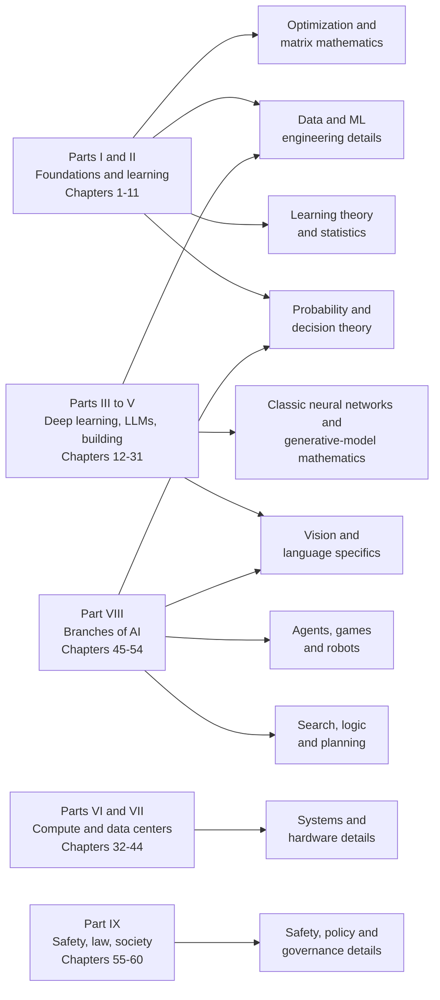
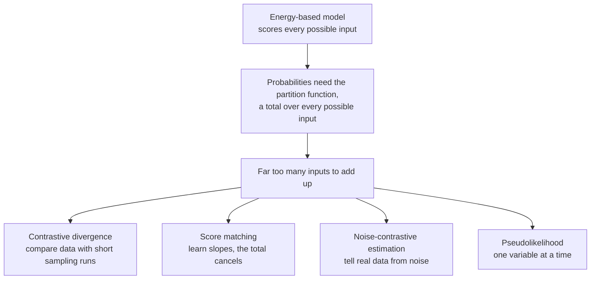
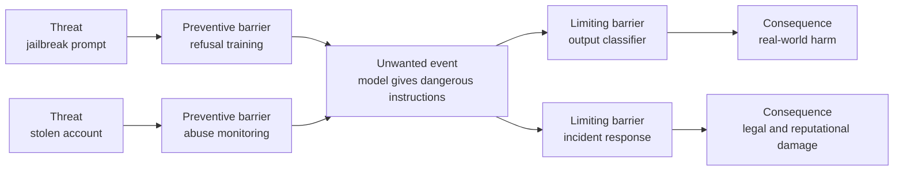

# Appendix F: The Advanced Shelf

*Short, plain-English entries for every topic the standard textbooks and courses teach beyond this book, so that no name in the curriculum is a mystery to you.*

This book was checked, topic by topic, against the standard textbooks, university courses and reference works in each of its fields (they are listed in "Where to go next" at the end). Those checks set some topics aside as too specialized for the main chapters: graduate-level mathematics, research niches, methods that newer ones replaced, and code-level details that only matter when you are writing the program yourself. You asked to know everything, so this appendix explains every one of them. The goal is modest and useful: when you meet one of these names in a course, a paper, a job advertisement or a conversation with a specialist, you will know what it is, why specialists care about it, and which chapter of this book it grows out of.

How to use it. Entries are grouped by field, in the sections listed in Table F.1, and Figure F.1 shows which part of the book each section hangs off. Each entry gives the idea in everyday words, a small example or analogy, why it matters to specialists and where it connects to the book. Every term that the main chapters do not already define gets a definition callout here; terms the book already defines point to their chapter instead. Nothing later in the book depends on this appendix. Read it like the side galleries of a museum: browse, stop where something catches your eye, and if an entry feels heavy, read its first sentence and its definitions and move on.

Everything here is settled textbook knowledge. Where an entry gives a year, it is the year the idea was published, not a claim about where the field stands in 2026; for that, see the chapters themselves.

| Section | What it covers | Grows out of |
|---|---|---|
| Search, logic and planning | Refinements of classical search, logic engines, formal reasoning about time, space and belief | Chapters 48 and 54 |
| Agents, games and robots | Multiplayer games, voting, negotiation, multi-agent and hierarchical methods, motion planning, optimal control | Chapters 28, 48 and 49 |
| Probability and decision theory | Graphical-model machinery, sampling methods, tracking, human irrationality, multi-attribute decisions | Chapters 6, 48 and 54 |
| Learning theory and statistics | Generalization theory, classic statistical models, measure theory, tuning at scale | Chapters 8, 9 and 10 |
| Optimization and matrix mathematics | Matrix toolbox, curvature, constrained optimization, optimizer variants, stability tricks | Chapters 5, 6, 13 and 17 |
| Classic neural networks and generative-model mathematics | Historical architectures, autoencoder variants, the partition function, variational bounds | Chapters 14 and 16 |
| Vision and language specifics | Image formation, texture, fast convolution, named architectures, word2vec shortcuts, parsing, text batching | Chapters 14, 15, 18, 45 and 54 |
| Data and ML engineering details | Sampling streams, data plumbing, imbalance and bandit tricks, recommender names, hosting and tooling | Chapters 9, 10, 11, 26, 28 and 51 |
| Systems and hardware details | Data-center software layers, cloud internals, security, TPU programming, inference layouts, architecture lore | Chapters 4, 32 to 38, 40 and 43 |
| Safety, policy and governance details | Risk worksheets, accident models, conflict and cooperation theory, agent foundations, EU AI Act machinery | Chapters 56, 59 and 60 |

*Table F.1: The sections of this appendix and the chapters they extend.*


*Figure F.1: How the ten sections of the advanced shelf hang off the parts of the book.*

## Search, logic and planning

These topics come from classical AI, the tradition that Chapter 48 (search, games and planning) and Chapter 54 (logic and probabilistic reasoning) introduce. Most of them make search or logic faster, or let it describe more of the world.

### AND-OR search and nondeterministic actions

Chapter 48's search assumes every action has one known result. In a nondeterministic world an action can turn out several ways: a cleaning robot's vacuum usually picks up the dirt, but sometimes spills it onto the clean square next door. AND-OR search handles this by alternating two kinds of choice points. At an "OR" point the agent picks one action; at an "AND" point it must have an answer ready for every outcome the world might produce. What comes out is not a single sequence of steps but a tree of if-then branches, the contingent plan that Chapter 48 defines. Robots, games against nature and software agents calling unreliable tools all face this problem.

> **Definition — Nondeterministic action:** An action whose result is not fixed in advance: doing it can lead to any of several outcomes, and the agent only finds out which one after acting.

> **Definition — AND-OR search:** A search method for worlds where actions have several possible outcomes. It builds a plan tree in which the agent chooses one action at each "OR" point and must cover every possible outcome at each "AND" point.

### Online search in unknown environments

Offline search plans the whole route on a map before taking a step. Online search is for when there is no map, so the agent has to act to find out what is there, like finding the bathroom in a dark, unfamiliar house by feeling along the walls. It must remember where it has been and physically walk back from dead ends, which costs real steps, not just thinking time. Specialists judge such methods by their competitive ratio. The learning-side cousin of this problem is exploration versus exploitation (Chapter 48).

> **Definition — Online search:** Search in which an agent alternates between thinking and acting because it can only discover what the world looks like by moving through it. Backing out of a dead end costs real actions, not just computation.

> **Definition — Competitive ratio:** How much worse a method that learns as it goes does compared with the best plan made with full knowledge. A robot that walks 300 meters to reach a spot that was 100 meters away along the best route has a ratio of 3.

### Structure in constraint problems

Some constraint satisfaction problems (Chapter 48) fall apart into easier pieces once you look at which variables constrain which. If the constraints form a tree, with no loops, the problem can be solved in time that grows only in proportion to the number of variables: pick a root, fix values from the root outward, and you never need to backtrack. If there are only a few loops, you can try each value of the handful of variables that cause them and solve the loop-free problem that remains, or group variables into clusters that connect like a tree. Scheduling three departments that share no constraints is three small problems, not one big one, and solvers that notice this are dramatically faster.

> **Definition — Tree-structured CSP:** A constraint problem whose diagram of constraints has no loops. Such problems can be solved quickly, in time proportional to the number of variables, without any backtracking.

> **Definition — Cutset conditioning:** A trick for constraint problems with a few loops: try each combination of values for a small set of variables whose removal breaks every loop, and solve the remaining loop-free problem for each combination.

> **Definition — Tree decomposition:** Rearranging a constraint problem into overlapping clusters of variables that connect like a tree, so the fast tree-solving method can be applied cluster by cluster.

### Backjumping and constraint learning

Plain backtracking search (Chapter 48) undoes the most recent choice when it gets stuck, even if that choice had nothing to do with the problem. Backjumping works out which earlier choice actually caused the conflict and jumps straight back to it, skipping the innocent choices in between: if a meeting cannot be placed because of who booked the big room, there is no point re-deciding the lunch order. Constraint learning goes further and writes the bad combination down as a new rule, so the solver never walks into that dead end again. Together they are the main reason modern SAT solvers (Chapter 54) cope with problems that have millions of variables.

> **Definition — Backjumping:** An improvement to backtracking search that, on hitting a dead end, returns directly to the earlier choice responsible for the conflict instead of to the most recent choice.

> **Definition — Constraint learning (no-good learning):** Recording each combination of choices that led to a dead end as a new constraint, so the search never tries that combination again. In SAT solvers it is called clause learning.

### Inside a SAT solver: DPLL, WalkSAT and the hardness cliff

Chapter 54 introduces SAT solvers, which find true-or-false values that make a long formula true. The formula is usually written as a list of clauses that must all hold. Most solvers descend from DPLL, a method from 1962 that assigns a value to one variable at a time, simplifies the formula after each choice, and backtracks on a contradiction; modern versions add backjumping and clause learning (see the entry above). WalkSAT takes the opposite approach: start from a random assignment and keep flipping one variable at a time to satisfy more clauses, like adjusting one light switch at a time until the room looks right. Researchers also found a cliff in randomly generated problems: with few clauses per variable nearly all are solvable, with many nearly none are, and the hardest problems sit right at the edge. For random problems whose clauses each mention three variables, the edge is at about 4.26 clauses per variable.

> **Definition — Clause:** In logic, a list of simple statements joined by OR, such as "it is raining OR the ground is dry OR the sprinkler is on". A clause is satisfied if at least one of its statements is true.

> **Definition — DPLL (Davis–Putnam–Logemann–Loveland algorithm):** The classic complete method for SAT problems: assign variables one at a time, simplify the formula, and backtrack when a contradiction appears. Nearly every modern SAT solver is built on it.

> **Definition — WalkSAT:** A local-search method for SAT that starts from a random true-or-false assignment and repeatedly flips one variable, mixing greedy flips with random ones, until every clause is satisfied or it gives up.

> **Definition — Phase transition (in SAT):** The sharp change, as the ratio of clauses to variables rises, from almost all random problems being solvable to almost none being solvable. The hardest problems cluster at the transition.

### Planning as satisfiability, planning graphs and logical agents

Instead of searching for a plan one step at a time (Chapter 48), you can hand planning to a SAT solver: write one large formula that is true exactly when some sequence of 10 actions reaches the goal, and if the solver says it cannot be done, try 11. This approach, SATPlan, worked surprisingly well because SAT solvers are so fast. GraphPlan builds a planning graph, a layered chart of which facts could possibly be true and which actions could possibly run at each time step; plans can be read off it, and it also gives a good estimate of how far away the goal is, which other planners use as a heuristic (Chapter 48). Russell and Norvig's textbook also builds whole agents from propositional logic that track the world as a growing logical formula, which is elegant on small puzzles and rare in practice.

> **Definition — SATPlan (planning as satisfiability):** Planning by translating "is there a plan with at most N steps?" into a SAT problem, handing it to a SAT solver, and increasing N until a plan is found.

> **Definition — Planning graph (GraphPlan):** A layered chart of which facts and actions could possibly hold at each time step of a plan. The GraphPlan algorithm extracts plans from it, and other planners use it to estimate the distance to a goal.

> **Definition — Logical state estimation:** Keeping track of what is true in the world by updating a logical formula after every action and observation, instead of storing one known state.

### The wumpus world

A teaching puzzle from Russell and Norvig's textbook. An agent explores a cave of 4 × 4 rooms looking for gold while avoiding bottomless pits and a monster called the wumpus. It cannot see them: it only feels a breeze next to a pit and smells a stench next to the wumpus, so it must reason "there is a breeze here but there was none in the room I came from, so the pit is in one of these two rooms". The puzzle exists to show logical inference (Chapter 54) working inside an agent. Nearly every classical AI course uses it; no real system does.

> **Definition — Wumpus world:** A small grid-shaped cave puzzle from the textbook *Artificial Intelligence: A Modern Approach*, used to teach how an agent can combine partial clues from its senses with logic to decide which moves are safe.

### Unification, lifted inference and fast rule engines

First-order logic (Chapter 54) uses variables, as in "every human is mortal". Unification is the matching step that makes such rules usable: to apply the rule to "Socrates is human" it finds the substitution "x is Socrates". The naive alternative, propositionalization, writes out a copy of every rule for every object, which explodes when there are millions of objects; lifted inference reasons with the variables directly. Rule-based expert systems (Chapter 54) lean on the Rete algorithm, which remembers partial matches so that when one fact changes, only the rules it touches are rechecked. Most of these engines stick to Horn clauses, the simple "if A and B then C" form that keeps forward and backward chaining (Chapter 54) fast.

> **Definition — Unification:** Finding values for variables that make two logical expressions identical, for example matching "Mortal(x)" with "Mortal(Socrates)" by setting x to Socrates. It is the core step of reasoning in first-order logic.

> **Definition — Propositionalization:** Turning first-order rules into plain variable-free ones by writing out a copy of each rule for every object. It is simple, but it can multiply the size of a knowledge base enormously.

> **Definition — Lifted inference:** Reasoning directly with rules that contain variables, treating whole groups of similar objects at once instead of copying the rules for each object.

> **Definition — Rete algorithm:** A matching method for rule engines that stores partial matches between rules and facts, so that adding or removing one fact only triggers rechecking of the rules that fact touches.

> **Definition — Horn clause:** A logical rule with at most one conclusion, of the form "if A and B and C, then D", or a plain fact. Keeping a knowledge base to Horn clauses makes forward and backward chaining efficient.

### Constraint logic programming

Constraint logic programming joins two ideas from the book: logic programming in the style of Prolog (Chapter 54) and constraint solving (Chapter 48). An ordinary Prolog program can only match facts exactly. A constraint logic program can also state relations such as "X plus Y equals 10, and X is larger than Y" and let a built-in solver narrow down the possibilities as the program runs. It is a niche style of programming, but it powers some timetabling, scheduling and product-configuration tools.

> **Definition — Constraint logic programming (CLP):** A style of logic programming in which programs can state numeric or other constraints between variables, which a built-in constraint solver keeps consistent and narrows down while the program runs.

### Situation calculus and truth maintenance

Situation calculus, from John McCarthy in the 1960s, is a way of writing logic about change: every fact is tagged with the situation, meaning the history of actions so far, in which it holds. "The door is open in the situation that results from pushing it" becomes a formula a reasoner can use. It is where the frame problem (Chapter 54) was first posed: the burden of stating everything that does not change after each action. A truth maintenance system tackles a different headache. It records why each belief is held, so that when an assumption is withdrawn, as happens in default reasoning (Chapter 54), every conclusion that depended on it is withdrawn too. Think of a spreadsheet recalculating every cell that used the number you just changed.

> **Definition — Situation calculus:** A logical language for describing change, in which each fact is labeled with the situation (the sequence of actions taken so far) in which it is true.

> **Definition — Truth maintenance system (TMS):** A part of a reasoning system that remembers the justification for each conclusion, so that when an assumption is retracted, every conclusion that rested on it is retracted too.

### Modal logic: reasoning about knowledge and belief

Ordinary logic gets confused by beliefs. If Lois Lane believes Superman can fly, and Superman is Clark Kent, plain logic concludes that she believes Clark Kent can fly, which she does not. Modal logic adds operators such as "knows", "believes", "necessarily" and "possibly", each with its own rules, so a program can reason about what different agents know, including what they know about one another. Russell and Norvig call beliefs and knowledge "mental objects". Formal accounts of time and belief in the meaning of sentences, and formal theories of agents (see BDI agents below), are built on the same machinery.

> **Definition — Modal logic:** An extension of logic with operators such as "it is known that", "it is believed that" or "it is necessarily true that", used to reason about knowledge, belief, obligation and possibility.

### Things and stuff: the formal ontology of the physical world

Ontologies (Chapter 54) must also decide how to describe physical objects, and the details turn philosophical quickly. Is a statue the same thing as the lump of clay it is made of? Half a loaf of bread is not a loaf, but half a glass of water is still water: "water" is a mass noun and "loaf" is a count noun, and a knowledge base must treat them differently. Measurements need units and conversions, and parts need to be told apart from wholes. People who build huge ontologies for medicine or engineering care about these choices because one wrong decision is repeated across millions of facts.

> **Definition — Mass noun (stuff):** A word for a substance that stays the same kind of thing when divided, such as water or sand, as opposed to a count noun for things that come in units, such as a loaf or a chair.

> **Definition — Mereology:** The formal study of parts and wholes, used in ontologies to state precisely when one thing is part of another, such as a wheel of a car or a slice of a cake.

### Reasoning about time and space

Formal calculi let a program reason about time and space without exact numbers. Allen's interval algebra names the 13 possible relations between two stretches of time, four of which Figure F.2 shows; statements such as "the meeting is during your shift" and "the delivery meets the inspection" can then be combined to spot contradictions in a schedule. The region connection calculus does the same for regions of space, with relations such as disjoint, touching, overlapping and inside. They are used in scheduling, mapping software and robot task planning.

```
A before B      AAAA
                       BBBB

A meets B       AAAA
                    BBBB

A overlaps B    AAAAAA
                    BBBBBB

A during B          AAA
                BBBBBBBBBBB
```
*Figure F.2: Four of Allen's 13 interval relations, with time running left to right. The other nine are starts, finishes, equals and the reversed forms of the six that have one (after, met by, overlapped by, contains, started by and finished by).*

> **Definition — Allen's interval algebra:** A set of 13 relations (before, meets, overlaps, during, starts, finishes, equals and their reverses) describing how two stretches of time can relate, used to reason about schedules without exact times.

> **Definition — Region connection calculus (RCC):** A formal language for how regions of space relate, such as being separate, touching at the border, overlapping, or one lying inside the other, used for reasoning about maps and layouts.

### Argumentation

Argumentation frameworks model reasoning as a structured debate. Arguments attack one another ("the witness saw him at 9" is attacked by "the witness was at the cinema at 9"), and a set of arguments counts as acceptable if it hangs together and can answer every attack made on it. Phan Minh Dung's abstract framework from 1995 is the standard starting point. It is used in legal reasoning, in negotiation between software agents and in explaining decisions; AI safety via debate (Chapter 56) is a distant relative.

> **Definition — Argumentation framework:** A formal model in which arguments and the attacks between them form a network, and rules decide which sets of arguments can be accepted together.

### Backus-Naur form and pseudocode

Textbooks write grammars and algorithms in two notations you will see everywhere. Backus-Naur form writes a grammar (Chapter 54) as rules: `digit ::= 0 | 1 | 2 | ... | 9` says a digit is any one of those characters, where `::=` means "is made of" and `|` means "or". Pseudocode describes an algorithm in program-like steps ("for each city on the list: if its distance is smaller, remember it") without the strict rules of a real programming language (Chapter 3). Neither needs a computer to read; both just need slow reading.

> **Definition — Backus-Naur form (BNF):** A standard notation for writing a formal grammar as rules that say what each part of a language is made of, such as "a number is one or more digits". It is used to specify programming languages.

> **Definition — Pseudocode:** A description of an algorithm written as structured, program-like steps in loose everyday language, meant for people to read rather than for a computer to run.

## Agents, games and robots

These entries extend the game-playing, planning and robotics material of Chapters 48 and 49, and the language-model agents of Chapter 28, toward many agents, longer time scales and the mathematics of control.

### Forward pruning and games with more than two players

Alpha-beta pruning (Chapter 48) skips branches of a game tree that provably cannot change the answer. Forward pruning also skips moves that merely look bad after a quick check, a risky shortcut, like a chess player who never considers sacrificing the queen; done carefully, it lets a program search much deeper along the moves that matter. In games with three or more players, each position is scored with a list of values, one per player, and each player picks the move that is best for their own entry. Alliances and betrayals make this messy, which is why the multiplayer poker and Diplomacy systems described in Chapter 48 needed different methods.

> **Definition — Forward pruning:** Discarding some moves in a game-tree search without examining them fully, because a quick estimate says they are probably bad. It saves time but can miss good moves.

> **Definition — Multiplayer game-tree search:** An extension of minimax to games with three or more players, in which each position is scored with one value per player and each player chooses the move best for their own score.

### Voting and social choice

When several agents or people must settle on one outcome, how should their preferences be combined? Social choice theory studies this and has found deep obstacles. In the Condorcet paradox, three voters rank three options A over B over C, B over C over A, and C over A over B; majorities then prefer A to B, B to C and C to A, so there is no stable winner. Kenneth Arrow proved in 1951 that no ranked voting rule can meet a short list of reasonable fairness conditions all at once. Mechanism design (Chapter 48) and social welfare functions (Chapter 56) build on these results.

> **Definition — Social choice theory:** The study of how to combine many individuals' preferences into one group decision, including the properties of different voting rules.

> **Definition — Condorcet paradox:** The situation in which majority votes between pairs of options form a cycle (A beats B, B beats C, C beats A), so that no option beats all the others.

> **Definition — Arrow's impossibility theorem:** Kenneth Arrow's 1951 proof that no method of turning individual rankings of three or more options into a group ranking can satisfy a small set of reasonable fairness conditions at the same time.

### Bargaining, negotiation and the contract net

Russell and Norvig's multiagent chapter also covers how self-interested agents reach deals. In alternating-offers bargaining, two agents take turns proposing how to split a gain, and impatience (a deal tomorrow is worth less than one today) pushes them to agree early, with the more patient side tending to get more. The contract net protocol, from 1980, is a simple recipe for handing out work: a manager announces a task, contractors bid, and the manager awards the task to the best bid. It is an ancestor of today's agent-to-agent task handoff, such as the A2A protocol (Chapter 28).

> **Definition — Alternating-offers bargaining:** A model of negotiation in which two parties take turns proposing how to split something valuable. Because waiting is costly, rational parties settle quickly, and the more patient one gets the larger share.

> **Definition — Contract net protocol:** A 1980 method for distributing tasks among software agents: a manager announces a task, other agents submit bids, and the manager awards the task to the best bidder.

### Multi-agent planning and multi-robot systems

When several agents carry out one plan together, new problems appear: dividing the work, staying out of each other's way and agreeing on who moves first. A warehouse with hundreds of shelf-carrying robots is the everyday example. Planning each robot's route separately produces collisions in the aisles, while planning all of them jointly explodes in size, so specialists use clever compromises. Coordination can be central, with one planner for everyone, or spread out, with each robot planning for itself and negotiating with its neighbors. Chapter 28 covers multi-agent systems built from language models; this is the older, more mathematical branch.

> **Definition — Multi-agent planning:** Planning for several agents that act at the same time, which must divide tasks, coordinate their timing and avoid interfering with one another.

> **Definition — Multi-agent path finding (MAPF):** The problem of finding collision-free routes for many robots or agents moving through a shared space at once, as in a warehouse robot fleet.

### BDI agents and formal agent theory

The belief-desire-intention model, based on the philosopher Michael Bratman's account of practical reasoning, describes an agent by what it believes about the world, what it would like to achieve, and which plans it has committed to. Commitment is the key: an agent that reconsidered everything every second would never finish anything, so it keeps its intentions until there is a good reason to drop them. BDI agent languages were used in simulations and control systems from the 1990s. Formal agent theory states such ideas in modal logic (see above) so that properties of an agent design can be proved. The agent loop of Chapter 28 is the practical modern cousin.

> **Definition — BDI agent (belief-desire-intention):** An agent design in which behavior comes from three parts: beliefs (what it thinks is true), desires (goals it would like to reach) and intentions (plans it has committed to carry out).

> **Definition — Agent theory:** The mathematical study of agents, using logic and decision theory to define precisely what an agent knows, wants and does, so that properties of agent designs can be proved.

### Hierarchical reinforcement learning

Reinforcement learning (Chapter 48) usually learns one small action at a time. Hierarchical reinforcement learning learns at several time scales at once: a high-level policy chooses sub-skills such as "walk to the kitchen" or "open the fridge", and each sub-skill is its own learned policy that runs until it finishes. The best-known formulation, by Richard Sutton, Doina Precup and Satinder Singh in 1999, calls these sub-skills options. It promises faster learning on long tasks; making it work reliably is still a research topic. Hierarchical planning (Chapter 48) is its planning-side twin.

> **Definition — Hierarchical reinforcement learning:** Reinforcement learning in which an agent learns both high-level choices between sub-skills and the sub-skills themselves, so that long tasks can be learned in chunks.

> **Definition — Option (reinforcement learning):** A sub-skill in hierarchical reinforcement learning: a policy plus rules for when it may start and when it stops, which the higher level can choose as if it were a single action.

### Other motion planners

Chapter 49 introduces the RRT, which grows a random tree through free space. Courses also teach several older or alternative planners. Visibility graphs connect the corners of obstacles and find the shortest route, which hugs those corners. Voronoi diagrams route a robot along the lines that stay as far as possible from every obstacle, which is safer but longer. Cell decomposition chops the free space into simple cells and searches the map of which cells touch. Probabilistic roadmaps scatter random collision-free points once, connect nearby ones, and reuse that roadmap for many trips.

> **Definition — Visibility graph:** A motion-planning map that links every pair of obstacle corners that can "see" each other in a straight line; the shortest path around obstacles always runs along such links.

> **Definition — Voronoi diagram:** A division of space into regions closest to each obstacle; its boundary lines are the points farthest from all obstacles, which makes them safe routes for a robot.

> **Definition — Cell decomposition:** Motion planning by dividing the free space into simple cells, such as rectangles, and searching for a sequence of neighboring cells from start to goal.

> **Definition — Probabilistic roadmap (PRM):** A motion planner that scatters random collision-free points in space, links nearby points with collision-free paths, and reuses the resulting network to answer many start-to-goal queries.

### Planning under motion uncertainty

Real robots slip and their sensors are noisy, so a path planned to pass 2 centimeters from a wall may scrape it. Planning under uncertainty either keeps track of where the robot might be, planning over belief states (Chapter 48), or chooses movements that make small errors harmless. The classic example is putting a peg into a hole: instead of aiming precisely, the robot presses the peg against the surface and slides it until it drops in. Such compliant motions use contact with the world to wipe out uncertainty.

> **Definition — Compliant motion:** A robot movement that deliberately keeps contact with a surface and lets it guide the motion, such as sliding a peg along a plate until it falls into a hole, so that small position errors do not matter.

### Optimal control: LQR, DDP and LQG

Chapter 49 covers PID controllers and model predictive control. The textbook optimal controller is LQR, the linear-quadratic regulator: if a system responds in proportion to the pushes it gets, and you penalize errors and effort by their squares, the best feedback rule can be computed exactly. Balancing a pole on a moving cart is the classic demonstration. DDP extends the idea to systems that do not respond proportionally, by repeatedly approximating them as proportional around the current trajectory. LQG adds a Kalman filter (Chapter 54) to cope with noisy sensors. Stanford's CS229 teaches these as the bridge between reinforcement learning and control engineering.

> **Definition — LQR (linear-quadratic regulator):** The optimal feedback controller for a system whose response is proportional to its inputs, when errors and control effort are penalized by their squares. It can be computed exactly and runs as a simple formula.

> **Definition — DDP (differential dynamic programming):** An optimal-control method for nonlinear systems that repeatedly approximates the system around the current planned trajectory, solves that easier problem, and improves the trajectory.

> **Definition — LQG (linear-quadratic-Gaussian control):** LQR combined with a Kalman filter, so the controller acts on its best estimate of the system's state when sensor readings are noisy.

### Game-playing agents in hands-on courses

The Hugging Face AI Agents Course includes a bonus unit in which you build a language-model agent that plays games. It is a hands-on project rather than a new idea: the agent reads the game state as text or images, chooses moves through tools, and learns nothing between games unless you give it memory. The ideas behind game-playing AI (search, self-play and reinforcement learning) are in Chapter 48, and the agent loop itself is in Chapter 28.

## Probability and decision theory

These entries go deeper into the Bayesian networks, sampling and filtering of Chapter 54, the probability of Chapter 6 and the decision theory of Chapter 48.

### Reading independence off a diagram: d-separation, Markov blankets and factor graphs

Bayesian networks (Chapter 54) are diagrams of causes and effects, and specialists read independence straight off them. D-separation is the rulebook. For example, if cloudy weather causes rain and rain wets the lawn, then once you know whether it rained, the lawn tells you nothing more about the clouds. A variable's Markov blanket (its parents, its children and its children's other parents) is everything you need in order to predict it; the rest of the network adds nothing. Markov random fields (Chapter 54) are the undirected version of these diagrams, and a factor graph redraws either kind so that message-passing algorithms can run on it. Ancestral sampling generates examples from a Bayesian network by drawing the causes first and then each effect given its causes.

> **Definition — D-separation:** A rule for reading a Bayesian network's diagram to decide whether two variables are independent once certain other variables are known, without doing any arithmetic.

> **Definition — Markov blanket:** For one variable in a Bayesian network, the set made of its parents, its children and its children's other parents. Once these are known, no other variable in the network adds information about it.

> **Definition — Factor graph:** A diagram with two kinds of nodes, variables and factors (pieces of the overall probability formula), linking each factor to the variables it involves; inference algorithms pass messages along its links.

> **Definition — Ancestral sampling:** Generating a random example from a Bayesian network by sampling variables in cause-to-effect order, each one drawn given the values already chosen for its parents.

### Noisy-OR and continuous variables

A Bayesian network variable with many parents needs a conditional probability table (Chapter 54) with a row for every combination of their values: 20 yes-or-no causes means more than a million rows. Noisy-OR shrinks this by assuming each cause can trigger the effect on its own, with its own probability, and that causes do not interact. If a cold causes fever 40% of the time and flu 80% of the time, then with both, the chance of no fever is 0.6 × 0.2 = 0.12, so fever has probability 0.88. Continuous quantities such as temperature are handled with formulas instead of tables, for example a bell curve (Chapter 6) whose center shifts with the parents' values.

> **Definition — Noisy-OR:** A compact way to specify how several possible causes produce an effect: each cause independently has its own chance of triggering the effect, and the effect is absent only if every present cause fails to trigger it.

> **Definition — Linear Gaussian model:** A way to describe a continuous variable in a Bayesian network as a bell curve whose center is a weighted sum of its parents' values.

### Relational and open-universe probability models

A Bayesian network fixes its variables in advance. Relational probability models write reusable templates instead, such as "for every customer and every book, the rating depends on the customer's taste and the book's quality", so the same model covers any number of customers and books. Open-universe models go further: they are uncertain how many objects exist and which observations refer to the same one. How many distinct aircraft produced these radar blips? Are two citations with slightly different spellings the same paper? Probabilistic programming (Chapter 54) is the usual tool for writing such models.

> **Definition — Relational probability model:** A probability model written as templates over kinds of objects and their relations, so one model applies to any number of objects, such as all customers and all books in a store.

> **Definition — Open-universe probability model:** A probability model that is uncertain about how many objects exist and about which observations belong to which object.

> **Definition — Identity uncertainty:** Not knowing whether two observations, such as two radar blips or two database records, refer to the same real-world object.

### Tracking many objects at once

The Kalman and particle filters of Chapter 54 track one object. With many objects, such as dozens of aircraft on a radar screen or the pedestrians seen by a self-driving car (Chapter 50), every new detection must first be matched to the right track. Get it wrong and two tracks swap identities, so the car "thinks" the child is where the cyclist was. Specialists handle this data association problem by keeping several possible matchings alive and pruning the unlikely ones as more evidence arrives.

> **Definition — Multitarget tracking:** Following many moving objects at once from a stream of noisy detections, keeping a separate estimated path for each.

> **Definition — Data association:** Deciding which new detection belongs to which tracked object, or whether it is a new object or a false alarm.

### Gibbs sampling and importance sampling

Chapter 54 explains Monte Carlo inference, which answers probability questions by drawing many random samples, and mentions Markov chain Monte Carlo. Two named methods come up constantly. Gibbs sampling, a kind of Markov chain Monte Carlo, updates one variable at a time, redrawing it from its probability given the current values of all the others; after many sweeps, the samples behave as if drawn from the full distribution. Importance sampling draws from an easier distribution and corrects by giving each sample a weight. To estimate how often a bridge fails, you can simulate far more severe storms than nature produces, then down-weight each simulated failure by how much more often you sampled such storms than reality would.

> **Definition — Gibbs sampling:** A Markov chain Monte Carlo method that repeatedly picks one variable and redraws its value given the current values of all the others. Over many rounds, the values visited approximate samples from the full distribution.

> **Definition — Importance sampling:** Estimating something about a hard-to-sample distribution by sampling from an easier one and weighting each sample by how much more or less likely it is under the real distribution.

### Human judgment and irrationality

Expected utility (Chapter 48) describes a perfectly consistent decision maker. People are not one. In the Allais paradox, most people prefer a sure $1 million to a gamble that adds a chance of $5 million but also a 1% chance of nothing; yet when both options are made much less likely to pay out at all, most switch to the bigger prize, a pair of choices no single utility function allows. Framing matters too: a treatment described as "90% survive" is chosen more often than the same treatment described as "10% die". Prospect theory, by Daniel Kahneman and Amos Tversky, describes these patterns, and Chapter 20's KTO method borrows its name from them. AI designers care because systems that learn from human choices inherit these quirks, and because assistants that model their users need to expect them. Chapter 54 mentions Kahneman's "System 1 and System 2" picture of thinking.

> **Definition — Allais paradox:** A pair of choices between gambles, devised by Maurice Allais in 1953, in which most people's preferences contradict expected utility theory, showing that people overweight certainty.

> **Definition — Framing effect:** The tendency to choose differently between identical options depending on how they are described, such as "90% survive" versus "10% die".

> **Definition — Prospect theory:** Kahneman and Tversky's 1979 description of how people actually decide under risk: they judge outcomes as gains or losses from a reference point, feel losses more strongly than equal gains, and overweight small probabilities.

### Multiattribute utility and decision networks

Real decisions trade off several things at once: choosing a site for an airport means weighing cost, noise, travel time and safety. Multiattribute utility theory says when it is legitimate to fold these into one score, often a weighted sum, and when it is not. A first check is dominance: if site A is cheaper, quieter, closer and safer than site B, B can be dropped without any argument about weights. Decision networks extend Bayesian networks (Chapter 54) with decision nodes and utility nodes, so a program can compute which choice has the highest expected utility (Chapter 48) given everything that is uncertain.

> **Definition — Multiattribute utility theory:** The part of decision theory that deals with outcomes described by several attributes, such as cost, time and risk, and with when and how they can be combined into one overall score.

> **Definition — Dominance (decision analysis):** One option dominates another when it is at least as good on every attribute and strictly better on at least one, so the dominated option can be discarded without weighing attributes.

> **Definition — Decision network (influence diagram):** A Bayesian network extended with nodes for the decision maker's choices and for the value of outcomes, used to compute which choice gives the highest expected utility.

## Learning theory and statistics

These entries sit behind the learning chapters (8 to 10). Some are the theory of why learning works; others are classic statistical models that machine-learning courses still teach.

### Generalization bounds

Statistical learning theory, PAC learning and the VC dimension are defined in Chapter 9. Their practical product is the generalization bound: a guarantee of the form "with 95% confidence, the error on new data is at most the training error plus a gap", where the gap shrinks as you add data and grows with the model's capacity. For classic models such bounds give real reassurance. For giant neural networks they are usually far too loose to be useful, because such networks can memorize even randomly shuffled labels (a widely cited 2017 finding), which is why explaining deep learning's generalization remains an open research question. Chapter 9's bias-variance tradeoff is the intuition these bounds formalize.

> **Definition — Generalization bound:** A mathematical guarantee that a model's error on new data will, with high probability, be no more than its training error plus a gap that depends on the amount of data and the model's capacity.

### The neural tangent kernel

A 2018 result showed that a neural network made infinitely wide, and trained with small enough steps, behaves exactly like a kernel method (the family behind the kernel trick of Chapter 10) with one fixed kernel, the neural tangent kernel. In that limit training is easy to analyze mathematically, which helped explain why very wide networks train so reliably. Networks of practical size, however, change their internal features as they learn, which this "lazy" regime cannot capture, so the neural tangent kernel is a tool for theorists rather than a description of how frontier models learn.

> **Definition — Neural tangent kernel (NTK):** A fixed similarity measure between inputs that describes how an infinitely wide neural network learns; in that limit, training the network is equivalent to a kernel method using this measure.

> **Definition — Lazy training:** The regime, reached by very wide networks, in which weights barely move during training, so the network's internal features stay almost fixed and it behaves like a kernel method.

### Learning with background knowledge: EBL, relevance and ILP

Russell and Norvig's chapter "Knowledge in Learning" asks how prior knowledge lets a learner generalize from very few examples, the way people do. Explanation-based learning watches one solved example, explains to itself why each step worked, and keeps the general rule. Relevance-based learning uses knowledge of which attributes matter: if you know that nationality usually determines language, meeting one Brazilian who speaks Portuguese is enough to generalize. Inductive logic programming learns rules in logic from examples plus background facts, such as learning "X is a grandparent of Z if X is a parent of someone who is a parent of Z" from family trees. The ideas inform today's attempts to combine language models with symbolic reasoning, but the names belong to research niches.

> **Definition — Explanation-based learning (EBL):** Learning a general rule from a single example by explaining, with background knowledge, why the example works and keeping only the parts the explanation needed.

> **Definition — Relevance-based learning:** Using background knowledge about which attributes determine which (for example, that nationality usually determines language) to generalize confidently from very few examples.

> **Definition — Inductive logic programming (ILP):** A family of methods that learn rules written in logic, such as Prolog rules, from examples together with background facts.

### Learning a network's structure; density estimation

Usually a person draws a Bayesian network's arrows and the data fill in the numbers. Structure learning finds the arrows too: try many candidate diagrams, score each by how well it fits the data minus a penalty for complexity, and keep the best. It is hard because the number of possible diagrams grows astronomically, and data alone often cannot reveal which way an arrow points, a problem Chapter 54's discussion of causes and confounders touches. Density estimation is the more general task of estimating a whole probability distribution from samples. The simplest version is a histogram; kernel density estimation puts a small bump on every data point and adds the bumps into a smooth curve.

> **Definition — Structure learning:** Learning the diagram of a Bayesian network, meaning which variables directly influence which, from data rather than drawing it by hand.

> **Definition — Density estimation:** Estimating the probability distribution (or probability density, Chapter 6) that a set of samples came from.

> **Definition — Kernel density estimation:** A density-estimation method that places a small smooth bump, such as a tiny bell curve, on every data point and adds them up to form a smooth estimated distribution.

### Naive Bayes is secretly a linear model

Naive Bayes (Chapter 10) multiplies one probability per word. Take logarithms (Chapter 6) and the product becomes a sum: each word contributes a fixed score, and the email is spam if the total passes a threshold. That is exactly the shape of logistic regression (Chapter 8). The difference is how the scores are set. Naive Bayes counts words in each class, which makes it a generative model (Chapter 16); logistic regression adjusts the scores to classify the training examples well, which makes it a discriminative model (Chapter 16). A well-known 2001 study found that naive Bayes reaches its best accuracy with fewer examples, while logistic regression usually ends up more accurate once data is plentiful.

### Normal equations and locally weighted regression

Fitting a straight line by minimizing squared errors (Chapter 8) does not actually need gradient descent: a formula called the normal equations gives the best weights in one step. It works well for a few thousand features, but its cost grows roughly with the cube of the number of features, so with millions of parameters gradient descent wins. Locally weighted regression fits a fresh line for every question asked, weighting nearby training points heavily and distant ones lightly, so a house's price is predicted mainly from similar houses. Like k-nearest neighbors (Chapter 10), it keeps all the training data around.

> **Definition — Normal equations:** A formula that gives the exact best-fitting weights of a linear regression in one calculation, by solving a system of linear equations, instead of approaching them step by step with gradient descent.

> **Definition — Locally weighted regression:** A method that, for each new input, fits a separate simple model to the training data with nearby points weighted more heavily, so the prediction reflects similar cases.

### Exponential families

The bell curve, the coin-flip distribution and the Poisson distribution for counts look different, but all three can be written in one shared mathematical form, called an exponential family. That shared form is why one recipe, the generalized linear model (Chapter 10), can predict a yes-or-no outcome, a count or a measurement with the same machinery, and why training each of them has the same tidy shape. Specialists use the form to derive new models quickly; you only need to know that these familiar distributions are siblings.

> **Definition — Exponential family:** A large family of probability distributions, including the normal, coin-flip and Poisson distributions, that share one mathematical form, which gives them convenient common properties for modeling and training.

> **Definition — Poisson distribution:** The probability distribution for the number of events in a fixed period when events happen independently at a steady average rate, such as calls per hour to a help line.

### Gaussian discriminant analysis

Gaussian discriminant analysis is a generative classifier (Chapter 16). It models each class as a bell-shaped cloud of points in feature space, a multivariate normal distribution, and labels a new point by which cloud it more likely came from. If all classes share the same cloud shape, the boundary between them is a straight line, giving the classic linear discriminant analysis. Stanford's CS229 teaches it next to logistic regression to show that a generative model with strong assumptions can need less data than a discriminative one, the same lesson as naive Bayes above.

> **Definition — Gaussian discriminant analysis (GDA):** A classifier that models the data of each class as a multivariate normal distribution and assigns a new point to the class most likely to have produced it.

> **Definition — Multivariate normal distribution:** The bell curve extended to several numbers at once: a cloud of points densest at a center, whose spread and tilt in each direction are set by a covariance matrix.

> **Definition — Linear discriminant analysis (LDA):** The special case of Gaussian discriminant analysis in which all classes share the same spread and tilt, so the boundaries between classes are straight lines or flat planes.

### SVM duality, SMO and the hinge loss

Support vector machines (Chapter 10) are trained by solving an optimization problem that can be rewritten in an equivalent "dual" form in which the data appear only through similarity scores between pairs of examples. That rewriting is what makes the kernel trick (Chapter 10) possible. SMO, John Platt's method from 1998, solves the dual by repeatedly adjusting just two weights at a time, each step simple enough to do by hand, which made SVM training practical. The SVM's loss function is the hinge loss: zero for points classified correctly with room to spare, then rising in a straight line as a point creeps toward or across the boundary. Stanford's CS231n compares it with the cross-entropy loss (Chapter 6).

> **Definition — Duality (optimization):** The fact that many optimization problems have an equivalent "dual" version, with a different set of unknowns, whose solution gives the same answer and is sometimes much easier to compute.

> **Definition — SMO (sequential minimal optimization):** John Platt's 1998 method for training support vector machines by repeatedly optimizing just two of the dual problem's unknowns at a time, each step solvable with a simple formula.

> **Definition — Hinge loss:** A loss function that is zero when an example is classified correctly by a comfortable margin and grows linearly as the example gets closer to, or crosses to the wrong side of, the decision boundary.

### Factor analysis and probabilistic PCA

Principal component analysis (Chapter 10) finds the main directions along which data vary. Probabilistic PCA restates it as a story of how the data were generated: a few hidden factors, mixed by fixed weights, plus random noise. Factor analysis tells the same story but gives each measured variable its own noise level; psychologists have long used it, for example to explain scores on many different tests with a few underlying abilities. Independent component analysis (Chapter 10) is a relative that looks for hidden factors that are statistically independent, not merely uncorrelated.

> **Definition — Probabilistic PCA:** Principal component analysis restated as a probability model in which each data point is a weighted mix of a few hidden factors plus random noise of the same size in every direction.

> **Definition — Factor analysis:** A statistical model that explains many measured variables as weighted combinations of a few hidden factors, with each measured variable allowed its own amount of noise.

### Measure theory and change of variables

Measure theory is the rigorous foundation of probability: it says precisely what "the probability of a set of outcomes" means when there are infinitely many possible outcomes, and it removes paradoxes that naive definitions run into. Mathematicians need it to prove theorems; you do not need it to use probability. Change of variables is more practical: when you transform a random quantity, its density stretches or squeezes. Temperatures spread over 10 degrees Celsius are spread over 18 degrees Fahrenheit, so the density (Chapter 6) per Fahrenheit degree is the Celsius density divided by 1.8. Normalizing flows (Chapter 16) are built entirely on keeping track of this stretching as data pass through a neural network.

> **Definition — Measure theory:** The branch of mathematics that defines size, length, area and probability rigorously for very general sets, providing the formal foundation of probability theory.

> **Definition — Change of variables (for densities):** The rule for how a probability density changes when the quantity is transformed: wherever the transformation stretches values apart, the density thins out by the same factor, and wherever it squeezes them together, the density rises.

### Asynchronous hyperparameter search

Successive halving and Hyperband (Chapter 9) start many training trials, then repeatedly stop the worse half. The plain versions wait for every trial in a round to finish before deciding, so fast machines sit idle while slow trials catch up. The asynchronous versions promote a trial as soon as it beats enough of the trials that have already reported, which keeps every machine busy. Asynchronous random search likewise launches a new random setting the moment a machine frees up. These are scheduling refinements inside tuning tools.

> **Definition — Asynchronous successive halving (ASHA):** A version of successive halving for many machines in which promising trials are promoted to longer training as soon as enough results exist, without waiting for a whole round to finish.

## Optimization and matrix mathematics

These are the mathematical tools behind Chapters 5, 6 and 13. You can use AI fully without them; you will meet them in any graduate course.

### Matrix machinery: identity, inverse, determinant and friends

Chapter 5 teaches matrices as tables of numbers and shows how to multiply them. Math courses add a toolbox around them. The identity matrix leaves any vector unchanged, like multiplying by 1. A matrix's inverse undoes it, like dividing. The determinant is a single number saying how much the matrix stretches area or volume; a determinant of 0 means it squashes space flat and loses information, so no inverse exists. The trace is simply the sum of the numbers on the diagonal. The span of a set of vectors is everything you can reach by scaling and adding them, and the vectors are linearly dependent if one of them can already be reached from the others. The pseudoinverse is the best available substitute when no true inverse exists, and it gives the answer with the smallest squared error (see the normal equations above). Courses also name special shapes: diagonal matrices, symmetric matrices and orthogonal matrices.

> **Definition — Identity matrix:** A square matrix with 1s on the diagonal and 0s everywhere else; multiplying a vector by it leaves the vector unchanged, like multiplying a number by 1.

> **Definition — Matrix inverse:** The matrix that undoes another matrix's effect, so that multiplying the two together gives the identity matrix. Only some square matrices have one.

> **Definition — Determinant:** A single number computed from a square matrix that says by what factor the matrix scales area or volume. A determinant of zero means the matrix flattens space and has no inverse.

> **Definition — Trace of a matrix:** The sum of the numbers on a square matrix's main diagonal, from top left to bottom right.

> **Definition — Span (of vectors):** All the vectors that can be built by scaling and adding a given set of vectors.

> **Definition — Linear dependence:** A set of vectors is linearly dependent when at least one of them can be built by scaling and adding the others, so it adds no new direction.

> **Definition — Pseudoinverse:** A generalization of the matrix inverse that exists for every matrix, including non-square ones; it gives the best possible answer, in the least-squared-error sense, when an exact solution does not exist.

> **Definition — Diagonal matrix:** A matrix whose only nonzero numbers lie on its main diagonal; multiplying by it simply scales each coordinate separately.

> **Definition — Symmetric matrix:** A square matrix that is its own mirror image across the main diagonal, so the number in row i, column j equals the number in row j, column i. Covariance matrices are symmetric.

> **Definition — Orthogonal matrix:** A square matrix that only rotates or reflects space without stretching it; its inverse is simply its mirror image across the diagonal.

### Covariance and the covariance matrix

Chapter 6 defines variance and correlation. Covariance is the raw ingredient of correlation: for each data point, multiply how far x is above or below its average by how far y is above or below its average, then average those products. Height and weight have a positive covariance because tall people tend to be heavier. Correlation is covariance rescaled to lie between -1 and 1. A covariance matrix lists the covariance of every pair of features, and it describes the tilt and spread of a cloud of data, which is what PCA (Chapter 10) and Gaussian discriminant analysis (above) work with.

> **Definition — Covariance:** A measure of how two quantities vary together: the average of the products of their deviations from their own averages. It is positive when they tend to rise together and negative when one rises as the other falls.

> **Definition — Covariance matrix:** A table giving the covariance between every pair of variables, with each variable's variance on the diagonal; it describes the spread and tilt of a cloud of data points.

### Jacobians, Hessians and conditioning

Chapter 6 defines the gradient, the list of slopes of one output with respect to every input. The Jacobian is the same idea for a function with many outputs: a table of every output's slope with respect to every input. The Hessian is a table of second derivatives, the slopes of the slopes, and it describes curvature. When curvature is much steeper in one direction than another, the problem is poorly conditioned: the loss surface is a long, narrow valley, and gradient descent zigzags across it instead of moving along it. That is one reason optimizers such as Adam (Chapter 13) rescale each direction separately.

> **Definition — Jacobian:** For a function with several inputs and several outputs, the table of how much each output changes when each input changes slightly.

> **Definition — Hessian:** The table of second derivatives of a function, describing how its slopes themselves change; it captures the curvature of a loss surface in every pair of directions.

> **Definition — Condition number (ill-conditioning):** The ratio between the steepest and the flattest curvature of a function. A large ratio (an ill-conditioned problem) means a long narrow valley in which plain gradient descent zigzags and makes slow progress.

### Newton's method, BFGS and second-order optimization

Gradient descent uses only the slope. Newton's method also uses the curvature, to jump to the bottom of the local bowl in one step: on a perfect parabola, a step equal to the slope divided by the curvature lands exactly at the minimum. The catch is size. The Hessian of a model with n parameters has n × n entries, so for a 70-billion-parameter model that is about `4.9 × 10^21` numbers, far beyond any computer's memory. BFGS, and its low-memory version L-BFGS, build a cheap running estimate of the curvature from recent gradients and are standard for small and medium problems. The Shampoo and SOAP optimizers of Chapter 13 are large-scale descendants of the same idea.

> **Definition — Newton's method (optimization):** An optimization method that uses both the slope and the curvature of the loss to jump toward the minimum, converging in very few steps but needing the expensive Hessian.

> **Definition — BFGS and L-BFGS:** Optimization methods that approximate Newton's method by building an estimate of the curvature from the history of recent gradients; L-BFGS keeps only a short history so it fits in memory for larger problems.

### Constrained optimization: Lagrange multipliers and KKT conditions

Many problems come with rules: enclose the largest possible rectangle with exactly 100 meters of fence (the answer is a 25 by 25 meter square). Lagrange multipliers handle such equality rules by adding each rule to the objective with a "price"; at the best answer, the pull of the objective is exactly balanced by the pull of the rules. The KKT conditions extend this to rules of the "at most" or "at least" kind, and they are what produce the SVM dual above. Weight penalties (Chapter 9) are the same idea seen from the other side: adding an L2 penalty is equivalent to forbidding the weights from growing beyond a certain size. Under-constrained problems, with more unknowns than equations, have infinitely many exact solutions; a penalty is how you choose a sensible one.

> **Definition — Constrained optimization:** Finding the best value of an objective while obeying rules on the unknowns, such as "the total must equal 100" or "no weight may exceed 1".

> **Definition — Lagrange multiplier:** An extra number attached to each equality rule in a constrained optimization problem; it acts like a price for breaking the rule, and at the solution it measures how much the objective would improve if the rule were relaxed slightly.

> **Definition — KKT conditions (Karush–Kuhn–Tucker conditions):** The conditions that the solution of an optimization problem with inequality rules must satisfy; they generalize Lagrange multipliers to rules of the form "at most" or "at least".

> **Definition — Under-constrained problem:** A problem with more unknowns than independent equations, so infinitely many solutions fit exactly; extra preferences, such as a penalty on large weights, are needed to pick one.

### Optimizer variants: Nesterov momentum, Polyak averaging, coordinate descent and AdaDelta

Chapter 13 explains momentum and Adam. Nesterov momentum adds a look-ahead: compute the slope at the point momentum is about to carry you to, not where you stand, which corrects overshooting sooner. Polyak averaging reports the average of the weights over many recent steps rather than the last set, smoothing out the noise of the final steps; the "model soup" averaging in Chapter 20 is a cousin. Coordinate descent optimizes one parameter at a time while holding the rest fixed, and is how some classic regression solvers work. AdaDelta, from 2012, is an adaptive optimizer and forerunner of Adam that sizes each weight's steps from running averages of past updates, without needing a hand-set learning rate.

> **Definition — Nesterov momentum:** A variant of momentum that measures the gradient at the position momentum is about to carry the weights to, rather than at the current position, which reduces overshooting.

> **Definition — Polyak averaging:** Using the average of a model's weights over the last many training steps, instead of the final weights alone, as the trained model; it smooths out noise from the last steps.

> **Definition — Coordinate descent:** An optimization method that improves one parameter at a time, holding all the others fixed, and cycles through the parameters repeatedly.

> **Definition — AdaDelta:** A 2012 adaptive optimizer that scales each weight's update using running averages of recent squared gradients and recent squared updates, so it needs no hand-chosen global learning rate.

### Stability tricks: z-loss and logit soft-capping

Chapter 17 explains why very large training runs can blow up. Two named fixes come up in papers. The z-loss adds a tiny penalty that keeps the softmax's normalizing total (Chapter 6) close to 1, which stops the raw output scores, the logits (Chapter 6), from drifting to huge values; Google's PaLM model used it in 2022. Logit soft-capping squashes logits smoothly so they can never pass a ceiling, using `cap × tanh(logit ÷ cap)`, where cap is the chosen ceiling (for example 30) and tanh (Chapter 12) is a curve that flattens out at plus and minus 1; Google's Gemma 2 models used it in 2024. Each is one small trick among many in Chapter 17's picture.

> **Definition — z-loss:** A small extra training penalty that pushes the softmax's normalizing total toward 1, keeping logits from growing very large and destabilizing training.

> **Definition — Logit soft-capping:** Passing logits through a smooth squashing function so that they approach, but never exceed, a chosen maximum, which keeps training and attention numerically stable.

## Classic neural networks and generative-model mathematics

These entries are the historical architectures and the heavier probability mathematics that sit behind Chapters 14 and 16. Most are no longer used directly, but their ideas reappear in modern models.

### Echo state networks and leaky units

Training recurrent networks (Chapter 14) used to be painfully unstable. Echo state networks, introduced by Herbert Jaeger in 2001, sidestep the problem: a large recurrent network is wired up at random and never trained, so its activity "echoes" recent inputs in complicated ways, and only a simple output layer is trained to read answers from that echo. The general approach is called reservoir computing (not to be confused with reservoir sampling, in the data engineering section). Leaky units are neurons that keep a fixed fraction of their previous value at each step, a crude memory that the gates of LSTMs (Chapter 14) later made learnable. Both survive in niche time-series and hardware research.

> **Definition — Echo state network:** A recurrent neural network whose internal connections are random and fixed; only the output layer is trained, which makes training fast and stable.

> **Definition — Reservoir computing:** The general approach of feeding inputs into a large, fixed, randomly connected dynamic system (the reservoir) and training only a simple readout of its state.

> **Definition — Leaky unit:** A neuron in a recurrent network that keeps a fixed fraction of its previous value at each time step, giving the network a simple, slowly fading memory.

### Recursive neural networks

Not to be confused with recurrent networks (Chapter 14), which run along a sequence, recursive neural networks run up a tree. Given a sentence's parse tree (Chapter 54), the same small network combines the vectors for "very" and "good" into a vector for "very good", then combines that with "not" into "not very good", and so on up to the whole sentence. Richard Socher's 2013 work on sentiment made them famous. Transformers (Chapter 15) replaced them because they learn structure without needing a parse tree.

> **Definition — Recursive neural network:** A neural network applied repeatedly over a tree structure, such as a sentence's parse tree, combining the vectors of child nodes into a vector for their parent until the root represents the whole input.

### Tangent propagation and the manifold tangent classifier

Shift a handwritten digit by one pixel and it is still the same digit. Tangent propagation, from 1992, teaches a network this directly: it penalizes the network whenever its output changes along the directions of such small, known transformations. The manifold tangent classifier, from 2011, learns those directions from the data instead of having a person list them, using the manifold hypothesis (Chapter 16). Both faded because data augmentation (Chapter 9) achieves the same goal more simply: just show the network shifted copies.

> **Definition — Tangent propagation:** A training method that penalizes a network for changing its output under small known transformations of the input, such as slight shifts or rotations, to make it insensitive to them.

> **Definition — Manifold tangent classifier:** A 2011 method that learns from unlabeled data the directions in which inputs can change without changing their meaning, then trains a classifier to be insensitive along those directions.

### Sparse representations, sparse coding and slow features

A sparse representation describes each input with only a few active features out of many, the way a sentence uses only a few of the words in a dictionary. Sparse coding, from Bruno Olshausen and David Field in 1996, learns such a dictionary of features from natural images and found edge-like detectors resembling those in the visual cortex; its direct descendant is the sparse autoencoder used to look inside language models (Chapter 57). Slow feature analysis looks for features that change slowly over time, on the theory that what matters (which object is in view) changes more slowly than raw pixels do.

> **Definition — Sparse representation:** A way of encoding data in which most of the features are zero for any given input and only a few are active.

> **Definition — Sparse coding:** Learning a dictionary of basic patterns such that every input can be rebuilt from just a few of them, giving each input a sparse representation.

> **Definition — Slow feature analysis:** A method that learns features of a time-varying signal that change as slowly as possible, on the idea that meaningful properties, such as an object's identity, change more slowly than raw measurements.

### Self-organizing maps

A self-organizing map, invented by Teuvo Kohonen in the early 1980s, is a grid of artificial neurons that learns to lay high-dimensional data out on a flat map, so that similar inputs land on nearby grid cells. Feed it customer records and similar customers end up as neighbors on the map. It was a popular visualization and clustering tool before t-SNE and UMAP (Chapter 10) took over that job.

> **Definition — Self-organizing map (SOM, Kohonen map):** A neural network arranged as a grid that learns, without labels, to place similar inputs on nearby grid cells, producing a two-dimensional map of high-dimensional data.

### Random and unsupervised features

Before end-to-end training was practical, a common shortcut was to fix a network's lower layers instead of training them, using random filters or filters learned without labels (for example by k-means clustering, Chapter 10), and to train only the final classifier on top. Studies around 2009 to 2011 found this worked surprisingly well, a hint of how much the architecture itself contributes. Today, self-supervised pretraining (Chapter 16) fills that role far better.

> **Definition — Random features:** Features computed by fixed, randomly chosen weights or filters that are never trained; only a simple model on top of them is trained.

### Boltzmann variants, sigmoid belief networks and NADE

Chapter 16 introduces Boltzmann machines, restricted Boltzmann machines and deep belief networks. A deep Boltzmann machine, from 2009, stacks several RBM-like layers with two-way connections between all neighboring layers. A sigmoid belief network, from 1992, is the directed, one-way version, in which each unit switches on with a probability given by a sigmoid (Chapter 8) of its parents. NADE, from 2011, generates data one piece at a time, predicting each pixel or value from the ones before it with a shared neural network: the same autoregressive idea (Chapter 15) that drives next-token prediction in today's language models. All three are historical names today.

> **Definition — Deep Boltzmann machine (DBM):** A generative model made of several layers of hidden units with two-way (undirected) connections between neighboring layers, a deeper relative of the restricted Boltzmann machine.

> **Definition — Sigmoid belief network:** A directed generative model of on-off units in layers, where each unit turns on with a probability computed by a sigmoid function of the units above it.

> **Definition — NADE (neural autoregressive distribution estimator):** A 2011 generative model that produces data one element at a time, using a neural network with shared weights to predict each element from the elements before it.

### Autoencoder variants

Chapter 16 explains autoencoders, networks that compress and then rebuild their input. A contractive autoencoder adds a penalty whenever its compressed code changes much when the input is nudged slightly, which forces robust codes. A stochastic encoder outputs a probability distribution over codes instead of one fixed code, the core of the VAE (Chapter 16). Predictive sparse decomposition, from 2008, trains a fast encoder to predict the code that slow sparse coding (above) would find. You can even draw new samples from a denoising autoencoder by alternately corrupting and cleaning up an input many times, a chain of steps that foreshadowed diffusion (Chapter 16). One classic use of autoencoders, beside shrinking data to fewer dimensions, is semantic hashing.

> **Definition — Contractive autoencoder:** An autoencoder trained with an extra penalty on how much its code changes when the input changes slightly, so that it learns codes that ignore small, meaningless variations.

> **Definition — Stochastic encoder:** An encoder that outputs a probability distribution over possible codes for an input rather than a single code; the variational autoencoder uses one.

> **Definition — Predictive sparse decomposition (PSD):** A 2008 method that trains a fast feed-forward encoder to predict the sparse code that a slower sparse-coding optimization would produce.

> **Definition — Semantic hashing:** Using an autoencoder to turn each document into a short binary code such that similar documents get similar codes, so related documents can be found by looking up nearby codes.

### Generative stochastic networks and moment matching

Two ideas from 2014 and 2015 for training generators, both since overtaken. Generative stochastic networks learn a repeated noisy step, corrupt and then reconstruct, whose long-run output is a sample from the data; they are forerunners of diffusion models (Chapter 16). Moment matching trains a generator so that statistics of its samples (averages, spreads and many subtler summaries, compared with a measure called maximum mean discrepancy) match those of real data, a simpler alternative to the GAN's adversary (Chapter 16) that tended to give blurrier results.

> **Definition — Generative stochastic network (GSN):** A 2014 generative model that learns a noisy transition, such as corrupting and then reconstructing an input, so that repeating the transition many times produces samples resembling the data.

> **Definition — Moment matching:** Training a generator so that summary statistics of its samples, such as averages and spreads, match those of the real data.

> **Definition — Maximum mean discrepancy (MMD):** A measure of how different two sets of samples are, comparing a rich collection of their summary statistics at once; it is zero when the two distributions are the same.

### The partition function and the ways around it

Energy-based models (Chapter 16) give every possible input a score. Turning scores into probabilities requires dividing by the partition function (Chapter 16), a total over every possible input, which for images is an astronomically large sum that nobody can compute. Figure F.3 shows the four classic escape routes. Contrastive divergence, from Geoffrey Hinton in 2002, compares real data with samples made by just a few steps of Gibbs sampling (see the probability section). Score matching learns only the slopes of the log-probability, in which the partition function cancels out; it underlies score-based models and diffusion (Chapter 16). Noise-contrastive estimation turns the problem into classification: learn to tell real data apart from deliberately generated noise. Pseudolikelihood replaces the whole joint probability with each variable's probability given all the others, which needs only small totals.


*Figure F.3: Why the partition function blocks training of energy-based models, and the four classic ways around it.*

> **Definition — Contrastive divergence:** A fast approximate training method for energy-based models such as restricted Boltzmann machines that compares real data with samples produced by only a few steps of Gibbs sampling started from that data.

> **Definition — Score matching:** Training a model to match the slope of the data's log-probability at every point, which avoids computing the partition function because that constant disappears when you take slopes.

> **Definition — Noise-contrastive estimation (NCE):** Training a probability model by teaching it to distinguish real data from samples of a known noise distribution, which sidesteps computing the partition function.

> **Definition — Pseudolikelihood:** An approximation that replaces the probability of a whole data point with the product of each variable's probability given all the other variables, which is much cheaper to compute.

### The ELBO, MAP inference and wake-sleep

Variational inference (Chapter 54) approximates a hard probability distribution with a simpler one. The quantity it actually optimizes is the evidence lower bound, or ELBO: a number you can compute that is always at most the log-probability of the data, so pushing it up both improves the model and tightens the approximation. Training a VAE (Chapter 16) means maximizing the ELBO. MAP inference is the shortcut of keeping only the single most probable answer instead of a whole distribution; adding a prior (Chapter 6) belief that weights should be small turns it into ordinary training with L2 regularization (Chapter 9). The wake-sleep algorithm, from 1995, trained a generator and a recognition network by alternating phases: one learned from real data ("wake"), the other from the generator's own dreams ("sleep"). Expectation-maximization (Chapter 10) is a close relative of all three.

> **Definition — ELBO (evidence lower bound):** A computable quantity that is always less than or equal to the log-probability of the data under a model; maximizing it both trains the model and improves the approximation used in variational inference.

> **Definition — MAP inference (maximum a posteriori):** Choosing the single most probable value of unknown quantities given the data and prior beliefs, instead of keeping the full range of possibilities with their probabilities.

> **Definition — Wake-sleep algorithm:** A 1995 method for training a generative network together with a recognition network by alternating a "wake" phase on real data and a "sleep" phase on data the generator imagines.

## Vision and language specifics

These entries extend computer vision (Chapters 14 and 45) and language processing (Chapters 14, 15, 18 and 54) with older methods, named architectures and practical details.

### Image formation: cameras, lenses and light

The book treats images as grids of pixels (Chapter 3). Computer vision courses start one step earlier, with how light becomes pixels. In the pinhole camera model, light from each point in the scene passes through a single point onto the sensor, so an object twice as far away looks half as tall: that is perspective projection. Lenses gather far more light than a pinhole but keep only one distance perfectly sharp. How bright a surface looks depends on its angle to the light, which is why shading reveals shape. Specialists need this for 3D reconstruction and camera calibration; Chapter 49 covers the coordinate frames robots use.

> **Definition — Pinhole camera model:** The simplest model of a camera, in which light from each point in the scene travels in a straight line through one tiny hole onto the image plane.

> **Definition — Perspective projection:** The way a three-dimensional scene maps onto a flat image through a camera, so that distant objects appear smaller in proportion to their distance and parallel lines appear to converge.

### Texture

Texture is a repeated local pattern such as brick, grass, fabric or wood grain. Classic computer vision described it with statistics of how a bank of small filters, such as Gabor filters tuned to stripes of a particular angle and thickness, responded across a patch. Matching those statistics lets a program tell grass from gravel, or split an image into regions. The neural style transfer of Chapter 14 is a modern descendant: it captures an image's "style" as texture statistics of a CNN's features.

> **Definition — Texture (computer vision):** The repeated small-scale pattern of a surface, such as brick or fabric, usually described by statistics of local image features rather than by exact pixel values.

> **Definition — Gabor filter:** A small image filter that responds to stripes of a particular orientation and spacing, resembling the response of some neurons in the visual cortex, and long used to describe texture.

### Shapes, contours and modular recognition

Before deep learning, a common route to recognizing objects was through their outlines: detect edges, link them into contours, then compare each contour with stored shapes using a shape descriptor, such as the 2002 "shape context", which records for each point on an outline where the rest of the outline lies. The CS2023 curriculum also lists "modularity in recognition", the old design of recognition as a pipeline of separate hand-built stages (find edges, group them, match them). End-to-end CNNs (Chapter 14) and the detectors of Chapter 45 replaced these pipelines for most tasks.

> **Definition — Edge detection:** Finding the places in an image where brightness changes sharply, which usually mark the boundaries of objects.

> **Definition — Contour:** A connected curve that traces the outline or boundary of an object in an image.

> **Definition — Shape descriptor:** A compact numerical summary of an object's outline, designed so that similar shapes get similar summaries and can be matched for recognition.

### Fast convolution: FFT and Winograd

A convolution (Chapter 14) slides a small filter across an image, multiplying and adding at every position, and those multiplications dominate a CNN's cost. Two classic tricks compute exactly the same result with fewer of them. The fast Fourier transform turns an image into its frequency components, where convolution becomes plain multiplication; this pays off for large filters. Winograd's method saves work for the small 3 × 3 filters most networks use: one common version needs 16 multiplications instead of 36 for each 2 × 2 block of outputs, a 2.25× saving. GPU libraries pick the fastest method automatically, which is why you rarely hear the names.

> **Definition — Fast Fourier transform (FFT):** A fast algorithm for breaking a signal or image into its frequency components; in that form, convolution becomes simple element-by-element multiplication.

> **Definition — Winograd convolution:** A way of computing small convolutions, such as 3 × 3, with fewer multiplications by cleverly reusing intermediate sums; it gives exactly the same answer as the direct method.

### ResNeXt, RegNet and anchor boxes

ResNeXt, from 2017, splits each ResNet block (Chapter 14) into many thin parallel paths, a grouped convolution, and found that more paths beat simply making the network wider or deeper. RegNet, from 2020, stopped hand-designing networks altogether: its authors studied a whole family of designs and distilled simple rules, such as letting channel widths grow steadily with depth. Anchor boxes are a detection detail: an object detector (Chapter 45) starts from a fixed set of box shapes at every location, tall, wide and square, and predicts how to stretch and shift each one. Most detectors from about 2015 to 2020 used them; DETR (Chapter 45) showed they could be dropped.

> **Definition — ResNeXt:** A 2017 CNN design that splits each residual block into many parallel narrow paths whose outputs are added together, improving accuracy at the same cost.

> **Definition — Grouped convolution:** A convolution in which the channels are split into groups and each group is filtered separately, cutting the number of weights and computations.

> **Definition — RegNet:** A family of CNNs from 2020 found by studying the space of possible network designs and extracting simple rules, such as widths that grow steadily with depth, instead of hand-designing a single network.

> **Definition — Anchor box:** One of a fixed set of predefined box shapes and sizes placed at each image location in an object detector; the network predicts adjustments to the anchors rather than boxes from scratch.

### The house-number case study

Chapter 11 of the Goodfellow, Bengio and Courville textbook walks through one real project: reading multi-digit house numbers in Google Street View photos. The lesson is the method, not the network. The team first fixed the business goal (match human accuracy, about 98%, while answering as many images as possible and leaving the rest to people), chose metrics that measured it, built a simple working baseline, and then improved it by studying where the errors came from. The same discipline appears in Chapter 13's debugging checklist and Chapter 10's project lifecycle.

> **Definition — Coverage (of a prediction system):** The share of inputs a system answers on its own instead of passing to a person; demanding more confidence before answering raises accuracy but lowers coverage.

### Negative sampling and hierarchical softmax

word2vec (Chapter 14) learns word vectors by predicting nearby words, which naively means computing a softmax (Chapter 6) over the whole vocabulary of perhaps 100,000 words for every training example. Negative sampling skips most of that: it teaches the model to tell the true neighboring word apart from a handful of randomly drawn "negative" words, often 5 to 20. Hierarchical softmax arranges the vocabulary as a binary tree, so predicting a word takes about 17 left-or-right decisions (2 doubled 17 times is about 131,000) instead of 100,000 scores. Both are training shortcuts; later models made them unnecessary with faster hardware and subword tokens (Chapter 18).

> **Definition — Negative sampling:** A training shortcut in which a model learns to distinguish the correct word from a few randomly drawn wrong words, instead of scoring every word in the vocabulary.

> **Definition — Hierarchical softmax:** A way to compute word probabilities faster by arranging the vocabulary as a binary tree, so that predicting a word becomes a short series of left-or-right choices.

### Augmented grammars, semantic interpretation and chart parsing

Chapter 54 covers formal grammars and parsing. Augmented grammars attach extra information to grammar rules: agreement features, so that "the dogs bark" is accepted but "the dogs barks" is not, and meanings, so that parsing a sentence also builds a logical representation of what it says. That second step is called semantic interpretation. Chart parsers avoid analyzing the same phrase over and over by recording, in a table, which phrases can cover each stretch of words; the CYK algorithm fills that table from short stretches to long ones, in time that grows with the cube of the sentence's length. Weighted CYK does the same with probabilities to find the most likely parse, as in Chapter 54's probabilistic parsing.

> **Definition — Augmented grammar:** A formal grammar whose rules also carry extra features, such as number agreement or meaning, that must match or be combined when the rules are applied.

> **Definition — Semantic interpretation:** Building a formal representation of a sentence's meaning, often step by step alongside its parse, by combining the meanings of its parts.

> **Definition — Chart parser:** A parser that stores every phrase it has found for each stretch of a sentence in a table (the chart), so no part of the sentence is analyzed twice.

> **Definition — CYK algorithm (Cocke–Younger–Kasami):** A chart-parsing method that finds every possible parse of a sentence by filling a triangular table from the shortest stretches of words to the whole sentence; a weighted version finds the most probable parse.

### Bits per byte

Perplexity (Chapter 6) measures how surprised a language model is per token, but tokens differ from one tokenizer to another (Chapter 18), so two models' perplexities are not directly comparable. Bits per byte measures surprise per byte of raw text instead: the average number of bits the model would need to encode each byte of data. Lower is better: a model scoring 0.8 bits per byte could compress text to one tenth of its original size, since each byte normally takes 8 bits. Researchers use it to compare models with different tokenizers fairly.

> **Definition — Bits per byte (BPB):** A measure of a language model's predictive quality that counts the average number of bits needed to encode each byte of text using the model's predictions; unlike perplexity, it does not depend on the tokenizer.

### RETRO and HumanEval

Two names from 2021 papers that still come up in lectures. RETRO, from DeepMind, was a language model that looked up related passages in a 2-trillion-token text database while generating, an early, built-in form of retrieval (Chapter 27); its 7.5-billion-parameter version performed comparably to models about 25 times larger on some tests. HumanEval, from OpenAI, is a set of 164 hand-written programming problems, each checked by unit tests (Chapter 21) and usually scored as pass@k (Chapter 21). It was the standard coding benchmark of its day before being largely saturated (Chapter 9).

> **Definition — RETRO (Retrieval-Enhanced Transformer):** A 2021 DeepMind language model that retrieved similar text chunks from a very large database during both training and generation, showing that retrieval can substitute for many parameters.

> **Definition — HumanEval:** A 2021 OpenAI benchmark of 164 Python programming problems, each with unit tests that check whether a model's generated function is correct.

### Inference with reference

Speculative decoding (Chapter 23) speeds up generation by letting a small draft model guess several tokens, which the big model then checks all at once. Inference with reference uses a cheaper source of guesses: text the output is likely to copy. When a model edits code you pasted, or answers by quoting a retrieved document, long runs of its output repeat the input word for word, so those runs can be proposed as drafts and verified in one step. The output is identical to normal decoding, only faster.

> **Definition — Inference with reference:** A speculative-decoding technique that uses spans copied from the input or from retrieved documents as draft tokens, so repeated text can be verified in one step instead of generated token by token.

### Batching text: padding, attention masks and truncation

Chips work fastest on rectangular blocks of numbers (Chapter 5), but sentences have different lengths. To process several sentences in one batch, the short ones are padded with a filler token up to the length of the longest, and an attention mask, a row of 1s and 0s, tells the model which positions are real and which are filler to ignore. Inputs longer than the model's limit are truncated, meaning cut off. Libraries do this bookkeeping for you; the causal mask of Chapter 15 is the same mechanism used for a different purpose.

> **Definition — Sequence padding:** Adding filler tokens to shorter sequences so that every sequence in a batch has the same length and can be processed together. (This differs from the image padding of Chapter 14.)

> **Definition — Attention mask (padding mask):** A list of 1s and 0s that tells a Transformer which positions in a sequence hold real tokens and which hold padding to be ignored.

> **Definition — Truncation (of inputs):** Cutting an input sequence down to a maximum length so that it fits a model's limit, discarding the tokens beyond that point.

### Training your own tokenizer

Chapter 18 explains how tokenizers such as BPE, WordPiece and Unigram work. Training one on your own text, say legal contracts or a less common language, means running the vocabulary-building procedure on that text so the vocabulary fits it. The Hugging Face course also covers fast tokenizers, written in the Rust programming language for speed, and offset mapping, which records for each token exactly which characters of the original text it came from, so an answer the model finds can be highlighted in the source document.

> **Definition — Fast tokenizer:** A tokenizer implemented in a compiled, high-speed language (Hugging Face's are written in Rust) that can process large batches of text quickly and keep track of where each token came from.

> **Definition — Offset mapping:** For each token, the start and end positions of the characters it came from in the original text, used to map a model's answer back onto the source.

## Data and ML engineering details

These entries are the plumbing and tooling that Chapters 9, 10, 11 and 26 to 31 mention in passing, plus model names from older recommender courses.

### Reservoir sampling and weighted sampling

Sampling (Chapter 11) means picking some examples out of many. Weighted sampling picks each item with probability proportional to a weight, for example drawing recent examples three times as often as old ones. Reservoir sampling solves a puzzle: how to keep a fair random sample of, say, 100 items from a stream whose total length you do not know in advance, in a single pass. Keep the first 100; then keep the 1,000th item with probability 100 ÷ 1,000 (10%), replacing a randomly chosen kept item, and treat every later item the same way with its own number. At every moment, every item seen so far has had the same chance of being in the sample. Importance sampling, the third member of this family, is in the probability section.

> **Definition — Weighted sampling:** Drawing items at random with each item's chance of being picked proportional to a weight assigned to it.

> **Definition — Reservoir sampling:** A method for keeping a uniform random sample of fixed size from a stream of unknown length in one pass: each new item replaces a random kept item with a probability that shrinks as more items arrive.

### Streaming and memory-mapping huge datasets

A dataset of a few terabytes does not fit in a computer's memory (Chapter 2). Memory mapping lets a program treat a file on disk as if it were already in memory: the operating system (Chapter 3) loads each piece only when it is touched, which is how the Hugging Face Datasets library opens huge datasets instantly. Dataset streaming goes further and reads examples one at a time over the network, so training can start before, or without, downloading the whole thing. Both are library mechanics that you meet only when writing training code.

> **Definition — Memory mapping:** A technique in which a file on disk is made to look like part of a program's memory, with the operating system loading pieces of it only when they are accessed.

> **Definition — Dataset streaming:** Reading a dataset example by example over a network while training or processing, instead of downloading and storing the whole dataset first.

### Message brokers such as Kafka

Chapter 11 contrasts batch and streaming processing. In streaming systems, events such as clicks or payments travel through a message broker: producers write events to it, consumers read them at their own pace, and the broker stores them safely in between so nothing is lost if a consumer falls behind. Apache Kafka, created at LinkedIn and open-sourced in 2011, is the best-known example, and it often feeds real-time signals to recommendation and fraud models (Chapter 51).

> **Definition — Message broker:** Software that receives messages or events from programs that produce them, stores them, and delivers them to programs that consume them, so the two sides do not need to run in lockstep.

> **Definition — Apache Kafka:** A widely used open-source system for storing and distributing streams of events at very high volume, originally built at LinkedIn.

### The hashing trick

A model that takes categories as input, such as city names or product IDs, normally needs a dictionary that assigns each category its own slot. With millions of categories, and new ones appearing every day, that dictionary becomes a burden. The hashing trick skips it: a hash function turns each category into a number in a fixed range, say one of a million slots, and that number is used directly. Two categories occasionally collide in the same slot, but with enough slots the cost in accuracy is small.

> **Definition — Hash function:** A function that turns any input, such as a word or an ID, into a number in a fixed range, always giving the same number for the same input.

> **Definition — Hashing trick (feature hashing):** Representing categories or words by feeding them through a hash function to pick a slot in a fixed-size vector, instead of keeping a dictionary of every possible value.

### Focal loss

When one class is rare, such as 1 fraudulent transaction in 1,000, the many easy examples can drown out the few hard ones. Chapter 9 explains class weights as one fix. Focal loss, introduced for object detection in 2017, instead shrinks the loss on examples the model already gets right: it multiplies the usual cross-entropy (Chapter 6) by (1 − p) raised to a power, where p is the probability the model gives the correct class. With the common power of 2, an example predicted correctly with 90% confidence counts 100 times less than normal, since 0.1 squared is 0.01.

> **Definition — Focal loss:** A modified cross-entropy loss that down-weights examples the model already classifies confidently, so training concentrates on hard and rare examples.

### Contextual bandits

Chapter 48 explains multi-armed bandits: learning which of several options pays best while still trying the others now and then. A contextual bandit also sees information about each situation before it chooses, so the best option can differ from case to case: which headline to show depends on the reader, the time of day and the device. It sits between plain bandits and full reinforcement learning, because its choices do not change the situations it will face next. News sites, ad systems and recommendation feeds (Chapter 51) use it.

> **Definition — Contextual bandit:** A multi-armed bandit that observes information about each situation (the context) before choosing an option, and learns which option works best in which context.

### Recommender model names: AutoRec, NeuMF, factorization machines and DeepFM

Chapter 51 explains the modern recommender recipe, and Chapter 10 explains matrix factorization. *Dive into Deep Learning* also teaches several named predecessors. Factorization machines, from 2010, extend matrix factorization so that any pair of features, not just user and item, can interact through learned vectors. AutoRec, from 2015, uses an autoencoder (Chapter 16) to fill in a user's missing ratings. NeuMF, from 2017, replaces matrix factorization's simple dot product with a neural network. DeepFM, also from 2017, combines a factorization machine with a deep network to predict click-through rates (Chapter 51).

> **Definition — Factorization machine:** A 2010 prediction model in which every feature gets a learned vector and each pair of features interacts through the dot product of their vectors, generalizing matrix factorization to any features.

> **Definition — AutoRec:** A 2015 recommender that uses an autoencoder to reconstruct a user's or item's full row of ratings from the ratings that are known, filling in the missing ones.

> **Definition — NeuMF (neural matrix factorization):** A 2017 recommender that combines matrix factorization with a neural network so that user and item vectors can interact in more complex ways than a dot product.

> **Definition — DeepFM:** A 2017 click-through-rate model that combines a factorization machine, for pairwise feature interactions, with a deep neural network, for more complex ones, sharing the same feature vectors.

### Serverless hosting

With serverless hosting you upload just a function, and the cloud provider runs it only when a request arrives, adds copies automatically as traffic grows, scales down to nothing when it is idle, and bills per request. Since Amazon popularized the model in 2014, it has become a cheap way to host small models and the back ends of AI apps (Chapter 29). The price is the cold start: the first request after a quiet spell waits while the function loads, which for a large model can take many seconds. The cloud basics are in Chapter 4.

> **Definition — Serverless computing:** A cloud model in which you supply code that runs only in response to requests, while the provider handles servers and scaling and bills only for actual use.

> **Definition — Autoscaling:** Automatically adding or removing copies of a service as demand rises and falls, so capacity follows traffic without manual changes.

> **Definition — Cold start (serverless):** The extra delay on a request that arrives when no copy of a serverless function is running, because the platform must first start one and load its code or model.

### Workflow and training frameworks: Kubeflow, Metaflow and PyTorch Lightning

Chapter 11 introduces orchestration tools that run data pipelines on a schedule. Kubeflow, started at Google in 2017, runs machine-learning pipelines on Kubernetes clusters (Chapter 62). Metaflow, open-sourced by Netflix in 2019, lets data scientists write a pipeline as plain Python steps and run it on the cloud unchanged. PyTorch Lightning is a layer over PyTorch (Chapter 13) that takes the repetitive parts of training code, such as the training loop, checkpointing and multi-GPU setup, off your hands. You need these names only when choosing tools for a team.

> **Definition — Kubeflow:** An open-source toolkit for building and running machine-learning pipelines, training jobs and model serving on Kubernetes clusters.

> **Definition — Metaflow:** An open-source framework, originally from Netflix, for writing data-science and machine-learning workflows as Python steps and running them locally or in the cloud.

> **Definition — PyTorch Lightning:** An open-source library that organizes PyTorch training code and handles routine engineering, such as the training loop, logging, checkpoints and multi-GPU training.

### Library mechanics: classes, lazy initialization and asynchronous execution

*Dive into Deep Learning* teaches through code, so it includes sections on reading library documentation, organizing code into classes (object-oriented design) and lazy initialization, in which a layer waits until it sees its first input to work out how many weights it needs. Frameworks also run GPU work asynchronously: your line of Python returns at once while the GPU is still computing, so naive timing measurements lie unless you wait for the GPU to finish. These are programming details, not ideas about AI; see Chapter 3 for code and Chapter 13 for frameworks.

> **Definition — Object-oriented programming:** A way of organizing code into objects that bundle data with the functions that act on it, defined by templates called classes; deep-learning libraries define each layer and model as such an object.

> **Definition — Lazy initialization:** Delaying the creation of something, such as a layer's weights, until it is first needed, so details like the input size can be worked out automatically.

> **Definition — Asynchronous execution:** Starting a task and moving on without waiting for it to finish; deep-learning frameworks queue work for the GPU this way, so the program continues while the GPU computes.

### MCP SDKs

Chapter 28 explains the Model Context Protocol, and Chapter 26 explains what an SDK is. The official MCP SDKs, available for languages such as Python and TypeScript, provide ready-made code for building MCP servers and clients, so a developer writes only the tool's own logic. The Hugging Face MCP Course teaches them through code; the concepts you need are all in Chapter 28.

### Debugging and asking for help

The Hugging Face LLM Course has a chapter on what to do when code breaks: read the error message (Chapter 3) from the bottom up, search for it, and if you post a question in a forum, include a minimal reproducible example. The most useful training check from the same course, overfitting a single batch, is in Chapter 10.

> **Definition — Minimal reproducible example:** The smallest complete piece of code and data that still shows a problem, shared so that others can run it and see the same error.

## Systems and hardware details

These entries go beneath Chapters 32 to 44: the software layers of large data centers, cloud internals, security, the programming of TPUs and some architecture history.

### The killer microseconds

Computers are good at hiding very short delays (nanoseconds, covered by hardware tricks such as caches, Chapter 33) and very long ones (milliseconds, covered by the operating system switching to other work). A 2017 article by Google engineers, "Attack of the Killer Microseconds", pointed out that data centers are now full of delays in between: a fast network round trip or a flash-storage read takes a few microseconds, too long for hardware to hide and too short for operating-system switching to pay off. Shaving this overhead is systems-software research, and it matters more as networks and storage keep getting faster.

> **Definition — Killer microseconds:** Delays of a few microseconds, such as fast network or flash-storage accesses, that are too long for processor hardware to hide and too short for the operating system's usual waiting tricks, so they waste a growing share of data-center time.

### Software-defined servers, far memory and storage tiering

The fourth edition of *The Data Center as a Computer* devotes a chapter to software-defined infrastructure: running a whole fleet efficiently by moving decisions from hardware into software. Examples include tuning compilers and libraries for the exact chips in the fleet, scheduling jobs with knowledge of each machine's quirks, and far memory, which keeps rarely used data in slower, cheaper places (compressed, or on another machine across the network, related to the CXL tiers of Chapter 33) while hot data stays close. Storage tiering does the same for disks and flash, moving data to cheaper tiers as it cools. Storage hardware designs, such as diskless servers that rely entirely on network storage, and the long-running question of when flash should replace spinning disks, belong to the same specialist layer.

> **Definition — Software-defined infrastructure:** Managing a data center's servers, memory, storage, networks and power through software that decides how resources are allocated, rather than through fixed hardware configurations.

> **Definition — Far memory:** Memory that is slower and cheaper than a server's main memory, such as compressed memory or memory on another machine, used to hold rarely accessed data.

> **Definition — Storage tiering:** Automatically placing data on faster or slower, more or less expensive storage, such as flash or hard disks, depending on how often it is used.

> **Definition — Diskless server:** A server with no local storage drives that keeps all its data on separate storage systems reached over the network.

### Fleetwide profiling and the data center tax

Chapter 37 shows how a profiler finds lost time in one training job. Google's 2015 study "Profiling a Warehouse-Scale Computer" profiled the whole fleet at once and found that a group of common low-level chores (copying and allocating memory, compressing data, packaging messages and making remote calls) took nearly 30% of all processor time. The authors called it the data center tax and argued for hardware that does these chores more cheaply; the DPUs of Chapter 34 are one answer.

> **Definition — Fleetwide profiling:** Continuously sampling what every program is doing across all the machines of a data center, to find where the whole fleet spends its time.

> **Definition — Data center tax:** The share of processor time spent on common overhead chores, such as moving, compressing and packaging data or making remote calls, rather than on applications' real work.

### Inside a cloud VM platform

Chapter 4 defines virtual machines. The fourth edition of Barroso, Hölzle and Ranganathan's book walks through how a public cloud runs them. The hypervisor slices each physical server into virtual machines. Verified boot checks every piece of software as a machine starts, back to the hardware root of trust (Chapter 38). Offloads move networking and storage work from the main processor to dedicated cards, like the DPUs of Chapter 34. Provisioning gets a fresh virtual machine running in seconds, and live migration moves a running one to another physical server with only a brief pause, so hardware can be repaired without customers noticing.

> **Definition — Hypervisor:** The software layer that runs on a physical server and divides it into several virtual machines, keeping them isolated from one another.

> **Definition — Verified boot:** A start-up process in which each piece of software checks that the next piece is genuine and unmodified before running it, starting from a trusted piece of hardware.

> **Definition — Live migration:** Moving a running virtual machine from one physical server to another with only a very short pause, so the underlying hardware can be maintained without interrupting the customer.

### Google's named data systems

Data-center textbooks often use Google's internal systems as examples. Bigtable, described in 2006, stores enormous tables spread over thousands of machines. Spanner, described in 2012, is a database spread across the world that keeps transactions consistent everywhere, using GPS receivers and atomic clocks to bound how far apart its servers' clocks can drift. BigQuery is Google Cloud's data warehouse (Chapter 11) service for queries over huge tables, and Dataflow is its service for batch and streaming data pipelines (Chapter 11). Other clouds offer equivalents; the underlying ideas are in Chapter 34's distributed storage and MapReduce.

> **Definition — Bigtable:** A Google storage system, described in 2006, that holds very large tables of data spread across thousands of machines.

> **Definition — Spanner:** A Google database, described in 2012, that spans data centers worldwide and keeps transactions consistent everywhere by using precisely synchronized clocks.

> **Definition — BigQuery:** Google Cloud's managed data warehouse service for running database queries over very large datasets.

> **Definition — Dataflow (Google Cloud):** Google Cloud's managed service for running data-processing pipelines in batch or streaming mode.

### CPU vulnerabilities and secure deployment

In January 2018, researchers disclosed Spectre and Meltdown, flaws in the way nearly all modern processors guess ahead to save time. A malicious program could measure tiny timing differences to read memory it should never see, including another cloud customer's data on the same machine. The fixes cost performance, and related flaws keep being found. Secure service deployment is the policy side: production systems run only code that was reviewed and built by a trusted pipeline, checked again when it starts; Google calls its version binary authorization. Chapter 38 covers the physical and hardware side of data-center security.

> **Definition — Speculative execution (processors):** A processor technique of carrying out instructions before it is certain they are needed, keeping the results only if the guess was right; it makes chips faster but can leave traces attackers measure.

> **Definition — Side-channel attack:** An attack that learns secrets from indirect effects of a computation, such as timing, power use or cache behavior, rather than by breaking its logic directly.

> **Definition — Spectre and Meltdown:** Two families of processor flaws disclosed in 2018 that let a program use speculative execution and timing measurements to read memory it is not allowed to access.

> **Definition — Binary authorization:** A deployment control that lets only software built and reviewed through approved, verifiable processes run in production, checked when the software is deployed.

### Low-carbon building materials

Chapter 40 explains embodied carbon, the emissions from making a data center's materials and equipment. Much of a building's share comes from concrete and steel, and cement making alone is one of the world's largest industrial sources of carbon dioxide. Specialists track low-carbon concrete mixes, recycled steel, mass timber for some structures, and the reuse and recycling of servers. These are construction details; the principle is in Chapter 40.

> **Definition — Low-carbon concrete:** Concrete made with less cement, or with substitutes for part of the cement, so that producing it releases less carbon dioxide.

> **Definition — Mass timber:** Large structural panels and beams made by bonding layers of wood, used in place of some concrete and steel to cut a building's embodied carbon.

### The energy use of the internet and cryptocurrency

The fourth edition of *The Data Center as a Computer* also estimates the energy used by the internet as a whole and by cryptocurrency mining, topics outside an AI book. The key fact about cryptocurrency is its design. Bitcoin uses proof of work, in which computers race to solve puzzles that are deliberately expensive, so its electricity use grows with the coin's value. Ethereum switched to proof of stake in September 2022, cutting its electricity use by more than 99%. Chapters 39 and 41 put data centers' share of electricity in context, and Chapter 42 describes former bitcoin-mining sites being converted to AI data centers.

> **Definition — Proof of work:** A way of securing a cryptocurrency in which computers compete to solve deliberately costly puzzles, so that rewriting history would require redoing an enormous amount of computation.

> **Definition — Proof of stake:** A way of securing a cryptocurrency in which participants lock up coins as collateral to earn the right to confirm transactions, which needs only a tiny fraction of the electricity of proof of work.

### Intel's Crest accelerator

Hennessy and Patterson's sixth edition, from 2017, described Intel Crest, a training chip that came from Intel's 2016 purchase of the startup Nervana. Intel later shipped it as the Nervana Neural Network Processor, then ended the line in early 2020, shortly after buying another chip startup, Habana Labs, whose Gaudi chips (Chapter 35) became Intel's AI accelerators. It is a reminder that many AI chips are announced and few survive (Chapter 35).

> **Definition — Intel Crest (Nervana NNP):** An AI training accelerator designed by Nervana, a startup Intel bought in 2016; it was sold as the Nervana Neural Network Processor and discontinued in early 2020 in favor of Habana's Gaudi chips.

### TPU internals: the VPU, VMEM and HLO

Chapter 32 explains the TPU's systolic matrix unit and Chapter 35 explains ML compilers. Google DeepMind's *How to Scale Your Model* names more parts. The VPU, or vector processing unit, handles element-by-element work, such as activation functions and additions, that the matrix unit cannot do. VMEM is a fast on-chip scratchpad memory that feeds the units, the TPU's counterpart to a GPU's shared memory (Chapter 33). HLO is the intermediate representation the XLA compiler translates a program into before turning it into chip instructions.

> **Definition — VPU (vector processing unit):** The part of a TPU core that performs element-by-element operations on arrays, such as additions and activation functions, alongside the matrix unit.

> **Definition — VMEM (vector memory):** A small, very fast on-chip memory in a TPU core that holds the data the vector and matrix units are working on, managed explicitly by the compiler.

> **Definition — Intermediate representation (IR):** A compiler's internal, simplified version of a program, between the source code a person writes and the machine instructions a chip runs, on which optimizations are performed.

> **Definition — HLO:** The intermediate representation used by the XLA compiler, in which a program is a graph of array operations such as matrix multiplications and additions.

### Programming TPUs: jit, shard_map and sharding notation

JAX programs (Chapter 13) are compiled with jit, which traces a Python function once and hands it to the XLA compiler (Chapter 35) so it runs as one fast program. To spread work over many chips, you arrange the chips into a named grid, the device mesh, and annotate how each array is split across it; shard_map lets you write code for one chip's piece and have it run on all of them. *How to Scale Your Model* writes these splits in a compact notation: an array labeled `A[I_X, J]` has its rows split across the mesh axis named X and its columns kept whole on every chip. This is how practitioners reason about sharding (Chapter 37), but it is code-level material.

> **Definition — JIT compilation (just-in-time compilation):** Compiling code into fast machine instructions at the moment it is first run, rather than ahead of time; in JAX, the jit function does this for array computations.

> **Definition — Device mesh:** A logical arrangement of many chips into a grid with named axes, used to describe how arrays and computation are split across the chips.

> **Definition — shard_map:** A JAX function that lets a programmer write the computation for one chip's piece of the data, with explicit communication, and run it across every chip in a device mesh.

> **Definition — Sharding notation:** A shorthand for describing which dimensions of an array are split across which axes of a device mesh, used to work out memory use and communication costs.

### Sharded inference layouts and JetStream

Chapter 37 shows tensor parallelism for serving. At scale, specialists also split the KV cache (Chapter 23) across chips, by user or by attention head, and use 2D weight-stationary layouts, in which each chip in a grid keeps its piece of the weights in place while the much smaller activations move between chips. With small batches, collectives (Chapter 37) become latency-bound: each message is so small that the fixed start-up time of every transfer, not bandwidth, sets the speed. JetStream is Google's open-source serving engine for TPUs, one implementation among the engines named in Chapter 23.

> **Definition — Weight-stationary layout:** A way of splitting a model across chips in which each chip keeps a fixed piece of the weights and only the activations travel between chips, because they are far smaller.

> **Definition — Latency-bound collective:** A communication step between chips in which the messages are so small that the fixed delay of each transfer, rather than the network's bandwidth, determines how long it takes.

> **Definition — JetStream:** Google's open-source engine for serving language models on TPUs.

### In-network reduction

An all-reduce (Chapter 37) adds up numbers from every chip and returns the total to all of them. Normally the chips do the arithmetic and the network switches only forward data. With in-network reduction, the switches themselves add the numbers as they pass through, so each chip sends its data once and receives the result, roughly halving the traffic. NVIDIA's version is called SHARP. *How to Scale Your Model* measures only a modest gain (about 30%) and notes that pure all-reduces are rare in language-model work.

> **Definition — In-network reduction (SHARP):** Performing the additions of an all-reduce inside the network switches as data passes through them, instead of on the chips; NVIDIA's implementation is called SHARP.

### Architecture fallacies and pitfalls

Each chapter of Hennessy and Patterson's *Computer Architecture* ends with "fallacies and pitfalls", common wrong beliefs and mistakes. Several from its AI and data-center chapters are dated or too specialized for this book. "Performance counters added as an afterthought": a chip needs built-in counters for measuring what it is doing from day one, or nobody can tune software for it; Chapter 37's profiling depends on them. "Architects are tackling the right DNN tasks": in 2016 Google's data-center inference was mostly fully connected networks and LSTMs, with CNNs only about 5%, even though research papers focused on CNNs. "Being ignorant of architecture history when designing a DSA": many "new" accelerator ideas, like the systolic array (Chapter 32, from 1978), are decades old. "Cloud computing providers are losing money": a 2017 claim the authors rejected, since the large clouds were profitable (Chapter 43 covers cloud economics).

> **Definition — Performance counter:** A hardware register built into a processor that counts events such as instructions completed, cache misses or stalls, so software can measure where time goes.

### The history of warehouse-scale computing

The fourth edition of *The Data Center as a Computer* closes with "A Twenty Five Year WSC Journey", Google's own history from racks of cheap commodity PCs around 1999 to custom chips, networks and buildings, followed by a list of 25 top papers from those years. The lessons that matter (build for scale, specialize hardware, design hardware and software together) are in Chapters 32, 34 and 35, which define the warehouse-scale computer. The paper list is a reading list; see "Where to go next".

## Safety, policy and governance details

These entries extend Chapters 56, 59 and 60 into specialist risk tools, theories of conflict and cooperation, agent foundations and the legal machinery of the EU AI Act.

### Bow tie models, fault trees and FMEA

Safety engineers use several worksheet-style tools besides the defense in depth of Chapter 56, which that chapter pictures as slices of Swiss cheese. A bow tie model draws one unwanted event in the middle, the threats that could cause it on the left with the barriers that prevent them, and the consequences on the right with the barriers that limit the damage (Figure F.4). Fault tree analysis works backward from a failure, through AND and OR gates, to its root causes; it was developed at Bell Labs in the early 1960s for a missile launch-control system. Failure mode and effects analysis works forward: list every way each part can fail and what each failure would do. AI safety work borrows the logic of all three in its risk assessments (Chapter 56).


*Figure F.4: A bow tie model for an illustrative AI risk, with preventive barriers on the left of the unwanted event and damage-limiting barriers on the right.*

> **Definition — Bow tie model:** A risk diagram with one unwanted event in the center, its possible causes and preventive barriers on the left, and its possible consequences and damage-limiting barriers on the right.

> **Definition — Fault tree analysis (FTA):** A method that starts from an undesired failure and works backward through a tree of AND and OR conditions to find the combinations of basic faults that could cause it.

> **Definition — Failure mode and effects analysis (FMEA):** A systematic review that lists every way each component of a system can fail, what effect each failure would have, and how serious and likely it is.

### STAMP

Chapter 56 explains normal accidents and high-reliability organizations. STAMP, developed by the MIT engineer Nancy Leveson, goes a step further: it treats safety as a control problem, asking which controls (rules, people, software, oversight bodies) were supposed to keep a system in a safe state and why they failed, instead of hunting for a chain of broken parts. Its hazard-analysis method, STPA, is used in aviation and car engineering and has been proposed for AI systems.

> **Definition — STAMP (System-Theoretic Accident Model and Processes):** Nancy Leveson's model of accidents as failures of control, in which losses happen because the controls meant to keep a system within safe limits were missing, inadequate or ignored.

> **Definition — STPA (System-Theoretic Process Analysis):** A hazard-analysis method based on STAMP that examines each control action in a system to find how unsafe control could lead to a loss.

### Self-organized criticality

Drop sand grain by grain onto a pile. Most grains do nothing, some cause small slides, and now and then one triggers an avalanche down the whole pile, with no change in what you are doing. Self-organized criticality, described by Per Bak, Chao Tang and Kurt Wiesenfeld in 1987, names systems that drive themselves to such a tipping state, where events of every size occur and the largest follow a long-tailed pattern, the tail risk of Chapter 56. Hendrycks cites it among the lessons from complex systems (Chapter 56): small causes can have very large effects.

> **Definition — Self-organized criticality:** The tendency of some systems, such as a growing sandpile, to drive themselves to a critical state in which tiny disturbances can set off events of any size, from trivial to catastrophic.

### Bargaining theory and the causes of conflict

Chapter 59 names the risk that rapid shifts in power can lead to conflict. The bargaining theory of war, most associated with the political scientist James Fearon's 1995 paper, asks why rational sides ever fight when some negotiated deal would leave both better off than a costly war. Its main answers are private information (each side thinks it is stronger than the other believes), commitment problems, and issues that cannot be divided. The commitment problem is why a fast, AI-driven power shift between nations worries some researchers: the side about to gain cannot credibly promise not to use its future advantage.

> **Definition — Bargaining theory of war:** The view that war is a failure to reach a deal both sides would prefer to fighting, caused mainly by private information, commitment problems or indivisible stakes.

> **Definition — Commitment problem:** A situation in which a party cannot credibly promise to keep a deal in the future, typically because its power or incentives will change, so others may refuse to rely on the promise.

### Embedded agency and decision theory

Chapter 56 defines agent foundations. One of its puzzles is embedded agency: the classic picture of an agent standing outside the world, observing it and acting on it through a clean interface, breaks down for a real AI that is part of the world it reasons about, can be modified, and may reason about copies of itself. Another puzzle is which decision theory is right. In Newcomb's problem, a near-perfect predictor puts $1 million in an opaque box only if it predicted you would take that box alone; a clear box always holds $1,000, and you may take one box or both. Causal decision theory says the boxes are already filled, so take both; evidential decision theory says choosing one box is strong evidence that the million is there. The debate is mathematical and philosophical, and it matters to a small group of alignment researchers.

> **Definition — Embedded agency:** The problem of describing and designing an agent that is itself part of the environment it reasons about, rather than separate from it, so it can be changed, copied or predicted by that environment.

> **Definition — Newcomb's problem:** A thought experiment about choosing one or two boxes after a highly accurate predictor has already filled them based on its prediction of your choice, used to compare decision theories.

> **Definition — Causal decision theory:** The view that you should choose the action whose consequences, caused by the action itself, are best in expectation.

> **Definition — Evidential decision theory:** The view that you should choose the action that, once you learn you took it, makes you expect the best outcome, even if the action does not cause that outcome.

### A singleton versus many AIs

Hendrycks's governance chapter contrasts two long-run shapes of a world with very advanced AI. A singleton is a world where a single decision-making agency, which could be one AI system, one government or one coalition, ends up in control at the highest level, a concept the philosopher Nick Bostrom described in 2006. A multipolar world has many powerful AIs and actors competing. Each has its own dangers: a singleton risks permanent, unchecked power, while a multipolar world risks races and conflict. Chapter 60's debates on concentration of power and takeover cover the parts that bear on present decisions.

> **Definition — Singleton:** A possible future world order in which a single decision-making agency, such as one AI system, government or coalition, controls the most important decisions at the global level.

> **Definition — Multipolar world:** A possible future in which power is spread among many competing actors, including many advanced AI systems, rather than held by one.

### Evolutionary game theory and other paths to cooperation

Chapter 59 gives four ways out of collective action problems. Evolutionary game theory asks which strategies spread in a population when successful strategies are copied more often, and calls a strategy evolutionarily stable if a small group using any alternative cannot invade it. Biologists list several routes by which cooperation evolves: kin selection (helping relatives who share your genes), direct reciprocity (I help you because you helped me, the logic of the repeated games in Chapter 48), indirect reciprocity (helping those with a good reputation) and group selection (cooperative groups outcompeting selfish ones). Hendrycks's appendices also discuss conflicts inside a single system, such as between parts of an organization. Chapter 59's evolutionary pressure ties these ideas to AI.

> **Definition — Evolutionary game theory:** Game theory applied to populations in which strategies that earn higher payoffs become more common over time, as in natural selection or imitation of the successful.

> **Definition — Evolutionarily stable strategy:** A strategy that, once used by nearly everyone in a population, cannot be displaced by a small group of individuals using a different strategy.

> **Definition — Kin selection:** The evolution of helping behavior toward relatives, which spreads the helper's genes because relatives share many of them.

> **Definition — Direct reciprocity:** Cooperation sustained by repeated interaction between the same individuals: you help those who have helped you.

> **Definition — Indirect reciprocity:** Cooperation sustained by reputation: you help those known to help others, and helping earns you help from third parties.

> **Definition — Group selection:** The idea that groups of cooperators can outcompete groups of selfish individuals, so cooperation spreads even though selfish individuals do better within any one group.

### EU AI Act machinery: delegated acts, committees and annexes

Chapter 59 explains what the EU AI Act requires. Underneath sits legal machinery. Delegated acts let the European Commission amend certain details without passing a new law, such as updating the list of high-risk uses (Annex III, Chapter 59) or the compute threshold for general-purpose models with systemic risk; the Parliament and the Council can object. Implementing acts set out how rules are applied, under the oversight of a committee of member-state representatives. The annexes hold the detail: what technical documentation must contain; the two routes for conformity assessment (Chapter 59), one a self-check and one involving an independent notified body; the information to register in the EU database; the documentation that general-purpose model providers owe to the AI Office (Chapter 59) and to the developers who build on their models; and the criteria for designating models with systemic risk. Amending acts, including the 2026 changes Chapter 59 describes, adjust these procedures too; the details matter to compliance lawyers more than to anyone following the big picture.

> **Definition — Delegated act:** A legal act through which the European Commission, when a law empowers it, amends or supplements non-essential parts of that law, such as a list or a threshold, subject to objection by the Parliament and the Council.

> **Definition — Implementing act:** A legal act through which the European Commission sets out uniform conditions for applying an EU law, adopted under the oversight of a committee of member-state representatives (the "comitology" procedure).

> **Definition — Notified body:** An independent organization designated by an EU member state to check whether certain products, including some high-risk AI systems, meet EU requirements before they can be sold.

> **Definition — Technical documentation (EU AI Act):** The detailed file a provider of a high-risk AI system or general-purpose AI model must prepare, describing its design, data, testing and risk management, so that authorities can check compliance.

## Where to go next

The entries above come from the standard works below, the same ones this book was audited against. Each is the natural next step for its section.

- **Stuart Russell and Peter Norvig, *Artificial Intelligence: A Modern Approach* (4th edition).** The source of most entries in the search, logic, planning, multiagent, probability and robotics sections.
- **ACM, IEEE Computer Society and AAAI, *Computer Science Curricula 2023* (CS2023), Artificial Intelligence knowledge area.** The checklist universities use to design AI courses.
- **Ian Goodfellow, Yoshua Bengio and Aaron Courville, *Deep Learning*.** Free online; the home of the matrix, optimization, classic-network and generative-model mathematics entries.
- ***Dive into Deep Learning*, by Aston Zhang, Zachary Lipton, Mu Li and Alexander Smola.** Free online, with runnable code for nearly every idea, including the recommender and library-mechanics entries.
- **Stanford CS229 (Machine Learning), CS231n (Deep Learning for Computer Vision), CS224n (Natural Language Processing with Deep Learning) and CS336 (Language Modeling from Scratch).** Lecture notes, slides and many videos are public.
- **Chip Huyen, *Designing Machine Learning Systems* (2022) and *AI Engineering* (2025).** The production-engineering details in the data and ML engineering section.
- **Hugging Face LLM Course, AI Agents Course and MCP Course.** Free, hands-on, and the source of the tokenizer, batching and SDK entries.
- **Full Stack Deep Learning (2022 course and 2023 LLM Bootcamp).** Free lecture videos on shipping ML products.
- **Luiz André Barroso, Urs Hölzle and Parthasarathy Ranganathan, *The Data Center as a Computer* (4th edition, open access).** The data-center software, cloud internals and history entries.
- **John Hennessy and David Patterson, *Computer Architecture: A Quantitative Approach*.** The sixth edition's chapters on domain-specific architectures and warehouse-scale computers; a seventh edition, with Christos Kozyrakis, has since appeared.
- **Google DeepMind, *How to Scale Your Model*.** Free online; the TPU, sharding and inference-layout entries.
- **Dan Hendrycks, *Introduction to AI Safety, Ethics, and Society*.** Free online; the risk-engineering, complex-systems, cooperation and governance entries.
- **BlueDot Impact's AI safety courses.** Free cohort-based courses covering alignment research, including agent foundations.
- **The EU AI Act, Regulation (EU) 2024/1689, with its annexes.** The primary text behind the legal-machinery entry.

For going deeper into one field at a time, these classic textbooks are the usual next steps:

- **Probability and graphical models:** Daphne Koller and Nir Friedman, *Probabilistic Graphical Models*; Christopher Bishop, *Pattern Recognition and Machine Learning*.
- **Learning theory:** Shai Shalev-Shwartz and Shai Ben-David, *Understanding Machine Learning: From Theory to Algorithms*.
- **Optimization:** Stephen Boyd and Lieven Vandenberghe, *Convex Optimization* (free online).
- **Reinforcement learning:** Richard Sutton and Andrew Barto, *Reinforcement Learning: An Introduction* (free online).
- **Planning and robotics:** Steven LaValle, *Planning Algorithms* (free online); Sebastian Thrun, Wolfram Burgard and Dieter Fox, *Probabilistic Robotics*.
- **Computer vision:** Richard Szeliski, *Computer Vision: Algorithms and Applications* (free online).
- **Language:** Daniel Jurafsky and James H. Martin, *Speech and Language Processing* (free draft online).
- **Multiagent systems:** Yoav Shoham and Kevin Leyton-Brown, *Multiagent Systems* (free online).
- **Safety engineering:** Nancy Leveson, *Engineering a Safer World* (open access).

Appendix E lists courses, books and communities for every level, from first steps to research.
