# Appendix G: The Equations of AI

*Every equation used to build today's AI, from the dot product to the reinforcement-learning objectives behind reasoning models, each with every symbol explained and a tiny worked example.*

<!-- INTRO -->

## Foundations: linear algebra, calculus, probability, statistics and information

These are the equations underneath all the others in this appendix. Linear algebra stores a model's numbers as vectors and matrices and says how to combine them; nearly all of the work a chip does is the matrix multiplication defined here. Calculus measures how an output changes when an input is nudged, and the chain rule turns that into gradients for billions of parameters at once. Probability describes uncertainty, so a model's output can be a distribution over possible next tokens, and statistics says how far to trust a number measured on a sample, such as a benchmark score. Information theory turns probabilities into the losses that training minimizes (surprisal, entropy, cross-entropy, KL divergence), optimization theory says how to walk downhill on those losses and how fast, and the number-format equations say how every one of these numbers is actually stored in bits on a chip and what rounding does to it. Entries run from simplest to most advanced, and each one uses only ideas from entries above it. Where a chapter already works a formula through, the entry here is short and points to it. The equations that are specific to one family of models, built from these pieces, are in the later sections of this appendix: deep learning, large language models, reinforcement learning and alignment, generative models and classical AI, classical machine learning, and compute.

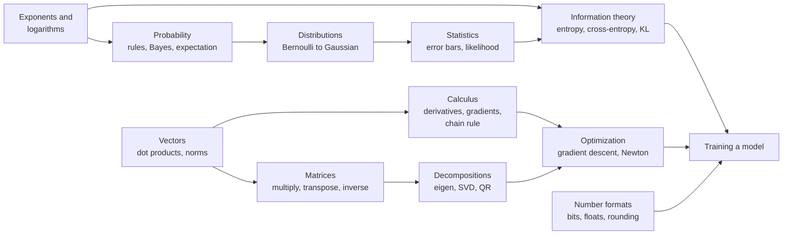
*Figure G.1: How the families of foundation equations feed one another. Training a model needs all of them: a loss from information theory, gradients from calculus, steps from optimization, and numbers stored in a format a chip can use.*

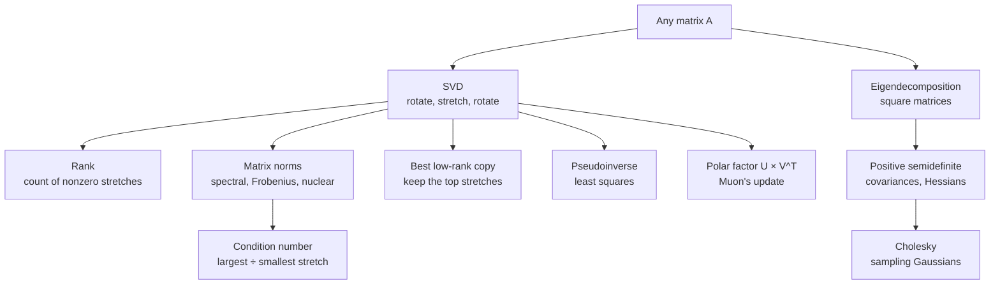
*Figure G.2: The matrix decompositions in this section and what each one is used for. The singular value decomposition sits at the center: rank, norms, low-rank compression, least squares and the Muon optimizer all read it off.*

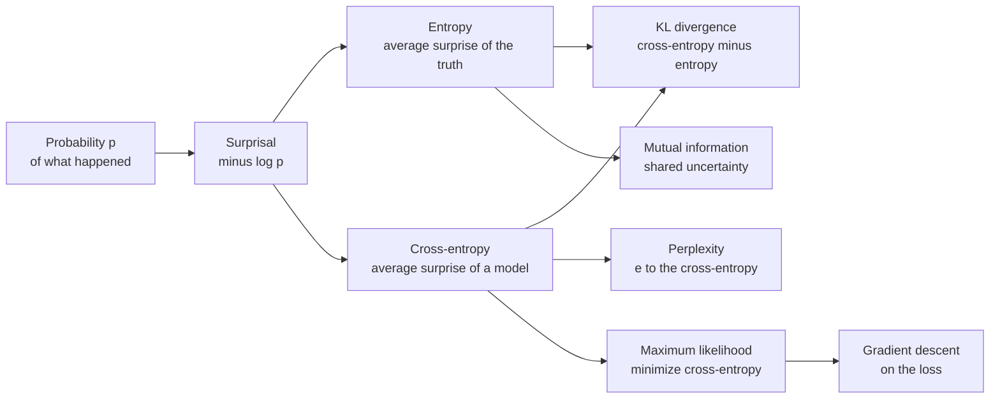
*Figure G.3: From probabilities to training losses. Surprisal is the building block; cross-entropy is the loss language models are trained on, and KL divergence is the gap between a model and the truth.*

### Exponent and logarithm rules

**What it does:** Turns repeated multiplication into counting, and multiplication into addition.

`a^m × a^n = a^(m + n)`, `(a^m)^n = a^(m × n)`, `a^(−n) = 1 ÷ a^n`

`ln(a × b) = ln(a) + ln(b)`, `ln(a ÷ b) = ln(a) − ln(b)`, `ln(a^k) = k × ln(a)`, `exp(ln(x)) = x`, `log2(x) = ln(x) ÷ ln(2)`

- **a, b, x**: positive numbers
- **m, n, k**: exponents (powers)
- **ln**: the natural logarithm, whose base is e ≈ 2.718
- **exp(x)**: e raised to the power x; exp and ln undo each other
- **log2**: the base-2 logarithm, which counts doublings

**In plain words:** An exponent counts how many times a number is multiplied by itself, and a logarithm runs that backward. Because logs turn products into sums, AI software adds log-probabilities instead of multiplying thousands of tiny probabilities that would round to zero.

**Tiny example:** 2^3 × 2^4 = 2^(3 + 4) = 2^7 = 128. ln(2 × 8) = ln(2) + ln(8) = 0.693 + 2.079 = 2.773, which is ln(16). log2(1,024) = 6.931 ÷ 0.693 = 10.

**Where it is used:** Log-probabilities in every training loss, likelihood and beam-search score; log-scale charts of compute, data and scaling laws.
**In the book:** Chapter 6 (Exponentials; Logarithms: Logs turn multiplying into adding); Appendix B (Growth, exponentials and logarithms).

### Growth rates and Big-O notation

**What it does:** Describes how fast a cost (time, memory, operations) grows as the input gets bigger, ignoring constant factors.

`f(n) = O(g(n))` means there are constants c and n_0 with `f(n) ≤ c × g(n)` for every `n ≥ n_0`

`O(1) < O(log n) < O(n) < O(n × log n) < O(n^2) < O(n^3) < O(2^n)` (slowest-growing to fastest-growing)

- **n**: the size of the input, such as the number of tokens in a context
- **f(n)**: the actual cost for an input of size n
- **g(n)**: a simple comparison function, such as n^2
- **c**: a fixed multiplier that is allowed to be large
- **n_0**: the size from which the bound must hold
- **O(...)**: read "order of" or "big O of"

**In plain words:** Big-O keeps only the part of a cost that dominates for large inputs. What matters is what happens when n doubles: an O(n) cost doubles, an O(n^2) cost quadruples, an O(n^3) cost grows eightfold, and an O(2^n) cost squares. Constant factors still matter in practice, but no constant can rescue a fast-growing cost at large enough n.

**Tiny example:** f(n) = 3 × n^2 + 100 × n is O(n^2): with c = 4 and n_0 = 100, 3 × n^2 + 100 × n ≤ 4 × n^2 whenever 100 × n ≤ n^2, that is, n ≥ 100. Doubling from 1,024 to 2,048 items multiplies an n × log2(n) cost by (2,048 × 11) ÷ (1,024 × 10) = 22,528 ÷ 10,240 = 2.2, and an n^2 cost by 4.

**Where it is used:** Comparing architectures: full attention costs O(n^2) in the context length n, while state-space models and linear attention cost O(n) (deep-learning section); the KV cache grows as O(n) per sequence (large-language-model section); multiplying two n × n matrices the schoolbook way is O(n^3) (Strassen's method is about O(n^2.81)); search trees grow as O(b^d) for branching factor b and depth d (classical-AI entries in the generative-models section).
**In the book:** Only here as notation (Chapter 15, The catch: attention costs grow with the square of length, and Chapter 5, Exercise 10 on the cubic cost of matrix multiplication, show the growth in words).

> **Definition — Big-O notation:** A way of describing how fast a cost grows with the size of the input while ignoring constant factors. O(n^2) means that, for large inputs, doubling n roughly quadruples the cost.

### Vector addition, scaling and linear combinations

**What it does:** Adds vectors entry by entry, stretches them by a number, and blends several of them into one.

`a + b = [a_1 + b_1, a_2 + b_2, ..., a_n + b_n]`

`k × a = [k × a_1, k × a_2, ..., k × a_n]`

`linear combination = c_1 × v_1 + c_2 × v_2 + ... + c_m × v_m`

- **a, b**: two vectors of the same length n
- **a_1 ... a_n**: the entries of a (and likewise for b)
- **k**: an ordinary number (a scalar)
- **v_1 ... v_m**: m vectors of the same length
- **c_1 ... c_m**: the weight given to each of those vectors

**In plain words:** Vectors add position by position, and multiplying by k scales every entry. A linear combination is a weighted sum of whole vectors. Subtraction is adding −1 times a vector, and the average of several vectors (their sum divided by their count) is their center point, the centroid.

**Tiny example:** [1, 2] + [3, 1] = [4, 3]. 2 × [1, 0] + 3 × [0, 1] = [2, 3]. The centroid of [1, 2], [3, 4] and [5, 0] is [(1 + 3 + 5) ÷ 3, (2 + 4 + 0) ÷ 3] = [3, 2].

**Where it is used:** Every layer's output is a linear combination of its weight columns; residual connections add vectors (x + f(x)); embedding arithmetic (king − man + woman); averaging token embeddings into one sentence vector; model merging and "task vectors" add and scale whole sets of weights.
**In the book:** Chapter 5 (Vector arithmetic; Embeddings); Chapter 17 (the mixture-of-experts blend 0.67 × Expert 3 + 0.33 × Expert 5); Appendix B (Add vectors; Scale a vector).

> **Definition — Linear combination:** A weighted sum of vectors, such as 2 × [1, 0] + 3 × [0, 1] = [2, 3]. Each output of a neural-network layer is a linear combination of the layer's weight columns.

### Dot product (inner product)

**What it does:** Turns two vectors into one number that measures how much they agree.

`a · b = sum over i of (a_i × b_i) = a_1 × b_1 + a_2 × b_2 + ... + a_n × b_n`

`a · b = ||a|| × ||b|| × cos(θ)`; Cauchy–Schwarz inequality `|a · b| ≤ ||a|| × ||b||`

- **a, b**: two vectors of length n
- **a_i, b_i**: their entries at position i
- **||a||, ||b||**: their lengths (next entry)
- **θ** (theta): the angle between the two vectors
- **cos(θ)**: the cosine of that angle: 1 for the same direction, 0 for perpendicular, −1 for opposite
- **|a · b|**: the size of the dot product, ignoring its sign

**In plain words:** Multiply matching entries and add. The second form says the same number is the two lengths times how well the directions line up, so the sign tells you whether the vectors point roughly the same way. Because a cosine is never bigger than 1 in size, a dot product can never exceed the product of the lengths (Cauchy–Schwarz), which is why cosine similarity always lands between −1 and 1. In matrix notation the dot product is written `a^T × b`.

**Tiny example:** [2, 1, 3] · [1.5, 4, 0.5] = 3 + 4 + 1.5 = 8.5, well under the Cauchy–Schwarz limit sqrt(14) × sqrt(18.5) ≈ 3.742 × 4.301 ≈ 16.09. Geometric check: [1, 0] · [1, 1] = 1, and ||[1, 0]|| × ||[1, 1]|| × cos(45°) = 1 × 1.414 × 0.7071 = 1.

**Where it is used:** Every artificial neuron (weights · inputs + bias); attention scores (query · key); retrieval scores between embeddings; output logits (final hidden state · each vocabulary row).
**In the book:** Chapter 5 (The dot product: Multiply matching entries, then add; What the sign of a dot product tells you); Appendix B (Dot product).

> **Definition — Cauchy–Schwarz inequality:** The rule that the dot product of two vectors is never larger in size than the product of their lengths, |a · b| ≤ ||a|| × ||b||, with equality only when they point along the same line.

### Vector norms and distances (L1, L2, L-infinity, Lp; Euclidean distance)

**What it does:** Measures the size of a vector, or the distance between two vectors, in several useful ways.

`||x||_2 = sqrt(sum over i of x_i^2)`, `||x||_1 = sum over i of |x_i|`, `||x||_inf = max over i of |x_i|`

`||x||_p = (sum over i of |x_i|^p)^(1 ÷ p)`, `d(a, b) = ||a − b||_2`

`||a − b||^2 = ||a||^2 + ||b||^2 − 2 × (a · b)`, and every norm obeys `||a + b|| ≤ ||a|| + ||b||`

- **x**: a vector with entries x_i
- **||x||**: "the norm of x", its size
- **|x_i|**: the absolute value of x_i (drop any minus sign)
- **||x||_2**: the ordinary length (L2 norm)
- **||x||_1**: the sum of absolute values (L1 norm, the taxicab or Manhattan size)
- **||x||_inf**: the largest single entry in size (L-infinity norm)
- **p**: any number 1 or larger, which picks a member of the family
- **d(a, b)**: the Euclidean distance between vectors a and b

**In plain words:** L2 is the length a ruler would measure; L1 adds the steps along each axis; L-infinity looks only at the biggest entry. The squared-distance identity lets a vector database turn distances into dot products, and the last rule (the triangle inequality) says a detour is never shorter. A distance rescaled by a covariance matrix, the Mahalanobis distance, is covered in the classical-machine-learning section.

**Tiny example:** For x = [3, −4]: L2 = sqrt(9 + 16) = 5, L1 = 3 + 4 = 7, L-infinity = 4. Identity check with a = [1, 2], b = [4, 6]: ||a − b||^2 = 9 + 16 = 25, and 5 + 52 − 2 × 16 = 25.

**Where it is used:** L2: gradient-norm clipping, weight decay, embedding normalization and RMSNorm (deep-learning section); L1: lasso and the sparsity penalty of sparse autoencoders; L-infinity: the size budget of adversarial attacks and the absolute-maximum scale used in quantization (large-language-model section); Euclidean distance: nearest-neighbor search and vector databases.
**In the book:** Chapter 5 (Length and distance); Chapter 13 (Vanishing and exploding gradients, gradient norm); Chapter 9 (L1 and L2 regularization); Appendix B (Length; Distance).

> **Definition — Norm (vector norm):** A rule that gives every vector a size: zero only for the all-zero vector, scaled by k when the vector is scaled by k, and obeying the triangle inequality. The L2 norm (ordinary length), the L1 norm (sum of absolute values) and the L-infinity norm (largest entry) are the common ones.

> **Definition — Triangle inequality:** The rule that the size of a sum is never more than the sum of the sizes, ||a + b|| ≤ ||a|| + ||b||; in distance terms, going from A to C directly is never longer than going through B. Every norm obeys it.

### Cosine similarity and unit normalization

**What it does:** Compares the directions of two vectors while ignoring their lengths.

`cos_sim(a, b) = (a · b) ÷ (||a|| × ||b||)`, `a_hat = a ÷ ||a||`, `cosine distance = 1 − cos_sim(a, b)`

- **a, b**: two vectors
- **a · b**: their dot product
- **||a||, ||b||**: their L2 lengths
- **cos_sim**: a number from −1 (opposite) through 0 (unrelated) to 1 (same direction)
- **a_hat**: a rescaled to length 1 (a unit vector)

**In plain words:** Divide the dot product by both lengths and only the angle is left, so stretching either vector changes nothing. After normalizing every vector to length 1, the dot product is the cosine. For unit vectors, ranking by largest cosine or by smallest distance gives the same order, which is why vector databases can use either; that identity, which follows from the squared-distance rule in the previous entry, is worked in the classical-machine-learning section.

**Tiny example:** a = [1, 2, 2] and b = [2, 0, 1]: a · b = 2 + 0 + 2 = 4, ||a|| = 3 and ||b|| = sqrt(5) ≈ 2.236, so cos_sim = 4 ÷ 6.708 ≈ 0.596, a cosine distance of 0.404. Doubling a to [2, 4, 4] doubles both the dot product (8) and the length (6), and 8 ÷ 13.416 is still 0.596. The unit vector a_hat is [0.333, 0.667, 0.667].

**Where it is used:** Semantic search and retrieval-augmented generation compare text embeddings by cosine (ranking metrics are in the classical-machine-learning section); CLIP-style models normalize image and text embeddings before the dot product; near-duplicate detection; interpretability compares feature directions by cosine.
**In the book:** Chapter 5 (Cosine similarity: Worked by hand); Chapter 14 (Dense embeddings: cat and dog, 0.994); Chapter 27 (Measuring closeness); Appendix B (Cosine similarity; Normalize).

> **Definition — Cosine distance:** One minus the cosine similarity of two vectors: 0 for vectors pointing the same way, 1 for perpendicular ones and 2 for opposite ones. It is a common way to turn "how similar" into "how far apart".

### Element-wise product (Hadamard product)

**What it does:** Multiplies two vectors or matrices position by position and keeps the shape.

`(a ⊙ b)_i = a_i × b_i`; for matrices `(A ⊙ B)[i, j] = A[i, j] × B[i, j]`

- **a, b**: two vectors of the same length
- **A, B**: two matrices of the same shape
- **⊙**: "element-wise times" (also written `*` in code)
- **i, j**: the row and column positions
- **[i, j]**: the entry in row i, column j

**In plain words:** Unlike the dot product, nothing is added up: each position is multiplied by its partner and stays where it is. Element-wise division, square roots and powers work the same way, which is how optimizers give every parameter its own step size.

**Tiny example:** [1, 2, 3] ⊙ [4, 0, 0.5] = [4, 0, 1.5]. As a gate: values [5, −2, 8] ⊙ gate [1, 0, 0.5] = [5, 0, 4], so the middle value is shut off and the last one halved.

**Where it is used:** The gates of LSTMs, GRUs and the SwiGLU and GeGLU feed-forward blocks of modern language models (deep-learning section); dropout masks and attention masks; the per-channel gain of LayerNorm and RMSNorm; Adam's per-parameter step size.
**In the book:** Chapter 5 (Vector arithmetic); Chapter 15 (Step 6: The feed-forward block, SwiGLU in words); Appendix B (Element-wise (Hadamard) product).

### Matrix multiplication (and the matrix-vector product)

**What it does:** Combines two matrices so that each entry of the result is a row of the first dotted with a column of the second.

`C[i, k] = sum over j of (A[i, j] × B[j, k])`; shapes `(m × n) times (n × p) gives (m × p)`

`y = W × x`, that is `y_i = sum over j of (W[i, j] × x_j)`

`(A × B) × C = A × (B × C)`, `A × (B + C) = A × B + A × C`, but in general `A × B ≠ B × A`

- **A, B, C**: matrices; A is m × n and B is n × p
- **C[i, k]**: the entry in row i, column k of the result
- **j**: the shared inner index that is summed over
- **W**: a weight matrix; **x**: an input vector; **y**: the output vector

**In plain words:** The inner sizes must match because each output entry is a dot product of length n. A matrix times a vector turns a length-n vector into a length-m vector, and stacking many input vectors as rows lets one product handle a whole batch. Grouping does not matter (associativity) but order does. Its cost, about 2 × m × n × p operations, is counted in the compute section.

**Tiny example:** Rows [1, 2], [3, 4] times rows [5, 6], [7, 8] give rows [19, 22], [43, 50]; swapping the order gives rows [23, 34], [31, 46].

**Where it is used:** Every dense layer; attention's Q × K^T and its weighted sum of V; an embedding lookup equals a one-hot vector times the embedding matrix; GPU tensor cores and TPU systolic arrays exist to do this one operation fast.
**In the book:** Chapter 5 (A matrix as a machine; Matrix multiplication: The rule: row times column; The shape rule; Order matters); Chapter 32 (What a neural network actually computes); Appendix B (Matrix times vector; Matrix times matrix).

### Transpose

**What it does:** Flips a matrix over its diagonal so that its rows become its columns.

`(A^T)[i, j] = A[j, i]`; `(A × B)^T = B^T × A^T`; `(A^T)^T = A`; `a · b = a^T × b`

- **A, B**: matrices; an m × n matrix A gives an n × m matrix A^T
- **A^T**: "A transposed"
- **[i, j]**: the entry in row i, column j
- **a, b**: vectors written as single columns

**In plain words:** Whatever sat in row j, column i moves to row i, column j. Transposing a product reverses the order of the factors. A matrix equal to its own transpose is called symmetric; covariance matrices and Hessians are.

**Tiny example:** Rows [1, 2, 3] and [4, 5, 6] (2 × 3) become rows [1, 4], [2, 5], [3, 6] (3 × 2). With A rows [1, 2], [3, 4] and B rows [5, 6], [7, 8]: (A × B)^T has rows [19, 43], [22, 50], and B^T × A^T gives the same, starting 5 × 1 + 7 × 2 = 19.

**Where it is used:** Attention's Q × K^T lines every query up against every key; backpropagation through y = W × x sends the gradient back as W^T × (gradient at y); models with tied embeddings use one matrix E for input and E^T for output.
**In the book:** Chapter 5 (Flipping a matrix: the transpose); Chapter 15 (Step 4: Self-attention); Chapter 17 (Linear attention and the delta rule); Appendix B (Transpose).

### Outer product (rank-one matrix)

**What it does:** Multiplies every entry of one vector by every entry of another to make a grid.

`(a ⊗ b)[i, j] = a_i × b_j`, also written `a × b^T`

- **a**: a vector of length m (treated as a column)
- **b**: a vector of length n (b^T is b laid on its side as a row)
- **⊗**: the outer product (the same symbol is also used for the Kronecker product later in this section; context tells which)
- **[i, j]**: the entry in row i, column j of the m × n result

**In plain words:** The result has rank 1 (see the rank entry below): every row is a multiple of b. Any matrix can be written as a sum of such column-times-row pieces, which the singular value decomposition makes exact.

**Tiny example:** Chapter 30's LoRA example: column [1, 2, 3] times row [1, 0, 2] gives rows [1, 0, 2], [2, 0, 4], [3, 0, 6], nine numbers from six.

**Where it is used:** A linear layer's weight gradient is an outer product, (gradient at y) × x^T, summed over the batch; linear-attention and delta-rule states add key-value outer products (deep-learning section); a LoRA update is a sum of r outer products (large-language-model section); rank-one model edits such as ROME (Meng et al. 2022).
**In the book:** Chapter 30 (LoRA: The idea in a 3 × 3 example); Chapter 17 (Linear attention and the delta rule).

### Tensor contraction (einsum and named-axis notation)

**What it does:** Gives one rule that covers dot products, matrix products, outer products, traces and batched products: multiply, then sum over every index that does not appear in the output.

`C[i, k] = sum over j of (A[i, j] × B[j, k])`, written `einsum("ij,jk->ik", A, B)`

`C[b, i, k] = sum over j of (A[b, i, j] × B[b, j, k])`, written `einsum("bij,bjk->bik", A, B)`

- **A, B**: the input tensors (a tensor is a stack of matrices with more than two indices)
- **i, j, k**: index letters naming each axis
- **b**: a batch index that is kept, not summed
- **"ij,jk->ik"**: the recipe: the letters before the arrow label each input's axes, the letters after it label the output's
- **C**: the result

**In plain words:** An index letter that appears in the inputs but not in the output is summed over; letters in the output are kept. So "i,i->" is a dot product, "i,j->ij" an outer product, "ij,jk->ik" matrix multiplication and "ii->" a trace.

**Tiny example:** einsum("ij,j->i") of rows [1, 2], [3, 4] with [5, 6] gives [1 × 5 + 2 × 6, 3 × 5 + 4 × 6] = [17, 39], the matrix-vector product. einsum("i,i->") of [1, 2] and [3, 4] gives 3 + 8 = 11.

**Where it is used:** torch.einsum and jnp.einsum express attention, multi-head projections and mixture-of-experts dispatch compactly; the "How to Scale Your Model" guide writes sharded matrix multiplications in a named-axis variant, such as A[I_X, J] × B[J, K], to reason about which axes are split across chips (communication costs are in the compute section).
**In the book:** Only here (tensor shapes in Chapter 5, Tensors: stacks of matrices).

> **Definition — Einsum (Einstein summation):** A compact notation, and a function in PyTorch and JAX, that describes a tensor operation by labeling each axis with a letter: letters that disappear from the output are summed over. "ij,jk->ik" is matrix multiplication.

### Block matrix multiplication (tiling and splitting across chips)

**What it does:** Shows that a big matrix product can be cut into smaller pieces, multiplied piece by piece and reassembled, which is how chips and clusters actually compute it.

`C[I, J] = sum over K of (A[I, K] × B[K, J])`, where I, J and K now number blocks (tiles) and each term is a small matrix product

`column split: X × [W_1, W_2] = [X × W_1, X × W_2]`; `row split: [X_1, X_2] × [[W_1], [W_2]] = X_1 × W_1 + X_2 × W_2`

- **A, B, C**: matrices cut into a grid of smaller blocks; **A[I, K]** is the block in block-row I and block-column K
- **X**: a batch of inputs, one row per token
- **W**: a weight matrix
- **[W_1, W_2]**: W cut into a left and a right block of columns
- **[[W_1], [W_2]]**: W cut into a top and a bottom block of rows, with **X_1, X_2** the matching left and right column blocks of X

**In plain words:** Matrix multiplication works on blocks exactly as it does on single numbers, so a product too big for a chip's fast memory is computed tile by tile, and a product too big for one chip is split across several. Cutting the output columns needs no adding up: each chip produces its own columns. Cutting the shared inner dimension leaves each chip with a partial result that must be added across chips (an all-reduce). Megatron-style tensor parallelism splits the first feed-forward matrix by columns and the second by rows, so the whole block needs only one all-reduce on the way forward.

**Tiny example:** x = [1, 2, 3, 4] times W with rows [1, 0], [0, 1], [1, 1], [2, 0] is [1 + 0 + 3 + 8, 0 + 2 + 3 + 0] = [12, 5]. Row split across two chips: chip 1 multiplies [1, 2] by the first two rows and gets [1, 2]; chip 2 multiplies [3, 4] by the last two rows and gets [11, 3]; adding gives [12, 5]. Tiling: two 4,096 × 4,096 matrices cut into 128 × 128 tiles give 32 × 32 = 1,024 output tiles, each the sum of 32 tile products.

**Where it is used:** Every GPU matrix-multiplication kernel (cuBLAS, CUTLASS, Triton) tiles its inputs so each tile fits in on-chip memory; FlashAttention processes queries, keys and values block by block (large-language-model section); TPU systolic arrays work through 128 × 128 or 256 × 256 tiles; Megatron-LM's tensor parallelism (Shoeybi et al. 2019) uses the column-then-row split, and its communication cost is in the compute section; the "How to Scale Your Model" guide derives its rules for sharded matrix multiplications from this identity.
**In the book:** Chapter 37 (Tensor parallelism: splitting each matrix, a column split worked by hand); Chapter 32 (Why this scales so well: matrices cut into 256 × 256 tiles). The block formula is only here.

> **Definition — Block matrix (tiling):** A matrix viewed as a grid of smaller matrices, called blocks or tiles. Matrices multiply block by block exactly as they multiply number by number, which lets software split a huge product into pieces that fit in a chip's memory or spread across many chips.

### Identity matrix and matrix inverse

**What it does:** Defines the matrix that changes nothing, and the matrix that undoes a given matrix.

`I × A = A × I = A`; `A × A^-1 = A^-1 × A = I`

`[[a, b], [c, d]]^-1 = (1 ÷ (a × d − b × c)) × [[d, −b], [−c, a]]`

`(A × B)^-1 = B^-1 × A^-1`; solving `A × x = b` gives `x = A^-1 × b`

- **I**: the identity matrix, 1s on the diagonal and 0s elsewhere
- **A**: a square matrix
- **A^-1**: the inverse of A
- **[[a, b], [c, d]]**: a 2 × 2 matrix written as a list of rows, with entries a, b, c, d
- **x, b**: vectors (in the last line, b is the known right-hand side and x the unknown)

**In plain words:** The inverse is to matrices what dividing is to numbers. It exists only when the determinant (next entry) is not zero; a matrix with no inverse is called singular. In practice software solves A × x = b directly, by factoring A, instead of forming A^-1.

**Tiny example:** A with rows [4, 7], [2, 6]: a × d − b × c = 24 − 14 = 10, so A^-1 = (1 ÷ 10) × rows [6, −7], [−2, 4] = rows [0.6, −0.7], [−0.2, 0.4]. Solving A × x = [1, 2]: x = [0.6 − 1.4, −0.2 + 0.8] = [−0.8, 0.6]; check 4 × (−0.8) + 7 × 0.6 = 1.

**Where it is used:** Closed-form linear and ridge regression (classical-machine-learning section); Gaussian posteriors and Kalman gains (generative-models and classical-AI section); second-order optimizers apply inverse or inverse-root preconditioners, Shampoo using inverse fourth roots (deep-learning section); GPTQ quantization uses an inverse Hessian (large-language-model section).
**In the book:** Appendix F (Matrix machinery: identity, inverse, determinant and friends); Chapter 5 (Matrices as transformations: the matrix that leaves [3, 2] unchanged).

> **Definition — Singular matrix:** A square matrix that has no inverse because it squashes space flat, so some different inputs land on the same output and cannot be told apart. Its determinant is zero.

### Determinant

**What it does:** Gives the factor by which a square matrix scales area (in 2-D) or volume (in more dimensions).

`det([[a, b], [c, d]]) = a × d − b × c`; `det(A × B) = det(A) × det(B)`; `det(A) = product over i of λ_i`; `det(A^-1) = 1 ÷ det(A)`

- **[[a, b], [c, d]]**: a 2 × 2 matrix as a list of rows
- **A, B**: square matrices of the same size
- **λ_i** (lambda): the eigenvalues of A (see the eigenvalue entry below)
- **product over i**: multiply together all the λ_i

**In plain words:** A negative determinant means the matrix also flips orientation, like a mirror; zero means it squashes space onto a line or plane and cannot be undone. Software usually works with ln(det(A)) to avoid overflow.

**Tiny example:** Rows [2, 0], [0, 3] stretch one way by 2 and the other by 3: det = 6, so a unit square becomes area 6. Rows [1, 2], [2, 4] have det 4 − 4 = 0: the second row is twice the first, so the plane collapses to a line. For Chapter 5's A and B, det(A) × det(B) = (−2) × (−2) = 4 = det(A × B).

**Where it is used:** The normalizing constant of the multivariate Gaussian; the log-determinant term of normalizing flows (generative-models and classical-AI section); testing whether a matrix can be inverted.
**In the book:** Appendix F (Matrix machinery: determinant definition).

### Trace

**What it does:** Adds up the diagonal of a square matrix.

`tr(A) = sum over i of A[i, i]`; `tr(A × B) = tr(B × A)`; `tr(A) = sum over i of λ_i`; `||A||_F^2 = tr(A^T × A)`

`tr(A) ≈ E[z^T × A × z]` for random z with independent entries of mean 0 and variance 1 (Hutchinson's estimator)

- **A, B**: matrices (A × B and B × A must both be square)
- **A[i, i]**: the i-th diagonal entry
- **λ_i**: the eigenvalues of A
- **||A||_F**: the Frobenius norm of A (see matrix norms below)
- **z**: a random vector, for example each entry +1 or −1 with equal chance
- **E[...]**: the average over many random draws (expected value)

**In plain words:** The trace equals the sum of the eigenvalues, and products can be rotated inside it, which simplifies many derivations. Hutchinson's trick gets a trace from matrix-vector products alone, so it works on matrices too big to write down.

**Tiny example:** Rows [2, 1], [1, 3]: trace 5, and the eigenvalues 3.618 + 1.382 = 5. For Chapter 5's A and B, tr(A × B) = 19 + 50 = 69 and tr(B × A) = 23 + 46 = 69. Hutchinson with z = [1, 1], [1, −1], [−1, 1], [−1, −1] gives 7, 3, 3, 7, averaging 5.

**Where it is used:** Matrix-calculus derivations of gradients; Hessian-trace estimates in curvature studies; continuous normalizing flows estimate a Jacobian trace with Hutchinson's trick (generative-models and classical-AI section); closed-form KL divergence between Gaussians.
**In the book:** Appendix F (Matrix machinery: Trace of a matrix).

> **Definition — Hutchinson's estimator:** A way to estimate the trace of a huge matrix without writing it down: multiply it by random plus-or-minus-one vectors z, compute z^T × A × z, and average. On average the answer equals the trace.

### Rank, linear independence and low-rank factorization

**What it does:** Counts how many genuinely different directions a matrix can produce, and stores a big matrix as two thin ones.

`rank(A) = number of linearly independent columns = number of nonzero singular values`

`rank(A × B) ≤ min(rank(A), rank(B))`; rank–nullity: `rank(A) + dim(null space of A) = n` for A with n columns

`W ≈ B × A`, with B of shape m × r and A of shape r × n: rank at most r, storing `r × (m + n)` numbers instead of `m × n`

- **A, B, W**: matrices
- **linearly independent**: no column can be built as a linear combination of the others
- **singular values**: the stretch factors from the SVD (below)
- **min**: the smaller of the two
- **null space of A**: every vector x with A × x = 0, the input directions A wipes out; **dim** counts how many independent directions it has
- **m, n**: the big matrix's rows and columns
- **r**: the chosen rank, usually small

**In plain words:** Rank is how many directions really carry information, and every input direction a matrix does not use lands in its null space. A low-rank factorization says "this big change is made of only r basic patterns", which is the bet behind LoRA.

**Tiny example:** Rows [1, 2], [2, 4] have rank 1: the second row is twice the first, and [2, −1] is in the null space (1 × 2 + 2 × (−1) = 0), so 1 + 1 = 2 columns. Chapter 20's numbers: a rank-8 change to a 4,096 × 4,096 matrix stores 8 × (4,096 + 4,096) = 65,536 numbers instead of 16,777,216, about 0.39%.

**Where it is used:** LoRA fine-tuning adds a rank-r product to frozen weights (large-language-model section); DeepSeek's multi-head latent attention passes keys and values through a low-rank latent; GaLore projects gradients to low rank to save optimizer memory (Zhao et al. 2024); low-rank compression of weights; AlphaEdit edits a fact in a language model by projecting the weight change onto the null space of the inputs that encode knowledge to be kept, so those outputs do not move (Fang et al., ICLR 2025).
**In the book:** Chapter 30 (LoRA: The idea in a 3 × 3 example; Rank definition); Chapter 20 (Fine-tuning for everyone); Appendix F (Span; Linear dependence).

> **Definition — Matrix rank:** The number of genuinely different directions a matrix's columns (or rows) point in, that is, how many of them are left once every column that can be built from the others is removed. A rank-1 matrix is one column times one row.

> **Definition — Null space:** All the input vectors that a matrix sends to zero. A change to the weights that only acts on directions in the null space of some inputs leaves the outputs for those inputs untouched.

### Orthogonal matrices, rotations and Euler's formula

**What it does:** Describes the matrices that turn or mirror vectors without stretching them.

`Q^T × Q = Q × Q^T = I`, so `Q^-1 = Q^T`, and `||Q × x|| = ||x||`

`R(θ) = [[cos θ, −sin θ], [sin θ, cos θ]]`; `R(α) × R(β) = R(α + β)`

`e^(i × θ) = cos θ + i × sin θ`

- **Q**: an orthogonal matrix: its columns have length 1 and are mutually perpendicular
- **I**: the identity matrix
- **x**: any vector
- **R(θ)**: the 2-D rotation by angle θ, written as two rows
- **α, β**: two angles
- **i**: the imaginary unit, the square root of −1
- **e^(i × θ)**: Euler's formula, a point on the unit circle at angle θ

**In plain words:** An orthogonal matrix keeps lengths and dot products unchanged, and its transpose undoes it. Rotations combine by adding angles. With complex numbers a rotation is just multiplication by e^(i × θ), which is how rotary position embeddings are often written.

**Tiny example:** R(30°) × [1, 0] = [0.866, 0.5], still length 1; R(30°) × [3, 4] still has length 5. R(30°) × R(60°) = R(90°), the quarter turn [[0, −1], [1, 0]] from Chapter 5. e^(i × 90°) = cos 90° + i × sin 90° = i.

**Where it is used:** RoPE rotates pairs of query and key entries by position-dependent angles so their dot product depends only on relative position (formula in the deep-learning section); orthogonal weight initialization (Saxe et al. 2014; PyTorch's orthogonal_ initializer); rotating weights and activations to spread outliers before 4-bit quantization (QuaRot and SpinQuant, 2024); Muon orthogonalizes its updates.
**In the book:** Chapter 5 (Matrices as transformations: the quarter turn); Chapter 15 (RoPE: rotating the arrows); Chapter 13 (Muon); Appendix F (Orthogonal matrix).

> **Definition — Complex number:** A number of the form a + b × i, where i is the square root of −1; it can be pictured as the point (a, b) on a flat plane. Multiplying by a complex number of length 1 rotates that point around the origin.

> **Definition — Euler's formula:** The identity e^(i × θ) = cos θ + i × sin θ, which ties exponentials to rotation: raising e to an imaginary power gives the point at angle θ on a circle of radius 1.

### Orthogonal projection, Gram–Schmidt and QR decomposition

**What it does:** Finds the closest point to a vector along a direction, removes a direction from a vector, and builds perpendicular unit vectors from any independent set.

`proj_a(b) = ((a · b) ÷ (a · a)) × a`; leftover `b − proj_a(b)`, which is perpendicular to a

`P = A × (A^T × A)^-1 × A^T`, with `P × P = P` (projection onto the columns of A)

`q_k = normalize(a_k − sum over j < k of ((q_j · a_k) × q_j))`; `A = Q × R`

- **a, b**: vectors; proj_a(b) is the shadow of b on the line through a
- **A**: a matrix whose columns a_1, a_2, ... span the space being projected onto
- **P**: the projection matrix; applying it twice changes nothing more
- **q_k**: the k-th perpendicular unit vector produced by Gram–Schmidt
- **normalize**: divide a vector by its length
- **Q**: the matrix whose columns are the q_k (orthonormal columns)
- **R**: an upper-triangular matrix (zeros below the diagonal) recording the dot products

**In plain words:** Projecting finds the part of b that points along a; subtracting it leaves the part with nothing in common with a. Gram–Schmidt repeats that subtraction to turn any independent vectors into perpendicular unit vectors, and QR stores the result as Q times R.

**Tiny example:** Project b = [2, 0] onto a = [1, 1]: (2 ÷ 2) × [1, 1] = [1, 1]; the leftover [1, −1] has dot product 0 with a. Gram–Schmidt on [3, 4] and [1, 0]: q_1 = [0.6, 0.8]; [1, 0] − 0.6 × [0.6, 0.8] = [0.64, −0.48], length 0.8, so q_2 = [0.8, −0.6], and R has rows [5, 0.6], [0, 0.8].

**Where it is used:** Least squares is a projection onto a column space; interpretability removes a concept direction from activations, as in directional ablation of a "refusal direction" (Arditi et al. 2024) and LEACE concept erasure (Belrose et al. 2023), covered in the alignment section; orthogonal initialization takes the Q of a random matrix; PCA projects data onto its top components.
**In the book:** Only here (PCA keeps "the first few" directions in words in Chapter 10).

> **Definition — Orthogonal projection:** The closest point to a vector along a given direction or inside a given subspace, found by dropping a perpendicular. What is left over is perpendicular to that direction.

> **Definition — Gram–Schmidt process:** A step-by-step recipe that turns a set of independent vectors into perpendicular vectors of length 1, by subtracting from each vector its projections onto the ones already made.

> **Definition — QR decomposition:** Writing a matrix as Q × R, where Q has perpendicular unit-length columns and R is upper triangular. It is the record of a Gram–Schmidt run and a stable way to solve least-squares problems.

### Eigenvalues, eigenvectors, eigendecomposition and spectral radius

**What it does:** Finds the directions a square matrix only stretches, and by how much.

`A × v = λ × v`; characteristic equation `det(A − λ × I) = 0`

`A = Q × Λ × Q^-1`; symmetric A: `A = Q × Λ × Q^T` with real λ; powers `A^t = Q × Λ^t × Q^-1`

`ρ(A) = max over i of |λ_i|`, and `A^t` shrinks to zero as t grows exactly when `ρ(A) < 1`

- **A**: a square matrix
- **v**: an eigenvector, a direction A does not turn
- **λ** (lambda): its eigenvalue, the stretch factor
- **I**: the identity matrix
- **Q**: the matrix with the eigenvectors as columns
- **Λ** (capital lambda): the diagonal matrix of eigenvalues
- **t**: a whole number of repeated multiplications
- **ρ(A)** (rho): the spectral radius, the largest eigenvalue in size

**In plain words:** Along an eigenvector, a matrix acts like plain multiplication by λ. Multiplying again and again grows the directions whose λ is bigger than 1 in size and kills those below 1, which is why the spectral radius decides whether repeated steps explode or fade.

**Tiny example:** Rows [2, 1], [1, 2]: A × [1, 1] = [3, 3] = 3 × [1, 1] and A × [1, −1] = [1, −1], so the eigenvalues are 3 and 1, and det(A − λ × I) = (2 − λ)^2 − 1 = 0 gives the same. A recurrent weight of 0.9 applied 50 times leaves 0.9^50 ≈ 0.005; a weight of 1.1 gives 1.1^50 ≈ 117.

**Where it is used:** PCA's directions are eigenvectors of the covariance matrix (classical-machine-learning section); the largest Hessian eigenvalue measures sharpness, which settles near 2 ÷ learning rate during training (Cohen et al., ICLR 2021); SOAP runs Adam in the eigenbasis of Shampoo's preconditioner (Vyas et al. 2024); exploding and vanishing gradients in recurrent networks and the stability of state-space models depend on the spectral radius; PageRank.
**In the book:** Chapter 10 (PCA, t-SNE and UMAP: Eigenvector definition); Appendix B (PCA directions and share kept).

> **Definition — Eigendecomposition:** Writing a square matrix as Q × Λ × Q^-1, where the columns of Q are its eigenvectors and Λ is a diagonal matrix of its eigenvalues, so the matrix acts as pure stretching once you look along those directions.

> **Definition — Spectral radius:** The largest absolute value among a square matrix's eigenvalues. If it is below 1, multiplying by the matrix over and over shrinks every vector toward zero; above 1, some vectors blow up.

### Singular value decomposition (SVD)

**What it does:** Writes any matrix, square or not, as a rotation, then a stretch along each axis, then another rotation.

`A = U × Σ × V^T = sum over i of (σ_i × u_i × v_i^T)`

`σ_1 ≥ σ_2 ≥ ... ≥ 0`, with `σ_i = sqrt(λ_i(A^T × A))`

- **A**: any m × n matrix
- **U**: an m × m orthogonal matrix with columns u_i (the output directions)
- **Σ** (capital sigma): an m × n matrix with the singular values on its diagonal and zeros elsewhere
- **V**: an n × n orthogonal matrix with columns v_i (the input directions)
- **σ_i** (sigma): the i-th singular value, a stretch factor, largest first
- **λ_i(A^T × A)**: the i-th eigenvalue of the matrix A^T × A

**In plain words:** Every matrix stretches some input directions more than others; the SVD names those directions and the stretches. The number of nonzero singular values is the rank, the largest one is the spectral norm, and the thin (economy) version keeps only min(m, n) columns.

**Tiny example:** A with rows [3, 0], [4, 5]: A^T × A has rows [25, 20], [20, 25] with eigenvalues 45 and 5, so σ_1 = sqrt(45) ≈ 6.708 and σ_2 = sqrt(5) ≈ 2.236 (their product, 15, is |det A|). The input directions are v_1 = [0.707, 0.707] and v_2 = [0.707, −0.707]; the output directions are u_1 = [0.316, 0.949] and u_2 = [0.949, −0.316].

**Where it is used:** Muon's update is the orthogonal factor U × V^T of the momentum matrix, every singular value set to 1 (deep-learning section); PiSSA initializes LoRA adapters from the top singular vectors; analysis of the effective rank of weights and updates; PCA is usually computed by SVD.
**In the book:** Chapter 10 (PCA, t-SNE and UMAP: SVD definition); Chapter 13 (Muon).

> **Definition — Singular value:** One of the stretch factors in a matrix's singular value decomposition: how much the matrix lengthens a vector along one of its special input directions. The largest singular value is the most the matrix can stretch any vector.

### Best low-rank approximation (Eckart–Young theorem)

**What it does:** Says that keeping the k largest pieces of the SVD gives the closest possible rank-k copy of a matrix, and exactly how close.

`A_k = sum over i = 1 to k of (σ_i × u_i × v_i^T)`

`||A − A_k||_F = sqrt(σ_(k+1)^2 + σ_(k+2)^2 + ...)`, `||A − A_k||_2 = σ_(k+1)`

`share of energy kept = (sum of the top k σ_i^2) ÷ (sum of all σ_i^2)`

- **A**: the original matrix
- **A_k**: its rank-k approximation
- **σ_i, u_i, v_i**: the singular values and directions from the SVD
- **k**: how many pieces are kept
- **||...||_F**: the Frobenius norm, the square root of the sum of all squared entries
- **||...||_2**: the spectral norm, the largest stretch

**In plain words:** Throw away the small singular values and the error is exactly what you threw away; no other rank-k matrix does better in either norm.

**Tiny example:** For A with rows [3, 0], [4, 5] (σ = 6.708, 2.236): A_1 = 6.708 × [0.316, 0.949] × [0.707, 0.707]^T, rows [1.5, 1.5], [4.5, 4.5]. The error has rows [1.5, −1.5], [−0.5, 0.5], whose Frobenius norm is sqrt(2.25 + 2.25 + 0.25 + 0.25) = 2.236 = σ_2. Energy kept: 45 ÷ 50 = 90%.

**Where it is used:** Justifies compressing weight matrices to low rank; truncated PCA; LoRA's working assumption that fine-tuning updates are close to low rank (large-language-model section); matrix-factorization recommenders (classical-machine-learning section).
**In the book:** Chapter 10 (PCA, t-SNE and UMAP: keeping the first few components).

> **Definition — Eckart–Young theorem:** The result that cutting a matrix's singular value decomposition down to its k largest singular values gives the closest possible rank-k matrix, with an error equal to the singular values that were dropped.

### Matrix norms (Frobenius, spectral, nuclear)

**What it does:** Measures the size of a whole matrix in three useful ways.

`||A||_F = sqrt(sum over i, j of A[i, j]^2) = sqrt(sum over i of σ_i^2)`

`||A||_2 = max over x ≠ 0 of (||A × x|| ÷ ||x||) = σ_1`, `||A||_* = sum over i of σ_i`

`||A × x|| ≤ ||A||_2 × ||x||`; `||A||_2 ≤ ||A||_F ≤ sqrt(rank(A)) × ||A||_2`

- **A**: a matrix with entries A[i, j]
- **σ_i**: its singular values, σ_1 the largest
- **||A||_F**: the Frobenius norm (the matrix treated as one long vector)
- **||A||_2**: the spectral (operator) norm, the most A can stretch any vector x
- **`||A||_*`**: the nuclear norm, the sum of all the stretches
- **x**: any nonzero vector

**In plain words:** Frobenius is the plain length of all the entries; spectral is the worst-case stretch; nuclear adds up all the stretches and acts as a smooth stand-in for rank.

**Tiny example:** A with rows [3, 0], [4, 5]: Frobenius sqrt(9 + 0 + 16 + 25) = sqrt(50) ≈ 7.071 = sqrt(45 + 5); spectral 6.708; nuclear 6.708 + 2.236 = 8.944. Check: 6.708 ≤ 7.071 ≤ sqrt(2) × 6.708 = 9.487.

**Where it is used:** Spectral normalization divides each GAN discriminator layer by its spectral norm (Miyato et al. 2018); Muon is steepest descent under the spectral norm (Bernstein and Newhouse 2024); Frobenius norms in weight decay, reconstruction errors and matrix distillation; nuclear-norm matrix completion.
**In the book:** Only here.

> **Definition — Spectral norm:** The largest factor by which a matrix can stretch any vector, equal to its largest singular value. A layer whose spectral norm is at most 1 can never make an input longer.

> **Definition — Nuclear norm:** The sum of a matrix's singular values. Making it small pushes a matrix toward low rank, so it serves as a smooth stand-in for "use few patterns".

### Condition number

**What it does:** Measures how lopsided a matrix's stretching is.

`κ(A) = ||A||_2 × ||A^-1||_2 = σ_max ÷ σ_min`; for a symmetric positive definite Hessian `κ = λ_max ÷ λ_min`

- **κ** (kappa): the condition number, 1 or more
- **A**: a square, invertible matrix
- **σ_max, σ_min**: its largest and smallest singular values
- **λ_max, λ_min**: the largest and smallest eigenvalues of a Hessian (the curvatures of a loss)

**In plain words:** A large κ means small errors in the input can become large errors in the output, and that gradient descent zig-zags down long narrow valleys: on a quadratic it needs on the order of κ steps for each constant-factor improvement.

**Tiny example:** A with rows [3, 0], [4, 5]: κ = 6.708 ÷ 2.236 = 3. A loss whose curvatures are 10 in one direction and 0.1 in another has κ = 100: a step size safe for the steep direction crawls along the flat one.

**Where it is used:** Explains why preconditioned optimizers (Adam, Shampoo, SOAP) and normalization layers speed up training (deep-learning section); numerical stability of solving systems in low precision; GPTQ adds a small damping term to its Hessian's diagonal before inverting it (large-language-model section).
**In the book:** Appendix F (Jacobians, Hessians and conditioning: Condition number).

### Positive semidefinite matrices, quadratic forms, Gram matrices and Cholesky factorization

**What it does:** Identifies the symmetric matrices that describe bowls rather than saddles, and gives them a square root.

`x^T × A × x = sum over i, j of (A[i, j] × x_i × x_j)` (a quadratic form)

`positive semidefinite (PSD): x^T × A × x ≥ 0 for every x`, equivalently every eigenvalue ≥ 0

`G = X × X^T`, with `G[i, j] = x_i · x_j`, is always PSD; Cholesky `A = L × L^T` for positive definite A

- **A**: a symmetric square matrix
- **x**: any vector, with entries x_i
- **G**: a Gram matrix of all pairwise dot products
- **X**: a matrix whose rows are the vectors x_1, x_2, ...
- **L**: a lower-triangular matrix (zeros above the diagonal)
- **positive definite**: the strict version, x^T × A × x > 0 for every nonzero x

**In plain words:** A quadratic form is a bowl- or saddle-shaped function of x, and PSD matrices give bowls with no downhill direction. Covariance matrices, Gram (kernel) matrices and the Hessians of convex functions are PSD. Cholesky is a fast, stable square root of a positive definite matrix, used for example to sample correlated Gaussian noise as x = μ + L × z.

**Tiny example:** A with rows [4, 2], [2, 3] and x = [1, −1]: 4 − 2 − 2 + 3 = 3 ≥ 0; its eigenvalues 5.56 and 1.44 are both positive. Cholesky: L with rows [2, 0], [1, 1.414] gives L × L^T = rows [4, 2], [2, 3]. Gram matrix of [1, 2] and [3, 0]: rows [5, 3], [3, 9].

**Where it is used:** Covariance matrices and Gaussian sampling; kernel methods and Gaussian processes (classical-machine-learning section); Shampoo's statistics G × G^T (deep-learning section); the second-order term of Taylor expansions; GPTQ uses a Cholesky factorization of the inverse Hessian for numerical stability (Frantar et al. 2023).
**In the book:** Only here (covariance and symmetric matrices in Appendix F).

> **Definition — Quadratic form:** A number computed from a vector x and a symmetric matrix A as x^T × A × x, the sum of every A[i, j] × x_i × x_j. Plotted against x it is a bowl, a dome or a saddle.

> **Definition — Positive semidefinite matrix (PSD):** A symmetric matrix A for which x^T × A × x is never negative, so all its eigenvalues are zero or positive. Covariance matrices are always positive semidefinite.

> **Definition — Cholesky factorization:** Writing a positive definite matrix as L × L^T with L lower triangular, a kind of matrix square root. It is the fast, stable way to solve such systems and to draw correlated random numbers.

### Graph Laplacian (adjacency, degree and smoothness on a graph)

**What it does:** Turns a network of connections into a matrix whose quadratic form measures how much a quantity jumps across connections, and whose eigenvectors reveal clusters.

`L = D − A`, with `D[i, i] = sum over j of A[i, j]` (zeros off the diagonal)

`x^T × L × x = sum over connected pairs (i, j) of A[i, j] × (x_i − x_j)^2`; normalized `L_sym = I − D^(−1 ÷ 2) × A × D^(−1 ÷ 2)`

- **A**: the adjacency matrix: A[i, j] is 1 (or a weight) when nodes i and j are connected, and 0 otherwise
- **D**: the degree matrix: each node's number (or total weight) of connections on the diagonal
- **L**: the graph Laplacian
- **x**: one number per node, such as a feature or a cluster score
- **D^(−1 ÷ 2)**: the diagonal matrix of 1 ÷ sqrt(degree); **I**: the identity matrix

**In plain words:** The quadratic form adds up the squared differences across every connection, so it is small when connected nodes have similar values. L is positive semidefinite, its smallest eigenvalue is 0 (every node equal), and it has one zero eigenvalue per separate piece of the graph. The eigenvectors with the next-smallest eigenvalues vary as smoothly as possible over the graph, which is how spectral methods find clusters.

**Tiny example:** A path of three nodes, 1–2–3: D is diag(1, 2, 1) and L has rows [1, −1, 0], [−1, 2, −1], [0, −1, 1]. For x = [1, 2, 4]: x^T × L × x = (1 − 2)^2 + (2 − 4)^2 = 1 + 4 = 5. L's eigenvalues are 0, 1 and 3; the eigenvector [1, 0, −1] for eigenvalue 1 puts node 1 and node 3 on opposite sides, splitting the path in the middle.

**Where it is used:** Spectral clustering (scikit-learn's SpectralClustering; Shi and Malik 2000, Ng, Jordan and Weiss 2001) groups points using the Laplacian's eigenvectors; UMAP's default starting layout is a spectral embedding of its neighbor graph; the graph convolutional network of Kipf and Welling (2017) comes from a simplified spectral filter on the normalized Laplacian, which is where its D^(−1 ÷ 2) × (A + I) × D^(−1 ÷ 2) form comes from (deep-learning section, with the adjacency and degree matrices defined there).
**In the book:** Only here (Chapter 17, Graph neural networks: when data is a web, not a line, and Chapter 10, Shrinking many columns into a few: UMAP, describe the methods in words).

> **Definition — Graph Laplacian:** The matrix L = D − A built from a graph's degree and adjacency matrices. Multiplied on both sides by a vector of node values, it adds up the squared differences across all connections, and its eigenvectors with small eigenvalues reveal the graph's clusters.

### Least-squares solution and the Moore–Penrose pseudoinverse

**What it does:** Finds the best approximate solution of a linear system that has no exact one.

`minimize ||A × x − b||^2`; normal equations `A^T × A × x = A^T × b`, so `x = (A^T × A)^-1 × A^T × b`

`x = A^+ × b` in general, with `A^+ = V × Σ^+ × U^T`; ridge variant `x = (A^T × A + λ × I)^-1 × A^T × b`

- **A**: an m × n matrix (often more rows than columns: more equations than unknowns)
- **x**: the unknown vector
- **b**: the target vector
- **A^+**: the pseudoinverse of A
- **U, Σ, V**: the SVD of A; **Σ^+** inverts each nonzero singular value and leaves zeros as zeros
- **λ**: the ridge penalty strength; **I**: the identity matrix

**In plain words:** When no x hits b exactly, least squares picks the x whose results miss by the smallest total squared amount. The pseudoinverse extends the inverse to non-square or singular matrices and returns the smallest such x. Linear regression is this formula applied to data.

**Tiny example:** Three measurements of one unknown disagree: x = 1, x = 2 and x = 6. As A × x = b, A is the column [1, 1, 1] and b = [1, 2, 6]; A^T × A = 3 and A^T × b = 9, so x = 9 ÷ 3 = 3, the average. The misses b − A × x = [−2, −1, 3] add to 0, so they are perpendicular to the column [1, 1, 1]: least squares is a projection. For the singular A with rows [1, 0], [0, 0] and b = [2, 3], A^+ has the same rows and gives x = [2, 0]: the second unknown has no effect, so the pseudoinverse picks the smallest choice, 0.

**Where it is used:** Linear and ridge regression, with the line of best fit for Appendix B's quiz data worked through the normal equations (classical-machine-learning section); linear probes and closed-form readouts on frozen features; closed-form model edits that rewrite one stored association with a rank-one update (ROME, Meng et al. 2022); layer-by-layer calibration solves in quantization and pruning.
**In the book:** Chapter 8 (Doing it in a spreadsheet: least squares); Appendix B (Line of best fit); Appendix F (Normal equations; Pseudoinverse).

> **Definition — Least squares:** Choosing the unknowns so that the sum of the squared misses between predictions and targets is as small as possible. It is the method behind the line of best fit and linear regression.

### Power iteration

**What it does:** Finds a matrix's top eigenvector (or top singular direction) using nothing but repeated multiplication.

`v_(k+1) = (A × v_k) ÷ ||A × v_k||`; `λ_max ≈ v_k^T × A × v_k` (symmetric A); `σ_1 ≈ ||A × v_k||` when iterating with `A^T × A`

- **A**: a square matrix (or A^T × A for singular values)
- **v_k**: the current guess after k steps, kept at length 1
- **λ_max**: the largest eigenvalue; **v_k^T × A × v_k** is called the Rayleigh quotient
- **σ_1**: the largest singular value

**In plain words:** Multiply a random vector by the matrix again and again, rescaling each time; the fastest-growing direction takes over. Because it needs only matrix-vector products, it works on matrices that are never written out, such as a Hessian reached through Hessian-vector products.

**Tiny example:** Rows [2, 1], [1, 2] starting from [1, 0]: after one step [0.894, 0.447] with estimate 2.8; then [0.781, 0.625] (2.976); then [0.733, 0.680] (2.997), closing in on the eigenvalue 3 and the direction [0.707, 0.707].

**Where it is used:** Spectral normalization runs one power-iteration step per training step to track each layer's largest singular value (Miyato et al. 2018); measuring sharpness, the top Hessian eigenvalue, in edge-of-stability studies; PageRank.
**In the book:** Only here.

> **Definition — Power iteration:** Finding a matrix's dominant direction by multiplying a starting vector by the matrix over and over and rescaling it each time, until it stops changing direction.

> **Definition — Rayleigh quotient:** For a symmetric matrix A and a vector v of length 1, the number v^T × A × v: the stretch A applies along v. It equals an eigenvalue exactly when v is the matching eigenvector, so it turns an approximate eigenvector into an eigenvalue estimate.

### Polar decomposition and Newton–Schulz orthogonalization

**What it does:** Splits a matrix into a pure rotation part and a pure stretch part, and finds the rotation part with matrix multiplications only.

`A = U_p × P`, with `U_p = U × V^T` (the nearest orthogonal matrix to A) and `P = V × Σ × V^T`

`X_(k+1) = 1.5 × X_k − 0.5 × X_k × X_k^T × X_k`, starting from `X_0 = A ÷ ||A||_F`, converges to `U × V^T`

- **A**: a matrix with SVD U × Σ × V^T
- **U_p**: the orthogonal (rotation) factor
- **P**: the symmetric stretch factor
- **X_k**: the k-th Newton–Schulz iterate
- **||A||_F**: the Frobenius norm, used to scale every singular value below 1 at the start

**In plain words:** Like writing a number as its sign times its size. Each Newton–Schulz step pushes every singular value toward 1 while leaving the singular directions alone (it converges for singular values between 0 and sqrt(3)), so the result is U × V^T without ever computing an SVD.

**Tiny example:** On one singular value s the step is s → 1.5 × s − 0.5 × s^3: 0.5 → 0.688 → 0.869 → 0.975 → 0.999. For Chapter 13's toy matrix with singular values 3 and 0.1, scaling by the Frobenius norm 3.002 gives 0.999 and 0.033; the small one needs about 12 cubic steps to reach 1, which is why Muon uses a tuned quintic polynomial and only about five steps.

**Where it is used:** Muon (Keller Jordan, December 2024) orthogonalizes each weight matrix's momentum with about five steps of a tuned quintic Newton–Schulz polynomial, whose coefficients are in the deep-learning section; Moonshot's MuonClip for Kimi K2 builds on it.
**In the book:** Chapter 13 (Optimizers: Muon: balance the whole matrix; Newton–Schulz iteration definition).

> **Definition — Polar decomposition:** Writing a matrix as an orthogonal (rotation) matrix times a symmetric stretch matrix, the matrix version of writing a number as its sign times its size. The rotation part is the closest orthogonal matrix to the original.

### Kronecker product

**What it does:** Builds a big block matrix in which every entry of one matrix multiplies the whole of another.

`A ⊗ B = [[A[1,1] × B, A[1,2] × B, ...], [A[2,1] × B, A[2,2] × B, ...], ...]`

`(A ⊗ B) × vec(X) = vec(B × X × A^T)`; `(A ⊗ B)^-1 = A^-1 ⊗ B^-1`

- **A**: an m × n matrix; **B**: a p × q matrix
- **A ⊗ B**: an (m × p) by (n × q) block matrix
- **A[1,1] × B**: the block made by scaling all of B by one entry of A
- **X**: a matrix, and **vec(X)** stacks its columns into one long vector

**In plain words:** The identities let a huge matrix that acts on a whole weight matrix be stored, applied and inverted as two small ones, never built in full.

**Tiny example:** A with rows [1, 2], [3, 4] and B with rows [0, 1], [1, 0] give the 4 × 4 matrix with rows [0, 1, 0, 2], [1, 0, 2, 0], [0, 3, 0, 4], [3, 0, 4, 0]. For a 1,000 × 1,000 weight matrix, a full curvature matrix would hold 10^12 numbers; two 1,000 × 1,000 Kronecker factors hold 2 million.

**Where it is used:** K-FAC approximates each layer's Fisher matrix as a Kronecker product of two small matrices (Martens and Grosse 2015); Shampoo preconditions each weight matrix with a left and a right factor, a Kronecker-factored approximation of full-matrix AdaGrad; a Distributed Shampoo submission won the external-tuning track of the AlgoPerf training-speed benchmark (MLCommons; analysis published February 2025).
**In the book:** Only here (Shampoo and SOAP in words in Chapter 13).

> **Definition — Kronecker product:** A way of combining two matrices into a much larger block matrix by multiplying every entry of the first by the whole second matrix. It lets optimizers such as Shampoo and K-FAC handle huge curvature matrices as two small factors.

### Sherman–Morrison and Woodbury identities (and the matrix determinant lemma)

**What it does:** Updates an inverse, or a determinant, cheaply when the matrix gets a low-rank change, instead of starting again from scratch.

`(A + u × v^T)^-1 = A^-1 − (A^-1 × u × v^T × A^-1) ÷ (1 + v^T × A^-1 × u)`

`(A + U × C × V)^-1 = A^-1 − A^-1 × U × (C^-1 + V × A^-1 × U)^-1 × V × A^-1`; `det(A + u × v^T) = (1 + v^T × A^-1 × u) × det(A)`

- **A**: an invertible n × n matrix whose inverse is already known
- **u, v**: vectors; u × v^T is a rank-one change
- **U, C, V**: matrices of compatible shapes making a rank-k change (here not the SVD factors); C is k × k
- **det**: the determinant

**In plain words:** A rank-one change costs a few matrix-vector products; a rank-k change costs only a k × k inverse. That is how online models update after each new data point. The determinant lemma does the same for the determinant: a rank-one change multiplies it by a single number.

**Tiny example:** A = I (2 × 2), u = v = [1, 1]: (I + u × v^T)^-1 = I − u × v^T ÷ (1 + 2), rows [0.667, −0.333], [−0.333, 0.667], which is exactly the inverse of rows [2, 1], [1, 2]. The determinant lemma gives det = (1 + 2) × 1 = 3, and directly 2 × 2 − 1 × 1 = 3.

**Where it is used:** Recursive least squares and online linear models; Gaussian-process and Kalman-filter updates (classical-machine-learning and generative-models sections); cheap inverse updates in influence-function and natural-gradient approximations; deriving closed-form rank-one model edits; planar normalizing flows get their log-determinant from the determinant lemma (Rezende and Mohamed 2015).
**In the book:** Only here.

> **Definition — Woodbury identity:** A formula for the inverse of a matrix after a low-rank change, written in terms of the old inverse and a small k × k inverse. Its rank-one special case is the Sherman–Morrison formula.

> **Definition — Matrix determinant lemma:** The rule det(A + u × v^T) = (1 + v^T × A^-1 × u) × det(A): after a rank-one change, the new determinant is the old one times a single easily computed number.

### Matrix exponential

**What it does:** Extends e^x to square matrices, turning a continuous-time rule for change into the exact jump over a time step.

`exp(A) = I + A + A^2 ÷ 2! + A^3 ÷ 3! + ... = sum over k ≥ 0 of (A^k ÷ k!)`

`exp(Q × Λ × Q^-1) = Q × exp(Λ) × Q^-1`; the solution of `dx/dt = A × x` is `x(t) = exp(t × A) × x(0)`

- **A**: a square matrix
- **I**: the identity matrix
- **k!**: k factorial, 1 × 2 × ... × k
- **Q, Λ**: A's eigenvectors and diagonal eigenvalue matrix; for a diagonal matrix, exp just exponentiates each diagonal entry
- **dx/dt**: how fast the vector x changes per unit of time
- **x(0), x(t)**: the state at time 0 and at time t

**In plain words:** If a state changes continuously at a rate set by A, exp(t × A) tells you exactly where it is after time t. The generator of rotation, rows [0, −1], [1, 0], exponentiates to a rotation matrix.

**Tiny example:** One variable with A = −1 and a step of 0.1: exp(−0.1) = 0.9048, and the series 1 − 0.1 + 0.005 − 0.000167 = 0.9048. With t × A = 0.5236 × rows [0, −1], [1, 0] (0.5236 radians is 30°), exp gives rows [0.866, −0.5], [0.5, 0.866], the 30° rotation.

**Where it is used:** Discretizing continuous-time state-space models such as S4 and Mamba (their zero-order-hold step is in the deep-learning section); rotations and rigid motions in robotics and 3-D vision; continuous-time Markov chains.
**In the book:** Only here (Chapter 17's state-space models show only the step-by-step recurrence).

> **Definition — Matrix exponential:** The matrix version of e^x, defined by the same never-ending sum I + A + A^2 ÷ 2! + .... It converts a rule for how fast a state changes into the exact change over a stretch of time.

### Walsh–Hadamard matrix and the fast Hadamard transform

**What it does:** Mixes every entry of a vector with every other one using only additions and subtractions, and is its own undo.

`H_1 = [1]`; `H_(2n) = (1 ÷ sqrt(2)) × [[H_n, H_n], [H_n, −H_n]]`; `H^T × H = I` and `H × H = I`

`cost of applying H to a length-n vector ≈ n × log2(n)` additions

- **H_n**: the n × n Hadamard matrix (n a power of 2), entries ±1 times a scale
- **[[H_n, H_n], [H_n, −H_n]]**: the doubling step, written as a 2 × 2 grid of blocks
- **I**: the identity matrix
- **n**: the vector length

**In plain words:** A Hadamard rotation spreads one large outlier evenly across all entries, so a shared quantization scale is no longer wrecked by it, and applying it again brings the original back.

**Tiny example:** H_4 = (1 ÷ 2) × rows [1, 1, 1, 1], [1, −1, 1, −1], [1, 1, −1, −1], [1, −1, −1, 1]. H_4 × [8, 0, 0, 0] = [4, 4, 4, 4]: the biggest entry drops from 8 to 4. Applying H_4 again gives [8, 0, 0, 0] back. For n = 4,096 the fast transform needs 4,096 × 12 = 49,152 additions, against about 16.8 million for a general matrix-vector product.

**Where it is used:** Rotating weights and activations before 4-bit quantization so outliers do not wreck a shared scale (QuaRot, SpinQuant; method in the large-language-model section); NVIDIA's NVFP4 pretraining recipe applies random Hadamard transforms to bound block-level outliers (arXiv 2509.25149, 2025).
**In the book:** Only here.

> **Definition — Fast Walsh–Hadamard transform:** A quick way, using only additions and subtractions, to multiply a vector by a Hadamard matrix, a square matrix of plus and minus ones that mixes every entry with every other. It costs about n × log2(n) steps instead of n^2.

### Johnson–Lindenstrauss lemma (random projections)

**What it does:** Guarantees that a random linear map into far fewer dimensions keeps every distance between many points nearly unchanged.

`(1 − ε) × ||u − v||^2 ≤ ||f(u) − f(v)||^2 ≤ (1 + ε) × ||u − v||^2` with high probability for every pair of the n points, provided `k ≥ 4 × ln(n) ÷ (ε^2 ÷ 2 − ε^3 ÷ 3)`

- **n**: the number of points
- **u, v**: any two of the points (vectors in a huge space)
- **f**: a random linear map, for example a matrix of random Gaussian numbers, suitably scaled
- **k**: the number of dimensions after the map
- **ε** (epsilon): the allowed relative distortion, such as 0.1 for 10%
- **ln**: the natural logarithm

**In plain words:** The dimension needed grows only with the logarithm of the number of points and does not depend on the original dimension at all. A corollary: a space of d dimensions holds exponentially many almost-perpendicular directions.

**Tiny example:** A million points with 10% distortion: k ≥ 4 × 13.8 ÷ (0.005 − 0.00033) ≈ 11,842 dimensions, whether the points started in 100,000 or 10 million dimensions. Allowing 20% cuts that to about 3,188.

**Where it is used:** Random projections and sketches for fast similarity search and locality-sensitive hashing (classical-machine-learning section); TRAK data attribution compresses per-example gradients with random projections (Park et al. 2023); the near-orthogonality argument behind superposition, how networks store more features than they have dimensions (alignment section).
**In the book:** Only here (Chapter 57's superposition notes that random high-dimensional arrows are nearly perpendicular).

> **Definition — Johnson–Lindenstrauss lemma:** A result guaranteeing that n points in any number of dimensions can be mapped by a random matrix into a number of dimensions on the order of ln(n) ÷ ε^2 while every pairwise squared distance changes by at most a factor of 1 ± ε.

> **Definition — Random projection:** Shrinking high-dimensional vectors to fewer dimensions by multiplying them by a random matrix. Thanks to the Johnson–Lindenstrauss lemma, distances between the vectors are roughly preserved.

### Discrete Fourier transform and the convolution theorem

**What it does:** Rewrites N samples of a signal as a sum of N waves of different frequencies, which turns convolution into element-wise multiplication.

`X_k = sum over n = 0 to N − 1 of (x_n × exp(−2 × π × i × k × n ÷ N))`

`x_n = (1 ÷ N) × sum over k of (X_k × exp(2 × π × i × k × n ÷ N))`

`DFT(x circularly convolved with y) = DFT(x) ⊙ DFT(y)`; the fast Fourier transform (FFT) costs about `N × log2(N)`

- **x_n**: the n-th of N samples of the signal
- **X_k**: a complex number giving the strength and phase of frequency k
- **i**: the square root of −1; **π**: 3.14159...
- **exp(2 × π × i × ...)**: a point turning around the unit circle (Euler's formula, above)
- **circular convolution**: sliding one signal along the other, wrapping around at the end
- **⊙**: element-wise multiplication

**In plain words:** The transform asks "how much of each frequency is in this signal?" by comparing it with waves of every frequency. Convolution in time becomes plain multiplication frequency by frequency, and the FFT makes the transform itself cheap.

**Tiny example:** x = [1, 0, −1, 0] is one wave per 4 samples: X = [0, 2, 0, 2], energy only at frequency 1 (and its mirror, frequency 3), and the inverse gives [1, 0, −1, 0] back. For N = 1,024 the FFT takes about 10,240 steps instead of about a million.

**Where it is used:** Spectrograms for speech and audio models (the short-time Fourier transform and mel scale are in the generative-models and classical-AI section); FFT-based long convolutions in Hyena-style models and Fourier token mixing in FNet (deep-learning section); frequency analysis of positional encodings; classic image processing.
**In the book:** Chapter 46 (Spectrograms: a picture of sound: Fourier transform definition); Appendix F (Fast convolution: FFT and Winograd).

> **Definition — Discrete Fourier transform (DFT):** The calculation that turns N evenly spaced samples of a signal into N numbers saying how strongly each frequency is present. The fast Fourier transform (FFT) computes it quickly.

> **Definition — Convolution theorem:** The fact that sliding one signal across another (convolution) becomes simple frequency-by-frequency multiplication after a Fourier transform, which makes long convolutions fast.

### Derivative (limit definition and finite differences)

**What it does:** Gives the slope of a function at a point: how much the output changes per tiny change in the input.

`f'(x) = lim as h → 0 of (f(x + h) − f(x)) ÷ h`

`forward difference: f'(x) ≈ (f(x + h) − f(x)) ÷ h`; `central difference: f'(x) ≈ (f(x + h) − f(x − h)) ÷ (2 × h)`

- **f**: a function of one number x
- **f'(x)**: "f prime of x", the derivative (slope) at x
- **h**: a small nudge to the input
- **lim as h → 0**: the value the ratio settles toward as h shrinks to zero

**In plain words:** Nudge the input, see how far the output moves, divide. The central difference nudges both ways and is much more accurate: its error shrinks like h^2 instead of h.

**Tiny example:** f(x) = x^3 at x = 2 (true slope 3 × 2^2 = 12), with h = 0.01: forward (8.1206 − 8) ÷ 0.01 = 12.06; central (8.1206 − 7.8806) ÷ 0.02 = 12.0001.

**Where it is used:** Gradient checking compares automatic-differentiation results against finite differences (for example torch.autograd.gradcheck); zeroth-order optimizers estimate gradients from forward passes alone (MeZO fine-tuning, Malladi et al. 2023).
**In the book:** Chapter 6 (Slopes and derivatives: Finding a slope by nudging); Chapter 12 (Checking backpropagation by nudging); Appendix B (Slope by nudging).

> **Definition — Central difference:** Estimating a slope by nudging the input both up and down by h and dividing the change in output by 2 × h. It is far more accurate than nudging in one direction only.

### Derivative rules

**What it does:** Gives the short table that, with the chain rule, differentiates any formula built from simple pieces.

`(c)' = 0`, `(x^n)' = n × x^(n − 1)`, `(e^x)' = e^x`, `(ln x)' = 1 ÷ x`

`(f + g)' = f' + g'`, `(c × f)' = c × f'`, `(f × g)' = f' × g + f × g'`, `(f ÷ g)' = (f' × g − f × g') ÷ g^2`

- **c**: a constant number
- **n**: a fixed power
- **f, g**: functions of x
- **'** (prime): "the derivative of"

**In plain words:** Constants have no slope; powers drop by one; e^x is its own slope; sums split; constants factor out. For a product, take turns differentiating each factor; for a quotient, use the last rule. The slopes of activation functions (ReLU, sigmoid, GELU) all follow and are listed in the deep-learning section.

**Tiny example:** Product rule for x^2 × (x + 1) at x = 2: f' × g + f × g' = (2 × 2) × 3 + 4 × 1 = 16; check by expanding to x^3 + x^2, whose slope 3 × 4 + 2 × 2 = 16. Quotient rule for x ÷ (x + 1) at x = 1: (1 × 2 − 1 × 1) ÷ 2^2 = 0.25.

**Where it is used:** Every automatic-differentiation library implements one backward rule per primitive operation, built from this table; hand-derived gradients in courses such as CS229 and CS231n.
**In the book:** Chapter 6 (Finding a slope by nudging: derivative table); Appendix B (Calculus and learning: derivative table).

### Partial derivative

**What it does:** Gives the slope of a many-input function along one input while the others are held still.

`∂f/∂x_i = lim as h → 0 of (f(x_1, ..., x_i + h, ..., x_n) − f(x_1, ..., x_n)) ÷ h`

- **f**: a function of n inputs x_1 to x_n
- **∂** (read "partial"): marks a slope along one input only
- **x_i**: the one input being nudged
- **h**: the nudge

**In plain words:** Turn one knob, freeze the rest, measure the slope. In training, every parameter gets one partial derivative of the loss: billions per step for a large model.

**Tiny example:** Chapter 6's loss (2 × w + b − 5)^2 at w = b = 1: ∂/∂w = 2 × (−2) × 2 = −8 and ∂/∂b = 2 × (−2) × 1 = −4. Nudging w by 0.001 changes the loss by about −0.008, a slope of −8.

**Where it is used:** Every training step of every neural network.
**In the book:** Chapter 6 (Gradients: One knob at a time); Appendix B (Partial derivative).

### Gradient and directional derivative

**What it does:** Collects all the partial derivatives into one vector that points uphill, and gives the slope in any chosen direction.

`∇f(x) = [∂f/∂x_1, ∂f/∂x_2, ..., ∂f/∂x_n]`

`D_u f(x) = ∇f(x) · u` for a unit vector u; steepest ascent along `∇f(x) ÷ ||∇f(x)||`

- **∇f(x)** (∇ is read "nabla" or "grad"): the gradient of f at the point x
- **u**: a direction, as a vector of length 1
- **D_u f(x)**: the slope of f when moving in direction u
- **||∇f(x)||**: the length of the gradient, which is the steepest slope available

**In plain words:** The slope in any direction is a dot product with the gradient, so the gradient points the way of fastest increase and minus the gradient the way of fastest decrease (when step size is measured by ordinary length; other choices are in the steepest-descent entry later in this section).

**Tiny example:** Gradient [−8, −4]: moving in direction [0.6, 0.8] gives slope −8 × 0.6 + (−4) × 0.8 = −8; moving along minus the gradient, [0.894, 0.447], gives the steepest slope, −sqrt(64 + 16) = −8.944.

**Where it is used:** Gradient descent and every optimizer; gradient norms watched for loss spikes and used for clipping (deep-learning section); input-gradient saliency and integrated-gradients attribution (alignment section); the fast gradient-sign adversarial attack moves an input along the sign of the gradient.
**In the book:** Chapter 6 (Gradients: The gradient points uphill); Chapter 12 (nine slopes form the complete gradient); Appendix B (Gradient).

> **Definition — Directional derivative:** The slope of a function when you move in one chosen direction, equal to the dot product of the gradient with that direction (as a vector of length 1).

### Chain rule (single-variable and multivariable)

**What it does:** Gives the slope through a chain of steps as the product of the steps' slopes, adding over every path.

`dy/dx = (dy/du) × (du/dx)`

`∂L/∂x_i = sum over j of ((∂L/∂u_j) × (∂u_j/∂x_i))`; vector form `∂L/∂x = J^T × ∂L/∂u`, with `J = ∂u/∂x`

- **x**: the input; **u** (with entries u_j): an intermediate result; **y** or **L**: the final output, such as a loss
- **dy/du, du/dx**: the slopes of each step
- **J**: the Jacobian, the table of every ∂u_j/∂x_i (next entry)
- **J^T**: its transpose

**In plain words:** Gears turning gears: if u moves 3 times as fast as x and y moves 6 times as fast as u, y moves 18 times as fast as x. When x reaches the output by several routes, add up the contribution of each route. Backpropagation (deep-learning section) is this rule applied layer by layer from the loss backward.

**Tiny example:** u = 3 × x and y = u^2 at x = 1: 6 × 3 = 18. Two paths: L = u_1 × u_2 with u_1 = 2 × x and u_2 = x^2, at x = 1: (∂L/∂u_1)(∂u_1/∂x) + (∂L/∂u_2)(∂u_2/∂x) = 1 × 2 + 2 × 2 = 6, matching L = 2 × x^3, whose slope at 1 is 6.

**Where it is used:** Backpropagation in every neural network; reverse-mode automatic differentiation in PyTorch, JAX and TensorFlow.
**In the book:** Chapter 6 (The chain rule: gears turning gears; Backpropagation); Chapter 12 (Backpropagation: the worked example); Appendix B (Chain rule).

### Jacobian matrix and Jacobian-vector products (forward and reverse mode)

**What it does:** Collects every partial derivative of a function with many inputs and many outputs, and gives the two cheap ways to use it without building it.

`J[i, j] = ∂f_i/∂x_j`, an m × n matrix for f with n inputs and m outputs

`forward mode: J × v` (a JVP); `reverse mode: v^T × J` (a VJP); `chain: J_(g of f)(x) = J_g(f(x)) × J_f(x)`

- **f**: a function from n inputs to m outputs; **f_i** is its i-th output
- **x_j**: its j-th input
- **J**: the Jacobian matrix, row i for output i and column j for input j
- **v**: a vector (a direction to push forward, or a gradient to pull back)
- **g of f**: the composition, g applied after f

**In plain words:** Automatic differentiation never builds J. Forward mode pushes one input direction through the computation; reverse mode pulls one output vector back through it; each costs a small multiple of one forward pass. With billions of inputs and one output (the loss), one reverse pass gives the whole gradient, which is why training uses reverse mode.

**Tiny example:** f(x_1, x_2) = [x_1 × x_2, x_1 + x_2] at (2, 3): J has rows [3, 2] and [1, 1]. JVP with v = [1, 0]: [3, 1], how both outputs move when x_1 is nudged. VJP with v = [1, 1]: [4, 3], the gradient of the sum of the outputs.

**Where it is used:** torch.func.jvp and vjp, jax.jvp and vjp; backpropagation is a chain of VJPs; JVPs appear in forward-mode tricks and in some consistency-model training (generative-models section); Jacobian regularization; the Jacobian determinant of normalizing flows.
**In the book:** Appendix F (Jacobians, Hessians and conditioning: Jacobian definition); Chapter 12 (Why backpropagation is such a big deal: reverse-mode differentiation).

> **Definition — Jacobian-vector product (JVP):** The product of a function's Jacobian with a direction vector, computed without building the Jacobian by pushing that direction forward through the calculation. It answers "how do all the outputs move if I nudge the inputs this way?".

> **Definition — Vector-Jacobian product (VJP):** The product of a row vector with a function's Jacobian, computed by pulling the vector backward through the calculation. Backpropagation is a chain of VJPs, starting from the loss.

### Hessian matrix and Hessian-vector products

**What it does:** Collects all second derivatives, which describe how the slope itself changes (curvature).

`H[i, j] = ∂^2 f ÷ (∂x_i × ∂x_j)` (symmetric, n × n)

`H × v = ∇(∇f(x) · v)` (Pearlmutter's trick, about two gradient evaluations); squared error of a linear layer on inputs X: `H = 2 × X × X^T`

- **f**: a function of n inputs (a loss)
- **H**: the Hessian matrix
- **∂^2 f ÷ (∂x_i × ∂x_j)**: the slope, along x_j, of the slope along x_i
- **v**: any vector
- **X**: a matrix of calibration inputs to a linear layer, one input vector per column

**In plain words:** If all of H's eigenvalues are positive the surface is a bowl; mixed signs mean a saddle. For billions of parameters H has too many entries to store, so methods only ever multiply it by vectors.

**Tiny example:** f(x, y) = x^2 + 3 × x × y + 5 × y^2: H has rows [2, 3] and [3, 10], eigenvalues 11 and 1, a bowl. H × [1, 0] = [2, 3]. For x^2 − y^2, H = rows [2, 0], [0, −2]: a saddle.

**Where it is used:** Sharpness and edge-of-stability analysis; second-order optimizers approximate it (Newton, Shampoo, K-FAC, Sophia's diagonal estimate); Optimal Brain Surgeon pruning and GPTQ quantization use the layer Hessian 2 × X × X^T (large-language-model section); influence functions; sharpness-aware minimization.
**In the book:** Appendix F (Jacobians, Hessians and conditioning; Newton's method: a 70-billion-parameter Hessian has about 4.9 × 10^21 entries); Chapter 13 (Beyond Adam, curvature in words).

> **Definition — Hessian-vector product:** The result of multiplying a function's matrix of second derivatives by a vector, computed for about the cost of two gradients without ever building the matrix. It lets methods probe the curvature of a loss with billions of parameters.

> **Definition — Sharpness (of a loss):** How steeply a loss curves around the current parameters in its most curved direction, usually measured as the largest eigenvalue of the Hessian. Sharp regions punish large learning rates; flat ones tolerate them.

### Matrix calculus identities

**What it does:** Gives shortcuts for differentiating expressions written in vectors and matrices directly.

`∂(a^T × x)/∂x = a`; `∂(x^T × A × x)/∂x = (A + A^T) × x` (= `2 × A × x` for symmetric A); `∂(||x||^2)/∂x = 2 × x`

`∂L/∂W = (∂L/∂y) × x^T` and `∂L/∂x = W^T × (∂L/∂y)`, for `y = W × x` and a loss L

`∂ tr(A × X)/∂X = A^T`; `∂ ln(det(X))/∂X = (X^-1)^T`

- **a, x**: vectors; **A, X**: matrices
- **W**: a layer's weight matrix; **y**: its output
- **∂L/∂y**: the gradient arriving from later layers
- **tr**: the trace; **det**: the determinant

**In plain words:** The gradient of one number with respect to a matrix has the same shape as the matrix. For a linear layer: the weight gradient is the incoming gradient times the input (an outer product), and the gradient passed back is the weight matrix transposed times the incoming gradient.

**Tiny example:** A with rows [2, 1], [1, 3] at x = [1, 1]: 2 × A × x = 2 × [3, 4] = [6, 8], which matches differentiating 2 × x_1^2 + 2 × x_1 × x_2 + 3 × x_2^2 by hand. Linear layer with ∂L/∂y = [1, −1], x = [2, 3], W rows [1, 2], [3, 4]: ∂L/∂W = rows [2, 3], [−2, −3], and ∂L/∂x = W^T × [1, −1] = [−2, −2].

**Where it is used:** Deriving backward passes for linear layers and attention; closed-form solutions such as least squares and Gaussian maximum likelihood; course derivations of backpropagation (CS229, CS231n).
**In the book:** Chapter 12 (Backpropagation: The worked example, slope for each weight = blame × its input; Exercise 10 code); Appendix B (MSE slopes for a line).

### Taylor approximation

**What it does:** Approximates any smooth function near a point by a line or a parabola.

`f(x + Δ) ≈ f(x) + f'(x) × Δ + (1 ÷ 2) × f''(x) × Δ^2`

`f(x) = sum over n ≥ 0 of (f^(n)(a) × (x − a)^n ÷ n!)`; many variables `f(x + Δ) ≈ f(x) + ∇f(x) · Δ + (1 ÷ 2) × Δ^T × H × Δ`

- **x**: the point you know; **Δ** (delta): a small change
- **f', f''**: the first and second derivatives
- **f^(n)(a)**: the n-th derivative at the point a; **n!**: n factorial
- **∇f(x)**: the gradient; **H**: the Hessian

**In plain words:** Zoom in close enough and every smooth curve looks like a straight line (first order) or a bowl (second order). Gradient descent minimizes the first-order picture plus a step penalty; Newton's method jumps to the bottom of the second-order bowl.

**Tiny example:** e^0.1 ≈ 1 + 0.1 + 0.005 = 1.105 (true value 1.10517); ln(1.05) ≈ 0.05 (true 0.0488). x^3 near 2 with Δ = 0.1: 8 + 12 × 0.1 + 0.5 × 12 × 0.01 = 9.26 (true 9.261).

**Where it is used:** Derives gradient descent and Newton's method; predicts the loss change from pruning or quantizing weights (Optimal Brain Surgeon, GPTQ); linearized networks and the neural tangent kernel; first-order Taylor importance scores for pruning.
**In the book:** Only here (the first-order idea is in Chapter 6, Finding a slope by nudging; the second-order idea in Appendix F, Newton's method).

> **Definition — Taylor approximation:** Approximating a smooth function near a point by a simple polynomial built from its derivatives there: a straight line from the first derivative, a parabola if the second is added.

### Integral and the fundamental theorem of calculus

**What it does:** Adds up the area under a curve, and links that area to derivatives.

`integral from a to b of f(x) dx ≈ sum over slices of (f(x_k) × Δx)`; trapezoidal rule `≈ sum over k of (x_(k+1) − x_k) × (f(x_k) + f(x_(k+1))) ÷ 2`

`integral from a to b of f(x) dx = F(b) − F(a)` whenever `F'(x) = f(x)`; `integral from −∞ to ∞ of exp(−x^2 ÷ 2) dx = sqrt(2 × π)`

- **f**: the curve's height at x
- **a, b**: where the area starts and ends
- **Δx**: the width of each thin slice; **x_k**: a point in slice k (in the trapezoidal rule, the slice edges)
- **F**: any function whose slope is f (an antiderivative)
- **∞**: infinity

**In plain words:** Slice the area into thin strips and add them; thinner strips give the exact area. The trapezoidal rule joins neighboring points with straight lines, which is all you can do when the curve is known only at a list of points. Integration and differentiation undo each other. The last formula, the Gaussian integral, is why sqrt(2 × π) appears in the bell curve's formula.

**Tiny example:** Area under x^2 from 0 to 1: four slices at midpoints 0.125, 0.375, 0.625, 0.875 give (0.0156 + 0.1406 + 0.3906 + 0.7656) × 0.25 = 0.328; four trapezoids on the edges 0, 0.25, 0.5, 0.75, 1 give 0.25 × (0 ÷ 2 + 0.0625 + 0.25 + 0.5625 + 1 ÷ 2) = 0.344; the exact answer, from F(x) = x^3 ÷ 3, is 1 ÷ 3 = 0.333. sqrt(2 × π) = 2.507.

**Where it is used:** Continuous probabilities and expectations (the probability entries below); AUC is the area under a ROC curve (classical-machine-learning section), and scikit-learn's auc function computes such areas with the trapezoidal rule; diffusion and flow-matching samplers integrate an equation over time (generative-models section); integrated-gradients attribution averages gradients along a path.
**In the book:** Chapter 6 (The normal distribution: Smooth quantities: densities and areas; Integral definition).

> **Definition — Fundamental theorem of calculus:** The fact that integrating and differentiating undo each other: the area under f from a to b equals F(b) − F(a) for any function F whose slope is f.

> **Definition — Trapezoidal rule:** Estimating the area under a curve known only at a list of points by joining neighboring points with straight lines and adding up the areas of the resulting trapezoids.

### Log-sum-exp and the max-subtraction trick

**What it does:** Computes a smooth version of the maximum without overflowing.

`LSE(x) = ln(sum over i of exp(x_i)) = m + ln(sum over i of exp(x_i − m))`, with `m = max over i of x_i`

`max(x) ≤ LSE(x) ≤ max(x) + ln(n)`; `∂LSE/∂x_i = exp(x_i) ÷ sum over j of exp(x_j)` (the softmax)

- **x**: a list of n scores x_1 to x_n
- **m**: the largest score
- **exp, ln**: e to a power, and the natural log
- **∂LSE/∂x_i**: the slope of LSE with respect to score i

**In plain words:** Subtracting the largest score first gives exactly the same answer but keeps every exp() at 1 or below, so nothing overflows (in FP32, exp(89) already exceeds the largest number, about 3.4 × 10^38). Its gradient is the softmax (deep-learning section).

**Tiny example:** Scores [1,000, 999, 998]: exp(1,000) overflows, but 1,000 + ln(1 + e^−1 + e^−2) = 1,000 + ln(1.503) = 1,000.408, between the bounds 1,000 and 1,000 + ln(3) = 1,001.099. Its gradient is the softmax [0.665, 0.245, 0.090].

**Where it is used:** Numerically stable softmax and cross-entropy in every framework; the running maximum and running sum of the online softmax inside FlashAttention (large-language-model section); log-likelihoods of mixtures; the log-normalizer of exponential families; PaLM's z-loss penalizes the square of the output LSE to keep logits from drifting.
**In the book:** Chapter 15 (Step D: softmax, subtract the largest score first); Chapter 6 (Worked with three numbers); Appendix B (Shift makes no difference).

### Geometric and arithmetic series

**What it does:** Adds up a quantity that shrinks by a fixed factor each step, or one that grows by a fixed amount each step.

`sum over k = 0 to n − 1 of r^k = (1 − r^n) ÷ (1 − r)`; for `|r| < 1`: `sum over k ≥ 0 of r^k = 1 ÷ (1 − r)`

`sum over k ≥ 0 of (k × r^k) = r ÷ (1 − r)^2`; arithmetic series `1 + 2 + ... + n = n × (n + 1) ÷ 2`

- **r**: the factor applied each step
- **n**: the number of terms
- **k**: the step number, starting at 0
- **|r|**: the size of r, ignoring its sign

**In plain words:** When each term is a fixed fraction of the one before, the never-ending sum is finite, and 1 ÷ (1 − r) acts as an "effective number of terms". When each term is one more than the last, the sum is about half of n^2, the area of a triangle.

**Tiny example:** r = 0.9: four terms give (1 − 0.6561) ÷ 0.1 = 3.439 (Chapter 13's momentum climbing 1, 1.9, 2.71, 3.44), and forever gives 1 ÷ 0.1 = 10. Adam's β2 = 0.999 averages over about 1 ÷ 0.001 = 1,000 steps. With a causal mask, 1,000 tokens make 1 + 2 + ... + 1,000 = 1,000 × 1,001 ÷ 2 = 500,500 query-key scores, about half of the full 1,000,000.

**Where it is used:** The memory of an exponential moving average with decay β spans about 1 ÷ (1 − β) steps (deep-learning section); discounted returns in reinforcement learning; the expected number of tokens per step in speculative decoding (large-language-model section); the arithmetic series counts the scores of causal (masked) attention and the total KV-cache reads over a generation.
**In the book:** Chapter 13 (Momentum: a rolling ball; Check your understanding 2); Chapter 48 (Discount factor).

> **Definition — Geometric series:** A sum in which each term is the previous one times the same factor r, such as 1 + 0.9 + 0.81 + .... When r is between −1 and 1 the endless sum equals 1 ÷ (1 − r).

> **Definition — Arithmetic series:** A sum in which each term is the previous one plus the same amount, such as 1 + 2 + 3 + ... + n, which equals n × (n + 1) ÷ 2.

### Euler's method for differential equations (and gradient flow)

**What it does:** Follows a rule for how fast something changes by taking small straight steps.

`Euler step: x_(t + h) = x_t + h × f(x_t, t)`, for `dx/dt = f(x, t)`

`Heun step: x_(t + h) = x_t + (h ÷ 2) × (f(x_t, t) + f(x_t + h × f(x_t, t), t + h))`; `gradient flow: dθ/dt = −∇L(θ)`

- **x_t**: the state at time t
- **dx/dt = f(x, t)**: an ordinary differential equation, a rule giving the rate of change
- **h**: the step size in time
- **θ**: parameters; **∇L(θ)**: the gradient of the loss

**In plain words:** Look at the current direction, take a straight step, repeat. Smaller steps are more accurate; Heun (a second-order method) takes a trial step, looks at the slope there too, and averages, for much less error per step. One Euler step of gradient flow is exactly a gradient descent step with learning rate h.

**Tiny example:** dx/dt = −x from x = 1, with h = 0.5 (true answer e^−0.5 = 0.607): Euler gives 1 − 0.5 = 0.5; Heun's trial step lands at 0.5 with slope −0.5, so it averages the slopes −1 and −0.5 to −0.75 and gives 1 − 0.375 = 0.625.

**Where it is used:** Sampling from diffusion and flow-matching models integrates an ordinary differential equation with Euler or Heun steps (the EDM sampler of Karras et al. 2022 uses Heun; samplers are in the generative-models section); neural ODEs; physics simulators for robots; gradient descent seen as Euler steps on gradient flow.
**In the book:** Chapter 16 (Flow matching and rectified flow: one step of size 0.5; Samplers and step counts).

> **Definition — Ordinary differential equation (ODE):** A rule that says how fast a quantity changes given its current value, such as dx/dt = −x. Solving it means finding the path the quantity follows over time.

> **Definition — Gradient flow:** The idealized path parameters would follow if gradient descent took infinitely small steps, always moving straight downhill on the loss. Ordinary gradient descent is one Euler step of it at a time.

### Linear and spherical interpolation (lerp and slerp)

**What it does:** Walks between two points, either in a straight line or along a circular arc.

`lerp(a, b, t) = (1 − t) × a + t × b`, for t from 0 to 1

`slerp(a, b, t) = (sin((1 − t) × Ω) ÷ sin(Ω)) × a + (sin(t × Ω) ÷ sin(Ω)) × b`, with `cos(Ω) = (a · b) ÷ (||a|| × ||b||)`

- **a, b**: the two endpoints (vectors)
- **t**: how far along, from 0 (at a) to 1 (at b)
- **Ω** (omega): the angle between a and b
- **sin, cos**: the sine and cosine

**In plain words:** lerp cuts straight across; slerp follows the arc at constant speed, so vectors of length 1 stay length 1 all the way, which matters when direction carries the meaning.

**Tiny example:** lerp([0, 0], [4, 2], 0.25) = [1, 0.5]. Between [1, 0] and [0, 1] (Ω = 90°) at t = 0.5, slerp gives 0.707 × [1, 0] + 0.707 × [0, 1] = [0.707, 0.707], length 1, while lerp gives [0.5, 0.5], length 0.707.

**Where it is used:** Model merging by interpolating weights (weight averaging and model soups; SLERP merges in tools such as mergekit); straight-line noise-to-data paths in flow matching and rectified flow (generative-models section); latent-space interpolation in image generators; an exponential moving average of weights is a repeated lerp.
**In the book:** Chapter 16 (Flow matching and rectified flow: x(t) = (1 − t) × noise + t × data); Chapter 20 (Model merging: weight soup).

> **Definition — Spherical linear interpolation (slerp):** Moving between two vectors along the arc of a circle rather than the straight chord, at constant angular speed, so that unit-length vectors stay unit length along the way.

### Basic rules of probability

**What it does:** States the rules every probability obeys.

`0 ≤ P(A) ≤ 1`; `sum over all outcomes x of P(x) = 1`; `P(not A) = 1 − P(A)`

`P(A or B) = P(A) + P(B) − P(A and B)`; equally likely outcomes `P(A) = favorable ÷ total`

- **A, B**: events (things that can happen)
- **P(A)**: the probability of A
- **x**: one possible outcome
- **favorable, total**: counts of outcomes where A happens, and of all equally likely outcomes

**In plain words:** Probabilities run from 0 (impossible) to 1 (certain), a full distribution adds to 1, "not" is one minus, and "or" adds but subtracts the overlap so it is not counted twice (zero overlap for events that cannot happen together).

**Tiny example:** A heart or a king from a 52-card deck: 13/52 + 4/52 − 1/52 = 16/52 ≈ 0.31. Not rolling a 6: 1 − 1/6 = 5/6.

**Where it is used:** Every output distribution of a classifier or language model must add to 1; the complement trick for "at least one" success or failure.
**In the book:** Chapter 6 (Probability: Counting outcomes; The three rules you need); Appendix B (Probability).

### Conditional, joint and marginal probability (product rule)

**What it does:** Narrows the world to the cases where something is known, and relates two-variable probabilities to one-variable ones.

`P(A given B) = P(A and B) ÷ P(B)`; product rule `P(A and B) = P(A given B) × P(B)`

`marginal: P(A) = sum over b of P(A and B = b)`

- **P(A given B)**: the probability of A when B is known to be true (often written with a vertical bar)
- **P(A and B)**: the joint probability, both together
- **b**: each possible value of the variable B
- **P(A)** in the last line: the marginal probability, with B added away

**In plain words:** Conditioning keeps only the cases where B holds and asks how often A holds among them. A marginal probability is a row or column total of a table of joint probabilities.

**Tiny example:** Chapter 6's emails: P(spam and "free") = 0.20 and P("free") = 0.25, so P(spam given "free") = 0.20 ÷ 0.25 = 0.8; back again with the product rule, 0.8 × 0.25 = 0.20.

**Where it is used:** Every language model outputs P(next token given everything so far); classifiers output P(class given input); conditional image and audio generation.
**In the book:** Chapter 6 (Random variables, joint tables and marginals; Conditional probability: Narrowing the room); Appendix B (Conditional probability).

### Chain rule of probability

**What it does:** Builds the probability of a whole sequence one piece at a time.

`P(x_1, x_2, ..., x_n) = P(x_1) × P(x_2 given x_1) × ... = product over t of P(x_t given x_1, ..., x_(t − 1))`

`ln P(x_1, ..., x_n) = sum over t of ln P(x_t given x_1, ..., x_(t − 1))`

- **x_1 ... x_n**: the items of a sequence, such as tokens
- **t**: the position in the sequence
- **product over t**: multiply the terms for every position
- **ln**: the natural logarithm, which turns the product into a sum

**In plain words:** Any joint probability equals the probability of the first item, times the second given the first, and so on. It is exact, for any ordering, with no assumptions, which is why "predict the next token" is enough to define a full probability for any text.

**Tiny example:** Three cards dealt from a 52-card deck all being hearts: 13/52 × 12/51 × 11/50 = 0.25 × 0.2353 × 0.22 = 0.0129, each factor conditioned on the cards already dealt. In logs: −1.386 − 1.447 − 1.514 = −4.347 = ln(0.0129). (Chapter 6's sentence, 0.05 × 0.01 × 0.2 = 0.0001, is worked token by token in the large-language-model section.)

**Where it is used:** The foundation of autoregressive language models (their factorization, likelihood and loss are in the large-language-model section); autoregressive image and audio token models; Bayesian networks factor it using independence (generative-models and classical-AI section).
**In the book:** Chapter 6 (Chaining probabilities for a whole sentence; A language model you can build by counting); Appendix B (Sentence probability; Log-probability).

### Independence and conditional independence

**What it does:** Says when probabilities can simply be multiplied.

`P(A and B) = P(A) × P(B)` (equivalently `P(A given B) = P(A)`)

`P(A and B given C) = P(A given C) × P(B given C)`; at least one success in k independent tries `1 − (1 − p)^k`

- **A, B, C**: events
- **p**: the chance that a single try succeeds
- **k**: the number of tries

**In plain words:** Independent events carry no information about each other. Conditional independence means they become independent once C is known. "At least one" is easiest as one minus the chance that every try fails.

**Tiny example:** Two heads: 0.5 × 0.5 = 0.25. Chapter 47's image keepers: if 1 in 5 generations is good, at least one good one in 4 tries is 1 − 0.8^4 = 0.59.

**Where it is used:** The i.i.d. assumption behind training data, minibatches and eval error bars; naive Bayes (classical-machine-learning section) and Bayesian networks; best-of-k intuition (exact pass@k estimators are in the classical-machine-learning and large-language-model sections); reliability of systems built from many parts (compute section).
**In the book:** Chapter 6 (The three rules you need; Independence definition); Chapter 47 (Seeds, randomness and iteration); Chapter 54 (Conditional independence); Appendix B (And, for independent events).

> **Definition — i.i.d. (independent and identically distributed):** Describes data points that are each drawn from the same distribution without influencing one another, like repeated fair coin flips. Most of the statistics used to train and evaluate models assumes it.

### Law of total probability, marginalization and mixtures

**What it does:** Adds up every route to an outcome, each weighted by how likely that route is.

`P(B) = sum over i of P(B given A_i) × P(A_i)`, for cases A_1, A_2, ... that cover everything without overlap

`continuous: p(x) = integral of p(x given z) × p(z) dz`; `mixture: p(x) = sum over k of π_k × p_k(x)`, with `sum over k of π_k = 1`

- **A_i**: one of the cases
- **z**: a hidden (latent) variable, added away by the integral
- **p(...)**: a probability or a density
- **π_k**: the weight of mixture component k (a weight, not 3.14)
- **p_k(x)**: component k's own distribution

**In plain words:** To find the chance of B, consider each way B can come about. A mixture first picks a component with probability π_k and then draws from it; latent-variable models integrate out the hidden choice the same way.

**Tiny example:** A positive test: 0.9 × 0.01 + 0.09 × 0.99 = 0.0981. A mixture of two coins, picked 70% and 30% of the time, with heads chances 0.5 and 0.9: P(heads) = 0.7 × 0.5 + 0.3 × 0.9 = 0.62.

**Where it is used:** The denominator of Bayes' rule; Gaussian mixture models (classical-machine-learning section); VAEs and diffusion models (generative-models section); mixture-of-experts outputs as weighted sums (deep-learning section); pretraining data mixtures.
**In the book:** Chapter 6 (Bayes' rule: The rule itself); Chapter 54 (A Bayesian network, worked by hand); Appendix B (Total probability).

> **Definition — Mixture distribution:** A distribution made by first choosing one of several component distributions at random, with fixed weights, and then drawing from the chosen one. A Gaussian mixture is a blend of several bell curves.

### Bayes' rule

**What it does:** Turns the probability of the evidence given a hypothesis into the probability of the hypothesis given the evidence.

`P(A given B) = P(B given A) × P(A) ÷ P(B)`

`p(θ given D) ∝ p(D given θ) × p(θ)` (posterior ∝ likelihood × prior)

`posterior odds = prior odds × P(B given A) ÷ P(B given not A)`, where `odds = P ÷ (1 − P)`

- **A**: a hypothesis; **B**: the evidence
- **P(A)**: the prior, belief before the evidence
- **P(A given B)**: the posterior, belief after it
- **θ**: model parameters; **D**: data
- **∝**: "proportional to", equal up to a constant that makes everything add to 1
- **odds**: the chance something happens divided by the chance it does not

**In plain words:** Weigh how well each hypothesis explains the evidence by how plausible it was to begin with. In odds form, each piece of evidence multiplies the odds by its likelihood ratio.

**Tiny example:** Chapter 6's test: 0.9 × 0.01 ÷ 0.0981 = 0.092. In odds: prior odds 0.01 ÷ 0.99 = 0.0101, likelihood ratio 0.9 ÷ 0.09 = 10, posterior odds 0.101, which is a probability of 0.101 ÷ 1.101 = 0.092.

**Where it is used:** Naive Bayes spam filters (classical-machine-learning section); Bayesian networks and filtering (generative-models and classical-AI section); MAP estimation and regularization; classifier guidance in diffusion is derived from Bayes' rule on scores; Bayesian optimization of hyperparameters; correcting detector alarms for base rates.
**In the book:** Chapter 6 (Bayes' rule: The medical test, with 1,000 people; The rule itself; Updating again); Chapter 54 (Bayesian network questions); Appendix B (Bayes' rule).

### Expected value (linearity and LOTUS)

**What it does:** Gives the probability-weighted average outcome of something random.

`discrete: E[X] = sum over x of (x × P(x))`; `continuous: E[X] = integral of x × p(x) dx`

`E[g(X)] = sum over x of (g(x) × P(x))`; `E[a × X + b × Y + c] = a × E[X] + b × E[Y] + c`; independent X, Y: `E[X × Y] = E[X] × E[Y]`

- **X, Y**: random variables; **x**: one possible value
- **P(x), p(x)**: the probability (or density) of x
- **g**: any function
- **a, b, c**: ordinary numbers

**In plain words:** Multiply each outcome by its probability and add. Averages of sums are sums of averages, always, even for dependent quantities (linearity). To average g(X) you can use X's own distribution directly, the "law of the unconscious statistician" (LOTUS).

**Tiny example:** A fair die: 3.5. Two dice: 3.5 + 3.5 = 7. E[2 × X + 1] = 2 × 3.5 + 1 = 8. E[X^2] = (1 + 4 + 9 + 16 + 25 + 36) ÷ 6 = 15.17.

**Where it is used:** Every training loss is an expected loss over the data, estimated by a minibatch average; expected reward in reinforcement learning; expected cost and latency; inverted dropout rescales kept units so expected activations are unchanged (deep-learning section).
**In the book:** Chapter 6 (Probability: Expected value); Chapter 20 (Worked toy example, expected reward 1.58); Appendix B (Expected value).

> **Definition — Linearity of expectation:** The rule that the average of a sum equals the sum of the averages, E[X + Y] = E[X] + E[Y], and that constants factor out. It holds even when X and Y depend on each other.

### Variance and standard deviation

**What it does:** Measures how spread out a random quantity is around its mean.

`Var(X) = E[(X − μ)^2] = E[X^2] − (E[X])^2`, with `μ = E[X]`; `sd(X) = sqrt(Var(X))`; `Var(a × X + b) = a^2 × Var(X)`

`sample variance: s^2 = sum over i of (x_i − x_bar)^2 ÷ (n − 1)`

- **X**: a random variable; **μ** (mu): its mean
- **sd**: the standard deviation, in the original units
- **a, b**: numbers; shifting by b changes nothing, scaling by a multiplies the variance by a^2
- **x_i**: the n data values; **x_bar**: their average
- **n − 1**: Bessel's correction (divide by n for the population formula)

**In plain words:** The average squared distance from the mean, and its square root. Dividing a sample's squared deviations by n − 1 rather than n corrects the slight underestimate that comes from measuring spread around the sample's own mean.

**Tiny example:** 2, 4, 4, 4, 5, 5, 7, 9: variance 32 ÷ 8 = 4, standard deviation 2. Check with E[X^2] − E[X]^2 = 232 ÷ 8 − 5^2 = 29 − 25 = 4. The sample version is 32 ÷ 7 = 4.57. Var(3 × X + 2) = 9 × 4 = 36.

**Where it is used:** Normalization layers divide by a standard deviation (LayerNorm; RMSNorm uses the root mean square; deep-learning section); variance-preserving initialization; Adam's second moment tracks squared gradients; eval error bars; GRPO divides each group's rewards by their standard deviation (alignment section).
**In the book:** Chapter 6 (Spread: variance and standard deviation); Appendix B (Variance; Standard deviation).

> **Definition — Bessel's correction:** Dividing by n − 1 instead of n when estimating a variance from a sample, to make up for the fact that deviations measured from the sample's own mean come out slightly too small.

### Variance of sums and of averages

**What it does:** Says how the spread of a total or an average depends on the spreads of its parts.

`Var(X + Y) = Var(X) + Var(Y) + 2 × Cov(X, Y)`; independent values `Var(sum over i of X_i) = sum over i of Var(X_i)`

`Var(x_bar) = σ^2 ÷ n` for the mean of n i.i.d. values, so `sd(x_bar) = σ ÷ sqrt(n)`

- **X, Y, X_i**: random quantities
- **Cov(X, Y)**: their covariance (next entry), 0 when they are independent
- **x_bar**: the average of n values
- **σ^2**: the variance of a single value; **σ** its standard deviation

**In plain words:** For independent quantities variances add, but standard deviations do not, so averaging n noisy measurements shrinks the noise by sqrt(n), not by n. Halving an error bar takes four times as much data.

**Tiny example:** Two independent dice: each has variance 35 ÷ 12 = 2.92, so their sum has 5.83. Chapter 9's two margins of 1.5 points combine as sqrt(1.5^2 + 1.5^2) ≈ 2.1, not 3. One email graded at 90% accuracy has σ = 0.3, so 100 emails give 0.3 ÷ 10 = 0.03.

**Where it is used:** Gradient noise falls as 1 ÷ batch size, the basis of gradient-noise-scale and critical-batch-size analyses (deep-learning and large-language-model sections); Xavier and He initialization keep the variance of a sum of fan-in terms constant; standard errors of benchmark scores.
**In the book:** Chapter 9 (How sure is the score?); Chapter 57 (Dangerous capability evaluations, four times the participants halves the range); Appendix B (Variance of a sum).

### Covariance, covariance matrix and correlation (Pearson and Spearman)

**What it does:** Measures whether two quantities rise and fall together, and how strongly.

`Cov(X, Y) = E[(X − μ_X) × (Y − μ_Y)] = E[X × Y] − E[X] × E[Y]`; Pearson `ρ = Cov(X, Y) ÷ (σ_X × σ_Y)`

`sample: r = sum((x − x_bar) × (y − y_bar)) ÷ sqrt(sum((x − x_bar)^2) × sum((y − y_bar)^2))`

`Σ = E[(x − μ) × (x − μ)^T]`; Spearman (no ties) `ρ_s = 1 − 6 × sum over i of d_i^2 ÷ (n × (n^2 − 1))`

- **X, Y**: random quantities with means μ_X, μ_Y and standard deviations σ_X, σ_Y
- **ρ** (rho), **r**: the correlation, from −1 to 1
- **x_bar, y_bar**: sample averages
- **Σ**: the covariance matrix of a random vector x with mean vector μ
- **d_i**: the difference between item i's two ranks; **n**: the number of items

**In plain words:** Covariance is positive when the two tend to be above their means together. Correlation rescales it to −1 to 1. The covariance matrix holds every pairwise covariance, with variances on the diagonal. Spearman is Pearson computed on ranks, so it catches any steadily increasing relationship.

**Tiny example:** Quiz data (1, 3), (2, 5), (3, 8), (4, 9): covariance 10.5 ÷ 4 = 2.625 and r = 10.5 ÷ sqrt(5 × 22.75) ≈ 0.98. For x = 1, 2, 3, 4 and y = x^2 = 1, 4, 9, 16, Pearson's r = 25 ÷ sqrt(5 × 129) ≈ 0.984 because the points curve, but the two rankings agree exactly (every d_i = 0), so Spearman's ρ_s = 1.

**Where it is used:** PCA and whitening (classical-machine-learning section); activation covariance in GPTQ-style quantization and concept erasure; Shampoo and K-FAC statistics; rank correlation between leaderboards or between an LLM judge and human ratings (Kendall's τ and the leaderboard setting are in the classical-machine-learning section); paired model comparisons gain precision from positive covariance between models' per-question scores (Miller 2024).
**In the book:** Chapter 6 (Correlation, causation and honest testing); Chapter 9 (How sure is the score?, covariance); Appendix F (Covariance and the covariance matrix); Appendix B (Correlation).

> **Definition — Spearman rank correlation:** A correlation measured on rankings rather than raw values: replace each value by its rank and compute the ordinary correlation. It is 1 whenever one quantity always increases with the other, straight line or not.

### Law of total expectation and law of total variance

**What it does:** Splits an average, and a spread, into parts within groups and between groups.

`E[X] = E[E[X given Y]]`; `Var(X) = E[Var(X given Y)] + Var(E[X given Y])`

- **X**: a random quantity (such as whether a model passes a question)
- **Y**: a grouping variable (such as which question or which kind of question)
- **E[X given Y]**: the average of X within each group
- **Var(X given Y)**: the spread of X within each group

**In plain words:** Average within each group, then average the group averages. Total spread equals the average spread within groups plus the spread between group averages.

**Tiny example:** 60% easy questions passed 90% of the time, 40% hard ones passed 40%: E[X] = 0.6 × 0.9 + 0.4 × 0.4 = 0.70. Within: 0.6 × 0.09 + 0.4 × 0.24 = 0.150. Between: 0.6 × 0.2^2 + 0.4 × 0.3^2 = 0.060. Total 0.210 = 0.7 × 0.3.

**Where it is used:** Miller's "Adding Error Bars to Evals" (2024) splits a score's variance into question-to-question variance plus within-question sampling variance, which is why resampling each question several times, or scoring with next-token probabilities, narrows error bars; Bellman equations are conditional expectations (reinforcement-learning section); variance-reduced gradient estimators.
**In the book:** Only here.

> **Definition — Law of total variance:** The rule that the total variance of a quantity equals the average variance within groups plus the variance of the group averages. It shows how much of a score's noise comes from which questions were asked versus luck on each question.

### Jensen's inequality

**What it does:** Compares averaging first and then applying a curved function with applying it first and then averaging.

`f(E[X]) ≤ E[f(X)]` for convex f; `ln(E[X]) ≥ E[ln(X)]` for concave f such as ln

- **f**: a function; convex means bowl-shaped (curving up), concave means dome-shaped
- **X**: a random quantity
- **E[...]**: the average

**In plain words:** For a bowl, the function of the average is no more than the average of the function; for a dome it is the other way round. Equality holds only when X never varies or f is a straight line.

**Tiny example:** X is 1 or 3, equally likely. With f(x) = x^2: f(E[X]) = 2^2 = 4 ≤ E[X^2] = (1 + 9) ÷ 2 = 5. With ln: ln(2) = 0.693 ≥ (ln 1 + ln 3) ÷ 2 = 0.549.

**Where it is used:** Proves KL divergence is never negative (Gibbs' inequality); the evidence lower bound (ELBO) of VAEs and diffusion models follows from ln E ≥ E ln (generative-models section); explains why an average of perplexities differs from the perplexity of the average loss.
**In the book:** Only here (Appendix F states that the ELBO is never above the log-probability).

> **Definition — Jensen's inequality:** The rule that for a bowl-shaped (convex) function, the function of an average is at most the average of the function, with the inequality reversed for dome-shaped (concave) functions such as the logarithm.

> **Definition — Concave function:** A dome-shaped function, the opposite of convex: the straight line between any two points of its graph never passes above the graph. The logarithm is concave.

### Odds and log-odds (logit)

**What it does:** Puts probabilities on a scale where evidence simply adds.

`odds = p ÷ (1 − p)`; `logit(p) = ln(p ÷ (1 − p))`; inverse `p = 1 ÷ (1 + exp(−logit(p)))`

`posterior logit = prior logit + ln(likelihood ratio)`

- **p**: a probability
- **odds**: yes compared with no
- **logit(p)**: the log-odds, any number from minus to plus infinity; 0 means 50-50
- **likelihood ratio**: how much more likely the evidence is if the hypothesis is true than if it is false

**In plain words:** The inverse of the logit is the sigmoid (deep-learning section). On the log-odds scale each piece of evidence adds a fixed amount, which is why a model's raw scores before a sigmoid or softmax are called logits.

**Tiny example:** p = 0.8: odds 0.8 ÷ 0.2 = 4, logit ln(4) = 1.386, and sigmoid(1.386) = 0.8. Bayes in log-odds: prior 0.01 has logit −4.595; a test with likelihood ratio 10 adds ln(10) = 2.303, giving −2.293, which is a probability of 0.092.

**Where it is used:** Logistic regression (classical-machine-learning section); Bradley–Terry reward models score a preference as a sigmoid of a reward difference (alignment section); the logit lens in interpretability; Platt scaling for calibration; Elo ratings.
**In the book:** Chapter 10 (Linear and logistic regression, revisited: odds); Chapter 6 and Chapter 12 (logits as raw scores).

> **Definition — Log-odds:** The natural logarithm of the odds, ln(p ÷ (1 − p)). It turns a probability between 0 and 1 into a number on an unlimited scale where 0 means 50-50 and independent pieces of evidence add.

### Probability density, CDF, quantiles and inverse-transform sampling

**What it does:** Describes continuous quantities, where probabilities are areas, and turns uniform random numbers into samples from any distribution.

`P(a ≤ X ≤ b) = integral from a to b of p(x) dx`; `integral over all x of p(x) dx = 1`

`F(x) = P(X ≤ x)`, with `p(x) = F'(x)`; `Q(u) = smallest x with F(x) ≥ u`; `F_n(x) = (number of x_i ≤ x) ÷ n`; `X = Q(U)` with `U ~ Uniform(0, 1)`

- **X**: a continuous random quantity
- **p(x)**: its density, the height of its curve
- **F(x)**: the cumulative distribution function (CDF), the area to the left of x
- **Q(u)**: the quantile function, the inverse of F
- **F_n**: the empirical CDF of n data values x_i
- **U**: a uniform random number between 0 and 1; **~** means "is distributed as"

**In plain words:** For a smooth quantity, a single exact value has probability zero; only ranges have probability. Feeding a uniform random number through the inverse CDF gives a sample with the desired distribution; for a list of tokens this is "lay the probabilities end to end and see where the random number lands".

**Tiny example:** Density 2 × x on [0, 1] has CDF F(x) = x^2 and quantile Q(u) = sqrt(u), so the uniform draw u = 0.25 becomes the sample 0.5. Data 1, 3, 3, 7: F_n(3) = 3 ÷ 4.

**Where it is used:** Sampling the next token with one uniform random number (large-language-model section); percentiles such as p99 latency; NF4 quantization levels are quantiles of a normal distribution; Kolmogorov–Smirnov drift checks.
**In the book:** Chapter 6 (Smooth quantities: densities and areas; Drawing from the bag; Percentiles); Appendix B (Sampling with a random number).

> **Definition — Cumulative distribution function (CDF):** For a random quantity X, the function F(x) giving the probability that X is at most x. It climbs from 0 to 1, and its slope is the probability density.

> **Definition — Inverse-transform sampling:** Drawing a sample from any distribution by taking a uniform random number between 0 and 1 and finding where the cumulative distribution reaches that number.

### Change of variables for probability densities

**What it does:** Says how a density stretches or squeezes when a random quantity is transformed.

`p_Y(y) = p_X(x) × |dx ÷ dy|` for one variable, with y = g(x) invertible

`p_Y(y) = p_X(g^-1(y)) × |det(J_(g^-1)(y))|` for many variables

- **x, y**: the quantity before and after the transformation g
- **p_X, p_Y**: their densities
- **dx ÷ dy**: how much x changes per unit change of y
- **g^-1**: the inverse transformation
- **J**: the Jacobian; **det**: the determinant; **|...|**: absolute value

**In plain words:** If a transformation spreads values out, the probability per unit gets thinner, so the total still adds to 1. In many dimensions the stretch factor is the absolute Jacobian determinant.

**Tiny example:** X uniform on [0, 1] (density 1) and Y = 2 × X: Y is spread over [0, 2], so its density is 1 × 0.5 = 0.5. Appendix F's temperatures: the density per degree Fahrenheit is the density per degree Celsius ÷ 1.8.

**Where it is used:** Normalizing flows compute exact likelihoods this way (generative-models section); tanh-squashed Gaussian policies in soft actor-critic (reinforcement-learning section); log-normal and other derived distributions.
**In the book:** Appendix F (Measure theory and change of variables); Chapter 16 (Normalizing flows).

### Counting rules (factorials, permutations, combinations, Stirling)

**What it does:** Counts the ways things can be arranged or chosen.

`n! = 1 × 2 × ... × n`; ordered choices of k from n `n! ÷ (n − k)!`; unordered `C(n, k) = n! ÷ (k! × (n − k)!)`

`sequences of length L from V symbols: V^L`; `Stirling: ln(n!) ≈ n × ln(n) − n`

- **n!**: "n factorial"
- **n, k**: how many items there are, and how many are chosen
- **C(n, k)**: "n choose k", the binomial coefficient
- **V**: the number of symbols (such as a vocabulary size); **L**: the sequence length
- **ln**: the natural logarithm

**In plain words:** Order matters for permutations and not for combinations. V^L is astronomically large, which is why a language model must generalize rather than memorize every sequence. Stirling's formula estimates huge factorials.

**Tiny example:** 5! = 120; ordered choices of 3 from 5: 5 × 4 × 3 = 60; C(5, 3) = 10. A 100,000-token vocabulary and 10 tokens: 10^50 sequences. Chapter 17: C(64, 16) ≈ 4.9 × 10^14; DeepSeek-V3's 8 of 256 routed experts: C(256, 8) ≈ 4.1 × 10^14. Stirling: ln(100!) ≈ 460.5 − 100 = 360.5 (true 363.7).

**Where it is used:** Binomial coefficients in pass@k estimators (classical-machine-learning and large-language-model sections); counting expert combinations in fine-grained mixture-of-experts routing (deep-learning section); sizes of game trees and search spaces; Shapley-value weights for feature attribution.
**In the book:** Chapter 10 (Random forests: ways to choose); Chapter 17 (Shared experts and fine-grained experts); Chapter 2 (Bits: n bits give 2^n patterns).

> **Definition — Factorial:** The product of all whole numbers from 1 up to n, written n!. It counts the ways to put n different things in order: 3! = 6.

> **Definition — Permutation:** One particular ordering of items. The number of ordered ways to pick k items from n is n! ÷ (n − k)!, for example 5 × 4 × 3 = 60 ways to fill gold, silver and bronze from 5 runners.

> **Definition — Binomial coefficient (n choose k):** The number of ways to choose k items from n when order does not matter, written C(n, k) and equal to n! ÷ (k! × (n − k)!); C(5, 3) = 10.

> **Definition — Stirling's approximation:** A shortcut for huge factorials, ln(n!) ≈ n × ln(n) − n, accurate to within a fraction of a percent once n is in the hundreds.

### Bernoulli distribution

**What it does:** Describes a single yes-or-no trial.

`P(X = 1) = p`, `P(X = 0) = 1 − p`; compactly `P(x) = p^x × (1 − p)^(1 − x)` for x in {0, 1}

`E[X] = p`, `Var(X) = p × (1 − p)`

- **X**: the outcome, 1 for yes and 0 for no
- **p**: the chance of yes
- **x**: an observed value, 0 or 1 (the compact form picks p when x = 1 and 1 − p when x = 0)
- **E[X], Var(X)**: the mean and the variance

**In plain words:** One coin flip, one benchmark question passed or failed, one click. Its variance is largest at p = 0.5 and zero when the outcome is certain; that p × (1 − p) is the quantity inside every accuracy error bar.

**Tiny example:** p = 0.8: P(1) = 0.8^1 × 0.2^0 = 0.8, mean 0.8, variance 0.8 × 0.2 = 0.16, standard deviation 0.4.

**Where it is used:** Binary classification and the binary cross-entropy loss (deep-learning section); dropout masks keep each unit with probability 1 − drop rate; pass/fail scoring of eval items; pairwise preference labels.
**In the book:** Chapter 6 (Random variables, joint tables and marginals; Spread: variance and standard deviation); Appendix B (Bernoulli (yes/no) variable).

### Binomial distribution and the binomial coefficient

**What it does:** Gives the chance of exactly k successes in n independent yes/no trials.

`P(K = k) = C(n, k) × p^k × (1 − p)^(n − k)`, with `C(n, k) = n! ÷ (k! × (n − k)!)`; `E[K] = n × p`; `Var(K) = n × p × (1 − p)`

- **K**: the number of successes
- **n**: the number of trials; **k**: a particular count
- **p**: each trial's chance of success
- **C(n, k)**: the number of ways to choose which k trials succeed

**In plain words:** Each particular pattern of k successes has probability p^k × (1 − p)^(n − k), and there are C(n, k) such patterns.

**Tiny example:** Chapter 10's five trees, each right 70% of the time: a majority (3 or more) is right with 10 × 0.7^3 × 0.3^2 + 5 × 0.7^4 × 0.3 + 0.7^5 = 0.309 + 0.360 + 0.168 = 0.837. Mean 5 × 0.7 = 3.5 correct, variance 5 × 0.7 × 0.3 = 1.05.

**Where it is used:** The number of correct answers on an n-question benchmark; exact binomial tests and intervals for small eval sets; the unbiased pass@k estimator for code generation is built from binomial coefficients (Chen et al. 2021; the estimator is in the classical-machine-learning and large-language-model sections).
**In the book:** Chapter 10 (Random forests: a crowd of trees); Chapter 21 (Self-consistency).

> **Definition — Binomial distribution:** The distribution of the number of successes in a fixed number of independent yes/no trials that all have the same success chance, such as the number of questions a model gets right on a test.

### Categorical and multinomial distributions

**What it does:** Describes one draw from K options, and the counts from n such draws.

`P(X = i) = p_i`, with `p_i ≥ 0` and `sum over i of p_i = 1`; one-hot form `P(x) = product over i of p_i^(x_i)`

`P(x_1, ..., x_K) = (n! ÷ (x_1! × ... × x_K!)) × product over i of p_i^(x_i)`; `E[X_i] = n × p_i`

- **p_i**: the probability of option i
- **K**: the number of options
- **x**: a one-hot vector, all 0s except a single 1 marking the outcome
- **x_1 ... x_K** (second line): how many times each option came up in n draws

**In plain words:** A loaded die with K faces. The multinomial counts faces over many rolls. Every next-token prediction is a categorical distribution over the vocabulary.

**Tiny example:** Three draws from options with probabilities 0.5, 0.3, 0.2 giving counts (2, 1, 0): 3! ÷ (2! × 1! × 0!) × 0.5^2 × 0.3 = 3 × 0.075 = 0.225.

**Where it is used:** Next-token prediction; multi-class classification; mixture-of-experts router probabilities (deep-learning section); sampling training documents across data sources.
**In the book:** Chapter 6 (Probability distributions: the shape of uncertainty); Chapter 18 (logits, softmax and sampling); Appendix B (Distribution).

> **Definition — Categorical distribution:** The distribution of a single draw from a fixed list of options, each with its own probability, like one roll of a loaded die. A language model's next-token output is a categorical distribution.

> **Definition — Multinomial distribution:** The distribution of how many times each option comes up in n independent draws from the same categorical distribution.

### Uniform distribution

**What it does:** Makes every outcome, or every point of an interval, equally likely.

`P(x) = 1 ÷ K` for K discrete outcomes; `p(x) = 1 ÷ (b − a)` on [a, b], with `E[X] = (a + b) ÷ 2`, `Var(X) = (b − a)^2 ÷ 12`

- **K**: the number of outcomes
- **a, b**: the ends of the interval
- **p(x)**: the flat density

**In plain words:** All random sampling in software starts from Uniform(0, 1) numbers. A rounding error is often modeled as uniform over one rounding step, which gives it variance step^2 ÷ 12.

**Tiny example:** Uniform(0, 1): mean 0.5, variance 1 ÷ 12 = 0.083. Rounding to steps of 0.1: error variance 0.01 ÷ 12 = 0.00083, standard deviation 0.029.

**Where it is used:** Uniform initialization ranges such as Xavier-uniform (deep-learning section); the random numbers behind token sampling and dropout; modeling rounding error as uniform noise in quantization (large-language-model section); random hyperparameter search; the maximum-entropy baseline of ln(K) nats.
**In the book:** Chapter 6 (Probability distributions: a fair die is uniform); Appendix B (Random number from 0 to 1).

### Gaussian (normal) distribution

**What it does:** Gives the bell curve.

`p(x) = (1 ÷ sqrt(2 × π × σ^2)) × exp(−(x − μ)^2 ÷ (2 × σ^2))`; `Z = (X − μ) ÷ σ ~ N(0, 1)`

`a × X + b ~ N(a × μ + b, a^2 × σ^2)`; independent `N(μ_1, σ_1^2) + N(μ_2, σ_2^2) = N(μ_1 + μ_2, σ_1^2 + σ_2^2)`

- **μ** (mu): the center (mean); **σ** (sigma): the width (standard deviation)
- **N(μ, σ^2)**: "normal with mean μ and variance σ^2"; **~**: "is distributed as"
- **Z**: the standardized value, a standard normal N(0, 1)
- **a, b**: numbers

**In plain words:** Shifting, scaling or adding independent Gaussians gives another Gaussian, which is what makes "x = μ + σ × noise" sampling work. About 68%, 95% and 99.7% of values fall within 1, 2 and 3 standard deviations.

**Tiny example:** Heights N(170, 7^2): the density at 170 is 1 ÷ (2.507 × 7) = 0.057 per cm; at 184 cm (z = 2) it is 0.057 × e^−2 = 0.0077. N(1, 4) + N(2, 9) = N(3, 13).

**Where it is used:** Random weight initialization; the noise of diffusion models (generative-models section); Gaussian noise in DP-SGD for differential privacy; the Gaussian likelihood behind mean squared error; error bars from the central limit theorem; Gaussian policies in continuous-control reinforcement learning.
**In the book:** Chapter 6 (The normal distribution: The bell curve); Chapter 10 (Clustering: the Gaussian mixture paragraph); Appendix B (z-score; 68–95–99.7 rule).

### Generating Gaussian random numbers (Box–Muller transform)

**What it does:** Turns two uniform random numbers into two independent bell-curve random numbers, which is how software makes Gaussian noise.

`Z_1 = sqrt(−2 × ln(U_1)) × cos(2 × π × U_2)`, `Z_2 = sqrt(−2 × ln(U_1)) × sin(2 × π × U_2)`; then `X = μ + σ × Z`

- **U_1, U_2**: independent uniform random numbers between 0 and 1 (U_1 never exactly 0)
- **Z_1, Z_2**: independent standard normal numbers, N(0, 1)
- **ln**: the natural logarithm; **cos, sin**: cosine and sine; **π**: 3.14159...
- **μ, σ**: the desired mean and standard deviation; **X**: the final sample

**In plain words:** Pick a random direction (the angle 2 × π × U_2) and a random distance from the center whose distribution, sqrt(−2 × ln(U_1)), is exactly the distance of a two-dimensional bell-curve point from its center. The point's two coordinates are then two independent standard normal numbers. Shifting and scaling gives any mean and spread.

**Tiny example:** U_1 = 0.5 and U_2 = 0.125: sqrt(−2 × ln(0.5)) = sqrt(1.386) = 1.177, and the angle is 45°, whose cosine and sine are both 0.7071, so Z_1 = Z_2 = 0.833. As a height with μ = 170 cm and σ = 7 cm: 170 + 7 × 0.833 = 175.8 cm.

**Where it is used:** Every source of Gaussian noise in AI starts from uniform random bits: the noise added in diffusion training and sampling, random weight initialization, the reparameterization trick of VAEs (generative-models section) and DP-SGD's privacy noise. NVIDIA's cuRAND library generates normal random numbers in pairs with the Box–Muller transform (its documentation for curand_normal2); inverse-transform sampling, above, is the other common route.
**In the book:** Only here (Chapter 6, Why model weights start as random numbers, and Chapter 16, diffusion's forward process, use Gaussian noise without saying how it is made).

> **Definition — Box–Muller transform:** A recipe that turns two independent uniform random numbers into two independent standard normal (bell-curve) random numbers, using a logarithm, a square root, a sine and a cosine.

### Multivariate Gaussian distribution

**What it does:** Gives the bell curve in d dimensions, with a mean vector and a covariance matrix.

`p(x) = (2 × π)^(−d ÷ 2) × det(Σ)^(−1 ÷ 2) × exp(−(1 ÷ 2) × (x − μ)^T × Σ^-1 × (x − μ))`

`sampling: x = μ + L × z`, with `Σ = L × L^T` and `z ~ N(0, I)`; `isotropic case: Σ = σ^2 × I`

- **x**: a point in d dimensions; **μ**: the mean vector
- **Σ**: the covariance matrix (its spread and tilt); **det**: its determinant; **Σ^-1**: its inverse
- **(x − μ)^T × Σ^-1 × (x − μ)**: the squared Mahalanobis distance
- **L**: a Cholesky factor of Σ; **z**: a vector of independent standard normals; **I**: identity

**In plain words:** The contours are ellipses. With Σ = σ^2 × I every direction is independent with the same spread, the case used for diffusion noise.

**Tiny example:** d = 2, μ = [0, 0], Σ with rows [4, 0], [0, 1], at x = [2, 1]: squared Mahalanobis distance 4 ÷ 4 + 1 = 2, so p = (1 ÷ (2π)) × (1 ÷ 2) × e^−1 = 0.029. Sampling: L has rows [2, 0], [0, 1], and z = [0.5, −1] gives x = [1, −1].

**Where it is used:** Diffusion forward processes and VAE latents (generative-models section); Gaussian processes and Bayesian optimization (classical-machine-learning section); Kalman filters for tracking in self-driving; Mahalanobis-distance out-of-distribution detection; the closed-form KL between Gaussians.
**In the book:** Appendix F (Gaussian discriminant analysis: Multivariate normal distribution); Chapter 16 (diffusion adds Gaussian noise).

### Poisson distribution

**What it does:** Gives the chance of k events in a window when events happen independently at a steady average rate.

`P(K = k) = λ^k × exp(−λ) ÷ k!` for k = 0, 1, 2, ...; `E[K] = Var(K) = λ`

- **K**: the number of events in the window
- **λ** (lambda): rate × window length, the expected count
- **k!**: k factorial

**In plain words:** Rare, independent events counted over time or space. Its mean equals its variance.

**Tiny example:** λ = 2 requests per second: P(0) = e^−2 = 0.135, P(1) = P(2) = 0.271, P(5) = 32 × 0.135 ÷ 120 = 0.036.

**Where it is used:** Load tests for LLM serving: given a request rate, vLLM's serving benchmark spaces requests as a Poisson process unless told to make them burstier (queueing analysis is in the compute section); Poisson regression for count data (classical-machine-learning section); counting rare hardware failures in large clusters.
**In the book:** Appendix F (Exponential families: Poisson distribution); Chapter 50 (How to read a "% fewer crashes" claim); Chapter 10 (Poisson regression).

### Exponential distribution

**What it does:** Gives the waiting time between events that arrive at a steady random rate.

`p(x) = λ × exp(−λ × x)` for x ≥ 0; `F(x) = 1 − exp(−λ × x)`; `E[X] = 1 ÷ λ`; `Var(X) = 1 ÷ λ^2`

`memoryless: P(X > s + t given X > s) = P(X > t)`

- **X**: the waiting time
- **λ**: the rate of events
- **F(x)**: the chance the wait is at most x
- **s, t**: amounts of time

**In plain words:** The gaps of a Poisson process. It is memoryless: having already waited does not change how much longer you expect to wait, which is how steady random failure rates behave.

**Tiny example:** Two requests per second: the average gap is 0.5 s and P(gap > 1 s) = e^−2 = 0.135. Having waited 1 s already, the chance of waiting at least 1 s more is still 0.135.

**Where it is used:** Inter-arrival times of simulated serving traffic; time-to-failure and mean time between failures of GPUs and nodes (compute section); vLLM's sampler draws exponential noise q and picks the token maximizing p ÷ q, which samples exactly from p (the exponential-race form of the Gumbel-max trick below).
**In the book:** Only here (Chapter 37, When things break, treats failures as a steady rate).

> **Definition — Exponential distribution:** The distribution of the waiting time until the next event when events occur at random at a steady average rate λ. Its average is 1 ÷ λ, and it is memoryless.

> **Definition — Memoryless property:** The property that the time still to wait does not depend on how long you have already waited. Among continuous waiting times, only the exponential distribution has it.

### Geometric distribution

**What it does:** Gives the number of independent tries up to and including the first success.

`P(K = k) = (1 − p)^(k − 1) × p` for k = 1, 2, ...; `E[K] = 1 ÷ p`; `Var(K) = (1 − p) ÷ p^2`; `P(K > k) = (1 − p)^k`

- **K**: the try on which the first success happens
- **p**: each try's chance of success
- **k**: a particular number of tries

**In plain words:** k − 1 failures and then a success. On average you need 1 ÷ p tries, but the spread is wide.

**Tiny example:** Chapter 47's 1-in-5 keepers: expected tries 1 ÷ 0.2 = 5, variance 0.8 ÷ 0.04 = 20 (a standard deviation of about 4.5), and P(no keeper in 4 tries) = 0.8^4 = 0.41.

**Where it is used:** Expected attempts in retry loops and rejection sampling; the number of draft tokens accepted per step in speculative decoding is a capped geometric under an independent-acceptance assumption (Leviathan et al. 2023; formula in the large-language-model section); expected samples until a verifier accepts an answer.
**In the book:** Chapter 47 (Seeds, randomness and iteration).

> **Definition — Geometric distribution:** The distribution of how many independent tries it takes to get the first success, when each try succeeds with the same probability p. On average it takes 1 ÷ p tries.

### Beta distribution, the Beta–Bernoulli update and add-one smoothing

**What it does:** Describes uncertainty about an unknown probability, and updates it by simple counting.

`p(x) = x^(α − 1) × (1 − x)^(β − 1) ÷ B(α, β)` for x in [0, 1], with `B(α, β) = Γ(α) × Γ(β) ÷ Γ(α + β)`; mean `α ÷ (α + β)`

`posterior after k successes in n trials: Beta(α + k, β + n − k)`; `add-one smoothing: (k + 1) ÷ (n + 2)`, or `(count + 1) ÷ (n + K)` for K categories

- **x**: the unknown probability, such as a model's true pass rate
- **α, β** (alpha, beta): act like prior counts of successes and failures
- **B(α, β)**: the constant that makes the area 1
- **Γ** (gamma): the gamma function, with Γ(n) = (n − 1)! for whole numbers
- **k, n**: successes and trials observed; **K**: the number of categories

**In plain words:** Updating is just adding the observed counts to α and β. Laplace's add-one smoothing is the posterior mean under the flat prior Beta(1, 1), so no outcome is ever given probability zero.

**Tiny example:** Start from Beta(1, 1); see 7 passes in 10: the posterior is Beta(8, 4), with mean 8 ÷ 12 = 0.667 = (7 + 1) ÷ (10 + 2), pulled slightly from the raw 0.7 toward 0.5.

**Where it is used:** Thompson sampling for bandits and A/B tests (reinforcement-learning section); Bayesian estimates of pass rates on small eval sets; add-one smoothing in n-gram models and naive Bayes; Mixup draws its blending weight from a Beta(α, α) distribution (deep-learning section); Physical Intelligence's π0 robot policies sample their flow-matching time from a shifted Beta distribution that favors the noisiest steps.
**In the book:** Only here (add-one smoothing in Chapter 6, A language model you can build by counting, and Chapter 10, Naive Bayes).

> **Definition — Conjugate prior:** A prior distribution that, after seeing data, gives a posterior of the same family, so updating is just changing a few numbers. The Beta distribution is conjugate to yes/no data: add the successes and failures to its two parameters.

> **Definition — Gamma function:** The extension of the factorial to non-whole numbers, written Γ, with Γ(n) = (n − 1)! for whole numbers n. It appears in the normalizing constants of the Beta and Dirichlet distributions.

### Dirichlet distribution

**What it does:** Describes uncertainty about a whole probability vector, the many-option version of the Beta.

`p(p_1, ..., p_K) = (Γ(sum over i of α_i) ÷ product over i of Γ(α_i)) × product over i of p_i^(α_i − 1)`, for `p_i ≥ 0` with `sum of p_i = 1`

`E[p_i] = α_i ÷ sum over j of α_j`; `posterior after counts c_i: Dirichlet(α_1 + c_1, ..., α_K + c_K)`

- **p_1 ... p_K**: a probability vector over K options
- **α_i**: concentration values, like prior counts
- **Γ**: the gamma function
- **c_i**: observed counts of option i

**In plain words:** Small α values (below 1) favor spiky vectors with a few large entries; large α values favor nearly even vectors. Updating adds counts, exactly as for the Beta.

**Tiny example:** Prior Dirichlet(1, 1, 1) (every probability vector equally likely); counts (5, 2, 0) give Dirichlet(6, 3, 1), whose mean is [6, 3, 1] ÷ 10 = [0.6, 0.3, 0.1]: the unseen option keeps 10%.

**Where it is used:** AlphaZero adds Dirichlet noise to the move priors at the root of its search to force exploration (α = 0.3 for chess; search math in the reinforcement-learning and generative-models sections); topic models (LDA); Bayesian smoothing of categorical counts; drawing random data-mixture weights.
**In the book:** Only here.

> **Definition — Dirichlet distribution:** A distribution over probability vectors (lists of non-negative numbers that add to 1), controlled by one concentration number per option. It is the many-option version of the Beta distribution.

### Gamma distribution

**What it does:** Gives the waiting time until the k-th event of a steady random process, and more generally a flexible distribution for positive quantities.

`p(x) = λ^k × x^(k − 1) × exp(−λ × x) ÷ Γ(k)` for x > 0; `E[X] = k ÷ λ`; `Var(X) = k ÷ λ^2`

`sum of k independent Exponential(λ) waits ~ Gamma(k, λ)`; Dirichlet sample: `G_i ~ Gamma(α_i, 1)`, then `p_i = G_i ÷ sum over j of G_j`

- **X**: a positive random quantity, such as a waiting time
- **k**: the shape (any positive number; a whole number counts events)
- **λ**: the rate; 1 ÷ λ is called the scale
- **Γ(k)**: the gamma function from the Beta entry, (k − 1)! for whole numbers
- **G_i, α_i, p_i**: independent gamma draws, the Dirichlet's concentration values and the resulting probabilities

**In plain words:** With shape 1 it is the exponential distribution. Larger shapes give more regular, bell-like waits; shapes below 1 give bursty behavior, many very short gaps broken by a few long ones. Normalizing a set of gamma draws is the standard way to sample a Dirichlet probability vector.

**Tiny example:** Requests arrive at 2 per second. The wait for the third one is Gamma(3, 2): mean 3 ÷ 2 = 1.5 s, standard deviation sqrt(3) ÷ 2 = 0.87 s. Keeping the average gap at 0.5 s but using shape 0.5 (scale 1) raises the standard deviation of the gaps from 0.5 s (shape 1, a Poisson process) to sqrt(0.5 × 1^2) = 0.71 s: burstier traffic at the same average rate.

**Where it is used:** vLLM's serving benchmark draws the gaps between requests from a gamma distribution whose shape is its "burstiness" setting, with 1 (the default) giving a Poisson process (queueing in the compute section); sampling Dirichlet noise, such as AlphaZero's root exploration noise, by normalizing gamma draws; gamma priors on the precision (1 ÷ variance) of Gaussian noise in Bayesian models.
**In the book:** Only here.

> **Definition — Gamma distribution:** A distribution for positive quantities, such as the waiting time until a set number of random events have happened, controlled by a shape and a rate. With shape 1 it is the exponential distribution.

### Laplace distribution

**What it does:** Gives a sharp-peaked, heavy-tailed cousin of the bell curve based on absolute distance.

`p(x) = (1 ÷ (2 × b)) × exp(−|x − μ| ÷ b)`; `Var(X) = 2 × b^2`

- **μ**: the center
- **b**: the width (scale)
- **|x − μ|**: the absolute distance from the center

**In plain words:** Minus its log is |x − μ| ÷ b plus a constant, so maximum likelihood under Laplace noise gives the mean-absolute-error (L1) loss, and a Laplace prior on weights gives L1 regularization.

**Tiny example:** b = 1 (variance 2) against a Gaussian with the same variance: at x = 5 the Laplace density is 0.5 × e^−5 = 0.0034, while the Gaussian's is 0.282 × e^−6.25 = 0.00054, about six times less: the Laplace tail is heavier.

**Where it is used:** The L1 loss and lasso penalty (via MAP estimation); the Laplace mechanism of differential privacy adds Laplace noise scaled to a query's sensitivity (Dwork et al. 2006).
**In the book:** Only here (Chapter 11, Privacy, describes calibrated noise in words).

> **Definition — Laplace distribution:** A symmetric distribution whose density falls off with the absolute distance from its center rather than the squared distance, giving a sharper peak and heavier tails than the bell curve. It is the noise used by the Laplace mechanism of differential privacy.

### Gumbel distribution and the Gumbel-max trick

**What it does:** Turns sampling from a categorical distribution into taking the largest of some noisy scores.

`G = −ln(−ln(U))` with `U ~ Uniform(0, 1)`; `argmax over i of (ln(p_i) + G_i)` is distributed as Categorical(p)

`exponential race: argmax over i of (p_i ÷ E_i)`, with `E_i ~ Exponential(1)`

- **U**: a uniform random number; **G**: a Gumbel random number made from it
- **p_i**: the probability of option i
- **argmax over i**: the option with the largest value
- **E_i**: independent exponential random numbers with rate 1

**In plain words:** Add independent Gumbel noise to each log-probability and pick the biggest: each option wins exactly as often as its probability. Taking the top k instead samples k options without replacement. The same trick applied to a model's logits with a temperature, as serving engines use it, is in the large-language-model section.

**Tiny example:** p = [0.5, 0.3, 0.2] (logs −0.693, −1.204, −1.609) with U = [0.2, 0.9, 0.6]: G = [−0.476, 2.250, 0.672], totals [−1.169, 1.046, −0.938], so option 2 wins. The race form agrees: p ÷ (−ln U) = [0.311, 2.847, 0.392].

**Where it is used:** vLLM implements token sampling as exponential noise followed by an argmax (vllm/v1/sample/ops/topk_topp_sampler.py); Gumbel-softmax relaxations for differentiable discrete choices (deep-learning and generative-models sections); Gumbel AlphaZero and MuZero planning (Danihelka et al. 2022); sampling diverse candidates without replacement.
**In the book:** Only here (Chapter 6, Drawing from the bag, shows the cumulative method instead).

> **Definition — Gumbel distribution:** The distribution of the largest of many random values, generated in software as −ln(−ln(U)) from a uniform U. Adding Gumbel noise to log-probabilities and taking the largest gives an exact random sample.

### Power laws and Zipf's law

**What it does:** Describes quantities that vary as another raised to a fixed power, a straight line on log-log axes.

`y = c × x^k`, so `ln(y) = ln(c) + k × ln(x)`; Zipf `frequency(r) ∝ 1 ÷ r^s` with s ≈ 1; Pareto tail `P(X > x) = (x_min ÷ x)^α`

- **x, y**: two quantities; **c**: a constant; **k**: the power (the slope on a log-log plot)
- **r**: a word's rank (1 for the most common); **s**: Zipf's exponent
- **∝**: proportional to
- **x_min**: the smallest value in the tail; **α** (alpha): how fast the tail thins

**In plain words:** In language, the second most common word appears about half as often as the first and the tenth about a tenth as often, so a few tokens are very common and a long tail is rare. Heavy tails like Pareto's put real probability on huge values.

**Tiny example:** Area = side^2 has slope 2 on a log-log plot. Under Zipf with s = 1, if the top word is 6% of text, the 2nd is about 3% and the 10th about 0.6%. A Pareto tail with x_min = 1 and α = 2 gives P(X > 10) = 0.1^2 = 0.01.

**Where it is used:** Token and word frequencies (why vocabularies and BPE merges look as they do, and why rare facts are hard to learn); heavy-tailed data and activation outliers; neural scaling laws for loss against compute, data and parameters are power laws (fitted forms in the large-language-model section).
**In the book:** Chapter 6 (Log-log plots and scaling laws; Power law definition); Chapter 19 (scaling laws); Appendix B (Power law).

> **Definition — Zipf's law:** The pattern that the frequency of a word is roughly inversely proportional to its rank: the second most common word appears about half as often as the most common, the third about a third as often, and so on.

> **Definition — Heavy tail:** A distribution whose extreme values are far more likely than a bell curve would allow, so rare huge outliers matter. Power-law distributions are the classic example.

### Exponential family

**What it does:** Gives one template that covers the Bernoulli, categorical, Gaussian, Poisson, exponential, Beta, Dirichlet and others.

`p(x given η) = h(x) × exp(η · T(x) − A(η))`; `A(η) = ln(sum or integral over x of h(x) × exp(η · T(x)))`; `∇A(η) = E[T(X)]`

- **η** (eta): the natural parameters
- **T(x)**: the sufficient statistics, the summaries of x the distribution depends on
- **h(x)**: a base function that does not depend on η
- **A(η)**: the log-normalizer (a log-sum-exp) that makes the total 1
- **∇A(η)**: its gradient, which equals the expected statistics

**In plain words:** Because the gradient of A is the expected statistics, maximum likelihood amounts to matching the model's expected statistics to the data's. It explains why sigmoid and softmax are the natural output layers and why the cross-entropy gradient is "prediction minus target".

**Tiny example:** A Bernoulli with p = 0.8: η = logit(0.8) = 1.386, T(x) = x, h = 1, A(η) = ln(1 + e^η) = ln(5) = 1.609. Then P(x = 1) = exp(1.386 − 1.609) = 0.8, and ∇A = sigmoid(1.386) = 0.8 = E[X].

**Where it is used:** Softmax (categorical) and sigmoid (Bernoulli) output layers and their gradients (deep-learning section); generalized linear models (classical-machine-learning section, CS229); energy-based and maximum-entropy models.
**In the book:** Appendix F (Exponential families).

> **Definition — Sufficient statistic:** A summary of the data that captures everything the data can tell you about a model's parameters. For coin flips, the number of heads (with the number of flips) is sufficient; the order does not matter.

### Norms and dot products of random high-dimensional vectors

**What it does:** Says how large dot products of random vectors get as the dimension grows.

`E[q · k] = 0`, `Var(q · k) = d`, `sd(q · k) = sqrt(d)`, if q and k have d independent entries with mean 0 and variance 1

`E[||q||^2] = d`, so `||q|| ≈ sqrt(d)`; independent random unit vectors have `cos_sim` approximately `N(0, 1 ÷ d)`

- **q, k**: random vectors (for example a query and a key)
- **d**: the number of entries
- **E, Var, sd**: mean, variance and standard deviation
- **cos_sim**: cosine similarity; **N(0, 1 ÷ d)**: a bell curve centered at 0 with variance 1 ÷ d

**In plain words:** A sum of d independent products has a spread that grows like sqrt(d), so raw dot products get bigger as vectors get longer; dividing by sqrt(d) keeps them near size 1. Random directions in high dimensions are almost perpendicular.

**Tiny example:** d = 128: dot products of random queries and keys have standard deviation sqrt(128) ≈ 11.3, and dividing by 11.3 brings that to 1 (Chapter 15's √128 step). In 4,096 dimensions random unit vectors have cosine similarity of about ±1 ÷ 64 = ±0.016.

**Where it is used:** The 1 ÷ sqrt(d_k) scaling in scaled dot-product attention (the original Transformer paper's footnote derives Var(q · k) = d_k; the attention formula is in the deep-learning section); variance-preserving initializations such as Xavier and He; why cosine similarity between unrelated embeddings sits near 0.
**In the book:** Chapter 15 (Step C: scale); Chapter 57 (Superposition: random arrows are nearly perpendicular).

### Markov chains and stationary distributions

**What it does:** Describes a random process whose next step depends only on where it is now.

`P(x_(t+1) given x_1, ..., x_t) = P(x_(t+1) given x_t)`; `T[i, j] = P(next = j given now = i)`

`π_(t+1) = π_t × T`; stationary distribution `π = π × T`

- **x_t**: the state at step t
- **T**: the transition matrix; each row adds to 1
- **π_t**: the probability of each state at step t, as a row vector (π here is not 3.14)

**In plain words:** Multiply the current distribution by the transition matrix to get the next one. For well-behaved chains, repeating this settles into a stationary distribution that no longer changes, whatever the starting point.

**Tiny example:** Chapter 54's weather: stay with 0.7, switch with 0.3. From [0.82, 0.18], one step gives [0.82 × 0.7 + 0.18 × 0.3, ...] = [0.628, 0.372]; after ten steps it is [0.500, 0.500], the stationary distribution, since [0.5, 0.5] × T = [0.5, 0.5].

**Where it is used:** n-gram language models are Markov chains over tokens (large-language-model section); MCMC samplers are built so the target is their stationary distribution; hidden Markov models and Markov decision processes extend the idea (generative-models and reinforcement-learning sections); PageRank is the stationary distribution of a random surfer.
**In the book:** Chapter 54 (Reasoning over time: hidden states and filters; Markov chain definition); Chapter 48 (Markov property); Chapter 6 (A language model you can build by counting).

> **Definition — Stationary distribution:** The probabilities over the states of a Markov chain that stay the same after one more step. A well-behaved chain settles into it in the long run, whatever its starting state.

> **Definition — Transition matrix:** A table whose entry in row i, column j is the probability of moving from state i to state j in one step; each row adds to 1.

### Monte Carlo estimation (and control variates)

**What it does:** Estimates an average by sampling and averaging.

`E[f(X)] ≈ (1 ÷ n) × sum over i of f(x_i)`, each x_i drawn from p; standard error about `sd(f(X)) ÷ sqrt(n)`

`control variate: f(X) − c × (g(X) − E[g(X)])` has the same mean and can have much less variance

- **X**: a random quantity with distribution p; **x_i**: n samples of it
- **f**: the quantity to average
- **sd(f(X))**: the standard deviation of a single sample's f
- **g**: a related quantity whose mean E[g(X)] is known exactly; **c**: a chosen multiplier

**In plain words:** The error shrinks like 1 ÷ sqrt(n) regardless of dimension, so 100 times more samples give 10 times less error. Subtracting a correlated quantity with known mean (a baseline) removes noise without adding bias.

**Tiny example:** Estimate E[X^2] = 1 ÷ 3 for X uniform on [0, 1] with n = 10,000: sd(X^2) = 0.298, so the error is about 0.003. Using g(X) = X (mean 0.5) and c = 1 cuts the variance per sample from 0.089 to 0.0056, sixteen times less.

**Where it is used:** A minibatch gradient is a Monte Carlo estimate of the full gradient; estimating pass rates by repeated sampling; policy gradients with baselines (reinforcement-learning section); rollouts in Monte Carlo tree search; Monte Carlo dropout for uncertainty.
**In the book:** Chapter 54 (A Bayesian network, worked by hand: simulate 100,000 mornings; Monte Carlo inference); Chapter 6 (The law of large numbers; Exercise 7).

> **Definition — Control variate:** A related quantity with a known average that is subtracted from a random estimate to cancel part of its noise while leaving its average unchanged. A baseline in policy-gradient training is one.

### Importance sampling

**What it does:** Estimates an average under one distribution using samples drawn from another.

`E_p[f(X)] = E_q[f(X) × p(X) ÷ q(X)] ≈ (1 ÷ n) × sum over i of (w_i × f(x_i))`, with `x_i ~ q` and `w_i = p(x_i) ÷ q(x_i)`

`self-normalized: sum(w_i × f(x_i)) ÷ sum(w_i)`; `effective sample size: ESS = (sum of w_i)^2 ÷ (sum of w_i^2)`

- **p**: the distribution you care about; **q**: the one you sampled from
- **x_i**: n samples from q
- **w_i**: the importance weight of sample i
- **f**: the quantity being averaged

**In plain words:** Weight each sample by how much more (or less) likely p makes it than q did. Wildly varying weights leave few effective samples and high variance.

**Tiny example:** Estimate P(roll a 6) under a fair die using a loaded die that rolls 6 half the time: each 6 gets weight (1 ÷ 6) ÷ 0.5 = 0.333, so on average the estimate is 0.5 × 0.333 = 1 ÷ 6. Weights [1, 1, 1, 1] give ESS 4; weights [4, 0, 0, 0] give ESS 16 ÷ 16 = 1.

**Where it is used:** The new-to-old probability ratio in PPO, GRPO and their relatives is an importance weight that lets one batch of generations serve several updates (objectives in the alignment section); correcting the mismatch between the inference engine that generated RL samples and the trainer's own probabilities; off-policy evaluation; rare-event estimation.
**In the book:** Appendix F (Gibbs sampling and importance sampling); Chapter 21 (Importance ratio); Chapter 20 (What PPO adds: ratio 0.45 ÷ 0.30 = 1.5).

### Rejection sampling

**What it does:** Samples exactly from a hard distribution by proposing from an easy one and keeping some proposals.

`draw x ~ q and u ~ Uniform(0, 1); accept x if u ≤ p(x) ÷ (M × q(x))`, where `p(x) ≤ M × q(x)` for all x; `acceptance rate = 1 ÷ M`

- **p**: the target distribution; **q**: the proposal distribution
- **M**: a constant making M × q lie above p everywhere
- **u**: a uniform random number

**In plain words:** Keep each proposal with probability proportional to how much p wants it relative to q. The kept samples follow p exactly; the price is throwing away a share 1 − 1 ÷ M of the proposals.

**Tiny example:** Target [0.8, 0.2] over two options, proposal [0.5, 0.5], M = 1.6: option 1 is always kept (0.8 ÷ 0.8 = 1), option 2 a quarter of the time (0.2 ÷ 0.8). Acceptance 0.5 + 0.125 = 0.625 = 1 ÷ 1.6, and option 1 makes up 0.5 ÷ 0.625 = 0.8 of the kept samples.

**Where it is used:** Speculative decoding's accept/reject step is a modified rejection sampler that keeps the large model's output distribution exact (Leviathan et al. 2023; large-language-model section); "rejection sampling" fine-tuning keeps only generations that a reward model or checker accepts (alignment section); sampling from truncated distributions.
**In the book:** Chapter 54 (A Bayesian network, worked by hand: keep only the wet mornings); Chapter 20 (Synthetic data and self-improvement: Rejection sampling).

### Markov chain Monte Carlo (Metropolis–Hastings)

**What it does:** Builds a random walk whose long-run distribution is a target you can only evaluate up to a constant.

`propose x' ~ q(x' given x)`; `accept with probability A = min(1, (p(x') × q(x given x')) ÷ (p(x) × q(x' given x)))`, otherwise stay at x

- **x**: the current state; **x'**: the proposed next state
- **q(x' given x)**: the proposal distribution
- **p**: the target, possibly without its normalizing constant
- **A**: the acceptance probability; **min(1, ...)**: never more than 1

**In plain words:** Only the ratio p(x') ÷ p(x) is needed, so an unknown normalizing constant cancels. Moves to more likely states are always accepted; moves to less likely states sometimes are, so the walk explores in proportion to p.

**Tiny example:** Two states with unnormalized weights 8 and 2 and a symmetric proposal: from the first state a move to the second is accepted with probability min(1, 2 ÷ 8) = 0.25, and the reverse move always. In the long run the walk spends 80% of its time in the first state.

**Where it is used:** Bayesian posterior sampling in probabilistic programming (Stan, PyMC); Karan and Du (October 2025) used Metropolis–Hastings to sample from a sharpened distribution p^α of a base language model, with single-shot reasoning gains that nearly match and sometimes beat RL training on tasks including MATH500, HumanEval and GPQA; energy-based models; Langevin dynamics in score-based generation (generative-models section).
**In the book:** Chapter 54 (Monte Carlo inference: Markov chain Monte Carlo); Appendix F (Gibbs sampling).

> **Definition — Metropolis–Hastings algorithm:** An MCMC method that proposes a random move and accepts it with a probability based on how much more or less likely the new state is, so the walk ends up visiting states in proportion to a target distribution.

### Log-derivative trick (score-function gradient)

**What it does:** Takes the gradient of an average over a distribution you sample from, even when the thing averaged cannot be differentiated.

`∇_θ p_θ(x) = p_θ(x) × ∇_θ ln p_θ(x)`, so `∇_θ E_(x ~ p_θ)[f(x)] = E_(x ~ p_θ)[f(x) × ∇_θ ln p_θ(x)]`

`E[(f(x) − b) × ∇_θ ln p_θ(x)]` has the same mean for any constant baseline b

- **θ**: the parameters being trained
- **p_θ(x)**: the probability the model gives to outcome x
- **∇_θ ln p_θ(x)**: the score, the direction that makes x more likely
- **f(x)**: a reward or checker result, which need not be differentiable
- **b**: a baseline, such as an average reward

**In plain words:** Push up the log-probability of each sampled outcome in proportion to how good it was. Subtracting a baseline keeps the average gradient the same but removes much of the noise.

**Tiny example:** A yes/no outcome with P(yes) = p = 0.25, worth f = 10 for yes and 2 for no, so E[f] = 2 + 8 × p and the true slope with respect to p is 8. The scores are ∂ ln(p) ÷ ∂p = 1 ÷ p = 4 for yes and ∂ ln(1 − p) ÷ ∂p = −1 ÷ (1 − p) = −1.333 for no, and 0.25 × 10 × 4 + 0.75 × 2 × (−1.333) = 10 − 2 = 8. With baseline 6, a single sample gives 4 × 4 = 16 or (−4) × (−1.333) = 5.33 instead of 40 or −2.67: the average is still 8, but the variance falls from about 341 to about 21. (The same calculation for a sigmoid policy is worked in the reinforcement-learning section.)

**Where it is used:** REINFORCE and every policy-gradient method used in LLM post-training (the specific objectives, PPO, GRPO and others, are in the reinforcement-learning and alignment section); black-box variational inference; gradient estimators for discrete latent variables.
**In the book:** Chapter 48 (Policy gradients and actor-critic methods); Chapter 20 (Stage 3: RLHF, why compare against a baseline); Appendix B (Policy gradient theorem).

### Information content (surprisal), bits and nats

**What it does:** Measures how surprising, and so how informative, a single outcome is.

`I(x) = −log2(P(x))` bits, or `−ln(P(x))` nats; `1 nat = 1 ÷ ln(2) ≈ 1.443 bits`; indexing K equally likely items takes `log2(K)` bits

- **x**: an outcome
- **P(x)**: its probability
- **I(x)**: its information content (surprisal)
- **log2, ln**: base-2 and natural logarithms, giving bits and nats
- **K**: the number of equally likely items

**In plain words:** Rarer events carry more information. Probability 1/2 is 1 bit, 1/4 is 2 bits, 1/1,024 is 10 bits. Training losses usually use natural logs, so they are measured in nats.

**Tiny example:** −log2(1 ÷ 1,024) = 10 bits. A 100,000-token vocabulary needs log2(100,000) ≈ 16.6, so 17 bits per token ID. A loss of 0.693 nats is 0.693 × 1.443 = 1 bit.

**Where it is used:** The per-token training loss is the surprisal of the correct token in nats; bits-per-byte and bits-per-character reporting of language-model quality; compression and watermark-detection scores.
**In the book:** Chapter 6 (Cross-entropy: how surprised was the model?); Appendix B (Bits of surprise).

> **Definition — Surprisal (information content):** How surprising an outcome is, measured as minus the logarithm of its probability: an event with probability 1/8 carries 3 bits. A language model's loss on a token is its surprisal at the correct token.

### Entropy

**What it does:** Measures how unpredictable a distribution is: its average surprise.

`H(X) = −sum over x of P(x) × log P(x) = E[−log P(X)]`; binary `H(p) = −p × log(p) − (1 − p) × log(1 − p)`

`0 ≤ H(X) ≤ log(K)`, the maximum reached by the uniform distribution; Gaussian (differential entropy) `(1 ÷ 2) × ln(2 × π × e × σ^2)`

- **X**: a random outcome with distribution P
- **log**: base 2 for bits, natural log for nats
- **p**: the chance of yes in the binary case
- **K**: the number of possible outcomes
- **σ**: the standard deviation of a Gaussian

**In plain words:** A certain outcome has entropy 0; a fair coin has 1 bit. Entropy is the lowest average loss any model can reach on data from that distribution, which is why a language model's loss never reaches zero.

**Tiny example:** Fair coin: 1 bit (0.693 nats). A 90/10 coin: −0.9 × log2(0.9) − 0.1 × log2(0.1) = 0.469 bits. Four equally likely options: log2(4) = 2 bits. A standard Gaussian: 0.5 × ln(2 × π × e) = 1.419 nats.

**Where it is used:** The entropy of the next-token distribution as an uncertainty signal and in decoding methods (large-language-model section); entropy bonuses and watching for entropy collapse during RL fine-tuning (alignment section); semantic entropy over clusters of sampled answers to detect confabulations (Farquhar et al., Nature 2024); decision-tree information gain (classical-machine-learning section); the maximum-entropy derivation of softmax.
**In the book:** Chapter 6 (Maximum likelihood, entropy and KL divergence; Entropy definition); Chapter 21 (Entropy collapse).

### Cross-entropy

**What it does:** Measures the average surprise when reality follows one distribution but you predict with another.

`H(p, q) = −sum over x of p(x) × log q(x)`; `H(p, q) = H(p) + KL(p || q) ≥ H(p)`; one observed outcome y (p one-hot): `H = −log q(y)`

- **p**: the true distribution (or the one-hot target)
- **q**: the model's predicted distribution
- **H(p)**: the entropy of p
- **KL(p || q)**: the KL divergence (next entry), the excess surprise
- **y**: the outcome that actually happened

**In plain words:** Cross-entropy can never beat the true entropy; the gap is the KL divergence. With a single observed answer it is minus the log probability of the correct answer, the standard training loss (label smoothing and other training forms are in the deep-learning section). Minimizing it is maximum likelihood (statistics entries below). Raising e to the average cross-entropy gives the perplexity, the inverse of the geometric mean of the probabilities given to what actually happened, and spreading the total over the bytes of raw text gives bits per byte; both are in the large-language-model section.

**Tiny example:** Chapter 6's fair coin under a model that believes 90/10: 0.5 × (−ln 0.9) + 0.5 × (−ln 0.1) = 0.5 × 0.105 + 0.5 × 2.303 = 1.204 nats, above the true entropy of 0.693.

**Where it is used:** The standard loss for classification and next-token prediction; knowledge distillation with soft teacher targets (large-language-model section); contrastive objectives (generative-models section).
**In the book:** Chapter 6 (Cross-entropy: how surprised was the model?; Perplexity); Chapter 8 (Cross-entropy: the loss for categories); Chapter 12 (Cross-entropy, for choosing between options); Chapter 19 (Measuring surprise: the loss); Appendix B (Cross-entropy, one token and whole text; Perplexity).

### Kullback–Leibler (KL) divergence

**What it does:** Measures the extra surprise from believing one distribution when the truth is another.

`KL(p || q) = sum over x of p(x) × log(p(x) ÷ q(x)) = H(p, q) − H(p)`; `KL ≥ 0`, zero only when p = q; in general `KL(p || q) ≠ KL(q || p)`

`Gaussians: KL(N(μ_1, σ_1^2) || N(μ_2, σ_2^2)) = ln(σ_2 ÷ σ_1) + (σ_1^2 + (μ_1 − μ_2)^2) ÷ (2 × σ_2^2) − 1 ÷ 2`

- **p, q**: two distributions over the same outcomes x
- **||**: separates the two arguments; order matters
- **H(p, q), H(p)**: cross-entropy and entropy
- **μ_1, σ_1, μ_2, σ_2**: means and standard deviations of two Gaussians

**In plain words:** It is never negative (Jensen's inequality, above). Minimizing forward KL(p || q) makes q cover everything p does (mass-covering); minimizing reverse KL(q || p) makes q lock onto one peak of p (mode-seeking).

**Tiny example:** Fair coin p against the 90/10 model q: KL(p || q) = 1.204 − 0.693 = 0.511 nats, but KL(q || p) = 0.9 × ln(1.8) + 0.1 × ln(0.2) = 0.368: not symmetric. Two Gaussians N(0, 1) and N(1, 1): 0 + (1 + 1) ÷ 2 − 0.5 = 0.5.

**Where it is used:** The KL penalty that keeps an RLHF- or RL-tuned model close to its reference model, and its sample estimators (alignment section); the VAE regularizer (generative-models section); forward- or reverse-KL distillation losses (large-language-model section); trust regions in PPO and TRPO; measuring drift between model versions.
**In the book:** Chapter 6 (Maximum likelihood, entropy and KL divergence); Chapter 20 (The KL leash); Appendix B (ELBO).

### Joint entropy, conditional entropy and the entropy chain rule

**What it does:** Measures the uncertainty of two variables together, and what is left in one once the other is known.

`H(X, Y) = −sum over x, y of P(x, y) × log P(x, y)`; `H(Y given X) = −sum over x, y of P(x, y) × log P(y given x) = H(X, Y) − H(X)`

`H(X_1, ..., X_n) = sum over t of H(X_t given X_1, ..., X_(t − 1))`; `H(Y given X) ≤ H(Y)`

- **X, Y**: two random variables with joint distribution P(x, y)
- **H(X, Y)**: the joint entropy
- **H(Y given X)**: the conditional entropy, the uncertainty left in Y once X is known
- **X_1 ... X_n**: a sequence, such as tokens

**In plain words:** On average, knowing more never increases uncertainty. The chain rule mirrors the chain rule of probability: a sequence's total entropy is the sum of the per-step conditional entropies, which is what a language model's per-token loss estimates (a model's loss can only overestimate it).

**Tiny example:** Chapter 6's emails: H(spam) = 0.881 bits. Among emails with "free" (25%), spam is 80%: 0.722 bits; without "free" (75%), spam is 13.3%: 0.567 bits. H(spam given "free") = 0.25 × 0.722 + 0.75 × 0.567 = 0.605 bits, less than 0.881.

**Where it is used:** A language model's average per-token loss is an estimate, never below the true value, of the conditional entropy of the next token given its context; information gain in decision trees (classical-machine-learning section); measuring how much extra context helps prediction.
**In the book:** Only here.

> **Definition — Conditional entropy:** The average uncertainty that remains about one variable after another is known, written H(Y given X). It is never more than the uncertainty of Y on its own.

### Mutual information (and the data-processing inequality)

**What it does:** Measures how much knowing one variable reduces uncertainty about another.

`I(X; Y) = H(X) − H(X given Y) = H(X) + H(Y) − H(X, Y) = sum over x, y of P(x, y) × log(P(x, y) ÷ (P(x) × P(y)))`

`I(X; Y) = KL(P(x, y) || P(x) × P(y))`; if X → Y → Z form a Markov chain, `I(X; Z) ≤ I(X; Y)`

`pointwise mutual information: PMI(x, y) = log(P(x, y) ÷ (P(x) × P(y)))`, so `I(X; Y) = E[PMI(X, Y)]`

- **X, Y**: two random variables
- **H**: entropy, joint entropy and conditional entropy (previous entries)
- **P(x) × P(y)**: what the joint distribution would be if they were independent
- **X → Y → Z**: Z is computed from Y alone, which is computed from X
- **PMI(x, y)**: how much more often one particular pair of values occurs together than chance would predict

**In plain words:** Zero exactly when the two are independent. The data-processing inequality says that processing data can never create new information about its source. Pointwise mutual information scores a single pair, such as two words; mutual information is its average over all pairs.

**Tiny example:** For the spam table: I(spam; "free") = 0.881 − 0.605 = 0.276 bits. Computing the sum directly over the four cells gives the same 0.276. The single pair (spam, "free") has PMI = log2(0.20 ÷ (0.30 × 0.25)) = log2(2.667) = 1.415 bits: spam and "free" meet 2.67 times as often as chance would predict.

**Where it is used:** Contrastive objectives such as InfoNCE maximize a lower bound on the mutual information between two views (generative-models section); word2vec's skip-gram with negative sampling implicitly factorizes a matrix of word-context PMI values, shifted by a constant (Levy and Goldberg 2014); finding collocations and building word-association features; feature selection (classical-machine-learning section); the information-bottleneck view of representations; measuring how much a probe or a watermark reveals.
**In the book:** Only here.

> **Definition — Mutual information:** The amount by which knowing one variable reduces uncertainty about another, measured in bits or nats. It is zero exactly when the two are independent.

> **Definition — Data-processing inequality:** The rule that no processing of data, however clever, can increase the information it carries about its original source.

> **Definition — Pointwise mutual information (PMI):** For one pair of values, the logarithm of how much more often they occur together than they would if they were independent. Positive means they attract, negative means they avoid each other; its average over all pairs is the mutual information.

### Jensen–Shannon divergence

**What it does:** Gives a symmetric, always finite way to compare two distributions.

`JS(p, q) = (1 ÷ 2) × KL(p || m) + (1 ÷ 2) × KL(q || m)`, with `m = (p + q) ÷ 2`; `0 ≤ JS ≤ ln(2)`

- **p, q**: two distributions
- **m**: their average
- **KL**: the KL divergence

**In plain words:** Compare each distribution with their average, and average the two answers. Unlike KL, swapping p and q changes nothing, and its square root is a true distance.

**Tiny example:** p = [0.5, 0.5], q = [0.9, 0.1], m = [0.7, 0.3]: KL(p || m) = 0.087 and KL(q || m) = 0.116, so JS = 0.102 nats, well under the maximum ln(2) = 0.693.

**Where it is used:** With an optimal discriminator, the original GAN objective equals 2 × JS − 2 × ln(2) (Goodfellow et al. 2014; generative-models section); comparing token or topic distributions between datasets; measuring diversity and agreement among model outputs.
**In the book:** Only here (Chapter 16 describes GANs without the divergence they minimize).

> **Definition — Jensen–Shannon divergence:** A symmetric measure of the difference between two distributions: the average KL divergence of each from their midpoint. It ranges from 0 (identical) to ln(2) (no overlap).

### f-divergences and total variation distance

**What it does:** Gives one family that contains most ways of measuring how different two distributions are.

`D_f(p || q) = sum over x of q(x) × f(p(x) ÷ q(x))`, for convex f with f(1) = 0 (KL uses `f(t) = t × ln(t)`)

`TV(p, q) = (1 ÷ 2) × sum over x of |p(x) − q(x)|`; Pinsker `TV(p, q) ≤ sqrt(KL(p || q) ÷ 2)`

- **p, q**: two distributions
- **f**: a convex function that picks the family member
- **t**: the ratio p(x) ÷ q(x)
- **TV**: the total variation distance
- **|...|**: absolute value

**In plain words:** KL, reverse KL, Jensen–Shannon, chi-squared and total variation are all members. Total variation is the largest difference in probability the two distributions can give any single event; Pinsker's inequality turns a KL number into a guarantee about it.

**Tiny example:** p = [0.5, 0.5], q = [0.9, 0.1]: TV = 0.5 × (0.4 + 0.4) = 0.4, and Pinsker's bound sqrt(0.511 ÷ 2) = 0.505 holds. If q were a draft model and p the target in speculative decoding, a draft token would be accepted with probability 1 − 0.4 = 0.6.

**Where it is used:** Speculative decoding accepts a draft token with overall probability 1 − TV between the draft and target distributions (Leviathan et al. 2023; large-language-model section); f-GANs (generative-models section); Pinsker's inequality turns KL bounds into probability bounds in RL and safety analyses; alternative divergences for distillation.
**In the book:** Only here.

> **Definition — f-divergence:** Any member of a family of measures of difference between two distributions built from a convex function f of their probability ratio. KL divergence, Jensen–Shannon divergence and total variation distance are all f-divergences.

> **Definition — Pinsker's inequality:** The guarantee that the total variation distance between two distributions is at most the square root of half their KL divergence, so a small KL divergence means the two give nearly the same probability to every event.

### Source coding bound (compression equals prediction)

**What it does:** Says no lossless code can beat the entropy, and that a good predictor yields a code that nearly reaches it.

`average code length: L ≥ H(X)` bits per symbol; `ideal code length of x ≈ −log2 q(x)` bits, so a text costs about `sum over t of −log2 q(x_t given x_<t)` bits

- **L**: the average number of bits per symbol
- **H(X)**: the entropy of the source
- **q**: the model's predicted probabilities
- **`x_t`, `x_<t`**: symbol t and everything before it

**In plain words:** Each bit of cross-entropy loss is a bit of compressed file size, so better prediction means better compression. Arithmetic coding turns any probability model into a code that achieves this almost exactly.

**Tiny example:** Symbols A, B, C, D with probabilities 0.5, 0.25, 0.125, 0.125 have entropy 1.75 bits; the code 0, 10, 110, 111 averages 0.5 × 1 + 0.25 × 2 + 0.125 × 3 + 0.125 × 3 = 1.75 bits. A model that wrongly predicts 0.25 for each pays 2 bits per symbol, its cross-entropy.

**Where it is used:** "Language Modeling Is Compression" (Delétang et al., ICLR 2024) used Chinchilla 70B with arithmetic coding to compress ImageNet patches to 43.4% and LibriSpeech audio to 16.4% of raw size, beating PNG (58.5%) and FLAC (30.3%); bits-per-byte evaluation; the compression view of pretraining loss.
**In the book:** Chapter 3 (Compression: Is a language model a compressed copy?); Appendix F (Bits per byte).

> **Definition — Source coding theorem:** Shannon's result that no lossless code can use fewer bits per symbol, on average, than the entropy of the source, and that codes can come arbitrarily close to it.

> **Definition — Arithmetic coding:** A compression method that turns a sequence of predicted probabilities into a single compact number, spending about minus log2 of each symbol's probability in bits. With a language model as the predictor, it turns prediction directly into compression.

### Descriptive statistics (mean, median, mode, percentiles; weighted, geometric and harmonic means)

**What it does:** Summarizes a pile of data with single numbers.

`x_bar = (1 ÷ n) × sum over i of x_i`; weighted mean `sum(w_i × x_i) ÷ sum(w_i)`; median = middle of the sorted values; mode = most frequent value; p-th percentile = the value below which p% of the data falls

`geometric mean = (product of x_i)^(1 ÷ n) = exp(mean of ln(x_i))`; `harmonic mean = n ÷ sum over i of (1 ÷ x_i)`

- **x_i**: the n data values; **x_bar**: their mean
- **w_i**: a weight for each value
- **product of x_i**: all values multiplied together

**In plain words:** The median and percentiles resist outliers. The geometric mean is the right average for ratios and growth factors; the harmonic mean is the right average for rates (F1 is the harmonic mean of precision and recall, classical-machine-learning section).

**Tiny example:** Chapter 6's salaries: mean 515 ÷ 9 ≈ 57.2, median 55, mode 50. Pooling 80% on 100 questions with 60% on 300: (80 × 100 + 60 × 300) ÷ 400 = 65%. Speedups of 2 and 8: geometric mean sqrt(16) = 4. Precision 0.5 and recall 0.25: harmonic mean 2 × 0.5 × 0.25 ÷ 0.75 = 0.33.

**Where it is used:** Benchmark averages and aggregate indices; p50 and p99 latency (compute section); token-weighted versus example-weighted loss averages; geometric means of speedups; perplexity is a geometric mean of inverse token probabilities (large-language-model section); BLEU combines its n-gram precisions with a geometric mean.
**In the book:** Chapter 6 (Mean, median and mode; Percentiles); Chapter 9 (F1 score); Chapter 54 (Measuring translation: BLEU's geometric mean); Appendix B (Statistics).

> **Definition — Harmonic mean:** The number of values divided by the sum of their reciprocals, n ÷ (1 ÷ x_1 + ... + 1 ÷ x_n). It is the right average for rates and is dragged down by any small value; the F1 score is the harmonic mean of precision and recall.

### Standardization (z-score) and whitening

**What it does:** Measures how many standard deviations a value sits from the mean, and rescales data to a standard spread.

`z = (x − μ) ÷ σ`; standardize data `x' = (x − mean) ÷ sd`; whitening `x' = Σ^(−1 ÷ 2) × (x − μ)`

- **x**: a value (or a data vector); **x'**: its rescaled version
- **μ, σ**: the mean and standard deviation
- **Σ**: the covariance matrix of the data
- **Σ^(−1 ÷ 2)**: the inverse square root of Σ

**In plain words:** Standardized data has mean 0 and standard deviation 1 in every feature. Whitening also removes the correlations between features, so the cloud of points becomes round.

**Tiny example:** 184 cm with mean 170 and sd 7: z = 2. Standardizing [2, 4, 6] (mean 4, sd 1.633) gives [−1.22, 0, 1.22]. With Σ having rows [4, 0], [0, 1], whitening multiplies the first feature by 0.5 and leaves the second alone.

**Where it is used:** Feature scaling for classical models (classical-machine-learning section); normalization layers apply the same idea per token or per batch (deep-learning section); GRPO's advantage is each answer's reward standardized within its group (alignment section); anomaly detection by z-score.
**In the book:** Chapter 10 (Anomaly detection: Z-score); Appendix B (z-score).

> **Definition — Data whitening:** Transforming data so that every feature has mean 0 and variance 1 and no two features are correlated, by multiplying by the inverse square root of the covariance matrix.

### Higher moments (skewness and kurtosis)

**What it does:** Measures how lopsided a distribution is and how heavy its tails are.

`skewness = E[((X − μ) ÷ σ)^3]`; `kurtosis = E[((X − μ) ÷ σ)^4]` (3 for a Gaussian); `excess kurtosis = kurtosis − 3`

- **X**: a random quantity with mean μ and standard deviation σ
- **(X − μ) ÷ σ**: its z-score
- **E[...]**: the average

**In plain words:** Skewness is positive when a long tail stretches to the right. Kurtosis counts how often extreme outliers occur compared with a bell curve; values far above 3 mean heavy tails.

**Tiny example:** Ten activations [1, −1, 1, −1, 1, −1, 1, −1, 1, 20]: mean 2.1, sd 6.04, skewness 2.54 and kurtosis 7.74. Without the outlier (alternating ±1) the kurtosis is 1.

**Where it is used:** Diagnosing outlier features and very large activations in Transformers, whose heavy tails make low-bit quantization hard; rotation methods (Hadamard, QuaRot, SpinQuant; large-language-model section) spread outliers so distributions become less heavy-tailed; monitoring weight and gradient distributions during training.
**In the book:** Only here.

> **Definition — Skewness:** A measure of how lopsided a distribution is: positive when a long tail stretches toward large values, negative when it stretches toward small ones, and 0 for a symmetric shape.

> **Definition — Kurtosis:** A measure of how heavy a distribution's tails are, the average fourth power of the z-score. A bell curve scores 3; much higher values mean extreme outliers are common.

### Law of large numbers

**What it does:** Says that the average of many independent repeats closes in on the true expected value.

`x_bar_n = (1 ÷ n) × sum over i of X_i → μ` as `n → ∞`, for i.i.d. X_i with mean μ

- **X_i**: the result of repeat i
- **n**: the number of repeats
- **x_bar_n**: their average
- **μ**: the expected value
- **→**: "gets closer and closer to"; **∞**: infinity

**In plain words:** One random result tells you little; the average of thousands is very stable. The variance-of-averages entry above says how fast: the spread of x_bar_n shrinks like 1 ÷ sqrt(n).

**Tiny example:** A fair coin, heads = 1: 7 heads in 10 flips averages 0.7; a typical 5,030 heads in 10,000 averages 0.503, close to μ = 0.5.

**Where it is used:** Why minibatch losses and gradients estimate the true ones; why eval scores over thousands of questions are stable; why per-token serving costs are predictable even though each response is random.
**In the book:** Chapter 6 (Probability: The law of large numbers; Exercise 7); Appendix B (Law of large numbers).

### Central limit theorem

**What it does:** Says that averages of many independent values are approximately bell-shaped, whatever each value's own distribution looks like.

`sqrt(n) × (x_bar_n − μ) ÷ σ` approaches `N(0, 1)` as n grows; in practice `x_bar_n ≈ N(μ, σ^2 ÷ n)`

- **x_bar_n**: the average of n independent values
- **μ, σ**: the mean and standard deviation of a single value
- **N(0, 1)**: the standard bell curve

**In plain words:** This is what lets "estimate ± 1.96 standard errors" serve as a 95% interval for an average or a pass rate, even though each single answer is just right or wrong.

**Tiny example:** One die roll has mean 3.5 and variance 2.92. The average of 100 rolls is close to N(3.5, 0.0292), a standard deviation of 0.171, so 95% of such averages land within 3.5 ± 0.335.

**Where it is used:** Error bars on benchmark scores: Miller (2024) derives eval standard errors from the central limit theorem; Gaussian models of SGD noise in optimization theory; A/B tests on product metrics.
**In the book:** Chapter 6 (The bell curve: many small independent effects add up to a bell curve); Chapter 24 (How precise is a score?).

> **Definition — Central limit theorem:** The result that the average (or sum) of many independent random values follows an approximately normal bell curve, whatever the distribution of the individual values, with a spread that shrinks like 1 ÷ sqrt(n).

### Standard error of a mean or proportion

**What it does:** Measures how much an average or a pass rate would wobble if it were measured again on a fresh sample.

`SE = σ ÷ sqrt(n)`, estimated as `s ÷ sqrt(n)`; proportion `SE = sqrt(p × (1 − p) ÷ n)`; difference of two independent estimates `SE_diff = sqrt(SE_1^2 + SE_2^2)`

- **σ**: the standard deviation of one value; **s**: its estimate from the sample
- **n**: the sample size
- **p**: a measured pass rate
- **SE_1, SE_2**: the standard errors of two separate estimates

**In plain words:** Quadrupling n halves the standard error. Clustered and paired standard errors for benchmarks are in the classical-machine-learning section.

**Tiny example:** Chapter 24's 80% on 500 questions: sqrt(0.16 ÷ 500) = 0.0179, about 1.8 points. Two independent such scores: sqrt(2) × 1.79 = 2.5 points for their difference.

**Where it is used:** Error bars on eval scores and leaderboards; deciding whether two models' scores really differ; sizing eval sets.
**In the book:** Chapter 9 (How sure is the score?); Chapter 24 (How precise is a score? Error bars by hand); Appendix B (Error bar on an accuracy score).

### Delta method (error bars for a function of an estimate)

**What it does:** Carries an error bar through a formula: if an estimate wobbles a little, a smooth function of it wobbles by about its slope times as much.

`sd(g(X)) ≈ |g'(μ)| × sd(X)`, that is `Var(g(X)) ≈ g'(μ)^2 × Var(X)`; several estimates at once: `Var(g(X)) ≈ ∇g(μ)^T × Σ × ∇g(μ)`

- **X**: an estimate with mean μ and a small spread, such as a measured pass rate
- **g**: a smooth function of it, such as a ratio, a logarithm or the log-odds
- **g'(μ)**: the slope of g at μ; **|...|**: the size, ignoring the sign
- **∇g(μ)**: the gradient of g when it depends on several estimates; **Σ**: their covariance matrix

**In plain words:** Near μ a smooth function looks like a straight line (first-order Taylor approximation), and a straight line with slope g' stretches every wobble by g'. It needs only the slope and the original error bar, so it works for ratios of averages and transformed scores where no direct formula exists.

**Tiny example:** Chapter 24's 80% on 500 questions has SE 0.0179. Its log-odds, logit(p) = ln(p ÷ (1 − p)), has slope 1 ÷ (p × (1 − p)) = 6.25 at p = 0.8, so the log-odds 1.386 carries an error bar of about 6.25 × 0.0179 = 0.112. For X with mean 10 and sd 0.5, X^2 has sd ≈ 2 × 10 × 0.5 = 10 (the exact value for a bell-shaped X is 10.006).

**Where it is used:** Error bars for ratio metrics in online experiments, such as clicks per page view when users are randomized but page views are counted (Deng, Knoblich and Lu, KDD 2018, at Microsoft); error bars for relative lift and for scores reported on a log or log-odds scale; the standard errors statistics packages report for derived quantities. A/B-test formulas are in the classical-machine-learning section.
**In the book:** Only here.

> **Definition — Delta method:** A way to get an approximate error bar for a quantity computed from an estimate, by multiplying the estimate's error bar by the slope of the formula at that point.

### Confidence intervals (normal, t and Wilson) and sample size

**What it does:** Builds a range that, over many repeats, contains the true value a stated share of the time.

`estimate ± z × SE`, with z = 1.96 for 95% (1.645 for 90%, 2.576 for 99%); small samples `x_bar ± t_(n − 1) × s ÷ sqrt(n)`

`Wilson: (p_hat + z^2 ÷ (2 × n) ± z × sqrt(p_hat × (1 − p_hat) ÷ n + z^2 ÷ (4 × n^2))) ÷ (1 + z^2 ÷ n)`; `items needed for margin E: n ≈ z^2 × p × (1 − p) ÷ E^2`

- **SE**: the standard error
- **z**: the multiplier from the bell curve
- **t_(n − 1)**: a slightly larger multiplier from Student's t distribution for n values
- **s**: the sample standard deviation
- **p_hat**: the measured proportion; **n**: the number of items
- **E**: the desired margin of error

**In plain words:** The plain formula breaks down near 0% or 100% and with few items; the Wilson interval behaves sensibly there. The last formula plans how big an eval set must be to pin one score down; the sample size needed to detect a difference between two models (power analysis) is in the classical-machine-learning section.

**Tiny example:** 80% on 500: ±1.96 × 1.79 = ±3.5 points. With 10 values, t_9 = 2.262 replaces 1.96. A model that passes 10 of 10: the plain formula gives the useless [100%, 100%], while Wilson gives about [72%, 100%]. For ±2 points at p = 0.5: n ≈ 3.84 × 0.25 ÷ 0.0004 ≈ 2,401 items.

**Where it is used:** Reporting benchmark scores with uncertainty (METR's time-horizon estimates and arena-style leaderboards publish intervals); planning how many eval items are needed; A/B tests.
**In the book:** Chapter 24 (How precise is a score? Error bars by hand; Confidence interval); Chapter 9 (Margin of error); Chapter 50 (How to read a "% fewer crashes" claim).

> **Definition — Student's t-distribution:** A bell-shaped distribution with heavier tails than the normal, used in place of it when a standard deviation is estimated from only a few values. It makes confidence intervals from small samples slightly wider.

### Hypothesis tests and p-values (z-test and t-test)

**What it does:** Asks how surprising an observed result would be if there were really no effect.

`z = (estimate − null value) ÷ SE`; two proportions `z = (p_hat_1 − p_hat_2) ÷ sqrt(p_hat_1 × (1 − p_hat_1) ÷ n_1 + p_hat_2 × (1 − p_hat_2) ÷ n_2)`

`t = (x_bar − μ_0) ÷ (s ÷ sqrt(n))`; two-sided `p = 2 × (1 − Φ(|z|))`; reject the null hypothesis if `p < α` (often 0.05)

- **estimate, null value**: what you measured, and what "no effect" predicts
- **p_hat_1, p_hat_2**: two measured pass rates on n_1 and n_2 items
- **μ_0**: the mean under the null hypothesis
- **Φ** (phi): the standard normal CDF; **|z|**: z without its sign
- **α** (alpha): the chosen cutoff

**In plain words:** Count how many standard errors the result lies from "no effect", then convert that into the chance of a result at least that extreme by luck alone. `|z| > 1.96` corresponds to `p < 0.05`.

**Tiny example:** Chapter 9's models: 91.0% and 91.8% on separate sets of 1,500 emails. SE = sqrt(0.91 × 0.09 ÷ 1,500 + 0.918 × 0.082 ÷ 1,500) = 0.0102, z = 0.008 ÷ 0.0102 = 0.78, p = 2 × (1 − Φ(0.78)) = 0.43: not significant.

**Where it is used:** Comparing two models on a benchmark (paired tests and McNemar's test are in the classical-machine-learning section); A/B tests of prompts and product changes; checking whether an ablation's effect is real.
**In the book:** Chapter 9 (How sure is the score?: p-value; Statistical significance); Chapter 31 (Worked example: grading two prompts, an exact sign test); Chapter 54 (The gold standard: randomize).

> **Definition — Null hypothesis:** The default assumption in a statistical test that there is no real effect or difference, so any observed gap is due to chance. A small p-value is evidence against it.

> **Definition — Test statistic:** A single number computed from data, such as a z-score, that measures how far the result lies from what the null hypothesis predicts, in units of its expected noise.

### Multiple-comparison corrections (Bonferroni and Benjamini–Hochberg)

**What it does:** Keeps false alarms in check when many tests are run at once.

`Bonferroni: test each of m hypotheses at level α ÷ m`, since `P(any false positive) ≤ m × α_per_test`

`Benjamini–Hochberg: sort p_(1) ≤ ... ≤ p_(m); find the largest k with p_(k) ≤ (k ÷ m) × α; reject hypotheses 1 to k`

- **m**: the number of tests
- **α**: the overall error rate you want
- **α_per_test**: the cutoff used for each single test
- **p_(k)**: the k-th smallest p-value

**In plain words:** Run enough tests and some look significant by luck. Bonferroni controls the chance of even one false positive; Benjamini–Hochberg controls the expected share of false discoveries among those you report and is less strict. Holm's step-down version and the eval-suite setting are in the classical-machine-learning section.

**Tiny example:** 20 independent tests at 0.05 with no real effects: P(at least one false alarm) = 1 − 0.95^20 = 0.64; Bonferroni uses 0.05 ÷ 20 = 0.0025 each. Five p-values 0.001, 0.012, 0.03, 0.04, 0.2 against Benjamini–Hochberg cutoffs 0.01, 0.02, 0.03, 0.04, 0.05: the first four pass, so four are reported; Bonferroni (0.01 each) keeps only the first.

**Where it is used:** Comparing a model across dozens of benchmarks or data slices; picking the best of many hyperparameter runs; interpretability and red-teaming studies that test many features or prompts at once.
**In the book:** Only here (Chapter 9, Check your understanding 1, warns that the best of 50 models has an optimistic test score).

> **Definition — Benjamini–Hochberg procedure:** A way to decide which of many test results to report as discoveries so that, on average, only a chosen small share of them are false. It is less strict than requiring every test to pass a tiny cutoff.

### Bootstrap resampling

**What it does:** Estimates the uncertainty of any statistic by recomputing it on many simulated datasets made from the one you have.

`SE_boot = sd(θ_hat*_1, ..., θ_hat*_B)` over B resamples of size n drawn with replacement; `95% interval = 2.5th to 97.5th percentile of the θ_hat*_b`

- **n**: the size of the original data
- **B**: the number of resamples (often 1,000 or more)
- **`θ_hat*_b`**: the statistic (a median, a win rate, a rating) computed on resample b
- **sd**: standard deviation

**In plain words:** Drawing with replacement mimics drawing a fresh sample from the world. It works for statistics with no simple error formula. Interval variants for evals (cluster and paired bootstraps) are in the classical-machine-learning section.

**Tiny example:** Data [1, 0, 1, 1] (three passes, one fail). Over all 256 equally likely resamples, the resample means average 0.75 with standard deviation 0.217, exactly sqrt(0.75 × 0.25 ÷ 4), the formula's standard error.

**Where it is used:** Confidence intervals for leaderboard ratings and win rates computed from pairwise votes; uncertainty of eval metrics with no closed-form standard error; bagging and random forests reuse the same resampling to train models (classical-machine-learning section).
**In the book:** Chapter 10 (Random forests: a crowd of trees: bootstrap sample; Bagging).

> **Definition — Bootstrap (statistics):** Estimating how uncertain a result is by resampling the data with replacement many times, recomputing the result on each resample, and looking at how much the answers vary.

### Concentration inequalities (Markov, Chebyshev, Hoeffding) and the union bound

**What it does:** Gives guaranteed, not approximate, limits on how far a random quantity can stray from its mean.

`Markov: P(X ≥ a) ≤ E[X] ÷ a` for X ≥ 0; `Chebyshev: P(|X − μ| ≥ k × σ) ≤ 1 ÷ k^2`

`Hoeffding: P(|x_bar − μ| ≥ t) ≤ 2 × exp(−2 × n × t^2 ÷ (b − a)^2)` for the mean of n independent values in [a, b]; `union bound: P(A_1 or ... or A_m) ≤ sum over i of P(A_i)`

- **X**: a random quantity with mean μ and standard deviation σ
- **a** (Markov): a threshold; **k**: a number of standard deviations
- **x_bar**: an average of n values, each between a and b
- **t**: an allowed error
- **A_1 ... A_m**: any events

**In plain words:** Markov and Chebyshev hold for any distribution but are loose; Hoeffding says averages of bounded values concentrate exponentially fast; the union bound handles many events at once.

**Tiny example:** Average latency 1 s: at most 10% of requests take 10 s or more (Markov). Chebyshev allows up to 25% beyond 2 standard deviations, where a bell curve has 4.6%. How many pass/fail items guarantee a pass rate within 3 points of the truth 95% of the time? Hoeffding: 2 × exp(−2 × n × 0.03^2) = 0.05 gives n = ln(40) ÷ 0.0018 ≈ 2,050, about twice the 1,068 the bell-curve formula asks for, the price of assuming nothing. For 10 benchmarks to hold at once, the union bound gives each 0.005, so n = ln(400) ÷ 0.0018 ≈ 3,330.

**Where it is used:** Distribution-free guarantees on how many eval items pin down a pass rate; PAC and generalization bounds, including the test-set bound (classical-machine-learning section); the exploration bonus of upper-confidence-bound bandits comes from Hoeffding (reinforcement-learning section); proofs about sampling and sketching algorithms.
**In the book:** Only here (PAC learning in Chapter 9; generalization bounds in words in Appendix F).

> **Definition — Concentration inequality:** A guaranteed upper limit on the chance that a random quantity, such as an average, lands far from its expected value. Markov's, Chebyshev's and Hoeffding's inequalities are the standard ones.

> **Definition — Chebyshev's inequality:** The rule that, for any distribution, at most 1 ÷ k^2 of the probability lies k or more standard deviations from the mean; at most 25% lies beyond 2 standard deviations.

> **Definition — Markov's inequality:** The rule that a quantity that is never negative exceeds a threshold a with probability at most its average divided by a.

### Maximum likelihood estimation (MLE)

**What it does:** Chooses the parameters under which the observed data is most probable.

`θ_MLE = argmax over θ of product over i of p(x_i given θ) = argmin over θ of (−sum over i of ln p(x_i given θ))`

`Bernoulli: p_hat = successes ÷ n`; `Gaussian: μ_hat = x_bar`, `σ_hat^2 = (1 ÷ n) × sum over i of (x_i − x_bar)^2`

- **θ**: the model's parameters
- **x_i**: the n observations
- **p(x_i given θ)**: the probability the model gives observation i
- **argmax, argmin**: the input that makes what follows largest or smallest
- **−sum of ln p**: the negative log-likelihood (NLL)
- **p_hat, μ_hat, σ_hat^2**: the estimated probability, mean and variance

**In plain words:** Taking minus the log turns the product into a sum. For a categorical model, minimizing the average cross-entropy is the same instruction, and with Gaussian noise of fixed σ, maximum likelihood of a prediction function is least squares.

**Tiny example:** 7 heads in 10 flips: p^7 × (1 − p)^3 is 0.00098 at p = 0.5 and peaks at p = 0.7 (0.00222), the observed share. For 2, 4, 4, 4, 5, 5, 7, 9: μ_hat = 5 and σ_hat^2 = 4.

**Where it is used:** Pretraining of every language model is maximum likelihood on next tokens (the language-model loss is in the large-language-model section); fitting classifiers, Gaussian mixtures and n-gram counts; mean-squared-error regression; fitting Bradley–Terry and Elo ratings.
**In the book:** Chapter 6 (Maximum likelihood, entropy and KL divergence); Appendix B (Maximum likelihood; Bigram estimate).

> **Definition — Negative log-likelihood (NLL):** Minus the sum of the logs of the probabilities a model gives to the observed data. Minimizing it is the same as maximizing the likelihood; for a language model it is the total cross-entropy loss.

### Maximum a posteriori (MAP) estimation and priors as regularizers

**What it does:** Chooses the most probable parameters after combining the data with a prior belief, which turns the prior into a penalty in the loss.

`θ_MAP = argmax over θ of (ln p(D given θ) + ln p(θ))`

`Gaussian prior p(θ) ∝ exp(−||θ||^2 ÷ (2 × τ^2))` adds the penalty `||θ||^2 ÷ (2 × τ^2)` (L2, weight decay); `Laplace prior` adds `||θ||_1 ÷ b` (L1)

- **D**: the data; **θ**: the parameters
- **p(D given θ)**: the likelihood; **p(θ)**: the prior
- **τ^2** (tau squared): the prior variance; smaller means a stronger pull toward 0
- **||θ||^2, ||θ||_1**: the squared L2 norm and the L1 norm of the parameters
- **b**: the Laplace prior's width

**In plain words:** Like maximum likelihood, but parameters the prior finds implausible are penalized. A belief that weights are probably small is exactly L2 regularization.

**Tiny example:** With τ^2 = 1, weights [2, −1] cost an extra (4 + 1) ÷ 2 = 2.5 in the loss. A coin with prior Beta(2, 2) and 7 heads in 10: the MAP estimate is (7 + 1) ÷ (10 + 2) = 0.667 instead of 0.7.

**Where it is used:** Explains L2 penalties and weight decay (deep-learning section) and L1 sparsity (lasso, classical-machine-learning section); add-one smoothing of counts; priors in Bayesian optimization.
**In the book:** Appendix F (The ELBO, MAP inference and wake-sleep); Chapter 9 (Regularization: L2 penalty worked).

### Fisher information and the Cramér–Rao bound

**What it does:** Measures how much one observation tells you about a parameter, and sets the best precision any unbiased estimate can reach.

`I(θ) = E[(∂ ln p(x given θ) ÷ ∂θ)^2] = −E[∂^2 ln p(x given θ) ÷ ∂θ^2]`; matrix form `F = E[∇_θ ln p × (∇_θ ln p)^T]`

`Cramér–Rao: Var(θ_hat) ≥ 1 ÷ (n × I(θ))`; `KL(p_θ || p_(θ + δ)) ≈ (1 ÷ 2) × δ^T × F × δ`

- **θ**: a parameter; **p(x given θ)**: the model
- **I(θ)**: the Fisher information, the expected squared slope of the log-likelihood (equal to its expected curvature)
- **F**: the Fisher information matrix for many parameters
- **θ_hat**: an unbiased estimate from n observations
- **δ** (delta): a small change of the parameters
- **KL**: the KL divergence (earlier in this section)

**In plain words:** More information means a sharper peak in the likelihood and a tighter best-possible estimate. The Fisher matrix also measures how much a small parameter change alters the model's predictions, which is why it shows up in natural-gradient methods.

**Tiny example:** A yes/no rate p = 0.8: I = 1 ÷ (0.8 × 0.2) = 6.25. With n = 100 the best possible variance is 1 ÷ 625 = 0.0016, a standard deviation of 0.04, exactly sqrt(0.8 × 0.2 ÷ 100). Moving p to 0.81: KL ≈ 0.5 × 0.01^2 × 6.25 = 0.00031 (exact 0.00032).

**Where it is used:** Natural-gradient and K-FAC optimizers; TRPO's trust region (reinforcement-learning section); elastic weight consolidation against catastrophic forgetting weights each parameter by its Fisher value (Kirkpatrick et al. 2017); Fisher-weighted model merging; Laplace approximations for uncertainty.
**In the book:** Only here.

> **Definition — Cramér–Rao bound:** A lower limit on the variance of any unbiased estimate of a parameter: one divided by the number of observations times the Fisher information. No method can be more precise on average.

### Gradient descent update (and the minibatch gradient)

**What it does:** Moves every parameter a small step against its slope, using a cheap noisy estimate of the slope.

`θ_(t+1) = θ_t − η × ∇L(θ_t)`

`minibatch: g = (1 ÷ B) × sum over i in the batch of ∇ℓ_i(θ)`, with `E[g] = ∇L(θ)` and variance falling as `1 ÷ B`

- **θ_t**: all the parameters at step t
- **η** (eta): the learning rate, the step size
- **∇L(θ_t)**: the gradient of the loss over all the data
- **B**: the batch size
- **ℓ_i**: example i's own loss
- **g**: the minibatch gradient

**In plain words:** In stochastic gradient descent the gradient comes from a random batch of B examples: right on average (unbiased) but noisy, with the noise variance shrinking as 1 ÷ B. Momentum, Adam, Muon and learning-rate schedules are in the deep-learning section.

**Tiny example:** Chapter 6's knob: w = 1 − 0.05 × (−8) = 1.4. Four examples with gradients 1, 3, −1, 5 have an average of 2 and a variance of 5; a random batch of 2 (drawn with replacement) averages 2 too, with variance 5 ÷ 2 = 2.5.

**Where it is used:** The core of training every neural network, from a small classifier to a frontier language model.
**In the book:** Chapter 6 (Gradient descent: walking downhill in fog; The training loop); Chapter 12; Chapter 13; Appendix B (Gradient descent step).

### Optimality conditions (stationary points, minima and saddle points)

**What it does:** Says what the bottom of a valley looks like in terms of slope and curvature.

`first order: ∇f(x*) = 0`; `second order: H(x*) positive semidefinite` at a minimum, and positive definite is enough for a strict local minimum

`saddle point: ∇f = 0` with H having both positive and negative eigenvalues

- **f**: the function being minimized (a loss)
- **`x*`**: a candidate point
- **∇f**: the gradient; **H**: the Hessian (matrix of second derivatives)
- **positive semidefinite / definite**: curving up (or flat) in every direction / strictly up

**In plain words:** At the bottom the slope is zero in every direction and the surface curves upward. A flat point that curves up in some directions and down in others is a saddle; in very high dimensions most flat points are saddles rather than poor local minima.

**Tiny example:** x^2 + y^2 at (0, 0): gradient [0, 0], Hessian rows [2, 0], [0, 2], a minimum. x^2 − y^2 at (0, 0): gradient [0, 0] but Hessian rows [2, 0], [0, −2], a saddle.

**Where it is used:** Explains plateaus and saddle escapes in deep-network training, helped by SGD noise; using the gradient norm to judge convergence; closed-form solutions found by setting the gradient to zero (least squares, maximum likelihood).
**In the book:** Chapter 6 (Slopes and derivatives; Valleys, plateaus and smarter walkers; Local minimum); Chapter 13 (The trouble with plain SGD: Saddle point).

> **Definition — Stationary point:** A point where a function's gradient is zero, so it is flat in every direction: a minimum, a maximum or a saddle point.

### Convexity (strong convexity and subgradients)

**What it does:** Identifies bowl-shaped functions, where every local minimum is the global one.

`f(λ × x + (1 − λ) × y) ≤ λ × f(x) + (1 − λ) × f(y)` for λ in [0, 1]; `f(y) ≥ f(x) + ∇f(x) · (y − x)`; Hessian PSD everywhere

`μ-strongly convex: f(y) ≥ f(x) + ∇f(x) · (y − x) + (μ ÷ 2) × ||y − x||^2`; `subgradient g at x: f(y) ≥ f(x) + g · (y − x)` for all y

- **f**: a function; **x, y**: any two points
- **λ**: a mixing weight between 0 and 1 (not an eigenvalue here)
- **∇f(x)**: the gradient at x
- **μ** (mu): the least curvature of a strongly convex function
- **g**: a subgradient, a slope that works at a kink

**In plain words:** The chord between two points of the graph lies on or above it, and every tangent lies below. Strong convexity means the bowl curves up at least as fast as a parabola of curvature μ. Subgradients extend slopes to kinks such as |x| or ReLU at 0.

**Tiny example:** f(x) = x^2 between x = 0 and y = 2 with λ = 0.5: f(1) = 1 ≤ 0.5 × 0 + 0.5 × 4 = 2. For |x| at 0, any g between −1 and 1 is a subgradient.

**Where it is used:** Linear and logistic regression, SVMs and linear probes have convex losses with guaranteed global solutions (classical-machine-learning section); deep networks are not convex, so convex theory guides choices such as learning-rate rules and optimizer derivations without guaranteeing them; subgradients define what frameworks return at non-differentiable points.
**In the book:** Chapter 6 (Valleys, plateaus and smarter walkers: Convex function definition).

> **Definition — Strong convexity:** The property of a function that curves upward at least as fast as a parabola everywhere, so it has exactly one minimum and gradient descent approaches it at a steady geometric rate.

> **Definition — Subgradient:** A slope that stands in for the derivative at a kink of a convex function: any line through that point that stays below the graph. For |x| at 0, every slope between −1 and 1 qualifies.

### Lipschitz continuity, L-smoothness and convergence rates

**What it does:** Bounds how fast a function or its slope can change, and turns those bounds into how many steps gradient descent needs.

`Lipschitz: |f(x) − f(y)| ≤ K × ||x − y||`; `L-smooth: ||∇f(x) − ∇f(y)|| ≤ L × ||x − y||`; `descent lemma: f(x − (1 ÷ L) × ∇f(x)) ≤ f(x) − ||∇f(x)||^2 ÷ (2 × L)`

`f(x_t) − f* ≤ L × ||x_0 − x*||^2 ÷ (2 × t)` with η = 1 ÷ L on convex f; `error factor per step ≈ 1 − μ ÷ L` if μ-strongly convex; `SGD error ≈ 1 ÷ sqrt(t)` on convex problems

- **K**: a Lipschitz constant, the most f can change per unit distance
- **L**: a smoothness constant, the most the slope can change (all Hessian eigenvalues at most L)
- **`f*`**: the minimum value; **`x*`**: a minimizer; **x_0**: the start; **t**: the step count
- **μ**: the strong-convexity constant; **L ÷ μ**: the condition number

**In plain words:** Smoothness sets the largest safe step at about 1 ÷ L, and a step of that size is guaranteed to lower the loss. The ratio L ÷ μ decides how many steps are needed.

**Tiny example:** f = 5 × x^2 has L = 10, so the safe step is 0.1; from x = 1 (slope 10) one step lands at 0, and the lemma's bound 5 − 100 ÷ 20 = 0 is met exactly. With curvatures 1 and 10 (μ = 1, L = 10) the error shrinks by about 0.9 per step, so cutting it tenfold takes about 22 steps (0.9^22 = 0.098).

**Where it is used:** Theory behind learning-rate choices; spectral normalization enforces a Lipschitz bound on GAN discriminators and WGAN critics (generative-models section); certified-robustness bounds; the modular-norm and Muon line of work picks per-layer step sizes from such bounds.
**In the book:** Only here.

> **Definition — Lipschitz continuity:** A limit on how fast a function can change: its output never moves by more than K times the distance its input moves. A network with a small Lipschitz constant cannot be flipped by a tiny change to its input.

> **Definition — L-smoothness:** A limit on how fast a function's slope can change, with constant L. It sets the largest safe gradient-descent step at about 1 ÷ L.

> **Definition — Convergence rate:** How quickly an optimization method's error shrinks as it takes more steps, for example "halves every few steps" or "falls like 1 ÷ t".

### Step-size stability on a quadratic (edge of stability)

**What it does:** Gives the largest learning rate that does not blow up.

`x_(t+1) = (1 − η × λ) × x_t` on `f(x) = (λ ÷ 2) × x^2`, which converges only if `η < 2 ÷ λ`; in many dimensions only if `η < 2 ÷ λ_max(H)`

- **λ**: the curvature of the bowl (its second derivative)
- **η**: the learning rate
- **x_t**: the distance from the bottom at step t
- **λ_max(H)**: the largest eigenvalue of the Hessian, the sharpest direction

**In plain words:** Each step multiplies the distance to the bottom by (1 − η × λ); past η = 2 ÷ λ that factor drops below −1 and the steps bounce outward and explode. Appendix B's bowl (x − c)^2 has λ = 2, which gives its factor 1 − 2 × learning rate.

**Tiny example:** λ = 2: η = 0.1 multiplies the distance by 0.8 each step; η = 1.0 by −1 (bouncing forever); η = 1.1 by −1.2 (explodes). If the sharpest direction has λ_max = 100, the learning rate must stay below 0.02.

**Where it is used:** Explains learning-rate blow-ups and loss spikes; Cohen et al. (ICLR 2021) found that full-batch gradient descent on neural networks pushes the top Hessian eigenvalue up until it hovers just above 2 ÷ η (the "edge of stability"); motivates warmup and sharpness-aware methods.
**In the book:** Chapter 6 (Choosing the step size; Worked: rolling down a parabola); Appendix B (Learning rate on a simple bowl).

> **Definition — Edge of stability:** The regime, observed in neural-network training, in which the sharpest curvature of the loss rises until it sits just above the limit 2 ÷ learning rate, and training keeps making progress while oscillating along that direction.

### Lagrange multipliers and KKT conditions

**What it does:** Finds the best point subject to constraints, and prices each constraint.

`L(x, λ) = f(x) + λ × g(x)` to minimize f(x) subject to g(x) = 0: solve `∇f(x) + λ × ∇g(x) = 0` and `g(x) = 0`

`∇f + sum over j of λ_j × ∇g_j + sum over i of μ_i × ∇h_i = 0`, `μ_i ≥ 0`, `h_i(x) ≤ 0`, `μ_i × h_i(x) = 0` (Karush–Kuhn–Tucker, with constraints h_i(x) ≤ 0)

- **f**: the objective; **g, g_j**: equality constraints; **h_i**: inequality constraints
- **L(x, λ)**: the Lagrangian
- **λ, λ_j, μ_i**: the multipliers, one per constraint

**In plain words:** At a constrained optimum the objective's gradient is balanced by the constraints' gradients. Each multiplier is the "price" of its constraint: how much the optimum would improve per unit of loosening. The last KKT condition (complementary slackness) says a constraint that is not tight has price zero.

**Tiny example:** Appendix F's fence: maximize x × y with 2 × x + 2 × y = 100. Setting [y, x] = λ × [2, 2] gives x = y = 25 (area 625) and λ = 12.5. Check the price: 101 m of fence encloses 25.25^2 = 637.6, about 12.5 more.

**Where it is used:** Deriving softmax as the maximum-entropy distribution with a fixed expected score; the closed-form optimal policy of KL-regularized RL that DPO builds on (alignment section); the SVM dual and its support vectors (classical-machine-learning section); constrained RLHF such as Safe RLHF's Lagrangian trade-off between helpfulness and harmlessness (Dai et al. 2023).
**In the book:** Appendix F (Constrained optimization: Lagrange multipliers and KKT conditions).

> **Definition — Complementary slackness:** The KKT condition that each inequality constraint either holds exactly (is tight) or has a multiplier of zero: a limit you are not pressing against costs nothing.

### Newton's method

**What it does:** Jumps to the bottom of the local parabola, or to where the local line crosses zero.

`optimization: x_(t+1) = x_t − H(x_t)^-1 × ∇f(x_t)` (one variable: `x − f'(x) ÷ f''(x)`); `root finding: x_(t+1) = x_t − f(x_t) ÷ f'(x_t)`; `damped: x − (H + λ × I)^-1 × ∇f(x)`

- **x_t**: the current point
- **H**: the Hessian; **H^-1**: its inverse
- **∇f, f', f''**: the gradient, slope and curvature
- **λ × I**: a damping term that keeps steps safe far from the answer

**In plain words:** Fit a parabola (the second-order Taylor model) and jump to its bottom. Near the answer the number of correct digits roughly doubles each step, but the Hessian has N^2 entries for N parameters, so huge networks only approximate it.

**Tiny example:** Root of x^2 − 2 from x = 1: 1.5, then 1.41667, then 1.414216, then 1.41421356 (√2 = 1.41421356). Minimizing (x − 3)^2 from x = 10: 10 − 14 ÷ 2 = 3 in one step.

**Where it is used:** Iteratively reweighted least squares for logistic regression (classical-machine-learning section); the Newton–Schulz iterations used by Muon are Newton-type iterations for a matrix function; second-order optimizers (Shampoo, SOAP, K-FAC, Sophia) approximate H^-1; Levenberg–Marquardt fitting in robotics and vision (next entry).
**In the book:** Appendix F (Newton's method, BFGS and second-order optimization); Chapter 13 (Newton–Schulz iteration).

### Gauss–Newton matrix and Levenberg–Marquardt

**What it does:** Replaces the Hessian of a squared-error (or other) loss by a version built from first derivatives only, which is never negative and much easier to approximate.

`for L(w) = (1 ÷ 2) × sum over i of r_i(w)^2: ∇L = J^T × r`, `H = J^T × J + sum over i of (r_i × ∇^2 r_i) ≈ J^T × J`

`Levenberg–Marquardt step: w ← w − (J^T × J + λ × I)^-1 × J^T × r`; general loss: `G = J^T × H_ℓ × J` (generalized Gauss–Newton)

- **w**: the parameters
- **r_i(w)**: the residuals (misses) that the loss squares; **r**: all of them as a vector
- **J**: the Jacobian of the residuals (or of the network's outputs) with respect to w
- **∇^2 r_i**: the second derivatives of residual i, the part that is dropped
- **λ**: a damping number: λ = 0 gives the pure Gauss–Newton step, large λ gives a short gradient step
- **H_ℓ**: the Hessian of the loss with respect to the model's outputs (for cross-entropy, the curvature of the softmax loss)
- **I**: the identity matrix

**In plain words:** The dropped term is small when the residuals are small or nearly linear, and J^T × J is always positive semidefinite, so the step never heads uphill the way Newton's method can where the true curvature is negative. Levenberg–Marquardt adds λ × I and adjusts λ: shrink it when steps succeed, grow it when they fail.

**Tiny example:** Fit w so that w^2 = 4, starting at w = 1: r = −3 and J = 2w = 2. The true Hessian there is 2^2 + (−3) × 2 = −2, negative, so plain Newton's method would treat the point as near a hilltop; J^T × J = 4 can never be negative. Gauss–Newton steps: 1 − (2 × (−3)) ÷ 4 = 2.5, then 2.05, then 2.0006, homing in on 2. With λ = 1 the first step is shorter: 1 + 6 ÷ 5 = 2.2.

**Where it is used:** Levenberg–Marquardt solvers for bundle adjustment and pose estimation in robotics and 3-D vision (generative-models and classical-AI section); for cross-entropy and squared-error losses the Fisher information equals the generalized Gauss–Newton matrix, which is what K-FAC approximates (Martens 2020); Sophia estimates a diagonal Gauss–Newton curvature (Liu et al. 2023); Anthropic's study of influence functions in large language models approximated the Gauss–Newton Hessian with EK-FAC, a Kronecker-factored approximation (Grosse et al. 2023); GPTQ's layer Hessian 2 × X × X^T is the Gauss–Newton matrix of a squared reconstruction error.
**In the book:** Only here (Chapter 13 describes curvature-aware optimizers in words; Appendix F covers Newton's method).

> **Definition — Gauss–Newton matrix:** An approximation of a loss's Hessian built only from first derivatives, J^T × J for a squared error, that is never negative in any direction. Its generalized form, J^T × H × J, works for other losses.

> **Definition — Levenberg–Marquardt algorithm:** A method for least-squares fitting that blends Gauss–Newton steps with cautious gradient steps by adding an adjustable damping term, the standard way to fit camera and robot models.

### Quasi-Newton methods (BFGS and L-BFGS) and line search

**What it does:** Builds an approximate inverse Hessian from how the gradient changes, and picks a step length that lowers the loss enough.

`BFGS: H_(k+1) = (I − ρ × s × y^T) × H_k × (I − ρ × y × s^T) + ρ × s × s^T`, with `s = x_(k+1) − x_k`, `y = ∇f(x_(k+1)) − ∇f(x_k)`, `ρ = 1 ÷ (y^T × s)`

`Armijo: accept step α along direction d if f(x + α × d) ≤ f(x) + c × α × ∇f(x) · d`

- **H_k**: the current inverse-Hessian estimate
- **s**: the last step; **y**: the change in gradient over that step
- **ρ** (rho): a scaling number
- **α**: the trial step length; **d**: the search direction
- **c**: a small constant such as 0.0001

**In plain words:** If the gradient changed a lot over a short step, the curvature is high. L-BFGS keeps only the last few (s, y) pairs, so memory stays small. The line search shrinks α until the loss drops by at least a small fraction of what the slope promised.

**Tiny example:** In one dimension BFGS reduces to the secant rule, curvature ≈ y ÷ s. For (x − 3)^2, stepping from x = 10 (slope 14) to x = 9 (slope 12) gives (14 − 12) ÷ (10 − 9) = 2, the exact curvature, so the next step 9 − 12 ÷ 2 = 3 lands on the minimum.

**Where it is used:** L-BFGS is scikit-learn's default solver for logistic regression (classical-machine-learning section); full-batch problems such as physics-informed networks, neural style transfer and fitting scaling-law curves (the Chinchilla paper fit its parametric loss with L-BFGS); rarely used for large stochastic training.
**In the book:** Appendix F (Newton's method, BFGS and second-order optimization: BFGS and L-BFGS).

> **Definition — Line search:** Choosing how far to move along a chosen direction, by trying a step and shrinking it until the loss decreases enough.

### Conjugate gradient method

**What it does:** Solves A × x = b for a symmetric positive definite A using only matrix-vector products, reaching the exact answer in at most n steps.

`r_0 = b − A × x_0`, `p_0 = r_0`; repeat: `α_k = (r_k · r_k) ÷ (p_k · (A × p_k))`, `x_(k+1) = x_k + α_k × p_k`, `r_(k+1) = r_k − α_k × A × p_k`, `β_k = (r_(k+1) · r_(k+1)) ÷ (r_k · r_k)`, `p_(k+1) = r_(k+1) + β_k × p_k`

- **A**: an n × n symmetric positive definite matrix (a Hessian, a Fisher matrix or a kernel matrix), only ever multiplied by vectors
- **b**: the right-hand side; **x_k**: the current guess
- **r_k**: the residual b − A × x_k, which is also minus the gradient of (1 ÷ 2) × x^T × A × x − b · x
- **p_k**: the search direction
- **α_k**: the step length; **β_k**: how much of the old direction to keep

**In plain words:** Each new direction is chosen so it does not undo the progress of earlier ones (the directions are "conjugate" with respect to A), so the error disappears one direction at a time. In practice a few dozen steps give a good answer; the error shrinks by about (sqrt(κ) − 1) ÷ (sqrt(κ) + 1) per step, far better than gradient descent's (κ − 1) ÷ (κ + 1).

**Tiny example:** A with rows [4, 1], [1, 3] and b = [1, 2], from x_0 = [0, 0]: r_0 = p_0 = [1, 2], A × p_0 = [6, 7], α_0 = 5 ÷ 20 = 0.25, x_1 = [0.25, 0.5], r_1 = [−0.5, 0.25]. Then β_0 = 0.3125 ÷ 5 = 0.0625, p_1 = [−0.4375, 0.375], α_1 = 0.3125 ÷ 0.859 = 0.364 and x_2 = [0.0909, 0.6364], which is exactly A^-1 × b = [1 ÷ 11, 7 ÷ 11] after n = 2 steps.

**Where it is used:** TRPO computes its natural-gradient step F^-1 × g with conjugate gradient and Fisher-vector products (Schulman et al. 2015; reinforcement-learning section); Hessian-free optimization (Martens 2010); influence functions solve with the Hessian this way or with the stochastic LiSSA method (Koh and Liang 2017); GPyTorch runs Gaussian-process inference with batched conjugate gradients on GPUs (Gardner et al. 2018).
**In the book:** Only here.

> **Definition — Conjugate gradient method:** An iterative way to solve a symmetric positive definite system A × x = b using only matrix-vector products, choosing each search direction so it does not undo earlier progress. It is exact after at most n steps and usually good long before.

### Natural gradient

**What it does:** Measures step size by how much the model's predictions change, not by how much the raw parameter numbers change.

`θ_(t+1) = θ_t − η × F^-1 × ∇L(θ_t)`

- **θ_t**: the parameters at step t
- **η**: the learning rate
- **F**: the Fisher information matrix (statistics entries above); **F^-1**: its inverse
- **∇L(θ_t)**: the ordinary gradient of the loss

**In plain words:** Because the local curvature of the KL divergence is F, dividing by F makes each step move the model's output distribution by a controlled amount, so the step does not depend on how the model happens to be parameterized.

**Tiny example:** Fit a yes/no rate p to data that says yes 90% of the time, starting at p = 0.5. The gradient of the average loss is −0.9 ÷ 0.5 + 0.1 ÷ 0.5 = −1.6 and F = 1 ÷ (0.5 × 0.5) = 4, so the natural gradient is −0.4; a step with η = 1 moves p to 0.9, exactly the answer.

**Where it is used:** K-FAC approximates F^-1 with Kronecker factors (Martens and Grosse 2015); TRPO and natural policy gradient in reinforcement learning (reinforcement-learning section); a common motivation for Adam-style and Shampoo-style preconditioning.
**In the book:** Only here.

### Projected and proximal gradient methods (soft-thresholding)

**What it does:** Handles constraints and non-smooth penalties by taking a normal gradient step and then a simple correction.

`projected: x_(t+1) = Proj_C(x_t − η × ∇f(x_t))`, with `Proj_C(z) = argmin over x in C of ||x − z||` (for an L-infinity ball of radius ε around x_0: clip each entry to [x_0 − ε, x_0 + ε])

`proximal: x_(t+1) = prox_(η × λ × g)(x_t − η × ∇f(x_t))`; for the L1 penalty `prox(z)_i = sign(z_i) × max(|z_i| − η × λ, 0)`

- **C**: the allowed set; **Proj_C**: snap to the nearest allowed point
- **f**: the smooth part of the loss; **g**: a non-smooth penalty, such as the L1 norm
- **η**: the learning rate; **λ**: the penalty strength
- **z**: the point after the plain gradient step
- **sign(z_i)**: +1 or −1 by the sign of z_i

**In plain words:** Projected descent steps, then snaps back inside the allowed region. Proximal descent handles the penalty exactly: for L1, soft-thresholding shrinks every entry toward zero by η × λ and sets small ones exactly to zero, which is how sparsity arises.

**Tiny example:** An adversarial perturbation must stay within 0.1 of x_0 = [0.5, 0.5]; after a step to [0.7, 0.45], clipping gives [0.6, 0.45]. Soft-thresholding [0.25, −0.05, −0.3] with η × λ = 0.1 gives [0.15, 0, −0.2].

**Where it is used:** PGD adversarial attacks and adversarial training (Madry et al. 2018; robustness in the alignment section); keeping weights nonnegative, unit-norm or on the probability simplex; lasso and elastic-net solvers apply soft-thresholding (scikit-learn's coordinate descent; classical-machine-learning section); sparse coding (ISTA).
**In the book:** Only here (Chapter 9 says L1 pushes unhelpful weights to exactly zero).

> **Definition — Projected gradient descent:** Gradient descent that, after each step, moves the parameters back to the nearest point inside an allowed region. It is the standard way to search for adversarial inputs within a small budget.

> **Definition — Soft-thresholding:** Shrinking each number toward zero by a fixed amount and setting any number smaller than that amount to exactly zero. It is the step that makes L1-penalized models sparse.

### Steepest descent under a chosen norm

**What it does:** Shows that "the most downhill step" depends on how step size is measured, which explains sign-based and orthogonalized optimizers.

`Δ = argmin over ||Δ|| ≤ η of (∇L · Δ)`; L2: `Δ = −η × g ÷ ||g||_2`; L-infinity: `Δ = −η × sign(g)`

`spectral norm: Δ = −η × U × V^T`, for a weight matrix whose gradient is `G = U × Σ × V^T`

- **Δ**: the step
- **η**: the step size budget
- **g**: the gradient vector; **G**: the gradient of a weight matrix, with SVD U × Σ × V^T
- **sign(g)**: each entry replaced by +1 or −1

**In plain words:** Measured by ordinary length, the best step follows the gradient. Measured by the largest single entry, every parameter moves the same amount in the sign direction. Measured by a matrix's largest stretch, every singular direction moves equally.

**Tiny example:** g = [3, −4], η = 0.1: the L2 step is −0.1 × [0.6, −0.8] = [−0.06, 0.08]; the L-infinity step is [−0.1, 0.1]. Chapter 13's gradient matrix with singular values 3 and 0.1 gets a spectral step with both strengths set to the same size.

**Where it is used:** Bernstein and Newhouse (2024) showed that Adam, Shampoo and Prodigy, with their moving averages switched off, are each steepest descent under a particular norm; sign-based optimizers (signSGD, Lion) and Muon's orthogonalized updates are the L-infinity and spectral cases (deep-learning section); the fast gradient-sign adversarial attack (FGSM).
**In the book:** Chapter 13 (Beyond Adam: Lion; Muon: balance the whole matrix; Gradient clipping).

> **Definition — Steepest descent (under a norm):** The step of a given size that lowers a loss the most, where "size" is measured by a chosen norm. Different norms give gradient descent, sign descent or Muon-style orthogonalized steps.

### Mirror descent and exponentiated gradient (multiplicative weights)

**What it does:** Runs gradient descent in a transformed space that suits a constraint, such as weights that must stay positive and add to 1.

`exponentiated gradient: w_i ← w_i × exp(−η × g_i) ÷ sum over j of (w_j × exp(−η × g_j))`

`mirror descent: ∇ψ(x_(t+1)) = ∇ψ(x_t) − η × ∇f(x_t)`, for a mirror map ψ (negative entropy gives the exponentiated form)

`Bregman divergence: D_ψ(x, y) = ψ(x) − ψ(y) − ∇ψ(y) · (x − y)`; each mirror step minimizes `η × ∇f(x_t) · x + D_ψ(x, x_t)`

- **w_i**: the weight (probability) of option i
- **g_i**: the gradient (or loss) for option i; use +η to climb a reward
- **η**: the step size
- **ψ** (psi): the mirror map that defines the transformed space
- **f**: the function being minimized
- **D_ψ(x, y)**: how far ψ(x) lies above the tangent of ψ drawn at y, a distance-like measure that need not be symmetric

**In plain words:** Multiply each weight by an exponential of its negative gradient and renormalize, so weights stay positive and add to 1. Good options grow multiplicatively. Each step trades off going downhill against moving far, with "far" measured by the Bregman divergence: with ψ = (1 ÷ 2) × ||x||^2 it is half the squared distance and the step is ordinary gradient descent; with ψ = negative entropy (sum of x_i × ln(x_i)) on probability vectors it is the KL divergence.

**Tiny example:** Chapter 20's three replies with probabilities 0.50, 0.30, 0.20 and step × advantage of 0.21, 0.51 and −1.29: multiply by e^0.21 = 1.234, e^0.51 = 1.665 and e^−1.29 = 0.275 to get 0.617, 0.500, 0.055 (total 1.172), so the new probabilities are 0.53, 0.43 and 0.05. With ψ = negative entropy, the Bregman divergence between the fair coin [0.5, 0.5] and [0.9, 0.1] is 0.511, the KL divergence worked in the information-theory entries.

**Where it is used:** DoReMi tunes pretraining data-mixture weights with exponentiated-gradient ascent on per-domain excess loss (Xie et al. 2023); Hedge and multiplicative weights for online learning and solving games (game theory in the alignment section); softmax policy updates in natural policy gradient.
**In the book:** Chapter 20 (Stage 3: RLHF: Worked toy example, Step 3).

> **Definition — Exponentiated gradient (multiplicative weights):** An update for a set of probability weights that multiplies each weight by e raised to minus the step size times its loss, then rescales so they add to 1. Options that do well grow quickly and every weight stays positive.

> **Definition — Mirror descent:** A generalization of gradient descent that takes its steps in a transformed space suited to the constraints, then maps back. With probabilities and an entropy-based transform it becomes the exponentiated-gradient update.

> **Definition — Bregman divergence:** A distance-like measure built from a convex function ψ: how far ψ at one point lies above the tangent line drawn at another. Half the squared distance and the KL divergence are both Bregman divergences.

### Binary integers and two's complement

**What it does:** Writes whole numbers, including negative ones, in base 2.

`unsigned: value = sum over i of (b_i × 2^i)`; `two's complement: value = −b_(n−1) × 2^(n−1) + sum over i < n − 1 of (b_i × 2^i)`

`signed n-bit range: −2^(n−1) to 2^(n−1) − 1` (INT8: −128 to 127; INT4: −8 to 7); `bits to index K items = ceiling(log2(K))`

- **b_i**: the bit (0 or 1) in position i, counting from 0 at the right
- **n**: the number of bits
- **K**: how many items need distinct codes
- **ceiling**: round up to a whole number

**In plain words:** Each bit is worth a power of 2. Two's complement gives the top bit a negative weight, so the same adder circuits handle negative numbers.

**Tiny example:** 1101 = 8 + 4 + 0 + 1 = 13. As 8-bit two's complement, 11111111 = −128 + 127 = −1; as 4-bit, 1000 = −8 and 0111 = 7. A 200,000-token vocabulary needs ceiling(17.6) = 18 bits per ID.

**Where it is used:** INT8 and INT4 weights in quantized models (the scale-and-round step is in the large-language-model section); token IDs, stored as 32-bit or 64-bit integers; packing two 4-bit weights into one byte.
**In the book:** Chapter 2 (Counting in binary; Bytes and file sizes); Chapter 32 (The ladder, INT8 and INT4).

> **Definition — Two's complement:** The standard way computers store signed whole numbers: the top bit counts as minus its usual value, so 8 bits cover −128 to 127 and ordinary addition circuits work for negative numbers too.

### Floating-point value formula

**What it does:** Gives the number that a pattern of sign, exponent and mantissa bits stands for.

`normal: value = (−1)^s × (1 + m ÷ 2^M) × 2^(e − bias)`, with `bias = 2^(E − 1) − 1`; `subnormal (e = 0): value = (−1)^s × (m ÷ 2^M) × 2^(1 − bias)`

`(E, M)`: FP32 (8, 23), BF16 (8, 7), FP16 (5, 10), FP8 E4M3 (4, 3), FP8 E5M2 (5, 2), FP6 E2M3 and E3M2, FP4 E2M1 (2, 1)

- **s**: the sign bit (0 positive, 1 negative)
- **e**: the stored exponent, an E-bit whole number
- **m**: the stored mantissa, an M-bit whole number: the digits after an implicit leading 1
- **bias**: the offset that lets the exponent be negative

**In plain words:** Scientific notation in base 2. Exponent bits buy range; mantissa bits buy precision. Subnormal numbers fill the gap near zero. Several 8-bit and smaller formats drop or repurpose the infinity and NaN codes to gain range.

**Tiny example:** 6.5 = 110.1 in binary = 1.101 × 2^2. In FP32: s = 0, e = 2 + 127 = 129, and the mantissa bits 101 give (1 + 0.625) × 2^2 = 6.5. FP4 E2M1 (bias 1) can only express 0, 0.5, 1, 1.5, 2, 3, 4 and 6, with a sign.

**Where it is used:** Every number in training and inference: FP32 master weights and accumulators, BF16 training, FP8 training and serving on Hopper and Blackwell GPUs (DeepSeek-V3 used E4M3 for all FP8 tensors), FP4 serving and the first FP4 pretraining runs.
**In the book:** Chapter 32 (The precision ladder: How a computer stores a decimal number); Chapter 5 (Floating point; The precision ladder).

> **Definition — Exponent bias:** A fixed number subtracted from a floating-point number's stored exponent, so that an exponent field of only positive whole numbers can stand for both large and tiny values. FP32's bias is 127.

> **Definition — Subnormal number:** A floating-point number smaller than the smallest normal one, stored without the implicit leading 1 so that values can fade gradually to zero instead of dropping straight to it.

### Range of a floating-point format (overflow and underflow)

**What it does:** Gives the largest and smallest numbers a format can hold before overflowing to infinity or underflowing to zero.

`largest normal = (2 − 2^(−M)) × 2^(e_max − bias)` for IEEE-style formats (`e_max = 2^E − 2`); `smallest normal = 2^(1 − bias)`; `smallest subnormal = 2^(1 − bias − M)`

`FP16 max = (2 − 2^−10) × 2^15 = 65,504`; BF16 and FP32 max ≈ 3.4 × 10^38; E5M2 max 57,344; FP8 E4M3 max 448 (`1.75 × 2^8`) and FP4 E2M1 max 6 (`1.5 × 2^2`) are exceptions to the IEEE-style rule (see below)

- **M, E**: mantissa and exponent bit counts
- **e_max**: the largest exponent code used for ordinary numbers (in IEEE-style formats the top code is reserved for infinity and NaN)
- **bias**: the exponent bias

**In plain words:** Exponent bits set how far a format reaches. E4M3 has no infinity and keeps only the all-ones pattern for NaN, and FP6 and FP4 reserve no codes at all, so their top exponent code holds ordinary numbers and reaches further. FP16 overflows past 65,504 and turns gradients smaller than about 6 × 10^−8 into zero, which is why FP16 training needs loss scaling (deep-learning section); BF16 copies FP32's 8 exponent bits, so it rarely overflows or underflows, one reason it became the default for training.

**Tiny example:** FP16 (E = 5, M = 10, bias 15): largest (2 − 0.000977) × 32,768 = 65,504; smallest normal 2^−14 ≈ 0.000061; smallest subnormal 2^−24 ≈ 0.0000000596. E5M2: 1.75 × 2^15 = 57,344.

**Where it is used:** Choosing BF16 over FP16 for large-model training; the E4M3 (more precision) versus E5M2 (more range) choice in FP8; loss scaling for FP16 training, and the per-tensor and per-block scale factors of FP8 and FP4, whose ranges are tiny (deep-learning and large-language-model sections).
**In the book:** Chapter 5 (The precision ladder table); Chapter 32 (FP16, BF16 and FP8 definitions, the FP16 one naming loss scaling; Check your understanding 5); Chapter 13 (Numbers on hardware: precision in brief).

### Machine epsilon, unit roundoff and ULP

**What it does:** Measures the relative precision of a format and the gap between neighboring numbers.

`ε_mach = 2^(−M)`; `u = 2^(−M − 1)`; `ulp(x) = 2^(floor(log2(|x|)) − M)`

`FP32: ε ≈ 1.19 × 10^−7`; `FP16: ε ≈ 9.77 × 10^−4`; `BF16: ε = 2^−7 = 0.0078125`

- **ε_mach**: machine epsilon, the gap between 1 and the next representable number
- **u**: the unit roundoff, the worst relative error of rounding to nearest
- **ulp(x)**: the "unit in the last place", the gap between neighbors near x
- **M**: the number of mantissa bits; **floor**: round down

**In plain words:** A format keeps roughly −log10(ε) significant decimal digits. The absolute gap between neighbors grows with the number's size, so a large running total cannot absorb small additions.

**Tiny example:** Near 256, FP16's gap is 2^(8 − 10) = 0.25; adding 0.1 (less than half a gap) rounds straight back to 256, which is Chapter 5's stuck running total. In BF16, 1 + 0.003 rounds to 1, because the gap above 1 is 0.0078.

**Where it is used:** Explains why BF16 keeps only 2 to 3 significant digits and why optimizer states and sums stay in FP32; the small constant added inside Adam and normalization layers (also called epsilon, deep-learning section) must be representable in the working format.
**In the book:** Chapter 5 (Why AI tolerates rough numbers: Watch out on FP16 sums; The precision ladder); Chapter 32 (Try it: storing 0.1).

> **Definition — Machine epsilon:** The gap between 1 and the next larger number a floating-point format can store, a measure of its relative precision: about 0.001 for FP16 and 0.0078 for BF16.

> **Definition — ULP (unit in the last place):** The gap between a floating-point number and its nearest neighbor. It grows with the size of the number, so big numbers are stored with coarser steps.

### Rounding error model and catastrophic cancellation

**What it does:** Describes the error every stored number and every arithmetic step picks up, and when that error explodes.

`fl(x) = x × (1 + δ)` with `|δ| ≤ u`; each operation `fl(a op b) = (a op b) × (1 + δ)`; fused multiply-add `fl(a × b + c) = (a × b + c) × (1 + δ)`, one rounding instead of two

`relative error of a computed a − b ≈ u × (|a| + |b|) ÷ |a − b|` at worst

- **fl(x)**: the stored (rounded) version of x
- **δ** (delta): the tiny relative error
- **u**: the unit roundoff
- **op**: any of +, −, ×, ÷

**In plain words:** Every result is off by a tiny relative amount. A fused multiply-add, the basic step of every dot product on modern chips, rounds only once. Subtracting two nearly equal numbers cancels their shared leading digits and leaves mostly rounding error: catastrophic cancellation.

**Tiny example:** In FP32, the values 10,000.1 and 10,000.3 have variance 0.01. Computed as E[x^2] − (E[x])^2, the two terms are each about 100,004,000, and their difference comes out as 16.0; subtracting the mean first gives 0.0100.

**Where it is used:** Why variance is computed with stable methods (subtract the mean first, or Welford's method, which updates a running mean and a running sum of squared deviations one value at a time) rather than E[x^2] − E[x]^2 in low precision; GPU tensor cores and CPUs compute dot products with fused multiply-adds; why softmax subtracts the maximum; why tiny logit differences vary across hardware (deep-learning and large-language-model sections).
**In the book:** Chapter 5 (Why AI tolerates rough numbers); Chapter 32 (Worked example: rounding to FP4).

> **Definition — Catastrophic cancellation:** The large loss of accuracy when two nearly equal rounded numbers are subtracted: their matching leading digits cancel, and what remains is mostly rounding error.

### Floating-point addition is not associative

**What it does:** Shows that the order in which numbers are added changes the rounded result.

`(a + b) + c ≠ a + (b + c)` in general in floating point; in double precision `(0.1 + 10^20) − 10^20 = 0` but `0.1 + (10^20 − 10^20) = 0.1`

- **a, b, c**: floating-point numbers
- **double precision**: the 64-bit format

**In plain words:** Every addition rounds, so grouping matters. Parallel hardware adds in different orders depending on how the work is split, which is why results can differ in the last digits from run to run.

**Tiny example:** In FP16, (1,024 + 0.4) + 0.4 = 1,024, because each 0.4 rounds away, but 1,024 + (0.4 + 0.4) = 1,025.

**Where it is used:** Thinking Machines Lab (Horace He and colleagues, September 2025) traced nondeterministic LLM outputs mainly to kernels that are not batch-invariant: the reduction order, and so the rounding, changes with batch size, which varies with server load; batch-invariant kernels restore reproducible results. Also why results differ across GPU counts and parallelism layouts.
**In the book:** Chapter 18 (Why "temperature 0" is still not perfectly repeatable); Chapter 23 (Serving many people at once: batching).

> **Definition — Batch invariance:** The property of a computation whose result for one request does not depend on which other requests are batched with it. Without it, the same prompt at temperature 0 can give slightly different answers under different server loads.

### Accumulation error in long sums (swamping, pairwise and Kahan summation)

**What it does:** Bounds how rounding errors pile up when many numbers are added, and gives two ways to keep them small.

`naive error ≤ about (n − 1) × u × sum over i of |x_i|`; `pairwise (tree) error ≤ about log2(n) × u × sum over i of |x_i|`

`Kahan: y = x_i − c; t = s + y; c = (t − s) − y; s = t`, with running sum s and correction c

- **x_i**: the n numbers being added
- **u**: the unit roundoff
- **s**: the running total; **c**: the low-order bits lost so far
- **y, t**: temporary values

**In plain words:** Once the running total is large, small additions are rounded away entirely (swamping). Adding in a tree keeps partial sums of similar size; Kahan carries the lost bits along and adds them back.

**Tiny example:** Adding FP16 0.1 ten thousand times: one at a time sticks at 256; pairwise and Kahan both give about 1,000 (the exact total of the stored values is 999.76).

**Where it is used:** Matrix-multiply hardware accumulates low-precision products at higher precision: DeepSeek-V3 found FP8 GEMM accumulation on H800 tensor cores keeps only about 14 bits, so it copies partial sums into FP32 every 128 elements (arXiv 2412.19437); FP32 gradient accumulation and all-reduce; Kahan summation and stochastic rounding for BF16-only weight updates (Zamirai et al., "Revisiting BFloat16 Training", 2020).
**In the book:** Chapter 5 (Why AI tolerates rough numbers: Watch out; Exercise 11); Chapter 32 (Mixed precision and quantization).

> **Definition — Swamping:** Losing small numbers entirely when they are added to a much larger running total, because each addition is smaller than half the gap between the total's neighboring representable values.

> **Definition — Kahan summation:** A way of adding many floating-point numbers that keeps a second variable holding the low-order bits lost in each addition and feeds them back in, so the total stays accurate.

### Round-to-nearest-even and stochastic rounding

**What it does:** Defines the two rounding rules used in low-precision training.

`round to nearest: pick the closer of x_low ≤ x ≤ x_high`, breaking ties toward the neighbor whose last bit is even

`stochastic rounding: SR(x) = x_high` with probability `(x − x_low) ÷ (x_high − x_low)`, otherwise `x_low`, so `E[SR(x)] = x`

- **x**: the exact value
- **x_low, x_high**: the representable neighbors just below and above it
- **SR(x)**: the randomly rounded result
- **E[...]**: the average over many roundings

**In plain words:** Ordinary rounding always moves the same input the same way, so tiny updates can be lost every single time. Stochastic rounding rounds up or down at random in proportion to closeness, so its error averages to zero and small updates survive on average.

**Tiny example:** 2.3 rounds to 2 under round-to-nearest, but to 3 with probability 0.3 under stochastic rounding, an average of 2.3. Ties: 2.5 → 2 and 3.5 → 4. An FP16 weight at 256 (gap 0.25) receiving +0.1 never moves under round-to-nearest, but under stochastic rounding moves to 256.25 with probability 0.4, gaining 0.1 on average.

**Where it is used:** NVIDIA's NVFP4 pretraining recipe (a 12-billion-parameter model on 10 trillion tokens) uses stochastic rounding for gradients and round-to-nearest-even for weights and activations (arXiv 2509.25149, 2025); low-precision training since Gupta et al. 2015; the OCP MX specification requires hardware to support round-to-nearest-even when converting values to FP6 and FP4, leaving other rounding modes optional.
**In the book:** Only here (plain round-to-nearest in Chapter 32, Worked example: rounding to FP4, and Chapter 23).

> **Definition — Round-to-nearest-even:** The standard rounding rule: go to the nearest representable value, and on an exact tie pick the neighbor whose last digit is even, so that ties do not always push the same way.

> **Definition — Stochastic rounding:** Rounding up or down at random, with the chance of rounding up equal to how close the value is to the upper neighbor, so the rounding error averages to zero and tiny updates are not always lost.

### Block-scaled (microscaling) formats: MXFP8, MXFP6, MXFP4 and NVFP4

**What it does:** Gives each small block of low-precision numbers its own shared scale factor.

`v_i = X × P_i` for a block of k elements P_1 to P_k sharing one scale X; `bits per value = d + w ÷ k`

`MXFP4 (OCP MX, 2023): k = 32, X = 2^(stored − 127) (E8M0), bits = 4 + 8 ÷ 32 = 4.25`; `NVFP4: k = 16, FP8 E4M3 block scale plus one FP32 scale per tensor, bits ≈ 4 + 8 ÷ 16 = 4.5`

- **v_i**: the value represented
- **P_i**: the stored low-precision element (such as FP4)
- **X**: the shared block scale
- **k**: the block size
- **d**: bits per element; **w**: bits per scale
- **E8M0**: an 8-bit scale that is a pure power of two

**In plain words:** FP4 holds only a handful of values, so each small block gets its own multiplier; one outlier then distorts only its own block. Smaller blocks and finer scales (NVFP4) follow the data more closely for a little extra storage. How each scale is chosen, worked block by block for MXFP4 and NVFP4, is part of quantization (large-language-model section).

**Tiny example:** Two blocks of a tensor, one whose largest value is 0.30 and one holding an outlier of 30. A single scale for both must be 30 ÷ 6 = 5 (6 is FP4's largest value), and then 0.30 ÷ 5 = 0.06 rounds to 0, because FP4's smallest nonzero size is 0.5: the quiet block is wiped out. Separate scales of 0.05 and 5 keep 0.30 exactly (0.30 ÷ 0.05 = 6). These are NVFP4-style scales; MXFP4 would round each scale to a power of two. Storage: MXFP4 4 + 8 ÷ 32 = 4.25 bits per value; NVFP4 4 + 8 ÷ 16 = 4.5 bits.

**Where it is used:** OpenAI's gpt-oss stores its mixture-of-experts weights in MXFP4 so gpt-oss-120b runs on a single 80 GB GPU (model card, August 2025); NVIDIA Blackwell and Rubin tensor cores run NVFP4 and MXFP4 natively; NVFP4 pretraining (NVIDIA 2025) and Nemotron 3 Super, pretrained in NVFP4 (March 2026); DeepSeek-V3's FP8 training used fine-grained scales per 1 × 128 activation tile and per 128 × 128 weight block.
**In the book:** Chapter 32 (Worked example: rounding to FP4, and how block scaling saves it); Chapter 23 (Quantization: Block scaling); Chapter 5 (At the frontier); Appendix B (Memory math).

> **Definition — E8M0 scale:** An 8-bit number with 8 exponent bits and no mantissa, so it can only be a power of two. The OCP microscaling formats use one per block of 32 values as the shared scale.

## Classical machine learning, evaluation and retrieval

This family holds the equations that do most of the everyday work of machine learning outside the giant neural networks, and the equations that decide whether any model, giant or small, is actually good. The first group builds models from data: weighted sums fitted by least squares (linear and logistic regression), margins and kernels (support vector machines and Gaussian processes), impurity scores that grow decision trees, and the voting and boosting rules that turn many trees into random forests and XGBoost, still the strongest tools for spreadsheet-style data in 2026. The second group finds structure without answers: distances, k-means, mixtures fitted by expectation-maximization, and PCA, t-SNE and UMAP for squashing many columns into a picture. The third and largest group is measurement: the confusion-matrix rates (precision, recall, F1, AUC) and the group fairness rates built from them, calibration scores, regression and forecasting errors, text-overlap scores such as BLEU, the pass@k estimators of coding benchmarks, and the statistics that put honest error bars on a leaderboard (standard errors, paired tests, the bootstrap, Elo and Bradley-Terry ratings, A/B tests and causal estimates). The last group ranks things: TF-IDF and BM25 for keyword search, PageRank for link graphs, approximate nearest-neighbor indexes for vector search, the ranking metrics NDCG and MRR that score both, and the matrix-factorization, two-tower and auction formulas behind recommenders and ads. The same few ideas recur throughout: a weighted sum, a squared or logarithmic error, a distance or dot product, and an average over examples with a standard error attached. The entries run from the simplest (rescaling a column) to the most specialized (ad auctions), so each one needs only those before it.

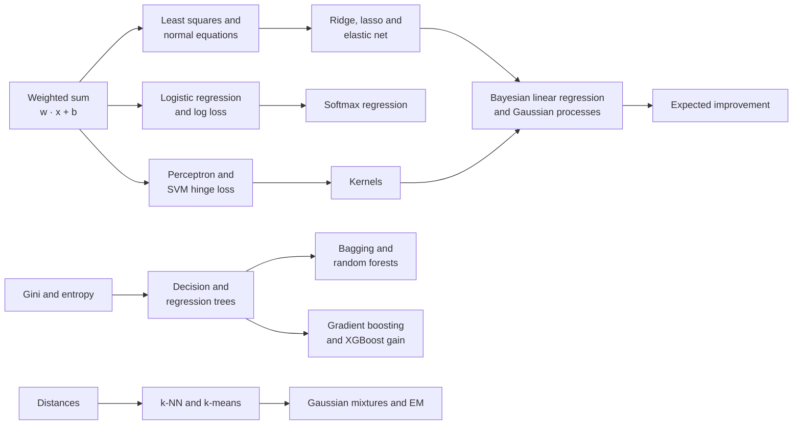
*Figure G.4: How the model-building equations connect. The weighted sum feeds regression, classification and margins; impurity scores feed trees and their ensembles; distances feed neighbors and clustering.*

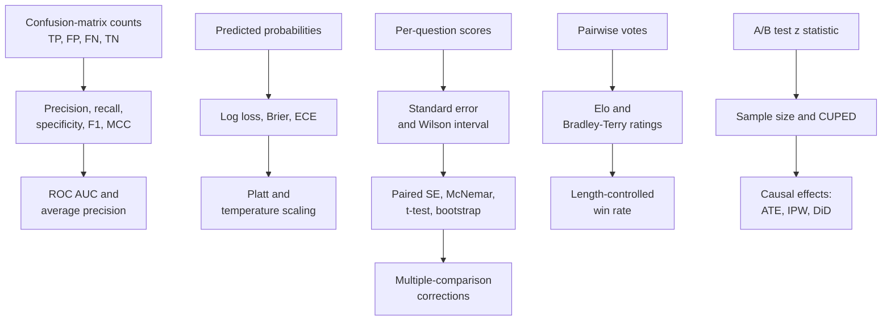
*Figure G.5: How the evaluation equations connect: counts become rates and curves, probabilities become calibration scores, and every score gets an error bar before two systems are compared.*

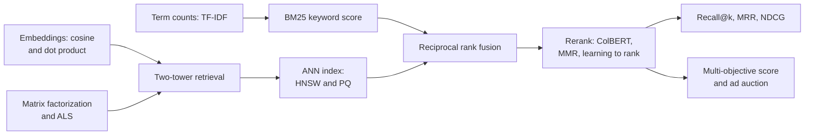
*Figure G.6: How the retrieval and recommendation equations connect: a cheap first stage (keyword and vector search) finds candidates, fusion and reranking order them, and ranking metrics grade the final list.*

### Feature scaling (standardization and min-max)

**What it does:** Puts every input column on a comparable scale before a model uses distances or penalties.

`standardized x' = (x − μ) ÷ σ`; `min-max x' = (x − min) ÷ (max − min)`

- **x**: the original value of one feature for one example
- **x'**: the rescaled value
- **μ** (mu): the feature's mean on the training set
- **σ** (sigma): the feature's standard deviation on the training set
- **min**, **max**: the feature's smallest and largest training values

**In plain words:** Standardization turns a value into "how many standard deviations from average" (the z-score of Appendix B), so every column has mean 0 and spread 1. Min-max squeezes the training range into 0 to 1. The statistics must come from the training data only, or test information leaks in.

**Tiny example:** With μ = 40 and σ = 15, the value 85 standardizes to (85 − 40) ÷ 15 = 3. With a training range of 10 to 160, min-max gives (85 − 10) ÷ (160 − 10) = 75 ÷ 150 = 0.5.

**Where it is used:** Required before k-NN, SVMs, PCA, k-means and regularized linear models (scikit-learn StandardScaler and MinMaxScaler); input normalization for neural networks. Trees do not need it. A robust variant uses the median and interquartile range.
**In the book:** Chapter 11 (Feature engineering: standardization), Chapter 10 (k-nearest neighbors: feature scaling; Anomaly detection: z = 3) and Appendix B (z-score); min-max scaling is only here. The z-score itself is also in the foundations section of this appendix.

> **Definition — Min-max scaling:** Rescaling a feature so its smallest training value becomes 0 and its largest becomes 1, by subtracting the minimum and dividing by the range.

### Distance metrics (Minkowski family: Manhattan, Euclidean, Chebyshev; and Hamming)

**What it does:** Measures how far apart two lists of numbers, or two strings of symbols, are.

`d_p(x, z) = (sum over j of |x_j − z_j|^p)^(1 ÷ p)`; `p = 1` Manhattan; `p = 2` Euclidean; as p grows without limit, Chebyshev `max over j of |x_j − z_j|`; `Hamming = number of positions j where x_j ≠ z_j`

- **x**, **z**: two vectors with components x_j and z_j
- **j**: the position (feature) being compared
- **|...|**: absolute value, the size without the sign
- **p**: a number of at least 1 that picks the member of the family
- **d_p**: the distance for that p

**In plain words:** Manhattan adds the gaps along each axis, like walking city blocks. Euclidean is the straight-line distance of Appendix B. Chebyshev keeps only the single largest gap. Hamming counts the positions that differ and is used for binary codes and equal-length strings. Squared Euclidean distance (no square root) is what k-means minimizes.

**Tiny example:** x = [1, 2, 3] and z = [4, 0, 3] differ by 3, 2 and 0. Manhattan: 3 + 2 + 0 = 5. Euclidean: sqrt(9 + 4 + 0) = sqrt(13) ≈ 3.61. Chebyshev: 3. The codes 10110 and 11100 differ in positions 2 and 4, so their Hamming distance is 2.

**Where it is used:** k-NN, clustering, vector databases (L2 and inner-product indexes in FAISS and pgvector), search over binary-quantized embeddings (Hamming), error-correcting codes.
**In the book:** Chapter 10 (k-nearest neighbors) and Appendix B (Distance) for Euclidean; Chapter 48 (A*: search with a sense of direction) for Manhattan; the general p-norm, Chebyshev and Hamming are only here. Vector norms themselves are also in the foundations section of this appendix.

> **Definition — Minkowski distance:** A family of distances between two vectors that raises each coordinate gap to a power p, adds them and takes the p-th root; p = 1 gives Manhattan distance and p = 2 gives ordinary straight-line (Euclidean) distance.

> **Definition — Hamming distance:** The number of positions at which two equal-length strings or binary codes differ, such as 2 for 10110 and 11100.

### Cosine similarity and its link to Euclidean distance

**What it does:** Scores how closely two vectors point the same way, and shows why dot product, cosine and distance agree on unit vectors.

`cos(a, b) = (a · b) ÷ (length(a) × length(b))`; for vectors of length 1: `length(a − b)^2 = 2 − 2 × cos(a, b)`

- **a**, **b**: two vectors, such as embeddings
- **a · b**: their dot product
- **length(...)**: the Euclidean length (norm) of a vector

**In plain words:** Cosine is 1 for the same direction, 0 for unrelated, −1 for opposite. When every embedding is first scaled to length 1, the squared distance between two of them is just 2 − 2 × cosine, so ranking by largest dot product, largest cosine or smallest distance gives the same order. That is why vector databases offer all three.

**Tiny example:** a = [3, 4] and b = [4, 3]: dot product 12 + 12 = 24, lengths 5 and 5, cosine 24 ÷ 25 = 0.96. Scaled to length 1 they are [0.6, 0.8] and [0.8, 0.6], whose difference [−0.2, 0.2] has squared length 0.04 + 0.04 = 0.08, and 2 − 2 × 0.96 = 0.08.

**Where it is used:** Semantic search and RAG retrieval with embedding models, deduplication by embedding similarity, recommendation similarity, grading text by embedding similarity.
**In the book:** Chapter 27 (Measuring closeness: cosine similarity by hand), Chapter 5, Chapter 51 and Appendix B (Cosine similarity); the identity with distance is only here. Cosine similarity itself is also in the foundations section of this appendix.

### Jaccard similarity (and intersection over union)

**What it does:** Scores the overlap of two sets as the shared part divided by the combined part.

`J(A, B) = |A ∩ B| ÷ |A ∪ B|`; Jaccard distance `= 1 − J`

- **A**, **B**: two sets (of word shingles, items, pixels)
- **|A ∩ B|**: the number of elements in both
- **|A ∪ B|**: the number of elements in either
- **J**: the similarity, from 0 (nothing shared) to 1 (identical)

**In plain words:** Count what two sets share and divide by everything either one contains. Intersection over union (IoU) in object detection is the same formula applied to the areas of two boxes.

**Tiny example:** {cat, sat, mat, hat} and {cat, sat, mat, bat} share 3 words out of 5 distinct ones: J = 3 ÷ 5 = 0.6. Two 10 × 10 boxes overlapping in a 5 × 10 strip: IoU = 50 ÷ (100 + 100 − 50) = 50 ÷ 150 ≈ 0.33.

**Where it is used:** Near-duplicate detection in pretraining-data pipelines (pairs above a threshold such as 0.8 are treated as duplicates), set-based recommendation similarity, IoU in object detection and segmentation.
**In the book:** Chapter 19 (Cleaning the firehose: the curation pipeline, Jaccard 4 ÷ 6 = 0.67) and Chapter 45 (Scoring a detector, with a pencil: IoU 0.39).

### Mahalanobis distance

**What it does:** Measures how unusual a point is relative to a cloud of data, in units of standard deviation along the cloud's own directions.

`d_M(x) = sqrt((x − μ)^T × Σ^(−1) × (x − μ))`

- **x**: the point being measured
- **μ** (mu): the mean vector of the data
- **Σ** (Sigma): the data's covariance matrix (how every pair of features varies together)
- **Σ^(−1)**: its matrix inverse
- **T**: transpose, which turns the column (x − μ) into a row so the product is one number

**In plain words:** Ordinary distance treats every direction alike. Mahalanobis distance first stretches the space so the data cloud becomes round, then measures. A step along the direction where the data naturally spreads counts little; the same step across it counts a lot. With Σ equal to the identity matrix it is plain Euclidean distance, and in one dimension it is the absolute z-score.

**Tiny example:** Two features with variance 1 and correlation 0.8, so Σ = [[1, 0.8], [0.8, 1]] and Σ^(−1) = (1 ÷ 0.36) × [[1, −0.8], [−0.8, 1]] ≈ [[2.78, −2.22], [−2.22, 2.78]]. For x − μ = [1, 1] (along the trend): (1 − 0.8 − 0.8 + 1) ÷ 0.36 = 0.4 ÷ 0.36 ≈ 1.11, so d = sqrt(1.11) ≈ 1.05. For [1, −1] (against the trend): (1 + 0.8 + 0.8 + 1) ÷ 0.36 = 3.6 ÷ 0.36 = 10, so d = sqrt(10) ≈ 3.16. Both points have the same Euclidean distance, sqrt(2) ≈ 1.41.

**Where it is used:** Multivariate anomaly detection, out-of-distribution detection on network features (the Mahalanobis detector), Gaussian classifiers, chemometrics.
**In the book:** Only here (the one-feature z-score is in Chapter 10's anomaly detection and Appendix B).

> **Definition — Mahalanobis distance:** A distance from a point to the center of a data cloud that accounts for the cloud's spread and correlations, so it measures "how many standard deviations away" along every direction at once.

### Linear regression model

**What it does:** Predicts a number as a weighted sum of the input features plus a constant.

`y_hat = w_1 × x_1 + w_2 × x_2 + ... + w_d × x_d + b = w · x + b`

- **y_hat**: the prediction
- **x = [x_1, ..., x_d]**: the d input features
- **w = [w_1, ..., w_d]**: the learned weights, one per feature
- **b**: the bias (intercept)

**In plain words:** Each feature pushes the prediction up or down by its weight. The same expression set equal to zero, w · x + b = 0, is the boundary of a linear classifier.

**Tiny example:** w = [2, 3], x = [4, 1], b = 5: 2 × 4 + 3 × 1 + 5 = 16.

**Where it is used:** The baseline for every numeric prediction task (prices, demand, risk scores); the output layer of most neural networks, including an LLM's final unembedding, is this same weighted sum.
**In the book:** Chapter 8 (What a model really is; Worked example: fitting a line in a spreadsheet), Chapter 10 (Linear and logistic regression, revisited), Appendix B (Weighted sum).

### Least-squares objective (mean squared error) and its gradient

**What it does:** Scores a regression model by its average squared error and gives the slope used to improve the weights.

`L(w, b) = (1 ÷ n) × sum over i of (y_i − (w · x_i + b))^2`; `gradient for w = (2 ÷ n) × sum over i of (w · x_i + b − y_i) × x_i`; `gradient for b = (2 ÷ n) × sum over i of (w · x_i + b − y_i)`

- **n**: the number of training examples
- **x_i**, **y_i**: example i's features and true value
- **w · x_i + b**: the model's prediction for example i
- **L**: the loss (mean squared error)

**In plain words:** Square each error so big misses count much more, then average. The gradient says which way to nudge each weight to shrink the loss. Variants drop the 1 ÷ n (sum of squared errors), use 1 ÷ 2 to cancel the 2, or weight each squared error.

**Tiny example:** Data (1, 3) and (2, 5) with w = 1, b = 0: predictions 1 and 2, errors −2 and −3, loss (4 + 9) ÷ 2 = 6.5. Gradient for w: (2 ÷ 2) × (−2 × 1 + −3 × 2) = −8; for b: (2 ÷ 2) × (−2 − 3) = −5. Both are negative, so w and b should grow.

**Where it is used:** The training objective of linear regression and of any network that predicts real numbers (value heads, regression heads, the noise-prediction loss of diffusion models); the same formula on test data is the MSE metric.
**In the book:** Chapter 8 (Measuring wrongness: the loss function; Exercise 6), Appendix B (Mean squared error; MSE slopes for a line). MSE as a network training loss is also in the neural networks and deep learning section of this appendix.

### Normal equations (closed-form least squares)

**What it does:** Solves for the best least-squares weights in one step instead of by trial and error.

`w = (X^T × X)^(−1) × X^T × y`, the solution of `X^T × X × w = X^T × y`

- **X**: the n × d data matrix, one row per example, with a column of 1s added so the bias is one of the weights
- **y**: the length-n list of targets
- **X^T**: the transpose of X (rows and columns swapped)
- **(...)^(−1)**: the matrix inverse
- **w**: the best weights, bias included

**In plain words:** Setting the least-squares gradient to zero gives a set of linear equations, and solving them gives the exact best weights. With one feature this collapses to Appendix B's "line of best fit" slope and intercept. Software solves it with QR or SVD (the pseudo-inverse) rather than an explicit inverse, which is more stable.

**Tiny example:** Appendix B's quiz data (1, 3), (2, 5), (3, 8), (4, 9). With a column of 1s, X^T × X = [[4, 10], [10, 30]] and X^T × y = [25, 73]. The determinant is 4 × 30 − 10 × 10 = 20, so the inverse is (1 ÷ 20) × [[30, −10], [−10, 4]]. Then w = (1 ÷ 20) × [30 × 25 − 10 × 73, −10 × 25 + 4 × 73] = (1 ÷ 20) × [20, 42] = [1, 2.1]: intercept 1 and slope 2.1, matching Appendix B.

**Where it is used:** scikit-learn LinearRegression, statistics packages and spreadsheet trendlines; linear probes on frozen network activations are often fit in closed form. The matrix inverse costs about d^3 operations, which is why huge problems use gradient descent instead.
**In the book:** Appendix B (Line of best fit, slope and intercept) for the one-feature case; Chapter 8 (Doing it in a spreadsheet) and Appendix F (Normal equations) in words; the matrix form is only here. The pseudo-inverse is also in the foundations section of this appendix.

### Polynomial and basis-function regression

**What it does:** Fits curves with a linear model by feeding it transformed copies of the input.

`y_hat = w_0 + w_1 × φ_1(x) + w_2 × φ_2(x) + ... + w_p × φ_p(x)`; polynomial case `φ_j(x) = x^j`

- **x**: the input
- **φ_j(x)** (phi): fixed basis functions applied to x (powers, splines, bumps, sine waves)
- **w_0, ..., w_p**: weights fit by least squares
- **p**: the number of basis functions (the degree, for polynomials)

**In plain words:** The model is still a weighted sum, just of new columns such as x and x squared, so least squares fits it exactly as before. Raising p lets the curve bend more, trading underfitting for overfitting.

**Tiny example:** With φ_1(x) = x and φ_2(x) = x^2, the weights w_0 = 0, w_1 = 0, w_2 = 1 fit (1, 1), (2, 4), (3, 9) exactly, and predict 4^2 = 16 at x = 4.

**Where it is used:** The classic illustration of overfitting; spline and Fourier features in forecasting (Prophet's seasonality) and in generalized additive models.
**In the book:** Chapter 8 (More than one feature; feature expansion) and Chapter 9 (A worked example: iced drinks and temperature, degrees 0 to 7).

### Ridge regression (L2 regularization)

**What it does:** Fits a linear model while charging a price for large weights.

`L(w) = sum over i of (y_i − w · x_i)^2 + λ × sum over j of w_j^2`; closed form `w = (X^T × X + λ × I)^(−1) × X^T × y`

- **λ** (lambda): the penalty strength, zero or more
- **w_j**: weight j (the bias is usually not penalized)
- **I**: the identity matrix (1s on the diagonal, 0s elsewhere)
- **X**, **y**, **x_i**, **y_i**: the data, as in the normal equations

**In plain words:** Larger λ shrinks the weights toward zero, which smooths the model and steadies it when features are correlated. It is the same as assuming, before seeing data, that weights are probably small (a Gaussian prior). In gradient descent the same penalty is called weight decay (see the optimizer entries in the neural networks and deep learning section of this appendix).

**Tiny example:** One feature, no bias, x = [1, 2], y = [2, 4]. Plain least squares: w = (1 × 2 + 2 × 4) ÷ (1 + 4) = 10 ÷ 5 = 2. Ridge with λ = 5: w = 10 ÷ (5 + 5) = 1. Check the ridge loss: at w = 2 it is 0 + 5 × 4 = 20; at w = 1 it is (1^2 + 2^2) + 5 × 1 = 10, lower.

**Where it is used:** The default regularizer for linear and logistic models (scikit-learn Ridge; LogisticRegression's default penalty is L2), the λ term in XGBoost leaf weights, L2 penalties in matrix factorization.
**In the book:** Chapter 9 (Regularization: keeping models simple on purpose); the closed form is only here. The prior view (MAP estimation, priors as regularizers) is in the foundations section of this appendix.

### Lasso (L1 regularization) and soft thresholding

**What it does:** Fits a linear model with a penalty on the absolute size of weights, which sets unhelpful weights exactly to zero.

`L(w) = (1 ÷ (2n)) × sum over i of (y_i − w · x_i)^2 + λ × sum over j of |w_j|`; coordinate update `w_j = sign(z_j) × max(|z_j| − λ, 0)`

- **n**: the number of examples
- **|w_j|**: the absolute value of weight j
- **λ**: the penalty strength
- **z_j**: the least-squares value of w_j with all other weights held fixed (for standardized features)
- **sign(z)**: +1 for positive z, −1 for negative

**In plain words:** The update takes the unpenalized answer for one weight and pulls it toward zero by λ; if it would cross zero it stops at exactly zero. That "soft thresholding" is why the lasso picks a subset of features. It corresponds to a Laplace prior on the weights.

**Tiny example:** With λ = 0.3: z_j = 0.8 becomes 0.8 − 0.3 = 0.5; z_j = −0.9 becomes −0.6; z_j = −0.2 becomes 0, because |−0.2| − 0.3 is negative.

**Where it is used:** Sparse feature selection in tabular models, genomics and finance (scikit-learn Lasso, glmnet); the L1 penalty on sparse-autoencoder activations in interpretability research is the same term.
**In the book:** Chapter 9 (Regularization: L1 and L2 regularization) in words; the formula and update are only here. Soft-thresholding as a general proximal step is also in the foundations section of this appendix.

> **Definition — Soft thresholding:** The update that shrinks a number toward zero by a fixed amount and sets it to exactly zero if it would cross; it is how the lasso turns small weights off.

### Elastic net penalty

**What it does:** Mixes the lasso and ridge penalties in one adjustable blend.

`penalty = λ × (α × sum over j of |w_j| + ((1 − α) ÷ 2) × sum over j of w_j^2)`

- **λ**: the overall penalty strength
- **α** (alpha): the mix, from 0 (pure ridge) to 1 (pure lasso)
- **w_j**: weight j

**In plain words:** The L1 part still zeroes out weights, while the L2 part keeps groups of correlated features together instead of arbitrarily picking one. The penalty is added to the least-squares or log-loss objective. scikit-learn calls the mix l1_ratio and the strength alpha.

**Tiny example:** Weights [2, −1, 0], λ = 0.1, α = 0.5: the L1 sum is 3 and the L2 sum is 4 + 1 = 5, so the penalty is 0.1 × (0.5 × 3 + 0.25 × 5) = 0.1 × 2.75 = 0.275.

**Where it is used:** Feature selection with correlated features in glmnet, scikit-learn ElasticNet and LogisticRegression(penalty='elasticnet').
**In the book:** Only here.

> **Definition — Elastic net:** A regularization penalty that adds a weighted mix of the lasso's sum of absolute weights and ridge's sum of squared weights, so it can drop useless features while keeping correlated ones together.

### Bayesian linear regression posterior

**What it does:** Gives not one best line but a whole probability distribution over lines, and an error bar for every prediction.

`S_N = (α × I + β × X^T × X)^(−1)`; `m_N = β × S_N × X^T × y`; predictive variance `σ_N^2(x) = 1 ÷ β + x^T × S_N × x`

- **α** (alpha): the prior precision of the weights (the prior says w is near 0 with variance 1 ÷ α)
- **β** (beta): the noise precision, 1 divided by the noise variance
- **X**, **y**, **I**: the data matrix, targets and identity matrix
- **m_N**: the posterior mean of the weights (the best guess)
- **S_N**: the posterior covariance (how unsure we still are)
- **x**: a new input; **σ_N^2(x)**: the variance of the prediction there

**In plain words:** Start with a belief that weights are small, then let the data sharpen it. The center of the updated belief is exactly the ridge solution with λ = α ÷ β. The prediction's uncertainty is the noise plus the weight uncertainty, and the second part grows for inputs far from the data.

**Tiny example:** One feature, no bias, α = β = 1, data x = [1, 2], y = [2, 4]. X^T × X = 5 and X^T × y = 10, so S_N = 1 ÷ (1 + 5) ≈ 0.167 and m_N = 10 ÷ 6 ≈ 1.67 (ridge with λ = 1 gives the same 10 ÷ 6). At x = 3 the prediction is 3 × 1.67 = 5.0 with variance 1 + 9 × 0.167 = 2.5; at x = 1 the variance is only 1 + 0.167 ≈ 1.17.

**Where it is used:** Uncertainty-aware regression, surrogates for Bayesian optimization, Thompson-sampling bandits with linear models; the conceptual bridge from ridge regression to Gaussian processes.
**In the book:** Only here.

> **Definition — Bayesian linear regression:** Linear regression that keeps a probability distribution over the weights instead of a single value, updated from a prior belief by the data, so every prediction comes with an error bar.

### Logistic regression (with log-odds and odds ratio)

**What it does:** Turns a weighted sum into a probability for a yes/no outcome.

`P(y = 1 given x) = sigmoid(w · x + b) = 1 ÷ (1 + exp(−(w · x + b)))`; equivalently `ln(p ÷ (1 − p)) = w · x + b`; odds ratio for feature j `= exp(w_j)`

- **x**, **w**, **b**: features, weights and bias
- **sigmoid**: the squashing function of Appendix B, from any number to 0 to 1
- **p**: the predicted probability of class 1
- **p ÷ (1 − p)**: the odds; **ln(...)** of it is the log-odds (logit)
- **exp(w_j)**: how many times the odds multiply when feature j rises by one unit, others fixed

**In plain words:** The model is linear in the log-odds, then the sigmoid converts back to a probability. The decision boundary is where w · x + b = 0 (probability 0.5). Neural networks' "logits" are named after this pre-sigmoid score.

**Tiny example:** Chapter 8's z = −4 + 1 × hours at 5 hours: z = 1, p = 1 ÷ (1 + e^(−1)) ≈ 0.731. Back to log-odds: ln(0.731 ÷ 0.269) = 1.0. The odds ratio exp(1) ≈ 2.72: each extra hour multiplies the odds by 2.72.

**Where it is used:** Credit scoring, medical risk, click-through prediction, spam filters; linear probes on LLM activations; the Bradley-Terry and reward-model formulas are logistic regressions on score differences.
**In the book:** Chapter 8 (Predicting categories: logistic regression; Decision boundaries), Chapter 10 (Linear and logistic regression, revisited; odds ratio e^(−0.6) ≈ 0.55), Appendix B (Sigmoid). Odds and log-odds are also in the foundations section of this appendix.

> **Definition — Odds ratio:** The factor by which the odds of an outcome multiply when one input rises by one unit; in logistic regression it is e raised to that input's weight.

### Binary log loss (binary cross-entropy), its gradient, and normalized entropy

**What it does:** Scores probability predictions for yes/no outcomes, heavily punishing confident mistakes.

`L = −(1 ÷ n) × sum over i of [y_i × ln(p_i) + (1 − y_i) × ln(1 − p_i)]`; gradient for w with `p_i = sigmoid(w · x_i + b)`: `(1 ÷ n) × sum over i of (p_i − y_i) × x_i`; normalized entropy `NE = L ÷ [−(p_bar × ln(p_bar) + (1 − p_bar) × ln(1 − p_bar))]`

- **y_i**: the true label of example i, 0 or 1
- **p_i**: the predicted probability that y_i = 1
- **n**: the number of examples
- **x_i**: example i's features
- **p_bar**: the base rate, the average of the y_i (such as the click-through rate)
- **NE**: the model's log loss divided by the log loss of always predicting p_bar

**In plain words:** Only one of the two terms is active for each example: −ln(p) for a yes, −ln(1 − p) for a no. The gradient is simply "predicted minus true, times the input". NE below 1 means the model beats the base rate, and it can be compared across datasets with different base rates; ads teams report it together with calibration = predicted clicks ÷ observed clicks.

**Tiny example:** Labels [1, 0, 1], predictions [0.9, 0.2, 0.6], one feature x = [1, 2, 3]. Terms: −ln 0.9 = 0.105, −ln 0.8 = 0.223, −ln 0.6 = 0.511; L = 0.839 ÷ 3 ≈ 0.280. Gradient: (−0.1 × 1 + 0.2 × 2 − 0.4 × 3) ÷ 3 = −0.9 ÷ 3 = −0.3. Base rate p_bar = 2/3, whose log loss is 0.637, so NE = 0.280 ÷ 0.637 ≈ 0.44.

**Where it is used:** Training loss for logistic regression, gradient-boosting classifiers (XGBoost binary:logistic), click-through models and safety classifiers; normalized entropy is the headline metric in Meta's ads click-prediction work (He et al., "Practical Lessons from Predicting Clicks on Ads at Facebook", 2014) and later industrial CTR papers.
**In the book:** Chapter 8 (Cross-entropy: the loss for categories), Chapter 6, Appendix B (Cross-entropy, one token); the two-term binary form, its gradient and NE are only here. The neural networks and deep learning section of this appendix covers the same loss computed from logits.

> **Definition — Normalized entropy (NE):** A model's average log loss divided by the log loss of always predicting the average rate; below 1 means the model adds information beyond the base rate.

### Multinomial logistic (softmax) regression

**What it does:** Extends logistic regression to more than two classes.

`P(y = k given x) = exp(w_k · x + b_k) ÷ sum over j = 1..K of exp(w_j · x + b_j)`; `loss = −ln P(y = true class given x)`

- **K**: the number of classes
- **w_k**, **b_k**: the weights and bias for class k
- **x**: the features
- **exp**: e to the power; the denominator makes the K probabilities add to 1 (the softmax of Appendix B)

**In plain words:** Each class gets its own weighted-sum score; softmax turns the scores into probabilities; the loss is minus the log of the probability given to the right class. With K = 2 it is ordinary logistic regression.

**Tiny example:** x = [1, 2] with w_1 = [1, 0], w_2 = [0, 1], w_3 = [0.5, 0.5] and zero biases: scores 1, 2, 1.5. Exponentials 2.718, 7.389, 4.482, total 14.589, so probabilities 0.186, 0.506, 0.307. If class 2 is right, the loss is −ln 0.506 ≈ 0.68.

**Where it is used:** Multi-class text and image classifiers and intent classifiers; the final layer of every classification network and of an LLM's next-token prediction has this form.
**In the book:** Chapter 10 (Linear and logistic regression, revisited: softmax regression, in words); the softmax itself is in Chapter 6 and Appendix B.

### Generalized linear models: Poisson regression and iteratively reweighted least squares

**What it does:** Extends the weighted sum to counts and other kinds of targets by passing it through a fixed link function, and fits the model by repeated weighted least squares.

`g(E[y given x]) = w · x + b`; Poisson regression: `E[y given x] = μ = exp(w · x + b)`, loss `L = sum over i of (μ_i − y_i × ln(μ_i))`; IRLS step: `w_new = (X^T × W × X)^(−1) × X^T × W × z`, with `z = X × w + W^(−1) × (y − μ)`

- **y**: the target (for Poisson regression a count: 0, 1, 2, ...); **E[y given x]**: its expected value for input x
- **g**: the link function: the identity for linear regression, the logit ln(p ÷ (1 − p)) for logistic regression, ln for Poisson regression
- **w**, **b**: the weights and bias; **μ** (mu), **μ_i**: the predicted average count for x and for example i
- **L**: the Poisson negative log-likelihood, leaving out a term that does not depend on the weights
- **X**: the data matrix with a column of 1s, so b is one of the weights; **y**, **μ**: the lists of targets and predictions
- **W**: a diagonal matrix of example weights, μ_i for Poisson and p_i × (1 − p_i) for logistic regression; **W^(−1)**: its inverse (1 divided by each weight)
- **z**: the "working response", the current score plus each example's scaled error

**In plain words:** Linear and logistic regression are two members of one family: a weighted sum passed through the inverse of a link function chosen to suit the target. For counts, the exponential keeps predictions positive, and raising feature j by one multiplies the expected count by exp(w_j). The standard fitting method, iteratively reweighted least squares (IRLS), is Newton's method in disguise: each round solves the normal equations with example weights recomputed from the current predictions. Gamma regression for positive amounts and Tweedie regression for amounts with many exact zeros (such as yearly claim costs) are siblings.

**Tiny example:** Claims per driver per year with ln(μ) = −2 + 0.7 × young, where young is 1 for drivers under 25: other drivers expect exp(−2) ≈ 0.135 claims and young ones exp(−1.3) ≈ 0.273, so being young multiplies the expected count by exp(0.7) ≈ 2.01. A young driver who filed 1 claim adds 0.273 − 1 × ln(0.273) ≈ 0.273 + 1.300 = 1.573 to the loss. IRLS with only an intercept on the counts 0, 2 and 4 reduces to w_new = w + (mean y − μ) ÷ μ: starting at w = 0 (μ = 1) it moves to 0 + (2 − 1) ÷ 1 = 1, then 0.736, 0.694 and 0.693 = ln(2), the log of the mean count.

**Where it is used:** Insurance pricing, where Poisson models of claim frequency, Gamma models of claim size and Tweedie models of total claim cost are the long-standing standard; count forecasting (calls, sales, visits); scikit-learn PoissonRegressor and TweedieRegressor, statsmodels GLM and R's glm, which fit by IRLS; LightGBM objective='poisson' and XGBoost count:poisson put the same loss inside boosted trees.
**In the book:** Chapter 10 (Linear and logistic regression, revisited: generalized linear models and Poisson regression, in words); the formulas are only here. Newton's method and the Poisson distribution are in the foundations section of this appendix.

> **Definition — Link function:** In a generalized linear model, the function that connects the expected value of the target to the weighted sum of the inputs, such as the logit for probabilities or the logarithm for counts.

> **Definition — Poisson regression:** A generalized linear model for counts, such as claims or visits, that predicts the logarithm of the expected count as a weighted sum of the inputs.

> **Definition — IRLS (iteratively reweighted least squares):** The standard way to fit generalized linear models: repeatedly solve a weighted least-squares problem whose weights and targets are updated from the current predictions; it is Newton's method applied to the model's likelihood.

### Perceptron learning rule

**What it does:** Learns a linear yes/no classifier by nudging the weights only when it makes a mistake.

`y_hat = sign(w · x + b)`; if `y_i × (w · x_i + b) ≤ 0` then `w = w + η × y_i × x_i` and `b = b + η × y_i`; mistake bound `(R ÷ γ)^2`

- **y_i**: the true label, +1 or −1
- **sign(z)**: +1 for positive z, −1 otherwise
- **η** (eta): the learning rate, often 1
- **R**: the radius of a ball containing all the data
- **γ** (gamma): the margin by which the data can be separated

**In plain words:** If the sign of the score is wrong (or the score is zero), add the example to the weights when it should have been positive, or subtract it when it should have been negative. Novikoff's theorem says that on separable data the rule makes at most (R ÷ γ)^2 mistakes in total.

**Tiny example:** Start at w = [0, 0], b = 0, η = 1. Example x = [2, 1], y = +1: score 0, a mistake, so w = [2, 1], b = 1. Next x = [1, 3], y = −1: score 2 + 3 + 1 = 6, and −1 × 6 ≤ 0 is a mistake, so w = [2, 1] − [1, 3] = [1, −2], b = 0. With R = 5 and γ = 0.5, at most (5 ÷ 0.5)^2 = 100 mistakes are possible.

**Where it is used:** The historical root of neural networks (Rosenblatt, 1958) and still the first learning algorithm taught; structured perceptrons were used for tagging and parsing before deep learning.
**In the book:** Chapter 7 (The perceptron: a machine that learns, rule worked by hand), Chapter 10 (The perceptron: the bridge to neural networks), Chapter 12; the symbolic rule and mistake bound are only here. The neural networks and deep learning section of this appendix lists the step activation with the same rule.

### Fisher's linear discriminant (LDA)

**What it does:** Finds the single direction that best separates two classes relative to their spread.

`w is proportional to S_W^(−1) × (m_1 − m_0)`; criterion `J(w) = (w · (m_1 − m_0))^2 ÷ (w^T × S_W × w)`

- **m_0**, **m_1**: the mean feature vectors of class 0 and class 1
- **S_W**: the within-class scatter matrix, the sum over each class of (x − m_c) × (x − m_c)^T
- **w**: the projection direction
- **J(w)**: between-class separation divided by within-class spread along w

**In plain words:** Project every point onto a line and pick the line where the two class averages are far apart while each class stays tight. Dividing by S_W steers away from directions where the classes are naturally noisy. As a classifier, Gaussian LDA assumes each class is a bell curve with a shared covariance, which gives a straight-line boundary; QDA allows separate covariances and curved boundaries.

**Tiny example:** m_0 = [0, 0], m_1 = [2, 2], S_W = [[2, 0], [0, 8]] (the second feature is much noisier). S_W^(−1) × [2, 2] = [1, 0.25], so w points mostly along feature 1. J([1, 0.25]) = (2 + 0.5)^2 ÷ (2 × 1 + 8 × 0.0625) = 6.25 ÷ 2.5 = 2.5, better than the obvious diagonal [1, 1]: 16 ÷ 10 = 1.6.

**Where it is used:** Dimensionality reduction for classification, speaker-verification back-ends (PLDA), face recognition (Fisherfaces), simple biomedical classifiers; scikit-learn LinearDiscriminantAnalysis.
**In the book:** Appendix F (Gaussian discriminant analysis: LDA in words); the formulas are only here.

> **Definition — Fisher's linear discriminant:** The direction onto which two classes' projected averages are farthest apart relative to their projected spread; it is the basis of linear discriminant analysis.

### Maximum-margin hyperplane (hard-margin SVM)

**What it does:** Picks, among all lines that separate two classes, the one with the widest empty street around it.

`minimize (1 ÷ 2) × length(w)^2` subject to `y_i × (w · x_i + b) ≥ 1` for every i; `margin width = 2 ÷ length(w)`; distance of x from the boundary `= |w · x + b| ÷ length(w)`

- **w**, **b**: define the boundary w · x + b = 0
- **y_i**: the label of example i, +1 or −1
- **length(w)**: the Euclidean length of w

**In plain words:** The constraints say every point must be on the right side with a score of at least 1. Because the street's width is 2 ÷ length(w), making w short makes the street wide. The points that touch the street's edges are the support vectors; the rest do not matter.

**Tiny example:** w = [3, 4], b = −5: length 5, so the margin is 2 ÷ 5 = 0.4. The point x = [3, 1] scores 9 + 4 − 5 = 8 (fine for y = +1, since 8 ≥ 1) and sits 8 ÷ 5 = 1.6 from the boundary.

**Where it is used:** Support vector machines (scikit-learn SVC, LIBSVM, LIBLINEAR) for small and medium tabular, text and bioinformatics problems; margin ideas reappear in metric learning and margin-based losses.
**In the book:** Chapter 10 (Support vector machines: the widest street) in words; the formulas are only here.

### Soft-margin SVM, hinge loss and epsilon-insensitive loss

**What it does:** Lets an SVM tolerate some mistakes, and adapts the idea to predicting numbers.

`minimize (1 ÷ 2) × length(w)^2 + C × sum over i of max(0, 1 − y_i × (w · x_i + b))`; `hinge(y, f) = max(0, 1 − y × f)`; regression (SVR): `loss(y, f) = max(0, |y − f| − ε)`

- **C**: a positive constant trading street width against violations (large C means fewer violations, narrower street)
- **y**: the label, +1 or −1 (for SVR, the true number)
- **f = w · x + b**: the raw score or prediction
- **ε** (epsilon): the width of the SVR's no-penalty tube

**In plain words:** The hinge loss is zero for points safely beyond the street and grows in a straight line for points inside it or on the wrong side. Support vector regression ignores errors smaller than ε and charges linearly for larger ones. Squared hinge and the multi-class Crammer-Singer hinge are variants.

**Tiny example:** With y = +1: a score of 2.0 costs max(0, 1 − 2) = 0; a score of 0.4 costs 0.6; a wrong-side score of −0.5 costs 1.5. SVR with ε = 0.5 and true value 10: predicting 10.3 costs 0; predicting 11 costs 1 − 0.5 = 0.5.

**Where it is used:** Linear SVMs for text classification (LIBLINEAR, scikit-learn LinearSVC, SGDClassifier(loss='hinge')), SVR for small regression problems in engineering and chemistry, hinge losses in GAN discriminators and margin ranking losses.
**In the book:** Chapter 10 (Support vector machines: hyperparameter C) and Appendix F (SVM duality, SMO and the hinge loss) in words; the formulas are only here.

> **Definition — Support vector regression (SVR):** The regression version of a support vector machine, which ignores prediction errors smaller than a set tolerance and charges linearly for larger ones.

### SVM dual problem and the kernel trick

**What it does:** Rewrites the SVM so the data appear only through similarities between pairs of points, which lets it draw curved boundaries.

`maximize sum over i of α_i − (1 ÷ 2) × sum over i of sum over j of α_i × α_j × y_i × y_j × K(x_i, x_j)`, subject to `0 ≤ α_i ≤ C` and `sum over i of α_i × y_i = 0`; prediction `f(x) = sum over i of α_i × y_i × K(x_i, x) + b`

- **α_i** (alpha): one weight per training point, nonzero only for support vectors
- **C**: the soft-margin constant
- **y_i**: labels, +1 or −1
- **K(x, z)**: a kernel, a similarity equal to a dot product φ(x) · φ(z) in some feature space
- **φ** (phi): the (possibly huge) feature map the kernel stands for
- **b**: the bias

**In plain words:** The prediction is a weighted vote of the support vectors, each weighted by how similar it is to the new point. Because only dot products appear, swapping x · z for a kernel K(x, z) fits a linear model in an enormous feature space without ever computing that space. That swap is the kernel trick.

**Tiny example:** Two support vectors [1, 0] (y = +1) and [−1, 0] (y = −1), each with α = 0.5, linear kernel, b = 0 (the constraint holds: 0.5 − 0.5 = 0). For x = [0.6, 3]: f = 0.5 × 1 × 0.6 + 0.5 × (−1) × (−0.6) = 0.6, so class +1. The kernel trick in miniature: for x = [1, 2] and z = [3, 1], (x · z)^2 = 5^2 = 25, and the explicit features φ(v) = [v_1^2, sqrt(2) × v_1 × v_2, v_2^2] give [1, 2.83, 4] · [9, 4.24, 1] = 9 + 12 + 4 = 25.

**Where it is used:** Kernel SVMs (LIBSVM, scikit-learn SVC), kernel ridge regression, kernel PCA, Gaussian processes; the attention score in Transformers has been analyzed as a kernel.
**In the book:** Chapter 10 (Support vector machines: kernel trick, Figure 10.6) and Appendix F in words; the dual and the prediction formula are only here.

### Common kernels (RBF, polynomial, linear)

**What it does:** Gives standard ways to score how similar two inputs are, for kernel methods.

`RBF: K(x, z) = exp(−γ × length(x − z)^2)`, with `γ = 1 ÷ (2 × σ^2)`; `polynomial: K(x, z) = (x · z + c)^d`; `linear: K(x, z) = x · z`

- **x**, **z**: two inputs
- **γ** (gamma) or **σ** (sigma, the length scale): how fast similarity falls with distance
- **c**: a constant of zero or more
- **d**: the polynomial degree

**In plain words:** The RBF (Gaussian) kernel is 1 for identical points and fades toward 0 as they move apart; large γ means only very close points count as similar. The polynomial kernel corresponds to all feature products up to degree d. The linear kernel is the plain dot product. Laplacian, Matérn and periodic kernels are common variants in Gaussian processes.

**Tiny example:** x = [1, 2], z = [2, 4]: squared distance 1 + 4 = 5. RBF with γ = 0.1: exp(−0.5) ≈ 0.61; with γ = 1: exp(−5) ≈ 0.0067. The dot product is 2 + 8 = 10, so the linear kernel is 10 and the polynomial kernel with c = 1, d = 2 is 11^2 = 121.

**Where it is used:** The default SVM kernel (scikit-learn SVC uses RBF), Gaussian-process surrogates in Bayesian hyperparameter optimization, kernel two-sample tests (MMD, also used to evaluate generative models), random Fourier features.
**In the book:** Only here (Chapter 10 explains kernels in words).

> **Definition — RBF kernel (Gaussian kernel):** A similarity score between two inputs that equals 1 when they are identical and falls off like a bell curve as the distance between them grows; the default kernel of support vector machines.

### Gaussian process regression posterior

**What it does:** Predicts a value at a new input together with an honest uncertainty, using only similarities to the training points.

`mean(x_*) = k_*^T × (K + σ_n^2 × I)^(−1) × y`; `variance(x_*) = k(x_*, x_*) − k_*^T × (K + σ_n^2 × I)^(−1) × k_*`

- **k**: the kernel, which defines how similar two inputs are
- **K**: the n × n matrix of kernel values between all training inputs
- **x_***: the new input; **k_***: the list of its kernel values with each training input
- **y**: the training targets
- **σ_n^2**: the observation-noise variance
- **I**: the identity matrix; **T**: transpose

**In plain words:** The prediction is a similarity-weighted blend of the training targets. The variance starts at the kernel's full prior uncertainty and subtracts what nearby data explain, so it is small next to training points and grows away from them. Kernel settings are fit by maximizing the marginal likelihood. The matrix inverse costs about n^3 operations, so exact GPs suit small datasets.

**Tiny example:** One training point x = 0 with y = 1, RBF kernel k(a, b) = exp(−(a − b)^2 ÷ 2), noise 0.1. At x_* = 0: k_* = 1, mean = 1 ÷ 1.1 × 1 ≈ 0.91, variance = 1 − 1 ÷ 1.1 ≈ 0.09. At x_* = 2: k_* = exp(−2) ≈ 0.135, mean ≈ 0.123, variance = 1 − 0.135^2 ÷ 1.1 ≈ 0.98, almost total uncertainty.

**Where it is used:** Small-data regression with uncertainty (geostatistics "kriging", calibration of physical models) and the surrogate model inside Bayesian optimization of hyperparameters (Google Vizier, BoTorch, scikit-optimize).
**In the book:** Chapter 10 (Support vector machines: the Gaussian process paragraph, cubic cost) in words; the formulas are only here.

### Expected improvement (Bayesian optimization acquisition)

**What it does:** Scores which untried setting is most worth trying next, balancing "probably good" against "uncertain, might be great".

`EI(x) = (μ(x) − f_best − ξ) × Φ(Z) + σ(x) × φ(Z)`, with `Z = (μ(x) − f_best − ξ) ÷ σ(x)` (and `EI = 0` when `σ(x) = 0`)

- **x**: a candidate setting (such as a learning rate)
- **μ(x)**, **σ(x)**: the surrogate model's predicted mean and standard deviation of the score at x (usually from a Gaussian process)
- **f_best**: the best score found so far
- **ξ** (xi): a small exploration bonus, zero or more
- **Φ**: the standard normal cumulative distribution (the area under the bell curve to the left)
- **φ**: the standard normal density (the bell curve's height)

**In plain words:** EI is the average amount by which trying x would beat the current best, counting only the cases where it does. The first term rewards a high predicted score; the second rewards uncertainty. Probability of improvement and the upper confidence bound μ + κ × σ are alternatives, and the tree-structured Parzen estimator (TPE) instead picks x where good trials are dense relative to bad ones.

**Tiny example:** Best so far f_best = 0.80, ξ = 0. Candidate A: μ = 0.82, σ = 0.05, so Z = 0.4, Φ = 0.655, φ = 0.368, EI = 0.02 × 0.655 + 0.05 × 0.368 ≈ 0.0131 + 0.0184 = 0.0315. Candidate B: μ = 0.78, σ = 0.10, so Z = −0.2, Φ = 0.421, φ = 0.391, EI ≈ −0.0084 + 0.0391 = 0.0307. B is predicted worse than the best so far, yet nearly as attractive, because it is so uncertain.

**Where it is used:** Hyperparameter tuning services and libraries (Google Vizier, BoTorch and Ax, scikit-optimize; Optuna's default sampler is TPE), materials and drug-discovery experiment design.
**In the book:** Chapter 9 (Tuning hyperparameters without cheating: Bayesian optimization) and Chapter 10 in words; expected improvement is only here.

> **Definition — Acquisition function:** In Bayesian optimization, the score that decides which setting to try next by weighing a candidate's predicted quality against the uncertainty about it; expected improvement is the most common one.

> **Definition — Expected improvement:** An acquisition function equal to the average amount by which a candidate setting would beat the best result so far, counting only the outcomes where it does.

### Successive halving and Hyperband (early-stopping budgets for tuning)

**What it does:** Spends a tuning budget mostly on promising hyperparameter settings by training many settings briefly and promoting only the best to longer runs.

`n_i = floor(n × η^(−i))` settings, each trained with budget `r_i = r × η^i`, in round i = 0, 1, 2, ... of successive halving; Hyperband: `s_max = floor(log_η(R ÷ r))`, and bracket s = s_max, ..., 0 starts `ceil((s_max + 1) × η^s ÷ (s + 1))` settings at budget `R × η^(−s)`, then runs successive halving

- **n**: the number of settings started; **r**: the smallest budget (epochs, steps or data) any setting gets
- **η** (eta): the cut factor, usually 3: each round keeps the best 1 ÷ η of the settings and gives them η times the budget
- **floor**, **ceil**: round down and round up
- **R**: the most budget any single setting may receive
- **s**: a bracket; large s starts many settings on small budgets, small s a few settings on large budgets; **s_max**: the largest bracket, the one that starts at the smallest budget r
- **log_η**: the logarithm to base η (how many times r can be multiplied by η before reaching R)

**In plain words:** Bad settings usually look bad early, so successive halving runs a tournament: everyone trains a little, the top third trains three times longer, and so on, until one winner gets the full budget. Each round costs about the same, n × r. The risk is eliminating a slow starter, so Hyperband runs several tournaments, from aggressive (many settings, tiny first budget) to cautious (a few settings trained fully from the start). ASHA is an asynchronous version that promotes settings as soon as enough results arrive, and BOHB (Bayesian optimization plus Hyperband) chooses the settings to try with Bayesian optimization instead of at random.

**Tiny example:** Chapter 9's tournament: n = 27, r = 1 epoch, η = 3. Rounds of 27 × 1, 9 × 3, 3 × 9 and 1 × 27 epochs cost 27 epochs each, 108 in total, against 27 × 27 = 729 to train every setting fully. Hyperband with R = 27 epochs: s_max = log_3(27) = 3, and its four brackets start 27 settings at 1 epoch, ceil(4 × 9 ÷ 3) = 12 at 3 epochs, ceil(4 × 3 ÷ 2) = 6 at 9 epochs, and 4 at the full 27 epochs.

**Where it is used:** Optuna's SuccessiveHalvingPruner and HyperbandPruner, Ray Tune's ASHA scheduler, Keras Tuner's Hyperband tuner, scikit-learn's HalvingGridSearchCV and HalvingRandomSearchCV (Hyperband: Li et al., JMLR 2018).
**In the book:** Chapter 9 (Tuning hyperparameters without cheating: successive halving, 108 versus 729 epochs); the bracket formulas are only here.

### k-nearest neighbors prediction (with the curse of dimensionality)

**What it does:** Predicts from the labels of the most similar training examples.

`y_hat = most common label among the k training points closest to x` (classification); `y_hat = (1 ÷ k) × sum over i in N_k(x) of y_i` (regression); `y_hat = sum of (y_i ÷ d_i) ÷ sum of (1 ÷ d_i)` (distance-weighted); `cube edge = r^(1 ÷ d)`, the edge needed to hold a fraction r of uniform data in d dimensions

- **x**: the new example
- **k**: how many neighbors to consult (chosen by cross-validation)
- **N_k(x)**: the set of the k nearest training points under some distance
- **y_i**: neighbor i's label or value
- **d_i**: the distance to neighbor i
- **r**, **d**: a fraction of the data and the number of dimensions

**In plain words:** Find the k closest examples and take a vote, an average, or an average that trusts closer neighbors more. The last formula is the curse of dimensionality: in many dimensions, even a small neighborhood has to stretch across most of each feature's range, so "nearest" neighbors stop being near.

**Tiny example:** Three nearest houses sold for 300, 320 and 340 (thousand) at distances 1, 2 and 4: the plain average is 320; the distance-weighted one is (300 + 160 + 85) ÷ (1 + 0.5 + 0.25) = 545 ÷ 1.75 ≈ 311. To hold 1% of uniform data in 10 dimensions a cube needs edges 0.01^(1 ÷ 10) ≈ 0.63 of the full range.

**Where it is used:** Recommendations from similar users or items, anomaly scores, few-shot classification on embeddings, kNN-LM and retrieval-based models; vector search is approximate k-NN.
**In the book:** Chapter 10 (k-nearest neighbors: you are like your neighbors); the weighted form and the edge formula are only here.

> **Definition — Curse of dimensionality:** The collection of problems that appear as the number of features grows, chiefly that data become so spread out that every point is far from every other and distance-based methods lose their meaning.

### Naive Bayes classifier

**What it does:** Picks the class whose prior times feature likelihoods is largest, assuming features are independent within each class.

`y_hat = argmax over classes c of [ln P(c) + sum over j of ln P(x_j given c)]`

- **c**: a class (such as spam or not spam)
- **P(c)**: the prior, the share of class c in the training data
- **x_j**: the value of feature j (such as "contains the word free")
- **P(x_j given c)**: how often that value occurs within class c
- **argmax**: the class that gives the largest value

**In plain words:** Bayes' rule says posterior is proportional to prior times likelihood; the "naive" step multiplies the likelihoods of all features as if independent. Adding logs instead of multiplying avoids numbers too small for the computer. Multinomial (word counts), Bernoulli (word present or absent) and Gaussian (bell curve per feature) versions differ only in how P(x_j given c) is computed.

**Tiny example:** Chapter 10's numbers: spam has prior 0.3 and P(free given spam) = 0.5; not-spam has 0.7 and 0.1. Products 0.15 versus 0.07, or in logs −1.20 − 0.69 = −1.90 versus −0.36 − 2.30 = −2.66, so spam wins, with probability 0.15 ÷ 0.22 ≈ 0.68.

**Where it is used:** Spam filtering, quick text-classification baselines, language identification, simple diagnosis models (scikit-learn MultinomialNB, GaussianNB).
**In the book:** Chapter 10 (Naive Bayes: adding up the clues), Appendix F, and Bayes' rule in Appendix B.

### Laplace (additive) smoothing

**What it does:** Stops a never-seen word from forcing a probability of zero.

`P(w given c) = (count(w, c) + α) ÷ (sum over words w' of count(w', c) + α × V)`

- **count(w, c)**: how often word (or feature value) w appears in class c
- **V**: the vocabulary size (number of possible values)
- **α** (alpha): a pseudo-count; α = 1 is add-one (Laplace) smoothing, values between 0 and 1 are Lidstone smoothing

**In plain words:** Pretend every possible word was seen α extra times. Rare words then get small but nonzero probabilities, and one unseen word no longer vetoes a whole class.

**Tiny example:** A word never seen in 100 spam words, vocabulary 50: (0 + 1) ÷ (100 + 50) ≈ 0.0067 instead of 0.

**Where it is used:** Naive Bayes text classifiers (the scikit-learn alpha parameter), n-gram language models, smoothing click-through estimates for items with few impressions.
**In the book:** Chapter 10 (Naive Bayes; Exercise 4 adds 1 to each count and 2 to each total); the general formula is only here. Add-one smoothing as a Beta prior is also in the foundations section of this appendix.

> **Definition — Laplace smoothing (additive smoothing):** Adding a small pretend count to every possible outcome before turning counts into probabilities, so nothing gets probability zero just because it was not seen in training.

### Gini impurity

**What it does:** Scores how mixed the classes in a group are, and so how good a decision-tree split is.

`G = 1 − sum over classes k of p_k^2`; split score `= (n_L ÷ n) × G_L + (n_R ÷ n) × G_R`

- **p_k**: the fraction of the group's examples in class k
- **n_L**, **n_R**: the numbers of examples sent left and right; **n** their total
- **G_L**, **G_R**: the two children's impurities

**In plain words:** G is 0 for a pure group and largest for an even mix (0.5 with two classes). The tree tries every candidate question and keeps the one with the lowest weighted child impurity. This Gini is unrelated to the Gini coefficient of inequality.

**Tiny example:** Chapter 10's subscribers: 5 cancelled and 5 stayed gives 1 − (0.25 + 0.25) = 0.5. After "months 5 or more?", one side is pure (0) and the other has 5 of 6 cancelled: 1 − (25/36 + 1/36) ≈ 0.278, so the split scores 0.4 × 0 + 0.6 × 0.278 ≈ 0.17.

**Where it is used:** The default split criterion in CART and scikit-learn DecisionTreeClassifier and RandomForestClassifier; "mean decrease in impurity" feature importance adds up these decreases.
**In the book:** Chapter 10 (Decision trees: Twenty Questions learned from data; Exercise 3).

### Entropy and information gain (tree splitting)

**What it does:** Scores a decision-tree split by how many bits of uncertainty it removes.

`H(node) = −sum over classes k of p_k × log2(p_k)`; `IG = H(parent) − sum over children c of (n_c ÷ n) × H(c)`; C4.5 gain ratio `= IG ÷ SplitInfo`, with `SplitInfo = −sum over c of (n_c ÷ n) × log2(n_c ÷ n)`

- **p_k**: the share of class k in the node (a class with share 0 contributes 0)
- **H**: the node's entropy, in bits
- **n_c**: the number of examples sent to child c; **n**: the parent's count
- **IG**: the information gain of the split

**In plain words:** Entropy is 1 bit for a 50/50 node and 0 for a pure one. Information gain is the parent's entropy minus the weighted entropy of the children; the split with the largest gain wins. The gain ratio divides by the entropy of the split sizes, so a split into many tiny children is not unfairly favored.

**Tiny example:** Chapter 10's ten subscribers (5 and 5): H = 1 bit. "Months 5 or more?" gives a pure side of 4 (H = 0) and a side of 6 with 5 cancelled: H = −(5/6 × log2(5/6) + 1/6 × log2(1/6)) ≈ 0.650, so IG = 1 − 0.6 × 0.650 ≈ 0.61. "Hours 5 or more?" leaves two 4-to-1 sides with H ≈ 0.722 each, so IG ≈ 0.28. Months wins, as it did with Gini.

**Where it is used:** ID3 and C4.5 trees, scikit-learn's criterion='entropy'; LightGBM and XGBoost trained with log loss compute their gain from gradients instead (see the second-order boosting entry below).
**In the book:** Chapter 10 (Decision trees: Twenty Questions learned from data), with entropy itself in Chapter 6; Appendix B (Classical machine learning and search). Entropy is also in the foundations section of this appendix.

### Regression tree split (variance reduction)

**What it does:** Grows a tree that predicts numbers, choosing splits that make each side's values as alike as possible.

`split error = sum over i in L of (y_i − mean_L)^2 + sum over i in R of (y_i − mean_R)^2`, minimized over all candidate splits; `leaf prediction = mean of the y_i in the leaf`

- **L**, **R**: the examples sent left and right by a candidate question (a feature and a threshold)
- **y_i**: example i's target value
- **mean_L**, **mean_R**: the average target on each side

**In plain words:** Each side predicts its own average, and the split is scored by the total squared error left over. This is the same as maximizing the drop in variance. Absolute-error trees use medians instead, and count data use Poisson-type losses.

**Tiny example:** Targets 10, 12, 30, 34 sorted by a feature (total squared error around their mean 21.5 is 451). Splitting after the second value leaves means 11 and 32 and errors 1 + 1 + 4 + 4 = 10. Splitting after the first leaves 0 + 274.7; after the third, 242.7 + 0. The middle split wins.

**Where it is used:** CART regression trees, random-forest regressors, and the base learners of gradient boosting, which fit trees like this to residuals.
**In the book:** Only here (Chapter 10's boosting fits "a small tree" without explaining the split rule).

### Cost-complexity pruning

**What it does:** Trims a grown tree back by charging a fixed price for every leaf.

`R_α(T) = R(T) + α × |leaves(T)|`

- **T**: a tree (or a pruned version of it)
- **R(T)**: its training error (misclassification rate or summed squared error)
- **|leaves(T)|**: its number of leaves
- **α** (alpha): the price per leaf, zero or more

**In plain words:** Grow a big tree, then keep the subtree with the lowest error-plus-size score. Small α keeps big trees; large α prefers stumps. α is chosen by cross-validation. This is called weakest-link pruning.

**Tiny example:** A big tree with error 0.10 and 8 leaves against a pruned one with 0.14 and 3 leaves. At α = 0.01: 0.10 + 0.08 = 0.18 versus 0.14 + 0.03 = 0.17, so prune. At α = 0.005: 0.14 versus 0.155, so keep the big tree.

**Where it is used:** CART pruning (Breiman et al., 1984) and scikit-learn's ccp_alpha; gradient-boosting libraries use a similar per-leaf penalty γ in their split gain.
**In the book:** Only here.

> **Definition — Cost-complexity pruning:** Shrinking a decision tree by choosing the subtree that minimizes its training error plus a fixed penalty for each leaf, with the penalty set by cross-validation.

### Bagging (bootstrap aggregating) and the variance of an average

**What it does:** Averages models trained on resampled data, and says how much that averaging reduces variance.

`f_bag(x) = (1 ÷ B) × sum over b = 1..B of f_b(x)`; `Var(average) = ρ × σ^2 + ((1 − ρ) ÷ B) × σ^2`; `P(a row is left out of a bootstrap sample) = (1 − 1 ÷ n)^n ≈ exp(−1) ≈ 0.368`

- **f_b**: a model trained on bootstrap sample b (n rows drawn with replacement from the n training rows)
- **B**: the number of models
- **σ^2**: each model's variance
- **ρ** (rho): the correlation between two models' predictions
- **n**: the number of training rows

**In plain words:** Averaging B independent models divides variance by B, but correlated models share their errors, and that shared part ρ × σ^2 never averages away. Each bootstrap sample misses about 36.8% of the rows; predicting those left-out rows gives a free "out-of-bag" error estimate.

**Tiny example:** Five models predict 10, 12, 11, 13 and 9: the bag predicts 55 ÷ 5 = 11. With σ^2 = 4 and B = 10: if ρ = 0.5 the variance is 0.5 × 4 + 0.05 × 4 = 2.2; if ρ = 0 it is only 0.4. With n = 1,000 rows, (1 − 0.001)^1,000 ≈ 0.368.

**Where it is used:** Random forests, bagged trees, bootstrap ensembles for uncertainty; the same averaging logic underlies model soups, checkpoint averaging and ensembles of LLM judges.
**In the book:** Chapter 10 (Random forests: a crowd of trees: bagging, and the vote of five 70% trees); the formulas are only here.

> **Definition — Out-of-bag error:** An error estimate for a bagged ensemble computed by predicting each training row using only the models whose bootstrap samples happened to leave that row out.

### Random forest prediction (vote or average)

**What it does:** Combines many decorrelated decision trees into one prediction.

`y_hat = most common class among f_1(x), ..., f_B(x)` (classification; a soft vote averages the trees' class probabilities instead); `y_hat = (1 ÷ B) × sum over b of f_b(x)` (regression); `m ≈ sqrt(p)` features tried per split

- **f_b(x)**: tree b's prediction for input x
- **B**: the number of trees
- **p**: the number of features
- **m**: how many randomly chosen features each split may consider

**In plain words:** Each tree trains on a bootstrap sample and, at every question, may look at only m random features, which makes the trees disagree in useful ways. The forest then votes (classification) or averages (regression). sqrt(p) is the usual classification default; p ÷ 3 is the classic regression choice, and scikit-learn's regressor now defaults to all features.

**Tiny example:** Five trees say stays, stays, cancels, stays, cancels: the forest says stays, 3 votes to 2. Five regression trees predicting 10, 12, 11, 13 and 9 average to 11. With p = 16 features, each split tries sqrt(16) = 4.

**Where it is used:** The robust default for tabular data (scikit-learn RandomForestClassifier, ranger, Spark MLlib), feature-importance analysis, fraud and remote-sensing models.
**In the book:** Chapter 10 (Random forests: a crowd of trees; Exercise 6), Appendix B (Classical machine learning and search).

### Gradient boosting update

**What it does:** Builds a strong model by adding small trees one at a time, each fixing the current mistakes.

`F_m(x) = F_(m−1)(x) + η × h_m(x)`, where `h_m` is fit to the pseudo-residuals `r_i = −(slope of L(y_i, F) with respect to F, at F = F_(m−1)(x_i))`

- **F_m**: the ensemble after m rounds; **F_0** is a constant (the mean target, or the log-odds of the base rate)
- **h_m**: a small tree fit to the r_i
- **η** (eta): the learning rate (shrinkage), between 0 and 1
- **L**: the loss; **y_i**: example i's target

**In plain words:** For squared error the pseudo-residual is just the ordinary residual y − F; for log loss it is y − p. Each round moves the prediction a fraction η of the way toward fixing the leftover error, which is gradient descent carried out in the space of functions. Stochastic gradient boosting fits each tree on a random subsample of rows.

**Tiny example:** Target 10, F_0 = 6, η = 0.5. Residual 4; a perfect tree predicts 4; F_1 = 6 + 0.5 × 4 = 8. Residual 2; F_2 = 8 + 0.5 × 2 = 9. For log loss with y = 1 and p = 0.7, the residual is 0.3.

**Where it is used:** The dominant method for tabular data in industry and Kaggle: XGBoost, LightGBM, CatBoost, scikit-learn HistGradientBoosting; ranking (LambdaMART), fraud, credit and ads.
**In the book:** Chapter 10 (Gradient boosting: a relay of tutors).

### Second-order boosting: optimal leaf weight and split gain (XGBoost)

**What it does:** Gives the best value for each leaf and the score of each candidate split, using both the slope and the curvature of the loss.

`w_j = −G_j ÷ (H_j + λ)`; `Gain = (1 ÷ 2) × [G_L^2 ÷ (H_L + λ) + G_R^2 ÷ (H_R + λ) − (G_L + G_R)^2 ÷ (H_L + H_R + λ)] − γ`

- **g_i**, **h_i**: the first derivative (slope) and second derivative (curvature) of the loss for example i at the current prediction
- **G_j**, **H_j**: the sums of g_i and h_i over the examples in leaf j (G_L, H_L and G_R, H_R for a split's left and right sides)
- **λ** (lambda): an L2 penalty on leaf values
- **γ** (gamma): a cost for adding a leaf
- **w_j**: the optimal value of leaf j

**In plain words:** Each tree minimizes a quadratic approximation of the loss, sum over leaves of [G_j × w_j + (1 ÷ 2) × (H_j + λ) × w_j^2] + γ × (number of leaves). Solving for each leaf gives w_j, and plugging it back gives how much a split lowers the loss. A split is kept only if Gain is positive.

**Tiny example:** XGBoost's squared-error loss is (1 ÷ 2) × (prediction − y)^2, whose slope is prediction − y and whose curvature is 1. With current prediction 0 and targets 2, 4, −1, −3: g = [−2, −4, 1, 3] and every h = 1. Split the first two from the last two, with λ = 1: G_L = −6, H_L = 2, G_R = 4, H_R = 2. Leaf values 6 ÷ 3 = 2 and −4 ÷ 3 ≈ −1.33. Gain = 0.5 × (36 ÷ 3 + 16 ÷ 3 − 4 ÷ 5) = 0.5 × (12 + 5.33 − 0.8) ≈ 8.27; with γ = 1 it is 7.27, so keep the split.

**Where it is used:** XGBoost (Chen and Guestrin, 2016), and the same second-order formulas in LightGBM and CatBoost, the libraries behind most production tabular models.
**In the book:** Only here (Chapter 10 names XGBoost, LightGBM and CatBoost).

### AdaBoost weights

**What it does:** Boosts weak classifiers by giving more votes to accurate ones and more weight to the examples they get wrong.

`ε_m = sum over i of w_i × 1[h_m(x_i) ≠ y_i] ÷ sum over i of w_i`; `α_m = (1 ÷ 2) × ln((1 − ε_m) ÷ ε_m)`; `w_i = w_i × exp(−α_m × y_i × h_m(x_i))`, then rescale to sum 1; `H(x) = sign(sum over m of α_m × h_m(x))`

- **y_i**, **h_m(x_i)**: the true label and weak learner m's output, both +1 or −1
- **w_i**: example i's weight (start at 1 ÷ n)
- **1[...]**: 1 when the condition holds, 0 otherwise
- **ε_m**: learner m's weighted error
- **α_m**: learner m's vote
- **H(x)**: the final combined classifier

**In plain words:** A learner that is right more often gets a bigger vote. Examples it got wrong are multiplied by e^(α_m) and the rest by e^(−α_m), so the next learner concentrates on the hard cases. AdaBoost is gradient boosting with the exponential loss exp(−y × F(x)); SAMME extends it to many classes.

**Tiny example:** Four examples at weight 0.25; the first learner misses one, so ε = 0.25 and α = 0.5 × ln(3) ≈ 0.549. The missed example becomes 0.25 × 1.732 ≈ 0.433 and the others 0.25 × 0.577 ≈ 0.144 each; after rescaling (total 0.866) the missed one holds 0.5 of all weight and each other one 0.167.

**Where it is used:** Viola-Jones face detection (2001) and classic boosting; now mostly a teaching example and a scikit-learn option (AdaBoostClassifier).
**In the book:** Only here.

> **Definition — AdaBoost (adaptive boosting):** A boosting method that trains simple classifiers one after another, each on reweighted data that emphasizes the previous ones' mistakes, and combines them in a weighted vote.

### Permutation feature importance (and mean decrease in impurity)

**What it does:** Measures how much a model relies on a feature by scrambling it and watching the score drop.

`I_j = s − (1 ÷ K) × sum over k = 1..K of s_(k, j)`

- **s**: the model's score (accuracy, R squared, AUC) on held-out data
- **s_(k, j)**: the score after randomly shuffling feature j's column, on repeat k
- **K**: the number of shuffles
- **I_j**: the importance of feature j

**In plain words:** Shuffling a column breaks its link to the target while keeping its values; a big drop in score means the model needed that feature. Mean decrease in impurity (MDI), the feature_importances_ of tree libraries, instead adds up the impurity drops of every split on the feature; it is fast but favors features with many distinct values.

**Tiny example:** Held-out accuracy 0.90. Shuffling "months" three times gives 0.71, 0.74, 0.68 (mean 0.71), so I = 0.19; shuffling "hours" gives 0.88, 0.89, 0.87, so I = 0.02.

**Where it is used:** Debugging and explaining tabular models (scikit-learn permutation_importance; random-forest feature_importances_), checking for leakage.
**In the book:** Chapter 10 (Random forests: feature importance, Exercise 6) for MDI; permutation importance is only here.

> **Definition — Permutation importance:** A feature's importance measured as the drop in a model's held-out score when that feature's column is randomly shuffled.

### Shapley values for feature attribution (SHAP)

**What it does:** Splits one prediction fairly among the input features.

`φ_j = sum over subsets S of the other features of [|S|! × (p − |S| − 1)! ÷ p!] × [v(S with j) − v(S)]`; `f(x) = φ_0 + sum over j of φ_j`

- **p**: the number of features
- **S**: a subset of the features other than j; **|S|** its size
- **!**: factorial (4! = 4 × 3 × 2 × 1)
- **v(S)**: the model's expected output when only the features in S are known (the others averaged out)
- **φ_j** (phi): feature j's share; **φ_0**: the average prediction

**In plain words:** Imagine adding the features one at a time in every possible order, and credit each feature with the average change it causes when it joins. The factorial weights are exactly that average over orders. The shares always add up to the prediction minus the average. KernelSHAP samples orders; TreeSHAP computes the exact values for tree ensembles quickly.

**Tiny example:** Two features with v(none) = 50, v(1 only) = 60, v(2 only) = 70, v(both) = 100. Both weights are 0!1! ÷ 2! = 1!0! ÷ 2! = 0.5. φ_1 = 0.5 × (60 − 50) + 0.5 × (100 − 70) = 20; φ_2 = 0.5 × (70 − 50) + 0.5 × (100 − 60) = 30. Check: 50 + 20 + 30 = 100.

**Where it is used:** The standard explanation tool for gradient-boosted and other tabular models (the shap library; XGBoost and LightGBM pred_contribs), regulated credit and insurance decisions, data valuation (Data Shapley). Interpretability methods for neural networks are in the reinforcement learning, alignment and safety section of this appendix.
**In the book:** Chapter 48 (A short course in game theory: Shapley value worked by join orders) and Chapter 10 (SHAP, in words); the factorial formula is only here.

### LIME local surrogate explanation

**What it does:** Explains one prediction of any model by fitting a simple, readable model to the black box's answers on slightly changed copies of the input.

`explanation(x) = argmin over simple models g of [sum over perturbed samples z of π_x(z) × (f(z) − g(z))^2 + Ω(g)]`, with `π_x(z) = exp(−D(x, z)^2 ÷ σ^2)`

- **x**: the input being explained; **z**: a perturbed copy of it (some features changed or removed)
- **f**: the black-box model; **f(z)**: its prediction for z
- **g**: a simple model, usually a sparse linear model whose weights are the explanation
- **π_x(z)** (pi): a closeness weight, 1 when z equals x and falling with distance
- **D**: a distance between inputs; **σ** (sigma): the kernel width
- **Ω(g)** (Omega): a complexity penalty, such as allowing g at most K features

**In plain words:** Poke the model with many small variations of one input, record its answers, and fit a straight line to them, trusting the variations closest to the original most. The line's slopes say which features mattered for this one case. The answer depends on choices such as the kernel width and how inputs are perturbed, and it can change from run to run.

**Tiny example:** A churn model gives 0.9, 0.8 and 0.5 for copies of a customer using the product 1, 2 and 3 hours a week; the real customer uses 2. With σ = 1 the closeness weights are exp(−1) ≈ 0.37, 1 and 0.37. Because the weights are symmetric, the weighted straight-line fit has slope (0.5 − 0.9) ÷ 2 = −0.2: near this customer, each extra weekly hour lowers the churn probability by about 0.2.

**Where it is used:** The lime library for tabular, text and image classifiers (Ribeiro, Singh and Guestrin, 2016); explaining individual credit, medical and fraud decisions, alongside or instead of SHAP.
**In the book:** Chapter 10 (Random forests: a crowd of trees: LIME, in words); the objective is only here.

### k-means objective and Lloyd's algorithm

**What it does:** Groups points into k clusters by repeatedly assigning each to its nearest center and moving each center to the middle of its group.

`J = sum over i of length(x_i − μ_(c_i))^2`; assign: `c_i = argmin over k of length(x_i − μ_k)^2`; update: `μ_k = (1 ÷ n_k) × sum over points i with c_i = k of x_i`

- **x_i**: data point i
- **c_i**: the cluster point i is assigned to
- **μ_k** (mu): the center (centroid) of cluster k
- **n_k**: the number of points in cluster k
- **J**: the total squared distance from points to their centers

**In plain words:** Neither step can raise J, so the algorithm always settles, though possibly in a local minimum that depends on the starting centers. Plotting J against k and looking for the bend is the elbow method. Mini-batch k-means updates centers from small random batches.

**Tiny example:** Chapter 10's points 1, 2, 3, 10, 11, 12 with centers 2 and 11: J = (1 + 0 + 1) + (1 + 0 + 1) = 4.

**Where it is used:** Customer segmentation, color quantization, the coarse lists of IVF vector indexes and the codebooks of product quantization (FAISS k-means), clustering embeddings to balance or deduplicate training data; the codebook update in VQ-VAE tokenizers is an online version.
**In the book:** Chapter 10 (Clustering: finding groups without answers; the elbow trick); the objective J is only here.

### k-means++ seeding

**What it does:** Chooses well-spread starting centers for k-means.

`P(choose x as the next center) = D(x)^2 ÷ sum over all points x' of D(x')^2`

- **x**: a candidate point
- **D(x)**: the distance from x to the nearest center already chosen (the first center is picked uniformly at random)

**In plain words:** Points far from every existing center are much more likely to be picked next, so the seeds spread out. Arthur and Vassilvitskii (2007) proved that the expected objective of these seeds alone is at most 8 × (ln(k) + 2) times the best possible; running Lloyd's algorithm afterwards only lowers it.

**Tiny example:** Points 1, 2, 3, 10, 11, 12 with first center 2: D^2 = 1, 0, 1, 64, 81, 100, total 247. The point 12 is picked with probability 100 ÷ 247 ≈ 0.40, and some point of the far group with probability 245 ÷ 247 ≈ 0.99.

**Where it is used:** The default initialization in scikit-learn KMeans and most k-means implementations.
**In the book:** Only here (Chapter 10 says k-means is run several times and the best run kept).

> **Definition — k-means++:** A way to choose starting centers for k-means that picks each new center at random with probability proportional to its squared distance from the centers chosen so far.

### Silhouette score

**What it does:** Scores how well each point fits its own cluster compared with the next-nearest cluster.

`s(i) = (b(i) − a(i)) ÷ max(a(i), b(i))`

- **a(i)**: the average distance from point i to the other points in its own cluster
- **b(i)**: the average distance from point i to the points of the nearest other cluster
- **s(i)**: from −1 (probably misassigned) through 0 (on a border) to 1 (well clustered)

**In plain words:** A point is well placed when its own cluster is much closer than any other. Averaging s(i) over all points scores a clustering and helps choose k. Davies-Bouldin and Calinski-Harabasz are related internal scores.

**Tiny example:** Clusters {1, 2, 3} and {10, 11, 12}; for the point 3: a = (2 + 1) ÷ 2 = 1.5, b = (7 + 8 + 9) ÷ 3 = 8, s = (8 − 1.5) ÷ 8 ≈ 0.81.

**Where it is used:** Choosing the number of clusters and comparing clusterings (scikit-learn silhouette_score), for example when clustering embeddings or users.
**In the book:** Only here.

> **Definition — Silhouette score:** A measure from −1 to 1 of how much closer a point is to its own cluster than to the nearest other cluster; averaged over points, it scores a whole clustering.

### Hierarchical clustering linkage (single, complete, average, Ward)

**What it does:** Defines the distance between two clusters, which decides which pair to merge next.

`single: d(A, B) = min over a in A, b in B of d(a, b)`; `complete: max over a, b of d(a, b)`; `average: mean over all pairs of d(a, b)`; `Ward: increase in squared error = (n_A × n_B ÷ (n_A + n_B)) × length(μ_A − μ_B)^2`

- **A**, **B**: two clusters with n_A and n_B points and centroids μ_A and μ_B
- **d(a, b)**: the distance between two points

**In plain words:** Agglomerative clustering starts with every point alone and keeps merging the closest pair, building a tree (dendrogram). Single linkage tends to chain into long strands, complete linkage makes compact clusters, and Ward merges the pair that least increases the total within-cluster squared error.

**Tiny example:** A = {1, 2}, B = {5, 9}: pair distances 4, 8, 3, 7. Single 3, complete 8, average 22 ÷ 4 = 5.5. Ward: (2 × 2 ÷ 4) × (1.5 − 7)^2 = 30.25.

**Where it is used:** Taxonomies of documents, genes and products (scikit-learn AgglomerativeClustering, SciPy linkage); hierarchical clustering of embeddings for topic discovery and data curation.
**In the book:** Chapter 10 (Clustering: hierarchical clustering) in words; the linkage formulas are only here.

> **Definition — Linkage (in hierarchical clustering):** The rule for measuring the distance between two clusters, such as the closest pair of points (single), the farthest pair (complete), the average pair, or the increase in squared error (Ward).

> **Definition — Dendrogram:** A tree diagram that records the order in which hierarchical clustering merged points and groups, with the height of each join showing how far apart the merged groups were.

### DBSCAN density rule (ε-neighborhoods and core points)

**What it does:** Finds clusters of any shape as crowded regions of the data, and labels points in empty regions as noise.

`N_ε(x) = all points z with d(x, z) ≤ ε`; `x is a core point if |N_ε(x)| ≥ minPts`; a cluster is a set of core points linked through each other's neighborhoods, plus the other points inside those neighborhoods; every remaining point is noise

- **x**, **z**: data points; **d**: a distance, usually Euclidean
- **ε** (epsilon): the neighborhood radius
- **N_ε(x)**: the ε-neighborhood of x, including x itself
- **|...|**: the number of points in it
- **minPts**: how many points a neighborhood needs to count as crowded

**In plain words:** A point with enough neighbors close by is a core point, and core points within ε of each other belong to the same cluster, which grows outward like a chain. Points near a core point but not crowded themselves join as border points; lonely points are noise. Unlike k-means, you do not choose the number of clusters, but you do choose ε and minPts. HDBSCAN repeats the idea at every radius and keeps the clusters that last longest, so ε need not be chosen.

**Tiny example:** Points 1, 2, 3, 10, 11, 12 and 30 on a line with ε = 1.5 and minPts = 3. N(2) = {1, 2, 3} and N(11) = {10, 11, 12} have 3 points each, so 2 and 11 are core points; 1, 3, 10 and 12 have only 2 points in their neighborhoods and become border points. The result is two clusters, {1, 2, 3} and {10, 11, 12}, and 30, with no neighbors, is noise.

**Where it is used:** Clustering GPS and map data and spotting outliers (scikit-learn DBSCAN, whose min_samples counts the point itself, and HDBSCAN); HDBSCAN on UMAP-reduced embeddings is the default clustering step of the BERTopic topic-modeling library.
**In the book:** Chapter 10 (Clustering: finding groups without answers: DBSCAN, in words); the rule is only here.

> **Definition — Core point (in DBSCAN):** A data point that has at least a set minimum number of points, itself included, within a set radius; clusters are grown by linking core points that lie within that radius of each other.

> **Definition — HDBSCAN (hierarchical DBSCAN):** A version of DBSCAN that considers every neighborhood radius at once and keeps the clusters that persist over the widest range, so the radius does not have to be chosen by hand.

### Gaussian mixture model

**What it does:** Describes data as a blend of several bell curves, giving every point a soft membership in each.

`p(x) = sum over k = 1..K of π_k × N(x given μ_k, Σ_k)`, with `π_k ≥ 0` and `sum over k of π_k = 1`; `log-likelihood = sum over i of ln(sum over k of π_k × N(x_i given μ_k, Σ_k))`

- **K**: the number of components (clusters)
- **π_k** (pi): component k's mixing weight (its share of the data)
- **N(x given μ_k, Σ_k)**: the normal (bell-curve) density with mean μ_k and covariance Σ_k
- **x_i**: data point i

**In plain words:** The density at a point is a weighted sum of bell curves. The model is fit by maximizing the log-likelihood, usually with expectation-maximization (next entry). Variants restrict each Σ_k to be diagonal, spherical or shared.

**Tiny example:** One dimension, two equal components N(0, 1) and N(4, 1). At x = 1: the curves have heights 0.242 and 0.0044, so p(1) = 0.5 × 0.242 + 0.5 × 0.0044 ≈ 0.123 and ln p ≈ −2.09.

**Where it is used:** Soft clustering, density estimation and anomaly scores; classic speaker recognition (GMM-UBM) and the acoustic models of pre-neural speech recognizers (GMM-HMM); background subtraction in video.
**In the book:** Chapter 10 (Clustering: Gaussian mixture model, bell heights and a 67% / 33% membership worked); the mixture formula is only here.

### Expectation-maximization (EM) for Gaussian mixtures

**What it does:** Fits a mixture by alternating between guessing soft memberships and refitting each component to them.

`r_ik = π_k × N(x_i given μ_k, Σ_k) ÷ sum over j of π_j × N(x_i given μ_j, Σ_j)` (E-step); `N_k = sum over i of r_ik`, `μ_k = (1 ÷ N_k) × sum over i of r_ik × x_i`, `Σ_k = (1 ÷ N_k) × sum over i of r_ik × (x_i − μ_k) × (x_i − μ_k)^T`, `π_k = N_k ÷ n` (M-step); general form for any model with hidden variables: `Q(θ given θ_old) = sum over z of P(z given x, θ_old) × ln P(x, z given θ)`, then `θ_new = argmax over θ of Q(θ given θ_old)`

- **r_ik**: the responsibility, the probability that component k produced point i
- **N_k**: the effective number of points in component k
- **n**: the number of points
- **π_k**, **μ_k**, **Σ_k**: the mixture's weights, means and covariances
- **T**: transpose
- **x**, **z**: in the general form, the observed data and the hidden variables (for a mixture, which component produced each point)
- **θ** (theta), **θ_old**: all the model's parameters, and their values from the previous round
- **Q**: the expected log-likelihood of data and hidden variables together, averaged over the hidden variables' current posterior

**In plain words:** The E-step is Bayes' rule for each point; the M-step computes weighted averages, weighted spreads and shares. No round ever lowers the data's log-likelihood. The general form says the same thing for any model with hidden parts: fill them in softly using the current parameters (E-step), then pick the parameters that best explain data plus filled-in parts (M-step); for a Gaussian mixture that maximization gives exactly the updates above. k-means is its hard-assignment limit.

**Tiny example:** Continuing the mixture above with points 1 and 3. At x = 1 the responsibility of the first component is 0.121 ÷ 0.123 ≈ 0.98; at x = 3 it is about 0.02. Then N_1 = 0.98 + 0.02 = 1.0, μ_1 = (0.98 × 1 + 0.02 × 3) ÷ 1.0 ≈ 1.04 and π_1 = 1.0 ÷ 2 = 0.5.

**Where it is used:** Fitting mixtures (scikit-learn GaussianMixture), missing-data problems, the Baum-Welch algorithm for hidden Markov models, the Dawid-Skene model for combining noisy crowd labels; the variational bound used by VAEs generalizes the same bound.
**In the book:** Chapter 10 (Clustering: expectation-maximization, the E step worked as about 67%); the M-step formulas are only here.

> **Definition — Responsibility (in EM):** The probability, computed in the expectation step, that a given mixture component generated a given data point; it serves as a soft cluster membership.

### Kernel density estimation

**What it does:** Estimates a smooth probability density by placing a small bump on every data point.

`p_hat(x) = (1 ÷ (n × h)) × sum over i = 1..n of K((x − x_i) ÷ h)`; Silverman's rule of thumb `h ≈ 1.06 × σ × n^(−1 ÷ 5)`

- **x_i**: the n data points
- **h**: the bandwidth, the width of each bump
- **K**: a kernel that integrates to 1, usually the standard normal density
- **σ**: the sample standard deviation

**In plain words:** Add up a bump at each data point and scale so the total area is 1. Small h gives a spiky estimate, large h an oversmoothed one. In d dimensions the factor becomes 1 ÷ (n × h^d).

**Tiny example:** Points 0, 1 and 3 with h = 1 and a normal kernel; at x = 1 the bumps have heights 0.242, 0.399 and 0.054, so p_hat(1) = 0.695 ÷ 3 ≈ 0.23. For 100 points with σ = 1, Silverman gives h ≈ 1.06 × 100^(−0.2) ≈ 0.42.

**Where it is used:** Smoothed histograms in data analysis (seaborn kdeplot), density-based anomaly detection, and the good-trial and bad-trial densities inside the TPE hyperparameter optimizer.
**In the book:** Appendix F (Kernel density estimation) in words; the formula is only here.

> **Definition — Kernel bandwidth (in kernel density estimation):** The width of the bump placed on each data point; it controls how smooth the estimated density is.

### Principal component analysis (projection and explained variance)

**What it does:** Finds the directions along which data spread most, and compresses each point to its coordinates along the top few.

`Σ = (1 ÷ n) × X_c^T × X_c`; `Σ × v_j = λ_j × v_j`; `z = V_k^T × (x − μ)`; explained variance ratio of component j `= λ_j ÷ sum over all l of λ_l`

- **X_c**: the n × d data matrix with each column's mean subtracted
- **Σ** (Sigma): the d × d covariance matrix
- **v_j**: the eigenvectors of Σ (the principal directions); **λ_j** (lambda): their eigenvalues (the variance along each), sorted largest first
- **V_k**: the d × k matrix of the top k eigenvectors
- **x**, **μ**: a data point and the mean vector
- **z**: the k-number summary of x; x is rebuilt approximately as μ + V_k × z

**In plain words:** The covariance matrix records how features vary together. Its eigenvectors are the axes of the data cloud and its eigenvalues say how much spread each axis holds. Projecting onto the top k axes keeps the most variance possible for k numbers. Software computes it from the SVD X_c = U × S × V^T, with λ_j = s_j^2 ÷ n (or ÷ (n − 1)).

**Tiny example:** Height and arm span, each with variance 2 and covariance 1.9: Σ = [[2, 1.9], [1.9, 2]]. Its eigenvalues are 3.9 (direction [0.707, 0.707], "overall size") and 0.1 (direction [0.707, −0.707]); the first keeps 3.9 ÷ 4 = 97.5% of the variance. A person 1 above average in height and 1.2 in arm span gets z = 0.707 × 1 + 0.707 × 1.2 ≈ 1.56.

**Where it is used:** Compressing features, visualizing embeddings and activations, whitening and noise reduction; PCA of LLM activations and of weight updates in interpretability and fine-tuning analysis.
**In the book:** Chapter 10 (Shrinking many columns into a few: PCA, t-SNE and UMAP; Exercise 8), Appendix B (Classical machine learning and search), Appendix F (Covariance and the covariance matrix). Eigenvectors and the SVD are also in the foundations section of this appendix.

### t-SNE (t-distributed stochastic neighbor embedding)

**What it does:** Places high-dimensional points on a 2-D map so that each point's near neighbors stay near.

`p_(j given i) = exp(−length(x_i − x_j)^2 ÷ (2 × σ_i^2)) ÷ sum over k ≠ i of exp(−length(x_i − x_k)^2 ÷ (2 × σ_i^2))`; `p_ij = (p_(j given i) + p_(i given j)) ÷ (2n)`; `q_ij = (1 + length(y_i − y_j)^2)^(−1) ÷ sum over k ≠ l of (1 + length(y_k − y_l)^2)^(−1)`; `cost = KL(P || Q) = sum over i ≠ j of p_ij × ln(p_ij ÷ q_ij)`

- **x_i**: the original high-dimensional points; **y_i**: their map positions
- **σ_i**: a per-point width chosen so the perplexity, 2^(entropy of point i's neighbor distribution), matches a setting (typically 5 to 50)
- **p_ij**: how strongly i and j are neighbors in the original space
- **q_ij**: how strongly they are neighbors on the map
- **n**: the number of points
- **KL**: the Kullback-Leibler divergence between the two neighbor patterns

**In plain words:** Turn distances into neighbor probabilities in both spaces, then move the map points by gradient descent until the patterns match. The map uses a heavy-tailed Student-t curve, so moderately far points can be pushed well apart and clusters separate cleanly. Distances between far-apart clusters in the picture mean little.

**Tiny example:** On the map, distances 1 and 3 give t-similarities 1 ÷ 2 = 0.5 and 1 ÷ 10 = 0.1, a ratio of 5. A Gaussian with σ = 1 would give exp(−0.5) ≈ 0.61 and exp(−4.5) ≈ 0.011, a ratio of about 55: the t-curve's heavy tail is far more forgiving of distance. A perplexity of 4 corresponds to a neighbor entropy of 2 bits.

**Where it is used:** Visualizing embeddings, word vectors, single-cell gene-expression data and network activations (scikit-learn TSNE, openTSNE).
**In the book:** Chapter 10 (t-SNE and UMAP, in words), Chapter 14.

> **Definition — t-SNE perplexity:** A setting that roughly fixes how many neighbors each point pays attention to, defined as 2 raised to the entropy of that point's neighbor probabilities; it is unrelated to a language model's perplexity score except in its formula.

### UMAP (uniform manifold approximation and projection)

**What it does:** Builds a weighted neighbor graph of the data and lays it out in 2-D, faster than t-SNE and keeping more of the global shape.

`v_(j given i) = exp(−(d(x_i, x_j) − ρ_i) ÷ σ_i)`; `v_ij = v_(j given i) + v_(i given j) − v_(j given i) × v_(i given j)`; `w_ij = (1 + a × length(y_i − y_j)^(2b))^(−1)`; `loss = sum over i, j of [v_ij × ln(v_ij ÷ w_ij) + (1 − v_ij) × ln((1 − v_ij) ÷ (1 − w_ij))]`

- **d**: the distance in the original space
- **ρ_i** (rho): the distance from x_i to its nearest neighbor
- **σ_i**: a per-point scale set so each point's similarities add to log2 of the neighbor count
- **v_ij**: the edge weight between i and j in the k-nearest-neighbor graph
- **y_i**: map positions; **a**, **b**: constants fitted from the min_dist setting
- **w_ij**: the edge weight implied by the map

**In plain words:** Every point is connected to its nearest neighbors, with weights that start at 1 for the nearest one. The two directed weights are combined as a "fuzzy or". The map is then optimized with a cross-entropy that pulls connected points together and pushes others apart, using stochastic gradient descent with negative sampling.

**Tiny example:** With ρ_i = 1, σ_i = 0.5 and d = 2: v = exp(−(2 − 1) ÷ 0.5) = exp(−2) ≈ 0.135. If the reverse weight is 0.3, v_ij = 0.135 + 0.3 − 0.135 × 0.3 ≈ 0.395. With a = b = 1 and map distance 1, w = 0.5, and this pair's loss is 0.395 × ln(0.395 ÷ 0.5) + 0.605 × ln(0.605 ÷ 0.5) ≈ 0.022.

**Where it is used:** Visualizing embeddings and single-cell data (umap-learn, RAPIDS cuML) and as a reduction step before clustering embeddings (BERTopic).
**In the book:** Chapter 10 (t-SNE and UMAP, in words), Chapter 14.

### Isolation forest anomaly score

**What it does:** Scores how easy a point is to isolate with random cuts; outliers are isolated quickly.

`s(x, n) = 2^(−E[h(x)] ÷ c(n))`, with `c(n) = 2 × H(n − 1) − 2 × (n − 1) ÷ n` and `H(i) ≈ ln(i) + 0.5772`

- **h(x)**: the number of random splits needed to isolate point x in one random tree
- **E[h(x)]**: its average over the forest
- **n**: the subsample size used per tree
- **c(n)**: the average path length of an unsuccessful search in a binary search tree, used to normalize
- **H(i)**: the harmonic number; 0.5772 is the Euler-Mascheroni constant

**In plain words:** Odd points sit alone, so a few random cuts separate them, while typical points in dense regions need many. Scores near 1 mean anomalous; scores well below 0.5 mean normal.

**Tiny example:** n = 256: H(255) ≈ ln(255) + 0.577 ≈ 6.12, so c ≈ 12.24 − 1.99 ≈ 10.24. A point isolated after 2 cuts on average scores 2^(−2 ÷ 10.24) ≈ 0.87; one needing 12 scores 2^(−12 ÷ 10.24) ≈ 0.44.

**Where it is used:** Fraud, intrusion and sensor-fault detection, screening logs and metrics (scikit-learn IsolationForest).
**In the book:** Chapter 10 (Anomaly detection: spotting the odd one out, about 10 cuts for 1,000 points) in words; the score is only here.

### MinHash and locality-sensitive hashing

**What it does:** Finds near-duplicate documents among billions without comparing every pair.

`P(minhash(A) = minhash(B)) = J(A, B)`; with b bands of r hashes, `P(pair becomes a candidate) = 1 − (1 − J^r)^b`, threshold near `(1 ÷ b)^(1 ÷ r)`; random-hyperplane (SimHash) LSH: `P(sign(v · x) = sign(v · y)) = 1 − θ ÷ π`

- **minhash(A)**: the smallest hash value over the elements of set A under one random hash function
- **J(A, B)**: the Jaccard similarity of sets A and B
- **b**, **r**: the number of bands and hashes per band in the signature
- **v**: a random vector; **x**, **y**: two vectors; **θ** (theta): the angle between them; **π** ≈ 3.14159

**In plain words:** Two sets share their smallest hash exactly as often as their Jaccard similarity, so a signature of many minhashes estimates J. Banding turns that into a sharp filter: pairs that agree on any whole band are checked, which catches very similar pairs and almost never flags dissimilar ones. SimHash does the same for cosine similarity with random hyperplanes.

**Tiny example:** With b = 20 bands of r = 5: a pair with J = 0.8 becomes a candidate with probability 1 − (1 − 0.8^5)^20 = 1 − (1 − 0.328)^20 ≈ 0.9996; a pair with J = 0.3 only 1 − (1 − 0.0024)^20 ≈ 0.047. The threshold is about (1 ÷ 20)^(1 ÷ 5) ≈ 0.55. Two vectors 60 degrees apart agree on a SimHash bit with probability 1 − 60 ÷ 180 ≈ 0.67.

**Where it is used:** Fuzzy deduplication of web-scale pretraining corpora (MinHash LSH in pipelines such as Hugging Face's FineWeb and NVIDIA NeMo Curator), plagiarism and near-duplicate search, SimHash for web-page deduplication.
**In the book:** Chapter 19 (Most of the web is not worth reading: near-duplicate detection, MinHash) in words. The large language models section of this appendix covers the same MinHash banding as a step of pretraining-data cleaning; SimHash is only here.

> **Definition — Locality-sensitive hashing (LSH):** A family of hashing tricks designed so that similar items are likely to land in the same bucket, letting a system find near-duplicates or near neighbors without comparing every pair.

### Bias-variance decomposition

**What it does:** Splits a model's expected squared error on new data into systematic error, jumpiness and unavoidable noise.

`E[(y − f_hat(x))^2] = (E[f_hat(x)] − f(x))^2 + E[(f_hat(x) − E[f_hat(x)])^2] + σ^2`

- **x**: an input; **f(x)**: the true average outcome there
- **y**: an observed outcome, equal to f(x) plus random noise
- **f_hat**: the model learned from one random training set
- **E[...]**: the average over many possible training sets (and noise)
- **σ^2**: the variance of the noise

**In plain words:** The first term is squared bias: how far the average model is from the truth. The second is variance: how much the model swings from one training set to another. The third is noise no model can remove. Simple models have high bias, flexible ones high variance, and the best model balances them for the amount of data available. Very large networks can show double descent, where test error falls again past the point of fitting the training data exactly.

**Tiny example:** Chapter 9's café, at 32 °C where true sales average 80 and day-to-day noise has variance 4. Straight lines trained on five different samples predict 74, 76, 73, 75 and 77: mean 75, bias^2 = 25, variance (1 + 1 + 4 + 0 + 4) ÷ 5 = 2, expected error 25 + 2 + 4 = 31. Degree-7 curves predict 52, 110, 70, 95 and 73: mean 80, bias 0, but variance 411.6, so the expected error is 415.6.

**Where it is used:** The central explanation of underfitting versus overfitting, of regularization and of ensembling (bagging cuts the variance term).
**In the book:** Chapter 9 (Bias and variance: the dartboard; A twist: double descent), Appendix B (Classical machine learning and search).

### k-fold cross-validation estimate

**What it does:** Estimates how well a model will do on new data by rotating which part of the data is held out.

`CV_K = (1 ÷ K) × sum over k = 1..K of error_k`; leave-one-out shortcut for least squares (and many other linear fits): `(1 ÷ n) × sum over i of ((y_i − y_hat_i) ÷ (1 − h_ii))^2`

- **K**: the number of folds (5 or 10 is typical; K = n is leave-one-out)
- **error_k**: the error of a model trained on the other K − 1 folds and tested on fold k
- **y_i**, **y_hat_i**: true and fitted values; **h_ii**: the leverage of example i (how much it pulls its own fit)
- **n**: the number of examples

**In plain words:** Every example is used for testing exactly once, and the K scores are averaged, which is far more reliable than one lucky split. Stratified folds keep class shares equal, grouped folds keep related rows together, and time series use walk-forward splits. Nested cross-validation tunes hyperparameters inside each outer fold.

**Tiny example:** Five fold error rates of 3%, 1%, 2%, 2% and 1.5% give CV = 9.5 ÷ 5 = 1.9%.

**Where it is used:** Model and hyperparameter selection on small and medium datasets (scikit-learn cross_val_score, GridSearchCV).
**In the book:** Chapter 9 (Cross-validation: don't trust one lucky split; Time series: never train on the future).

### Akaike and Bayesian information criteria (AIC, BIC)

**What it does:** Compares models fitted to the same data by rewarding fit and charging for parameters, with no held-out set.

`AIC = 2 × k − 2 × ln(L_hat)`; `BIC = k × ln(n) − 2 × ln(L_hat)`; small-sample `AICc = AIC + 2 × k × (k + 1) ÷ (n − k − 1)`

- **k**: the number of fitted parameters
- **L_hat**: the model's maximized likelihood on the data
- **n**: the number of data points

**In plain words:** Lower is better for both. BIC's charge per parameter, ln(n), exceeds AIC's 2 once n is above about 7, so BIC prefers smaller models on big datasets.

**Tiny example:** n = 100. Model A has 3 parameters and ln L = −120; model B has 6 and ln L = −115. AIC: A = 6 + 240 = 246, B = 12 + 230 = 242, so B wins. BIC: A = 3 × 4.61 + 240 ≈ 253.8, B = 6 × 4.61 + 230 ≈ 257.6, so A wins. The two criteria disagree, which is common.

**Where it is used:** Choosing the number of mixture components, ARIMA orders (auto.arima, statsmodels) and regression variables without a held-out set.
**In the book:** Only here.

> **Definition — AIC (Akaike information criterion):** A score for comparing statistical models, equal to twice the number of parameters minus twice the log-likelihood; lower is better.

> **Definition — BIC (Bayesian information criterion):** A model-comparison score like AIC but charging ln(n) per parameter instead of 2, so it favors simpler models when there are many data points.

### Hoeffding test-set bound and uniform convergence (finite class, VC dimension)

**What it does:** Guarantees how close a measured error rate is to the true one, for one model on a test set and for the best of many models on training data.

`P(|error_test − error_true| > ε) ≤ 2 × exp(−2 × n × ε^2)` for one model on n test examples; for a finite class H with m training examples, with probability at least 1 − δ for every h in H: `|error_true(h) − error_train(h)| ≤ sqrt((1 ÷ (2m)) × ln(2 × |H| ÷ δ))`; VC version: gap of order `sqrt((d ÷ m) × ln(m ÷ d) + (1 ÷ m) × ln(1 ÷ δ))`

- **error_test**, **error_train**: measured error rates; **error_true**: the error on the whole distribution
- **ε** (epsilon): the allowed gap; **δ** (delta): the allowed chance of failure
- **n**, **m**: the numbers of test and training examples
- **H**: the set of models being chosen from; **|H|** its size; **h**: one model in it
- **d**: the VC dimension

**In plain words:** Hoeffding's inequality says an average of n independent yes/no outcomes rarely strays far from its true value, with the chance of a gap falling exponentially in n. Adding the union bound over every model in H shows that choosing among more models (larger ln|H|, or larger d) needs more data for the same guarantee. Modern deep networks beat these worst-case predictions, which motivated PAC-Bayes and double-descent research.

**Tiny example:** A test set of 1,000 and a gap of 5 points: 2 × exp(−2 × 1,000 × 0.0025) = 2 × exp(−5) ≈ 0.013, so a gap over 5 points happens less than 1.4% of the time. Choosing among |H| = 1,000 models with m = 10,000 and δ = 0.05: sqrt(ln(40,000) ÷ 20,000) = sqrt(10.6 ÷ 20,000) ≈ 0.023.

**Where it is used:** The learning-theory foundation for why more data and simpler model classes generalize (CS229), sizing held-out test sets and evaluation suites, the starting point of PAC learning.
**In the book:** Chapter 9 (Bias and variance: statistical learning theory, VC dimension and PAC learning) and Appendix F (Generalization bounds) in words; the formulas are only here. Hoeffding's inequality and the union bound on their own are also in the foundations section of this appendix.

> **Definition — Hoeffding's inequality:** A guarantee that the average of many independent bounded measurements, such as right/wrong answers, is unlikely to be far from its true mean, with the chance of a large gap shrinking exponentially as the number of measurements grows.

> **Definition — Union bound:** The rule that the probability that at least one of several events happens is at most the sum of their separate probabilities.

### Class weights and SMOTE for imbalanced data

**What it does:** Makes rare classes count more in training, by weighting their errors or by inventing extra examples of them.

`w_c = n ÷ (K × n_c)` (balanced class weight); `weighted loss = sum over i of w_(y_i) × loss_i`; SMOTE `x_new = x_i + u × (x_nn − x_i)`, with u uniform between 0 and 1

- **n**: the number of training examples; **K**: the number of classes; **n_c**: the count of class c
- **w_(y_i)**: the weight of example i's class
- **x_i**: a minority-class example; **x_nn**: one of its k nearest minority-class neighbors
- **u**: a random number from 0 to 1

**In plain words:** Balanced weights give every class the same total say in the loss. SMOTE (synthetic minority over-sampling) creates a new rare-class point somewhere on the line between two real ones. Undersampling the majority, focal loss and moving the decision threshold are alternatives.

**Tiny example:** 10,000 emails with 200 spam: w_spam = 10,000 ÷ (2 × 200) = 25 and w_ham = 10,000 ÷ 19,600 ≈ 0.51, so a spam mistake counts 49 times as much, as in Chapter 9. SMOTE with x_i = [2, 3], x_nn = [4, 7] and u = 0.25 makes [2.5, 4].

**Where it is used:** Fraud, disease and defect detection where positives are rare (scikit-learn class_weight='balanced', imbalanced-learn SMOTE, XGBoost scale_pos_weight).
**In the book:** Chapter 9 (The confusion matrix: class weights and oversampling); the formulas are only here.

> **Definition — SMOTE (synthetic minority over-sampling technique):** A way to balance a dataset by creating new examples of a rare class at random points between existing rare-class examples and their nearest rare-class neighbors.

### Uncertainty sampling for active learning

**What it does:** Picks which unlabeled examples to send to a human, choosing those the model is least sure about.

`x* = argmax over unlabeled x of (1 − max over y of P(y given x))` (least confident); `x* = argmin over x of (P(y_1 given x) − P(y_2 given x))` (margin); `x* = argmax over x of −sum over y of P(y given x) × ln P(y given x)` (entropy)

- **P(y given x)**: the current model's predicted probability of label y for example x
- **y_1**, **y_2**: the two most probable labels
- **x***: the next example to label

**In plain words:** All three pick confusing examples: the top guess is weak, the top two are nearly tied, or the whole distribution is spread out. Query-by-committee (disagreement between models) and diversity-based batch selection are variants.

**Tiny example:** Example A has probabilities [0.9, 0.05, 0.05] and B has [0.4, 0.35, 0.25]. Least confident: 0.1 versus 0.6. Margin: 0.85 versus 0.05. Entropy: 0.39 versus 1.08. All three choose B.

**Where it is used:** Cutting labeling cost in data-labeling pipelines (Label Studio, Prodigy, Snorkel workflows) and choosing which model outputs go to human review.
**In the book:** Chapter 8 (Other ways to learn: active learning) and Chapter 10 (Retraining) in words; the criteria are only here.

> **Definition — Uncertainty sampling:** An active-learning strategy that asks humans to label the examples on which the current model's predictions are least confident.

### Prior-data fitted network objective (tabular foundation models)

**What it does:** Trains one network to predict on any small table in a single forward pass, by pretraining it on millions of synthetic tables.

`minimize over θ: E over synthetic datasets D drawn from a prior of [−ln q_θ(y_test given x_test, D_train)]`

- **θ** (theta): the network's parameters
- **q_θ**: a Transformer that reads a whole training set plus one test row and outputs a predicted distribution for that row's label
- **D**: a synthetic dataset, split into D_train (rows with labels) and a test row x_test with label y_test
- **E over ... of [...]**: the average over datasets sampled from a prior over data-generating processes (for example random causal graphs)

**In plain words:** It is ordinary log loss, averaged over a huge variety of made-up prediction problems. Minimizing it makes the network approximate the Bayesian posterior predictive P(y_test given x_test, D_train), so a new table needs no gradient training at all: the table is the prompt, as in in-context learning.

**Tiny example:** If on one synthetic table the network gives the true test label probability 0.8, that table adds −ln 0.8 ≈ 0.22 to the loss; probability 0.5 would add 0.69.

**Where it is used:** TabPFN (Hollmann et al.; version 2 published in Nature in January 2025) and similar tabular foundation models that compete with tuned gradient boosting on small and medium tables.
**In the book:** Chapter 10 (The 2025–26 twist: foundation models for spreadsheets) in words; the objective is only here.

> **Definition — Prior-data fitted network (PFN):** A neural network pretrained on many synthetic datasets so that, given a new small dataset in its input, it directly outputs predictions approximating Bayesian inference, without any further training.

### Accuracy (and balanced, top-k and chance-normalized accuracy)

**What it does:** Counts the share of predictions that are right, with variants that correct for imbalance and guessing.

`accuracy = (TP + TN) ÷ (TP + TN + FP + FN)`; `balanced accuracy = (TPR + TNR) ÷ 2`; `chance-normalized = (accuracy − chance) ÷ (1 − chance)`

- **TP**, **TN**, **FP**, **FN**: true positives, true negatives, false positives and false negatives (the confusion-matrix cells)
- **TPR**: recall (true positive rate); **TNR**: specificity (true negative rate)
- **chance**: the score of random guessing, such as 0.25 on four-option multiple choice

**In plain words:** Error rate is 1 − accuracy. Balanced accuracy averages the recall of each class, so always guessing the majority scores 1 ÷ K for K classes. Top-k accuracy counts a hit if the right class is among the k highest-scored. Chance normalization maps random guessing to 0 and perfection to 1.

**Tiny example:** Chapter 9's medical test (TP 9, FN 1, FP 50, TN 940): accuracy 949 ÷ 1,000 = 94.9%; balanced accuracy (0.900 + 0.949) ÷ 2 ≈ 0.925. A model scoring 70% on four-option questions has chance-normalized score (0.70 − 0.25) ÷ 0.75 = 0.60.

**Where it is used:** The headline score of most benchmarks (MMLU-style multiple choice, GPQA, ImageNet top-1 and top-5); misleading on imbalanced data. The Hugging Face Open LLM Leaderboard v2 normalized multiple-choice scores so random guessing maps to 0.
**In the book:** Chapter 9 (The confusion matrix: counting every kind of mistake); balanced and chance-normalized accuracy are only here.

> **Definition — Balanced accuracy:** The average of the recall of each class, which keeps a classifier from looking good just by always predicting the most common class.

### Precision (positive predictive value)

**What it does:** Measures what share of the items a model flagged were truly positive.

`precision = TP ÷ (TP + FP)`; false discovery rate `= 1 − precision`

- **TP**: true positives; **FP**: false positives

**In plain words:** Of everything the alarm went off for, how much was real? It is undefined when nothing is flagged (libraries return 0 or warn).

**Tiny example:** Chapter 9's test: 9 ÷ (9 + 50) ≈ 15.3%.

**Where it is used:** Spam and fraud alerts, search results, safety classifiers (how many blocked prompts were truly harmful), retrieval precision@k.
**In the book:** Chapter 9 (A worked medical test; Precision or recall: which matters more?), Chapter 45.

### Recall (sensitivity, true positive rate)

**What it does:** Measures what share of the real positives the model caught.

`recall = TPR = TP ÷ (TP + FN)`; miss rate `= 1 − recall`

- **TP**: true positives; **FN**: false negatives

**In plain words:** Of all the real cases, how many were found? Recall is the vertical axis of the ROC curve.

**Tiny example:** Chapter 9's test: 9 ÷ (9 + 1) = 90%.

**Where it is used:** Disease screening, fraud and safety detection where misses are costly; retrieval recall@k in RAG.
**In the book:** Chapter 9 (A worked medical test), Chapter 45.

### Specificity (true negative rate) and false positive rate

**What it does:** Measures how well a model clears the real negatives, and how often it raises false alarms on them.

`specificity = TNR = TN ÷ (TN + FP)`; `FPR = FP ÷ (FP + TN) = 1 − specificity`

- **TN**: true negatives; **FP**: false positives

**In plain words:** Specificity is the share of healthy people told they are healthy; the false positive rate is the share wrongly flagged, and it is the horizontal axis of the ROC curve.

**Tiny example:** Chapter 9's test: 940 ÷ 990 ≈ 94.9%, so FPR ≈ 5.1%.

**Where it is used:** Medical test reporting (sensitivity and specificity pairs), over-refusal rates of safety filters (benign prompts wrongly blocked), alert fatigue in security monitoring.
**In the book:** Chapter 9 (A worked medical test).

### F1 score and F-beta

**What it does:** Combines precision and recall into one number that is high only when both are.

`F1 = 2 × precision × recall ÷ (precision + recall) = 2 × TP ÷ (2 × TP + FP + FN)`; `F_β = (1 + β^2) × precision × recall ÷ (β^2 × precision + recall)`

- **TP**, **FP**, **FN**: confusion-matrix counts
- **β** (beta): how many times more recall matters than precision (F2 favors recall, F0.5 precision)

**In plain words:** F1 is the harmonic mean, which is dragged down by whichever of the two is worse.

**Tiny example:** Chapter 9's test: F1 = 18 ÷ (18 + 50 + 1) = 18 ÷ 69 ≈ 0.26. With precision 0.153 and recall 0.9, F2 ≈ 0.45 and F0.5 ≈ 0.18.

**Where it is used:** Information extraction, named-entity recognition, imbalanced classification, QA token F1 (SQuAD, DROP) and many shared tasks.
**In the book:** Chapter 9 (A worked medical test: F1 score); F-beta is only here.

### Other confusion-matrix rates and positive predictive value from prevalence

**What it does:** Completes the set of rates read off a confusion matrix, and shows how precision depends on how common positives are.

`NPV = TN ÷ (TN + FN)`; `FNR = FN ÷ (FN + TP)`; `FDR = FP ÷ (FP + TP)`; `prevalence = (TP + FN) ÷ total`; `PPV = (sensitivity × prevalence) ÷ (sensitivity × prevalence + (1 − specificity) × (1 − prevalence))`; `LR+ = sensitivity ÷ (1 − specificity)`

- **NPV**: negative predictive value, the share of predicted negatives that are truly negative
- **FNR**: false negative rate (miss rate); **FDR**: false discovery rate
- **prevalence**: the base rate of positives
- **PPV**: positive predictive value (precision); **LR+**: the positive likelihood ratio

**In plain words:** The PPV formula is Bayes' rule: the same test has far lower precision when positives are rare. That is why a very specific test can still give mostly false alarms on a rare disease.

**Tiny example:** Chapter 9's test: NPV = 940 ÷ 941 ≈ 99.9%, FNR = 1 ÷ 10 = 10%, FDR = 50 ÷ 59 ≈ 85%, prevalence 10 ÷ 1,000 = 1%. From the rates alone: PPV = 0.9 × 0.01 ÷ (0.009 + 0.0505 × 0.99) = 0.009 ÷ 0.059 ≈ 15.3%, the precision found by counting; LR+ = 0.9 ÷ 0.0505 ≈ 17.8.

**Where it is used:** Medical AI and screening tools, fraud and content-moderation planning, fairness audits comparing error rates across groups (equalized odds compares TPR and FPR).
**In the book:** Chapter 9 (A worked medical test), Chapter 6 and Appendix B (Bayes' rule; Bayes with natural frequencies); NPV, FNR and FDR are only here.

### Group fairness metrics (demographic parity, equalized odds, predictive parity, impact ratio)

**What it does:** Compares a classifier's selection rates and error rates across groups of people, and shows why the common definitions of fairness cannot all hold at once.

`selection rate SR_g = P(y_hat = 1 given group g)`; demographic parity difference `= max over g of SR_g − min over g of SR_g`; `impact ratio_g = SR_g ÷ (largest SR of any group)`; equalized odds: `TPR_A = TPR_B` and `FPR_A = FPR_B`; predictive parity: `PPV_A = PPV_B`; within each group: `FPR = (prev ÷ (1 − prev)) × ((1 − PPV) ÷ PPV) × TPR`

- **y_hat**: the decision (1 = selected, flagged or approved)
- **SR_g**: group g's selection rate, the share of its members with y_hat = 1
- **g**, **A**, **B**: groups of people, such as applicants of different sexes or races
- **TPR**, **FPR**, **PPV**: the true positive rate (recall), false positive rate and positive predictive value (precision), each computed within one group
- **prev**: the group's base rate, the share of its members who truly have the outcome

**In plain words:** Demographic parity asks for equal selection rates; equalized odds asks for equal error rates both among people who have the outcome and among people who do not; predictive parity asks that a positive decision be equally reliable in every group. The last formula (Chouldechova, 2017) ties them together: if two groups have different base rates and the same PPV, they cannot also share the same TPR and FPR while predictions are imperfect. The equalized-odds gap is usually reported as the larger of the TPR and FPR differences, and an impact ratio below 0.8 fails the "four-fifths rule" of US employment guidance.

**Tiny example:** Chapter 58's risk tool. Group A (base rate 50%): TPR 36 ÷ 50 = 0.72, FPR 24 ÷ 50 = 0.48, PPV 0.6. Group B (base rate 20%): TPR 12 ÷ 20 = 0.60, FPR 8 ÷ 80 = 0.10, PPV 0.6. Predictive parity holds, but the equalized-odds gap is max(0.12, 0.38) = 0.38. The formula checks out: for A, (0.5 ÷ 0.5) × (0.4 ÷ 0.6) × 0.72 = 0.48; for B, (0.2 ÷ 0.8) × (0.4 ÷ 0.6) × 0.60 = 0.10. Selection rates are 60% and 20%, a demographic parity difference of 0.40. In hiring, selecting 30 of 100 men and 20 of 100 women gives women an impact ratio of 0.20 ÷ 0.30 ≈ 0.67, below 0.8.

**Where it is used:** Fairness audits with Fairlearn (demographic_parity_difference, equalized_odds_difference) and IBM's AI Fairness 360; the four-fifths rule of the US Uniform Guidelines on Employee Selection Procedures (1978); New York City's Local Law 144, enforced since July 2023, requires automated hiring tools to have had a bias audit reporting selection rates and impact ratios within the year before use.
**In the book:** Chapter 58 (Bias and fairness: Why "fair" has several meanings, the worked risk-tool example) in words; the formulas are only here.

> **Definition — Equalized odds:** A fairness definition requiring that a classifier have the same true positive rate and the same false positive rate in every group.

> **Definition — Impact ratio (four-fifths rule):** One group's selection rate divided by the selection rate of the most-selected group; US employment guidance treats a ratio below 0.8 as evidence of adverse impact.

### Macro, micro and weighted averaging for multi-class metrics

**What it does:** Turns per-class scores into one number for a problem with several classes.

`macro-F1 = (1 ÷ K) × sum over classes k of F1_k`; `micro-F1 = F1 computed from TP, FP, FN summed over all classes`; `weighted-F1 = sum over k of (n_k ÷ n) × F1_k`

- **K**: the number of classes
- **F1_k**: class k's F1, treating it as positive and the rest as negative
- **n_k**: the number of true examples of class k (its support); **n**: their total

**In plain words:** Macro treats every class equally, so rare classes count as much as common ones. Micro treats every example equally and, for single-label problems, equals accuracy. Weighted sits in between. The same averaging applies to precision, recall and AUC.

**Tiny example:** Three classes with (TP, FP, FN) = (50, 10, 5), (5, 5, 10) and (20, 5, 5): F1 = 100 ÷ 115 ≈ 0.87, 10 ÷ 25 = 0.40 and 40 ÷ 50 = 0.80. Macro = 2.07 ÷ 3 ≈ 0.69. Micro from the totals (75, 20, 20) = 150 ÷ 190 ≈ 0.79. Weighted by supports 55, 15 and 25: ≈ 0.78.

**Where it is used:** Multi-class and multi-label classification reports (scikit-learn classification_report, average='macro'), NER and intent-detection benchmarks.
**In the book:** Chapter 9 (More than two classes: macro-averaging, in words); the formulas are only here.

> **Definition — Macro-averaging and micro-averaging:** Two ways to summarize a multi-class score: macro computes the score for each class and averages them equally, while micro pools all the counts first, so every example counts equally.

### Matthews correlation coefficient (MCC)

**What it does:** Scores a yes/no classifier with one number that uses all four confusion-matrix cells.

`MCC = (TP × TN − FP × FN) ÷ sqrt((TP + FP) × (TP + FN) × (TN + FP) × (TN + FN))`

- **TP**, **TN**, **FP**, **FN**: confusion-matrix counts

**In plain words:** MCC is the correlation between predicted and true labels: 1 is perfect, 0 no better than chance, −1 total disagreement. Because it uses every cell, it stays informative on imbalanced data where accuracy and F1 can mislead.

**Tiny example:** Chapter 9's test: (9 × 940 − 50 × 1) ÷ sqrt(59 × 10 × 990 × 941) = 8,410 ÷ sqrt(549,638,100) ≈ 8,410 ÷ 23,444 ≈ 0.36, far less flattering than its 94.9% accuracy.

**Where it is used:** Imbalanced binary classification in bioinformatics and defect prediction; reported for the CoLA task in the GLUE benchmark.
**In the book:** Only here.

> **Definition — Matthews correlation coefficient (MCC):** A score from −1 to 1 for a yes/no classifier, computed from all four confusion-matrix cells, where 0 means no better than chance; it stays meaningful when one class is rare.

### Cohen's kappa (agreement beyond chance)

**What it does:** Measures how much two raters agree beyond what their label habits would produce by chance.

`κ = (p_o − p_e) ÷ (1 − p_e)`; `p_e = sum over categories k of (share of rater 1 choosing k) × (share of rater 2 choosing k)`

- **p_o**: the observed fraction of items on which the two raters agree
- **p_e**: the agreement expected by chance from each rater's label frequencies
- **κ** (kappa): 1 for perfect agreement, 0 for chance level

**In plain words:** Two raters who both say "yes" most of the time will agree often by luck; kappa subtracts that luck. Weighted kappa handles ordered labels, and Fleiss' kappa and Krippendorff's alpha (1 − observed disagreement ÷ disagreement expected by chance) handle more than two raters.

**Tiny example:** Rater 1 says yes to 60% of items and rater 2 to 50%: p_e = 0.6 × 0.5 + 0.4 × 0.5 = 0.5. If they agree on 85%, κ = (0.85 − 0.5) ÷ (1 − 0.5) = 0.70, the value in Chapter 11.

**Where it is used:** Inter-annotator agreement in data labeling and preference collection, and agreement between LLM judges and human raters.
**In the book:** Chapter 11 (The labeling industry: Cohen's kappa); the chance-agreement sum is only here.

> **Definition — Cohen's kappa:** A measure of agreement between two raters that subtracts the agreement expected by chance, so 1 means perfect agreement and 0 means no better than chance.

### ROC curve and area under it (AUC)

**What it does:** Shows a classifier's trade-off between catching positives and raising false alarms at every threshold, and summarizes it in one number.

`ROC = the points (FPR(t), TPR(t)) as the threshold t sweeps`; `AUC = P(score of a random positive > score of a random negative)` (ties count 1 ÷ 2) `= U ÷ (n_pos × n_neg)`; Gini coefficient `= 2 × AUC − 1`

- **t**: the threshold above which a score counts as positive
- **TPR(t)**, **FPR(t)**: the true and false positive rates at that threshold
- **n_pos**, **n_neg**: the numbers of positives and negatives
- **U**: the Mann-Whitney U statistic, the count of correctly ordered positive-negative pairs

**In plain words:** AUC is 1 for a perfect ranking and 0.5 for random. It depends only on the order of the scores, not their values. Software computes it with the trapezoid rule over the curve. Credit scoring reports Gini = 2 × AUC − 1.

**Tiny example:** Positives scored 0.9 and 0.6, negatives 0.7, 0.3 and 0.2. Of the 2 × 3 = 6 pairs, the positive outranks the negative in 5 (only 0.6 versus 0.7 fails): AUC = 5 ÷ 6 ≈ 0.83, Gini ≈ 0.67.

**Where it is used:** Threshold-free comparison of classifiers and detectors in medical diagnostics, fraud, ads click models and safety classifiers; linear probes and deception or jailbreak detectors in interpretability research; membership-inference attacks.
**In the book:** Chapter 9 (Thresholds, ROC curves and AUC; 85 wins of 96 pairs = 0.885).

### Cost-sensitive decision threshold

**What it does:** Turns a predicted probability into a yes/no decision that minimizes the expected cost, given what each kind of mistake costs.

`predict positive if p × C_FN ≥ (1 − p) × C_FP`, that is if `p ≥ t* = C_FP ÷ (C_FP + C_FN)`; `cost(t) = C_FP × FP(t) + C_FN × FN(t)`, the total cost of a threshold t on validation data

- **p**: the model's calibrated probability that the case is positive
- **C_FP**: the cost of a false positive (a false alarm); **C_FN**: the cost of a false negative (a miss); correct decisions are taken to cost nothing
- **t***: the cost-minimizing threshold
- **FP(t)**, **FN(t)**: the numbers of false positives and false negatives when everything scoring at or above t is flagged

**In plain words:** Flag a case when the expected cost of letting it pass (the chance it is positive times the cost of a miss) is at least the expected cost of flagging it (the chance it is negative times the cost of a false alarm). The usual threshold of 0.5 is right only when both mistakes cost the same. The formula needs calibrated probabilities; with uncalibrated scores, pick the t with the lowest cost(t) on validation data instead.

**Tiny example:** Reviewing a legitimate payment costs $5 and missing a fraud costs $200, so t* = 5 ÷ 205 ≈ 0.024: flag anything above about 2.4%. For a payment with p = 0.05, letting it through costs 0.05 × 200 = $10 on average and flagging it 0.95 × 5 = $4.75, so flag it. For a spam filter where losing a real email is 10 times worse than a spam reaching the inbox (C_FP = 10, C_FN = 1), t* = 10 ÷ 11 ≈ 0.91.

**Where it is used:** Setting alert thresholds for fraud, medical-screening and content-moderation classifiers (Elkan, "The Foundations of Cost-Sensitive Learning", 2001); scikit-learn's TunedThresholdClassifierCV, added in 2024, searches for the threshold that optimizes a chosen score or cost.
**In the book:** Chapter 9 (Precision or recall: which matters more?; The threshold game) in words; the formula is only here.

> **Definition — Cost-sensitive threshold:** The probability cutoff above which a classifier says yes, chosen to minimize the expected cost of mistakes when false alarms and misses cost different amounts.

### Precision-recall curve, average precision and mean average precision

**What it does:** Summarizes how precision holds up as recall rises, the more informative view when positives are rare.

`AP = sum over n of (R_n − R_(n−1)) × P_n`; for a ranked list `AP = (1 ÷ number of relevant items) × sum over ranks k of precision@k × rel(k)`; `mAP = mean of AP over queries or classes`

- **P_n**, **R_n**: precision and recall at the n-th threshold or rank cutoff
- **rel(k)**: 1 if the item at rank k is relevant, 0 if not
- **precision@k**: the share of relevant items among the top k

**In plain words:** Walk down the ranked list; every time you hit a relevant item, note the precision so far; average those numbers. Object detection's mAP additionally requires a predicted box to overlap a true box with IoU above a threshold (COCO averages over IoU 0.5 to 0.95).

**Tiny example:** Ranked results relevant, not, relevant, not, relevant (3 relevant): precision at the hits is 1/1, 2/3 and 3/5, so AP = (1 + 0.667 + 0.6) ÷ 3 ≈ 0.76. Averaged with a second query's AP of 0.5, mAP ≈ 0.63.

**Where it is used:** Rare-event classification, information-retrieval evaluation (TREC), object-detection leaderboards (COCO mAP); scikit-learn average_precision_score.
**In the book:** Chapter 9 (When positives are rare: precision-recall curves) and Chapter 45 (mAP) in words; the formulas are only here.

> **Definition — Average precision (AP):** A single-number summary of a precision-recall curve, equal to the average of the precision values at each point where a relevant item is retrieved.

### Brier score

**What it does:** Scores probability forecasts by their squared distance from what actually happened.

`BS = (1 ÷ n) × sum over i of (p_i − y_i)^2`; multi-class `(1 ÷ n) × sum over i of sum over classes k of (p_ik − y_ik)^2`

- **p_i**: the forecast probability for case i; **y_i**: 1 if it happened, 0 if not
- **p_ik**, **y_ik**: the forecast and the 0/1 truth for class k
- **n**: the number of forecasts

**In plain words:** Lower is better; always saying 50% scores 0.25. Murphy's decomposition splits it into reliability (calibration) minus resolution (discrimination) plus the outcome's own uncertainty.

**Tiny example:** Forecasts 0.9 (it happened), 0.3 (it happened) and 0.2 (it did not): (0.01 + 0.49 + 0.04) ÷ 3 = 0.18, as in Chapter 66. A three-class forecast [0.7, 0.2, 0.1] when class 1 is true: 0.09 + 0.04 + 0.01 = 0.14.

**Where it is used:** Weather and geopolitical forecasting, forecasting tournaments and AI forecasting benchmarks such as ForecastBench, calibration checks of risk models.
**In the book:** Chapter 66 (Put a number on it: calibration and keeping score) and Chapter 65; the multi-class form is only here.

### Expected calibration error (ECE)

**What it does:** Measures how far a model's stated confidence is from its actual accuracy.

`ECE = sum over bins b = 1..B of (n_b ÷ n) × |accuracy(b) − confidence(b)|`; `MCE = max over b of |accuracy(b) − confidence(b)|`; `RMS calibration error = sqrt(sum over b of (n_b ÷ n) × (accuracy(b) − confidence(b))^2)`

- **B**: the number of confidence bins (often 10 or 15 of equal width)
- **n_b**: the number of predictions in bin b; **n**: the total
- **accuracy(b)**: the fraction correct in the bin
- **confidence(b)**: the average stated confidence in the bin
- **MCE**: the maximum calibration error, the worst bin
- **RMS**: root mean square; squaring the gaps before averaging makes large gaps count more

**In plain words:** Group predictions by how sure the model said it was, compare with how often it was right, and average the gaps weighted by bin size. A perfectly calibrated model has ECE 0 and its reliability diagram lies on the diagonal. Equal-mass bins (the same number of predictions in each) and class-wise ECE are variants; the RMS version weighs a few badly miscalibrated bins more heavily.

**Tiny example:** 40 predictions made at 90% confidence of which 30 were right (75%), and 60 at 60% of which 36 were right (60%): ECE = 0.4 × 0.15 + 0.6 × 0 = 0.06; MCE = 0.15; RMS calibration error = sqrt(0.4 × 0.15^2) = sqrt(0.009) ≈ 0.095.

**Where it is used:** Calibration studies of neural networks (Guo et al., 2017) and of LLMs, including the GPT-4 technical report's comparison before and after post-training and Anthropic's 2022 "Language Models (Mostly) Know What They Know" (equal-mass bins, with RMS error too); Humanity's Last Exam (2025) reports each model's RMS calibration error from its own stated confidence next to its accuracy.
**In the book:** Chapter 8 (Calibration: what "80% sure" should mean, Table 8.11) in words; the formula is only here.

> **Definition — Expected calibration error (ECE):** The size-weighted average gap between a model's stated confidence and its actual accuracy, computed over groups of predictions with similar confidence.

> **Definition — RMS calibration error:** A calibration score like expected calibration error, but taking the square root of the size-weighted average of the squared gaps between stated confidence and actual accuracy, so a few badly miscalibrated groups count more.

### Platt scaling and temperature scaling (recalibration)

**What it does:** Fixes over- or under-confident probabilities after training with one or two fitted numbers.

`Platt: P(y = 1 given s) = sigmoid(a × s + b)`; temperature scaling: `p = softmax(z ÷ T)`; isotonic: `minimize sum over i of (y_i − f_i)^2 subject to f_1 ≤ f_2 ≤ ... ≤ f_n`

- **s**: a model's raw score
- **a**, **b**: fitted by minimizing log loss on a held-out calibration set
- **z**: the logits (raw class scores) of a multi-class model
- **T**: a single temperature above 0, fitted the same way
- **y_i**, **f_i**: (isotonic) the 0/1 label and the calibrated probability of the i-th calibration example, with examples sorted by raw score

**In plain words:** Platt scaling runs the raw score through a fitted logistic regression. Temperature scaling divides every logit by T; T above 1 softens overconfident predictions, and the predicted class never changes. Isotonic regression fits a non-decreasing step function instead, which is more flexible but needs more data; the pool-adjacent-violators algorithm solves it by averaging any neighbors that are out of order.

**Tiny example:** Platt with a = 0.5, b = −0.2 turns s = 2 into sigmoid(0.8) ≈ 0.69. Logits [3, 1, 0] give a top probability of 20.09 ÷ 23.80 ≈ 0.84 at T = 1 and 4.48 ÷ 7.13 ≈ 0.63 at T = 2; class 1 stays on top. Isotonic: four equal-sized groups sorted by score whose positive rates are 0.1, 0.4, 0.3 and 0.8 have one out-of-order pair, which is pooled to (0.4 + 0.3) ÷ 2 = 0.35, giving 0.1, 0.35, 0.35, 0.8.

**Where it is used:** Calibrating SVMs and boosted trees (scikit-learn CalibratedClassifierCV), deep classifiers (Guo et al., 2017), and the confidence scores of LLM-based classifiers and judges.
**In the book:** Chapter 8 (Calibration) in words; the temperature formula appears for sampling in Chapter 6 and Appendix B; using it for calibration is only here.

> **Definition — Platt scaling:** Recalibrating a classifier by passing its raw scores through a logistic function whose two parameters are fitted on held-out data.

> **Definition — Temperature scaling:** Recalibrating a classifier by dividing all its logits by one fitted number before the softmax, which makes its probabilities more or less confident without changing which class it picks.

> **Definition — Isotonic regression:** Fitting the best never-decreasing step function to data; used to recalibrate scores into probabilities when plenty of held-out data is available.

### Split conformal prediction

**What it does:** Turns any model's outputs into prediction sets or intervals that contain the truth with a guaranteed probability.

`q_hat = the ceil((n + 1) × (1 − α)) ÷ n empirical quantile of the calibration scores s_1, ..., s_n`; `C(x) = all labels y with s(x, y) ≤ q_hat`; guarantee `P(y_true in C(x)) ≥ 1 − α`

- **s(x, y)**: a nonconformity score, such as 1 − p_hat(y given x) for a classifier or |y − y_hat(x)| for a regressor
- **s_1, ..., s_n**: the scores of the true labels on n held-out calibration examples
- **α** (alpha): the allowed miss rate
- **ceil**: round up
- **C(x)**: the prediction set for a new input x

**In plain words:** Measure how "surprising" the true answers were on calibration data, find the cutoff that 1 − α of them fall under, and include every label at least that unsurprising. For regression this gives the interval y_hat ± q_hat. The guarantee holds whenever calibration and test data are exchangeable, even if the model is wrong.

**Tiny example:** Nine calibration scores 0.05, 0.10, 0.12, 0.20, 0.25, 0.30, 0.40, 0.55, 0.90 and α = 0.2: ceil(10 × 0.8) = 8, so q_hat is the 8th smallest, 0.55. A new image with probabilities cat 0.50, dog 0.46, fox 0.04 has scores 0.50, 0.54 and 0.96, so the set is {cat, dog}.

**Where it is used:** Distribution-free uncertainty for classifiers and regressors (MAPIE, crepes), medical and industrial prediction sets; research on conformal factuality and abstention for LLM outputs.
**In the book:** Only here.

> **Definition — Conformal prediction:** A method that wraps any model so it outputs a set of possible answers, or an interval, guaranteed to contain the true answer a chosen share of the time, using only a held-out calibration set.

### Mean absolute error (MAE)

**What it does:** Measures the average size of numeric prediction errors, in the original units.

`MAE = (1 ÷ n) × sum over i of |y_i − y_hat_i|`

- **y_i**, **y_hat_i**: the true value and prediction for case i
- **|...|**: absolute value
- **n**: the number of cases

**In plain words:** MAE is less sensitive to outliers than squared error, and the median is the single number that minimizes it. As a training loss it is the L1 loss; its blend with squared error, the Huber loss, is in the neural networks and deep learning section of this appendix.

**Tiny example:** Chapter 9's errors 20, 20, 20, 60 and 10 give MAE (20 + 20 + 20 + 60 + 10) ÷ 5 = 130 ÷ 5 = 26.

**Where it is used:** Forecasting, demand and price prediction, robust regression; the L1 loss trains some regression heads.
**In the book:** Chapter 9 (Measuring models that predict numbers; Exercise 5), Chapter 8 (Measuring wrongness).

### Root mean squared error (RMSE)

**What it does:** Measures typical prediction error while punishing large misses more than MAE does.

`RMSE = sqrt((1 ÷ n) × sum over i of (y_i − y_hat_i)^2)`

- **y_i**, **y_hat_i**: true values and predictions; **n**: the number of cases

**In plain words:** The square root of MSE, back in the original units; it is always at least as large as MAE.

**Tiny example:** The same errors squared: 400 × 3 + 3,600 + 100 = 4,900; 4,900 ÷ 5 = 980; sqrt(980) ≈ 31.3.

**Where it is used:** Regression benchmarks, rating prediction in recommenders (the Netflix Prize was scored on RMSE), weather and energy forecasting.
**In the book:** Chapter 9 (Measuring models that predict numbers), Chapter 51.

### Coefficient of determination (R squared) and adjusted R squared

**What it does:** Measures what share of the variation in the target a model explains, compared with always predicting the mean.

`R^2 = 1 − SS_res ÷ SS_tot`, with `SS_res = sum over i of (y_i − y_hat_i)^2` and `SS_tot = sum over i of (y_i − mean y)^2`; `adjusted R^2 = 1 − (1 − R^2) × (n − 1) ÷ (n − p − 1)`

- **SS_res**: the model's sum of squared errors
- **SS_tot**: the sum of squared errors of always predicting the mean
- **n**: the number of cases; **p**: the number of predictors

**In plain words:** 1 is perfect, 0 no better than the mean, and negative is worse than the mean (possible on test data). Adjusted R^2 charges for each extra predictor. For a least-squares fit with an intercept, on its own training data, R^2 equals the squared correlation between predictions and true values (with one feature, the squared correlation of x and y); on test data, or for other models, the two can differ.

**Tiny example:** Chapter 9: 1 − 4,900 ÷ 75,000 ≈ 0.935. With n = 5 and one predictor, adjusted R^2 = 1 − 0.065 × 4 ÷ 3 ≈ 0.913.

**Where it is used:** Reporting regression fit in science and business; the "explained variance" of probes, scaling-law fits and reward models.
**In the book:** Chapter 9 (Measuring models that predict numbers; the RSQ spreadsheet pitfall); adjusted R^2 is only here.

### Mean absolute percentage error (MAPE) and symmetric MAPE

**What it does:** Expresses forecast error as a percentage of the true value.

`MAPE = (100% ÷ n) × sum over i of |(y_i − y_hat_i) ÷ y_i|`; `sMAPE = (100% ÷ n) × sum over i of 2 × |y_i − y_hat_i| ÷ (|y_i| + |y_hat_i|)`

- **y_i**, **y_hat_i**: true values and forecasts; **n**: the number of cases

**In plain words:** Business users find percentages intuitive, but MAPE explodes when the true value is near zero and punishes over-forecasts more than under-forecasts. sMAPE (one of several definitions in use) divides by the average of the two values instead, which bounds it.

**Tiny example:** True 100 and 200, forecasts 110 and 180: MAPE = (10% + 10%) ÷ 2 = 10%. sMAPE = (2 × 10 ÷ 210 + 2 × 20 ÷ 380) ÷ 2 = (9.5% + 10.5%) ÷ 2 ≈ 10.0%.

**Where it is used:** Demand and sales forecasting reports, energy load forecasting, the M-competitions (M4 used sMAPE).
**In the book:** Chapter 9 (Measuring models that predict numbers); sMAPE is only here.

### Simple moving average

**What it does:** Smooths a time series, or forecasts the next value, by averaging the last few values.

`SMA_t = (1 ÷ k) × sum over i = 0..k−1 of y_(t−i)`

- **y_t**: the series value at time t
- **k**: the window length

**In plain words:** A longer window smooths more but reacts more slowly. A centered moving average estimates the trend in seasonal decomposition.

**Tiny example:** The last three values 10, 12 and 14 average to 12, the forecast for the next step.

**Where it is used:** Smoothing noisy metrics and training-loss curves, simple demand forecasts, trend extraction in classical decomposition.
**In the book:** Chapter 10 (Forecasting time series: 7-day moving average 1,070 ÷ 7 ≈ 153; Exercise 5).

> **Definition — Simple moving average:** The plain average of the most recent k values of a series, recomputed at every step to smooth the series or forecast its next value.

### Exponential smoothing (exponential moving average)

**What it does:** Tracks a series' level by blending each new value with the previous estimate.

`s_t = α × y_t + (1 − α) × s_(t−1)`; forecast `y_hat_(t+1) = s_t`

- **y_t**: the new observation
- **s_t**: the smoothed level
- **α** (alpha): the smoothing weight between 0 and 1 (higher reacts faster)

**In plain words:** Unrolled, the weight on a value i steps back is α × (1 − α)^i, fading exponentially. When starting from s_0 = 0, dividing by 1 − (1 − α)^t removes the startup bias. The same update averages training losses and, under other names, gradients (Adam's moments) and model weights (see the neural networks and deep learning section of this appendix).

**Tiny example:** Chapter 10: α = 0.3, previous level 100, new value 120: 0.3 × 120 + 0.7 × 100 = 106.

**Where it is used:** Simple exponential smoothing forecasts (statsmodels, R forecast), smoothed loss curves in training dashboards, monitoring baselines.
**In the book:** Chapter 10 (Forecasting time series: exponential smoothing; Exercise 5).

### Holt-Winters (trend and seasonal exponential smoothing)

**What it does:** Extends exponential smoothing to track a level, a trend and a repeating seasonal pattern at once.

`level l_t = α × (y_t − s_(t−m)) + (1 − α) × (l_(t−1) + b_(t−1))`; `trend b_t = β × (l_t − l_(t−1)) + (1 − β) × b_(t−1)`; `season s_t = γ × (y_t − l_t) + (1 − γ) × s_(t−m)`; forecast `y_hat_(t+h) = l_t + h × b_t + s_(t+h−m×(floor((h−1) ÷ m)+1))`

- **y_t**: the observation at time t
- **l_t**, **b_t**, **s_t**: the level, the trend (slope per step) and the seasonal effect
- **m**: the season length (7 for daily data with a weekly cycle, 12 for monthly data)
- **α**, **β**, **γ**: smoothing weights between 0 and 1
- **h**: the forecast horizon; **floor**: round down (the index picks the latest observed season)

**In plain words:** Each component is smoothed like a moving average of its own: the level from deseasonalized data, the trend from changes in level, the season from what is left. The forecast adds them up. This is the additive form; the multiplicative form divides by the season. Holt's linear method drops the season, and a damped trend multiplies it by φ^h. Hyndman's textbook writes the seasonal update with y_t − l_(t−1) − b_(t−1) instead of y_t − l_t.

**Tiny example:** Quarterly data, α = β = γ = 0.5. Previous level 100, trend 2, this quarter's seasonal effect 10, new value 115. Level 0.5 × (115 − 10) + 0.5 × 102 = 103.5; trend 0.5 × 3.5 + 0.5 × 2 = 2.75; season 0.5 × (115 − 103.5) + 0.5 × 10 = 10.75. If next quarter's seasonal effect is −5, the forecast is 103.5 + 2.75 − 5 = 101.25.

**Where it is used:** Classic business and operations forecasting (statsmodels ExponentialSmoothing, R's ets), a strong baseline in forecasting competitions and for time-series foundation models.
**In the book:** Only here (Chapter 10 has exponential smoothing and the trend-plus-season picture separately).

> **Definition — Holt-Winters method:** A forecasting method that keeps three exponentially smoothed estimates, a level, a trend and a seasonal pattern, and adds them to predict future values.

### Autocorrelation function

**What it does:** Measures how much a series resembles a shifted copy of itself, revealing cycles and trends.

`ρ_k = sum over t = k+1..T of (y_t − mean y) × (y_(t−k) − mean y) ÷ sum over t = 1..T of (y_t − mean y)^2`

- **y_t**: the series, of length T
- **k**: the lag (how many steps to shift)
- **ρ_k** (rho): the lag-k autocorrelation, from −1 to 1

**In plain words:** A peak at lag m reveals a season of length m; a slow decay suggests a trend (difference the series first). For random noise, values outside about ±1.96 ÷ sqrt(T) are significant. The partial autocorrelation removes the effect of shorter lags and suggests the AR order; the Ljung-Box test checks that forecast residuals look random.

**Tiny example:** The series 1, 3, 1, 3 has mean 2 and deviations −1, 1, −1, 1 (squares add to 4). Lag 1: (1 × −1) + (−1 × 1) + (1 × −1) = −3, so ρ_1 = −0.75. Lag 2: (−1 × −1) + (1 × 1) = 2, so ρ_2 = 0.5, showing the period-2 cycle.

**Where it is used:** Choosing ARIMA orders, detecting seasonality, checking that forecast residuals are random.
**In the book:** Only here (Chapter 10 defines lag features).

> **Definition — Autocorrelation:** The correlation between a time series and a copy of itself shifted by some number of steps; peaks reveal repeating cycles.

### Autoregressive and ARIMA models

**What it does:** Forecasts a series from its own recent values and recent forecast errors, after removing trend by differencing.

`y'_t = c + φ_1 × y'_(t−1) + ... + φ_p × y'_(t−p) + ε_t + θ_1 × ε_(t−1) + ... + θ_q × ε_(t−q)`, with `y'_t = y_t − y_(t−1)` applied d times

- **y'_t**: the series after d rounds of differencing
- **c**: a constant
- **φ_1..φ_p** (phi): autoregressive weights on past values
- **θ_1..θ_q** (theta): moving-average weights on past forecast errors
- **ε_t**: the random error (white noise) at time t
- **p**, **d**, **q**: the three orders in ARIMA(p, d, q)

**In plain words:** "AR" regresses on past values, "I" (integrated) differences away the trend, "MA" corrects using recent errors. Seasonal ARIMA adds the same terms at the season lag, and ARIMAX adds outside predictors. AR(1) with |φ_1| < 1 is the simplest stable case.

**Tiny example:** AR(1) with c = 2 and φ = 0.5 after a value of 10 forecasts 2 + 0.5 × 10 = 7. ARIMA(1, 1, 0) with c = 0, φ = 0.5 on the series 100, 104: the last change is 4, the forecast change 0.5 × 4 = 2, so the next value is 106. An MA term with θ = 0.3 and last error 2 would add 0.6.

**Where it is used:** Statistical forecasting in economics, energy and operations (statsmodels, R forecast's auto.arima, pmdarima), baselines for time-series foundation models.
**In the book:** Chapter 10 (Forecasting time series: ARIMA, lag features) in words; the equation is only here.

### Prophet additive forecasting model

**What it does:** Forecasts business series as trend plus smooth seasonal waves plus holiday effects.

`y(t) = g(t) + s(t) + h(t) + ε_t`; `s(t) = sum over n = 1..N of (a_n × cos(2π × n × t ÷ P) + b_n × sin(2π × n × t ÷ P))`

- **g(t)**: a piecewise-linear (or logistic) trend with automatically placed change points
- **s(t)**: seasonality as a Fourier series with period P (365.25 for yearly, 7 for weekly) and N pairs of waves with coefficients a_n and b_n
- **h(t)**: holiday effects; **ε_t**: noise
- **π** ≈ 3.14159; **t**: time in days

**In plain words:** Any smooth repeating pattern can be built from a few sine and cosine waves, so seasonality becomes a set of regression features. The whole model is fit as a regularized (Bayesian) regression with Stan.

**Tiny example:** Weekly period P = 7 with one wave a_1 = 3, b_1 = 0: at t = 0 the season adds 3 × cos(0) = 3; half a week later, at t = 3.5, it adds 3 × cos(π) = −3. With trend 100 and no holiday, the forecast at t = 0 is 103.

**Where it is used:** Business forecasting with strong calendar effects (Prophet from Meta, 2017; NeuralProphet), dashboards and capacity planning.
**In the book:** Chapter 10 (Forecasting time series: Prophet named; Figure 10.9 trend + season) in words; the Fourier term is only here.

> **Definition — Prophet:** An open-source forecasting library released by Meta in 2017 that models a series as a trend plus seasonal waves plus holiday effects.

### Mean absolute scaled error (MASE)

**What it does:** Scores a forecast's error relative to the error of the naive "same as last time (or last season)" forecast.

`MASE = MAE of the forecast ÷ [(1 ÷ (T − m)) × sum over t = m+1..T of |y_t − y_(t−m)|]`

- **MAE of the forecast**: the forecast's mean absolute error on the test period
- **y_1..y_T**: the training series
- **m**: the season length (m = 1 for the plain naive forecast)

**In plain words:** The denominator is how wrong the seasonal naive forecast was on the training data. MASE below 1 beats that baseline. It has no units, so it can be averaged across series of different sizes, and it works even when values are zero.

**Tiny example:** Training series 10, 12, 11, 13 with m = 1: naive errors 2, 1, 2, average 1.67. A forecast with test MAE 1.0 has MASE = 1.0 ÷ 1.67 = 0.6.

**Where it is used:** Benchmarks for forecasting models and time-series foundation models (the M4 competition, Chronos Benchmark II and GIFT-Eval report MASE).
**In the book:** Only here (Chapter 10 shows naive and seasonal naive baselines; Chapter 9 compares MAE 26 with a baseline's 100).

> **Definition — MASE (mean absolute scaled error):** A forecast error score equal to the forecast's mean absolute error divided by that of the naive "repeat the last value or season" forecast; below 1 beats the naive forecast.

### Quantile (pinball) loss and weighted quantile loss

**What it does:** Trains and scores forecasts of a chosen percentile, such as "90% of days will sell fewer than this".

`L_q(y, y_hat_q) = q × max(y − y_hat_q, 0) + (1 − q) × max(y_hat_q − y, 0)`; `WQL = (1 ÷ |Q|) × sum over q in Q of [2 × sum over t of L_q(y_t, y_hat_(q,t)) ÷ sum over t of |y_t|]`; `CRPS = 2 × integral from 0 to 1 of L_q(y, y_hat_q) dq`

- **q**: the quantile level between 0 and 1 (0.5 is the median)
- **y**: the true value; **y_hat_q**: the predicted q-quantile
- **Q**: the set of quantile levels evaluated; **|Q|** their number
- **y_t**: the series at time t
- **integral from 0 to 1 of ... dq**: the average over every quantile level from 0 to 1, the continuous version of averaging over Q

**In plain words:** Under-predicting costs q per unit and over-predicting costs 1 − q, so a 0.9-quantile forecast learns to sit high. At q = 0.5 the loss is half the absolute error. The continuous ranked probability score (CRPS) is twice the pinball loss averaged over all quantile levels, so it scores a whole forecast distribution; WQL approximates it on a finite grid of levels and normalizes by the series' total size.

**Tiny example:** q = 0.9 and true value 100: forecasting 90 costs 0.9 × 10 = 9, forecasting 110 costs only 0.1 × 10 = 1. For a median forecast of [90, 60] against [100, 50]: losses 5 + 5 = 10, WQL = 2 × 10 ÷ 150 ≈ 0.13. A forecast that is a single number (every quantile equal to 90) against the truth 100 has CRPS = 2 × (average of q × 10 over q from 0 to 1) = 2 × 5 = 10, exactly its absolute error.

**Where it is used:** Quantile regression (LightGBM objective='quantile') and probabilistic forecasters; Amazon's Chronos-2 (October 2025) is trained with this loss over 21 quantile levels from 0.01 to 0.99, and forecasting benchmarks report WQL or CRPS.
**In the book:** Only here (Chapter 10 covers time-series foundation models).

> **Definition — Quantile loss (pinball loss):** A loss that charges under-predictions and over-predictions at different rates, set by a chosen quantile, so a model trained with it learns to predict that percentile of the outcome.

> **Definition — CRPS (continuous ranked probability score):** A score for a probabilistic forecast that compares the whole predicted distribution with the value that happened, equal to twice the quantile loss averaged over all quantile levels; lower is better, and for a single-number forecast it equals the absolute error.

### BLEU score (machine translation)

**What it does:** Scores a machine translation by how many of its word sequences also appear in a human reference, with a penalty for being too short.

`BLEU = BP × exp(sum over n = 1..4 of (1 ÷ 4) × ln(p_n))`; `BP = 1` if `c > r`, else `exp(1 − r ÷ c)`; `p_n = sum of clipped n-gram matches ÷ sum of candidate n-grams`

- **p_n**: the modified n-gram precision; each candidate n-gram (run of n words) counts as matched at most as many times as it appears in a reference (clipping)
- **c**: the candidate's length in words; **r**: the reference length
- **BP**: the brevity penalty

**In plain words:** BLEU is the geometric mean of the 1-word to 4-word match rates, scaled down if the output is shorter than the reference. It is usually reported times 100, at corpus level, with sacreBLEU's standard tokenization. It is weak at judging meaning.

**Tiny example:** Match rates 0.8, 0.6, 0.4 and 0.2 have geometric mean (0.8 × 0.6 × 0.4 × 0.2)^(1 ÷ 4) = 0.0384^0.25 ≈ 0.443. A 9-word candidate for a 10-word reference gets BP = exp(1 − 10 ÷ 9) ≈ 0.895, so BLEU ≈ 0.895 × 0.443 ≈ 0.40.

**Where it is used:** Machine-translation evaluation since 2002 (WMT shared tasks, model reports), supplemented by chrF, COMET and human or LLM judgments.
**In the book:** Chapter 54 (Measuring translation: BLEU, unigram and bigram worked), Chapter 31.

### ROUGE scores (summarization)

**What it does:** Scores a summary by how much of the reference summary's wording it recovers.

`ROUGE-N recall = sum of matched n-grams ÷ sum of n-grams in the reference`; ROUGE-L: `R_lcs = LCS ÷ m`, `P_lcs = LCS ÷ k`, `F_lcs = (1 + β^2) × R_lcs × P_lcs ÷ (R_lcs + β^2 × P_lcs)`

- **n-gram**: a run of n consecutive words; matched n-grams are those shared by candidate and reference
- **LCS**: the length of the longest common subsequence of words (in order, not necessarily adjacent)
- **m**: the reference length; **k**: the candidate length
- **β** (beta): how much recall outweighs precision (often reported as plain F1)

**In plain words:** BLEU asks how much of the output is in the reference; ROUGE asks how much of the reference is in the output. ROUGE-1 and ROUGE-2 use single words and pairs; ROUGE-L rewards long in-order matches; ROUGE-Lsum applies LCS sentence by sentence.

**Tiny example:** Reference "the cat sat on the mat", candidate "the cat lay on the mat". Unigrams: 5 of 6 reference words matched, ROUGE-1 = 0.83. Bigrams: "the cat", "on the", "the mat" match 3 of 5, ROUGE-2 = 0.6. The LCS "the cat on the mat" has 5 words, so R = P = F = 5 ÷ 6 ≈ 0.83.

**Where it is used:** Summarization benchmarks (CNN/DailyMail, XSum) and as a cheap regression check in LLM eval suites; increasingly replaced by LLM-as-judge and embedding similarity.
**In the book:** Chapter 31 (Step 3: Choose graders: ROUGE, in words); the formulas are only here.

### chrF and chrF++ (character n-gram F-score)

**What it does:** Scores a translation by matching character sequences instead of words.

`chrF_β = (1 + β^2) × chrP × chrR ÷ (β^2 × chrP + chrR)`, with `β = 2`

- **chrP**, **chrR**: character n-gram precision and recall (n = 1 to 6, averaged) between candidate and reference
- **β**: 2, so recall counts twice as much as precision

**In plain words:** Matching character pieces gives partial credit for words with the right stem but the wrong ending, which matters in languages with rich word forms, and needs no tokenizer. chrF++ also adds word unigrams and bigrams.

**Tiny example:** chrP = 0.6 and chrR = 0.8: (1 + 4) × 0.48 ÷ (4 × 0.6 + 0.8) = 2.4 ÷ 3.2 = 0.75.

**Where it is used:** Machine-translation evaluation in WMT and in multilingual work such as Meta's NLLB on FLORES-200 (reported with chrF++), alongside learned metrics like COMET.
**In the book:** Only here.

> **Definition — chrF:** A translation-quality score that compares character sequences of one to six characters between a translation and a reference, combining their precision and recall with extra weight on recall.

### Word error rate (WER) and character error rate

**What it does:** Scores a speech-recognition transcript by the number of word edits needed to turn it into the reference.

`WER = (S + D + I) ÷ N`

- **S**, **D**, **I**: the numbers of substituted, deleted and inserted words in the minimum-edit (Levenshtein) alignment
- **N**: the number of words in the reference

**In plain words:** Lower is better, and it can exceed 100% with many insertions. Character error rate (CER) is the same on characters, used for languages without spaces and for OCR. Text is usually normalized (case, punctuation) first.

**Tiny example:** A 10-word reference transcribed with one wrong word, one missing word and one extra word: (1 + 1 + 1) ÷ 10 = 30%.

**Where it is used:** Speech-recognition benchmarks and products (Whisper, cloud speech APIs, LibriSpeech and Open ASR leaderboards), OCR and handwriting recognition.
**In the book:** Chapter 46 (Measuring speech recognition: word error rate; Exercise 2); character error rate is only named there.

### Exact match and token-level F1 for question answering

**What it does:** Scores a short answer either all-or-nothing or by word overlap with the gold answer.

`EM = 1[normalize(prediction) = normalize(gold)]`; `token F1 = 2 × P × R ÷ (P + R)`, with `P = shared tokens ÷ prediction tokens` and `R = shared tokens ÷ gold tokens`

- **normalize**: lowercase and strip punctuation, articles (a, an, the) and extra spaces
- **1[...]**: 1 when the strings match exactly, 0 otherwise
- **shared tokens**: the number of words the two answers have in common (counting repeats)

**In plain words:** EM gives credit only for an exact answer; token F1 gives partial credit. With several acceptable gold answers, take the best score over them, then average over questions.

**Tiny example:** Gold "the Eiffel Tower", prediction "Eiffel Tower in Paris". After normalizing, "eiffel tower" versus "eiffel tower in paris": EM = 0; P = 2 ÷ 4 = 0.5, R = 2 ÷ 2 = 1, F1 = 2 × 0.5 × 1 ÷ 1.5 ≈ 0.67.

**Where it is used:** Reading-comprehension and QA benchmarks (SQuAD, DROP, TriviaQA, Natural Questions) and many LLM eval harnesses; exact match is also how math benchmarks score a final answer.
**In the book:** Chapter 19 (The case against: the metric makes the cliff: exact match) and Chapter 31 (Step 3: Choose graders); token F1 is only here.

### BERTScore (embedding-matching text similarity)

**What it does:** Scores generated text against a reference by matching each word to its most similar counterpart in meaning.

`R = (1 ÷ |x|) × sum over reference tokens x_i of max over candidate tokens y_j of (x_i · y_j)`; `P = (1 ÷ |y|) × sum over y_j of max over x_i of (x_i · y_j)`; `F = 2 × P × R ÷ (P + R)`

- **x_i**, **y_j**: contextual embeddings of the reference and candidate tokens from a pretrained Transformer, scaled to length 1 so the dot product is cosine similarity
- **|x|**, **|y|**: the numbers of tokens

**In plain words:** Each reference word looks for its best match among the candidate's words (recall), and each candidate word for its best match in the reference (precision). Synonyms and paraphrases score well even with no exact word overlap. Optional idf weighting and baseline rescaling are common.

**Tiny example:** Two reference tokens and three candidate tokens with similarities [0.9, 0.2, 0.1] and [0.3, 0.8, 0.6]. Row maxima 0.9 and 0.8 give R = 0.85; column maxima 0.9, 0.8 and 0.6 give P ≈ 0.767; F = 2 × 0.85 × 0.767 ÷ 1.617 ≈ 0.81.

**Where it is used:** Semantic similarity scoring for generation tasks where wording varies (summarization, captioning, paraphrase) and RAG answer-quality checks.
**In the book:** Only here (Chapter 31 describes whole-text embedding similarity in words).

> **Definition — BERTScore:** A text-similarity score that matches each word of a generated text to its most similar word in a reference using contextual embeddings, then combines the match strengths into precision, recall and F1.

### pass@k unbiased estimator

**What it does:** Estimates the chance that at least one of k attempts at a coding problem passes the tests, from n ≥ k samples.

`pass@k = mean over problems of [1 − C(n − c, k) ÷ C(n, k)]`

- **n**: the number of samples generated per problem
- **c**: how many of them pass
- **k**: the number of attempts allowed
- **C(a, b)**: the binomial coefficient, "a choose b", the number of ways to pick b items from a

**In plain words:** C(n − c, k) ÷ C(n, k) is the chance that a random set of k of the n samples contains no correct one. With k = 1 the estimator is just c ÷ n. Estimating from n > k samples with this formula is far less noisy than drawing k samples once, and it differs from the shortcut 1 − (1 − c ÷ n)^k because the k are drawn without replacement.

**Tiny example:** n = 10 samples, c = 3 correct. pass@1 = 1 − 7 ÷ 10 = 0.3. pass@5 = 1 − C(7, 5) ÷ C(10, 5) = 1 − 21 ÷ 252 ≈ 0.917, while the shortcut 1 − 0.7^5 gives 0.832.

**Where it is used:** Code-generation benchmarks since OpenAI's Codex paper (Chen et al., 2021): HumanEval, MBPP, LiveCodeBench; reasoning-model reports such as DeepSeek-R1 (2025) give pass@1 averaged over several samples per question; pass@k at large k is used to argue whether RL training adds new abilities or only sharpens existing ones.
**In the book:** Chapter 21 (pass@k; Best-of-N: 1 − 0.7^N), Chapter 57 and Chapter 31; the unbiased estimator is only here.

### pass^k (reliability over k trials)

**What it does:** Estimates the chance that an agent succeeds on all k independent attempts at the same task.

`pass^k = mean over tasks of [C(c, k) ÷ C(n, k)]`

- **n**: the number of attempts per task; **c**: the number of successes
- **k**: the number of attempts that must all succeed
- **C(a, b)**: the binomial coefficient

**In plain words:** pass^1 is the plain success rate. Unlike pass@k, pass^k falls as k grows, so it measures consistency rather than the ability to get lucky once.

**Tiny example:** n = 10 tries, c = 8 successes, k = 3: C(8, 3) ÷ C(10, 3) = 56 ÷ 120 ≈ 0.47, a little below the shortcut 0.8^3 = 0.512.

**Where it is used:** Agent benchmarks that care about dependable behavior: τ-bench (Sierra, 2024) and τ²-bench, customer-service and tool-use evaluations in 2025-26 model reports.
**In the book:** Chapter 31 (Evaluating agents: pass^k, 0.8 × 0.8 × 0.8 = 0.512); the estimator is only here.

### N-gram overlap contamination score

**What it does:** Flags benchmark questions whose text already appeared in a model's training data.

`contamination(x) = (number of tokens of x that lie inside some n-gram also found in the training corpus) ÷ (number of tokens of x)`; flag x if this exceeds a threshold

- **x**: one benchmark example
- **n-gram**: a run of n consecutive tokens or words
- **training corpus**: the pretraining data, searched with a suffix array or Bloom filter

**In plain words:** Slide an n-word window over the question and check each window against the training data; the covered share is the score. Scores on clean and contaminated subsets are then compared to see whether memorization inflated the result. GPT-3 used 13-gram overlap; Llama 3 (2024) used 8-gram overlap with a per-benchmark threshold.

**Tiny example:** A 20-token question in which 13 tokens fall inside some 8-gram found in the corpus scores 13 ÷ 20 = 0.65; with a threshold of 0.5 it is flagged.

**Where it is used:** Decontaminating pretraining data and auditing benchmark results in frontier model reports (GPT-3, Llama 3 and later reports).
**In the book:** Chapter 19 (Decontamination), Chapter 24 (Death by contamination) and Chapter 9 (Data leakage) in words; the score is only here.

### Standard error and confidence interval of a benchmark score (Wald and Wilson)

**What it does:** Puts an error bar on a benchmark score, treating the questions as a sample from all questions that could have been asked.

`SE = sqrt(Var(s) ÷ n)`, with `Var(s) = (1 ÷ (n − 1)) × sum over i of (s_i − mean s)^2`; for right/wrong scores `SE = sqrt(p × (1 − p) ÷ n)`; `95% CI = mean ± 1.96 × SE`; Wilson: `(p + z^2 ÷ (2n) ± z × sqrt(p × (1 − p) ÷ n + z^2 ÷ (4 × n^2))) ÷ (1 + z^2 ÷ n)`

- **s_i**: the score on question i (0 or 1, or partial credit)
- **n**: the number of questions
- **p**: the accuracy
- **z**: the normal critical value, 1.96 for 95%

**In plain words:** The plain (Wald) interval comes from the central limit theorem. The Wilson interval never goes below 0 or above 1 and stays reliable for small n or scores near 0% or 100%. Clopper-Pearson and Agresti-Coull are alternatives.

**Tiny example:** 80% on 400 questions: SE = sqrt(0.16 ÷ 400) = 0.02, so about ±3.9 points. 9 right out of 10: Wald gives 0.9 ± 1.96 × 0.095 = 0.71 to 1.09, impossible above 1; Wilson gives a center of (0.9 + 0.192) ÷ 1.384 ≈ 0.79 and a half-width of about 0.19, so 0.60 to 0.98.

**Where it is used:** Error bars on eval results, recommended for language-model evals by Anthropic's "Adding Error Bars to Evals" (Miller, 2024); deciding whether a leaderboard gap is real; intervals for pass rates on small evals (attack success rates, dangerous-capability evals with few tasks), A/B conversion rates.
**In the book:** Chapter 24 (Error bars by hand), Chapter 9 (How sure is the score?), Chapter 31 (Table 31.2), Appendix B (Error bar on an accuracy score); the Wilson interval is only here among the chapters. The standard error and the normal, t and Wilson intervals in general are also in the foundations section of this appendix.

> **Definition — Wilson score interval:** A confidence interval for a success rate that stays inside 0 to 1 and remains accurate with few trials or rates near 0% or 100%, unlike the simple plus-or-minus formula.

### Clustered standard error for evals with grouped questions

**What it does:** Widens a benchmark's error bar when questions come in related groups.

`SE_clustered = sqrt(SE_CLT^2 + (1 ÷ n^2) × sum over clusters c of sum over i in c of sum over j in c, j ≠ i of (s_(i,c) − mean s) × (s_(j,c) − mean s))`

- **SE_CLT**: the ordinary standard error
- **c**: a cluster of related questions (several questions about one passage, one task family)
- **s_(i,c)**: the score of question i in cluster c; **mean s**: the overall mean score
- **n**: the total number of questions

**In plain words:** Questions about the same passage tend to be right or wrong together, so they carry less independent information than their count suggests. The extra cross terms add that correlation back; ignoring it can understate the error bar several-fold.

**Tiny example:** Four questions in two passages, scored 1, 1 (passage A) and 0, 0 (passage B). Mean 0.5; Var = 1 ÷ 3, so SE_CLT^2 = 0.083. Cross terms: each passage has 2 ordered pairs each contributing 0.25, total 1.0, divided by 16 gives 0.0625. SE grows from sqrt(0.083) ≈ 0.29 to sqrt(0.146) ≈ 0.38.

**Where it is used:** Evals built from shared passages or task families (reading comprehension, DROP, multi-question coding tasks), recommended by Miller (2024).
**In the book:** Only here.

> **Definition — Clustered standard error:** A standard error that accounts for observations coming in correlated groups, such as several questions about one passage, which makes the effective sample smaller than the raw count.

### Paired-difference standard error for comparing two models

**What it does:** Gives the error bar on the gap between two models scored on the same questions.

`SE_(A−B) = sqrt(Var(s_A − s_B) ÷ n) = sqrt(SE_A^2 + SE_B^2 − 2 × SE_A × SE_B × Corr(s_A, s_B))`

- **s_A**, **s_B**: the two models' per-question scores on the same n questions
- **Var(s_A − s_B)**: the sample variance of the per-question differences
- **SE_A**, **SE_B**: each model's own standard error
- **Corr**: the correlation of their scores across questions

**In plain words:** Hard questions are hard for both models, so their scores are positively correlated, and that shared difficulty cancels in the difference. The paired error bar is therefore much smaller than the sqrt(2) times one margin you get by treating the scores as independent.

**Tiny example:** SE_A = SE_B = 0.02. Independent: sqrt(0.0008) ≈ 0.028. With correlation 0.5: sqrt(0.0008 − 0.0004) = 0.02. With correlation 0.8: sqrt(0.0008 − 0.00064) ≈ 0.013, so a gap of 3 points becomes clearly real.

**Where it is used:** Head-to-head model comparisons on the same benchmark and ablations in training runs; recommended by Miller (2024).
**In the book:** Chapter 9 (How sure is the score?: the sqrt(2) rule and paired comparison) and Chapter 31 in words; the formula is only here.

### Bootstrap confidence interval

**What it does:** Builds an error bar for any metric by recomputing it on many resampled versions of the data.

`θ_b = the metric computed on resample b`, for b = 1..B, each resample drawing n items with replacement; percentile 95% CI `= [2.5th percentile, 97.5th percentile] of θ_1, ..., θ_B`

- **n**: the number of evaluation items (questions, battles, users)
- **B**: the number of resamples (often 1,000 to 10,000)
- **θ** (theta): any metric, including ones with no simple formula (F1, AUC, BLEU, a Bradley-Terry ranking)

**In plain words:** Pretend the data you have is the whole population, draw many fake datasets from it, and see how much the metric moves. The basic (pivot) interval, BCa, the cluster bootstrap (resample whole groups) and the paired bootstrap (resample items and recompute the difference between two systems) are variants.

**Tiny example:** A 5-question eval scored 1, 1, 0, 1, 0 has mean 0.6. One resample, items 1, 3, 3, 4, 5, gives 1, 0, 0, 1, 0, a mean of 0.4. Repeating 10,000 times and taking the 2.5th and 97.5th percentiles gives about 0.2 to 1.0, a reminder of how little 5 questions tell you.

**Where it is used:** Error bars for leaderboards (Arena rating intervals), corpus-level metrics such as BLEU (Koehn's paired bootstrap, 2004), METR's time-horizon trend (a bootstrapped interval for the doubling time).
**In the book:** Only here as a method (bootstrap samples build random forests in Chapter 10). Bootstrap resampling itself is also in the foundations section of this appendix.

### McNemar's test for two classifiers on the same test set

**What it does:** Tests whether two models really differ in accuracy, using only the items on which they disagree.

`χ^2 = (b − c)^2 ÷ (b + c)`; with continuity correction `χ^2 = (|b − c| − 1)^2 ÷ (b + c)`

- **b**: items model A gets right and model B gets wrong
- **c**: items B gets right and A gets wrong
- **χ^2** (chi-squared): compared with a chi-squared distribution with 1 degree of freedom; above 3.84 means p < 0.05

**In plain words:** Items both get right or both get wrong say nothing about which is better. If the models were equally good, the disagreements would split about evenly. For small b + c use the exact binomial test on b out of b + c.

**Tiny example:** Chapter 31's two prompts disagree on 7 items, 6 to 1: χ^2 = 25 ÷ 7 ≈ 3.57 (2.29 with the correction), just short of 3.84. The exact test gives a one-sided p of 8 ÷ 128 ≈ 6%, the value in Chapter 31.

**Where it is used:** Testing whether one classifier or LLM is significantly more accurate than another on the same benchmark (recommended by Dietterich, 1998; statsmodels mcnemar).
**In the book:** Chapter 31 (Worked example: grading two prompts, the exact form) and Chapter 9 in words; the chi-squared form is only here.

> **Definition — McNemar's test:** A significance test for two classifiers scored on the same items that looks only at the items where exactly one of them is right.

### Paired t-test (and its corrected version for cross-validation)

**What it does:** Tests whether the average difference between two models across paired runs is bigger than noise.

`t = mean(d) ÷ (sd(d) ÷ sqrt(n))`; corrected resampled `t = mean(d) ÷ sqrt((1 ÷ k + n_test ÷ n_train) × sd(d)^2)`

- **d_i**: the score difference between the two models on pair i (an item, fold or random seed)
- **mean(d)**, **sd(d)**: the mean and sample standard deviation of the differences
- **n**: the number of pairs (compare t with a t distribution with n − 1 degrees of freedom)
- **k**: the number of overlapping cross-validation runs
- **n_test**, **n_train**: the test and training set sizes in each run

**In plain words:** Divide the average gain by its standard error. Cross-validation folds share training data, so their differences are correlated and the plain test is overconfident; the Nadeau-Bengio correction inflates the variance to compensate.

**Tiny example:** Gains over 4 seeds of 1.0, 2.0, 0.5 and 1.5 points: mean 1.25, sd ≈ 0.645, t = 1.25 ÷ (0.645 ÷ 2) ≈ 3.87, above the 3.18 needed with 3 degrees of freedom. For 10 runs with 90/10 splits, mean 1.0 and sd 1.5, the plain t is 2.11 but the corrected one is 1.0 ÷ sqrt((0.1 + 0.111) × 2.25) ≈ 1.45.

**Where it is used:** Comparing models across random seeds, folds or datasets; reporting the significance of ablation gains in papers (scipy.stats.ttest_rel).
**In the book:** Only here. The general one- and two-sample t-tests are in the foundations section of this appendix.

> **Definition — Paired t-test:** A significance test for whether the average of paired differences, such as two models' scores on the same items or seeds, is different from zero.

### Permutation (randomization) test

**What it does:** Computes a p-value for any comparison by shuffling labels and seeing how often chance alone matches the observed gap.

`p-value = (1 + number of permutations with statistic ≥ observed) ÷ (1 + B)`

- **statistic**: the quantity being tested, such as the difference in mean score between two models
- **B**: the number of random permutations

**In plain words:** If the two models were interchangeable, swapping each item's pair of outputs at random (paired approximate randomization), or shuffling group labels, would not matter. The share of shuffles at least as extreme as the real result is the p-value; the +1s keep it from being exactly zero. It assumes no bell curve and works for any metric.

**Tiny example:** Out of B = 999 random sign flips, 62 produce a gap at least as large as observed: p = (1 + 62) ÷ (1 + 999) = 0.063. Chapter 31 does the exact version by listing all 128 sign patterns.

**Where it is used:** Significance testing for NLP system comparisons (approximate randomization for BLEU, F1 and accuracy), A/B tests with unusual metrics, analyses of model activations.
**In the book:** Chapter 9 (p-value) and Chapter 31 (Worked example: grading two prompts) in words; the general formula is only here.

> **Definition — Permutation test:** A significance test that shuffles group labels or swaps paired outputs many times at random and reports how often the shuffled data show a difference as large as the real one.

### Multiple-comparison corrections (Bonferroni, Holm, Benjamini-Hochberg)

**What it does:** Adjusts significance thresholds when many tests are run at once, so lucky results are not mistaken for real ones.

`reject if p_i ≤ α ÷ m` (Bonferroni); `reject in order while p_(k) ≤ α ÷ (m − k + 1)` (Holm, p-values sorted from smallest); `reject hypotheses 1..k for the largest k with p_(k) ≤ (k ÷ m) × α` (Benjamini-Hochberg, with p_(1) ≤ ... ≤ p_(m))

- **m**: the number of hypotheses tested (model pairs, benchmarks, metrics)
- **α** (alpha): the target error rate, often 0.05
- **p_i**: the p-values; **p_(k)**: the k-th smallest

**In plain words:** Run 20 tests at α = 0.05 and you expect one false "win" by luck. Bonferroni and its uniformly stronger step-down cousin Holm control the chance of any false positive (the family-wise error rate). Benjamini-Hochberg controls the expected share of false discoveries among the claimed wins, and rejects more.

**Tiny example:** Five p-values 0.003, 0.012, 0.02, 0.04, 0.3 at α = 0.05. Bonferroni (threshold 0.01) keeps only 0.003. Holm compares with 0.01, 0.0125, 0.0167 and stops at the third, keeping two. Benjamini-Hochberg compares with 0.01, 0.02, 0.03, 0.04, 0.05; the fourth (0.04 ≤ 0.04) is the largest that passes, so it keeps four.

**Where it is used:** Leaderboards comparing many models at once, A/B platforms testing many metrics, eval suites with dozens of benchmarks, genomics.
**In the book:** Only here (Chapter 9 explains that picking the best of 50 models on one set inflates its score). Bonferroni and Benjamini-Hochberg are also in the foundations section of this appendix; this entry adds Holm and the eval setting.

> **Definition — Bonferroni correction:** Dividing the significance threshold by the number of tests run, so the chance of even one false positive across all of them stays at the target level.

> **Definition — False discovery rate (FDR):** The expected share of claimed discoveries that are actually false; the Benjamini-Hochberg procedure keeps it below a chosen level.

### Rank correlation (Spearman's ρ and Kendall's τ)

**What it does:** Measures how similarly two methods rank the same items, such as two benchmarks ranking the same models.

`Spearman ρ = 1 − 6 × sum over i of d_i^2 ÷ (n × (n^2 − 1))`; `Kendall τ = (C − D) ÷ (n × (n − 1) ÷ 2)`

- **n**: the number of items ranked
- **d_i**: the difference between item i's two ranks (this formula assumes no ties; otherwise compute the Pearson correlation of the ranks)
- **C**, **D**: the numbers of concordant and discordant pairs (ordered the same way or opposite ways)

**In plain words:** Both run from −1 (reversed) to 1 (identical order). Kendall's τ has a direct reading: the share of pairs ordered the same way minus the share ordered differently.

**Tiny example:** Four models ranked 1, 2, 3, 4 by a benchmark and 2, 1, 3, 4 by humans: d = −1, 1, 0, 0, so ρ = 1 − 6 × 2 ÷ (4 × 15) = 0.8. Of the 6 pairs only one is swapped: τ = (5 − 1) ÷ 6 ≈ 0.67.

**Where it is used:** Checking whether a cheap benchmark or LLM judge ranks models like human preference does (Arena-Hard and MT-Bench were validated against Chatbot Arena), metric-versus-human agreement in translation and summarization, recommender ranking agreement.
**In the book:** Only here (Pearson correlation is in Appendix B). Spearman's ρ is also in the foundations section of this appendix.

> **Definition — Kendall's tau:** A rank-correlation score equal to the share of item pairs that two rankings order the same way minus the share they order differently.

### Elo rating (expected score and update)

**What it does:** Rates players or models from head-to-head results, predicting each matchup and adjusting after every game.

`E_A = 1 ÷ (1 + 10^((R_B − R_A) ÷ 400))`; `R_A_new = R_A + K × (S_A − E_A)`

- **R_A**, **R_B**: the current ratings of A and B
- **E_A**: A's expected score against B
- **S_A**: the actual result (1 win, 0.5 tie, 0 loss)
- **K**: the step size (the K-factor)

**In plain words:** A 400-point gap means 10-to-1 odds. Winning when you were expected to win earns little; an upset earns a lot. Because the update depends on the order of games, leaderboards moved to fitting all games at once (next entry).

**Tiny example:** R_A = 1,600, R_B = 1,400: E_A = 1 ÷ (1 + 10^(−0.5)) ≈ 0.76. If A loses with K = 32: 1,600 + 32 × (0 − 0.76) ≈ 1,575.7, and B gains the same 24.3 points.

**Where it is used:** Chess and game ratings, early Chatbot Arena (online Elo with K = 4), Elo-style scores on GDPval-AA and other head-to-head AI leaderboards, self-play training curricula.
**In the book:** Chapter 48 (Why games matter: expected score 0.91 for 400 points) and Chapter 24 (Elo rating); the update rule is only here.

### Bradley-Terry ratings for pairwise leaderboards (with style control)

**What it does:** Fits one strength per model from every recorded battle at once, and can subtract the effect of answer style.

`P(model i beats model j) = 1 ÷ (1 + 10^((R_j − R_i) ÷ 400))`; `R_i = 400 × ξ_i + 1000`, where ξ is fit by logistic regression on all votes; style control: `P = sigmoid(X^T × β + Z^T × γ)`

- **ξ_i** (xi): model i's fitted strength (base-10 log-odds units)
- **R_i**: the strength on the familiar Elo-like scale
- **X**: features of +1 for one model and −1 for the other, with coefficients β (the strengths)
- **Z**: style features, normalized differences (f_A − f_B) ÷ (f_A + f_B) in answer length and counts of headers, bold text and lists, with coefficients γ

**In plain words:** It is the same win-probability curve as Elo, but fit by maximum likelihood over all battles, so the order of games no longer matters. Arena's code then shifts all ratings so a reference model sits at a fixed value. Style control adds style differences as extra features, so the strengths reflect substance more than formatting. Confidence intervals come from bootstrapping battles or from robust standard errors. The same model trained on human preference pairs is the reward-model loss in the reinforcement learning, alignment and safety section of this appendix.

**Tiny example:** ξ_i = 0.5 and ξ_j = 0 give R_i = 1,200 and R_j = 1,000, so P(i beats j) = 1 ÷ (1 + 10^(−0.5)) ≈ 0.76. If i's answers are also longer, with a length coefficient of 0.3 and a normalized difference of 0.5, style adds 0.15 to the logit; style control credits that 0.15 to length rather than to i.

**Where it is used:** LMArena (renamed Arena in January 2026) text, vision and coding leaderboards (Chiang et al., 2024) and other crowd and LLM-judged pairwise leaderboards; style-controlled ratings since August 2024.
**In the book:** Chapter 20 (From comparisons to a single number: the Bradley-Terry model), Chapter 48 and Chapter 24 (The crowd: Arena) in words; the joint fit, the 400 × ξ + 1000 scale and style control are only here.

> **Definition — Style control:** Adjusting a pairwise leaderboard for answer length and formatting by adding those differences as extra inputs to the rating model, so ratings reflect content rather than presentation.

### Pairwise win rate and length-controlled win rate

**What it does:** Reports how often a model beats a baseline, and how often it would if both answers were the same length.

`win rate = 100 × (wins + 0.5 × ties) ÷ comparisons`; LC fit: `P(m beats b on x) = sigmoid(θ_m − θ_b + φ_(m,b) × tanh((len_m − len_b) ÷ std(len_m − len_b)) + (ψ_m − ψ_b) × γ_x)`; `LC win rate = 100 × mean over prompts x of sigmoid(θ_m − θ_b + (ψ_m − ψ_b) × γ_x)`

- **m**, **b**: the model being judged and the baseline model
- **θ** (theta): model quality terms
- **φ** (phi): the weight on the squashed, normalized length difference
- **len**: answer length; **std**: its standard deviation across prompts
- **ψ** (psi), **γ_x**: terms for how each model fares on harder or easier instructions x
- **tanh**: a squashing function into −1 to 1

**In plain words:** Fit a logistic regression that explains the judge's verdicts with quality, length and difficulty, then drop the length term and average. This removes the judge's bias toward longer answers.

**Tiny example:** 60 wins, 10 ties and 30 losses: (60 + 5) ÷ 100 = 65%. With θ_m − θ_b = 0.4, φ = 0.5 and a length gap of one standard deviation (tanh(1) ≈ 0.76): sigmoid(0.4 + 0.38) ≈ 0.69 with length, sigmoid(0.4) ≈ 0.60 without, so length was worth about 9 points.

**Where it is used:** AlpacaEval 2.0's length-controlled leaderboard (Dubois et al., 2024), Arena-Hard-style automatic benchmarks with LLM judges, internal model-versus-baseline comparisons.
**In the book:** Only here (Chapter 20, Chapter 24 and Chapter 31 discuss verbosity bias).

> **Definition — Length-controlled win rate:** A judge-based win rate recomputed from a fitted model of the judge's choices with the effect of answer length removed, estimating how often one model would win if both answers were equally long.

### Item response theory and benchmark-stitching models

**What it does:** Models each test item's difficulty and each model's ability on one shared scale.

`P(model i correct on item j) = sigmoid(a_j × (θ_i − b_j))`; three-parameter form `c_j + (1 − c_j) × sigmoid(...)`; Epoch AI: `score(m, b) = sigmoid(α_b × (C_m − D_b))`

- **θ_i** (theta): model i's ability
- **b_j**: item j's difficulty; **a_j**: its discrimination (how sharply it separates abilities)
- **c_j**: a guessing floor (such as 0.25 for four options)
- **C_m**: model m's capability; **D_b**, **α_b**: benchmark b's difficulty and slope

**In plain words:** A model is likely to get an item right when its ability exceeds the item's difficulty. The one-parameter (Rasch) model fixes a_j = 1. Fitting many models on many items or benchmarks at once lets scores from different tests be placed on one scale.

**Tiny example:** Ability 1, difficulty 0, discrimination 1.5: sigmoid(1.5) ≈ 0.82. An ability equal to the difficulty gives 0.5. With a 0.25 guessing floor: 0.25 + 0.75 × 0.82 ≈ 0.86.

**Where it is used:** Estimating full-benchmark scores from a small subset of items (tinyBenchmarks, Polo et al., 2024) and building aggregate capability indexes: the Epoch Capabilities Index puts models on one scale (rescaled so Claude 3.5 Sonnet = 130 and GPT-5 = 150), from "A Rosetta Stone for AI Benchmarks" (arXiv 2512.00193).
**In the book:** Only here (Chapter 24 names the Epoch Capabilities Index).

> **Definition — Item response theory (IRT):** A family of statistical models from educational testing that place test-takers' abilities and test items' difficulties on one scale, predicting the chance of a correct answer from the gap between them.

### METR task-completion time horizon

**What it does:** Summarizes an AI agent's ability as the length of task, measured in skilled-human time, that it completes half the time.

`P(agent succeeds on task) = sigmoid(β × (ln(h) − ln(t_task)))`; the 50% time horizon is h

- **t_task**: how long skilled humans take on the task (geometric mean of human baseline times)
- **h**, **β** (beta): fitted for each agent by logistic regression over many tasks
- **ln**: the natural log

**In plain words:** Success falls as tasks get longer; the horizon is where the fitted curve crosses 50% (the 80% horizon is where it crosses 80%). Regressing ln(h) on release date gives a trend; METR's March 2025 paper found a doubling time of about 7 months (207 days, bootstrap 95% interval 166 to 240 days).

**Tiny example:** h = 60 minutes and β = 1: a 30-minute task succeeds with probability sigmoid(ln 2) = 2 ÷ 3 ≈ 0.67; a 240-minute task with sigmoid(ln 0.25) = 0.2. Doubling every 7 months, the horizon would reach 240 minutes after 14 months.

**Where it is used:** METR's time-horizon measurements of frontier models (Kwa et al., 2025), cited in frontier model and system cards and in forecasts of AI R&D automation.
**In the book:** Chapter 24 (Agent stamina: the METR time horizon), Chapter 28 and Chapter 7 in words. The reinforcement learning, alignment and safety section of this appendix lists the same logistic fit with its doubling trend.

### Drift statistics: population stability index and Kolmogorov-Smirnov

**What it does:** Detects when production data no longer look like the training data.

`PSI = sum over bins b of (a_b − e_b) × ln(a_b ÷ e_b)`; `KS statistic D = max over x of |F_1(x) − F_2(x)|`

- **e_b**: the share of the reference (training-time) data in bin b
- **a_b**: the share of current production data in bin b
- **F_1**, **F_2**: the two samples' cumulative distribution functions (the share of values at or below x)
- **D**: their largest vertical gap

**In plain words:** PSI adds up how much each bin's share moved, weighted by the log of the ratio. A common rule of thumb: below 0.1 stable, 0.1 to 0.25 a moderate shift, above 0.25 a major one. The KS statistic is compared with a critical value that shrinks as samples grow. Jensen-Shannon divergence and Wasserstein distance are related measures.

**Tiny example:** Two bins with training shares 0.5 and 0.5 and this week's 0.6 and 0.4: PSI = 0.1 × ln(1.2) + (−0.1) × ln(0.8) ≈ 0.018 + 0.022 = 0.04, stable.

**Where it is used:** Production model monitoring for data drift (credit-risk model validation, Evidently, cloud monitoring services); KS is also a standard separation metric for credit scorecards.
**In the book:** Chapter 10 (Monitoring: what to watch and how to spot drift, PSI worked); the KS statistic is only named there.

> **Definition — Kolmogorov-Smirnov statistic:** The largest gap between the cumulative distributions of two samples, used to test whether they come from the same distribution.

### A/B test: lift and two-proportion z-test

**What it does:** Measures how much a change improved a conversion rate and whether the improvement is bigger than noise.

`lift = (p_B − p_A) ÷ p_A`; `z = (p_B − p_A) ÷ sqrt(p_pool × (1 − p_pool) × (1 ÷ n_A + 1 ÷ n_B))`, with `p_pool = (x_A + x_B) ÷ (n_A + n_B)`; Welch for averages: `(mean_B − mean_A) ÷ sqrt(s_A^2 ÷ n_A + s_B^2 ÷ n_B)`

- **p_A**, **p_B**: the conversion rates (successes x ÷ users n) in control A and treatment B
- **x_A**, **x_B**, **n_A**, **n_B**: successes and users in each group
- **p_pool**: the combined rate
- **s_A**, **s_B**: standard deviations of a continuous metric such as revenue

**In plain words:** |z| above 1.96 means p < 0.05 (two-sided). Peeking at results repeatedly before the planned end inflates false positives; sequential tests correct for that. Shipping decisions also watch guardrail metrics.

**Tiny example:** 100 of 1,000 convert in A (10%) and 130 of 1,000 in B (13%): lift 30%. p_pool = 230 ÷ 2,000 = 0.115, SE = sqrt(0.115 × 0.885 × 0.002) ≈ 0.0143, z = 0.03 ÷ 0.0143 ≈ 2.10, significant.

**Where it is used:** Online experiments for ranking models, product features and prompts at every large platform (Microsoft ExP, Netflix, Meta, Booking); shipping decisions for new recommender or LLM versions.
**In the book:** Chapter 54 (The gold standard: randomize: A/B test), Chapter 51 (Online experiments) and Chapter 9 (p-value) in words; the formulas are only here. General z-tests and t-tests are in the foundations section of this appendix.

> **Definition — Two-proportion z-test:** A significance test for whether two groups' success rates differ, dividing the gap by its standard error computed from the pooled rate.

### Sample size and minimum detectable effect (A/B tests and evals)

**What it does:** Says how many users, or how many eval questions, are needed to reliably detect a difference of a given size.

`n per group = (z_(1−α/2) + z_(1−β))^2 × (σ_A^2 + σ_B^2) ÷ δ^2`; rule of thumb `n ≈ 16 × σ^2 ÷ δ^2` per group (α = 0.05, 80% power); paired eval version: `n = (z_(α/2) + z_β)^2 × (ω^2 + σ_A^2 ÷ K_A + σ_B^2 ÷ K_B) ÷ δ^2`

- **δ** (delta): the smallest difference worth detecting (the minimum detectable effect)
- **σ^2**: the metric's variance per unit, p × (1 − p) for a conversion rate
- **α**: the false-positive rate; **1 − β**: the power (chance of detecting a real effect)
- **z**: standard normal quantiles, 1.96 and 0.84 for α = 0.05 and 80% power
- **ω^2**: in Miller (2024), the variance of the paired difference in per-question expected scores
- **σ_A^2**, **σ_B^2**, **K_A**, **K_B**: average within-question sampling variances and answers sampled per question (in that paper's notation z_p is the (1 − p) percentile, so z_(α/2) = 1.96)

**In plain words:** Halving the effect you want to see quadruples the sample you need. In the eval version, sampling more answers per question shrinks only the sampling part of the noise, not the question-to-question part.

**Tiny example:** Chapter 54's shop: 20% of customers buy and you want to detect 20% versus 22%. (1.96 + 0.84)^2 × (0.16 + 0.1716) ÷ 0.02^2 = 7.84 × 0.3316 ÷ 0.0004 ≈ 6,500 per group, the figure in Chapter 54; the rule of thumb gives 16 × 0.16 ÷ 0.0004 = 6,400.

**Where it is used:** Planning experiment duration and traffic on A/B platforms; sizing evaluation sets and samples per question for model comparisons.
**In the book:** Chapter 54 (The gold standard: randomize: about 6,500 per group) and Chapter 31 (How many test cases is enough?) without the formula; the formula is only here. The sample size needed for a confidence interval of a given width is in the foundations section of this appendix.

> **Definition — Minimum detectable effect:** The smallest true difference an experiment of a given size can reliably detect at chosen levels of significance and power.

> **Definition — Statistical power:** The probability that an experiment detects an effect of a given size when that effect is really there; 80% is a common target.

### CUPED variance reduction

**What it does:** Makes A/B tests more sensitive by subtracting the part of each user's metric predictable from before the experiment.

`Y_cv = Y − θ × (X − mean X)`, with `θ = Cov(X, Y) ÷ Var(X)`; `Var(Y_cv) = Var(Y) × (1 − ρ^2)`

- **Y**: the experiment metric per user
- **X**: a covariate measured before the experiment (often the same metric in the pre-period), unaffected by the treatment
- **θ** (theta): the regression slope of Y on X
- **ρ** (rho): the correlation between X and Y

**In plain words:** Heavy users stay heavy users; removing that predictable part leaves the treatment effect unbiased but much less noisy, so fewer users are needed. It is regression adjustment (ANCOVA) in experiment form.

**Tiny example:** With ρ = 0.7 the variance falls to 1 − 0.49 = 0.51 of the original, so about half as many users are needed. With Cov = 6 and Var(X) = 10, θ = 0.6; a user with X = 12 (mean 10) and Y = 15 gets Y_cv = 15 − 0.6 × 2 = 13.8.

**Where it is used:** Standard in large experimentation platforms (introduced at Microsoft by Deng et al., 2013; used at Netflix, Booking and Meta and in commercial tools such as Statsig and Eppo).
**In the book:** Only here.

> **Definition — CUPED (controlled-experiment using pre-experiment data):** A technique that reduces noise in A/B tests by adjusting each user's outcome for what their behavior before the experiment predicted.

### Average treatment effect (potential outcomes)

**What it does:** Defines the causal effect of a treatment and shows how a randomized experiment measures it.

`ATE = E[Y(1) − Y(0)]`; under randomization `ATE_hat = mean of Y over treated − mean of Y over control`; conditional effect `CATE(x) = E[Y(1) − Y(0) given x]`

- **Y(1)**, **Y(0)**: a unit's potential outcomes with and without the treatment (only one is ever observed)
- **E[...]**: the average over the population
- **x**: a unit's features

**In plain words:** The causal effect for one person is the difference between two worlds, only one of which happens. Randomization makes the treated and control groups alike on average, so the difference of their means estimates the average effect without bias. Uplift models and meta-learners estimate CATE; the effect on the treated (ATT) is a related target.

**Tiny example:** Randomized groups convert at 20% and 14%: ATE_hat = 6 points. Chapter 54's confounded example shows why randomization matters: the naive gap was 24% versus 14%, but within comparable customers the feature did not help.

**Where it is used:** The quantity every A/B test estimates; causal analysis of product changes, marketing uplift modeling, policy evaluation.
**In the book:** Chapter 54 (A worked confounder; The gold standard: randomize) and Chapter 51; the potential-outcomes notation is only here.

> **Definition — Average treatment effect (ATE):** The average, over a population, of the difference between each unit's outcome with a treatment and its outcome without it.

> **Definition — Potential outcomes:** The outcomes a unit would have under each possible treatment; only one is ever observed, so causal effects must be estimated by comparing groups.

### Inverse propensity weighting (causal effects and off-policy evaluation)

**What it does:** Estimates causal effects from non-randomized data, or the value of a new policy from logs of an old one, by reweighting each observation.

`ATE_hat = (1 ÷ n) × sum over i of [T_i × Y_i ÷ e(x_i) − (1 − T_i) × Y_i ÷ (1 − e(x_i))]`, with `e(x) = P(T = 1 given x)`; `V_hat(π) = (1 ÷ n) × sum over i of r_i × π(a_i given x_i) ÷ μ(a_i given x_i)`; doubly robust: `V_hat_DR(π) = (1 ÷ n) × sum over i of [r_hat(x_i, π) + (π(a_i given x_i) ÷ μ(a_i given x_i)) × (r_i − r_hat(x_i, a_i))]`

- **T_i**: 1 if unit i was treated, 0 if not; **Y_i**: its outcome
- **e(x)**: the propensity score, the probability of treatment given features x (estimated, for example, by logistic regression)
- **μ**: the old (logging) policy that chose action a_i in context x_i and earned reward r_i
- **π** (pi): the new policy being evaluated
- **n**: the number of units or logged events
- **r_hat(x, a)**: a fitted model's predicted reward for action a in context x; **r_hat(x, π)**: its predicted average reward when the new policy chooses

**In plain words:** Units that were unlikely to be treated but were treated stand in for many similar untreated ones, so they get bigger weights; this makes the observed sample look like a randomized one. In the logged-bandit version, rewards are reweighted by how much more the new policy likes each logged action. The doubly robust version starts from a reward model's guess and reweights only that model's error, which cuts variance and stays unbiased if either the model or the logged probabilities are right (its version for causal effects is called augmented inverse propensity weighting, AIPW); clipping large weights trades bias for variance.

**Tiny example:** Four users (T, Y, e): (1, 10, 0.8), (1, 6, 0.5), (0, 4, 0.5), (0, 2, 0.2). Treated terms 10 ÷ 0.8 = 12.5 and 6 ÷ 0.5 = 12; control terms 4 ÷ 0.5 = 8 and 2 ÷ 0.8 = 2.5. ATE_hat = (12.5 + 12 − 8 − 2.5) ÷ 4 = 3.5. Off-policy: a logged click (r = 1) on an item the old policy showed with probability 0.2 and the new one would show with 0.6 counts 1 × 0.6 ÷ 0.2 = 3. Doubly robust, for the same event, with a reward model predicting 0.4 for the logged item and 0.5 on average for the new policy's choices: 0.5 + 3 × (1 − 0.4) = 2.3.

**Where it is used:** Causal analysis of observational data, offline evaluation of new recommender and ad policies from logged data before an A/B test, unbiased learning to rank.
**In the book:** Only here.

> **Definition — Propensity score:** The probability that a unit receives a treatment given its characteristics; weighting by its inverse corrects for who chose, or was chosen, to be treated.

> **Definition — Off-policy evaluation:** Estimating how well a new decision policy would have performed using only data logged while a different policy was running.

> **Definition — Doubly robust estimator:** An estimate of a causal effect or a policy's value that combines a model's predicted outcomes with inverse-propensity reweighting of that model's errors, so it stays correct if either the outcome model or the propensities are right.

### Difference-in-differences

**What it does:** Estimates a change's effect by comparing how much a treated group changed with how much a similar untreated group changed over the same period.

`DiD = (mean Y_treated,after − mean Y_treated,before) − (mean Y_control,after − mean Y_control,before)`

- **Y**: the outcome
- **treated**: the group that received the change (a new model in one market, a policy in one region)
- **control**: a comparable group that did not
- **before**, **after**: the periods around the change

**In plain words:** Subtracting the control group's change removes trends common to both, under the parallel-trends assumption that the two groups would otherwise have moved alike. It is usually estimated as a regression with group, period and interaction terms; synthetic control builds a weighted control group instead.

**Tiny example:** The treated market goes from 50 to 60 and the control market from 40 to 45: DiD = 10 − 5 = 5.

**Where it is used:** Measuring launches that cannot be randomized per user (market-level rollouts, pricing changes) and economics studies of AI adoption's effects on employment and productivity.
**In the book:** Only here.

> **Definition — Difference-in-differences:** A causal-inference method that estimates an effect as the treated group's change over time minus a comparison group's change over the same time.

> **Definition — Parallel trends assumption:** The assumption, needed for difference-in-differences, that without the treatment the treated and comparison groups would have changed by the same amount.

### TF-IDF weighting

**What it does:** Weights each word in a document by how often it appears there and how rare it is across the collection.

`tfidf(t, d) = tf(t, d) × idf(t)`, with `idf(t) = ln(N ÷ df(t))`; scikit-learn smoothed `idf(t) = ln((1 + N) ÷ (1 + df(t))) + 1`

- **t**: a term (word); **d**: a document
- **tf(t, d)**: how often t occurs in d (sometimes 1 + ln(tf) to damp repeats)
- **N**: the number of documents
- **df(t)**: how many documents contain t

**In plain words:** Frequent-here and rare-elsewhere words describe a document best. Documents and queries become vectors of these weights, usually scaled to length 1 and compared by cosine similarity. The base of the logarithm only rescales every weight (Chapter 11 uses log10).

**Tiny example:** A word appearing 3 times in a document and in 10 of 1,000 documents: idf = ln(100) ≈ 4.61, tf-idf ≈ 13.8 (with log10, as in Chapter 11: 3 × 2 = 6). The smoothed scikit-learn idf is ln(1,001 ÷ 11) + 1 ≈ 5.51.

**Where it is used:** Classic keyword search and text-classification features, keyword extraction, a cheap baseline for retrieval and deduplication; the ancestor of BM25.
**In the book:** Chapter 11 (Feature engineering: TF-IDF), Chapter 27 (IDF); the smoothed form is only here.

### BM25 ranking function

**What it does:** Scores how well a document matches a keyword query, with credit for rare words, diminishing credit for repeats and a correction for document length.

`score(D, Q) = sum over query terms q of IDF(q) × f(q, D) × (k1 + 1) ÷ (f(q, D) + k1 × (1 − b + b × |D| ÷ avgdl))`; `IDF(q) = ln(1 + (N − n(q) + 0.5) ÷ (n(q) + 0.5))`

- **D**: a document; **Q**: the query; **q**: one query term
- **f(q, D)**: how often q occurs in D
- **|D|**: D's length in words; **avgdl**: the average length in the collection
- **N**: the number of documents; **n(q)**: how many contain q
- **k1**: how fast repeated terms saturate (typically 1.2 to 2.0)
- **b**: how strongly length is normalized (typically 0.75)

**In plain words:** Each query word contributes its rarity times a saturating count: the first mention matters most, and the count term can never exceed k1 + 1. A long document's counts are discounted because it contains more of every word. The IDF shown is Lucene's never-negative form; Lucene and Elasticsearch also drop the constant (k1 + 1), which does not change the ranking. BM25F extends it to weighted fields such as titles.

**Tiny example:** "refund" appears in 50 of 1,000 documents: IDF = ln(1 + 950.5 ÷ 50.5) ≈ ln(19.8) ≈ 2.99. With k1 = 1.2 and b = 0.75, an average-length document mentioning it twice gets the count factor 2 × 2.2 ÷ (2 + 1.2) = 1.375, a score of about 4.11. Five mentions give 11 ÷ 6.2 ≈ 1.77, only 1.29 times as much. Two mentions in a document twice the average length give 4.4 ÷ (2 + 1.2 × 1.75) ≈ 1.07, a score of about 3.21.

**Where it is used:** The default ranking in Lucene, Elasticsearch, OpenSearch and Solr; the sparse half of hybrid search in RAG (for example Anthropic's 2024 Contextual Retrieval combined contextual BM25 with embeddings); the standard baseline in the BEIR benchmark.
**In the book:** Chapter 27 (Keyword search and BM25), Chapter 51, Appendix B (Classical machine learning and search).

### Reciprocal rank fusion (RRF)

**What it does:** Merges several ranked result lists into one, using only the positions in each list.

`RRF(d) = sum over rankers r of 1 ÷ (k + rank_r(d))`, with `k = 60`

- **d**: a document
- **rank_r(d)**: its position in ranker r's list (1 for the top; a document missing from a list adds nothing)
- **k**: a smoothing constant that limits how much the very top positions dominate

**In plain words:** Being near the top of any list helps, and being high on several helps most. Because only ranks are used, the rankers' raw scores never need to be put on a common scale. The alternative is a weighted blend of normalized scores, α × dense + (1 − α) × sparse.

**Tiny example:** A document ranked 1st by BM25 and 3rd by vector search: 1 ÷ 61 + 1 ÷ 63 ≈ 0.0164 + 0.0159 = 0.0323.

**Where it is used:** Hybrid search that merges keyword and vector results in Elasticsearch, OpenSearch, Azure AI Search, Weaviate, Qdrant and many RAG pipelines; merging results from several query rewrites. The constant k = 60 comes from the original paper (Cormack, Clarke and Büttcher, 2009).
**In the book:** Chapter 27 (Hybrid search and reciprocal rank fusion).

### Recall@k, precision@k and hit rate@k

**What it does:** Scores the top k results of a search or recommendation list.

`Recall@k = |relevant ∩ top k| ÷ |relevant|`; `Precision@k = |relevant ∩ top k| ÷ k`; `HitRate@k = (1 ÷ |U|) × sum over users u of 1[at least one relevant item in u's top k]`

- **relevant**: the set of items (or passages) that are actually relevant for the query or user
- **top k**: the system's first k results
- **∩**: "in both sets"; **|...|**: the number of elements
- **U**: the set of users or queries; **1[...]**: 1 if the condition holds, 0 otherwise

**In plain words:** Recall@k asks how much of what matters was retrieved; precision@k how much of what was shown matters; hit rate whether anything relevant was shown at all. With exactly one held-out item per user, hit rate equals Recall@k.

**Tiny example:** 4 relevant passages, 3 of them in the top 5: Recall@5 = 0.75, Precision@5 = 0.6. Over three queries where two have a relevant passage in the top 5: HitRate@5 ≈ 0.67.

**Where it is used:** Evaluating RAG retrievers (is the needed passage among the 5 or 20 chunks handed to the LLM?), candidate generation in recommenders, leave-one-out recommendation benchmarks.
**In the book:** Chapter 27 (Evaluating a RAG system: Did we find the right passages?), Chapter 51.

> **Definition — Hit rate@k:** The share of users or queries for which at least one relevant item appears among the top k results.

### Mean reciprocal rank (MRR)

**What it does:** Rewards a ranking for putting the first right answer near the top.

`MRR = (1 ÷ |Q|) × sum over queries q of 1 ÷ rank_q`

- **Q**: the set of queries; **|Q|** their number
- **rank_q**: the position of the first relevant result for query q (1 ÷ rank_q counts as 0 if none is found, or none in the top k for MRR@k)

**In plain words:** First place earns 1, second 0.5, third 0.33, and so on; only the first relevant result counts.

**Tiny example:** Three queries whose first relevant results sit at ranks 1, 3 and nowhere: (1 + 0.333 + 0) ÷ 3 ≈ 0.44.

**Where it is used:** Question answering and passage retrieval (MS MARCO's official metric is MRR@10), conversational search, entity linking, code search.
**In the book:** Only here (reciprocal ranks appear inside reciprocal rank fusion in Chapter 27).

> **Definition — Mean reciprocal rank (MRR):** The average over queries of 1 divided by the position of the first relevant result, so a system scores 1 only if the first result is always relevant.

### Discounted cumulative gain (DCG) and normalized DCG

**What it does:** Scores a ranked list with graded relevance, counting results near the top more.

`DCG@k = sum over positions i = 1..k of rel_i ÷ log2(i + 1)` (alternative gain `(2^rel_i − 1) ÷ log2(i + 1)`); `NDCG@k = DCG@k ÷ IDCG@k`

- **rel_i**: the graded relevance of the result at position i (for example 0 to 3)
- **log2(i + 1)**: the position discount (1 at the top, growing slowly)
- **IDCG@k**: the DCG of the ideal ordering, so NDCG runs from 0 to 1

**In plain words:** A great result at position 1 is worth more than the same result at position 5. Dividing by the best possible DCG makes scores comparable across queries. The exponential gain emphasizes highly relevant results; libraries differ on which they use.

**Tiny example:** Relevances 3, 2, 0, 1: DCG = 3 ÷ 1 + 2 ÷ 1.585 + 0 + 1 ÷ 2.322 ≈ 3 + 1.262 + 0.431 = 4.693. The ideal order 3, 2, 1, 0 gives 3 + 1.262 + 0.5 = 4.762, so NDCG ≈ 0.985. With the exponential gain: 9.32 ÷ 9.39 ≈ 0.993.

**Where it is used:** Search and recommender evaluation and learning-to-rank objectives; NDCG@10 is the headline retrieval metric of the BEIR and MTEB embedding benchmarks used to compare embedding models for RAG.
**In the book:** Chapter 51 (Offline metrics: NDCG ≈ 0.66 worked); the exponential gain is only here.

### Approximate nearest neighbor recall@k

**What it does:** Measures how many of the true nearest neighbors a fast approximate vector index actually returns.

`recall@k = |ANN top k ∩ exact top k| ÷ k`

- **ANN top k**: the k neighbors returned by an approximate index (HNSW, IVF, product quantization)
- **exact top k**: the true k nearest neighbors found by brute force
- **|...|**: the number in both sets

**In plain words:** Index settings (efSearch, nprobe) trade this recall against queries per second and memory, and results are plotted as recall-versus-throughput curves.

**Tiny example:** An index returns 10 results, 9 of which are among the true 10 nearest: recall@10 = 0.9.

**Where it is used:** Tuning and benchmarking vector databases and libraries (FAISS, ScaNN, HNSWlib, ann-benchmarks, big-ann-benchmarks); RAG systems typically target recall around 0.9 to 0.99.
**In the book:** Chapter 27 (Approximate nearest neighbor search and HNSW) in words; the ratio is only here.

### HNSW (hierarchical navigable small world) level assignment

**What it does:** Decides how many layers of a graph-based vector index each new vector joins.

`level = floor(−ln(u) × m_L)`, with u uniform between 0 and 1 and `m_L = 1 ÷ ln(M)`

- **u**: a random number between 0 and 1
- **M**: the number of neighbor links per node
- **m_L**: the level multiplier
- **floor**: round down

**In plain words:** Most vectors live only on the bottom layer; each layer up holds about 1 ÷ M as many. A search starts on the sparse top layer, hops greedily toward the query, and drops down layer by layer, keeping a candidate list of size efSearch at the bottom, so cost grows roughly with the logarithm of the collection size.

**Tiny example:** M = 16 gives m_L = 1 ÷ ln(16) ≈ 0.361. u = 0.05 gives floor(3.00 × 0.361) = floor(1.08) = 1; u = 0.5 gives floor(0.25) = 0. The chance of reaching level 1 or higher is exp(−1 ÷ 0.361) = 1 ÷ 16.

**Where it is used:** The most widely deployed vector-index algorithm (Malkov and Yashunin, 2016/2018): HNSWlib, FAISS, pgvector, Elasticsearch, OpenSearch, Qdrant, Weaviate, Milvus, Redis.
**In the book:** Chapter 27 (Approximate nearest neighbor search and HNSW, Figure 27.4); the level formula is only here.

### Product quantization and IVF-PQ distance

**What it does:** Compresses vectors into a few bytes each and searches only the most promising clusters, making billion-vector search affordable.

`code size = M × log2(K) bits per vector`; `distance(q, x)^2 ≈ sum over m = 1..M of length(q_m − c_m(x))^2`; IVF search cost `≈ (nprobe ÷ nlist) × N` distance computations

- **x**: a stored vector, split into M sub-vectors
- **K**: the number of k-means centroids per sub-vector; **c_m(x)**: the centroid nearest to x's m-th piece
- **q**, **q_m**: the query and its m-th piece (kept exact)
- **N**: the number of stored vectors
- **nlist**: the number of IVF clusters; **nprobe**: how many of the nearest ones are scanned

**In plain words:** Each piece of a vector is replaced by the ID of its nearest centroid, so the vector becomes M small codes. Distances are approximated by comparing the exact query pieces with the stored centroids, using precomputed lookup tables. The inverted-file (IVF) step first clusters all vectors and scans only a few clusters. Optimized PQ, ScaNN's anisotropic quantization and scalar or binary quantization are variants.

**Tiny example:** A 768-number float32 embedding takes 768 × 4 = 3,072 bytes. With M = 96 pieces and K = 256 centroids it takes 96 × 8 bits = 96 bytes, 32 times smaller. Scanning nprobe = 10 of nlist = 10,000 clusters over a billion vectors computes about 1,000,000 distances.

**Where it is used:** Billion-scale vector search in FAISS (IVF-PQ), Google ScaNN and Vertex AI Vector Search, Milvus and other vector databases; compressing embedding stores for RAG.
**In the book:** Only here (Chapter 27 mentions clustering and compressing vectors in words).

> **Definition — Product quantization:** A vector-compression method that splits each vector into pieces and replaces each piece with the ID of its nearest learned centroid, so distances can be estimated quickly from small codes.

> **Definition — IVF (inverted file index):** A vector index that clusters the stored vectors and, for each query, searches only the few clusters closest to it.

### Late interaction (ColBERT MaxSim) scoring

**What it does:** Scores a document for a query by matching every query token with its best-matching document token.

`score(q, d) = sum over query tokens i of max over document tokens j of (E_q,i · E_d,j)`

- **E_q,i**: the embedding of query token i
- **E_d,j**: the embedding of document token j (both from a Transformer encoder, scaled to length 1)

**In plain words:** Instead of one vector per document, every token keeps its own vector. Each query token finds its best match and the matches are summed. This is finer-grained than one vector per document and cheaper than a cross-encoder, because document token vectors are computed in advance.

**Tiny example:** Query tokens with similarities [0.9, 0.1, 0.3] and [0.2, 0.4, 0.7] to three document tokens: 0.9 + 0.7 = 1.6.

**Where it is used:** ColBERT and ColBERTv2/PLAID retrievers (Khattab and Zaharia, 2020), ColPali-style retrieval over page images of PDFs, rerankers in RAG pipelines (RAGatouille, Vespa, Qdrant multivector support).
**In the book:** Only here (Chapter 27 covers bi-encoders and cross-encoders). The large language models section of this appendix lists the same score next to the cross-encoder reranker.

### Learned sparse retrieval term weights (SPLADE)

**What it does:** Uses a language model to give each vocabulary word a weight for a text, including related words not in it, so an ordinary keyword index can do semantic matching.

`w_j = max over input tokens i of ln(1 + ReLU(w_ij))`; `score(q, d) = sum over vocabulary terms j of w_j(q) × w_j(d)`; sparsity regularizer `sum over j of (average over the batch of w_j)^2`

- **w_ij**: the masked-language-model logit for vocabulary term j at input position i
- **ReLU**: sets negatives to zero; **ln(1 + ...)**: damps large values
- **w_j(q)**, **w_j(d)**: the final weights of term j for the query and the document

**In plain words:** Most weights end up zero, so each text becomes a short list of weighted words, which fits an inverted index like BM25's. The original SPLADE summed over positions; v2 and later take the maximum. The regularizer (called FLOPS) keeps the lists short.

**Tiny example:** Logits for "car" at three positions are 2.0, −1 and 0.5: after ReLU and ln(1 + x) they are 1.10, 0 and 0.41, so w = 1.10. A query {car: 1.1, engine: 0.5} against a document {car: 0.8, motor: 0.9, engine: 1.2} scores 0.88 + 0.6 = 1.48.

**Where it is used:** Learned sparse retrieval in production search engines (Elastic's ELSER, OpenSearch neural sparse search) and as the sparse leg of hybrid RAG.
**In the book:** Only here.

> **Definition — Learned sparse retrieval (SPLADE):** Search in which a neural network assigns weights to vocabulary words, including related words the text does not contain, so documents can be stored and matched in an ordinary keyword index.

### Maximal marginal relevance (diversity re-ranking)

**What it does:** Builds a result list one item at a time, balancing relevance to the query against redundancy with what is already chosen.

`next item = argmax over candidates d not yet selected of [λ × sim(d, q) − (1 − λ) × max over selected d' of sim(d, d')]`

- **q**: the query (or user)
- **d**: a candidate; **d'**: an already-selected item
- **sim**: a similarity such as the cosine of embeddings
- **λ** (lambda): between 0 and 1; 1 means relevance only

**In plain words:** A near-copy of something already picked is penalized even if it is very relevant. Intra-list diversity, the average of 1 − sim over all pairs in a list, is a related metric.

**Tiny example:** λ = 0.7. Candidate 1 has relevance 0.9 but similarity 0.95 to a chosen item: 0.63 − 0.285 = 0.345. Candidate 2 has relevance 0.7 and similarity 0.2: 0.49 − 0.06 = 0.43. Candidate 2 goes next.

**Where it is used:** Diversifying search results and feeds at the re-ranking stage, choosing non-redundant chunks for RAG (the MMR retriever option in LangChain and vector databases), extractive summarization.
**In the book:** Only here (Chapter 51 describes re-ranking for variety in words).

> **Definition — Maximal marginal relevance (MMR):** A re-ranking rule that picks each next result to be relevant to the query but dissimilar to the results already chosen.

### PageRank and personalized PageRank

**What it does:** Scores every node of a link graph by how often a random surfer would visit it, so links from important pages count for more.

`PR(p) = (1 − d) ÷ N + d × sum over pages q linking to p of PR(q) ÷ L(q)`; personalized: `PR(p) = (1 − d) × v_p + d × sum over pages q linking to p of PR(q) ÷ L(q)`

- **p**, **q**: pages (or the nodes of any graph)
- **PR(p)**: page p's score; all scores add up to 1
- **d**: the damping factor, the chance that the surfer follows a link rather than jumping somewhere at random (usually 0.85)
- **N**: the number of pages
- **L(q)**: the number of links going out of page q (a page with none is treated as linking to every page)
- **v_p**: in personalized PageRank, the share of random jumps that land on p; it is concentrated on a few chosen seed nodes and adds up to 1

**In plain words:** Each round, every page hands its score out evenly along its outgoing links, and a fixed 1 − d share is sprinkled over all pages (the bored surfer jumping anywhere). Repeating until nothing changes is power iteration, and the result is the share of time the random surfer spends on each page. Personalized PageRank makes every jump return to the seed nodes, so the scores measure closeness to those seeds rather than global importance.

**Tiny example:** Chapter 51's four-page web (A→B, A→C, B→C, C→A, D→C) with d = 0.85, starting at 0.25 each. Round 1: A = 0.0375 + 0.85 × 0.25 = 0.25, B = 0.0375 + 0.85 × 0.125 ≈ 0.144, C = 0.0375 + 0.85 × (0.125 + 0.25 + 0.25) ≈ 0.569, D = 0.0375. The scores settle at C ≈ 0.394, A ≈ 0.373, B ≈ 0.196 and D = 0.0375. Personalized to B (every jump returns to B), they settle at C ≈ 0.384, A ≈ 0.327, B ≈ 0.289 and D = 0, because no path from B leads to D.

**Where it is used:** Google's original ranking (Brin and Page, 1998), now one signal among hundreds; personalized PageRank and random walks with restart for "who to follow" and related-pin recommendations (Twitter's WTF service, 2013; Pinterest's Pixie, 2018); TextRank, which runs PageRank on a graph of words or sentences to pick keywords and summary sentences; HippoRAG (2024) and HippoRAG 2 (2025), which rank passages for retrieval-augmented generation by running personalized PageRank over a knowledge graph seeded with the question's entities.
**In the book:** Chapter 51 (PageRank: votes from important pages; Exercise 7). Power iteration and the stationary distribution of a Markov chain are in the foundations section of this appendix.

> **Definition — Damping factor (in PageRank):** The probability, usually 0.85, that PageRank's imaginary surfer follows a link on the current page instead of jumping to a random page.

> **Definition — Personalized PageRank:** A version of PageRank in which every random jump returns to a chosen set of seed nodes, so a node's score measures how easily it is reached from those seeds; it is used for recommendations and graph-based retrieval.

### Neighborhood collaborative filtering (user-based and item-based)

**What it does:** Predicts a user's rating of an item from how similar users rated it.

`r_hat_ui = mean_u + sum over v in N(u) of sim(u, v) × (r_vi − mean_v) ÷ sum over v in N(u) of |sim(u, v)|`; Pearson `sim(u, v) = sum over co-rated items i of (r_ui − mean_u) × (r_vi − mean_v) ÷ sqrt(sum (r_ui − mean_u)^2 × sum (r_vi − mean_v)^2)`

- **r_ui**: user u's rating of item i; **r_hat_ui**: the prediction
- **mean_u**: u's average rating
- **N(u)**: the most similar users who rated item i
- **sim(u, v)**: a similarity between users (Pearson correlation as shown, or cosine)

**In plain words:** Start from the user's own average, then add the neighbors' opinions measured relative to their own averages, so a harsh rater's 3 counts like a generous rater's 4. Item-based filtering swaps roles: predict from the user's ratings of items most similar to i.

**Tiny example:** User u averages 3.5. Neighbor 1 (similarity 0.9, average 4) gave the item 5; neighbor 2 (similarity 0.5, average 3) gave 2. r_hat = 3.5 + (0.9 × 1 + 0.5 × (−1)) ÷ 1.4 = 3.5 + 0.29 ≈ 3.79.

**Where it is used:** Amazon's item-to-item recommendations (Linden et al., 2003), "people who bought this also bought", baselines in recommender research and small catalogs.
**In the book:** Chapter 51 (Collaborative filtering: people like you; item-item cosine worked) and Chapter 10; the weighted prediction is only here.

### Matrix factorization for recommendations (with biases)

**What it does:** Explains every rating as overall average plus user and item biases plus a match between learned taste vectors.

`r_hat_ui = μ + b_u + b_i + p_u · q_i`; minimize `sum over observed (u, i) of (r_ui − r_hat_ui)^2 + λ × (length(p_u)^2 + length(q_i)^2 + b_u^2 + b_i^2)`; SGD step: `e = r_ui − r_hat_ui`, `p_u = p_u + η × (e × q_i − λ × p_u)`, `q_i = q_i + η × (e × p_u − λ × q_i)`

- **μ** (mu): the global average rating
- **b_u**, **b_i**: user and item biases (a generous user, a popular item)
- **p_u**, **q_i**: learned k-number factor vectors for user u and item i
- **λ**: the L2 penalty; **η** (eta): the learning rate
- **e**: the error on one observed rating

**In plain words:** Only observed ratings enter the sum. Each step nudges the user's vector toward the item's when the prediction was too low, and vice versa. Truncated SVD of a fully filled matrix (and latent semantic analysis of word-document tables) is the unregularized relative.

**Tiny example:** μ = 3.6, b_u = 0.2, b_i = −0.3, p_u = [1, 0.5], q_i = [0.8, 0.4]: 3.6 + 0.2 − 0.3 + (0.8 + 0.2) = 4.5. The true rating is 5, so e = 0.5; with η = 0.1 and λ = 0.02, p_u becomes [1, 0.5] + 0.1 × ([0.4, 0.2] − [0.02, 0.01]) = [1.038, 0.519].

**Where it is used:** The Netflix Prize-winning family of models (Koren, Bell and Volinsky, 2009); the embedding tables of modern recommenders descend from it.
**In the book:** Chapter 51 (Matrix factorization: discovering hidden tastes; How the factors are learned) and Chapter 10; the full biased objective is only here.

### Alternating least squares (explicit and implicit feedback)

**What it does:** Fits matrix factorization by solving for all user vectors exactly, then all item vectors, and repeating.

`p_u = (Q_u^T × Q_u + λ × I)^(−1) × Q_u^T × r_u`; implicit: minimize `sum over all (u, i) of c_ui × (y_ui − p_u · q_i)^2 + λ × (...)`, with `c_ui = 1 + α × r_ui` and `y_ui = 1 if r_ui > 0 else 0`

- **Q_u**: the factor vectors of the items user u rated, stacked as rows
- **r_u**: u's ratings of those items
- **λ**, **I**: the ridge penalty and identity matrix
- **r_ui**: (implicit case) how many times u interacted with i
- **y_ui**: whether u interacted at all; **c_ui**: the confidence in that, with scale α

**In plain words:** With item vectors fixed, each user's vector is just a ridge regression, solvable in closed form and in parallel across users; then the roles swap. For clicks and plays, every user-item pair enters the loss, with more confidence on pairs seen many times; an algebraic shortcut keeps it tractable.

**Tiny example:** One-number factors: a user rated two items whose factors are 1 and 2 with ratings 3 and 5; with λ = 1, p = (1 × 3 + 2 × 5) ÷ (1 + 4 + 1) = 13 ÷ 6 ≈ 2.17. Implicit: 3 plays with α = 40 gives confidence 1 + 120 = 121 and y = 1; no plays gives confidence 1 and y = 0.

**Where it is used:** Spark MLlib ALS, the implicit library and large-scale industrial recommenders on click and play logs (Hu, Koren and Volinsky, 2008).
**In the book:** Chapter 51 (Why factorization scales: the implicit-feedback variant, in words); the formulas are only here.

> **Definition — Alternating least squares (ALS):** A way to fit matrix factorization that holds the item vectors fixed and solves every user vector exactly, then holds the users fixed and solves the items, repeating until the fit stops improving.

### Dot-product scoring and the two-tower model

**What it does:** Scores a user (or query) against every item with one dot product between learned vectors.

`score(u, i) = f(u) · g(i)`; `P(i given u) = exp(score(u, i)) ÷ sum over items j of exp(score(u, j))`

- **f(u)**: the user (or query) tower, a network that turns user features and history into a vector
- **g(i)**: the item (or document) tower
- **·**: the dot product (cosine if both vectors are scaled to length 1)

**In plain words:** Because item vectors can be computed in advance, the best items for a user are found with fast nearest-neighbor search. Training typically uses a softmax over items, approximated with in-batch or sampled negatives (next entry).

**Tiny example:** f(u) = [1, 0.5] against items [0.8, 0.2], [0.1, 0.9] and [0.5, 0.5]: scores 0.9, 0.55 and 0.75. Softmax over the three: exponentials 2.46, 1.73 and 2.12 out of 6.31, so 0.39, 0.27 and 0.34.

**Where it is used:** Candidate generation in YouTube, Google Play, TikTok, Pinterest and other feeds; dense retrieval for search and RAG (bi-encoder embedding models score query · passage); ad retrieval.
**In the book:** Chapter 51 (The two-tower model, Figure 51.6) and Chapter 27; the softmax over items is only here.

### Sampled softmax with logQ correction

**What it does:** Trains a two-tower model on in-batch negatives without unfairly punishing popular items.

`s_c(u, i) = s(u, i) − ln(Q(i))`; `loss = −ln(exp(s_c(u, i+)) ÷ sum over j in the batch of exp(s_c(u, j)))`

- **s(u, i)**: the two-tower score
- **Q(i)**: the probability that item i appears as a sampled negative (with in-batch negatives, roughly its popularity, often estimated by streaming counts)
- **i+**: the item the user actually engaged with
- **j**: the items in the batch

**In plain words:** Popular items show up as other users' positives, and therefore as your negatives, far more often than rare ones. Subtracting ln Q(i) cancels that over-sampling, so the model is not trained to push popular items down just for being common.

**Tiny example:** Two items both score 2.0. A popular one with Q = 0.1 gets 2 + 2.30 = 4.30; a rare one with Q = 0.001 gets 2 + 6.91 = 8.91. Each appearance of the rare item as a negative now counts exp(4.61) ≈ 100 times as much as an appearance of the popular one, which exactly offsets the popular item being sampled 100 times as often; on average both weigh the same, as they would in a full softmax over all items.

**Where it is used:** Training two-tower retrieval models at YouTube (Yi et al., RecSys 2019) and many industrial recommenders; the same correction appears in sampled-softmax language-model training.
**In the book:** Only here.

> **Definition — Sampled softmax:** Training a model to pick the right item among a small random sample of alternatives instead of the full catalog, which makes huge softmax layers affordable.

> **Definition — logQ correction:** Subtracting the log of each item's sampling probability from its score during sampled-softmax training, so frequently sampled (usually popular) items are not over-penalized.

### Factorization machine

**What it does:** Predicts a click or rating from sparse features, modeling every pair of features through learned vectors.

`y_hat(x) = w_0 + sum over i of w_i × x_i + sum over pairs i < j of (v_i · v_j) × x_i × x_j`; fast pair term `= (1 ÷ 2) × sum over f of [(sum over i of v_(i,f) × x_i)^2 − sum over i of v_(i,f)^2 × x_i^2]`

- **x**: a sparse feature vector (one-hot user, item and context fields)
- **w_0**, **w_i**: a global bias and per-feature weights
- **v_i**: a k-number factor vector for feature i; **v_(i,f)** its f-th entry
- **f**: runs over the k factor dimensions

**In plain words:** The dot product v_i · v_j models how features i and j interact, even for pairs never seen together. The rewritten pair term computes all pairs in time proportional to k times the number of nonzero features.

**Tiny example:** User A and item X active, x = [1, 1, 0], w_0 = 0.1, w = [0.2, 0.3, 0.5], v_A = [1, 0], v_X = [0.5, 0.5]. Pair term v_A · v_X = 0.5, so y_hat = 0.1 + 0.5 + 0.5 = 1.1. The fast form gives 0.5 × [(1.5^2 − 1.25) + (0.5^2 − 0.25)] = 0.5 × 1.0 = 0.5, the same.

**Where it is used:** Click-through-rate prediction in ads and recommendations (libFM, field-aware FMs in ad competitions) and the FM component of DeepFM-style deep CTR models.
**In the book:** Appendix F (Recommender model names: factorization machines and DeepFM) in words; the formula is only here.

### Bayesian personalized ranking (BPR) loss

**What it does:** Trains a recommender to rank items a user interacted with above items they did not.

`loss = −sum over triples (u, i, j) of ln(sigmoid(x_hat_ui − x_hat_uj)) + λ × length(θ)^2`

- **u**: a user; **i**: an item they interacted with; **j**: a sampled item they did not
- **x_hat_ui**: the model's score (for example p_u · q_i)
- **θ** (theta): all model parameters; **λ**: the L2 penalty

**In plain words:** The loss only cares that observed items outscore unobserved ones, which optimizes ranking (it is a smooth stand-in for AUC) rather than predicting ratings.

**Tiny example:** Scores 2.0 for the clicked item and 0.5 for the other: −ln(sigmoid(1.5)) = −ln(0.818) ≈ 0.20. With the order reversed the loss would be ≈ 1.70.

**Where it is used:** Implicit-feedback recommenders (Rendle et al., 2009), baselines in recommendation research, pairwise training of retrieval models.
**In the book:** Only here.

> **Definition — Bayesian personalized ranking (BPR):** A training loss for recommenders that pushes each item a user interacted with to score higher than a randomly sampled item the user did not interact with.

### Pairwise learning to rank (RankNet and LambdaRank)

**What it does:** Trains a ranking model on pairs of results, weighting each pair by how much swapping them would change the ranking metric.

`P_ij = sigmoid(σ × (s_i − s_j))`; `RankNet loss = −P_bar_ij × ln(P_ij) − (1 − P_bar_ij) × ln(1 − P_ij)`; `LambdaRank gradient λ_ij = −σ ÷ (1 + exp(σ × (s_i − s_j))) × |ΔNDCG_ij|`

- **s_i**, **s_j**: the model's scores for documents i and j on the same query
- **σ** (sigma): the sigmoid's steepness
- **P_bar_ij**: the target, 1 if i is more relevant than j, 0 if less, 0.5 if tied
- **|ΔNDCG_ij|**: how much NDCG would change if i and j swapped places

**In plain words:** RankNet is log loss on "is i above j?". LambdaRank scales each pair's push by its effect on NDCG, so mistakes near the top of the list matter most. LambdaMART trains gradient-boosted trees with these λ gradients.

**Tiny example:** s_i = 2, s_j = 1, σ = 1 and i truly better: P = sigmoid(1) ≈ 0.73, loss ≈ 0.31. If swapping them would change NDCG by 0.2, λ ≈ −0.269 × 0.2 ≈ −0.054.

**Where it is used:** Web-search ranking (LambdaMART, from Burges and colleagues at Microsoft Research, won the 2010 Yahoo! Learning to Rank Challenge), e-commerce search, LightGBM objective='lambdarank' and XGBoost rank:ndcg; pairwise losses also train rerankers.
**In the book:** Chapter 51 (Learning to rank and the age of hundreds of signals) in words; the formulas are only here.

> **Definition — LambdaMART:** A learning-to-rank method that trains gradient-boosted trees on pairwise gradients weighted by how much each swap would change a ranking metric such as NDCG.

### Position-based click model and inverse propensity weighting for ranking

**What it does:** Separates "was this result seen?" from "was it liked?" in click logs, and corrects training data for position bias.

`P(click on item d shown at position k) = θ_k × γ_d`; unbiased learning-to-rank weight for a click at position k `= 1 ÷ θ_k`

- **θ_k** (theta): the probability that a user examines position k (falling off down the page)
- **γ_d** (gamma): the probability the user clicks item d once seen (its attractiveness or relevance)

**In plain words:** Low positions get fewer clicks partly because fewer people look there. Weighting each click by 1 ÷ θ_k, the inverse propensity weighting of the causal entries above, undoes that before training. θ_k is estimated with randomized swaps or EM; cascade and dynamic Bayesian network click models are richer variants.

**Tiny example:** θ_1 = 1.0 and θ_3 = 0.4 for an item with γ = 0.5: click probability 0.5 at position 1 but 0.2 at position 3. A click logged at position 3 gets weight 1 ÷ 0.4 = 2.5.

**Where it is used:** Training search and feed rankers from click logs without position bias, evaluating ads and recommendations offline.
**In the book:** Chapter 51 (Stage 3: re-ranking: position bias; Learning to rank) in words; the formulas are only here.

> **Definition — Click model:** A probabilistic model of how users scan and click a ranked list, used to separate how often a result was seen from how attractive it was.

### Multi-objective ranking score

**What it does:** Ranks a feed by a weighted sum of a model's predicted probabilities of different user actions.

`score(u, i) = sum over actions a of w_a × P_hat(a given u, i)`

- **P_hat(a given u, i)**: the predicted probability (or expected amount) that user u takes action a on item i: click, like, share, reply, long watch, "not interested"
- **w_a**: business-chosen weights (negative for negative feedback)

**In plain words:** One model predicts many outcomes at once; the platform's choice of weights decides what the feed optimizes. The sorted list is then re-ranked for diversity and policy rules.

**Tiny example:** With weights 10 for like, 20 for share and −40 for "not interested", and predictions 0.2, 0.05 and 0.02: 2 + 1 − 0.8 = 2.2.

**Where it is used:** Feed ranking at large platforms: X open-sourced a ranker in 2023 that combines predicted engagement probabilities with fixed weights, and YouTube's multi-task ranking (Zhao et al., 2019) combines several predicted objectives the same way.
**In the book:** Chapter 51 (Stage 2: ranking, a model that predicts many things at once).

### Ad ranking by expected value and generalized second-price pricing

**What it does:** Orders ads by expected revenue and sets each winner's price to the least it needed to bid to keep its slot.

`ad rank = bid × pCTR` (× quality factors); `eCPM = 1,000 × bid × pCTR`; GSP price per click for slot 1 `= bid_2 × pCTR_2 ÷ pCTR_1` (plus a minimum increment)

- **bid**: what the advertiser offers per click
- **pCTR**: the predicted click-through probability from the click model
- **eCPM**: expected revenue per thousand impressions
- **bid_2**, **pCTR_2**: the runner-up's bid and click probability

**In plain words:** A high bid on an ad nobody clicks earns nothing, so bids are multiplied by click probability. In the generalized second-price auction each winner pays just enough per click to match the next ad's rank, which is why click predictions must be well calibrated. Auction theory itself (Vickrey auctions, truthful bidding) is in the game-theory entries of the reinforcement learning, alignment and safety section of this appendix.

**Tiny example:** Ad A bids $2 with pCTR 0.03 (rank 0.06); ad B bids $3 with pCTR 0.015 (rank 0.045). A wins, with eCPM 1,000 × 0.06 = $60, and pays 0.045 ÷ 0.03 = $1.50 per click, less than its $2 bid.

**Where it is used:** Search and display advertising at Google, Meta, Amazon and others; real-time bidding exchanges.
**In the book:** Chapter 51 (The auction, worked by hand; Predicting the click), Chapter 48 (second-price auctions); eCPM is only here.

> **Definition — eCPM (effective cost per mille):** The expected revenue from showing an ad a thousand times, equal to 1,000 times the bid per click times the predicted click probability.

> **Definition — Generalized second-price auction (GSP):** The ad auction in which ads are ranked by bid times predicted click rate and each winner pays per click just enough to stay ahead of the ad ranked below it.

## Neural networks and deep learning

These are the equations that turn a pile of random numbers into a trained network, and they fit together in one loop. A neuron takes a weighted sum and bends it with an activation function; layers of neurons produce scores; a softmax turns scores into probabilities; a loss measures how wrong they are; backpropagation finds every weight's share of the blame; and an optimizer, steered by a learning-rate schedule, nudges every weight a little. Around that loop sit the equations that keep the numbers in a healthy range across hundreds of layers: initialization, clipping, loss scaling, normalization, residual connections and regularization. The second half of the section covers the building blocks that architectures are made of: convolutions for images, recurrent cells for sequences, embeddings for words, and the attention, feed-forward, mixture-of-experts and state-space layers inside 2026's frontier language models. Entries run from simplest to most advanced, and each one uses only ideas from entries above it. General math (dot products, derivatives, logarithms, probability) is in the foundations section of this appendix, and the formulas specific to large language models that are built from these blocks (scaling laws, KV-cache size, sampling, quantization, fine-tuning) are in the large-language-model section.

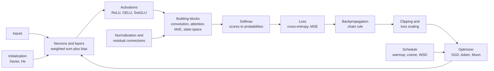
*Figure G.7: One training step, as a loop of equations. The forward pass runs from the inputs to the loss, backpropagation runs back, and the optimizer updates the weights for the next step.*

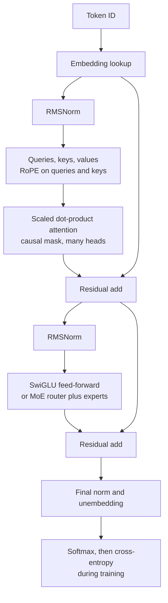
*Figure G.8: Which equations in this section make up a 2026 decoder-only Transformer. The middle part, from the first RMSNorm to the second residual add, repeats once per layer.*

### Artificial neuron (weighted sum plus bias)

**What it does:** Combines several inputs into one number and passes it through an activation function; it is the basic unit of every neural network.

`z = w_1 × x_1 + w_2 × x_2 + ... + w_n × x_n + b = w · x + b`

`y = f(z)`

- **x_1 ... x_n**: the inputs (together, the vector x)
- **w_1 ... w_n**: the weights, one per input (the vector w), learned in training
- **b**: the bias, a learned number added at the end
- **w · x**: the dot product of the weights and the inputs
- **z**: the weighted sum, before the activation
- **f**: the activation function (the entries below)
- **y**: the neuron's output

**In plain words:** Multiply each input by how much the neuron cares about it, add the products, shift by the bias, then bend. With no bend this is linear regression; with a sigmoid bend it is logistic regression.

**Tiny example:** Chapter 12's beach decision: inputs [1, 0.8, 1], weights [2, 1, −3], bias 0.5. z = 2 × 1 + 1 × 0.8 + (−3) × 1 + 0.5 = 0.3, and sigmoid(0.3) = 0.574, a slight yes.

**Where it is used:** Every neural network, from the 1943 McCulloch-Pitts unit to each hidden unit in a frontier LLM's feed-forward blocks.
**In the book:** Chapter 12 (The artificial neuron; Should I go to the beach?); Appendix B (Weighted sum).

### Dense layer and multilayer perceptron (fully connected layer)

**What it does:** Runs many neurons on the same inputs at once as one matrix multiplication, and stacks such layers into a network.

`h = f(W × x + b)`, with W of shape m × n

`batched: H = f(X × W^T + b)`

`multilayer perceptron: y = f_L(... f_2(f_1(x)))`

`parameters = m × n + m`

- **x**: the input vector, n numbers
- **W**: the weight matrix, m rows (one per neuron) by n columns (one per input)
- **b**: the bias vector, one number per neuron
- **f**: the activation, applied to each entry separately
- **h**: the layer's output, m numbers
- **X**: a batch of B inputs stacked as rows (shape B × n)
- **W^T**: W transposed (rows become columns, Chapter 5), so the shapes line up
- **H**: the batch of outputs (shape B × m)
- **f_1 ... f_L**: the L layers in order, each with its own weights, biases and activation
- **m × n + m**: the weights plus the biases

**In plain words:** Each row of W holds one neuron's weights, so one matrix multiplication computes every neuron's sum at once. Without a bend between layers, a stack collapses into a single straight-line step (Appendix B, Linear steps collapse).

**Tiny example:** Chapter 12's ice-cream network: W has rows [0.5, 0.25] and [−0.5, 0.5], x = [1, 2], b = [0, 0]. W × x = [0.5 × 1 + 0.25 × 2, −0.5 × 1 + 0.5 × 2] = [1.0, 0.5], and ReLU keeps both. The whole 2 → 2 → 1 network has (2 × 2 + 2) + (2 × 1 + 1) = 6 + 3 = 9 parameters.

**Where it is used:** Multilayer perceptrons, classifier heads and every projection inside a Transformer; it is why AI hardware is built around matrix multiplication.
**In the book:** Chapter 12 (Layers, width and depth; Counting parameters; The forward pass: a layer is one matrix multiplication); Appendix B (One layer; Parameters in a dense layer).

### Step activation and the perceptron learning rule

**What it does:** Gives a hard yes-or-no answer, and nudges the weights whenever that answer is wrong.

`step(z) = 1 if z ≥ 0, else 0`

`w ← w + η × (y − ŷ) × x`

`b ← b + η × (y − ŷ)`

- **z**: the neuron's weighted sum
- **ŷ** (y-hat): the perceptron's answer, step(z)
- **y**: the correct answer, 0 or 1
- **η** (eta): the learning rate, the size of each nudge
- **x, w, b**: the inputs, weights and bias
- **←**: "is replaced by"

**In plain words:** A right answer changes nothing; a wrong one pushes every weight on an active input toward the correct side. Rosenblatt's 1958 rule finds a separating line whenever one exists but cannot learn XOR, and the step's zero slope is why gradient training needed smooth activations. The ±1 form of the rule and its bound on how many mistakes it can make are in the classical-machine-learning section.

**Tiny example:** w = [0.5, 0.5], b = −0.2, η = 0.5, input x = [1, 0] whose correct answer is 0. z = 0.5 − 0.2 = 0.3, so ŷ = 1: wrong, and y − ŷ = −1. New w = [0.5 + 0.5 × (−1) × 1, 0.5 + 0.5 × (−1) × 0] = [0, 0.5]; new b = −0.2 − 0.5 = −0.7. Now z = 0 − 0.7 = −0.7, so ŷ = 0: fixed.

**Where it is used:** The historical origin of neural networks, still taught in AIMA and Goodfellow; the threshold-plus-surrogate-gradient idea survives in binarized networks and spiking networks.
**In the book:** Chapter 7 (The perceptron: a machine that learns, worked by hand); Chapter 12 (A little history: from logic units to the perceptron; What one neuron can and cannot do).

> **Definition — Binarized neural network:** A network whose weights and activations are restricted to two values, such as −1 and +1, so it can run with very cheap arithmetic. It is trained by pretending, in the backward pass only, that its step functions have a smooth slope.

> **Definition — Surrogate gradient:** A made-up smooth slope used in the backward pass in place of the true slope of a step-like function, which is zero almost everywhere, so that gradient descent can still train the network.

### Sigmoid (logistic function)

**What it does:** Squeezes any number into the range 0 to 1.

`sigmoid(z) = 1 ÷ (1 + exp(−z))`

`slope = sigmoid(z) × (1 − sigmoid(z))`, largest (0.25) at z = 0

- **z**: the input
- **exp(−z)**: e (about 2.718) raised to the power −z
- **slope**: the derivative, how much the output changes per unit change in z

**In plain words:** Big positive inputs give nearly 1, big negative ones nearly 0, and 0 gives exactly 0.5, so the output reads as a probability or as a valve setting. Its slope is never more than 0.25 and almost zero in the flat tails, which is the root of the vanishing-gradient problem in deep sigmoid stacks.

**Tiny example:** sigmoid(2) = 1 ÷ (1 + exp(−2)) = 1 ÷ (1 + 0.135) = 0.881. The slope there is 0.881 × (1 − 0.881) = 0.881 × 0.119 = 0.105, well under the 0.25 maximum.

**Where it is used:** Yes/no output layers, the gates of LSTMs and GRUs, the output gate in Qwen's gated attention, DeepSeek-V3's router scores, and inside SiLU and SwiGLU.
**In the book:** Chapter 12 (Should I go to the beach?; The activation function gallery); Chapter 13 (Vanishing and exploding gradients); Chapter 14 (Gate definition); Appendix B (Sigmoid; derivative table).

### Tanh (hyperbolic tangent)

**What it does:** Squeezes any number into the range −1 to 1, centered on zero.

`tanh(z) = (exp(z) − exp(−z)) ÷ (exp(z) + exp(−z)) = 2 × sigmoid(2 × z) − 1`

`slope = 1 − tanh(z)^2`, largest (1) at z = 0

- **z**: the input
- **exp(z), exp(−z)**: e raised to the power z and to the power −z
- **sigmoid**: the function in the previous entry

**In plain words:** Tanh is a sigmoid stretched to run from −1 to 1, so its outputs average around zero and the next layer gets balanced inputs. Its slope reaches 1 at the center, four times the sigmoid's best, but it still flattens out in the tails.

**Tiny example:** tanh(1) = (2.718 − 0.368) ÷ (2.718 + 0.368) = 2.350 ÷ 3.086 = 0.762. The sigmoid form agrees: 2 × sigmoid(2) − 1 = 2 × 0.881 − 1 = 0.762. The slope is 1 − 0.762^2 = 1 − 0.580 = 0.420.

**Where it is used:** Plain RNN updates and the candidate memory and output of LSTMs; the fast approximation of GELU; logit soft-capping (Gemma 2) and Dynamic Tanh (DyT) reuse it as a smooth limiter.
**In the book:** Chapter 12 (The activation function gallery) and Chapter 14 (Recurrent neural networks) give its shape and values in words; the formula is only here.

### ReLU and its variants (leaky ReLU, PReLU, ELU, SELU, squared ReLU, maxout)

**What it does:** Passes positive numbers through and blocks negative ones, with variants that let a little negative signal through, curve smoothly or learn their own bend.

`ReLU(z) = max(0, z)`, with slope 0 for z < 0 and 1 for z > 0

`LeakyReLU(z) = max(α × z, z)`, with α ≈ 0.01

`ELU(z) = z if z > 0, else α × (exp(z) − 1)`

`SELU(z) = λ × ELU(z)`, with fixed `α ≈ 1.6733` and `λ ≈ 1.0507`

`ReLU²(z) = max(0, z)^2`

`maxout(x) = max over j = 1 to k of (w_j · x + b_j)`

- **z**: the input
- **max(a, b)**: the larger of a and b
- **α** (alpha): the small negative-side slope (fixed in leaky ReLU, learned in PReLU) or, in ELU, the depth of the negative curve (often 1)
- **exp(z)**: e raised to the power z
- **λ** (lambda): SELU's fixed output scale
- **x**: the input vector of a maxout unit; **w_j, b_j**: the weights and bias of its piece j; **k**: how many pieces it has

**In plain words:** ReLU is the cheapest possible bend, and it never flattens for positive inputs, so learning signals pass through active units at full strength. A unit whose sum is always negative outputs 0 forever and stops learning (a dead ReLU), so leaky ReLU and PReLU keep a small slope for negatives and ELU curves smoothly down to −α. Squared ReLU (from the 2021 Primer paper) squares the positive part. SELU scales ELU by constants chosen so that, with LeCun initialization, a stack of layers pulls its activations toward mean 0 and spread 1 on its own (self-normalizing networks, Klambauer and colleagues, 2017). Maxout (Goodfellow and colleagues, 2013) learns its own bend: it computes k straight-line pieces and keeps the largest, so ReLU is the two-piece case max(w · x + b, 0).

**Tiny example:** At z = −2: ReLU gives 0, leaky ReLU gives max(−0.02, −2) = −0.02, and ELU with α = 1 gives exp(−2) − 1 = 0.135 − 1 = −0.865. At z = 3: ReLU gives 3 and squared ReLU gives 9. SELU at z = −1 gives 1.0507 × 1.6733 × (0.368 − 1) = −1.111, and its floor for very negative inputs is −1.0507 × 1.6733 = −1.758. A maxout unit with three pieces on x = [1, 2], weights [1, 0], [0, 1] and [−1, 1] and biases 0, −1 and 0.5, computes 1, 1 and 1.5 and outputs 1.5.

**Where it is used:** The default in CNNs from AlexNet (2012) through ResNet, and in the original Transformer's feed-forward block; leaky ReLU in GAN discriminators and graph attention networks; squared ReLU in NVIDIA's Nemotron-4 and the NanoGPT speedrun; SELU in self-normalizing fully connected networks; maxout in 2013-era vision networks and as the textbook example of a learned activation (Goodfellow, Bengio and Courville, Deep Learning, section 6.3).
**In the book:** Chapter 12 (Solving XOR with two bent neurons; The activation function gallery; the worked backpropagation through ReLU gates); Chapter 14 (ReLU definition); Appendix B (ReLU; derivative table). ELU, PReLU, SELU, squared ReLU and maxout are only here.

> **Definition — ELU (Exponential Linear Unit):** A ReLU variant that keeps positive inputs unchanged but curves negative inputs smoothly down toward a floor of −α instead of cutting them to zero.

> **Definition — PReLU (Parametric ReLU):** A leaky ReLU whose small negative-side slope is learned during training instead of being fixed in advance.

> **Definition — Squared ReLU:** An activation that applies ReLU and then squares the result, giving zero for negative inputs and a parabola for positive ones.

> **Definition — SELU (scaled exponential linear unit):** An ELU multiplied by fixed constants (about 1.0507, with a negative-side depth of about 1.6733) chosen so that a deep fully connected network keeps its activations near mean 0 and spread 1 without a normalization layer.

> **Definition — Maxout unit:** A neuron that computes several separate weighted sums of the same inputs and outputs the largest one, so the shape of its bend is learned rather than fixed.

> **Definition — Dead neuron (dead ReLU):** A ReLU unit whose weighted sum has become negative for every input, so it always outputs 0, receives zero gradient and stops learning.

### Softplus (smooth, always-positive ReLU)

**What it does:** Turns any number into a positive number, smoothly.

`softplus(z) = ln(1 + exp(z))`

`slope = sigmoid(z)`

`sharpened form: (1 ÷ β) × ln(1 + exp(β × z))`

- **z**: the input
- **ln**: the natural logarithm
- **exp(z)**: e raised to the power z
- **β** (beta): a sharpness setting; a larger β brings the curve closer to ReLU

**In plain words:** For large positive z, softplus is almost exactly z; for large negative z it is a tiny positive number. It never reaches zero and has no kink, which makes it the standard way to turn an unconstrained network output into something that must be positive, such as a step size, a rate or a standard deviation. Its slope is exactly the sigmoid.

**Tiny example:** softplus(0) = ln(2) = 0.693. softplus(2) = ln(1 + 7.389) = ln(8.389) = 2.127, a little above 2. softplus(−2) = ln(1 + 0.135) = 0.127, small but positive. The slope at 2 is sigmoid(2) = 0.881.

**Where it is used:** Mamba's input-dependent step size (Δ = softplus of a projection of the token), decay settings in Mamba-2 and Gated DeltaNet layers, positive variance outputs in probabilistic heads, and inside the Mish activation.
**In the book:** Only here.

> **Definition — Softplus:** The activation ln(1 + exp(z)), a smooth version of ReLU whose output is always positive. Networks use it to produce numbers that must stay above zero, such as step sizes.

### GELU (Gaussian error linear unit)

**What it does:** A smooth version of ReLU that scales each input by how likely a bell-curve value is to fall below it.

`GELU(z) = z × Φ(z) = 0.5 × z × (1 + erf(z ÷ sqrt(2)))`

`fast approximation: 0.5 × z × (1 + tanh(sqrt(2 ÷ π) × (z + 0.044715 × z^3)))`

- **z**: the input
- **Φ(z)** (capital phi): the probability that a standard bell-curve random number is less than z
- **erf**: the Gaussian error function, a standard library function; Φ(z) = 0.5 × (1 + erf(z ÷ sqrt(2)))
- **π** (pi): about 3.14159
- **tanh**: the hyperbolic tangent (above)

**In plain words:** Big positive inputs pass through almost unchanged (Φ is near 1), big negative ones are nearly zeroed (Φ is near 0), and in between the input is scaled down smoothly, so the curve dips slightly below zero, to about −0.17. The tanh form is a cheaper approximation, the one GPT-2's code used.

**Tiny example:** Φ(1) = 0.841, so GELU(1) = 1 × 0.841 = 0.841, and GELU(−1) = −1 × Φ(−1) = −1 × 0.159 = −0.159. The fast form for z = 1: sqrt(2 ÷ π) = 0.798; 0.798 × (1 + 0.044715) = 0.834; tanh(0.834) = 0.682; 0.5 × 1 × (1 + 0.682) = 0.841, matching to three decimals.

**Where it is used:** BERT, GPT-2 and GPT-3, ViT and many vision Transformers; its gated form, GEGLU, is used in Google's Gemma models.
**In the book:** Chapter 12 (The activation function gallery) gives its shape and two values; the formula is only here.

> **Definition — Standard normal cumulative distribution (Φ):** The function that gives, for a number z, the probability that a random draw from the standard bell curve (mean 0, standard deviation 1) is less than z. Φ(0) = 0.5 and Φ(1) ≈ 0.841.

> **Definition — Error function (erf):** A standard mathematical function tied to the bell curve and available in every math library; the bell-curve probability Φ(z) equals 0.5 × (1 + erf(z ÷ sqrt(2))).

### SiLU / Swish (with hard-swish and Mish)

**What it does:** Multiplies the input by its own sigmoid, giving a smooth ReLU-like curve.

`SiLU(z) = z × sigmoid(z)`

`Swish_β(z) = z × sigmoid(β × z)`

`slope of SiLU = sigmoid(z) × (1 + z × (1 − sigmoid(z)))`

`hard-swish(z) = z × ReLU6(z + 3) ÷ 6` and `Mish(z) = z × tanh(softplus(z))`

- **z**: the input
- **sigmoid, tanh, softplus**: the functions above
- **β** (beta): a sharpness setting; β = 1 gives SiLU
- **ReLU6(u)**: min(max(0, u), 6), a ReLU capped at 6

**In plain words:** The sigmoid acts as a soft switch that the input sets for itself: large positive inputs switch it fully on, large negative ones switch it off, and in between the curve dips slightly below zero, to about −0.28. Hard-swish replaces the sigmoid with straight-line pieces that are cheap on phones; Mish is a slightly smoother cousin.

**Tiny example:** SiLU(2) = 2 × 0.881 = 1.762 and SiLU(−2) = −2 × 0.119 = −0.238. The slope at 0 is 0.5 × (1 + 0) = 0.5. Hard-swish(1) = 1 × ReLU6(4) ÷ 6 = 4 ÷ 6 = 0.667. Mish(1) = 1 × tanh(softplus(1)) = tanh(1.313) = 0.865.

**Where it is used:** The gate inside SwiGLU in Llama, Qwen, DeepSeek, Mistral and Kimi models; EfficientNet; the activation in Mamba blocks; hard-swish in MobileNetV3 and Mish in YOLOv4.
**In the book:** Chapter 12 (The activation function gallery); Chapter 15 (Step 6: the worked SwiGLU unit, Swish(2) = 1.762). Swish with β, hard-swish and Mish are only here.

> **Definition — Hard-swish:** A cheap stand-in for SiLU built from straight-line pieces, z × ReLU6(z + 3) ÷ 6, used in phone-sized networks such as MobileNetV3.

> **Definition — Mish:** A smooth activation, z × tanh(softplus(z)), similar in shape to SiLU; the YOLOv4 object detector used it.

### Gated linear units (GLU, ReGLU, GEGLU, SwiGLU)

**What it does:** Projects the input two ways and lets one projection act as a learned volume knob on the other.

`GLU(x) = (x × W + b) ⊙ sigmoid(x × V + c)`

`SwiGLU(x) = SiLU(x × W) ⊙ (x × V)`

`GEGLU(x) = GELU(x × W) ⊙ (x × V)` and `ReGLU(x) = ReLU(x × W) ⊙ (x × V)`

- **x**: the input vector, written as a row
- **W, V**: two learned weight matrices of the same shape
- **b, c**: learned bias vectors (the modern variants drop them)
- **⊙**: element-wise product, multiplying matching entries, so [1, 2] ⊙ [3, 4] = [3, 8] (Chapter 5)
- **sigmoid, SiLU, GELU, ReLU**: the activations above

**In plain words:** One branch goes through an activation and becomes a gate; the other is a plain projection; multiplying them entry by entry lets each hidden unit decide how much of its signal to let through. Dauphin and colleagues introduced GLU in 2017, and Shazeer (2020) tested the variants and found SwiGLU and GEGLU worked best inside Transformers.

**Tiny example:** For one hidden unit, let the activation branch give 2 and the plain branch give 0.5. SwiGLU: SiLU(2) × 0.5 = 1.762 × 0.5 = 0.881. GEGLU: GELU(2) × 0.5 = 1.954 × 0.5 = 0.977. ReGLU: 2 × 0.5 = 1.0. The original GLU, with 0.5 as its plain branch and 2 inside its sigmoid gate: 0.5 × 0.881 = 0.440.

**Where it is used:** SwiGLU is the feed-forward non-linearity of Llama 1 to 4, Qwen, DeepSeek, Mistral, Kimi and gpt-oss models and the activation inside each mixture-of-experts expert; GEGLU is used in Gemma.
**In the book:** Chapter 15 (Step 6: SwiGLU definition and worked unit); Chapter 12 (SiLU definition). GLU, ReGLU and GEGLU by name are only here.

> **Definition — GLU (gated linear unit):** A layer that computes two projections of its input and multiplies them entry by entry, with one of them passed through an activation so that it acts as a gate. SwiGLU and GEGLU are GLUs whose gates use SiLU and GELU.

### Softmax (with the stable form, log-softmax and its slopes)

**What it does:** Turns a list of scores into probabilities that are positive and add up to 1.

`p_i = exp(z_i) ÷ (sum over j of exp(z_j))`

`stable form: p_i = exp(z_i − max(z)) ÷ (sum over j of exp(z_j − max(z)))`

`log-softmax: ln(p_i) = z_i − logsumexp(z)`, where `logsumexp(z) = max(z) + ln(sum over j of exp(z_j − max(z)))`

`slopes: ∂p_i ÷ ∂z_j = p_i × (δ_ij − p_j)`

- **z_i**: the score (logit) for option i; z is the whole list
- **p_i**: the probability given to option i
- **j**: runs over all the options
- **max(z)**: the largest score
- **logsumexp(z)**: the log of the sum of the exponentials, computed safely
- **∂p_i ÷ ∂z_j**: the slope of p_i when score z_j alone is nudged (a partial derivative)
- **δ_ij** (Kronecker delta): 1 when i = j, otherwise 0

**In plain words:** Raising e to each score makes everything positive and exaggerates the differences, and dividing by the total makes the results add up to 1. Subtracting the largest score first changes nothing mathematically but stops exp() from overflowing. Raising one score raises its own probability and lowers all the others, which is what the slope formula says. (Sampling temperature is in the large-language-model section.)

**Tiny example:** Scores [2, 1, 0.1]. Subtract the largest: [0, −1, −1.9]; the exponentials are 1, 0.368 and 0.150, total 1.517; the probabilities are 0.659, 0.242 and 0.099, the same as without the shift. logsumexp = 2 + ln(1.517) = 2.417, so ln(p_1) = 2 − 2.417 = −0.417, which is ln(0.659). Slopes: ∂p_1 ÷ ∂z_1 = 0.659 × (1 − 0.659) = 0.225 and ∂p_1 ÷ ∂z_2 = 0.659 × (0 − 0.242) = −0.160.

**Where it is used:** The output of every classifier and LLM, the attention weights in every Transformer, and mixture-of-experts routers.
**In the book:** Chapter 12 (Softmax: turning scores into probabilities); Chapter 15 (Step D: softmax; Step 9: From vectors back to words); Appendix B (Softmax; Shift makes no difference). Log-softmax and the slope formula are only here.

> **Definition — Logsumexp:** The log of a sum of exponentials, ln(exp(z_1) + exp(z_2) + ...), computed safely by pulling the largest value out first. It is the softmax's normalizing total, written as a log.

> **Definition — Log-softmax:** The natural log of softmax probabilities, computed directly as each score minus the logsumexp of all the scores, which avoids taking the log of a probability that has rounded to zero.

> **Definition — Kronecker delta (δ_ij):** A shorthand that equals 1 when its two indices are the same and 0 when they differ.

### Mean squared error (MSE)

**What it does:** Measures how far numeric predictions are from their targets, punishing big misses most.

`MSE = (1 ÷ n) × sum over i of (ŷ_i − y_i)^2`

`slope for ŷ_i = 2 × (ŷ_i − y_i) ÷ n`

- **ŷ_i** (y-hat): the prediction for example i
- **y_i**: the target for example i
- **n**: the number of examples

**In plain words:** Square every error so that it is positive and big errors count extra, then average. Minimizing it is the same as maximum likelihood when the noise is bell-shaped. Many texts use 0.5 × error^2 for a single example so that the slope is simply the error, as Chapter 12 does.

**Tiny example:** Predictions [3, 5, 2], targets [2, 5, 4]. Errors 1, 0 and −2; squares 1, 0 and 4; MSE = 5 ÷ 3 = 1.667. The slope for the first prediction is 2 × 1 ÷ 3 = 0.667, so lowering that prediction lowers the loss.

**Where it is used:** Regression heads, value-function training, the noise-prediction loss of diffusion models, feature and hidden-state distillation, and autoencoders.
**In the book:** Chapter 12 (Squared error, for predicting numbers); Chapters 8 and 9; Appendix B (Mean squared error; Squared-error slope).

### Mean absolute error and Huber loss (smooth L1)

**What it does:** Measures numeric error in ways that let outliers pull less than squared error does.

`MAE = (1 ÷ n) × sum over i of |ŷ_i − y_i|`

`Huber_δ(a) = 0.5 × a^2 if |a| ≤ δ, else δ × (|a| − 0.5 × δ)`, with `a = ŷ − y`

- **ŷ_i, y_i, n**: prediction, target and number of examples, as for MSE
- **|a|**: the absolute value of a (drop any minus sign)
- **a**: one example's error
- **δ** (delta): the threshold where Huber loss switches from squared growth to straight-line growth

**In plain words:** MAE grows in a straight line with the error, so one wild example cannot dominate the average. Huber loss behaves like squared error for small errors, giving smooth, gentle slopes near zero, and like absolute error for big ones, which keeps it robust to outliers. Smooth L1 is Huber loss with δ = 1 (some libraries also divide by δ). MAE as an evaluation score is in the classical-machine-learning section; here it appears as a training loss (the L1 loss).

**Tiny example:** Errors [1, 0, −2, 10], the last one an outlier. MAE = (1 + 0 + 2 + 10) ÷ 4 = 3.25. MSE = (1 + 0 + 4 + 100) ÷ 4 = 26.25, dominated by the outlier. Huber with δ = 1 gives 0.5, 0, 1 × (2 − 0.5) = 1.5 and 1 × (10 − 0.5) = 9.5, an average of 11.5 ÷ 4 = 2.875.

**Where it is used:** Bounding-box regression in Fast and Faster R-CNN (smooth L1), the clipped temporal-difference loss in DQN, robust regression and some image-restoration models (L1).
**In the book:** Chapter 8 (Measuring wrongness: the loss function) and Chapter 9 (Measuring models that predict numbers) work MAE through; Huber loss is only here.

> **Definition — Huber loss (smooth L1 loss):** A loss that is squared for small errors and grows in a straight line for large ones, combining smooth training with resistance to outliers.

### Cross-entropy loss for classification (negative log-likelihood)

**What it does:** Measures how surprised a classifier is by the correct answer.

`L = −sum over k of y_k × ln(p_k)`

`with one correct class: L = −ln(p_correct) = −z_correct + logsumexp(z)`

`batch loss = the mean of L over the examples`

- **k**: runs over the classes
- **y_k**: the target probability for class k (1 for the right class and 0 elsewhere, unless smoothed)
- **p_k**: the model's softmax probability for class k
- **z**: the logits fed into the softmax; z_correct is the right class's logit
- **logsumexp**: defined in the softmax entry

**In plain words:** With a one-hot target only the correct class's term survives, so the loss is minus the log of the probability the model gave the truth: near 0 if it was confident and right, large if it was confident and wrong. Libraries compute it straight from the logits with logsumexp, which never takes the log of a probability that has rounded to zero. (Its language-model form and perplexity are in the large-language-model section.)

**Tiny example:** Logits Paris 5, Lyon 2, "the" 1, and the right answer is Paris. logsumexp = 5 + ln(1 + exp(−3) + exp(−4)) = 5 + ln(1.068) = 5.066, so the loss is −5 + 5.066 = 0.066, the same as −ln(0.936).

**Where it is used:** Image classifiers and every LLM's next-token pretraining and fine-tuning loss.
**In the book:** Chapter 12 (Cross-entropy, for choosing between options); Chapter 19 (Measuring surprise: the loss); Appendix B (Cross-entropy, one token and whole text). The logsumexp form is only here.

### Binary cross-entropy (log loss) from a logit

**What it does:** The cross-entropy loss for a single yes-or-no prediction.

`L = −(y × ln(p) + (1 − y) × ln(1 − p))`, with `p = sigmoid(z)`

`stable form, straight from the logit: L = max(z, 0) − z × y + ln(1 + exp(−|z|))`

`class-weighted form: L = −(w_pos × y × ln(p) + (1 − y) × ln(1 − p))`

- **y**: the target, 0 or 1
- **p**: the predicted probability of "yes"
- **z**: the logit, the raw score before the sigmoid
- **|z|**: the absolute value of z
- **w_pos**: an extra weight on the positive class, often the ratio of negative to positive examples (PyTorch calls it pos_weight)

**In plain words:** If the true answer is yes, the loss is −ln(p); if no, it is −ln(1 − p). The stable form gives the same number without ever computing a probability that might round to exactly 0 or 1. For multi-label problems (several independent yes/no questions at once) it is applied to each label and summed, and a weight on the positive class handles imbalance.

**Tiny example:** z = 2, so p = 0.881. If y = 1: L = −ln(0.881) = 0.127, and the stable form gives 2 − 2 × 1 + ln(1 + exp(−2)) = 0 + 0.127 = 0.127. If y = 0: L = −ln(0.119) = 2.127, and the stable form gives 2 − 0 + 0.127 = 2.127. With w_pos = 3, the y = 1 loss triples to 3 × 0.127 = 0.381.

**Where it is used:** Yes/no and multi-label classifiers, click-through prediction heads, GAN discriminators, and the per-pair sigmoid loss of SigLIP-style image-text models.
**In the book:** Chapter 8 (Cross-entropy: the loss for categories, the spam case) and Chapter 12 (Exercise 10's code); the stable form is only here.

> **Definition — Binary cross-entropy:** The loss for a yes-or-no prediction: minus the log of the probability the model gave to what actually happened. Multi-label models apply it once per label.

### Label smoothing

**What it does:** Softens the answer key so a classifier is never trained toward 100% certainty.

`y_smooth_k = (1 − ε) × y_k + ε ÷ K`

- **y_k**: the original target for class k (1 for the right class, 0 for the others)
- **ε** (epsilon): the smoothing amount, typically 0.1
- **K**: the number of classes
- **y_smooth_k**: the softened target used in the cross-entropy loss

**In plain words:** The one-hot answer is blended with an even spread over all K classes. The model can then never drive its loss to zero by pushing one probability to exactly 1, which curbs overconfidence and often helps it generalize.

**Tiny example:** K = 10 and ε = 0.1. The right class gets 0.9 × 1 + 0.1 ÷ 10 = 0.91, and each of the other nine gets 0.9 × 0 + 0.01 = 0.01. Check: 0.91 + 9 × 0.01 = 1.

**Where it is used:** Inception-v3 (2016), the original Transformer (ε = 0.1) and most modern image-classification recipes; it is rarely used in LLM pretraining.
**In the book:** Chapter 13 (The regularization toolkit) works this example in words; the general formula is only here.

### Focal loss

**What it does:** Down-weights examples the model already gets right, so training concentrates on the hard ones.

`FL = −α_t × (1 − p_t)^γ × ln(p_t)`, where `p_t = p if y = 1, else 1 − p`

- **p**: the predicted probability of the positive class
- **y**: the target, 0 or 1
- **p_t**: the probability the model gave to the true answer
- **γ** (gamma): the focusing power; γ = 0 gives back weighted cross-entropy
- **α_t** (alpha): a class-balancing weight, α for positives and 1 − α for negatives

**In plain words:** This is cross-entropy multiplied by (1 − p_t)^γ, a factor that is tiny when the model is already confident and right. In object detection, where almost every candidate box is easy background, this stops the easy examples from drowning out the rare hard ones. RetinaNet used γ = 2 and α = 0.25.

**Tiny example:** γ = 2 and α_t = 0.25, for two positive examples. An easy one with p_t = 0.9: cross-entropy 0.105, factor (0.1)^2 = 0.01, focal loss 0.25 × 0.01 × 0.105 = 0.00026. A hard one with p_t = 0.1: cross-entropy 2.303, factor 0.9^2 = 0.81, focal loss 0.25 × 0.81 × 2.303 = 0.466. The easy example's loss falls from about 1/22 of the hard one's to about 1/1,800.

**Where it is used:** Dense object detectors (RetinaNet, 2017, and many later detectors), class-imbalanced segmentation and medical imaging.
**In the book:** Appendix F (Focal loss) works the (1 − p)^2 factor; the α_t weight is only here.

### Dice loss (soft Dice) for segmentation

**What it does:** Scores how well a predicted mask overlaps the true mask, in a way that is not swamped by the background.

`Dice = (2 × sum over i of p_i × g_i + ε) ÷ (sum over i of p_i + sum over i of g_i + ε)`

`L_Dice = 1 − Dice`

- **i**: runs over the pixels (or the voxels of a 3-D scan)
- **p_i**: the predicted probability that pixel i belongs to the object
- **g_i**: the true mask, 1 inside the object and 0 outside
- **ε** (epsilon): a small constant that avoids dividing by zero on empty masks
- **Dice**: the overlap score, 1 for a perfect match and 0 for none

**In plain words:** Twice the overlap, divided by the total size of both masks: a soft version of the Dice coefficient, which is the F1 score computed over pixels. It looks only at the object and the prediction, so a tiny tumor in a huge scan counts as much as a large one, whereas per-pixel cross-entropy is dominated by the easy background. V-Net (Milletari and colleagues, 2016) introduced it with squared terms in the denominator, and it is usually added to cross-entropy or focal loss.

**Tiny example:** Four pixels with predictions [0.9, 0.8, 0.1, 0.2] and truth [1, 1, 0, 0]: the overlap is 0.9 + 0.8 = 1.7 and the totals are 2.0 and 2, so Dice = 3.4 ÷ 4 = 0.85 and the loss is 0.15. Now a 100-pixel image whose object is a single pixel, and a model that predicts 0.01 everywhere: the average binary cross-entropy is only 0.056, which looks fine, but Dice = (2 × 0.01) ÷ (1 + 1) = 0.01, a loss of 0.99 that shows the object was missed.

**Where it is used:** Medical-image segmentation (nnU-Net trains with Dice plus cross-entropy) and Meta's Segment Anything models, which supervise their masks with a mix of focal loss and Dice loss.
**In the book:** Chapter 45 (Segmentation: "which pixels?"; Segment Anything: one model that cuts out anything) describes segmentation in words; the loss is only here.

> **Definition — Dice coefficient (Dice loss):** A measure of overlap between two masks: twice their shared area divided by their total area. One minus a soft version of it is a common training loss for segmentation.

### Contrastive pair loss and triplet loss (margin-based metric learning)

**What it does:** Trains an embedding network so that similar things land close together and different things land far apart.

`pair loss: L = y × d^2 + (1 − y) × max(0, m − d)^2`, with `d = distance(f(x_1), f(x_2))`

`triplet loss: L = max(0, distance(f(a), f(p))^2 − distance(f(a), f(n))^2 + margin)`

- **f**: the embedding network, which turns an input into a vector
- **x_1, x_2**: a pair of inputs
- **y**: 1 if the pair is similar (for example the same person), 0 if not
- **d**: the distance between the two embeddings
- **m**: the margin, how far apart a dissimilar pair must be
- **a, p, n**: an anchor, a positive (same identity as the anchor) and a negative (a different identity)
- **margin**: the required gap in the triplet loss (FaceNet used 0.2)
- **max(0, ...)**: zero once the condition is met, so finished cases stop costing anything

**In plain words:** The pair loss (Hadsell, Chopra and LeCun, 2006, often written with an extra factor of 0.5) pulls similar pairs together and pushes dissimilar pairs apart until they are at least m apart, then stops caring about them. The triplet loss only asks that the anchor sit closer to the positive than to the negative by the margin; some versions, such as Sentence-BERT's, use plain rather than squared distances. Batch-wide contrastive losses such as InfoNCE and CLIP's are in the generative and contrastive section.

**Tiny example:** Triplet: anchor-to-positive distance 0.5, anchor-to-negative 0.6, margin 0.2: max(0, 0.25 − 0.36 + 0.2) = 0.09, a small push. Had the negative been 1.0 away: max(0, 0.25 − 1.0 + 0.2) = 0, nothing to do. Pair loss with m = 1: a similar pair 0.5 apart costs 0.5^2 = 0.25; a dissimilar pair 0.5 apart costs (1 − 0.5)^2 = 0.25; a dissimilar pair 1.5 apart costs 0.

**Where it is used:** Face recognition (FaceNet, 2015), Siamese verification networks, image retrieval, and sentence-embedding training (Sentence-BERT's triplet objective).
**In the book:** Chapter 45 (face embedding definition) and Chapter 16 (Contrastive learning and CLIP) describe the pull-together, push-apart idea in words; the formulas are only here.

> **Definition — Metric learning:** Training an embedding so that distances between vectors mean something, with similar items close together and different items far apart, for example two photos of the same face.

> **Definition — Triplet loss:** A metric-learning loss on groups of three: it is zero once an anchor is closer to a matching example than to a non-matching one by a set margin, and positive otherwise.

> **Definition — Siamese network:** Two copies of the same network with shared weights that embed two inputs, so their outputs can be compared, as in face verification ("are these the same person?").

### Backpropagation (the chain rule through layers)

**What it does:** Computes the slope of the loss for every weight in the network in one backward sweep.

`forward: z_l = W_l × a_(l−1) + b_l` and `a_l = f(z_l)`

`at the last layer N: δ_N = (∂L ÷ ∂a_N) ⊙ f'(z_N)`

`each earlier layer: δ_l = (W_(l+1)^T × δ_(l+1)) ⊙ f'(z_l)`

`slopes: ∂L ÷ ∂W_l = δ_l × a_(l−1)^T` and `∂L ÷ ∂b_l = δ_l`

- **l**: the layer number, from 1 up to the last layer N
- **a_l**: layer l's output; a_0 is the input x
- **z_l**: layer l's weighted sums
- **W_l, b_l**: layer l's weights and biases
- **f, f'**: the activation and its slope
- **L**: the loss
- **δ_l** (delta): the blame (error signal) at layer l's sums, the slope ∂L ÷ ∂z_l
- **^T**: transpose
- **⊙**: element-wise product
- **∂L ÷ ∂W_l**: the slope of the loss for every weight in layer l, a matrix the same shape as W_l

**In plain words:** Blame starts at the loss and flows backward. Each layer passes it back through its transposed weights and multiplies it by its activation's slope, and each weight's slope is its neuron's blame times the input that flowed along that weight. This is reverse-mode automatic differentiation, and one backward pass yields every gradient for about twice the cost of the forward pass.

**Tiny example:** Chapter 12's ice-cream network predicts 1.0 for a target of 2 with loss 0.5 × (ŷ − y)^2, so the output blame is δ_2 = 1.0 − 2 = −1 (the output has no activation, slope 1). Back through the output weights [0.5, 1.0]: [0.5 × (−1), 1.0 × (−1)] = [−0.5, −1.0], and both ReLUs are open (slope 1), so δ_1 = [−0.5, −1.0]. The first layer's weight slopes are δ_1 × x^T with x = [1, 2]: rows [−0.5, −1.0] and [−1.0, −2.0], exactly Chapter 12's Step 6.

**Where it is used:** Training every neural network; it is implemented by autograd in PyTorch and JAX.
**In the book:** Chapter 12 (Backpropagation: passing the blame backward; The chain rule as gears; The worked example: one complete forward and backward pass; Checking backpropagation by nudging); Appendix B (Chain rule; Cost of a training step). The layer-by-layer matrix form is only here.

### Gradients of a linear layer (matrix form)

**What it does:** Gives the batched backward pass of one dense layer as three matrix operations.

For `Y = X × W + b`, with X of shape B × n and W of shape n × m:

`∂L ÷ ∂W = X^T × (∂L ÷ ∂Y)`

`∂L ÷ ∂b = sum over the B rows of (∂L ÷ ∂Y)`

`∂L ÷ ∂X = (∂L ÷ ∂Y) × W^T`

- **X**: a batch of B inputs as rows, n numbers each
- **W**: the weights, n × m
- **b**: the bias, m numbers added to every row
- **Y**: the outputs, B × m
- **∂L ÷ ∂Y**: the blame arriving from the layer above, the same shape as Y
- **^T**: transpose

**In plain words:** The weight slopes and the blame passed down to the previous layer are each one matrix multiplication the same size as the forward one. So a training step costs about three forward-sized multiplications per layer: one forward and two backward. That is where "2N forward plus 4N backward", 6N per token, comes from; the compute section works out the FLOP count and the large-language-model section gives the 6 × N × D training-compute estimate.

**Tiny example:** X has rows [1, 2] and [3, 0]; W is the column [2, −1]; the blame from above is 0.5 for row 1 and −1 for row 2. ∂L ÷ ∂W = [1 × 0.5 + 3 × (−1), 2 × 0.5 + 0 × (−1)] = [−2.5, 1.0]. ∂L ÷ ∂b = 0.5 + (−1) = −0.5. ∂L ÷ ∂X: row 1 is 0.5 × [2, −1] = [1.0, −0.5] and row 2 is −1 × [2, −1] = [−2, 1].

**Where it is used:** The backward pass of every dense layer, attention projection and expert, and the basis of the 6 × N × D training-compute estimate.
**In the book:** Chapter 12 (the worked example, Steps 3 and 6; Exercise 10's code); Appendix B (Cost of a training step).

### Gradient of softmax plus cross-entropy (p − y)

**What it does:** Gives the error signal on each logit when a softmax is trained with cross-entropy: simply predicted probability minus target.

`∂L ÷ ∂z_k = p_k − y_k`

`likewise for a sigmoid with binary cross-entropy: ∂L ÷ ∂z = p − y`

- **z_k**: the logit for class k
- **p_k**: the softmax probability for class k
- **y_k**: the target (1 for the correct class, 0 otherwise)
- **L**: the cross-entropy loss

**In plain words:** When softmax and cross-entropy are combined, the messy softmax slopes cancel and the blame on each score is the probability given minus the probability deserved. Too much probability on a wrong class pushes its score down; too little on the right class pushes its score up. The same clean form holds for a sigmoid with binary cross-entropy, and for squared error with a plain linear output (ŷ − y).

**Tiny example:** Scores [2, 1, 0.1] give probabilities [0.659, 0.242, 0.099], and the first class is correct. Gradient: [0.659 − 1, 0.242, 0.099] = [−0.341, 0.242, 0.099]. Check by nudging: raising the first score by 0.001 moves the loss from 0.41703 to 0.41669, a change of −0.00034, a slope of −0.341.

**Where it is used:** The first step of the backward pass in every classifier and LLM; fused cross-entropy kernels compute it directly from the logits to save memory on vocabularies of 100,000 tokens or more.
**In the book:** Chapter 12 (Exercise 10's code uses the binary form, dz2 = (p − y) ÷ len(X)); the softmax form is only here.

### Xavier (Glorot) and LeCun initialization

**What it does:** Picks the spread of a layer's random starting weights so signals keep roughly the same size from layer to layer.

`Xavier: Var(W) = 2 ÷ (n_in + n_out)`

`uniform version: W drawn from U(−sqrt(6 ÷ (n_in + n_out)), +sqrt(6 ÷ (n_in + n_out)))`

`LeCun: Var(W) = 1 ÷ n_in`

- **W**: a layer's starting weights, drawn at random
- **Var(W)**: their variance, the standard deviation squared
- **n_in**: the fan-in, the number of inputs each neuron adds up
- **n_out**: the fan-out, the number of outputs of the layer
- **U(a, b)**: the uniform distribution, every value between a and b equally likely

**In plain words:** The more numbers a neuron adds up, the smaller each starting weight must be, so that the sum stays about the size of one input. Xavier initialization balances the forward pass (fan-in) and the backward pass (fan-out) for tanh and sigmoid networks; LeCun initialization uses the fan-in only. Orthogonal initialization is a common alternative for RNNs.

**Tiny example:** The book's case, 512 inputs and 512 outputs: std = sqrt(2 ÷ 1,024) = 0.044. A GPT-2-small feed-forward layer, 768 in and 3,072 out: Xavier std = sqrt(2 ÷ 3,840) = 0.0228, uniform limit sqrt(6 ÷ 3,840) = 0.0395; LeCun std = sqrt(1 ÷ 768) = 0.0361.

**Where it is used:** Keras's default (glorot_uniform); PyTorch's nn.Linear default draws from U(−1 ÷ sqrt(n_in), +1 ÷ sqrt(n_in)), a fan-in-only rule whose variance, 1 ÷ (3 × n_in), is a third of LeCun's; many LLM configurations instead use a fixed bell-curve spread such as 0.02 (the initializer_range setting).
**In the book:** Chapter 13 (Why the size of the random numbers matters); the uniform version and LeCun initialization are only here.

> **Definition — Fan-in and fan-out:** A layer's fan-in is the number of inputs each of its neurons adds together; its fan-out is the number of outputs it produces. Initialization rules use them to size the random starting weights.

> **Definition — LeCun initialization:** Drawing a layer's random starting weights with variance 1 ÷ fan-in, so that the sum each neuron computes keeps about the same size as its inputs.

> **Definition — Uniform distribution:** A way of drawing random numbers in which every value between a lower and an upper limit is equally likely.

### He (Kaiming) initialization

**What it does:** Sizes random starting weights for ReLU networks, whose activations throw away about half of each signal.

`Var(W) = 2 ÷ n_in`, so `std = sqrt(2 ÷ n_in)`

`general form: std = gain ÷ sqrt(fan)`, with `gain = sqrt(2)` for ReLU and `gain = sqrt(2 ÷ (1 + α^2))` for leaky ReLU

- **W, Var(W), n_in**: as in the previous entry
- **std**: the standard deviation of the starting weights
- **gain**: a factor matched to the activation function
- **fan**: the fan-in (or, in a backward-pass variant, the fan-out)
- **α** (alpha): the leaky ReLU's negative-side slope

**In plain words:** ReLU zeroes about half of its inputs, which halves the size of the signal at every layer. Doubling the LeCun variance makes up for it, so the signal stays steady through deep ReLU stacks (He and colleagues, 2015).

**Tiny example:** 512 inputs: sqrt(2 ÷ 512) = 0.0625. For leaky ReLU with α = 0.01, gain = sqrt(2 ÷ 1.0001) = 1.4141, so std = 1.4141 ÷ sqrt(512) = 1.4141 ÷ 22.63 = 0.0625, practically the same.

**Where it is used:** ResNets and most CNNs (torchvision's convolution initialization) and ReLU multilayer perceptrons.
**In the book:** Chapter 13 (Why the size of the random numbers matters; He initialization definition).

### Mini-batch stochastic gradient descent (SGD)

**What it does:** Estimates the downhill direction from a small random batch of examples and steps every parameter against it.

`g = (1 ÷ B) × sum over i in the batch of ∇_θ ℓ(x_i, y_i; θ)`

`θ ← θ − η × g`

- **θ** (theta): all the parameters, as one long list
- **B**: the batch size, the number of examples per step
- **x_i, y_i**: one example and its target
- **ℓ**: the loss on one example
- **∇_θ**: the gradient, the list of slopes for every parameter
- **g**: the gradient averaged over the batch
- **η** (eta): the learning rate

**In plain words:** Average the slope over a random handful of examples instead of the whole dataset, then step: noisy but cheap. A batch of the whole dataset is plain gradient descent (foundations section), a batch of one is pure SGD, and one pass through the data is an epoch. Gradient accumulation (adding up several small batches' gradients before one step) and the global-batch arithmetic are in the compute section.

**Tiny example:** A batch of two examples gives slopes 4 and 2 for one weight, so g = (4 + 2) ÷ 2 = 3. With θ = 1 and η = 0.1, the new value is 1 − 0.1 × 3 = 0.7.

**Where it is used:** The inner loop of all neural-network training; plain SGD still trains many small models, and every adaptive optimizer below modifies this step.
**In the book:** Chapter 12 (Gradient descent: walking downhill in fog; The training loop: batches, steps and epochs); Chapter 13 (The trouble with plain SGD); Appendix B (Gradient descent step).

### Momentum (heavy ball) and Nesterov momentum

**What it does:** Steps along a running velocity of past gradients, so progress speeds up along consistent slopes and zig-zags cancel.

`v ← μ × v + g`

`θ ← θ − η × v`

`Nesterov, in the form PyTorch uses: θ ← θ − η × (g + μ × v)`, with v already updated

- **v**: the velocity, a decaying running sum of gradients (starts at 0)
- **μ** (mu): the momentum coefficient, typically 0.9
- **g**: the current gradient
- **θ, η**: the parameters and the learning rate

**In plain words:** Keeping 90% of the old velocity each step means a steady slope builds up speed, up to 1 ÷ (1 − μ) = 10 times the plain step, while gradients that flip back and forth mostly cancel. Nesterov's version uses the slope at the point where momentum is about to carry you, which corrects overshoot one step earlier. An equivalent way to write plain momentum is v ← μ × v − η × g, then θ ← θ + v.

**Tiny example:** A constant gradient of 1 with μ = 0.9: the velocity goes 1, 1.9, 2.71, 3.439 and keeps climbing toward 10. With Nesterov, at the second step v = 1.9 but the step uses 1 + 0.9 × 1.9 = 2.71, the velocity plain momentum only reaches one step later.

**Where it is used:** SGD with momentum trained the 2010s image networks (ResNet on ImageNet); momentum is built into Adam, Lion and Muon, and Muon uses the Nesterov form by default (μ = 0.95 in PyTorch).
**In the book:** Chapter 13 (Momentum: a rolling ball); Appendix F (Optimizer variants) describes Nesterov momentum in words, and its formula is only here.

### AdaGrad

**What it does:** Gives each parameter its own step size, shrinking it for parameters that have already had large or frequent gradients.

`G ← G + g^2`

`θ ← θ − η × g ÷ (sqrt(G) + ε)`

- **G**: the running total of squared gradients, one per parameter (starts at 0)
- **g^2**: the gradient squared, entry by entry
- **ε** (epsilon): a tiny number such as 10^-8 that prevents division by zero
- **θ, η**: the parameters and the learning rate

**In plain words:** Each parameter divides its step by the square root of all its past squared gradients. Busy parameters slow down, while rarely updated ones, such as the embedding of an uncommon word, keep bigger steps. Because G only ever grows, every step size shrinks forever, which RMSProp fixes.

**Tiny example:** The gradient is 2 three steps in a row, with η = 0.1. G goes 4, 8, 12, and the steps are 0.1 × 2 ÷ 2 = 0.1, then 0.1 × 2 ÷ 2.828 = 0.071, then 0.1 × 2 ÷ 3.464 = 0.058: shrinking even though the slope has not changed.

**Where it is used:** Sparse features and embedding tables (GloVe was trained with AdaGrad, and a row-wise AdaGrad is common for large recommender embeddings).
**In the book:** Chapter 13 (Adam: a separate stride for every knob) describes it in words; the formula is only here.

> **Definition — AdaGrad:** A 2011 optimizer that divides each parameter's step by the square root of the running total of its squared gradients, so frequently updated parameters slow down. Its steps only ever shrink.

### RMSProp (and Adadelta)

**What it does:** Divides each parameter's step by a fading average of its recent gradient sizes.

`v ← ρ × v + (1 − ρ) × g^2`

`θ ← θ − η × g ÷ (sqrt(v) + ε)`

`Adadelta: Δθ = −(sqrt(u + ε) ÷ sqrt(v + ε)) × g`, then `θ ← θ + Δθ` and `u ← ρ × u + (1 − ρ) × Δθ^2`

- **v**: the moving average of squared gradients, one per parameter (starts at 0)
- **ρ** (rho): the decay rate, 0.9 in Hinton's 2012 lecture and 0.99 by default in PyTorch
- **g, η, ε, θ**: gradient, learning rate, tiny constant and parameters, as before
- **u**: Adadelta's moving average of squared updates (starts at 0)
- **Δθ** (delta theta): Adadelta's update

**In plain words:** RMSProp is AdaGrad with a fading memory: old gradients count less and less, so the step size adapts to the current terrain instead of shrinking to zero. Adam's second running average is exactly this. Adadelta (Zeiler, 2012) keeps the same average but replaces the learning rate with the size of recent updates, sqrt(u + ε), so there is no learning rate to tune; its first steps are tiny, about sqrt(ε) in size.

**Tiny example:** A steady gradient of 2, ρ = 0.9, η = 0.1. v goes 0.4, 0.76, 1.084 on its way to 4, and the steps are 0.316, 0.229 and 0.192, settling toward 0.1 × 2 ÷ 2 = 0.1. The oversized early steps come from v starting at 0, the problem Adam's bias correction fixes. Adadelta with ρ = 0.9, ε = 10^-6 and the same gradient: v = 0.4 and u = 0, so the first update is −(0.001 ÷ 0.632) × 2 = −0.0032.

**Where it is used:** Early deep reinforcement learning (DQN) and RNN training; the direct ancestor of Adam's second moment.
**In the book:** Chapter 13 (Adam: a separate stride for every knob; Figure 13.2, the optimizer family tree) in words; Appendix F (Optimizer variants) describes Adadelta in words; the formulas are only here.

> **Definition — RMSProp:** An optimizer (Geoffrey Hinton, 2012) that divides each parameter's step by the square root of a fading average of its recent squared gradients, so step sizes adapt without shrinking forever.

### Adam (with bias correction)

**What it does:** Combines momentum with a separate, self-adjusting step size for every parameter.

`m ← β_1 × m + (1 − β_1) × g`

`v ← β_2 × v + (1 − β_2) × g^2`

`m̂ = m ÷ (1 − β_1^t)` and `v̂ = v ÷ (1 − β_2^t)`

`θ ← θ − η × m̂ ÷ (sqrt(v̂) + ε)`

- **m**: the moving average of gradients, the momentum (starts at 0)
- **v**: the moving average of squared gradients (starts at 0)
- **β_1, β_2** (beta): their decay rates, by default 0.9 and 0.999 (LLM runs usually use β_2 = 0.95)
- **t**: the step number, counting from 1
- **m̂, v̂** (m-hat, v-hat): the bias-corrected averages
- **ε** (epsilon): a tiny constant, 10^-8 by default
- **g, θ, η**: gradient, parameters and learning rate

**In plain words:** m says which way a parameter has been pushed and v says how hard; dividing one by the square root of the other gives a step of about ±η for any parameter with a steady gradient, whatever its raw size. Both averages start at zero and are too small at first, so dividing by 1 − β^t scales them back up; at step 1 this makes m̂ exactly the gradient. AMSGrad, Adamax and NAdam are small variants.

**Tiny example:** A gradient of 0.5 at step 1: m = 0.1 × 0.5 = 0.05 and v = 0.001 × 0.25 = 0.00025. Corrected: m̂ = 0.05 ÷ 0.1 = 0.5 and v̂ = 0.00025 ÷ 0.001 = 0.25. The step is η × 0.5 ÷ 0.5 = η, so with η = 0.001 the parameter moves exactly 0.001. At step 2 with the same gradient, m = 0.095 and m̂ = 0.095 ÷ 0.19 = 0.5 again.

**Where it is used:** The default deep-learning optimizer from 2014 for about a decade; its two stored numbers per parameter drive the 16-bytes-per-parameter training-memory rule.
**In the book:** Chapter 13 (Adam: a separate stride for every knob); Appendix B (Training memory). The bias-correction formula is only here.

> **Definition — Bias correction:** In Adam, dividing the running averages by 1 − β^t during the early steps, because averages that start at zero underestimate the true values until enough steps have been averaged in.

### Weight decay and L2 (and L1) regularization

**What it does:** Shrinks every weight a little at each step, so weights stay large only if the data keeps pushing them up.

`L2 penalty: L_total = L + (λ ÷ 2) × sum over i of θ_i^2`, which adds `λ × θ` to the gradient

`decay step: θ ← (1 − η × λ) × θ − η × g`

`L1 penalty: λ × sum over i of |θ_i|`

- **L**: the original loss; **L_total** the loss with the penalty added
- **λ** (lambda): the decay strength
- **θ_i**: one weight
- **|θ_i|**: its absolute value
- **η, g**: learning rate and gradient

**In plain words:** A small tax on large weights discourages the network from leaning on a few huge ones, which tends to help it generalize. For plain SGD the L2 penalty and the decay step are identical. For Adam they are not, because Adam rescales the penalty's gradient, which is why AdamW applies the decay separately. An L1 penalty pushes many weights to exactly zero. Biases and normalization gains are usually exempt.

**Tiny example:** θ = 2 and λ = 0.1: the L2 penalty adds (0.1 ÷ 2) × 4 = 0.2 to the loss and 0.1 × 2 = 0.2 to the gradient. As a decay step with η = 0.001, each step multiplies the weight by 1 − 0.001 × 0.1 = 0.9999; after 10,000 steps that is 0.9999^10,000 = 0.368, so an undefended 2 shrinks to 0.736.

**Where it is used:** Almost all training; LLMs typically use λ = 0.1 with AdamW or Muon.
**In the book:** Chapter 9 (Regularization: keeping models simple on purpose); Chapter 13 (The regularization toolkit; AdamW: weight decay done right).

### AdamW (Adam with decoupled weight decay)

**What it does:** Takes Adam's step and, separately, shrinks every weight by the same small fraction.

`θ ← θ − η × (m̂ ÷ (sqrt(v̂) + ε) + λ × θ)`

- **m̂, v̂, ε**: Adam's corrected averages and tiny constant (previous entries)
- **λ** (lambda): the weight decay
- **θ, η**: parameters and learning rate

**In plain words:** The decay term λ × θ is added after Adam's division, not before, so it is not distorted by Adam's per-parameter scaling and every weight shrinks by the fraction η × λ each step (Loshchilov and Hutter, 2017). As a result a weight's memory of past updates fades over roughly 1 ÷ (η × λ) steps. LLM runs typically use λ = 0.1; PyTorch's AdamW default is 0.01.

**Tiny example:** θ = 2, η = 0.001, λ = 0.1, and Adam's direction m̂ ÷ sqrt(v̂) = 1: θ = 2 − 0.001 × (1 + 0.1 × 2) = 2 − 0.0012 = 1.9988. With these settings, old updates fade over about 1 ÷ (0.001 × 0.1) = 10,000 steps.

**Where it is used:** The standard optimizer for Transformers and fine-tuning (GPT-3, Llama 3, DeepSeek-V3); in 2026 frontier recipes it handles the embeddings, output heads and 1-D parameters alongside Muon.
**In the book:** Chapter 13 (AdamW: weight decay done right; the training script). The single combined update line is only here.

### Lion (evolved sign momentum)

**What it does:** Moves every parameter by the same fixed amount each step, in the direction of the sign of a momentum.

`c = β_1 × m + (1 − β_1) × g`

`θ ← θ − η × (sign(c) + λ × θ)`

`m ← β_2 × m + (1 − β_2) × g`, with defaults `β_1 = 0.9` and `β_2 = 0.99`

- **m**: the momentum, one number per parameter
- **c**: a blend of momentum and gradient used only to pick this step's direction
- **sign(c)**: +1 if c is positive, −1 if negative (0 if zero)
- **β_1, β_2**: the two blending rates
- **λ, η, θ, g**: weight decay, learning rate, parameters and gradient

**In plain words:** Only the direction of the blend counts, never its size, so every parameter moves by exactly η (plus decay) each step, and only one state number per parameter is stored instead of Adam's two. Lion was found partly by an automated search over update rules (Chen and colleagues, Google, 2023); it needs a learning rate about 3 to 10 times smaller and a weight decay 3 to 10 times larger than AdamW.

**Tiny example:** m = 0.2 and g = −1: c = 0.9 × 0.2 + 0.1 × (−1) = 0.08, so sign(c) = +1. With θ = 0.5, η = 0.0001 and λ = 1.0: θ = 0.5 − 0.0001 × (1 + 0.5) = 0.49985. Then m = 0.99 × 0.2 + 0.01 × (−1) = 0.188. The gradient's size never entered the step, only the sign of c.

**Where it is used:** A lower-memory alternative to AdamW in some Google vision, language and diffusion training.
**In the book:** Chapter 13 (Beyond Adam: Lion, Shampoo and SOAP) in words; the formula is only here.

### Newton-Schulz orthogonalization iteration

**What it does:** Pushes all of a matrix's stretch factors toward 1 using only matrix multiplications.

`start: X_0 = M ÷ (sqrt(sum of all M_ij^2) + ε)`

`repeat 5 times: A = X × X^T, then X ← a × X + (b × A + c × A × A) × X`, with `(a, b, c) = (3.4445, −4.7750, 2.0315)`

`classic cubic form: X ← 1.5 × X − 0.5 × X × X^T × X`

- **M**: the matrix to orthogonalize (in Muon, a momentum matrix)
- **M_ij**: its entries; sqrt(sum of all M_ij^2) is its Frobenius norm
- **ε**: a tiny constant
- **X**: the current approximation; **A**: X × X^T
- **a, b, c**: tuned coefficients
- **^T**: transpose

**In plain words:** Any matrix stretches space by different amounts in different directions, its singular values. Dividing by the Frobenius norm puts every stretch at 1 or below; each round then maps a stretch s to a × s + b × s^3 + c × s^5, which drags small and large stretches toward 1 without the slow singular value decomposition. The tuned coefficients take every stretch that starts between about 0.02 and 1 into roughly 0.68 to 1.13 in five rounds, run in bfloat16: not exactly 1, but close enough and fast. A matrix with more rows than columns is transposed first. The classic cubic iteration and the polar decomposition it approximates are in the foundations section.

**Tiny example:** Chapter 13's Muon matrix with stretches 3 and 0.1. Dividing by sqrt(9 + 0.01) = 3.002 gives 0.999 and 0.033. Five tuned rounds: 0.999 → 0.701 → 1.113 → 0.720 → 1.091 → 0.697, and 0.033 → 0.115 → 0.388 → 1.075 → 0.687 → 1.129. A 30-to-1 imbalance becomes about 1.6 to 1. The classic cubic sends 0.999 to 1.000 at once but lifts 0.033 only to 0.249 in five rounds, which is why tuned coefficients are used.

**Where it is used:** The inner loop of Muon and its 2025-26 variants; PyTorch's Muon defaults are ns_coefficients (3.4445, −4.775, 2.0315) and ns_steps 5.
**In the book:** Chapter 13 (Muon: balance the whole matrix; Newton-Schulz iteration definition) in words; the iteration is only here.

> **Definition — Frobenius norm:** The overall size of a matrix: square every entry, add them up, and take the square root, as if the matrix were one long vector.

### Muon (momentum orthogonalized by Newton-Schulz)

**What it does:** Updates each weight matrix with an orthogonalized momentum, so every direction of change gets equal strength.

`B ← μ × B + G`

`M = G + μ × B` (Nesterov) or `M = B`

`O = NewtonSchulz5(M)`

`W ← W − η × (s × O + λ × W)`, with `s = sqrt(max(1, rows ÷ cols))` (original) or `s = 0.2 × sqrt(max(rows, cols))` (Moonshot, matching AdamW's update size)

- **W**: a 2-D weight matrix of a hidden layer
- **G**: its gradient
- **B**: its momentum buffer, a matrix the same shape
- **μ** (mu): the momentum coefficient (0.95 by default)
- **M**: the matrix to be orthogonalized
- **NewtonSchulz5**: five rounds of the previous entry
- **O**: the orthogonalized update, with all stretch factors near 1
- **s**: a scale factor set by the matrix's shape
- **rows, cols**: the shape of W
- **η, λ**: learning rate and weight decay

**In plain words:** If the momentum matrix is M = U × S × V^T (directions U and V, strengths S), Muon replaces it by about U × V^T: the same directions with all strengths equal, so neglected directions learn too. It then scales the result, adds decoupled weight decay and steps. Embeddings, the output head and 1-D parameters stay on AdamW.

**Tiny example:** Chapter 13's toy: a momentum with stretches 3 and 0.1 becomes, approximately, the identity matrix, giving both directions the same push. For one entry of a 2 × 2 weight matrix equal to 0.5, with η = 0.02, Moonshot's s = 0.2 × sqrt(2) = 0.283, λ = 0.1 and an update entry of 1: 0.5 − 0.02 × (0.283 × 1 + 0.1 × 0.5) = 0.5 − 0.02 × 0.333 = 0.493. For a 4,096 × 1,024 matrix the original scale is sqrt(4) = 2 and Moonshot's is 0.2 × sqrt(4,096) = 12.8.

**Where it is used:** Keller Jordan's NanoGPT-speedrun and CIFAR-10 records (December 2024), Moonlight (February 2025), Kimi K2 (as MuonClip), GLM-4.5 and DeepSeek V4; torch.optim.Muon since PyTorch 2.9 (defaults: learning rate 0.001, momentum 0.95, Nesterov on, weight decay 0.1).
**In the book:** Chapter 13 (Muon: balance the whole matrix) explains it in words with the toy example; the update rule is only here.

### Adafactor (factored second moments)

**What it does:** Approximates Adam's per-weight squared-gradient averages from just one number per row and one per column of each weight matrix.

For an n × m gradient G:

`R ← β_2t × R + (1 − β_2t) × (row sums of G^2)` and `C ← β_2t × C + (1 − β_2t) × (column sums of G^2)`

`V̂ = (R × C) ÷ (sum of R)`, an outer product

`U = G ÷ sqrt(V̂)`, then `U ← U ÷ max(1, RMS(U) ÷ d)` with `d = 1`

`β_2t = 1 − t^(−0.8)` and step size `η_t = max(ε_2, RMS(θ)) × min(10^-2, 1 ÷ sqrt(t))`

- **G**: the gradient of an n × m weight matrix; G^2 squares it entry by entry
- **R**: n running row totals; **C**: m running column totals
- **R × C (outer product)**: the n × m grid whose entry (i, j) is R_i × C_j
- **V̂**: the rebuilt estimate of the squared-gradient averages
- **U**: the update before the step size
- **RMS(U)**: the root-mean-square of U's entries; **d**: the clipping threshold
- **t**: the step number; **β_2t**: a decay that rises toward 1 as t grows
- **η_t**: the step size, proportional to the RMS of the weights θ, with a small floor ε_2

**In plain words:** Adam stores one squared-gradient average for every weight. Adafactor stores only row and column totals, n + m numbers instead of n × m, and rebuilds an approximate grid as their outer product. It also caps the update's root-mean-square size and, by default, keeps no momentum at all (Shazeer and Stern, 2018).

**Tiny example:** G has rows [1, 2, 0] and [0, 1, 1]. At t = 1, β_2t = 1 − 1 = 0, so R and C are just the sums of G^2 (rows [1, 4, 0] and [0, 1, 1]): R = [5, 2], C = [1, 5, 1], and the sum of R is 7. V̂ has rows [5, 25, 5] ÷ 7 = [0.714, 3.571, 0.714] and [2, 10, 2] ÷ 7 = [0.286, 1.429, 0.286], built from 5 stored numbers instead of 6. Before the cap, the top-middle update is 2 ÷ sqrt(3.571) = 1.058, and the whole of U has rows [1.183, 1.058, 0] and [0, 0.837, 1.871], whose root-mean-square is 1.058; since that is above d = 1, every entry is divided by 1.058, and the top-middle update becomes 1.000. For a 4,096 × 4,096 matrix the saving is 8,192 numbers instead of 16.8 million.

**Where it is used:** T5 and other Google TPU training (T5X), PaLM (in an unfactored form), and memory-light fine-tuning.
**In the book:** Only here.

> **Definition — Adafactor:** A memory-saving optimizer (2018) that stores only row and column averages of each weight matrix's squared gradients instead of one average per weight, and by default keeps no momentum.

> **Definition — Outer product:** Multiplying a column of n numbers by a row of m numbers to get an n × m grid, where entry (i, j) is the i-th number times the j-th number.

### Shampoo and SOAP (Kronecker-factored preconditioning)

**What it does:** Reshapes each weight matrix's gradient using left and right summaries of how its gradients vary, so steps are better aimed.

`Shampoo: L ← L + G × G^T` and `R ← R + G^T × G`

`W ← W − η × L^(−1/4) × G × R^(−1/4)`

`SOAP: Q_L, Q_R = the eigenvectors of L and R (refreshed every f steps); G' = Q_L^T × G × Q_R; run an Adam step on G' to get U'; update with Q_L × U' × Q_R^T`

`K-FAC: W ← W − η × S_out^(−1) × G × S_in^(−1)`, with `S_in = the average of a × a^T` over the layer's input vectors a and `S_out = the average of δ × δ^T` over the blame vectors δ at its outputs (each plus a small multiple of the identity)

- **W, G**: a weight matrix and its gradient
- **L**: the left summary (rows × rows) and **R** the right summary (columns × columns), both starting as a small multiple of the identity matrix
- **L^(−1/4)**: the matrix raised to the power −1/4 (each of its eigenvalues raised to −1/4)
- **Q_L, Q_R**: matrices whose columns are the eigenvectors of L and R
- **f**: how often the eigenvectors are recomputed
- **G', U'**: the gradient and the Adam update in the rotated coordinates
- **a, δ**: in K-FAC, one example's input to the layer and the blame at the layer's outputs (as in backpropagation); **S_in, S_out**: their averaged outer products
- **η, ^T**: learning rate and transpose

**In plain words:** Shampoo (Gupta, Koren and Singer, 2018) preconditions the gradient from both sides, which approximates the much more expensive full-matrix AdaGrad: directions that have seen big gradients get damped and quiet ones get amplified. SOAP (Vyas and colleagues, 2024) rotates the gradient into Shampoo's natural axes, runs ordinary Adam there and rotates back. K-FAC is a related Kronecker-factored method, and Muon can be read as Shampoo without the running sums.

**Tiny example:** A gradient that stretches 4 along one axis and 1 along the other (rows [4, 0] and [0, 1]). At the first step L = R = rows [16, 0] and [0, 1], so L^(−1/4) = R^(−1/4) = rows [0.5, 0] and [0, 1]. The preconditioned gradient is rows [0.5 × 4 × 0.5, 0] and [0, 1 × 1 × 1] = rows [1, 0] and [0, 1]: both directions equalized, exactly what Muon's orthogonalization would produce.

**Where it is used:** Distributed Shampoo won the external-tuning track of the MLCommons AlgoPerf training-speed benchmark (2024); SOAP is used in research and some large runs.
**In the book:** Chapter 13 (Beyond Adam: Lion, Shampoo and SOAP) in words; the formulas are only here.

> **Definition — Preconditioning:** Multiplying a gradient by a matrix built from past gradients or curvature before stepping, so directions where the loss changes quickly get smaller steps and flat directions get larger ones.

> **Definition — K-FAC (Kronecker-factored approximate curvature):** A second-order optimizer that approximates each layer's curvature as the combination of two small matrices, one for its inputs and one for its outputs, which makes curvature-aware steps affordable.

### Exponential moving average of weights (Polyak averaging, checkpoint averaging)

**What it does:** Keeps a slowly moving, averaged copy of the weights that is steadier than the raw weights.

`θ_EMA ← β × θ_EMA + (1 − β) × θ`, with `β ≈ 0.999 to 0.9999`

`uniform average of K checkpoints: θ_avg = (1 ÷ K) × sum over k of θ_k`

- **θ**: the weights being trained
- **θ_EMA**: the averaged copy
- **β** (beta): how much of the old average is kept each step
- **K**: the number of saved checkpoints averaged; **θ_k**: checkpoint k's weights

**In plain words:** Every step, the averaged copy moves a small fraction of the way toward the current weights, smoothing out step-to-step noise; it is the averaged copy, not the raw one, that is evaluated or released. It remembers roughly the last 1 ÷ (1 − β) steps. Stochastic weight averaging, which averages checkpoints from late in one run, is a uniform-average relative; model soups, which average separately fine-tuned models, and task arithmetic are in the large-language-model section.

**Tiny example:** With β = 0.9 (small, to watch it move) and θ_EMA = 1.0, the raw weight jumps to 2.0 and stays there: the copy goes 0.9 × 1.0 + 0.1 × 2.0 = 1.1, then 1.19. With β = 0.999 the memory is about 1 ÷ 0.001 = 1,000 steps. Three checkpoints at 1.0, 1.2 and 1.4 average to 1.2.

**Where it is used:** Diffusion and image generators (an EMA copy is standard in Stable Diffusion-style training), DeepSeek-V3's EMA of its parameters during pretraining for early quality estimates, self-distillation teachers, and checkpoint averaging before release.
**In the book:** Appendix F (Optimizer variants) describes Polyak averaging in words, and Chapter 20 averages separately fine-tuned models; the EMA update is only here.

> **Definition — Exponential moving average (of weights):** A running average that moves a fixed small fraction of the way toward each new value, so recent values count most and old ones fade gradually. Applied to weights, it gives a smoother copy for evaluation.

> **Definition — Stochastic weight averaging (SWA):** Averaging the weights from several points late in a training run, with equal weight, to land in a flatter and often better spot than any single checkpoint.

### Linear learning-rate warmup

**What it does:** Raises the learning rate from near zero to its peak in a straight line at the start of training.

`η_t = η_max × t ÷ T_warmup`, for `t < T_warmup`

- **η_t** (eta): the learning rate at step t
- **η_max**: the peak learning rate
- **t**: the step number
- **T_warmup**: the number of warmup steps

**In plain words:** The first steps are the most chaotic, because the weights are random and Adam's running averages are not yet reliable, so they are kept small and the rate is ramped up gradually. The book's training script uses (t + 1) ÷ T_warmup so that step 0 is not exactly zero.

**Tiny example:** Peak 0.001 and 1,000 warmup steps: at step 500 the rate is 0.001 × 500 ÷ 1,000 = 0.0005.

**Where it is used:** Nearly every Transformer run (Llama 3 405B used 8,000 warmup steps), and batch-size warmup in some runs.
**In the book:** Chapter 13 (Schedules: the learning rate changes during training; the training script).

### Cosine learning-rate decay (cosine annealing)

**What it does:** Lowers the learning rate from its peak to a floor along half a cosine wave.

`η_t = η_min + 0.5 × (η_max − η_min) × (1 + cos(π × (t − T_w) ÷ (T − T_w)))`, for `T_w ≤ t ≤ T`

- **η_t**: the learning rate at step t
- **η_max, η_min**: the peak and the final floor
- **T_w**: the number of warmup steps; **T**: the total number of steps
- **cos**: the cosine function, with its angle in radians
- **π** (pi): about 3.14159, so the angle runs from 0 to π

**In plain words:** The cosine of an angle sweeping from 0 to π falls from 1 to −1, so the bracket falls from 2 to 0: the rate drops slowly at first, fastest in the middle and gently at the end. Warm restarts (SGDR) repeat the curve several times.

**Tiny example:** The book's run: T = 10,000, T_w = 1,000, η_max = 0.001, η_min = 0. Step 5,500 is halfway through the decay, cos(π × 0.5) = 0, so the rate is 0.5 × 0.001 × 1 = 0.0005. At step 7,750, cos(0.75 × π) = −0.707, so the rate is 0.5 × 0.001 × 0.293 = 0.000146. With a floor of 10% of the peak (η_min = 0.0001, as in GPT-3), step 5,500 gives 0.0001 + 0.5 × 0.0009 × 1 = 0.00055.

**Where it is used:** GPT-3 (decay to 10% of peak), Llama 1 to 3, Chinchilla and most vision recipes.
**In the book:** Chapter 13 (Schedules; Figure 13.3; the training script's code). The floor η_min is only here.

> **Definition — SGDR (warm restarts):** A schedule that runs cosine decay several times in a row, jumping the learning rate back up to its peak at the start of each cycle.

### Linear, step and exponential learning-rate decay

**What it does:** Three older, simpler ways to lower the learning rate over training.

`linear: η_t = η_max × (1 − t ÷ T)`

`step: η = η_0 × γ^floor(epoch ÷ s)`

`exponential: η_t = η_0 × γ^t`

`polynomial: η_t = η_end + (η_max − η_end) × (1 − t ÷ T)^power`, where power 1 is linear decay to η_end

`reduce on plateau: η ← γ × η whenever the validation loss stops improving`

- **η_t, η_max, t, T**: as in the previous entries
- **η_0**: the starting learning rate
- **γ** (gamma): a factor below 1
- **epoch**: the number of passes through the data so far
- **s**: the number of epochs between drops
- **floor()**: round down to a whole number
- **η_end**: the final rate of a polynomial decay; **power**: how sharply it bends

**In plain words:** Linear decay draws a straight line to zero; step decay divides the rate by a fixed factor every few epochs; exponential decay shrinks it by the same small fraction every step; reduce-on-plateau waits until progress stalls before cutting.

**Tiny example:** Linear over 10,000 steps from 0.001: at step 2,500 the rate is 0.001 × (1 − 0.25) = 0.00075. Step decay from 0.1, dividing by 10 every 30 epochs: at epoch 65, floor(65 ÷ 30) = 2 drops, so 0.1 × 0.1^2 = 0.001. Exponential with γ = 0.999 per step from 0.1: after 1,000 steps, 0.1 × 0.999^1,000 = 0.0368. Polynomial with power 2 from 0.001 to 0: at step 5,000 of 10,000, 0.001 × 0.5^2 = 0.00025.

**Where it is used:** BERT and the Hugging Face Trainer default (linear decay; the library also offers polynomial decay), 2010s ImageNet CNN recipes such as ResNet (step decay), and many fine-tuning scripts.
**In the book:** Chapter 13 (The 2026 recipe at a glance) mentions the 2015 habit of dividing by 10 when progress stalls; the formulas are only here.

> **Definition — Step decay:** A learning-rate schedule that holds the rate constant and then divides it by a fixed factor, such as 10, at set points in training.

> **Definition — Linear decay:** A learning-rate schedule that lowers the rate along a straight line from its peak to zero by the last step.

> **Definition — Reduce on plateau:** A schedule rule that cuts the learning rate by a fixed factor whenever the validation loss has stopped improving for a while.

> **Definition — Polynomial decay:** A learning-rate schedule that lowers the rate from its peak toward a final value along the curve (1 − progress)^power; a power of 1 gives a straight line.

> **Definition — Floor function:** Rounding a number down to the nearest whole number: floor(2.7) = 2. Its partner, the ceiling function, rounds up: ceiling(2.1) = 3.

### Warmup-stable-decay (WSD, trapezoidal) schedule

**What it does:** Warms up, holds the peak learning rate for most of training, then decays it quickly at the end.

`warmup: η_t = η_max × t ÷ T_w`, for `t < T_w`

`stable: η_t = η_max`, for `T_w ≤ t < T_d`

`decay, linear: η_t = η_max × (T − t) ÷ (T − T_d)`, or `decay, 1 − sqrt: η_t = η_max × (1 − sqrt((t − T_d) ÷ (T − T_d)))`

- **η_max, t, T_w, T**: as in the previous entries
- **T_d**: the step where the final decay begins

**In plain words:** Because the rate stays flat until a short final phase (often the last 10 to 20% of training), a run can be extended, or branched off into a finished checkpoint, at any time without knowing its total length in advance. MiniCPM used an exponential decay phase; Hägele and colleagues (2024) recommend the 1 − sqrt shape.

**Tiny example:** The book's run: T = 10,000, T_w = 1,000 and decay from T_d = 9,000. Step 5,500 is still at 0.001. At step 9,500 the linear decay gives 0.001 × 500 ÷ 1,000 = 0.0005, and the 1 − sqrt decay gives 0.001 × (1 − sqrt(0.5)) = 0.001 × 0.293 = 0.000293.

**Where it is used:** MiniCPM (2024), DeepSeek-V3 (a constant phase, then cosine decay), Kimi K2 and many 2025-26 open runs; the decay phase is where mid-training and annealing data are fed in.
**In the book:** Chapter 13 (Schedules: the WSD worked table); Chapter 19 (Mid-training and annealing). The formula is only here.

### Inverse square-root ("Noam") schedule

**What it does:** Warms up linearly, then decays the learning rate in proportion to 1 ÷ sqrt(step), with no total length to set.

`η = d_model^(−0.5) × min(step^(−0.5), step × warmup^(−1.5))`, with `warmup = 4,000`

`T5 variant: η = 1 ÷ sqrt(max(step, k))`, with `k = 10,000`

- **d_model**: the width of the model's vectors
- **step**: the step number, counting from 1
- **warmup**: the number of warmup steps
- **min(a, b)**: the smaller of a and b; **max(a, b)**: the larger
- **k**: the step until which the T5 variant holds its rate constant

**In plain words:** Early on the second term is smaller, so the rate climbs in a straight line; after the warmup the first term is smaller, so the rate falls as 1 ÷ sqrt(step). The two meet exactly at step = warmup. Wider models get a smaller peak.

**Tiny example:** d_model = 512 and warmup 4,000, as in the original Transformer. At step 1,000: 512^(−0.5) × 1,000 × 4,000^(−1.5) = 0.0442 × 0.00395 = 0.000175. The peak, at step 4,000: 0.0442 × 4,000^(−0.5) = 0.0442 × 0.0158 = 0.000699. At step 16,000 it is 0.000349, half the peak. The T5 variant holds 0.01 until step 10,000 and gives 1 ÷ sqrt(40,000) = 0.005 at step 40,000.

**Where it is used:** The original 2017 Transformer, fairseq translation models and T5 pretraining; still a default in some sequence-to-sequence toolkits.
**In the book:** Only here.

> **Definition — Inverse square-root schedule (Noam schedule):** A learning-rate schedule that rises linearly during warmup and then falls in proportion to one over the square root of the step number. It was introduced with the original 2017 Transformer.

### Learning-rate scaling with batch size (linear and square-root rules)

**What it does:** Says how much to raise the learning rate when the batch gets bigger.

`SGD, linear rule: η = η_base × B ÷ B_base` (for ResNet-50: `0.1 × B ÷ 256`)

`Adam, square-root rule: η = η_base × sqrt(B ÷ B_base)`

- **η**: the new learning rate
- **η_base**: a learning rate known to work at batch size B_base
- **B**: the new batch size

**In plain words:** A bigger batch averages more examples, so its gradient is less noisy and bigger steps are safe: in proportion for SGD (with a warmup), and roughly with the square root for adaptive optimizers such as Adam. Both rules break down above a critical batch size, which the large-language-model and compute sections cover.

**Tiny example:** Goyal and colleagues' rule at batch 8,192: 0.1 × 8,192 ÷ 256 = 3.2. An Adam rate of 0.0003 tuned at batch 256, moved to batch 1,024: 0.0003 × sqrt(4) = 0.0006.

**Where it is used:** Training ImageNet in one hour at batch 8,192 (2017), retuning when adding GPUs, and batch-size ramps such as Llama 3 doubling its batch during training.
**In the book:** Chapter 13 (Batch size and the learning rate) in words; the rules are only here.

> **Definition — Linear scaling rule:** The guideline that when the batch size is multiplied by k, the SGD learning rate should also be multiplied by k, usually together with a warmup.

> **Definition — Square-root scaling rule:** The guideline that when the batch size is multiplied by k, an adaptive optimizer's learning rate should be multiplied by about sqrt(k).

### LARS and LAMB (layer-wise trust ratio for large batches)

**What it does:** Gives every layer its own step size, set by how large its weights are compared with its update, so training with huge batches stays stable.

`LARS: η_l = trust × length(w_l) ÷ (length(g_l) + λ × length(w_l))`, then momentum SGD on that layer: `b_l ← μ × b_l + η × η_l × (g_l + λ × w_l)` and `w_l ← w_l − b_l`

`LAMB: r_l = m̂_l ÷ (sqrt(v̂_l) + ε)`, Adam's direction for the layer, then `w_l ← w_l − η × (length(w_l) ÷ length(r_l + λ × w_l)) × (r_l + λ × w_l)`

- **l**: one layer, with its weight matrix treated as one long list
- **w_l, g_l**: the layer's weights and gradient
- **length()**: the Frobenius norm, the square root of the sum of the squares of all the entries
- **trust**: LARS's trust coefficient, 0.001 in the original paper
- **η_l**: the layer's own learning rate; **η**: the global learning rate
- **λ** (lambda): the weight decay
- **b_l, μ**: the layer's momentum buffer and the momentum coefficient
- **m̂_l, v̂_l, ε**: Adam's corrected averages and tiny constant, for this layer's weights
- **r_l**: Adam's step direction for the layer
- **length(w_l) ÷ length(r_l + λ × w_l)**: the trust ratio

**In plain words:** A huge batch needs a big learning rate, but one global rate that suits some layers blows up others, because the layers' gradients differ in size relative to their weights. The trust ratio ties the length of each layer's update to the length of that layer's weights: in LAMB every layer's step has length η × length(w_l), the same fraction of its weights everywhere. LARS (You, Gitman and Ginsburg, 2017) applies the idea to SGD with momentum and LAMB (You and colleagues, 2020) to Adam.

**Tiny example:** A layer whose weights have length 2 and whose gradient has length 0.5, with no weight decay: LARS gives it the local rate 0.001 × 2 ÷ 0.5 = 0.004. In LAMB with η = 0.01, whatever the length of Adam's direction for this layer, it is rescaled into a step of length 0.01 × 2 = 0.02, 1% of the weights' length; a layer whose weights have length 50 moves 0.5.

**Where it is used:** LARS trained ResNet-50 on ImageNet with batches of 32K images and is the optimizer in the SimCLR and BYOL self-supervised recipes; LAMB cut BERT pretraining to 76 minutes with very large batches.
**In the book:** Chapter 13 (Batch size and the learning rate) discusses large batches in words; the formulas are only here.

> **Definition — LARS (layer-wise adaptive rate scaling):** A 2017 optimizer for very large batches that gives each layer its own learning rate, proportional to the size of its weights divided by the size of its gradient, on top of SGD with momentum.

> **Definition — LAMB (layer-wise adaptive moments for batch training):** A 2020 large-batch optimizer that rescales Adam's update for each layer so the step's size is a fixed fraction of that layer's weights; it was used to pretrain BERT in 76 minutes.

> **Definition — Trust ratio:** In LARS and LAMB, a layer's weight size divided by its update size, used to set how far that layer may move in one step.

### Gradient clipping by global norm

**What it does:** Caps the overall size of the gradient, keeping its direction, so one bad batch cannot throw the weights far away.

`length(g) = sqrt(sum over all parameters i of g_i^2)`

`g ← g × min(1, c ÷ length(g))`

`clipping by value instead: g_i ← max(−c, min(c, g_i))`

`adaptive gradient clipping, for each row i of a weight matrix: G_i ← G_i × min(1, λ_AGC × max(length(W_i), ε) ÷ length(G_i))`

- **g**: the whole gradient, every parameter's slope in one list
- **g_i**: one parameter's slope
- **length(g)**: the global gradient norm
- **c**: the threshold, 1.0 being typical
- **W_i, G_i**: one row of a weight matrix (one unit's weights) and its gradient
- **λ_AGC**: the largest allowed ratio of gradient length to weight length, a small number such as 0.01
- **ε**: a small floor (0.001 in NFNets) so that weights starting at zero can still move

**In plain words:** If the combined gradient is longer than c, shrink all of it by the same factor until it has length c; otherwise leave it alone. Clipping each entry separately (by value) is cruder because it changes the direction. Adaptive gradient clipping, used in NFNets, clips relative to each weight's own size.

**Tiny example:** Chapter 13's gradient [30, 40] has length sqrt(900 + 1,600) = 50. With c = 1 it becomes [30, 40] × (1 ÷ 50) = [0.6, 0.8], same direction. Clipping by value with c = 1 would give [1, 1], a different direction. Adaptive clipping with λ_AGC = 0.01 lets a weight row of length 2 have a gradient of length at most 0.02, so a row gradient of length 0.1 is scaled by 0.2.

**Where it is used:** RNN training (Pascanu and colleagues, 2013) and almost every LLM run (GPT-3, Llama 2 and DeepSeek-V3 clip at 1.0); PyTorch's torch.nn.utils.clip_grad_norm_.
**In the book:** Chapter 13 (Vanishing and exploding gradients; the training script). Clipping by value and the adaptive rule are only here.

> **Definition — Adaptive gradient clipping:** Clipping each weight matrix's gradient according to how large it is compared with the weights themselves, rather than with one fixed threshold for the whole network.

### Loss scaling for 16-bit mixed-precision training

**What it does:** Multiplies the loss by a large number before backpropagation so tiny gradients survive 16-bit arithmetic, then divides it back out.

`L_scaled = S × L`

`g = (gradient of L_scaled) ÷ S`

`dynamic rule: if any gradient is inf or NaN, skip the step and set S ← 0.5 × S; after N clean steps, set S ← 2 × S`

- **L**: the loss
- **S**: the scale factor
- **g**: the true gradient, recovered in 32-bit arithmetic
- **inf, NaN**: "infinity" and "not a number", what overflowed arithmetic produces
- **N**: the number of clean steps before the scale is raised again

**In plain words:** FP16 cannot represent positive numbers smaller than about 6 × 10^-8, so very small gradients underflow to exactly zero. Scaling the loss by S makes every gradient S times bigger (by the chain rule), keeping them in range; they are divided by S in 32-bit before the update. If S is so large that something overflows, the step is skipped and S is halved. PyTorch's GradScaler starts at S = 65,536 and doubles it every 2,000 clean steps; BF16 has a much wider range and usually needs no scaling. Per-tensor and per-block scaling for FP8 and FP4 belong with number formats and quantization.

**Tiny example:** A gradient of 1 × 10^-8 stored in FP16 becomes 0. Scaled by 65,536 it is 0.000655, which FP16 stores without trouble; divided by 65,536 in 32-bit it is 1.0 × 10^-8 again, saved.

**Where it is used:** FP16 mixed-precision training (Micikevicius and colleagues, 2018; NVIDIA Apex; torch.amp).
**In the book:** Chapter 32 (FP16 definition) names loss scaling, and Chapter 13 (Numbers on hardware: precision in brief) explains mixed precision; the rule is only here.

> **Definition — Loss scaling:** Multiplying the loss by a large factor before the backward pass, and dividing the gradients by the same factor afterwards, so that small gradients do not round to zero in 16-bit arithmetic.

> **Definition — Underflow:** When a number is too small for its number format to represent and gets rounded to zero.

> **Definition — Overflow:** When a number is too large for its number format to represent and becomes infinity, which then usually turns into NaN.

### Batch normalization

**What it does:** Rescales each feature to mean 0 and spread 1 using the statistics of the current batch, then applies a learned scale and shift.

`μ_B = (1 ÷ m) × sum over i of x_i`

`σ_B^2 = (1 ÷ m) × sum over i of (x_i − μ_B)^2`

`x̂_i = (x_i − μ_B) ÷ sqrt(σ_B^2 + ε)` and `y_i = γ × x̂_i + β`

`for inference: μ_run ← (1 − a) × μ_run + a × μ_B`, and the same for the variance (PyTorch uses a = 0.1)

`folded into the layer before it: W' = W × γ ÷ sqrt(σ_run^2 + ε)` and `b' = (b − μ_run) × γ ÷ sqrt(σ_run^2 + ε) + β`

- **x_i**: one feature's value for example i of the batch (in a CNN, one channel, pooled over all positions)
- **m**: the number of values in the batch
- **μ_B** (mu): the batch mean; **σ_B^2** (sigma squared): the batch variance
- **ε** (epsilon): a tiny constant that prevents division by zero
- **x̂_i**: the normalized value
- **γ, β** (gamma, beta): the learned scale and shift
- **μ_run**: the running average used at inference; **a**: its update rate
- **σ_run^2**: the running variance
- **W, b**: the weight and bias of the convolution or dense layer just before; **W', b'**: their folded versions

**In plain words:** Each feature is centered and scaled using the other examples in the batch, which keeps every layer's inputs in a steady range during training. At inference there may be only one example, so running averages collected during training replace the batch statistics, and the whole operation can then be folded into the weights of the convolution before it.

**Tiny example:** One feature across a batch of four: [1, 3, 5, 7]. Mean 4; variance (9 + 1 + 1 + 9) ÷ 4 = 5; normalized [−1.342, −0.447, 0.447, 1.342]. With γ = 2 and β = 1: [−1.683, 0.106, 1.894, 3.683]. A running mean that started at 0 moves to 0.9 × 0 + 0.1 × 4 = 0.4. Folding a finished layer with running mean 4 and variance 5 (and the same γ and β) into a weight W = 3 with bias b = 1: γ ÷ sqrt(5) = 0.894, so W' = 2.683 and b' = (1 − 4) × 0.894 + 1 = −1.683. For an input of 1, the original pair gives 3 + 1 = 4, then (4 − 4) ÷ 2.236 × 2 + 1 = 1.0, and the folded layer gives 2.683 − 1.683 = 1.0.

**Where it is used:** ResNets, EfficientNet and most CNNs since Ioffe and Szegedy (2015).
**In the book:** Chapter 13 (The family of normalizations) in words; the formula is only here.

> **Definition — Batch-norm folding:** Merging a trained batch-normalization layer's fixed scale and shift into the weights and bias of the layer before it, so inference skips the normalization step entirely.

### Layer normalization (with group and instance normalization)

**What it does:** Rescales the features of one example to mean 0 and spread 1, independent of the rest of the batch.

`μ = (1 ÷ d) × sum over i of x_i`

`σ^2 = (1 ÷ d) × sum over i of (x_i − μ)^2`

`y_i = γ_i × (x_i − μ) ÷ sqrt(σ^2 + ε) + β_i`

- **x_i**: feature i of one example (one token's vector)
- **d**: the number of features
- **μ, σ^2**: the mean and variance over those d features
- **ε**: a tiny constant
- **γ_i, β_i**: a learned gain and shift for each feature

**In plain words:** The same centering and scaling as batch normalization, but computed across one token's own numbers, so it works with any batch size and any text length (Ba, Kiros and Hinton, 2016). Group normalization computes the statistics over groups of channels: a single group is layer normalization over channels and positions, and one channel per group is instance normalization.

**Tiny example:** Chapter 13's vector [2, 4, 6, 8]: mean 5, variance (9 + 1 + 1 + 9) ÷ 4 = 5, spread sqrt(5) = 2.236, giving [−1.342, −0.447, 0.447, 1.342]. With gains of 1 and shifts of 0, that is the output.

**Where it is used:** The original Transformer, BERT, GPT-2 and GPT-3, and ViT; group normalization in diffusion U-Nets; instance normalization in style transfer.
**In the book:** Chapter 13 (Layer normalization, worked by hand; The family of normalizations). Group and instance normalization are only here.

> **Definition — Group normalization:** A normalization that splits a layer's channels into groups and rescales each group, for one example at a time, to mean 0 and spread 1. It suits small batches, as in image-generation networks.

> **Definition — Instance normalization:** Normalizing each channel of each example separately over its positions, which removes image-wide contrast and color statistics; it is used in style transfer.

### RMSNorm

**What it does:** Divides a vector by its root-mean-square and applies a learned gain, without subtracting the mean.

`RMS(x) = sqrt((1 ÷ d) × sum over i of x_i^2 + ε)`

`y_i = g_i × x_i ÷ RMS(x)`

- **x_i**: feature i of one token's vector
- **d**: the number of features
- **ε**: a tiny constant
- **RMS(x)**: the root-mean-square, the square root of the average square
- **g_i**: a learned gain for each feature

**In plain words:** Layer normalization without the mean subtraction or the shift (Zhang and Sennrich, 2019): cheaper, and in practice just as effective. Gemma writes the gain as (1 + g) so that it starts at 1.

**Tiny example:** [2, 4, 6, 8]: the squares are 4, 16, 36 and 64, their mean is 30, and sqrt(30) = 5.477. Dividing gives [0.365, 0.730, 1.095, 1.461].

**Where it is used:** Llama 1 to 4, Qwen, DeepSeek, Mistral, Gemma and Kimi models; also inside QK-norm and mHC.
**In the book:** Chapter 13 (Layer normalization, worked by hand; RMSNorm definition); Chapter 15 (Step 7; The 2017 Transformer versus a 2026 frontier model).

### Dynamic Tanh (DyT), a normalization-free replacement

**What it does:** Replaces a normalization layer with a learned, element-wise squash that tames extreme values.

`DyT(x) = γ ⊙ tanh(α × x) + β`

- **x**: the input vector
- **α** (alpha): one learned number, initialized around 0.5
- **tanh**: the hyperbolic tangent
- **γ, β**: a learned gain and shift for each feature
- **⊙**: element-wise product

**In plain words:** Ordinary values are scaled almost in a straight line by α, while outliers are squashed toward ±1, which is much of what normalization achieves, without computing any statistics (Zhu, Chen, He, LeCun and Liu, CVPR 2025).

**Tiny example:** α = 0.5, γ = 1, β = 0: an input of 0.2 becomes tanh(0.1) = 0.0997; 4 becomes tanh(2) = 0.964; an outlier of −10 becomes tanh(−5) = −0.9999.

**Where it is used:** Research: it matched normalized Transformers in tests on ViTs, Llama-style language models and diffusion Transformers; there is no confirmed frontier production use.
**In the book:** Chapter 13 (The family of normalizations); Chapter 17 (Keeping giants stable).

### Weight normalization

**What it does:** Splits each weight vector into a direction and a separately learned length.

`w = g × v ÷ length(v)`

- **w**: the weight vector a neuron actually uses
- **v**: a learned vector that sets only the direction
- **length(v)**: its length, the square root of the sum of its squared entries
- **g**: a learned number that sets the length

**In plain words:** The network learns where each neuron's weights point (v) separately from how large they are (g), which makes gradient descent better behaved without depending on the batch the way batch normalization does (Salimans and Kingma, 2016). Unlike the layer and RMS normalizations above, it rescales the weights, not the activations.

**Tiny example:** v = [3, 4] has length 5 and g = 2, so w = 2 × [0.6, 0.8] = [1.2, 1.6], a vector of length exactly 2. Doubling v to [6, 8] gives the same w: only g sets the size.

**Where it is used:** Convolutional audio generators and codecs, such as the HiFi-GAN vocoder and Descript's DAC audio codec; PyTorch provides it as torch.nn.utils.parametrizations.weight_norm.
**In the book:** Only here.

> **Definition — Weight normalization:** Rewriting each weight vector as a learned length times a learned direction, so the two are trained separately; it is common in audio-generation networks.

### Residual (skip) connection

**What it does:** Adds a block's input to its output, so the block only has to learn a correction.

`y = x + F(x)`

`when the shape changes: y = W_s × x + F(x)`

`DenseNet: x_l = H_l([x_0, x_1, ..., x_(l−1)])`, so after l layers there are `k_0 + k × l` channels

`slope: ∂y ÷ ∂x = I + ∂F ÷ ∂x`

- **x**: the block's input
- **F(x)**: what the block computes (a couple of layers, attention or a feed-forward network)
- **W_s**: a projection matrix used when F changes the vector's size
- **I**: the identity matrix, which passes everything through unchanged
- **∂F ÷ ∂x**: the block's own slopes
- **H_l**: layer l of a DenseNet block; **[x_0, ..., x_(l−1)]**: all earlier outputs joined end to end (concatenation)
- **k_0**: the channels entering a DenseNet block; **k**: its growth rate, the channels each layer adds

**In plain words:** If the block has nothing useful to add, it only needs to learn F ≈ 0, which is easy. On the way back, the identity term I hands the blame straight through, so in a stack of a hundred blocks there is always a path made entirely of shortcuts, with a slope of 1 × 1 × ... × 1 = 1 (He and colleagues, 2015). DenseNet (Huang and colleagues, 2017) joins every earlier output end to end instead of adding, so each layer reads all the layers before it.

**Tiny example:** x = [1, 2] and the block outputs F(x) = [0.1, −0.3], so y = [1.1, 1.7]. Backward, in one dimension: if each block's own slope is 0.01, ten plain blocks pass on 0.01^10 = 10^-20 of the blame, while ten residual blocks pass on (1 + 0.01)^10 = 1.105. A DenseNet block with 64 input channels, growth rate 32 and 6 layers ends with 64 + 32 × 6 = 256 channels.

**Where it is used:** ResNet, U-Net, every Transformer's residual stream, and Mamba and other sequence blocks; DenseNet (2017) for concatenated shortcuts.
**In the book:** Chapter 13 (Residual connections: the express elevator; The residual stream in your chatbot); Chapter 14 (ResNet, 2015; After ResNet: smaller, faster CNNs names DenseNet); Chapter 15 (Step 7). The DenseNet formula is only here.

> **Definition — DenseNet:** A 2017 CNN design in which every layer receives the outputs of all earlier layers in its block, joined end to end, instead of only the previous layer's output added to a shortcut.

### Small initialization for residual branches (scaled init, zero init, LayerScale)

**What it does:** Starts each residual branch small, so a very deep stack begins close to doing nothing at all.

`GPT-2: residual output projections scaled by 1 ÷ sqrt(N_residual)`, in practice `std = 0.02 ÷ sqrt(2 × n_layers)`

`zero init: the last normalization gain γ = 0 in each ResNet block`; `ReZero: y = x + α × F(x)`, with `α = 0` at the start

`LayerScale: y = x + diag(γ) × F(x)`, with γ starting small: 0.1 for up to 18 layers, 10^-5 at 24 and 10^-6 deeper in CaiT

`DeepNet: y = Norm(α × x + F(x))`, with `α = (2N)^(1/4)`, and the branches' starting weights multiplied by `β = (8N)^(−1/4)` (decoder-only form)

- **N_residual**: the number of residual branches, two per layer (attention and feed-forward)
- **n_layers**: the number of layers
- **std**: the standard deviation of the starting weights
- **γ** (gamma): a learned gain (one number per feature in LayerScale)
- **α** (alpha): a learned scalar in ReZero, or a fixed up-weighting of the shortcut in DeepNet
- **β** (beta): DeepNet's shrink factor for the branches' starting weights
- **diag(γ)**: multiply each entry of F(x) by its own γ
- **Norm**: a layer normalization placed after the addition (post-norm)
- **N**: the number of layers in DeepNet's rule
- **F(x), x, y**: the branch, its input and the output

**In plain words:** Every branch adds into the same stream, so with many branches the stream's size grows with depth unless each branch starts small. These rules make the whole network start close to the identity map, so a deep stack begins calm and learns its corrections gradually.

**Tiny example:** GPT-2 small, 12 layers: 0.02 ÷ sqrt(24) = 0.0041. LayerScale with γ = 10^-5 and a branch output of [2, −1] adds only [0.00002, −0.00001] at the start. DeepNet with 50 layers: α = (100)^(1/4) = 3.16 and β = (400)^(−1/4) = 0.224.

**Where it is used:** GPT-2, GPT-3, nanoGPT and Megatron-LM (scaled init); ResNet training at large batch (zero gamma); CaiT, DINOv2 and other ViTs (LayerScale); very deep post-norm Transformers (DeepNet).
**In the book:** Chapter 13 (Why the size of the random numbers matters) mentions GPT-2's scaling in words; the formulas are only here.

> **Definition — LayerScale:** Multiplying each residual branch's output by small learned per-feature factors, starting at a small value such as 0.00001, so that a deep Transformer begins close to passing its input straight through.

> **Definition — ReZero:** A residual design, y = x + α × F(x), where the single learned number α starts at zero, so each block begins as an exact identity.

> **Definition — DeepNet (DeepNorm):** A recipe for training very deep post-norm Transformers by up-weighting the shortcut before the normalization and shrinking the branches' starting weights.

### Hyper-connections and manifold-constrained hyper-connections (mHC)

**What it does:** Widens the residual stream into several parallel streams with learned mixing, and, in mHC, constrains the mixing so it can only blend.

`x_(l+1) = H_res × x_l + H_post^T × F(H_pre × x_l)`, with n parallel streams x_l of shape n × C

`mHC: H_pre = sigmoid(H̃_pre)`, `H_post = 2 × sigmoid(H̃_post)`, `H_res = SinkhornKnopp(H̃_res)`

`SinkhornKnopp: M = exp(H̃_res), then alternately divide every column and every row by its sum, 20 rounds`

- **n**: the number of streams (4 in DeepSeek's experiments)
- **C**: the width of each stream
- **x_l**: the n streams entering layer l
- **F**: the layer's attention or feed-forward block
- **H_pre** (1 × n): how the streams are blended into the layer's single input
- **H_post** (1 × n): how the layer's output is written back to each stream
- **H_res** (n × n): how the streams mix with each other
- **H̃**: the raw values before the constraints, computed from an RMSNorm of the input
- **exp**: e raised to each entry; **^T**: transpose; **sigmoid**: as above

**In plain words:** Hyper-connections (Zhu and colleagues, 2024) give the layers several residual streams to read from and write to, with learned mixing. Unconstrained mixing can amplify the signal a little at every layer, and that compounds: 1.1^60 ≈ 304. mHC (DeepSeek, arXiv 2512.24880, December 2025) forces H_res to be approximately doubly stochastic, with every row and every column summing to 1, so each mixed stream is a weighted average of the others, the total is preserved and nothing can blow up across many layers.

**Tiny example:** Two streams with raw H̃_res = rows [1, 0] and [0, 0]. exp gives rows [2.718, 1] and [1, 1]. Dividing each column by its sum (3.718 and 2): rows [0.731, 0.5] and [0.269, 0.5]. Dividing each row by its sum (1.231 and 0.769): [0.594, 0.406] and [0.350, 0.650]. After 20 rounds: rows [0.622, 0.378] and [0.378, 0.622], whose rows and columns all sum to 1. Mixing streams holding 1 and 3 gives 1.755 and 2.245: the total is still 4.

**Where it is used:** DeepSeek V4 (2026).
**In the book:** Chapter 13 (The residual stream in your chatbot) and Chapter 17 (Keeping giants stable) in words; the equations are only here.

> **Definition — Sinkhorn-Knopp algorithm:** A simple procedure that turns a grid of positive numbers into one whose rows and columns each add up to 1, by repeatedly dividing every column by its sum and then every row by its sum.

> **Definition — Doubly stochastic matrix:** A square grid of non-negative numbers in which every row and every column adds up to 1. Multiplying by it blends values without changing their total.

### Dropout with inverted scaling (and stochastic depth)

**What it does:** Randomly switches off units during training and scales up the survivors, so the network cannot rely on any single unit.

`training: m_i drawn from Bernoulli(1 − p)`, and `y_i = m_i × x_i ÷ (1 − p)`

`inference: y = x`

`stochastic depth (DropPath): y = x + (m ÷ (1 − p)) × F(x)`, with one m per example

`linear decay rule for stochastic depth: p_l = (l ÷ L) × p_L`

- **x_i**: one unit's output
- **p**: the drop probability
- **m_i**: a random mask, 1 (keep) with probability 1 − p and 0 (drop) otherwise
- **Bernoulli(q)**: a weighted coin that gives 1 with probability q and 0 otherwise (the Bernoulli distribution, Chapter 6)
- **y_i**: the output after dropout
- **F(x)**: a residual branch, in stochastic depth
- **l, L**: a block's position and the number of blocks; **p_l**: block l's drop probability; **p_L**: the last block's

**In plain words:** Dividing the survivors by 1 − p keeps the expected output unchanged, so nothing has to be rescaled when dropout is switched off for inference. Stochastic depth drops whole residual branches, one coin flip per example, instead of single units, usually more often for deeper blocks (Huang and colleagues, 2016).

**Tiny example:** Chapter 13's case: [4, 2, 6, 8] with p = 0.5, keeping the first and third, gives [8, 0, 12, 0]; the average is 5 before and after. Stochastic depth with x = 5, F(x) = 1 and p = 0.2: kept (80% of the time) it gives 5 + 1 ÷ 0.8 = 6.25, dropped it gives 5, and the average is 0.8 × 6.25 + 0.2 × 5 = 6 = x + F(x). With 12 blocks and p_L = 0.1, block 6 is dropped with probability 6 ÷ 12 × 0.1 = 0.05.

**Where it is used:** AlexNet, the original Transformer (p = 0.1) and BERT; dropout in LoRA fine-tuning; DropPath in ViT, DeiT and ConvNeXt; it is usually turned off in single-epoch LLM pretraining.
**In the book:** Chapter 13 (The regularization toolkit). The 1 ÷ (1 − p) factor as a symbol and stochastic depth are only here.

> **Definition — Stochastic depth (DropPath):** A regularizer that, during training, randomly skips entire residual branches for each example and scales up the kept ones, so a deep network learns not to depend on any one block.

### Early stopping

**What it does:** Chooses how long to train by watching the loss on held-out data.

`θ* = the parameters at the evaluation with the lowest validation loss`

`stop when the validation loss has not improved by more than δ for "patience" evaluations in a row`

- **θ*** (theta-star): the weights that are kept
- **validation loss**: the loss on held-out examples the model does not train on
- **δ** (delta): the smallest change that counts as an improvement
- **patience**: how many evaluations without improvement to tolerate

**In plain words:** Treat the number of training steps as a setting chosen on held-out data: keep the best checkpoint and stop once progress has clearly ended. For gradient descent on a simple bowl-shaped loss, stopping early acts like L2 regularization with a strength of about 1 ÷ (η × t), where η is the learning rate and t the number of steps (Goodfellow and colleagues, section 7.8).

**Tiny example:** Validation losses at evaluations 1 to 7: 2.0, 1.6, 1.4, 1.38, 1.39, 1.41, 1.45, with δ = 0 and patience 3. The best is evaluation 4 (1.38); evaluations 5, 6 and 7 fail to beat it, so training stops after evaluation 7 and keeps the weights from evaluation 4.

**Where it is used:** Small and medium supervised models, fine-tuning runs and checkpoint selection.
**In the book:** Chapter 13 (The regularization toolkit; Figure 13.5); Chapter 12 (Keeping score honestly: training, validation and test data). The stopping rule is only here.

> **Definition — Patience (early stopping):** The number of evaluations in a row without improvement that training tolerates before stopping.

### Mixup and CutMix augmentation

**What it does:** Trains on blends of two examples, with their labels blended in the same proportion.

`Mixup: x̃ = λ × x_i + (1 − λ) × x_j` and `ỹ = λ × y_i + (1 − λ) × y_j`, with `λ drawn from Beta(α, α)`

`CutMix: x̃ = M ⊙ x_A + (1 − M) ⊙ x_B`, with `λ = the fraction of the area kept from x_A`, and the labels mixed with that λ

- **x_i, x_j** (or **x_A, x_B**): two training examples, such as two images
- **y_i, y_j**: their one-hot labels
- **x̃, ỹ** (x-tilde, y-tilde): the blended example and label
- **λ** (lambda): the share of the first example, between 0 and 1
- **Beta(α, α)**: a distribution of random numbers between 0 and 1; α (around 0.2 to 1) controls how strong the mixing tends to be
- **M**: a mask that is 1 inside a rectangle and 0 outside
- **⊙**: element-wise product

**In plain words:** Mixup overlays two images like a double exposure and asks for a matching blend of labels; CutMix pastes a rectangle of one image into another. Both regularize the classifier and calibrate its confidence, because it cannot be 100% sure of a picture that is 30% dog.

**Tiny example:** Mixup with λ = 0.7, a cat image (label [1, 0]) and a dog image (label [0, 1]): a pixel worth 200 in the cat and 100 in the dog becomes 0.7 × 200 + 0.3 × 100 = 170, and the label becomes [0.7, 0.3]. CutMix: pasting a 112 × 112 patch of the dog into a 224 × 224 cat covers 25% of the area, so λ = 0.75 and the label is [0.75, 0.25].

**Where it is used:** Image-classifier training recipes (DeiT, ConvNeXt, the timm library) and audio classification.
**In the book:** Only here (Chapter 13 covers data augmentation in words).

> **Definition — Mixup:** A data-augmentation method that trains on weighted blends of two examples, using the same blend of their labels.

> **Definition — CutMix:** A data-augmentation method that pastes a rectangle cut from one training image into another and mixes their labels in proportion to the pasted area.

> **Definition — Beta distribution:** A family of probability distributions for random numbers between 0 and 1, whose shape is set by two settings; Mixup draws its blend amount from one.

### Adversarial examples and adversarial training (FGSM and PGD)

**What it does:** Builds a tiny, targeted change to an input that makes a trained network get it wrong, and trains the network on such changed inputs so that it resists them.

`FGSM: x_adv = x + ε × sign(∇_x L(θ, x, y))`

`PGD: repeat K times: x ← clip(x + α × sign(∇_x L(θ, x, y)), x_0 − ε, x_0 + ε)`, starting from `x = x_0` (often plus a small random offset)

`adversarial training: minimize over θ the average over examples of (max over every δ with all |δ_i| ≤ ε of L(θ, x + δ, y))`

- **x_0, x**: the original input (for example an image's pixel values) and the input being altered
- **x_adv**: the altered, adversarial input
- **y**: the correct label
- **θ** (theta): the network's weights, held fixed while the input is attacked
- **L**: the training loss, such as cross-entropy
- **∇_x L**: the gradient of the loss with respect to the input rather than the weights; backpropagation computes it the same way
- **sign()**: +1, −1 or 0 for each entry, as in Lion
- **ε** (epsilon): the largest change allowed in any single input value
- **α** (alpha): PGD's step size per round; **K**: its number of rounds
- **clip(u, low, high)**: keep each entry of u between the matching entries of low and high
- **δ** (delta): the change added to the input; **δ_i** is its entry for input value i

**In plain words:** Training asks how to change the weights to lower the loss; an attack asks how to change the input to raise it. FGSM (Goodfellow, Shlens and Szegedy, 2014) takes one step that moves every input value by exactly ε in whichever direction raises the loss, the most damaging single step when no value may move more than ε. PGD (Madry and colleagues, 2018) takes several smaller steps and clips back into the allowed box after each. Adversarial training is a min-max game: for each example, find the worst input in the box, then train on it, which buys robustness at some cost in ordinary accuracy. The general projected-gradient step is in the foundations section.

**Tiny example:** A logistic classifier reads a 1,000-pixel image (pixel values from 0 to 1) with every weight equal to +0.2 or −0.2, and says "yes" with z = 2, p = 0.881. For the true label y = 1, the loss's slope for pixel i is (p − 1) × w_i, whose sign is opposite to w_i's, so FGSM with ε = 0.02 nudges every pixel 0.02 against its weight. No pixel changes by more than 0.02, but z falls by 0.02 × 1,000 × 0.2 = 4, to −2, so p = 0.119 and the answer flips to "no". Many tiny, coordinated nudges add up, which is why inputs with many numbers, such as images, are easy to attack.

**Where it is used:** Robustness testing and adversarial training of image classifiers, where PGD training (2018) is the standard baseline; FGSM made the famous panda-to-gibbon example (ε = 0.007, labeled "gibbon" with 99.3% confidence). The same gradient-with-respect-to-the-input idea drives automated attacks on chatbots, such as the GCG suffix search (Zou and colleagues, 2023), which uses token gradients to choose adversarial text.
**In the book:** Chapter 45 (How vision systems fail; adversarial example definition) tells the panda and stop-sign stories in words; the formulas are only here.

> **Definition — FGSM (fast gradient sign method):** A one-step attack that changes every input value by the same small amount in the direction that most increases the model's loss, using the sign of the loss's gradient with respect to the input.

> **Definition — PGD attack (projected gradient descent attack):** A stronger, many-step version of FGSM that takes small sign-of-gradient steps and, after each, clips the input back to within a fixed distance of the original.

> **Definition — Adversarial training:** Training a model on inputs deliberately altered to fool it, generated afresh during training, so that it learns to resist such attacks.

### Convolution layer (cross-correlation of an input with learned filters)

**What it does:** Slides small learned filters across an image (or a sequence) and records a weighted sum at every position.

`Y[o, i, j] = b_o + sum over input channels c, and over u and v from 0 to k − 1, of X[c, i × s + u, j × s + v] × K[o, c, u, v]`

- **X**: the input, indexed as X[channel, row, column]
- **Y**: the output feature maps, one per output channel
- **o**: the output channel, one per filter
- **i, j**: the output row and column
- **c**: an input channel (for a color image: red, green, blue)
- **u, v**: the row and column inside the filter
- **k**: the filter size (k × k)
- **s**: the stride, how far the filter jumps between positions
- **K**: the filters' weights; **b_o**: one bias per output channel

**In plain words:** Each output channel slides its own filter, which looks through all the input channels at once; reusing the same weights everywhere gives translation equivariance with very few parameters. Deep-learning "convolution" does not flip the filter, so strictly it is cross-correlation; 1-D versions handle audio and text, and 3-D versions handle video.

**Tiny example:** Chapter 14's 6 × 6 image (left half 9, right half 0), one channel, a filter whose three rows are [1, 0, −1], stride 1, no padding. For output position (0, 1), each filter row covers the pixels 9, 9, 0: 9 × 1 + 9 × 0 + 0 × (−1) = 9, and three rows give 27. The whole 4 × 4 map has every row equal to [0, 27, 27, 0].

**Where it is used:** CNNs from LeNet and AlexNet to ResNet, U-Net, YOLO and ConvNeXt; the patch embedding of Vision Transformers (with stride equal to the kernel size); the short causal 1-D convolutions inside Mamba and Gated DeltaNet layers.
**In the book:** Chapter 14 (Convolution: a small flashlight sliding over the picture; Working one convolution by hand; Channels in, channels out; Beyond flat pictures). The indexed sum is only here.

> **Definition — Cross-correlation:** Sliding a filter over an input and taking a weighted sum at each position without flipping the filter first. It is what deep-learning libraries actually compute under the name convolution.

> **Definition — Translation equivariance:** The property that shifting the input shifts the output by the same amount. Convolutions have it because they apply the same filter at every position.

### Convolution and pooling output size (padding, stride, dilation, transposed convolution)

**What it does:** Gives the width (or height) of a convolution's output from its input size and settings.

`n_out = floor((n_in + 2 × p − d × (k − 1) − 1) ÷ s) + 1`

`without dilation (d = 1): n_out = floor((n_in + 2 × p − k) ÷ s) + 1`

`"same" padding for an odd k and s = 1: p = (k − 1) ÷ 2`

`transposed convolution: n_out = (n_in − 1) × s − 2 × p + d × (k − 1) + output_padding + 1`

`causal 1-D convolution: pad d × (k − 1) zeros on the left only`, so `n_out = n_in` (with s = 1) and no output sees a later input

- **n_in, n_out**: the input and output size along one direction
- **k**: the kernel (filter) size
- **p**: the padding added on each side
- **s**: the stride
- **d**: the dilation, the spacing between the filter's taps (1 means no gaps)
- **output_padding**: an extra row or column some libraries add to hit an exact size
- **floor()**: round down

**In plain words:** The filter must fit inside the padded input, and every stride skips positions. Dilation spreads a filter's taps apart so it covers d × (k − 1) + 1 pixels with the same number of weights. Transposed (up-sampling) convolutions run the formula in reverse, growing a map instead of shrinking it.

**Tiny example:** A 224-wide image, k = 3, p = 1, s = 2: (224 + 2 − 3) ÷ 2 = 111.5, rounded down to 111, plus 1 gives 112. Chapter 14's 6-wide image with a 3-wide filter dilated by 2 (covering 5 pixels): (6 − 2 × 2 − 1) ÷ 1 + 1 = 2. Back up from 112 to 224 with a transposed convolution, k = 3, s = 2, p = 1, output_padding = 1: 111 × 2 − 2 + 2 + 1 + 1 = 224. Mamba's short causal convolution has k = 4, so it pads 3 zeros on the left of the sequence.

**Where it is used:** Designing every CNN, U-Net decoder and ViT patchifier; the same formula sizes pooling layers; causal padding in WaveNet and in the short convolutions of Mamba-style layers.
**In the book:** Chapter 14 (Stride and padding: how the flashlight moves). Dilation, transposed and causal convolution are only here.

> **Definition — Dilation (dilated convolution):** Spacing out a filter's taps with gaps, so a 3 × 3 filter with dilation 2 covers a 5 × 5 area using only 9 weights. It widens what each output sees cheaply.

> **Definition — Causal convolution:** A 1-D convolution padded only on the past side, so each output depends on the current and earlier inputs but never on later ones, as text generation and audio generation require.

> **Definition — Transposed convolution:** A layer that runs the arithmetic of a convolution in reverse to make a feature map larger, used in decoders that rebuild full-size images or masks.

### Convolution parameter count and cost (including depthwise separable)

**What it does:** Counts a convolution layer's weights and the multiply-adds it performs.

`parameters = (k_h × k_w × C_in ÷ groups + 1) × C_out`

`multiply-adds = H_out × W_out × k_h × k_w × (C_in ÷ groups) × C_out`

`depthwise separable: k^2 × C_in + C_in × C_out weights, versus k^2 × C_in × C_out for a standard convolution`

- **k_h, k_w** (or **k**): the filter's height and width
- **C_in, C_out**: the numbers of input and output channels
- **groups**: how many separate channel groups the layer is split into (1 for a standard convolution)
- **+ 1**: one bias per filter
- **H_out, W_out**: the output height and width

**In plain words:** Because a filter is shared across every position, the weight count depends on the filter size and the channels, not on the image size; the compute, though, grows with the output area. Splitting a convolution into a per-channel (depthwise) step and a 1 × 1 (pointwise) step cuts weights and compute to about 1 ÷ C_out + 1 ÷ k^2 of the original.

**Tiny example:** A first layer with 64 filters of 3 × 3 on a color image: (3 × 3 × 3 + 1) × 64 = 1,792 parameters. With stride 2 and padding 1 on a 224 × 224 image the output is 112 × 112, so it does 112 × 112 × 27 × 64 = 21.7 million multiply-adds. Chapter 14's depthwise separable case: 3 × 3 × 256 + 256 × 256 = 67,840 weights instead of 589,824, a ratio of 0.115 = 1 ÷ 256 + 1 ÷ 9.

**Where it is used:** Sizing CNNs; MobileNet, Xception and EfficientNet are built on depthwise separable convolutions.
**In the book:** Chapter 14 (The big trick: the same filter everywhere; Channels in, channels out; After ResNet: smaller, faster CNNs). The multiply-add count is only here.

### Receptive field of stacked convolutions

**What it does:** Tracks how many input pixels one unit deep in a CNN can see.

`r_l = r_(l−1) + (k_l − 1) × j_(l−1)`

`j_l = j_(l−1) × s_l`, starting from `r_0 = 1` and `j_0 = 1`

- **r_l**: the receptive field of layer l, in input pixels per side
- **k_l**: layer l's kernel size (for a dilated layer, use d × (k − 1) + 1)
- **s_l**: layer l's stride
- **j_l**: the jump, how many input pixels apart two neighboring units of layer l are (the product of all strides so far)

**In plain words:** Each layer widens the view by (kernel size − 1) steps of the current jump. Stride-1 layers grow it slowly; strides and pooling multiply the jump, so later layers' views grow much faster.

**Tiny example:** Three 3 × 3 layers with stride 1: r = 3, then 3 + 2 × 1 = 5, then 7, as Chapter 14 says. Make the first one stride 2: r_1 = 3 and j_1 = 2; then r_2 = 3 + 2 × 2 = 7 and r_3 = 7 + 2 × 2 = 11.

**Where it is used:** Designing detection and segmentation networks, WaveNet-style dilated stacks, and explaining the feature hierarchy of CNNs.
**In the book:** Chapter 14 (Receptive fields and the feature hierarchy) in words; the recurrence is only here.

### Max, average and global average pooling

**What it does:** Shrinks a feature map by summarizing each small window with one number.

`max pooling: Y[i, j] = max over (u, v) in the window of X[i × s + u, j × s + v]`

`average pooling: the mean over the same window`

`global average pooling: y_c = (1 ÷ (H × W)) × sum over i, j of X[c, i, j]`

`squeeze-and-excitation: s = sigmoid(W_2 × ReLU(W_1 × z))`, then each channel X_c is multiplied by its gate s_c

- **X, Y**: the input and output maps
- **i, j**: output positions; **u, v**: positions inside the window
- **s**: the stride (usually equal to the window size)
- **c**: a channel; **H, W**: the map's height and width
- **z**: the vector of global averages, one per channel
- **W_1, W_2**: two small learned matrices; W_1 shrinks C channels to C ÷ r (r = 16 in SENet) and W_2 expands back
- **s, s_c**: the gates, one per channel, each between 0 and 1

**In plain words:** Pooling keeps the strongest (max) or typical (average) response in each window, which makes the map smaller and adds tolerance to small shifts. In backpropagation, max pooling sends the gradient only to the winning position. Global average pooling collapses each channel to a single number; squeeze-and-excitation blocks use it to compute per-channel gates.

**Tiny example:** Chapter 14's top-left 2 × 2 block holds 1, 3, 4 and 6: max pooling keeps 6 and average pooling gives 14 ÷ 4 = 3.5. Global average pooling of that whole 4 × 4 map: its 16 numbers add up to 43, so 43 ÷ 16 = 2.6875. A two-channel squeeze-and-excitation block with averages z = [2, 0.5], W_1 = the row [1, −1] and W_2 = the column [2, −2]: ReLU(2 − 0.5) = 1.5, the gates are sigmoid(3) = 0.953 and sigmoid(−3) = 0.047, so the first channel is kept and the second nearly muted.

**Where it is used:** Down-sampling in LeNet, VGG and ResNet stems; global average pooling before the classifier heads of ResNet and EfficientNet; mean pooling of token vectors for sentence embeddings; squeeze-and-excitation in SENet (the 2017 ImageNet winner), MobileNetV3 and EfficientNet.
**In the book:** Chapter 14 (Pooling: making a thumbnail). Global average pooling and squeeze-and-excitation are only here.

> **Definition — Global average pooling:** Averaging each channel of a feature map over all its positions, turning a stack of maps into one number per channel, usually just before a classifier.

> **Definition — Squeeze-and-excitation block:** A CNN add-on that summarizes each channel by global average pooling, passes those numbers through a small network ending in a sigmoid, and multiplies each channel by its resulting gate.

### Recurrent neural network update (Elman RNN)

**What it does:** Reads a sequence one step at a time, updating a fixed-size memory vector with the same weights at every step.

`h_t = tanh(W_hh × h_(t−1) + W_xh × x_t + b_h)`

`y_t = W_hy × h_t + b_y`

- **x_t**: the input at step t (for example one word's vector)
- **h_t**: the hidden state (memory) after step t; h_0 is usually zeros
- **W_hh**: the memory-to-memory weights; **W_xh**: the input-to-memory weights
- **b_h, b_y**: biases
- **W_hy**: the memory-to-output weights; **y_t**: the output at step t
- **tanh**: the squashing activation

**In plain words:** The new memory mixes the old memory with the current input and squashes the result. Unrolling the loop over the sequence gives a deep network whose layers all share the same weights. Bidirectional RNNs run a second pass backward over the sequence and join the two memories at each step.

**Tiny example:** Chapter 14's one-number RNN: input weight 0.5, memory weight 0.8, bias 0, fed a 1 and then zeros. The memory goes tanh(0.5) = 0.462, then tanh(0.8 × 0.462) = 0.354, then 0.276, 0.217, 0.172, and 0.055 at step 10. With an output weight W_hy = 2 and b_y = 0, the first output is y_1 = 2 × 0.462 = 0.924.

**Where it is used:** Pre-2017 language models, speech recognition and translation encoders; the ancestor of state-space models and linear attention.
**In the book:** Chapter 14 (Recurrent neural networks: reading with a running memory; Unrolling the loop; A worked example: watching memory fade). The output line is only here.

### Vanishing and exploding gradients, and backpropagation through time

**What it does:** Shows why the learning signal reaching early layers, or early time steps, is a long product that can shrink to nothing or blow up.

`∂L ÷ ∂h_1 = (∂L ÷ ∂h_N) × product over l = 2 to N of (∂h_l ÷ ∂h_(l−1))`

`one RNN step: ∂h_t ÷ ∂h_(t−1) = diag(f'(z_t)) × W_hh`

`BPTT: ∂L ÷ ∂W = sum over t of sum over k ≤ t of (∂L_t ÷ ∂h_t) × (product over i = k + 1 to t of ∂h_i ÷ ∂h_(i−1)) × (∂h_k ÷ ∂W)`

`through N sigmoid layers the factor is at most 0.25^N`

- **h_l**: the output of layer l (or the hidden state at step l); **N**: the number of layers or steps
- **L**: the loss; **L_t**: the part of the loss produced at step t
- **f'**: the activation's slope; **z_t**: the pre-activation sums at step t
- **diag(f'(z_t))**: a matrix with these slopes on its diagonal, which multiplies each entry by its own slope
- **W_hh**: the RNN's memory weights; **W**: any weight
- **∂h_k ÷ ∂W**: how W changes step k's state directly, with the state coming in from step k − 1 held fixed
- **k, i**: earlier steps

**In plain words:** Each layer or step multiplies the blame by its own factor. If the factors are mostly below 1 the product shrinks toward zero (vanishing), and if above 1 it explodes. Backpropagation through time (BPTT) adds up, for every step's loss and every earlier step, the chain of factors linking the two; truncated BPTT only follows the chain a fixed number of steps back.

**Tiny example:** Ten sigmoid layers, at best: 0.25^10 = 0.00000095. In Chapter 14's RNN, the factor at step 2 is the tanh slope 1 − 0.354^2 = 0.875 times the memory weight 0.8, which is 0.70. At roughly 0.8 per step, 20 steps leave 0.8^20 = 0.0115 of the signal; at 1.2 per step, 50 steps multiply it by about 9,100.

**Where it is used:** It explains why deep sigmoid networks and plain RNNs were hard to train, and motivates ReLU, careful initialization, normalization, residual connections, LSTM gating and gradient clipping.
**In the book:** Chapter 13 (Vanishing and exploding gradients); Chapter 14 (Backpropagation through time, and why gradients vanish). The product-of-slopes form is only here.

> **Definition — Truncated backpropagation through time:** Training a recurrent network by sending the error signal back only a fixed number of steps instead of to the start of the sequence, which saves memory and time.

### LSTM gates and cell update

**What it does:** Gives a recurrent network a protected memory lane that changes mainly by gated addition, so information and gradients survive long sequences.

`f_t = sigmoid(W_f × [h_(t−1), x_t] + b_f)` (forget gate)

`i_t = sigmoid(W_i × [h_(t−1), x_t] + b_i)` (input gate)

`o_t = sigmoid(W_o × [h_(t−1), x_t] + b_o)` (output gate)

`c̃_t = tanh(W_c × [h_(t−1), x_t] + b_c)` (candidate memory)

`c_t = f_t ⊙ c_(t−1) + i_t ⊙ c̃_t` and `h_t = o_t ⊙ tanh(c_t)`

`parameters = 4 × (d_h × (d_h + d_x) + d_h)`; a GRU (next entry) has 3 sets instead of 4

- **x_t**: the input at step t
- **h_t**: the hidden state (what the cell shows); **c_t**: the cell state (its long-term memory)
- **[h_(t−1), x_t]**: the two vectors joined end to end
- **W_f, W_i, W_o, W_c** and **b_f, b_i, b_o, b_c**: four sets of learned weights and biases
- **f_t, i_t, o_t**: the gates, valves between 0 and 1 made by sigmoids
- **c̃_t** (c-tilde): the candidate new memory, between −1 and 1
- **⊙**: element-wise product
- **d_x, d_h**: the input size and the hidden size

**In plain words:** The forget gate decides how much old memory to keep, the input gate how much of the candidate to write, and the output gate how much of the memory to reveal. Because the memory is updated by addition rather than squashed and re-multiplied at every step, its gradient can survive hundreds of steps (Hochreiter and Schmidhuber, 1997; the forget gate came from Gers and colleagues, 2000). The forget-gate bias is often initialized to 1 so the cell starts out remembering. xLSTM (Beck and colleagues, 2024) adds exponential input gates and a matrix memory; its mLSTM layer is written out in the linear-attention entry below.

**Tiny example:** Chapter 14's plural flag: old cell 1.0, forget 0.98, input 0.05, candidate −0.2. New cell = 0.98 × 1.0 + 0.05 × (−0.2) = 0.97. With an output gate of 0.9, h = 0.9 × tanh(0.97) = 0.9 × 0.749 = 0.674. A forget gate of 0.99 held for 50 steps keeps 0.99^50 = 0.605 of the memory. With 100 inputs and 256 hidden units, an LSTM layer has 4 × (256 × 356 + 256) = 365,568 parameters (PyTorch keeps two bias vectors, giving 366,592), and a GRU with one bias per gate has 3 × 91,392 = 274,176.

**Where it is used:** Google's neural machine translation (2016), 2015-2019 speech recognition, ELMo and AlphaStar; xLSTM 7B (2025).
**In the book:** Chapter 14 (LSTM and GRU: memory with valves; A worked example with the gates); Chapter 17 (RWKV and xLSTM). The gates are described in words there; their equations and the parameter count are only here.

> **Definition — Concatenation:** Joining vectors end to end into one longer vector: joining [1, 2] and [3] gives [1, 2, 3]. It is often written with square brackets, as in [h, x].

### GRU (gated recurrent unit)

**What it does:** A lighter LSTM with two gates and no separate cell state.

`z_t = sigmoid(W_z × x_t + U_z × h_(t−1) + b_z)` (update gate)

`r_t = sigmoid(W_r × x_t + U_r × h_(t−1) + b_r)` (reset gate)

`h̃_t = tanh(W_h × x_t + U_h × (r_t ⊙ h_(t−1)) + b_h)` (candidate)

`h_t = (1 − z_t) ⊙ h_(t−1) + z_t ⊙ h̃_t`

- **x_t, h_t**: the input and the hidden state at step t
- **W_z, W_r, W_h**: weights applied to the input; **U_z, U_r, U_h**: weights applied to the old state
- **b_z, b_r, b_h**: biases
- **z_t, r_t**: the update and reset gates, between 0 and 1
- **h̃_t** (h-tilde): the candidate new state
- **⊙**: element-wise product

**In plain words:** The update gate blends the old state and the candidate, playing the forget and input gates' roles at once; the reset gate decides how much of the old state the candidate may look at (Cho and colleagues, 2014). The original paper writes the last line with z and 1 − z swapped, and libraries differ, so check the convention.

**Tiny example:** One number: old state 1.0, update gate 0.1, candidate −0.5. The new state is 0.9 × 1.0 + 0.1 × (−0.5) = 0.85, mostly kept. With a reset gate of 0, the candidate ignores the old state completely and depends only on the current input.

**Where it is used:** Speech, time-series and on-device sequence models, and research revivals such as minGRU (2024).
**In the book:** Chapter 14 (LSTM and GRU: memory with valves) in words; the equations are only here.

### Embedding lookup (one-hot times a table)

**What it does:** Turns a token or category ID into a learned vector by picking one row of a table.

`e = E[id] = one_hot(id)^T × E`, with E of shape V × d

`optional scaling: e × sqrt(d)`

- **id**: the token's number in the vocabulary
- **E**: the embedding table, V rows (one per token) by d columns
- **V**: the vocabulary size; **d**: the vector size
- **one_hot(id)**: a vector of V zeros with a single 1 in position id
- **e**: the token's vector

**In plain words:** Looking up a row is mathematically the same as multiplying a one-hot vector by the table, which is why the table can be trained like any other weight matrix; only the rows actually looked up receive gradient. The original Transformer and Gemma multiply the result by sqrt(d).

**Tiny example:** A 3-token table with rows [0.1, 0.2], [0.5, −0.3] and [0.9, 0.0]. Token 1 (counting from 0): [0, 1, 0] × E = [0.5, −0.3], the second row. GPT-2 small's table holds 50,257 × 768 = 38,597,376 numbers.

**Where it is used:** The first layer of every LLM (vocabularies of about 100,000 to 260,000 tokens), ID embeddings in recommenders, and categorical features.
**In the book:** Chapter 14 (One-hot vectors: numbers with no meaning; Dense embeddings: similar words, nearby points); Chapter 15 (Step 2: Token embeddings); Appendix B (Embedding table size).

### word2vec skip-gram (softmax and negative sampling)

**What it does:** Learns word vectors by training each word to predict the words that appear near it.

`P(o given c) = exp(u_o · v_c) ÷ (sum over all words w of exp(u_w · v_c))`

`negative sampling: L = −ln(sigmoid(u_o · v_c)) − sum over k = 1 to K of ln(sigmoid(−u_(n_k) · v_c))`

`noise distribution: P_n(w) proportional to count(w)^(3/4)`

`subsampling: P(discard w) = 1 − sqrt(t ÷ f(w))`, with `t ≈ 10^-5`

`hierarchical softmax: P(w given c) = product over the nodes n on the tree path to w of sigmoid(±u_n · v_c)`, about log2(V) factors

`fastText: v_word = sum over the word's character n-grams g (and the whole word) of z_g`

- **c**: the center word; **o**: a real context word near it
- **v_c**: the center word's vector; **u_o**: the context word's vector (every word has one of each)
- **w**: any word in the vocabulary
- **K**: the number of noise words per real pair (5 to 20 for small data, 2 to 5 for large)
- **n_k**: the k-th noise word, drawn from P_n
- **count(w)**: how often w appears; **f(w)**: its share of all words
- **t**: the subsampling threshold
- **u_n**: a learned vector for tree node n; the sign is + for one branch and − for the other
- **V**: the vocabulary size
- **z_g**: the learned vector of character n-gram g

**In plain words:** The full softmax over every word in the vocabulary is too expensive, so negative sampling turns the task into yes/no questions: push the dot product up for a real neighbor and down for K random noise words. Raising counts to the 3/4 power draws rare words as noise a bit more often than their raw share, and very common words are randomly skipped. CBOW flips the task, predicting the center from the averaged context (Mikolov and colleagues, 2013). Hierarchical softmax instead arranges the vocabulary as a binary tree of yes/no turns, and fastText (Bojanowski and colleagues, 2017) builds each word's vector from its character pieces, so even unseen words get one.

**Tiny example:** v_c = [1, 0.5] and a real neighbor u_o = [2, 1]: the dot product is 2.5, sigmoid(2.5) = 0.924 and −ln(0.924) = 0.079. One noise word u_n = [−1, 1]: the dot product is −0.5, sigmoid(0.5) = 0.622 and −ln(0.622) = 0.474. Total L = 0.553. For the noise draw, counts of 100 and 1 become 31.6 and 1, so the rare word is drawn about three times more often than raw counts suggest. A word that makes up 1% of all text is discarded with probability 1 − sqrt(0.001) = 0.968. With a million-word vocabulary, hierarchical softmax needs about log2(1,000,000) ≈ 20 sigmoids per prediction instead of a million exponentials. fastText splits "where", with boundary marks < and > and n = 3, into <wh, whe, her, ere and re>, and adds their vectors to the vector of the whole word <where>.

**Where it is used:** word2vec and fastText embeddings; node2vec and DeepWalk graph embeddings; item2vec-style recommender embeddings; the negative-sampling idea recurs throughout contrastive training.
**In the book:** Chapter 14 (word2vec: learning meaning from neighbors); Appendix F (Negative sampling and hierarchical softmax) in words; the formulas are only here.

> **Definition — Skip-gram:** The word2vec training task in which each word is used to predict the words that appear within a few positions of it.

> **Definition — CBOW (continuous bag of words):** The word2vec training task in which the averaged vectors of the surrounding words are used to predict the word in the middle.

> **Definition — fastText:** A 2016-17 extension of word2vec from Facebook AI Research that represents each word as the sum of vectors for its character n-grams, so it can build vectors for misspelled or never-seen words.

> **Definition — Character n-gram:** A run of n consecutive characters taken from a word, such as "whe" and "her" from "where" for n = 3.

> **Definition — Subsampling (of frequent words):** Randomly skipping very common words such as "the" during training, with a probability that grows with their frequency, which speeds up word2vec and improves the rarer words' vectors.

### GloVe objective

**What it does:** Fits word vectors whose dot products match the logarithm of how often word pairs appear together.

`J = sum over i, j of f(X_ij) × (w_i · w̃_j + b_i + b̃_j − ln(X_ij))^2`

`f(x) = (x ÷ x_max)^(3/4) if x < x_max, else 1`, with `x_max = 100`

- **X_ij**: the co-occurrence count, how often words i and j appear near each other in the corpus
- **w_i**: word i's vector; **w̃_j** (w-tilde): word j's context vector
- **b_i, b̃_j**: one learned bias per word and per context word
- **f**: a weight that grows with the count but is capped at 1
- **J**: the total loss to minimize

**In plain words:** It is weighted least squares: for every pair of words that ever co-occur, the dot product plus biases should equal the log of their count. The weight f lets frequent pairs count more, without letting the most common pairs dominate (Pennington, Socher and Manning, 2014).

**Tiny example:** A pair seen together X_ij = 20 times: f = (20 ÷ 100)^(3/4) = 0.299 and ln(20) = 2.996. If the current w_i · w̃_j + b_i + b̃_j is 2.5, the error is 2.5 − 2.996 = −0.496, squared 0.246, weighted 0.299 × 0.246 = 0.0735.

**Where it is used:** The GloVe pretrained vectors (Stanford, 2014), widely used before contextual embeddings; a standard CS224n topic.
**In the book:** Chapter 14 (word2vec: learning meaning from neighbors, which names GloVe; Exercise 8 loads GloVe vectors); the objective is only here.

> **Definition — GloVe (Global Vectors):** A 2014 method from Stanford that learns word vectors by making each pair's dot product match the logarithm of how often the two words appear near each other in a large corpus.

> **Definition — Co-occurrence count:** How many times two words appear within a few positions of each other across a body of text.

### Attention pooling as kernel regression (Nadaraya-Watson)

**What it does:** Predicts a value for a new query by averaging stored values, weighting each one by how close its key is to the query; it is the oldest form of attention.

`f(q) = sum over i of α(q, k_i) × v_i`, with `α(q, k_i) = softmax over i of (−(q − k_i)^2 ÷ 2)`

- **q**: the query, the new input to make a prediction for
- **k_i, v_i**: stored example i's input (its key) and output (its value)
- **α(q, k_i)** (alpha): the attention weight on example i; the weights are positive and add up to 1
- **softmax over i**: exponentiate every score and divide by their total, as in the softmax entry
- **−(q − k_i)^2 ÷ 2**: the score, minus half the squared distance, which makes the weights a Gaussian (bell-curve) kernel

**In plain words:** Stored examples whose key is close to the query get most of the weight and distant ones almost none, so the prediction follows the nearby examples. Nadaraya and Watson proposed this kernel regression in 1964. Adding a learned width w, as −(w × (q − k_i))^2 ÷ 2, makes it trainable, and replacing the distance with a learned score, such as a dot product of learned projections, gives the attention of the entries that follow. Dive into Deep Learning (d2l) introduces attention this way.

**Tiny example:** Keys [1, 2, 4] with values [2, 4, 8], and a query of 2.5. The scores are −(1.5)^2 ÷ 2 = −1.125, −(0.5)^2 ÷ 2 = −0.125 and −1.125. Softmax gives weights 0.212, 0.576 and 0.212, so the prediction is 0.212 × 2 + 0.576 × 4 + 0.212 × 8 = 4.42, close to the 5 that the straight line through the examples would give.

**Where it is used:** Kernel smoothing in statistics, and the standard teaching bridge from classical statistics to attention (d2l's attention chapter; Bishop's Pattern Recognition and Machine Learning, section 6.3); a Transformer's attention is the same weighted average with learned dot-product scores.
**In the book:** Only here (Chapter 14, The birth of attention, describes attention as a softmax-weighted average in words).

> **Definition — Kernel regression (Nadaraya-Watson estimator):** Predicting a value as a weighted average of known examples' values, with weights from a similarity function, the kernel, that favors examples close to the query.

### Additive (Bahdanau) and multiplicative (Luong) attention

**What it does:** Lets a decoder score every encoder state, turn the scores into weights, and blend the states into a fresh context vector.

`e_ij = v_a^T × tanh(W_a × s_(i−1) + U_a × h_j)`

`α_ij = exp(e_ij) ÷ (sum over k of exp(e_ik))`

`c_i = sum over j of α_ij × h_j`

`Luong scores: s_i^T × h_j (dot) or s_i^T × W_a × h_j (general)`

- **h_j**: the encoder's state for input word j
- **s_(i−1)**: the decoder's state just before writing output word i (Luong uses the current state s_i)
- **W_a, U_a, v_a**: the small scoring network's learned weights
- **e_ij**: the relevance score of input j for output i
- **α_ij** (alpha): the attention weight, the softmax of the scores
- **k**: runs over all the input words
- **c_i**: the context vector for output word i
- **^T**: transpose, which turns v_a and s_i into rows for the dot product

**In plain words:** Instead of squeezing a whole sentence into one fixed vector, the decoder builds a new, focused summary for every word it writes (Bahdanau, Cho and Bengio, 2014). Additive attention scores with a tiny one-layer network; Luong and colleagues (2015) showed a plain or weighted dot product works as well and is cheaper, which led straight to the Transformer.

**Tiny example:** Everything one number long: v_a = 2, W_a = U_a = 1, decoder state 0.5 and encoder states [1.0, −0.5, 0.2]. tanh(1.5) = 0.905, tanh(0) = 0 and tanh(0.7) = 0.604, so the scores are [1.810, 0, 1.209], the weights [0.584, 0.096, 0.320], and the context is 0.584 × 1.0 + 0.096 × (−0.5) + 0.320 × 0.2 = 0.600. Luong's dot scores would be 0.5 × [1.0, −0.5, 0.2] = [0.5, −0.25, 0.1], giving weights [0.467, 0.220, 0.313].

**Where it is used:** Neural machine translation from 2015 to 2017 (including Google's 2016 system) and Listen-Attend-Spell speech recognition; the direct ancestor of Transformer attention.
**In the book:** Chapter 14 (Sequence to sequence: translation and its bottleneck; The birth of attention, Table 14.2) in words; the score formulas are only here.

> **Definition — Additive attention (Bahdanau attention):** The 2014 form of attention in which a small neural network with a tanh layer scores how relevant each encoder state is to the decoder's current state.

> **Definition — Multiplicative attention (Luong attention):** A 2015 form of attention that scores relevance with a dot product, plain or through a learned matrix, between the decoder's state and each encoder state.

### Scaled dot-product attention

**What it does:** Lets every token gather information from other tokens, weighted by how well its query matches their keys.

`Q = X × W_Q`, `K = X × W_K`, `V = X × W_V`

`Attention(Q, K, V) = softmax(Q × K^T ÷ sqrt(d_k) + M) × V`, with the softmax taken along each row

- **X**: the token vectors, one row per token
- **W_Q, W_K, W_V**: learned matrices that make queries, keys and values
- **Q, K, V**: the queries, keys and values, one row per token
- **K^T**: the keys transposed, so Q × K^T holds every query-key dot product
- **d_k**: the length of each query and key
- **M**: the mask (next entry), 0 where attention is allowed
- **softmax**: as above, applied to each row separately

**In plain words:** Compare each query with every key, scale, mask, softmax and average the values; Chapter 15 works every step by hand. Dividing by sqrt(d_k) keeps the scores near unit size, because a dot product of d_k unit-size numbers has a spread of about sqrt(d_k). In cross-attention, Q comes from one sequence and K and V from another.

**Tiny example:** Chapter 15's three tokens. For "it": scores 13, 6 and 11 against "cat", "sat" and "it"; ÷ sqrt(2) gives 9.19, 4.24 and 7.78; softmax gives 0.800, 0.006 and 0.194; the output is 0.800 × [2, 0] + 0.006 × [0, 2] + 0.194 × [1, 0] = [1.79, 0.01], dominated by the cat.

**Where it is used:** Every Transformer (GPT, Claude, Gemini, Llama, ViT, Whisper, diffusion Transformers) and PyTorch's scaled_dot_product_attention; FlashAttention computes it exactly in tiles (large-language-model section).
**In the book:** Chapter 15 (Step 4: Self-attention, worked by hand, Steps A to E); Chapter 17 (Two bills every Transformer pays).

### Attention masks (causal, padding, sliding-window, chunked, document and prefix)

**What it does:** Decides which tokens each token is allowed to look at, by adding minus infinity to forbidden scores.

`M_ij = 0 if token i may attend to token j, else −∞` (added to the scores before softmax)

`causal: allowed if j ≤ i`

`sliding window of W tokens: allowed if i − W < j ≤ i`

`chunked, with chunk size C: allowed if j ≤ i and floor(i ÷ C) = floor(j ÷ C)`

`document mask for packed sequences: allowed if j ≤ i and i and j are in the same document`

`prefix LM: every token may also see the whole prefix`

- **i**: the position of the token doing the looking; **j**: the position being looked at
- **M_ij**: the mask value for that pair
- **−∞**: minus infinity
- **W**: the window size; **C**: the chunk size
- **floor()**: round down to a whole number

**In plain words:** Because exp(−∞) = 0, a masked pair gets exactly zero weight. The causal mask makes a model predict each token from earlier ones only; padding masks hide filler tokens added to even out a batch; sliding windows cap how far back a layer looks, so its cache stops growing; chunked attention splits the text into fixed blocks and lets each token see only earlier tokens in its own block; document masks stop unrelated texts packed into one training sequence from seeing each other.

**Tiny example:** Chapter 15's "sat" row: raw scores 6 (cat), 4 (sat) and 6 (it), but "it" is in the future. Scaled: 4.24, 2.83 and −∞; softmax: 0.804, 0.196 and exactly 0. With a sliding window of W = 2, token 4 may see only tokens 3 and 4 (4 − 2 < j ≤ 4). With chunks of C = 4 and positions counted from 0, token 6 may see only tokens 4, 5 and 6.

**Where it is used:** The causal mask in every decoder-only LLM; BERT's two-way attention with a padding mask; sliding windows in Mistral 7B (4,096 tokens), Gemma 3 (five 1,024-token local layers per global layer) and gpt-oss (alternating 128-token banded and full layers); chunked attention in Llama 4's local layers (chunks of 8,192 tokens in its released configuration); document masking in Llama 3 pretraining.
**In the book:** Chapter 15 (The whole attention matrix, with the mask; Step 8: Encoders, decoders and the causal mask; Making attention cheaper); Appendix F (Batching text: padding, attention masks and truncation). Chunked, document and prefix masks are only here.

> **Definition — Chunked attention:** An attention pattern that cuts the text into fixed-size blocks and lets each token attend only to earlier tokens inside its own block, which bounds the memory a layer needs.

> **Definition — Sequence packing:** Filling each fixed-length training sequence with several shorter documents placed end to end, so no compute is wasted on padding.

> **Definition — Document masking:** An attention mask for packed sequences that lets each token see only earlier tokens from its own document, not from the unrelated documents packed beside it.

> **Definition — Prefix LM:** A language model whose tokens may all look in both directions within a given prefix (such as the prompt) while the text after it is generated with the usual causal mask.

### Multi-head attention with output projection

**What it does:** Runs several smaller attention calculations side by side and mixes their results.

`head_h = Attention(X × W_Q^h, X × W_K^h, X × W_V^h)`, for h = 1 to H, each of size `d_head = d_model ÷ H`

`MHA(X) = Concat(head_1, ..., head_H) × W_O`

`parameters ≈ 4 × d_model^2`

- **H**: the number of heads
- **W_Q^h, W_K^h, W_V^h**: head h's own query, key and value matrices
- **d_model**: the model's vector size; **d_head**: each head's size
- **Concat**: join the heads' outputs end to end (back to d_model numbers)
- **W_O**: the output projection, which mixes the heads

**In plain words:** Each head can track a different relationship, and the output matrix combines their findings; splitting d_model across the heads keeps the cost about that of one big head.

**Tiny example:** GPT-2 small: 768 ÷ 12 = 64 numbers per head. The four matrices W_Q, W_K, W_V and W_O are each 768 × 768, so 4 × 768 × 768 = 2,359,296 attention weights per layer.

**Where it is used:** Every Transformer layer; the head is the unit studied in interpretability (induction heads).
**In the book:** Chapter 15 (Step 5: Many heads, and how to save their memory).

### Absolute position encodings (sinusoidal and learned)

**What it does:** Adds a position signal to each token's vector so attention knows the word order.

`PE(pos, 2i) = sin(pos ÷ 10000^(2i ÷ d))` and `PE(pos, 2i + 1) = cos(pos ÷ 10000^(2i ÷ d))`

`input: x = E[token] + PE(pos)`; learned version: `x = E[token] + P[pos]`

- **pos**: the token's position, counting from 0
- **i**: which pair of vector entries, from 0 to d ÷ 2 − 1
- **d**: the vector size
- **sin, cos**: the sine and cosine, with angles in radians
- **E[token]**: the token's embedding
- **P[pos]**: a learned vector for each position, up to a fixed maximum length

**In plain words:** Every position gets a unique pattern of waves of geometrically spaced speeds, like a barcode, added to its embedding; the first pair of entries spins fast and the last ones barely move. The learned version uses a trainable table instead, so the model cannot handle positions past the end of that table.

**Tiny example:** d = 4. Position 0: [sin 0, cos 0, sin 0, cos 0] = [0, 1, 0, 1]. Position 1: [sin 1, cos 1, sin 0.01, cos 0.01] = [0.841, 0.540, 0.010, 1.000], because the second pair divides by 10000^(2 ÷ 4) = 100. Position 2: [0.909, −0.416, 0.020, 1.000]. The fast pair changes a lot from position to position; the slow pair hardly changes at all.

**Where it is used:** The original 2017 Transformer (sinusoidal); BERT (512 learned positions), GPT-2 (1,024) and ViT (learned); sinusoidal timestep embeddings in diffusion models.
**In the book:** Chapter 15 (Step 3: Telling the model about word order; Table 15.2) in words; the sine and cosine formula is only here.

> **Definition — Sinusoidal position encoding:** The original Transformer's position signal: a fixed pattern of sine and cosine waves at many different speeds, added to each token's embedding so every position looks different.

### Rotary position embedding (RoPE)

**What it does:** Rotates each query and key by an angle proportional to its position, so attention scores depend only on how far apart two tokens are.

`θ_i = base^(−2i ÷ d)`

`for each pair (x_2i, x_2i+1) of a query or key at position m:`

`x'_2i = x_2i × cos(m × θ_i) − x_2i+1 × sin(m × θ_i)`

`x'_2i+1 = x_2i × sin(m × θ_i) + x_2i+1 × cos(m × θ_i)`

`property: RoPE(q, m) · RoPE(k, n) depends only on m − n`

- **θ_i** (theta): the rotation speed of pair i, in radians per position
- **base**: 10,000 originally (Su and colleagues, 2021); 500,000 in Llama 3
- **i**: the pair number; **d**: the head's vector size
- **x_2i, x_2i+1**: the two entries of pair i; **x'**: the rotated values
- **m, n**: the positions of a query and a key
- **q, k**: a query and a key

**In plain words:** Each pair of numbers is treated as an arrow and turned by m × θ_i; when a query and a key are compared, their absolute turns cancel and only the difference in positions remains. Fast pairs track nearby words and slow pairs track distant ones. Variants pair entry i with entry i + d ÷ 2 instead of its neighbor (the GPT-NeoX style), rotate only some entries (partial RoPE), use a separate rotary key (in MLA, below), or skip position entirely in some layers (NoPE layers, interleaved in Llama 4); multimodal models such as Qwen2-VL split the pairs among time, height and width (M-RoPE) so image and video tokens carry 2-D and 3-D positions. Stretching RoPE for longer contexts (position interpolation, NTK scaling, YaRN) is in the large-language-model section.

**Tiny example:** Chapter 15's toy, 10 degrees per position: a query at position 5 becomes [cos 50°, sin 50°] = [0.643, 0.766] and a key at position 3 becomes [0.866, 0.500]; their dot product is 0.940 = cos 20°, and positions 105 and 103 give exactly the same. With base 10,000 and d = 128 the fastest pair turns θ_0 = 1 radian per position and the slowest θ_63 = 10,000^(−126 ÷ 128) = 0.000115; how many tokens a full turn takes, and what raising the base does, are in the large-language-model section.

**Where it is used:** Nearly every major open model: Llama, Qwen, DeepSeek, Mistral, Gemma, gpt-oss and Kimi.
**In the book:** Chapter 15 (RoPE: rotating the arrows; Stretching the context window). The rotation formulas are only here; the large-language-model section adds wavelengths and changes of base.

> **Definition — M-RoPE (multimodal rotary position embedding):** A version of RoPE that divides the rotating pairs into groups for time, height and width, so tokens from images and video carry their position along each of those directions.

> **Definition — NoPE (no positional encoding):** An attention layer that receives no position signal at all, relying on the causal mask and on other layers for order. Llama 4 interleaves such layers with RoPE layers.

### ALiBi and relative position biases

**What it does:** Encodes position by subtracting a distance-based penalty from each attention score.

`score_ij = q_i · k_j ÷ sqrt(d_k) − m_h × (i − j)`

`head slopes: m_h = 2^(−8 × h ÷ H)`, for h = 1 to H

`T5: score_ij + b_h(bucket(i − j))`

- **q_i, k_j**: the query of token i and the key of token j; **d_k**: their length
- **i − j**: how far back token j is
- **m_h**: head h's penalty slope
- **H**: the number of heads
- **b_h(bucket(...))**: in T5, a learned number per head for each range ("bucket") of distances

**In plain words:** Nearby tokens are favored, in proportion to distance, with a different steepness for each head: some heads look locally and others broadly. Because nothing is tied to absolute positions, models can run on somewhat longer texts than they were trained on (Press and colleagues, 2022). T5 learns its penalties instead of fixing them.

**Tiny example:** With 8 heads the slopes are 1/2, 1/4, 1/8, ..., 1/256. In head 1 (slope 0.5), a token 4 positions back loses 0.5 × 4 = 2, so a score of 3.0 becomes 1.0; in head 8 the same token loses only 4 ÷ 256 = 0.016.

**Where it is used:** BLOOM (176B) and MPT; T5 and its descendants (bucketed relative bias).
**In the book:** Chapter 15 (Step 3; ALiBi definition) in words; the formula is only here.

> **Definition — T5 relative position bias:** T5's way of encoding order: each attention head learns one number for each range of distances between two tokens and adds it to their attention score.

### Multi-query and grouped-query attention (MQA, GQA)

**What it does:** Lets several query heads share one set of keys and values, shrinking the memory needed during generation.

`H query heads share G key-value heads: query head h (counting from 0) uses key-value head g = floor(h ÷ (H ÷ G))`

`G = H is ordinary multi-head attention; G = 1 is multi-query attention`

`key-value storage shrinks by the factor H ÷ G`

- **H**: the number of query heads
- **G**: the number of key-value heads (groups)
- **h, g**: a query head and its key-value head
- **floor()**: round down

**In plain words:** Queries stay separate, so each head still asks its own question, but neighboring heads read from the same keys and values. That cuts the KV cache and memory traffic during generation with little quality loss (MQA: Shazeer, 2019; GQA: Ainslie and colleagues, 2023). The KV-cache size formula itself is in the large-language-model section.

**Tiny example:** H = 64 query heads and G = 8 key-value heads: groups of 64 ÷ 8 = 8. Query head 13 uses key-value head floor(13 ÷ 8) = 1, the second one, and the cache is 8 times smaller than with 64 key-value heads.

**Where it is used:** PaLM (MQA); Llama 2 70B and Llama 3 (8 KV heads), Mistral, Qwen, Gemma and gpt-oss; about 65% of the 111 models in Sebastian Raschka's 2026 architecture survey.
**In the book:** Chapter 15 (Step 5; The KV cache and its memory bill); Chapter 23; Chapter 33. The head-to-group mapping is given there in words and a diagram.

### Multi-head latent attention (MLA)

**What it does:** Compresses each token's keys and values into one small latent vector, which is all that gets cached.

`c_KV = W_DKV × h_t`, then `k_C = W_UK × c_KV` and `v_C = W_UV × c_KV`

`k_R = RoPE(W_KR × h_t)`, one rotary key shared by all heads; head i's key is `[k_C,i ; k_R]`

`queries: c_Q = W_DQ × h_t`, `q_C = W_UQ × c_Q`, `q_R = RoPE(W_QR × c_Q)`

`cache only c_KV and k_R, per token per layer`

- **h_t**: token t's vector entering the layer
- **c_KV**: the compressed latent for keys and values; **c_Q**: a compressed latent for queries
- **W_DKV, W_DQ**: down-projections (make the latents small)
- **W_UK, W_UV, W_UQ**: up-projections (rebuild per-head keys, values and queries)
- **k_C, v_C, q_C**: the content parts of the keys, values and queries; **k_C,i** is head i's part
- **W_KR, W_QR**: projections for the small rotary part; **k_R, q_R**: the rotary key and queries
- **[a ; b]**: a and b joined end to end

**In plain words:** Rather than storing full keys and values for every head, MLA stores one small latent per token and rebuilds what each head needs on the fly. RoPE would block a useful shortcut, folding W_UK into the query side (and W_UV into the output matrix) at inference, so position travels in a separate small rotary key shared by all heads; this is "decoupled RoPE".

**Tiny example:** A toy with 2-number token vectors: h = [1, 2] and W_DKV = the row [0.5, 0.5] give c_KV = 1.5, the single cached number; W_UK = the column [1, −1] rebuilds the key [1.5, −1.5], and W_UV = the column [2, 0] rebuilds the value [3, 0]. DeepSeek-V3 caches 512 + 64 = 576 numbers per token per layer instead of 2 × 128 × 128 = 32,768 for full keys and values over its 128 heads of 128 numbers, about 57 times less: 61 layers × 576 × 2 bytes ≈ 70 KB per token.

**Where it is used:** DeepSeek-V2, V3 and R1; Kimi K2 and Kimi K3 (gated MLA, per the book); the full-attention layers of Kimi Linear; about 23% of the models in Raschka's 2026 survey.
**In the book:** Chapter 15 (Step 5); Chapter 17; Chapter 23 (MLA definition; Table 23.1); Chapter 33. The projection equations and decoupled RoPE are only here.

> **Definition — Decoupled RoPE:** In multi-head latent attention, carrying position information in a small separate rotary key and query instead of rotating the compressed keys, so the compression's matrix shortcuts still work at inference.

### Transformer feed-forward block and its width (classic and SwiGLU)

**What it does:** Applies a small two-layer network to each token separately: expand, bend, shrink back.

`classic: FFN(x) = W_2 × f(W_1 × x + b_1) + b_2`, with `d_ff = 4 × d_model`, about `8 × d_model^2` weights

`SwiGLU: FFN(x) = W_2 × (SiLU(W_1 × x) ⊙ (W_3 × x))`, with `d_ff ≈ (8 ÷ 3) × d_model` (rounded), keeping about `8 × d_model^2` weights

- **x**: one token's vector (d_model numbers)
- **W_1, W_3**: the expanding matrices (d_ff × d_model); **W_2**: the shrinking one (d_model × d_ff)
- **b_1, b_2**: biases (modern models drop them)
- **f**: the activation (ReLU in 2017, GELU in GPT-2)
- **d_ff**: the hidden width; **d_model**: the model width
- **SiLU, ⊙**: as above

**In plain words:** Attention moves information between tokens; the feed-forward block then lets each token think on its own, and interpretability work suggests it stores many factual associations. The gated version has three matrices instead of two, so its hidden width is cut to about two-thirds to keep the same parameter count.

**Tiny example:** GPT-2 small expands 768 to 3,072: 2 × 768 × 3,072 = 4,718,592 weights per layer. A SwiGLU block with d_ff = (8 ÷ 3) × 768 = 2,048 has 3 × 768 × 2,048 = 4,718,592, exactly the same.

**Where it is used:** Every Transformer layer, holding roughly two-thirds of a dense model's parameters; replaced by mixture-of-experts layers in most 2026 frontier models.
**In the book:** Chapter 15 (Step 6: The feed-forward block, where each token thinks alone; Step 7).

### Pre-norm Transformer block (with post-norm, sandwich and parallel variants)

**What it does:** Defines one repeating layer of a Transformer: normalize, attend, add back; normalize, feed forward, add back.

`pre-norm: h = x + Attention(Norm(x))`, then `y = h + FFN(Norm(h))`

`post-norm (2017): h = LayerNorm(x + Attention(x))`, then `y = LayerNorm(h + FFN(h))`

`sandwich: h = x + Norm(Attention(Norm(x)))`

`parallel: y = x + Attention(Norm(x)) + FFN(Norm(x))`

- **x**: the residual stream entering the block (one vector per token)
- **Norm**: RMSNorm or LayerNorm
- **Attention**: masked multi-head attention
- **FFN**: the feed-forward block (or a mixture of experts)
- **h**: the stream after the attention half; **y**: the stream leaving the block

**In plain words:** Each sub-layer reads a normalized copy of the stream and adds its result back, so the stream itself is never squashed. Pre-norm trains stably in deep stacks; post-norm needs careful warmup. Gemma 2 and 3 normalize both before and after each sub-layer (sandwich), OLMo 2 normalizes only the sub-layer outputs, and GPT-J and PaLM run attention and the feed-forward block in parallel. A final norm comes before the unembedding.

**Tiny example:** A toy 2-number stream x = [1, 3]. RMSNorm (gain 1) divides by sqrt((1 + 9) ÷ 2) = 2.236, giving [0.447, 1.342] for attention to read. If attention returns [0.2, −0.1], then h = [1.2, 2.9]. If the feed-forward block, reading a normalized h, returns [−0.3, 0.4], then y = [0.9, 3.3]. The sub-layer outputs here are made up; the point is that each only adds a correction.

**Where it is used:** GPT-2 onward; nearly every 2026 LLM is a pre-norm RMSNorm stack.
**In the book:** Chapter 13 (Pre-norm and post-norm definition; Figure 13.8); Chapter 15 (Step 7: The residual stream and one full block). Sandwich and parallel blocks are only here.

> **Definition — Sandwich normalization:** Normalizing both the input and the output of each attention and feed-forward sub-layer before adding the result back to the residual stream, as Gemma 2 and Gemma 3 do.

> **Definition — Parallel block:** A Transformer layer that computes attention and the feed-forward block side by side from the same normalized input and adds both results to the stream at once, as GPT-J and PaLM do.

### Tied input and output embeddings (weight tying)

**What it does:** Reuses the input embedding table as the final layer that scores every vocabulary token.

`logits = h_final × E^T`

- **h_final**: the last token's vector after the final normalization (d numbers)
- **E**: the embedding table (V × d); **E^T** is its transpose (d × V)
- **logits**: one score per vocabulary token

**In plain words:** The score for each token is the dot product of the final vector with that token's own embedding, so "reading" and "writing" a token share one learned vector (Press and Wolf, 2017). It saves V × d parameters, a large share in small models.

**Tiny example:** A 3-token table with rows [1, 0], [0, 1] and [1, 1], and h_final = [2, −1]: logits = [2 × 1 + (−1) × 0, 2 × 0 + (−1) × 1, 2 × 1 + (−1) × 1] = [2, −1, 1]. For a 100,000-token vocabulary and 4,096-number vectors, tying saves 100,000 × 4,096 = 409.6 million parameters.

**Where it is used:** The original Transformer, GPT-2, the Gemma family and small models such as Llama 3.2 1B and 3B; most large frontier models keep separate input and output tables.
**In the book:** Chapter 15 (Step 9: From vectors back to words; unembedding definition) in words; the formula is only here.

> **Definition — Weight tying:** Using the same matrix for a model's input embeddings and its output layer, so each token's vector is used both to read it and to score it as the next token.

### QK-norm (normalized queries and keys)

**What it does:** Normalizes every query and key before the dot product so attention scores cannot grow without bound.

`q ← RMSNorm(q)` and `k ← RMSNorm(k)`, per head, before RoPE

`then score = q · k ÷ sqrt(d_k)`, or a learned scale in place of 1 ÷ sqrt(d_k)

- **q, k**: a query and a key vector
- **RMSNorm**: the normalization above, with its learned gain
- **d_k**: their length

**In plain words:** If the weights drift larger during training, raw scores can explode, softmax becomes a hard switch, and training can spike or collapse. After normalization each score is bounded by the vectors' fixed size and the learned gain, which removes a main source of loss spikes and attention-entropy collapse (Henry and colleagues, 2020; Dehghani and colleagues, ViT-22B, 2023).

**Tiny example:** Query [10, 10] against keys A = [10, 10] and B = [10, 0], d_k = 2. Raw: 200 ÷ 1.414 = 141.4 and 100 ÷ 1.414 = 70.7, a softmax of about [1, 2 × 10^-31]. With RMSNorm: q = [1, 1], A = [1, 1], B = [1.414, 0]; scores 2 ÷ 1.414 = 1.414 and 1.414 ÷ 1.414 = 1.0; softmax [0.602, 0.398], and the learned gain sets how sharp it may become. Chapter 17 does the same with length-1 vectors and a scale of 10: scores 10 and 7.07, a 95% to 5% split.

**Where it is used:** ViT-22B, OLMo 2, Chameleon, Qwen3, and Gemma 3, which replaced Gemma 2's attention soft-capping with QK-norm.
**In the book:** Chapter 13 (Loss spikes) names attention scores that grow too large as one cause of spikes; Chapter 17 (Keeping giants stable) works QK-norm through in words.

### Attention with a learned sink logit (off-by-one softmax)

**What it does:** Adds an extra term to the softmax's denominator so a head's attention weights may add up to less than 1.

`a_ij = exp(s_ij) ÷ (exp(s_sink,h) + sum over k of exp(s_ik))`

`with s_sink = 0: the off-by-one softmax, exp(s_ij) ÷ (1 + sum over k of exp(s_ik))`

- **s_ij**: the attention score of token i for token j
- **a_ij**: the resulting weight
- **s_sink,h**: a learned score for head h that belongs to no token
- **k**: runs over the tokens token i may see

**In plain words:** Plain softmax forces every head to spend all of its attention somewhere, so trained models learn to dump spare attention on the first token, the attention-sink effect. A sink term lets a head attend to nothing when nothing is relevant. StreamingLLM's alternative is to keep the first few tokens' keys and values in the cache permanently.

**Tiny example:** Scores [2, 1, 0]: plain softmax gives [0.665, 0.245, 0.090], summing to 1. The off-by-one version divides by 1 + 11.107 = 12.107 instead: [0.610, 0.225, 0.083], summing to 0.917. When nothing is relevant, scores [−5, −5, −5]: plain softmax is forced to [0.333, 0.333, 0.333], while the off-by-one version gives 0.0066 each, 0.02 in total.

**Where it is used:** OpenAI's gpt-oss models (August 2025) use a learned per-head sink; StreamingLLM (Xiao and colleagues, 2023) for unbounded streaming generation.
**In the book:** Chapter 15 (Making attention cheaper: attention sink definition); Chapter 17 (Keeping giants stable) in words; the formula is only here.

> **Definition — Off-by-one softmax:** A softmax with an extra 1 (or a learned extra term) added to its denominator, so the outputs can add up to less than 1 and an attention head can choose to attend to almost nothing.

> **Definition — StreamingLLM:** A 2023 technique for generating text indefinitely with a fixed memory: keep the first few tokens' keys and values (the attention sinks) plus a sliding window of recent ones.

### Gated attention (per-head sigmoid output gate)

**What it does:** Multiplies each attention head's output by a learned valve between 0 and 1.

`Y' = Y ⊙ sigmoid(X × W_θ)`

- **Y**: a head's attention output, before the output projection W_O
- **X**: the normalized hidden state the layer read
- **W_θ** (theta): learned gate weights, specific to each head
- **sigmoid, ⊙**: as above
- **Y'**: the gated output

**In plain words:** The gate, computed from the token itself, can turn any head's contribution down entry by entry, adding a little non-linearity and sparsity. It removes attention sinks and massive activations and makes training more stable (Qiu and colleagues, Qwen team, arXiv 2505.06708, NeurIPS 2025 Best Paper).

**Tiny example:** A head's output [0.8, −0.4] with gate scores [3, −3]: sigmoid gives [0.953, 0.047], so the gated output is [0.762, −0.019]. The second channel is nearly switched off.

**Where it is used:** The full-attention layers of Qwen3-Next (September 2025) and Qwen3.5 (February 2026); gated MLA in Kimi K3 (per the book).
**In the book:** Chapter 15 (Making attention cheaper: gated attention definition); Chapter 17 (Hybrid architectures; Keeping giants stable) in words; the formula is only here.

> **Definition — Massive activations:** A few hidden values, at specific positions such as the first token, that grow far larger than all the others inside a trained Transformer; they are tied to attention sinks and can hurt numerical stability.

### Top-k sparse attention with a lightning indexer (DeepSeek Sparse Attention)

**What it does:** Uses a tiny, cheap scorer to pick the most relevant earlier tokens, then runs full attention only over those.

`I_(t,s) = sum over j = 1 to H_I of w_(t,j) × ReLU(q_(t,j) · k_s)`

`u_t = Attention(h_t, {c_s : I_(t,s) is among the top-k of I_(t,:)})`, with `k = 2,048`

- **t**: the current (query) token; **s**: an earlier token
- **H_I**: the number of small indexer heads
- **w_(t,j)**: a weight for indexer head j, computed from token t
- **q_(t,j)**: indexer head j's small query for token t; **k_s**: the small indexer key of token s
- **I_(t,s)**: the index score of token s for token t
- **c_s**: token s's stored key-value entry
- **h_t, u_t**: token t's input and attention output
- **top-k**: the k highest scores

**In plain words:** The indexer still glances at every earlier token, but with so few and such small heads that this is cheap; the expensive attention then touches only 2,048 entries, so its cost per token stops growing with context length. Native Sparse Attention (DeepSeek, 2025) is a related block-selection design.

**Tiny example:** Two indexer heads with weights 0.5 and 1.0, four earlier tokens. Head 1's dot products are [1, −2, 3, 0.5] and head 2's are [0.2, 1, −1, 2]. Index scores: token 1: 0.5 × 1 + 1.0 × 0.2 = 0.7; token 2: 0 + 1.0 = 1.0; token 3: 1.5 + 0 = 1.5; token 4: 0.25 + 2.0 = 2.25. With k = 2, full attention runs over tokens 4 and 3 only.

**Where it is used:** DeepSeek-V3.2-Exp (September 2025) and DeepSeek-V3.2 (arXiv 2512.02556); DeepSeek V4's Compressed Sparse Attention builds on compressed and sparse selection (V4-Pro reports 27% of V3.2's per-token compute and 10% of its KV cache at 1 million tokens).
**In the book:** Chapter 15 (Making attention cheaper: sparse attention definition); Chapter 17 (The memory problem) in words; the formula is only here.

> **Definition — Lightning indexer:** DeepSeek's small, fast scoring module that rates every earlier token's relevance to the current one, so that full attention can be run on only the top-scoring few thousand.

### Output z-loss

**What it does:** Adds a tiny penalty that keeps the softmax's normalizing total near 1, so the output logits cannot drift to huge values.

`L_z = c × (ln(Z))^2`, with `Z = sum over the vocabulary of exp(z_j)` and `c = 10^-4`

- **z_j**: the logit for vocabulary token j
- **Z**: the softmax's normalizing total
- **ln(Z)**: its natural log, the logsumexp of the logits
- **c**: the penalty's strength
- **L_z**: the extra loss, added to the cross-entropy

**In plain words:** Adding the same number to every logit leaves the probabilities unchanged, so nothing in the ordinary loss stops all the logits from drifting upward together until they break low-precision arithmetic. The z-loss pins ln(Z) near 0 without changing which token is most likely.

**Tiny example:** Logits [5, 2, 1]: Z = 148.41 + 7.39 + 2.72 = 158.52, ln(Z) = 5.066, squared 25.66, times 10^-4 gives 0.00257. Shift them to [0, −3, −4]: the probabilities are the same (0.936, 0.047, 0.017), but now Z = 1.068, ln(Z) = 0.066 and the penalty is only 4.3 × 10^-7.

**Where it is used:** PaLM (2022), Chameleon and OLMo 2.
**In the book:** Appendix F (Stability tricks: z-loss and logit soft-capping) in words; the formula is only here.

### Logit soft-capping

**What it does:** Smoothly limits scores to a range of plus or minus a cap.

`capped = cap × tanh(logits ÷ cap)`

- **logits**: the raw scores (attention scores or final output logits)
- **cap**: the largest size allowed
- **tanh**: the hyperbolic tangent, which never goes past ±1

**In plain words:** Values well below the cap pass almost unchanged, large values saturate near ±cap, and the slope stays defined everywhere, unlike a hard clip.

**Tiny example:** cap = 30: a logit of 1 becomes 0.9996; 10 becomes 30 × tanh(0.333) = 9.65; 100 becomes 30 × tanh(3.333) = 29.92; 1,000 becomes 30.00.

**Where it is used:** Gemma 2 (2024; cap 50 for attention scores and 30 for the final logits) and Grok-1 (open weights, 2024, attention logits capped at 30); Gemma 3 dropped the attention soft-cap in favor of QK-norm.
**In the book:** Appendix F (Stability tricks: z-loss and logit soft-capping); no chapter shows it.

### QK-Clip (the "clip" in MuonClip)

**What it does:** After each optimizer step, shrinks the query and key weights of any attention head whose largest score passed a threshold.

`S_max^h = (1 ÷ sqrt(d)) × max over the batch's tokens i, j of q_i^h · k_j^h`

`γ_h = min(1, τ ÷ S_max^h)`, with `τ = 100`

`if S_max^h > τ: W_q^h ← sqrt(γ_h) × W_q^h and W_k^h ← sqrt(γ_h) × W_k^h`

`for MLA: content query and key weights × sqrt(γ_h), the head's own rotary query × γ_h, the shared rotary key untouched`

- **h**: an attention head
- **q_i^h, k_j^h**: head h's query for token i and key for token j
- **d**: the head's query and key length
- **S_max^h**: head h's largest scaled score in the batch
- **τ** (tau): the threshold
- **γ_h** (gamma): the shrink factor
- **W_q^h, W_k^h**: head h's query and key weight matrices

**In plain words:** Scores are query times key, so multiplying both weight matrices by sqrt(γ) multiplies every score of that head by γ, which brings its largest score back to exactly τ. It rescales weights rather than clipping logits, and it leaves every other head alone.

**Tiny example:** τ = 100 and a head's largest score is 125: γ = 0.8. Both W_q and W_k are multiplied by sqrt(0.8) = 0.894, so all that head's scores are multiplied by 0.894 × 0.894 = 0.8, and the largest becomes 100.

**Where it is used:** Kimi K2 (July 2025; Moonshot report arXiv 2507.20534), pretrained on 15.5 trillion tokens with Muon plus QK-Clip, with zero loss spikes reported.
**In the book:** Chapter 13 (Muon: balance the whole matrix; Loss spikes); Chapter 17 (Keeping giants stable) in words; the rule is only here.

### Maximal update parametrization (μP) width-scaling rules

**What it does:** Rescales initialization, learning rates and a few multipliers with model width, so the best settings found on a small model still work on a large one.

`width multiplier: m = width ÷ base_width`

`hidden-weight starting variance proportional to 1 ÷ fan_in`

`Adam learning rate of hidden matrices = η_base ÷ m`; embeddings, biases and normalization gains keep η_base

`output logits multiplied by 1 ÷ m`

`attention scores scaled by 1 ÷ d_head instead of 1 ÷ sqrt(d_head)`

- **width, base_width**: the model's width and the width of the small proxy it was tuned on
- **m**: the width multiplier
- **fan_in**: the number of inputs to a layer
- **η_base**: the learning rate tuned on the proxy
- **d_head**: the attention head size

**In plain words:** In a standard setup the best learning rate shifts as models get wider, so settings tuned on a cheap model are wrong for an expensive one. μP chooses these scalings so that every layer keeps learning at the same rate as width grows, which lets hyperparameters transfer from a small proxy (μTransfer, Yang and colleagues, 2022).

**Tiny example:** A proxy of width 256 scaled to 4,096: m = 16. A hidden-matrix Adam rate of 0.01 on the proxy becomes 0.01 ÷ 16 = 0.000625. Starting spreads follow 1 ÷ sqrt(fan_in): 0.0625 at 256 and 0.0156 at 4,096. The output logits are multiplied by 1 ÷ 16. A 128-number head's scores are scaled by 1 ÷ 128 = 0.0078 instead of 1 ÷ sqrt(128) = 0.088.

**Where it is used:** Hyperparameter transfer for large runs, publicly in Cerebras-GPT, MiniCPM and Microsoft research models.
**In the book:** Chapter 19 (The settings: μP definition) in words; the rules are only here.

### Mixture-of-experts router, top-k gating and layer output (with shared experts)

**What it does:** Scores every expert for a token, runs only the top few, and blends their outputs.

`s = softmax(W_r × x)`, or `s_i = sigmoid(x · e_i)` in DeepSeek-V3

`T = the indices of the k largest s_i`

`g_i = s_i ÷ (sum over j in T of s_j)` for i in T, else 0

`MoE(x) = sum over shared experts j of E_j(x) + sum over i in T of g_i × E_i(x)`

- **x**: the token's vector
- **W_r**: the router's weights, one row per expert; **e_i**: expert i's router vector
- **s_i**: expert i's router score
- **k**: how many experts each token uses
- **T**: the chosen experts
- **g_i**: the gating weights, renormalized over the chosen experts (some models skip the renormalization)
- **E_i(x)**: expert i's output, a small feed-forward network
- **shared experts**: experts every token always uses

**In plain words:** Most experts do nothing for a given token, so the model holds many parameters but spends little compute per token; the result is added to the residual stream. Expert-choice routing flips the roles: each expert picks its top tokens.

**Tiny example:** Chapter 17's token "bank": router scores 0.2, −1.0, 2.6, 0.9, 1.9, −0.3, 0.4 and 1.1 for experts 1 to 8; the softmax total is 29.44, so expert 3 gets 0.457 and expert 5 gets 0.227. Renormalized: 0.457 ÷ 0.684 = 0.668 and 0.332. Blending the two experts' outputs gives [0.60, 0.07, 0.13, 0.83], and adding the shared expert's [0.1, 0.1, 0, −0.2] gives [0.70, 0.17, 0.13, 0.63].

**Where it is used:** Switch Transformer (k = 1), Mixtral (8 experts, k = 2), DeepSeek-V3 (256 routed plus 1 shared, k = 8), Kimi K2 (384 experts, 8 active plus 1 shared), Qwen3 and Qwen3.5, gpt-oss, Llama 4, Mistral Large 3, and Kimi K3 (896 experts, 16 routed plus 2 shared, per the book).
**In the book:** Chapter 17 (Worked example: routing one token; Shared experts and fine-grained experts); Chapter 15 (Step 6); Appendix B (Mixture of experts). DeepSeek-V3's sigmoid scores are only here.

> **Definition — Expert-choice routing:** A mixture-of-experts scheme in which each expert selects the tokens it will process, up to a fixed number, instead of each token selecting its experts, which balances the load automatically.

### MoE load-balancing auxiliary loss

**What it does:** Adds a penalty that is smallest when every expert gets an equal share of tokens and router probability.

`L_aux = α × N × sum over i = 1 to N of f_i × P_i`

`f_i = the fraction of the batch's tokens sent to expert i`

`P_i = (1 ÷ T) × sum over the T tokens of s_i(x)`

- **N**: the number of experts
- **α** (alpha): the penalty's strength
- **f_i**: expert i's actual share of the tokens
- **P_i**: expert i's average router probability
- **T**: the number of tokens in the batch
- **s_i(x)**: the router probability of expert i for token x

**In plain words:** Multiplying each expert's token share by its average router probability, and summing, gives a number that is smallest, equal to α overall, when both are uniform at 1 ÷ N. The penalty therefore nudges the router toward even use and prevents routing collapse.

**Tiny example:** N = 4 experts and α = 0.01. Balanced: every f_i = P_i = 0.25, the sum is 4 × 0.0625 = 0.25, and L_aux = 0.01 × 4 × 0.25 = 0.01. Lopsided: f = [0.7, 0.1, 0.1, 0.1] and P = [0.6, 0.2, 0.1, 0.1], the sum is 0.42 + 0.02 + 0.01 + 0.01 = 0.46, and L_aux = 0.01 × 4 × 0.46 = 0.0184.

**Where it is used:** GShard, Switch Transformer (α = 0.01), Mixtral-era MoEs, DeepSeek-V2 and Qwen MoEs; DeepSeek-V3 keeps only a tiny per-sequence version (α = 0.0001), and Qwen3 computes it over the global batch.
**In the book:** Chapter 17 (Load balancing: keeping every expert busy) in words; the formula is only here.

### Router z-loss

**What it does:** Penalizes large router logits so the router's arithmetic stays stable in 16-bit formats.

`L_z = c_z × (1 ÷ B) × sum over the B tokens of (ln(sum over j of exp(r_j)))^2`, with `c_z = 0.001`

- **r_j**: the router logit for expert j
- **B**: the number of tokens
- **ln(sum of exp)**: the logsumexp of a token's router logits
- **c_z**: the penalty's strength

**In plain words:** This is the output z-loss applied to the router: it keeps the router's logits small enough for stable bfloat16 arithmetic without hurting quality (Zoph and colleagues, ST-MoE, 2022).

**Tiny example:** One token with router logits [2.6, 1.9, 1.1]: the exponentials add to 23.15, ln(23.15) = 3.142, squared 9.873, times 0.001 gives 0.0099. Logits ten times larger, [26, 19, 11], give ln of the total = 26.0, squared 676, and a penalty of 0.676, about 68 times larger.

**Where it is used:** ST-MoE, OLMoE and many open MoE training recipes.
**In the book:** Only here.

> **Definition — Router z-loss:** A small extra loss on a mixture-of-experts router that penalizes the squared log of the sum of exponentials of its scores, keeping those scores small and numerically stable.

### Auxiliary-loss-free bias balancing

**What it does:** Balances the experts' load by nudging a per-expert bias that is used only for choosing experts.

`T = the indices of the k largest (s_i + b_i)`

`the gating weights still use s_i: g_i = s_i ÷ (sum over j in T of s_j)`

`after each step: b_i ← b_i + γ × sign(mean load − load_i)`

- **s_i**: expert i's router score; **b_i**: its balancing bias
- **T, k, g_i**: the chosen experts, how many, and their gating weights
- **γ** (gamma): the bias update speed
- **load_i**: how many tokens expert i received; **mean load**: the average over experts
- **sign()**: +1 or −1

**In plain words:** Overloaded experts have their bias lowered by γ and underused ones raised, which changes who gets picked, but the mixing still uses the original scores, so no loss term fights the language-modeling objective (Wang and colleagues, 2024). DeepSeek-V3 used γ = 0.001 for its first 14.3 trillion tokens and 0 afterwards.

**Tiny example:** Chapter 17's token scores expert 3 at 2.0, expert 5 at 1.3 and expert 8 at 1.1, with biases −0.5, 0 and +0.5. Selection scores: 1.5, 1.3 and 1.6, so experts 8 and 3 are chosen. The chapter mixes them with a softmax over the original 2.0 and 1.1, giving 0.711 and 0.289 (DeepSeek-V3 itself divides its sigmoid scores by their sum). After the step, overloaded expert 3's bias moves to −0.5 − 0.001 = −0.501.

**Where it is used:** DeepSeek-V3, R1 and V3.2 and other 2025-26 MoEs.
**In the book:** Chapter 17 (Load balancing: keeping every expert busy). The bias update rule is only here.

### Expert capacity (capacity factor)

**What it does:** Sets the most tokens one expert accepts per batch.

`capacity = ceiling(capacity_factor × tokens_per_batch × k ÷ N_experts)`

- **ceiling()**: round up to a whole number
- **capacity_factor**: headroom above a perfectly even share (1.0 to 1.25 in Switch Transformer training)
- **tokens_per_batch**: the tokens in the batch
- **k**: the experts per token
- **N_experts**: the number of experts

**In plain words:** An even split would give each expert tokens × k ÷ N slots; the capacity factor adds headroom. Tokens beyond an expert's capacity are dropped from it and pass through on the residual stream. Dropless implementations, such as MegaBlocks, avoid the cap.

**Tiny example:** Chapter 17's case: 16 tokens × top-2 ÷ 8 experts = 4 slots each; × 1.25 = 5.

**Where it is used:** GShard, Switch Transformer and other static-shape TPU MoEs, and expert-parallel serving systems.
**In the book:** Chapter 17 (Load balancing: keeping every expert busy; Figure 17.4).

### Linear state-space model layer (continuous, discrete and convolution forms)

**What it does:** Updates a fixed-size state with a linear rule from control engineering, which can be run either step by step or as one long convolution.

`continuous: h'(t) = A × h(t) + B × x(t)`, `y(t) = C × h(t) + D × x(t)`

`discrete recurrence: h_t = Ā × h_(t−1) + B̄ × x_t`, `y_t = C × h_t + D × x_t`

`convolution form (S4): K̄ = (C × B̄, C × Ā × B̄, C × Ā^2 × B̄, ..., C × Ā^(L−1) × B̄)` and `y = K̄ * x`

- **x**: the input sequence; **y**: the output sequence
- **h**: the state, a fixed-size memory; **h'(t)**: its rate of change
- **A, B, C, D**: the learned matrices (D is a skip term from input to output)
- **Ā, B̄** (A-bar, B-bar): the step-by-step versions of A and B (next entry)
- **K̄**: the convolution kernel; **L**: the sequence length
- **\***: causal convolution, each output a weighted sum of the current and earlier inputs

**In plain words:** When A, B and C are the same for every token, unrolling the recurrence shows that each output is a fixed weighted sum of past inputs, so the whole layer equals one long causal convolution. Training can then be done in parallel (with fast Fourier transforms), while generation runs as a cheap constant-memory recurrence. The classical linear-Gaussian state-space model and the Kalman filter are in the generative and classical-AI section.

**Tiny example:** Chapter 17's toy: Ā = 0.9, B̄ = 1, C = 1, D = 0, input 5, 0, 0, 0. The recurrence gives 5, 4.5, 4.05 and 3.645. The kernel is K̄ = [1, 0.9, 0.81, 0.729], and the convolution gives the fourth output as 5 × 0.729 = 3.645, the same. For input [1, 2, 0, 0]: the recurrence gives 1, 2.9, 2.61, 2.349, and the convolution gives 1 × 0.729 + 2 × 0.81 = 2.349.

**Where it is used:** S4 (2021), H3 and other pre-Mamba long-sequence models; the base of the Mamba family.
**In the book:** Chapter 17 (Back to recurrence, done right; From S4 to Mamba-3) in words with the toy; the equations are only here.

> **Definition — S4 (structured state space sequence model):** A 2021 sequence layer that used a carefully structured linear state-space model, trainable in parallel as a long convolution, and was strong on very long sequences.

### SSM discretization (zero-order hold, bilinear, Euler, exponential-trapezoidal)

**What it does:** Converts a state-space model's continuous-time equations into a per-token update with step size Δ.

`zero-order hold: Ā = exp(Δ × A)` and `B̄ = (Δ × A)^(−1) × (exp(Δ × A) − I) × Δ × B`

`bilinear (used by the original S4): Ā = (I − (Δ ÷ 2) × A)^(−1) × (I + (Δ ÷ 2) × A)` and `B̄ = (I − (Δ ÷ 2) × A)^(−1) × Δ × B`

`Mamba's simplification: B̄ ≈ Δ × B`

`Mamba-3: h_t = α_t × h_(t−1) + β_t × B_(t−1) × x_(t−1) + γ_t × B_t × x_t`, with `α_t = exp(Δ_t × A_t)`, `β_t = (1 − λ_t) × Δ_t × α_t` and `γ_t = λ_t × Δ_t`

- **Δ** (delta): the step size, how much time one token represents
- **A, B**: the continuous-time matrices; **Ā, B̄**: their per-token versions
- **exp(Δ × A)**: the matrix exponential (for a diagonal A, e raised to each diagonal entry)
- **(Δ × A)^(−1)**: the matrix inverse; **I**: the identity matrix
- **α_t, β_t, γ_t**: Mamba-3's keep, previous-input and current-input weights at step t
- **λ_t** (lambda): a data-dependent blend between 0 and 1
- **x_t, h_t**: the input and state at step t

**In plain words:** A large Δ means "a lot of time passed": the old state decays more and the new input counts more. Zero-order hold assumes the input stays constant during the step, and the bilinear rule averages the start and end of the step; Mamba's shortcut keeps the exact decay but simplifies the input weight. Mamba-3's exponential-trapezoidal rule blends the previous and current inputs: λ_t = 1/2 is the classical trapezoid rule, and λ_t = 1 gives back Mamba-2's Euler-style update.

**Tiny example:** A = −1, B = 1, Δ = 0.1. Ā = exp(−0.1) = 0.905. Zero-order hold: B̄ = (−0.1)^(−1) × (0.905 − 1) × 0.1 = (−10) × (−0.0952) × 0.1 = 0.0952, while Mamba's shortcut gives 0.1. The bilinear rule gives Ā = 0.95 ÷ 1.05 = 0.905 and B̄ = 0.1 ÷ 1.05 = 0.095, almost the same. Mamba-3 with λ = 0.5: β = 0.5 × 0.1 × 0.905 = 0.0452 on the previous input and γ = 0.5 × 0.1 = 0.05 on the current one.

**Where it is used:** The original S4 (bilinear), Mamba (zero-order hold), Mamba-2 (Euler-style), and Mamba-3 (Lahoti and colleagues, arXiv 2603.15569, March 2026; ICLR 2026).
**In the book:** Only here.

> **Definition — Discretization:** Turning an equation that describes smooth change over continuous time into a rule that updates the state in separate steps, one per token.

> **Definition — Bilinear transform (trapezoidal discretization):** A discretization that averages a state-space model's rate of change at the start and end of each step; the original S4 layer used it.

> **Definition — Zero-order hold:** A discretization that assumes the input stays constant throughout each step, which gives exact per-step decay and input weights for a linear state-space model.

### Mamba selective scan

**What it does:** Makes a state-space layer's step size and its write and read vectors depend on the current token, so the layer chooses what to keep and what to forget.

`Δ_t = softplus(W_Δ × x_t + b_Δ)`, `B_t = W_B × x_t`, `C_t = W_C × x_t`

`h_t = exp(Δ_t × A) ⊙ h_(t−1) + Δ_t × B_t × x_t`

`y_t = C_t · h_t + D × x_t`

- **x_t**: the current token's input
- **Δ_t**: the token's own step size, made positive by softplus
- **W_Δ, b_Δ, W_B, W_C**: learned projections
- **B_t, C_t**: the token's write and read vectors
- **A**: a learned diagonal decay matrix (negative entries); **D**: a skip weight
- **h_t**: the state; **y_t**: the output
- **⊙, ·**: element-wise product and dot product

**In plain words:** A large Δ_t means "reset and write this down": the old state decays strongly and the new input is written with a big weight. A small Δ_t means "skip this": the state is kept almost unchanged. Because the update now changes from token to token it is no longer a fixed convolution, so training uses a hardware-aware parallel scan. A full Mamba block wraps the scan with an input projection, a short causal convolution, SiLU and a SiLU-gated output (Gu and Dao, December 2023).

**Tiny example:** One state number with A = −1 and B = 1. Reading a digit of Chapter 17's access code, the projection gives 2: Δ = softplus(2) = 2.127, the keep factor is exp(−2.127) = 0.119 and the write weight 2.127, so from an empty state with input 1 the state becomes 2.127. Reading filler, the projection gives −4: Δ = softplus(−4) = 0.018 and the keep factor is 0.982; if the filler's B is 0, the state becomes 0.982 × 2.127 = 2.089, and the code survives.

**Where it is used:** Mamba, Jamba (AI21) and Falcon Mamba.
**In the book:** Chapter 17 (Back to recurrence, done right; From S4 to Mamba-3; Mamba definition) in words; the equations are only here.

> **Definition — Parallel scan:** An algorithm that computes all the running results of a step-by-step update, such as a recurrence over a whole sequence, in a logarithmic number of parallel rounds instead of one step at a time.

### Mamba-2 state-space duality (scalar-decay SSM as masked attention)

**What it does:** Shows that a state-space layer whose decay is a single number per head is the same thing as attention without softmax under a decaying causal mask.

`h_t = a_t × h_(t−1) + B_t × x_t^T` and `y_t = h_t^T × C_t`, with a scalar `a_t = exp(Δ_t × A)` per head

`matrix form: y = (L ⊙ (C × B^T)) × x`, where `L_ij = a_i × a_(i−1) × ... × a_(j+1)` for i ≥ j, and 0 otherwise

- **a_t**: the scalar decay at step t (between 0 and 1)
- **B_t, C_t**: the token's write and read vectors (they play the roles of keys and queries)
- **x_t**: the input; **h_t**: the state, now a matrix
- **L**: the causal decay mask, with L_ii = 1
- **C × B^T**: every read vector dotted with every write vector, like the query-key scores of attention
- **⊙, ^T**: element-wise product and transpose

**In plain words:** Unrolled, each output is a sum of past inputs weighted by (read · write) times the product of the decays in between, which is exactly a masked, softmax-free attention. Computing it chunk by chunk turns most of the work into matrix multiplications, which made training several times faster (Dao and Gu, 2024).

**Tiny example:** One state number, B = C = 1, decays a_2 = 0.9 and a_3 = 0.8, inputs [1, 2, 3]. The recurrence gives 1, then 0.9 × 1 + 2 = 2.9, then 0.8 × 2.9 + 3 = 5.32. The mask L has rows [1, 0, 0], [0.9, 1, 0] and [0.72, 0.8, 1], and L × [1, 2, 3] = [1, 2.9, 5.32], the same.

**Where it is used:** The Mamba-2 layers in NVIDIA's Nemotron-H and Nemotron 3 Nano and Super, IBM Granite 4.0 and Falcon-H1 hybrids, and Mistral's Codestral Mamba (2024).
**In the book:** Chapter 17 (From S4 to Mamba-3; Hybrid architectures) in words; the equations are only here.

> **Definition — State-space duality:** The Mamba-2 result that a state-space layer with a single decay number per head computes the same thing as a masked, softmax-free attention, so it can be run either as a recurrence or as matrix multiplications.

### Linear attention and its recurrent form (with decay gates)

**What it does:** Replaces softmax attention with a form whose whole past folds into one fixed-size memory matrix.

`o_i = (φ(q_i)^T × sum over j ≤ i of φ(k_j) × v_j^T) ÷ (φ(q_i)^T × sum over j ≤ i of φ(k_j))`

`recurrent form: S_t = S_(t−1) + v_t × φ(k_t)^T` and `o_t = S_t × φ(q_t)`

`with decay: S_t = γ × S_(t−1) + v_t × k_t^T` (RetNet); with a data-dependent gate: `S_t = G_t ⊙ S_(t−1) + v_t × k_t^T` (GLA)

`xLSTM's mLSTM: S_t = f_t × S_(t−1) + i_t × v_t × k_t^T` and `n_t = f_t × n_(t−1) + i_t × k_t`, read out as `o_t = (S_t × q_t) ÷ max(|n_t^T × q_t|, 1)`, with `i_t = exp(ĩ_t)`

- **q, k, v**: queries, keys and values, as in attention
- **φ** (phi): a feature map applied to queries and keys, for example elu(x) + 1 (Katharopoulos and colleagues, 2020)
- **S_t**: the memory matrix after token t
- **v_t × k_t^T**: the outer product that writes token t into the memory
- **o_t**: the output for token t
- **γ** (gamma): a fixed decay between 0 and 1
- **G_t**: a learned, input-dependent gate matrix; **⊙**: element-wise product
- **f_t, i_t**: mLSTM's forget and input gates, one number per head; **ĩ_t**: the input gate's raw score, exponentiated instead of squashed by a sigmoid
- **n_t**: mLSTM's normalizer vector, a running gated sum of the keys that keeps the read-out in range

**In plain words:** Without softmax, the sum over the past can be computed once and updated, so each new token costs the same no matter how long the text is. Many modern versions drop the normalizing denominator. A decay γ, or a learned gate G_t, lets old memories fade; Mamba-2 is the case of one scalar gate per head, and xLSTM's mLSTM adds an exponential input gate and the normalizer back.

**Tiny example:** Write k_1 = [1, 0] with v_1 = [3, 1], then k_2 = [0, 1] with v_2 = [−1, 2] (taking φ as the identity and no normalizer): S = v_1 × k_1^T + v_2 × k_2^T has rows [3, −1] and [1, 2]. Reading with q = [1, 0] gives [3, 1]; reading with q = [0.5, 0.5] gives [1, 1.5]. With a decay γ = 0.9 applied before the second write, reading with [1, 0] gives [2.7, 0.9].

**Where it is used:** MiniMax-01's lightning attention (seven linear layers per softmax layer), RetNet and RWKV-style models, and the mLSTM layers of xLSTM 7B (2025); the base of the delta-rule layers.
**In the book:** Chapter 17 (Linear attention and the delta rule); Chapter 15 (Making attention cheaper). The normalizer, the feature map, the decay gates and the mLSTM form are only here.

> **Definition — RetNet (retentive network):** A 2023 linear-attention architecture whose memory matrix decays by a fixed factor at every token, so it can be trained in parallel and run as a constant-memory recurrence.

> **Definition — Gated linear attention (GLA):** A linear-attention layer whose memory is multiplied at every token by a learned, input-dependent gate, so the model decides how quickly to forget.

> **Definition — Kernel feature map (φ):** In linear attention, a simple function applied to queries and keys in place of softmax, chosen so that the attention sum can be regrouped into a fixed-size running memory.

### Delta rule, Gated DeltaNet and Kimi Delta Attention

**What it does:** Writes into a memory matrix only the difference between the new value and what the memory already returns, so outdated facts are overwritten instead of blurred.

`DeltaNet: S_t = S_(t−1) + β_t × (v_t − S_(t−1) × k_t) × k_t^T = S_(t−1) × (I − β_t × k_t × k_t^T) + β_t × v_t × k_t^T`

`Gated DeltaNet: S_t = α_t × S_(t−1) × (I − β_t × k_t × k_t^T) + β_t × v_t × k_t^T`

`Kimi Delta Attention: S_t = S_(t−1) × Diag(α_t) × (I − β_t × k_t × k_t^T) + β_t × v_t × k_t^T`

`read-out: o_t = S_t × q_t`

- **S_t**: the memory matrix; **k_t, v_t, q_t**: the key, value and query of token t (keys are scaled to length 1)
- **S_(t−1) × k_t**: what the memory currently returns for this key; **v_t − S_(t−1) × k_t** is the error, new value minus old answer
- **β_t** (beta): the write strength, between 0 and 1
- **I**: the identity matrix
- **α_t** (alpha): a forget gate between 0 and 1, one number (Gated DeltaNet) or one per key channel, placed on a diagonal by Diag (KDA)
- **o_t**: the output

**In plain words:** Before writing, the layer asks the memory what it says for this key and writes only the error, scaled by β_t; this is one step of online least squares, the Widrow-Hoff rule. Gated DeltaNet adds a forget gate α_t (Yang and colleagues, ICLR 2025), and Kimi Delta Attention gives every key channel its own gate (the Kimi Linear paper, arXiv 2510.26692, writes it with the matrices transposed).

**Tiny example:** Chapter 17's case, key k = [1, 0] and β = 1: store [3, 1] (reading gives [3, 1]), then store [2, 2]. The memory returns [3, 1], the error is [−1, 1], and afterwards reading gives exactly [2, 2]. With β = 0.5 the second write corrects halfway: reading gives [2.5, 1.5]. Gated, with α = 0.9 and β = 0.5: 0.9 × [1.5, 0.5] + 0.5 × [2, 2] = [2.35, 1.45].

**Where it is used:** Qwen3-Next (September 2025, 3 Gated DeltaNet layers per gated-attention layer) and Qwen3.5 (February 2026); Kimi Linear (October 2025, 3 KDA layers per MLA layer) and Kimi K3 (69 KDA and 24 gated MLA layers, per the book); RWKV-7 (2025) uses a generalized form of the same delta-rule update.
**In the book:** Chapter 17 (Linear attention and the delta rule; Gated DeltaNet and Kimi Delta Attention definitions; Hybrid architectures). The write strength β and the gate factors are only here.

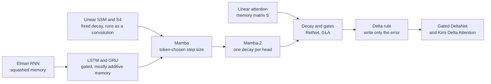
*Figure G.9: How the fixed-memory sequence layers in this section relate. Each step adds a way for the token itself to decide what to keep, what to forget and what to overwrite.*

### Graph neural network message passing (GCN, GraphSAGE and GAT)

**What it does:** Updates each node of a graph from its neighbors' vectors, round after round.

`general: h_v^(l+1) = UPDATE(h_v^(l), AGGREGATE({h_u^(l) : u a neighbor of v}))`

`GCN: H^(l+1) = σ(D̃^(−1/2) × Ã × D̃^(−1/2) × H^(l) × W^(l))`, with `Ã = A + I`

`GraphSAGE: h_v' = σ(W × [h_v, mean over sampled neighbors u of h_u])`

`GAT: α_vu = softmax over the neighbors u of LeakyReLU(a^T × [W × h_v, W × h_u])`, and `h_v' = σ(sum over u of α_vu × W × h_u)`

- **v, u**: nodes; **h_v^(l)**: node v's vector after round l
- **UPDATE, AGGREGATE**: learned functions that combine a node's own vector with its neighbors'
- **H^(l)**: all node vectors as rows of a matrix
- **A**: the adjacency matrix (1 where two nodes are connected); **I**: the identity, adding each node to its own neighborhood
- **D̃**: the diagonal degree matrix of Ã; D̃^(−1/2) divides by the square root of each node's degree
- **W^(l), W**: learned weights; **σ** (sigma): an activation
- **a**: learned attention weights; **[ , ]**: concatenation
- **mean over sampled neighbors u of h_u**: the average vector of a random sample of v's neighbors (all of them, if there are few)
- **α_vu**: how much node v attends to neighbor u

**In plain words:** Each round, every node gathers messages from the nodes it is connected to and updates itself, so after several rounds information has traveled several hops. The GCN (Kipf and Welling) uses a degree-normalized average that includes the node itself; GraphSAGE (Hamilton, Ying and Leskovec, 2017) keeps a node's own vector separate from the average of a random sample of its neighbors and joins the two before a learned layer, which lets it embed nodes it never saw in training; the graph attention network (GAT) learns how much to weight each neighbor. Self-attention is message passing on a fully connected graph.

**Tiny example:** Chapter 17's jazz scores: Ana 9, Ben 3, Cal 6, Dee 0, with Ana-Ben, Ana-Cal, Ben-Cal and Cal-Dee friendships. A plain average with oneself gives Dee (0 + 6) ÷ 2 = 3 after round 1. The GCN normalization (with W = 1 and no activation) counts degrees including oneself (Ana 3, Ben 3, Cal 4, Dee 2) and weights each link by 1 ÷ sqrt(degree × degree): Dee = 0 ÷ 2 + 6 ÷ sqrt(4 × 2) = 2.121, and Ana = 9 ÷ 3 + 3 ÷ sqrt(9) + 6 ÷ sqrt(12) = 5.732. GraphSAGE with W = [0.5, 0.5] (half own score, half neighbor average) and no activation: Dee = 0.5 × 0 + 0.5 × 6 = 3, and Ana = 0.5 × 9 + 0.5 × ((3 + 6) ÷ 2) = 4.5 + 2.25 = 6.75.

**Where it is used:** GraphCast weather forecasting (Google DeepMind, 2023), GNoME materials discovery (2023), molecule and drug models, travel-time prediction in Google Maps, and recommendation graphs (PinSage, which is built on GraphSAGE).
**In the book:** Chapter 17 (Graph neural networks: when data is a web, not a line). The learned GCN formula with its normalized adjacency matrix, GraphSAGE and GAT are only here.

> **Definition — Adjacency matrix:** A square grid describing a graph, with a 1 in row i, column j when nodes i and j are connected and 0 otherwise.

> **Definition — Degree matrix:** A diagonal matrix listing how many connections each node of a graph has, used to normalize sums over neighbors.

> **Definition — GraphSAGE:** A 2017 graph neural network that updates each node from its own vector joined with an average over a random sample of its neighbors, so it can produce vectors for new nodes without retraining.

> **Definition — Graph attention network (GAT):** A graph neural network that learns attention weights over each node's neighbors, so more relevant neighbors contribute more to the node's update.

## Large language models: training, scaling and inference

These are the equations that turn a Transformer into a chatbot. They cut text into tokens, score how likely a piece of text is, measure how wrong the model is while it learns, decide how big a model to build and how much text to feed it, and then run it: how much memory a conversation takes, how the next token is picked, how answers are made faster, smaller and cheaper, how a model is adapted to a new job, how its context is stretched, how it looks up documents and how it spends extra thinking at answer time. A handful of quantities tie them all together: the token, the probability the model gives the next token, the loss built from those probabilities, the parameter count N, the number of training tokens D and the compute C. The entries run from simplest to most advanced, and each one uses only ideas from entries above it or from the general-math and deep-learning sections of this appendix.

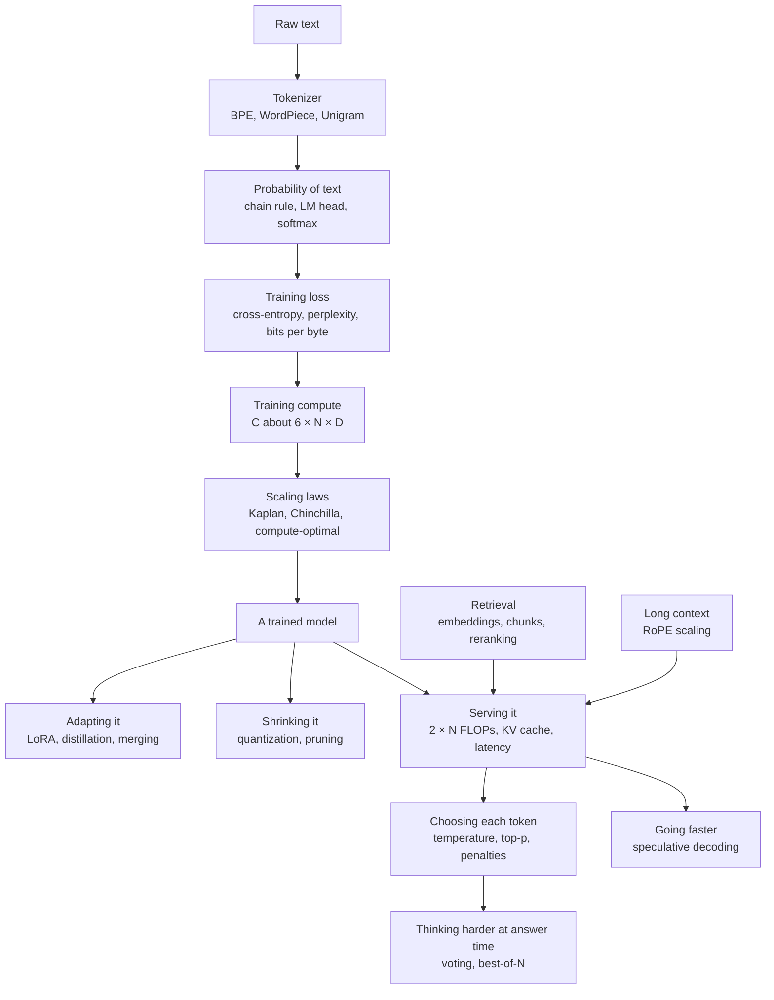

*Figure G.10: How the large-language-model equations connect, from raw text to a trained model and on to serving, decoding and answer-time compute.*

### Byte-pair encoding merge rule (BPE)

**What it does:** Builds a tokenizer's vocabulary by repeatedly gluing together the pair of neighboring symbols that occurs most often.

`best pair = argmax over adjacent pairs (a, b) of count(a, b); add the new token ab; replace every adjacent a, b with ab; repeat until the vocabulary has V tokens`

- **a, b**: two symbols (bytes, characters or earlier merged tokens) that sit side by side somewhere in the training text
- **count(a, b)**: how many times a is immediately followed by b in the training text
- **argmax over adjacent pairs**: "the pair that makes the count largest"
- **ab**: the new token made by joining a and b
- **V**: the vocabulary size you want to end up with

**In plain words:** Start with single bytes or letters. Count every pair of neighbors, merge the most common pair into one new token, write that merge down, and repeat. To tokenize new text later, the tokenizer replays its recorded merges in the order it learned them.

**Tiny example:** Training text "low low lower", split into letters. Pair counts: l,o = 3; o,w = 3; w,e = 1; e,r = 1. There is a tie, broken by a fixed rule (here, the first pair found), so merge 1 makes "lo": lo w, lo w, lo w e r. Recount: lo,w = 3; w,e = 1; e,r = 1. Merge 2 makes "low": low, low, low e r. The vocabulary grew by two tokens, and "lower" is now three tokens: low, e, r.

**Where it is used:** Byte-level BPE, which starts from all 256 byte values so no text is ever "unknown", is the tokenizer of OpenAI's GPT models (the tiktoken library), Llama 3, DeepSeek, Qwen and most open models. Typical vocabulary sizes: about 50,000 (GPT-2), about 100,000 (cl100k), about 200,000 (o200k), 128,256 (Llama 3) and about 262,000 (Gemma 3). Variants: SentencePiece BPE treats the space as an ordinary symbol; BPE-dropout skips each merge with a small probability during training to make models robust to unusual splits.
**In the book:** Chapter 18 (Building a tokenizer by hand: Byte-Pair Encoding) and Chapter 15 (Byte-pair encoding, worked by hand).

### WordPiece merge score

**What it does:** Chooses which pair of pieces to merge by how much more often they appear together than their separate popularity would predict.

`score(a, b) = count(ab) ÷ (count(a) × count(b))`

- **a, b**: two neighboring pieces of text
- **count(ab)**: how many times a and b appear side by side
- **count(a)**, **count(b)**: how many times each piece appears on its own anywhere

**In plain words:** BPE merges the most frequent pair. WordPiece divides that frequency by the popularity of the two parts, so it prefers pairs that "belong together" (one almost always follows the other) over pairs of common pieces that meet often only because both are everywhere. The ratio is a quick stand-in for "the merge that raises the training text's likelihood the most", which is how Schuster and Nakajima (2012) first described WordPiece.

**Tiny example:** "t,h" appears together 30 times, with t seen 50 times and h 40 times: 30 ÷ (50 × 40) = 30 ÷ 2,000 = 0.015. "q,u" appears together only 5 times, with q seen 5 times and u 60 times: 5 ÷ (5 × 60) = 5 ÷ 300 ≈ 0.0167. BPE would merge "th" (30 beats 5); WordPiece merges "qu" (0.0167 beats 0.015), because q is always followed by u.

**Where it is used:** BERT, DistilBERT and other BERT-family encoders, which still power many embedding models and rerankers in retrieval systems. When encoding, WordPiece takes the longest matching piece first and marks pieces inside a word with "##", as in "play ##ing".
**In the book:** Chapter 18 (Building a tokenizer by hand: Byte-Pair Encoding) names WordPiece; the score is only here.

### Unigram language-model tokenizer likelihood

**What it does:** Gives every possible way of cutting text into tokens a probability, picks the most likely cut, and trains the vocabulary to make the training text as likely as possible.

`P(x) = product over i of p(x_i); best x = argmax over segmentations x of P(x); training maximizes L = sum over sentences s of ln( sum over segmentations x of s of P(x) )`

- **x**: one segmentation, that is, one way of cutting a piece of text into tokens
- **x_i**: the i-th token of that segmentation
- **p(x_i)**: the probability the tokenizer assigns to that token (each vocabulary token has one)
- **product over i**: multiply the values for every token in the cut
- **P(x)**: the probability of the whole segmentation
- **s**: one sentence of training text
- **ln**: the natural logarithm
- **L**: the training objective, the total log-likelihood of the training text

**In plain words:** Every token in the vocabulary has a probability. A cut of a word scores the product of its pieces' probabilities, and the tokenizer uses the highest-scoring cut (found with the Viterbi algorithm, a fast search that checks all cuts without listing them). Training starts from a very large vocabulary, fits the probabilities, then repeatedly deletes the tokens whose removal lowers L the least, keeping about 80% each round, until the target size is reached (Kudo, 2018).

**Tiny example:** Suppose p(hug) = 0.02, p(hu) = 0.05, p(ug) = 0.04, p(h) = 0.1, p(u) = 0.1, p(g) = 0.05. The cuts of "hug": [hug] = 0.02; [hu, g] = 0.05 × 0.05 = 0.0025; [h, ug] = 0.1 × 0.04 = 0.004; [h, u, g] = 0.1 × 0.1 × 0.05 = 0.0005. The best cut is the single token "hug". This word adds ln(0.02 + 0.0025 + 0.004 + 0.0005) = ln(0.027) ≈ −3.61 to L.

**Where it is used:** SentencePiece's unigram mode, used by T5, mT5, ALBERT and XLNet. A variant, subword regularization, samples a cut in proportion to `P(x)^α` (α is a sharpness setting) during training so the model sees several spellings of the same word.
**In the book:** Chapter 18 (Building a tokenizer by hand: Byte-Pair Encoding) defines the unigram tokenizer in words; the likelihood is only here.

### Bytes per token, fertility and tokenizer compression

**What it does:** Measures how much text one token covers, which sets how many tokens (and dollars, and context space) a text costs.

`bytes per token = UTF-8 bytes of a text ÷ tokens; fertility = tokens ÷ words; relative cost of tokenizer B versus A = tokens_B ÷ tokens_A on the same text`

- **UTF-8 bytes**: the size of the text in the standard way computers store characters (one byte for each English letter, two to four for many other scripts)
- **tokens**: how many tokens the tokenizer cuts the text into
- **words**: how many words the text has
- **tokens_A**, **tokens_B**: token counts from two different tokenizers on the same text

**In plain words:** English runs about 4 characters, or 0.75 words, per token for modern vocabularies. Many non-Latin scripts need two to four times as many tokens for the same meaning (the "token tax"), which raises cost and shrinks how much fits in the context window.

**Tiny example:** A 1,000-word English text is 5,600 bytes and becomes 1,300 tokens: 5,600 ÷ 1,300 ≈ 4.31 bytes per token, and fertility = 1,300 ÷ 1,000 = 1.3 tokens per word. A second tokenizer makes 1,560 tokens from the same text: 1,560 ÷ 1,300 = 1.2, so it costs 20% more at the same price per token.

**Where it is used:** Designing tokenizers for multilingual models, comparing API prices and context limits across providers whose tokenizers differ, and converting per-token loss into bits per byte (below).
**In the book:** Chapter 18 (What tokens explain about your chatbot), Chapter 26 (Tokenizers differ: compare cost per task, not per token) and Appendix B (Tokens and words).

> **Definition — Fertility (tokenizer):** The average number of tokens a tokenizer produces per word of a language. Higher fertility means the same sentence costs more tokens, more money and more of the context window.

### Autoregressive factorization (chain rule over tokens)

**What it does:** Writes the probability of a whole text as a product of next-token probabilities, which is why predicting the next token is enough to model language.

`P(x_1, ..., x_T) = P(x_1) × P(x_2 given x_1) × ... × P(x_T given x_1, ..., x_(T−1)); in logs: ln P(x_1, ..., x_T) = sum over t = 1..T of ln P(x_t given x_1, ..., x_(t−1))`

- **x_1, ..., x_T**: the tokens of the text, in order
- **T**: the number of tokens
- **t**: the position being predicted
- **P(x_t given x_1, ..., x_(t−1))**: the probability of token t given every token before it
- **ln**: the natural logarithm, which turns the product into a sum

**In plain words:** The probability of a sentence is the probability of its first token, times the probability of the second given the first, and so on. This is an exact rule of probability, so a model that predicts the next token well describes all of text, and generating is just picking one token at a time.

**Tiny example:** 0.05 × 0.01 × 0.2 = 0.0001. In logs: ln(0.05) + ln(0.01) + ln(0.2) = −2.996 − 4.605 − 1.609 = −9.210, and ln(0.0001) = −9.210.

**Where it is used:** Every decoder-only language model, including GPT, Claude, Gemini, Llama, DeepSeek and Qwen.
**In the book:** Chapter 6 (Chaining probabilities for a whole sentence), Chapter 18 (The one trick: predicting the next token) and Appendix B (Sentence probability; Log-probability).

### N-gram language model with smoothing (add-one and Kneser-Ney)

**What it does:** Estimates next-word probabilities by counting, looking back only a few words, and moves a little probability onto word pairs never seen in training.

`counting (maximum likelihood): P(w given v) = count(v, w) ÷ count(v); add-one: P(w given v) = (count(v, w) + 1) ÷ (count(v) + V); interpolated Kneser-Ney: P_KN(w given v) = max(count(v, w) − d, 0) ÷ count(v) + λ(v) × P_cont(w), with λ(v) = d × N_follow(v) ÷ count(v) and P_cont(w) = N_precede(w) ÷ (number of distinct word pairs)`

- **v**: the previous word (in an n-gram model, the previous n − 1 words)
- **w**: the candidate next word
- **count(v, w)**: how many times v is immediately followed by w in the training text
- **count(v)**: how many times v is followed by any word
- **V**: the vocabulary size, the number of different words
- **d**: the discount subtracted from every seen count, usually about 0.75
- **N_follow(v)**: how many different words ever follow v
- **λ(v)** (lambda): the probability freed up by the discounts, handed to the backup estimate
- **N_precede(w)**: how many different words ever come right before w
- **P_cont(w)**: the "continuation" probability, how readily w appears after new contexts

**In plain words:** The chain rule needs the probability of each word given all earlier words; an n-gram model approximates it by looking back only n − 1 words and dividing counts. Pure counting gives zero to any pair it never saw, so one unseen pair makes a whole sentence impossible (and its perplexity infinite). Add-one smoothing pretends every pair was seen once more, which is simple but steals too much from common pairs. Kneser-Ney subtracts a small fixed discount from each seen pair and shares the freed probability out by how many different contexts a word follows, so a word that appears in many places gets more of it than a word that is frequent only in one fixed phrase.

**Tiny example:** Chapter 6's text "I like tea. I like coffee. I drink tea." has five word types and the pairs (I, like) 2, (I, drink) 1, (like, tea) 1, (like, coffee) 1, (drink, tea) 1. Counting: P(like given I) = 2 ÷ 3 ≈ 0.667 and P(coffee given drink) = 0 ÷ 1 = 0. Add-one: P(coffee given drink) = (0 + 1) ÷ (1 + 5) ≈ 0.167, but P(like given I) falls to 3 ÷ 8 = 0.375. Kneser-Ney with d = 0.75: λ(drink) = 0.75 × 1 ÷ 1 = 0.75; tea follows 2 different words out of 5 distinct pairs, so P_cont(tea) = 0.4, and coffee follows 1, so P_cont(coffee) = 0.2. Then P_KN(tea given drink) = (1 − 0.75) ÷ 1 + 0.75 × 0.4 = 0.55 and P_KN(coffee given drink) = 0 + 0.75 × 0.2 = 0.15; the five probabilities after "drink" still add to 1.

**Where it is used:** Statistical language models before neural ones, and still today: the KenLM toolkit (modified Kneser-Ney) built the 5-gram reference model in CCNet's perplexity filter (below); n-gram models still help speech recognizers in some decoders; Google's "stupid backoff" (Brants and others, 2007) skipped normalization for web-scale counts; infini-gram (Liu and others, 2024) backs off to the longest matching run of words in trillions of tokens and is used to analyze training data and machine-written text. The textbook treatment is Jurafsky and Martin's chapter on n-gram language models.
**In the book:** Chapter 6 (A language model you can build by counting) builds this bigram model and computes P("I like tea") = 1/3; the smoothing formulas are only here.

> **Definition — Kneser-Ney smoothing:** A way of fixing the zero probabilities of an n-gram language model that subtracts a small discount from every seen word pair and gives the freed probability to unseen pairs, favoring words that appear after many different words.

### Next-token distribution from the final hidden state (LM head)

**What it does:** Turns the model's last internal vector into one score per vocabulary token and then into probabilities.

`z = W_U × h_t; P(next token = j) = exp(z_j) ÷ sum over k = 1..V of exp(z_k); with weight tying W_U = W_E`

- **h_t**: the final hidden vector at position t, a list of d_model numbers
- **W_U**: the unembedding matrix, V × d_model
- **z**: the logits, one score per vocabulary token
- **z_j**: the logit of token j
- **V**: the vocabulary size
- **exp**: e raised to a power
- **W_E**: the input embedding table, also V × d_model (one row per token), reused as W_U when weights are tied

**In plain words:** The last vector is compared with every token's output vector (a matrix times a vector), giving a list of scores. Softmax turns the scores into probabilities that add to 1.

**Tiny example:** h = [1, 2] and a three-token vocabulary with W_U rows [1, 0], [0, 1] and [0.5, 0.5]: z = [1, 2, 1.5]. Then exp gives 2.718, 7.389 and 4.482, total 14.589, so the probabilities are 0.186, 0.506 and 0.307.

**Where it is used:** The last layer of every LLM. The "logprobs" an API can return are ln of these probabilities, and every sampling rule below works on z. Weight tying saves V × d_model parameters and is used by GPT-2, the Gemma family and small models such as Llama 3.2 1B and 3B; most large models keep the two matrices separate. Weight tying itself, and the two training tricks that keep these logits from growing too large (the output z-loss and logit soft-capping), have their own entries in the deep-learning section.
**In the book:** Chapter 15 (Step 9: From vectors back to words) and Chapter 18 (Logits: one score per token); the product z = W_U × h_t is written as a formula only here.

> **Definition — Logprobs:** The natural logarithms of the probabilities a model gave to tokens, which many APIs can return alongside the text. A logprob of 0 means certainty; −2.3 means a probability of about 0.1.

### Next-token cross-entropy loss (language-model negative log-likelihood)

**What it does:** Scores how surprised the model was by the real text: the pretraining loss of every GPT-style model.

`L(θ) = −(1 ÷ T) × sum over t = 1..T of ln P_θ(x_t given x_1, ..., x_(t−1))`

- **L(θ)**: the loss, a single number
- **θ** (theta): all the model's parameters
- **T**: the number of tokens in the batch
- **x_t**: the token that really came at position t
- **P_θ(x_t given ...)**: the probability the model with parameters θ gave the true token x_t
- **ln**: the natural logarithm

**In plain words:** For every position, take minus the natural log of the probability the model gave the token that really came next, then average. All positions are scored at once, using the causal mask so no position can peek ahead (teacher forcing). Gradient descent lowers this number.

**Tiny example:** True tokens got probabilities 0.5, 0.25 and 0.8. Then −ln of each is 0.693, 1.386 and 0.223; the sum is 2.303 and the average is 2.303 ÷ 3 ≈ 0.768.

**Where it is used:** Pretraining of every GPT-style model, and the validation number plotted in every loss curve. Variants average per token or per sequence, or weight data sources differently.
**In the book:** Chapter 19 (Measuring surprise: the loss), Chapter 6 (Cross-entropy: how surprised was the model?) and Appendix B (Cross-entropy, whole text).

### Perplexity

**What it does:** Converts the average loss into "how many equally likely choices the model is hesitating between".

`PPL = exp(L) = 2^(bits per token), where bits per token = L ÷ ln(2)`

- **PPL**: perplexity
- **L**: the average next-token loss in natural-log units (nats)
- **ln(2)**: about 0.693, which converts nats to bits

**In plain words:** Perplexity 1 means the model is always certain and right; perplexity 10 means it is as unsure as a fair pick among 10 options. Because it is measured per token, it depends on the tokenizer, so it cannot compare models with different vocabularies (use bits per byte for that).

**Tiny example:** From the loss example above, L = 0.768: exp(0.768) ≈ 2.15. In bits: 0.768 ÷ 0.693 ≈ 1.107 bits per token, and `2^1.107` ≈ 2.15, the same answer.

**Where it is used:** Language-model evaluation, quick checks after quantizing a model, and filtering web data with a reference model (below). A text longer than the context window is scored with a sliding window (Hugging Face documents a "stride"), so each scored token keeps more context, which gives a lower and fairer perplexity than cutting the text into separate pieces.
**In the book:** Chapter 19 (Measuring surprise: the loss), Chapter 6 (Perplexity) and Appendix B (Perplexity); the `2^(bits per token)` form is only here.

### Bits per byte (and bits per character)

**What it does:** Spreads the loss over the raw bytes of the text instead of over tokens, so models with different tokenizers can be compared fairly.

`BPB = (L × number of tokens) ÷ (ln(2) × number of UTF-8 bytes) = L ÷ (ln(2) × bytes per token)`

- **BPB**: bits per byte
- **L**: the average loss per token, in nats
- **ln(2)**: about 0.693, converting nats to bits
- **UTF-8 bytes**: the size of the raw text
- **bytes per token**: from the entry above

**In plain words:** Total surprise in bits, divided by how many bytes of text it covered. It is also the size per byte that a compressor driven by the model (an arithmetic coder) would achieve, which is the link between predicting text and compressing it. Bits per character is the same with characters in place of bytes.

**Tiny example:** A model has loss 2.0 nats per token and its tokenizer averages 4 bytes per token: 2.0 ÷ (0.693 × 4) = 2.0 ÷ 2.773 ≈ 0.72 bits per byte.

**Where it is used:** Tokenizer-independent results in The Pile, Gopher and Chinchilla reports; DeepSeek LLM fitted its scaling laws on validation bits per byte.
**In the book:** Appendix F (Bits per byte) describes it in words; the conversion from per-token loss is only here.

> **Definition — Nat:** A unit of information measured with the natural logarithm instead of base 2. One nat is about 1.44 bits; most training losses are reported in nats.

### Supervised fine-tuning loss with prompt masking

**What it does:** Teaches a model to write good answers by scoring only the tokens it should learn to produce.

`L_SFT = −(1 ÷ sum over t of m_t) × sum over t of m_t × ln P_θ(x_t given x_1, ..., x_(t−1))`

- **L_SFT**: the supervised fine-tuning loss
- **m_t**: the mask, 1 for tokens in the assistant's reply and 0 for system, user and tool tokens
- **sum over t of m_t**: the number of graded tokens
- **θ**: the model's parameters
- **x_t**: the token at position t
- **P_θ(x_t given ...)**: the probability the model gave the true token at position t
- **ln**: the natural logarithm

**In plain words:** The same loss as pretraining, except the prompt counts as context, not as something to imitate. Only the assistant's words are graded, and the average is taken over those graded tokens.

**Tiny example:** A five-token conversation: three user tokens (m = 0) and the assistant's "4" and "." (m = 1), which got probabilities 0.9 and 0.8. Loss = (0.105 + 0.223) ÷ 2 ≈ 0.164; the user tokens add nothing.

**Where it is used:** Instruction tuning in every post-training pipeline, in tools such as Hugging Face TRL (assistant-only or completion-only loss), Axolotl and Unsloth. Variants normalize per example instead of per token (which changes how much long answers weigh) and pack several examples into one sequence.
**In the book:** Chapter 20 (Stage 1: Supervised fine-tuning; Worked example: one SFT step on one token) and Chapter 30 (The fine-tuning menu); the masked average is written as a formula only here.

### Masked-language-model, span-corruption and fill-in-the-middle objectives

**What it does:** Trains a model to fill in hidden pieces of text using context from both sides.

`L_MLM = −(1 ÷ |M|) × sum over i in M of ln P_θ(x_i given the text with the positions in M hidden)`

- **L_MLM**: the masked-language-model loss
- **M**: the set of hidden positions, about 15% of the tokens
- **|M|**: how many positions are hidden
- **x_i**: the original token at hidden position i
- **θ**: the model's parameters

**In plain words:** Hide some tokens, ask the model to guess them from everything around them, and score only the guesses. BERT replaces 80% of the chosen tokens with a [MASK] symbol, 10% with a random token and leaves 10% unchanged.

**Tiny example:** Out of 10 tokens, 2 are hidden. The model gives the true tokens probabilities 0.6 and 0.3: loss = (0.511 + 1.204) ÷ 2 ≈ 0.857.

**Where it is used:** BERT-style encoders behind many embedding models and rerankers. T5 uses span corruption: it drops spans averaging 3 tokens and predicts them after placeholder (sentinel) tokens. Code models such as StarCoder, DeepSeek-Coder and Qwen2.5-Coder use fill-in-the-middle: a document is cut into prefix, middle and suffix, reordered as prefix, suffix, middle with marker tokens, and trained with the ordinary next-token loss, which lets an editor's autocomplete fill a gap in your code.
**In the book:** Chapter 15 (Step 8: Encoders, decoders and the causal mask) defines masked language modeling in words; the loss, span corruption and fill-in-the-middle are only here.

> **Definition — Span corruption:** A training task, used by T5, in which whole runs of tokens are removed from a text and replaced by placeholder tokens, and the model must write out the missing runs.

> **Definition — Fill-in-the-middle (FIM):** A training trick for code models: a file is cut into a beginning, middle and end, and the model sees the beginning and end first and learns to write the missing middle, which is what an editor needs when you type inside existing code.

### Multi-token prediction loss

**What it does:** Adds extra training targets that predict tokens two or more steps ahead, giving the model a denser learning signal.

`L_total = L_main + (λ ÷ D) × sum over k = 1..D of L_k, where L_k = −(1 ÷ T) × sum over t of ln P_k(x_(t+1+k) given x_1, ..., x_t)`

- **L_total**: the full training loss
- **L_main**: the ordinary next-token loss
- **λ** (lambda): the weight on the extra losses
- **D**: the prediction depth, how many extra future tokens are predicted (here D is not the dataset size)
- **k**: which extra step ahead (k = 1 means the token after next)
- **L_k**: the cross-entropy loss of the k-th extra prediction module
- **T**: the number of positions
- **P_k(...)**: the probability the k-th module gives the true token 1 + k steps ahead

**In plain words:** Small extra heads look further into the future from each position. Their losses are averaged, scaled down by λ and added to the main loss. The original version (Gloeckle and others, 2024) uses n parallel heads, each predicting one of the next n tokens from x_1, ..., x_t exactly as the formula shows; DeepSeek-V3 chains small modules one after another, and its k-th module is also fed the true tokens up to position t + k, so each module still predicts just one token past what it has seen.

**Tiny example:** Main loss 1.2 nats, one extra module (D = 1) with loss 1.8, λ = 0.3: 1.2 + (0.3 ÷ 1) × 1.8 = 1.2 + 0.54 = 1.74.

**Where it is used:** DeepSeek-V3 used D = 1 and λ = 0.3 for the first 10 trillion tokens, then 0.1; DeepSeek-R1, GLM-4.5 and other 2025-2026 open models use the idea too. At inference the extra module doubles as a built-in draft for speculative decoding: DeepSeek-V3 reports 85-90% acceptance of the second token and about 1.8 times the tokens per second.
**In the book:** Chapter 15 (Step 10: How a Transformer learns) defines multi-token prediction and Chapter 23 (Speculative decoding: guess ahead, check in one pass) uses it as a draft; the loss is only here.

### Multiple-choice scoring by log-likelihood

**What it does:** Grades a model on a multiple-choice test without letting it write anything: the answer it finds most probable wins.

`choice = argmax over options c of sum over the tokens of c of ln P(token given the question and the earlier tokens of c); normalized variant: divide each option's sum by its length in characters (or bytes)`

- **c**: one answer option
- **argmax over options**: the option with the largest score
- **ln P(token given ...)**: the log-probability of each token of the option, read after the question
- **length in characters (or bytes)**: the option's size, used for length normalization

**In plain words:** Paste the question, then measure how likely the model finds each possible answer. A longer option has more tokens, each with a probability below 1, so its raw total is lower; dividing by length removes that unfair penalty.

**Tiny example:** Option A, "No" (2 bytes), has total log-probability −1.2. Option B, "Yes, always" (11 bytes), has −2.2. Raw scores pick A, since −1.2 is larger than −2.2. Per byte: A = −1.2 ÷ 2 = −0.6 and B = −2.2 ÷ 11 = −0.2, so the normalized score picks B.

**Where it is used:** Base-model benchmarks such as HellaSwag, ARC and the cloze form of MMLU in EleutherAI's lm-evaluation-harness, where the score divided by length in characters is reported as acc_norm (acc_bytes divides by bytes; for English text the two barely differ). Llama 3's downstream forecasts used the normalized negative log-likelihood of the correct answer (see the two-step forecast below).
**In the book:** Only here (Chapter 24 discusses benchmarks and evaluation harnesses in words).

> **Definition — Length normalization:** Dividing a text's total log-probability by its length (in tokens, characters or bytes) before comparing it with other texts, so longer answers are not penalized just for having more parts.

### Transformer parameter count

**What it does:** Estimates how many parameters a Transformer has from its shape.

`N ≈ 12 × n_layer × d_model^2 + V × d_model (+ another V × d_model if the output matrix is not tied)`

- **N**: the number of parameters
- **n_layer**: the number of Transformer blocks
- **d_model**: the width of the model's vectors
- **V**: the vocabulary size
- **12**: 4 square matrices in attention (query, key, value, output) plus 8 in the feed-forward block (two matrices of d_model × 4 × d_model)

**In plain words:** Each block holds about 12 × d_model^2 weights, so multiply by the number of blocks and add the embedding table. Norms and biases are too small to matter.

**Tiny example:** 32 layers, d_model = 4,096, V = 32,000 with separate input and output matrices: 12 × 32 × 4,096^2 ≈ 6.44 billion, plus 2 × 32,000 × 4,096 ≈ 0.26 billion, total ≈ 6.70 billion, close to Llama 2 7B's 6.74 billion (its SwiGLU feed-forward block is slightly larger than 8 × d_model^2).

**Where it is used:** Sizing models, planning memory (parameters × bytes per parameter) and the N in scaling laws (Kaplan counts only non-embedding parameters; Chinchilla counts all). Variants: SwiGLU feed-forward blocks use 3 × d_model × d_ff weights, and with d_ff ≈ (8 ÷ 3) × d_model the total stays near 8 × d_model^2; grouped-query attention uses 2 × d_model^2 + 2 × d_model × n_kv × d_head for its four matrices, where n_kv is the number of key-value heads and d_head the size of each.
**In the book:** Chapter 15 (Step 7: The residual stream and one full block), Chapter 18 (Counting the knobs) and Appendix B (Parameters in a dense layer; Embedding table size); the untied output matrix is mentioned only here.

### Mixture-of-experts total versus active parameters

**What it does:** Splits a mixture-of-experts model's size into what must be stored (total) and what each token actually uses (active).

`N_total = N_other + L_moe × (E + s) × N_expert; N_active = N_other + L_moe × (k + s) × N_expert; for SwiGLU experts N_expert = 3 × d_model × d_expert`

- **N_total**: all parameters, which must fit in memory
- **N_active**: the parameters one token passes through, which sets compute
- **N_other**: everything outside the experts: attention, dense layers, embeddings, routers
- **L_moe**: the number of mixture-of-experts layers
- **E**: routed experts per layer
- **k**: routed experts chosen for each token
- **s**: shared experts that every token always uses
- **N_expert**: the parameters in one expert
- **d_model**: the model width
- **d_expert**: the hidden width inside one expert

**In plain words:** Memory pays for every expert; compute pays only for the few each token is routed to. So use N_total for memory and N_active in the compute rules (2 × N_active FLOPs per token, 6 × N_active × D for training). Routing and load-balancing equations are in the deep-learning section.

**Tiny example:** N_other = 100 million, L_moe = 4, E = 8, k = 2, s = 0, N_expert = 10 million. Total = 100 + 4 × 8 × 10 = 420 million; active = 100 + 4 × 2 × 10 = 180 million.

**Where it is used:** Every 2025-2026 frontier open-weight MoE and every serving capacity plan. A check against DeepSeek-V3's published shape (61 layers, the first 3 dense; 256 routed experts plus 1 shared; 8 routed active; d_model 7,168; d_expert 2,048): N_expert = 3 × 7,168 × 2,048 ≈ 44.0 million; 58 × 257 × 44.0 million ≈ 656.5 billion of its 671 billion are experts, leaving about 14.5 billion; active ≈ 14.5 billion + 58 × 9 × 44.0 million ≈ 37.5 billion, matching the reported 37 billion. Other examples: Kimi K2 (about 1 trillion total, 32 billion active), gpt-oss-120b (about 117 billion total, 5.1 billion active), Qwen3-235B-A22B.
**In the book:** Chapter 17 (Total versus active parameters), Chapter 18 (Dense versus mixture of experts: total and active parameters) and Appendix B (Mixture of experts); the counting formula is only here.

### Training compute C ≈ 6ND

**What it does:** Estimates the total arithmetic needed to train a model.

`C ≈ 6 × N × D`

- **C**: training compute, in floating-point operations (FLOPs)
- **N**: parameters (active parameters for a mixture of experts)
- **D**: training tokens
- **6**: 2 FLOPs per parameter per token in the forward pass plus about 4 in the backward pass

**In plain words:** Every parameter does one multiply-add (2 FLOPs) per token going forward and about twice that going backward. It ignores the attention term (below). With full activation recomputation the hardware actually does about 8 × N × D.

**Tiny example:** N = 1 billion, D = 20 billion: 6 × 10^9 × 2 × 10^10 = 1.2 × 10^20 FLOPs. Llama 3 405B: 6 × 4.05 × 10^11 × 1.56 × 10^13 ≈ 3.8 × 10^25, matching Meta's reported figure.

**Where it is used:** Budgeting every pretraining run, and regulatory thresholds such as the EU AI Act's presumption of systemic risk above 10^25 FLOPs.
**In the book:** Chapter 19 (The 6ND rule and what a training run costs), Chapter 37 (Counting the work: the 6 × N × D rule) and Appendix B (Training compute); the 8ND recomputation variant is only here.

### Inference compute ≈ 2N FLOPs per token

**What it does:** Estimates the arithmetic needed to read or write each token at answer time.

`FLOPs per token ≈ 2 × N; prefill of P prompt tokens ≈ 2 × N × P; one request ≈ 2 × N × (P + G)`

- **N**: parameters (active parameters for a mixture of experts)
- **P**: prompt tokens
- **G**: generated tokens

**In plain words:** Each weight is used once per token as one multiply-add. Reading the prompt (prefill) processes all P tokens in parallel; writing (decode) produces one token at a time. Sampling several answers multiplies the cost by their number.

**Tiny example:** An 8-billion-parameter model reads a 1,000-token prompt and writes 500 tokens: 2 × 8 × 10^9 × 1,500 = 2.4 × 10^13 FLOPs.

**Where it is used:** Pricing and capacity estimates, and counting the test-time compute of reasoning models and best-of-N.
**In the book:** Chapter 23 (Two different jobs: prefill and decode), Chapter 18 (Compute per token) and Appendix B (Inference cost per token; Cost of an answer).

### Attention FLOPs term (the context-length cost)

**What it does:** Adds the arithmetic that attention spends comparing each token with all earlier ones, which the 2N and 6ND rules leave out.

`forward FLOPs per token ≈ 2 × N + 2 × n_layer × n_ctx × d_attn`

- **N**: parameters
- **n_layer**: the number of layers
- **n_ctx**: the number of tokens of context each token attends to
- **d_attn**: the total width of the attention heads (heads × head size)

**In plain words:** Scoring a query against every earlier key and mixing their values costs work proportional to the context length, for every token, so a whole sequence costs work that grows with the square of its length. The term is small for short contexts and dominates long ones, which is why sparse, linear and latent attention exist. Causal masking halves the real work, a factor most accounting formulas ignore.

**Tiny example:** A 7-billion-parameter shape (32 layers, d_attn = 4,096, so 2 × N ≈ 13.4 billion): at 4,096 tokens of context the extra term is 2 × 32 × 4,096 × 4,096 ≈ 1.07 billion FLOPs, about 8% of 2 × N. At 128,000 tokens it is 2 × 32 × 128,000 × 4,096 ≈ 33.6 billion, 2.5 times 2 × N.

**Where it is used:** Kaplan and others (2020) gave this form. PaLM's model-FLOPs-utilization accounting uses 6 × N + 12 × n_layer × n_heads × d_head × T per training token (T the sequence length). DeepSeek LLM replaced 6 × N with M = 72 × n_layer × d_model^2 + 12 × n_layer × d_model × l_seq FLOPs per token (l_seq the sequence length) and C = M × D for more accurate scaling-law fits at small scale.
**In the book:** Chapter 15 (The catch: attention costs grow with the square of length), Chapter 17 (Two bills every Transformer pays) and Chapter 23 (Worked example: how long does reading take?) explain it in words; the FLOP formulas are only here.

### Kaplan power laws for language-model loss

**What it does:** Predicts test loss from model size, data or compute as a straight line on a log-log plot.

`L(N) = (N_c ÷ N)^α_N; L(D) = (D_c ÷ D)^α_D; L(C_min) = (C_c ÷ C_min)^α_C; combined L(N, D) = ((N_c ÷ N)^(α_N ÷ α_D) + D_c ÷ D)^α_D`

- **L**: test loss, in nats per token
- **N**: non-embedding parameters
- **D**: training tokens
- **C_min**: compute, used as efficiently as possible, in PF-days
- **α_N ≈ 0.076**, **α_D ≈ 0.095**, **α_C ≈ 0.050** (alpha): how steeply loss falls with each quantity
- **N_c ≈ 8.8 × 10^13**, **D_c ≈ 5.4 × 10^13 tokens**, **C_c ≈ 3.1 × 10^8 PF-days**: fitted constants that set where each line sits

**In plain words:** Make the model, the data or the compute bigger by a fixed factor and the loss shrinks by a fixed factor, with no sign of stopping across many orders of magnitude. Kaplan and others (2020) concluded that compute should go mostly into model size (N growing as `C^0.73`), which Chinchilla later corrected.

**Tiny example:** N = 10^9: `(8.8 × 10^13 ÷ 10^9)^0.076` = `88,000^0.076` ≈ 2.376 nats. Doubling to N = 2 × 10^9 gives ≈ 2.254, and 2.254 ÷ 2.376 ≈ 0.949 = `2^(−0.076)`: each doubling trims the loss by about 5%.

**Where it is used:** Sizing in the GPT-3 era, and loss forecasting before frontier runs. The GPT-4 report used L(C) = a × `C^b` + c, with an irreducible term c, to predict the final loss from runs using up to 10,000 times less compute.
**In the book:** Chapter 19 (Kaplan 2020: loss falls on a straight line) describes it in words; Appendix B (Power law) and Chapter 6 (Log-log plots and scaling laws) give the general form; the fitted formulas are only here.

> **Definition — PF-day (petaflop/s-day):** A unit of compute: a machine doing 10^15 floating-point operations per second for one day, about 8.64 × 10^19 operations in total.

### Chinchilla parametric loss

**What it does:** Splits a model's loss into a floor nobody can beat, a penalty for too few parameters and a penalty for too little data.

`L(N, D) = E + A ÷ N^α + B ÷ D^β`

- **L(N, D)**: predicted loss
- **N**: parameters
- **D**: training tokens
- **E**: the irreducible loss
- **A**, **B**: fitted sizes of the two penalties
- **α** (alpha), **β** (beta): how fast each penalty shrinks

**In plain words:** Even a perfect model cannot predict text perfectly (E). A finite model adds a penalty that shrinks as it grows; finite data adds one that shrinks as you add tokens. Hoffmann and others (2022) fitted E = 1.69, A = 406.4, B = 410.7, α = 0.34, β = 0.28, minimizing a Huber loss (δ = 10^−3) on log loss with L-BFGS.

**Tiny example:** N = 70 billion, D = 1.4 trillion: `406.4 ÷ (7 × 10^10)^0.34` ≈ 0.083; `410.7 ÷ (1.4 × 10^12)^0.28` ≈ 0.163; L ≈ 1.69 + 0.083 + 0.163 = 1.937.

**Where it is used:** The standard functional form for planning model size and data, and the base of later variants (data-constrained, precision-aware, and fine-grained mixture of experts, where Krajewski and others (2024) fit `L = c + (g ÷ G^γ + a) ÷ N^α + b ÷ D^β` where a, b, c, g, α, β and γ are fitted constants and the granularity G = d_ff ÷ d_expert is the dense feed-forward width divided by one expert's width, so finer experts shrink the parameter penalty). Epoch AI's 2024 replication (Besiroglu and others) refitted it as E = 1.82, A = 482.01, B = 2,085.43, α = 0.3478, β = 0.3658.
**In the book:** Chapter 19 (Chinchilla 2022: feed the model more data); the Epoch AI constants are only here.

> **Definition — Irreducible loss:** The part of a model's loss that no amount of size, data or compute can remove, because text itself contains genuine randomness. In the Chinchilla formula it is the constant E.

### Twenty tokens per parameter rule

**What it does:** Gives the rounded Chinchilla answer to "how big a model and how much data for this budget".

`D_opt ≈ 20 × N_opt; with C = 6 × N × D: N_opt ≈ sqrt(C ÷ 120), D_opt ≈ 20 × sqrt(C ÷ 120)`

- **N_opt**: the compute-optimal number of parameters
- **D_opt**: the compute-optimal number of training tokens
- **C**: the compute budget in FLOPs
- **120**: 6 × 20, from putting D = 20 × N into C = 6 × N × D

**In plain words:** At the best balance, a model sees about 20 training tokens per parameter. Substituting into the 6ND rule gives C = 120 × N^2, so N is the square root of C ÷ 120.

**Tiny example:** C = 10^24: N ≈ sqrt(10^24 ÷ 120) = sqrt(8.33 × 10^21) ≈ 9.1 × 10^10 (91 billion parameters); D ≈ 20 × 9.1 × 10^10 ≈ 1.8 × 10^12 tokens. Check: 6 × 9.13 × 10^10 × 1.83 × 10^12 ≈ 10^24.

**Where it is used:** Back-of-envelope planning everywhere. Chinchilla itself was 70 billion parameters on 1.4 trillion tokens. Modern models deliberately go far past it: Llama 3 8B saw about 15 trillion tokens, about 1,875 per parameter (see inference-aware scaling).
**In the book:** Chapter 19 (Chinchilla 2022: feed the model more data, which includes a worked example of sizing a compute-optimal model) and Appendix B (Chinchilla ratio; Compute-optimal size).

### Compute-optimal allocation of model size and data

**What it does:** Finds the exact best split of a compute budget between parameters and data from the Chinchilla loss formula.

`N_opt(C) = G × (C ÷ 6)^a; D_opt(C) = (1 ÷ G) × (C ÷ 6)^b; G = (α × A ÷ (β × B))^(1 ÷ (α + β)); a = β ÷ (α + β); b = α ÷ (α + β)`

- **N_opt(C)**, **D_opt(C)**: the best number of parameters and of training tokens for budget C
- **C**: the compute budget, with C = 6 × N × D
- **A**, **B**, **α**, **β**: the constants of the Chinchilla loss above
- **G**: a constant that sets the level of the best model size
- **a**, **b**: how fast the best size and the best data grow with compute (a + b = 1)

**In plain words:** Minimize the Chinchilla loss while holding 6 × N × D fixed. The answer says both N and D grow as powers of C. Chinchilla found a ≈ b ≈ 0.5, so parameters and tokens should grow equally: 0.50 and 0.50 from training curves, 0.49 and 0.51 from IsoFLOP curves, 0.46 and 0.54 from the parametric fit.

**Tiny example:** With Epoch AI's constants at C = 10^24: a = 0.3658 ÷ 0.7136 ≈ 0.513 and b ≈ 0.487; G = (0.3478 × 482.01 ÷ (0.3658 × 2,085.43))^(1 ÷ 0.7136) = (167.6 ÷ 762.9)^1.401 ≈ 0.120; C ÷ 6 ≈ 1.67 × 10^23; N_opt ≈ `0.120 × (1.67 × 10^23)^0.513` ≈ 9.6 × 10^10 and D_opt ≈ 1.7 × 10^12, about 18 tokens per parameter. The same formula with the 2022 paper's rounded constants gives about 41 billion parameters and 98 tokens per parameter, out of line with the paper's other two methods; Epoch AI's replication reported that inconsistency and its refit agrees with the roughly 20-to-1 answer.

**Where it is used:** Sizing pretraining runs (Chinchilla, Llama 3, DeepSeek). Llama 3 fitted `D*(C) = A × C^α` with (α, A) = (0.53, 0.29) on IsoFLOP curves, and reported that it predicts 402 billion parameters on 16.55 trillion tokens at 3.8 × 10^25 FLOPs; Meta trained 405 billion. The printed constants do not reproduce that prediction: `0.29 × (3.8 × 10^25)^0.53` ≈ 10.5 trillion tokens, so treat the published pair as rounded.
**In the book:** Chapter 19 (Chinchilla 2022: feed the model more data) computes the 20-tokens special case; the general closed form is only here.

> **Definition — IsoFLOP curve:** A set of training runs that all use the same compute budget but trade model size against data differently. Plotting their final losses against model size gives a U-shaped curve whose bottom marks the compute-optimal size for that budget.

### Inference-aware (beyond-Chinchilla) scaling

**What it does:** Chooses model size and training data to minimize compute over a model's whole life, including serving it, not just training it.

`(N*, D_tr*) = argmin over N, D_tr of (6 × N × D_tr + 2 × N × D_inf), subject to L(N, D_tr) = ℓ`

- **`N*`**, **`D_tr*`**: the best model size and number of training tokens
- **D_tr**: training tokens
- **D_inf**: tokens the model is expected to read and write in service
- **L(N, D_tr)**: the loss formula (for example Chinchilla's)
- **ℓ** (script l): the target loss

**In plain words:** Training cost is paid once; serving cost is paid on every token users ever generate. If a model will serve a lot, a smaller model trained on much more data reaches the same quality and is cheaper overall (Sardana and others, 2024). A dollar version replaces FLOPs with prices.

**Tiny example:** With Epoch AI's loss constants, the compute-optimal model for 10^24 FLOPs is about 96 billion parameters on 1.74 trillion tokens (loss ≈ 1.963). A 48-billion-parameter model reaches the same loss with about 4.38 trillion tokens (91 per parameter): training costs 6 × 4.79 × 10^10 × 4.38 × 10^12 ≈ 1.26 × 10^24, 26% more. Serving 2 × 10^13 tokens costs 2 × 9.59 × 10^10 × 2 × 10^13 ≈ 3.83 × 10^24 for the big model versus 1.92 × 10^24 for the small one. Lifetime totals: 4.83 × 10^24 versus 3.18 × 10^24, a saving of about a third.

**Where it is used:** Why Llama 3, Gemma, Qwen and other widely served models are heavily over-trained.
**In the book:** Chapter 19 (Over-training: why labs train small models far past "optimal") works a two-option example; the argmin is written as a formula only here.

### Data-constrained scaling (repeated epochs)

**What it does:** Discounts repeated data, since a token seen for the fifth time teaches less than a fresh one.

`D' = U_D + U_D × R*_D × (1 − exp(−R_D ÷ R*_D)); N' = U_N + U_N × R*_N × (1 − exp(−R_N ÷ R*_N)); L = E + A ÷ N'^α + B ÷ D'^β`

- **D'**: the effective number of fresh tokens
- **U_D**: unique tokens available
- **R_D**: extra repetitions (epochs minus 1)
- **`R*_D` ≈ 15.4**: the repetition scale at which repeats have lost most of their value
- **N'**: the effective number of parameters
- **U_N**: the compute-optimal model size for the unique data alone
- **R_N**: how many times larger the model is than U_N, minus 1 (extra parameters give diminishing returns in the same way)
- **`R*_N` ≈ 5.3**: the matching scale for parameters
- **E**, **A**, **B**, **α**, **β**: the Chinchilla constants

**In plain words:** Each extra pass over the same data is worth a bit less than the one before. Up to about 4 epochs costs almost nothing; when R_D equals `R*_D`, the repeated tokens are worth, on average, 1 − 1 ÷ e ≈ 63% of fresh ones; beyond that, extra epochs add little (Muennighoff and others, 2023).

**Tiny example:** 100 billion unique tokens. Four epochs (R_D = 3): D' = 100 + 100 × 15.4 × (1 − exp(−3 ÷ 15.4)) = 100 + 1,540 × 0.177 ≈ 373 billion effective, versus 400 billion read. Forty epochs (R_D = 39): 100 + 1,540 × (1 − exp(−39 ÷ 15.4)) = 100 + 1,540 × 0.921 ≈ 1,518 billion effective, versus 4,000 billion read.

**Where it is used:** Planning around the "data wall": multi-epoch training on scarce high-quality, code and non-English data.
**In the book:** Chapter 19 (The escape routes) says in words that up to about four passes is almost as good as fresh data; the formula is only here.

> **Definition — Data-constrained scaling:** Scaling laws for the case where unique training data runs out and must be repeated. They treat repeated tokens as worth progressively less than fresh ones.

### Compute-based learning-rate and batch-size scaling laws

**What it does:** Predicts the best learning rate, batch size and model-versus-data split for a compute budget, from fits to small runs.

`DeepSeek LLM: η_opt = 0.3118 × C^(−0.1250); B_opt = 0.2920 × C^0.3271; M_opt = 0.1715 × C^0.5243; D_opt = 5.8316 × C^0.4757, with C = M × D`

- **C**: compute in FLOPs
- **η_opt** (eta): the near-best peak learning rate
- **B_opt**: the near-best batch size, in tokens
- **M**: model scale, measured as non-embedding FLOPs per token
- **D**: training tokens
- **M_opt**, **D_opt**: the compute-optimal model scale and number of training tokens

**In plain words:** Bigger budgets want a slightly smaller learning rate and a much larger batch. These power laws, fitted on many small runs, set both before an expensive run starts.

**Tiny example:** C = 10^22: η_opt ≈ 0.3118 × 10^(−2.75) ≈ 0.3118 × 0.00178 ≈ 5.5 × 10^−4; B_opt ≈ 0.2920 × 10^7.196 ≈ 4.6 million tokens; M_opt ≈ 5.9 × 10^10 FLOPs per token; D_opt ≈ 1.7 × 10^11 tokens. Check: 5.9 × 10^10 × 1.7 × 10^11 ≈ 10^22.

**Where it is used:** DeepSeek LLM and its successors, and the general practice of fitting hyperparameter laws on proxies before a frontier run. The other standard way to carry settings from a small proxy to a big model, μP (maximal update parametrization), rescales initialization and learning rates with width; its rules are in the deep-learning section, and Depth-μP (2023) and CompleteP (2025) extend them to depth.
**In the book:** Chapter 19 (The settings) says in words that DeepSeek and others published such formulas and defines μP; the fitted laws are only here.

> **Definition — μTransfer:** Tuning hyperparameters such as the learning rate on a small, cheap model set up with μP and copying them directly to a much larger model, which μP makes possible.

### Critical batch size

**What it does:** Marks the batch size beyond which making batches bigger mostly wastes compute.

`B_crit(L) = B_* ÷ L^(1 ÷ α_B); S_min = S ÷ (1 + B_crit ÷ B); C_min = C ÷ (1 + B ÷ B_crit); gradient noise scale B_noise = tr(Σ) ÷ length(G)^2`

- **B_crit(L)**: the critical batch size, in tokens, when the loss is L
- **`B_*` ≈ 2 × 10^8 tokens** and **α_B ≈ 0.21**: fitted constants (Kaplan and others, 2020)
- **B**: the batch size actually used
- **S**, **S_min**: training steps taken, and the fewest possible with an enormous batch
- **C**, **C_min**: compute used, and the least possible with a tiny batch
- **Σ** (capital sigma): the covariance of per-example gradients; **tr(Σ)** adds up their variances
- **G**: the average gradient; **length(G)^2** is its squared length

**In plain words:** Below the critical batch size, doubling the batch nearly halves the number of steps at no extra compute. Above it, steps barely drop while compute keeps climbing. It grows as the loss falls, which is why runs ramp the batch up and why frontier runs use batches of millions of tokens. The gradient noise scale (McCandlish and others, 2018) estimates it from how noisy the gradients are.

**Tiny example:** At loss 3.0: `3^(1 ÷ 0.21)` = `3^4.76` ≈ 187, so B_crit ≈ 2 × 10^8 ÷ 187 ≈ 1.07 million tokens. At loss 2.5: ≈ 2.55 million; at 2.0: ≈ 7.4 million. Training exactly at B = B_crit takes twice the minimum steps and twice the minimum compute.

**Where it is used:** Choosing global batch sizes and batch ramps for large runs; Meta's Llama 3 doubled its batch size twice during its largest run.
**In the book:** Only here (Chapter 13, Batch size and the learning rate, and Chapter 37, Data parallelism, discuss batch size in words).

> **Definition — Critical batch size:** The batch size at which a training run gets a good trade between speed and compute: much smaller batches waste time, much larger ones waste compute. It grows as the model gets better.

> **Definition — Gradient noise scale:** A measure of how much individual examples' gradients disagree compared with their average. When it is large, bigger batches help, because averaging more examples cancels the disagreement.

### Two-step downstream performance forecast

**What it does:** Predicts a benchmark score before training, by forecasting a smooth quantity first and then mapping it to accuracy.

`step 1: NLL_task(C) ≈ a + b × log(C); step 2: accuracy = c_0 + (1 − c_0) ÷ (1 + exp(k × (NLL_task − n_0)))`

- **NLL_task**: the length-normalized negative log-likelihood of the correct answers (see multiple-choice scoring above)
- **C**: training compute
- **a**, **b**: fitted line constants (b is negative: more compute, lower NLL)
- **c_0**: chance-level accuracy (0.25 for four options)
- **k**, **n_0**: fitted steepness and midpoint of the S-shaped curve

**In plain words:** Accuracy jumps abruptly with scale, but the probability of the right answer improves smoothly. So forecast the smooth number from compute, then convert it to accuracy with an S-curve fitted across many models.

**Tiny example:** Illustrative constants a = 3, b = −0.1 (log in base 10), c_0 = 0.25, k = 5, n_0 = 1.0. At C = 10^22: NLL = 3 − 2.2 = 0.8, accuracy = 0.25 + 0.75 ÷ (1 + exp(−1)) = 0.25 + 0.75 × 0.731 ≈ 0.798. At C = 10^24: NLL = 0.6, accuracy = 0.25 + 0.75 ÷ (1 + exp(−2)) ≈ 0.911.

**Where it is used:** Meta used this method to predict the Llama 3 405B model's ARC-Challenge score across four orders of magnitude of compute; labs forecast capabilities this way before committing to a frontier run.
**In the book:** Chapter 19 (Emergent abilities: sudden leaps or smooth progress?) argues in words for tracking a smooth metric; the two-step fit is only here.

### Effective compute and compute-equivalent gain

**What it does:** Measures an improvement in training recipe (architecture, data, optimizer) as the extra raw compute the old recipe would have needed to match it.

`compute-equivalent gain CEG = C_old(ℓ) ÷ C_new(ℓ); effective compute = physical compute × algorithmic multiplier; if the compute needed for a fixed result halves every h months, the multiplier after t months = 2^(t ÷ h)`

- **ℓ** (script l): a fixed target, such as a loss or a benchmark score
- **C_old(ℓ)**, **C_new(ℓ)**: the training compute the old and the new recipe need to reach ℓ (read off their scaling-law fits)
- **CEG**: the compute-equivalent gain of the new recipe
- **physical compute**: the FLOPs actually spent
- **algorithmic multiplier**: the combined CEG of all improvements since a chosen starting recipe
- **h**: the halving time; **t**: months elapsed

**In plain words:** Two scaling curves for two recipes are usually parallel lines on a log-log plot, so the better recipe is worth a fixed factor of compute at every size. Multiplying real FLOPs by that factor gives "effective compute", a single number for how much better models get from bigger budgets and smarter methods together. It is an estimate: different targets and benchmarks give different multipliers.

**Tiny example:** A new recipe reaches loss 2.0 with 10^23 FLOPs where the old one needed 4 × 10^23: CEG = 4, so a 10^24-FLOP run with the new recipe counts as 4 × 10^24 effective FLOPs. With an 8-month halving time, 24 months give `2^(24 ÷ 8)` = 8 times; if physical training compute also grows 5 times a year (25 times in two years), effective compute grows about 25 × 8 = 200 times.

**Where it is used:** Epoch AI estimated that the compute needed to reach a fixed language-model performance halved about every 8 months between 2012 and 2023, with a wide uncertainty range of roughly 5 to 14 months (Ho and others, 2024). Anthropic's first Responsible Scaling Policy (2023) set its re-testing trigger in effective compute (every 4 times increase). Papers state gains the same way: Moonshot AI's "Muon is Scalable for LLM Training" (2025) reported about 2 times the computational efficiency of AdamW in compute-optimal training, a CEG of about 2 (Muon is in Chapter 13). It is also why fixed FLOP thresholds in law, such as the EU AI Act's 10^25, age quickly.
**In the book:** Only here (Chapter 59, in a Watch out on compute thresholds, notes in words that algorithms get more efficient every year).

> **Definition — Effective compute:** Training compute adjusted for better methods: the raw compute multiplied by how many times more compute an older recipe would have needed for the same result.

### Compounding success over many tokens or steps (exact match and long agent tasks)

**What it does:** Gives the chance that every part of a long answer or a long task comes out right, which explains sudden-looking jumps in scores and why long agent runs fail.

`P(all n parts right) = p^n, if each part is right with probability p independently; per-part accuracy needed for a target success rate S: p = S^(1 ÷ n)`

- **p**: the chance that one part is right (one token of an answer, or one step of an agent's task)
- **n**: how many parts must all be right
- **S**: the overall success rate you want
- **`S^(1 ÷ n)`**: the n-th root of S

**In plain words:** All-or-nothing scoring multiplies the per-part chances together, so a smooth rise in p turns into a cliff in p^n. Schaeffer and others (2023) argued that many "emergent" abilities are this effect of the metric rather than a sudden change inside the model. The same arithmetic is why a step that almost always works still sinks a 100-step task. Real errors are not independent, and agents that notice and fix their own mistakes beat the simple product.

**Tiny example:** A 10-token answer: per-token accuracy 0.8 gives `0.8^10` ≈ 0.107; 0.9 gives `0.9^10` ≈ 0.349; 0.95 gives `0.95^10` ≈ 0.599. An agent that gets 99% of its steps right finishes a 100-step task `0.99^100` ≈ 37% of the time. To finish it 90% of the time, each step must succeed with p = `0.9^(1 ÷ 100)` ≈ 0.99895, about 99.9%.

**Where it is used:** Arguments about emergent abilities and the choice of smooth metrics (log-likelihood, per-token accuracy) when forecasting, as in the two-step forecast above; reliability budgets for agents, and the `pass^k` score of agent benchmarks such as τ-bench (Yao and others, 2024), the chance that k separate tries at the same task all succeed, which is `p^k` for a task solved with probability p. METR's time-horizon measurements of agents have their own entry elsewhere in this appendix.
**In the book:** Chapter 19 (The case against: the metric makes the cliff) works the 10-token table and Chapter 28 (Why long tasks are hard: reliability compounds) works the agent case; the n-th-root form is only here.

### MinHash near-duplicate detection with LSH banding

**What it does:** Finds near-copies of documents among billions of web pages without comparing every pair.

`J(A, B) = |A ∩ B| ÷ |A ∪ B|; P(minhash(A) = minhash(B)) = J(A, B); with b bands of r hashes: P(flagged as duplicates) = 1 − (1 − J^r)^b`

- **A**, **B**: the sets of shingles (overlapping runs of n words) of two documents
- **|A ∩ B|**: how many shingles the two share
- **|A ∪ B|**: how many distinct shingles they have between them
- **J(A, B)**: the Jaccard similarity, from 0 (nothing shared) to 1 (identical sets)
- **minhash(A)**: the smallest value of one hash function over all of A's shingles
- **r**: hashes per band; **b**: number of bands

**In plain words:** One MinHash value matches between two documents with probability exactly equal to their Jaccard similarity, so a list of many MinHash values is a compact fingerprint that estimates J cheaply. Locality-sensitive hashing groups the values into bands and flags any pair that matches on a whole band. The result is an S-shaped filter: very similar pairs are almost always caught, dissimilar pairs almost never.

**Tiny example:** Shingle sets {a, b, c, d} and {b, c, d, e}: J = 3 ÷ 5 = 0.6. With FineWeb's setting of 14 bands of 8 hashes: J = 0.9 gives 1 − (1 − `0.9^8`)^14 = 1 − (1 − 0.430)^14 ≈ 0.9996; J = 0.75 gives 1 − (1 − 0.100)^14 ≈ 0.77; J = 0.5 gives 1 − (1 − 0.0039)^14 ≈ 0.053.

**Where it is used:** Deduplication in FineWeb (5-word shingles, 112 hashes in 14 bands of 8, targeting about 75% similarity), RefinedWeb, OLMo 3's pretraining data (MinHash followed by an exact Jaccard check) and NVIDIA NeMo Curator. A related check, n-gram decontamination, flags benchmark items that share a long run of words with the training data (13-grams in GPT-3; its score is in the evaluation-metrics section).
**In the book:** Chapter 19 (Cleaning the firehose: the curation pipeline) works the Jaccard similarity and defines MinHash in words; the match probability and the banding formula are only here.

> **Definition — Shingle:** A short overlapping run of consecutive words (or characters) taken from a document, such as every 5-word window. Comparing documents' sets of shingles measures how much text they share.

> **Definition — LSH (locality-sensitive hashing):** A family of tricks that give similar items the same short code with high probability, so near-duplicates land in the same bucket and only items sharing a bucket need to be compared.

### Perplexity and classifier quality filtering

**What it does:** Scores each web page with a small model and keeps only the pages that look like good writing.

`PPL_ref(doc) = exp( −(1 ÷ T) × sum over t of ln P_ref(x_t given the earlier tokens) ), keep documents below a chosen percentile; classifier filter: keep doc if P_clf(high quality given doc) ≥ τ`

- **PPL_ref(doc)**: the perplexity a small reference model gives the document
- **T**: the document's token count
- **P_ref(x_t given ...)**: the reference model's probability for each token
- **P_clf(high quality given doc)**: a quality classifier's probability that the page is good
- **τ** (tau): the cut-off score

**In plain words:** A reference model trained on clean text (CCNet used a small KenLM 5-gram model trained on Wikipedia) finds junk surprising, so very high perplexity flags spam, menus and gibberish. Model-based filters instead train a cheap classifier, often fastText, on pages a strong LLM has graded, and keep the top-scoring share.

**Tiny example:** A page whose tokens get probabilities 0.2, 0.1 and 0.05 has average loss (1.609 + 2.303 + 2.996) ÷ 3 = 2.303 and perplexity exp(2.303) = 10. A junk page whose tokens each get 0.001 has perplexity exp(6.908) = 1,000. With a threshold of 300, the first is kept and the second dropped.

**Where it is used:** CCNet (pages bucketed into perplexity thirds), DCLM, FineWeb-Edu (kept pages scoring at least 3 on a 0-to-5 educational scale annotated by Llama 3 70B), Nemotron-CC and lab pretraining pipelines.
**In the book:** Chapter 19 (Cleaning the firehose: the curation pipeline) describes model-based quality filters in words; perplexity filtering with a reference model is only here.

> **Definition — Perplexity filtering:** Removing training documents that a small reference language model finds very surprising (high perplexity), on the theory that text unlike clean reference writing is likely to be junk.

### Temperature-scaled data-mixture sampling

**What it does:** Decides how often to sample each data source (a language or a domain) when the sources differ hugely in size.

`p_i = n_i^α ÷ sum over j of n_j^α (equivalently α = 1 ÷ T); tokens from source i = p_i × D; epochs of source i = p_i × D ÷ n_i`

- **p_i**: the share of training tokens drawn from source i
- **n_i**: the size of source i, in tokens
- **α** (alpha): the flattening exponent (sometimes written as 1 ÷ T, a "temperature")
- **D**: the total training tokens
- **epochs**: how many times the source is read in full

**In plain words:** With α = 1 each source is sampled in proportion to its size, so small languages barely appear. Lowering α moves the shares toward equal, which upsamples small sources at the price of repeating them more often.

**Tiny example:** Two sources: 900 billion tokens of English and 100 billion of another language, with D = 1,000 billion. α = 1: shares 0.9 and 0.1, one epoch each. α = 0.3: `900^0.3` ≈ 7.70 and `100^0.3` ≈ 3.98, so shares 7.70 ÷ 11.68 ≈ 0.66 and 0.34; the small source is now read 0.34 × 1,000 ÷ 100 ≈ 3.4 times.

**Where it is used:** Multilingual and multi-domain pretraining; mT5 and XLM-R used α = 0.3. Variants: UniMax caps the epochs of each source; DoReMi learns the weights with a small proxy model; data-mixing laws fit loss as a function of the mixture weights.
**In the book:** Chapter 19 (Choosing the recipe: data mixtures) describes upsampling and downsampling in words; the formula is only here.

> **Definition — Temperature-scaled mixture sampling:** Choosing how often to draw from each data source by raising each source's size to a power below 1 before turning sizes into shares, which gives small sources (rare languages, niche domains) more weight than their raw size.

*Figure G.11: The order in which a typical serving engine applies the decoding equations to one step's logits; the exact order varies by engine.*

### Temperature-scaled softmax sampling

**What it does:** Sharpens or flattens the model's next-token probabilities before one is picked.

`p_i = exp(z_i ÷ T) ÷ sum over j of exp(z_j ÷ T)`

- **p_i**: the probability of token i after scaling
- **z_i**: the logit of token i
- **T**: the temperature; T = 1 is the model's own distribution

**In plain words:** Dividing every score by T below 1 widens the gaps, so the favorite gets more likely; T above 1 shrinks the gaps, so unusual tokens get more chances. As T approaches 0 the result approaches always taking the top token.

**Tiny example:** Logits [2, 1, 0.1]. At T = 0.5 they become [4, 2, 0.2], giving 0.864, 0.117 and 0.019. At T = 2 they become [1, 0.5, 0.05], giving 0.502, 0.304 and 0.194.

**Where it is used:** The temperature setting of local runners and of most LLM APIs; most engines apply it before the truncation rules below. Some reasoning models fix it: as of late 2026 Anthropic's current Claude models reject custom temperature values (Chapter 26).
**In the book:** Chapter 18 (Temperature: the creativity dial), Chapter 6 (Temperature), Chapter 26 (Sampling settings: the creativity dials) and Appendix B (Temperature).

### Greedy decoding

**What it does:** Always picks the single most probable next token.

`x_t = argmax over j of P(j given x_1, ..., x_(t−1))`

- **x_t**: the token chosen at step t
- **j**: any vocabulary token
- **P(j given ...)**: the model's probability for token j after the earlier tokens

**In plain words:** No randomness: take the top token every time. In principle it gives the same answer every run, but batched floating-point arithmetic can still change results slightly, which is why "temperature 0" is not perfectly repeatable.

**Tiny example:** Probabilities 0.5, 0.3, 0.15 and 0.05: greedy takes the 0.5 token, every time.

**Where it is used:** Temperature-0 API calls, evaluations that need repeatable answers, and the check step of greedy speculative decoding.
**In the book:** Chapter 18 (Temperature: the creativity dial; Why "temperature 0" is still not perfectly repeatable) and Appendix B (Greedy decoding).

### Top-k sampling

**What it does:** Samples only from the k most likely tokens.

`V_k = the k tokens with the largest p_i; p'_i = p_i ÷ (sum over j in V_k of p_j) for i in V_k, and 0 otherwise`

- **V_k**: the kept set of k tokens
- **k**: how many tokens to keep
- **p_i**: the original probability of token i
- **p'_i**: its new probability after rescaling

**In plain words:** Cut everything but the top k, then divide the survivors by their total so they add to 1. A fixed k is too loose when the model is confident and too tight when many continuations are fine, which motivated top-p and min-p.

**Tiny example:** Probabilities 0.5, 0.3, 0.15, 0.05 with k = 2: keep 0.5 and 0.3, total 0.8, so 0.5 ÷ 0.8 = 0.625 and 0.3 ÷ 0.8 = 0.375.

**Where it is used:** The top_k setting in the Gemini API, Hugging Face transformers, vLLM and llama.cpp. Anthropic's API offered it too, but its October 2026 version rejects it along with temperature and top-p (Chapter 26).
**In the book:** Chapter 18 (Cutting off the long tail: top-k, top-p and min-p) and Chapter 26 (Sampling settings: the creativity dials).

### Top-p (nucleus) sampling

**What it does:** Samples from the smallest group of top tokens whose probabilities add up to at least p.

`V_p = the smallest set of most-likely tokens with sum of p_i ≥ p; p'_i = p_i ÷ (sum over j in V_p of p_j) for i in V_p, and 0 otherwise`

- **V_p**: the kept set (the "nucleus")
- **p**: the target total probability, for example 0.9
- **p_i**, **p'_i**: probabilities before and after rescaling

**In plain words:** Add tokens from the top down until their total reaches p, drop the rest and rescale. The kept set grows when the model is unsure and shrinks when it is confident (Holtzman and others, 2020).

**Tiny example:** Probabilities 0.4, 0.3, 0.2, 0.1 with p = 0.8: 0.4 + 0.3 = 0.7 is not enough, 0.4 + 0.3 + 0.2 = 0.9 is, so keep three and divide by 0.9: 0.444, 0.333, 0.222.

**Where it is used:** The top_p setting in most APIs and every common engine, except where a reasoning model fixes its own sampling (Chapter 26).
**In the book:** Chapter 18 (Cutting off the long tail: top-k, top-p and min-p), Chapter 6 (Top-p: cutting off the long tail) and Appendix B (Top-p).

### Min-p sampling

**What it does:** Keeps every token that is at least a set fraction as likely as the top token.

`threshold = p_base × p_max; V_min = the tokens i with p_i ≥ threshold; rescale within V_min`

- **p_base**: the fraction, typically 0.05 to 0.1
- **p_max**: the probability of the most likely token
- **V_min**: the kept tokens

**In plain words:** The cut-off moves with the model's confidence: a confident model (high p_max) keeps few tokens, an unsure one keeps many, which keeps higher temperatures coherent (Nguyen and others, 2024).

**Tiny example:** Probabilities 0.6, 0.25, 0.1, 0.04, 0.01 with p_base = 0.1: threshold 0.1 × 0.6 = 0.06, so keep 0.6, 0.25 and 0.1 (total 0.95) and rescale to 0.632, 0.263 and 0.105.

**Where it is used:** Hugging Face transformers, vLLM, llama.cpp and other local runners. A relative, top-nσ (Tang and others, 2024, offered by llama.cpp), works on logits instead: it keeps tokens whose logit is at least the top logit minus n standard deviations of all the logits.
**In the book:** Chapter 18 (Cutting off the long tail: top-k, top-p and min-p).

### Epsilon, eta and locally typical sampling

**What it does:** Three more ways to cut off unlikely tokens before sampling.

`epsilon: keep tokens with p_i ≥ ε; eta: keep p_i ≥ η, with η = min(ε, sqrt(ε) × exp(−H(p))); typical: sort tokens by |−ln(p_i) − H(p)|, smallest first, and keep the smallest set whose probabilities reach τ; H(p) = −sum over j of p_j × ln(p_j)`

- **p_i**: the probability of token i
- **ε** (epsilon): a fixed probability floor
- **η** (eta): a floor that drops when the model is unsure
- **H(p)**: the entropy of the next-token distribution, the average surprise in nats
- **−ln(p_i)**: the surprise of token i
- **|...|**: the size of a difference, ignoring its sign
- **τ** (tau): the total probability the typical set must reach

**In plain words:** Epsilon sampling drops every token below a fixed probability. Eta sampling lowers that floor when the distribution is spread out, so creative moments keep more options (Hewitt and others, 2022). Locally typical sampling keeps the tokens whose surprise is closest to the average surprise, rather than simply the most likely ones (Meister and others, 2023).

**Tiny example:** Epsilon with ε = 0.001 on 0.6, 0.3, 0.0995, 0.0005: drop the 0.0005 token and rescale the rest by 0.9995. Eta with ε = 0.001 when the model is spread over 50 equally likely tokens: H = ln(50) ≈ 3.91, so η = min(0.001, 0.0316 × exp(−3.91)) = min(0.001, 0.0316 × 0.02) ≈ 0.00063, a lower floor. Typical on 0.5, 0.3, 0.15, 0.05: H ≈ 1.142; surprises are 0.693, 1.204, 1.897 and 2.996, at distances 0.449, 0.062, 0.755 and 1.854 from H. With τ = 0.25 the set is just the 0.3 token, not the most likely one; with τ = 0.7 it is the 0.3 and 0.5 tokens (total 0.8).

**Where it is used:** Hugging Face transformers generation options epsilon_cutoff, eta_cutoff and typical_p (suggested epsilon values 3 × 10^−4 to 9 × 10^−4), and some local runners.
**In the book:** Only here (entropy itself is defined in Chapter 6, Maximum likelihood, entropy and KL divergence).

> **Definition — Epsilon sampling:** A rule that drops every candidate token whose probability is below a small fixed number before sampling the next token.

> **Definition — Eta sampling:** A version of epsilon sampling whose cut-off shrinks when the model's next-token distribution is spread out (high entropy), so it keeps more options when many continuations are reasonable.

> **Definition — Locally typical sampling:** A decoding rule that keeps the tokens whose surprise is closest to the model's average surprise at that step, aiming for text that is neither too predictable nor too strange.

### Mirostat (target-surprise sampling)

**What it does:** Adjusts the sampling cut-off token by token so the text stays at a chosen level of surprise.

`surprise of token i: s_i = −log2(p_i); keep only tokens with s_i ≤ μ, rescale and sample a token x; error e = s_x − τ; update μ ← μ − η × e; start with μ = 2 × τ`

- **p_i**: the probability of token i
- **s_i**: its surprise, in bits
- **log2**: the base-2 logarithm
- **μ** (mu): the current cut-off, the most surprise a token may have and still be allowed
- **x**: the token actually drawn; **s_x** its surprise
- **τ** (tau): the target surprise in bits (5 by default in llama.cpp)
- **e**: how far the last token's surprise was from the target
- **η** (eta): how fast the cut-off moves (0.1 by default)
- **←**: "is replaced by"

**In plain words:** Fixed cut-offs such as top-k or top-p let the text drift into boring loops or into rambling over a long output. Mirostat (Basu and others, 2021) works like a thermostat: if the last token was more surprising than the target, it tightens the cut-off; if less, it loosens it, so the average surprise, and with it the perplexity, stays near τ. This is version 2; version 1 estimates the shape of the distribution to pick a top-k instead.

**Tiny example:** τ = 3 bits, η = 0.1, so μ starts at 6. Probabilities 0.5, 0.25, 0.15, 0.06 and 0.04 have surprises 1, 2, 2.74, 4.06 and 4.64 bits, all at most 6, so all are kept. Suppose the 0.06 token is drawn: e = 4.06 − 3 = 1.06 and μ = 6 − 0.1 × 1.06 ≈ 5.89, a slightly tighter cut. Had the 0.5 token been drawn, e = 1 − 3 = −2 and μ = 6.2, a looser one. If μ later sits at 2.5, only the tokens with surprise 1 and 2 survive, rescaled to 0.667 and 0.333.

**Where it is used:** llama.cpp (its mirostat, mirostat-ent and mirostat-lr options) and the local runners and front ends built on it.
**In the book:** Only here.

> **Definition — Mirostat:** A sampling method that keeps generated text at a steady, chosen level of surprise by raising or lowering its cut-off after every token, like a thermostat for randomness.

### Gumbel-max and exponential-race sampling

**What it does:** Draws a token with exactly the softmax probabilities by adding random noise to the scores and taking the largest.

`x = argmax over i of (z_i ÷ T + g_i), with g_i = −ln(−ln(u_i)) and each u_i a random number between 0 and 1; equivalently x = argmax over i of p_i ÷ q_i with each q_i drawn from an Exponential(1) distribution`

- **x**: the chosen token
- **z_i**: the logit of token i
- **T**: the temperature
- **g_i**: Gumbel noise for token i
- **u_i**: a uniform random number, a different one for each token
- **p_i**: the softmax probability of token i
- **q_i**: an exponential random number (a random positive number that is usually near 1 and rarely large)

**In plain words:** Give every token's score a random shove of a special shape and take the top one. The winner turns out to be distributed exactly like softmax sampling, but every token's shove can be computed at once in parallel. Fixing the random numbers (a seed) makes the draw repeatable.

**Tiny example:** Logits [1.0, 0.0], T = 1, so softmax gives token 1 a probability of 0.731. Random numbers u = [0.3, 0.9]: g = [−ln(−ln 0.3), −ln(−ln 0.9)] = [−0.186, 2.250]; scores 1.0 − 0.186 = 0.814 and 0.0 + 2.250 = 2.250, so this draw picks token 2. Repeating with 200,000 fresh pairs of random numbers picked token 1 in 73.1% of draws, matching 0.731.

**Where it is used:** vLLM's sampler (it avoids a slow handoff between the GPU and the CPU that ordinary sampling needs), seeded sampling and Gumbel-based text watermarks.
**In the book:** Only here (Appendix B, Sampling with a random number, and Chapter 6, Drawing from the bag, show the lay-them-end-to-end method instead).

> **Definition — Gumbel-max trick:** A way to sample from a softmax: add specially shaped random noise (Gumbel noise) to each score and take the largest. It gives exactly the same odds as ordinary sampling and parallelizes well.

### Logit bias

**What it does:** Adds a fixed number to chosen tokens' scores to make them more likely, or to ban them.

`z'_j = z_j + b_j, with b_j from −100 (effectively bans token j) to +100 (effectively forces it)`

- **z_j**: the logit of token j
- **b_j**: the bias you set for token j (0 for tokens you do not mention)
- **z'_j**: the adjusted logit

**In plain words:** Before softmax, push particular tokens up or down. A bias of −100 makes a token's probability effectively zero, because exp(−100) is tiny.

**Tiny example:** Logits yes = 1.0, no = 1.5, maybe = 0.5 give probabilities 0.307, 0.506 and 0.186. Ban "no" with b = −100: its logit becomes −98.5, its probability about 4 × 10^−44, and the others become 0.622 and 0.378.

**Where it is used:** The logit_bias parameter of the OpenAI API and compatible servers, for example to force a yes-or-no label or to ban a word.
**In the book:** Only here.

> **Definition — Logit bias:** An API setting that adds a chosen number to specific tokens' scores before the next token is picked, used to encourage, discourage or completely block those tokens.

### Repetition penalty (CTRL-style)

**What it does:** Makes tokens that already appeared less likely to appear again.

`for each token i already in the context: z'_i = z_i ÷ θ if z_i > 0, and z'_i = z_i × θ if z_i ≤ 0`

- **z_i**: the logit of token i
- **z'_i**: the penalized logit
- **θ** (theta): the penalty, above 1 to discourage repeats (about 1.2 was suggested)

**In plain words:** Positive scores of repeated tokens are shrunk and negative ones are pushed further down, so either way the token loses ground. It applies once per token, however many times the token appeared (Keskar and others, 2019).

**Tiny example:** θ = 1.2. A repeated token with logit 3.0 drops to 3.0 ÷ 1.2 = 2.5; one with logit −1.0 drops to −1.0 × 1.2 = −1.2.

**Where it is used:** The repetition_penalty setting in Hugging Face transformers, vLLM and llama.cpp. Variants: no-repeat n-gram blocking sets the score to minus infinity for any token that would repeat a run of n tokens; DRY penalties in local runners.
**In the book:** Only here (Chapter 26, Sampling settings: the creativity dials, covers temperature, top-p and top-k).

> **Definition — Repetition penalty:** A decoding setting that shrinks the scores of tokens already present in the text, to discourage a model from looping or repeating itself.

### Frequency and presence penalties

**What it does:** Subtracts a penalty from tokens the model has already written, growing with each repeat.

`z'_j = z_j − α_freq × c_j − α_pres × 1[c_j > 0]`

- **z_j**, **z'_j**: the logit of token j before and after
- **c_j**: how many times token j has been generated so far
- **α_freq**: the frequency penalty, charged per repeat
- **α_pres**: the presence penalty, charged once if the token has appeared at all
- **1[c_j > 0]**: 1 if token j has appeared, otherwise 0

**In plain words:** The frequency penalty grows with every use; the presence penalty is a flat charge for having appeared. Negative values encourage repetition instead. OpenAI-style APIs accept values from −2 to 2.

**Tiny example:** A token with logit 2.0 has been used 3 times; α_freq = 0.5, α_pres = 0.4: 2.0 − 0.5 × 3 − 0.4 × 1 = 0.1.

**Where it is used:** OpenAI-compatible APIs; vLLM subtracts exactly frequency_penalty × counts and presence_penalty × (appeared or not) from the logits.
**In the book:** Only here.

> **Definition — Frequency penalty:** An API setting that lowers a token's score by an amount proportional to how many times it has already been generated.

> **Definition — Presence penalty:** An API setting that lowers a token's score by a fixed amount if it has appeared at all so far, nudging the model toward new words and topics.

### Grammar-constrained (structured-output) decoding mask

**What it does:** Guarantees the output follows a format such as a JSON schema by blocking every token that would break it.

`z'_j = z_j if token j is allowed in state s_t, otherwise −infinity; s_(t+1) = δ(s_t, x_t)`

- **z_j**, **z'_j**: the logit of token j before and after masking
- **s_t**: the state of the format checker (an automaton) at step t, which records where in the format the output is
- **δ** (delta): the rule that moves the checker to its next state after token x_t is written
- **x_t**: the token actually chosen at step t

**In plain words:** A small machine compiled from a JSON schema, regular expression or grammar follows the output as it is written. At each step every token that would make the output invalid gets minus infinity, which softmax turns into probability zero. The relative odds of the valid tokens are unchanged.

**Tiny example:** Right after "{" the schema allows only a quote mark or "}". Logits: quote = 1.0, "}" = 0.5, "Hello" = 2.0. Unmasked, "Hello" would win with 0.629. Masked, "Hello" gets minus infinity and the others become 0.622 and 0.378. Their ratio stays exp(1.0) ÷ exp(0.5) ≈ 1.65 before and after.

**Where it is used:** Structured outputs in the OpenAI, Anthropic and Gemini APIs; XGrammar, llguidance and Outlines inside vLLM and SGLang.
**In the book:** Chapter 26 (Structured outputs: getting forms, not prose) defines constrained decoding in words; the mask is written as a formula only here (the same minus-infinity trick appears in the causal mask, Chapter 15, Step 8).

### Beam search with length normalization

**What it does:** Searches for a whole high-probability output by keeping several partial answers alive at each step.

`score(y) = sum over t of ln P(y_t given y_1, ..., y_(t−1), x); keep the B best partial outputs each step; length-normalized score = score(y) ÷ |y|^α; GNMT: score(y) ÷ lp(y), lp(y) = (5 + |y|)^α ÷ (5 + 1)^α`

- **y**: a candidate output; **y_t** its t-th token
- **x**: the input (for example the sentence to translate)
- **B**: the beam width, how many candidates to keep
- **|y|**: the length of the candidate in tokens
- **α** (alpha): the length-penalty strength, tuned on held-out data (GNMT found 0.6 to 0.7 best for plain division by `|y|^α`, and used 0.2 with its lp(y))
- **lp(y)**: GNMT's length penalty

**In plain words:** Instead of one greedy path, keep the B best prefixes, extend each by every likely token, and keep the best B again. Raw sums of log-probabilities always favor short outputs (each extra token adds a negative number), so scores are divided by a length term.

**Tiny example:** Candidate A has 2 tokens with total log-probability −1.2; candidate B has 5 tokens with −2.5. Raw: A wins (−1.2 is larger). Divided by length (α = 1): A = −0.6, B = −0.5, so B wins. GNMT with α = 0.6: lp(2) = (7 ÷ 6)^0.6 ≈ 1.097 and lp(5) = (10 ÷ 6)^0.6 ≈ 1.359, giving A = −1.094 and B = −1.840, so the milder penalty still picks A.

**Where it is used:** Machine translation and speech recognition (Whisper decodes with beam size 5), and the length_penalty setting in Hugging Face; rarely used for chat. GNMT also added a coverage penalty for translation.
**In the book:** Chapter 18 (Beam search: looking a few steps ahead) works an example without length normalization; the length penalty is only here.

> **Definition — Length penalty:** A divisor based on output length applied to beam-search scores, so the search does not unfairly prefer short outputs.

### Contrastive decoding

**What it does:** Prefers tokens that a big "expert" model likes much more than a small "amateur" model does.

`score(x_i) = ln P_expert(x_i given the earlier tokens) − ln P_amateur(x_i given the earlier tokens), over V_head = the tokens with P_expert ≥ α × (the expert's largest probability), α = 0.1`

- **x_i**: a candidate next token
- **P_expert**, **P_amateur**: the probabilities from the large and the small model
- **V_head**: the plausible tokens allowed to compete
- **α** (alpha): the plausibility fraction

**In plain words:** Both models like bland, repetitive continuations, so subtracting the amateur's view removes them and leaves what only the expert "knows". The plausibility set stops a weird token from winning just because the amateur dislikes it even more (Li and others, 2023).

**Tiny example:** Expert probabilities 0.5, 0.3, 0.02; amateur 0.6, 0.1, 0.001. Plausibility threshold 0.1 × 0.5 = 0.05 keeps only the first two. Scores: ln(0.5 ÷ 0.6) = −0.182 and ln(0.3 ÷ 0.1) = 1.099, so the second token wins. The third would have scored ln(0.02 ÷ 0.001) = 3.0 but is excluded as implausible.

**Where it is used:** Research and some open-source decoding toolkits. Variants: DoLa contrasts the final layer with an early layer of the same model; classifier-free guidance for language models uses z = z_uncond + γ × (z_cond − z_uncond), where γ (gamma) sets the strength and z_cond, z_uncond are logits with and without the guiding prompt.
**In the book:** Only here.

> **Definition — Contrastive decoding:** A way of choosing tokens by comparing a large model's probabilities with a small model's, favoring tokens the large model likes much more than the small one.

### Green-list text watermark and its z-test

**What it does:** Hides a statistical signal in generated text and later tests for it.

`generation: z'_j = z_j + δ for tokens j in a green list G covering a fraction γ of the vocabulary, chosen pseudo-randomly from the previous token; detection: z = (|s|_G − γ × T) ÷ sqrt(T × γ × (1 − γ)), flag the text if z > 4`

- **z_j**, **z'_j**: a token's logit before and after the nudge
- **δ** (delta): the size of the nudge
- **G**: the green list, a different random half (or other fraction) of the vocabulary at each step
- **γ** (gamma): the fraction of the vocabulary that is green
- **T**: the number of tokens checked
- **|s|_G**: how many of those tokens were green
- **z**: the detection score, in standard deviations above chance (not a logit)

**In plain words:** While writing, the model is nudged toward a secret, shifting set of "green" tokens. Ordinary text hits green about γ of the time; watermarked text hits it far more often. A detector who knows the seeding counts green tokens and computes how unlikely that count would be by chance (Kirchenbauer and others, 2023).

**Tiny example:** T = 200 tokens, γ = 0.25, so chance predicts 50 green with a spread of sqrt(200 × 0.25 × 0.75) ≈ 6.12. A text with 90 green tokens: z = (90 − 50) ÷ 6.12 ≈ 6.5, flagged. A human text with 55: z = 5 ÷ 6.12 ≈ 0.82, not flagged.

**Where it is used:** Research watermarks and provenance tools; Google's SynthID-Text in Gemini uses a different scheme (tournament sampling).
**In the book:** Chapter 58 (Can anyone tell whether a text was written by AI?) and Chapter 47 discuss watermarks and SynthID in words; the green-list nudge and the z-test are only here.

> **Definition — Green-list watermark:** A text watermark that, at each step, secretly marks part of the vocabulary as "green" and slightly boosts those tokens, so a detector who knows the secret can spot text with too many green tokens to be chance.

### Semantic entropy (uncertainty for hallucination detection)

**What it does:** Measures how unsure a model is about the meaning of its answer, to flag likely made-up answers.

`SE(x) = −sum over meaning clusters C of P(C given x) × ln P(C given x), with P(C given x) = sum over sampled answers s in C of P(s given x), or the share of samples in C`

- **SE(x)**: the semantic entropy for question x
- **C**: a cluster of sampled answers that mean the same thing (checked by asking whether each answer implies the other)
- **P(C given x)**: the probability of that meaning
- **s**: one sampled answer

**In plain words:** Ask the same question several times, group the answers that say the same thing in different words, and compute entropy over the groups. If the model keeps giving the same meaning, entropy is low; if the meanings scatter, the model is probably making it up (Farquhar and others, Nature, 2024).

**Tiny example:** Five samples: "Paris" three times, "It is Paris" once, "Lyon" once. Clusters: Paris (4 of 5) and Lyon (1 of 5): SE = −(0.8 × ln 0.8 + 0.2 × ln 0.2) ≈ 0.50 nats. Five answers with five different meanings would give ln(5) ≈ 1.61, a warning sign.

**Where it is used:** Hallucination-detection research; the cheaper relatives that skip the meaning-clustering step (agreement between samples, or the entropy of the exact answers) are common baselines.
**In the book:** Only here (Chapter 18, Hallucination: fluent, confident and false, explains hallucination in words).

> **Definition — Semantic entropy:** A measure of a model's uncertainty computed over the meanings of several sampled answers rather than their exact wording; high values suggest the model is guessing.

### KV cache size

**What it does:** Gives the memory needed to keep the keys and values of every earlier token, so they are not recomputed for each new token.

`bytes = 2 × n_layer × n_kv_heads × d_head × T × b × batch; multi-head latent attention: bytes = n_layer × (d_c + d_R) × T × b × batch`

- **2**: one key and one value per token
- **n_layer**: the number of layers
- **n_kv_heads**: key-value heads (all heads in standard attention, fewer in grouped-query attention, 1 in multi-query attention)
- **d_head**: the size of each head's vectors
- **T**: tokens in the context
- **b**: bytes per number (2 for 16-bit)
- **batch**: conversations held at once
- **d_c**, **d_R**: the compressed latent size and the small rotary key size that multi-head latent attention stores instead

**In plain words:** Every layer stores one key and one value vector per KV head for every token so far. The bill grows with context length and with the number of conversations, which is why long chats are expensive and why GQA, MLA, sliding windows and smaller number formats exist.

**Tiny example:** A 70-billion-parameter model with 80 layers and 8 KV heads of size 128, at 2 bytes: 2 × 80 × 8 × 128 × 2 = 327,680 bytes per token; a 4,000-token chat needs 327,680 × 4,000 ≈ 1.31 GB. DeepSeek-V3's MLA (61 layers, 512 + 64 = 576 numbers, 2 bytes): 61 × 576 × 2 = 70,272 bytes per token, about a fifth as much.

**Where it is used:** Serving capacity, context-length pricing and the design of GQA, MLA and hybrid models. Sliding-window layers cap T at the window size; StreamingLLM keeps a few "attention sink" tokens plus a window; FP8 or 4-bit caches shrink b.
**In the book:** Chapter 23 (Worked example: KV-cache memory by hand), Chapter 15 (The KV cache and its memory bill) and Appendix B (KV cache per token; KV cache total).

### Concurrency limit from KV memory (and paged blocks)

**What it does:** Bounds how many conversations one accelerator can serve at once, given its memory.

`max concurrent sequences ≈ (accelerator memory − weight bytes − activation reserve) ÷ (KV bytes per token × context length); with PagedAttention: blocks per sequence = ceil(T ÷ B_block), wasted slots per sequence < B_block`

- **accelerator memory**: the chip's memory
- **weight bytes**: memory taken by the model's parameters
- **activation reserve**: working space for intermediate results
- **KV bytes per token**: from the entry above
- **context length**: tokens per conversation
- **T**: one sequence's tokens
- **B_block**: tokens per cache block (16 by default in vLLM)
- **ceil**: round up to a whole number

**In plain words:** After the weights are loaded, the leftover memory divided by one conversation's cache is how many conversations fit, and that caps throughput. PagedAttention stores the cache in small fixed blocks handed out on demand, so only each sequence's last block is partly empty; earlier systems used only 20.4-38.2% of their KV memory for real token data.

**Tiny example:** An 80 GB accelerator running an 8-billion-parameter model (16 GB of 16-bit weights, 4 GB reserve) with 131,072 KV bytes per token (32 layers, 8 KV heads of size 128, 2 bytes) and 8,192-token conversations: (80 − 16 − 4) GB ÷ (131,072 × 8,192 bytes ≈ 1.07 GB) ≈ 55.9, so 55 conversations. Paging a 1,000-token sequence in 16-token blocks: ceil(1,000 ÷ 16) = 63 blocks, 63 × 16 = 1,008 slots, 8 wasted.

**Where it is used:** Schedulers in vLLM, SGLang and TensorRT-LLM, and capacity planning for long-context products.
**In the book:** Chapter 23 (Worked example: KV-cache memory by hand; PagedAttention: managing memory like an operating system).

### Online softmax (FlashAttention running max and running sum)

**What it does:** Computes exact attention one block of keys at a time, never storing the full table of scores.

`for each new block j of scores s_j: m_new = max(m_old, max(s_j)); l_new = exp(m_old − m_new) × l_old + sum(exp(s_j − m_new)); O_new = exp(m_old − m_new) × O_old + sum of exp(s_j − m_new) × V_j; at the end O = O_new ÷ l_new`

- **s_j**: the attention scores of the current block of keys
- **m**: the running maximum score seen so far
- **l**: the running sum of exp(score − m)
- **O**: the running weighted sum of value vectors
- **V_j**: the value vectors of the current block
- **exp(m_old − m_new)**: the rescaling factor applied whenever a new, larger maximum appears

**In plain words:** Softmax needs every score's exponent and their total, which seems to require seeing all scores first. Instead, keep a running maximum, a running total and a running output; when a bigger score turns up, shrink the old totals by exp(old max − new max) so everything shares the same reference point. The result is exactly the same as ordinary softmax, but it fits in a chip's small fast memory. The backward pass keeps m + ln(l) (the log-sum-exp) to avoid redoing the work.

**Tiny example:** Scores [1, 3, 2, 5] with values [10, 20, 30, 40], in two blocks. Block 1: m = 3; l = exp(−2) + exp(0) = 1.135; O = 0.135 × 10 + 1 × 20 = 21.35. Block 2: new max 5, rescale factor exp(3 − 5) = 0.135; l = 0.135 × 1.135 + exp(−3) + exp(0) = 1.203; O = 0.135 × 21.35 + 0.0498 × 30 + 1 × 40 = 44.38. Answer O ÷ l = 44.38 ÷ 1.203 ≈ 36.88, the same as softmax over all four scores at once.

**Where it is used:** FlashAttention 1 to 4, FlashInfer, cuDNN attention and every modern serving engine (Milakov and Gimelshein, 2018; Dao and others, 2022). Flash-decoding splits a long cache across processors and merges the partial results with the same rescaling.
**In the book:** Chapter 15 (Making attention cheaper) describes FlashAttention's tiles and its "running softmax" in words, and Chapter 23 (Long context: making a million tokens affordable) defines FlashAttention; the update rules are only here.

> **Definition — Online softmax:** A way to compute softmax over a long list in pieces, keeping a running maximum and running total and rescaling them whenever a larger value appears, so the whole list never has to be stored at once.

### Latency decomposition: time to first token and time per output token

**What it does:** Splits how long you wait for an answer into the wait for the first word and the pace of the rest.

`latency ≈ TTFT + TPOT × (n_output − 1); per-user speed = 1 ÷ TPOT tokens per second; system throughput ≈ concurrent sequences × per-user speed`

- **TTFT**: time to first token (queueing plus reading the prompt)
- **TPOT**: time per output token after the first (also called inter-token latency)
- **n_output**: tokens in the answer
- **concurrent sequences**: conversations being served at once

**In plain words:** The first token waits for the prompt to be read; every later token waits one decode step. Bigger batches raise the total tokens per second of the server but slow each user, the central serving trade-off; "goodput" counts only requests that meet their speed targets.

**Tiny example:** TTFT = 0.5 s, TPOT = 0.02 s, a 501-token answer: 0.5 + 0.02 × 500 = 10.5 s. Each user sees 1 ÷ 0.02 = 50 tokens per second; 32 users at once give about 32 × 50 = 1,600 tokens per second for the server.

**Where it is used:** Service-level targets in vLLM, SGLang, TensorRT-LLM and NVIDIA Dynamo, and public speed benchmarks such as Artificial Analysis.
**In the book:** Chapter 23 (Measuring speed: latency, throughput and cost) and Chapter 26 (Streaming and time to first token).

> **Definition — TPOT (time per output token):** The average time between consecutive generated tokens after the first one; its inverse is the reading speed a user sees, in tokens per second.

### Speculative sampling acceptance rule and residual distribution

**What it does:** Lets a small draft model guess several tokens that the big model then checks in one pass, while keeping the output exactly as if the big model had written it alone.

`accept a draft token x with probability min(1, p(x) ÷ q(x)); if rejected, sample a replacement from p'(x) = max(0, p(x) − q(x)) ÷ (sum over x' of max(0, p(x') − q(x'))); if all γ drafts are accepted, sample one bonus token from p`

- **x**: a token the draft proposed
- **p(x)**: the target (big) model's probability for x
- **q(x)**: the draft model's probability for x
- **min(1, ...)**: the smaller of 1 and the ratio
- **p'(x)**: the residual distribution used after a rejection
- **x'**: any vocabulary token, in the sum that rescales p'
- **γ** (gamma): how many tokens the draft guesses per round

**In plain words:** If the big model likes a draft token at least as much as the draft did, keep it. If it likes it less, keep it only some of the time. After a rejection, sample from the leftover probability the draft under-covered. These two rules together make the final output distribution exactly the big model's, so the speed-up is lossless (Leviathan and others, 2023; Chen and others, 2023).

**Tiny example:** Vocabulary A, B, C with p = [0.3, 0.5, 0.2] and q = [0.6, 0.2, 0.2]. The draft proposes A: accept with min(1, 0.3 ÷ 0.6) = 0.5. Residual: max(0, p − q) = [0, 0.3, 0], rescaled to [0, 1, 0], so a rejection always yields B. Check A: 0.6 × 0.5 = 0.3, as p wants. Check B: drafted directly 0.2 × 1 = 0.2, plus rejections 1 − (0.3 + 0.2 + 0.2) = 0.3, total 0.5, as p wants.

**Where it is used:** vLLM, SGLang and TensorRT-LLM; EAGLE-style and multi-token-prediction drafts in DeepSeek, Qwen and other deployments. Variants: greedy verification (accept if the draft equals the big model's top token), tree drafts (Medusa, EAGLE-3) and Medusa's slightly lossy typical acceptance.
**In the book:** Chapter 23 (Speculative decoding: guess ahead, check in one pass) states in words that the right acceptance rule keeps the big model's probabilities; the rule itself is only here.

> **Definition — Residual distribution (speculative decoding):** The distribution a speculative decoder samples from after rejecting a draft token: the part of the big model's probabilities that the draft model under-covered, rescaled to add up to 1.

### Acceptance rate and expected tokens per verification step

**What it does:** Predicts how many tokens each expensive big-model pass produces in speculative decoding.

`β = sum over x of min(p(x), q(x)) = 1 − TV(p, q); α = E[β]; E[tokens per step] = (1 − α^(γ+1)) ÷ (1 − α)`

- **β** (beta): the chance one draft token is accepted at a given position
- **p**, **q**: the big and draft models' next-token distributions
- **TV(p, q)**: the total variation distance, half the summed absolute differences between p and q
- **α** (alpha): the acceptance rate averaged over positions
- **E[...]**: the average (expected value)
- **γ** (gamma): draft tokens per round

**In plain words:** A draft token survives with probability equal to how much the two distributions overlap. With γ guesses, each surviving with chance α, the tokens per round follow a capped geometric pattern: 1 + α + α^2 + ... + α^γ.

**Tiny example:** The distributions above overlap by min(0.3, 0.6) + min(0.5, 0.2) + min(0.2, 0.2) = 0.7, so TV = 0.3. With α = 0.8 and γ = 4: (1 − `0.8^5`) ÷ 0.2 = (1 − 0.328) ÷ 0.2 ≈ 3.36 tokens per pass. With α = 0.7: ≈ 2.77; with α = 0.5: ≈ 1.94.

**Where it is used:** Choosing draft length and judging draft models in serving systems.
**In the book:** Chapter 23 (Speculative decoding: guess ahead, check in one pass) works the 0.8 and 4-draft case; acceptance as 1 − TV(p, q) is only here.

> **Definition — Total variation distance:** A measure of how different two probability distributions are: half the sum of the absolute differences of their probabilities, from 0 (identical) to 1 (no overlap at all).

### Speculative decoding wall-clock speedup

**What it does:** Turns the acceptance rate and the draft's cost into the overall speed-up.

`speedup = (1 − α^(γ+1)) ÷ ((1 − α) × (γ × c + 1)); extra total arithmetic = (1 − α) × (γ × ĉ + γ + 1) ÷ (1 − α^(γ+1))`

- **α** (alpha): the acceptance rate
- **γ** (gamma): draft tokens per round
- **c**: the draft's time per token as a fraction of the big model's
- **ĉ** (c-hat): the same ratio measured in arithmetic operations instead of time

**In plain words:** Each round costs one big-model pass plus γ cheap draft steps and yields the expected tokens from the entry above. It spends extra arithmetic to cut waiting time, which pays off because decoding is limited by memory speed, not arithmetic.

**Tiny example:** α = 0.8, γ = 4, c = 0.1: each round costs 1 + 4 × 0.1 = 1.4 big-model steps and yields 3.36 tokens, so the speed-up is 3.36 ÷ 1.4 ≈ 2.4.

**Where it is used:** Picking a draft model and γ in serving systems.
**In the book:** Chapter 23 (Speculative decoding: guess ahead, check in one pass).

### Request cost with prompt caching, batch discounts and reasoning tokens

**What it does:** Computes the price of one API call.

`cost = (p_in × (n_uncached + w × n_cache_write + r × n_cache_read) + p_out × (n_output + n_reasoning)) ÷ 10^6`

- **p_in**, **p_out**: prices per million input and output tokens
- **n_uncached**: ordinary input tokens
- **n_cache_write**: input tokens written to the prompt cache
- **w**: the cache-write multiplier (Anthropic: 1.25 for a 5-minute cache, 2 for a 1-hour cache)
- **n_cache_read**: input tokens read from the cache
- **r**: the cache-read multiplier (0.1 for most Anthropic models)
- **n_output**: visible output tokens; **n_reasoning**: hidden thinking tokens, billed as output

**In plain words:** Input and output are priced separately per million tokens. A cached prefix costs a little extra once and then a tenth of the price on every reuse, so a 5-minute cache pays for itself after one reuse (1.25 + 0.1 is less than 1 + 1). Batch APIs typically halve the price in exchange for slower results.

**Tiny example:** Illustrative prices $3 in and $15 out per million. One call: 2,000 uncached input tokens, a 50,000-token prefix read from cache, 1,000 output and 3,000 thinking tokens: (3 × (2,000 + 0.1 × 50,000) + 15 × 4,000) ÷ 10^6 = (21,000 + 60,000) ÷ 10^6 = $0.081. Without the cache the input part would be 3 × 52,000, making $0.216. Through a batch API, roughly half.

**Where it is used:** Budgeting agent loops and chat products against the Anthropic, OpenAI and Google pricing pages.
**In the book:** Chapter 26 (A worked cost example: 1,000 customer emails; Prompt caching: pay once for the part that never changes), Chapter 23 (How it all shows up in your bill) and Appendix B (API bill).

### Input tokens of a multi-turn chat or agent loop

**What it does:** Counts the input tokens billed over a whole conversation or agent run, given that every call resends the full history.

`total input over n calls = n × P_0 + g × (0 + 1 + ... + (n − 1)) = n × P_0 + g × n × (n − 1) ÷ 2`

- **n**: the number of calls (chat turns or agent steps)
- **P_0**: the tokens in the first call (instructions, tool definitions, the first message)
- **g**: the tokens each call adds to the history (the model's reply, a tool call and its result)

**In plain words:** The model remembers nothing between calls, so call k resends the starting prompt plus everything added in the k − 1 calls before it. The first term grows in step with n, the second with the square of n: doubling the length of an agent run roughly quadruples its input bill. Prompt caching (the entry above) bills the repeated part at a fraction of the price, and compaction (summarizing old history) shrinks g × n.

**Tiny example:** P_0 = 5,000, g = 2,000 and n = 30: 30 × 5,000 + 2,000 × 30 × 29 ÷ 2 = 150,000 + 870,000 = 1,020,000 tokens, about $4.08 at $4 per million. Twice as many steps (n = 60): 300,000 + 3,540,000 = 3,840,000 tokens, about 3.8 times as many.

**Where it is used:** Budgeting coding agents and long chats, step limits, and the case for prompt caching and context compaction.
**In the book:** Chapter 28 (Stop conditions, budgets and humans in the loop) works this 30-step run, with and without caching; the closed form is only here.

### Routing and cascade expected cost

**What it does:** Gives the average cost per request when a cheap model handles most traffic and an expensive one handles the rest.

`router: cost per request = c_router + f × c_small + (1 − f) × c_large; cascade: cost per request = c_small + P(escalate) × c_large; saving = 1 − cost per request ÷ c_large`

- **c_router**: the cost of the step that decides where a request goes
- **c_small**, **c_large**: the average cost of one request on the cheap and on the expensive model
- **f**: the share of requests the router sends to the cheap model
- **P(escalate)**: in a cascade, the share of cheap answers that fail a check and are redone by the expensive model
- **saving**: the fraction saved compared with sending everything to the expensive model

**In plain words:** A router pays for a quick decision and then for one model. A cascade always pays for the cheap attempt and pays again for the expensive model when the attempt fails a check. Either way the saving is real only if the cheap model answers its share well, which has to be measured.

**Tiny example:** Requests of 1,500 input and 300 output tokens. On a large model priced at $4 and $20 per million: c_large = (1,500 × 4 + 300 × 20) ÷ 10^6 = $0.012. On a small one at $0.10 and $0.50: c_small = $0.0003, and reading the request to route it costs c_router = $0.00015. Routing 80% to the small model: 0.00015 + 0.8 × 0.0003 + 0.2 × 0.012 = $0.00279 per request, $27.90 per 10,000 instead of $120, a saving of 1 − 0.00279 ÷ 0.012 ≈ 77%. A cascade that escalates 20%: 0.0003 + 0.2 × 0.012 = $0.0027.

**Where it is used:** Model routers in products (OpenAI's GPT-5 system routes between a fast model and a thinking model), cascades in the style of FrugalGPT (Chen and others, 2023) and learned routers such as RouteLLM, which send a request to the strong model when a predicted chance that it would answer better passes a threshold.
**In the book:** Chapter 26 (Routing and cascades) works this router example; the general formulas are only here.

### Visual token count for vision-language model inputs

**What it does:** Estimates how many tokens an image costs.

`tokens = ceil(W ÷ p) × ceil(H ÷ p)`

- **W**, **H**: the image's width and height in pixels, after any downscaling to the model's size cap
- **p**: the pixels on each side of the square covered by one visual token (28 for Anthropic's API as of October 2026)
- **ceil**: round up to a whole number

**In plain words:** The image is cut into square patches and each patch, or each merged group of patches, becomes one token. Qwen2-VL merges 2 × 2 patches of 14 pixels, so its tokens also cover 28 × 28 pixels.

**Tiny example:** 1,000 × 1,000 pixels: ceil(1,000 ÷ 28) = 36, so 36 × 36 = 1,296 tokens. An 800 × 600 image: 29 × 22 = 638 tokens.

**Where it is used:** Estimating the cost and context use of screenshots, documents and computer-use agents. Anthropic shrinks images until they fit at most 4,784 visual tokens and 2,576 pixels on the long side for Claude 4.7 and later models (1,568 tokens and 1,568 pixels for older ones); its 2024-2025 guidance used tokens ≈ width × height ÷ 750. Video is priced per sampled frame (Gemini documented about 258 tokens per frame at 1 frame per second in 2025, plus about 32 tokens per second of audio, so about 290 tokens per second of video).
**In the book:** Chapter 22 (Worked example: what does one photo cost?, which also explains the 2 × 2 patch merging and the size limits; Video understanding, which works a 10-minute video).

### Absmax (symmetric) quantization and dequantization

**What it does:** Stores real numbers as small integers using one scale, so the largest number lands on the largest integer.

`s = max|x| ÷ (2^(b−1) − 1); q = clamp(round(x ÷ s), −(2^(b−1) − 1), 2^(b−1) − 1); x̂ = s × q; rounding error |x − x̂| ≤ s ÷ 2`

- **x**: the original numbers (for example a block of weights)
- **max|x|**: the largest size among them, ignoring sign
- **b**: bits per stored number
- **s**: the scale (the gap between neighboring levels)
- **q**: the stored integer
- **round**: round to the nearest whole number
- **clamp(v, lo, hi)**: keep v inside the range lo to hi
- **x̂** (x-hat): the value recovered when the integer is multiplied back

**In plain words:** Divide by the scale, round to an integer, store it; to use it, multiply back. Every number ends up within half a step of its true value (the average squared error is about s^2 ÷ 12). Each extra bit halves s and so cuts that error by 4, the "about 6 decibels per bit" rule of signal processing. One huge outlier inflates s and wastes resolution for all the others, which motivates per-group scales, smoothing and rotations (below).

**Tiny example:** x = [0.5, −1.27, 0.123] with b = 8: s = 1.27 ÷ 127 = 0.01. Divide: 50, −127, 12.3; round: 50, −127, 12. Multiply back: 0.5, −1.27, 0.12. The third value is off by 0.003, within the bound 0.01 ÷ 2 = 0.005.

**Where it is used:** INT8 and INT4 weight and activation quantization in llama.cpp, bitsandbytes (LLM.int8), TensorRT-LLM and vLLM.
**In the book:** Chapter 23 (Worked example: rounding four weights to 4 bits), Chapter 32 (Worked example: rounding to FP4, and how block scaling saves it) and Chapter 30 (Quantization and GGUF); the error bound is only here.

> **Definition — Absmax quantization:** Quantization that sets its scale from the largest absolute value in a group of numbers, so that number maps to the largest available integer and zero maps to zero.

### Affine (zero-point) quantization

**What it does:** Adds an integer offset so lopsided ranges, such as mostly positive numbers, use every available level.

`s = (x_max − x_min) ÷ (2^b − 1); z = round(−x_min ÷ s); q = clamp(round(x ÷ s) + z, 0, 2^b − 1); x̂ = s × (q − z)`

- **x_max**, **x_min**: the largest and smallest values to represent
- **b**: bits per number
- **s**: the scale
- **z**: the zero-point, the integer that stands for the real value 0
- **q**: the stored integer, from 0 to 2^b − 1
- **x̂**: the recovered value

**In plain words:** Symmetric quantization wastes half its levels if the data are all positive. The affine version stretches its levels over the actual range and shifts them so that real 0 lands exactly on an integer.

**Tiny example:** Values from −0.3 to 1.2 in 4 bits (16 levels): s = 1.5 ÷ 15 = 0.1, z = round(0.3 ÷ 0.1) = 3. For x = 0.47: round(4.7) + 3 = 8, recovered as 0.1 × (8 − 3) = 0.5. For x = 0: q = 3, recovered exactly as 0. The ends map to 0 and 15.

**Where it is used:** Asymmetric INT4 and INT8 schemes: GPTQ and AWQ checkpoints with zero-points, PyTorch quantization and ONNX Runtime.
**In the book:** Chapter 30 (Quantization and GGUF) shows evenly spaced levels between −1 and +1; zero-points are only here.

> **Definition — Zero-point:** In quantization, the stored integer that represents the real number 0, which lets an unsigned integer range cover numbers that are not centered on zero.

### Scale granularity and effective bits per weight

**What it does:** Counts the true storage per weight once the scales (and zero-points) are included.

`bits per weight = b + (scale bits + zero-point bits) ÷ g; model file size ≈ N × bits per weight ÷ 8 bytes`

- **b**: bits per stored integer
- **scale bits**, **zero-point bits**: bits for each group's scale and offset (zero-point bits are 0 for symmetric schemes)
- **g**: weights sharing one scale (the group size)
- **N**: the number of parameters

**In plain words:** One scale can cover a whole tensor, one row, a group of g weights (32 to 128 is typical) or a small 2-D block. Smaller groups follow the local range better but cost more overhead bits.

**Tiny example:** 4-bit integers with one 16-bit scale per 128 weights: 4 + 16 ÷ 128 = 4.125 bits per weight. An 8-billion-parameter model then takes 8 × 10^9 × 4.125 ÷ 8 ≈ 4.1 GB. With a 16-bit scale and a 16-bit zero-point per 32 weights: 4 + 32 ÷ 32 = 5 bits.

**Where it is used:** Every weight-only quantization format: GPTQ, AWQ, GGUF k-quants and MLX. llama.cpp's Q4_K packs 8 blocks of 32 weights into a 256-weight super-block, each block with a 6-bit scale and a 6-bit minimum, plus two 16-bit super-block numbers: 4 + (8 × 12) ÷ 256 + 32 ÷ 256 = 4.5 bits per weight. A Q4_K_M file mixes in some higher-precision tensors and averages about 4.8 to 4.9.
**In the book:** Chapter 30 (Quantization and GGUF; Will it fit? The memory rule of thumb), Chapter 17 and Appendix B (Memory math); the b + scale bits ÷ g count is only here.

> **Definition — Quantization group (group size):** A run of consecutive weights that share one scale (and sometimes one zero-point). The group size, often 32 to 128, trades accuracy against the overhead of storing scales.

### Microscaling (MX) block formats

**What it does:** Gives every block of 32 numbers a shared power-of-two scale, a standard that chips support directly.

`X = 2^(floor(log2(max|V_i|)) − e_max); P_i = quantize(V_i ÷ X) to the element format (clamped); stored value v_i = X × P_i; bits per element = d + 8 ÷ 32`

- **V_i**: the 32 original values of a block
- **X**: the block's shared scale, a power of two stored in 8 bits (format E8M0)
- **floor**: round down
- **log2**: base-2 logarithm
- **e_max**: the exponent of the largest power of two the element format can show (2 for FP4, whose largest value is 6)
- **P_i**: the stored low-precision element
- **d**: bits per element (4 for MXFP4)

**In plain words:** Find the block's largest value, pick the power of two that brings it into the element format's range, divide, round each value to the nearest representable one and store the scale once for the block. Power-of-two scales make the hardware simple.

**Tiny example:** A block whose largest value is 0.30, stored in FP4 (values 0, 0.5, 1, 1.5, 2, 3, 4, 6): floor(log2(0.30)) = −2, so X = `2^(−2 − 2)` = 1 ÷ 16 = 0.0625. Then 0.30 ÷ 0.0625 = 4.8, rounded to 4, stored value 0.25; a value 0.12 becomes 1.92, rounded to 2, stored value 0.125. Storage: 4 + 8 ÷ 32 = 4.25 bits per value.

**Where it is used:** The Open Compute Project standard (2023), with formats MXFP8, MXFP6, MXFP4 and MXINT8; gpt-oss weights ship in MXFP4; NVIDIA Blackwell and AMD MI350-series accelerators support MX natively.
**In the book:** Chapter 32 (Worked example: rounding to FP4, and how block scaling saves it), Chapter 23 and Appendix B (Memory math: MXFP4 about 4.25 bits); the scale formula and the 8 ÷ 32 overhead are only here.

### NVFP4 two-level block scaling

**What it does:** NVIDIA's 4-bit format: smaller blocks with finer-grained scales than MXFP4, plus one scale for the whole tensor.

`x ≈ s_tensor × s_block × q, q in {0, ±0.5, ±1, ±1.5, ±2, ±3, ±4, ±6}; one FP8 (E4M3) s_block per 16 values; one FP32 s_tensor per tensor; storage ≈ 4 + 8 ÷ 16 = 4.5 bits per value`

- **x**: the original value
- **q**: the stored 4-bit value (format E2M1: 1 sign bit, 2 exponent bits and 1 mantissa bit)
- **s_block**: the block's scale, stored as an 8-bit floating-point number (E4M3: 4 exponent bits and 3 mantissa bits), one per 16 values
- **s_tensor**: a 32-bit scale for the whole tensor, keeping the block scales inside E4M3's range (largest value 448)

**In plain words:** Blocks of 16 instead of 32, and block scales that can be any FP8 number rather than only powers of two, fit the data more tightly. Each block scale is chosen so the block's largest value maps near 6, the largest FP4 value.

**Tiny example:** A block whose largest value is 0.30: s_block = 0.30 ÷ 6 = 0.05 (ignoring the per-tensor scale and FP8 rounding), so 0.30 maps exactly to 6. A value 0.12 becomes 0.12 ÷ 0.05 = 2.4, rounded to 2, stored as 0.10. Storage: 4 + 8 ÷ 16 = 4.5 bits per value.

**Where it is used:** Blackwell-generation inference and NVIDIA's 2025 recipe for pretraining in NVFP4.
**In the book:** Chapter 32 (Worked example: rounding to FP4, and how block scaling saves it, which defines NVFP4; Mixed precision and quantization), Chapter 23 and Chapter 37 (Fewer bits: low-precision training) describe it in words; the two-level formula and 4.5 bits are only here.

### FP8 scaling factors (per-tensor, delayed and fine-grained)

**What it does:** Multiplies values before casting them to 8-bit floating point so they use the format's full range without overflowing.

`scale = FP8_max ÷ amax; x_fp8 = cast_to_fp8(x × scale); x ≈ x_fp8 ÷ scale; FP8_max = 448 (E4M3) or 57,344 (E5M2)`

- **amax**: the largest absolute value in the tensor or tile
- **FP8_max**: the largest number the FP8 format can hold
- **scale**: the multiplier applied before casting
- **cast_to_fp8**: round to the nearest FP8 number
- **E4M3**, **E5M2**: the two FP8 layouts (4 exponent bits and 3 mantissa bits, or 5 and 2)

**In plain words:** FP8 has few levels and a narrow range, so tiny numbers lose their precision and big ones overflow. Scaling the largest value up to the format's ceiling puts the data where FP8 is most precise. Delayed scaling takes amax from a history of recent training steps; fine-grained scaling computes it for small tiles.

**Tiny example:** amax = 3.5 in E4M3: scale = 448 ÷ 3.5 = 128. A small value 0.001 cast directly lands on E4M3's nearest number 0.00195, an error of 95%. Scaled first: 0.001 × 128 = 0.128, cast to 0.125, divided back to 0.000977, an error of only 2.3%.

**Where it is used:** FP8 training in DeepSeek-V3 (amax computed per 1 × 128 activation tile and per 128 × 128 weight block, E4M3 everywhere) and NVIDIA Transformer Engine, and FP8 inference on Hopper and Blackwell. FP8 bit layouts themselves are in the general-math section.
**In the book:** Chapter 32 (The ladder, which gives FP8's largest values 448 and 57,344), Chapter 19 (Fewer bits, more speed) and Chapter 37 (Fewer bits: low-precision training) mention scaling in words; the formula is only here.

> **Definition — amax:** The largest absolute value in a tensor or a tile of one, used to choose the scale before converting numbers to a low-precision format.

> **Definition — Delayed scaling:** Choosing an FP8 scale from the largest values seen over recent training steps instead of the current one, which avoids an extra pass over the data at the cost of reacting late to sudden changes.

### NormalFloat-4 (NF4) levels and double quantization

**What it does:** Places 16 storage levels where bell-shaped weights actually fall, and shrinks the scales themselves.

`q_i = (1 ÷ 2) × (Q_N(i ÷ (2^k + 1)) + Q_N((i + 1) ÷ (2^k + 1))), normalized to the range −1 to 1, k = 4; one absmax scale per 64 weights; double quantization cuts scale overhead from 32 ÷ 64 = 0.5 to 8 ÷ 64 + 32 ÷ (64 × 256) ≈ 0.127 bits per parameter`

- **q_i**: the i-th of the 16 levels
- **Q_N**: the quantile function of the standard normal distribution (the value below which a given share of a bell curve lies)
- **k**: bits per weight
- **64**: weights per block, each block with its own scale
- **256**: block scales that share one second-level scale under double quantization

**In plain words:** Weights are roughly bell-shaped, so NF4 spaces its 16 levels at equal-probability points of a bell curve: dense near zero, sparse in the tails, each level used about equally often. In practice the levels are built separately for the negative and positive sides so 0 is exactly representable. Double quantization then stores each block's 32-bit scale in 8 bits, with one 32-bit scale per 256 blocks (Dettmers and others, 2023).

**Tiny example:** Without double quantization, one 32-bit scale per 64 weights costs 32 ÷ 64 = 0.5 extra bits per weight. With it: 8 ÷ 64 = 0.125, plus 32 ÷ (64 × 256) ≈ 0.002, total ≈ 0.127 bits, saving about 0.37 bits per parameter (about 3 GB on a 65-billion-parameter model).

**Where it is used:** QLoRA fine-tuning and 4-bit loading with bitsandbytes in Hugging Face.
**In the book:** Chapter 30 (QLoRA: fine-tuning on one GPU) defines NF4 and double quantization in words; the formulas are only here.

> **Definition — Double quantization:** Quantizing the scales of a quantized model as well, storing each block's scale in 8 bits with a second, shared scale, to shave the memory those scales take.

> **Definition — Quantile:** The value below which a given share of a distribution lies; for example, the 0.5 quantile is the median. A quantile function turns a share into that value.

### Ternary (1.58-bit) absmean quantization

**What it does:** Rounds every weight to −1, 0 or +1, so multiplying by the weights becomes adding and subtracting.

`γ = (1 ÷ (n × m)) × sum over i, j of |W_ij|; W̃ = RoundClip(W ÷ (γ + ε), −1, 1); RoundClip(x, a, b) = max(a, min(b, round(x))); log2(3) ≈ 1.58 bits per weight`

- **W**: an n × m weight matrix; **W_ij** one entry
- **γ** (gamma): the average absolute weight
- **ε** (epsilon): a tiny number that prevents division by zero
- **W̃** (W-tilde): the ternary matrix
- **RoundClip(x, a, b)**: round x, then clip it to the range a to b

**In plain words:** Scale the matrix by its mean absolute value and round every weight to −1, 0 or +1. Three possible values carry log2(3) ≈ 1.58 bits of information. It has to be used during training (with the straight-through estimator below), not applied afterwards (Ma and others, 2024).

**Tiny example:** Weights [0.4, −0.05, −0.9, 0.2]: γ = (0.4 + 0.05 + 0.9 + 0.2) ÷ 4 = 0.3875. Divided: 1.03, −0.13, −2.32, 0.52; rounded and clipped: 1, 0, −1, 1.

**Where it is used:** Microsoft's BitNet b1.58 models (2B4T, 2025) and the bitnet.cpp runtime.
**In the book:** Chapter 32 (Mixed precision and quantization) describes BitNet b1.58 and ternary weights in words; the quantizer is only here.

> **Definition — BitNet:** A family of Microsoft language models trained from the start with weights restricted to very few values, in BitNet b1.58 just −1, 0 and +1, so they need little memory and almost no multiplication.

### Quantization-aware training with the straight-through estimator

**What it does:** Trains a model while simulating rounding, by pretending rounding has a slope of 1 when computing gradients.

`forward: w_q = s × clamp(round(w ÷ s), q_min, q_max); backward: ∂L ÷ ∂w ≈ (∂L ÷ ∂w_q) × 1[q_min ≤ w ÷ s ≤ q_max]`

- **w**: a full-precision "shadow" weight that training updates
- **w_q**: its quantized version, used in the forward pass
- **s**: the scale
- **q_min**, **q_max**: the integer range
- **∂L ÷ ∂w**: the gradient of the loss with respect to w (how much the loss changes when w is nudged)
- **1[...]**: 1 if w ÷ s lies inside the range (not clipped), otherwise 0

**In plain words:** Rounding is flat almost everywhere, so its true slope is zero and nothing would learn. The straight-through trick passes the gradient through rounding unchanged, except for values that were clipped. The model learns weights that survive quantization.

**Tiny example:** s = 0.1, range −8 to 7. w = 0.234: 2.34 rounds to 2, w_q = 0.2, and the gradient passes through (2.34 is inside the range). w = 0.93: 9.3 is clipped to 7, w_q = 0.7, and the gradient is blocked (indicator 0).

**Where it is used:** Gemma 3's int4 QAT checkpoints, Kimi K2 Thinking's native INT4 via QAT, and BitNet training. Variant: LSQ also learns the scale s.
**In the book:** Chapter 23 and Chapter 30 define quantization-aware training in words; the straight-through gradient is only here.

> **Definition — Straight-through estimator (STE):** A training trick that treats a step with no useful slope, such as rounding, as if it simply passed its input through when computing gradients, so the layers before it can still learn.

### GPTQ (Optimal Brain Quantization) objective and update

**What it does:** Quantizes a layer's weights one at a time, adjusting the not-yet-quantized weights to cancel each rounding error.

`minimize over Ŵ: sum of squares of (W × X − Ŵ × X); H = 2 × X × X^T (+ λ × I); after rounding weight q: δ_F = −((w_q − quant(w_q)) ÷ [H_F^−1]_qq) × (H_F^−1)_(:, q)`

- **W**, **Ŵ**: the layer's original and quantized weights
- **X**: calibration inputs, a small sample of real activations
- **H**: the Hessian of the layer's squared error, built from the inputs (it says which inputs move together)
- **λ × I**: a small amount added to the diagonal for numerical stability (λ is lambda, I the identity matrix)
- **w_q**: the weight just rounded; **quant(w_q)** its rounded value
- **F**: the weights not yet quantized
- **H_F^−1**: the inverse Hessian restricted to F; **[H_F^−1]_qq** its entry for weight q; **(H_F^−1)_(:, q)** its column for weight q
- **δ_F** (delta): the correction added to the remaining weights

**In plain words:** Round one weight, see how much the layer's outputs would shift, and nudge the remaining weights to cancel the shift, using the inverse Hessian to know which weights can compensate. GPTQ processes columns in a fixed order, in blocks of 128, with a Cholesky factorization, so 175-billion-parameter models quantize in hours (Frantar and others, 2023).

**Tiny example:** Two weights [0.6, 0.2], a grid with step 0.5 (levels 0, 0.5, 1), and correlated inputs giving H = [[2, 1.6], [1.6, 2]], so H^−1 = [[1.389, −1.111], [−1.111, 1.389]]. Round w_1 = 0.6 to 0.5 (error 0.1). Correction: −(0.1 ÷ 1.389) × (−1.111) = +0.08, so w_2 becomes 0.28, which rounds to 0.5. Result [0.5, 0.5]. Plain rounding gives [0.5, 0]. Output error (d^T × H × d, with d the weight change): 0.104 for GPTQ versus 0.164 for plain rounding.

**Where it is used:** GPTQ 3- and 4-bit checkpoints on Hugging Face; ExLlama, Marlin and vLLM kernels; llm-compressor.
**In the book:** Only here (Chapter 30, Quantization and GGUF, names GPTQ files).

> **Definition — Calibration data:** A small sample of typical inputs run through a model during quantization to measure the real ranges and correlations of its activations, so scales and corrections fit actual use.

### Activation-aware weight quantization (AWQ)

**What it does:** Protects the few weight channels that matter most by scaling them up before rounding.

`L(s) = size of (Q(W × diag(s)) × (diag(s)^−1 × X) − W × X); s = s_X^α; α* = argmin over α in [0, 1] of L(s_X^α)`

- **W**: the weight matrix; **X**: calibration inputs
- **Q(...)**: quantization
- **s**: one scale per input channel
- **diag(s)**: a matrix with s on its diagonal (multiply each channel by its s); **diag(s)^−1** divides instead
- **s_X**: the average size of each input channel's activations
- **α** (alpha): how strongly scales follow activation size, found by grid search; **`α*`** is the best one

**In plain words:** Channels whose inputs are large carry most of the output, so their rounding errors matter most. Multiply those weights up before quantizing and divide the inputs by the same amount: the math is unchanged, but the important weights now sit on a finer relative grid (Lin and others, 2024).

**Tiny example:** Weights [0.13, 0.9] with a step of 0.3 (set by the 0.9). Inputs are 10 and 1, so channel 1 is important. Plain rounding turns 0.13 into 0, an output error of 0.13 × 10 = 1.3. Scale channel 1 by 2: 0.26 rounds to 0.3, and the input becomes 10 ÷ 2 = 5, so the output part is 0.3 × 5 = 1.5 versus the true 1.3, an error of only 0.2.

**Where it is used:** AWQ 4-bit checkpoints served by vLLM, TensorRT-LLM and Text Generation Inference.
**In the book:** Only here (Chapter 30, Quantization and GGUF, names AWQ files).

### SmoothQuant (migrating outliers from activations to weights)

**What it does:** Moves quantization difficulty from hard-to-quantize activations to easy-to-quantize weights without changing the result.

`Y = (X × diag(s)^−1) × (diag(s) × W); s_j = max(|X_j|)^α ÷ max(|W_j|)^(1−α), α ≈ 0.5`

- **X**: the activations; **X_j** input channel j
- **W**: the weights; **W_j** the weight row that multiplies channel j
- **s_j**: the smoothing factor for channel j
- **α** (alpha): the migration strength, how much difficulty moves to the weights
- **Y**: the layer output, unchanged

**In plain words:** A few activation channels have huge outliers, so 8-bit activations lose precision, while weights are tame. Divide each activation channel by s_j and multiply the matching weights by s_j: the product is the same, but both sides now have moderate ranges (Xiao and others, 2023).

**Tiny example:** Channel maxima: activations 10 and 0.5, weights 0.5 and 0.5, α = 0.5. s_1 = sqrt(10) ÷ sqrt(0.5) ≈ 4.47 and s_2 = 1. After smoothing, channel 1's activations peak at 10 ÷ 4.47 ≈ 2.24 and its weights at 0.5 × 4.47 ≈ 2.24. The ratio between activation channels drops from 20 to about 4.5.

**Where it is used:** W8A8 (8-bit weights and activations) inference in TensorRT-LLM, llm-compressor and other toolkits.
**In the book:** Only here (Chapter 23, Worked example: rounding four weights to 4 bits, shows how one outlier wrecks a shared scale).

> **Definition — SmoothQuant:** A quantization method that divides each activation channel by a factor and multiplies the matching weights by the same factor, evening out outliers so both can be stored in 8 bits.

### Hadamard rotation for outlier removal

**What it does:** Spreads a few large outlier values evenly across all channels, without changing the layer's output, so everything quantizes better.

`W × x = (W × Q) × (Q^T × x), with Q orthogonal (Q × Q^T = I), typically a randomized Hadamard matrix with entries ±1 ÷ sqrt(n)`

- **W**: the weight matrix; **x**: the input vector
- **Q**: an orthogonal (pure rotation) matrix; **Q^T** its transpose, which undoes it
- **I**: the identity matrix
- **n**: the size of the vectors

**In plain words:** Rotating both the weights and the inputs by the same rotation leaves their product unchanged. A Hadamard rotation mixes every channel into every other, so one spike becomes many small values, and rounding errors shrink.

**Tiny example:** x = [4, 0, 0, 0] (one outlier), w = [1, 2, 3, 4], Q = the 4 × 4 Hadamard matrix with entries ±1 ÷ 2. Then Q^T × x = [2, 2, 2, 2]: the peak halves from 4 to 2. Rotated weights w × Q = [5, −1, −2, 0], and [5, −1, −2, 0] · [2, 2, 2, 2] = 4, the same as w · x = 4.

**Where it is used:** QuaRot uses fixed random Hadamard rotations; SpinQuant learns them, and Meta's quantized Llama 3.2 1B and 3B used SpinQuant; random Hadamard transforms also appear in 4-bit (NVFP4) training recipes.
**In the book:** Only here.

> **Definition — Hadamard matrix:** A square matrix whose entries are all +1 or −1 (often divided by the square root of its size) and whose rows are mutually perpendicular. Multiplying by it is a cheap rotation that mixes every entry of a vector into every other.

### Pruning scores (magnitude and Wanda) and 2:4 sparsity

**What it does:** Decides which weights of a trained model to set to zero, so the model gets smaller or faster with as little damage as possible.

`magnitude score: S_ij = |W_ij|; Wanda score: S_ij = |W_ij| × length(X_j); in each output row i, zero the weights with the lowest scores until a fraction s of the row is zero; 2:4 pattern: in every group of 4 neighboring weights keep the 2 with the highest scores`

- **W_ij**: the weight in output row i that multiplies input channel j
- **|W_ij|**: its size, ignoring sign
- **X_j**: the values input channel j takes over the calibration data (see GPTQ above); **length(X_j)**: the size of that list of values, the square root of the sum of their squares
- **S_ij**: the importance score; the lowest scores are pruned
- **s**: the target sparsity, the fraction of weights set to zero (for example 0.5)

**In plain words:** The simplest rule removes the smallest weights. But a small weight that multiplies a huge input can matter more than a large weight on a tiny input, so Wanda ("pruning by weights and activations", Sun and others, 2024) multiplies each weight's size by its input's typical size, compares weights within each output row and needs no retraining. The 2:4 pattern is half sparsity in a fixed shape that NVIDIA chips since the A100 can skip, which is what turns zeros into real speed. Removing whole heads, channels or layers instead (structured pruning) makes the model smaller outright and is normally followed by distillation to recover quality.

**Tiny example:** One output row W = [0.5, −0.1, 0.3, 0.05] whose inputs have sizes [1, 10, 0.5, 2]. Magnitude keeps 0.5 and 0.3. Wanda scores are 0.5, 1.0, 0.15 and 0.1, so it keeps 0.5 and −0.1 (both choices are valid 2:4 patterns). For the input x = [1, 10, 0.5, 2] the true output is 0.5 − 1 + 0.15 + 0.1 = −0.25; the magnitude-pruned row gives 0.5 + 0.15 = 0.65 (off by 0.9) and the Wanda-pruned row gives 0.5 − 1 = −0.5 (off by 0.25).

**Where it is used:** NVIDIA's Minitron recipe (Llama 3.1 8B pruned to 4 billion and Mistral NeMo 12B to 8 billion, then distilled) ranks heads, neurons and embedding channels by activation-based importance and layers by how much removing them hurts; 2:4 sparse tensor cores on A100 and later GPUs, whose "sparse" FLOPS figures assume this pattern; SparseGPT (Frantar and Alistarh, 2023) prunes with the same inverse-Hessian correction as GPTQ; Wanda is a standard baseline in pruning research.
**In the book:** Chapter 30 (Quantization and GGUF) defines pruning and names the Minitron report, and Chapter 32 (Dense versus sparse) defines 2:4 structured sparsity; the scores are only here.

> **Definition — Wanda (pruning):** A pruning method that scores each weight by its size times the typical size of the input it multiplies, and removes the lowest-scoring weights in each output row without any retraining.

### Precision-aware scaling law

**What it does:** Extends the Chinchilla formula to say how much quality is lost by training or storing a model in fewer bits.

`L = A × N_eff^(−α) + B × D^(−β) + E; N_eff = N × (1 − exp(−P_w ÷ γ_w)) × (1 − exp(−P_a ÷ γ_a)) × (1 − exp(−P_kv ÷ γ_kv)); after-training quantization adds δ_PTQ = C_T × (D^γ_D ÷ N^γ_N) × exp(−P_post ÷ γ_post)`

- **N_eff**: the effective number of parameters after accounting for low precision
- **N**, **D**: parameters and training tokens
- **P_w**, **P_a**, **P_kv**: bits used during training for weights, activations and the attention (KV) cache
- **γ_w**, **γ_a**, **γ_kv** (gamma): fitted constants for how sensitive each part is to fewer bits
- **δ_PTQ** (delta): the extra loss from quantizing after training to P_post bits
- **C_T**, **γ_D**, **γ_N**, **γ_post**: fitted constants of that penalty
- **A**, **B**, **E**, **α**, **β**: Chinchilla-style constants

**In plain words:** Training in fewer bits acts like having fewer parameters. Separately, quantizing a finished model hurts more the more data it was trained on (D grows the penalty), so heavily over-trained models quantize worse. Kumar and others (2024) found the compute-optimal training precision around 7 to 8 bits.

**Tiny example:** Take only weights in low precision and an illustrative γ_w = 2 (the paper fits its own value). At 4 bits, 1 − exp(−4 ÷ 2) = 1 − 0.135 = 0.865; at 8 bits, 1 − exp(−4) ≈ 0.982; at 16 bits, ≈ 0.9997. So a 10-billion-parameter model trained with 4-bit weights would behave like about 8.65 billion full-precision parameters.

**Where it is used:** Choosing FP8 versus lower-precision training, and deciding how far to quantize over-trained models.
**In the book:** Only here (Chapter 19, Fewer bits, more speed, and Chapter 23, Quantization: fewer bits per number, discuss low precision in words).

### Low-rank adaptation (LoRA)

**What it does:** Fine-tunes a model by learning a small low-rank correction to each frozen weight matrix instead of changing the matrix itself.

`h = W_0 × x + (α ÷ r) × B × A × x; B is d_out × r (starts at 0), A is r × d_in (random); trainable numbers per matrix = r × (d_in + d_out); merged weight W = W_0 + (α ÷ r) × B × A`

- **W_0**: the frozen pretrained weight matrix, d_out × d_in
- **x**: the layer's input; **h**: its output
- **A**, **B**: the two small trainable matrices
- **r**: the rank, the inner size of A and B (typically 8 to 64)
- **α** (alpha): a scaling setting; α ÷ r sets how strongly the update counts
- **d_in**, **d_out**: the matrix's input and output sizes

**In plain words:** Leave the big matrix alone and learn B × A, a correction squeezed through r numbers. B starts at zero, so training begins exactly at the base model. Afterwards the correction can be added into W_0, so the adapted model runs at the same speed.

**Tiny example:** A 4,096 × 4,096 matrix with r = 16 trains 16 × (4,096 + 4,096) = 131,072 numbers instead of 16,777,216, about 0.8%. With α = 32 the update is multiplied by 32 ÷ 16 = 2.

**Where it is used:** Hugging Face PEFT, Unsloth, Axolotl, hosted fine-tuning services, and adapters for diffusion models too. Variants: rsLoRA scales by α ÷ sqrt(r) so higher ranks keep learning; LoRA+ gives B a larger learning rate than A (Hayou and others, 2024).
**In the book:** Chapter 30 (LoRA: the clip-on lens) and Chapter 20 (Fine-tuning for everyone).

### QLoRA forward pass

**What it does:** Runs LoRA on top of a base model stored in 4 bits, so large models can be fine-tuned on one GPU.

`Y = X × doubleDequant(c_1, c_2, W_NF4) + s × X × L_1 × L_2`

- **X**: the input, in bfloat16 (a 16-bit format)
- **W_NF4**: the frozen base weights stored in 4-bit NF4
- **c_1**, **c_2**: the two levels of quantization constants (block scales and the scales of those scales)
- **doubleDequant**: rebuild 16-bit weights from the 4-bit ones, on the fly, for each multiplication
- **L_1** (d × r), **L_2** (r × d): the trainable LoRA matrices
- **s**: the LoRA scale α ÷ r
- **Y**: the output

**In plain words:** The base model lives in memory at about 4 bits per weight and is expanded to 16 bits only for the moment it is used; only the small LoRA matrices are trained in 16-bit. Paged optimizers avoid memory spikes (Dettmers and others, 2023).

**Tiny example:** A 65-billion-parameter base at 4 + 0.127 bits per weight: 65 × 10^9 × 4.127 ÷ 8 ≈ 33.5 GB, versus 130 GB in 16 bits, which is how it fit, with adapters and activations, on one 48 GB GPU.

**Where it is used:** bitsandbytes with PEFT, Unsloth and consumer-GPU fine-tuning.
**In the book:** Chapter 30 (QLoRA: fine-tuning on one GPU) and Chapter 20 (Fine-tuning for everyone) describe it in words; the forward-pass formula is only here.

### Weight-decomposed low-rank adaptation (DoRA)

**What it does:** Splits each weight column into a length and a direction, trains the length directly and the direction through LoRA.

`W' = m × (W_0 + B × A) ÷ colnorm(W_0 + B × A), with m starting at colnorm(W_0)`

- **W'**: the adapted weight matrix
- **W_0**: the frozen pretrained weights
- **B × A**: the LoRA update
- **colnorm(...)**: the length of each column, computed column by column
- **m**: one trainable length per column

**In plain words:** LoRA changes how long and which way each column points at the same time. DoRA lets the length be learned on its own (one number per column) and uses LoRA only to turn the direction, which tracks full fine-tuning more closely at the same rank (Liu and others, 2024).

**Tiny example:** A column W_0 = [3, 4] has length 5, so m starts at 5. LoRA adds [1, 0], giving [4, 4] with length 5.657 and direction [0.707, 0.707]. If training sets m = 5.5, the new column is 5.5 × [0.707, 0.707] ≈ [3.89, 3.89].

**Where it is used:** The use_dora option in Hugging Face PEFT.
**In the book:** Only here.

> **Definition — DoRA (weight-decomposed low-rank adaptation):** A LoRA variant that separates each weight column into a length, trained directly, and a direction, adjusted with a low-rank update, to get closer to the results of full fine-tuning.

### Bottleneck adapters and (IA)^3 scaling vectors

**What it does:** Two more ways to fine-tune a model by training only a few added numbers.

`adapter: h ← h + W_up × f(W_down × h), W_down is r × d, W_up is d × r; (IA)^3: k' = l_k ⊙ k, v' = l_v ⊙ v, ffn' = l_ff ⊙ ffn`

- **h**: a layer's hidden vector, of size d
- **W_down**, **W_up**: small trainable matrices that shrink to size r and expand back
- **f**: a nonlinear function such as ReLU
- **←**: "is replaced by"
- **k**, **v**, **ffn**: attention keys, values and feed-forward activations
- **l_k**, **l_v**, **l_ff**: trainable vectors that rescale them
- **⊙**: element-wise multiplication (multiply matching entries, so [1, 2] ⊙ [3, 4] = [3, 8]; see Chapter 5)

**In plain words:** An adapter is a small squeeze-and-expand block with a shortcut, inserted inside each layer; only it is trained (Houlsby and others, 2019). (IA)^3 is even smaller: it learns three vectors per layer that turn individual channels up or down.

**Tiny example:** An adapter with d = 4,096 and r = 64 trains 64 × 4,096 + 4,096 × 64 = 524,288 numbers per layer (plus small biases). (IA)^3 with 4,096-wide keys and values and an 11,008-wide feed-forward block trains 4,096 + 4,096 + 11,008 = 19,200 numbers per layer. Rescaling a key [1, 2] by l_k = [0.5, 2] gives [0.5, 4].

**Where it is used:** Bottleneck adapters in the AdapterHub "adapters" library; (IA)^3 in Hugging Face PEFT. Both are standard members of the parameter-efficient fine-tuning family that LoRA belongs to.
**In the book:** Only here (Chapter 30, The idea at real scale, names the wider parameter-efficient family).

> **Definition — IA3 (Infused Adapter by Inhibiting and Amplifying Inner Activations):** A parameter-efficient fine-tuning method, written (IA)^3, that trains only three small vectors per layer which multiply a model's keys, values and feed-forward activations channel by channel.
### Prompt tuning and prefix tuning (soft prompts)

**What it does:** Adapts a frozen model by learning a few "virtual token" vectors placed in front of the real input.

`prompt tuning: input = [P_1, ..., P_m, e(x_1), ..., e(x_T)], only P (m × d_model) trained; prefix tuning: at every layer K ← [P_K; K], V ← [P_V; V]`

- **P_1, ..., P_m**: m learned vectors, each of length d_model
- **e(x_t)**: the embedding of the real token x_t
- **K**, **V**: an attention layer's keys and values
- **P_K**, **P_V**: learned key and value vectors placed in front at each layer
- **[A; B]**: stack A in front of B

**In plain words:** Instead of writing a better prompt in words, learn the prompt directly as numbers. Prefix tuning goes further and inserts learned keys and values into every attention layer.

**Tiny example:** 20 virtual tokens in a 4,096-wide model: 20 × 4,096 = 81,920 trainable numbers. Prefix tuning the same 20 positions in all 32 layers, for both keys and values: 20 × 2 × 4,096 × 32 = 5,242,880.

**Where it is used:** Hugging Face PEFT and lightweight task adaptation.
**In the book:** Chapter 30 (The idea at real scale) defines prompt tuning; prefix tuning is only here.

> **Definition — Prefix tuning:** A fine-tuning method that keeps the model frozen and learns extra key and value vectors that every attention layer sees in front of the real tokens.

### Model merging (weight averaging and task arithmetic)

**What it does:** Combines several fine-tuned models that share a base into one, by arithmetic on their weights.

`uniform soup: θ = (1 ÷ n) × sum over i of θ_i; task vector τ_i = θ_i − θ_base; θ_merged = θ_base + λ × sum over i of τ_i; DARE: drop each delta with probability p and multiply the kept ones by 1 ÷ (1 − p)`

- **θ_i** (theta): the weights of fine-tuned model i
- **n**: how many models
- **θ_base**: the shared starting weights
- **τ_i** (tau): the task vector, what fine-tuning changed
- **λ** (lambda): how strongly to add the task vectors
- **p**: DARE's drop probability

**In plain words:** Average the weights (a "soup"), or add up what each fine-tune changed (task arithmetic). TIES-merging trims small changes, picks one sign per weight and averages only the changes that agree; SLERP blends two models along a curve instead of a straight line (its formula is in the general-math section).

**Tiny example:** One weight is 0.56 in model 1 and 0.47 in model 2: soup (0.56 + 0.47) ÷ 2 = 0.515. With base 0.50 and task vectors +0.06 and −0.03, λ = 1: 0.50 + 0.06 − 0.03 = 0.53. DARE with p = 0.5 that keeps the +0.06 doubles it to 0.12.

**Where it is used:** mergekit and open-model leaderboards; Meta averaged models from different data or hyperparameter runs at each Llama 3 post-training stage.
**In the book:** Chapter 20 (Model merging); λ and the DARE rescaling are only here.

> **Definition — Model soup:** A model made by averaging the weights of several fine-tuned copies of the same base model, which often works better than any single copy.

> **Definition — DARE (drop and rescale):** A step before merging that randomly zeroes most of a fine-tune's weight changes and scales up the survivors to keep their total effect, which reduces clashes between merged models.

### Knowledge distillation with soft targets

**What it does:** Trains a small student model to match a large teacher's whole probability distribution, not just the right answer.

`p_i^T = exp(z_i ÷ T) ÷ sum over j of exp(z_j ÷ T); L = (1 − λ) × CE(y, p_student) + λ × T^2 × KL(p_teacher^T || p_student^T); KL(p || q) = sum over i of p_i × ln(p_i ÷ q_i)`

- **z_i**: a logit (teacher's or student's)
- **T**: the distillation temperature, above 1 to soften the distributions
- **p_i^T**: the softened probability of token i
- **CE(y, p_student)**: the ordinary cross-entropy against the true label y
- **KL(p || q)**: the Kullback-Leibler divergence, how much distribution q differs from p (measured from p's side)
- **λ** (lambda): the mix between the two losses
- **T^2**: a factor that keeps gradient sizes comparable when T changes

**In plain words:** A teacher's probabilities say not just "this answer" but "and these wrong answers are almost right". Softening with T > 1 makes that information visible, and the student is trained to match it, mixed with the usual loss on true labels (Hinton and others, 2015).

**Tiny example:** Teacher logits [2, 1, 0], student logits [1.5, 1, 0.5], T = 2. Softened teacher: 0.506, 0.307, 0.186; softened student: 0.419, 0.326, 0.254. KL ≈ 0.0191, times T^2 = 4 gives 0.0764. The student's ordinary loss uses its unsoftened (T = 1) probabilities: softmax of [1.5, 1, 0.5] gives the true token (the first) 0.506, the same number as above only because these logits are evenly spaced, so the loss is −ln(0.506) ≈ 0.680. With λ = 0.5: 0.5 × 0.680 + 0.5 × 0.0764 ≈ 0.378.

**Where it is used:** Gemma 2 and 3 small models (Gemma 3 distilled on 256 sampled teacher logits per token), Llama 3.2 1B and 3B (logits from Llama 3.1 8B and 70B) and DistilBERT.
**In the book:** Chapter 20 (Distillation: big teachers, small students) defines soft labels and logit distillation in words, and Chapter 6 defines KL divergence; the loss is only here.

### Sequence-level distillation (training on teacher outputs)

**What it does:** Fine-tunes a student on complete answers written by a teacher, using the ordinary next-token loss.

`L = −sum over t of ln q_student(ŷ_t given ŷ_1, ..., ŷ_(t−1), x), with ŷ written by the teacher`

- **x**: the prompt
- **ŷ** (y-hat): the teacher's answer; **ŷ_t** its t-th token
- **q_student**: the student's probability

**In plain words:** The teacher writes the answers; the student learns to write them. It needs only the teacher's text, not its internal probabilities (Kim and Rush, 2016), so it works through an ordinary API.

**Tiny example:** The teacher answered "4." and the student gives its two tokens probabilities 0.6 and 0.9: loss = 0.511 + 0.105 ≈ 0.616.

**Where it is used:** DeepSeek-R1's distilled Qwen and Llama models (about 800,000 R1-generated samples), synthetic-data fine-tuning everywhere, and illicit distillation through other companies' APIs.
**In the book:** Chapter 20 (Distillation: big teachers, small students; Synthetic data and self-improvement) and Chapter 21 (The DeepSeek-R1 story); the loss is the SFT loss above.

> **Definition — Sequence-level distillation:** Training a small model on complete texts generated by a larger model, with the ordinary next-token loss, so only the teacher's outputs, not its probabilities, are needed.

### On-policy (reverse-KL) distillation

**What it does:** Lets the student write its own answers and has the teacher grade every token of them.

`L = E over y drawn from q_student(given x) of [ sum over t of KL(q_student(given y_1, ..., y_(t−1), x) || p_teacher(given y_1, ..., y_(t−1), x)) ]`

- **x**: the prompt
- **y**: an answer sampled from the student itself
- **E[...]**: the average over such answers
- **q_student**, **p_teacher**: the two models' next-token distributions at each position
- **KL(q || p)**: the divergence measured from the student's side ("reverse" KL)

**In plain words:** Learning only from teacher-written text means the student never practices recovering from its own mistakes. Here the student generates, and at every token it is pushed toward the teacher's distribution. Measuring KL from the student's side is mode-seeking: the student concentrates on the teacher's most likely answers instead of spreading thinly over all of them (Agarwal and others, 2024; Gu and others, 2024). GKD generalizes the divergence and mixes in fixed data.

**Tiny example:** At one position the student says [0.7, 0.3] and the teacher [0.9, 0.1]. Reverse KL = 0.7 × ln(0.7 ÷ 0.9) + 0.3 × ln(0.3 ÷ 0.1) = −0.176 + 0.330 ≈ 0.154. The forward version, 0.9 × ln(0.9 ÷ 0.7) + 0.1 × ln(0.1 ÷ 0.3) ≈ 0.116, is a different number: the direction matters.

**Where it is used:** Qwen3's strong-to-weak distillation (off-policy, then on-policy) and Thinking Machines Lab's on-policy distillation (2025).
**In the book:** Chapter 20 (Distillation: big teachers, small students) defines on-policy distillation in words; the objective is only here.

> **Definition — Reverse KL:** The Kullback-Leibler divergence measured from the model being trained toward the target, KL(model || target). Minimizing it makes the model focus on the target's most likely outcomes ("mode-seeking") rather than covering all of them.

### RoPE frequencies, wavelengths and base

**What it does:** Sets how fast each pair of dimensions rotates with position in rotary position embedding, and so how far apart the model can tell tokens.

`θ_i = base^(−2i ÷ d) for i = 0, ..., d ÷ 2 − 1; rotation angle at position m = m × θ_i; wavelength λ_i = 2π ÷ θ_i = 2π × base^(2i ÷ d)`

- **θ_i** (theta): the rotation speed of dimension pair i, in radians per token
- **base**: a constant, originally 10,000
- **i**: the pair index
- **d**: the head size (number of dimensions rotated)
- **m**: the token's position
- **λ_i** (lambda): the wavelength, how many tokens one full turn takes
- **π**: pi, about 3.1416

**In plain words:** Each pair of numbers in a query or key turns by an angle proportional to position (the rotation itself is in the deep-learning section). Low pairs spin fast and capture nearby order; high pairs spin slowly and can tell long distances apart only if their wavelength is longer than the context. Raising the base slows the slow pairs further, which helps long context.

**Tiny example:** d = 128, base 10,000. Pair 0: θ = 1 radian per token, wavelength 2π ≈ 6.3 tokens. Pair 32: θ = 0.01, wavelength ≈ 628 tokens. Pair 63: θ ≈ 0.000115, wavelength ≈ 54,400 tokens. With base 500,000, pair 63's wavelength is about 2.56 million tokens.

**Where it is used:** Every RoPE model (Llama, Qwen, DeepSeek, Mistral, Gemma) and every context-extension method below. Adjusted base frequency raises the base: 500,000 in Llama 3, 1,000,000 in Code Llama and Qwen2.
**In the book:** Chapter 15 (RoPE: rotating the arrows) works a toy rotation and describes pairs spinning at different speeds; the frequency formula is only here.

> **Definition — ABF (adjusted base frequency):** Raising RoPE's base constant (for example from 10,000 to 500,000) so the slowest rotations take longer to repeat, which helps a model handle longer contexts.

### Position interpolation (PI)

**What it does:** Runs a model on a longer context than it was trained on by squeezing positions back into the trained range.

`f'(x, m) = f(x, m × L ÷ L'), so the angle becomes m × (L ÷ L') × θ_i; scale factor s = L' ÷ L`

- **f(x, m)**: the RoPE rotation of vector x at position m
- **L**: the context length used in training
- **L'**: the new, longer context length
- **θ_i**: the pair's rotation speed
- **s**: how many times longer the new context is

**In plain words:** Instead of asking the model to understand angles it never saw, slow every rotation by s so the longest new position maps onto the longest old one, then fine-tune briefly (Chen and others, 2023). Its weakness: neighboring positions become harder to tell apart when s is large, which NTK-aware scaling and YaRN fix.

**Tiny example:** Trained at L = 4,096, extended to L' = 16,384 (s = 4): position 10,000 is rotated as if it were at 10,000 × 4,096 ÷ 16,384 = 2,500.

**Where it is used:** Early long-context extensions (LLaMA to 32,000 tokens) and the "linear" rope_scaling option in Hugging Face.
**In the book:** Chapter 15 (Stretching the context window) and Chapter 23 describe RoPE rescaling in words; the formula is only here.

> **Definition — Position interpolation (PI):** A context-extension method that divides every token position by a fixed factor, so a longer text's positions fall inside the range the model saw in training.

### NTK-aware RoPE scaling

**What it does:** Extends context by raising the RoPE base, which stretches slow rotations while barely touching fast ones.

`base' = base × s^(d ÷ (d − 2))`

- **base**, **base'**: the old and new RoPE base
- **s**: the context-extension factor
- **d**: the head size

**In plain words:** Fast-spinning pairs carry fine local order and should stay as they are; slow pairs need stretching to cover the longer context. Raising the base by this amount stretches the slowest pair by about s while leaving the fastest essentially unchanged.

**Tiny example:** base 10,000, s = 4, d = 128: 128 ÷ 126 ≈ 1.016, `4^1.016` ≈ 4.09, so base' ≈ 40,900.

**Where it is used:** "Dynamic NTK" scaling in open-source runners; Code Llama's base change applies the same idea.
**In the book:** Only here.

> **Definition — NTK-aware scaling:** A context-extension trick for RoPE models that raises the base constant instead of squeezing positions, so fast rotations (local word order) stay intact and only slow ones are stretched.

### YaRN context extension (NTK-by-parts plus attention temperature)

**What it does:** Extends context by interpolating only the slow-rotating dimensions, blending in between, and slightly sharpening attention.

`r_i = L ÷ λ_i; γ(r) = 0 if r < α, 1 if r > β, (r − α) ÷ (β − α) otherwise; θ'_i = (1 − γ(r_i)) × θ_i ÷ s + γ(r_i) × θ_i; attention uses softmax(q · k ÷ (t × sqrt(d))), with sqrt(1 ÷ t) = 0.1 × ln(s) + 1`

- **r_i**: how many full turns pair i makes within the original context L
- **λ_i** (lambda): the pair's wavelength
- **γ(r)** (gamma): the ramp, 0 (fully interpolate) to 1 (leave alone)
- **α**, **β** (alpha, beta): the ramp's ends, 1 and 32 for Llama-family models
- **θ_i**, **θ'_i**: the rotation speed before and after
- **s**: the extension factor
- **t**: the attention temperature
- **q · k**, **d**: a query-key dot product and the head size

**In plain words:** Pairs that turn many times within the old context already handle any length and are left alone; pairs that turn less than once are fully slowed by s; those in between are blended along a ramp. A small temperature then sharpens attention to offset the longer context (Peng and others, 2024).

**Tiny example:** L = 4,096, d = 128, base 10,000, s = 4. Pair 0 (wavelength 6.3, r ≈ 652): unchanged. Pair 63 (wavelength ≈ 54,400, r ≈ 0.075): slowed by 4. Pair 30 (wavelength ≈ 471, r ≈ 8.7): γ = (8.7 − 1) ÷ 31 ≈ 0.25, so its new speed is 0.75 × θ ÷ 4 + 0.25 × θ ≈ 0.44 × θ. Temperature: sqrt(1 ÷ t) = 0.1 × ln(4) + 1 ≈ 1.139, so attention scores are multiplied by 1.139^2 ≈ 1.30.

**Where it is used:** DeepSeek-V3 (s = 40, α = 1, β = 32, extending 4,000 to 32,000 and then 128,000 tokens), Qwen2.5 and Qwen3 (factor 4, to 131,072 tokens). Variants: Llama 3.1's frequency-dependent rope scaling (factor 8, low_freq_factor 1, high_freq_factor 4, original length 8,192) and LongRoPE's searched per-dimension factors. Log-n attention scaling, used in Qwen's first models, sharpens attention the same way by multiplying scores by ln(n) ÷ ln(L) once the context length n passes the training length L.
**In the book:** Chapter 15 (Stretching the context window) and Chapter 23 (Long context: making a million tokens affordable) name YaRN; the formulas are only here.

> **Definition — YaRN (Yet another RoPE extensioN):** A widely used recipe for stretching a RoPE model's context window that slows only the slow-rotating dimensions, blends the in-between ones and slightly sharpens attention, needing only brief fine-tuning.

### Chunk count with overlap

**What it does:** Counts how many pieces a document is cut into for a retrieval index, and so what the index costs.

`chunks = ceil((L − o) ÷ (c − o)) for a document of L tokens (L > c); index storage ≈ chunks × d × bytes per number`

- **L**: the document's length in tokens
- **c**: the chunk size in tokens
- **o**: the overlap between neighboring chunks
- **ceil**: round up
- **d**: the embedding's number of dimensions

**In plain words:** Each new chunk starts c − o tokens after the previous one, so overlap creates more chunks (more embedding and storage cost) in exchange for not cutting ideas in half at the boundaries.

**Tiny example:** L = 10,000, c = 512, o = 64: ceil(9,936 ÷ 448) = ceil(22.2) = 23 chunks. With 1,536-number embeddings at 4 bytes: 23 × 1,536 × 4 = 141,312 bytes, about 141 KB.

**Where it is used:** RAG indexing pipelines: LangChain and LlamaIndex text splitters and managed RAG services.
**In the book:** Chapter 27 (Chunking: cutting the book into index cards; What embeddings cost).

### Text embedding from token vectors (mean, [CLS] and last-token pooling)

**What it does:** Turns the many vectors a model produces for a text, one per token, into the single vector used as the text's embedding.

`mean pooling: e = (sum over t of m_t × h_t) ÷ (sum over t of m_t); [CLS] pooling: e = h_1; last-token pooling: e = h_T; then normalize: e' = e ÷ length(e)`

- **h_t**: the model's final hidden vector at token position t
- **m_t**: the mask, 1 for real tokens and 0 for padding added to fill out a batch
- **T**: the position of the last real token
- **h_1**: the vector at the first position, where encoder models put a special [CLS] summary token
- **e**: the pooled vector; **e'**: the same vector scaled to length 1
- **length(e)**: the vector's length, the square root of the sum of its squared entries

**In plain words:** An encoder reads text in both directions, so averaging all its token vectors, or reading its summary position, captures the whole text. A decoder-only model reads left to right, so only its last token has seen everything, which is why LLM-based embedders take the last position. Scaling to length 1 lets the dot product in the next entry act as cosine similarity.

**Tiny example:** Three tokens with vectors [1, 2], [3, 0] and [2, 4], plus one padding position (m = 0) that is ignored. Mean pooling: [(1 + 3 + 2) ÷ 3, (2 + 0 + 4) ÷ 3] = [2, 2], length 2.83, normalized [0.707, 0.707]. Last-token pooling: [2, 4], length 4.47, normalized [0.447, 0.894].

**Where it is used:** Sentence-Transformers models default to mean pooling; BGE embedding models read the [CLS] position; decoder-based embedders such as E5-Mistral and Qwen3-Embedding take the final end-of-text token. The models are trained so that matching pairs end up close, with the InfoNCE contrastive loss in the generative-models section.
**In the book:** Only here (Chapter 27, From two dimensions to hundreds, explains what an embedding is in words).

### Embedding-similarity top-k retrieval (and hybrid score)

**What it does:** Finds the passages whose meaning is closest to a question by comparing their embedding vectors.

`score(q, d) = cos(e_q, e_d) = (e_q · e_d) ÷ (length(e_q) × length(e_d)), which equals e_q · e_d for unit-length embeddings; retrieved = the top k documents by score; hybrid: s = α × s_dense + (1 − α) × s_sparse, after putting both on the same scale`

- **q**: the query; **d**: a document chunk
- **e_q**, **e_d**: their embeddings from the same embedding model
- **·**: the dot product
- **length(...)**: a vector's length
- **k**: how many results to return
- **s_dense**, **s_sparse**: the embedding score and a keyword score (such as BM25)
- **α** (alpha): the weight given to the embedding score

**In plain words:** Embed the question and every chunk, return the k chunks whose vectors point most nearly the same way. Hybrid search blends in keyword matching, which catches exact names and codes that embeddings blur. For unit-length vectors the squared distance between them is 2 − 2 × cosine, so ranking by smallest distance and by largest cosine give the same order, which is why vector databases can use either. Reciprocal rank fusion and BM25 are in the classical-ML retrieval section.

**Tiny example:** Query [1, 0]; chunks [0.6, 0.8] and [0.8, 0.6] (both length 1): cosines 0.6 and 0.8, so the second ranks first. The squared distance from the query to the second chunk is `(1 − 0.8)^2 + (0 − 0.6)^2` = 0.04 + 0.36 = 0.40, which equals 2 − 2 × 0.8. Hybrid with α = 0.7, dense score 0.8 and keyword score 0.2: 0.7 × 0.8 + 0.3 × 0.2 = 0.62.

**Where it is used:** Every RAG system and vector database: pgvector, Pinecone, Weaviate (whose alpha parameter is this α) and Vespa.
**In the book:** Chapter 27 (Measuring closeness: cosine similarity by hand; Three ways to search) and Appendix B (Cosine similarity; Normalize); the α-weighted hybrid score is only here.

> **Definition — Dense retrieval:** Finding documents by comparing embedding vectors (long lists of numbers that capture meaning) rather than by matching keywords, so a question can find passages that use different words for the same idea.

### Cross-encoder reranker score

**What it does:** Reads the question and one candidate passage together and outputs a relevance score, to reorder a shortlist.

`s(q, d) = w · h_CLS(q ⊕ d) + b, often passed through a sigmoid; rerank the top N first-stage results by s`

- **q**, **d**: the query and a candidate passage
- **⊕**: joined into one input text
- **h_CLS(...)**: the vector the encoder produces at its special summary position ([CLS])
- **w**, **b**: a learned weight vector and offset
- **sigmoid**: squeezes the score into the range 0 to 1
- **N**: the shortlist size, typically 50 to 200

**In plain words:** A bi-encoder embeds question and passage separately, which is fast but coarse. A cross-encoder lets attention compare them word by word, which is far more accurate but too slow for the whole collection, so it only reorders the shortlist. It is trained with binary cross-entropy or a listwise softmax loss.

**Tiny example:** h_CLS = [0.5, −1, 2], w = [2, 0.5, 1], b = −1: score = 1 − 0.5 + 2 − 1 = 1.5, and sigmoid(1.5) ≈ 0.82.

**Where it is used:** Cohere Rerank, bge-reranker and the Voyage and Jina rerankers; Anthropic reported that contextual retrieval plus reranking cut failed retrievals by 67%.
**In the book:** Chapter 27 (Reranking: a second, pickier judge) defines bi-encoders, cross-encoders and rerankers; the score head is only here.

### Late interaction (ColBERT MaxSim)

**What it does:** Scores a passage by letting each query token find its best-matching passage token, then adding those best matches.

`s(q, d) = sum over query tokens i of max over document tokens j of (E_q_i · E_d_j)`

- **E_q_i**: the embedding of query token i
- **E_d_j**: the embedding of document token j
- **max over j**: the best match for that query token
- **sum over i**: add the best matches of all query tokens

**In plain words:** Keep one vector per token instead of one per passage. Document vectors are computed in advance, as with ordinary embeddings, but the matching is word-level, giving quality close to a cross-encoder.

**Tiny example:** Two query tokens and three document tokens. Query token 1's similarities: 0.9, 0.2, 0.1, best 0.9. Query token 2's: 0.3, 0.4, 0.8, best 0.8. Score = 0.9 + 0.8 = 1.7.

**Where it is used:** ColBERTv2 and PLAID indexes, Jina-ColBERT, ColPali for page images, and Vespa.
**In the book:** Only here.

> **Definition — Late interaction (ColBERT):** A retrieval method that stores an embedding for every token of every passage and scores a passage by matching each query token to its most similar passage token, combining precomputed vectors with word-level matching.

### Matryoshka embeddings (truncatable dimensions)

**What it does:** Trains embeddings whose first few numbers already work as a smaller embedding, so you can cut them short to save space.

`training: minimize sum over m in M of c_m × L(W^(m) × z_(1:m); y), M = {8, 16, ..., d}; use: e' = e_(1:m) ÷ length(e_(1:m))`

- **M**: the set of sizes trained at once, up to the full size d
- **m**: one size
- **z_(1:m)**: the first m numbers of the embedding
- **W^(m)**: a small task head that reads those m numbers
- **L(...; y)**: the training loss against the target y
- **c_m**: the weight on each size
- **e'**: the shortened, renormalized embedding

**In plain words:** Like nested dolls, every prefix of the vector is trained to be useful on its own (Kusupati and others, 2022). At use time keep the first m numbers and rescale to length 1, cutting storage and search cost.

**Tiny example:** e = [0.5, 0.5, 0.5, 0.5]. Keeping 2 dimensions: [0.5, 0.5] has length 0.707, so e' = [0.707, 0.707]. Keeping 256 of 3,072 dimensions cuts storage by 3,072 ÷ 256 = 12 times.

**Where it is used:** The dimensions parameter of OpenAI's text-embedding-3 models, the selectable output sizes of Gemini embeddings, and Nomic Embed.
**In the book:** Only here (Chapter 27, What embeddings cost, notes that the dimension count sets storage).

> **Definition — Matryoshka embedding:** An embedding trained so that its first few numbers form a usable smaller embedding, letting you shorten vectors to save storage at a modest cost in accuracy.

### RAG marginal likelihood (RAG-Sequence and RAG-Token)

**What it does:** Treats the retrieved passage as a hidden choice and averages the answer's probability over the retrieved passages.

`p_η(z given x) ∝ exp(d(z) · q(x)); RAG-Sequence: p(y given x) ≈ sum over z in top-k of p_η(z given x) × product over t of p_θ(y_t given x, z, y_1, ..., y_(t−1)); RAG-Token: p(y given x) ≈ product over t of sum over z in top-k of p_η(z given x) × p_θ(y_t given x, z, y_1, ..., y_(t−1))`

- **x**: the question; **y**: the answer; **y_t** its t-th token
- **z**: a retrieved passage
- **d(z)**, **q(x)**: the passage and question embeddings
- **p_η(z given x)**: the retriever's probability for passage z (η, eta, are its parameters), a softmax over the top-k scores
- **p_θ(...)**: the generator's probability (θ are its parameters)
- **∝**: proportional to

**In plain words:** The answer's probability is a weighted average of how likely the generator finds it given each passage, weighted by how much the retriever trusts each passage. Because everything is differentiable, retriever and generator can be trained together (Lewis and others, 2020). RAG-Sequence uses one passage for the whole answer; RAG-Token may switch passages from token to token.

**Tiny example:** Two passages with retriever weights 0.7 and 0.3; a two-token answer whose tokens get 0.9 and 0.8 from passage 1 and 0.5 and 0.9 from passage 2. RAG-Sequence: 0.7 × (0.9 × 0.8) + 0.3 × (0.5 × 0.9) = 0.504 + 0.135 = 0.639. RAG-Token: (0.7 × 0.9 + 0.3 × 0.5) × (0.7 × 0.8 + 0.3 × 0.9) = 0.78 × 0.83 ≈ 0.647.

**Where it is used:** Trainable retrieval-augmented models (RAG, REALM, Atlas). Today "RAG" usually means any system that retrieves first and then has a language model answer from what it found, with nothing trained jointly (Chapter 27), so this formula describes the original research line rather than everyday pipelines.
**In the book:** Only here (Chapter 27, Where the idea came from, names the 2020 paper).

> **Definition — RAG-Sequence and RAG-Token:** The two versions of the original retrieval-augmented generation model: RAG-Sequence lets each retrieved passage support a whole answer and averages over passages, while RAG-Token averages over passages separately for every token.

### RAG evaluation scores (faithfulness, answer relevancy, context precision and context recall)

**What it does:** Turns "is this retrieval system any good?" into four ratios, two for the search step and two for the answer.

`faithfulness = claims in the answer supported by the retrieved context ÷ claims in the answer; context recall = claims in the reference answer supported by the retrieved context ÷ claims in the reference answer; context precision@K = (sum over k = 1..K of precision@k × v_k) ÷ (relevant chunks in the top K); answer relevancy = (1 ÷ N) × sum over i = 1..N of cos(e_q, e_(g_i))`

- **claims**: the separate factual statements in a text, extracted and checked one by one by a judge model
- **reference answer**: a correct answer written for the test question
- **K**: how many chunks were retrieved; **k**: a rank from 1 to K
- **precision@k**: the share of the top k chunks that are relevant
- **v_k**: 1 if the chunk at rank k is relevant, otherwise 0
- **N**: how many questions a model writes back from the answer (3 by default in RAGAS)
- **e_q**: the embedding of the real question; **e_(g_i)**: the embedding of the i-th question written back from the answer
- **cos**: cosine similarity (see the retrieval entry above)

**In plain words:** Faithfulness asks whether the answer stays within what was retrieved. Context recall asks whether retrieval found everything the correct answer needs. Context precision rewards putting the relevant chunks near the top of the list. Answer relevancy asks a model which questions the answer would fit and checks that they resemble the one actually asked.

**Tiny example:** The answer "Einstein was born in Germany on 20 March 1879" contains 2 claims; the context supports the country but gives 14 March, so faithfulness = 1 ÷ 2 = 0.5. Three chunks are retrieved, relevant at ranks 1 and 3: precision@1 = 1 and precision@3 = 2 ÷ 3, so context precision = (1 × 1 + 0.5 × 0 + 0.667 × 1) ÷ 2 ≈ 0.83; with the relevant chunks at ranks 2 and 3 instead it falls to (0 + 0.5 + 0.667) ÷ 2 ≈ 0.58. A reference answer with 4 claims, 3 of them found in the context: context recall = 0.75. Written-back questions with cosines 0.9, 0.8 and 0.85 give answer relevancy 0.85.

**Where it is used:** The RAGAS library, TruLens's "RAG triad" (groundedness, context relevance, answer relevance), DeepEval and many in-house RAG dashboards. FActScore (Min and others, 2023) uses the same supported-claims ratio to grade the factual precision of long answers.
**In the book:** Chapter 27 (Did we find the right passages?; Did the model use them faithfully?) defines recall@k, precision@k and faithfulness in words; these formulas are only here. Recall@k and precision@k themselves are in the classical-ML retrieval section.

> **Definition — Context precision (RAG):** A score for whether a retrieval system ranks the passages that are actually relevant near the top of its results, averaged over the positions where relevant passages appear.

> **Definition — Context recall (RAG):** The share of the facts in a correct reference answer that can be found in the passages a retrieval system returned.

> **Definition — Answer relevancy (RAG):** A score for whether an answer addresses the question asked, measured by having a model write questions the answer would fit and comparing their embeddings with the real question's.

### Self-consistency (majority vote over sampled answers)

**What it does:** Asks the same question several times and returns the most common final answer.

`â = argmax over a of sum over i = 1..N of 1[a_i = a]; weighted: â = argmax over a of sum over i of w_i × 1[a_i = a]; chance a majority of N independent votes is right (two possible answers, N odd) = sum over k = (N + 1) ÷ 2 .. N of C(N, k) × p^k × (1 − p)^(N − k)`

- **â** (a-hat): the chosen answer
- **a**: any candidate answer
- **N**: how many samples
- **a_i**: the final answer of sample i
- **1[a_i = a]**: 1 if sample i gave answer a, else 0
- **w_i**: a weight for sample i, such as a confidence or reward score
- **p**: the chance that one sample is right
- **C(N, k)**: the number of ways to choose which k of the N samples are right (for example C(5, 3) = 10)

**In plain words:** Different reasoning paths make different mistakes but tend to agree on the right answer, so the majority is more reliable than any single sample (Wang and others, 2023). Weighting votes by confidence or a reward model is a common variant. The last formula adds up the chances of every outcome in which more than half the votes are right; it is the textbook case where all wrong answers agree, and it shows that voting helps only when p is above one half.

**Tiny example:** Five samples answer 12, 12, 15, 12, 9: the vote picks 12 (3 of 5). With weights 0.2, 0.2, 0.9, 0.1, 0.3, the totals are 12 → 0.5, 15 → 0.9, 9 → 0.3, so the weighted vote picks 15. Majority of 5 with p = 0.7: 10 × `0.7^3` × `0.3^2` + 5 × `0.7^4` × 0.3 + `0.7^5` = 0.309 + 0.360 + 0.168 ≈ 0.837, better than one try's 0.7. With p = 0.4 the same sum is about 0.317, worse than one try's 0.4.

**Where it is used:** Benchmark reporting (OpenAI o1's consensus of 64 samples, written cons@64; Gemini and DeepSeek evaluations) and production ensembles.
**In the book:** Chapter 21 (Self-consistency: ask several times, take a vote) gives the 31.7% case, and one of its exercises computes the 5-vote majority for p = 0.7; the weighted vote and the general sum are only here.

> **Definition — maj@k (cons@k):** A benchmark score in which the model answers each question k times and its most common answer is graded, for example cons@64 for 64 samples.

### Best-of-N selection with a reward model or verifier

**What it does:** Samples N candidate answers and keeps the one a scorer likes best.

`ŷ = argmax over i = 1..N of r(x, y_i), with each y_i sampled from the model π(given x); process reward: r(y) = min over steps of r_step (or the product, or the last step); KL from the base model ≤ ln(N) − (N − 1) ÷ N`

- **ŷ** (y-hat): the selected answer
- **x**: the prompt
- **y_i**: the i-th sampled answer
- **π** (pi): the model generating the answers
- **r(x, y)**: the scorer: a learned reward model, a process reward model, or an exact verifier such as unit tests
- **r_step**: a process reward model's score for one reasoning step
- **KL**: how far best-of-N shifts the output distribution away from the model's own (the KL divergence, in nats)
- **≤**: "at most"

**In plain words:** Generate several answers, score them, keep the best. Cost grows in proportion to N. With a process reward model, a solution is only as good as its weakest step, so the minimum is a common way to combine step scores. The KL expression, long quoted as the exact value, is an upper bound (Beirami and others, 2024): selection reshapes the model's behavior by at most that much (see the alignment section).

**Tiny example:** Four answers score 0.2, 0.7, 0.5 and 0.9, so the fourth is kept. A solution whose steps score 0.9, 0.4 and 0.95 gets min = 0.4. For N = 4, KL is at most ln(4) − 3 ÷ 4 = 1.386 − 0.75 ≈ 0.64 nats.

**Where it is used:** Parallel sampling in reasoning products, coding agents that pick the attempt that passes tests, and rejection sampling to build post-training data (Llama 3). OpenAI reported o1 at 74% on AIME 2024 with one sample, 83% with a consensus of 64 and 93% when re-ranking 1,000 samples with a learned scorer.
**In the book:** Chapter 21 (Best-of-N; Process versus outcome rewards) describes it in words; the formulas are only here.

### Repeated-sampling coverage law

**What it does:** Predicts the share of problems solved by at least one of k attempts.

`idealized independent attempts: coverage = 1 − (1 − p)^k; fitted law: coverage(k) ≈ exp(a × k^b)`

- **p**: the chance one attempt solves a problem
- **k**: the number of attempts
- **coverage**: the share of problems solved by at least one attempt
- **a**, **b**: fitted constants (both negative)

**In plain words:** Each extra attempt is another chance. In practice problems differ in difficulty, so real coverage follows an exponentiated power law (Brown and others, 2024). Coverage only becomes accuracy if a verifier or a vote can pick out the right attempt.

**Tiny example:** p = 0.3 and k = 4 independent attempts: 1 − `0.7^4` = 1 − 0.24 = 0.76. Brown and others reported SWE-bench Lite rising from 15.9% with one sample to 56% with 250 (DeepSeek-Coder-V2-Instruct). Fitting a and b through just those two points, for illustration: a = ln(0.159) ≈ −1.84 and b ≈ −0.209, which predicts about 32% at k = 10.

**Where it is used:** Repeated sampling with unit tests or proof checkers, and budgeting parallel agents. The unbiased pass@k estimator is in the evaluation-metrics section.
**In the book:** Chapter 21 (Best-of-N) works 1 − `0.7^N`; the fitted law is only here.

### Test-time compute scaling (log-linear)

**What it does:** Describes how a reasoning model's accuracy grows as it spends more tokens thinking.

`accuracy ≈ a + b × log(test-time compute), over the measured range`

- **accuracy**: the share of problems solved
- **test-time compute**: thinking tokens (or samples) spent per problem
- **a**, **b**: fitted constants; b is the gain per tenfold increase when log is base 10

**In plain words:** Each doubling (or tenfold increase) of thinking buys a similar gain, until it levels off. Allocating test-time compute by question difficulty beat plain best-of-N by more than 4 times in efficiency and could beat a model 14 times larger on suitable problems (Snell and others, 2024).

**Tiny example:** Using Chapter 21's illustrative table (40% at 1,000 thinking tokens, 55% at 10,000): b = 15 points per tenfold and a = 40 − 15 × 3 = −5. At 100,000 tokens: −5 + 15 × 5 = 70%.

**Where it is used:** Effort and thinking-budget settings: Claude's adaptive thinking and effort, Gemini thinking budgets and OpenAI reasoning effort; first shown for OpenAI o1 (2024).
**In the book:** Chapter 21 (Test-time compute: a second scaling law) gives the rule in words and numbers.

## Reinforcement learning, alignment and safety

These are the equations of deciding, and of steering what an AI decides. They begin with one choice made under uncertainty (expected utility) and the simple arithmetic of risk, then add other players (game theory). Next they stretch a single choice over time: the Markov decision process, the return and the Bellman equations, which every reinforcement learning method tries to solve. From there two families grow. One learns how good situations and actions are (temporal-difference learning, Q-learning, deep Q-networks); the other adjusts behavior directly (policy gradients, actor-critic methods, PPO). Put a reward model trained on human comparisons and a "KL leash" to the starting model on top of those, and you have the post-training of chatbots: RLHF, DPO and the GRPO family behind 2025-2026 reasoning models. The section ends with the measurements of safety research (oversight, uplift, time horizons) and the equations interpretability researchers use to look inside a model. Each entry relies only on entries above it and on Appendix B.

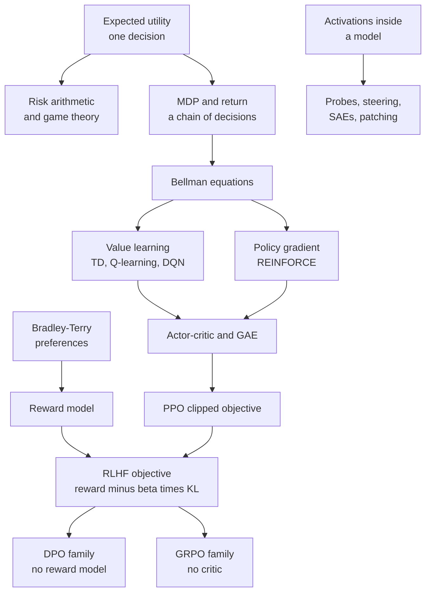
*Figure G.12: How the reinforcement learning, alignment and safety equations connect. Decision theory feeds the MDP, the MDP feeds two learning families, and those families plus a learned reward give the post-training of chatbots.*

### Maximum expected utility (MEU)

**What it does:** Picks the action whose possible outcomes, weighted by how likely they are, are worth the most.

`EU(a) = sum over outcomes s of (P(s given a) × U(s)); a* = argmax over a of EU(a)`

- **a**: one action the agent could take.
- **s**: one possible outcome of that action.
- **P(s given a)**: the probability of outcome s if action a is taken.
- **U(s)**: the utility of outcome s, a number saying how much the agent likes it (higher is better).
- **EU(a)**: the expected utility of action a, the probability-weighted average of its outcomes' utilities.
- **argmax over a**: "the action a that makes what follows as large as possible".
- **a\***: the action chosen, the one with the highest expected utility.

**In plain words:** For each action, list what might happen, multiply how much you would like each result by how likely it is, and add the products. Do that for every action and pick the biggest total. Utilities need not be money: someone who gets less joy from a second thousand dollars than from the first will turn down a fair coin flip, which is risk aversion.

**Tiny example:** A chatbot agent is unsure what you meant. If it answers now, it is right with probability 0.6 (utility 10) and wrong with probability 0.4 (utility −5): EU(answer) = 0.6 × 10 + 0.4 × (−5) = 6 − 2 = 4. If it asks a clarifying question first, it always gets the task right but costs you a little time, utility 8: EU(ask) = 1 × 8 = 8. Since 8 > 4, the argmax is "ask".

**Where it is used:** The decision rule behind the rational agents of Russell and Norvig's *Artificial Intelligence: A Modern Approach*, agents deciding whether to act or to ask, and the risk calculations later in this section. John von Neumann and Oskar Morgenstern showed that anyone whose preferences obey a few consistency rules behaves as if maximizing some utility. A Markov decision process (below) chains this decision over time, with rewards in place of utilities.
**In the book:** Chapter 48 (Deciding when you are not sure: expected utility).

### Value of perfect information (VPI)

**What it does:** Measures how much better you expect to decide if you could learn something before acting.

`VPI = (sum over evidence values e of P(e) × max over a of EU(a given e)) − max over a of EU(a)`

- **e**: one possible result of the information you might get (for example "it will rain").
- **P(e)**: the probability of that result.
- **EU(a given e)**: the expected utility of action a once you know e.
- **max over a of EU(a given e)**: the best you can do after seeing e.
- **max over a of EU(a)**: the best you can do right now, without the information.
- **VPI**: the value of perfect information, always 0 or more.

**In plain words:** Imagine getting each possible answer in turn, choose the best action for that answer, and average those best results using the answers' probabilities. Subtract the best you can do without asking. Information that could never change your choice is worth exactly zero.

**Tiny example:** Chapter 48's umbrella. Utilities: dry and empty-handed 100, dry with an umbrella 80, soaked 0; the chance of rain is 0.3. Without information: EU(take) = 80 and EU(leave) = 0.7 × 100 + 0.3 × 0 = 70, so the best now is 80. With a perfect radar: if rain (probability 0.3), the best is take, 80; if dry (0.7), the best is leave, 100. Expected value with the radar = 0.3 × 80 + 0.7 × 100 = 24 + 70 = 94. VPI = 94 − 80 = 14.

**Where it is used:** Deciding when an agent should ask a clarifying question, which medical test is worth ordering, and active learning, where a system chooses which examples are worth paying a person to label.
**In the book:** Chapter 48 (Deciding when you are not sure: expected utility).

### Off-switch game (value of deferring to a human)

**What it does:** Shows that a machine unsure whether its plan is good gains, on average, by letting a person switch it off.

`value(defer to the human) = E[max(U, 0)] ≥ max(E[U], 0) = value(acting alone or switching itself off)`

- **U**: the true utility, to the human, of the action the robot plans; the robot does not know it exactly.
- **E[...]**: the expected value, the probability-weighted average.
- **max(U, 0)**: what deferring yields if the human lets the action go ahead when U is positive and switches the robot off (value 0) when U is negative.
- **max(E[U], 0)**: the best the robot can do on its own: act anyway (worth E[U] on average) or switch itself off (worth 0).

**In plain words:** If the person will stop the robot exactly when its plan is bad, then deferring keeps all the good cases and throws away all the bad ones. Acting alone has to accept the average, bad cases included. The advantage disappears when the robot is certain about U, or when the human is not a reliable judge.

**Tiny example:** The robot thinks its plan is worth +10 with probability 0.6 and −20 with probability 0.4. Acting alone: E[U] = 0.6 × 10 + 0.4 × (−20) = 6 − 8 = −2, so on its own it would rather switch off (0). Deferring: E[max(U, 0)] = 0.6 × 10 + 0.4 × 0 = 6. Since 6 ≥ 0, letting the human decide is worth 6 more. If the robot were sure the plan is worth +10, both sides would equal 10 and deferring would add nothing.

**Where it is used:** The off-switch game of Hadfield-Menell, Dragan, Abbeel and Russell (2017), part of Stuart Russell's program of building corrigibility from the machine's uncertainty about human preferences (assistance games).
**In the book:** Chapter 56 (Other research bets you will hear about), in words; Chapter 55 (Power-seeking, instrumental convergence and shutdown resistance).

> **Definition — Off-switch game:** A simple model of a robot, a human and an off switch, analyzed in 2017, showing that a robot uncertain about what the human wants has a reason to let the human switch it off, because the human's choice tells it whether its plan was good.

### Expected harm (risk = probability × severity)

**What it does:** Puts rare disasters and common nuisances on one scale, and turns a tiny per-use failure rate into a count at scale.

`risk = P(harm) × severity; expected incidents = p × N; P(at least one incident) = 1 − (1 − p)^N`

- **P(harm)**, **p**: the probability that one use (one request, one action) causes the harm.
- **severity**: how bad the harm is, in dollars or another unit.
- **N**: the number of uses.
- **risk**: the expected loss, the average loss over many such gambles.

**In plain words:** Multiply how likely a harm is by how big it is. Then remember scale: a one-in-ten-thousand failure becomes a daily event when a system answers millions of requests. The last formula is the chance that it happens at least once.

**Tiny example:** A harmful answer happens on p = 0.0001 of requests and costs $2,000 each time: risk per request = 0.0001 × $2,000 = $0.20. Over N = 10,000 requests, expected incidents = 0.0001 × 10,000 = 1, and P(at least one) = 1 − 0.9999^10,000 ≈ 0.632.

**Where it is used:** Risk assessments in frontier safety frameworks and product safety reviews. The EU AI Act (Article 3) defines risk as the combination of the probability of an occurrence of harm and the severity of that harm.
**In the book:** Chapter 56 (What other safety-critical industries learned: a 1-in-1,000 chance of $1 million counts as $1,000), Chapter 55 (Why small error rates are big numbers).

### Risk decomposition (hazard × exposure × vulnerability)

**What it does:** Splits a risk into three factors that can each be reduced separately.

`risk ≈ hazard × exposure × vulnerability`

- **hazard**: the source of harm and how likely or severe it is.
- **exposure**: how much of what we care about comes into contact with the hazard.
- **vulnerability**: how easily the exposed people or systems are harmed.

**In plain words:** Because the factors multiply, halving any one halves the risk. That shows where to act when the hazard itself cannot be removed.

**Tiny example:** Chapter 56's phishing case: 20,000 AI-written emails reach inboxes (exposure) and 2% are clicked (vulnerability): 20,000 × 0.02 = 400 clicks. Halve both: 10,000 × 0.01 = 100, a fourfold cut without touching the hazard.

**Where it is used:** Disaster-risk practice; Hendrycks and Mazeika's "X-Risk Analysis for AI Research" (2022) sorts safety work by the factor it reduces. Labs cannot un-invent a capability, but access tiers cut exposure and classifiers, monitoring and patching cut vulnerability.
**In the book:** Chapter 56 (What other safety-critical industries learned).

### Compounding reliability over many steps

**What it does:** Gives the chance that a long chain of steps all succeed, and the chance that at least one of many tries succeeds.

`P(all n steps succeed) = p^n; per-step reliability needed for target T: p = T^(1 ÷ n); P(at least one success in k tries) = 1 − (1 − p)^k`

- **p**: the probability that one step (or one try) succeeds, assumed independent of the others.
- **n**: the number of steps that must all succeed.
- **T**: the target success rate for the whole task.
- **k**: the number of independent tries.

**In plain words:** Small error rates multiply fast over long tasks. Run the same arithmetic the other way and an attacker with many attempts eventually gets through.

**Tiny example:** 0.95^20 ≈ 0.358, so a 20-step agent task with 95%-reliable steps finishes only about a third of the time. To finish a 100-step task 90% of the time, each step needs 0.9^(1 ÷ 100) ≈ 0.99895, about 99.9%. An attack that works 20% of the time succeeds at least once in 10 tries with probability 1 − 0.8^10 ≈ 0.893.

**Where it is used:** Planning agent reliability; it is why METR's 80% time horizon is several times shorter than its 50% horizon (below), and why jailbreak success rises with the number of attempts. AI control turns it around in the defenders' favor: if each sabotage attempt by an untrusted model escapes the monitor with probability 0.4, a plan that needs five attempts escapes every time with probability 0.4^5 ≈ 0.01.
**In the book:** Chapter 55 (From answers to actions: errors compound), Chapter 28, Chapter 31 (Evaluating agents), Chapter 57 (Why evaluations keep getting harder), Chapter 56 (AI control: safety even if the model is not trustworthy).

### Defense in depth (multiplying pass-through rates)

**What it does:** Combines several imperfect safety layers into an overall rate at which attacks get through.

`pass-through = product over layers i of (1 − c_i), if layers fail independently; in general P(pass all) = P(pass layer 1) × P(pass layer 2 given passed layer 1) × ...`

- **c_i**: the catch rate of layer i, the share of attempts it stops.
- **1 − c_i**: the share it lets through.
- **product over layers**: multiply the shares together.
- **P(pass layer 2 given passed layer 1)**: the chance the second layer also misses, among attempts that already beat the first.

**In plain words:** Independent layers multiply small failure rates into a very small one. Layers that share a blind spot fail together, and the conditional form shows how that correlation eats the benefit. This is the arithmetic of the Swiss cheese model.

**Tiny example:** Chapter 56's four layers catch 90%, 80%, 75% and 50%: 0.10 × 0.20 × 0.25 × 0.5 = 0.0025, or 2.5 in 1,000. Now take an attack style that fools both classifiers for the same reason, so that together they let through 60% of what gets past training instead of 0.20 × 0.25 = 0.05: the first three layers let through 0.10 × 0.60 = 0.06 instead of 0.10 × 0.05 = 0.005, twelve times more.

**Where it is used:** Layered safeguards around frontier models: trained refusals, input and output classifiers such as constitutional classifiers, account monitoring and access tiers, as in Anthropic's ASL-3 protections.
**In the book:** Chapter 56 (Worked example: how layers multiply), Chapter 31 (Defense in depth).

> **Definition — Swiss cheese model:** A picture from aviation and medical safety in which each layer of defense is a slice of cheese with holes; harm gets through only when the holes in every slice line up, so many imperfect but different layers can be very safe together.

### Attack success rate (ASR) and refusal rates

**What it does:** Reports how often attacks get through a model or safeguard, alongside how often harmless requests are wrongly refused.

`ASR = successful attacks ÷ attempts; over-refusal rate = refused benign requests ÷ benign requests; ASR over k independent tries = 1 − (1 − ASR_1)^k`

- **ASR**: attack success rate, the share of jailbreak or misuse attempts that succeed.
- **ASR_1**: the success rate of a single attempt.
- **k**: the number of attempts.
- **over-refusal rate**: the share of harmless requests the system wrongly refuses, the other side of the trade-off.

**In plain words:** Count wins over tries, and always report the false alarms next to it, because a system that refuses everything has an ASR of zero and is useless.

**Tiny example:** Chapter 56's classifier example: 860 of 1,000 automated jailbreaks succeed without classifiers (ASR = 0.86) and 44 of 1,000 with them (0.044). An attacker allowed 10 independent tries against the protected system succeeds at least once with probability 1 − 0.956^10 ≈ 0.362.

**Where it is used:** Safety sections of system cards, HarmBench-style benchmarks and bug-bounty evaluations. Anthropic reported in February 2025 that automated jailbreaks succeeded 86% of the time against an unprotected model and 4.4% with constitutional classifiers.
**In the book:** Chapter 31 (Red-teaming your own system), Chapter 56 (Classifiers and constitutional classifiers), Chapter 57 (Red-teaming: trying to break it), Chapter 20 (Refusal calibration).

### Power-law scaling of repeated jailbreak attempts (Best-of-N jailbreaking)

**What it does:** Predicts how an attacker's success grows with the number of tries, from a straight-line fit that can be extended to budgets nobody has tested yet.

`−ln(ASR_N) = a × N^(−b), so ASR_N = exp(−a × N^(−b)); fitted as the straight line ln(−ln(ASR_N)) = ln(a) − b × ln(N)`

- **ASR_N**: the share of harmful requests that get through at least once within N attempts each.
- **N**: the number of attempts per request, each a small random variation such as shuffled capital letters or typos.
- **a**, **b**: constants fitted to the data; a larger b means success grows faster with N.
- **ln**: the natural logarithm; **exp(...)**: e raised to that power.

**In plain words:** If every attempt were an independent coin flip, success would race toward 100% as 1 − (1 − p)^N (the attack success rate entry above). Real attempts are not independent: some requests resist almost every variation, so success climbs more slowly, and in experiments −ln(ASR) shrinks like a power of N. Fitting the line on small N lets defenders forecast what a determined attacker with thousands of tries would achieve. A related 2024 study of many-shot jailbreaking found that the likelihood of a harmful reply also follows power laws in the number of fake example dialogues packed into one long prompt.

**Tiny example:** Illustrative constants a = 3 and b = 0.3, not a paper's fit. N = 1: −ln(ASR) = 3, so ASR = e^(−3) ≈ 0.050. N = 100: 100^(−0.3) ≈ 0.251, so −ln(ASR) ≈ 3 × 0.251 = 0.754 and ASR ≈ e^(−0.754) ≈ 0.47. N = 10,000: 10,000^(−0.3) ≈ 0.063, so −ln(ASR) ≈ 0.189 and ASR ≈ 0.83. Independent tries at 5% each would already have reached 1 − 0.95^100 ≈ 0.994 by N = 100.

**Where it is used:** Hughes and colleagues ("Best-of-N Jailbreaking", Anthropic and collaborators, December 2024) reached 89% success on GPT-4o and 78% on Claude 3.5 Sonnet with 10,000 varied prompts, and forecast large-N success from power-law fits on smaller samples; Anil and colleagues (Anthropic, 2024) for many-shot jailbreaking; sizing red-team budgets and stress-testing safeguards.
**In the book:** Only here (Chapter 56 and Chapter 57 cover jailbreaks and red-teaming in words).

> **Definition — Best-of-N jailbreaking:** An automated attack that resubmits a harmful request many times with small random changes, such as shuffled capital letters, typos or altered audio and images, until one version gets through. Its success rate grows with the number of attempts in a predictable way.

> **Definition — Many-shot jailbreaking:** An attack that fills a long prompt with many made-up dialogues in which an assistant complies with harmful requests, so that the model continues the pattern; it exploits long context windows.

### Private versus social expected loss (externality gap)

**What it does:** Shows why a developer may skip a safety step that society would want, when most of the damage falls on others.

`developer pays for safety when cost < p × L_developer; society wants it when cost < p × (L_developer + L_others); externality gap = p × L_others`

- **p**: the probability of an incident.
- **L_developer**: the part of the damage the developer bears.
- **L_others**: the part that falls on everyone else.
- **cost**: the price of the extra safety work.

**In plain words:** Each side compares the cost of prevention with its own expected loss. When most of the loss is external, the two answers disagree, a market failure that liability law and regulation try to correct.

**Tiny example:** Chapter 59's numbers: p = 1%, the lab bears $100 million and others $9.9 billion. The lab's expected loss is 0.01 × $100 million = $1 million, less than a $50 million test, so it skips. Society's is 0.01 × $10 billion = $100 million, more than the test. The gap is 0.01 × $9.9 billion = $99 million.

**Where it is used:** AI liability and regulation debates, insurance and safety-standard arguments.
**In the book:** Chapter 59 (Why governing AI is hard: Worked example: who pays for the accident?).

### Payoff matrix, dominant strategy and Nash equilibrium

**What it does:** Tests whether a combination of choices is stable, meaning no player gains by changing only their own choice.

`Nash equilibrium: u_i(s_i*, s_−i*) ≥ u_i(s_i, s_−i*) for every player i and every alternative s_i; dominant strategy d: u_i(d, s_−i) ≥ u_i(s_i, s_−i) for every s_i and every s_−i`

- **i**: one player.
- **u_i**: player i's payoff, read from one cell of the payoff matrix.
- **s_i**: a strategy (choice) of player i; **s_−i**: the strategies of everyone else.
- **s_i\***, **s_−i\***: the strategies in the candidate equilibrium.
- **d**: a dominant strategy, best for player i whatever the others do.

**In plain words:** Freeze everyone else's choice and ask each player, "could you do better by switching?" If nobody can, the outcome is a Nash equilibrium. A dominant strategy is even stronger: it wins against every possible choice of the others. An equilibrium need not be good for the group (Pareto optimal).

**Tiny example:** Chapter 59's racing game, payoffs to Lab A: both careful 7, A fast while B careful 9, A careful while B fast 1, both fast 3. If B is careful, fast gives A 9 > 7; if B is fast, fast gives 3 > 1, so fast is dominant. At (fast, fast) A switching to careful drops from 3 to 1, and the same for B, so (fast, fast) is the Nash equilibrium, although (careful, careful) gives both 7.

**Where it is used:** Multi-agent reinforcement learning and self-play, poker and Diplomacy AIs, and governance analysis of racing. Nash learning from human feedback (Munos and colleagues, Google DeepMind, 2023) frames alignment as finding the equilibrium of a preference game.
**In the book:** Chapter 48 (A short course in game theory), Chapter 59 (Why governing AI is hard: the racing game).

> **Definition — Payoff matrix:** A table listing, for every combination of players' choices, what each player gets. Game theorists read best responses and equilibria straight off it.

### Prisoner's dilemma payoffs and the repeated-game cooperation threshold

**What it does:** Defines the prisoner's dilemma by four payoffs and gives how much players must value the future for cooperation to last.

`T > R > P > S and 2 × R > T + S; in the infinitely repeated game, mutual cooperation under grim trigger is an equilibrium when δ ≥ (T − R) ÷ (T − P)`

- **T**: the temptation payoff for defecting on a cooperator.
- **R**: the reward for mutual cooperation.
- **P**: the punishment for mutual defection.
- **S**: the sucker's payoff for cooperating with a defector.
- **δ** (delta): the discount factor between 0 and 1 for future rounds (how much tomorrow's payoff counts today; it plays the same role as γ in reinforcement learning).

**In plain words:** Defecting is dominant in one round, yet both prefer mutual cooperation. If the game repeats and the future matters enough, the threat of punishment ("if you defect once, I defect forever") makes cooperating the better deal.

**Tiny example:** The racing game has T = 9, R = 7, P = 3, S = 1: 9 > 7 > 3 > 1 and 2 × 7 = 14 > 9 + 1 = 10. Threshold: (9 − 7) ÷ (9 − 3) = 2 ÷ 6 ≈ 0.33. Check at δ = 0.5: cooperating forever is worth 7 ÷ (1 − 0.5) = 14; defecting is worth 9 now plus 3 every later round, 9 + 0.5 × 3 ÷ (1 − 0.5) = 12, so cooperate. At δ = 0.25: 7 ÷ 0.75 ≈ 9.33 against 9 + 0.25 × 3 ÷ 0.75 = 10, so defect.

**Where it is used:** Analyses of racing between AI labs and countries and of why voluntary restraint is fragile; Axelrod's tournaments around 1980, which tit-for-tat won.
**In the book:** Chapter 48 (A short course in game theory, Table 48.8), Chapter 59 (Why governing AI is hard: the racing game), Chapter 60.

> **Definition — Repeated game:** A game played over and over by the same players, so that what they do now can be rewarded or punished later. Cooperation that fails in a single round can hold up when the game repeats.

> **Definition — Grim trigger:** A strategy for a repeated game that cooperates until the other player defects once, then defects forever after. It is the harshest possible threat, which makes it the easiest way to sustain cooperation in theory.

> **Definition — Tit-for-tat:** A strategy for the repeated prisoner's dilemma that cooperates in the first round and then copies whatever the other player did in the previous round. It won Robert Axelrod's computer tournaments around 1980.

### Expected-value model of an AI race

**What it does:** Shows how teams that trade safety for speed can be pushed toward less safety, especially when they dislike a rival winning.

`EV_i = sum over possible winners j of P(j wins) × [(1 − d(s_j)) × U_i(j wins safely) + d(s_j) × U_disaster]`

- **EV_i**: team i's expected value.
- **j**: a team that might win; **P(j wins)**: its chance, which rises when it skimps on safety.
- **s_j**: team j's safety effort, between 0 and 1.
- **d(s)**: the chance of disaster given the winner's safety effort, for example d = 1 − s.
- **U_i(j wins safely)**: how much team i values a safe win by team j; lower when j is a rival (the gap is called enmity).
- **U_disaster**: the value to team i of a disaster.

**In plain words:** Each team's payoff is a weighted average over who wins and whether that win ends in disaster. Skimping raises your chance of winning but also the chance that your win goes badly. If a rival's win is nearly as good to you as your own, skimping rarely pays; if you hate the rival winning, it can.

**Tiny example:** A simplified version (not the paper's exact parameters). Two teams, U_disaster = 0, a safe win by yourself worth 1. Both careful (s = 0.9, each wins with 0.5); team 1 considers skimping to s = 0.8, which raises its win chance to 0.8. With full enmity (a rival's win worth 0): careful gives 0.5 × 0.9 × 1 = 0.45, skimping gives 0.8 × 0.8 × 1 = 0.64, so skimp. With no enmity (a rival's win worth 1 too): careful gives 0.5 × 0.9 + 0.5 × 0.9 = 0.9, skimping gives 0.8 × 0.8 + 0.2 × 0.9 = 0.82, so stay careful.

**Where it is used:** Armstrong, Bostrom and Shulman, "Racing to the precipice" (2016), found that more teams and more enmity push equilibrium safety down; AI governance arguments for coordination, verification and compute-based agreements.
**In the book:** Chapter 59 (Why governing AI is hard: the racing game), Chapter 60, in words.

> **Definition — Enmity (in AI race models):** How much less a team values a rival's success than its own. In race models, higher enmity makes teams more willing to cut safety to win.

### Mixed-strategy equilibrium and the minimax theorem

**What it does:** Finds the random mix of moves that leaves an opponent nothing to exploit, and states that in two-player zero-sum games the best guarantee for each side meets at one value.

`indifference: choose the opponent's mix q so that q × u(a_1, b_1) + (1 − q) × u(a_1, b_2) = q × u(a_2, b_1) + (1 − q) × u(a_2, b_2); minimax theorem: max over x of min over y of (x^T × A × y) = min over y of max over x of (x^T × A × y)`

- **a_1, a_2**: your two actions; **b_1, b_2**: the opponent's two actions.
- **u(a, b)**: your payoff when you play a and the opponent plays b.
- **q**: the probability that the opponent plays b_1.
- **A**: the payoff matrix of a two-player zero-sum game (your gain is the opponent's loss).
- **x**, **y**: mixed strategies, lists of probabilities over each player's moves; **x^T** is x written as a row (its transpose).
- **x^T × A × y**: your expected payoff when both mix.

**In plain words:** In a mixed equilibrium each player randomizes so the other is indifferent between their options. Von Neumann's theorem says that in zero-sum games the best payoff you can guarantee equals the least the opponent can hold you to: the value of the game.

**Tiny example:** A penalty kick. Chance of scoring: kick left, keeper dives left 0.6; kick left, dives right 0.9; kick right, dives left 0.95; kick right, dives right 0.7. The keeper dives left with probability q that makes the kicker indifferent: q × 0.6 + (1 − q) × 0.9 = q × 0.95 + (1 − q) × 0.7, so 0.9 − 0.3 × q = 0.7 + 0.25 × q, giving q = 0.2 ÷ 0.55 ≈ 0.364 and a scoring chance of 0.9 − 0.3 × 0.364 ≈ 0.791. The kicker kicks left with x = 0.25 ÷ 0.55 ≈ 0.455, which also gives 0.791. Both guarantees meet, as the theorem says.

**Where it is used:** Bluffing frequencies in poker programs, security patrol scheduling, and adversarial training formulations. Minimax search over game trees is a separate entry in the classical-AI section.
**In the book:** Chapter 48 (A short course in game theory: rock-paper-scissors at one-third each), in words.

> **Definition — Minimax theorem:** John von Neumann's 1928 result that in any two-player zero-sum game with mixed strategies, the most a player can guarantee equals the least the opponent can hold them to. That shared number is the value of the game.

### Second-price (Vickrey) auction and truthful bidding

**What it does:** Sets auction rules under which bidding your true value is your best strategy.

`winner = highest bidder, who pays the second-highest bid b_(2); u_i = v_i − b_(2) if i wins, else 0; bidding b_i = v_i is a dominant strategy`

- **b_i**: bidder i's bid; **b_(2)**: the second-highest bid.
- **v_i**: what the item is truly worth to bidder i.
- **u_i**: bidder i's gain (utility).

**In plain words:** Your bid decides only whether you win, never what you pay. Overbidding risks winning at a price above your value; underbidding risks losing a profitable win. So honesty is optimal: mechanism design that makes truth-telling the best strategy.

**Tiny example:** Values 50, 40 and 30, everyone bids truthfully. Bidder 1 wins and pays 40, gaining 50 − 40 = 10. Had bidder 1 shaded to 35, bidder 2 (40) would win and bidder 1 would gain 0. Had bidder 2 overbid 60, it would win, pay 50 and gain 40 − 50 = −10.

**Where it is used:** Mechanism design in AIMA; the incentive logic behind sponsored-search and ad-exchange auctions (many exchanges moved to first-price auctions by 2019); spectrum auctions. Its multi-slot cousin for ads, generalized second-price, is not truthful in general and sits with ad ranking in the classical-ML section.
**In the book:** Chapter 48 (A short course in game theory: You can design the game), Chapter 51 (The auction, worked by hand).

> **Definition — Truthful mechanism (incentive compatible):** A set of rules, such as an auction format, under which each participant's best strategy is to report their true value or preference, so nobody gains by lying.

### Markov decision process and the Markov property (MDP)

**What it does:** Writes any problem of repeated decisions as five ingredients, the common language of planning and reinforcement learning.

`MDP = (S, A, P, R, γ), with transition probabilities P(s' given s, a) and expected reward R(s, a); Markov property: P(s_(t+1) given s_t, a_t) = P(s_(t+1) given s_0, a_0, ..., s_t, a_t)`

- **S**: the set of states (situations the agent can be in).
- **A**: the set of actions.
- **P(s' given s, a)**: the transition probability that action a in state s leads to next state s'.
- **R(s, a)**: the expected reward for taking action a in state s.
- **γ** (gamma): the discount factor, between 0 and 1, that shrinks later rewards.
- **s_t**, **a_t**: the state and action at time step t; **s_0, a_0, ...**: the whole history.

**In plain words:** An MDP says what situations exist, what you can do, where each action probably leads, what it pays and how much the future counts. The Markov property says the present state already contains everything needed to predict the next one, so remembering the history adds nothing. Variants merged here: rewards written R(s, a, s'), episodic versus continuing tasks, and finite-horizon MDPs; the partially observable case has its own entry below.

**Tiny example:** A slippery corridor: from square A, action "right" reaches B with probability 0.8 and leaves you in A with 0.2 (0.8 + 0.2 = 1, as every row of P must). If entering B pays 10 and staying pays 0, then R(A, right) = 0.8 × 10 + 0.2 × 0 = 8. The Markov property holds because those probabilities depend only on being in A now, not on how you got there.

**Where it is used:** The formal frame of every algorithm in this section: games such as Atari and Go, robot control, data-center cooling control, and language-model post-training, where the state is the prompt plus the tokens written so far, the action is the next token, the transition simply appends that token, and the reward usually arrives at the end.
**In the book:** Chapter 48 (Markov decision processes: the formal frame), Chapter 20 (A two-paragraph refresher on reinforcement learning).

> **Definition — Transition probability:** In a Markov decision process, the probability that taking a given action in a given state leads to a particular next state. The full table of them is the transition model, the "rules" of the environment.

### Discounted return (G)

**What it does:** Adds up all future rewards from a moment on, counting later ones a little less.

`G_t = r_(t+1) + γ × r_(t+2) + γ^2 × r_(t+3) + ... = sum over k ≥ 0 of (γ^k × r_(t+k+1)); recursively G_t = r_(t+1) + γ × G_(t+1)`

- **G_t**: the return from time step t onward.
- **r_(t+1)**: the reward received right after step t; **r_(t+k+1)**: the reward k steps later.
- **γ** (gamma): the discount factor, from 0 to 1.
- **k**: how many steps into the future a reward lies.

**In plain words:** A reward k steps away is multiplied by γ k times. The recursive form says "the return now is the next reward plus the discounted return from the next step", the seed of the Bellman equations. The effective planning horizon is about 1 ÷ (1 − γ) steps. With γ = 1 and an episode that ends, the return is just the sum of rewards, the usual setting for training language models, where one reward arrives at the end.

**Tiny example:** Rewards 0, 0 and then 10, with γ = 0.9: G_0 = 0 + 0.9 × 0 + 0.81 × 10 = 8.1. The recursive way, from the end: G_2 = 10, G_1 = 0 + 0.9 × 10 = 9, G_0 = 0 + 0.9 × 9 = 8.1. The horizon is 1 ÷ (1 − 0.9) = 10 steps; γ = 0.99 gives about 100.

**Where it is used:** The learning target of every value-based and policy-gradient method. DQN on Atari used γ = 0.99; PPO-based RLHF implementations such as Hugging Face TRL's PPO trainer default to γ = 1, so the return is the final reward-model score minus the per-token KL penalties.
**In the book:** Chapter 48 (Rewards, returns and discounting).

> **Definition — Effective horizon:** Roughly how many steps ahead an agent with discount factor γ cares about, about 1 ÷ (1 − γ). With γ = 0.9 rewards beyond about 10 steps barely count; with γ = 0.99, about 100.

### State-value and action-value functions (V and Q)

**What it does:** Defines how good a state is, and how good an action in that state is, as expected returns.

`V_π(s) = E_π[G_t given s_t = s]; Q_π(s, a) = E_π[G_t given s_t = s, a_t = a]; V_π(s) = sum over a of (π(a given s) × Q_π(s, a))`

- **π** (pi): the policy; **π(a given s)** is the probability it chooses action a in state s.
- **V_π(s)**: the state value, the expected return starting from state s and following π.
- **Q_π(s, a)**: the action value, the expected return after taking action a in s and following π afterward.
- **E_π[...]**: the expected value over the randomness of the policy and the environment.
- **G_t**: the return from time t (previous entry).

**In plain words:** V answers "how good is it to be here?" and Q answers "how good is this move here?". A state's value is the policy-weighted average of its action values.

**Tiny example:** In state s the policy picks "right" with probability 0.75 and "left" with 0.25, and Q(s, right) = 8, Q(s, left) = 2. Then V(s) = 0.75 × 8 + 0.25 × 2 = 6 + 0.5 = 6.5.

**Where it is used:** Critics and value heads everywhere: the value model in PPO-based RLHF, AlphaGo's value network, DQN's Q-network and the value head of MuZero.
**In the book:** Chapter 48 (Policies and values), Chapter 20 (The RLHF loop: value model).

### Bellman expectation equation

**What it does:** Breaks a state's value into the expected next reward plus the discounted value of where you land, for a fixed policy.

`V_π(s) = sum over a of π(a given s) × sum over s' of P(s' given s, a) × (R(s, a, s') + γ × V_π(s')); Q_π(s, a) = sum over s' of P(s' given s, a) × (R(s, a, s') + γ × sum over a' of π(a' given s') × Q_π(s', a'))`

- **V_π**, **Q_π**: the state and action values of policy π (previous entry).
- **π(a given s)**: the probability the policy picks action a in s.
- **P(s' given s, a)**: the transition probability to next state s'.
- **R(s, a, s')**: the reward for that step.
- **γ**: the discount factor.
- **a'**: the action taken in the next state.

**In plain words:** Value now equals the reward you expect next plus the discounted value of the next state, averaged over the policy's choices and the environment's randomness. It turns a sum over whole futures into a one-step recursion, which is what makes values computable and learnable a step at a time. Written with expectations: V_π(s) = E_π[r_(t+1) + γ × V_π(s_(t+1)) given s_t = s].

**Tiny example:** In state s the policy picks right or left with probability 0.5 each; γ = 0.9. Right leads to a state worth 10 with probability 0.8 or to one worth 0 with probability 0.2, reward 0 either way: 0.8 × (0 + 0.9 × 10) + 0.2 × (0 + 0.9 × 0) = 7.2. Left leads for sure to a state worth 2, with reward 1: 1 × (1 + 0.9 × 2) = 2.8. So V(s) = 0.5 × 7.2 + 0.5 × 2.8 = 3.6 + 1.4 = 5.0.

**Where it is used:** Policy evaluation, the targets of TD learning and SARSA, and every learned critic, from the value model in RLHF to actor-critic robot controllers.
**In the book:** Chapter 48 (Policies and values).

> **Definition — Policy evaluation:** Computing how much return a fixed policy earns from each state, usually by applying the Bellman expectation equation over and over until the values stop changing.

### Bellman optimality equation

**What it does:** Describes the best possible values: the best action's expected reward plus the discounted best value of where it leads.

`V*(s) = max over a of sum over s' of P(s' given s, a) × (R(s, a, s') + γ × V*(s')); Q*(s, a) = sum over s' of P(s' given s, a) × (R(s, a, s') + γ × max over a' of Q*(s', a')); π*(s) = argmax over a of Q*(s, a)`

- **V\*(s)**, **Q\*(s, a)**: the optimal state and action values, the best achievable over all policies.
- **max over a**: take the largest over actions.
- **P(s' given s, a)**, **R(s, a, s')**, **γ**: transition probability, reward and discount, as above.
- **π\*(s)**: an optimal policy, which picks the action with the highest Q\*.
- **s'**, **a'**: the next state and an action in it.

**In plain words:** The expectation equation averages over the policy's choices; the optimality equation takes the best choice instead. Once you know Q\*, acting well is easy: in every state pick the action with the biggest Q\*.

**Tiny example:** Same state as the previous entry, with those next-state values now taken as optimal: Q\*(s, right) = 7.2 and Q\*(s, left) = 2.8, so V\*(s) = max(7.2, 2.8) = 7.2 and π\*(s) = right. In Chapter 48's deterministic corridor the final values 10, 9 and 8.1 satisfy it: 9 = 0 + 0.9 × 10 and 8.1 = 0 + 0.9 × 9.

**Where it is used:** The fixed point that value iteration, Q-learning and DQN aim at. The max inside it is also the source of the overestimation bias that Double DQN (below) fixes.
**In the book:** Chapter 48 (Markov decision processes: the formal frame).

> **Definition — Optimal value function:** The highest expected return achievable from each state (written V\*) or from each state-and-action pair (written Q\*) by any policy. Acting greedily on Q\* gives an optimal policy.

### Value iteration

**What it does:** Computes optimal values when the rules are known, by applying the Bellman optimality equation as an update until nothing changes.

`V_(k+1)(s) = max over a of sum over s' of P(s' given s, a) × (R(s, a, s') + γ × V_k(s')), for every state s, repeated until max over s of |V_(k+1)(s) − V_k(s)| is below a small threshold`

- **V_k(s)**: the value estimate of state s after k sweeps; all start at 0.
- **P**, **R**, **γ**: transition probabilities, rewards and discount (known in advance).
- **|...|**: the absolute value, the size of a change ignoring its sign.
- **threshold**: a small number such as 0.001 at which you stop.
- **s'**: a possible next state; **a**: an action; **V_(k+1)(s)**: the new estimate after one more sweep.

**In plain words:** Sweep through every state, replacing its value with "best immediate reward plus discounted value of where that action leads", using the previous sweep's values. Each sweep shrinks the worst error by at least a factor γ (the update is a contraction), so the values settle on V\*. Variants: in-place sweeps that use new values immediately, and "soft" value iteration, which replaces the max with a smooth maximum in maximum-entropy RL.

**Tiny example:** A slippery corridor A, B, then a goal worth +10; "right" moves one square with probability 0.8 and fails (you stay) with 0.2; γ = 0.9; "left" is always worse here, so the max picks "right". Sweep 1: V(B) = 0.8 × 10 + 0.2 × 0.9 × 0 = 8; V(A) = 0.8 × 0.9 × 0 + 0.2 × 0.9 × 0 = 0. Sweep 2: V(B) = 8 + 0.2 × 0.9 × 8 = 9.44; V(A) = 0.8 × 0.9 × 8 + 0.2 × 0.9 × 0 = 5.76. Sweep 3: V(B) = 8 + 0.18 × 9.44 ≈ 9.70; V(A) = 0.72 × 9.44 + 0.18 × 5.76 ≈ 7.83. They converge to about 9.76 and 8.57.

**Where it is used:** Planning when the model of the world is known: gridworlds, inventory and queueing problems, small robot maps, and the inner loop of maximum-entropy inverse RL (below).
**In the book:** Chapter 48 (Markov decision processes: the formal frame: the deterministic corridor in three sweeps, 10, 9, 8.1).

> **Definition — Contraction (in value iteration):** An update that always brings any two sets of value estimates closer together by at least a fixed factor, here γ. Repeating a contraction is guaranteed to converge to a single answer, which is why value iteration always finds the optimal values.

### Policy iteration and the policy improvement theorem

**What it does:** Alternates between scoring a policy and making it greedy with respect to those scores, improving it every round.

`evaluate: solve V_π from the Bellman expectation equation; improve: π_new(s) = argmax over a of sum over s' of P(s' given s, a) × (R(s, a, s') + γ × V_π(s')); theorem: if Q_π(s, π_new(s)) ≥ V_π(s) for every s, then V_(π_new)(s) ≥ V_π(s) for every s`

- **π**, **π_new**: the current and the improved policy.
- **V_π**, **Q_π**: the values of the current policy.
- **π_new(s)**: the action the new policy picks in state s.
- **P**, **R**, **γ**: as above.
- **s'**: a possible next state; **V_(π_new)**: the value of the new policy.

**In plain words:** Work out exactly how good your current plan is, then in each state switch to the action that looks best under those numbers. The theorem guarantees the new plan is at least as good everywhere, and a finite MDP reaches an optimal policy in a finite number of rounds. The general pattern of interleaving evaluation and improvement is called generalized policy iteration.

**Tiny example:** State A: "stay" pays 1 and stays in A; "go" pays 0 and moves to B. State B: "stay" pays 2 forever. γ = 0.9. Start with "stay" everywhere. Evaluate: V(B) = 2 ÷ (1 − 0.9) = 20 and V(A) = 1 ÷ 0.1 = 10. Improve A: Q(A, stay) = 1 + 0.9 × 10 = 10, Q(A, go) = 0 + 0.9 × 20 = 18, so switch to "go". The new V(A) is 18, up from 10, and a second round changes nothing: optimal.

**Where it is used:** A textbook planning method. Generalized policy iteration is the template behind actor-critic methods and behind AlphaZero, where tree search improves the policy and the network learns to evaluate it.
**In the book:** Chapter 48 (Markov decision processes: the formal frame), named in the value iteration definition.

> **Definition — Policy iteration:** A planning method for MDPs with known rules that repeatedly computes the value of the current policy and then switches each state to the action that looks best under those values, until the policy stops changing.

> **Definition — Policy improvement theorem:** The guarantee that a policy made greedy with respect to another policy's values is at least as good as that policy in every state.

> **Definition — Generalized policy iteration (GPI):** The general pattern of letting a value estimate and a policy improve each other in turns: the values judge the policy, the policy is made greedier toward the values, and so on. Most reinforcement learning methods are versions of it.

### Potential-based reward shaping

**What it does:** Adds hints to the reward in a form that provably cannot change which policy is best.

`r'(s, a, s') = r(s, a, s') + γ × Φ(s') − Φ(s)`

- **r(s, a, s')**: the original reward for moving from s to s' with action a.
- **r'(s, a, s')**: the shaped reward the agent is trained on.
- **Φ** (capital phi): a potential, any function of the state, such as minus the distance to the goal.
- **γ**: the discount factor.

**In plain words:** Give the agent the change in "potential" as a bonus: credit for moving to a better-looking state, an equal debit for moving back. Over any path the bonuses telescope to depend only on where you started and ended, so circling earns nothing. Ng, Harada and Russell (1999) proved this form never changes the optimal policy, while other bonus schemes can create loopholes.

**Tiny example:** Corridor squares A, B, C, goal, with Φ = minus the distance to the goal: Φ(A) = −3, Φ(B) = −2. Take γ = 1 to keep it simple. Moving A to B earns −2 − (−3) = +1; moving back B to A earns −3 − (−2) = −1. A loop A to B to A nets 0. A naive bonus of +1 for every step toward the goal and nothing for steps away would pay +1 per loop, an invitation to circle like the CoastRunners boat.

**Where it is used:** Speeding up learning in robotics and games without creating new reward hacks; a reference point when designing partial or format rewards for language-model RL, which are usually not potential-based and can therefore be gamed.
**In the book:** Only here. Chapter 48 (Credit assignment) defines plain reward shaping in words and warns that it can be gamed.

> **Definition — Potential-based reward shaping:** Adding to each step's reward the discounted change in a chosen "potential" score of the state. It speeds up learning and, unlike other bonus schemes, provably leaves the best policy unchanged.

### POMDP belief update

**What it does:** Updates an agent's probabilities over hidden states after it acts and observes something.

`b'(s') = η × O(o given s', a) × sum over s of (P(s' given s, a) × b(s)), with η = 1 ÷ (the sum of the right-hand side over all s')`

- **b(s)**: the belief, the agent's probability that the hidden state is s.
- **b'(s')**: the updated belief that the new state is s'.
- **a**: the action just taken; **o**: the observation just received.
- **P(s' given s, a)**: the transition probability.
- **O(o given s', a)**: the observation model, how likely observation o is in state s'.
- **η** (eta): a normalizer that makes the new beliefs add up to 1.

**In plain words:** First predict: push your old beliefs through the transition model. Then correct: multiply each predicted state by how likely the observation is there, and rescale so everything sums to 1. It is Bayes' rule applied after every step; hidden Markov model filtering and Kalman filters, in the classical-AI section, are the same update without actions.

**Tiny example:** A robot is in the Kitchen with belief 0.6 or the Hall with 0.4. It drives east: from the Kitchen it reaches the Hall with probability 0.9 (stays with 0.1); from the Hall it stays in the Hall. Predict: Kitchen 0.6 × 0.1 = 0.06; Hall 0.6 × 0.9 + 0.4 × 1.0 = 0.94. It then sees a window, which it sees with probability 0.2 in the Kitchen and 0.7 in the Hall: 0.2 × 0.06 = 0.012 and 0.7 × 0.94 = 0.658, total 0.67, so η = 1 ÷ 0.67. New beliefs: Kitchen 0.012 ÷ 0.67 ≈ 0.018, Hall 0.658 ÷ 0.67 ≈ 0.982.

**Where it is used:** Robot localization, dialogue state tracking, poker and other hidden-information games, and any agent that must act on uncertain state.
**In the book:** Chapter 48 (Markov decision processes: the formal frame: POMDP and belief state, in words), Chapter 54 (Reasoning over time: hidden states and filters, the same update without actions).

> **Definition — Observation model:** In a partially observable problem, the probabilities of each possible observation (a sensor reading, a card shown) given the true hidden state. It tells the agent how much each observation should shift its beliefs.

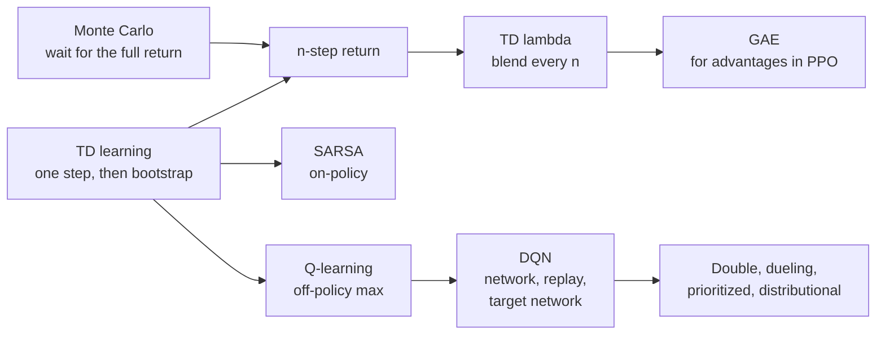
*Figure G.13: The family of value-learning updates. They differ in how far they look ahead with real rewards before trusting their own estimates.*

### Monte Carlo value estimate and the incremental mean

**What it does:** Estimates a value by averaging returns actually observed, updating the average one sample at a time.

`V(s) ← V(s) + α × (G_t − V(s)); with α = 1 ÷ N(s) this is the running average of observed returns; bandit form: Q_(n+1) = Q_n + (1 ÷ n) × (R_n − Q_n)`

- **V(s)**: the current value estimate for state s.
- **←**: "is replaced by".
- **G_t**: a complete return observed after visiting s.
- **α** (alpha): the step size (learning rate).
- **N(s)**: how many times s has been visited.
- **Q_n**: the estimate of an action's value after n − 1 rewards; **R_n**: the n-th reward.

**In plain words:** New estimate = old estimate + step × (target − old estimate). With step 1 ÷ n this keeps an exact average without storing past returns; a constant step weights recent returns more, which suits a changing world. Monte Carlo estimates are unbiased but noisy, and they must wait for the episode to end. Variants: first-visit and every-visit Monte Carlo.

**Tiny example:** Chapter 48's four episodes return 10, 2, 8 and 4. Start at 0. After 10: 0 + 1 × (10 − 0) = 10. After 2: 10 + (1 ÷ 2) × (2 − 10) = 6. After 8: 6 + (1 ÷ 3) × (8 − 6) ≈ 6.67. After 4: 6.67 + (1 ÷ 4) × (4 − 6.67) = 6.0, exactly the average. With a constant α = 0.5 the estimates go 5, 3.5, 5.75, 4.875.

**Where it is used:** AlphaZero's value target is the Monte Carlo outcome of the finished game. In RL with verifiable rewards (GRPO and its relatives) each answer's single end-of-episode reward is a Monte Carlo return with no bootstrapping. Bandit action-value estimates use the incremental form.
**In the book:** Chapter 48 (Policy gradients and actor-critic methods: the average return of four episodes; Monte Carlo tree search), in words.

> **Definition — Incremental mean:** Updating an average one new number at a time with new average = old average + (new number − old average) ÷ count, so the past numbers never need to be stored.

### TD(0) learning and the TD error (δ)

**What it does:** Updates a value estimate after every single step, using the next state's estimate in place of the rest of the future.

`δ_t = r_(t+1) + γ × V(s_(t+1)) − V(s_t); V(s_t) ← V(s_t) + α × δ_t; with a network V_w instead of a table (semi-gradient TD): w ← w + α × δ_t × ∇_w V_w(s_t)`

- **δ_t** (delta): the temporal-difference error, how much better or worse the step went than predicted.
- **r_(t+1)**: the reward just received.
- **V(s_t)**, **V(s_(t+1))**: the current estimates for this state and the next.
- **γ**: the discount factor; **α**: the step size.
- **w**: the weights of a value network V_w; **∇_w V_w(s_t)**: the gradient, which says how each weight changes the prediction for s_t. "Semi" because the target r + γ × V_w(s_(t+1)) is treated as a fixed number, not differentiated.

**In plain words:** Before the step you predicted V(s_t). After one step you have a slightly better-informed guess: the reward you got plus the discounted estimate of where you landed. Nudge the old prediction a fraction α toward the new guess. Using your own estimate as part of the target is called bootstrapping; it lowers noise compared with Monte Carlo, at the price of some bias.

**Tiny example:** V(A) = 5, V(B) = 8, moving from A to B pays 1, γ = 0.9 and α = 0.1. δ = 1 + 0.9 × 8 − 5 = 1 + 7.2 − 5 = 3.2, so V(A) becomes 5 + 0.1 × 3.2 = 5.32. Semi-gradient version with a linear value V_w(s) = w · x(s), features x(A) = [1, 2] and w = [1, 2] (so V(A) = 1 + 4 = 5): the gradient is x(A) = [1, 2], so w becomes [1 + 0.1 × 3.2 × 1, 2 + 0.1 × 3.2 × 2] = [1.32, 2.64] and V(A) becomes 1.32 + 5.28 = 6.6. Every other state that shares those features moves too, which is how a network generalizes.

**Where it is used:** Every learned critic (A2C, PPO, SAC); TD-Gammon (1992); and neuroscience, where Schultz and colleagues (1997) found dopamine neurons firing like a TD error.
**In the book:** Chapter 48 (Q-learning, worked by hand).

> **Definition — Bootstrapping in reinforcement learning:** Building a learning target partly out of the learner's own current estimates, as when TD learning uses the next state's estimated value in place of the true remaining return. It speeds learning but can carry errors forward. (Not the same as bootstrapping a company with its own money.)

### Advantage function (A = Q − V) and its one-step estimate

**What it does:** Says how much better an action is than the policy's average behavior in that state.

`A_π(s, a) = Q_π(s, a) − V_π(s); one-step estimate A_t ≈ δ_t = r_(t+1) + γ × V(s_(t+1)) − V(s_t); E over a from π of [A_π(s, a)] = 0`

- **A_π(s, a)**: the advantage of action a in state s under policy π.
- **Q_π**, **V_π**: action value and state value.
- **δ_t**: the TD error, an estimate of the advantage of the action actually taken.
- **E over a from π of [...]**: the average over the policy's own action choices.
- **r_(t+1)**, **γ**, **V(s_t)**, **V(s_(t+1))**: the reward just received, the discount factor, and the value estimates of this state and the next.

**In plain words:** Advantages average to zero under the policy, so pushing up positive-advantage actions and down negative ones changes behavior without inflating everything at once. The TD error is an unbiased estimate of the advantage when V is exact.

**Tiny example:** With the earlier numbers (Q(s, right) = 8, Q(s, left) = 2, policy 0.75 and 0.25, V = 6.5): A(right) = 8 − 6.5 = 1.5, A(left) = 2 − 6.5 = −4.5, and 0.75 × 1.5 + 0.25 × (−4.5) = 0. Chapter 20's toy gives +0.42, +1.02 and −2.58.

**Where it is used:** It weights the update in A2C, PPO and RLHF; GRPO replaces the learned V with a group mean and divides by the group's spread.
**In the book:** Chapter 48 (Policy gradients and actor-critic methods), Chapter 20 (Worked toy example: one prompt, three replies), Chapter 21.

### n-step return

**What it does:** Uses n real rewards and then bootstraps from the value estimate n steps ahead.

`G_t^(n) = r_(t+1) + γ × r_(t+2) + ... + γ^(n−1) × r_(t+n) + γ^n × V(s_(t+n))`

- **G_t^(n)**: the n-step return from time t.
- **r_(t+1), ..., r_(t+n)**: the next n real rewards.
- **γ**: the discount factor.
- **V(s_(t+n))**: the current value estimate of the state reached after n steps.

**In plain words:** n = 1 is TD(0); n reaching the end of the episode is the Monte Carlo return. In between you trade bias against noise, and reward travels back n squares per update instead of one.

**Tiny example:** Chapter 48's corridor after one episode, using the "right" values of Table 48.5 as state values: V(B) = 0 and V(C) = 5, γ = 0.9, all step rewards 0 before the goal. The 1-step target for A is 0 + 0.9 × V(B) = 0: nothing has reached A yet. The 2-step target is 0 + 0.9 × 0 + 0.81 × V(C) = 0.81 × 5 = 4.05, so news of the goal reaches A one episode sooner.

**Where it is used:** A3C (rollouts of up to 5 steps), Rainbow DQN (n = 3), the distributed agent R2D2, and MuZero's value targets.
**In the book:** Only here.

> **Definition — n-step return:** A learning target that adds up the next n actual rewards and then the discounted value estimate of the state reached, a middle ground between one-step TD learning and waiting for the whole episode.

> **Definition — Rainbow (DQN):** A 2017 DeepMind agent that combined six improvements to the deep Q-network, among them double Q-learning, the dueling architecture, prioritized replay, n-step returns and distributional values, and outperformed each of them alone on Atari games.

### TD(λ), the λ-return and eligibility traces

**What it does:** Blends all n-step returns with geometrically shrinking weights, and implements the blend with a fading memory of recently visited states.

`G_t^λ = (1 − λ) × sum over n ≥ 1 of (λ^(n−1) × G_t^(n)); backward view: e_t(s) = γ × λ × e_(t−1)(s) + (1 if s = s_t else 0), then V(s) ← V(s) + α × δ_t × e_t(s) for every state s`

- **λ** (lambda): a number from 0 to 1 that sets how far back credit flows.
- **G_t^(n)**: the n-step return (previous entry); **G_t^λ**: the λ-return.
- **e_t(s)**: the eligibility trace of state s at time t.
- **δ_t**: the TD error at time t; **α**: step size; **γ**: discount.
- **V(s)**: the value estimate of state s; **s_t**: the state visited at time t.

**In plain words:** λ = 0 gives TD(0) and λ = 1 gives Monte Carlo. The trace marks each visited state and fades by γ × λ every step, so every new TD error updates all recent states in proportion to how recently they were visited. In an episode that ends, the leftover weight goes to the full return. Generalized advantage estimation (below) applies the same weighting to advantages.

**Tiny example:** λ = 0.5 gives weights 0.5, 0.25, 0.125, ... From A in the corridor above, the 1-step return is 0, the 2-step return 4.05 and the full return 0.81 × 10 = 8.1 (episode over after 3 steps, so it takes the leftover weight 0.25): G^λ = 0.5 × 0 + 0.25 × 4.05 + 0.25 × 8.1 ≈ 3.04. Backward view with γ = 0.9: visit A (trace 1), then B (A's trace fades to 0.9 × 0.5 = 0.45). A TD error of 2 at B with α = 0.1 adds 0.1 × 2 × 1 = 0.2 to V(B) and 0.1 × 2 × 0.45 = 0.09 to V(A).

**Where it is used:** TD-Gammon (Tesauro, 1992-1995) learned backgammon with TD(λ) and a neural network; the λ weighting lives on inside GAE in PPO.
**In the book:** Only here. Chapter 48 (Early learners: checkers and backgammon) says TD-Gammon used temporal-difference learning.

> **Definition — TD(λ):** A family of temporal-difference methods that average one-step, two-step and longer returns with weights shrinking by a factor λ, sliding between one-step TD (λ = 0) and Monte Carlo (λ = 1).

> **Definition — Eligibility trace:** A fading tag on each recently visited state (or state and action), raised when the state is visited and shrunk a little every step, so that each new learning signal is shared with the states that led up to it.

### SARSA and Expected SARSA

**What it does:** Learns the action values of the policy the agent actually follows, exploration included.

`Q(s, a) ← Q(s, a) + α × (r + γ × Q(s', a') − Q(s, a)), where a' is the action actually chosen next; Expected SARSA uses sum over b of (π(b given s') × Q(s', b)) in place of Q(s', a')`

- **Q(s, a)**: the estimate for action a in state s.
- **r**: the reward received; **s'**: the next state.
- **a'**: the next action the agent actually picks; **b**: any action in s'.
- **π(b given s')**: the policy's probability of b in s'.
- **α**, **γ**: step size and discount.

**In plain words:** The name lists the five things each update uses: state, action, reward, next state, next action. Because it uses the action really taken next, random moves included, it learns safer routes than Q-learning near a cliff edge. Expected SARSA averages over the next action instead of sampling it, which lowers noise.

**Tiny example:** Q(s, a) = 4, r = 0, γ = 0.9, α = 0.5. In s' the best action is worth 9 and another worth 6, and the agent's exploration happened to pick the 6. SARSA target 0.9 × 6 = 5.4, new Q = 4 + 0.5 × (5.4 − 4) = 4.7. Q-learning would use 0.9 × 9 = 8.1 and get 6.05. Expected SARSA with probabilities 0.95 and 0.05: 0.9 × (0.95 × 9 + 0.05 × 6) = 0.9 × 8.85 ≈ 7.97, new Q ≈ 5.98.

**Where it is used:** Textbook on-policy control (Sutton and Barto, Chapter 6), and a stepping stone to on-policy methods such as PPO.
**In the book:** Only here.

> **Definition — SARSA:** An on-policy temporal-difference method that updates each action value toward the reward plus the value of the action the agent actually takes next. The name lists what it uses: State, Action, Reward, next State, next Action.

> **Definition — Expected SARSA:** A version of SARSA that replaces the sampled next action's value with the average next-action value under the policy, which gives steadier updates.

### Q-learning update

**What it does:** Learns optimal action values from experience by nudging each estimate toward the reward plus the best next estimate.

`Q(s, a) ← Q(s, a) + α × (r + γ × max over a' of Q(s', a') − Q(s, a))`

- **Q(s, a)**: the estimate for the action just taken.
- **r**: the reward; **s'**: the next state.
- **max over a' of Q(s', a')**: the best estimate in the next state.
- **α**, **γ**: step size and discount. At a terminal state the target is just r.

**In plain words:** Because the target uses the best next action rather than the one actually taken, Q-learning is off-policy: it learns optimal values while exploring. Chris Watkins introduced it in 1989, and Watkins and Dayan (1992) proved that the table converges to the optimal values when every state-action pair keeps being visited and α shrinks appropriately.

**Tiny example:** Chapter 48's corridor, episode 2, square B: 0 + 0.5 × (0 + 0.9 × 5 − 0) = 2.25.

**Where it is used:** Tabular control, and the update that DQN turns into a neural-network loss.
**In the book:** Chapter 48 (Q-learning, worked by hand).

### Deep Q-network loss with target network and experience replay (DQN)

**What it does:** Turns the Q-learning update into a squared-error loss for a neural network, with two tricks that keep training stable.

`L(θ) = E over (s, a, r, s') sampled from the replay buffer of [(r + γ × max over a' of Q_target(s', a') − Q_θ(s, a))^2]; target refresh θ_target ← θ every C steps, or Polyak averaging θ_target ← τ × θ + (1 − τ) × θ_target`

- **θ** (theta): the Q-network's weights; **Q_θ(s, a)**: its estimate.
- **Q_target**: a slowly updated copy of the network that supplies the targets; **θ_target**: its weights.
- **(s, a, r, s')**: one stored transition from the replay buffer.
- **C**: how many steps between hard copies.
- **τ** (tau): a small mixing rate such as 0.005 for soft (Polyak) updates.
- **r**, **γ**, **a'**: the stored reward, the discount factor, and any action in the next state s'.
- **E over ... of [...]**: the average over transitions sampled from the buffer.
- **L(θ)**: the loss to be made small.

**In plain words:** Sample old experiences at random from memory, compute a target with the frozen copy, and shrink the squared gap between target and prediction. The replay buffer breaks the correlation between consecutive frames, and the slow target stops the network chasing its own tail. The 2015 DQN clipped the error to the range −1 to 1, which amounts to using the Huber loss.

**Tiny example:** Transition with r = 1, γ = 0.9; the target network scores the next state's actions 2.0 and 3.0; the online network says Q_θ(s, a) = 3.5. Target = 1 + 0.9 × 3.0 = 3.7; error = 3.7 − 3.5 = 0.2; loss = 0.2^2 = 0.04. A soft update with τ = 0.005 moves a target weight of 0.5 toward an online weight of 0.7: 0.005 × 0.7 + 0.995 × 0.5 ≈ 0.501.

**Where it is used:** DQN learned 49 Atari games from pixels with one architecture (*Nature*, 2015); Polyak-averaged target networks are standard in DDPG, TD3 and SAC.
**In the book:** Chapter 48 (From tables to neural networks: Deep Q-Networks).

### Double DQN target

**What it does:** Reduces Q-learning's tendency to overrate actions by letting one network choose the next action and another score it.

`y = r + γ × Q_target(s', argmax over a' of Q_θ(s', a'))`

- **y**: the learning target.
- **Q_θ**: the online network, which picks the best-looking next action.
- **Q_target**: the target network, which scores that action.
- **r**, **γ**, **s'**: reward, discount and next state.
- **a'**: an action in the next state.

**In plain words:** Taking the max of noisy estimates is biased upward: the expected maximum is at least the maximum of the expectations. Separating "which action looks best" from "how good is it really" removes much of that bias. Its tabular ancestor is double Q-learning with two tables; TD3's minimum of two critics is the continuous-action relative.

**Tiny example:** Overestimation first: two actions both truly worth 0, each estimate randomly +1 or −1. The four equally likely cases have maxima 1, 1, 1 and −1, average 0.5, not 0. Now a target: the online network rates the next actions 3.0 and 2.5 and picks the first; the target network rates them 2.6 and 2.9. Ordinary DQN uses 1 + 0.9 × 2.9 = 3.61; Double DQN uses 1 + 0.9 × 2.6 = 3.34.

**Where it is used:** van Hasselt, Guez and Silver (2016); a standard part of Rainbow and later value-based agents.
**In the book:** Only here.

> **Definition — Double DQN:** A version of the deep Q-network whose targets use the online network to choose the next action and the target network to value it, curbing the habit of overestimating action values.

> **Definition — Overestimation bias:** The tendency of methods that take the maximum over noisy value estimates to come out too high, because the maximum picks up whichever estimate happened to be lucky.

### Dueling network architecture

**What it does:** Splits a Q-network into a part that values the state and a part that ranks the actions.

`Q(s, a) = V(s) + (A(s, a) − (1 ÷ |A|) × sum over a' of A(s, a'))`

- **V(s)**: the state-value stream.
- **A(s, a)**: the advantage stream for action a.
- **|A|**: the number of actions.
- **sum over a' of A(s, a') ÷ |A|**: the average advantage, subtracted so the split is well defined.

**In plain words:** Many states are good or bad whatever you do, so learning their value once, separately from the small differences between actions, is efficient. Subtracting the mean advantage stops any constant from drifting between the two streams.

**Tiny example:** V(s) = 5 and advantages 4, 1, 1 (mean 2): Q = 5 + (4 − 2) = 7, 5 + (1 − 2) = 4 and 4. Adding 10 to every advantage gives the same Q-values, which is the point of subtracting the mean.

**Where it is used:** Wang and colleagues (2016); part of Rainbow.
**In the book:** Only here.

> **Definition — Dueling network:** A Q-network design with two output streams, one estimating how good the state is and one how much better each action is than average, recombined into Q-values.

### Prioritized experience replay

**What it does:** Replays surprising experiences more often, then corrects the bias that causes.

`P(i) = p_i^α ÷ sum over k of p_k^α, with priority p_i = |δ_i| + ε; importance weight w_i = (N × P(i))^(−β) ÷ max over j of w_j`

- **P(i)**: the probability of replaying transition i.
- **p_i**: its priority; **|δ_i|**: the size of its last TD error.
- **α** (alpha here): how strongly priorities matter (0 means uniform sampling).
- **ε**: a tiny constant so nothing has zero chance.
- **N**: the number of stored transitions.
- **w_i**: the weight applied to its loss; **β**: how fully the bias is corrected, raised toward 1 during training.
- **k**, **j**: indexes running over all stored transitions.

**In plain words:** Learn most from what you got most wrong. Because the sampling is no longer uniform, each update is down-weighted in proportion to how much more often it was picked than chance would give.

**Tiny example:** Three transitions with TD errors 2, 1 and 1; take α = 1, β = 1 and ignore ε. Priorities sum to 4, so P = 0.5, 0.25, 0.25. Weights (3 × P)^(−1) = 1 ÷ 1.5 ≈ 0.667, 1 ÷ 0.75 ≈ 1.333 and 1.333; dividing by the largest gives 0.5, 1 and 1. The often-picked transition counts half as much each time.

**Where it is used:** Schaul and colleagues (2016); Rainbow and the distributed agents Ape-X and R2D2.
**In the book:** Only here (Chapter 48 defines plain experience replay).

> **Definition — Prioritized experience replay:** A replay memory that samples stored experiences with probability rising with their last prediction error, so the agent studies its biggest surprises more often, and reweights them to keep learning unbiased.

### Distributional Bellman equation (categorical and quantile value learning)

**What it does:** Learns the whole spread of possible returns instead of only their average.

`Z(s, a) has the same distribution as R(s, a) + γ × Z(S', A'), with Q(s, a) = E[Z(s, a)]; C51 projects the target onto fixed support points and minimizes KL(projected target, predicted distribution); QR-DQN fits quantiles with the quantile Huber loss`

- **Z(s, a)**: the random return from taking a in s (a whole distribution, not one number).
- **R(s, a)**: the reward; **S'**, **A'**: the random next state and action.
- **E[Z]**: its average, which is the ordinary Q-value.
- **KL**: the Kullback-Leibler divergence between two distributions (Chapter 20).
- **support points**: the fixed values (for example 51 of them) on which C51 places probabilities.
- **γ**, **Q(s, a)**: the discount factor and the ordinary action value.

**In plain words:** The return distribution equals the reward plus the discounted return distribution of the next step. Averages follow the ordinary Bellman equation, but keeping the spread tells risky actions from safe ones and gives the network a richer learning signal.

**Tiny example:** After the next step the return is 0 or 10 with probability 0.5 each (mean 5). With r = 1 and γ = 0.9 the target distribution is 1 + 0.9 × 0 = 1 or 1 + 0.9 × 10 = 10, each with 0.5, mean 5.5, the same as 1 + 0.9 × 5. Projecting onto support points 0, 5 and 10: the value 1 is one-fifth of the way from 0 to 5, so its 0.5 splits into 0.4 at 0 and 0.1 at 5; the 0.5 at 10 stays. The mean is still 0 + 0.1 × 5 + 0.5 × 10 = 5.5.

**Where it is used:** C51 (Bellemare and colleagues, 2017), QR-DQN and Rainbow; MuZero and DreamerV3 predict values and rewards as categorical distributions over bins, which stabilizes learning across reward scales.
**In the book:** Only here.

> **Definition — Distributional reinforcement learning:** Reinforcement learning that predicts the full probability distribution of future returns rather than only their average, for example as probabilities on a fixed grid of values (C51) or as a set of quantiles (QR-DQN).

### Model-based RL: learned dynamics, Dyna planning and model-predictive control

**What it does:** Learns a model of the world from experience and uses it to imagine extra experience or to plan ahead.

`model loss L_model = E[length(s' − f_ψ(s, a))^2 + (r − r_ψ(s, a))^2]; Dyna: after each real step, k extra Q-learning updates on simulated transitions (s, a, r_ψ(s, a), f_ψ(s, a)); MPC: a_t = first action of argmax over a_t, ..., a_(t+H−1) of sum over k from 0 to H − 1 of (γ^k × r_ψ(s_k, a_k))`

- **f_ψ(s, a)**: a learned dynamics model with weights ψ (psi) that predicts the next state.
- **r_ψ(s, a)**: a learned reward model.
- **length(...)^2**: the squared distance between predicted and actual next state.
- **k**: the number of imagined updates per real step (Dyna).
- **H**: the planning horizon in steps (MPC); **s_k**, **a_k**: the imagined state and action k steps into the plan, starting from the real state s_0 = s_t.
- **s**, **a**, **r**, **s'**: a real state, action, reward and next state; **γ**: the discount factor; **E[...]**: the average over real transitions.
- **L_model**: the model's training loss; **a_t, ..., a_(t+H−1)**: the H planned actions, of which only a_t is carried out.

**In plain words:** Fit a simulator to your own experience. Dyna (Sutton, 1990) mixes real and imagined transitions when learning; model-predictive control plans H steps ahead inside the model, executes only the first action, then replans. Imagined experience is cheap, but plans are only as good as the model. Variants: ensembles of models, latent world models such as Dreamer (its loss belongs to the generative section), and MuZero's value-equivalent model (below).

**Tiny example:** The model predicts next state 2.0 and reward 0.8; reality gives 2.5 and 1.0: loss = 0.5^2 + 0.2^2 = 0.25 + 0.04 = 0.29. MPC with H = 2 and γ = 0.9 compares two plans the model scores as rewards (1, 1) and (0, 3): 1 + 0.9 × 1 = 1.9 versus 0 + 0.9 × 3 = 2.7, so it takes the first step of the second plan and replans.

**Where it is used:** Data-efficient control: TD-MPC2 and MBPO in robotics research; DreamerV3 (published in *Nature* in 2025) learns a world model and trains its actor-critic in imagination, and was the first algorithm to collect diamonds in Minecraft from scratch.
**In the book:** Chapter 48 (Model-free and model-based), Chapter 49 (model predictive control), in words.

> **Definition — Dyna:** Richard Sutton's 1990 design for an agent that learns a model of its environment from real experience and then performs extra learning updates on transitions imagined with that model, getting more out of every real step.

### ε-greedy exploration

**What it does:** Mostly takes the best-known action and occasionally a random one, so the agent keeps learning about the others.

`π(a given s) = 1 − ε + ε ÷ |A| if a = argmax over b of Q(s, b), otherwise ε ÷ |A|; ε often decays over training`

- **π(a given s)**: the probability of choosing action a in state s.
- **ε** (epsilon): the exploration rate, such as 0.1.
- **|A|**: the number of actions.
- **argmax over b of Q(s, b)**: the action with the highest current estimate.

**In plain words:** With probability 1 − ε exploit; with probability ε pick uniformly among all actions, which can also land on the best one. That is why the best action gets the extra ε ÷ |A|. ε usually starts high and is lowered as the estimates improve.

**Tiny example:** Chapter 48's two restaurants with ε = 0.1: the favorite gets 1 − 0.1 + 0.1 ÷ 2 = 0.95 and the new place 0.1 ÷ 2 = 0.05, the 5% of nights in the chapter. With four actions and ε = 0.2: the best gets 1 − 0.2 + 0.05 = 0.85 and each other 0.05, total 1.

**Where it is used:** DQN annealed ε from 1.0 to 0.1 over its first million frames and used 0.05 for evaluation; a standard bandit baseline.
**In the book:** Chapter 48 (Exploration versus exploitation).

### Softmax (Boltzmann) exploration and the gradient bandit

**What it does:** Chooses actions with probabilities that rise smoothly with their estimated value, or learns preferences directly from rewards.

`π(a) = exp(Q(a) ÷ τ) ÷ sum over b of exp(Q(b) ÷ τ); gradient bandit: H_(t+1)(a) = H_t(a) + α × (R_t − R_bar_t) × ((1 if a = A_t else 0) − π_t(a)), with π_t = softmax of H_t`

- **Q(a)**: the estimated value of action a.
- **τ** (tau): the temperature; high values explore, low values exploit.
- **H_t(a)**: a learned preference for action a.
- **R_t**: the reward at time t; **R_bar_t**: the average reward so far (the baseline).
- **A_t**: the action actually taken; **α**: step size.
- **π(a)**, **π_t(a)**: the probability of choosing action a (at time t); **b**: any action, summed over.
- **softmax of H_t**: the probabilities made from the preferences (Appendix B).

**In plain words:** Unlike ε-greedy, a near-tie gets explored more than a hopeless option. The gradient bandit raises the preference for an action that beat the average reward and lowers the others; it is REINFORCE (below) for a one-step problem. Softmax itself is in Appendix B.

**Tiny example:** Estimates 7 for the favorite and 5 for the new place. At τ = 1: exp(7) ≈ 1,096.6 and exp(5) ≈ 148.4, so 0.881 and 0.119. At τ = 2: exp(3.5) ≈ 33.1 and exp(2.5) ≈ 12.2, so 0.731 and 0.269. Gradient bandit from H = [0, 0] (so 0.5 each): you pick action 1 and get 8 against an average of 6, α = 0.1: H(1) = 0 + 0.1 × 2 × (1 − 0.5) = 0.1 and H(2) = 0 + 0.1 × 2 × (0 − 0.5) = −0.1, so action 1 now has probability about 0.55.

**Where it is used:** On-policy language-model RL samples rollouts from the model's own softmax at a temperature near 1, so exploration comes from sampling rather than from ε; bandit textbooks (Sutton and Barto, Chapter 2).
**In the book:** Only here (softmax with temperature for picking tokens is in Chapter 6 and Appendix B).

> **Definition — Boltzmann exploration (softmax exploration):** Choosing actions at random with probabilities from a softmax of their estimated values divided by a temperature, so better-looking actions are picked more often but close rivals still get tried.

> **Definition — Gradient bandit algorithm:** A bandit method that keeps a preference score per option, turns the scores into probabilities with softmax, and after each reward raises the chosen option's score if the reward beat the running average and lowers it if not.

### UCB1 upper-confidence-bound rule

**What it does:** Picks the option whose average result plus an uncertainty bonus is highest.

`a_t = argmax over a of (Q_bar(a) + c × sqrt(ln t ÷ N_t(a))), with c = sqrt(2) in UCB1`

- **Q_bar(a)**: the average reward of option a so far.
- **N_t(a)**: how many times a has been tried.
- **t**: the total number of plays so far; **ln**: the natural logarithm.
- **c**: the exploration constant.
- **a_t**: the option chosen at time t.

**In plain words:** Optimism in the face of uncertainty: rarely tried options get a large bonus that shrinks as evidence accumulates. Auer, Cesa-Bianchi and Fischer (2002) proved its regret grows only like ln t. Applied at every node of a search tree it becomes UCT, the selection rule of classic Monte Carlo tree search.

**Tiny example:** Chapter 48's two moves with c = sqrt(2) ≈ 1.414 and t = 12 (ln 12 ≈ 2.485): A, average 0.6 over 10 tries, scores 0.6 + 1.414 × sqrt(0.2485) ≈ 0.6 + 0.705 = 1.305; B, average 0.5 over 2 tries, scores 0.5 + 1.414 × sqrt(1.242) ≈ 0.5 + 1.576 = 2.076. B gets the next try.

**Where it is used:** Online experiments, recommendation and ad exploration, and the ancestor of AlphaZero's PUCT (below).
**In the book:** Chapter 48 (Monte Carlo tree search, with c = 1.4).

> **Definition — UCT (upper confidence bounds applied to trees):** The selection rule of classic Monte Carlo tree search, which applies the UCB formula at every node to decide which branch to explore next.

### Thompson sampling (Beta-Bernoulli)

**What it does:** Chooses each option with the probability that it is the best, by sampling a plausible success rate for every option and playing the highest.

`for each arm a draw θ_a from Beta(α_a, β_a); play argmax over a of θ_a; after reward r in {0, 1}: α_a ← α_a + r and β_a ← β_a + (1 − r)`

- **arm a**: one option, such as one ad or one restaurant.
- **θ_a** (theta): a sampled guess of arm a's success rate.
- **Beta(α_a, β_a)**: a Beta distribution with α_a = successes + 1 and β_a = failures + 1, starting from Beta(1, 1), which is uniform.
- **r**: the reward, 1 for success and 0 for failure.

**In plain words:** Keep a belief about each arm's success rate. Each round, imagine one plausible world by sampling from every belief, act as if that world were true, and update the belief of the arm you played. Uncertain arms sometimes produce high samples, so they get tried; clearly worse arms rarely do. Variants: Gaussian rewards, contextual and linear Thompson sampling.

**Tiny example:** Arm A has 3 successes and 1 failure: Beta(4, 2), mean 4 ÷ 6 ≈ 0.67. Arm B is untried: Beta(1, 1), mean 0.5. One round you draw θ_A = 0.55 and θ_B = 0.71, so you play B; it fails and becomes Beta(1, 2). Before that round, B's chance of being chosen was the chance a uniform draw beats a Beta(4, 2) draw, which works out to exactly 1 − 4 ÷ 6 = 1 ÷ 3 ≈ 0.33.

**Where it is used:** Adaptive A/B tests, display advertising (Chapelle and Li's 2011 study at Yahoo), and recommendation and pricing experiments.
**In the book:** Only here (Chapter 48 and Chapter 51 define multi-armed bandits).

> **Definition — Thompson sampling:** A strategy for exploration problems that keeps a probability distribution over each option's quality, samples one plausible value for every option, and picks the option whose sample is highest, so options are chosen in proportion to the chance that they are best.

### Regret of a bandit or online learner

**What it does:** Measures how much reward a learner lost by not always playing the best option.

`Regret_T = T × μ* − E[sum over t from 1 to T of r_t] = sum over a of (Δ_a × E[N_T(a)]), with Δ_a = μ* − μ_a; Lai-Robbins: as T grows, E[N_T(a)] ÷ ln T is at least 1 ÷ KL(μ_a, μ*)`

- **T**: the number of rounds.
- **μ\*** (mu star): the best arm's mean reward; **μ_a**: arm a's mean.
- **Δ_a** (delta): arm a's gap to the best.
- **N_T(a)**: how often arm a was played in T rounds.
- **r_t**: the reward in round t.
- **KL(μ_a, μ\*)**: the Kullback-Leibler divergence between the two arms' reward distributions, how hard they are to tell apart.
- **Regret_T**: the regret after T rounds; **E[...]**: the expected value.

**In plain words:** Regret adds up the gaps of every suboptimal play. Good algorithms such as UCB and Thompson sampling keep regret growing like ln T, so they end up playing almost only the best arm. The Lai-Robbins bound says no algorithm can do better: hard-to-distinguish arms must be tried about ln T ÷ KL times. Variant: adversarial bandits (EXP3), where regret grows like sqrt(T × K × ln K) for K arms.

**Tiny example:** Arms with means 0.7 and 0.5, 100 rounds, the worse arm played 10 times: regret = 0.2 × 10 = 2, the same as 100 × 0.7 − (90 × 0.7 + 10 × 0.5) = 70 − 68 = 2. For these two coin-like arms KL ≈ 0.5 × ln(0.5 ÷ 0.7) + 0.5 × ln(0.5 ÷ 0.3) ≈ 0.087, so over T = 10,000 rounds any good algorithm still tries the worse arm at least about ln(10,000) ÷ 0.087 ≈ 9.21 ÷ 0.087 ≈ 106 times.

**Where it is used:** The analysis of bandit and online-learning algorithms; regret is also the quantity counterfactual regret minimization drives down in poker programs.
**In the book:** Chapter 48 (Poker: Libratus and Pluribus; Exercise 2 counts nights spent on the worse cup), in words.

> **Definition — Regret (in bandits and online learning):** The total reward a learner gave up compared with always making the best choice in hindsight. An algorithm whose regret grows more slowly than the number of rounds eventually almost always chooses the best option.

> **Definition — Lai-Robbins bound:** A 1985 result setting the minimum amount of exploration any bandit algorithm needs: each worse option must be tried roughly in proportion to the logarithm of the number of rounds, more often when it is hard to tell apart from the best.

### LinUCB contextual bandit

**What it does:** Adds an uncertainty bonus to a linear prediction of each option's reward given the current context.

`a_t = argmax over a of (x_(t,a) · θ_hat_a + α × sqrt(x_(t,a)^T × A_a^(−1) × x_(t,a))), with A_a = I + sum of (x × x^T) and b_a = sum of (r × x) over past plays of a, and θ_hat_a = A_a^(−1) × b_a`

- **x_(t,a)**: the context vector (user and item features) for option a at time t.
- **θ_hat_a**: the estimated weights of arm a's linear reward model.
- **A_a**: a matrix built from past contexts; **A_a^(−1)**: its inverse; **I**: the identity matrix.
- **b_a**: past contexts weighted by their rewards; **r**: a past reward.
- **x^T**: the transpose of x; **α**: the size of the exploration bonus.
- **a_t**: the arm chosen at time t.

**In plain words:** Each arm's expected reward is modeled as a weighted sum of the context's features, fitted by ridge regression. The square-root term is large when this context looks unlike anything the arm has seen, so unfamiliar situations get explored. Variants: shared-parameter LinUCB, linear Thompson sampling, neural contextual bandits.

**Tiny example:** Two features. Arm 1 was shown twice with context [1, 0], rewards 1 and 0: A = I + 2 × [[1, 0], [0, 0]] = [[3, 0], [0, 1]], b = [1, 0], θ_hat = [1 ÷ 3, 0]. New context x = [1, 1] with α = 1: prediction 1 ÷ 3 ≈ 0.333, bonus sqrt(1 ÷ 3 + 1) ≈ 1.155, score ≈ 1.488. Untried arm 2 (A = I, θ_hat = 0): prediction 0, bonus sqrt(2) ≈ 1.414. Arm 1 wins this round.

**Where it is used:** Li, Chu, Langford and Schapire (2010) used it to personalize the Yahoo! front-page news module; contextual bandits are used for recommendation, ads, notifications and pricing.
**In the book:** Only here (Chapter 51 and Appendix F describe bandits and contextual bandits in words).

> **Definition — LinUCB:** A contextual bandit method that predicts each option's reward as a linear function of the situation's features and adds a bonus for how uncertain that prediction is, then picks the highest total.

### Exploration bonuses: count-based and random network distillation (RND)

**What it does:** Pays the agent extra for reaching novel states, so it explores worlds where real rewards are rare.

`r_total = r_extrinsic + β × r_intrinsic; count-based r_intrinsic = 1 ÷ sqrt(N(s)); RND r_intrinsic(s') = length(f_hat(s') − f(s'))^2, where f is a fixed random network and f_hat is trained to match it`

- **r_extrinsic**: the environment's real reward; **r_intrinsic**: the novelty bonus.
- **β**: the weight of the bonus.
- **N(s)**: how many times state s has been visited (or an estimated "pseudo-count").
- **f**: a randomly initialized network that is never trained; **f_hat**: a predictor trained to imitate f on visited states.
- **length(...)^2**: the squared prediction error.
- **r_total**: the reward the agent learns from; **s, s'**: a state and the next state.

**In plain words:** Familiar states earn little bonus; new ones earn a lot. RND measures familiarity without counting: the predictor imitates the random network well only on states like those it has trained on, so a large error flags novelty.

**Tiny example:** Count-based with β = 0.5: a state visited 1, 4 or 100 times earns 0.5 × 1 = 0.5, 0.5 × 0.5 = 0.25 or 0.5 × 0.1 = 0.05. RND: the random network outputs [0.2, −0.5] on a new screen and the predictor guesses [0.1, 0.1]: bonus = 0.1^2 + 0.6^2 = 0.01 + 0.36 = 0.37.

**Where it is used:** RND (Burda and colleagues, OpenAI, 2018) was the first method to exceed average human performance on *Montezuma's Revenge* without demonstrations; Go-Explore and Agent57 extended hard-exploration results.
**In the book:** Only here (Chapter 48 describes DQN's failure on *Montezuma's Revenge*).

> **Definition — Intrinsic reward (exploration bonus):** Extra reward an agent gives itself for novelty or surprise, added to the environment's reward so it keeps exploring when real rewards are rare.

> **Definition — Random network distillation (RND):** An exploration bonus that trains a network to copy the outputs of a fixed random network; where the copy is still poor, the state is unfamiliar, and the size of the error becomes the bonus.

### Counterfactual regret minimization (regret matching, CFR)

**What it does:** Finds equilibrium strategies for hidden-information games by repeatedly shifting play toward actions it regrets not taking.

`R^T(I, a) = sum over t ≤ T of π_−i^(σ_t)(I) × (v_i(σ_t with a forced at I, I) − v_i(σ_t, I)); next strategy σ_(T+1)(I, a) = max(R^T(I, a), 0) ÷ sum over b of max(R^T(I, b), 0), or uniform if all regrets are ≤ 0`

- **I**: an information set, everything a player knows at one decision point.
- **a**, **b**: actions available there.
- **σ_t** (sigma): the strategy used in iteration t.
- **v_i(...)**: player i's expected value from I under a strategy.
- **π_−i^(σ_t)(I)**: the probability that the other players' and chance's moves reach I.
- **R^T(I, a)**: the accumulated counterfactual regret for a after T iterations.
- **i**: the player whose regrets are tracked; **t**, **T**: iteration numbers; **σ_(T+1)(I, a)**: the probability of playing a at I in the next iteration.

**In plain words:** At each decision point, keep a running total of how much better each action would have done than what you actually played, weighted by how often others' moves bring you there. Then play actions in proportion to their positive regret (regret matching). In two-player zero-sum games the average strategy converges to a Nash equilibrium. Variants: CFR+, linear and discounted CFR, Monte Carlo CFR, Deep CFR.

**Tiny example:** Rock-paper-scissors from the root (reach probability 1). You played rock; the opponent played paper. Payoffs would have been rock −1, paper 0, scissors +1, so the regrets are rock 0, paper 0 − (−1) = 1, scissors 1 − (−1) = 2. Positive regrets sum to 3, so next round play rock 0, paper 1 ÷ 3, scissors 2 ÷ 3.

**Where it is used:** Zinkevich and colleagues (2007); Cepheus essentially solved heads-up limit hold'em (2015, with CFR+); DeepStack and Libratus (2017) and Pluribus (2019, six-player no-limit hold'em) beat top professionals.
**In the book:** Chapter 48 (Poker: Libratus and Pluribus), in words.

> **Definition — Regret matching:** A rule for updating a strategy that plays each action with probability proportional to how much better it would have done in the past than the actions actually played, ignoring actions with no positive regret.

> **Definition — Information set:** In a game with hidden information, the group of situations a player cannot tell apart from what they know, such as all the deals consistent with the cards they hold. A strategy must choose the same way across an information set.

### Exploitability and NashConv (distance from a Nash equilibrium)

**What it does:** Measures how much a perfect opponent could win against a strategy; it is zero exactly when the strategy is part of a Nash equilibrium.

`exploitability(σ_1) = max over σ_2' of u_2(σ_1, σ_2') − v_2; NashConv(σ) = sum over players i of (max over σ_i' of u_i(σ_i', σ_−i) − u_i(σ))`

- **σ_1** (sigma): player 1's strategy, possibly random; **σ_2'**: any strategy player 2 might answer it with.
- **u_i(...)**: player i's expected payoff when those strategies meet.
- **max over σ_2' of u_2(σ_1, σ_2')**: the payoff of a best response, an opponent who knows σ_1 exactly and plays perfectly against it.
- **v_2**: the value of the game to player 2, what it gets at equilibrium (0 in a fair symmetric game such as rock-paper-scissors).
- **σ**: all players' strategies together; **σ_−i**: everyone's except player i's; **σ_i'**: an alternative strategy for player i.
- **NashConv(σ)**: the gains all players together could make by each switching alone to a best response.

**In plain words:** Beating human players does not prove a poker program is sound, because a weak opponent hides its flaws. Exploitability asks the harshest question: if an opponent knew your strategy, how much would they win per game? In a two-player zero-sum game a Nash equilibrium strategy has exploitability 0, and counterfactual regret minimization (previous entry) drives its average strategy's exploitability toward 0. Computing an exact best response is itself hard in big games, so researchers often use approximate, local best responses.

**Tiny example:** Rock-paper-scissors (win +1, loss −1, tie 0) against a player who throws rock 50%, paper 25% and scissors 25%. Paper earns 0.5 × 1 + 0.25 × 0 + 0.25 × (−1) = 0.25 per game, rock 0.5 × 0 + 0.25 × (−1) + 0.25 × 1 = 0, and scissors 0.5 × (−1) + 0.25 × 1 + 0.25 × 0 = −0.25. The best response is paper, the game's value is 0, so the exploitability is 0.25 per game. The one-third mix gives every response 0, an exploitability of 0. If both players use the lopsided mix, each could gain 0.25 by switching, so NashConv = 0.25 + 0.25 = 0.5.

**Where it is used:** The standard yardstick of game-solving research: Cepheus's 2015 heads-up limit hold'em strategy was reported as exploitable by less than one thousandth of a big blind per game, "essentially solved"; poker AIs are scored in milli-big-blinds per game; open-source libraries such as OpenSpiel report NashConv for multi-agent RL and population-based self-play methods.
**In the book:** Only here (Chapter 48, A short course in game theory, explains Nash equilibria and exploitation in words).

> **Definition — Best response:** The strategy that earns a player the most against a fixed, known strategy of the other players. A Nash equilibrium is a set of strategies in which each one is already a best response to the others.

> **Definition — Exploitability (in games):** How much a perfect opponent who knew a strategy in advance could win against it, compared with the game's fair value. An exploitability of zero means the strategy cannot be beaten on average, as in a Nash equilibrium of a two-player zero-sum game.

### Importance sampling ratio for off-policy learning

**What it does:** Reweights data collected by one policy so it can be used to learn about another.

`ρ_t = π(a_t given s_t) ÷ μ(a_t given s_t); E over a from μ of [ρ × f(a)] = E over a from π of [f(a)]; whole trajectory: product over t of ρ_t`

- **μ** (mu): the behavior policy that generated the data.
- **π** (pi): the target policy being learned or evaluated.
- **ρ_t** (rho): the importance ratio for the action taken at step t.
- **f(a)**: any quantity that depends on the action, such as its reward.
- **E over a from μ of [...]**: the average when actions are drawn from μ.
- **a_t**, **s_t**: the action and state at step t.

**In plain words:** If the new policy would pick an action twice as often as the old one did, count that sample twice as much. Over many steps the ratios multiply and can explode or vanish, so practical methods clip or truncate them (PPO, V-trace, truncated importance sampling). The general identity is in the foundations section, and inverse-propensity evaluation of logged recommender policies in the classical-ML section; this is its use inside RL training.

**Tiny example:** Two actions. The old policy μ picked action 1 with probability 0.25 and action 2 with 0.75; the new policy π picks each with 0.5. Action 1 pays 4, action 2 pays 0. The ratio for action 1 is 0.5 ÷ 0.25 = 2. Under μ: 0.25 × (2 × 4) + 0.75 × ((0.5 ÷ 0.75) × 0) = 2, which matches the true average under π, 0.5 × 4 + 0.5 × 0 = 2. Three steps each with ratio 2 multiply to 8; three with ratio 0.5 give 0.125.

**Where it is used:** PPO's probability ratio (with the old policy as the behavior policy) and all its language-model descendants (GRPO, DAPO, GSPO); off-policy actor-critic methods; corrections when rollouts come from an inference engine whose numbers differ slightly from the trainer's.
**In the book:** Chapter 21 (The GRPO family: importance ratio definition), Chapter 20 (What SFT can and cannot do: on-policy and off-policy data), in words.

> **Definition — Behavior policy and target policy:** In off-policy learning, the behavior policy is the one that actually chose the actions in the data, and the target policy is the one being evaluated or improved. Importance ratios convert between the two.

### V-trace off-policy value target (IMPALA)

**What it does:** Builds an n-step value target from slightly stale data, correcting with importance ratios that are capped so they cannot explode.

`v_s = V(x_s) + sum over t from s to s + n − 1 of γ^(t−s) × (product over i from s to t − 1 of c_i) × ρ_t × (r_t + γ × V(x_(t+1)) − V(x_t)), with ρ_t = min(ρ_bar, π(a_t given x_t) ÷ μ(a_t given x_t)) and c_i = min(c_bar, π(a_i given x_i) ÷ μ(a_i given x_i))`

- **v_s**: the V-trace target for the state at time s.
- **x_t**: the state at time t; **V(x_t)**: its current value estimate.
- **r_t**: the reward at time t; **γ**: the discount; **n**: the number of steps.
- **π**, **μ**: the learner's policy and the (older) actors' behavior policy.
- **ρ_t**, **c_i**: importance ratios truncated at the caps **ρ_bar** and **c_bar** (often 1).
- **a_t**, **a_i**: the actions taken at those steps; **s**, **t**, **i**: time-step indexes.

**In plain words:** Add up discounted TD errors along the stored trajectory, each weighted by capped ratios saying how much the learner agrees with what the actor did. With on-policy data (π = μ) all ratios are 1 and it reduces to the ordinary n-step return. Retrace(λ) is a related capped target for Q-values.

**Tiny example:** One step (n = 1): V(x_s) = 5, r = 1, V(next) = 6, γ = 0.9, so the TD error is 1 + 5.4 − 5 = 1.4. If π ÷ μ = 1.5, the cap of 1 gives ρ = 1 and v = 5 + 1.4 = 6.4. If π ÷ μ = 0.5, then ρ = 0.5 and v = 5 + 0.5 × 1.4 = 5.7.

**Where it is used:** IMPALA (DeepMind, 2018), which trains one learner from many parallel actors; AlphaStar used V-trace among its off-policy corrections.
**In the book:** Only here.

> **Definition — V-trace:** An off-policy value target from DeepMind's IMPALA system that sums several steps of TD errors weighted by capped importance ratios, so a central learner can safely learn from experience generated by slightly out-of-date copies of itself.

### Policy gradient theorem (log-derivative trick)

**What it does:** Gives the direction in which to change a policy's parameters to raise its expected return, using only sampled experience.

`∇_θ J(θ) = E_π[sum over t of (∇_θ ln π_θ(a_t given s_t) × Q_π(s_t, a_t))], from the identity ∇_θ E over x from p_θ of [f(x)] = E over x from p_θ of [f(x) × ∇_θ ln p_θ(x)]`

- **θ** (theta): the policy's parameters (its knobs).
- **J(θ)**: the expected return of the policy with those parameters.
- **∇_θ**: the gradient with respect to θ, the list of slopes for every knob.
- **π_θ(a_t given s_t)**: the probability the policy gives action a_t in state s_t.
- **∇_θ ln π_θ(a_t given s_t)**: the direction that makes that action more likely.
- **Q_π(s_t, a_t)**: how good the action was (its action value).
- **p_θ(x)**, **f(x)**: in the general identity, any distribution with parameters θ and any score of its samples.
- **E_π[...]**: the average over episodes generated by the policy; **t**: the time step; **s_t**, **a_t**: the state and the action taken at step t.

**In plain words:** The slope of the expected return is the average of "how to make this action more likely" weighted by how good the action turned out. You never need to differentiate the environment, only your own log-probabilities. Q may be replaced by the return G_t, by G_t minus a baseline, or by an advantage, without changing the expected gradient. For a language model, ln π of a whole answer is the sum of its tokens' log-probabilities.

**Tiny example:** A two-action policy with π(right) = sigmoid(θ) and θ = 0, so 0.5 each. For this policy ∇ ln π(right) = 1 − 0.5 = 0.5 and ∇ ln π(left) = −0.5. With Q(right) = 10 and Q(left) = 2: gradient = 0.5 × (0.5 × 10) + 0.5 × (−0.5 × 2) = 2.5 − 0.5 = 2.0. Check directly: J = 2 + 8 × sigmoid(θ), whose slope at θ = 0 is 8 × 0.5 × 0.5 = 2.0.

**Where it is used:** The root of REINFORCE, actor-critic methods, TRPO, PPO, RLHF, GRPO and every RL-with-verifiable-rewards variant used to train reasoning models in 2025-2026.
**In the book:** Chapter 48 (Policy gradients and actor-critic methods), Chapter 21 (A quick refresher: how RL nudges a model).

### REINFORCE with baseline

**What it does:** Raises the log-probability of each action in proportion to how much its return beat a baseline.

`θ ← θ + α × sum over t of ((G_t − b(s_t)) × ∇_θ ln π_θ(a_t given s_t))`

- **θ**: the policy parameters; **α**: the learning rate.
- **G_t**: the return that followed the action at step t.
- **b(s_t)**: a baseline, such as the average return or a learned V(s_t), that does not depend on the action.
- **∇_θ ln π_θ(a_t given s_t)**: the direction that makes the action taken more likely.
- **s_t**, **a_t**: the state and the action taken at step t; **←**: "is replaced by".

**In plain words:** Play an episode, then make every action more likely if the return beat the baseline and less likely if it fell short. Any action-independent baseline keeps the gradient unbiased, because the average of ∇ ln π times a constant is zero, but a good one cuts the noise enormously. In practice the update is averaged over a batch of episodes. Williams (1992).

**Tiny example:** Chapter 48's four one-step episodes: right 10, left 2, right 8, left 4; baseline 6; policy π(right) = sigmoid(θ) at θ = 0, so ∇ ln π is +0.5 for right and −0.5 for left. The four terms are 4 × 0.5 = 2, (−4) × (−0.5) = 2, 2 × 0.5 = 1 and (−2) × (−0.5) = 1; their average is 6 ÷ 4 = 1.5. With α = 0.1, θ becomes 0.15 and π(right) = sigmoid(0.15) ≈ 0.537.

**Where it is used:** Language-model RL recipes are REINFORCE at heart: RLOO, REINFORCE++, ReMax and CISPO use it directly, and GRPO adds PPO clipping on top.
**In the book:** Chapter 48 (Policy gradients and actor-critic methods).

### Policy entropy and entropy regularization

**What it does:** Measures how spread out a policy's choices are, and rewards keeping them spread out so the agent keeps exploring.

`H(π(· given s)) = −sum over a of (π(a given s) × ln π(a given s)); regularized objective J(θ) + β_H × E_s[H(π_θ(· given s))]`

- **H**: the entropy of the policy's action probabilities in state s (Chapter 6 defines entropy in general).
- **π(a given s)**: the probability of action a.
- **J(θ)**: the expected return; **β_H**: the weight of the entropy bonus.
- **E_s[...]**: the average over visited states.
- **s**, **a**: a state and an action; **θ**: the policy's parameters; **π_θ**: the policy with those parameters.

**In plain words:** Entropy is high when the policy is unsure and zero when it always picks the same action. Adding it to the objective pays the policy for keeping options open. In reasoning-model RL the worry is entropy collapse; a 2025 study (Cui and colleagues) fitted validation reward roughly as R = −a × exp(H) + b as entropy falls, and another (Qwen team, 2025) found most of the learning signal sits in the small share of high-entropy "forking" tokens.

**Tiny example:** A 50/50 policy: H = −(0.5 × ln 0.5 + 0.5 × ln 0.5) = ln 2 ≈ 0.693. A 90/10 policy: −(0.9 × ln 0.9 + 0.1 × ln 0.1) ≈ 0.095 + 0.230 = 0.325. A policy that always picks one action: 0. With β_H = 0.01 the bonuses are 0.0069 and 0.0033.

**Where it is used:** A3C, PPO (its c_2 term) and SAC (where the weight becomes the temperature α); language-model RL dashboards track token entropy, and DAPO's clip-higher was designed to stop entropy collapse.
**In the book:** Chapter 21 (The GRPO family: entropy collapse), Chapter 6 (entropy).

> **Definition — Entropy bonus (entropy regularization):** A term added to a reinforcement learning objective that rewards the policy for keeping its action probabilities spread out, which sustains exploration and delays the policy becoming too certain too early.

### Actor-critic loss (A2C, A3C)

**What it does:** Trains a policy (the actor) and a value function (the critic) together in one loss.

`L(θ, φ) = −E[ln π_θ(a_t given s_t) × A_t] + c_v × E[(V_φ(s_t) − G_t)^2] − c_e × E[H(π_θ(· given s_t))]`

- **π_θ**: the actor, with weights θ.
- **V_φ**: the critic, with weights φ (phi).
- **A_t**: the advantage estimate, usually G_t − V_φ(s_t) or a GAE estimate, treated as a fixed number in the actor term.
- **G_t**: the observed or bootstrapped return.
- **H**: the policy's entropy (previous entry).
- **c_v**, **c_e**: weights chosen by the engineer.
- **L(θ, φ)**: the combined loss to be made small; **a_t**, **s_t**: the action and state at step t; **E[...]**: the average over experience.

**In plain words:** The first term pushes the actor toward actions with positive advantage, the second fits the critic to the returns, and the third keeps the actor exploring. Minimizing the whole loss does all three at once.

**Tiny example:** The action taken had probability 0.4 (ln 0.4 ≈ −0.916) and advantage 2: actor term −(−0.916 × 2) ≈ 1.833. The critic predicted 3 where the return was 5: c_v = 0.5 gives 0.5 × 4 = 2. The policy's probabilities 0.4 and 0.6 have entropy ≈ 0.673; c_e = 0.01 gives 0.0067. Loss ≈ 1.833 + 2 − 0.0067 ≈ 3.826.

**Where it is used:** A3C (Mnih and colleagues, 2016) and its synchronous version A2C; the structure inside PPO, including PPO-based RLHF with its separate value model; AlphaStar's actor-critic.
**In the book:** Chapter 48 (Policy gradients and actor-critic methods), Chapter 20 (The RLHF loop).

> **Definition — A2C and A3C (advantage actor-critic):** Actor-critic algorithms that train a policy and a value function together using advantage estimates. A3C, from DeepMind (2016), runs many copies of the agent asynchronously in parallel; A2C is its simpler synchronous version.

### Generalized advantage estimation (GAE)

**What it does:** Estimates advantages as an exponentially weighted sum of future TD errors, trading bias against noise with one knob.

`A_t = sum over l ≥ 0 of ((γ × λ)^l × δ_(t+l)), with δ_t = r_(t+1) + γ × V(s_(t+1)) − V(s_t); recursively A_t = δ_t + γ × λ × A_(t+1); value target = A_t + V(s_t)`

- **A_t**: the advantage estimate at step t.
- **δ_t**: the TD error at step t.
- **γ**: the discount; **λ** (lambda): the GAE weight from 0 to 1.
- **l**: how many steps ahead a TD error lies.
- **V**: the critic's value estimates.
- **r_(t+1)**: the reward after step t; **s_t**: the state at step t.

**In plain words:** λ = 0 uses only the one-step TD error (low noise, more bias from the critic); λ = 1 gives the full Monte Carlo advantage G_t − V(s_t) (no critic bias, more noise). Values such as 0.95 sit in between. The recursion computes all advantages in one backward sweep. Schulman and colleagues (2015, published 2016).

**Tiny example:** An episode with TD errors 1.0, 0.5 and −0.2, γ = 1, λ = 0.95. From the end: A_2 = −0.2; A_1 = 0.5 + 0.95 × (−0.2) = 0.31; A_0 = 1.0 + 0.95 × 0.31 ≈ 1.29. With λ = 0, A_0 = 1.0; with λ = 1, A_0 = 1.0 + 0.5 − 0.2 = 1.3.

**Where it is used:** The default advantage estimator inside PPO for games and robotics (λ = 0.95 is common) and inside PPO-based RLHF (TRL's PPO trainer defaults to γ = 1 and λ = 0.95).
**In the book:** Only here (Chapter 20 describes the value model and advantage in words).

> **Definition — Generalized advantage estimation (GAE):** A way to estimate how much better an action was than expected by adding up the TD errors that follow it, with weights shrinking by a factor γ × λ per step, so one setting λ trades noise against bias.

### Trust-region policy optimization and the natural policy gradient (TRPO)

**What it does:** Improves the policy as much as possible while keeping its average change, measured by KL divergence, under a small limit.

`maximize E[(π_θ(a given s) ÷ π_old(a given s)) × A_old(s, a)] subject to E_s[KL(π_old(· given s), π_θ(· given s))] ≤ δ; natural-gradient step θ_new = θ + sqrt(2 × δ ÷ (g^T × F^(−1) × g)) × F^(−1) × g`

- **π_θ**, **π_old**: the new and the current policy.
- **A_old(s, a)**: advantages estimated under the current policy.
- **KL(...)**: the Kullback-Leibler divergence, the measure of how different two distributions are (Chapter 20).
- **δ** (delta): the trust-region size, for example 0.01.
- **g**: the policy gradient; **g^T**: it written as a row (transpose).
- **F**: the Fisher information matrix, the curvature of the KL; **F^(−1)**: its inverse.
- **E[...]**, **E_s[...]**: averages over experience and over visited states; **s**, **a**: a state and an action.

**In plain words:** Ordinary gradient steps measure distance in weights, but a tiny weight change can swing a policy wildly. The natural gradient F^(−1) × g measures steps by how much the policy's behavior changes instead, and the square-root factor sizes the step to use exactly the allowed KL. In practice the step is computed approximately and shrunk until the limit holds.

**Tiny example:** One parameter: gradient g = 2, curvature F = 4, δ = 0.01. Natural direction F^(−1) × g = 2 ÷ 4 = 0.5; g^T × F^(−1) × g = 2 × 0.25 × 2 = 1; step size sqrt(2 × 0.01 ÷ 1) ≈ 0.141; so θ moves by 0.141 × 0.5 ≈ 0.0707. Check: the approximate KL, 0.5 × F × step^2 = 0.5 × 4 × 0.0707^2 ≈ 0.01, is exactly the limit.

**Where it is used:** Schulman and colleagues (2015) on simulated locomotion. It was largely replaced by PPO, but its idea of a KL-bounded step is the ancestor of PPO clipping and of the KL leash in RLHF.
**In the book:** Only here (Chapter 48's PPO definition says only that it limits how much the policy changes).

> **Definition — TRPO (trust region policy optimization):** A 2015 policy-gradient method that takes the biggest improvement step it can while keeping the average KL divergence between the old and new policies below a set limit, which made training far more stable.

> **Definition — Natural gradient:** A gradient step rescaled by the inverse of the Fisher information matrix, so that its size is measured by how much the model's output distribution changes rather than by how much its raw weights change.

> **Definition — Fisher information matrix:** A table describing how sensitive a probability model's outputs are to small changes in each of its parameters; it is the curvature of the KL divergence between the model and a slightly changed copy.

### PPO clipped surrogate objective

**What it does:** Improves the policy on a batch of data while removing any incentive to move an action's probability too far in one update.

`r_t(θ) = π_θ(a_t given s_t) ÷ π_old(a_t given s_t); L_CLIP(θ) = E_t[min(r_t(θ) × A_t, clip(r_t(θ), 1 − ε, 1 + ε) × A_t)], typically ε = 0.2`

- **r_t(θ)**: the probability ratio between the updated policy and the policy that collected the data.
- **π_θ**, **π_old**: the policy being updated and the data-collecting policy.
- **A_t**: the advantage of the action at step t.
- **clip(x, low, high)**: x capped to the range from low to high.
- **ε** (epsilon): the clip range.
- **min(...)**: the smaller of the two numbers.
- **L_CLIP(θ)**: the objective to push up; **E_t[...]**: the average over time steps (tokens); **a_t**, **s_t**: the action and state at step t.

**In plain words:** When an action was good (A > 0), PPO stops giving credit once its probability has grown by more than 20%; when it was bad (A < 0), it stops once the probability has shrunk by more than 20%. The min always keeps the more pessimistic of the clipped and unclipped values, so clipping never hides a change that makes things worse. It is a cheap stand-in for TRPO's trust region. Variants merged here: an adaptive KL penalty instead of clipping (E[r_t × A_t − β × KL], halving β when KL is below target ÷ 1.5 and doubling it above target × 1.5), asymmetric clip ranges (DAPO's clip-higher) and dual-clip PPO.

**Tiny example:** ε = 0.2. A token's probability rose from 0.30 to 0.45, ratio 1.5, with A = 2: min(1.5 × 2, 1.2 × 2) = min(3.0, 2.4) = 2.4, so the gain is counted only up to ratio 1.2. If instead A = −2: min(−3.0, −2.4) = −3.0, the full penalty. A ratio of 0.6 with A = −2: min(−1.2, 0.8 × −2 = −1.6) = −1.6, so there is no push to lower it further.

**Where it is used:** PPO (Schulman and colleagues, 2017) trained OpenAI Five and InstructGPT/ChatGPT-style RLHF, is the default for robot locomotion trained in simulation, and its clipped ratio is inherited by GRPO, DAPO and GSPO.
**In the book:** Chapter 20 (What PPO adds: small, careful steps), Chapter 48, Chapter 21.

> **Definition — Surrogate objective:** A stand-in objective that is easier to optimize than the true one and agrees with it near the current policy, such as PPO's probability-ratio-times-advantage, which can be improved on a fixed batch of data.

### PPO full loss with value loss and entropy bonus

**What it does:** Combines PPO's policy objective with a value-function loss and an entropy bonus when actor and critic share one network.

`L_total(θ) = E_t[L_CLIP_t(θ) − c_1 × (V_θ(s_t) − V_t^target)^2 + c_2 × H(π_θ(· given s_t))] (maximized); value-clipping variant: value loss = max((V − V_target)^2, (V_old + clip(V − V_old, −ε, ε) − V_target)^2)`

- **L_CLIP_t**: the clipped surrogate for step t (previous entry).
- **V_θ(s_t)**: the value prediction; **V_t^target**: its target, the return or GAE-based target.
- **c_1**: the value-loss weight (about 0.5 to 1); **c_2**: the entropy weight (0.01 in the paper's Atari runs).
- **H**: the policy's entropy.
- **V_old**: the value prediction before the update; **ε**: the clip range.
- **π_θ(· given s_t)**: the policy's action probabilities in state s_t, with weights θ shared by actor and critic; **E_t[...]**: the average over time steps.
- **L_total(θ)**: the combined objective.

**In plain words:** One number to maximize: clipped policy improvement, minus how badly the critic predicts, plus a little reward for exploring. In language-model RLHF the value model is usually a separate network trained alongside rather than added into one sum.

**Tiny example:** L_CLIP = 2.4 (previous entry), value 4 against a target of 5 with c_1 = 0.5 gives 0.5 × 1 = 0.5, entropy 0.693 with c_2 = 0.01 gives 0.0069: total = 2.4 − 0.5 + 0.0069 ≈ 1.907.

**Where it is used:** Standard PPO implementations (OpenAI Baselines, Stable-Baselines3, CleanRL) and PPO-based RLHF, which keeps four models in memory: policy, reference, reward and value.
**In the book:** Chapter 20 (The RLHF loop: the four models), in words.

### Deterministic policy gradient (DDPG, TD3)

**What it does:** Trains a policy that outputs one continuous action by moving it in the direction that raises the critic's Q-value.

`∇_φ J = E_s[∇_a Q(s, a) evaluated at a = μ_φ(s), times ∇_φ μ_φ(s)]; TD3 target y = r + γ × min over i in {1, 2} of Q_target_i(s', μ_target(s') + clip(noise, −c, c))`

- **μ_φ(s)**: a deterministic actor with weights φ that outputs one action (such as a steering angle).
- **Q(s, a)**: the critic's value estimate.
- **∇_a Q**: how the critic's value changes as the action changes; **∇_φ μ_φ**: how the action changes as the actor's weights change.
- **Q_target_1, Q_target_2**: two target critics; **μ_target**: the target actor.
- **noise**, **c**: small random noise and its clip limit.
- **J**: the expected return; **E_s[...]**: the average over visited states; **r**, **γ**, **s'**, **y**: reward, discount factor, next state and the critic's learning target.

**In plain words:** Follow the chain rule: nudge the actor's weights so its action moves uphill on the critic's value. TD3 (Fujimoto and colleagues, 2018) fixes DDPG's overestimation by taking the smaller of two critics, adds clipped noise to the target action, and updates the actor less often than the critics.

**Tiny example:** A critic that says Q(s, a) = 5 − (a − 2)^2 and an actor that outputs a = φ = 1. The slope of Q at a = 1 is −2 × (1 − 2) = 2 and the slope of the action with respect to φ is 1, so the gradient is 2; a step of 0.1 moves φ to 1.2, closer to the best action 2. TD3 target: the two critics give 7.0 and 6.2, so with r = 1 and γ = 0.9, y = 1 + 0.9 × 6.2 = 6.58.

**Where it is used:** Continuous control in robotics and simulation; TD3 is a standard baseline and its clipped double-Q trick is reused in SAC.
**In the book:** Only here.

> **Definition — DDPG (deep deterministic policy gradient):** A 2015 actor-critic method for continuous actions in which the actor outputs a single action and is trained by following the gradient of the critic's Q-value with respect to that action.

> **Definition — TD3 (twin delayed DDPG):** A 2018 improvement of DDPG that uses the smaller of two critics' estimates to avoid overestimation, smooths its targets with a little noise, and updates the actor less often than the critics.

### Soft actor-critic and maximum-entropy RL (SAC)

**What it does:** Maximizes reward plus a bonus for keeping the policy random, with a temperature that can tune itself.

`J(π) = sum over t of E[r(s_t, a_t) + α × H(π(· given s_t))]; soft target y = r + γ × (min over i of Q_target_i(s', a') − α × ln π(a' given s')) with a' drawn from π(· given s'); policy loss E[α × ln π(a given s) − Q(s, a)]; temperature loss E[−α × (ln π(a given s) + H_target)]; soft value V(s) = α × ln(sum over a of exp(Q(s, a) ÷ α))`

- **α** (alpha): the temperature, how much entropy is worth.
- **H(π(· given s))**: the policy's entropy in state s; **H_target**: a desired entropy level.
- **Q_target_i**: two target critics, as in TD3; **a'**: a next action sampled from the policy.
- **ln π(a given s)**: the log-probability of an action.
- **V(s)**: the soft value, a smooth version of the max over actions.
- **J(π)**: the objective; **r(s_t, a_t)**, **r**: rewards; **γ**: the discount factor; **y**: the critics' learning target; **E[...]**: the average over experience.

**In plain words:** The soft Bellman target subtracts α × ln π, so surprising actions earn a little bonus. The policy is pulled toward probabilities proportional to exp(Q ÷ α), and α can be adjusted automatically to hold entropy near a target. As α shrinks to 0 the soft value becomes the ordinary max. Soft Q-learning and "control as inference" share these formulas.

**Tiny example:** Soft value of Q-values 2 and 1: with α = 1, ln(e^2 + e^1) = ln(7.389 + 2.718) ≈ 2.313, a little above the max of 2; with α = 0.1, 0.1 × ln(e^20 + e^10) ≈ 2.000005, essentially the max. Soft target with r = 1, γ = 0.9, the smaller critic 4, α = 0.2 and π(a') = 0.5: 4 − 0.2 × ln 0.5 ≈ 4.139, so y ≈ 1 + 0.9 × 4.139 ≈ 4.725.

**Where it is used:** Haarnoja and colleagues (2018); a default for continuous control and real-robot learning. The same Boltzmann form, policy proportional to exp(value ÷ temperature), is the exact solution of KL-regularized RLHF (below).
**In the book:** Only here.

> **Definition — Soft actor-critic (SAC):** A 2018 off-policy actor-critic method for continuous control that maximizes reward plus the policy's entropy, using two critics and an automatically tuned temperature; it is known for being sample-efficient and stable.

> **Definition — Maximum-entropy reinforcement learning:** Reinforcement learning whose objective adds the policy's entropy, weighted by a temperature, to the reward, so the agent seeks high reward while acting as randomly as it can afford.

> **Definition — Log-sum-exp (soft maximum):** The function temperature × ln(sum of exp(value ÷ temperature)), which is slightly larger than the largest value and approaches it as the temperature shrinks. It is a smooth stand-in for max.

### PUCT selection rule (AlphaZero, MuZero)

**What it does:** Chooses which move to explore next inside a search tree, balancing simulated value against a learned prior and visit counts.

`a = argmax over a of (Q(s, a) + c_puct × P(s, a) × sqrt(sum over b of N(s, b)) ÷ (1 + N(s, a))); MuZero: c = c_1 + ln((sum over b of N(s, b) + c_2 + 1) ÷ c_2), with c_1 = 1.25 and c_2 = 19,652`

- **Q(s, a)**: the average value of move a from simulations so far.
- **P(s, a)**: the policy network's prior probability for move a.
- **N(s, a)**: how many times move a has been explored; **sum over b of N(s, b)**: the parent's total visits.
- **c_puct**: the exploration constant; **c_1**, **c_2**: MuZero's constants for growing it slowly.
- **s**: the current position; **a**: a candidate move (the one chosen is the argmax); **b**: any move, summed over; **c**: MuZero's slowly growing version of c_puct.

**In plain words:** Like UCB1, but the bonus is large for moves the network thinks a strong player would consider and that have few visits so far, so search spends its effort on plausible moves. MuZero raises the constant very slowly as the visit count grows.

**Tiny example:** Parent visited 11 times, c_puct = 1.25, sqrt(11) ≈ 3.317. Move 1: Q = 0.5, P = 0.6, 10 visits: 0.5 + 1.25 × 0.6 × 3.317 ÷ 11 ≈ 0.5 + 0.226 = 0.726. Move 2: Q = 0.3, P = 0.3, 1 visit: 0.3 + 1.25 × 0.3 × 3.317 ÷ 2 ≈ 0.3 + 0.622 = 0.922. Move 2 is explored next. MuZero's constant at 11 visits is 1.25 + ln(19,664 ÷ 19,652) ≈ 1.2506, barely changed.

**Where it is used:** AlphaGo Zero, AlphaZero, MuZero and the open engines Leela Chess Zero and KataGo; search-guided RL in AlphaProof (2024), which paired an AlphaZero-style learner with the Lean proof checker.
**In the book:** Chapter 48 (Monte Carlo tree search; AlphaGo Zero and AlphaZero), in words.

> **Definition — PUCT (predictor plus upper confidence bound for trees):** The move-selection rule in AlphaZero-style tree search, which adds to each move's average simulated value a bonus that grows with the policy network's prior for the move and shrinks as the move is visited more.

### AlphaZero training loss and visit-count policy target

**What it does:** Trains one network to predict the game's outcome and to imitate the moves that tree search preferred.

`l = (z − v)^2 − π · ln p + c × length(θ)^2; search policy π(a given s) = N(s, a)^(1 ÷ τ) ÷ sum over b of N(s, b)^(1 ÷ τ)`

- **v**: the network's predicted value of a position; **z**: the actual game result from that player's view (+1 win, 0 draw, −1 loss).
- **p**: the network's move probabilities; **ln p**: their logs.
- **π**: the move distribution produced by tree search from visit counts **N(s, a)**.
- **π · ln p**: the dot product of π with ln p, so −π · ln p is a cross-entropy.
- **τ** (tau): a temperature for turning visit counts into probabilities.
- **c × length(θ)^2**: weight decay on the network's weights θ.
- **l**: the loss for one position; **s**: the position; **a**, **b**: moves.

**In plain words:** Search improves on the network's raw move choices, and the network then learns to imitate the search: expert iteration. The value head learns to predict who wins. Repeat with the improved network and the search gets stronger too.

**Tiny example:** The game was won (z = 1) and the network said v = 0.6: (1 − 0.6)^2 = 0.16. Search visited three moves 70, 20 and 10 times; with τ = 1, π = [0.7, 0.2, 0.1]. The network's p = [0.5, 0.3, 0.2]: −(0.7 × ln 0.5 + 0.2 × ln 0.3 + 0.1 × ln 0.2) ≈ 0.485 + 0.241 + 0.161 = 0.887. Ignoring weight decay, l ≈ 1.047. A lower τ = 0.5 squares the counts and sharpens π to about [0.91, 0.07, 0.02].

**Where it is used:** AlphaGo Zero (2017) and AlphaZero (announced 2017, published 2018; chess, shogi and Go); the same recipe found faster sorting routines (AlphaDev, 2023) and matrix multiplication algorithms (AlphaTensor, 2022).
**In the book:** Chapter 48 (AlphaGo Zero and AlphaZero; Why games matter, and the power of self-play), in words.

> **Definition — AlphaZero:** DeepMind's 2017 game-playing system that learned chess, shogi and Go from the rules alone by self-play, using one network to suggest moves and judge positions and Monte Carlo tree search to improve on them.

> **Definition — Expert iteration:** A training loop in which a slow, strong procedure (such as tree search, or sampling many answers and keeping the good ones) produces better decisions than the current model, the model is trained to imitate them, and the improved model makes the procedure stronger in the next round.

### MuZero loss over unrolled model steps

**What it does:** Trains a learned model of the game by unrolling it several steps and matching rewards, values and search policies at each step.

`l_t(θ) = sum over k from 0 to K of [l_r(u_(t+k), r_t^k) + l_v(z_(t+k), v_t^k) + l_p(π_(t+k), p_t^k)] + c × length(θ)^2`

- **K**: how many steps the learned model is unrolled from a real position (5 in the paper).
- **r_t^k**, **v_t^k**, **p_t^k**: the model's predicted reward, value and move probabilities after k imagined steps.
- **u_(t+k)**: the reward actually observed; **z_(t+k)**: an n-step value target; **π_(t+k)**: the search policy actually used.
- **l_r**, **l_v**, **l_p**: losses comparing each prediction with its target.
- **c × length(θ)^2**: weight decay.
- **l_t(θ)**: the total loss for real position t, with network weights θ.

**In plain words:** MuZero learns three functions: one turns an observation into a hidden state, one predicts the next hidden state and reward from an action, and one predicts value and policy. It never tries to predict the pixels, only what planning needs. Variants: EfficientZero, Gumbel MuZero (policy improvement with fewer simulations) and Stochastic MuZero.

**Tiny example:** K = 1, squared errors for reward and value. Step 0: reward error 0, value target 1.0 against prediction 0.7 gives 0.09, policy cross-entropy 0.6. Step 1: reward target 1 against 0.8 gives 0.04, value target 1.0 against 0.9 gives 0.01, policy cross-entropy 0.4. Total = 0 + 0.09 + 0.6 + 0.04 + 0.01 + 0.4 = 1.14.

**Where it is used:** MuZero (*Nature*, 2020) matched AlphaZero at board games without being given the rules and set Atari records; DeepMind applied a MuZero agent to rate control in YouTube's VP9 video compression (2022).
**In the book:** Chapter 48 (MuZero (2020): not even told the rules), in words.

> **Definition — MuZero:** DeepMind's 2020 successor to AlphaZero that learned its own internal model of how actions change the game and planned inside that model, so it could master board games and Atari without being told the rules.

### Behavior cloning loss (imitation learning)

**What it does:** Trains a policy to predict the expert's action in each recorded state, as ordinary supervised learning.

`L_BC(θ) = −E over (s, a) from expert demonstrations of [ln π_θ(a given s)]; for continuous actions often E[length(a − π_θ(s))^2]`

- **(s, a)**: a recorded state and the expert's action in it.
- **π_θ(a given s)**: the policy's probability of the expert's action; **π_θ(s)**: its predicted action for continuous controls.
- **length(...)^2**: the squared difference between expert and predicted action.
- **L_BC(θ)**: the behavior cloning loss for policy weights θ; **E over ... of [...]**: the average over the demonstrations.

**In plain words:** Treat the demonstrations as labeled examples: cross-entropy for discrete actions, squared error for continuous ones. Supervised fine-tuning of a language model on demonstration answers is behavior cloning on text. Return-conditioned versions such as the Decision Transformer also feed in the return still to come, R_t = sum over t' ≥ t of r_t'.

**Tiny example:** The driver braked; the policy gives "brake" probability 0.7: loss = −ln 0.7 ≈ 0.357. For steering, the expert turned 0.30 and the policy 0.25: (0.05)^2 = 0.0025.

**Where it is used:** Robot learning from teleoperated demonstrations (RT-1, RT-2, ACT and the vision-language-action models of 2025-2026, whose action heads are often diffusion or flow-matching generators covered in the generative section), driving policies learned from human drivers, and language-model SFT.
**In the book:** Chapter 49 (The robot data problem), Chapter 48 (When rewards go wrong), Chapter 50, Chapter 20 (Stage 1: Supervised fine-tuning, or learning by example), in words.

> **Definition — Decision Transformer:** A 2021 approach that treats reinforcement learning as sequence prediction: a Transformer reads past states, actions and the return still desired, and predicts the next action, so asking for a high return produces good behavior.

### Compounding error of behavior cloning versus DAgger

**What it does:** Shows why a copied policy's mistakes snowball over long tasks, and how collecting expert corrections fixes the growth.

`behavior cloning: J(π_hat) ≤ J(π*) + T^2 × ε; DAgger: J(π_hat) ≤ J(π*) + u × T × ε, with dataset aggregation D ← D ∪ {(s, π*(s)) for states s visited by the learner π_hat}`

- **J**: the expected total cost over a task (lower is better).
- **π_hat**: the learned policy; **π\***: the expert.
- **T**: the number of steps in the task.
- **ε** (epsilon): the learner's per-step mistake rate on the expert's own states.
- **u**: a bound on how much one mistake can cost.
- **D**: the training dataset; **∪**: "add to it".
- **s**, **π\*(s)**: a state the learner visited and the expert's action label for it.

**In plain words:** A cloned policy that slips into states the expert never visited has no idea what to do there, so errors pile up, and cost can grow with T squared. DAgger (Ross, Gordon and Bagnell, 2011) runs the learner, asks the expert to label the states the learner actually reaches, adds them to the data and retrains, bringing the growth down to linear in T.

**Tiny example:** T = 50 steps and ε = 0.001. Behavior cloning's bound: 50^2 × 0.001 = 2.5 extra cost. DAgger's, with u = 1: 1 × 50 × 0.001 = 0.05, fifty times smaller.

**Where it is used:** Interactive imitation for driving and robotics; the reason robot-learning teams collect correction data, and the same mechanism as exposure bias in sequence models.
**In the book:** Chapter 49 (Why copying is not enough), in words.

> **Definition — DAgger (dataset aggregation):** An imitation-learning method that repeatedly lets the learner act, asks an expert what it should have done in the situations the learner actually reached, adds those labels to the training data and retrains, so the learner learns to recover from its own mistakes.

> **Definition — Exposure bias:** The mismatch that arises when a model is trained only on an expert's (or the true data's) situations but must act on situations produced by its own earlier outputs, where small errors can lead it into unfamiliar territory.

### Maximum-entropy inverse reinforcement learning

**What it does:** Infers a reward from demonstrations by assuming experts choose higher-reward paths exponentially more often.

`P(τ given θ) = exp(θ · f(τ)) ÷ Z(θ), with Z(θ) = sum over τ of exp(θ · f(τ)); gradient of the log-likelihood = f_tilde − sum over τ of (P(τ given θ) × f(τ))`

- **τ** (tau): a whole trajectory (path).
- **f(τ)**: the trajectory's summed features, such as distance and number of turns.
- **θ**: reward weights, so θ · f(τ) is the trajectory's reward.
- **Z(θ)**: the normalizer that makes the probabilities add to 1.
- **f_tilde**: the expert's average feature counts.
- **P(τ given θ)**: the model's probability that the expert takes path τ.

**In plain words:** Raise the weight on features the expert's paths have more of than the model's predicted paths, and lower it on features they have less of, until the two match. The expected feature counts are computed with soft value iteration. Ziebart and colleagues (2008).

**Tiny example:** Two possible routes: a fast route with features [1, 0] and a scenic one with [0, 1]. With θ = [1, 0]: exp(1) ≈ 2.718 and exp(0) = 1, Z ≈ 3.718, so P = 0.731 and 0.269. The expert always took the scenic route, so f_tilde = [0, 1]. The model's expected features are [0.731, 0.269], and the gradient is [0 − 0.731, 1 − 0.269] = [−0.731, 0.731]: the weights move toward valuing scenery.

**Where it is used:** Learning rewards from demonstrations (taxi-driver route prediction in the original work, robot and driving behavior modeling); the conceptual parent of adversarial IRL and of reward modeling from human preferences.
**In the book:** Chapter 48 (When rewards go wrong), Chapter 56 (Other research bets you will hear about), in words.

> **Definition — Maximum-entropy inverse reinforcement learning:** A way to infer a reward from an expert's demonstrations that assumes the expert picks each possible path with probability proportional to the exponential of its reward, then fits the reward so that the expert's paths become as likely as possible.

### Generative adversarial imitation learning (GAIL)

**What it does:** Imitates an expert without ever writing a reward, by rewarding the policy for fooling a classifier that tries to tell it from the expert.

`min over π of max over D of E_π[ln D(s, a)] + E_expert[ln(1 − D(s, a))] − λ × H(π); the policy is trained with RL on the reward −ln D(s, a)`

- **D(s, a)**: a discriminator, a classifier giving the probability that a state-action pair came from the policy rather than the expert.
- **E_π**, **E_expert**: averages over the policy's and the expert's state-action pairs.
- **H(π)**: the policy's entropy; **λ**: its weight.
- **π**: the policy being trained; **s**, **a**: a state and an action.

**In plain words:** The discriminator learns to spot the learner; the learner earns more reward the more expert-like (low D) its behavior looks, which pushes its whole pattern of states and actions toward the expert's. The GAN objective itself belongs to the generative section. Variant: AIRL, which recovers a reward that transfers to new settings.

**Tiny example:** A pair that looks clearly like the learner, D = 0.8, earns −ln 0.8 ≈ 0.223. A pair that looks expert-like, D = 0.2, earns −ln 0.2 ≈ 1.609.

**Where it is used:** Ho and Ermon (2016); imitation in robotics and physics-based character animation (adversarial motion priors, 2021).
**In the book:** Only here.

> **Definition — GAIL (generative adversarial imitation learning):** A 2016 imitation method that trains a classifier to distinguish the learner's behavior from an expert's and rewards the learner, through reinforcement learning, for behavior the classifier mistakes for the expert's.

### Advantage-weighted regression (AWR)

**What it does:** Imitates logged actions, weighting each by the exponential of its advantage so better-than-average actions are copied more.

`π_new = argmax over π of E over (s, a) from data of [ln π(a given s) × exp(A(s, a) ÷ β)]`

- **(s, a)**: a logged state and action.
- **A(s, a)**: the action's advantage.
- **β** (beta): a temperature; smaller means stronger preference for high-advantage actions.
- **ln π(a given s)**: the new policy's log-probability of the logged action.
- **π**, **π_new**: a candidate policy and the improved policy chosen; **E over (s, a) from data of [...]**: the average over the logged data.

**In plain words:** It is behavior cloning with a quality filter turned into a smooth weight. Mathematically it solves "improve the policy while staying close, in KL, to the data", the same exponential tilt as the KL-regularized optimal policy of RLHF (below). The hard-threshold version, keeping only good actions, is filtered behavior cloning. Relatives: AWAC, CRR and MARWIL.

**Tiny example:** Three logged actions with advantages +1, 0 and −1. With β = 1 the weights are e^1 ≈ 2.718, 1 and e^(−1) ≈ 0.368, shares 0.665, 0.245 and 0.090. With β = 0.5 they are e^2 ≈ 7.389, 1 and 0.135, shares 0.867, 0.117 and 0.016.

**Where it is used:** Peng and colleagues (2019); offline and robotic RL, and the policy-extraction step of implicit Q-learning (next entry).
**In the book:** Only here.

> **Definition — Advantage-weighted regression (AWR):** A reinforcement learning method that trains a policy by imitating logged actions, each weighted by the exponential of how much better than average it was.

> **Definition — Filtered behavior cloning:** Imitating only the demonstrations or logged actions that scored well, and discarding the rest, a simple and surprisingly strong way to improve on mixed-quality data.

### Offline RL regularizers: conservative Q-learning (CQL) and implicit Q-learning (IQL)

**What it does:** Learns from a fixed log of experience without overrating actions the log never tried.

`CQL: minimize α × E_s[ln(sum over a of exp(Q(s, a))) − E over a from data of Q(s, a)] + (1 ÷ 2) × E[(Q(s, a) − (r + γ × E[Q_target(s', a')]))^2]; IQL: L_V = E[L_τ(Q(s, a) − V(s))] with expectile loss L_τ(u) = |τ − (1 if u < 0 else 0)| × u^2, and L_Q = E[(r + γ × V(s') − Q(s, a))^2]`

- **Q(s, a)**: the action-value estimate; **V(s)**: a state-value estimate.
- **ln(sum over a of exp(Q(s, a)))**: the soft maximum of Q over all actions.
- **E over a from data**: the average over actions that appear in the log.
- **α**: CQL's penalty weight.
- **τ** (tau): IQL's expectile level, near 1 (such as 0.7 to 0.9); **u**: the gap Q − V.
- **r**, **γ**, **s'**: reward, discount, next state.
- **L_V**, **L_Q**: IQL's losses for V and Q; **Q_target**, **a'**: a slowly updated copy of Q and an action in the next state; **E_s[...]**: the average over logged states.

**In plain words:** A Q-function learned only from a log tends to believe untried actions are great, because nothing ever corrects it. CQL pushes down a soft maximum over all actions while pushing up the logged ones. IQL never asks about unseen actions at all: it fits V as an upper expectile of the logged actions' Q-values, then extracts a policy with advantage weighting.

**Tiny example:** CQL: Q-values 2, 1 and 5 in a state where the log only ever shows the first action. The soft maximum is ln(e^2 + e^1 + e^5) = ln(158.5) ≈ 5.07, so the penalty term is 5.07 − 2 ≈ 3.07, dominated by the never-tried action worth 5, which training will push down. IQL with τ = 0.9: if V underestimates Q by 1 (u = +1) the loss is 0.9 × 1 = 0.9; if it overestimates by 1 (u = −1) the loss is 0.1 × 1 = 0.1, so V settles near the high end of the logged values.

**Where it is used:** Kumar and colleagues (2020) and Kostrikov and colleagues (2021); offline RL from logs in robotics, recommendation and healthcare research.
**In the book:** Only here.

> **Definition — Offline reinforcement learning:** Learning a policy entirely from a fixed dataset of past experience, without trying new actions in the environment, which is safer and cheaper but makes it hard to judge actions the data never contains.

> **Definition — Conservative Q-learning (CQL):** An offline reinforcement learning method that adds a penalty pushing down the estimated values of actions missing from the data and pushing up those present, so the learned policy does not chase imagined rewards.

> **Definition — Implicit Q-learning (IQL):** An offline reinforcement learning method that learns values using only actions found in the data, fitting the state value to an upper expectile of those actions' Q-values, then trains the policy with advantage-weighted imitation.

> **Definition — Expectile:** A summary of a distribution, similar to a quantile, found by fitting squared errors that count overestimates and underestimates with different weights. A high expectile sits near the top of the values.

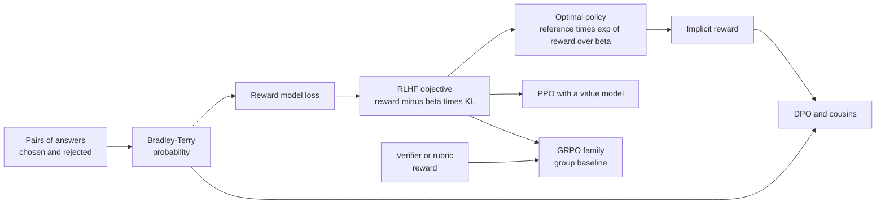
*Figure G.14: The equations of preference training. One probability model (Bradley-Terry) and one objective (reward minus a KL leash) lead to RLHF with PPO, to DPO, and, with automatic checkers as the reward, to GRPO.*

### Bradley-Terry preference model

**What it does:** Turns two scores into the probability that one response is preferred over the other.

`P(y_1 preferred to y_2 given x) = exp(r(x, y_1)) ÷ (exp(r(x, y_1)) + exp(r(x, y_2))) = sigmoid(r(x, y_1) − r(x, y_2))`

- **x**: the prompt; **y_1**, **y_2**: two responses.
- **r(x, y)**: a score (reward) for response y.
- **sigmoid(z)**: 1 ÷ (1 + exp(−z)), which squashes any number into the range 0 to 1.

**In plain words:** Only the difference between scores matters; a bigger gap means a more confident prediction. Elo ratings use the same curve with base 10 and a scale of 400 (that use belongs to the classical-ML section). Variant merged here: the Plackett-Luce model for a full ranking of K responses, P(ranking) = product over k of exp(r(y_k)) ÷ (sum over j ≥ k of exp(r(y_j))), where y_1 is the response ranked first, y_2 second, and so on.

**Tiny example:** Chapter 20's gap of 1.5 gives sigmoid(1.5) ≈ 0.82. Plackett-Luce for three responses scored 2, 1 and 0, ranked in that order: e^2 ÷ (e^2 + e^1 + e^0) ≈ 0.665 for first place, then e^1 ÷ (e^1 + e^0) ≈ 0.731 for second, so 0.665 × 0.731 ≈ 0.486.

**Where it is used:** The likelihood behind every pairwise reward model (InstructGPT, Llama 2, Claude) and inside DPO and its relatives; LMArena fits Bradley-Terry scores to human votes for its leaderboard.
**In the book:** Chapter 20 (Reward models: teaching a judge to score: From comparisons to a single number), Chapter 48 (Why games matter, and the power of self-play: Elo rating).

> **Definition — Plackett-Luce model:** An extension of the Bradley-Terry model from pairs to full rankings: the chance of a ranking is the chance the top item is picked first from all of them, times the chance the second is picked from those left, and so on, each by softmax of the scores.

### Reward model pairwise loss

**What it does:** Trains a reward model so that the response people preferred gets the higher score.

`L(φ) = −E over (x, y_w, y_l) of [ln sigmoid(r_φ(x, y_w) − r_φ(x, y_l))]; InstructGPT: average over all C(K, 2) pairs from K ranked responses; Llama 2 margin version: −ln sigmoid(r_φ(x, y_w) − r_φ(x, y_l) − m)`

- **y_w**, **y_l**: the preferred (winning) and rejected (losing) responses.
- **r_φ**: the reward model with weights φ, usually a language model with a single-number output head.
- **C(K, 2)**: the number of pairs among K ranked responses, K × (K − 1) ÷ 2.
- **m**: a margin, larger when annotators said one answer was much better.
- **L(φ)**: the loss; **x**: the prompt; **sigmoid(z)**: 1 ÷ (1 + exp(−z)).

**In plain words:** It is the cross-entropy of the Bradley-Terry probability: small when the model already ranks the pair correctly, large when it does not. InstructGPT ranked K = 4 to 9 responses per prompt and weighted each pair by 1 ÷ C(K, 2).

**Tiny example:** Chapter 20's gap of 1.5 gives a loss of −ln 0.82 ≈ 0.20 if the preferred answer is the higher-scored one and about 1.70 if not. With a margin m = 1 the first case becomes −ln sigmoid(0.5) ≈ −ln 0.622 ≈ 0.47: the model must win by more than 1 to get a small loss.

**Where it is used:** Training reward models for RLHF at OpenAI, Meta (separate helpfulness and safety reward models for Llama 2), Anthropic and open-weight labs; benchmarked by RewardBench, which reports accuracy, the share of held-out pairs in which the chosen answer gets the higher score (equivalently, a Bradley-Terry probability above 0.5). In 2026 frontier labs still use learned reward models for qualities no program can check.
**In the book:** Chapter 20 (Worked example: training the judge on one comparison).

### Constitutional AI and RLAIF preference labels

**What it does:** Turns an AI judge's multiple-choice probabilities into soft labels for training a preference model.

`t = P_feedback("(A)" given prompt, principle) ÷ (P_feedback("(A)" given prompt, principle) + P_feedback("(B)" given prompt, principle)); L = −[t × ln sigmoid(r_A − r_B) + (1 − t) × ln sigmoid(r_B − r_A)]`

- **P_feedback("(A)" given ...)**: the probability the feedback model gives to answering "(A)" when asked which of two responses better follows a principle.
- **t**: the soft label, the judge's normalized confidence that A is better.
- **r_A**, **r_B**: the preference model's scores for the two responses.
- **L**: the preference model's loss; **sigmoid(z)**: 1 ÷ (1 + exp(−z)).

**In plain words:** No new equation beyond Bradley-Terry: instead of a hard human "A wins", the label is the AI judge's probability. When the judge reasons step by step first, Anthropic clamped the labels to the 40-60% range to avoid overconfident targets. The critique-and-revision stage of Constitutional AI has no equation of its own.

**Tiny example:** The judge gives "(A)" probability 0.3 and "(B)" 0.1, so t = 0.3 ÷ 0.4 = 0.75. The preference model scores r_A = 1 and r_B = 0: sigmoid(1) ≈ 0.731 and sigmoid(−1) ≈ 0.269. L = −[0.75 × ln 0.731 + 0.25 × ln 0.269] ≈ 0.75 × 0.313 + 0.25 × 1.313 ≈ 0.563.

**Where it is used:** Anthropic's Constitutional AI (Bai and colleagues, December 2022) and RLAIF more broadly (Google's 2023 RLAIF study), plus the LLM-as-judge labeling pipelines of 2025-2026 post-training.
**In the book:** Chapter 20 (Constitutional AI), Chapter 56 (Constitutional AI and RLAIF: writing the values down), in words.

> **Definition — Soft label:** A training target given as a probability (such as "75% sure A is better") instead of a hard yes or no, which lets a model learn from a judge's uncertainty.

### RLHF objective (expected reward minus β times KL)

**What it does:** States what RLHF optimizes: high reward-model scores while staying close to the starting model.

`maximize over π_θ of E over x from prompts, y from π_θ(· given x) of [r_φ(x, y)] − β × KL(π_θ(· given x), π_ref(· given x)), equivalently E[r_φ(x, y) − β × ln(π_θ(y given x) ÷ π_ref(y given x))]; InstructGPT's PPO-ptx adds + γ_ptx × E over x from pretraining data of [ln π_θ(x)]`

- **π_θ**: the policy being trained; **π_ref**: the reference model, usually the SFT model.
- **r_φ(x, y)**: the reward model's score.
- **β** (beta): the strength of the KL leash.
- **KL(...)**: the Kullback-Leibler divergence between the two models' answer distributions.
- **γ_ptx**: the weight of an optional pretraining term.
- **x**: a prompt (in the pretraining term, a piece of pretraining text); **y**: an answer sampled from the policy; **E over ... of [...]**: the average over prompts and sampled answers.

**In plain words:** Earn reward, pay a toll for drifting. β sets the leash length. The KL term limits reward hacking and keeps the model fluent, but cannot fix a flawed reward model. The optional pretraining term reduces the "alignment tax", the loss of general abilities.

**Tiny example:** Chapter 20's toy after one round, with unrounded probabilities (the chapter's table rounds them to 2.12 and 0.11): average reward ≈ 2.115 and KL ≈ 0.109. With β = 2 the objective is 2.115 − 2 × 0.109 ≈ 1.897, up from 1.58 for the SFT model (whose KL is 0). No other policy scores higher at β = 2, which is why the chapter says training stops there (see the optimal KL-regularized policy below).

**Where it is used:** InstructGPT (2022), ChatGPT, Llama 2-Chat and Claude's RLHF; the same reward-minus-KL form appears in RL with verifiable rewards when a KL term is kept (GRPO).
**In the book:** Chapter 20 (The KL leash).

> **Definition — PPO-ptx:** InstructGPT's variant of RLHF that mixes ordinary next-token training on pretraining data into the PPO objective, to limit the loss of general abilities while the model learns from human feedback.

### Combining and normalizing several reward signals

**What it does:** Merges scores from several reward models or checkers into the single reward RL needs.

`weighted sum r = sum over k of (w_k × r_k); Llama 2 gate: R_c = R_safety if (the prompt is safety-related or R_safety < 0.15) else R_helpful, then R_tilde = WHITEN(LOGIT(R_c)) and R = R_tilde − β × KL(π_θ, π_ref)`

- **r_k**: the score from signal k; **w_k**: its weight.
- **R_safety**, **R_helpful**: Llama 2's two reward models' scores (between 0 and 1).
- **LOGIT(p)**: ln(p ÷ (1 − p)), which turns a 0-to-1 score back into an unbounded number.
- **WHITEN**: subtract the batch mean and divide by the batch standard deviation.
- **β × KL**: the usual leash, with **π_θ** the policy being trained and **π_ref** the reference model.
- **R_c**, **R_tilde**, **R**: the gated score, its normalized version and the final reward.

**In plain words:** Normalize each signal so none dominates by accident, then add them with weights, or let one override the other where it matters. Llama 2-Chat let the safety reward model take over on risky prompts or low safety scores. Variants: per-task weights, reward clipping, per-batch normalization.

**Tiny example:** Helpfulness 0.8 with weight 0.7 and correctness 1.0 with weight 0.3: 0.56 + 0.3 = 0.86. Llama 2 gate: a safety score of 0.10 is below 0.15, so the safety score is used. LOGIT(0.9) = ln(0.9 ÷ 0.1) ≈ 2.197. Whitening the batch 1, 2, 3 (mean 2, standard deviation ≈ 0.816) gives −1.22, 0 and +1.22.

**Where it is used:** Llama 2-Chat (2023); 2025-2026 post-training runs mix learned reward models, verifiable rewards and rubric-based AI judges in the same run.
**In the book:** Chapter 20 (From comparisons to a single number; At the frontier (2026)), in words.

> **Definition — Whitening (reward normalization):** Rescaling a batch of rewards by subtracting their average and dividing by their standard deviation, so that rewards from different sources or batches sit on a comparable scale centered at zero.

### Per-token KL penalty and the adaptive KL controller

**What it does:** Charges the KL leash token by token, and adjusts its strength automatically to hit a target drift.

`per-token reward r_t = −β × ln(π_θ(y_t given x, y_<t) ÷ π_ref(y_t given x, y_<t)), with r_φ(x, y) added at the final token; adaptive β: e_t = clip((KL_t − KL_target) ÷ KL_target, −0.2, 0.2) and β_(t+1) = β_t × (1 + K_β × e_t)`

- **y_t**: the token written at position t; **y_<t**: the tokens before it.
- **π_θ**, **π_ref**: the policy and the reference model.
- **β**: the penalty strength; **KL_t**: the measured KL; **KL_target**: the desired KL.
- **e_t**: the clipped relative error; **K_β**: the controller's gain, such as 0.1.
- **r_φ(x, y)**: the reward model's score for the whole answer y to prompt x, added at the last token; **r_t**: the reward credited to token t.
- **t**: the token position in the first formula and the training step in the controller; **β_(t+1)**: the strength used at the next step; **clip(x, −0.2, 0.2)**: x capped to that range.

**In plain words:** A token the policy now favors far more than the reference pays β times the log of the probability ratio; summed over the answer this is a one-sample estimate of the KL. The controller (Ziegler and colleagues, 2019) raises β when the measured KL is above target and lowers it when below.

**Tiny example:** Chapter 20's token " Absolutely" at 0.40 against 0.10: ln 4 ≈ 1.39 of drift, times β = 0.1 ≈ 0.14 off the reward. Controller: target 6, measured 9, so e = clip(3 ÷ 6, −0.2, 0.2) = 0.2 and β becomes 0.1 × (1 + 0.1 × 0.2) = 0.102.

**Where it is used:** PPO-based RLHF implementations (OpenAI's 2019 and 2020 work, TRL's PPO trainer, Llama 2-Chat).
**In the book:** Chapter 20 (The KL leash).

> **Definition — Adaptive KL controller:** A rule that adjusts the strength of an RLHF training run's KL penalty after each batch, raising it when the model has drifted further from the reference than a target and lowering it when it has drifted less.

### Sampled KL estimators k1, k2 and k3

**What it does:** Estimates the KL divergence from a few sampled tokens instead of summing over every possible answer.

`with y sampled from π_θ and ρ = π_ref(y) ÷ π_θ(y): k1 = −ln ρ; k2 = (ln ρ)^2 ÷ 2; k3 = ρ − 1 − ln ρ; GRPO's per-token term D_KL = π_ref ÷ π_θ − ln(π_ref ÷ π_θ) − 1 (the k3 form)`

- **y**: a sampled token or answer.
- **π_θ(y)**, **π_ref(y)**: its probability under the policy and the reference.
- **ρ** (rho): their ratio, reference over policy.
- **k1**, **k2**, **k3**: three estimators, each computed from one sample and averaged over many.
- **D_KL**: the per-token KL term in GRPO's loss.

**In plain words:** k1 is unbiased (right on average) but noisy and can be negative; k3 is also unbiased and never negative, with less noise; k2 is slightly biased but low-noise (John Schulman's 2020 note "Approximating KL Divergence"). Caveat from 2025 analyses: putting k3 directly into the loss gives a biased gradient of the true KL, and several recipes, DAPO among them, drop the KL term altogether.

**Tiny example:** The policy gives two tokens 0.4 and 0.6; the reference gives 0.1 and 0.9. True KL = 0.4 × ln 4 + 0.6 × ln(0.6 ÷ 0.9) ≈ 0.555 − 0.243 = 0.311. For the first token ρ = 0.25: k1 ≈ 1.386, k3 = 0.25 − 1 + 1.386 ≈ 0.636. For the second ρ = 1.5: k1 ≈ −0.405 (negative), k3 = 1.5 − 1 − 0.405 ≈ 0.095. Averaged with weights 0.4 and 0.6, both give 0.311; k2 gives about 0.434.

**Where it is used:** GRPO in DeepSeekMath and DeepSeek-R1; KL options in TRL, verl and OpenRLHF.
**In the book:** Only here (Chapter 20 shows the exact KL sum and one per-token log ratio).

> **Definition — Unbiased estimator:** A way of estimating a quantity from random samples whose average over many tries equals the true value, even if any single estimate is off.

### Optimal KL-regularized policy (exponential tilt of the reference)

**What it does:** Gives the exact policy that maximizes the RLHF objective.

`π*(y given x) = π_ref(y given x) × exp(r(x, y) ÷ β) ÷ Z(x), with Z(x) = sum over y of (π_ref(y given x) × exp(r(x, y) ÷ β))`

- **π\*(y given x)**: the optimal policy's probability of answer y.
- **π_ref**: the reference model; **r(x, y)**: the reward.
- **β**: the leash strength.
- **Z(x)**: the normalizer (partition function) that makes the probabilities sum to 1.

**In plain words:** Start from the reference model, multiply each answer's probability by exp(reward ÷ β) and renormalize. Small β lets probability flow strongly toward high reward; large β stays near the reference. The same form is the maximum-entropy RL solution and the AWR weighting.

**Tiny example:** Chapter 20 at β = 2: 0.50 × e^1 ≈ 1.359, 0.30 × e^1.3 ≈ 1.101 and 0.20 × e^(−0.5) ≈ 0.121; Z ≈ 2.581, giving 0.53, 0.43 and 0.05.

**Where it is used:** The starting point of the DPO derivation; CICERO (2022) used the same form, called piKL, to keep its Diplomacy policy close to human play.
**In the book:** Chapter 20 (The KL leash).

### Implicit reward (DPO reparameterization)

**What it does:** Reads a reward straight off a policy's probabilities relative to the reference model.

`r(x, y) = β × ln(π*(y given x) ÷ π_ref(y given x)) + β × ln Z(x); for a trained model r_hat(x, y) = β × ln(π_θ(y given x) ÷ π_ref(y given x))`

- **r_hat(x, y)**: the implicit reward of answer y.
- **π_θ**, **π_ref**: the trained policy and the reference.
- **β**: the leash strength; **β × ln Z(x)**: a constant per prompt that cancels when two answers to the same prompt are compared.
- **r(x, y)**, **π\***, **Z(x)**: the reward, the optimal policy and its normalizer from the previous entry; **x**, **y**: a prompt and an answer.

**In plain words:** Turn the optimal-policy formula around: if a model was trained this way, how much more likely it makes an answer than the reference already encodes the reward. Token-level version: the sum over tokens of β × ln(π_θ(y_t) ÷ π_ref(y_t)), which can act as a dense step-by-step reward.

**Tiny example:** The policy makes an answer 0.6 likely where the reference made it 0.3; with β = 0.1 the implicit reward is 0.1 × ln 2 ≈ 0.069.

**Where it is used:** DPO training logs report implicit "reward margins"; PRIME (2025) used implicit token-level rewards as process rewards in RL for reasoning.
**In the book:** Chapter 20 (DPO and its cousins: The shortcut).

> **Definition — Implicit reward:** The reward implied by how much more likely a trained model makes a response than a reference model does, β × ln(policy probability ÷ reference probability). DPO trains on it without ever building a separate reward model.

### Direct preference optimization loss (DPO)

**What it does:** Learns from preference pairs directly, with no reward model and no sampling loop.

`L_DPO(θ) = −E over (x, y_w, y_l) of [ln sigmoid(β × ln(π_θ(y_w given x) ÷ π_ref(y_w given x)) − β × ln(π_θ(y_l given x) ÷ π_ref(y_l given x)))]`

- **y_w**, **y_l**: the chosen and rejected responses.
- **π_θ**, **π_ref**: the model being trained and the frozen reference.
- **β**: the leash strength, often around 0.1.
- **sigmoid**: 1 ÷ (1 + exp(−z)).
- **L_DPO(θ)**: the loss; **x**: the prompt.

**In plain words:** Plug the implicit reward into the Bradley-Terry loss: raise the chosen answer's probability and lower the rejected one's, both measured relative to the reference. The gradient weights each pair by sigmoid(r_hat_l − r_hat_w), so pairs the model still gets wrong count most. Variants merged here: conservative DPO (label smoothing for noisy labels), DPO plus a negative log-likelihood term on the chosen answer (used for Llama 3), length-normalized DPO, which divides each log-ratio by the answer's length in tokens (used in the Tülu 3 recipe), and iterative or online DPO on fresh samples. Rafailov and colleagues (2023).

**Tiny example:** Chapter 20's pair: log-ratios +2.0 (chosen) and −1.0 (rejected), β = 0.1: margin 0.1 × 3.0 = 0.3, loss −ln sigmoid(0.3) ≈ −ln 0.574 ≈ 0.55, and this pair's gradient weight is sigmoid(−0.3) ≈ 0.43. With β = 0.5: margin 1.5, loss ≈ 0.20.

**Where it is used:** Zephyr (2023), Llama 3 (2024), the Tülu 3 recipe and many open-weight models; TRL's DPOTrainer; OpenAI's preference fine-tuning API (December 2024) uses DPO.
**In the book:** Chapter 20 (Worked example: one DPO pair), Chapter 30.

### Identity preference optimization loss (IPO)

**What it does:** Pulls the chosen-versus-rejected log-ratio margin to a fixed target instead of pushing it ever higher.

`h = ln(π_θ(y_w given x) ÷ π_ref(y_w given x)) − ln(π_θ(y_l given x) ÷ π_ref(y_l given x)); L_IPO = E[(h − 1 ÷ (2 × τ))^2]`

- **h**: the margin between the chosen and rejected log-ratios.
- **τ** (tau): a strength setting playing the role of β; the target margin is 1 ÷ (2 × τ).
- **y_w**, **y_l**, **π_θ**, **π_ref**: as in DPO.
- **L_IPO**: the loss; **x**: the prompt; **E[...]**: the average over preference pairs.

**In plain words:** DPO's loss keeps rewarding larger margins, which can drive probabilities to extremes when one answer always wins. IPO squares the distance to a fixed target, so overshooting is penalized like undershooting. Part of the ΨPO family of Azar and colleagues (Google DeepMind, 2023).

**Tiny example:** τ = 0.1 gives a target of 1 ÷ 0.2 = 5. A margin of 3 costs (3 − 5)^2 = 4, and a margin of 7 costs (7 − 5)^2 = 4 as well.

**Where it is used:** A loss option in TRL and other preference-tuning libraries.
**In the book:** Chapter 20 (The cousins), in words.

### Kahneman-Tversky optimization loss (KTO)

**What it does:** Learns from single answers marked good or bad, comparing each answer's implicit reward with a reference point.

`r_θ(x, y) = ln(π_θ(y given x) ÷ π_ref(y given x)); z_0 = KL(π_θ(y' given x), π_ref(y' given x)) estimated on the batch with no gradient; v(x, y) = λ_D × sigmoid(β × (r_θ(x, y) − z_0)) if y is desirable, λ_U × sigmoid(β × (z_0 − r_θ(x, y))) if undesirable; L_KTO = E[λ_y − v(x, y)]`

- **r_θ(x, y)**: the answer's log-ratio against the reference (its implicit reward, without β).
- **z_0**: a reference point, an estimate of the current KL from the reference model, treated as a constant.
- **λ_D**, **λ_U**: weights for desirable and undesirable examples; **λ_y** is whichever applies.
- **β**: the leash strength; **v(x, y)**: the "value" of the answer, as in prospect theory.
- **π_θ**, **π_ref**: the model being trained and the frozen reference; **y'**: other answers in the batch, used to estimate z_0; **x**, **y**: a prompt and an answer.
- **L_KTO**: the loss; **sigmoid(z)**: 1 ÷ (1 + exp(−z)); **E[...]**: the average over labeled answers.

**In plain words:** A thumbs-up answer should beat the reference point and a thumbs-down answer should fall below it. Weighting losses and gains differently echoes prospect theory's loss aversion. Ethayarajh and colleagues (2024).

**Tiny example:** z_0 = 0.2, β = 0.1, both weights 1. A good answer with r_θ = 1.0: v = sigmoid(0.1 × 0.8) = sigmoid(0.08) ≈ 0.520, loss 1 − 0.520 = 0.480. A bad answer with r_θ = −0.5: v = sigmoid(0.1 × 0.7) ≈ 0.517, loss ≈ 0.483. Both losses shrink as the good answer rises further above z_0 and the bad one falls further below it.

**Where it is used:** Fine-tuning from unpaired feedback logs; TRL's KTOTrainer.
**In the book:** Chapter 20 (The cousins), Appendix F (Human judgment and irrationality: prospect theory), in words.

### Odds-ratio preference optimization loss (ORPO)

**What it does:** Combines supervised fine-tuning and preference learning in one loss with no reference model.

`odds(y given x) = P(y given x) ÷ (1 − P(y given x)), with P the length-normalized likelihood exp((1 ÷ |y|) × ln π_θ(y given x)); L_ORPO = L_SFT − λ × ln sigmoid(ln(odds(y_w given x) ÷ odds(y_l given x)))`

- **P(y given x)**: the answer's per-token average likelihood.
- **|y|**: the answer's length in tokens.
- **odds**: P ÷ (1 − P).
- **L_SFT**: the ordinary supervised loss on the chosen answer.
- **λ**: the weight of the preference term, such as 0.1.
- **π_θ(y given x)**: the model's probability of answer y to prompt x; **y_w**, **y_l**: the chosen and rejected answers.
- **L_ORPO**: the combined loss; **sigmoid(z)**: 1 ÷ (1 + exp(−z)).

**In plain words:** Learn to write the chosen answer as in SFT, plus a penalty that grows when the rejected answer's odds rival the chosen one's. Hong, Lee and Thorne (2024).

**Tiny example:** Length-normalized likelihoods 0.6 (chosen) and 0.4 (rejected): odds 1.5 and 0.667, ratio 2.25, ln 2.25 ≈ 0.811, sigmoid ≈ 0.692, so the penalty is −ln 0.692 ≈ 0.368, times λ = 0.1 ≈ 0.037. L_SFT = −ln 0.6 ≈ 0.511, so L ≈ 0.548.

**Where it is used:** Single-stage preference tuning of open-weight models; TRL's ORPOTrainer.
**In the book:** Chapter 20 (The cousins), in words.

> **Definition — Odds:** A probability p written as p ÷ (1 − p), the chance something happens compared with the chance it does not. A probability of 0.6 is odds of 1.5, or "3 to 2".

### Simple preference optimization loss (SimPO)

**What it does:** Uses each answer's average per-token log-probability as its reward, with no reference model, and demands a margin.

`L_SimPO = −E[ln sigmoid((β ÷ |y_w|) × ln π_θ(y_w given x) − (β ÷ |y_l|) × ln π_θ(y_l given x) − γ)]`

- **|y_w|**, **|y_l|**: the lengths of the chosen and rejected answers in tokens.
- **ln π_θ(y given x)**: the answer's total log-probability under the model.
- **β**: a scale; **γ** (gamma here): the target margin the chosen answer must beat the rejected one by.
- **L_SimPO**: the loss; **x**: the prompt; **y_w**, **y_l**: the chosen and rejected answers; **sigmoid(z)**: 1 ÷ (1 + exp(−z)); **E[...]**: the average over pairs.

**In plain words:** Dividing by length removes the pull toward ever-longer answers, and the margin makes the model separate good from bad clearly. Meng, Xia and Chen (2024).

**Tiny example:** Chosen: 10 tokens, total log-probability −5, average −0.5. Rejected: 20 tokens, total −16, average −0.8. With β = 2 and γ = 0.5: 2 × (−0.5) − 2 × (−0.8) − 0.5 = −1 + 1.6 − 0.5 = 0.1, loss −ln sigmoid(0.1) ≈ 0.644.

**Where it is used:** Preference tuning of open-weight models (for example SimPO-tuned Gemma 2 checkpoints); supported in TRL.
**In the book:** Chapter 20 (The cousins), in words.

### Best-of-N against a reward model and its KL cost

**What it does:** Samples N answers and keeps the one the reward model or verifier likes best, and says how far that moves from the original model.

`y* = argmax over i in 1, ..., N of r(x, y_i), with y_1, ..., y_N sampled from π_ref; KL(π_BoN, π_ref) = ln N − (N − 1) ÷ N`

- **N**: the number of samples.
- **y_i**: the i-th sampled answer; **r(x, y_i)**: its score.
- **π_ref**: the model the samples come from; **π_BoN**: the distribution of the selected answers.
- **KL**: the Kullback-Leibler divergence, how far the selected answers' distribution sits from π_ref, measured in nats (natural-log units).
- **y\***: the answer kept; **x**: the prompt.

**In plain words:** The simplest way to optimize a reward without training. Its distance from the original model grows only like ln N. Beirami and colleagues (2024) showed the formula is an upper bound on the true KL. The probability that at least one of N samples is right (pass@k) belongs to the classical-ML section.

**Tiny example:** Scores 1.2, 3.4, 2.0 and 0.5 for four samples: keep the second. The KL cost of N = 4 is ln 4 − 3 ÷ 4 ≈ 1.386 − 0.75 = 0.636 nats; N = 16 costs ln 16 − 15 ÷ 16 ≈ 2.773 − 0.938 = 1.835.

**Where it is used:** A baseline in RLHF comparisons (WebGPT and the 2022 over-optimization study); reranking with reward models and verifiers; parallel "Pro" or "Heavy" answer modes.
**In the book:** Chapter 21 (Thinking wider: best-of-N, parallel thinking and agent swarms), Chapter 48 (Planning and search today), in words.

### Rejection-sampling fine-tuning (STaR, expert iteration)

**What it does:** Generates many attempts, keeps only the good ones, and fine-tunes on them, round after round.

`keep K = {(x, y) : y sampled from π_θ(· given x) and r(x, y) = 1} (or the top answers by reward); minimize L = −(1 ÷ |K|) × sum over (x, y) in K of ln π_θ(y given x); repeat`

- **K**: the kept set of prompt-answer pairs; **|K|**: how many there are.
- **π_θ**: the current model; **r(x, y)**: the reward or verdict.
- **ln π_θ(y given x)**: the log-probability of a kept answer.
- **L**: the fine-tuning loss; **x**, **y**: a prompt and an answer.

**In plain words:** It equals a policy-gradient step with 0-or-1 rewards and no negative examples (filtered behavior cloning on the model's own outputs). Names for variants: STaR, ReST and ReST-EM, RAFT, expert iteration.

**Tiny example:** Chapter 20's 16,000 attempts with 30% kept leaves 0.3 × 16,000 = 4,800 examples. If three kept answers have log-probabilities −20, −30 and −25, the loss is (20 + 30 + 25) ÷ 3 = 25, and training lowers it by making those answers more likely.

**Where it is used:** STaR (Zelikman and colleagues, 2022); Llama 2 and Llama 3 post-training rounds; DeepSeek-R1's rejection-sampled reasoning data for SFT before its final RL stage; AlphaZero's search-then-imitate loop.
**In the book:** Chapter 20 (Synthetic data and self-improvement), Chapter 21 (R1: adding a cold start).

> **Definition — Rejection-sampling fine-tuning:** Improving a model by sampling many answers from it, keeping only those a checker or reward model accepts, and fine-tuning the model on the kept answers, often for several rounds.

### Reward model over-optimization curves (Goodhart scaling)

**What it does:** Describes how the true quality of a policy first rises and then falls as it is optimized harder against a proxy reward model.

`d = sqrt(KL(π, π_init)); best-of-N: R_gold(d) = d × (α_bon − β_bon × d); RL: R_gold(d) = d × (α_RL − β_RL × ln d)`

- **d**: the square root of the KL distance from the initial policy, a measure of how hard it has been optimized.
- **R_gold(d)**: the score from a "gold" reward model standing in for true quality.
- **α_bon**, **β_bon**, **α_RL**, **β_RL**: fitted coefficients that change smoothly with reward-model size.
- **π**, **π_init**: the optimized policy and the policy it started from; **KL**: the Kullback-Leibler divergence between them.

**In plain words:** The proxy score keeps rising, but true quality peaks and falls: Goodhart's law in numbers. Gao, Schulman and Hilton (OpenAI, 2022) found these shapes; larger reward models push the peak further out.

**Tiny example:** Illustrative coefficients, not the paper's. Best-of-N with α = 1, β = 0.2: d = 1 gives 0.8, d = 2.5 gives 2.5 × 0.5 = 1.25 (the peak, at d = α ÷ (2 × β)), and d = 5 gives 0. RL with α = 1, β = 0.5: d = 1 gives 1, d = e ≈ 2.718 gives 2.718 × 0.5 ≈ 1.359 (the peak), and d = e^2 ≈ 7.39 gives 0.

**Where it is used:** Motivates the KL leash, early stopping, larger reward models and fresh preference data in RLHF, and reward-model ensembles, which score an answer by the worst member or by the members' mean minus a multiple of their spread, so the policy gains little from fooling only one of them (Coste and colleagues, 2023).
**In the book:** Chapter 20 (Reward hacking and over-optimization), Chapter 55 (Objectives, proxies and Goodhart's law), in words.

> **Definition — Gold reward model:** In over-optimization experiments, a large reward model treated as the "true" judge, used to measure how much a policy optimized against a smaller proxy reward model has really improved.

### Regressional Goodhart and the optimizer's curse

**What it does:** Shows how much of the winning option's score is luck, when you pick the best of many noisy scores.

`with proxy U = V + X, where the true value V and the error X are independent and normal with means 0 and variances σ_V^2 and σ_X^2: E[V given U = u] = u × σ_V^2 ÷ (σ_V^2 + σ_X^2)`

- **U**: the proxy score you can see; **u**: one observed value of it.
- **V**: the true value; **X**: the noise in the proxy.
- **σ_V^2**, **σ_X^2** (sigma squared): the variances of the true values and of the noise.
- **E[V given U = u]**: the expected true value of an option whose proxy reads u.

**In plain words:** A high score is partly real and partly lucky noise, so its expected true value is shrunk toward the average by the factor σ_V^2 ÷ (σ_V^2 + σ_X^2). The noisier the proxy and the more options you choose among, the bigger the disappointment. Manheim and Garrabrant (2018) call this regressional Goodhart, one of four kinds; decision analysts call it the optimizer's curse (Smith and Winkler, 2006).

**Tiny example:** True values and noise equally spread (both variances 1): a proxy score of 4 means an expected true value of 4 × 1 ÷ 2 = 2. With less noise (variance 0.25) the same score means 4 × 1 ÷ 1.25 = 3.2.

**Where it is used:** Reading benchmark leaderboards (the top model on a small test is probably overrated), best-of-N against noisy reward models, and reward-hacking analysis.
**In the book:** Chapter 48 (Deciding when you are not sure: expected utility), Chapter 55 (Objectives, proxies and Goodhart's law), Chapter 9, in words.

> **Definition — Regressional Goodhart:** The part of Goodhart's law caused by noise alone: when you select on a proxy that is the true goal plus random error, the selected options' true values fall short of their proxy scores, because selection favors lucky errors.

### Verifiable reward (RLVR)

**What it does:** Scores an answer with a program that checks it, instead of a learned judge.

`r(x, y) = 1 if verify(extract_answer(y), y*) else 0, often plus a format reward (1 if y follows the required format, else 0); for code r = 1 only if all unit tests pass, or r = tests passed ÷ tests total`

- **x**: the problem; **y**: the model's full output.
- **extract_answer(y)**: the final answer pulled out of the output.
- **y\***: the reference answer.
- **verify**: a checking program (math-answer matcher, unit tests, proof checker).
- **r(x, y)**: the reward, 1 or 0, or a fraction when partial credit is given for tests passed.

**In plain words:** Rule-based rewards are hard to flatter, but a sloppy checker is still a loophole, and coding agents have learned to edit the tests.

**Tiny example:** A code answer passing 7 of 10 tests scores 0.7 under the partial rule and 0 under the all-or-nothing rule.

**Where it is used:** Named RLVR in the Tülu 3 report (Allen Institute, November 2024); DeepSeek-R1-Zero and R1 (January 2025) used rule-based accuracy and format rewards; the standard signal in open reasoning-model recipes, and the kind of large-scale RL on checkable math and code tasks that OpenAI, Anthropic and Google DeepMind describe, without publishing details, for their reasoning models.
**In the book:** Chapter 21 (Reinforcement learning with verifiable rewards; Worked example: a reward function, and how to break it).

### Rubric-based reward

**What it does:** Scores answers no program can check by having an AI judge tick weighted criteria.

`r(x, y) = sum over j of (w_j × c_j(x, y)) ÷ sum over j of w_j, where c_j(x, y) in {0, 1} (or between 0 and 1) is the judge's verdict on criterion j`

- **j**: one criterion in the rubric; **w_j**: its weight (points).
- **c_j(x, y)**: whether answer y meets criterion j.
- **r(x, y)**: the reward for answer y to prompt x.

**In plain words:** Points earned over points possible. Negative weights can encode penalties, for example for a dangerous recommendation, in which case the score is clipped to the range 0 to 1.

**Tiny example:** Weights 5, 3 and 2; the answer meets the first and third: (5 + 2) ÷ 10 = 0.7. Chapter 21's example scores 8 ÷ 10 = 0.8.

**Where it is used:** Rubrics as Rewards (Scale AI, 2025); OpenAI's HealthBench (May 2025) scores answers as rubric points earned out of points possible; LLM-as-judge rewards in non-verifiable RL environments.
**In the book:** Chapter 21 (Rubrics and AI judges for tasks no program can check).

### Process reward aggregation and automatic step labels (PRM versus ORM)

**What it does:** Combines a process reward model's step-by-step scores into one score for a whole solution, and shows how step labels can be made without human graders.

`solution score = product over steps k of P(step k correct) (Lightman and colleagues, 2023), or min over k of P(step k correct); outcome reward model: score = P(final answer correct); automatic step labels from N completions: soft label = (completions reaching the right answer) ÷ N, hard label = 1 if at least one does, else 0`

- **k**: one step of a solution.
- **P(step k correct)**: the process reward model's probability that step k is correct.
- **min over k**: the score of the weakest step.
- **N**: the number of times a model is asked to finish the solution starting from the end of that step.

**In plain words:** The product is the chance every step is right, if steps are judged independently; the minimum asks how bad the weakest step is. An outcome reward model only judges the final answer. Human step-by-step grading is expensive, so the labels for training a process reward model can come from rollouts instead: a step is good to the extent that finishing the solution from it still reaches the right answer.

**Tiny example:** Step scores 0.9, 0.95 and 0.6: product 0.9 × 0.95 × 0.6 = 0.513; minimum 0.6. The third step is where the solution probably went wrong, which an outcome-only score cannot show. Labeling a step automatically: of N = 8 completions from it, 3 reach the right answer, so its soft label is 3 ÷ 8 = 0.375 and its hard label is 1; if none had, both labels would be 0.

**Where it is used:** "Let's Verify Step by Step" (OpenAI, 2023) with the PRM800K dataset of human step labels, for best-of-N reranking of math solutions; Math-Shepherd (Wang and colleagues, 2023: rollout labels with N = 8, minimum aggregation, also used as the reward in step-by-step PPO); test-time verification. Large 2024-2026 reasoning models were trained mostly with outcome rewards.
**In the book:** Chapter 21 (Process versus outcome rewards), in words.

### Length-aware reward shaping (length penalty)

**What it does:** Within a group of sampled answers, gives short correct answers a bonus and long ones a penalty.

`Kimi k1.5: λ_i = 0.5 − (len_i − min_len) ÷ (max_len − min_len); length reward = λ_i if answer i is correct, min(0, λ_i) if wrong`

- **len_i**: answer i's length in tokens.
- **min_len**, **max_len**: the shortest and longest answers in the group.
- **λ_i**: a score from +0.5 (shortest) to −0.5 (longest).

**In plain words:** Correct answers earn more the shorter they are; wrong answers can only lose points, never gain them for being short. It counters overthinking and runaway chain-of-thought length. DAPO's overlong penalty (below) is a related cap near the length limit.

**Tiny example:** Lengths 200, 500 and 800 tokens: λ = 0.5 − 0 = 0.5, 0.5 − 300 ÷ 600 = 0 and 0.5 − 600 ÷ 600 = −0.5. If the 200-token answer is correct it gets +0.5; if it were wrong it would get min(0, 0.5) = 0. A wrong 800-token answer gets −0.5.

**Where it is used:** Kimi k1.5 (Moonshot AI, January 2025); length and thinking-budget controls in 2025-2026 reasoning models.
**In the book:** Chapter 21 (The GRPO family: DAPO's overlong shaping), Chapter 20 (Verbosity and style bias), in words.

> **Definition — Length-aware reward (a length penalty in RL):** A term in an RL reward that lowers the score of longer answers, or raises it for shorter correct ones, to stop a model from padding or overthinking.

### GRPO group-relative advantage

**What it does:** Scores each sampled answer by how many standard deviations it sits above its group's average.

`A_i = (r_i − mean(r_1, ..., r_G)) ÷ std(r_1, ..., r_G), the same for every token of answer i; for 0/1 rewards std = sqrt(p × (1 − p)), where p is the group's fraction correct`

- **G**: the group size, typically 8 to 64 answers to one prompt.
- **r_i**: answer i's reward; **mean**, **std**: the group's average and standard deviation.
- **A_i**: answer i's advantage.
- **p**: the share of the group that is correct.

**In plain words:** The group replaces the learned critic as the baseline. Groups that are all right or all wrong give zero advantage and teach nothing. Some implementations divide by G − 1 inside the standard deviation.

**Tiny example:** Chapter 21's 3 correct out of 8: mean 0.375, std sqrt(0.375 × 0.625) ≈ 0.484, advantages (1 − 0.375) ÷ 0.484 ≈ +1.29 and (0 − 0.375) ÷ 0.484 ≈ −0.77.

**Where it is used:** DeepSeekMath (February 2024), DeepSeek-R1 (2025) and most open reasoning-model recipes since; TRL's GRPOTrainer, verl and OpenRLHF.
**In the book:** Chapter 21 (Worked example: a group of eight answers).

### REINFORCE leave-one-out baseline (RLOO) and REINFORCE++

**What it does:** Gives each sample a baseline made from the other samples' rewards, or normalizes rewards across the whole batch.

`A_i = r_i − (1 ÷ (k − 1)) × sum over j ≠ i of r_j, equivalently (k ÷ (k − 1)) × (r_i − mean(r)); REINFORCE++: A = (r − mean_batch(r)) ÷ std_batch(r)`

- **k**: the number of samples per prompt.
- **r_i**: sample i's reward; **sum over j ≠ i**: all the other samples.
- **mean_batch**, **std_batch**: statistics over every sample in the training batch.
- **A_i**, **A**: the advantage of sample i (RLOO) or of any sample (REINFORCE++); **r**: a reward; **mean(r)**: the average reward for the prompt.

**In plain words:** A sample's baseline must not include its own reward, or the gradient is biased; leaving it out keeps REINFORCE exactly unbiased. REINFORCE++ uses the whole batch's statistics, which are less noisy than a small group's. Related: ReMax, which uses the reward of the model's greedy answer as the baseline.

**Tiny example:** Four samples with rewards 1, 0, 1, 0. Sample 1's baseline is (0 + 1 + 0) ÷ 3 ≈ 0.333, so A = 0.667; sample 2's is (1 + 1 + 0) ÷ 3 ≈ 0.667, so A = −0.667. Check: (4 ÷ 3) × (1 − 0.5) ≈ 0.667. REINFORCE++ on a batch of rewards 1, 0, 1, 0, 1, 1, 1, 0 (mean 0.625, std ≈ 0.484) gives (1 − 0.625) ÷ 0.484 ≈ 0.77 and (0 − 0.625) ÷ 0.484 ≈ −1.29.

**Where it is used:** Kool and colleagues (2019); Ahmadian and colleagues (Cohere, 2024, "Back to Basics") found RLOO matched or beat PPO for RLHF at lower cost; TRL's RLOOTrainer; REINFORCE++ in OpenRLHF; batch-level advantage normalization in Meta's ScaleRL recipe.
**In the book:** Only here (Chapter 21 explains the group baseline).

> **Definition — RLOO (REINFORCE leave-one-out):** A policy-gradient method that samples several answers per prompt and uses, as each answer's baseline, the average reward of the other answers, which keeps the update unbiased without a learned critic.

> **Definition — REINFORCE++:** A critic-free policy-gradient recipe for language models that normalizes each reward using the mean and standard deviation of the whole training batch rather than of one prompt's group.

### GRPO objective (group relative policy optimization)

**What it does:** Applies PPO's clipped update to every token of every sampled answer, weighted by the group advantage, with a KL penalty inside the loss.

`J_GRPO(θ) = E[(1 ÷ G) × sum over i of (1 ÷ |o_i|) × sum over t of (min(ρ_(i,t) × A_i, clip(ρ_(i,t), 1 − ε, 1 + ε) × A_i) − β × D_KL,(i,t))], with ρ_(i,t) = π_θ(o_(i,t) given q, o_(i,<t)) ÷ π_old(o_(i,t) given q, o_(i,<t)) and D_KL,(i,t) the k3 estimator against π_ref`

- **q**: the prompt (question); **G**: the group size.
- **o_i**: the i-th sampled answer; **|o_i|**: its length in tokens; **o_(i,t)**: its t-th token; **o_(i,<t)**: the tokens before it.
- **ρ_(i,t)** (rho): the token's probability ratio between the updated and the sampling policy.
- **A_i**: the group advantage of answer i (two entries above).
- **ε**: the clip range; **β**: the KL weight; **π_ref**: the reference model.
- **D_KL,(i,t)**: the per-token k3 KL estimate.
- **π_θ**, **π_old**: the policy being updated (weights θ) and the policy that sampled the answers; **E[...]**: the average over prompts and groups.
- **J_GRPO(θ)**: the objective to push up, for model weights θ.

**In plain words:** Average the clipped, advantage-weighted ratio over each answer's tokens, then over the group, and subtract a per-token KL penalty. Only two models need to be in memory, the policy and the reference, when a program is the verifier.

**Tiny example:** An answer with A = +1.29 and three tokens whose ratios are 1.1, 1.3 and 0.9, with ε = 0.2: 1.1 × 1.29 ≈ 1.419; the 1.3 is clipped to 1.2, giving 1.548; 0.9 × 1.29 ≈ 1.161. Average ≈ 1.376. With KL estimates 0.01, 0.02 and 0 and β = 0.04 (DeepSeekMath's setting), the average drops by 0.04 × 0.01 = 0.0004 to about 1.3756.

**Where it is used:** DeepSeekMath and DeepSeek-R1; the base of DAPO, Dr. GRPO, GSPO and many 2025-2026 open recipes.
**In the book:** Chapter 21 (GRPO: grading on a curve).

### Dr. GRPO (GRPO done right)

**What it does:** Removes GRPO's division by answer length and by the group's standard deviation.

`A_i = r_i − mean(r_1, ..., r_G); loss = (1 ÷ (G × L_max)) × sum over i and t of min(ρ_(i,t) × A_i, clip(ρ_(i,t), 1 − ε, 1 + ε) × A_i)`

- **A_i**: the advantage without dividing by the standard deviation.
- **L_max**: a fixed length, such as the generation limit, used for every answer.
- **ρ_(i,t)**, **ε**, **G**: as in GRPO.
- **r_i**: answer i's reward; **loss**: the quantity training optimizes, written as in GRPO.

**In plain words:** Dividing by each answer's own length punishes long wrong answers less per token, which teaches rambling; dividing by the standard deviation over-weights questions that are almost always right or almost always wrong. A constant normalizer fixes the first, and a plain difference from the mean fixes the second.

**Tiny example:** Chapter 21's group: advantages become 1 − 0.375 = 0.625 and −0.375. With GRPO's length division, a 100-token wrong answer spreads −0.375 as −0.00375 per token and a 1,000-token one as −0.000375. With L_max = 1,000 every token gets −0.000375, so the 100-token answer totals −0.0375 and the 1,000-token answer −0.375: longer wrong answers now cost more, not less.

**Where it is used:** Liu and colleagues (Sea AI Lab and collaborators, 2025, "Understanding R1-Zero-Like Training"); a loss option in TRL.
**In the book:** Chapter 21 (The GRPO family: DAPO, Dr. GRPO and GSPO), in words.

### DAPO objective (clip-higher, token-level loss, dynamic sampling, overlong shaping)

**What it does:** Makes four changes to GRPO for long reasoning runs and drops the KL term.

`J_DAPO(θ) = E[(1 ÷ sum over i of |o_i|) × sum over i and t of min(ρ_(i,t) × A_(i,t), clip(ρ_(i,t), 1 − ε_low, 1 + ε_high) × A_(i,t))] subject to 0 < (number of correct o_i) < G, with ε_low = 0.2 and ε_high = 0.28; overlong penalty R_length(y) = 0 if |y| ≤ L_max − L_cache, ((L_max − L_cache) − |y|) ÷ L_cache if L_max − L_cache < |y| ≤ L_max, −1 if |y| > L_max`

- **ε_low**, **ε_high**: separate lower and upper clip ranges.
- **1 ÷ sum over i of |o_i|**: one average over all tokens in the group, so every token counts equally.
- **number of correct o_i**: groups that are all right or all wrong are filtered out and resampled.
- **L_max**: the length limit; **L_cache**: the buffer before it where the penalty ramps up; **|y|**: an answer's length.
- **A_(i,t)**, **ρ_(i,t)**, **G**: as in GRPO, with **θ** the weights being trained; **E[...]**: the average over prompts.
- **J_DAPO(θ)**: the objective; **R_length(y)**: the length penalty added to the reward of answer y.

**In plain words:** A looser upper clip lets rare good tokens grow, which fights entropy collapse; token-level averaging stops long answers being under-weighted; dynamic sampling spends compute only on groups that teach something; and the length penalty ramps from 0 to −1 over the last L_cache tokens.

**Tiny example:** A token with ratio 1.25 and positive advantage is clipped at 1.2 by GRPO but not by DAPO (limit 1.28). With DAPO's 20,480-token limit and 4,096-token buffer, the ramp starts at 16,384: an 18,000-token answer gets (16,384 − 18,000) ÷ 4,096 ≈ −0.39, a 15,000-token answer 0, and an answer over 20,480 tokens −1. With answers of 100 and 900 tokens, GRPO gives each token 1 ÷ 200 or 1 ÷ 1,800 of the weight; DAPO gives every token 1 ÷ 1,000. A group of 8 correct out of 8 is skipped.

**Where it is used:** ByteDance Seed and Tsinghua University (March 2025): 50 points on AIME 2024 with the Qwen2.5-32B base model, open-sourced on the verl framework; clip-higher and token-level averaging were widely adopted in later open recipes.
**In the book:** Chapter 21 (The GRPO family: DAPO, Dr. GRPO and GSPO), in words.

> **Definition — Dynamic sampling (in RL training):** Discarding prompts whose sampled answers were all right or all wrong, which give no learning signal under a group baseline, and sampling more until the batch is full of informative groups.

### GSPO sequence-level importance ratio

**What it does:** Computes one probability ratio and one clip per whole answer instead of per token.

`s_i(θ) = (π_θ(y_i given x) ÷ π_old(y_i given x))^(1 ÷ |y_i|) = exp((1 ÷ |y_i|) × sum over t of ln(π_θ(y_(i,t) given x, y_(i,<t)) ÷ π_old(y_(i,t) given x, y_(i,<t)))); J_GSPO = E[(1 ÷ G) × sum over i of min(s_i × A_i, clip(s_i, 1 − ε, 1 + ε) × A_i)]`

- **s_i(θ)**: answer i's length-normalized sequence ratio, the geometric mean of its token ratios.
- **|y_i|**: the answer's length; **y_(i,t)**: its t-th token.
- **A_i**: the GRPO group advantage; **ε**, **G**: as before.
- **π_θ**, **π_old**: the updated policy (weights θ) and the policy that sampled the answers; **x**: the prompt; **y_(i,<t)**: the tokens before token t.
- **J_GSPO**: the objective to push up.

**In plain words:** Token ratios are noisy, especially in mixture-of-experts models where a small weight change reroutes tokens to different experts. A sequence ratio matches the sequence-level reward and is much steadier.

**Tiny example:** Token ratios 1.2, 0.8 and 1.1. Their logs, about 0.182, −0.223 and 0.095, average 0.018, so s = exp(0.018) ≈ 1.018 (the same as the cube root of 1.2 × 0.8 × 1.1). That is well inside the clip range, so the whole answer is updated, whereas per-token clipping would have treated the 1.2 and 0.8 tokens as at the edge.

**Where it is used:** Alibaba's Qwen team (July 2025), used to train Qwen3 models.
**In the book:** Chapter 21 (The GRPO family: DAPO, Dr. GRPO and GSPO), in words.

> **Definition — Geometric mean:** The n-th root of the product of n numbers, equivalently e raised to the average of their natural logs. The geometric mean of 2 and 8 is 4.

### Clipped importance-sampling REINFORCE (CISPO) and truncated importance sampling (TIS)

**What it does:** Keeps a gradient for every token by clipping the importance weight itself instead of the update, and corrects for differences between the rollout and training engines.

`J_CISPO(θ) = E[(1 ÷ sum over i of |o_i|) × sum over i and t of sg(clip(ρ_(i,t), 1 − ε_low, 1 + ε_high)) × A_(i,t) × ln π_θ(o_(i,t) given q, o_(i,<t))]; TIS weight per token = min(π_train(y_t) ÷ π_rollout(y_t), C)`

- **sg(...)**: stop-gradient: the clipped weight is used as a fixed number and not differentiated.
- **ρ_(i,t)**: the token's importance ratio; **ε_low**, **ε_high**: clip ranges.
- **ln π_θ(...)**: the token's log-probability, through which the gradient flows.
- **π_train**, **π_rollout**: the token's probability under the training engine and under the inference engine that generated it.
- **C**: a cap, such as 2.
- **J_CISPO(θ)**: the objective; **q**: the prompt; **o_i**, **o_(i,t)**, **o_(i,<t)**: the i-th answer, its t-th token and the tokens before it; **A_(i,t)**: the advantage; **y_t**: a token.

**In plain words:** PPO clipping zeroes the gradient of clipped tokens, which are often rare "reflection" tokens such as "wait". CISPO caps the weight but lets every token keep learning; MiniMax set no effective lower bound and tuned only ε_high. TIS corrects for the fact that fast inference engines (vLLM, SGLang) compute slightly different probabilities than the trainer, and for slightly stale asynchronous rollouts.

**Tiny example:** A token with ratio 1.5 and positive advantage: PPO with ε = 0.2 gives it zero gradient this step; CISPO with ε_high = 0.28 weights it by 1.28 and still pushes its log-probability up. TIS: the trainer gives a token 0.30 where the rollout engine gave 0.10, ratio 3, capped at C = 2.

**Where it is used:** MiniMax-M1 (June 2025); Meta's ScaleRL recipe (October 2025) adopted a CISPO-style loss; TIS (Yao and colleagues, August 2025) was added to open RL frameworks such as verl.
**In the book:** Only here.

> **Definition — CISPO (clipped importance-sampling policy optimization):** MiniMax's 2025 variant of REINFORCE for language models that clips the importance weight of each token and treats it as a constant, so that no token, however rare, loses its learning signal.

> **Definition — Stop-gradient:** An instruction to treat a value as a fixed number during training, so the learning algorithm does not try to change it by following its gradient.

> **Definition — Truncated importance sampling (TIS):** Correcting for the small differences between the probabilities computed by the fast engine that generated training rollouts and by the trainer, by weighting each token with their ratio capped at a maximum.

### Sigmoidal compute-performance curve for RL (ScaleRL)

**What it does:** Fits how a model's pass rate grows with RL training compute, to compare recipes and extrapolate.

`R_C = R_0 + (A − R_0) ÷ (1 + (C_mid ÷ C)^B)`

- **R_C**: the expected pass rate on held-out prompts after C GPU-hours of RL.
- **R_0**: the starting pass rate; **A**: the ceiling it approaches (between 0 and 1).
- **C_mid**: the compute at which half the total gain is reached.
- **B**: an efficiency exponent greater than 0 (how steeply it climbs).

**In plain words:** Unlike pretraining's power laws, RL gains follow an S-curve that flattens at a ceiling. Fitting early runs shows which recipe has the higher ceiling and which gets there faster. Pretraining scaling laws belong to the LLM section.

**Tiny example:** Illustrative values R_0 = 0.3, A = 0.7, C_mid = 1,000 GPU-hours and B = 1: at 100 GPU-hours 0.3 + 0.4 ÷ (1 + 10) ≈ 0.336; at 1,000, 0.3 + 0.4 ÷ 2 = 0.5; at 10,000, 0.3 + 0.4 ÷ 1.1 ≈ 0.664.

**Where it is used:** Khatri and colleagues (Meta and collaborators, October 2025, "The Art of Scaling Reinforcement Learning Compute"), based on more than 400,000 GPU-hours of experiments.
**In the book:** Only here (Chapter 21 discusses RL compute and test-time scaling).

> **Definition — ScaleRL:** A reinforcement learning recipe for language models published by Meta researchers in October 2025, together with a method for predicting a recipe's final performance by fitting an S-shaped curve to its early compute-versus-accuracy results.

### Performance gap recovered (weak-to-strong generalization, PGR)

**What it does:** Measures how much of its potential a strong model reaches when trained only on a weaker supervisor's imperfect labels.

`PGR = (score of strong model trained on weak labels − score of weak supervisor) ÷ (score of strong model trained on true labels − score of weak supervisor)`

- **weak supervisor**: the smaller model whose labels are used.
- **strong model trained on weak labels**: the large model fine-tuned on those labels.
- **strong model trained on true labels**: the same large model trained on correct labels, its ceiling.
- **PGR**: the share of the gap recovered, from 0% to 100%.

**In plain words:** A stand-in for humans supervising superhuman AI. 0% means the strong model only copied its teacher's mistakes; 100% means it reached its full potential anyway. Variant: an auxiliary confidence loss that mixes the weak labels with the strong model's own confident predictions.

**Tiny example:** Chapter 56's numbers: (75 − 60) ÷ (90 − 60) = 15 ÷ 30 = 50%.

**Where it is used:** Burns and colleagues (OpenAI, December 2023), supervising GPT-4 with a GPT-2-level model; scalable oversight research.
**In the book:** Chapter 56 (Scalable oversight: supervising something smarter than you: Weak-to-strong generalization).

### Uplift study effect and its uncertainty

**What it does:** Measures how much a model helps people do a task, such as a dangerous one, compared with ordinary tools, and how sure we can be.

`uplift = mean(score with the model) − mean(score without it); SE = sqrt(s_1^2 ÷ n_1 + s_2^2 ÷ n_2); rough 95% range = uplift ± 2 × SE; relative uplift = uplift ÷ mean(control score)`

- **mean(score ...)**: the average score of each group.
- **s_1**, **s_2**: the two groups' standard deviations; **n_1**, **n_2**: their sizes.
- **SE**: the standard error of the difference.
- **uplift**: the difference in average scores; **relative uplift**: that difference as a share of the control group's average.

**In plain words:** The question is not whether a model knows dangerous facts but how much it adds. The standard error shows why small studies give wide ranges: four times the participants halves the range. The general two-sample statistics belong to the foundations section; this is the safety-evaluation use.

**Tiny example:** Chapter 57's study: 48 − 30 = 18 points; SE = sqrt(20^2 ÷ 20 + 20^2 ÷ 20) = sqrt(40) ≈ 6.3; range 18 ± 12.6, about 5 to 31; relative uplift 18 ÷ 30 = 60%.

**Where it is used:** Biology and cyber uplift trials behind the capability thresholds of Anthropic's Responsible Scaling Policy, OpenAI's Preparedness Framework and Google DeepMind's Frontier Safety Framework; RAND's 2024 red-team study of language-model help with biological attack planning.
**In the book:** Chapter 57 (Dangerous capability evaluations), Chapter 56.

> **Definition — Standard error:** How much an estimate, such as an average or a difference between two averages, would typically wobble if the study were repeated with new participants. It shrinks with the square root of the sample size.

### METR 50% time horizon (logistic fit) and its doubling trend

**What it does:** Summarizes an agent's ability as the length of task (in human working time) it completes half the time, and tracks how fast that length grows.

`P(agent succeeds on a task) = sigmoid(β × (ln h_50 − ln t_task)); trend: h_50(date) = h_0 × 2^((date − date_0) ÷ T_double); 80% horizon: t_80 = h_50 × exp(−ln 4 ÷ β)`

- **t_task**: how long skilled humans take on a task.
- **h_50**: the task length at which predicted success is 50%, because sigmoid(0) = 0.5.
- **β**: the steepness of the fitted curve for one agent.
- **h_0**: the horizon at a starting date **date_0**; **T_double**: the doubling time.
- **t_80**: the task length at which predicted success is 80%.
- **P(...)**: the predicted chance of success; **sigmoid(z)**: 1 ÷ (1 + exp(−z)); **ln**: the natural logarithm; **date**: a model's release date.

**In plain words:** Fit an S-curve of success against the log of task length; where it crosses 50% is the horizon. Plot horizons of successive models against their release dates and read off a doubling time. Success of 80% needs β × (ln h_50 − ln t) = ln 4, which is why the 80% horizon is several times shorter.

**Tiny example:** h_50 = 60 minutes and β = 1. A 15-minute task: sigmoid(ln 60 − ln 15) = sigmoid(ln 4) = 4 ÷ 5 = 0.8, so t_80 = 60 × exp(−ln 4) = 15 minutes. A 240-minute task: sigmoid(ln(1 ÷ 4)) = 0.2. With a 7-month doubling time, 14 months later the horizon is 60 × 2^2 = 240 minutes.

**Where it is used:** METR's "Measuring AI Ability to Complete Long Tasks" (Kwa and colleagues, March 2025) found the 50% horizon doubling about every seven months since 2019, with signs of a faster pace in 2024 and early 2025; METR time horizons now appear in frontier model system cards and safety evaluations.
**In the book:** Chapter 57 (Measuring autonomy: time horizons), Chapter 24, Chapter 28, Chapter 60.

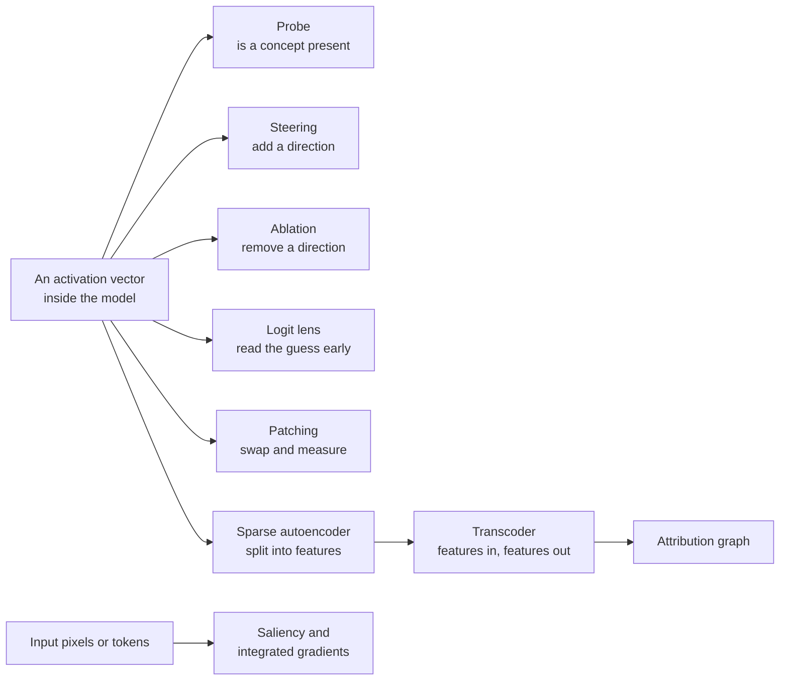
*Figure G.15: The interpretability toolkit. Most tools read or edit one activation vector; attribution methods work back from the output to the input.*

### Linear probe

**What it does:** Tests whether a model's internal activations contain a concept, using a single dot product and a threshold.

`p(concept present given a) = sigmoid(w · a + b), trained with the logistic loss −[y × ln p + (1 − y) × ln(1 − p)] (often plus an L2 penalty); difference-of-means probe: w = mean(a over positive examples) − mean(a over negative examples)`

- **a**: an activation vector from one layer of the model.
- **w**: a learned weight vector (a direction); **b**: a bias.
- **y**: the true label, 1 if the concept is present and 0 if not.
- **p**: the probe's probability that it is present.
- **sigmoid(z)**: 1 ÷ (1 + exp(−z)); **positive** and **negative examples**: inputs where the concept is present or absent.

**In plain words:** A probe shows that information is present, not that the model uses it. A check called selectivity compares the probe's accuracy on the real task with its accuracy on a control task with random labels (Hewitt and Liang, 2019).

**Tiny example:** Chapter 57's probe: w · a = 1.4 against a threshold of 1.0, so b = −1.0 and p = sigmoid(0.4) ≈ 0.60. If the concept really is present (y = 1), the loss is −ln 0.60 ≈ 0.51.

**Where it is used:** Alain and Bengio (2016); Anthropic's "defection probes" for sleeper-agent models (2024); Apollo Research's deception probes (2025); Google DeepMind reported in 2025 that simple linear probes beat SAE-based methods at detecting harmful intent; cheap always-on monitors.
**In the book:** Chapter 57 (Probes: simple detectors).

> **Definition — Control task (for probes):** A version of a probing task with random labels, used as a baseline: if a probe does nearly as well on it as on the real task, its success reflects the probe's own flexibility rather than information in the model.

### Activation steering with a steering vector

**What it does:** Changes a model's behavior while it runs by adding a direction to its activations.

`a' = a + α × v, with v = mean(a over prompt set A) − mean(a over prompt set B); SAE feature clamping: a' = a + (k − f_i(a)) × d_i`

- **a**: the activation vector; **a'**: the steered activation.
- **v**: the steering vector; **α**: its strength.
- **prompt sets A and B**: contrasting prompts, such as honest and dishonest ones.
- **f_i(a)**: the current strength of sparse-autoencoder feature i; **k**: the value it is clamped to; **d_i**: its decoder direction.

**In plain words:** Too little α does nothing and too much produces gibberish. Clamping sets one feature to a chosen strength along its own direction. Names for variants: activation addition, contrastive activation addition, representation engineering, persona vectors.

**Tiny example:** Chapter 57: [2.5, 1.0, 0.0, 1.5] + 10 × [1.0, 0.0, 0.0, 0.5] = [12.5, 1.0, 0.0, 6.5]. Clamping the same direction's feature from a strength of 2 to 10: a + 8 × [1.0, 0.0, 0.0, 0.5] = [10.5, 1.0, 0.0, 5.5].

**Where it is used:** Golden Gate Claude (Anthropic, May 2024); representation engineering (Zou and colleagues, 2023); persona vectors for monitoring and preventing trait shifts such as sycophancy (Anthropic, August 2025).
**In the book:** Chapter 57 (Steering: turning the dials).

> **Definition — Feature clamping:** Fixing one sparse-autoencoder feature at a chosen strength while a model runs, by adjusting the activation along that feature's direction, to see or change what the feature does.

### Directional ablation (projecting out a direction)

**What it does:** Removes the part of an activation that points along a chosen direction, so the model can no longer represent that concept there.

`a' = a − (a · v_hat) × v_hat, with v_hat = v ÷ length(v); weight orthogonalization: W' = W − v_hat × (v_hat^T × W)`

- **a**: the activation; **a'**: the activation with the direction removed.
- **v**: the direction; **v_hat**: the same direction scaled to length 1.
- **a · v_hat**: how far a points along that direction.
- **W**: a weight matrix that writes into the residual stream; **W'**: its edited version; **v_hat^T**: v_hat written as a row.

**In plain words:** Subtract the shadow the activation casts on the direction. Editing the weights the same way makes the removal permanent. Related: concept-erasure methods such as LEACE.

**Tiny example:** v = [3, 4], so length 5 and v_hat = [0.6, 0.8]. For a = [2, 1]: a · v_hat = 1.2 + 0.8 = 2.0, and a' = [2, 1] − 2.0 × [0.6, 0.8] = [0.8, −0.6]. Check: a' · v_hat = 0.48 − 0.48 = 0.

**Where it is used:** Arditi and colleagues (2024) showed refusal is mediated by a single direction in many open chat models; "abliteration" uses this to strip refusals from open-weight models, a known misuse route.
**In the book:** Chapter 57 (Steering: turning the dials: ablation), in words.

> **Definition — Directional ablation:** Removing from a model's activations their component along one direction, so the concept that direction stands for is erased at that point in the network.

> **Definition — Abliteration:** Editing an open-weight model's weights so that it can no longer represent its "refusal direction", which removes much of its trained tendency to refuse harmful requests. It is an example of why open weights limit what safety training alone can guarantee.

> **Definition — Unit vector:** A vector of length exactly 1, made by dividing a vector by its own length. Its dot product with another vector gives how far that vector extends in its direction.

### Saliency maps, gradient times input and Grad-CAM

**What it does:** Estimates how much each input feature (a pixel, a token) matters to an output, from the gradient.

`saliency S_i = |∂F(x) ÷ ∂x_i|; gradient × input attribution_i = x_i × ∂F(x) ÷ ∂x_i; Grad-CAM map = ReLU(sum over channels k of (α_k × M_k)), with α_k = the average over all positions of ∂F(x) ÷ ∂M_k`

- **F(x)**: the model's score for one output class at input x.
- **x_i**: one input feature.
- **∂F(x) ÷ ∂x_i**: the partial derivative, how fast the score changes when that feature changes.
- **|...|**: the absolute value.
- **S_i**: the saliency of feature i; **attribution_i**: its gradient-times-input score.
- **M_k**: channel k of the last convolutional layer, a small grid of numbers (a feature map, Chapter 14); **α_k**: that channel's importance weight, its average slope; **ReLU**: max(0, value), applied to each cell of the grid.

**In plain words:** A big slope means the output is sensitive to that pixel or token. Multiplying by the input gives a first-order estimate of each feature's contribution. Both are known to be noisy and sometimes misleading; SmoothGrad averages gradients over noisy copies of the input. Grad-CAM works one level up: it weights the last convolutional layer's feature maps by how much the class score depends on them, giving a coarse heat map that is then stretched over the image.

**Tiny example:** F(x) = 3 × x_1 + 0.5 × x_2^2 at x = [2, 4]. Slopes: 3 for x_1 and x_2 = 4 for x_2, so saliency [3, 4]. Gradient × input: [6, 16], which adds to 22 although F(x) = 6 + 8 = 14, so these attributions do not add up to the output. Grad-CAM with two 2 × 2 feature maps M_1 = [[2, 0], [1, 3]] and M_2 = [[1, 4], [0, 1]] and weights α = [0.5, −0.2]: 0.5 × M_1 − 0.2 × M_2 = [[0.8, −0.8], [0.5, 1.3]], and ReLU gives the heat map [[0.8, 0], [0.5, 1.3]]: the bottom-right corner matters most.

**Where it is used:** Simonyan and colleagues (2013) saliency maps; Grad-CAM (Selvaraju and colleagues, 2017) for vision models; explanation libraries such as Captum; debugging shortcut learning in vision models.
**In the book:** Chapter 57 (The black-box problem), Chapter 14 (Looking inside a trained CNN), in words.

> **Definition — Gradient × input:** An attribution method that scores each input feature by its value times the slope of the output with respect to it, a quick first-order estimate of the feature's contribution.

> **Definition — SmoothGrad:** A way to make saliency maps less noisy by averaging the gradient over many copies of the input with a little random noise added.

### Integrated gradients

**What it does:** Attributes an output to input features by averaging gradients along a path from a neutral baseline, so the attributions add up exactly to the output's change.

`IG_i(x) = (x_i − x'_i) × integral from α = 0 to 1 of (∂F(x' + α × (x − x')) ÷ ∂x_i) dα ≈ (x_i − x'_i) × (1 ÷ m) × sum over k from 1 to m of (∂F(x' + (k ÷ m) × (x − x')) ÷ ∂x_i); completeness: sum over i of IG_i(x) = F(x) − F(x')`

- **x**: the real input; **x'**: a baseline input, such as a black image or all-padding text.
- **α**: how far along the straight path from x' to x (0 is the baseline, 1 the input).
- **∂F(...) ÷ ∂x_i**: the slope of the output with respect to feature i at a point on the path.
- **m**: the number of steps used to approximate the integral, often 20 to 300.
- **IG_i(x)**: the integrated-gradients attribution of feature i; **x_i**, **x'_i**: feature i in the input and in the baseline; **k**: the step number.

**In plain words:** Walk from the baseline to the real input in small steps, average the slope for each feature along the way, and multiply by how far that feature moved. Unlike plain gradients, the attributions sum exactly to the change in output (completeness).

**Tiny example:** The same F(x) = 3 × x_1 + 0.5 × x_2^2, input [2, 4], baseline [0, 0]. For x_1 the slope is always 3: IG_1 = 2 × 3 = 6. For x_2 the slope at fraction α of the way is 4 × α, averaging 2: IG_2 = 4 × 2 = 8. Total 6 + 8 = 14 = F(x) − F(0). With only m = 4 steps (α = 0.25, 0.5, 0.75, 1) the x_2 slopes 1, 2, 3, 4 average 2.5 and give 10; with m = 100 it is 8.08, approaching 8.

**Where it is used:** Sundararajan, Taly and Yan (2017); Captum and cloud explainability services; attribution for vision, text and tabular models.
**In the book:** Only here.

> **Definition — Integrated gradients:** An attribution method that credits each input feature with its change from a neutral baseline times the average gradient along the straight path between them, so all credits add up to the model's change in output.

### Influence functions (which training examples shaped an answer)

**What it does:** Estimates how much one training example changed a model's loss on a test input, without retraining the model.

`I(z, z_test) = −∇_θ L(z_test)^T × H^(−1) × ∇_θ L(z); deleting z from n training examples changes the test loss by about −I(z, z_test) ÷ n`

- **z**: one training example; **z_test**: the input whose behavior we want to explain.
- **θ** (theta): the trained model's parameters.
- **L(z)**: the loss on example z; **∇_θ L(z)**: its gradient, the direction in which training on z pushes the parameters.
- **H**: the Hessian, the matrix of second derivatives (the curvature) of the average training loss; **H^(−1)**: its inverse.
- **^T**: the transpose, which turns the first gradient into a row so that row × matrix × column gives one number.
- **I(z, z_test)**: the influence; negative means giving z more weight lowers the test loss (z helped this answer), positive means it hurt.
- **n**: the number of training examples.

**In plain words:** Training on z pushes the parameters along its gradient. The inverse Hessian converts that push into how far the trained parameters actually settle once every other example pushes back, and the dot product with the test gradient says whether that shift helps or hurts the test answer. For billions of parameters the Hessian cannot even be stored, so practical methods approximate it, or drop it and add up gradient dot products over saved training checkpoints (TracIn).

**Tiny example:** One parameter. The average training loss has curvature H = 4, the test example's gradient is 2 and the training example's gradient is 1: I = −2 × (1 ÷ 4) × 1 = −0.5, so z helped this test answer. With n = 100 training examples, deleting z would raise the test loss by about 0.5 ÷ 100 = 0.005. A training example with gradient −1 would get I = +0.5: it pulled the model the wrong way for this input.

**Where it is used:** Koh and Liang (2017) brought influence functions from statistics into deep learning; Anthropic's "Studying Large Language Model Generalization with Influence Functions" (Grosse and colleagues, August 2023) scaled them to language models of up to 52 billion parameters with an approximation of the Hessian called EK-FAC and traced answers back to the pretraining documents behind them; training-data attribution for data cleaning and debugging.
**In the book:** Only here.

> **Definition — Influence function:** A formula that estimates how a model's prediction on one input would change if a particular training example were removed or given more weight, used to find which training data a behavior came from without retraining the model.

### Toy model of superposition

**What it does:** Shows how a model can store more sparse features than it has dimensions, as overlapping, nearly perpendicular directions.

`x' = ReLU(W^T × W × x + b); L = sum over examples x of sum over features i of (I_i × (x_i − x'_i)^2), with n sparse features squeezed through m < n dimensions by the m × n matrix W`

- **x**: a vector of n feature strengths, mostly zero; **x'**: its reconstruction.
- **W**: an m × n matrix that compresses n features into m dimensions; **W^T**: its transpose, which decompresses.
- **b**: a bias; **ReLU**: max(0, value).
- **I_i**: the importance of feature i.
- **L**: the training loss; **x_i**, **x'_i**: feature i and its reconstruction.

**In plain words:** When features are rare, they seldom appear together, so cramming them into shared directions costs little. That explains polysemantic neurons, which respond to several unrelated things. Elhage and colleagues (Anthropic, 2022).

**Tiny example:** Chapter 57's three features as arrows 120 degrees apart in two dimensions: [1, 0], [−0.5, 0.866] and [−0.5, −0.866], with b = 0 and all I_i = 1. Feature 1 alone: W × x = [1, 0], W^T × [1, 0] = [1, −0.5, −0.5], ReLU gives [1, 0, 0], perfect. Features 1 and 2 together: W × x = [0.5, 0.866], W^T × that = [0.5, 0.5, −1], ReLU gives [0.5, 0.5, 0], a loss of 0.25 + 0.25 = 0.5. Sparse inputs survive; crowded ones interfere.

**Where it is used:** The motivation for sparse autoencoders (next entry).
**In the book:** Chapter 57 (Superposition: more ideas than neurons).

### Sparse autoencoder loss with an L1 penalty (SAE)

**What it does:** Learns to rewrite each activation as a few active features out of a very large dictionary.

`f = ReLU(W_enc × (x − b_dec) + b_enc); x_hat = W_dec × f + b_dec; L = length(x − x_hat)^2 + λ × sum over i of (f_i × length(column i of W_dec))`

- **x**: a model activation; **x_hat**: its reconstruction.
- **f**: a much longer vector of feature strengths, most of them zero.
- **W_enc**, **b_enc**: the encoder's weights and bias; **W_dec**, **b_dec**: the decoder's.
- **column i of W_dec**: feature i's direction; **λ**: the sparsity weight.
- **L**: the loss; **f_i**: feature i's strength; **ReLU**: max(0, value).

**In plain words:** The first term rewards faithful reconstruction, the second rewards using few features. Anthropic's 2024 variant weights each feature's penalty by its decoder column length; the earlier form fixed those lengths at 1 and used the plain sum of f_i.

**Tiny example:** Chapter 57's bridge example with λ = 0.01 and unit-length directions: a candidate code with squared reconstruction error 0.02 and feature strengths adding to 4.1 costs 0.02 + 0.01 × 4.1 = 0.061, while the exact code (error 0, strengths adding to 4) costs 0 + 0.01 × 4 = 0.04, so training prefers the exact, sparser code. With the decoder-length weighting, features of strength 2, 0 and 1 with direction lengths 1, 1 and 0.5 and λ = 0.01 cost 0.01 × (2 × 1 + 1 × 0.5) = 0.025.

**Where it is used:** Anthropic's "Towards Monosemanticity" (2023) and "Scaling Monosemanticity" (May 2024: 1, 4 and 34 million features on Claude 3 Sonnet); widely used open SAE libraries.
**In the book:** Chapter 57 (Sparse autoencoders: unpacking the suitcase).

### TopK, BatchTopK and JumpReLU sparse autoencoders

**What it does:** Controls how many features are active directly, instead of with an L1 penalty that also shrinks the active ones.

`TopK: f = TopK(W_enc × (x − b_pre)), keeping only the k largest entries, and L = length(x − x_hat)^2 plus an auxiliary loss for dead features; JumpReLU: f_i = z_i if z_i > θ_i else 0, with z = W_enc × x + b_enc, and L = length(x − x_hat)^2 + λ × (count of nonzero f_i), trained with straight-through gradient estimates`

- **TopK(...)**: keep the k largest values and set the rest to 0; **k**: the number of active features per token.
- **b_pre**: a bias subtracted before encoding.
- **z_i**: feature i's pre-activation; **θ_i** (theta): a learned threshold for feature i.
- **count of nonzero f_i**: the L0 norm; **λ**: its weight.
- **x_hat**: the reconstruction.
- **W_enc**, **b_enc**: the encoder's weights and bias; **f**: the active features; **x**: the activation.

**In plain words:** TopK fixes exactly k active features per token; BatchTopK fixes the average over a batch. JumpReLU learns a threshold per feature and penalizes the count of active features directly. Dead features, which never fire, are revived with an auxiliary loss.

**Tiny example:** Pre-activations [0.9, −0.2, 2.5, 0.4, 1.1]. TopK with k = 2 keeps [0, 0, 2.5, 0, 1.1]. JumpReLU with thresholds [1.0, 0.5, 1.0, 0.3, 1.2] keeps the values above their thresholds: [0, 0, 2.5, 0.4, 0], so L0 = 2.

**Where it is used:** OpenAI's TopK SAE with 16 million latents on GPT-4 activations (June 2024); Gemma Scope (Google DeepMind, August 2024), more than 400 JumpReLU SAEs on Gemma 2, browsable on Neuronpedia; BatchTopK (2024) and Matryoshka SAEs (2025).
**In the book:** Only here (Chapter 57 mentions Gemma Scope by name).

> **Definition — TopK sparse autoencoder:** A sparse autoencoder that keeps only the k strongest features for each input and sets the rest to zero, fixing exactly how many features may be active.

> **Definition — JumpReLU sparse autoencoder:** A sparse autoencoder whose features switch on only above a learned threshold each, trained with a penalty on the number of active features. Google DeepMind's Gemma Scope used this design.

> **Definition — L0 norm:** The number of nonzero entries in a vector. For a sparse autoencoder it counts how many features are active for an input, the most direct measure of sparsity.

> **Definition — Dead feature:** A feature in a sparse autoencoder that never or almost never activates, wasting part of the dictionary.

### Sparse autoencoder quality metrics (L0, FVU, loss recovered)

**What it does:** Scores a sparse autoencoder on sparsity, reconstruction, and whether the model still works with it spliced in.

`L0 = average number of nonzero f_i per token; FVU = sum of length(x − x_hat)^2 ÷ sum of length(x − mean(x))^2; CE loss recovered = (CE with the layer zero-ablated − CE with the SAE spliced in) ÷ (CE with the layer zero-ablated − CE of the original model)`

- **f_i**: feature strengths; **x**, **x_hat**: the activation and its reconstruction.
- **mean(x)**: the average activation.
- **CE**: the model's next-token cross-entropy loss.
- **zero-ablated**: with that layer's activation replaced by zeros.

**In plain words:** L0 measures how few features fire, FVU (fraction of variance unexplained) how much of the activation the reconstruction misses, and loss recovered whether the model still predicts text well when its activation is replaced by the reconstruction. The unexplained part is sometimes called the "dark matter".

**Tiny example:** Three tokens with 30, 50 and 40 active features: L0 = 40. Squared reconstruction errors totaling 2 against a total variance of 20: FVU = 0.1, so 90% is explained. Original loss 2.0, zero-ablated 5.0, with the SAE 2.3: (5.0 − 2.3) ÷ (5.0 − 2.0) = 0.9, so 90% of the loss is recovered.

**Where it is used:** Reported for Gemma Scope and other SAE releases; benchmark suites such as SAEBench (2025).
**In the book:** Chapter 57 (Sparse autoencoders: unpacking the suitcase), in words.

> **Definition — FVU (fraction of variance unexplained):** The share of the variation in a model's activations that a reconstruction fails to capture: 0 means perfect reconstruction, 1 means no better than predicting the average.

> **Definition — Loss recovered:** For a sparse autoencoder spliced into a model, how much of the model's original next-token accuracy survives, scaled so that 100% matches the original model and 0% matches deleting the layer's information entirely.

### Transcoders, cross-layer transcoders and attribution-graph edges

**What it does:** Replaces a feed-forward block with sparse, interpretable features, so each feature's effect on another can be read off as a number.

`f = ReLU(W_enc × x_in + b_enc); y_hat = W_dec × f + b_dec; L = length(MLP(x_in) − y_hat)^2 + λ × sum over i of |f_i|; cross-layer: y_hat_l = sum over l' ≤ l of (W_dec^(l' → l) × f_l'); edge weight from feature s to target t = activation of s × linear weight from s to t (attention patterns and normalizations frozen)`

- **x_in**: the input to the feed-forward block (MLP); **MLP(x_in)**: its real output; **y_hat**: the transcoder's imitation.
- **f**: the sparse features; **λ**: the sparsity weight.
- **l**, **l'**: layers; **W_dec^(l' → l)**: how a feature read at layer l' writes to layer l.
- **s**, **t**: a source feature and a target feature or output.
- **W_enc**, **b_enc**, **W_dec**, **b_dec**: encoder and decoder weights and biases; **ReLU**: max(0, value); **L**: the loss; **f_l'**: the features read at layer l'.

**In plain words:** A transcoder imitates what one feed-forward block computes through sparse features; a cross-layer transcoder lets a feature read at one layer write to every later layer. With these in place the computation becomes locally linear, so each feature's contribution to another is an activation times a weight, and those edges form an attribution graph. Variant: crosscoders use the same reconstruction-plus-sparsity loss but read and rebuild several layers, or the same layer in two different models, with one shared set of features; comparing a model before and after fine-tuning this way is called model diffing.

**Tiny example:** The block's real output [1, 2], the transcoder's [1.1, 1.8], features [0.5, 0, 1.5] and λ = 0.01: L = 0.01 + 0.04 + 0.01 × 2 = 0.07. A feature active at 2.0 whose linear weight to a target is 0.3 contributes an edge of 2.0 × 0.3 = 0.6.

**Where it is used:** Dunefsky and colleagues (2024); Anthropic's "Circuit Tracing" and "On the Biology of a Large Language Model" (March 2025, on Claude 3.5 Haiku); open-source circuit-tracer tools with Neuronpedia (May 2025); crosscoders for model diffing (Anthropic, from late 2024).
**In the book:** Chapter 57 (Sparse autoencoders; Circuits and attribution graphs: tracing a thought), in words.

> **Definition — Crosscoder:** A sparse autoencoder that learns one shared set of features across several layers of a model, or across two models, so researchers can see which features persist, which move between layers and which appear or vanish after fine-tuning (model diffing).

### Logit lens and direct logit attribution

**What it does:** Reads off what the model "would say" at an intermediate layer, and how much each component pushes toward a particular next token.

`logits_l = W_U × LN_final(h_l); direct logit attribution of component c to token t = W_U[t] · (output_c ÷ s_final), with the final layer-norm scale s_final frozen`

- **h_l**: the residual-stream vector after layer l.
- **LN_final**: the model's final layer normalization; **s_final**: its scaling factor.
- **W_U**: the unembedding matrix; **W_U[t]**: its row for token t.
- **output_c**: what one component (an attention head or MLP) added to the residual stream.
- **logits_l**: the next-token scores read off at layer l.
- **c**: one component; **t**: one possible next token.

**In plain words:** Apply the model's last two steps early to see its guess at that depth. Because the residual stream is a sum of component outputs, each head's or MLP's direct push toward a token is its output dotted with that token's unembedding row. Variant: the tuned lens learns a small correction per layer.

**Tiny example:** Treat the layer norm as doing nothing. h = [1, 2]; unembedding rows "Paris" [2, 1] and "London" [1, 0]. Logits: 2 × 1 + 1 × 2 = 4 and 1; softmax gives about 0.953 and 0.047. A head that added [0.5, 1.0] contributes [2, 1] · [0.5, 1.0] = 2.0 to "Paris" and 0.5 to "London".

**Where it is used:** nostalgebraist's logit lens (2020), the tuned lens (Belrose and colleagues, 2023), the TransformerLens library and circuit studies such as the indirect-object-identification work (2022).
**In the book:** Only here (Chapters 15 and 18 explain the unembedding).

> **Definition — Logit lens:** An interpretability technique that applies a language model's final normalization and unembedding to the hidden state of an intermediate layer, to see which next tokens the model is leaning toward at that depth.

> **Definition — Direct logit attribution:** Measuring how much one part of a model, such as a single attention head, directly raises or lowers the score of a particular output token, by projecting that part's output onto the token's unembedding direction.

> **Definition — Tuned lens:** A refinement of the logit lens that trains a small linear correction for each layer before decoding, giving more accurate readings of intermediate layers.

### Activation patching and attribution patching

**What it does:** Tests whether a component carries information by swapping its activation between two prompts, or approximates every such swap at once with a gradient.

`patching effect = M(run on prompt A with activation a_c replaced by its value from prompt B) − M(unpatched run on A); normalized: (M_patched − M_corrupt) ÷ (M_clean − M_corrupt); attribution patching: ΔM ≈ (a_corrupt − a_clean) · (∂M ÷ ∂a evaluated on the clean run)`

- **M**: a metric, such as the logit difference between the right and a wrong answer.
- **a_c**: the activation of component c; **a_clean**, **a_corrupt**: its values on the clean and corrupted prompts.
- **M_clean**, **M_corrupt**, **M_patched**: the metric on the clean run, the corrupted run and the patched run.
- **∂M ÷ ∂a**: the gradient of the metric with respect to the activation; **ΔM**: the estimated change.
- **prompt A**, **prompt B**: the prompt being run and the prompt the activation is copied from; one is clean and the other corrupted (for example with one key word changed), in either order.

**In plain words:** Unlike probing, patching gives causal evidence: if putting one component's clean value into a corrupted run restores the right answer (or a corrupted value into a clean run breaks it), that component carries the information. Attribution patching estimates all patches with one backward pass, a first-order (Taylor) approximation.

**Tiny example:** Logit difference 3.0 on the clean prompt and −1.0 on the corrupted one; patching one head's clean activation into the corrupted run gives 2.0: (2.0 − (−1.0)) ÷ (3.0 − (−1.0)) = 0.75, so that head restores 75%. Attribution patching with an activation change [0.5, −1] and gradient [2, 1]: 0.5 × 2 + (−1) × 1 = 0, predicting no effect.

**Where it is used:** Causal tracing in ROME (Meng and colleagues, 2022), the indirect-object-identification circuit (Wang and colleagues, 2022), attribution patching (Nanda, 2023) and AtP\* (Google DeepMind, 2024).
**In the book:** Chapter 57 (Circuits and attribution graphs: tracing a thought), in words.

> **Definition — Activation patching:** An interpretability experiment that runs a model on one prompt while copying in a single component's activation from a different prompt, to see whether that component causes the change in output.

> **Definition — Attribution patching:** A fast approximation of activation patching that uses one gradient calculation to estimate how much swapping each component's activation would change the output, instead of rerunning the model once per component.

> **Definition — Logit difference:** The model's score for the correct answer minus its score for a specific wrong answer, a common metric in interpretability experiments because it isolates the choice being studied.

## Generative models and classical AI

This family holds two traditions that meet in the middle. Classical AI is the older one: equations for searching through possibilities (A*, minimax, Monte Carlo tree search), for reasoning with logic and with uncertainty (Bayesian networks, hidden Markov models, Kalman and particle filters), and for acting in the physical world (filters, kinematics and dynamics, PID, LQR and model predictive control). Decision theory and planning with a known model (expected utility, the value of information, value iteration, policy iteration and AlphaZero's PUCT rule) live in the reinforcement-learning section, which they share with learning by trial and error. Generative models are the newer one: the equations that let a network turn random numbers into images, audio and video (VAEs, GANs, normalizing flows, diffusion, flow matching), plus the contrastive losses such as CLIP that connect pictures to words and the scores used to grade generators. Between them sit the image and audio formulas (camera projection and multi-view geometry, optical flow, detection losses, image-quality scores, spectrograms, μ-law, the CTC and transducer losses) that every perception and generation system relies on. The two halves share more than it seems: the forward–backward dynamic program of hidden Markov models is the same machinery as the CTC loss of speech recognizers, the partition function of energy-based models is the normalizer in Bayesian networks and Markov random fields, Langevin sampling is a Markov chain Monte Carlo method, and the "mean plus spread times noise" of the reparameterization trick is the diffusion forward jump in disguise. The entries run from the simplest (adding up path costs) to the most involved (diffusion and flow samplers), so each one only needs those before it.

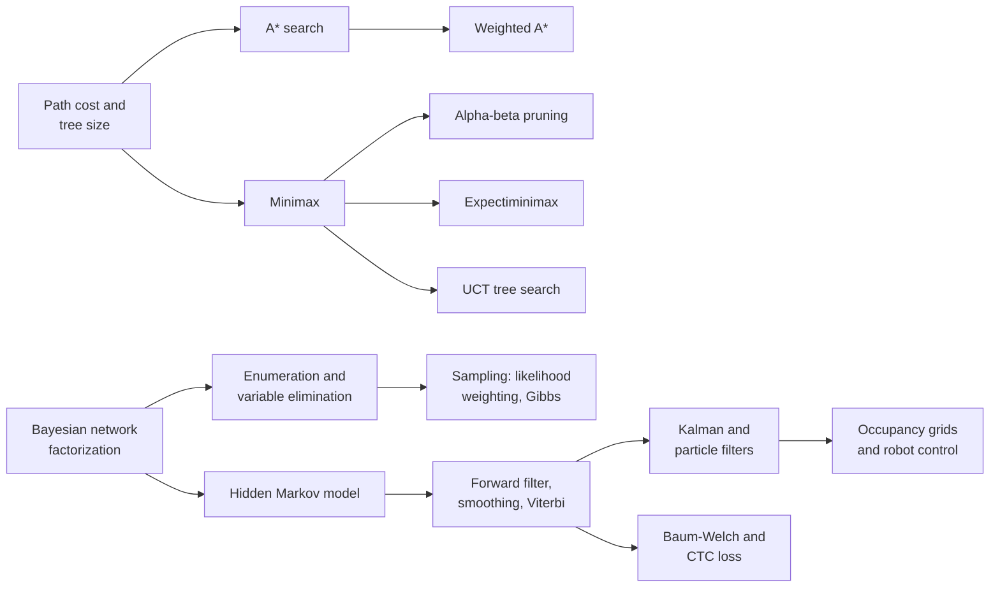
*Figure G.16: How the classical-AI equations build on each other: search and game trees at the top, probabilistic reasoning and filtering over time below.*

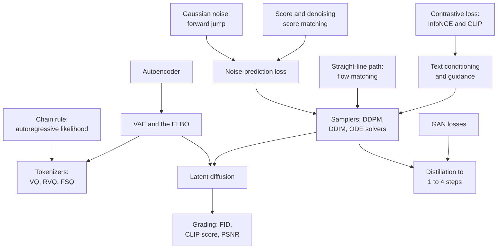
*Figure G.17: How the generative-model equations connect. Tokenizers feed autoregressive generators, VAEs feed latent diffusion, and every sampler runs on a network trained with the noise-prediction or flow-matching loss.*

### Path cost and search-tree size (uniform-cost search)

**What it does:** Adds up the cost of a route and counts how many possibilities a blind search must look at.

`g(n) = sum of step costs c(s, a, s') along the path to n`; when uniform-cost search expands n it updates each neighbor n' with `g(n') ← min(g(n'), g(n) + c(n, a, n'))`; `nodes to depth d = 1 + b + b^2 + ... + b^d = (b^(d+1) − 1) ÷ (b − 1)`; iterative deepening generates `d × b + (d − 1) × b^2 + ... + 1 × b^d` nodes; bidirectional search needs about `2 × b^(d/2)`

- **n**: a search node, meaning a state plus the path that reached it; **n'**: a neighbor of n
- **g(n)**: the total cost already paid to reach n
- **c(s, a, s')**: the cost of taking action a in state s and landing in state s'
- **←**: "is replaced by"; **min**: the smaller of the two
- **b**: the branching factor, the average number of next moves from each state
- **d**: the depth (number of steps) of the shallowest goal

**In plain words:** The cost of a route is just the sum of its steps, and uniform-cost search (Dijkstra's algorithm) always extends the cheapest route found so far, lowering a neighbor's cost whenever it finds a cheaper way in (this update is called relaxation). The tree-size formula shows the problem: each extra level multiplies the work by b, so the count grows like b^d. Most of the nodes sit in the deepest level, which is why iterative deepening, which re-searches the shallow levels again and again, costs only a little more than one breadth-first pass.

**Tiny example:** A route with steps costing 2, 3 and 1 has g = 2 + 3 + 1 = 6. If a neighbor was already reached for 9 and a step from here costs 2, its cost drops to min(9, 6 + 2) = 8. A tree with b = 3 down to depth d = 4 has (3^5 − 1) ÷ (3 − 1) = (243 − 1) ÷ 2 = 121 nodes. With b = 10 and d = 5, iterative deepening generates 5 × 10 + 4 × 100 + 3 × 1,000 + 2 × 10,000 + 1 × 100,000 = 123,450 nodes, against 10 + 100 + 1,000 + 10,000 + 100,000 = 111,110 for one breadth-first pass: only about 11% more. Bidirectional search with b = 10 and d = 6 meets in the middle after about 2 × 10^3 = 2,000 nodes instead of 10^6.

**Where it is used:** Route planning, puzzle solving, game AI and robot grid planning; the b^d growth is the "combinatorial explosion" that sank early search-only AI, and it is why robot arms need sampling planners (100 settings for each of 7 joints is 100^7 = 10^14 cells).
**In the book:** Chapter 48 (Blind search: breadth-first and depth-first), which works the same bidirectional example; Chapter 7 (Combinatorial explosion and the Lighthill report (1973)); the general formulas are only here.

### A* evaluation function (and greedy best-first search)

**What it does:** Scores each place a search could explore next by cost so far plus estimated cost remaining.

`f(n) = g(n) + h(n)`; expand the frontier node with the smallest f; greedy best-first search uses `f(n) = h(n)`

- **n**: a node (a place or state) on the search frontier
- **g(n)**: the cost already paid to reach n
- **h(n)**: the heuristic, a guess of the cheapest remaining cost from n to a goal
- **f(n)**: the estimated cost of the best complete solution passing through n

**In plain words:** A* combines what it knows (the distance already traveled) with a good guess (the distance left). If the guess never overestimates, the first route A* completes is a shortest one. Dropping g gives greedy best-first search, which is fast but can be lured into dead ends.

**Tiny example:** Chapter 48's grid: the square to the right of the start has g = 1 and Manhattan distance h = 0 + 6 = 6, so f = 1 + 6 = 7; the squares above and below have f = 1 + 8 = 9, so A* goes right first.

**Where it is used:** Game pathfinding, map routing, robot navigation on grids, puzzle solvers and heuristic-search planners such as Fast Downward and LAMA.
**In the book:** Chapter 48 (A*: search with a sense of direction), with Table 48.2 and the full grid walk-through.

### Admissible and consistent heuristics, and the effective branching factor

**What it does:** States when a heuristic guarantees that A* finds the best answer, and measures how much a heuristic helps.

admissible: `h(n) ≤ h*(n)` for every n; consistent: `h(n) ≤ c(n, a, n') + h(n')` and `h(goal) = 0`; Manhattan distance `|x1 − x2| + |y1 − y2|`; straight-line distance `sqrt((x1 − x2)^2 + (y1 − y2)^2)`; `max(h1, h2)` of admissible heuristics is admissible; effective branching factor b* solves `N + 1 = 1 + b* + (b*)^2 + ... + (b*)^d`

- **h(n)**: the heuristic estimate at node n
- **h*(n)**: the true cheapest remaining cost from n
- **c(n, a, n')**: the cost of the step from n to its neighbor n' by action a
- **x1, y1, x2, y2**: grid or map coordinates of two points; |·| means "size without sign"
- **h1, h2**: two different heuristics
- **N**: the number of nodes A* generated to find a solution
- **d**: the depth of that solution
- **b***: the effective branching factor, the branching factor a uniform tree would need to contain N + 1 nodes at depth d

**In plain words:** Admissible means the guess is never pessimistic: it never claims more cost remains than really does, so A* never wrongly skips the best route. Consistent is a stronger "triangle" rule: the guess at one square is never more than one step's cost plus the guess at the next square; it implies admissibility. Taking the larger of two admissible guesses is still admissible and usually better. A lower b* (closer to 1) means a sharper heuristic.

**Tiny example:** From (2, 0) to (2, 7) on a grid, Manhattan distance is 0 + 7 = 7. Consistency check across one step: 7 ≤ 1 + 6 holds. Straight-line distance from (0, 0) to (3, 4) is sqrt(9 + 16) = 5. If A* generates N = 52 nodes to find a solution at depth 5, b* solves 53 = 1 + b* + ... + (b*)^5, which gives b* ≈ 1.92.

**Where it is used:** Guaranteeing optimal A* in routing, games and planning; admissible heuristics come from relaxed problems and pattern databases.
**In the book:** Chapter 48 (A*: search with a sense of direction) covers admissibility and Manhattan distance; consistency, the max rule and b* are only here.

> **Definition — Consistent heuristic:** A heuristic whose estimate at any state is never more than the cost of one step plus its estimate at the next state, and is zero at the goal. Consistency implies admissibility and lets A* expand each state at most once.

> **Definition — Effective branching factor:** The branching factor a perfectly uniform search tree would need in order to contain as many nodes as a search actually generated; values near 1 mean the heuristic is guiding the search well.

### Weighted A* (bounded-suboptimal search)

**What it does:** Trusts the heuristic more to search faster, with a guaranteed limit on how much worse the answer can be.

`f(n) = g(n) + W × h(n)`, with `W > 1`; solution cost `≤ W × C*` when h is admissible

- **g(n)**, **h(n)**: cost so far and heuristic, as in A*
- **W**: the weight on the heuristic, often 1.5 to 5
- **C***: the cost of the optimal solution

**In plain words:** Multiplying the guess makes the search lean harder toward the goal, so it examines far fewer squares, and the path it returns costs at most W times the best. As W grows very large it becomes greedy best-first search.

**Tiny example:** With W = 2, the square right of the start in Chapter 48 scores 1 + 2 × 6 = 13. If the best path costs 9, weighted A* with W = 2 returns a path of cost at most 2 × 9 = 18, and usually much closer to 9.

**Where it is used:** Game AI and robot planners that need fast answers, anytime repairing A* (ARA*) in motion planning, and the LAMA planner.
**In the book:** Chapter 48 (A*: search with a sense of direction), which uses g + 2 × h.

### Simulated annealing acceptance rule

**What it does:** Decides whether a local search should accept a move that makes things worse.

`ΔE = value(next) − value(current)`; if `ΔE > 0` accept; otherwise accept with probability `exp(ΔE ÷ T)`; cool over time, for example `T_k = T_0 × r^k`

- **value(·)**: the score being maximized (for a cost to minimize, use `exp(−Δcost ÷ T)`)
- **ΔE**: the change in score caused by the move (negative means worse)
- **T**: the temperature; high T accepts many bad moves, low T almost none
- **T_0**: the starting temperature
- **r**: the cooling rate, such as 0.95
- **k**: the iteration number

**In plain words:** Good moves are always taken. Bad moves are sometimes taken, more often when the temperature is high and when the move is only slightly bad. Early on this lets the search walk down off a small hill to find a taller one; as T cools it settles into plain hill climbing. It is the Metropolis rule from statistical physics.

**Tiny example:** Chapter 48's trail: stepping from 7 down to 6 gives ΔE = −1. At T = 2 the move is accepted with probability exp(−1 ÷ 2) ≈ 0.61; at T = 0.5, exp(−2) ≈ 0.14. Starting at T_0 = 10 with r = 0.95, after k = 10 rounds T = 10 × 0.95^10 ≈ 5.99.

**Where it is used:** Chip placement and routing since the 1980s, scheduling, combinatorial optimization and hyperparameter search.
**In the book:** Chapter 48 (Local search: improving one solution at a time) in words; the formula is only here.

### Genetic algorithm selection, crossover and mutation

**What it does:** Breeds better candidate solutions by fitness-weighted selection, mixing and random change.

`P(select i) = f_i ÷ sum over j of f_j`; one-point crossover `child = parent1[1..c] + parent2[c+1..n]`; mutation flips each gene independently with probability `p_m` (often `1 ÷ n`)

- **f_i**: the fitness score of individual i
- **sum over j of f_j**: the total fitness of the population
- **c**: a random cut point
- **n**: the genome length (number of genes)
- **p_m**: the mutation probability per gene

**In plain words:** Fitter candidates get bigger slices of a roulette wheel, children take the front of one parent and the back of another, and occasional random flips add new variety. Repeating this for many generations drifts the population toward high fitness.

**Tiny example:** From Chapter 54: fitness 17 out of a total of 48 gives a selection chance of 17 ÷ 48 ≈ 0.35. Crossing 01011 with 10110 after the second bit gives 01|110 = 01110. With n = 5 and p_m = 1 ÷ 5 = 0.2, a child gets on average 5 × 0.2 = 1 flipped bit.

**Where it is used:** Design optimization (NASA's evolved antenna, 2006), neural architecture search, evolution strategies such as CMA-ES; DeepMind's FunSearch (2023) and AlphaEvolve (2025) evolve programs with a language model as the mutation operator.
**In the book:** Chapter 54 (One generation, worked by hand), with Exercises 5 and 6.

### Minimax value of a game tree

**What it does:** Computes the best guaranteed outcome in a two-player game where the opponent plays perfectly.

`MINIMAX(s) = UTILITY(s)` if s is terminal; `max over a of MINIMAX(RESULT(s, a))` if MAX moves; `min over a of MINIMAX(RESULT(s, a))` if MIN moves; a depth-limited search uses `EVAL(s)` at the cutoff

- **s**: a game state
- **a**: a legal move (action)
- **RESULT(s, a)**: the state after playing a in s
- **UTILITY(s)**: the final score of a finished game from MAX's point of view (for example +1 win, 0 draw, −1 loss)
- **EVAL(s)**: an estimate of the score of an unfinished position
- **MAX**, **MIN**: the two players, who alternate

**In plain words:** Work backward from the end of the game. At your turn take the best child; at the opponent's turn assume they take the child that is worst for you. A full search costs about b^m positions for branching factor b and depth m, so real programs cut off early and estimate.

**Tiny example:** MAX chooses among three moves; MIN then picks a leaf. Move A leads to leaves 3, 12, 8, so MIN gives min = 3; move B to 2, 4, 6, giving 2; move C to 14, 5, 2, giving 2. MAX takes max(3, 2, 2) = 3, so move A is best.

**Where it is used:** Chess and checkers engines and classic game AI (zero-sum game theory itself is in the reinforcement-learning section).
**In the book:** Chapter 48 (Minimax, worked by hand), with a tic-tac-toe tree in Figure 48.3.

### Alpha–beta pruning bounds

**What it does:** Skips branches that cannot change the minimax decision.

keep `α` = best value MAX can already guarantee and `β` = best value MIN can already guarantee (start `α = −∞`, `β = +∞`); at a MAX node `α = max(α, child value)`; at a MIN node `β = min(β, child value)`; stop searching a node's remaining children once `α ≥ β`; nodes examined: best case about `b^(m/2)`, random order about `b^(3m/4)`

- **α** (alpha): the best score MAX is already sure of on the current path
- **β** (beta): the best (lowest) score MIN is already sure of on the current path
- **∞**: infinity, used as a starting value
- **b**: branching factor; **m**: search depth

**In plain words:** Once MIN has found a reply that is worse for MAX than something MAX already has elsewhere, MAX will never go down this branch, so its other replies need not be examined. The answer at the root is exactly the minimax value; only work is saved. With good move ordering the same time searches about twice as deep.

**Tiny example:** In the minimax tree above, after move A, α = 3. Under move B the first leaf is 2, so β = 2; now α = 3 ≥ β = 2 and the leaves 4 and 6 are skipped. Move C must be searched fully (14, 5, then 2). Two of nine leaves are pruned and the answer is still 3. With b = 10 and m = 6, perfect ordering needs about 10^3 positions instead of 10^6.

**Where it is used:** Deep Blue (1997), Chinook checkers and Stockfish (alpha–beta search with an NNUE neural evaluation), together with iterative deepening and transposition tables.
**In the book:** Chapter 48 (Alpha-beta pruning and evaluation functions) shows a cut in words; the α and β bookkeeping is only here.

### Weighted linear evaluation function

**What it does:** Scores an unfinished game position as a weighted sum of features.

`EVAL(s) = w_1 × f_1(s) + w_2 × f_2(s) + ... + w_n × f_n(s)`

- **s**: a game position
- **f_i(s)**: feature i of the position, such as material balance, mobility or king safety
- **w_i**: the weight saying how much feature i matters
- **n**: the number of features

**In plain words:** When the search must stop before the game ends, it needs a number for "how good is this position". The classic answer adds up features with weights, such as the chess material values pawn 1, knight 3, bishop 3, rook 5, queen 9. Samuel's checkers program (1959) learned the weights; TD-Gammon and AlphaZero replaced the whole sum with a neural network.

**Tiny example:** White is a knight up (material difference +3) but has 5 fewer legal moves (mobility difference −5). With weights 1.0 and 0.1: EVAL = 1.0 × 3 + 0.1 × (−5) = 3 − 0.5 = 2.5 in White's favor.

**Where it is used:** Depth-limited game search; Stockfish's NNUE network is its learned successor.
**In the book:** Chapter 48 (Alpha-beta pruning and evaluation functions) in words; the weighted sum is only here.

### Expectiminimax (games with chance)

**What it does:** Extends minimax to games with dice or cards by averaging over chance outcomes.

chance node: `value(s) = sum over outcomes r of P(r) × value(RESULT(s, r))`; MAX and MIN nodes as in minimax

- **s**: a state where chance moves next
- **r**: one chance outcome, such as a dice roll
- **P(r)**: its probability
- **RESULT(s, r)**: the state after that outcome

**In plain words:** Between the players' turns sits a layer of chance, where the value is the probability-weighted average of what follows. Because averages are taken, the scale of the evaluation function matters, not just its ordering.

**Tiny example:** Move A leads to a coin flip worth 4 or −2: value 0.5 × 4 + 0.5 × (−2) = 1. Move B leads to 1 with probability 0.9 and 0 with 0.1: value 0.9 × 1 + 0.1 × 0 = 0.9. MAX picks A, since 1 > 0.9.

**Where it is used:** Backgammon programs (TD-Gammon searched shallow expectiminimax trees) and other card and dice games.
**In the book:** Chapter 48 (Games with dice: chance nodes), worked with dice probabilities 1/36 and 11/36.

### UCT selection rule for Monte Carlo tree search

**What it does:** Chooses which move to explore next in Monte Carlo tree search, balancing proven moves against untried ones.

`UCT(n) = U(n) ÷ N(n) + C × sqrt(ln(N(parent(n))) ÷ N(n))`; select the child with the largest UCT; after a playout with result r, back up along the path: `N(n) ← N(n) + 1` and `U(n) ← U(n) + r` for every node n on it

- **n**: a child node (a move) in the search tree
- **U(n)**: the total reward (for example wins) from playouts through n
- **N(n)**: the number of playouts through n
- **N(parent(n))**: the number of playouts through n's parent
- **C**: an exploration constant (sqrt(2) in theory, tuned in practice)
- **r**: the playout's result (1 for a win, 0 for a loss, judged from the point of view of the player choosing at that node)

**In plain words:** The first term is the win rate, which favors moves that have done well. The second is an exploration bonus that grows for moves tried only a few times. Each round of MCTS selects down the tree with this rule, expands a new node, plays a random game to the end and passes the result back up by adding to the counts.

**Tiny example:** Chapter 48: after 12 playouts, ln(12) ≈ 2.48. Move A (win rate 0.6, 10 visits) scores 0.6 + 1.4 × sqrt(2.48 ÷ 10) ≈ 1.30; move B (win rate 0.5, 2 visits) scores 0.5 + 1.4 × sqrt(2.48 ÷ 2) ≈ 2.06, so B is explored next. If that playout is a win, B goes from 1 win in 2 to 2 wins in 3 (win rate 0.67).

**Where it is used:** Computer Go before AlphaGo (MoGo, Crazy Stone), general game playing and planning under uncertainty; it applies the UCB1 bandit formula (in the reinforcement-learning section) at every node. Its neural-network-guided successor, PUCT, and the AlphaZero training loss are also in the reinforcement-learning section.
**In the book:** Chapter 48 (Monte Carlo tree search).

### Constraint satisfaction problem (definition and counts)

**What it does:** Defines a puzzle of variables, allowed values and rules, and counts how hard brute force would be.

`CSP = (X, D, C)`; a solution gives every `X_i` a value from `D_i` that satisfies every constraint; brute-force search space `d^n`; `X_i` is arc-consistent with `X_j` if every value in `D_i` has some value in `D_j` that satisfies their constraint (AC-3 runs in about `c × d^3` steps)

- **X = {X_1, ..., X_n}**: the variables (for example, meeting times)
- **D_i**: the domain, the allowed values of X_i
- **C**: the constraints (rules such as "these two meetings differ")
- **n**: the number of variables; **d**: the domain size; **c**: the number of two-variable constraints

**In plain words:** Many scheduling and puzzle problems are just "pick a value for each variable without breaking any rule". Trying every combination costs d^n, so solvers prune: arc consistency deletes values that have no compatible partner, and heuristics such as "fill the most constrained variable first" order the search.

**Tiny example:** Four variables with domains of size 3 have 3^4 = 81 combinations. If X has domain {1} and Y has {1, 2} with the rule X ≠ Y, arc consistency deletes 1 from Y's domain, leaving {2}. Chapter 48's four meetings shrink brute force to 3 × 3 × 3 × 1 = 27.

**Where it is used:** Scheduling, timetabling, product configuration, Sudoku and SAT-based hardware verification; grammar-constrained decoding of LLM output applies the same idea to tokens.
**In the book:** Chapter 48 (Constraint satisfaction: puzzles, timetables and schedules).

### Truth tables, entailment and model checking

**What it does:** Defines the logical connectives and tests whether facts logically force a conclusion by checking every possible world.

`¬A` is true iff A is false; `A ∧ B` iff both are true; `A ∨ B` iff at least one is true; `A ⇒ B ≡ ¬A ∨ B`; `A ⇔ B ≡ (A ⇒ B) ∧ (B ⇒ A)`; De Morgan `¬(A ∧ B) ≡ ¬A ∨ ¬B`; n symbols give `2^n` rows; `KB ⊨ α` iff α is true in every row where KB is true

- **A**, **B**: propositions (statements that are true or false)
- **¬**: not; **∧**: and; **∨**: or; **⇒**: implies; **⇔**: if and only if
- **≡**: "is logically equivalent to"; **iff**: if and only if
- **n**: the number of proposition symbols
- **KB**: the knowledge base (the facts you believe); **α** (alpha): the sentence being tested
- **⊨**: "entails" (logically forces)

**In plain words:** Each row of a truth table is one possible world. A conclusion follows from your facts if it is true in every world where all your facts are true. Checking all 2^n rows is model checking; SAT solvers avoid most of them.

**Tiny example:** With 3 symbols there are 2^3 = 8 rows. If A is true and B is false, A ⇒ B is false, and so is ¬A ∨ B = false ∨ false = false, confirming the equivalence. De Morgan: with A true and B false, ¬(A ∧ B) = ¬false = true and ¬A ∨ ¬B = false ∨ true = true.

**Where it is used:** SAT and SMT solvers for chip and software verification, planning as satisfiability, package-dependency solving and rule engines.
**In the book:** Chapter 54 (Logic: the mathematics underneath the rules), which checks 2 × 2 × 2 = 8 situations by brute force.

> **Definition — Model checking:** Deciding whether a conclusion follows from a set of facts by listing every possible assignment of true and false (every "model") and checking that the conclusion holds in all of those where the facts hold.

### Resolution and modus ponens

**What it does:** Gives mechanical rules that derive new true sentences from old ones, and a way to prove a conclusion by contradiction.

resolution: from `(A ∨ B)` and `(¬B ∨ C)` infer `(A ∨ C)`; modus ponens: from `A` and `A ⇒ B` infer `B`; refutation: `KB ⊨ α` iff `KB ∧ ¬α` resolves to the empty clause

- **A**, **B**, **C**: propositions; ¬, ∨, ∧, ⇒ as in the truth-table entry
- **clause**: an OR of literals (symbols or their negations)
- **KB**, **α**, **⊨**: knowledge base, query and entailment, as above
- **empty clause**: a clause with nothing left in it, which can never be true, so reaching it means a contradiction

**In plain words:** Resolution cancels a symbol that appears plain in one clause and negated in another and keeps everything else. To prove α, add "not α" to your facts and resolve; if you reach the empty clause, "not α" was impossible, so α must follow. Every formula can be rewritten as an AND of clauses (conjunctive normal form), so this one rule suffices.

**Tiny example:** Facts: (A ∨ B) and ¬B. Query: A. Add ¬A. Resolve (A ∨ B) with ¬B to get A; resolve A with ¬A to get the empty clause. So the facts entail A. Modus ponens: from "alarm" and "alarm ⇒ locked", infer "locked" (Chapter 54's alarm example, which reaches the same conclusion by resolution).

**Where it is used:** Automated theorem provers (Vampire, E), Prolog's resolution, clause learning in CDCL SAT solvers, expert-system inference engines and Datalog.
**In the book:** Chapter 54 (Logic: the mathematics underneath the rules; A tiny expert system, worked by hand); refutation is only here.

> **Definition — Modus ponens:** The inference rule "from A, and from 'if A then B', conclude B." Forward chaining in rule engines applies it over and over.

> **Definition — Conjunctive normal form (CNF):** A way of writing any logical formula as an AND of clauses, where each clause is an OR of simple statements or their negations. SAT solvers and resolution provers require their input in this form.

### First-order logic: quantifiers, unification and generalized modus ponens

**What it does:** Lets logic talk about objects and "all" or "some", and finds the variable bindings that make a rule apply.

`∀x P(x)` is true iff P holds for every object; `∃x P(x)` iff for at least one; `¬∀x P(x) ≡ ∃x ¬P(x)`; `UNIFY(p, q) = θ` such that `SUBST(θ, p) = SUBST(θ, q)`; generalized modus ponens: from `p1', ..., pn'` and `(p1 ∧ ... ∧ pn ⇒ q)` infer `SUBST(θ, q)`, where `SUBST(θ, pi') = SUBST(θ, pi)` for every i

- **∀**: "for all"; **∃**: "there exists"
- **x**: a variable standing for any object
- **P**: a predicate (a property or relation, such as OwnsCar)
- **p**, **q**, **pi**, **pi'**: logical sentences
- **θ** (theta): a substitution, a list of variable bindings such as {x/Maria}
- **SUBST(θ, p)**: p with the bindings of θ filled in
- **UNIFY**: the procedure that finds θ

**In plain words:** Rules in first-order logic contain variables, so applying one means finding values for its variables that match the facts. Unification finds that match, and generalized modus ponens then fires the rule with those values.

**Tiny example:** Rule: OwnsCar(x) ⇒ NeedsInsurance(x). Fact: OwnsCar(Maria). Unifying OwnsCar(x) with OwnsCar(Maria) gives θ = {x/Maria}, so SUBST(θ, NeedsInsurance(x)) = NeedsInsurance(Maria).

**Where it is used:** Prolog, knowledge representation and ontologies (description logics, OWL), knowledge-graph rule engines and interactive theorem proving.
**In the book:** Chapter 54 (Logic: the mathematics underneath the rules), with the Maria insurance example, in words.

### STRIPS and PDDL action model (classical planning)

**What it does:** Defines when an action can be used and how it changes the world, so a planner can search for a plan.

action a is applicable in state s iff `PRECOND(a) ⊆ s`; `RESULT(s, a) = (s − DEL(a)) ∪ ADD(a)`; a plan is a sequence of actions from the initial state to a state satisfying the goal

- **s**: a state, written as the set of facts currently true
- **a**: an action
- **PRECOND(a)**: the facts a needs before it can run
- **ADD(a)**: the facts a makes true; **DEL(a)**: the facts a makes false
- **⊆**: "is contained in"; **−**: remove these facts; **∪**: add these facts

**In plain words:** A state is a list of true facts. An action can run when all its preconditions are on the list, and running it crosses some facts off and writes new ones on. Planners search over these lists; their heuristics come from relaxed versions that ignore the crossing-off.

**Tiny example:** State s = {kettle empty, have teabag}. Action Fill: PRECOND = {kettle empty}, DEL = {kettle empty}, ADD = {kettle has water}. Since {kettle empty} ⊆ s, Fill applies, and RESULT = ({kettle empty, have teabag} − {kettle empty}) ∪ {kettle has water} = {have teabag, kettle has water}.

**Where it is used:** Shakey (1972), PDDL planners such as Fast Downward and LAMA, space-mission and logistics planning, and systems in which an LLM translates goals into PDDL for a classical planner.
**In the book:** Chapter 48 (Planning with actions: from Shakey to PDDL), with the tea plan of Table 48.3; the set formula is only here.

### Fuzzy membership, fuzzy operators and defuzzification

**What it does:** Lets statements be partly true and turns partly-true rules into one crisp output.

ramp membership `μ_A(x) = max(0, min(1, (x − a) ÷ (b − a)))`; `μ_(A AND B) = min(μ_A, μ_B)`; `μ_(A OR B) = max(μ_A, μ_B)`; `μ_(NOT A) = 1 − μ_A`; output `= (sum over rules r of μ_r × y_r) ÷ (sum over rules r of μ_r)`

- **x**: an input value, such as a temperature
- **μ_A(x)** (mu): how strongly x belongs to the vague category A, from 0 to 1
- **a**, **b**: where the ramp starts and ends
- **μ_r**: how strongly rule r fires
- **y_r**: the output rule r asks for, such as a fan speed

**In plain words:** "Warm" and "hot" are matters of degree. AND takes the smaller degree, OR the larger, NOT the remainder, and the final command is a weighted average of what each rule wants. These degrees are not probabilities.

**Tiny example:** Chapter 54's fan at 27 °C: warm = 0.2 and hot = 0.5. Then warm AND hot = min(0.2, 0.5) = 0.2, warm OR hot = 0.5, NOT warm = 0.8. Rules "warm → 40%" and "hot → 100%" give (0.2 × 40 + 0.5 × 100) ÷ (0.2 + 0.5) = 58 ÷ 0.7 ≈ 83% fan speed.

**Where it is used:** Appliance and vehicle control, such as the Sendai subway (1987), washing machines, rice cookers, camera autofocus and industrial controllers.
**In the book:** Chapter 54 (Fuzzy logic: degrees of truth), with the worked fan; the min, max and 1 − μ operators are only here.

> **Definition — Defuzzification:** The last step of a fuzzy controller, which combines several partly-true rules into one crisp output number, usually by a weighted average of what each rule asks for.

### Utility of money, certainty equivalent and multiattribute utility

**What it does:** Describes risk attitude with a curved utility and combines several criteria into one score.

risk aversion: `U(E[X]) > E[U(X)]` for a concave U (such as `U(w) = ln(w)`); certainty equivalent CE solves `U(CE) = E[U(X)]`; `risk premium = E[X] − CE`; additive `U(x_1, ..., x_n) = sum over i of w_i × u_i(x_i)`

- **X**: an uncertain amount of money; **E[X]**: its average
- **U**: the utility function; **w**: wealth
- **concave**: curving downward, so each extra dollar adds less utility
- **CE**: the sure amount you value exactly as much as the gamble
- **x_i**: the level of attribute i (price, speed, safety); **u_i**: its own utility; **w_i**: its weight

**In plain words:** Expected utility, the probability-weighted average of utilities (its entry, with the value of information, is in the reinforcement-learning section), depends on the shape of the utility curve. If utility curves downward, a gamble is worth less to you than its average, and the gap is the risk premium, which is what insurance sells. When a choice has several attributes that do not interact, a weighted sum of per-attribute utilities ranks the options.

**Tiny example:** With U(w) = ln(w), a 50/50 gamble between $1,000 and $3,000 has E[X] = $2,000 but E[U] = 0.5 × ln(1,000) + 0.5 × ln(3,000) = 0.5 × 6.908 + 0.5 × 8.006 = 7.457, so CE = exp(7.457) ≈ $1,732 and the risk premium is about $268. Two attributes with weights 0.6 and 0.4 and utilities 0.8 and 0.5 give 0.6 × 0.8 + 0.4 × 0.5 = 0.68.

**Where it is used:** Decision support, preference elicitation, and multi-objective agent and reward design.
**In the book:** Chapter 48 (Deciding when you are not sure: expected utility) describes risk aversion in words; the formulas are only here.

> **Definition — Certainty equivalent:** The sure amount a person values exactly as much as a given gamble. For a risk-averse person it is below the gamble's average, and the difference is the risk premium.

### Bayesian network joint factorization

**What it does:** Writes the probability of a whole situation as a product of small local tables.

`P(x_1, ..., x_n) = product over i of P(x_i | parents(X_i))`; numbers needed `= sum over i of (k_i − 1) × (product of its parents' sizes)`, versus `(product of all k_i) − 1` for the full joint table

- **X_i**: the i-th variable; **x_i**: a value it takes
- **parents(X_i)**: the variables with arrows into X_i (its direct causes)
- **P(x_i | parents(X_i))**: an entry of X_i's conditional probability table
- **k_i**: how many values X_i can take
- **n**: the number of variables

**In plain words:** Once you know a variable's direct causes, nothing else upstream matters, so the giant table of every combination factors into one small table per variable. The saving grows exponentially with the number of variables.

**Tiny example:** Chapter 54's network: P(rain, sprinkler, wet) = P(rain) × P(sprinkler) × P(wet | rain, sprinkler) = 0.2 × 0.3 × 0.99 = 0.0594. It needs 1 + 1 + 4 = 6 numbers instead of 2^3 − 1 = 7.

**Where it is used:** Medical diagnosis (Pathfinder), troubleshooting wizards, risk and reliability models and causal modeling; naive Bayes (in the classical-ML section) is the simplest case.
**In the book:** Chapter 54 (A Bayesian network, worked by hand).

### Inference by enumeration (normalization constant α)

**What it does:** Answers a question about one variable given evidence by summing the joint probability over everything unobserved.

`P(X | e) = α × P(X, e) = α × sum over y of P(X, e, y)`, with `α = 1 ÷ P(e)`

- **X**: the query variable
- **e**: the observed evidence
- **y**: every combination of the hidden (unobserved, unasked) variables
- **α** (alpha): the normalizing constant that makes the answers add to 1

**In plain words:** Compute the joint probability of each answer together with the evidence, summing over everything you do not know, then rescale so the answers add to 1. Explaining away falls out automatically. Exact inference is NP-hard in general, which motivates the faster methods below.

**Tiny example:** P(rain, wet) = 0.0594 + 0.126 = 0.1854 and P(no rain, wet) = 0.192 + 0.028 = 0.22, summing over the sprinkler. α = 1 ÷ (0.1854 + 0.22) = 1 ÷ 0.4054, so P(rain | wet) = 0.1854 ÷ 0.4054 ≈ 0.46.

**Where it is used:** Exact queries on small Bayesian networks, and the reference answer every faster algorithm must match.
**In the book:** Chapter 54 (A Bayesian network, worked by hand), as 185.4 ÷ 405.4 ≈ 0.46 in natural frequencies.

### Noisy-OR conditional distribution

**What it does:** Builds the probability of an effect with many possible causes from one number per cause.

`P(no effect | present causes T) = product over j in T of q_j`; `P(effect | T) = 1 − product over j in T of q_j` (with a leak cause, also multiply by `q_0`)

- **T**: the set of causes that are present
- **q_j**: the probability that cause j, acting alone, fails to produce the effect
- **q_0**: the leak term, the chance that all the causes the model does not list fail to produce the effect (so 1 − q_0 is the chance of the effect when no listed cause is present)

**In plain words:** Each present cause independently gets a chance to trigger the effect; the effect is missing only if every cause fails. k causes need k numbers instead of a 2^k-row table.

**Tiny example:** Appendix F's fever: two causes with failure chances 0.6 and 0.2 give no fever with probability 0.6 × 0.2 = 0.12, so fever 0.88. With a leak q_0 = 0.95: 0.12 × 0.95 = 0.114, so fever 0.886.

**Where it is used:** Large diagnostic networks such as the QMR-DT medical network, and fault diagnosis.
**In the book:** Appendix F (Noisy-OR and continuous variables) works the leak-free case; the formula with the leak is only here.

### Variable elimination and belief propagation

**What it does:** Speeds up exact inference by summing out hidden variables one at a time instead of enumerating every combination.

factor product `f(X, Y, Z) = f_1(X, Y) × f_2(Y, Z)` (entry by entry); summing out `f'(X, Z) = sum over y of f(X, y, Z)`; `P(X | e) = α × (sum over hidden variables, one at a time, of the product of factors)`; sum-product message on a tree `m_(i→j)(x_j) = sum over x_i of φ_i(x_i) × ψ(x_i, x_j) × product over k ≠ j of m_(k→i)(x_i)`; belief `P(x_i | e) = α × φ_i(x_i) × product over all neighbors k of m_(k→i)(x_i)`

- **f, f_1, f_2**: factors, small tables over a few variables
- **X, Y, Z**: variables; **y**: a value of Y
- **α**: the normalizing constant
- **m_(i→j)**: the message node i sends to its neighbor j, a table over x_j
- **φ_i(x_i)** (phi): node i's own table, which holds its evidence (all 1s if it has none)
- **ψ(x_i, x_j)** (psi): the compatibility table linking i and j
- **k**: the other neighbors of i

**In plain words:** Pushing each sum inside the product means shared pieces are computed once and reused. The cost depends on the largest table created along the way, not on the total number of combinations. Belief propagation passes the same partial sums between neighbors as messages; the HMM forward algorithm is a special case.

**Tiny example:** P(wet) in the sprinkler network. Sum out the sprinkler first: f(rain) = 0.3 × 0.99 + 0.7 × 0.90 = 0.927; f(no rain) = 0.3 × 0.80 + 0.7 × 0.05 = 0.275. Then sum out rain: 0.2 × 0.927 + 0.8 × 0.275 = 0.1854 + 0.22 = 0.4054, the same total as enumeration.

**Where it is used:** Exact Bayesian-network engines and the junction-tree algorithm; belief-propagation decoding of LDPC error-correcting codes in Wi-Fi and 5G.
**In the book:** Only here.

> **Definition — Variable elimination:** An exact inference method for probabilistic graphical models that removes hidden variables one at a time by multiplying the tables that mention a variable and summing it out, reusing shared partial results.

> **Definition — Belief propagation:** An inference method in which nodes of a graphical model repeatedly send each other messages summarizing what they know; on tree-shaped graphs it gives exact probabilities, and on graphs with loops it is used as an approximation.

### Approximate inference by sampling (likelihood weighting and Gibbs sampling)

**What it does:** Estimates probabilities in big networks by generating weighted or wandering random samples.

rejection sampling: `P(x | e) ≈ (number of samples with X = x and E = e) ÷ (number of samples with E = e)`; likelihood weighting: sample non-evidence variables parent-first and weight each sample `w = product over evidence variables E_i of P(e_i | parents(E_i))`; estimate `P(x | e) ≈ (sum of w over samples with X = x) ÷ (sum of all w)`; Gibbs: resample `X_i` from `P(X_i | mb(X_i)) = α × P(x_i | parents(X_i)) × product over children Y_j of P(y_j | parents(Y_j))`

- **E_i**, **e_i**: an evidence variable and its observed value
- **w**: a sample's weight
- **X**, **x**: the query variable and one of its values
- **mb(X_i)**: X_i's Markov blanket (parents, children and the children's other parents)
- **Y_j**, **y_j**: the children of X_i and their current values
- **α**: a normalizing constant

**In plain words:** Rejection sampling simulates the network many times and throws away every sample that disagrees with the evidence, which wastes most samples when the evidence is rare. Likelihood weighting never throws samples away: it fixes the evidence and weights each sample by how well it explains it. Gibbs sampling is Markov chain Monte Carlo: it wanders from state to state, resampling one variable at a time given its Markov blanket, so that the long-run share of time in each state equals its probability. Its general form, Metropolis–Hastings, is in the foundations section.

**Tiny example:** Evidence: wet grass. Three samples (rain, no sprinkler), (no rain, sprinkler), (no rain, no sprinkler) get weights 0.90, 0.80 and 0.05, so P(rain | wet) ≈ 0.90 ÷ (0.90 + 0.80 + 0.05) ≈ 0.51 (a crude estimate of the exact 0.46 from just 3 samples). Gibbs step for rain given sprinkler on and grass wet: 0.2 × 0.99 = 0.198 versus 0.8 × 0.80 = 0.64, so P(rain) = 0.198 ÷ 0.838 ≈ 0.24.

**Where it is used:** Probabilistic programming (Stan, PyMC), Bayesian statistics, inference in large Bayesian networks and Markov random fields, and sampling energy-based models.
**In the book:** Chapter 54 (A Bayesian network, worked by hand) describes rejection sampling in words ("keep only the ones where the grass is wet") and defines MCMC; likelihood weighting and the Gibbs formula are only here.

> **Definition — Likelihood weighting:** A sampling method for Bayesian networks that fixes the evidence variables to their observed values, samples the rest, and weights each sample by how probable the evidence is under it, so no samples are wasted.

### Causal effect by back-door adjustment (the do-operator)

**What it does:** Computes what would happen if you set X yourself, from purely observational data, by averaging over confounders.

`P(y | do(x)) = sum over z of P(y | x, z) × P(z)`, where Z blocks every back-door path from X to Y

- **do(x)**: X is set by intervention, not merely observed
- **y**: an outcome value
- **Z**, **z**: the confounders (common causes) and their values
- **back-door path**: a non-causal route between X and Y that enters X through an arrow pointing into it

**In plain words:** Observed P(y | x) mixes the effect of x with whatever else differs between those who had x and those who did not. Adjusting means computing the effect within each confounder group and averaging with the groups' overall shares.

**Tiny example:** Chapter 54's worked confounder: 0.5 × 28% + 0.5 × 8% = 18% with the feature, versus 0.5 × 30% + 0.5 × 10% = 20% without it.

**Where it is used:** Causal Bayesian networks, uplift and policy evaluation in advertising and medicine, and debiasing observational data.
**In the book:** Chapter 54 (A worked confounder; Pearl's ladder of causation); the back-door criterion is only here.

> **Definition — Back-door criterion:** Judea Pearl's test for which variables to adjust for: a set of variables qualifies if controlling for it blocks every non-causal path from the cause to the effect without blocking the causal path itself.

### Markov random fields and conditional random fields

**What it does:** Defines probabilities over variables linked without arrows, by multiplying compatibility scores and normalizing.

`P(x) = (1 ÷ Z) × product over cliques c of ψ_c(x_c)`, `Z = sum over all x of product over c of ψ_c(x_c)`; CRF: `P(y | x) = (1 ÷ Z(x)) × exp(sum over k of w_k × f_k(y, x))`

- **x**: an assignment of all variables
- **c**: a clique, a group of variables that are all directly linked
- **x_c**: the values of the variables in clique c
- **ψ_c** (psi): a non-negative compatibility score for those values
- **Z**: the partition function (the normalizing total)
- **y**: output labels; **x** in the CRF: the observed input
- **f_k**: feature functions; **w_k**: their weights; **Z(x)**: the normalizer for input x

**In plain words:** Neighboring pixels tend to agree, so give agreeing pairs a high score and normalize. A conditional random field does the same for labels given an input, which suits tagging words or cleaning up segmentation maps. Writing ψ = exp(−energy) shows it is an energy-based model.

**Tiny example:** Two pixels, each light or dark, with ψ = 3 when they match and 1 when they differ: Z = 3 + 1 + 1 + 3 = 8, so P(they match) = (3 + 3) ÷ 8 = 0.75. CRF with score 2 for label A and 0 for label B: P(A | x) = e^2 ÷ (e^2 + e^0) = 7.389 ÷ 8.389 ≈ 0.88.

**Where it is used:** Image-segmentation smoothing (DeepLab's CRF post-processing, 2015-2017), CRF taggers for named entities, factor-graph SLAM and sensor fusion (GTSAM) and Ising-type models.
**In the book:** Chapter 54 (A Bayesian network, worked by hand) defines Markov random fields in words; the formulas and CRFs are only here.

> **Definition — Conditional random field (CRF):** A probabilistic model that scores whole sequences or grids of labels given an input, using weighted features of neighboring labels and the input, and normalizes over all possible labelings. It was the standard tool for tagging words and smoothing image segmentations.

### Hidden Markov model joint probability

**What it does:** Gives the probability of a hidden state sequence together with the observations it produced.

`P(x_0, ..., x_T, e_1, ..., e_T) = P(x_0) × product over t = 1..T of P(x_t | x_(t−1)) × P(e_t | x_t)`; transition `A_ij = P(x_t = j | x_(t−1) = i)`; emission `B_j(e) = P(e | x_t = j)`

- **x_t**: the hidden state at time t (raining or dry)
- **e_t**: the observation at time t (umbrella or not)
- **T**: the number of time steps
- **A_ij**: the probability of moving from state i to state j
- **B_j(e)**: the probability that state j produces observation e

**In plain words:** The hidden state changes step by step depending only on the previous state, and each observation depends only on the current state. Multiply the start probability, every transition and every emission to score one complete story.

**Tiny example:** Chapter 54's umbrella world: start 50/50, rain stays rain with 0.7, an umbrella appears on rainy days with 0.9. The story "rain on days 0, 1 and 2" with umbrellas on days 1 and 2 (day 0 has no observation) has probability 0.5 × 0.7 × 0.9 × 0.7 × 0.9 ≈ 0.198.

**Where it is used:** Speech recognition from the 1980s to the early 2010s, part-of-speech tagging, gene finding and profile HMMs in bioinformatics; Kalman and particle filters share the structure.
**In the book:** Chapter 54 (Reasoning over time: hidden states and filters) and Chapter 46 define HMMs; the product formula is only here.

### Bayes filter and the HMM forward algorithm (filtering)

**What it does:** Keeps an up-to-date probability of a hidden state by alternating predict and correct.

predict `P(x_(t+1) | e_(1:t)) = sum over x_t of P(x_(t+1) | x_t) × P(x_t | e_(1:t))`; update `P(x_(t+1) | e_(1:t+1)) = η × P(e_(t+1) | x_(t+1)) × P(x_(t+1) | e_(1:t))`; forward variable `α_t(j) = B_j(e_t) × sum over i of α_(t−1)(i) × A_ij`, `P(e_(1:T)) = sum over j of α_T(j)`

- **e_(1:t)**: all observations from time 1 to t
- **η** (eta): a normalizing constant that makes probabilities add to 1
- **α_t(j)**: the forward variable, the probability of the observations so far and being in state j now
- **A_ij**, **B_j**: transition and emission tables, as in the HMM entry
- **S**: the number of hidden states

**In plain words:** Predict how the hidden state has probably moved, then reweight by how well each state explains the new clue, and normalize. The forward variable is the same thing without normalizing, which also gives the probability of the whole observation sequence. The POMDP belief update in the reinforcement-learning section is this same recursion run after each action. Each step costs about S^2 for S states.

**Tiny example:** Umbrella on day 1: α_1(rain) = 0.9 × (0.5 × 0.7 + 0.5 × 0.3) = 0.45 and α_1(dry) = 0.2 × 0.5 = 0.10, so P(e_1) = 0.55 and P(rain) = 0.45 ÷ 0.55 ≈ 0.82. Day 2: α_2(rain) = 0.9 × (0.45 × 0.7 + 0.10 × 0.3) = 0.3105, α_2(dry) = 0.2 × (0.45 × 0.3 + 0.10 × 0.7) = 0.041, so P(rain) = 0.3105 ÷ 0.3515 ≈ 0.88, matching Chapter 54.

**Where it is used:** Robot localization and tracking, HMM speech decoding and belief tracking in POMDP planners and dialogue systems.
**In the book:** Chapter 54 (Reasoning over time: hidden states and filters), with the umbrella filter; the forward-variable notation is only here.

> **Definition — Forward algorithm:** The dynamic program for hidden Markov models that sweeps forward through time, combining the previous step's probabilities with the transition and emission tables, to get the probability of the observations so far and of each current hidden state.

### Forward–backward smoothing

**What it does:** Revises the probability of a past hidden state using evidence that arrived later.

`β_t(i) = sum over j of A_ij × B_j(e_(t+1)) × β_(t+1)(j)`, with `β_T(i) = 1`; `γ_t(i) = P(x_t = i | e_(1:T)) = α_t(i) × β_t(i) ÷ P(e_(1:T))`

- **β_t(i)** (beta): the backward variable, the probability of all later observations given state i at time t
- **α_t(i)**: the forward variable from the filtering entry
- **γ_t(i)** (gamma): the smoothed probability of state i at time t given all the evidence
- **A_ij**, **B_j**, **e**, **T**: as in the HMM entry

**In plain words:** The forward pass carries evidence from the past, a backward pass carries evidence from the future, and multiplying the two gives the best estimate of each past moment. It costs about T × S^2.

**Tiny example:** Umbrellas on days 1 and 2. Backward from day 2: β_1(rain) = 0.7 × 0.9 + 0.3 × 0.2 = 0.69 and β_1(dry) = 0.3 × 0.9 + 0.7 × 0.2 = 0.41. Then γ_1(rain) = 0.45 × 0.69 ÷ (0.45 × 0.69 + 0.10 × 0.41) = 0.3105 ÷ 0.3515 ≈ 0.88, up from the filtered 0.82 because day 2's umbrella makes a wet day 1 more likely.

**Where it is used:** Offline tracking and annotation, Baum–Welch training, gene annotation, and the same dynamic program as the CTC loss of speech recognizers.
**In the book:** Chapter 54 (Reasoning over time: hidden states and filters) in one sentence; the formulas are only here.

> **Definition — Forward–backward algorithm:** The method for hidden Markov models that combines a forward pass (evidence up to each moment) with a backward pass (evidence after it) to give the probability of every hidden state at every time, given the whole sequence.

### Viterbi algorithm (most likely hidden-state sequence)

**What it does:** Finds the single most probable sequence of hidden states.

start `δ_1(j) = P(x_1 = j) × B_j(e_1)`; then `δ_t(j) = B_j(e_t) × max over i of (δ_(t−1)(i) × A_ij)`; backpointer `ψ_t(j) = argmax over i of (δ_(t−1)(i) × A_ij)`; end at `argmax over j of δ_T(j)` and follow the backpointers; log form `ln δ_t(j) = ln B_j(e_t) + max over i of (ln δ_(t−1)(i) + ln A_ij)`

- **δ_t(j)** (delta): the probability of the best path that ends in state j at time t
- **ψ_t(j)** (psi): which previous state that best path came from
- **A_ij**, **B_j(e_t)**: transition and emission probabilities
- **argmax over i**: "the i that gives the largest value"

**In plain words:** It is the forward algorithm with "add up the routes" replaced by "keep only the best route", plus a note of where each best route came from so it can be traced back. Using logs avoids numbers too small for a computer.

**Tiny example:** Umbrellas on days 1 and 2, with day 1 starting 50/50: δ_1 = (0.5 × 0.9, 0.5 × 0.2) = (0.45, 0.10) for (rain, dry). δ_2(rain) = 0.9 × max(0.45 × 0.7, 0.10 × 0.3) = 0.9 × 0.315 = 0.2835 (from rain); δ_2(dry) = 0.2 × max(0.45 × 0.3, 0.10 × 0.7) = 0.2 × 0.135 = 0.027 (from rain). The best ending is rain, and its backpointer is rain, so the best story is rain, rain.

**Where it is used:** HMM speech recognizers, decoding convolutional error-correcting codes in phones and Wi-Fi, part-of-speech tagging, CRF decoding and gene finding.
**In the book:** Chapter 54 (Reasoning over time: hidden states and filters) in one sentence; the recursion is only here.

> **Definition — Viterbi algorithm:** A dynamic-programming method that finds the single most likely sequence of hidden states in a hidden Markov model by keeping, for each state at each time, only the best path that reaches it.

### Baum–Welch algorithm (EM for hidden Markov models)

**What it does:** Learns an HMM's transition and emission tables from observations alone.

`ξ_t(i, j) = α_t(i) × A_ij × B_j(e_(t+1)) × β_(t+1)(j) ÷ P(e_(1:T))`; `A_ij ← (sum over t = 1..T−1 of ξ_t(i, j)) ÷ (sum over t = 1..T−1 of γ_t(i))`; `B_j(k) ← (sum over t with e_t = k of γ_t(j)) ÷ (sum over t = 1..T of γ_t(j))`

- **ξ_t(i, j)** (xi): the expected probability of moving from state i to j between times t and t + 1
- **γ_t(i)**: the smoothed probability of state i at time t (forward–backward entry)
- **α**, **β**: forward and backward variables
- **k**: one possible observation value
- **←**: "is replaced by"

**In plain words:** Use the current tables to guess, softly, which hidden states and transitions happened (the E step), then re-estimate each table as expected counts divided by expected totals (the M step). Each round never lowers the likelihood; it is expectation–maximization, whose general form is in the classical-ML section.

**Tiny example:** Umbrellas on days 1 and 2 with the starting tables: ξ_1(rain, rain) = 0.45 × 0.7 × 0.9 × 1 ÷ 0.3515 ≈ 0.81, and γ_1(rain) ≈ 0.88, so the new "rain stays rain" estimate is 0.81 ÷ 0.88 ≈ 0.91, up from 0.7 (with only one transition observed, the estimate jumps a lot).

**Where it is used:** Training HMM speech recognizers before about 2012, and profile HMMs in bioinformatics (HMMER).
**In the book:** Chapter 10 (Clustering: finding groups without answers) explains EM and says it trained classic speech HMMs; Baum–Welch itself is only here.

> **Definition — Baum–Welch algorithm:** The expectation–maximization method for training a hidden Markov model: it uses forward–backward to estimate how often each transition and emission probably happened, then resets the tables to those expected frequencies, and repeats.

### Kalman filter predict step

**What it does:** Moves a state estimate forward in time with a motion model and grows its uncertainty.

`x̂⁻_t = F × x̂_(t−1) + B × u_t`; `P⁻_t = F × P_(t−1) × F^T + Q`; one-dimensional version `μ⁻ = μ + motion`, `P⁻ = P + Q`

- **x̂_(t−1)**: the previous state estimate (for example position and velocity)
- **x̂⁻_t**: the predicted estimate before this step's measurement (the ⁻ mark means "before measuring")
- **F**: the state-transition (motion) matrix; **F^T**: its transpose
- **u_t**: a control input, such as a commanded acceleration; **B**: how it affects the state
- **P**: the covariance, the estimate's uncertainty
- **Q**: the process-noise covariance, the uncertainty the motion itself adds
- **μ** (mu): the one-dimensional estimate

**In plain words:** Push the estimate forward using the physics, and make the uncertainty bigger, because motion is never exactly predictable.

**Tiny example:** A car believed at 10 m moving 2 m per second; after 1 second the prediction is 10 + 2 × 1 = 12 m. If the position variance was P = 4 and the motion adds Q = 1, the predicted variance is P⁻ = 4 + 1 = 5.

**Where it is used:** GPS and inertial navigation, the Apollo guidance computer, object tracking in self-driving perception, robot localization and EKF-SLAM, and multi-object trackers in computer vision (SORT, ByteTrack).
**In the book:** Chapter 54 (Reasoning over time: hidden states and filters) in words; Chapter 50 (Localization: where exactly am I?; Perception: what is around me?) describes the GPS-and-IMU blending and object tracking it performs, without naming it; the equations are only here.

### Kalman filter update step (Kalman gain)

**What it does:** Blends a prediction with a noisy measurement in the statistically best proportion.

`K_t = P⁻_t × H^T × (H × P⁻_t × H^T + R)^(−1)`; `x̂_t = x̂⁻_t + K_t × (z_t − H × x̂⁻_t)`; `P_t = (I − K_t × H) × P⁻_t`; one-dimensional `K = P⁻ ÷ (P⁻ + R)`, `x̂ = x̂⁻ + K × (z − x̂⁻)`, `P = (1 − K) × P⁻`; extended Kalman filter (EKF) for curved models `x_t = f(x_(t−1), u_t)` and `z_t = h(x_t)`: predict with `x̂⁻_t = f(x̂_(t−1), u_t)`, compare with `z_t − h(x̂⁻_t)`, and use the Jacobians `F_t = ∂f ÷ ∂x` and `H_t = ∂h ÷ ∂x` at the current estimate in place of F and H

- **z_t**: the measurement
- **H**: maps a state to the reading it should produce
- **R**: the sensor-noise covariance
- **K_t**: the Kalman gain (0 = ignore the sensor, 1 = trust it fully)
- **z_t − H × x̂⁻_t**: the innovation, the surprise in the measurement
- **(·)^(−1)**: the matrix inverse (division, for matrices); **I**: the identity matrix
- **x̂⁻_t**, **P⁻_t**: the predicted estimate and covariance from the predict step
- **f**, **h**: curved (nonlinear) motion and measurement models; **∂f ÷ ∂x**, **∂h ÷ ∂x**: their Jacobians, the tables of how each output changes with each state number, which act as the local straight-line versions of f and h

**In plain words:** The gain compares how unsure the prediction is with how noisy the sensor is, and moves the estimate that share of the way toward the measurement. The uncertainty always shrinks after a measurement. For linear motion and bell-shaped noise this is the best possible estimate. The extended Kalman filter handles curved models by treating them as straight lines near the current estimate; the unscented Kalman filter instead pushes a few sample points through the curve.

**Tiny example:** Prediction 12 m with P⁻ = 5; the GPS reads z = 13 m with R = 5. Then K = 5 ÷ (5 + 5) = 0.5, the estimate becomes 12 + 0.5 × (13 − 12) = 12.5 m, and the variance becomes (1 − 0.5) × 5 = 2.5. EKF: a sensor measures the straight-line distance to a beacon 3 m to the side of the road, h(x) = sqrt(x^2 + 9). At the estimate x = 4 it expects sqrt(16 + 9) = 5 m, and its slope there is H = x ÷ sqrt(x^2 + 9) = 4 ÷ 5 = 0.8, which then plays the role of H in the gain.

**Where it is used:** The same systems as the predict step: navigation, tracking, localization and sensor fusion; EKFs run the state estimators of the open-source drone autopilots PX4 and ArduPilot, and EKF-SLAM.
**In the book:** Chapter 54 (Reasoning over time: hidden states and filters) defines the Kalman filter; the gain and update equations are only here.

> **Definition — Kalman gain:** The number (or matrix) in a Kalman filter that says how far to move the predicted estimate toward a new measurement, large when the prediction is uncertain and the sensor precise, small in the opposite case.

> **Definition — Extended Kalman filter (EKF):** A Kalman filter for curved (nonlinear) motion or sensor models that, at each step, replaces the curve with its straight-line approximation around the current estimate and then applies the ordinary Kalman equations.

### Particle filter (sequential importance resampling)

**What it does:** Tracks a belief of any shape with a cloud of weighted guesses.

move each particle `x_t^(i) ~ P(x_t | x_(t−1)^(i), u_t)`; weight `w^(i) ∝ P(z_t | x_t^(i))`; normalize `w^(i) ← w^(i) ÷ sum over j of w^(j)`; effective sample size `N_eff = 1 ÷ sum over i of (w^(i))^2`; resample N particles with probabilities `w^(i)` (typically when `N_eff < N ÷ 2`)

- **x_t^(i)**: the i-th particle, one guess of the state at time t
- **~**: "is drawn from"
- **u_t**: the control or motion command
- **z_t**: the measurement
- **w^(i)**: particle i's weight; **∝**: "proportional to"
- **N**: the number of particles; **N_eff**: how many particles are effectively contributing

**In plain words:** Move every guess the way the robot moved (with some randomness), weight each guess by how well it explains the sensor reading, and when a few guesses hold almost all the weight, copy the good ones and drop the poor ones. Unlike a Kalman filter it can hold several separate hypotheses at once.

**Tiny example:** Three particles at 1, 2 and 3 m; the sensor model gives likelihoods 0.1, 1.8 and 0.1. Normalized weights are 0.05, 0.9 and 0.05, so N_eff = 1 ÷ (0.05^2 + 0.9^2 + 0.05^2) = 1 ÷ 0.815 ≈ 1.23, below N ÷ 2 = 1.5, so the filter resamples and most copies land at 2 m.

**Where it is used:** Monte Carlo localization in mobile robots and robot vacuums, FastSLAM and visual tracking.
**In the book:** Chapter 54 (Reasoning over time: hidden states and filters) in words; the weights and resampling rule are only here.

> **Definition — Effective sample size:** In weighted sampling, the number of equally weighted samples that would carry the same information, computed as 1 divided by the sum of squared normalized weights; a small value means a few samples dominate.

### Occupancy-grid log-odds update

**What it does:** Updates the probability that each map cell is occupied by adding evidence in log-odds form.

`l_(t, i) = l_(t−1, i) + ln(p(m_i | z_t, x_t) ÷ (1 − p(m_i | z_t, x_t))) − l_0`; `P(cell i occupied) = 1 − 1 ÷ (1 + exp(l_(t, i)))`

- **l_(t, i)**: the log-odds, ln(p ÷ (1 − p)), that cell i is occupied after reading t (log-odds are in the foundations section)
- **m_i**: "cell i is occupied"
- **p(m_i | z_t, x_t)**: the inverse sensor model, the chance cell i is occupied given reading z_t taken from robot pose x_t
- **l_0**: the prior log-odds (0 for a 50% prior)

**In plain words:** Odds multiply under Bayes' rule, so their logarithms add. Each sensor sweep adds a little positive evidence to cells it hit and negative evidence to cells it saw through, and the running total converts back to a probability.

**Tiny example:** Prior 50% (l_0 = 0). A lidar hit says "occupied with probability 0.7", worth ln(0.7 ÷ 0.3) ≈ 0.847. Two such hits give l = 1.695, so P = 1 − 1 ÷ (1 + e^1.695) ≈ 0.84.

**Where it is used:** Robot vacuums and warehouse robots, lidar mapping and SLAM, and self-driving occupancy grids (increasingly predicted directly by networks).
**In the book:** Chapter 50 (Perception: what is around me?) defines occupancy grids; the update is only here.

### Forward kinematics and transform chains

**What it does:** Computes where a robot's hand is from its joint angles.

two-link planar arm `x = l_1 × cos(θ_1) + l_2 × cos(θ_1 + θ_2)`, `y = l_1 × sin(θ_1) + l_2 × sin(θ_1 + θ_2)`; general chain `T_(base→hand) = T_1(θ_1) × T_2(θ_2) × ... × T_n(θ_n)`; numerical inverse kinematics `Δθ = J^+ × Δx`

- **l_1**, **l_2**: the link lengths
- **θ_1**, **θ_2** (theta): the joint angles
- **x**, **y**: the hand position
- **T_i(θ_i)**: joint i's 4 × 4 "rotate, then shift" transform
- **J**: the Jacobian, how the hand position changes with each joint angle; **J^+**: its pseudo-inverse
- **Δx**: a small desired hand motion; **Δθ**: the joint changes that produce it

**In plain words:** Each joint rotates everything after it, so the hand's position is the chain of all the joints' rotate-and-shift steps multiplied together. Going backward, from a desired hand position to joint angles (inverse kinematics), may have many answers or none, and is usually solved by small Jacobian steps.

**Tiny example:** Links of length 1 with θ_1 = 30° and θ_2 = 60°: x = cos(30°) + cos(90°) = 0.866 + 0 = 0.866 and y = sin(30°) + sin(90°) = 0.5 + 1 = 1.5.

**Where it is used:** Robot arms and humanoids and animation rigs; robot foundation models that output hand poses rely on inverse kinematics to turn them into joint commands.
**In the book:** Chapter 49 (From "go there" to motor commands: the classic toolkit) in words; the formulas are only here.

### Rigid-body dynamics (the manipulator equation) and a physics-simulator step

**What it does:** Says how motor torques, gravity and the robot's own motion make its joints speed up, and how a simulator steps that motion forward in time.

`M(q) × q̈ + C(q, q̇) × q̇ + G(q) = τ`; one link with its mass at the end (a pendulum): `m × l^2 × θ̈ + m × g_0 × l × sin(θ) = τ`; one simulator step (semi-implicit Euler): `q̇_(k+1) = q̇_k + Δt × q̈_k`, then `q_(k+1) = q_k + Δt × q̇_(k+1)`

- **q**: the joint angles, one number per joint; **q̇** ("q dot"): the joint speeds; **q̈** ("q double dot"): the joint accelerations
- **M(q)**: the mass (inertia) matrix, how hard each joint is to accelerate in the current pose
- **C(q, q̇) × q̇**: the Coriolis and centrifugal effects, extra forces that appear because other joints are moving
- **G(q)**: the torques that gravity applies in the current pose
- **τ** (tau): the motor torques, the twisting forces the motors apply
- **m**, **l**: the mass and length of a one-link arm; **θ** (theta): its angle measured from hanging straight down; **θ̈**: its angular acceleration
- **g_0**: gravity's acceleration, about 9.81 meters per second squared
- **Δt**: the simulator's time step; **k**: the step number

**In plain words:** This is Newton's "force equals mass times acceleration" written for a chain of rotating links: motor torque, minus what gravity and the motion itself use up, divided by the inertia, gives the acceleration. A physics simulator solves it, together with contact forces, thousands of times per simulated second, updating speeds first and then positions. Controllers can also run it backward ("computed torque"): choose the acceleration you want and the equation says which torques produce it.

**Tiny example:** A 1 kg mass on a 0.5 m link held out horizontally (θ = 90°, so sin θ = 1). Gravity's torque is 1 × 9.81 × 0.5 × 1 = 4.905 N·m (newton-meters, the unit of torque). A motor torque of 6 N·m leaves 6 − 4.905 = 1.095, and the inertia is 1 × 0.5^2 = 0.25, so θ̈ = 1.095 ÷ 0.25 = 4.38 radians per second squared. One 0.002-second simulator step from rest gives a speed of 0.002 × 4.38 ≈ 0.0088 radians per second; the angle barely changes in 2 milliseconds, which is why simulators take so many steps.

**Where it is used:** Physics simulators that train robot policies by reinforcement learning before transfer to real machines (MuJoCo, whose default time step is 0.002 seconds, and NVIDIA Isaac Sim and Isaac Lab), model-based controllers for arms and humanoids, and the dynamics model inside model predictive control.
**In the book:** Chapter 49 (From "go there" to motor commands: the classic toolkit) defines dynamics in words; the equation is only here.

> **Definition — Manipulator equation:** The standard equation of robot dynamics, which says that the motor torques equal the inertia times the joint accelerations plus the torques used up by motion effects and by gravity. Simulators solve it forward to predict motion, and controllers solve it backward to choose torques.

### PID controller

**What it does:** Sets a motor command from the current error, its accumulated history and its rate of change.

`u(t) = K_p × e(t) + K_i × (integral from 0 to t of e(τ) dτ) + K_d × de(t) ÷ dt`, with `e = target − measured`; discrete form `u_k = K_p × e_k + K_i × (sum over j ≤ k of e_j × Δt) + K_d × (e_k − e_(k−1)) ÷ Δt`

- **u**: the control output (for example motor torque)
- **e**: the error, target minus measured
- **K_p**, **K_i**, **K_d**: the proportional, integral and derivative gains
- **τ** (tau): a dummy time variable inside the integral
- **de ÷ dt**: how fast the error is changing
- **Δt**: the control period; **k**: the step number

**In plain words:** Push in proportion to the error, add a push that grows while an error persists (removing steady offsets such as an arm sagging under gravity), and brake according to how fast the error is shrinking (avoiding overshoot).

**Tiny example:** Chapter 49: error 10 with K_p = 0.5 gives 5; the error is shrinking 4 per step, so with K_d = 0.5 the D term is 0.5 × (−4) = −2, net 3. Adding K_i = 0.1, with the errors so far 18, 14 and 10 (shrinking 4 per step, Δt = 1), adds 0.1 × (18 + 14 + 10) = 4.2.

**Where it is used:** Low-level joint control underneath learned robot policies, drones, cruise control and industrial process control.
**In the book:** Chapter 49 (From "go there" to motor commands: the classic toolkit), with the P and D terms worked.

### Model predictive control (MPC) objective

**What it does:** Repeatedly plans the best short sequence of commands with a model, applies the first, and replans.

at each step solve `min over u_0, ..., u_(H−1) of sum over k = 0..H−1 of (||x_k − x_ref,k||_Q^2 + ||u_k||_R^2)` subject to `x_(k+1) = f(x_k, u_k)` and limits on x and u; apply only `u_0`, measure, and solve again

- **u_k**: the command at future step k
- **x_k**: the predicted state at step k; **x_ref,k**: the desired state
- **H**: the planning horizon (number of steps looked ahead)
- **f**: the dynamics model, hand-derived or learned
- **||v||_Q^2 = v^T × Q × v**: a weighted squared size; Q weights tracking errors and R weights command effort

**In plain words:** Look a few steps ahead, choose the commands that best balance staying on track against using too much effort, obey the limits, but only carry out the first command, because the world will surprise you; then plan again with fresh measurements.

**Tiny example:** One-dimensional robot, x_(k+1) = x_k + u_k, starting at 0, target 1, H = 2, Q = 1, R = 0.1. Plan (1, 0): (0 − 1)^2 + 0.1 × 1 + (1 − 1)^2 + 0 = 1.1. Plan (0.5, 0.5): 1 + 0.025 + (0.5 − 1)^2 + 0.025 = 1.3. MPC picks (1, 0) and applies only u_0 = 1.

**Where it is used:** Legged robots, self-driving planning and control and process control; sampling versions (MPPI, the cross-entropy method) plan in learned world models, as V-JEPA 2-AC (2025) does by minimizing the distance between predicted and goal embeddings. The reinforcement-learning section shows the same receding-horizon idea with a learned reward model.
**In the book:** Chapter 49 (From "go there" to motor commands: the classic toolkit) defines MPC; the cost function is only here.

### Linear-quadratic regulator (LQR) and the Riccati equation

**What it does:** Gives the best feedback rule, in closed form, for a system that responds in proportion to its inputs when errors and effort are penalized by their squares.

dynamics `x_(k+1) = A × x_k + B × u_k`; cost `sum over k of (x_k^T × Q × x_k + u_k^T × R × u_k)`; best rule `u_k = −K × x_k`, with `K = (R + B^T × P × B)^(−1) × B^T × P × A`, where P solves the Riccati equation `P = Q + A^T × P × A − A^T × P × B × (R + B^T × P × B)^(−1) × B^T × P × A`; one-dimensional version `P = Q + a^2 × P − (a × b × P)^2 ÷ (R + b^2 × P)`, `K = a × b × P ÷ (R + b^2 × P)`

- **x_k**: the state at step k, measured as the error from the target (0 means on target)
- **u_k**: the command at step k
- **A**, **B**: the linear dynamics, how the current state and command produce the next state (**a**, **b** in one dimension)
- **Q**, **R**: the weights on state error and on command effort, as in the MPC entry
- **K**: the feedback gain; **P**: the cost-to-go, how much future cost each state implies
- **^T**: transpose; **(·)^(−1)**: matrix inverse

**In plain words:** When the dynamics are linear and the costs are squares, the best command is always the current error times a fixed gain, so the controller is one multiplication. The gain is computed once, offline, by repeating the Riccati equation until P stops changing. MPC can be seen as LQR with limits and a curved model, re-solved at every step; pairing LQR with a Kalman filter gives LQG control.

**Tiny example:** The one-dimensional robot of the MPC entry: a = 1, b = 1, Q = 1, R = 0.1. Repeating P ← 1 + P − P^2 ÷ (0.1 + P) settles at P ≈ 1.092 (the solution of P^2 = P + 0.1), so K = 1.092 ÷ 1.192 ≈ 0.916. One unit away from the target, the command is u = −0.916, which leaves an error of only 1 − 0.916 = 0.084 after one step.

**Where it is used:** Balance and hover controllers (inverted pendulums, quadrotors, legged-robot balance), the inner step of iterative LQR (iLQR) trajectory optimization, and a standard baseline in control and model-based reinforcement learning.
**In the book:** Appendix F (Optimal control: LQR, DDP and LQG) in words; the formulas are only here.

> **Definition — Riccati equation:** The equation whose solution gives the cost-to-go of a linear system with squared costs; solving it once yields the fixed feedback gain of the linear-quadratic regulator.

### RRT extension step (sampling-based motion planning)

**What it does:** Grows a tree of collision-free poses toward random samples to find a path in a high-dimensional space.

sample `x_rand`; `x_near = argmin over tree nodes x of ||x − x_rand||`; `x_new = x_near + η × (x_rand − x_near) ÷ ||x_rand − x_near||`; add `x_new` if the segment from `x_near` is collision-free; RRT* rewires neighbors within radius `r ∝ (ln(n) ÷ n)^(1/d)`

- **x_rand**: a random point in configuration space (joint angles or vehicle poses)
- **x_near**: the tree node closest to it; **||·||**: distance
- **η** (eta): the step size
- **x_new**: the new node, one step from x_near toward x_rand
- **n**: the number of nodes; **d**: the dimension of the space; **∝**: proportional to

**In plain words:** Throw a dart, find the closest point already in the tree, take one short step toward the dart, and keep the step if it does not hit anything. The tree spreads quickly into unexplored space; RRT* also rewires connections so the path keeps getting shorter.

**Tiny example:** x_near = (0, 0), x_rand = (3, 4), η = 1: the direction is (3, 4) ÷ 5 = (0.6, 0.8), so x_new = (0.6, 0.8).

**Where it is used:** Robot-arm motion planning (MoveIt and OMPL), automated parking and drones.
**In the book:** Chapter 49 (From "go there" to motor commands: the classic toolkit) defines RRT; the step formula is only here.

### Pinhole camera projection, rigid transforms and stereo depth

**What it does:** Maps a 3D point in the world to a pixel in a camera image, and recovers depth from two cameras.

camera frame `X_c = R × X_w + t`; projection `u = f_x × X_c ÷ Z_c + c_x`, `v = f_y × Y_c ÷ Z_c + c_y` (matrix form `s × [u, v, 1] = K × [R | t] × [X, Y, Z, 1]`); stereo depth `Z = f × B ÷ d`

- **X_w**: a 3D point in world coordinates
- **R**: a 3 × 3 rotation matrix; **t**: a translation (together, the camera's pose or "extrinsics")
- **(X_c, Y_c, Z_c)**: the point in camera coordinates; **Z_c** is its depth
- **f_x**, **f_y**, **f**: focal lengths measured in pixels
- **(c_x, c_y)**: the pixel at the image center
- **K**: the intrinsic matrix holding the focal lengths and center
- **(u, v)**: the resulting pixel; **s**: a scale factor
- **B**: the baseline, the distance between two cameras
- **d**: the disparity, how many pixels the point shifts between the left and right images

**In plain words:** First move the world into the camera's point of view (rotate, then shift), then divide by depth, which is why far things look small, then scale by the focal length and shift to the image center. With two cameras side by side, a near point shifts a lot between the images and a far point hardly at all, so depth is focal length times baseline divided by the shift. Depth error grows with the square of the distance.

**Tiny example:** A point at (0.2, 0.1, 2) m in camera coordinates, with f = 500 pixels and center (320, 240): u = 500 × 0.2 ÷ 2 + 320 = 370 and v = 500 × 0.1 ÷ 2 + 240 = 265. Two cameras 0.1 m apart that see a 25-pixel disparity put the point at Z = 500 × 0.1 ÷ 25 = 2 m.

**Where it is used:** Ray generation for NeRF and Gaussian splatting, structure-from-motion (COLMAP), camera–lidar fusion in self-driving, robot hand–eye calibration, AR headsets and stereo depth on phones.
**In the book:** Chapter 45 (Seeing in 3D) and Appendix F (Image formation: cameras, lenses and light) in words; Chapter 49 (From "go there" to motor commands: the classic toolkit) for coordinate frames; the formulas are only here.

> **Definition — Disparity:** In stereo vision, how far the same point appears to shift between the left and right camera images, measured in pixels. Nearby objects have large disparity and distant ones small, which is how depth is computed.

### Epipolar constraint, bundle adjustment and pose-graph optimization

**What it does:** Ties together two views of the same point, then finds the camera positions and 3D points that best explain every photo of a scene (or every step of a robot's trip).

epipolar constraint `x'^T × F × x = 0`, and for calibrated cameras `E = [t]_× × R` with `x'^T × E × x = 0`; bundle adjustment `min over camera poses (R_i, t_i) and points X_j of sum over observations (i, j) of ||u_ij − π(K, R_i, t_i, X_j)||^2`; pose-graph optimization `min over poses of sum over constraints (i, j) of e_ij^T × Ω_ij × e_ij`

- **x**, **x'**: the same point's position in two images, written as [u, v, 1]
- **F**: the fundamental matrix (3 × 3), which encodes how the two cameras sit relative to each other
- **E**: the essential matrix, the same idea for cameras whose intrinsics are known; **R**, **t**: the rotation and shift from one camera to the other; **[t]_×**: the 3 × 3 matrix that multiplies like "t cross product"
- **u_ij**: the pixel where point j was actually seen in image i
- **π(K, R_i, t_i, X_j)**: the pinhole projection of 3D point X_j into camera i (previous entry)
- **e_ij**: the mismatch between where poses i and j are and where a measurement (wheel odometry, a recognized place) says they should be relative to each other
- **Ω_ij** (omega): the confidence in that measurement (the inverse of its covariance)

**In plain words:** A point seen in one image must appear somewhere along one particular line in the other image, the epipolar line; for two cameras side by side, that line is simply the same pixel row, which is why stereo matching only searches along rows. Bundle adjustment then adjusts all cameras and all 3D points at once so that projecting each point lands as close as possible to where it was actually seen. Pose-graph SLAM does the same for a robot's path, so that a loop closure ("I am back at the door") pulls the whole trajectory into agreement.

**Tiny example:** The pinhole entry's point appears at pixel (370, 265) in the left image. With the right camera 0.1 m to the side, the epipolar constraint says its match lies on row 265; finding it at (345, 265) gives a disparity of 25 pixels and a depth of 500 × 0.1 ÷ 25 = 2 m. If a later estimate of the scene projects that point to (372, 262) instead of the observed (370, 265), it adds (370 − 372)^2 + (265 − 262)^2 = 4 + 9 = 13 to the bundle-adjustment total that the solver drives down.

**Where it is used:** COLMAP structure-from-motion, which computes the camera poses that NeRF and Gaussian-splatting training start from; visual SLAM in AR headsets, phones, drones and robots (ORB-SLAM); factor-graph back ends such as GTSAM; feed-forward 3D networks of 2024-2025 such as DUSt3R and VGGT predict poses directly and are often refined with bundle adjustment.
**In the book:** Chapter 45 (Seeing in 3D) defines SLAM and photogrammetry ("working out where each camera was") in words; the formulas are only here.

> **Definition — Epipolar constraint:** The rule that a point seen in one camera image must appear along one specific line (the epipolar line) in a second camera's image, set by how the two cameras are placed; it reduces stereo matching to a one-dimensional search.

> **Definition — Bundle adjustment:** Jointly refining all camera positions and all 3D points of a scene so that the points, projected back into every photo, land as close as possible to where they were actually observed.

### Bilinear interpolation (image resizing and sampling)

**What it does:** Estimates an image's value between pixel centers by blending the four nearest pixels.

`f(x, y) ≈ (1 − a) × (1 − b) × f_00 + a × (1 − b) × f_10 + (1 − a) × b × f_01 + a × b × f_11`, with `a = x − x_0` and `b = y − y_0`

- **(x, y)**: the position to sample, which can fall between pixel centers
- **(x_0, y_0)**: the nearest pixel up and to the left
- **f_00**, **f_10**, **f_01**, **f_11**: the values of the four surrounding pixels (top-left, top-right, bottom-left, bottom-right)
- **a**, **b**: how far the position lies across the gap, from 0 to 1, horizontally and vertically

**In plain words:** Each of the four neighbors gets a weight that grows the closer the sample point is to it, and the four weights add to 1. Bicubic interpolation does the same with 16 neighbors and smoother weights; nearest-neighbor simply copies the closest pixel.

**Tiny example:** Neighbors 10 (top-left), 20 (top-right), 30 (bottom-left) and 40 (bottom-right), sampled a quarter of the way across and halfway down (a = 0.25, b = 0.5): 0.75 × 0.5 × 10 + 0.25 × 0.5 × 20 + 0.75 × 0.5 × 30 + 0.25 × 0.5 × 40 = 3.75 + 2.5 + 11.25 + 5 = 22.5.

**Where it is used:** Resizing every image to a model's input size; sampling features at fractional positions (RoIAlign in Mask R-CNN, deformable attention, warping one video frame onto another with optical flow); upsampling segmentation and depth maps; and stretching a Vision Transformer's position embeddings when it runs at a new resolution (often bicubic).
**In the book:** Only here.

> **Definition — Bilinear interpolation:** Estimating a value between grid points by blending the four nearest grid values, each weighted by how close it is; it is the standard way to resize images and to sample them at fractional positions.

### Optical flow: brightness constancy and endpoint error

**What it does:** Estimates how far each pixel moved between two video frames, and scores such estimates.

brightness constancy `I(x + u, y + v, t + 1) = I(x, y, t)`; its small-motion form `I_x × u + I_y × v + I_t = 0`; Lucas–Kanade `(u, v) = argmin over (u, v) of sum over a small window of (I_x × u + I_y × v + I_t)^2`; endpoint error `EPE = sqrt((u − u_gt)^2 + (v − v_gt)^2)`, averaged over pixels

- **I(x, y, t)**: the brightness at pixel (x, y) in frame t
- **(u, v)**: the flow, how many pixels the point moves right and down by the next frame
- **I_x**, **I_y**, **I_t**: how fast the brightness changes moving right, moving down and from one frame to the next
- **(u_gt, v_gt)**: the true flow (ground truth)

**In plain words:** Assume a point keeps its brightness as it moves; then any brightness change at a fixed pixel must come from motion. That gives one equation per pixel for two unknowns, so motion along an edge cannot be pinned down from one pixel alone (the aperture problem). Lucas–Kanade solves it by assuming a small window moves together; Horn–Schunck adds a smoothness penalty; modern networks such as RAFT predict flow directly and are trained and graded by endpoint error.

**Tiny example:** At a pixel where brightness rises 2 units per pixel to the right (I_x = 2), does not change vertically (I_y = 0) and drops 4 units between frames (I_t = −4), the constraint 2 × u + 0 × v − 4 = 0 gives u = 2 pixels to the right, while v stays unknown. A prediction of (2.5, 1) against a true flow of (2, 0) has EPE = sqrt(0.25 + 1) ≈ 1.12 pixels.

**Where it is used:** Video stabilization, frame interpolation, tracking and drone navigation; flow networks (RAFT, 2020, and successors) with EPE as the standard benchmark score; Stable Video Diffusion (2023) used optical-flow scores to filter nearly static clips out of its training data.
**In the book:** Chapter 45 (Following things through time: tracking, action and video) defines optical flow in words; the equations are only here.

> **Definition — Aperture problem:** The fact that, seen through a small window, the motion of a straight edge along its own length is invisible, so local brightness changes reveal only the part of the motion across the edge.

### Monocular depth losses (scale-and-shift-invariant and scale-invariant log)

**What it does:** Trains a network to predict depth from a single photo even when its training datasets measure depth on different scales.

affine-invariant: `(s, t) = argmin over s, t of sum over pixels i of (s × d_i + t − d*_i)^2`, then `L = (1 ÷ n) × sum over i of |s × d_i + t − d*_i|`; scale-invariant log: `g_i = ln(d_i) − ln(d*_i)`, `L = (1 ÷ n) × sum over i of g_i^2 − (λ ÷ n^2) × (sum over i of g_i)^2`

- **d_i**: the predicted depth (or inverse depth) at pixel i; **d*_i**: the true value
- **s**, **t**: the best scale and shift lining the prediction up with the truth, found by least squares
- **n**: the number of pixels
- **g_i**: the log-ratio between predicted and true depth
- **λ** (lambda): how much an overall scale error is forgiven (1 = fully, 0 = not at all; 0.5 and 0.85 are common)

**In plain words:** One photo cannot say whether a scene is a dollhouse up close or a real house far away, and datasets record depth in different units, so these losses first remove what cannot be known. The affine-invariant loss lines the prediction up with the truth using the best scale and shift and then scores what is left. The scale-invariant log loss scores errors in ratios and subtracts the part explained by a single overall scale.

**Tiny example:** Predictions (1, 2, 3) against true depths (2.2, 3.8, 6.1): least squares gives s = 1.95 and t ≈ 0.133, the aligned prediction is about (2.08, 4.03, 5.98), and the loss is the mean of 0.117, 0.233 and 0.117 ≈ 0.156. Against true depths (2, 4, 6), exactly twice the prediction, every g_i = ln(0.5) ≈ −0.693; with λ = 1 the loss is 0.480 − 0.480 = 0 (a pure scale error is forgiven), and with λ = 0.5 it is 0.480 − 0.240 = 0.240.

**Where it is used:** MiDaS and Depth Anything (2024) and Depth Anything V2 (affine-invariant losses on mixed datasets), whose depth maps feed depth-conditioned image generation, robotics and AR; the scale-invariant log loss (Eigen et al. 2014) in metric-depth models such as ZoeDepth.
**In the book:** Chapter 45 (Seeing in 3D) defines depth estimation; the losses are only here.

> **Definition — Affine-invariant depth loss:** A training loss for single-image depth that first rescales and shifts the prediction to best match the true depth map and then measures the remaining error, so that datasets recorded on different depth scales can be mixed.

### Object-detection box encoding and non-maximum suppression (NMS)

**What it does:** Describes a predicted box as small adjustments to a reference box, and removes duplicate detections.

`t_x = (x − x_a) ÷ w_a`, `t_y = (y − y_a) ÷ h_a`, `t_w = ln(w ÷ w_a)`, `t_h = ln(h ÷ h_a)`; NMS: sort boxes by score, keep the best, delete every other box with `IoU(best, other) > threshold` (for example 0.5), repeat

- **(x, y, w, h)**: a box's center, width and height
- **(x_a, y_a, w_a, h_a)**: the anchor box (or grid cell) it is predicted relative to
- **t_x, t_y, t_w, t_h**: the four numbers the network actually outputs
- **IoU**: intersection over union, the overlap of two boxes divided by their combined area (its formula is with the evaluation metrics in the classical-ML section)
- **threshold**: how much overlap counts as a duplicate

**In plain words:** Networks find it easier to predict "shift a little right, make it 50% wider" than raw pixel coordinates, and the logarithm makes "twice as wide" and "half as wide" symmetric. Several cells usually fire on the same object, so NMS keeps the most confident box and deletes heavy overlaps.

**Tiny example:** Anchor at (50, 50) with size 20 × 40; true box at (54, 46) with size 30 × 40. Then t_x = 4 ÷ 20 = 0.2, t_y = −4 ÷ 40 = −0.1, t_w = ln(30 ÷ 20) ≈ 0.405 and t_h = ln(1) = 0. NMS on boxes scored 0.9, 0.8 and 0.7: if box 2 overlaps box 1 with IoU 0.7 it is deleted; box 3 overlaps with IoU 0.1 and is kept.

**Where it is used:** Faster R-CNN, SSD, the YOLO family and detection heads in self-driving and robot perception; DETR-style detectors replace NMS with one-to-one matching during training.
**In the book:** Chapter 45 (How a one-stage detector works) and Appendix F (ResNeXt, RegNet and anchor boxes) in words; the offset formulas and the NMS loop are only here.

### DETR set-prediction loss (Hungarian matching and the GIoU box loss)

**What it does:** Trains a detector that outputs a fixed-size set of boxes by first pairing each prediction with at most one real object, so no duplicate cleanup is needed.

matching `σ̂ = argmin over one-to-one pairings σ of sum over i of cost(y_i, ŷ_σ(i))`, with `cost = −p̂_σ(i)(c_i) + L_box(b_i, b̂_σ(i))` for real objects; loss `sum over i of (−ln p̂_σ̂(i)(c_i) + [c_i ≠ ∅] × L_box(b_i, b̂_σ̂(i)))`; `L_box = 5 × ||b − b̂||_1 + 2 × (1 − GIoU(b, b̂))`; `GIoU(A, B) = IoU(A, B) − (area(C) − area(A ∪ B)) ÷ area(C)`

- **y_i = (c_i, b_i)**: the i-th real object, its class c_i and box b_i; predictions left over are paired with "no object" (∅)
- **ŷ_σ(i)**: the prediction that pairing σ assigns to object i; **p̂(c)**: its predicted probability for class c; **b̂**: its box
- **σ̂**: the cheapest pairing, found by the Hungarian algorithm
- **[c_i ≠ ∅]**: 1 for real objects, 0 for "no object" (no box loss for empty slots)
- **||b − b̂||_1**: the sum of absolute differences of the four box numbers
- **IoU**: intersection over union (in the classical-ML section); **A ∪ B**: the area covered by either box; **C**: the smallest box enclosing both

**In plain words:** The network proposes, say, 100 boxes at once. Before scoring, the loss finds the best one-to-one pairing between proposals and real objects; each real object then trains exactly one proposal, and the rest learn to say "nothing here". Because only one proposal is rewarded per object, the model learns not to produce duplicates. GIoU fixes a weakness of IoU as a loss: two boxes that do not touch all have IoU 0, but GIoU still says how far apart they are.

**Tiny example:** Two objects, two proposals, with pairing costs 0.2 and 0.9 for object 1 and 0.8 and 0.3 for object 2: the straight pairing costs 0.2 + 0.3 = 0.5 and the crossed one 0.9 + 0.8 = 1.7, so the Hungarian algorithm keeps the straight one. Boxes from (0, 0) to (2, 2) and from (1, 1) to (3, 3) overlap in 1 unit of area out of 7 covered, so IoU = 1 ÷ 7 ≈ 0.143; the enclosing box is 3 × 3 = 9, so GIoU = 0.143 − (9 − 7) ÷ 9 ≈ −0.079 and the GIoU loss is about 1.079. Two separate unit boxes with a 1-unit gap have IoU 0 but GIoU = 0 − (3 − 2) ÷ 3 ≈ −0.333.

**Where it is used:** DETR (2020), Deformable DETR, RT-DETR and other real-time Transformer detectors, and open-vocabulary detectors such as Grounding DINO; GIoU and its variants (DIoU, CIoU) are the standard box losses, with CIoU in the YOLO family.
**In the book:** Chapter 45 (How a one-stage detector works) says DETR outputs a set of boxes with no duplicate cleanup; the matching and losses are only here.

> **Definition — Hungarian algorithm:** A classic method (1955) that finds the cheapest one-to-one pairing between two equal-sized lists given the cost of every possible pair, without trying every pairing.

> **Definition — GIoU (generalized intersection over union):** A box-overlap score that subtracts from IoU the share of the smallest enclosing box left empty by the two boxes, so it still measures how far apart boxes are when they do not overlap; 1 minus GIoU is a common box loss.

### Peak signal-to-noise ratio (PSNR)

**What it does:** Scores how close a reconstructed image is to the original, in decibels.

`MSE = mean over pixels of (x − y)^2`; `PSNR = 10 × log10(MAX^2 ÷ MSE) = 20 × log10(MAX) − 10 × log10(MSE)`

- **x**: the reference image's pixel values; **y**: the reconstruction's
- **MSE**: the mean squared error
- **MAX**: the largest possible pixel value (255 for 8-bit images, 1 for values from 0 to 1)
- **log10**: the base-10 logarithm

**In plain words:** It is the mean squared error turned upside down and put on a log scale, so higher is better. About 30 to 40 dB is typical of good reconstructions, and halving the error's size (quartering the MSE) adds about 6 dB.

**Tiny example:** An 8-bit image with MSE = 100: PSNR = 10 × log10(255^2 ÷ 100) = 10 × log10(650.25) ≈ 28.1 dB. Cut the MSE to 25 and it rises to about 34.2 dB.

**Where it is used:** Reconstruction quality of VAEs and image and video tokenizers (reported for the SD3, FLUX and Cosmos tokenizers), super-resolution, compression, and novel views from NeRFs and Gaussian splats.
**In the book:** Only here.

> **Definition — PSNR (peak signal-to-noise ratio):** A measure of how faithfully an image or signal was reconstructed, computed from the mean squared error and expressed in decibels; higher means closer to the original.

### Structural similarity index (SSIM)

**What it does:** Compares two images by local brightness, contrast and structure rather than raw pixel errors.

`SSIM(x, y) = ((2 × μ_x × μ_y + C1) × (2 × σ_xy + C2)) ÷ ((μ_x^2 + μ_y^2 + C1) × (σ_x^2 + σ_y^2 + C2))`, with `C1 = (0.01 × L)^2`, `C2 = (0.03 × L)^2`

- **x**, **y**: two small image patches (usually 11 × 11 windows), compared and then averaged over the image
- **μ_x**, **μ_y** (mu): their mean brightness
- **σ_x^2**, **σ_y^2** (sigma squared): their variances (contrast)
- **σ_xy**: their covariance (whether they rise and fall together)
- **L**: the dynamic range, 255 for 8-bit images
- **C1**, **C2**: small constants that avoid dividing by zero

**In plain words:** The first bracket checks that the patches have similar brightness, the second that their patterns of light and dark line up. A score of 1 means identical; it tracks what people notice better than PSNR does.

**Tiny example:** Patches x = [100, 120, 140, 160] and y = [110, 120, 130, 150]: μ_x = 130, μ_y = 127.5, σ_x^2 = 500, σ_y^2 = 218.75, σ_xy = 325, C1 ≈ 6.50, C2 ≈ 58.52. The brightness part is (2 × 130 × 127.5 + 6.50) ÷ (130^2 + 127.5^2 + 6.50) ≈ 0.9998 and the structure part (2 × 325 + 58.52) ÷ (500 + 218.75 + 58.52) ≈ 0.912, so SSIM ≈ 0.911.

**Where it is used:** Tokenizer and VAE evaluation, novel-view synthesis tables (PSNR, SSIM and LPIPS together), compression and medical imaging; Gaussian splatting trains on 0.8 × L1 + 0.2 × (1 − SSIM).
**In the book:** Only here.

> **Definition — SSIM (structural similarity index):** An image-quality score between two images that compares local brightness, contrast and structure, with 1 meaning identical; it matches human judgments of similarity better than plain pixel error.

### NeRF volume rendering

**What it does:** Computes a pixel's color by adding up light from points along its camera ray, each weighted by how much light reaches it.

`Ĉ(r) = sum over i = 1..N of T_i × (1 − exp(−σ_i × δ_i)) × c_i`, with `T_i = exp(−sum over j < i of σ_j × δ_j)`; `loss = sum over rays of ||Ĉ(r) − C(r)||^2`; positional encoding `γ(p) = (sin(2^0 × π × p), cos(2^0 × π × p), ..., sin(2^(L−1) × π × p), cos(2^(L−1) × π × p))`

- **r**: the camera ray through one pixel
- **i**: one of N sample points along the ray
- **σ_i** (sigma): the density at point i (how much it blocks light), from the network
- **c_i**: the color at point i, from the network
- **δ_i** (delta): the distance between neighboring samples
- **T_i**: the transmittance, the share of light that survives to point i
- **1 − exp(−σ_i × δ_i)**: the opacity of the little segment at point i
- **Ĉ(r)**: the rendered color; **C(r)**: the photo's true color
- **γ(p)**: the positional encoding of a coordinate p with L frequencies (10 for positions)

**In plain words:** Walk along the line of sight. Each point absorbs some light and adds its own color, and points behind dense stuff are hidden. Training compares rendered pixels with real photos. The sine-and-cosine encoding lets a small network represent fine detail.

**Tiny example:** Three samples with σ × δ = 0.5, 1.0 and 2.0 and red values 1.0, 0.5 and 0.0. Opacities are 1 − e^(−0.5) ≈ 0.393, 1 − e^(−1) ≈ 0.632 and 1 − e^(−2) ≈ 0.865; transmittances are 1, e^(−0.5) ≈ 0.607 and e^(−1.5) ≈ 0.223; weights are 0.393, 0.607 × 0.632 ≈ 0.383 and 0.223 × 0.865 ≈ 0.193. Red = 0.393 × 1.0 + 0.383 × 0.5 + 0.193 × 0 ≈ 0.585.

**Where it is used:** NeRF (2020) novel-view synthesis, Instant-NGP, DreamFusion text-to-3D and 3D capture apps.
**In the book:** Chapter 45 (Seeing in 3D) defines NeRF; the rendering sum is only here.

> **Definition — Volume rendering:** Computing a pixel's color by stepping along its line of sight through a semi-transparent 3D scene, adding each point's color weighted by its opacity and by how much light survives to reach it.

### 3D Gaussian splatting (alpha compositing of Gaussians)

**What it does:** Renders a scene made of millions of soft colored blobs by blending them front to back.

pixel color `C = sum over i of c_i × α_i × product over j < i of (1 − α_j)`; Gaussian `G(x) = exp(−0.5 × (x − μ)^T × Σ^(−1) × (x − μ))`, `Σ = R × S × S^T × R^T`; projected 2D covariance `Σ' = J × W × Σ × W^T × J^T`; loss `(1 − λ) × L1 + λ × (1 − SSIM)`, `λ = 0.2`

- **i**: the Gaussians covering the pixel, sorted nearest first
- **c_i**: a Gaussian's color (it can depend on viewing direction)
- **α_i** (alpha): its opacity at the pixel, learned opacity times its 2D Gaussian value there
- **x**: a point; **μ** (mu): the Gaussian's center
- **Σ** (sigma): its covariance (shape and size), built from a rotation R and a scale S; **Σ^(−1)** its inverse
- **W**: the viewing transform; **J**: the Jacobian of the camera projection
- **L1**: mean absolute pixel error; **SSIM**: the structural similarity score; **λ** (lambda): their mix

**In plain words:** It is NeRF's front-to-back blending, but with explicit blobs that can be drawn by fast rasterizing instead of querying a network at many points, so it renders in real time. Each blob is an ellipsoid whose shape is kept valid by building it from a rotation and a stretch.

**Tiny example:** Two blobs over one pixel: the front one has α = 0.6 and brightness 1.0, the one behind has α = 0.5 and brightness 0.2. C = 0.6 × 1.0 + 0.5 × (1 − 0.6) × 0.2 = 0.6 + 0.04 = 0.64. A one-dimensional Gaussian one standard deviation from its center has G = exp(−0.5) ≈ 0.61. With L1 = 0.1 and SSIM = 0.9, the loss is 0.8 × 0.1 + 0.2 × 0.1 = 0.1.

**Where it is used:** 3D Gaussian splatting (Kerbl et al. 2023): real-time captured scenes, 3D generation pipelines, digital twins, robot simulation and explorable world generation.
**In the book:** Chapter 45 (Seeing in 3D) and Chapter 47 (3D and avatars) in words; the formulas are only here.

> **Definition — Alpha compositing:** Combining semi-transparent layers into one image by blending them front to back, where each layer's opacity (alpha) decides how much of it shows and how much of what lies behind shows through.

### Gram-matrix style loss (neural style transfer)

**What it does:** Measures "style" as which feature channels fire together, and matches it between two images.

`G^l_ij = sum over k of F^l_ik × F^l_jk`; style loss `= sum over layers l of w_l × (1 ÷ (4 × N_l^2 × M_l^2)) × sum over i, j of (G^l_ij − A^l_ij)^2`; content loss `= 0.5 × sum of (F^l − P^l)^2`

- **F^l**: layer l's feature map for the generated image, reshaped to N_l channels × M_l positions
- **F^l_ik**: channel i's value at position k
- **G^l**: its Gram matrix; **G^l_ij**: how strongly channels i and j fire together
- **A^l**: the Gram matrix of the style image
- **P^l**: the content image's features
- **w_l**: the weight of layer l

**In plain words:** Multiplying channels together and summing over positions throws away where things are and keeps which textures co-occur, which is what we perceive as style. Matching Gram matrices transfers brushwork; matching raw features keeps the layout.

**Tiny example:** Two channels at three positions: F_1 = [1, 0, 2] and F_2 = [0, 1, 1]. G_11 = 1 + 0 + 4 = 5, G_12 = 0 + 0 + 2 = 2, G_22 = 0 + 1 + 1 = 2. If the style image has A_11 = 4 and the rest equal, the layer's style loss is (5 − 4)^2 ÷ (4 × 2^2 × 3^2) = 1 ÷ 144 ≈ 0.0069.

**Where it is used:** Neural style transfer (Gatys et al. 2015) and texture synthesis; Gram-matrix regularization returns in DINOv3's Gram anchoring (2025).
**In the book:** Chapter 14 (Looking inside a trained CNN) defines neural style transfer; the Gram matrix is only here.

> **Definition — Gram matrix:** A table of the dot products between every pair of feature channels, summed over all positions; it records which features occur together while ignoring where, and is used as a description of texture or style.

### LPIPS perceptual distance (and perceptual loss)

**What it does:** Measures how different two images look to people, using a pretrained network's features.

`LPIPS(x, x_0) = sum over layers l of (1 ÷ (H_l × W_l)) × sum over positions h, w of ||w_l ⊙ (ŷ^l_hw − ŷ^l_0hw)||^2`

- **x**, **x_0**: the two images
- **ŷ^l_hw**, **ŷ^l_0hw**: the unit-length feature vectors of layer l at position (h, w) of a pretrained network (AlexNet or VGG)
- **w_l**: learned per-channel weights fitted to human similarity judgments
- **⊙**: multiply entry by entry
- **H_l × W_l**: the layer's height and width

**In plain words:** Two images can differ a lot pixel by pixel yet look the same (a one-pixel shift), or differ little yet look wrong (a blur). Comparing deep features, weighted to agree with people, captures that. Lower is better; used as a training loss it is called a perceptual loss.

**Tiny example:** One layer, one position, two channels: features (0.6, 0.8) and (0.8, 0.6), weights (1, 0.5). The weighted difference is (1 × (−0.2), 0.5 × 0.2) = (−0.2, 0.1), whose squared length is 0.04 + 0.01 = 0.05.

**Where it is used:** Training the autoencoders of latent diffusion (Stable Diffusion's uses reconstruction, LPIPS and GAN losses together), VQGAN, consistency models (as their distance) and reconstruction benchmarks.
**In the book:** Only here.

> **Definition — LPIPS (learned perceptual image patch similarity):** A distance between two images computed from the internal features of a pretrained image network, weighted to match human judgments of how different the images look; lower means more alike.

### Sampling rate, Nyquist limit and raw audio size

**What it does:** Says which frequencies a digital recording can hold, how big it is, and where too-high frequencies end up.

`f_max = f_s ÷ 2`; `bits per second = f_s × bit depth × channels`; dynamic range `≈ 6.02 × bit depth` dB; aliasing: a tone at f above `f_s ÷ 2` appears at `|f − k × f_s|` for the whole number k that brings it below `f_s ÷ 2`

- **f_s**: the sampling rate in samples per second
- **f_max**: the highest frequency that can be captured
- **bit depth**: bits per sample (16 for CDs, giving 65,536 levels)
- **channels**: 1 for mono, 2 for stereo
- **k**: a whole number

**In plain words:** You need at least two samples per wave to capture it, so the highest frequency is half the sampling rate. Frequencies above that do not vanish; they fold back as false lower tones (aliasing), which is why recorders filter them out first. Each extra bit of depth adds about 6 dB of range between the quietest and loudest sounds.

**Tiny example:** CD audio: 44,100 × 16 × 2 = 1,411,200 bits per second, with dynamic range 6.02 × 16 ≈ 96 dB. Sampling at 16 kHz captures up to 8 kHz; a 10 kHz tone would appear at |10 − 16| = 6 kHz.

**Where it is used:** Every audio pipeline: Whisper resamples input to 16 kHz, Mimi works at 24 kHz, music generators at 44.1 or 48 kHz.
**In the book:** Chapter 46 (Sound as numbers); aliasing and the 6.02 dB rule are only here.

> **Definition — Aliasing:** The distortion that happens when a signal contains frequencies above half the sampling rate: they cannot be represented and show up instead as false, lower frequencies.

### μ-law companding (8-bit audio for WaveNet and telephony)

**What it does:** Squeezes audio samples onto a logarithmic scale so 256 levels are enough.

`f(x) = sign(x) × ln(1 + μ × |x|) ÷ ln(1 + μ)`, with `μ = 255` and `−1 ≤ x ≤ 1`, then quantized to 256 levels; inverse `x = sign(y) × ((1 + μ)^|y| − 1) ÷ μ`

- **x**: an audio sample scaled to the range −1 to 1
- **|x|**: its size without sign; **sign(x)**: +1 or −1
- **μ** (mu): how much extra resolution quiet sounds get (255 is the standard)
- **y = f(x)**: the companded value, also between −1 and 1

**In plain words:** Our hearing is roughly logarithmic: a small change matters in a quiet passage but not in a loud one. μ-law spends many of its 256 levels on quiet sounds and few on loud ones, so each sample becomes a choice among 256 values. That is why WaveNet could predict audio with a 256-way softmax instead of 65,536 classes.

**Tiny example:** A quiet sample x = 0.01 becomes ln(1 + 2.55) ÷ ln(256) = 1.267 ÷ 5.545 ≈ 0.228, about a quarter of the way up the scale; a loud x = 0.5 becomes ln(128.5) ÷ 5.545 ≈ 0.876. Mapping −1..1 onto 0..255 puts them at levels 157 and 239. The inverse turns 0.228 back into 0.01.

**Where it is used:** WaveNet's 256-way output (2016) and G.711 telephone codecs (8-bit μ-law at 8 kHz).
**In the book:** Only here (Chapter 46, Teaching machines to speak: text-to-speech, discusses WaveNet).

> **Definition — μ-law companding:** A way of encoding audio samples on a logarithmic scale, giving quiet sounds finer steps than loud ones, so that 8 bits (256 levels) sound nearly as good as many more; used in telephones and in WaveNet.

### Short-time Fourier transform (STFT) and the spectrogram

**What it does:** Splits a stretch of audio into the strengths of its frequencies, window by window, to make a picture of sound.

STFT `X[m, k] = sum over n = 0..N−1 of x[n + m × H] × w[n] × exp(−2π × i × k × n ÷ N)`; power spectrogram `S[m, k] = |X[m, k]|^2`, in decibels `10 × log10(S[m, k] + ε)`; bin spacing `Δf = f_s ÷ N`; frames `≈ 1 + floor((L − N) ÷ H)`

- **x[n]**: the audio samples
- **N**: the window (FFT) length in samples
- **k**: the frequency bin, standing for frequency k × f_s ÷ N
- **i**: the imaginary unit sqrt(−1); exp(−2π × i × ...) is a rotating "probe" wave
- **w[n]**: a tapering window, usually the Hann window
- **H**: the hop between windows; **m**: the frame number
- **|·|**: the magnitude of a complex number
- **ε** (epsilon): a tiny constant that avoids log(0)
- **f_s**: the sampling rate; **L**: the signal length; **floor**: round down

**In plain words:** The discrete Fourier transform (in the foundations section) asks "how much of each frequency is in this snippet?" by comparing the snippet with waves of every frequency. The STFT does that for overlapping snippets along the recording, and stacking the answers side by side gives the spectrogram. Decibels are 10 × log10 of a power ratio (20 × log10 of an amplitude ratio). The fast Fourier transform computes it in about N × log2(N) steps.

**Tiny example:** Take one frame (m = 0) with N = 4 and no tapering (w = 1): x = [1, 0, −1, 0] is one full wave in 4 samples. X[0, 0] = 1 + 0 − 1 + 0 = 0; X[0, 1] = 1 × 1 + (−1) × exp(−iπ) = 1 + 1 = 2; X[0, 2] = 1 + (−1) × 1 = 0; X[0, 3] = 2. All the power, |2|^2 = 4, sits in bin 1 (and its mirror, bin 3). Speech front ends at 16 kHz use N = 400 and H = 160: bins every 16,000 ÷ 400 = 40 Hz, and one second gives 1 + floor(15,600 ÷ 160) = 98 frames (about 100 per second once the edges are padded). A power ratio of 100 is 10 × log10(100) = 20 dB.

**Where it is used:** Speech front ends (25 ms windows every 10 ms), text-to-speech targets, multi-resolution STFT losses for vocoders and codecs, and music source separation.
**In the book:** Chapter 46 (Spectrograms: a picture of sound) and Appendix F (Fast convolution) in words; the formulas are only here.

> **Definition — STFT (short-time Fourier transform):** Cutting a signal into short overlapping windows and taking the Fourier transform of each, giving how strong every frequency is at every moment; its squared magnitudes form a spectrogram.

### Mel scale, log-mel spectrogram and MFCCs (with musical pitch)

**What it does:** Warps frequency to match human hearing and compresses each spectrogram column into a few dozen numbers.

`mel(f) = 2595 × log10(1 + f ÷ 700)`, inverse `f = 700 × (10^(mel ÷ 2595) − 1)`; log-mel `M[m, b] = ln(sum over k of F_b[k] × |X[m, k]|^2 + ε)`; MFCC = discrete cosine transform of each log-mel frame; musical pitch `f = 440 × 2^((n − 69) ÷ 12)` Hz for MIDI note n

- **f**: frequency in hertz (Hz)
- **mel**: the perceived-pitch scale
- **F_b[k]**: the b-th triangular filter, spaced evenly on the mel scale (80 or 128 filters)
- **|X[m, k]|^2**: the power spectrogram from the STFT entry
- **ε**: a tiny constant avoiding ln(0)
- **MFCC**: mel-frequency cepstral coefficients, the first ~13 cosine-transform values
- **n**: a MIDI note number (69 is the A above middle C)

**In plain words:** We hear the difference between 100 and 200 Hz far more clearly than between 8,000 and 8,100 Hz, so the mel scale stretches low frequencies and squeezes high ones. Pooling the spectrogram into mel bands and taking logs (loudness is also heard logarithmically) gives the log-mel spectrogram that speech models read. Music's own log scale has 12 semitones per doubling of frequency.

**Tiny example:** mel(1,000 Hz) = 2595 × log10(2.4286) ≈ 2595 × 0.3854 ≈ 1,000; mel(4,000 Hz) = 2595 × log10(6.714) ≈ 2,146, so four times the frequency is only about twice the mel value. MIDI note 81 is 440 × 2^(12 ÷ 12) = 880 Hz; middle C (60) is 440 × 2^(−9 ÷ 12) ≈ 261.6 Hz.

**Where it is used:** Whisper (80 log-mel bands, 128 in large-v3; 30 seconds become 3,000 frames), text-to-speech acoustic targets (Tacotron, VITS), audio classifiers and bioacoustics (BirdNET); MIDI pitch in symbolic music models and pitch conditioning in voice models.
**In the book:** Chapter 46 (Spectrograms: a picture of sound) defines the mel scale and log-mel spectrogram; the formulas and MFCCs are only here.

> **Definition — MFCC (mel-frequency cepstral coefficients):** A compact summary of each short slice of audio, made by taking a log-mel spectrogram column and applying a cosine transform, keeping about 13 numbers. They were the standard speech features of the HMM era.

### Audio frame and token rates

**What it does:** Converts seconds of audio into the number of frames or tokens a model must process.

`frames per second = f_s ÷ H`; `encoder positions per second = frames per second ÷ encoder stride`; `codec tokens per second = frame rate × number of codebooks`

- **f_s**: the sampling rate; **H**: the hop between frames, in samples
- **encoder stride**: any further downsampling inside the model
- **codebooks**: the number of token streams a neural codec produces per frame

**In plain words:** Audio becomes a sequence much like text, and these rates say how long that sequence is, which sets cost and latency inside a multimodal model's context window.

**Tiny example:** Whisper: 16,000 ÷ 160 = 100 frames per second, halved by a stride-2 layer to 50, so a 30-second window is 30 × 50 = 1,500 positions. Kyutai's Mimi: 12.5 frames per second × 8 codebooks = 100 tokens per second.

**Where it is used:** Budgeting audio inside multimodal LLM context windows and latency planning for speech-to-speech agents (Gemini, Moshi).
**In the book:** Chapter 22 (Hearing: how sound becomes tokens) and Chapter 46 (Spectrograms: a picture of sound).

### Scale-invariant signal-to-distortion ratio (SI-SDR)

**What it does:** Scores how cleanly a separated or enhanced audio signal matches the true source, in decibels, ignoring overall volume.

`s_target = ((ŝ · s) ÷ ||s||^2) × s`; `e = ŝ − s_target`; `SI-SDR = 10 × log10(||s_target||^2 ÷ ||e||^2)`; as a training loss, `L = −SI-SDR`

- **s**: the clean reference signal, a list of samples; **ŝ**: the estimate (the model's output)
- **ŝ · s**: the dot product, the sum of sample-by-sample products
- **||s||^2**: the energy of s, the sum of its squared samples
- **s_target**: the part of the estimate that is a scaled copy of the reference
- **e**: everything else in the estimate (leftover noise, other voices, distortion)

**In plain words:** Find how much of the reference, at the best volume, is inside the estimate; call the rest error; compare the two energies on the decibel scale. Higher is better, and turning the estimate up or down does not change the score, so a model cannot game it with loudness. Separation networks are trained by maximizing it directly.

**Tiny example:** Reference s = (1, 2, −1, 0) and estimate ŝ = (2, 3, −2, 1). ŝ · s = 2 + 6 + 2 + 0 = 10 and ||s||^2 = 6, so s_target = (10 ÷ 6) × s ≈ (1.667, 3.333, −1.667, 0), with energy 16.67. The error is ŝ − s_target ≈ (0.333, −0.333, −0.333, 1), with energy 1.333. SI-SDR = 10 × log10(16.67 ÷ 1.333) = 10 × log10(12.5) ≈ 11.0 dB; doubling the estimate gives the same 11.0 dB.

**Where it is used:** Training and scoring speech separation and enhancement (Conv-TasNet trains on SI-SNR, the same quantity), and the closely related SDR reported for music stem separation (Demucs).
**In the book:** Chapter 46 (Tools musicians actually use; Hearing aids, captions and accessibility) defines stem separation and the cocktail party problem; the formula is only here.

> **Definition — SI-SDR (scale-invariant signal-to-distortion ratio):** A decibel score for separated or cleaned-up audio that compares the energy of the part matching the true source, at its best volume, with the energy of everything else; higher is better and loudness does not affect it.

### Connectionist temporal classification (CTC) loss

**What it does:** Trains a speech recognizer from audio and its transcript without knowing which frame matches which letter.

`p(y | x) = sum over alignments a in B^(−1)(y) of product over t = 1..T of p(a_t | x)`; `loss = −ln p(y | x)`, computed with a forward–backward dynamic program

- **x**: the sequence of T audio frames
- **y**: the target label sequence (characters or subword tokens, no longer than T)
- **a**: an alignment, one label or a special "blank" for every frame
- **a_t**: the alignment's label at frame t; **p(a_t | x)**: the network's probability for it
- **B**: the collapse rule (merge repeats, then delete blanks: "hh-e-ll-l-oo" becomes "hello")
- **B^(−1)(y)**: every alignment that collapses to y

**In plain words:** The network outputs a probability for every label at every frame. Many frame-by-frame paths spell the same word, so the loss adds up all of them, using the same forward–backward trick as hidden Markov models to avoid listing them one by one. Transducers (RNN-T, TDT) extend it with a model of previous labels.

**Tiny example:** Two frames, target "a", labels {a, blank}, with p(a) = 0.6 and p(blank) = 0.4 at both frames. The paths that collapse to "a" are "a a", "a blank" and "blank a": 0.6 × 0.6 + 0.6 × 0.4 + 0.4 × 0.6 = 0.36 + 0.24 + 0.24 = 0.84, so the loss is −ln(0.84) ≈ 0.17.

**Where it is used:** DeepSpeech, wav2vec 2.0 fine-tuning, NVIDIA's Parakeet CTC and TDT recognizers, streaming on-device recognition (RNN-T), and handwriting and OCR line recognition.
**In the book:** Only here (Chapter 46, The deep learning turn, describes end-to-end recognition in words).

> **Definition — CTC (connectionist temporal classification):** A training loss for sequence models whose input is much longer than their output, such as audio frames versus letters; it sums the probability of every frame-by-frame labeling (with a "blank" symbol) that collapses to the correct transcript.

### RNN-Transducer (RNN-T) loss

**What it does:** Trains a streaming speech recognizer whose next output depends both on the audio and on the words it has already written.

`P(k | t, u) = softmax(W × tanh(f_t + g_u))`; lattice recursion `α(t, u) = α(t − 1, u) × ∅(t − 1, u) + α(t, u − 1) × y(t, u − 1)`, with `α(1, 0) = 1`; `p(y | x) = α(T, U) × ∅(T, U)`; `loss = −ln p(y | x)`

- **t**: the audio frame, 1 to T; **u**: how many labels have been written so far, 0 to U (U is the transcript length)
- **f_t**: the encoder's output for frame t (the acoustic model)
- **g_u**: the prediction network's output given the first u labels (a small language model over the transcript so far)
- **W**, **tanh**: the joint network that combines the two; **P(k | t, u)**: its probability for each label k, including blank
- **∅(t, u)**: the probability of blank at (t, u), meaning "nothing more for this frame, move to the next one"
- **y(t, u)**: the probability of emitting the next correct label at (t, u)
- **α(t, u)**: the total probability of all paths that reach frame t having written u labels

**In plain words:** Picture a grid with frames across and transcript positions down. Every path from the top-left to the bottom-right corner is one way of lining up the audio with the words: blank steps right to the next frame, a label steps down. As with CTC, the loss adds up every path with a dynamic program instead of listing them, but unlike CTC each output also sees the words already written, so the model can use language context while still running live. Token-and-duration transducers (TDT) also predict how many frames to skip.

**Tiny example:** Two frames, target "a" (T = 2, U = 1), with blank probability 0.4 and "a" probability 0.6 everywhere. α(2, 0) = 1 × 0.4 = 0.4 and α(1, 1) = 1 × 0.6 = 0.6, so α(2, 1) = 0.6 × 0.4 + 0.4 × 0.6 = 0.48. A final blank gives p = 0.48 × 0.4 = 0.192, and the loss is −ln(0.192) ≈ 1.65.

**Where it is used:** Streaming on-device recognition (Google's all-neural on-device recognizer, 2019), NVIDIA's Parakeet RNN-T and TDT models, and live captioning and voice-assistant front ends.
**In the book:** Only here (Chapter 46, The deep learning turn, describes end-to-end recognition in words).

> **Definition — RNN-T (recurrent neural network transducer):** A speech-recognition model and training loss that combines an audio encoder with a small network that tracks the words written so far, so it can transcribe live while using language context; the loss sums over every way of aligning the audio with the transcript.

### Autoregressive likelihood for images and audio (PixelCNN, WaveNet, image-token models)

**What it does:** Scores an image or sound clip as a chain of next-piece predictions, the same way a language model scores a sentence.

`p(x) = p(x_1) × p(x_2 | x_1) × ... × p(x_n | x_1, ..., x_(n−1)) = product over i of p(x_i | x_<i)`; `training loss = −ln p(x) = sum over i of −ln p(x_i | x_<i)`; `bits per dimension = −ln p(x) ÷ (D × ln(2))`

- **x**: the whole image or clip
- **x_i**: its i-th piece (a pixel value, an audio sample, or an image or audio token) in a fixed order
- **x_<i**: all the pieces before it
- **p(x_i | x_<i)**: the model's probability for piece i given everything before it, a softmax over the possible values (256 per pixel channel in PixelCNN)
- **n**: the number of pieces; **D**: the number of dimensions (3,072 for a 32 × 32 × 3 image)

**In plain words:** Any probability can be split into "first piece, then the next piece given the first, and so on" (the chain rule). Training adds up the surprise, −ln p, of each true piece. Dividing by the number of dimensions and by ln(2) gives bits per dimension, the standard likelihood score for image generators (lower is better). The text-LLM version of the same chain rule is in the LLM section.

**Tiny example:** Three pixels predicted with probabilities 0.5, 0.25 and 0.8: p(x) = 0.5 × 0.25 × 0.8 = 0.1, the loss is −ln(0.1) ≈ 2.303, and bits per dimension = 2.303 ÷ (3 × 0.693) ≈ 1.11 (that is, 1 + 2 + 0.32 bits spread over 3 pixels).

**Where it is used:** PixelCNN and WaveNet (2016); token-based image generators such as Parti, LlamaGen and VAR (next-scale prediction, a NeurIPS 2024 best paper, which multiplies probabilities over scales instead of pixels); codec-token speech models such as VALL-E (2023) and Kyutai's Moshi (2024).
**In the book:** Chapter 16 (Autoregressive image generation: painting by tokens) and Chapter 46 (Teaching machines to speak: text-to-speech) in words; Appendix B (Sentence probability) for text; the image and audio forms are only here.

> **Definition — Bits per dimension:** A generative model's average negative log-likelihood per pixel channel (or per audio sample), measured in bits; it says how many bits the model would need to compress each number, so lower is better.

### ArcFace and margin-based face-recognition losses

**What it does:** Trains face embeddings with a softmax in which the correct identity must win by an extra angular margin.

`L = −ln(exp(s × cos(θ_y + m)) ÷ (exp(s × cos(θ_y + m)) + sum over j ≠ y of exp(s × cos(θ_j))))`

- **θ_j** (theta): the angle between a face's embedding and identity j's weight vector (both scaled to length 1)
- **y**: the true identity; **j**: any other identity
- **m**: the angular margin (0.5 radians in ArcFace)
- **s**: a scale (64), which sharpens the softmax
- **cos**: cosine, so cos(θ_j) is the cosine similarity between the face and identity j

**In plain words:** Each identity in the training set gets a direction, and a face's embedding should point close to its own identity's direction. Adding the margin m to the correct angle makes the task harder during training, so the network must be right with room to spare, which leaves clear gaps between different people. The older triplet loss (an anchor must be closer to a matching example than to a non-matching one by a margin) is in the deep-learning section; ArcFace builds the same margin idea into a softmax over all identities.

**Tiny example:** cos θ_y = 0.8, so θ_y ≈ 0.644 radians, and cos(0.644 + 0.5) ≈ 0.414: the true-identity logit is 64 × 0.414 ≈ 26.5. One other identity at cosine 0.3 gives 64 × 0.3 = 19.2. L = −ln(e^26.5 ÷ (e^26.5 + e^19.2)) ≈ 0.0007. Without the margin the true logit would be 64 × 0.8 = 51.2 and the loss about 10^−14, so the margin keeps the network learning from faces it already gets right.

**Where it is used:** ArcFace (2019) face recognition, person re-identification, speaker verification and image retrieval; FaceNet (Google 2015) used the triplet loss with margin 0.2.
**In the book:** Chapter 45 (Faces: the most personal kind of vision) and Chapter 46 (Who spoke when: diarization and voice biometrics) describe face and speaker embeddings in words; the formula is only here.

> **Definition — ArcFace:** A 2019 training loss for face recognition that adds an angular margin to the correct identity inside a softmax over all identities, forcing the embeddings of different people to sit clearly apart.

### InfoNCE contrastive loss

**What it does:** Trains embeddings by making each item pick out its true partner from a lineup of decoys.

`L = −ln(exp(sim(q, k+) ÷ τ) ÷ sum over j = 0..K of exp(sim(q, k_j) ÷ τ))`; mutual-information bound `I(x; y) ≥ ln(K + 1) − L`; MoCo momentum encoder `θ_k ← m × θ_k + (1 − m) × θ_q`, `m = 0.999`

- **q**: a query embedding (for example a photo)
- **k+**: its positive, the matching item (another view of the same photo, or its caption)
- **k_0, ..., k_K**: the positive plus K negatives (non-matching items)
- **sim**: a similarity score, usually cosine similarity
- **τ** (tau): the temperature (0.05 to 0.1 is common), which sharpens the softmax
- **I(x; y)**: the mutual information between the two views (defined in the foundations section)
- **θ_q**, **θ_k**: the weights of the query encoder and of a slowly updated key encoder; **m**: the momentum

**In plain words:** It is ordinary softmax cross-entropy where the "correct class" is the true partner. Dividing similarities by a small τ makes small differences in similarity count for a lot. More negatives make the task harder and the bound on shared information tighter. MoCo keeps a queue of negatives from a slowly moving copy of the encoder.

**Tiny example:** The dog-photo row of Chapter 16's Figure 16.2 has similarities 0.31 (true caption), 0.02 and 0.05. With τ = 0.07 the scores become 4.43, 0.29 and 0.71; e to those is 83.8, 1.33 and 2.04; the true caption gets 83.8 ÷ 87.2 ≈ 0.96, and L = −ln(0.96) ≈ 0.04. Without the temperature (τ = 1) it would get only 1.363 ÷ 3.435 ≈ 0.40, and L ≈ 0.92.

**Where it is used:** CPC (2018), MoCo, SimCLR, CLIP, wav2vec 2.0 speech pretraining, and the text-embedding models behind retrieval (whose metrics are in the classical-ML section).
**In the book:** Chapter 16 (Contrastive learning and CLIP), which shows this formula and example.

### SimCLR NT-Xent loss (normalized temperature-scaled cross-entropy)

**What it does:** Learns image features without labels by making two augmented copies of the same photo find each other in a batch.

for N images, two augmented views each give 2N embeddings; `ℓ(i, j) = −ln(exp(sim(z_i, z_j) ÷ τ) ÷ sum over k ≠ i of exp(sim(z_i, z_k) ÷ τ))`; `L = (1 ÷ 2N) × sum over positive pairs of (ℓ(i, j) + ℓ(j, i))`

- **z = g(f(x))**: an embedding, from encoder f and a small projection head g
- **i**, **j**: the two views of the same image (a positive pair); **k**: any other embedding in the batch
- **sim**: cosine similarity; **τ**: the temperature (about 0.1 to 0.5)
- **N**: the number of images in the batch

**In plain words:** Crop, recolor and blur each photo twice; the two versions should match each other and nothing else. Each embedding has one positive and 2N − 2 negatives from the same batch. The augmentations decide what the network learns to ignore.

**Tiny example:** Two images give four embeddings. For z_1, its partner has similarity 0.9 and the two others 0.1 and 0.2; with τ = 0.5 the scores are 1.8, 0.2 and 0.4, and e to those is 6.05, 1.22 and 1.49. ℓ = −ln(6.05 ÷ 8.76) = −ln(0.69) ≈ 0.37.

**Where it is used:** SimCLR (Chen et al. 2020) and self-supervised pretraining for vision and medical imaging.
**In the book:** Only here (Chapter 16, Self-supervised learning, covers the idea in words).

> **Definition — SimCLR:** A 2020 self-supervised method that learns image features by making two randomly altered copies of each photo match each other while differing from every other photo in the batch.

### CLIP symmetric contrastive loss with learned temperature

**What it does:** Trains an image encoder and a text encoder together so each photo picks out its own caption and each caption its own photo.

`logits = exp(t) × (I_e × T_e^T)`, an N × N matrix of cosine similarities; `L = 0.5 × (CE_rows(logits, diagonal) + CE_columns(logits, diagonal))`; zero-shot `class = argmax over k of cos(image embedding, text embedding of "a photo of a {k}")`

- **I_e**, **T_e**: the image and text embedding matrices, N × d, each row scaled to length 1; **T_e^T** is T_e transposed
- **N**: the batch size; **d**: the embedding length
- **exp(t)**: a learned inverse temperature, started at 1 ÷ 0.07 ≈ 14.3 and capped at 100
- **CE_rows**, **CE_columns**: the softmax cross-entropy along each row (image picks caption) and each column (caption picks image)
- **diagonal**: the correct answers, since image i goes with caption i
- **k**: a candidate class name

**In plain words:** Every image–caption pair in the batch is compared; the true pairs sit on the diagonal. The loss is InfoNCE run twice, once across rows and once down columns, then averaged. Because the temperature is learned, the model decides how sharp its own softmax should be.

**Tiny example:** Figure 16.2's 3 × 3 batch times 14.3: the three row losses are about 0.039, 0.045 and 0.034 (average 0.040) and the column losses 0.039, 0.057 and 0.028 (average 0.041), so L = 0.5 × (0.040 + 0.041) ≈ 0.040. Zero-shot: cosines 0.31, 0.27 and 0.19 with three class prompts pick the first class.

**Where it is used:** CLIP (OpenAI 2021, about 400 million pairs), OpenCLIP and ALIGN; CLIP text encoders condition Stable Diffusion 1.x and SDXL, and CLIP-style vision encoders feed many multimodal LLMs.
**In the book:** Chapter 16 (Contrastive learning and CLIP), which shows this formula; Chapter 45 (Image classification: "what is in this picture?") works zero-shot picking; Chapter 22 (Step 3: a vision encoder learns what the patches mean) describes CLIP-style vision encoders.

### SigLIP pairwise sigmoid loss

**What it does:** Replaces CLIP's batch-wide softmax with an independent yes-or-no question for every image–caption pair.

`L = −(1 ÷ N) × sum over i of sum over j of ln(sigmoid(z_ij × (t' × x_i · y_j + b)))`, with `z_ij = 1` if i = j and −1 otherwise; `t' = exp(t)` learned (t starts at ln(10)), b a learned bias (starts at −10)

- **x_i**, **y_j**: normalized image and text embeddings; **x_i · y_j** their cosine similarity
- **z_ij**: +1 for a true pair, −1 for a mismatched one
- **t'**: a learned scale; **b**: a learned bias
- **sigmoid**: squeezes a score into a probability between 0 and 1
- **N**: the batch size

**In plain words:** Each pair is scored on its own as "match or not?", so no softmax over the whole batch is needed, which is cheaper and works for small and huge batches. The bias starts very negative because almost all pairs in a batch are mismatches.

**Tiny example:** At the starting values t' = 10 and b = −10, the true dog pair (similarity 0.31) scores 10 × 0.31 − 10 = −6.9, so its loss term is −ln(sigmoid(−6.9)) ≈ 6.9; a mismatched pair at 0.02 scores −9.8, and with z = −1 its term is −ln(sigmoid(9.8)) ≈ 0.00006. At first the mismatches cost almost nothing, so learning is driven by pulling true pairs up.

**Where it is used:** SigLIP (Google 2023) and SigLIP 2 (February 2025, which adds captioning, self-distillation and masked-prediction losses); Gemma 3 uses a 400-million-parameter SigLIP vision encoder (256 tokens per image), as does PaliGemma.
**In the book:** Chapter 16 (Contrastive learning and CLIP) defines SigLIP in words; the formula is only here.

### Self-distillation without labels (DINO, BYOL-style EMA teacher)

**What it does:** Learns image features by having a student network match a slowly moving teacher on different crops of the same image.

`P_t(x) = softmax((g_t(x) − c) ÷ τ_t)`; `P_s(x') = softmax(g_s(x') ÷ τ_s)`; `L = −sum over view pairs of sum over k of P_t(x)_k × ln(P_s(x')_k)`; teacher `θ_t ← λ × θ_t + (1 − λ) × θ_s`; center `c ← m × c + (1 − m) × (batch mean of g_t)`; BYOL `L = ||q̄ − z̄'||^2 = 2 − 2 × cos(q, z')`

- **g_s**, **g_t**: the student and teacher networks; **θ_s**, **θ_t**: their weights
- **q**: BYOL's student prediction for one view; **z'**: the teacher's output for the other view; **q̄**, **z̄'**: the same scaled to length 1
- **x**: a large crop for the teacher; **x'**: any crop for the student
- **τ_s ≈ 0.1**, **τ_t ≈ 0.04 to 0.07**: temperatures (the teacher is sharper)
- **c**: a running center subtracted from the teacher's outputs; **m**: its momentum
- **λ** (lambda): the teacher's momentum, rising from about 0.996 toward 1
- **k**: an output dimension

**In plain words:** The teacher is an exponential moving average of the student (weight averaging is in the deep-learning section), so it is a slightly older, steadier version of it. The student is trained to give the same answer on a small crop that the teacher gives on a big one. Centering and sharpening stop both from collapsing to one constant answer. BYOL does the same with a squared-error target and no softmax.

**Tiny example:** A toy two-output case: teacher scores (1, 0) with temperature 0.5 give softmax(2, 0) = (0.881, 0.119); student scores (1, 0) with temperature 1 give (0.731, 0.269). L = −(0.881 × ln(0.731) + 0.119 × ln(0.269)) ≈ 0.276 + 0.156 = 0.43. A teacher weight of 1.0 and student weight of 1.5 with λ = 0.996 update the teacher to 0.996 × 1.0 + 0.004 × 1.5 = 1.002. In BYOL, a student prediction at cosine 0.9 to the teacher's output costs 2 − 2 × 0.9 = 0.2.

**Where it is used:** DINO (2021), DINOv2 (2023) and DINOv3 (Meta, August 2025, which adds Gram anchoring) vision backbones for segmentation, depth, robotics and satellite imagery; SigLIP 2's self-distillation term.
**In the book:** Chapter 45 (A quick recap: the networks that see) names the DINO family; the losses are only here.

### Redundancy-reduction losses (Barlow Twins and VICReg)

**What it does:** Learns image features without labels or negatives by making two views agree while forcing the feature dimensions to stay varied and non-redundant.

Barlow Twins: `C_ij = (sum over b of z^A_(b,i) × z^B_(b,j)) ÷ (sqrt(sum over b of (z^A_(b,i))^2) × sqrt(sum over b of (z^B_(b,j))^2))`, `L = sum over i of (1 − C_ii)^2 + λ × sum over i, j ≠ i of C_ij^2` (λ = 0.005); VICReg: `L = 25 × s(Z, Z') + 25 × (v(Z) + v(Z')) + 1 × (c(Z) + c(Z'))`, with `s = mean of ||z_b − z'_b||^2`, `v(Z) = (1 ÷ d) × sum over j of max(0, 1 − sqrt(Var(z_j) + ε))`, `c(Z) = (1 ÷ d) × sum over i ≠ j of Cov(Z)_ij^2`

- **z^A_(b,i)**, **z^B_(b,j)**: feature i (or j) of image b in the batch, for view A and view B, each feature first centered to mean 0 over the batch
- **C_ij**: the correlation between feature i of view A and feature j of view B across the batch (C is a d × d table)
- **λ** (lambda): the weight on the off-diagonal (redundancy) term
- **Z**, **Z'**: the batch of embeddings for the two views; **z_b**, **z'_b**: one image's pair
- **s**: invariance, how far the two views' embeddings are apart; **v**: variance, a penalty when any feature's spread across the batch falls below 1; **c**: covariance, a penalty on features that move together
- **d**: the number of features; **ε** (epsilon): a tiny constant for numerical safety

**In plain words:** The easy cheat in self-supervised learning is collapse: output the same vector for every image, and every pair of views agrees perfectly. Barlow Twins blocks it by asking the cross-correlation table to be the identity: each feature agrees with itself across views (diagonal 1) and is unrelated to every other feature (off-diagonal 0). VICReg splits the same idea into three explicit terms: agree, keep each feature spread out, and keep features uncorrelated.

**Tiny example:** A two-feature Barlow table C = [[0.9, 0.2], [0.1, 0.8]]: the invariance part is (1 − 0.9)^2 + (1 − 0.8)^2 = 0.01 + 0.04 = 0.05 and the redundancy part 0.005 × (0.2^2 + 0.1^2) = 0.005 × 0.05 = 0.00025, so L ≈ 0.050. In VICReg, a feature whose spread across the batch is 0.6 adds max(0, 1 − 0.6) = 0.4 to the variance sum; one with spread 1.2 adds 0.

**Where it is used:** Barlow Twins (2021) and VICReg (2022), both from Meta AI researchers; non-contrastive self-supervised pretraining, and variance–covariance terms as anti-collapse regularizers in later joint-embedding (JEPA-style) work.
**In the book:** Only here (Chapter 16, Self-supervised learning, covers the idea in words).

> **Definition — Representation collapse:** A failure of self-supervised training in which the network gives (nearly) the same output for every input, which trivially makes all views agree but carries no information; contrastive negatives, teacher tricks and variance penalties exist to prevent it.

### Autoencoder reconstruction loss and compression ratio

**What it does:** Trains a network to squeeze an input into a short code and rebuild it, and measures how much it squeezed.

`z = enc(x)`; `x̂ = dec(z)`; `loss = ||x − x̂||^2` (sum or mean of squared differences); `compression ratio = (numbers in x) ÷ (numbers in z)`

- **x**: the input; **z**: the short code (latent); **x̂**: the reconstruction
- **enc**, **dec**: the encoder and decoder networks
- **||v||^2**: the squared length of a vector, the sum of its squared entries

**In plain words:** The bottleneck forces the network to keep what matters. Denoising autoencoders rebuild a clean x from a corrupted copy, and sparse autoencoders add a penalty λ × (sum of |z|) so few code numbers are active at once (their interpretability use is in the safety section).

**Tiny example:** Chapter 16: a 784-pixel digit squeezed into 32 numbers is compressed 784 ÷ 32 = 24.5 times; a pixel of 0.90 rebuilt as 0.70 adds (0.90 − 0.70)^2 = 0.04 to the error.

**Where it is used:** Compression, anomaly detection and pretraining; the VAEs and tokenizers inside latent diffusion; masked autoencoders.
**In the book:** Chapter 16 (The autoencoder).

### Masked image modeling (MAE) and joint-embedding predictive architectures (JEPA)

**What it does:** Learns from unlabeled images or video by predicting hidden patches, either as pixels (MAE) or as embeddings (JEPA).

MAE `L = (1 ÷ |M|) × sum over masked patches i of ||x̂_i − x_i||^2` (75% of patches masked); JEPA `L = (1 ÷ |M|) × sum over masked targets j of ||P_φ(s_x, position_j) − sg[s̄_(y_j)]||`, squared L2 in I-JEPA and L1 in V-JEPA, with the target encoder an EMA of the context encoder

- **M**: the set of masked patches; **|M|**: how many there are
- **x_i**: a patch's pixels (normalized per patch); **x̂_i**: the reconstruction
- **s_x**: the context encoder's output on the visible part
- **P_φ** (phi): a predictor network; **position_j**: where target j sits
- **s̄_(y_j)**: the target encoder's embedding of masked block j
- **sg[·]**: stop-gradient, "treat as a constant during training"

**In plain words:** MAE hides most of an image and repaints it, scoring only the hidden patches. JEPA hides parts too, but predicts what the hidden part means (its embedding) rather than every pixel, which Yann LeCun argues wastes less effort on unpredictable detail.

**Tiny example:** Two masked patches with squared errors 0.04 and 0.10 give an MAE loss of (0.04 + 0.10) ÷ 2 = 0.07. A JEPA prediction (0.5, 0.2) against a target embedding (0.4, 0.4) has squared L2 error 0.01 + 0.04 = 0.05 and L1 error 0.1 + 0.2 = 0.3.

**Where it is used:** MAE (He et al. 2021) pretraining of Vision Transformers, including the image encoder of Meta's Segment Anything; I-JEPA (2023), V-JEPA (2024) and V-JEPA 2 (June 2025, pretrained on over 1 million hours of video, whose action-conditioned version plans robot pick-and-place toward image goals).
**In the book:** Chapter 16 (Self-supervised learning; Beyond single media: multimodal models and world models) and Chapter 47 (Other approaches: Cosmos, World Labs and JEPA) in words; the losses are only here.

> **Definition — Masked autoencoder (MAE):** A self-supervised image model that hides most of an image's patches (typically 75%) and learns to reconstruct them, producing strong general-purpose visual features.

### VAE encoder, prior and decoder (the VAE's probability model)

**What it does:** States the probability model behind a variational autoencoder: a fuzzy code for each input, a standard bell curve to sample from, and a decoder.

encoder `q_φ(z | x) = N(z; μ_φ(x), diag(σ_φ(x)^2))`; prior `p(z) = N(0, I)`; decoder `p_θ(x | z) = N(x; dec_θ(z), σ_x^2 × I)` or Bernoulli per pixel; to generate: `z ~ N(0, I)`, then `x = dec_θ(z)`

- **x**: an input such as an image; **z**: its latent code
- **q_φ(z | x)**: the encoder with weights φ (phi), a bell curve over codes for this input
- **μ_φ(x)**, **σ_φ(x)**: the mean and spread vectors the encoder outputs
- **N(m, s^2)**: a normal (bell-curve) distribution with mean m and variance s^2
- **diag(·)**: each latent number has its own independent spread
- **I**: the identity matrix (independent, unit-variance dimensions)
- **p_θ(x | z)**: the decoder with weights θ (theta); **dec_θ(z)**: its output image
- **σ_x**: the assumed pixel noise of the decoder
- **~**: "is drawn from"

**In plain words:** The encoder turns each image into a small cloud of possible codes, the decoder turns any code into an image, and the prior says codes should look like a standard bell curve. With a Gaussian decoder, the decoder's −ln p(x | z) is the squared error divided by 2 × σ_x^2, plus a constant; with a Bernoulli decoder it is binary cross-entropy.

**Tiny example:** One pixel with true value 0.9, decoded as 0.7, with σ_x = 0.1: −ln p = 0.04 ÷ (2 × 0.01) + ln(0.1 × sqrt(2π)) = 2.0 − 1.38 ≈ 0.62. To generate, draw z = 0.3 from N(0, 1) and decode it.

**Where it is used:** Kingma and Welling (2013); the image VAE inside Stable Diffusion, SDXL, SD3 and FLUX; the video VAEs of Wan and HunyuanVideo.
**In the book:** Chapter 16 (The variational autoencoder (VAE)) in words; the notation is only here.

### Reparameterization trick

**What it does:** Writes a random sample as "mean plus spread times outside noise" so gradients can flow through it.

`z = μ + σ × ε`, with `ε ~ N(0, I)` (entry by entry); in practice `σ = exp(0.5 × ln(σ^2))` from a predicted log-variance

- **μ** (mu), **σ** (sigma): the mean and spread from the encoder
- **ε** (epsilon): standard-normal noise drawn outside the network
- **ln(σ^2)**: the log-variance, which the encoder usually outputs for numerical stability

**In plain words:** Sampling directly from a bell curve has no slope to follow, but μ + σ × ε does: the randomness sits in ε, and μ and σ get ordinary gradients. The same "mean plus scale times noise" form is the diffusion forward jump, and it appears in stochastic reinforcement-learning policies. Its discrete cousin is the Gumbel-softmax.

**Tiny example:** Chapter 16: mean 1.5, spread 0.2, noise −0.7 gives 1.5 + 0.2 × (−0.7) = 1.36. If the encoder outputs ln(σ^2) = −3.219, then σ = exp(0.5 × (−3.219)) = exp(−1.609) ≈ 0.2.

**Where it is used:** Every VAE, including the autoencoders of latent diffusion; also SAC-style stochastic policies.
**In the book:** Chapter 16 (The variational autoencoder (VAE)).

### Closed-form KL divergence for Gaussians (the VAE's KL term)

**What it does:** Computes exactly how far an encoder's bell curve is from the standard bell curve.

`KL(N(μ, diag(σ^2)) || N(0, I)) = 0.5 × sum over j of (μ_j^2 + σ_j^2 − ln(σ_j^2) − 1)`; general one-dimensional form `KL(N(μ1, σ1^2) || N(μ2, σ2^2)) = ln(σ2 ÷ σ1) + (σ1^2 + (μ1 − μ2)^2) ÷ (2 × σ2^2) − 0.5`

- **KL(q || p)**: the Kullback–Leibler divergence from q to p (defined in the foundations section), always 0 or more
- **j**: a latent dimension; **μ_j**, **σ_j**: the encoder's mean and spread for it
- **μ1, σ1, μ2, σ2**: the means and spreads of two one-dimensional bell curves

**In plain words:** The KL term is zero exactly when the mean is 0 and the spread is 1, and it grows as the encoder's bell curve moves away or gets narrower. Because both distributions are Gaussian it needs no sampling. The general form gives each term of the diffusion variational bound.

**Tiny example:** Chapter 16's smile number, mean 1.5 and spread 0.2: 0.5 × (2.25 + 0.04 − ln(0.04) − 1) = 0.5 × (2.25 + 0.04 + 3.219 − 1) = 0.5 × 4.509 ≈ 2.25. Two curves N(1, 1) and N(0, 4): ln(2 ÷ 1) + (1 + 1) ÷ (2 × 4) − 0.5 = 0.693 + 0.25 − 0.5 ≈ 0.44.

**Where it is used:** The KL term of every Gaussian VAE, the KL-regularized autoencoders of latent diffusion, and DDPM's variational bound.
**In the book:** Chapter 16 (The variational autoencoder (VAE)), inside the ELBO example; Chapter 6 (Maximum likelihood, entropy and KL divergence) for the discrete KL.

### Evidence lower bound (ELBO): reconstruction minus KL

**What it does:** Gives a computable lower bound on how probable the data is under a latent-variable model, and is the VAE's training objective.

`ln p(x) ≥ ELBO = E_(z ~ q_φ(z | x))[ln p_θ(x | z)] − KL(q_φ(z | x) || p(z))`; exact gap `ln p(x) − ELBO = KL(q_φ(z | x) || p(z | x))`; β-VAE loss `= −E[ln p_θ(x | z)] + β × KL(q_φ(z | x) || p(z))`; importance-weighted bound (IWAE) `ln p(x) ≥ E[ln((1 ÷ K) × sum over k of w_k)]`, with `w_k = p_θ(x | z_k) × p(z_k) ÷ q_φ(z_k | x)` and `z_1, ..., z_K` drawn from the encoder

- **ln p(x)**: the log-likelihood of the data, the "evidence"
- **K**, **w_k**: the number of codes drawn and each code's importance weight (how much more probable the model finds it than the encoder does)
- **E_(z ~ q)[·]**: an average over codes drawn from the encoder (usually one reparameterized sample)
- **ln p_θ(x | z)**: the reconstruction term, how probable the decoder makes the original input
- **KL(q_φ(z | x) || p(z))**: how far the encoder's bell curve is from the prior
- **p(z | x)**: the true but uncomputable posterior over codes
- **β** (beta): a weight on the KL term

**In plain words:** The true probability of an image would need a sum over every possible code, which is impossible. The ELBO swaps it for "how well can I rebuild x from a code the encoder suggests, minus a penalty for straying from the prior", and it is never above the true value; the gap is how wrong the encoder's guess about codes is. Training maximizes the ELBO, which means minimizing the loss reconstruction error plus KL. β above 1 encourages disentangled codes; latent-diffusion autoencoders use a tiny β plus perceptual and adversarial losses.

**Tiny example:** Suppose the reconstruction term is ln p(x | z) = −3.0 and the KL term for the smile number is about 2.25 (previous entry). Then ELBO = −3.0 − 2.25 = −5.25, so ln p(x) is at least −5.25, and the loss is 5.25. A β-VAE with β = 4 has loss 3.0 + 4 × 2.25 ≈ 12.0; Stable Diffusion's KL autoencoder configuration uses β = 10^−6, making the KL part only about 0.0000023. IWAE with two codes of weight 0.5 and 1.5: the average of the logs (the ELBO's way) is (ln 0.5 + ln 1.5) ÷ 2 ≈ −0.144, while the log of the average is ln(1.0) = 0, a tighter (higher) bound.

**Where it is used:** Training VAEs; the theory behind diffusion's loss (the same bound over many noise steps); variational inference in Bayesian models and EM. The IWAE variant (K = 1 gives back the ELBO) is used for tighter likelihood estimates.
**In the book:** Chapter 16 (The variational autoencoder (VAE)), which shows this formula; Appendix F (The ELBO, MAP inference and wake-sleep); Chapter 54 (A Bayesian network, worked by hand) for variational inference.

### Gumbel-softmax (concrete) relaxation

**What it does:** Draws a category in a way that can be smoothed so gradients pass through, the discrete cousin of the reparameterization trick.

`y_i = exp((ln(π_i) + g_i) ÷ τ) ÷ sum over j of exp((ln(π_j) + g_j) ÷ τ)`, `g_i = −ln(−ln(u_i))`, `u_i ~ Uniform(0, 1)`

- **π_i** (pi): the probability of category i
- **u_i**: a uniform random number between 0 and 1
- **g_i**: Gumbel noise made from it
- **τ** (tau): a temperature; as τ approaches 0, y becomes a one-hot vector (all 0s and one 1)
- **y_i**: the smoothed sample's weight on category i

**In plain words:** Adding Gumbel noise to the log-probabilities and taking the largest picks each category with exactly its probability (the Gumbel-max trick, in the foundations section). Replacing "take the largest" with a softmax at temperature τ gives a smooth, differentiable approximation of that pick.

**Tiny example:** π = (0.5, 0.3, 0.2) and u = (0.3, 0.8, 0.5) give g ≈ (−0.19, 1.50, 0.37). ln(π) + g ≈ (−0.69 − 0.19, −1.20 + 1.50, −1.61 + 0.37) = (−0.88, 0.30, −1.24), so the Gumbel-max sample is category 2. With τ = 0.5 the soft version is about (0.08, 0.88, 0.04); with τ = 0.1 it is almost exactly (0, 1, 0).

**Where it is used:** DALL-E 1's discrete VAE (2021) and other discrete-latent models; the Gumbel-max trick itself is used by some token samplers and text-watermarking schemes (the LLM section).
**In the book:** Only here.

> **Definition — Gumbel-softmax:** A trick for sampling a discrete category in a differentiable way: add special random noise (Gumbel noise) to the log-probabilities and apply a low-temperature softmax, so training can pass gradients through the choice.

### Vector quantization codebook lookup (VQ-VAE image and audio tokenizers)

**What it does:** Turns each patch of an encoder's output into the ID of its nearest codebook vector, making images into tokens.

`k = argmin over j of ||z_e(x) − e_j||^2`; `z_q(x) = e_k`; `tokens per image = (H ÷ f) × (W ÷ f)`; `bits per image = (H ÷ f) × (W ÷ f) × log2(K)`

- **z_e(x)**: the encoder's output vector at one grid position
- **e_1, ..., e_K**: the codebook vectors; **K**: how many (for example 8,192 or 16,384)
- **k**: the index of the nearest one, which is the token
- **z_q(x)**: the snapped vector passed to the decoder
- **H**, **W**: image height and width; **f**: the downsampling factor
- **argmin over j**: "the j that gives the smallest value"

**In plain words:** Each grid cell is replaced by the closest entry from a fixed box of learned patterns, like a mosaic artist choosing tiles. The image becomes a short list of integers that a Transformer can predict like words.

**Tiny example:** z_e = (0.9, 0.1) against codebook entries (1, 0), (0, 1) and (0.5, 0.5): squared distances 0.02, 1.62 and 0.32, so the token is entry 1. A 256 × 256 image with f = 16 gives 16 × 16 = 256 tokens; with K = 16,384 (14 bits each) that is 256 × 14 = 3,584 bits, just 448 bytes.

**Where it is used:** VQ-VAE (2017), VQ-VAE-2, VQGAN (2021), DALL-E 1's discrete VAE, Parti, the image tokenizers of multimodal models (Chameleon, Janus, Emu3) and discrete speech units.
**In the book:** Chapter 16 (Autoregressive image generation: painting by tokens), with DALL·E's 1,024 tokens from 8,192 entries; Chapter 22 (Late fusion and early fusion); the formula is only here.

### VQ-VAE loss with codebook and commitment terms (and the straight-through gradient)

**What it does:** Trains a vector-quantized autoencoder so the codebook follows the encoder and the encoder sticks to its codes.

`L = −ln p(x | z_q(x)) + ||sg[z_e(x)] − e_k||^2 + β × ||z_e(x) − sg[e_k]||^2`, with `β = 0.25`; straight-through gradient `z_q(x) = z_e(x) + sg[e_k − z_e(x)]`; EMA codebook variant `N_k ← γ × N_k + (1 − γ) × n_k`, `m_k ← γ × m_k + (1 − γ) × (sum of encoder outputs assigned to k)`, `e_k = m_k ÷ N_k`

- **−ln p(x | z_q(x))**: the reconstruction term (squared error in practice)
- **z_e(x)**: the encoder output; **e_k**: the chosen codebook vector
- **sg[·]**: stop-gradient, a value treated as a constant when computing slopes
- **β** (beta): the commitment weight
- **γ** (gamma): the moving-average rate, about 0.99
- **n_k**: how many vectors chose code k in this batch; **N_k**, **m_k**: running count and running sum

**In plain words:** Snapping to the nearest code has no slope, so the decoder's gradient is copied straight through to the encoder: the straight-through line has the value e_k but passes slopes to z_e unchanged (the general straight-through estimator, as used for quantization-aware training, is in the LLM section; FSQ and LFQ use it too). The second term moves the chosen code toward the encoder's output (the encoder is frozen for this term). The third, the commitment loss, keeps the encoder's output near its code so it does not wander off. The EMA variant replaces the second term with running averages, and codes nobody uses are often re-initialized.

**Tiny example:** z_e = (0.9, 0.1) snapped to e_k = (1, 0): the squared gap is 0.01 + 0.01 = 0.02, so the codebook term is 0.02 and the commitment term 0.25 × 0.02 = 0.005. With a reconstruction loss of 0.30 the total is 0.30 + 0.02 + 0.005 = 0.325. Straight-through: z_q = (0.9, 0.1) + sg[(0.1, −0.1)] = (1, 0) in value, while a decoder gradient of, say, (0.5, −0.2) arriving at z_q is passed to z_e unchanged instead of being lost.

**Where it is used:** VQ-VAE, VQGAN (which adds perceptual and GAN losses), the residual quantizers of neural audio codecs (SoundStream, EnCodec), and, for the straight-through gradient, FSQ and LFQ tokenizers and binary networks.
**In the book:** Only here (Chapter 16 and Chapter 22 describe the codebook).

> **Definition — Commitment loss:** In a vector-quantized autoencoder, the penalty that keeps the encoder's outputs close to the codebook entries they are snapped to, so the encoder commits to the codes instead of drifting.

### Residual vector quantization (neural audio codecs) and codec bitrate

**What it does:** Encodes each audio frame with a stack of codebooks, each one fixing what the earlier ones missed.

`r_0 = z`; for k = 1..N_q: `q_k = Q_k(r_(k−1))`, `r_k = r_(k−1) − q_k`; `z_q = q_1 + q_2 + ... + q_(N_q)`; `bitrate = frame rate × N_q × log2(codebook size)`

- **z**: the encoder's output for one audio frame
- **Q_k**: the k-th codebook's nearest-vector lookup
- **q_k**: the vector it picks; **r_k**: the error still left after k stages
- **N_q**: the number of codebooks per frame
- **z_q**: the final quantized vector

**In plain words:** The first codebook gives a rough answer, the second encodes the leftover error, the third the error after that, and so on. Dropping later codebooks lowers both bitrate and quality, which is how one codec serves many bitrates.

**Tiny example:** z = 0.83. Codebook 1 holds {0, 0.5, 1.0} and picks 1.0, leaving r_1 = −0.17. Codebook 2 holds {−0.2, −0.1, 0, 0.1, 0.2} and picks −0.2, leaving r_2 = 0.03, so z_q = 1.0 − 0.2 = 0.8. Kyutai's Mimi codec: 12.5 frames per second × 8 codebooks × 11 bits (2,048 entries) = 1,100 bits per second.

**Where it is used:** SoundStream (2021), EnCodec (2022), DAC and Mimi (used by Moshi, 2024); VALL-E-style and most speech-token LLMs generate RVQ tokens.
**In the book:** Chapter 22 (Hearing: how sound becomes tokens) in words; Chapter 46 mentions codec tokens; the formulas are only here.

> **Definition — Residual vector quantization (RVQ):** Compressing a vector with several codebooks in a row, where each codebook encodes the error left over by the previous ones; neural audio codecs use it to turn sound into a few tokens per frame.

### Finite scalar quantization (FSQ) and lookup-free quantization (LFQ)

**What it does:** Makes image or video tokens by rounding each of a few channels to a small grid, with no learned codebook.

FSQ `ẑ_i = round(floor(L_i ÷ 2) × tanh(z_i))` for each channel i (with a straight-through gradient), implicit codebook size `= product over i of L_i`; LFQ `q_i = sign(z_i)`, `token index = sum over i of 2^(i − 1) × [z_i > 0]`, codebook size `2^d`

- **z_i**: channel i of a low-dimensional encoder output
- **L_i**: the number of allowed levels for that channel (odd L as written)
- **tanh**: squeezes any number into −1 to 1; **floor**: round down; **round**: round to nearest
- **d**: the number of channels; **[·]**: 1 if true, 0 if false

**In plain words:** Instead of searching a big table of vectors, squash each channel and round it to a few levels; the combinations of levels act as the codebook. No table means no unused, "dead" codes.

**Tiny example:** With L = 5 levels, floor(5 ÷ 2) = 2; z = 0.6 gives tanh(0.6) ≈ 0.537, times 2 is 1.07, which rounds to 1. Levels [8, 5, 5, 5] give 8 × 5 × 5 × 5 = 1,000 codes. LFQ on z = (0.3, −1.2, 0.7) gives signs (+, −, +), index 1 × 1 + 0 × 2 + 1 × 4 = 5, out of 2^3 = 8 codes.

**Where it is used:** FSQ (Mentzer et al. 2023) and NVIDIA's Cosmos discrete tokenizers; LFQ in MAGVIT-v2 (2023).
**In the book:** Only here.

> **Definition — Finite scalar quantization (FSQ):** A way to turn continuous encoder outputs into tokens by squashing each of a few channels and rounding it to a small number of levels, so the combinations of levels act as a codebook without one having to be learned.

### GAN minimax objective

**What it does:** Sets up a generator and a discriminator as opponents in one value function.

`min over G of max over D of V(D, G) = E_(x ~ p_data)[ln(D(x))] + E_(z ~ p(z))[ln(1 − D(G(z)))]`

- **G**: the generator, turning random noise z into a fake sample G(z)
- **D**: the discriminator, outputting the probability that its input is real
- **p_data**: the distribution of real data; **p(z)**: the noise distribution (usually N(0, I))
- **E[·]**: an average over samples

**In plain words:** D wants V high: confident "real" on real data and confident "fake" on fakes. G wants V low: fakes that D calls real. Training alternates small steps for each. Conditional GANs feed a label or image to both networks (pix2pix adds an L1 reconstruction term with weight 100), CycleGAN adds a cycle-consistency term, and StyleGAN's truncation trick w' = w̄ + ψ × (w − w̄) trades variety for quality when ψ is below 1.

**Tiny example:** Chapter 16's round: D says 82% real on a real photo and 35% real on a fake. V = ln(0.82) + ln(1 − 0.35) = −0.198 + (−0.431) ≈ −0.63. D will try to raise this toward 0; G will try to push it down.

**Where it is used:** GANs (Goodfellow et al. 2014), StyleGAN faces and image-to-image translation; in 2025-2026 GAN losses survive inside other systems: VQGAN and VAE tokenizers, HiFi-GAN-style vocoders and audio codecs, and adversarial few-step distillation (SDXL-Turbo's ADD, DMD2).
**In the book:** Chapter 16 (GANs: the forger and the detective) in words; the value function is only here.

### Optimal discriminator and the Jensen–Shannon view of GANs

**What it does:** Shows what the best possible discriminator is and what the generator is really minimizing.

`D*(x) = p_data(x) ÷ (p_data(x) + p_g(x))`; `V(D*, G) = −ln(4) + 2 × JSD(p_data || p_g)`

- **D*(x)**: the best discriminator for a fixed generator
- **p_data(x)**, **p_g(x)**: how likely x is under the real data and under the generator
- **JSD(p || q)**: the Jensen–Shannon divergence (in the foundations section), 0.5 × KL(p || m) + 0.5 × KL(q || m) with m = (p + q) ÷ 2; it lies between 0 and ln(2)

**In plain words:** Against a perfect detective, the forger is minimizing a symmetric distance between the real and fake distributions. The best possible outcome is p_g = p_data, where D* says 0.5 everywhere and V = −ln(4). When real and fake barely overlap, JSD sits at its maximum ln(2) and gives almost no slope, which is why GANs can stall and why the non-saturating and Wasserstein losses were invented.

**Tiny example:** At a point where real data has density 0.3 and the generator 0.1, D* = 0.3 ÷ 0.4 = 0.75. At the optimum V = −ln(4) ≈ −1.386. Two completely separate distributions have JSD = ln(2) ≈ 0.693.

**Where it is used:** GAN theory (Goodfellow et al. 2014; Goodfellow, Bengio and Courville; Stanford CS236).
**In the book:** Only here.

### Non-saturating GAN losses

**What it does:** Gives the generator a strong learning signal even when the discriminator easily rejects its fakes.

`loss_D = −E_x[ln(D(x))] − E_z[ln(1 − D(G(z)))]`; `loss_G = −E_z[ln(D(G(z)))]` (instead of minimizing `E_z[ln(1 − D(G(z)))]`); with logits l and `D = sigmoid(l)`: `loss_G = E[softplus(−l(G(z)))]`, `loss_D = E[softplus(−l(x))] + E[softplus(l(G(z)))]`, `softplus(a) = ln(1 + e^a)`

- **D(x)**: the discriminator's probability that x is real
- **l**: the discriminator's raw score (logit) before the sigmoid
- **softplus**: a smooth version of max(0, a)
- other symbols as in the minimax entry

**In plain words:** The discriminator loss is ordinary binary cross-entropy with real = 1 and fake = 0. Early in training D(G(z)) is near 0, where ln(1 − D) is almost flat, so the minimax generator learns nothing; flipping to "maximize ln D(G(z))" has the same goal but a steep slope there.

**Tiny example:** A fake scored D(G(z)) = 0.05. The minimax generator term ln(1 − 0.05) ≈ −0.051 barely changes; the non-saturating loss −ln(0.05) ≈ 3.0 is large. Measured against the logit, the slopes are −0.05 and −0.95: 19 times stronger. Chapter 16's discriminator round costs −ln(0.82) − ln(0.65) ≈ 0.198 + 0.431 = 0.63.

**Where it is used:** The default GAN loss in DCGAN and StyleGAN 1 to 3.
**In the book:** Chapter 16 (GANs: the forger and the detective) describes both losses in words; the formulas are only here.

### Wasserstein GAN critic objective and gradient penalty (WGAN, WGAN-GP)

**What it does:** Trains the generator on the earth-mover distance between real and fake data, which keeps giving slope even when they do not overlap.

`W(p_data, p_g) = max over 1-Lipschitz f of (E_(x ~ p_data)[f(x)] − E_z[f(G(z))])`; critic loss `L = E_z[f(G(z))] − E_x[f(x)] + λ × E_x̂[(||∇_x̂ f(x̂)|| − 1)^2]`, with `x̂ = u × x + (1 − u) × G(z)`, `u ~ Uniform(0, 1)`, `λ = 10`; generator loss `= −E_z[f(G(z))]`; spectral normalization `W_SN = W_layer ÷ σ_max(W_layer)` for each layer

- **W**: the Wasserstein-1 (earth-mover) distance, the least "mass times distance" needed to reshape one distribution into the other
- **W_layer**: one layer's weight matrix; **σ_max**: its largest singular value, the most it can stretch any input (estimated with one step of power iteration per training step); **W_SN**: the normalized matrix, which stretches by at most 1
- **f**: the critic, which outputs an unbounded score, not a probability
- **1-Lipschitz**: f's slope never exceeds 1 anywhere
- **∇_x̂ f(x̂)**: the critic's gradient at x̂; **||·||**: its length
- **x̂**: a random point on the line between a real and a fake sample; **u**: the mixing amount
- **λ** (lambda): the penalty weight

**In plain words:** The critic tries to score real data high and fakes low, but its slope is limited, so the score gap measures how far the fakes must move. The gradient penalty enforces the slope limit softly; the original WGAN clipped weights to ±0.01, and spectral normalization divides each weight matrix by its largest stretch factor.

**Tiny example:** Average critic scores 1.5 on real data and −0.5 on fakes estimate W ≈ 2.0. If the critic's gradient length at a mixed point is 1.3, the penalty is 10 × (1.3 − 1)^2 = 0.9, so L = −0.5 − 1.5 + 0.9 = −1.1. The generator's loss is −(−0.5) = 0.5. Spectral normalization of the weight matrix [[3, 0], [0, 1]], whose largest stretch is 3, gives [[1, 0], [0, 0.333]].

**Where it is used:** Stable GAN training around 2017-2019; spectral normalization in SAGAN and BigGAN discriminators.
**In the book:** Only here.

> **Definition — Wasserstein distance (earth mover's distance):** A distance between two probability distributions equal to the least total work, mass times distance moved, needed to reshape one pile of probability into the other.

> **Definition — Lipschitz constraint:** A limit on how steep a function can be: a 1-Lipschitz function never changes its output by more than the change in its input. Wasserstein GANs impose it on their critic.

> **Definition — Spectral normalization:** Dividing each layer's weight matrix by its largest singular value (the most it can stretch an input), so the layer can never amplify changes; it keeps GAN discriminators smooth and stable.

### Hinge and least-squares GAN losses and the R1 gradient penalty

**What it does:** Offers two widely used alternative GAN losses and a penalty that keeps the discriminator smooth on real data.

hinge: `loss_D = E_x[max(0, 1 − D(x))] + E_z[max(0, 1 + D(G(z)))]`, `loss_G = −E_z[D(G(z))]`; least squares (LSGAN): `loss_D = E_x[(D(x) − 1)^2] + E_z[D(G(z))^2]`, `loss_G = E_z[(D(G(z)) − 1)^2]`; `R1 = (γ ÷ 2) × E_(x ~ p_data)[||∇_x D(x)||^2]`

- **D(x)**: the discriminator's raw score
- **max(0, ·)**: zero when the argument is negative
- **γ** (gamma): the R1 penalty weight
- **∇_x D(x)**: the discriminator's gradient at a real image

**In plain words:** The hinge loss stops pushing once real scores are above 1 and fake scores below −1. LSGAN regresses real to 1 and fake to 0. R1 discourages the discriminator from changing sharply around real images, which stabilizes training.

**Tiny example:** Hinge with D(x) = 0.4 and D(G(z)) = −0.3: loss_D = max(0, 0.6) + max(0, 0.7) = 1.3 and loss_G = 0.3. LSGAN with real score 0.8 and fake score 0.3: loss_D = 0.04 + 0.09 = 0.13 and loss_G = (0.3 − 1)^2 = 0.49. R1 with γ = 10 and squared gradient length 0.04: 5 × 0.04 = 0.2.

**Where it is used:** Hinge in SAGAN, BigGAN, VQGAN tokenizers and adversarial diffusion distillation (SDXL-Turbo); LSGAN in HiFi-GAN vocoders and many neural audio codecs; R1 in StyleGAN2 and StyleGAN3.
**In the book:** Only here (Appendix F's hinge loss is the support-vector-machine one).

### Vocoder and codec losses (mel, multi-resolution STFT and feature matching)

**What it does:** Trains audio generators such as vocoders and neural codecs to sound right, by comparing spectrograms and the discriminator's inner features instead of raw samples.

mel loss `L_mel = ||M(x) − M(x̂)||_1`; spectral convergence `L_sc = || |S| − |Ŝ| ||_F ÷ || |S| ||_F`; log-magnitude `L_mag = (1 ÷ N) × || ln|S| − ln|Ŝ| ||_1`; multi-resolution STFT loss = the average of `L_sc + L_mag` over several window sizes (for example 512, 1,024 and 2,048 samples); feature matching `L_FM = sum over discriminator layers l of (1 ÷ N_l) × ||D_l(x) − D_l(x̂)||_1`; HiFi-GAN generator total `L_G = L_adv + 2 × L_FM + 45 × L_mel`

- **x**: real audio; **x̂**: generated audio
- **M(·)**: the log-mel spectrogram (mel entry); **|S|**, **|Ŝ|**: STFT magnitudes of real and generated audio (STFT entry)
- **||·||_1**: the sum of absolute values; **||·||_F**: the square root of the sum of squares over the whole spectrogram
- **N**: the number of spectrogram entries
- **D_l(x)**: the outputs of layer l of the discriminator; **N_l**: how many numbers that layer outputs
- **L_adv**: the adversarial (GAN) loss, least-squares in HiFi-GAN

**In plain words:** Two waveforms can sound identical yet differ sample by sample (shift the phase slightly), so comparing samples directly is a poor teacher. Spectrogram losses check that the right frequencies have the right loudness, and using several window sizes checks both fine timing and fine pitch. Feature matching asks the generator to make the discriminator's internal view of fake audio match its view of real audio, which steadies GAN training.

**Tiny example:** Magnitudes |S| = (3, 4) and |Ŝ| = (3, 2): L_sc = sqrt(0^2 + 2^2) ÷ sqrt(3^2 + 4^2) = 2 ÷ 5 = 0.4 and L_mag = (|ln 3 − ln 3| + |ln 4 − ln 2|) ÷ 2 = 0.693 ÷ 2 ≈ 0.35. With L_adv = 1.0, L_FM = 0.5 and L_mel = 0.1, HiFi-GAN's total is 1.0 + 2 × 0.5 + 45 × 0.1 = 6.5.

**Where it is used:** HiFi-GAN (2020) and BigVGAN vocoders inside text-to-speech systems; Parallel WaveGAN, which introduced the multi-resolution STFT loss; and neural audio codecs such as SoundStream, EnCodec and DAC, which combine spectral, adversarial and feature-matching losses.
**In the book:** Only here (Chapter 46, Teaching machines to speak: text-to-speech, defines vocoders).

> **Definition — Feature-matching loss:** A GAN training loss that asks the generator to make the discriminator's internal features for fake samples match its features for real samples, which gives steadier training than the real-or-fake verdict alone.

### Change of variables for normalizing flows (log-determinant of the Jacobian)

**What it does:** Gives the exact probability of data that was produced by an invertible transformation of simple noise.

`ln p_x(x) = ln p_z(f(x)) + ln |det(J_f(x))|`, where `J_f(x)` holds the partial derivatives `∂f_i ÷ ∂x_j`; for a stack `f = f_K ∘ ... ∘ f_1`: `ln p_x(x) = ln p_z(z_K) + sum over k of ln |det(J_(f_k))|`; to sample: `z ~ N(0, I)`, `x = f^(−1)(z)`

- **f**: an invertible network mapping data x to a latent z of the same size; **f^(−1)** its inverse
- **p_z**: a simple base density (standard normal); **p_x**: the resulting data density
- **J_f(x)**: the Jacobian, the table of how each output changes with each input
- **det**: the determinant, how much f stretches or squeezes volume near x; **|·|**: absolute value
- **∘**: "applied after"; **K**: the number of stacked steps; **z_K**: the output of the last step

**In plain words:** If a transformation stretches space, probability gets spread thinner, and the determinant measures the stretch (the one-variable rule is in the foundations section; flows apply it layer after layer). Because every step can be undone, the exact likelihood is available, so flows train by maximizing it directly.

**Tiny example:** In one dimension let f(x) = 2x. At x = 0.5, z = 1 and ln N(1; 0, 1) = −0.5 − 0.919 = −1.419. The stretch is 2, so ln p_x(0.5) = −1.419 + ln(2) = −1.419 + 0.693 ≈ −0.726, which is exactly the log-density of a bell curve with spread 0.5 at 0.5.

**Where it is used:** RealNVP (2016), Glow (2018) and WaveGlow audio; flows were revived for high-resolution images by Apple's TARFlow (2024) and STARFlow (June 2025, Transformer autoregressive flows in a pretrained autoencoder's latent space).
**In the book:** Chapter 16 (Normalizing flows) and Appendix F (Measure theory and change of variables) in words; the formula is only here.

### Affine coupling layers and autoregressive flows

**What it does:** Builds an invertible layer whose Jacobian determinant is cheap to compute.

split x into `(x_a, x_b)`: `y_a = x_a`; `y_b = x_b × exp(s(x_a)) + t(x_a)`; `ln |det J| = sum over j of s(x_a)_j`; inverse `x_b = (y_b − t(y_a)) × exp(−s(y_a))`; Glow's invertible 1 × 1 convolution on an h × w × c tensor: `ln |det| = h × w × ln |det(W)|`

- **x_a**, **x_b**: the two halves of the input
- **s**, **t**: any neural networks giving a log-scale and a shift
- **y_a**, **y_b**: the output halves
- **j**: the entries of x_b
- **W**: the learned c × c channel-mixing matrix of a 1 × 1 convolution, applied at each of the h × w positions

**In plain words:** Half the numbers pass through untouched and decide how to stretch and shift the other half. Because the first half is copied, the transformation is easy to undo and its stretch factor is just exp of the sum of the log-scales. Stacking layers with alternating halves makes a powerful flow. Glow adds invertible 1 × 1 convolutions; autoregressive flows (MAF, IAF, TARFlow) let each number depend on all earlier ones.

**Tiny example:** x = (1.0, 2.0) with s(1.0) = 0.5 and t(1.0) = 0.3: y = (1.0, 2 × e^0.5 + 0.3) = (1.0, 3.597), and ln |det J| = 0.5. Undoing it: (3.597 − 0.3) × e^(−0.5) = 2.0. A 1 × 1 convolution with W = [[2, 1], [0, 1]] (determinant 2) on a 4 × 4 grid adds 16 × ln(2) ≈ 11.09 to the log-determinant.

**Where it is used:** RealNVP, Glow and WaveGlow; TARFlow and STARFlow (Apple, 2024-2025).
**In the book:** Only here.

> **Definition — Coupling layer:** A building block of normalizing flows that leaves half of its input unchanged and uses that half to scale and shift the other half, so the step is easy to reverse and its effect on probability is cheap to compute.

### Energy-based model and the partition function (Boltzmann distribution)

**What it does:** Turns an energy score into a probability by exponentiating and dividing by a total over all inputs.

`p_θ(x) = exp(−E_θ(x) ÷ T) ÷ Z(θ)`; `Z(θ) = sum over all x of exp(−E_θ(x) ÷ T)`; RBM energy `E(v, h) = −a · v − b · h − v^T × W × h`; Hopfield energy `E(s) = −0.5 × sum over i, j of w_ij × s_i × s_j`

- **E_θ(x)**: the energy, low for realistic x; **θ**: the model's weights
- **T**: the temperature (often 1)
- **Z(θ)**: the partition function, the normalizing total (an integral for continuous x)
- **v**, **h**: visible and hidden units of a restricted Boltzmann machine; **a**, **b**: their biases; **W**: the weights between them
- **s_i**: a Hopfield unit's state, +1 or −1; **w_ij**: the symmetric weight between units i and j

**In plain words:** Low energy means high probability. Dividing by Z makes everything add to 1, but for images Z has more terms than could ever be summed, which is why these models are hard to train. Softmax is the special case of a short list with energy = −score. A Hopfield network's updates only lower the energy, so stored memories are valleys.

**Tiny example:** Two states with energies 1 and 2 at T = 1: Z = e^(−1) + e^(−2) = 0.368 + 0.135 = 0.503, so the probabilities are 0.731 and 0.269. A two-unit Hopfield network with w_12 = −1 in state (1, −1) has E = −0.5 × 2 × (−1 × 1 × (−1)) = −1, lower than state (1, 1) at E = +1, so it prefers opposite signs.

**Where it is used:** Boltzmann machines (1985), restricted Boltzmann machines and deep belief networks (2006), Hopfield networks (2024 Nobel Prize in Physics to Hopfield and Hinton), and the energy-based framing of JEPA world models.
**In the book:** Chapter 16 (Energy-based models and Boltzmann machines) and Appendix F (The partition function and the ways around it) in words; the formulas are only here.

> **Definition — Hopfield network:** A network of on-off units with symmetric connections whose updates always lower an energy score, so stored patterns sit in energy valleys and a partial or noisy pattern settles into the nearest stored one; John Hopfield introduced it in 1982.

### Maximum-likelihood gradient of an energy-based model (contrastive divergence)

**What it does:** Says how to change an energy model's weights: lower the energy of real data and raise it on the model's own samples.

`∇_θ ln p_θ(x) = −∇_θ E_θ(x) + E_(x' ~ p_θ)[∇_θ E_θ(x')]`; RBM update `ΔW = η × (E_data[v × h^T] − E_model[v × h^T])`; CD-k approximates the model average with k Gibbs (or Langevin) steps started at the data

- **∇_θ**: the gradient with respect to the weights θ
- **x'**: a sample from the model itself
- **η** (eta): the learning rate
- **E_data[v × h^T]**: how often visible and hidden units are on together when the visible units show real data
- **E_model[v × h^T]**: the same when the model runs freely
- **k**: the number of sampling steps

**In plain words:** The "positive phase" digs valleys at real data; the "negative phase" fills in valleys where the model puts probability that the data does not. The negative phase needs samples from the model, so training needs a sampler; contrastive divergence uses only a few steps started at the data.

**Tiny example:** If a visible and a hidden unit are on together 80% of the time on data and 50% of the time when the model dreams, with η = 0.1 their weight grows by 0.1 × (0.8 − 0.5) = 0.03.

**Where it is used:** Training RBMs and deep belief networks (Hinton 2002, 2006) and modern energy-based models.
**In the book:** Only here (Appendix F, The partition function and the ways around it, defines contrastive divergence).

### Noise-contrastive estimation (NCE)

**What it does:** Trains an unnormalized probability model by turning density estimation into a real-versus-noise classification task, so the partition function never has to be summed.

`G(x) = ln p_θ(x) − ln(ν × p_n(x))`; `L = −E_(x ~ data)[ln sigmoid(G(x))] − ν × E_(y ~ noise)[ln(1 − sigmoid(G(y)))]`; the model is `ln p_θ(x) = −E_θ(x) − c`, with c (standing in for ln Z) learned as one extra number

- **p_θ(x)**: the model's probability for x; **E_θ(x)**: its energy (energy-based model entry)
- **p_n(x)**: a known, easy-to-sample noise distribution
- **ν** (nu): the number of noise samples drawn per real sample
- **G(x)**: the classifier's score, how much likelier x is under the model than under the noise
- **sigmoid**: squeezes a score into a probability between 0 and 1
- **c**: a learned constant that plays the role of the log partition function

**In plain words:** Mix real data with samples from a noise distribution you understand, and train the model to tell them apart with a logistic classifier whose score is "model log-probability minus noise log-probability". The only way to win is for the model to learn the data's true density, including the right normalizing constant, which becomes a single learned number instead of an impossible sum. InfoNCE (earlier entry) is the multi-way version, with one real item among K noise items and a softmax; word2vec's negative sampling (in the deep-learning section) is a simplified NCE.

**Tiny example:** With ν = 1 and noise density 0.2: a real point that the model gives ln p_θ = −1.0 scores G = −1.0 − ln(0.2) = −1.0 + 1.609 = 0.609, sigmoid(0.609) ≈ 0.648, costing −ln(0.648) ≈ 0.43. A noise point the model gives ln p_θ = −3.0 scores G ≈ −1.391, sigmoid ≈ 0.199, costing −ln(1 − 0.199) ≈ 0.22.

**Where it is used:** Training energy-based and other unnormalized models (Gutmann and Hyvärinen 2010), early neural language models with large vocabularies (Mnih and Teh 2012), word2vec's negative sampling, and the root of the InfoNCE loss used by CPC, CLIP and embedding models.
**In the book:** Appendix F (The partition function and the ways around it) defines NCE in words; Chapter 16 (Contrastive learning and CLIP) spells out the name; the formula is only here.

### Langevin dynamics sampling (and annealed Langevin)

**What it does:** Draws samples from a distribution by repeatedly stepping uphill in probability with a little added noise.

`x_(k+1) = x_k + (η ÷ 2) × ∇_x ln p(x_k) + sqrt(η) × z_k`, with `z_k ~ N(0, I)`; for an EBM `∇_x ln p(x) = −∇_x E(x)`

- **x_k**: the sample after k steps
- **η** (eta): the step size
- **∇_x ln p(x)**: the score, the direction in which data becomes more likely
- **z_k**: fresh standard-normal noise
- **E(x)**: the energy, if the model is energy-based

**In plain words:** Follow the score toward likelier regions, but jiggle each step so samples spread out over the whole distribution instead of piling up at the peak. With small steps and many iterations the samples follow p. Annealed Langevin runs it at a decreasing sequence of noise levels using a learned score, the idea behind score-based diffusion.

**Tiny example:** Target N(0, 1), whose score is −x. From x = 2 with η = 0.1 and noise z = −0.3: x = 2 + 0.05 × (−2) + sqrt(0.1) × (−0.3) = 2 − 0.1 − 0.095 ≈ 1.81.

**Where it is used:** Sampling energy-based models, NCSN (Song and Ermon 2019), the "corrector" step of predictor–corrector diffusion samplers, and SGLD for Bayesian neural networks.
**In the book:** Chapter 16 (Score-based models: diffusion's twin) in words; the update is only here.

> **Definition — Langevin dynamics:** A sampling method that repeatedly moves a point a small step in the direction that makes it more probable and adds a little random noise, so that after many steps the points are distributed according to the target probability.

### Score matching (Hyvärinen) and sliced score matching

**What it does:** Trains a network to output the score of the data without ever computing the partition function or the true score.

`L(θ) = E_(x ~ p_data)[0.5 × ||s_θ(x)||^2 + trace(∇_x s_θ(x))]`, which equals `0.5 × E[||s_θ(x) − ∇_x ln p_data(x)||^2]` up to a constant; sliced version `E_(x, v)[v^T × ∇_x s_θ(x) × v + 0.5 × (v^T × s_θ(x))^2]`

- **s_θ(x)**: the network's estimate of the score ∇_x ln p(x)
- **∇_x s_θ(x)**: its Jacobian; **trace**: the sum of its diagonal (the divergence)
- **v**: a random projection direction
- **p_data**: the data distribution

**In plain words:** Matching slopes of the log-probability means the unknown normalizer drops out, because a constant has no slope. An integration-by-parts trick removes the need for the true score too. The sliced version uses random directions so the full Jacobian is never formed.

**Tiny example:** Data from N(0, 1) and a model s(x) = −a × x: then L = E[0.5 × a^2 × x^2 − a] = 0.5 × a^2 − a. At a = 1 (the true score −x), L = −0.5; at a = 0.5, L = 0.125 − 0.5 = −0.375, which is worse, so training picks a = 1.

**Where it is used:** Training energy-based models without Z, and the theoretical root of score-based diffusion (Song and Ermon 2019; Song et al. 2021).
**In the book:** Appendix F (The partition function and the ways around it) and Chapter 16 (Score-based models: diffusion's twin) in words; the objectives are only here.

### Denoising score matching

**What it does:** Learns the score by asking the network to point from a noised sample back toward its clean source.

`x̃ = x + σ × ε`; `L(θ) = E_(x, ε)[||s_θ(x̃, σ) − ∇_x̃ ln q(x̃ | x)||^2] = E[||s_θ(x̃, σ) + (x̃ − x) ÷ σ^2||^2] = E[||s_θ(x̃, σ) + ε ÷ σ||^2]`; multi-scale training weights each noise level by `λ(σ) = σ^2`

- **x**: clean data; **ε**: standard-normal noise; **σ** (sigma): the noise level
- **x̃**: the noisy sample
- **q(x̃ | x)**: the bell curve of noisy versions of x; its score is −(x̃ − x) ÷ σ^2
- **s_θ(x̃, σ)**: the network's score estimate at noise level σ
- **λ(σ)**: the weight on each noise level

**In plain words:** For a noised point, the direction back to the clean point is known exactly, so the network can be trained to predict it; averaged over many clean points, this learns the score of the noised data. Weighting by σ^2 turns the loss into ||σ × s_θ + ε||^2, which is DDPM's noise-prediction loss in disguise.

**Tiny example:** x = 0.8, σ = 0.5 and ε = −0.4 give x̃ = 0.8 + 0.5 × (−0.4) = 0.6. The target score is −(0.6 − 0.8) ÷ 0.25 = 0.8, the same as −ε ÷ σ = 0.4 ÷ 0.5. A prediction of 0.7 costs (0.7 − 0.8)^2 = 0.01, or 0.0025 with the σ^2 weight.

**Where it is used:** NCSN, score SDEs and EDM; in effect every diffusion model is trained by denoising score matching.
**In the book:** Chapter 16 (Score-based models: diffusion's twin) in words; the objective is only here.

### Diffusion forward noising step

**What it does:** Adds one small dose of Gaussian noise to an image while keeping its overall variance fixed.

`q(x_t | x_(t−1)) = N(x_t; sqrt(1 − β_t) × x_(t−1), β_t × I)`, that is `x_t = sqrt(1 − β_t) × x_(t−1) + sqrt(β_t) × ε`; `α_t = 1 − β_t`

- **x_t**: the image after t noising steps (t = 1 to T, with T = 1,000 in DDPM)
- **β_t** (beta): the small noise variance added at step t (for example 0.0001 rising to 0.02)
- **ε** (epsilon): fresh standard-normal noise, one number per pixel
- **I**: the identity matrix (every pixel gets independent noise)
- **α_t** (alpha): the share of variance kept at step t

**In plain words:** Shrink the image slightly, then add a little noise, so the total variance stays at 1 ("variance preserving"). Repeat a thousand times and nothing of the picture is left.

**Tiny example:** Chapter 16's pixel, 0.8, with β = 0.02 and noise −0.5: x = sqrt(0.98) × 0.8 + sqrt(0.02) × (−0.5) = 0.990 × 0.8 − 0.141 × 0.5 ≈ 0.792 − 0.071 = 0.721. The variance check: 0.98 × 1 + 0.02 = 1.

**Where it is used:** Defines DDPM (Ho et al. 2020) and every variance-preserving diffusion model.
**In the book:** Chapter 16 (Part 1: the forward process (destroying images on purpose)) in words; the one-step formula is only here.

### Closed-form forward jump q(x_t | x_0)

**What it does:** Jumps straight from a clean image to its noisy version at any step, without applying the steps one by one.

`ᾱ_t = α_1 × α_2 × ... × α_t = product over s ≤ t of (1 − β_s)`; `q(x_t | x_0) = N(sqrt(ᾱ_t) × x_0, (1 − ᾱ_t) × I)`; `x_t = sqrt(ᾱ_t) × x_0 + sqrt(1 − ᾱ_t) × ε`, `ε ~ N(0, I)`

- **ᾱ_t** ("alpha bar"): the share of the original signal's variance that survives to step t (Chapter 16 calls it a)
- **x_0**: the clean image; **x_t**: its noisy version at step t
- **β_s**, **α_s**: the per-step noise and keep amounts from the previous entry
- **ε**: standard-normal noise

**In plain words:** Many small Gaussian steps add up to one big Gaussian step, so training can pick any step at random and make its noisy example in one line. The variance-exploding form used by NCSN and EDM is simply x_t = x_0 + σ_t × ε.

**Tiny example:** Two steps with β = 0.1 each give ᾱ = 0.9 × 0.9 = 0.81, Chapter 16's value: noisy pixel = 0.9 × 0.8 + sqrt(0.19) × (−0.5) = 0.72 − 0.218 = 0.502.

**Where it is used:** Every diffusion training step: DDPM, Imagen, Stable Diffusion 1.x to XL, DALL-E 2, and Diffusion Policy for robots.
**In the book:** Chapter 16 (Part 1: the forward process (destroying images on purpose)), with Exercise 4.

### Noise schedules, signal-to-noise ratio and SNR loss weighting

**What it does:** Sets how fast the signal fades across steps, and measures each step's difficulty by its signal-to-noise ratio.

linear: β_t evenly spaced from `10^−4` to `0.02` over T = 1,000; cosine: `ᾱ_t = f(t) ÷ f(0)`, `f(t) = cos(((t ÷ T + s) ÷ (1 + s)) × π ÷ 2)^2`, `s = 0.008`, `β_t = min(1 − ᾱ_t ÷ ᾱ_(t−1), 0.999)`; `SNR(t) = ᾱ_t ÷ (1 − ᾱ_t)`; log-SNR `λ_t = ln(SNR(t))`; min-SNR-γ weight `w_t = min(SNR(t), γ) ÷ SNR(t)`, `γ = 5`

- **T**: the number of steps; **t**: the current step
- **s**: a small offset that keeps the first steps from being too tiny
- **π**: pi, about 3.14159; **cos**: the cosine function
- **SNR(t)**: signal power divided by noise power at step t
- **λ_t** (lambda): the log of the SNR
- **γ** (gamma): the cap in min-SNR weighting; **w_t**: the loss weight for step t

**In plain words:** The linear schedule destroys most of the image early; the cosine schedule fades it more evenly, so fewer steps are wasted on pure noise. SNR summarizes a step's difficulty, and Kingma and colleagues' VDM (2021) showed that in continuous time the likelihood bound depends on the schedule only through the SNR at its two ends; the schedule in between mainly affects how noisy training is. Min-SNR weighting stops nearly clean steps, which are easy, from dominating training. Stable Diffusion uses a "scaled linear" schedule, and zero-terminal-SNR rescaling makes the last step pure noise.

**Tiny example:** Halfway through 1,000 steps, the linear schedule leaves ᾱ ≈ 0.079 of the signal and the cosine schedule ≈ 0.494. At ᾱ = 0.81, SNR = 0.81 ÷ 0.19 ≈ 4.26 (log-SNR ≈ 1.45), below γ = 5, so the weight is 1. At ᾱ = 0.99, SNR = 99 and the weight is 5 ÷ 99 ≈ 0.05.

**Where it is used:** DDPM, improved DDPM, Stable Diffusion 1.x, 2.x and XL, and SNR-weighted training recipes; flow models express the schedule through timestep sampling instead.
**In the book:** Chapter 16 (Part 1: the forward process (destroying images on purpose)) defines the noise schedule; the formulas are only here.

> **Definition — Signal-to-noise ratio (SNR):** How strong the useful signal is compared with the noise mixed into it, as a ratio of their powers. In diffusion it measures how much of the image survives at each step: high early, near zero at the end.

### DDPM simplified loss (noise prediction)

**What it does:** Trains the denoiser to predict exactly the noise that was added.

`L_simple = E_(t, x_0, ε)[||ε − ε_θ(sqrt(ᾱ_t) × x_0 + sqrt(1 − ᾱ_t) × ε, t)||^2]`, with t uniform in 1..T and `ε ~ N(0, I)`; conditional version `ε_θ(x_t, t, c)`

- **ε_θ**: the denoiser network (U-Net or Transformer) with weights θ
- **x_0**, **ε**, **ᾱ_t**: clean image, noise and surviving-signal share, as above
- **t**: a random step
- **c**: a condition, such as a text embedding

**In plain words:** Make a noisy image with the forward jump, ask the network what noise was added, and score it by mean squared error. It equals the full variational bound with its per-step weights dropped. Latent diffusion uses the encoder's latent in place of x_0.

**Tiny example:** Chapter 16: the true noise was −0.5 and the network guessed −0.4, so the squared error is (−0.4 − (−0.5))^2 = 0.01.

**Where it is used:** DDPM, Imagen, DALL-E 2, Stable Diffusion 1.x to XL, Diffusion Policy for robot actions (2023) and the per-token "diffusion loss" of MAR (2024).
**In the book:** Chapter 16 (Part 2: training (learning to spot the noise)).

### Clean-image estimate from a noise prediction

**What it does:** Inverts the forward jump to estimate the clean image from a noisy one and a predicted noise.

`x̂_0 = (x_t − sqrt(1 − ᾱ_t) × ε_θ(x_t, t)) ÷ sqrt(ᾱ_t)`

- **x̂_0**: the estimated clean image
- **x_t**: the current noisy image; **ε_θ(x_t, t)**: the predicted noise
- **ᾱ_t**: the surviving-signal share at step t

**In plain words:** Subtract the predicted noise and undo the shrinking. At high noise the estimate is a blurry average of all plausible images; it sharpens as t falls. Samplers, guidance and live previews in image tools all use it.

**Tiny example:** Chapter 16: (0.502 − 0.436 × (−0.45)) ÷ 0.9 = (0.502 + 0.196) ÷ 0.9 ≈ 0.776, close to the true 0.8.

**Where it is used:** Every diffusion sampler and in-progress previews in image tools.
**In the book:** Chapter 16 (Part 3: the reverse process (generating a new image)), with Exercise 4.

### Score–noise relation and Tweedie's formula

**What it does:** Shows that a noise predictor and a score model are the same thing up to a scale factor, and gives the best clean-image estimate from the score.

for `x_t = sqrt(ᾱ_t) × x_0 + sqrt(1 − ᾱ_t) × ε`: `∇_(x_t) ln q(x_t | x_0) = −ε ÷ sqrt(1 − ᾱ_t)`, so `s_θ(x_t, t) = −ε_θ(x_t, t) ÷ sqrt(1 − ᾱ_t)`; Tweedie `E[x_0 | x_t] = (x_t + (1 − ᾱ_t) × ∇ ln p_t(x_t)) ÷ sqrt(ᾱ_t)`

- **s_θ(x_t, t)**: the score model, the direction in which noisy data becomes more likely
- **ε_θ(x_t, t)**: the noise predictor
- **∇ ln p_t(x_t)**: the true score of the noisy data at step t
- **E[x_0 | x_t]**: the average clean image consistent with x_t

**In plain words:** "Which way is less noisy?" and "what noise was added?" point in opposite directions with a known scale. Tweedie's formula says the best guess of the clean image is the noisy one nudged along the score; plugging in the score–noise relation gives exactly the clean-image estimate of the previous entry.

**Tiny example:** With ᾱ = 0.81 and predicted noise −0.45, the score is 0.45 ÷ 0.436 ≈ 1.03. Tweedie: (0.502 + 0.19 × 1.03) ÷ 0.9 = (0.502 + 0.196) ÷ 0.9 ≈ 0.776, the same answer as before.

**Where it is used:** Switching between noise, score, clean-image and velocity parameterizations; classifier guidance; score distillation; diffusion posterior sampling for inverse problems in medical and scientific imaging.
**In the book:** Only here (Chapter 16, Score-based models: diffusion's twin, says the two views are the same in words).

> **Definition — Tweedie's formula:** A statistics result saying that, for data blurred by Gaussian noise, the best estimate of the original equals the noisy value plus the noise variance times the score (the slope of the log-probability). It links diffusion's denoisers to score models.

### Diffusion variational bound and the forward-process posterior

**What it does:** Shows diffusion is a deep VAE with a fixed encoder, and gives the exact one-step-back distribution when the clean image is known.

`−ln p_θ(x_0) ≤ L_VLB = KL(q(x_T | x_0) || p(x_T)) + sum over t ≥ 2 of E_q[KL(q(x_(t−1) | x_t, x_0) || p_θ(x_(t−1) | x_t))] − E_q[ln p_θ(x_0 | x_1)]`; `q(x_(t−1) | x_t, x_0) = N(μ̃_t, β̃_t × I)`, `μ̃_t = (sqrt(ᾱ_(t−1)) × β_t ÷ (1 − ᾱ_t)) × x_0 + (sqrt(α_t) × (1 − ᾱ_(t−1)) ÷ (1 − ᾱ_t)) × x_t`, `β̃_t = ((1 − ᾱ_(t−1)) ÷ (1 − ᾱ_t)) × β_t`

- **L_VLB**: the variational bound on the negative log-likelihood
- **q(...)**: the fixed noising process; **p_θ(...)**: the learned denoising steps
- **KL**: the KL divergence (here between two Gaussians, using the closed form above)
- **μ̃_t**, **β̃_t**: the mean and variance of one step back when x_0 is known
- **α_t**, **β_t**, **ᾱ_t**, **ᾱ_(t−1)**: the schedule values at steps t and t − 1

**In plain words:** The ELBO, applied over every noise step, turns into one KL comparison per step between the true step back and the model's step back. With the noise-prediction parameterization each KL becomes a weighted ||ε − ε_θ||^2, and dropping the weights gives L_simple. Improved DDPM also learns the step variances with a hybrid loss L_simple + 0.001 × L_VLB.

**Tiny example:** Use Chapter 16's pixel with α_t = 0.9, β_t = 0.1, ᾱ_(t−1) = 0.9 and ᾱ_t = 0.81. Both coefficients equal sqrt(0.9) × 0.1 ÷ 0.19 ≈ 0.499, so with x_0 = 0.8 and x_t = 0.502, μ̃ = 0.499 × 0.8 + 0.499 × 0.502 ≈ 0.650 and β̃ = (0.1 ÷ 0.19) × 0.1 ≈ 0.053.

**Where it is used:** Diffusion theory and likelihood reporting (bits per dimension); learned-variance models such as improved DDPM, ADM and DiT.
**In the book:** Only here.

### DDPM reverse sampling step (ancestral sampling)

**What it does:** Takes one random step from a noisier image to a slightly cleaner one.

`x_(t−1) = (1 ÷ sqrt(α_t)) × (x_t − (β_t ÷ sqrt(1 − ᾱ_t)) × ε_θ(x_t, t)) + σ_t × z`, with `z ~ N(0, I)` (z = 0 at the final step) and `σ_t^2 = β_t` or `β̃_t`; start from `x_T ~ N(0, I)`

- **x_t**, **x_(t−1)**: the image now and one step cleaner
- **α_t**, **β_t**, **ᾱ_t**: the schedule values at step t
- **ε_θ(x_t, t)**: the predicted noise
- **σ_t** (sigma): how much fresh noise to add back; **z**: that fresh noise

**In plain words:** Remove a scaled share of the predicted noise, undo the shrinking, then add a little fresh noise; repeat from T down to 1. It is the same as sampling from the one-step-back distribution with the clean-image estimate plugged in for x_0.

**Tiny example:** Same numbers: 1 ÷ sqrt(0.9) ≈ 1.054 and 0.1 ÷ 0.436 ≈ 0.229, so the mean is 1.054 × (0.502 + 0.229 × 0.45) = 1.054 × 0.605 ≈ 0.638, which matches μ̃ with x̂_0 = 0.776 plugged in (0.499 × (0.776 + 0.502) ≈ 0.638). With σ = sqrt(0.053) ≈ 0.229 and z = 0.3, x_(t−1) ≈ 0.638 + 0.069 = 0.707.

**Where it is used:** Original DDPM sampling and "ancestral" samplers (such as Euler ancestral) in Stable Diffusion tools.
**In the book:** Chapter 16 (Part 3: the reverse process (generating a new image)) in words; the formula is only here.

### DDIM step (deterministic and η-stochastic)

**What it does:** Takes a larger, optionally noise-free step by predicting the clean image and re-noising it to a lower level.

`x_(t−1) = sqrt(ᾱ_(t−1)) × x̂_0 + sqrt(1 − ᾱ_(t−1) − σ_t^2) × ε_θ(x_t, t) + σ_t × z`, with `σ_t = η × sqrt((1 − ᾱ_(t−1)) ÷ (1 − ᾱ_t)) × sqrt(1 − ᾱ_t ÷ ᾱ_(t−1))`; η = 0 is deterministic, η = 1 recovers DDPM

- **x̂_0**: the clean-image estimate
- **ᾱ_t**, **ᾱ_(t−1)**: surviving-signal shares now and at the target step (which can be many steps earlier)
- **ε_θ(x_t, t)**: the predicted noise; **z**: fresh noise
- **η** (eta): how much randomness to keep, from 0 to 1

**In plain words:** "Guess the finished image, then put back exactly the noise level of the next step, along the same noise direction." Because the target step can be far away, 1,000 training steps can be sampled in about 50. With η = 0 the same seed always gives the same image, and the process can be run backward from an image to its noise (DDIM inversion) for editing.

**Tiny example:** With η = 0, x̂_0 = 0.776, ᾱ_(t−1) = 0.9 and predicted noise −0.45: x_(t−1) = sqrt(0.9) × 0.776 + sqrt(0.1) × (−0.45) ≈ 0.736 − 0.142 = 0.594.

**Where it is used:** DDIM (Song, Meng and Ermon 2020), a default sampler in many Stable Diffusion pipelines, and DDIM inversion for image editing.
**In the book:** Chapter 16 (Samplers and step counts) defines DDIM; the update is only here.

### v-prediction (velocity parameterization) and other prediction targets

**What it does:** Trains the network to predict a mix of noise and image that stays well behaved at every noise level.

`v_t = sqrt(ᾱ_t) × ε − sqrt(1 − ᾱ_t) × x_0`; loss `||v_t − v_θ(x_t, t)||^2`; recover `x̂_0 = sqrt(ᾱ_t) × x_t − sqrt(1 − ᾱ_t) × v_θ` and `ε̂ = sqrt(1 − ᾱ_t) × x_t + sqrt(ᾱ_t) × v_θ`

- **v_t**: the velocity target; **v_θ**: the network's prediction of it
- **x_0**, **ε**, **x_t**, **ᾱ_t**: as in the forward jump
- **x̂_0**, **ε̂**: the clean image and noise recovered from the prediction

**In plain words:** Predicting noise is useless when there is no signal left, and predicting the image is useless when there is almost no noise; v mixes the two so the target is sensible at both ends. Writing sqrt(ᾱ) = cos(φ) and sqrt(1 − ᾱ) = sin(φ), v is the rate at which x_t turns as the angle φ grows. Other targets in use: noise (DDPM), clean image, EDM's F, and flow matching's velocity.

**Tiny example:** With x_0 = 0.8, ε = −0.5 and ᾱ = 0.81: v = 0.9 × (−0.5) − 0.436 × 0.8 ≈ −0.45 − 0.349 = −0.799. Recovering: x̂_0 = 0.9 × 0.502 − 0.436 × (−0.799) ≈ 0.452 + 0.348 = 0.800, exactly the clean pixel.

**Where it is used:** Progressive distillation (Salimans and Ho 2022), Imagen Video, Stable Diffusion 2.x 768-pixel models and zero-terminal-SNR models; the TrigFlow form of OpenAI's continuous-time consistency models (2024).
**In the book:** Only here.

> **Definition — v-prediction:** A way of training diffusion models in which the network predicts a specific blend of the added noise and the clean image (the "velocity") instead of the noise alone, which keeps training stable at both very low and very high noise levels.

### Classifier guidance

**What it does:** Steers a diffusion model toward a label or caption using the gradient of a separate classifier trained on noisy images.

`∇_x ln p(x_t | y) = ∇_x ln p(x_t) + ∇_x ln p(y | x_t)`; guided noise `ε̂ = ε_θ(x_t, t) − w × sqrt(1 − ᾱ_t) × ∇_(x_t) ln p_φ(y | x_t)`

- **y**: the desired label or caption
- **p_φ(y | x_t)**: a classifier with weights φ (phi) that works on noisy images
- **∇_(x_t) ln p_φ(y | x_t)**: which way to change the image to make y more likely
- **w**: the guidance scale (the model then samples roughly from p(x) × p(y | x)^w)
- **ε_θ**, **ᾱ_t**: the noise predictor and surviving-signal share

**In plain words:** It is Bayes' rule in slope form: "likely images" plus "images the classifier thinks are y", and the hard normalizer p(y) drops out because it has no slope. Converting the score back to noise space gives the subtraction above. Classifier-free guidance later removed the need for the separate classifier.

**Tiny example:** Predicted noise −0.45, classifier gradient 0.2, w = 2 and sqrt(1 − ᾱ) = 0.436: ε̂ = −0.45 − 2 × 0.436 × 0.2 ≈ −0.45 − 0.174 = −0.624.

**Where it is used:** ADM, "Diffusion Models Beat GANs" (Dhariwal and Nichol 2021), CLIP-guided diffusion (2021), and reward-guided and inverse-problem sampling (diffusion posterior sampling) in scientific and medical imaging.
**In the book:** Only here (Chapter 16 covers only classifier-free guidance).

> **Definition — Classifier guidance:** Steering a diffusion model toward a desired label by adding, at each denoising step, the gradient of a separately trained classifier that judges how much the noisy image looks like that label.

### Classifier-free guidance (CFG)

**What it does:** Makes a generator follow its prompt more closely by exaggerating the difference between prompted and unprompted predictions.

`ε̃ = ε_θ(x_t, ∅) + w × (ε_θ(x_t, c) − ε_θ(x_t, ∅))`, equivalently `(1 + w') × ε_cond − w' × ε_uncond` with `w = 1 + w'`; for velocities `ṽ = v_uncond + w × (v_cond − v_uncond)`; guidance rescale `ε_final = φ × (ε̃ × std(ε_cond) ÷ std(ε̃)) + (1 − φ) × ε̃`, with `φ ≈ 0.7`

- **ε_θ(x_t, ∅)**: the unconditional prediction (empty or negative prompt, ∅)
- **ε_θ(x_t, c)**: the prediction with prompt c
- **w**: the guidance scale (w = 1 means no guidance); **w'**: the same scale counted from 0
- **ε̃**, **ṽ**: the guided noise or velocity
- **std(·)**: the standard deviation (spread) over all the numbers of a prediction; **φ** (phi): how much of the rescaled version to use

**In plain words:** Training drops the prompt about 10 to 20% of the time so one network learns both predictions; at sampling time the difference between them points "toward the prompt" and is stretched. Each step costs two network passes. Variants include negative prompts, guidance rescale, guidance only over part of the noise range, guidance distillation (FLUX.1 [dev] takes the scale as an input) and autoguidance (Karras et al. 2024).

**Tiny example:** Chapter 16: u = 0.10 and c = 0.30; with w = 7.5, 0.10 + 7.5 × 0.20 = 1.60. Guidance rescale: if the guided prediction's spread is 2.0 but the conditional one's is 1.0, the rescaled version is the guided one times 0.5, and with φ = 0.7 the final prediction is 0.7 × 0.5 + 0.3 = 0.65 times the guided one, taming the over-saturated colors of high guidance.

**Where it is used:** Virtually every text-to-image, video and audio diffusion or flow model (Stable Diffusion, SDXL, SD3, FLUX, Imagen, Wan, Stable Audio), and on the logits of autoregressive image models (Parti, LlamaGen).
**In the book:** Chapter 16 (Classifier-free guidance: the "follow the prompt" knob), with Exercise 5.

### Latent diffusion: compression factor and latent size

**What it does:** Counts how much smaller the space is in which diffusion actually runs.

`z = E(x)`, `x ≈ D(z)`; image `H × W × 3` → latent `(H ÷ f) × (W ÷ f) × c`; `compression = (H × W × 3) ÷ ((H ÷ f) × (W ÷ f) × c) = 3 × f^2 ÷ c`; video `latent frames = 1 + (T − 1) ÷ f_t`; latent scaling `z' = s × z` (s = 0.18215 for Stable Diffusion 1.x)

- **E**, **D**: the VAE's encoder and decoder, trained first
- **H**, **W**: image height and width; **f**: the spatial downsampling factor (8 in Stable Diffusion, SD3 and FLUX)
- **c**: the latent channels (4 in SD 1.x and SDXL, 16 in SD3, FLUX and Wan)
- **T**: the number of video frames; **f_t**: the temporal factor (4 in Wan and HunyuanVideo)
- **s**: a constant that rescales latents to unit variance

**In plain words:** Diffusion works on a small "thumbnail" latent and the decoder paints in the pixels at the end. More latent channels keep more detail but compress less.

**Tiny example:** Chapter 16: 512 × 512 × 3 = 786,432 numbers become 64 × 64 × 4 = 16,384, which is 3 × 8^2 ÷ 4 = 48 times fewer; with 16 channels (SD3, FLUX) it is 3 × 64 ÷ 16 = 12 times. A 121-frame video with f_t = 4 has 1 + 120 ÷ 4 = 31 latent frames.

**Where it is used:** Stable Diffusion (2022) onward: SDXL, SD3, FLUX, SANA, and open video models such as Wan 2.1 (4 × 8 × 8 compression, 16 channels) and HunyuanVideo.
**In the book:** Chapter 16 (Latent diffusion: do the hard work on a thumbnail; Video generation), with Exercise 7.

### Diffusion Transformer (DiT): patch-token count and adaLN-Zero conditioning

**What it does:** Counts the tokens a Transformer denoiser sees and shows how the timestep and prompt steer each block.

tokens `N = (h ÷ p) × (w ÷ p)` for an `h × w × c` latent with patch size p; video `N = t' × (h ÷ p) × (w ÷ p)`; adaLN `y = (1 + γ(c)) × LayerNorm(x) + β(c)`; residual `x + α(c) × Block(y)`, with α starting at 0; its ancestor AdaIN (style transfer and StyleGAN) `AdaIN(x, s) = s_scale × (x − μ(x)) ÷ σ(x) + s_shift`

- **h**, **w**, **c**: latent height, width and channels; **p**: the patch size (2 is typical)
- **t'**: the number of latent frames
- **c** in γ(c), β(c), α(c): the conditioning (timestep embedding plus class or pooled text)
- **γ**, **β**, **α**: predicted scale, shift and gate vectors
- **LayerNorm**: rescaling each token's numbers to mean 0 and spread 1 (in the deep-learning section)
- **μ(x)**, **σ(x)**: the mean and spread of one feature channel over all positions of an image; **s_scale**, **s_shift**: a scale and shift computed from the style input s

**In plain words:** Cut the latent into patches and treat each as a token. The conditioning does not enter as a token here; instead it sets how each block rescales and shifts its inputs, and a zero-initialized gate makes every block start as "do nothing", which stabilizes training. Attention cost grows with N^2. The same "normalize, then let the condition choose scale and shift" trick first appeared as AdaIN, which transfers a style by giving each channel the style image's mean and spread.

**Tiny example:** Chapter 16: a 64 × 64 × 4 latent in 2 × 2 patches gives 32 × 32 = 1,024 tokens; a 1,024 × 1,024 image (f = 8) gives a 128 × 128 × 16 latent and 64 × 64 = 4,096 tokens. adaLN with LayerNorm output 0.5, γ = 0.2 and β = −0.1: y = 1.2 × 0.5 − 0.1 = 0.5; at the start α = 0, so the block leaves x unchanged. AdaIN: a feature value 3 in a channel with mean 1 and spread 0.5 is 4 spreads above average; with style scale 2.0 and shift 0.5 it becomes 2.0 × (3 − 1) ÷ 0.5 + 0.5 = 8.5.

**Where it is used:** DiT (Peebles and Xie 2023), Sora, SD3, FLUX, Wan, HunyuanVideo and Movie Gen; nearly all 2025-2026 image and video generators use a Transformer denoiser (MM-DiT in SD3 and FLUX attends jointly over text and image tokens).
**In the book:** Chapter 16 (The Diffusion Transformer (DiT); Video generation), with Exercise 7; adaLN-Zero is only here.

> **Definition — AdaIN (adaptive instance normalization):** A layer that normalizes each feature channel of an image to mean 0 and spread 1 and then applies a scale and shift computed from a style or condition; it powered fast style transfer and StyleGAN, and survives as the adaptive layer norm of diffusion Transformers.

### Representation alignment (REPA) for diffusion Transformers

**What it does:** Speeds up training of a diffusion or flow Transformer by making its inner features on noisy inputs resemble a pretrained vision encoder's features on the clean image.

`L = L_denoise + λ × L_REPA`; `L_REPA = −E[(1 ÷ N) × sum over patches n of sim(y*_n, h_φ(h_t[n]))]`, with `λ = 0.5`

- **L_denoise**: the usual noise-prediction or flow-matching loss
- **y*_n**: a frozen pretrained encoder's (such as DINOv2's) feature for patch n of the clean image
- **h_t[n]**: the denoiser's hidden state for patch n at an early block (for example block 8), given the noisy input at time t
- **h_φ**: a small trainable network (an MLP) that maps hidden states into the encoder's feature space
- **sim**: cosine similarity; **N**: the number of patches; **λ** (lambda): the weight of the alignment term

**In plain words:** A diffusion Transformer must learn what is in an image before it can denoise well, and learning that from scratch is slow. REPA gives it a shortcut: an extra loss rewards early layers for agreeing, patch by patch, with the features of a strong self-supervised encoder. The denoiser still learns to generate; it just starts from better internal "understanding".

**Tiny example:** Two patches whose projected hidden states have cosine similarity 0.6 and 0.8 with DINOv2's features give L_REPA = −(0.6 + 0.8) ÷ 2 = −0.7; with λ = 0.5 this adds −0.35 to the loss, and training lowers it further by raising the similarities.

**Where it is used:** REPA (Yu et al., October 2024), which reported over 17.5 times faster training of SiT-XL and FID 1.42 on ImageNet 256 × 256 with guidance; REPA-E (2025) extends it to training the VAE and the diffusion model together.
**In the book:** Only here.

> **Definition — REPA (representation alignment):** A training aid for diffusion and flow Transformers that adds a loss pulling the model's early-layer features on noisy images toward a pretrained vision encoder's features on the clean images, which makes training many times faster.

### Image-to-image strength (SDEdit) and inpainting by re-noising

**What it does:** Edits an existing image by noising it part of the way and denoising from there.

pick `t_0 = strength × T`; `x_(t_0) = sqrt(ᾱ_(t_0)) × x_guide + sqrt(1 − ᾱ_(t_0)) × ε`; run the reverse sampler from t_0 down to 0; steps actually run `≈ strength × num_inference_steps`; flow form: start from `(1 − s) × x_guide + s × ε`, with `s = strength`

- **x_guide**: the input image (sketch, photo or low-resolution render)
- **strength**: from 0 (keep the input) to 1 (ignore it)
- **T**: the total steps; **t_0**: the starting step
- **ᾱ_(t_0)**: the surviving-signal share at t_0
- **num_inference_steps**: the sampler's step setting
- **s**: the noise share in the flow form

**In plain words:** Strength decides how much of the original survives: low keeps the layout and changes the style, high keeps only a ghost of the layout. Inpainting keeps the unmasked area by re-noising it to each level and pasting it back (RePaint), or uses a model with an extra mask channel.

**Tiny example:** Strength 0.3 with 50 sampler steps runs 0.3 × 50 = 15 steps. In flow form, a pixel of 0.8 with noise −0.5 starts at 0.7 × 0.8 + 0.3 × (−0.5) = 0.56 − 0.15 = 0.41.

**Where it is used:** img2img in Stable Diffusion tools and diffusers ("strength"), "hires fix" upscaling and editing workflows.
**In the book:** Chapter 16 (Control and customization) in words; the formula is only here.

### ControlNet zero-convolution injection (and image-prompt adapters)

**What it does:** Adds structural control (edges, poses, depth) to a frozen diffusion model without disturbing it at the start of training.

`y_c = F(x; Θ) + Z(F_copy(x + Z(c; Θ_z1); Θ_c); Θ_z2)`

- **F(x; Θ)**: a frozen pretrained block with weights Θ
- **F_copy(·; Θ_c)**: its trainable copy with weights Θ_c
- **c**: the control image's features (edge map, pose skeleton, depth map)
- **Z(·; Θ_z)**: a 1 × 1 convolution whose weights and bias start at zero
- **y_c**: the block's output with control

**In plain words:** Because the zero convolutions output exactly zero at first, the model starts out identical to the original and training cannot damage it; the copy then learns how much control signal to add. Edge maps usually come from the Canny detector, built on the Sobel gradient size sqrt(G_x^2 + G_y^2). IP-Adapter adds a second cross-attention over image features, Attn(Q, K_text, V_text) + λ × Attn(Q, K_image, V_image), for image prompts.

**Tiny example:** If the frozen block outputs 1.5 and the copy outputs 2.0, at the start y_c = 1.5 + 0 × 2.0 = 1.5; once the zero convolution's weight has grown to 0.1, y_c = 1.5 + 0.1 × 2.0 = 1.7. A pixel with gradients G_x = 3 and G_y = 4 has edge strength sqrt(9 + 16) = 5.

**Where it is used:** ControlNet (Zhang et al. 2023) in the Stable Diffusion, SDXL and FLUX ecosystems for pose, depth and edge control; T2I-Adapter and IP-Adapter.
**In the book:** Chapter 16 (Control and customization) in words; the formula is only here.

### Personalization objectives (DreamBooth prior preservation, textual inversion)

**What it does:** Teaches a model a specific subject from a few photos without making it forget the general class.

DreamBooth `L = E[||ε − ε_θ(x_t, t, c_subject)||^2] + λ × E[||ε' − ε_θ(x'_t, t, c_class)||^2]`; textual inversion `v* = argmin over v of E[||ε − ε_θ(z_t, t, τ(prompt containing v))||^2]`

- **c_subject**: a prompt with a rare identifier ("a [V] dog")
- **x'**: images the original model generated for the plain class prompt c_class ("a dog"); **ε'**: their noise
- **λ** (lambda): the weight of the prior-preservation term (often 1)
- **v**: a new word embedding; **v***: the learned one
- **τ** (tau): the text encoder; **z_t**: a noisy latent
- other symbols as in the DDPM loss

**In plain words:** DreamBooth fine-tunes on your subject while also rehearsing what ordinary members of its class look like, so "a dog" does not turn into your dog. Textual inversion freezes the model and learns only a new word for the subject. In practice both are usually combined with LoRA (in the LLM section).

**Tiny example:** A subject loss of 0.12 and a prior-preservation loss of 0.08 with λ = 1 give L = 0.12 + 1 × 0.08 = 0.20.

**Where it is used:** DreamBooth and textual inversion (2022), diffusers' DreamBooth-LoRA training scripts, and product and character consistency in image tools.
**In the book:** Only here (Chapter 16, Control and customization, covers LoRA customization).

> **Definition — DreamBooth:** A 2022 method for teaching an image generator a specific subject from a handful of photos, using a rare made-up word for it, while also training on ordinary images of its class so the model does not forget what the class looks like.

> **Definition — Textual inversion:** Teaching an image generator a new concept by learning only a new word embedding for it, leaving the model itself unchanged.

### Straight-line interpolation path (rectified flow and the optimal-transport path)

**What it does:** Defines the straight path from noise to data along which flow models are trained.

`x_t = (1 − t) × x_0 + t × x_1`, t from 0 to 1, with `x_0 ~ N(0, I)` noise and `x_1` data; general Gaussian path `x_t = α_t × x_1 + σ_t × x_0`; Lipman's OT path `x_t = t × x_1 + (1 − (1 − σ_min) × t) × x_0`

- **t**: time, 0 for pure noise and 1 for data in this (Chapter 16's and Lipman's) convention; SD3, FLUX and diffusers flip it
- **x_0**: noise; **x_1**: a data sample; **x_t**: the point at time t
- **α_t**, **σ_t**: a general signal and noise schedule (diffusion's sqrt(ᾱ_t) and sqrt(1 − ᾱ_t) is one case)
- **σ_min**: a tiny noise floor

**In plain words:** Pick a noise sample and a data sample and slide along the straight line between them. Diffusion's curved path and this straight one are both special cases of "mix signal and noise by a schedule".

**Tiny example:** Chapter 16: noise −1.2 and data 0.8 at t = 0.5 give 0.5 × (−1.2) + 0.5 × 0.8 = −0.2.

**Where it is used:** Rectified flow (Liu et al. 2022) and flow matching (Lipman et al. 2022): SD3, FLUX, Wan, HunyuanVideo, Movie Gen, Physical Intelligence's π0 robot policy, and Voicebox and F5-TTS speech.
**In the book:** Chapter 16 (Flow matching and rectified flow).

### Conditional flow-matching loss (velocity target x_1 − x_0)

**What it does:** Trains a network to predict the velocity that carries noise to data along the straight path.

`L = E_(t, x_0, x_1)[||v_θ(x_t, t) − (x_1 − x_0)||^2]`; for a general path the target is `u_t = α'_t × x_1 + σ'_t × x_0`; conversions `x̂_1 = x_t + (1 − t) × v_θ`, `x̂_0 = x_t − t × v_θ`

- **v_θ(x_t, t)**: the network's velocity prediction
- **x_1 − x_0**: the target velocity, constant along each straight line
- **α'_t**, **σ'_t**: the time derivatives (rates of change) of the schedule
- **x̂_1**, **x̂_0**: the data and noise estimates implied by the prediction

**In plain words:** A plain mean-squared-error regression. Many lines cross each point, so the best prediction is their average velocity, a field that carries the whole noise distribution onto the data distribution. Generation integrates dx ÷ dt = v_θ from noise. Reflow regenerates (noise, sample) pairs with the trained model and retrains to straighten the paths further.

**Tiny example:** Chapter 16's target is 0.8 − (−1.2) = 2.0. A prediction of 1.8 at t = 0.5 costs (1.8 − 2.0)^2 = 0.04 and implies x̂_1 = −0.2 + 0.5 × 1.8 = 0.7 and x̂_0 = −0.2 − 0.5 × 1.8 = −1.1.

**Where it is used:** Training SD3, FLUX, Wan, HunyuanVideo, Movie Gen, π0 and F5-TTS; flow matching is a default for new image and video generators in 2025-2026.
**In the book:** Chapter 16 (Flow matching and rectified flow); the squared-error form and conversions are only here.

### Timestep sampling and resolution shift for flow models (logit-normal, shift)

**What it does:** Chooses which noise levels to train on most, and shifts them toward more noise for larger images.

logit-normal `t = sigmoid(u) = 1 ÷ (1 + exp(−u))`, `u ~ N(m, s^2)` (SD3: m = 0, s = 1); shift `t' = α × t ÷ (1 + (α − 1) × t)` (SD3 uses α = 3 at 1,024 pixels; `α = sqrt(m_pixels ÷ n_pixels)` when moving from n to m pixels); t is the noise share here, as in SD3

- **t**: the noise share of a training example (0 clean, 1 pure noise)
- **u**: a normal random number; **m**, **s**: its mean and spread
- **sigmoid**: squeezes u into 0 to 1
- **α** (alpha): the shift factor; **t'**: the shifted noise share
- **m_pixels**, **n_pixels**: the new and old pixel counts

**In plain words:** Middle noise levels are the hardest to learn, so the logit-normal draws them most often. Bigger images keep recognizable structure at a given noise level because neighboring pixels share information, so both training and sampling shift toward noisier steps as resolution grows.

**Tiny example:** u = 0 gives t = 0.5; u = 1 gives 0.731; u = −1 gives 0.269. With α = 3, t = 0.5 shifts to 3 × 0.5 ÷ (1 + 2 × 0.5) = 0.75, and t = 0.2 to 0.6 ÷ 1.4 ≈ 0.43.

**Where it is used:** SD3 (Esser et al. 2024), FLUX (a resolution-dependent shift; diffusers' use_dynamic_shifting) and many 2025 video models.
**In the book:** Only here.

> **Definition — Logit-normal timestep sampling:** Choosing how noisy each training example is by squashing a bell-curve random number through a sigmoid, so middle noise levels, the hardest to learn, are picked most often.

### Stochastic differential equation (SDE) view of diffusion

**What it does:** Describes noising and denoising as continuous-time random motion, so DDPM and score models become one framework.

forward `dx = f(x, t) dt + g(t) dw`; reverse-time `dx = [f(x, t) − g(t)^2 × ∇_x ln p_t(x)] dt + g(t) dw̄`; VP-SDE `f = −0.5 × β(t) × x`, `g = sqrt(β(t))`; VE-SDE `f = 0`, `g = sqrt(d[σ(t)^2] ÷ dt)`

- **dx**: the tiny change in x over a tiny time step dt
- **f(x, t)**: the drift (steady push); **g(t)**: the noise strength
- **dw**: a random Brownian increment (Gaussian with variance dt); **dw̄**: the same running backward in time
- **∇_x ln p_t(x)**: the score of the noisy data at time t, replaced in practice by a learned s_θ
- **β(t)**: the continuous noise schedule; **σ(t)**: the noise level of the variance-exploding form

**In plain words:** Forward, data drifts toward the origin while noise is sprinkled in. A 1982 result by Anderson says this can be run backward if you know the score at every time, and a network trained by denoising score matching supplies it. DDPM is a discretized VP-SDE and NCSN a VE-SDE (Song et al. 2021).

**Tiny example:** One forward Euler–Maruyama step of the VP-SDE with β = 1, from x = 0.8 with dt = 0.01 and noise draw 0.5: dx = −0.5 × 1 × 0.8 × 0.01 + 1 × sqrt(0.01) × 0.5 = −0.004 + 0.05 = 0.046, so x = 0.846. For data that is already a standard bell curve, the score is −x, so the reverse drift at 0.8 is −0.4 − 1 × (−0.8) = 0.4.

**Where it is used:** The unifying framework for diffusion and SDE samplers (Euler–Maruyama, predictor–corrector, DPM-Solver-SDE).
**In the book:** Only here (Chapter 16, Score-based models: diffusion's twin, mentions the 2021 unification).

> **Definition — Stochastic differential equation (SDE):** An equation describing how a quantity changes over continuous time under a steady push plus random jitter. Diffusion models can be written as one that turns data into noise, with a matching reverse equation that turns noise into data.

### Probability-flow ODE

**What it does:** Gives a noise-free path from noise to data that has the same in-between distributions as the random diffusion process.

`dx ÷ dt = f(x, t) − 0.5 × g(t)^2 × ∇_x ln p_t(x)`; EDM form `dx ÷ dσ = −σ × ∇_x ln p(x; σ) = (x − D(x; σ)) ÷ σ`

- **f**, **g**, **∇_x ln p_t(x)**: drift, noise strength and score, as in the SDE entry
- **σ** (sigma): the noise level, used as the clock in EDM
- **D(x; σ)**: the denoiser's clean-image estimate at noise level σ

**In plain words:** Remove the random kicks and halve the score term, and every sample follows a smooth deterministic curve while the population as a whole still matches the diffusion process. That makes fast high-order solvers, exact likelihoods and image-to-noise encoding possible; DDIM is a discretization of it.

**Tiny example:** In EDM form, x = 1.2 at σ = 1 with D = 0.7 has slope (1.2 − 0.7) ÷ 1 = 0.5; stepping σ down to 0.8 gives x = 1.2 + (0.8 − 1.0) × 0.5 = 1.1. (In the SDE entry's bell-curve case the drift is −0.4 + 0.5 × 0.8 = 0: data already at the end state does not move.)

**Where it is used:** DDIM, DPM-Solver and DPM-Solver++, UniPC and EDM's Heun sampler; consistency models distill along its trajectories.
**In the book:** Chapter 16 (Samplers and step counts) in words; the formula is only here.

> **Definition — Probability-flow ODE:** The deterministic version of the diffusion process: a smooth equation whose paths carry noise to data (or back) without random kicks, while matching the diffusion process's distribution at every noise level. Fast samplers solve it.

### ODE sampler steps (Euler and Heun) for flow and diffusion models

**What it does:** Moves a sample along a learned velocity field one step at a time.

Euler `x_(t + Δt) = x_t + Δt × v_θ(x_t, t)`; Heun `x' = x_t + Δt × v_θ(x_t, t)`, then `x_(t + Δt) = x_t + (Δt ÷ 2) × (v_θ(x_t, t) + v_θ(x', t + Δt))`; for diffusion in EDM form use `v = (x − D(x; σ)) ÷ σ` and step in σ

- **Δt**: the step size (N steps of size 1 ÷ N)
- **v_θ**: the model's velocity
- **x'**: Heun's trial point
- **D(x; σ)**, **σ**: the denoiser and noise level from the probability-flow entry

**In plain words:** Euler's method (in the foundations section) follows the current direction for one step, using one network call. Heun takes a trial step, checks the direction there, and averages the two, costing two calls but with an error that shrinks like Δt^2. DPM-Solver++, UniPC and DEIS are higher-order versions built for diffusion.

**Tiny example:** Chapter 16: one Euler step −0.2 + 0.5 × 2.0 = 0.8. For a curved field dx ÷ dt = x from x = 1 with Δt = 0.5: Euler gives 1.5; Heun gives 1 + 0.25 × (1 + 1.5) = 1.625, closer to the exact e^0.5 ≈ 1.649.

**Where it is used:** Sampling in SD3, FLUX and Wan (diffusers' FlowMatchEulerDiscreteScheduler is an Euler solver), Heun in EDM, DPM-Solver++ in many Stable Diffusion pipelines.
**In the book:** Chapter 16 (Flow matching and rectified flow), with Exercise 9; Heun is only here.

> **Definition — Heun's method:** A way of solving a differential equation step by step that takes a trial step, measures the direction at its end, and then steps using the average of the starting and ending directions; it is more accurate than a plain Euler step for twice the work.

### DPM-Solver++ step (exponential-integrator sampler)

**What it does:** Solves the probability-flow ODE in large, accurate steps by handling the linear part exactly and approximating only the network's clean-image prediction.

with `α_t = sqrt(ᾱ_t)`, `σ_t = sqrt(1 − ᾱ_t)`, `λ_t = ln(α_t ÷ σ_t)` and `h = λ_t − λ_s` for a step from s to t: first order `x_t = (σ_t ÷ σ_s) × x_s + α_t × (1 − e^(−h)) × x̂_0(x_s, s)`; second-order multistep (2M) `x_t = (σ_t ÷ σ_s) × x_s + α_t × (1 − e^(−h)) × D`, with `D = (1 + 1 ÷ (2r)) × x̂_0(current) − (1 ÷ (2r)) × x̂_0(previous)` and `r = h_previous ÷ h`

- **s**, **t**: the current (noisier) step and the target (cleaner) step
- **α_t**, **σ_t**: the signal and noise scales at step t; **λ_t** (lambda): the log signal-to-noise ratio of the amplitudes, half the log-SNR of the schedules entry
- **h**: how much the log-SNR rises over the step
- **x̂_0(x_s, s)**: the model's clean-image estimate at the current point (clean-image entry)
- **D**: a blend of the current and previous clean-image estimates that extrapolates their trend; **r**: the ratio of the previous step size to this one

**In plain words:** The path from noise to image is part simple shrinking, which can be computed exactly, and part network prediction, which is what costs accuracy. DPM-Solver++ integrates the simple part exactly and treats the clean-image estimate as nearly constant (first order, which turns out to be exactly DDIM) or as changing in a straight line estimated from the last two steps (2M, which reuses the previous network call, so it costs one call per step). That is why 15 to 25 steps are often enough, even with strong guidance.

**Tiny example:** Chapter 16's pixel at ᾱ = 0.81 (α = 0.9, σ ≈ 0.436), stepping to ᾱ = 0.9 (α ≈ 0.949, σ ≈ 0.316): λ_s = ln(0.9 ÷ 0.436) ≈ 0.725 and λ_t = ln(3) ≈ 1.099, so h ≈ 0.374 and 1 − e^(−h) ≈ 0.312. First order with x̂_0 ≈ 0.776: x_t = (0.316 ÷ 0.436) × 0.502 + 0.949 × 0.312 × 0.776 ≈ 0.364 + 0.230 = 0.594, the same as the DDIM entry. 2M with a previous estimate of 0.70 and equal step sizes (r = 1): D = 1.5 × 0.776 − 0.5 × 0.70 ≈ 0.814, giving x_t ≈ 0.364 + 0.296 × 0.814 ≈ 0.605.

**Where it is used:** DPM-Solver and DPM-Solver++ (Lu et al. 2022), whose authors report good guided samples in about 15 to 20 steps where DDIM typically needed 100 to 250; "DPM++ 2M" with Karras step spacing is a common sampler setting in Stable Diffusion tools, and diffusers implements it as DPMSolverMultistepScheduler; UniPC builds on the same idea.
**In the book:** Chapter 16 (Samplers and step counts) names DPM-Solver in words; the update is only here.

### Continuous normalizing flow (instantaneous change of variables)

**What it does:** Tracks exact log-probability along a smooth flow by integrating the velocity field's divergence.

`dx ÷ dt = v_θ(x, t)`; `d ln p(x(t)) ÷ dt = −trace(∂v_θ ÷ ∂x)`; so `ln p_1(x(1)) = ln p_0(x(0)) − integral from 0 to 1 of trace(∂v_θ ÷ ∂x) dt`; Hutchinson estimate `trace(A) ≈ ε^T × A × ε`, averaged over random vectors ε with `ε ~ N(0, I)` or with random ±1 entries

- **v_θ(x, t)**: a velocity-field network
- **∂v_θ ÷ ∂x**: its Jacobian; **trace**: the sum of the diagonal, here the divergence (how much the flow spreads out)
- **p_0**, **p_1**: the densities at the start and end of the flow
- **A**: any square matrix; **ε**: a random vector

**In plain words:** Where the flow spreads points apart, density drops, and where it squeezes them, density rises; adding up the spreading along the path gives the exact change in log-probability. The ODE solver computes it alongside the sample, and Hutchinson's trick estimates the trace with random vectors instead of building the whole Jacobian.

**Tiny example:** The flow v(x) = −x has trace −1, so log-density rises by 1 over t = 0 to 1 while x shrinks to x × e^(−1). Starting at x = 1 under N(0, 1), ln p_0 = −1.419, so at x = 0.368 the log-density is −0.419. Hutchinson on A = [[2, 1], [0, 3]] (trace 5): ε = (1, −1) gives 4 and ε = (1, 1) gives 6, averaging 5.

**Where it is used:** Neural ODEs and FFJORD (2018), and exact likelihood evaluation of diffusion and flow-matching models.
**In the book:** Only here (Chapter 16, Normalizing flows, says flow matching grew from a continuous version).

> **Definition — Continuous normalizing flow:** A normalizing flow defined by a smooth velocity field followed over continuous time instead of a stack of separate layers; the change in probability is tracked by adding up how much the field spreads points apart along the way.

### EDM design (Karras et al. 2022): preconditioning, loss weighting and Karras step schedule

**What it does:** Rescales the denoiser's input and output at every noise level, weights the loss evenly, and spaces sampling steps toward low noise.

`x = x_0 + σ × ε`; `D_θ(x; σ) = c_skip(σ) × x + c_out(σ) × F_θ(c_in(σ) × x; c_noise(σ))`, with `c_skip = σ_data^2 ÷ (σ^2 + σ_data^2)`, `c_out = σ × σ_data ÷ sqrt(σ^2 + σ_data^2)`, `c_in = 1 ÷ sqrt(σ^2 + σ_data^2)`, `c_noise = ln(σ) ÷ 4`; loss `λ(σ) × ||D_θ(x; σ) − x_0||^2`, `λ = (σ^2 + σ_data^2) ÷ (σ × σ_data)^2`, `ln(σ) ~ N(−1.2, 1.2^2)`; steps `σ_i = (σ_max^(1/ρ) + (i ÷ (N − 1)) × (σ_min^(1/ρ) − σ_max^(1/ρ)))^ρ`, with `σ_max = 80`, `σ_min = 0.002`, `ρ = 7`, `σ_data = 0.5`

- **σ**: the noise level; **σ_data**: the data's standard deviation
- **F_θ**: the raw network; **D_θ**: the full denoiser built around it
- **c_skip, c_out, c_in, c_noise**: scaling factors chosen so F_θ's input and target always have unit variance
- **λ(σ)**: the loss weight; **i**: the step index; **N**: the number of sampling steps
- **ρ** (rho): how strongly steps cluster at low noise

**In plain words:** At low noise the denoiser mostly passes its input through (c_skip near 1); at high noise it mostly predicts the image itself. The scalings keep the network's job equally sized at every level. The ρ = 7 "Karras sigmas" spend more steps at low noise, where fine detail is decided.

**Tiny example:** At σ = 1: c_skip = 0.25 ÷ 1.25 = 0.2, c_out = 0.5 ÷ sqrt(1.25) ≈ 0.447, c_in ≈ 0.894, c_noise = 0 and λ = 1.25 ÷ 0.25 = 5. At σ = 0.1, c_skip ≈ 0.96. Five Karras steps run σ = 80, 17.5, 2.52, 0.17 and 0.002.

**Where it is used:** EDM and EDM2 (NVIDIA), "Karras" sigma schedules in diffusers (use_karras_sigmas) and ComfyUI, and the parameterization of consistency models.
**In the book:** Only here.

> **Definition — EDM (Elucidating the Design space of diffusion Models):** A 2022 NVIDIA recipe for diffusion models that standardizes how the network's inputs and outputs are scaled at each noise level, how the loss is weighted, and how sampling steps are spaced; its "Karras" step schedule is common in image tools.

### Consistency models (consistency function and training loss)

**What it does:** Trains a network to jump from any point on a denoising path straight to the path's clean endpoint.

`f_θ(x_t, t) = c_skip(t) × x_t + c_out(t) × F_θ(x_t, t)`, with `c_skip(ε) = 1` and `c_out(ε) = 0` so `f_θ(x_ε, ε) = x_ε`; loss `E[λ(t_n) × d(f_θ(x_(t_(n+1)), t_(n+1)), f_(θ⁻)(x̂_(t_n), t_n))]`; `θ⁻ ← μ × θ⁻ + (1 − μ) × θ` (or a stop-gradient copy); one-step sample `x = f_θ(x_T, T)`

- **f_θ**: the consistency function; **F_θ**: the raw network; **c_skip**, **c_out**: scaling factors
- **ε** (epsilon): the smallest time, where the output must equal the input
- **t_n**, **t_(n+1)**: two neighboring times on a path
- **x̂_(t_n)**: one ODE step back from x_(t_(n+1)), taken with a teacher (distillation) or from the same noise (training from scratch)
- **d**: a distance (squared error, LPIPS, or pseudo-Huber sqrt(||a − b||^2 + k^2) − k)
- **θ⁻**: an EMA or stop-gradient copy of the weights; **μ** (mu): its momentum; **λ(t_n)**: a weight

**In plain words:** Every point on one probability-flow path should map to the same clean image, so two neighboring points are trained to agree, and the boundary condition pins the answer at the clean end. Then a single network call turns noise into an image. Latent consistency models (LCM, LCM-LoRA) and OpenAI's continuous-time consistency models (sCM, 2-step FID 1.88 on ImageNet 512 × 512) are variants.

**Tiny example:** If the model maps a noisier point to 0.78 and the EMA copy maps the next point down to 0.80, the squared-error distance is (0.78 − 0.80)^2 = 0.0004. With μ = 0.95, θ⁻ = 1.0 and θ = 1.2, the copy moves to 0.95 × 1.0 + 0.05 × 1.2 = 1.01.

**Where it is used:** Few-step and real-time image generation (LCM in Stable Diffusion tools) and research one-step generators.
**In the book:** Chapter 16 (Distillation: from 50 steps to 1) in words; the formulas are only here.

> **Definition — Consistency model:** A generator trained so that any point along a denoising path maps directly to the same clean result, letting it produce an image in one or a few network calls instead of dozens.

### MeanFlow average velocity (one-step flow models)

**What it does:** Learns the average velocity over a whole time interval, so one jump lands exactly where many small steps would.

`u(z_t, r, t) = (1 ÷ (t − r)) × integral from r to t of v(z_τ, τ) dτ`; MeanFlow identity `u(z_t, r, t) = v(z_t, t) − (t − r) × (d ÷ dt) u(z_t, r, t)`; one-step sample `z_r = z_t − (t − r) × u(z_t, r, t)`, from t = 1 (noise) to r = 0 (data)

- **v(z_τ, τ)**: the instantaneous velocity of flow matching at time τ (tau)
- **u(z_t, r, t)**: the average velocity between times r and t
- **z_t**: the sample at time t
- **d ÷ dt**: the total rate of change along the path (computed with a Jacobian-vector product)
- convention: t = 1 is noise, as in SD3

**In plain words:** Flow matching learns the speedometer reading at each moment; MeanFlow learns the average speed over a trip, which is what you need to jump the whole way at once. The identity lets it be trained without computing the integral: the network regresses onto a stop-gradient copy of the right-hand side.

**Tiny example:** Suppose the velocity is v(τ) = 2τ. Its average from r = 0 to t = 1 is (1^2 − 0^2) ÷ (1 − 0) = 1. The identity agrees: u = v(1) − (1 − 0) × (du ÷ dt) = 2 − 1 × 1 = 1 (since u = t + r here, du ÷ dt = 1). One step from z_1 = 0.4 lands at z_0 = 0.4 − 1 × 1 = −0.6, exactly where integrating the velocity would.

**Where it is used:** MeanFlow (Geng, Deng, Bai, Kolter and He, May 2025): FID 3.43 on ImageNet 256 × 256 with one network evaluation, trained from scratch; part of the 2025-2026 push toward one-step generators.
**In the book:** Only here.

> **Definition — MeanFlow:** A 2025 one-step generative model that learns the average velocity over a time interval of a flow from noise to data, so a single jump of the right length lands at the destination.

### Score distillation gradients (SDS, DMD) and adversarial distillation

**What it does:** Uses a frozen diffusion model's judgment as a gradient to train a 3D scene or a one-step generator.

SDS `∇_θ L_SDS = E_(t, ε)[w(t) × (ε_φ(x_t; y, t) − ε) × ∂x ÷ ∂θ]`, with `x = g(θ)`; DMD `∇_θ KL(p_fake || p_real) ≈ E_(z, t)[w_t × (s_fake(x_t, t) − s_real(x_t, t)) × ∂G_θ(z) ÷ ∂θ]`

- **g(θ)**: a differentiable renderer (such as a NeRF) with parameters θ; **x**: its rendered image
- **ε_φ(x_t; y, t)**: a frozen text-to-image diffusion model's noise prediction for prompt y
- **ε**: the noise actually added; **w(t)**, **w_t**: weights per noise level
- **∂x ÷ ∂θ**: how the image changes with the parameters
- **G_θ(z)**: a one-step generator; **s_real**: the frozen teacher's score; **s_fake**: the score of a helper model trained on the generator's own outputs

**In plain words:** SDS renders an image, noises it, and asks the diffusion model which way the noise "should" have been; the difference pushes the 3D scene toward views the model finds likely. DMD compares the score of real images with the score of the generator's fakes and moves the generator from "fake" toward "real". DMD2 adds a GAN loss, and SDXL-Turbo's adversarial diffusion distillation combines a GAN loss with distillation.

**Tiny example:** SDS with w = 1, predicted noise 0.3, true noise 0.1 and ∂x ÷ ∂θ = 0.5: the gradient is (0.3 − 0.1) × 0.5 = 0.1. DMD with s_fake = −0.6, s_real = −0.2 and ∂G ÷ ∂θ = 1: the gradient is −0.4.

**Where it is used:** DreamFusion text-to-3D (2022), one- to four-step generators such as SDXL-Turbo and DMD2, and fast video models.
**In the book:** Chapter 47 (3D and avatars: From pictures to objects) defines score distillation; Chapter 16 (Distillation: from 50 steps to 1) mentions SDXL-Turbo; the gradients are only here.

### Masked generative modeling and masked (discrete) diffusion

**What it does:** Generates tokens by starting fully masked and filling in the most confident ones over a few rounds, with a loss that bounds the likelihood.

MaskGIT schedule `γ(r) = cos(π × r ÷ 2)` for progress r from 0 to 1; masked-diffusion loss `L = −E_(t, x_0, x_t)[(1 ÷ t) × sum over i of [x_t^i = MASK] × ln p_θ(x_0^i | x_t)]`, with `t ~ Uniform(0, 1)` and each token masked independently with probability t

- **γ(r)** (gamma): the share of tokens still masked at progress r
- **x_0**: the clean token sequence; **x_t**: it with a share t of tokens masked
- **[x_t^i = MASK]**: 1 for masked positions, 0 otherwise
- **p_θ(x_0^i | x_t)**: the model's probability for the true token at position i
- **1 ÷ t**: the weight that makes the loss an upper bound on the negative log-likelihood (LLaDA)

**In plain words:** The "noise" is masking. The model predicts every masked position at once, keeps the surest guesses, and remasks the rest; the cosine schedule unmasks slowly at first. General discrete diffusion (D3PM) uses a transition matrix between tokens instead of a single mask symbol.

**Tiny example:** Halfway through, cos(π × 0.5 ÷ 2) = cos(π ÷ 4) ≈ 0.71, so about 181 of 256 tokens are still masked. A 4-token sequence at t = 0.5 with 2 masked tokens predicted at 0.8 and 0.5 costs (1 ÷ 0.5) × (0.223 + 0.693) ≈ 1.83.

**Where it is used:** MaskGIT (2022) and Muse (2023) image generation; diffusion language models such as LLaDA (2025), LLaDA2.0, Inception Labs' Mercury and Google's Gemini Diffusion (announced May 2025).
**In the book:** Chapter 16 (Diffusion language models) in words; the schedule and loss are only here.

### Fréchet Inception Distance (FID) and its video and audio variants

**What it does:** Scores a generator by how far the feature statistics of its images are from those of real images.

`FID = ||μ_r − μ_g||^2 + trace(Σ_r + Σ_g − 2 × (Σ_r × Σ_g)^(1/2))`

- **μ_r**, **Σ_r**: the mean vector and covariance matrix of Inception-v3 features (2,048 numbers per image) over real images
- **μ_g**, **Σ_g**: the same over generated images
- **(·)^(1/2)**: the matrix square root; **trace**: the sum of the diagonal

**In plain words:** Fit a bell curve to the features of real images and another to generated ones, and measure the distance between the two bell curves (the Fréchet, or Wasserstein-2, distance). Lower is better and 0 means identical statistics. It is biased with few samples, so 50,000 images are standard. FVD (video), FAD (audio) and FD-DINOv2 swap in other feature networks.

**Tiny example:** With one feature: real mean 0 and variance 1, generated mean 0.5 and variance 0.64. FID = 0.5^2 + 1 + 0.64 − 2 × sqrt(1 × 0.64) = 0.25 + 1.64 − 1.6 = 0.29.

**Where it is used:** The standard image-generation benchmark since 2017 (for example class-conditional ImageNet 256 × 256; MeanFlow and sCM report it in 2024-2025).
**In the book:** Chapter 16 (How do you grade a generator?) defines FID; the formula is only here.

### Inception Score (IS)

**What it does:** Scores generated images for being both individually recognizable and collectively varied.

`IS = exp(E_(x ~ p_g)[KL(p(y | x) || p(y))])`, with `p(y) = E_x[p(y | x)]`

- **x**: a generated image; **p_g**: the generator's distribution
- **p(y | x)**: Inception-v3's class probabilities for x (should be confident)
- **p(y)**: the average class distribution over all generated images (should be spread out)
- **KL**: the KL divergence

**In plain words:** Each image should look clearly like one thing, and together the images should cover many things. The score runs from 1 to the number of classes (1,000); higher is better. It never looks at real images, which is one reason FID replaced it.

**Tiny example:** Two images and two classes: (0.9, 0.1) and (0.1, 0.9), so p(y) = (0.5, 0.5). Each KL is 0.9 × ln(1.8) + 0.1 × ln(0.2) ≈ 0.529 − 0.161 = 0.368, so IS = e^0.368 ≈ 1.44 out of a possible 2.

**Where it is used:** GAN-era benchmarks; still reported alongside FID for ImageNet generation.
**In the book:** Only here.

> **Definition — Inception Score (IS):** An early score for image generators that rewards images a pretrained classifier labels confidently and a collection that spreads across many classes; higher is better, and it does not compare with real images.

### Kernel Inception Distance and CMMD (maximum mean discrepancy)

**What it does:** Compares real and generated feature sets through a similarity kernel, with no bell-curve assumption.

`MMD^2 = E[k(x, x')] + E[k(y, y')] − 2 × E[k(x, y)]`; KID kernel `k(a, b) = (a · b ÷ d + 1)^3` on Inception features; CMMD Gaussian kernel `k(a, b) = exp(−||a − b||^2 ÷ (2 × σ^2))` on CLIP embeddings

- **x**, **x'**: features of two real images; **y**, **y'**: of two generated images
- **k(a, b)**: a kernel, a similarity score between two feature vectors
- **d**: the feature dimension; **σ** (sigma): the Gaussian kernel's width

**In plain words:** If the two sets come from the same distribution, the average similarity within each set equals the average similarity across sets, and MMD^2 is 0. KID uses an unbiased estimate that works with few samples; CMMD uses CLIP embeddings and was proposed as an FID replacement for text-to-image models.

**Tiny example:** The simplest (biased) estimate with one real feature 0 and one generated feature 1 pairs each with itself: with the Gaussian kernel and σ = 1, MMD^2 = 1 + 1 − 2 × exp(−0.5) = 2 − 1.213 ≈ 0.79; if both were 0 it would be 0. The KID kernel for one-dimensional features 0.5 and 1 is (0.5 + 1)^3 = 3.375.

**Where it is used:** KID (Bińkowski et al. 2018), CMMD (Google, CVPR 2024) and MMD two-sample tests.
**In the book:** Only here (Appendix F, Generative stochastic networks and moment matching, defines maximum mean discrepancy).

> **Definition — Kernel Inception Distance (KID):** A generator score that compares features of real and generated images using maximum mean discrepancy with a polynomial similarity kernel; unlike FID it is unbiased with small samples and assumes no bell-curve shape.

### CLIP score (text–image alignment)

**What it does:** Scores how well a generated image matches its prompt.

`CLIPScore(image, caption) = w × max(cos(E_I, E_C), 0)`, with `w = 2.5`

- **E_I**: the CLIP image embedding; **E_C**: the CLIP text embedding of the caption
- **cos**: cosine similarity
- **w**: a rescaling constant that spreads typical scores over roughly 0 to 1

**In plain words:** Embed the image and the prompt in CLIP's shared space and measure how closely they point the same way, averaged over a set of prompts. It inherits CLIP's blind spots, such as counting; VQAScore and learned human-preference scores (reward models are in the alignment section) are newer alternatives.

**Tiny example:** A cosine of 0.31 gives 2.5 × 0.31 = 0.775; an unrelated pair at 0.02 gives 0.05.

**Where it is used:** Measuring prompt adherence of text-to-image models (Hessel et al. 2021).
**In the book:** Chapter 16 (How do you grade a generator?) defines CLIP score; the formula is only here.

## Compute, chips and data centers

These are the equations of the machine that AI runs on. They count the arithmetic a model needs, say how fast one chip can do it and whether memory or math is the real limit, work out how much memory a model and its conversations take, and price the cost of splitting one job across thousands of chips that must keep talking to each other. They then follow the job into the building: how often parts fail and how often to save progress, how requests queue up, how much electricity the whole site draws and how much is lost on the way to the chips, how the heat is carried away and how much water that takes, and finally what all of it costs per GPU-hour, per million tokens and per prompt. A few quantities tie the family together: FLOPs (the work), FLOP/s and bytes per second (the speeds of math and of moving data), watts (the power that every operation and every byte moved turns into heat) and dollars. The entries run from simplest to most advanced, and each one uses only ideas from entries above it or from the general-math and large-language-model sections of this appendix.

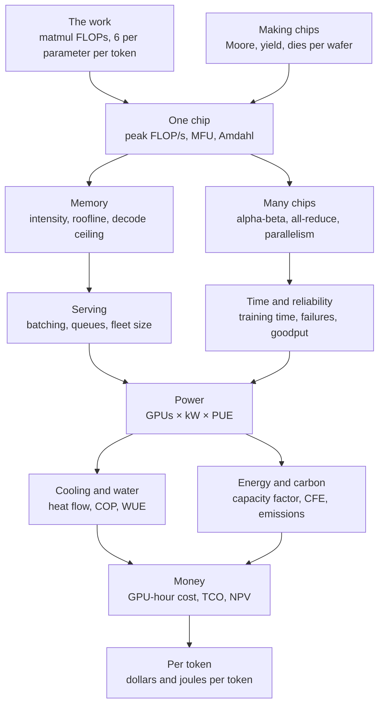

*Figure G.18: How the compute and data-center equations connect, from the arithmetic a model needs, through chips, memory, networks and serving, to power, cooling, energy and the cost of each token.*

### Iron law of processor performance (CPU time)

**What it does:** Splits the time a program takes into how much work it asks for, how many clock ticks each step needs and how long one tick lasts.

`CPU time = instruction count × CPI × clock period = instruction count × CPI ÷ f; speedup = old time ÷ new time`

- **CPU time**: the seconds the processor spends running the program
- **instruction count**: how many machine instructions the program executes
- **CPI**: cycles per instruction, the average number of clock ticks one instruction takes
- **clock period**: the length of one tick, which is 1 ÷ f
- **f**: the clock frequency, in ticks per second (hertz)
- **speedup**: how many times faster the new version runs than the old one

**In plain words:** A program gets faster only if it executes fewer instructions, needs fewer ticks per instruction or ticks faster. Clock speeds stopped rising quickly in the mid-2000s (the Dennard scaling entry below explains why), so modern chips mostly win on the first factor: vector, SIMD and tensor instructions each do many operations, so the same job needs far fewer instructions.

**Tiny example:** 1 billion instructions at CPI 1.5 on a 3 GHz core: 10^9 × 1.5 ÷ (3 × 10^9) = 1.5 × 10^9 ÷ (3 × 10^9) = 0.5 s. Suppose one vector instruction now does the work of 8 ordinary ones at the same CPI: the count falls to 10^9 ÷ 8 = 1.25 × 10^8, the time to 1.25 × 10^8 × 1.5 ÷ (3 × 10^9) = 0.0625 s, a speedup of 0.5 ÷ 0.0625 = 8.

**Where it is used:** Hennessy and Patterson's basic performance equation, used in CPU design and benchmarking. In AI servers it governs the CPU-side work that feeds the accelerators: data loading, tokenization and orchestration. One tensor-core instruction is a whole small matrix multiplication, the extreme case of doing more per instruction.
**In the book:** Chapter 2 (The clock: a metronome for billions of steps; The processor: how a CPU runs a program) and Chapter 32 (The CPU: a few brilliant workers) explain clocks and instructions in words; the formula is only here.

> **Definition — CPI (cycles per instruction):** The average number of clock ticks a processor needs to finish one instruction. Lower is better; together with the instruction count and the clock speed it sets how long a program takes.

### Matrix multiplication cost (FLOPs and bytes of a GEMM)

**What it does:** Counts the arithmetic and the ideal memory traffic of multiplying two matrices, the operation that dominates AI hardware.

`C = A × B, A of shape m × k, B of shape k × n: FLOPs = 2 × m × n × k; bytes moved (ideal) = b × (m × k + k × n + m × n)`

- **A, B**: the two input matrices; **C**: the result, of shape m × n
- **m, k, n**: the matrix sizes; k is the length of each dot product
- **FLOPs**: floating-point operations; one multiply plus one add counts as 2
- **b**: bytes per number (2 for BF16, 1 for FP8)
- **bytes moved**: reading A and B once and writing C once

**In plain words:** Each of the m × n outputs is a dot product of length k, which is k multiplications and about k additions. A matrix–vector product is the case n = 1, which does only 2 FLOPs per weight read; that is why writing one token at a time is limited by memory, as the entries below show.

**Tiny example:** A of shape 2 × 3 times B of shape 3 × 4 in BF16: FLOPs = 2 × 2 × 4 × 3 = 48; bytes = 2 × (6 + 12 + 8) = 52. Two 4,096 × 4,096 matrices: 2 × 4,096^3 ≈ 1.37 × 10^11 FLOPs and 2 × 3 × 4,096^2 ≈ 1.0 × 10^8 bytes, about 1,365 FLOPs per byte.

**Where it is used:** Every FLOP count in AI starts here: model FLOPs, utilization accounting, kernel benchmarks (cuBLAS, CUTLASS, Triton) and accelerator spec sheets, which count multiply-accumulates times 2. A batched product multiplies the count by the batch size; an einsum (a general tensor product written by its index letters) costs 2 × the product of all its distinct index sizes. The definition of matrix multiplication is in the foundations section of this appendix.
**In the book:** Chapter 5 (Matrix multiplication: many dot products at once), Chapter 32 (What a neural network actually computes), Chapter 33 (Tiling: how software reuses data, square case) and Appendix B (Matrix multiplication cost); the general bytes-moved formula is only here.

> **Definition — GEMM (general matrix multiply):** The standard name, from numerical libraries, for multiplying two matrices (optionally adding a third). GEMM kernels are the most heavily optimized code on every AI chip.

### Forward and backward FLOPs of a layer (where the 6 in 6ND comes from)

**What it does:** Shows that training a layer costs three matrix multiplications for every one in the forward pass, which is the hardware origin of "6 FLOPs per parameter per token".

`Y = X × W, X of shape B × d_in, W of shape d_in × d_out: forward = 2 × B × d_in × d_out; backward = 2 × B × d_in × d_out (dX = dY × W^T) + 2 × B × d_in × d_out (dW = X^T × dY); per parameter per token: 2 + 4 = 6 FLOPs (8 with full recomputation)`

- **X**: the layer's input, B token vectors of length d_in
- **W**: the weight matrix; **Y**: the output
- **B**: tokens in the batch; **d_in**, **d_out**: input and output widths
- **dY**: the gradient arriving from the layer above; **dX**: the gradient passed down; **dW**: the gradient for the weights
- **W^T**, **X^T**: the transposes (rows and columns swapped)

**In plain words:** Going backward, a layer must compute two things: how the loss changes with its input (to pass further down) and how it changes with its weights (to learn). Each is a matrix multiplication as big as the forward one, so backward costs about twice forward. Summed over all N parameters that gives 2 × N forward plus 4 × N backward per token. Recomputing activations instead of storing them adds one more forward pass, 8 × N.

**Tiny example:** B = 4 tokens, d_in = 3, d_out = 2 (6 weights): forward = 2 × 4 × 3 × 2 = 48 FLOPs; backward = 48 + 48 = 96; total 144, which equals 6 × 6 weights × 4 tokens = 144.

**Where it is used:** Model-FLOPs accounting in Megatron-LM, NeMo, MaxText and torchtitan. Megatron's fuller count for a GPT model with B sequences of s tokens, L layers, hidden size h and vocabulary V is `72 × B × s × L × h^2 × (1 + s ÷ (6 × h) + V ÷ (12 × h × L))` FLOPs per training step without recomputation (Korthikanti and others, 2022; Narayanan and others, 2021 print the same count with 96 and 16 in place of 72 and 12, because they include full recomputation), which adds the attention and output-layer terms; for GPT-3's shape it gives about 1.08 × 10^12 FLOPs per token against 6 × N ≈ 1.05 × 10^12. The headline rule C ≈ 6 × N × D and its examples are in the large language models section of this appendix.
**In the book:** Chapter 37 (Where the 6 comes from), Chapter 19 (Where the 6 comes from) and Appendix B (Cost of a training step); the per-layer split, the 8 × N variant and Megatron's count are only here.

### Peak FLOP/s of a chip (spec-sheet formula, sparsity, TOPS)

**What it does:** Computes the fastest a chip could possibly do arithmetic, the number printed on its spec sheet.

`peak FLOP/s = compute units × FLOPs per unit per clock cycle × f; systolic array: rows × columns × 2 × f; TOPS = peak operations per second ÷ 10^12; H100-equivalents = sum over chips of (chip peak ÷ H100 peak)`

- **compute units**: tensor cores, matrix units or cores working in parallel
- **FLOPs per unit per clock cycle**: fixed by the design and the number format
- **f**: the clock frequency
- **rows × columns**: the size of a systolic array, each cell doing one multiply-add (2 FLOPs) per cycle
- **TOPS**: trillions of operations per second, used for integer math on phone and laptop chips

**In plain words:** Multiply how many workers, how much each does per tick and how many ticks per second. Halving the bits per number roughly doubles the peak. Spec sheets often quote "sparse" figures, twice the dense one, which only apply if two of every four weights are zero; training achieves the dense figure at best.

**Tiny example:** A toy chip with 4 units doing 2 FLOPs per cycle at 1 GHz: 4 × 2 × 10^9 = 8 × 10^9 FLOP/s. NVIDIA V100: 640 tensor cores × 128 FLOPs × 1.53 × 10^9 Hz ≈ 125 × 10^12 FLOP/s. Google TPU v1: 256 × 256 × 2 × 700 × 10^6 ≈ 92 × 10^12 operations per second, 92 TOPS.

**Where it is used:** Reading accelerator spec sheets, chip design, export-control thresholds (the TPP entry below) and fleet comparisons in H100-equivalents (Epoch AI). The book reports Vera Rubin at about 4 PFLOP/s dense BF16, 17.5 FP8 and 35 NVFP4 for training, showing the precision ladder.
**In the book:** Chapter 32 (The peak-speed formula, checked on real chips; Dense versus sparse; How fast is a CPU at AI math?), Chapter 35 (Edge NPUs and TOPS) and Chapter 37 (H100-equivalent, in words).

### Training time, GPU count and GPU-hours from a compute budget

**What it does:** Turns the total FLOPs of a training run into days, chips and GPU-hours.

`cluster speed = G × P × U; time = C ÷ (G × P × U × goodput); GPUs needed = C ÷ (target time × P × U × goodput); GPU-hours = G × hours`

- **G**: the number of chips
- **P**: peak FLOP/s per chip at the precision used
- **U**: the achieved share of peak (MFU, next entry), typically 0.3 to 0.5
- **C**: total training FLOPs, about 6 × N × D
- **goodput**: the share of wall-clock time not lost to failures and restarts (1 in the simple version; its own entry is below)

**In plain words:** Divide the work by the speed the whole cluster really achieves. Rearranged, the same equation tells you how many chips you need for a deadline.

**Tiny example:** C = 10^21 FLOPs on 8 GPUs with P = 10^15 and U = 0.4: cluster speed = 8 × 10^15 × 0.4 = 3.2 × 10^15 FLOP/s; time = 10^21 ÷ (3.2 × 10^15) = 312,500 s ≈ 3.6 days; GPU-hours = 8 × 312,500 ÷ 3,600 ≈ 694. Llama 3.1 405B: 3.8 × 10^25 ÷ (16,384 × 989 × 10^12 × 0.4) ≈ 5.9 × 10^6 s ≈ 68 days and about 26.7 million GPU-hours; at 90% goodput, about 75 days.

**Where it is used:** Planning every pretraining run, compute procurement and Epoch AI's estimates of frontier training compute.
**In the book:** Chapter 37 (From FLOP to days), Chapter 19 (From FLOPs to dollars), Chapter 2 and Appendix B (Cluster speed; Training time; GPU-hours); the goodput factor is only here.

### Model FLOPs utilization and hardware FLOPs utilization (MFU, HFU)

**What it does:** Measures what share of a cluster's peak speed goes into the arithmetic the model actually needs.

`MFU = (model FLOPs per token × tokens per second) ÷ (chips × peak FLOP/s per chip); PaLM model FLOPs per token = 6 × N + 12 × L × H × Q × T; HFU = (FLOPs actually executed per second, including recomputation) ÷ (chips × peak FLOP/s); with selective recomputation HFU ÷ MFU ≈ 1 + s ÷ (6 × h)`

- **model FLOPs per token**: what the math requires, about 6 × N for training
- **N**: parameters
- **L**, **H**, **Q**: layers, attention heads and head size; **T** (or **s**): sequence length
- **h**: hidden size of the model
- **HFU**: like MFU but also counting work done twice (recomputation)

**In plain words:** MFU asks "how much of the hardware's peak did useful math?" and ignores implementation tricks, so it is the honest number for comparing runs. HFU also counts recomputed work, so it is always at least MFU. Large BF16 runs typically reach 35 to 50% MFU.

**Tiny example:** 8 GPUs at 989 × 10^12 FLOP/s train a 7-billion-parameter model at 75,000 tokens per second: useful work = 6 × 7 × 10^9 × 75,000 = 3.15 × 10^15 FLOP/s; peak = 8 × 989 × 10^12 ≈ 7.91 × 10^15; MFU = 3.15 ÷ 7.91 ≈ 40%. With full recomputation the hardware does 8 × N per token, so HFU ≈ 53%.

**Where it is used:** The headline efficiency of every large training run (PaLM, Megatron-LM, Llama 3, MaxText); Llama 3 405B reported 38 to 43% BF16 MFU, about 0.41 × 989 ≈ 400 TFLOP/s of useful work per GPU. The HFU ÷ MFU ratio for selective recomputation is the approximation Korthikanti and others (2022) give, about 1.03 for GPT-3's shape. The decode-side counterpart, MBU, is in the decode-ceiling entry below.
**In the book:** Chapter 37 (Utilization: MFU, HFU and where the time goes), Chapter 32 (Peak versus achieved) and Appendix B (Cluster speed); the PaLM per-token count and the HFU ÷ MFU ratio are only here.

### Amdahl's law

**What it does:** Gives the best speedup from n workers when part of a job cannot be split.

`speedup(n) = 1 ÷ ((1 − p) + p ÷ n); limit as n grows = 1 ÷ (1 − p)`

- **p**: the fraction of the original run time that can be spread over workers
- **1 − p**: the serial part, which only one worker can do
- **n**: the number of workers

**In plain words:** The parallel part shrinks as you add workers, but the serial part never does, so it caps the speedup. In AI clusters the effectively serial part includes exposed communication, optimizer steps, data loading and waiting for the slowest chip.

**Tiny example:** p = 0.95: n = 10 gives 1 ÷ (0.05 + 0.095) ≈ 6.9; n = 100 gives 1 ÷ (0.05 + 0.0095) ≈ 16.8; n = 1,000 gives about 19.6; never more than 1 ÷ 0.05 = 20.

**Where it is used:** Reasoning about parallel hardware, cluster scaling and pipeline optimization (Amdahl, 1967).
**In the book:** Chapter 32 (Parallelism: SIMD, SIMT and armies of simple workers) works the limit; the finite-n form is only here.

> **Definition — Speedup:** How many times faster a job runs after a change, measured as the old time divided by the new time. A speedup of 4 means a 60-minute job now takes 15 minutes.

### Gustafson's law (scaled speedup)

**What it does:** Gives the speedup when more workers are used to solve a bigger problem in the same time, rather than the same problem faster.

`scaled speedup(n) = (1 − p) + p × n = n − (1 − p) × (n − 1)`

- **n**: the number of workers
- **p**: the fraction of the run time spent in parallel work, measured on the n-worker system
- **1 − p**: the serial fraction on that system

**In plain words:** Amdahl assumes a fixed job. Gustafson (1988) noticed that people with more processors run bigger jobs, so the serial part stays small while the parallel part grows with n, and the speedup grows almost in step with n. This is the regime of AI scaling: more GPUs train bigger models on more tokens, rather than finishing a fixed run sooner.

**Tiny example:** p = 0.95 on 10 workers: 0.05 + 0.95 × 10 = 9.55. On 1,000 workers: 0.05 + 950 = 950.05 (the second form gives 1,000 − 0.05 × 999 = 950.05). Amdahl's law with the same p capped the speedup at 20.

**Where it is used:** Weak-scaling analysis of training clusters and supercomputers.
**In the book:** Only here (Chapter 32 gives Amdahl's law).

> **Definition — Gustafson's law:** The rule that when a bigger computer is used to solve a proportionally bigger problem, the speedup grows almost in step with the number of processors, because the serial part stays small. It complements Amdahl's law, which assumes the problem size is fixed.

### Parallel speedup, scaling efficiency and the Universal Scalability Law

**What it does:** Measures how well extra workers are used, and models why throughput eventually stops rising, or even falls, as more are added.

`S(n) = T(1) ÷ T(n); strong-scaling efficiency = S(n) ÷ n; weak-scaling efficiency = T(1) ÷ T(n) with the work per worker fixed; Universal Scalability Law: C(n) = n ÷ (1 + σ × (n − 1) + κ × n × (n − 1))`

- **T(1)**, **T(n)**: run time on 1 and on n workers
- **S(n)**: the speedup on n workers
- **C(n)**: relative throughput (capacity) with n workers
- **σ**: contention, the share of work that must wait in line (Amdahl's serial part)
- **κ**: coherency, the cost of every pair of workers having to coordinate

**In plain words:** Strong scaling keeps the job fixed; weak scaling grows it with the workers. Gunther's Universal Scalability Law adds a coordination term that grows with n × (n − 1), so beyond some point adding workers lowers throughput; the peak is at n = sqrt((1 − σ) ÷ κ).

**Tiny example:** A job takes 100 hours on 1 machine and 14 hours on 8: S = 100 ÷ 14 ≈ 7.14; efficiency = 7.14 ÷ 8 ≈ 89%. With σ = 0.02 and κ = 0.0001: C(64) = 64 ÷ (1 + 0.02 × 63 + 0.0001 × 64 × 63) = 64 ÷ 2.66 ≈ 24.0; the peak is near n = sqrt(0.98 ÷ 0.0001) ≈ 99 (C ≈ 25.2), and C(200) ≈ 22.3 is lower again.

**Where it is used:** Cluster benchmarking (MLPerf Training reports time to train for systems of different sizes, from which speedup and scaling efficiency are computed) and capacity planning for serving systems.
**In the book:** Only here (Chapter 37's Watch out notes that scaling is sub-linear).

> **Definition — Strong scaling:** Speeding up a fixed-size job by adding processors; ideally doubling the processors halves the time.

> **Definition — Weak scaling:** Growing the job in proportion to the number of processors so that each one has the same amount of work; ideally the run time stays constant.

> **Definition — Universal Scalability Law:** Neil Gunther's model of throughput versus the number of workers, with one term for waiting in line and one for coordination between every pair of workers, which predicts that throughput peaks and then falls.

### Tile and wave quantization on GPUs

**What it does:** Counts how many tiles and "waves" a GPU matrix multiplication needs, and how much of the chip sits idle because the work does not divide evenly.

`tiles = ceil(M ÷ t_M) × ceil(N ÷ t_N); waves = ceil(tiles ÷ number of SMs); utilization ≈ tiles ÷ (waves × number of SMs)`

- **M**, **N**: the rows and columns of the output matrix
- **t_M**, **t_N**: the tile size each streaming multiprocessor (SM) works on, for example 128 × 128
- **ceil()**: round up to the next whole number
- **number of SMs**: the processor blocks on the GPU (132 on an H100)
- **waves**: rounds in which every SM takes one tile

**In plain words:** The output is cut into tiles and each SM takes one at a time. If the tile count is just over a multiple of the SM count, a last wave runs with most SMs idle (wave quantization). If a matrix size is not a multiple of the tile size, the edge tiles do wasted work (tile quantization).

**Tiny example:** On 132 SMs with 128 × 128 tiles: a 1,536 × 1,408 output has 12 × 11 = 132 tiles, one full wave, 100% busy. A 1,536 × 1,536 output has 12 × 12 = 144 tiles, so ceil(144 ÷ 132) = 2 waves and 144 ÷ 264 ≈ 55% utilization. A dimension of 1,000 needs ceil(1,000 ÷ 128) = 8 tiles covering 1,024 rows, so 1,000 ÷ 1,024 ≈ 98% of that work is useful.

**Where it is used:** NVIDIA's matrix-multiplication performance guidelines and kernel autotuning (CUTLASS, Triton). It is why model widths are chosen as multiples of 64 or 128 and vocabularies are padded.
**In the book:** Only here (Chapter 32, Inside a GPU, gives the H100's 132 SMs).

> **Definition — Wave quantization:** Lost GPU speed when the number of work tiles is slightly more than a multiple of the number of processor blocks, so a final round runs with most blocks idle.

> **Definition — Tile quantization:** Wasted GPU work when a matrix size is not a whole multiple of the tile size, so the tiles at the edges are partly empty but cost as much as full ones.

### Arithmetic intensity (FLOPs per byte)

**What it does:** Measures how much math a job does for each byte it moves between memory and the compute units.

`I = FLOPs ÷ bytes moved; X[B × D] × W[D × F] in 16-bit: I = 2 × B × D × F ÷ (2 × B × D + 2 × D × F + 2 × B × F) ≈ B when B is much smaller than D and F; tiled matmul: I ≈ 2 × b_m × b_n ÷ (b × (b_m + b_n))`

- **I**: arithmetic intensity, in FLOPs per byte
- **B**: tokens processed together (the batch); **D**, **F**: the weight matrix's sizes
- **b_m**, **b_n**: the output tile sizes kept in fast on-chip memory
- **b**: bytes per number

**In plain words:** Each weight byte read from memory is reused once per token in the batch, so intensity grows with batch size. Decoding for one user reads every 2-byte weight to do 2 FLOPs, an intensity of 1. Tiling keeps blocks in on-chip memory so each byte fetched is used many times.

**Tiny example:** Adding two 16-bit vectors (c = a + b): 1 FLOP per element, 6 bytes moved (read 2 + 2, write 2), so I = 1 ÷ 6. A batch of 4 tokens through a 4,096 × 4,096 matrix: 2 × 4 × 4,096^2 ÷ (2 × 4 × 4,096 + 2 × 4,096^2 + 2 × 4 × 4,096) ≈ 3.99. A 128 × 128 tile in BF16: 2 × 128 × 128 ÷ (2 × 256) = 64.

**Where it is used:** Deciding whether a kernel is memory- or compute-bound (FlashAttention, fused kernels, batching policies in vLLM and SGLang).
**In the book:** Chapter 33 (Arithmetic intensity: how much math per byte; Tiling: how software reuses data) and Appendix B (Arithmetic intensity); the tiled formula is only here.

### Step time with overlapped compute and communication

**What it does:** Bounds how long a piece of work takes when it must both compute and move data.

`T_math = FLOPs ÷ FLOP/s; T_comms = bytes ÷ bytes per second; T_lower = max(T_math, T_comms); T_upper = T_math + T_comms`

- **T_math**: time to do the arithmetic
- **T_comms**: time to move the data, from memory or between chips
- **T_lower**: the time if the two overlap perfectly
- **T_upper**: the time if they run one after the other

**In plain words:** If moving and computing happen at the same time, the slower one sets the pace; if not, their times add. Real kernels and training steps land in between, and the part of communication not hidden behind math is called exposed communication.

**Tiny example:** A step does 1.5 × 10^12 FLOPs at an achieved 500 × 10^12 FLOP/s (T_math = 3 ms) and moves 100 MB over a 50 GB/s link (T_comms = 2 ms): at best max(3, 2) = 3 ms, at worst 3 + 2 = 5 ms.

**Where it is used:** Performance modeling in JAX/XLA and PyTorch stacks, reading profiler traces, choosing parallelism layouts. It is the general form behind the roofline (memory) and the communication tests of each parallelism entry below (How to Scale Your Model, Part 1).
**In the book:** Chapter 37 (Ring all-reduce, worked by hand; Finding the lost time: profiling) describes overlap in words; the bounds are only here.

### Roofline model and ridge point

**What it does:** Gives the speed a job can reach on a chip from its arithmetic intensity, and the intensity at which memory stops being the limit.

`attainable FLOP/s = min(peak FLOP/s, I × memory bandwidth); ridge point I* = peak FLOP/s ÷ memory bandwidth; compute-bound if I > I*, memory-bound if I < I*`

- **I**: the job's arithmetic intensity
- **memory bandwidth**: bytes per second the memory can deliver
- **I***: the ridge point, in FLOPs per byte

**In plain words:** Plotted on log-log axes, speed rises along a slanted roof (bandwidth × intensity) until it hits the flat roof of peak compute. Peak compute has grown faster than memory bandwidth, so ridge points keep rising and more jobs are memory-bound.

**Tiny example:** H100: 989 × 10^12 ÷ (3.35 × 10^12) ≈ 295 FLOPs per byte. One-user BF16 decode (I = 1) reaches at most 1 × 3.35 × 10^12 = 3.35 TFLOP/s, about 0.3% of peak. A big matmul with I = 1,000 reaches min(989, 3,350) = 989 TFLOP/s.

**Where it is used:** Kernel optimization (NVIDIA Nsight Compute draws rooflines), chip design and batching decisions (Williams, Waterman and Patterson, 2009). Variants: one roof per memory level (hierarchical roofline) and network rooflines that use link bandwidth. Gholami and others (2024) measured peak compute growing about 3.0 times every two years against about 1.6 for DRAM bandwidth.
**In the book:** Chapter 33 (The roofline model, worked with numbers; Newer chips are even hungrier) and Appendix B (Ridge point).

### HBM stack bandwidth and capacity

**What it does:** Computes the bandwidth and size of high-bandwidth memory from its very wide interface.

`bandwidth per stack (GB/s) = interface width in bits × data rate per pin in Gb/s ÷ 8; chip bandwidth = stacks × bandwidth per stack; capacity per stack = dies per stack × capacity per die`

- **interface width**: the number of data wires from one stack (1,024 for HBM3, 2,048 for HBM4)
- **data rate per pin**: gigabits per second on each wire
- **÷ 8**: 8 bits make a byte
- **stacks**: HBM stacks beside the processor; **dies per stack**: memory chips piled in each

**In plain words:** HBM is fast because it uses a thousand or more wires placed right beside the processor, not because each wire is fast.

**Tiny example:** HBM3: 1,024 × 6.4 ÷ 8 = 819.2 GB/s per stack. HBM4: 2,048 × 8 ÷ 8 = 2,048 GB/s; eight stacks give about 16.4 TB/s. Capacity: 12 dies × 3 GB = 36 GB per stack, × 8 stacks = 288 GB (a B300).

**Where it is used:** Every accelerator's memory spec (H100 3.35 TB/s, Blackwell about 8 TB/s, Rubin about 20 TB/s as reported) and therefore every decode-speed estimate. The same formula with a 64-bit channel gives DDR5 module bandwidth.
**In the book:** Chapter 33 (The arithmetic of a stack; The generations) and Chapter 34 (HBM: memory moved next door).

### Average memory access time (cache hierarchy)

**What it does:** Gives the average time to fetch data from a memory hierarchy where most requests are served by a small fast memory.

`AMAT = hit time + miss rate × miss penalty; two levels: AMAT = t_L1 + m_L1 × (t_L2 + m_L2 × t_memory)`

- **AMAT**: average memory access time
- **hit time**: the time when the data is in the fast memory (the cache)
- **miss rate**: the fraction of requests that are not
- **miss penalty**: the extra time to fetch from the next, slower level
- **t_L1**, **t_L2**, **t_memory**: access times of the first cache, the second cache and main memory; **m_L1**, **m_L2**: miss rates of the two caches

**In plain words:** Most requests hit the nearby cache and are quick; only misses pay for the long trip. Lowering the miss rate is often worth more than speeding up the far memory.

**Tiny example:** 1 ns hit time, 5% misses, 100 ns penalty: 1 + 0.05 × 100 = 6 ns. Two levels with t_L1 = 1 ns, m_L1 = 0.1, t_L2 = 10 ns, m_L2 = 0.2, t_memory = 100 ns: 1 + 0.1 × (10 + 0.2 × 100) = 1 + 0.1 × 30 = 4 ns.

**Where it is used:** Hennessy and Patterson's standard equation for CPU and GPU memory design and cache blocking. In GPUs the levels are registers, shared memory and L1, L2 and HBM, and kernels such as FlashAttention are designed to keep traffic to HBM low.
**In the book:** Only here (Chapter 33, The memory hierarchy: desk, shelf, library, warehouse, explains it in words).

> **Definition — AMAT (average memory access time):** The average time a processor waits for data, counting both the fast case where the data is in a cache and the slow case where it must be fetched from further away.

> **Definition — Miss rate:** The fraction of memory requests that do not find their data in a cache and must go to a slower level of memory.

### Energy of computing versus moving data

**What it does:** Adds up a job's energy as arithmetic plus data movement, which shows that moving data usually costs far more.

`energy ≈ operations × energy per operation + sum over memory levels of (bytes moved × energy per byte); power = FLOP/s × joules per FLOP + bytes per second × joules per byte; efficiency = FLOP/s ÷ watts = FLOPs per joule; link power = bits per second × energy per bit`

- **energy per operation**: joules for one arithmetic operation
- **energy per byte**: joules to move one byte from a given memory level (registers, on-chip SRAM, off-chip DRAM)
- **power**: energy per second, in watts
- **energy per bit**: joules to send one bit over a chip-to-chip or network link, usually quoted in picojoules per bit (pJ/bit)

**In plain words:** Fetching a number from off-chip memory costs over a hundred times more energy than multiplying it, using Horowitz's widely cited 45 nm figures (ISSCC 2014): about 3.7 picojoules for a 32-bit floating-point multiply and about 640 for a 32-bit DRAM read. Keeping data on chip and using fewer bits cut the second term.

**Tiny example:** 1,000 multiplies, each fetching one 32-bit number from DRAM: 1,000 × 3.7 pJ + 1,000 × 640 pJ = 3.7 nJ + 640 nJ = 643.7 nJ, and 640 ÷ 643.7 ≈ 99.4% of it is data movement. A chip doing 989 × 10^12 FLOP/s at 700 W delivers about 1.4 × 10^12 FLOPs per joule. An 800 Gb/s optical link at an assumed 15 pJ per bit: 800 × 10^9 × 15 × 10^−12 = 12 W, for every such link end in the cluster.

**Where it is used:** Accelerator architecture (systolic arrays, large SRAM, near-memory compute), comparing chips by performance per watt, and network design: pJ per bit is the standard efficiency figure for SerDes, transceivers and co-packaged optics.
**In the book:** Chapter 33 (Moving data costs more than math), Chapter 2 (Moving data costs more than doing math), Chapter 32 (Why fewer bits mean more speed) and Chapter 34 (Co-packaged optics and optical circuit switches); the summed formula and link power are only here.

### Memory-bandwidth ceiling on decode speed (and MBU)

**What it does:** Gives the fastest one conversation can generate tokens, because every active weight must be read from memory for each token.

`tokens per second per sequence ≤ memory bandwidth ÷ bytes read per token; bytes read per token ≈ N_active × b + KV-cache bytes of that sequence; MBU = (bytes read per token × tokens per second) ÷ peak memory bandwidth`

- **N_active**: parameters used per token (all of them for a dense model)
- **b**: bytes per weight
- **KV-cache bytes**: the stored keys and values of that conversation (see the large language models section)
- **memory bandwidth**: bytes per second; with weights split over n chips it is n times one chip's
- **MBU**: memory bandwidth utilization, the share of that ceiling actually reached

**In plain words:** At small batch the math per token is tiny, so streaming the weights sets the speed. Halving b roughly doubles the ceiling, which is why FP8 and 4-bit weights speed up chatbots.

**Tiny example:** A 70-billion-parameter model in FP8 (70 GB) on one H200 at 4,800 GB/s: at most 4,800 ÷ 70 ≈ 69 tokens per second; with a 2 GB KV cache, 4,800 ÷ 72 ≈ 67. If it actually runs at 50 tokens per second, MBU = 72 × 50 ÷ 4,800 = 75%. Split over 8 H200s: 8 × 4,800 ÷ 70 ≈ 549.

**Where it is used:** Predicting chatbot typing speed, sizing local models (llama.cpp, MLX) and the case for SRAM-heavy inference chips. MBU was introduced by Databricks (2023) as the decode counterpart of MFU. Speculative decoding beats the ceiling by producing several tokens per weight read (large language models section).
**In the book:** Chapter 33 (Why decode is memory-bound: predicting your chatbot's speed), Chapter 23 (Worked example: how fast can one GPU write?) and Appendix B (Decode speed ceiling; Halving the precision); MBU is only here.

> **Definition — MBU (memory bandwidth utilization):** The share of a chip's peak memory bandwidth that token generation actually uses, computed from the bytes read per token times the tokens per second. It is the decode-side counterpart of MFU.

### Prefill time (compute-bound prompt processing)

**What it does:** Estimates how long reading a prompt takes, which sets most of the wait before the first word appears.

`prefill time ≈ 2 × N_active × P ÷ (F × U) + attention term; TTFT ≈ queueing delay + prefill time`

- **N_active**: parameters used per token
- **P**: prompt tokens
- **F**: peak FLOP/s; **U**: the achieved share of it
- **attention term**: extra work that grows with P^2 (large language models section)
- **TTFT**: time to first token

**In plain words:** All prompt tokens share each read of the weights, so prompt processing has an intensity of about P FLOPs per byte with 16-bit weights and runs near the compute roof, not the memory roof.

**Tiny example:** A 2,000-token prompt on a 70-billion-parameter model: 2 × 70 × 10^9 × 2,000 = 2.8 × 10^14 FLOPs; at an H100's FP8 peak of 1,979 × 10^12 that is 0.14 s, and at U = 0.5 about 0.28 s; with 0.05 s of queueing, TTFT ≈ 0.33 s.

**Where it is used:** Time-to-first-token targets, prompt-caching economics, chunked prefill and disaggregated serving, which puts prefill and decode on separate GPU pools because they hit different roofs (DistServe, NVIDIA Dynamo).
**In the book:** Chapter 23 (Worked example: how long does reading take?), Chapter 33 (Two phases of every answer) and Chapter 37 (Prefill and decode).

### Batched decode step time and the throughput–latency trade-off

**What it does:** Gives the time of one decoding step when B conversations are served together, and from it each user's speed and the server's total throughput.

`T_step ≈ max(2 × N_active × B ÷ F, (N_active × b + B × T × k_kv) ÷ BW); throughput = B ÷ T_step; per-user speed = 1 ÷ T_step; the math takes longer than reading the weights once B > F × b ÷ (2 × BW)`

- **B**: conversations decoded together (the batch)
- **N_active**, **b**: active parameters and bytes per weight
- **F**: peak FLOP/s; **BW**: memory bandwidth
- **T**: context length per conversation; **k_kv**: KV-cache bytes per token

**In plain words:** One read of the weights serves every conversation in the batch, so throughput rises almost in step with B while each user slows only a little, until the step becomes compute-bound. Every conversation's KV cache must still be read separately, so long contexts and memory capacity cap the useful batch.

**Tiny example:** An 8-billion-parameter model in BF16 (16 GB) on an H100 (F = 989 × 10^12, BW = 3.35 × 10^12), 2,000-token contexts, k_kv = 131,072 bytes. B = 1: (16 × 10^9 + 2.6 × 10^8) ÷ (3.35 × 10^12) ≈ 4.9 ms, about 206 tokens per second. B = 32: (16 + 8.4) × 10^9 ÷ (3.35 × 10^12) ≈ 7.3 ms (the math takes only 0.5 ms), so each user gets about 137 tokens per second and the GPU about 4,400. B = 128: 49.6 GB read, 14.8 ms, 68 per user and about 8,650 in total. The crossover batch is 989 × 10^12 × 2 ÷ (2 × 3.35 × 10^12) ≈ 295, but 295 such conversations would need about 16 + 295 × 0.26 ≈ 93 GB, more than the GPU holds, so here memory caps the batch first.

**Where it is used:** Choosing batch sizes and latency targets in vLLM, SGLang, TensorRT-LLM and NVIDIA Dynamo; NVIDIA presents the trade-off as tokens per second per megawatt against tokens per second per user. A simpler fitted form, T_step = t_0 + B × t_1, is common in serving simulators.
**In the book:** Chapter 37 (Batching: the single biggest lever), Chapter 23 (Worked example: batching on one GPU) and Chapter 33 (Worked example: how many users fit on one GPU?); the crossover batch formula is only here.

### Memory capacity: weights, KV cache and chips needed

**What it does:** Works out how much memory a model needs and how many chips it takes to hold it.

`weight bytes = N_total × b; chips needed = ceil((weight bytes + KV-cache bytes + reserve) ÷ (memory per chip × usable fraction)); KV memory left = chips × memory per chip − weight bytes − reserve`

- **N_total**: every parameter that must be stored (all experts of a mixture-of-experts model)
- **b**: bytes per parameter (4 FP32, 2 BF16, 1 FP8, about 0.5 for 4-bit formats)
- **reserve**: memory for activations and the software runtime
- **usable fraction**: the share of a chip's memory available to the model

**In plain words:** The weights must fit first; whatever is left holds conversations' KV caches, which bounds context length times concurrent users. The per-token KV formula and the concurrency limit are in the large language models section.

**Tiny example:** 70 billion × 2 bytes = 140 GB; with 90% of an 80 GB H100 usable, 140 ÷ 72 ≈ 1.94, so 2 chips. In FP8 on one 141 GB H200 with a 2 GB reserve: 141 − 70 − 2 = 69 GB left, which at 327,680 bytes per token holds about 210,000 tokens.

**Where it is used:** Choosing tensor-parallel degree, deciding which GPU or laptop can run a model, and the HBM capacity race.
**In the book:** Chapter 33 (Worked example: how many users fit on one GPU?), Chapter 34 (Why one chip is not enough), Chapter 5 and Appendix B (Weight memory; Chips needed to hold the weights).

### Training memory per parameter (about 16 bytes with Adam)

**What it does:** Counts the memory training needs for each parameter before activations.

`model-state bytes ≈ N × (b_w + b_g + K) = N × (2 + 2 + 12) = 16 × N; total ≈ 16 × N + activation bytes + temporary buffers`

- **N**: parameters
- **b_w**: bytes for the BF16 weights (2); **b_g**: bytes for the BF16 gradients (2)
- **K**: optimizer bytes (12: a 4-byte FP32 master copy plus Adam's two 4-byte moment averages)

**In plain words:** Training stores far more than the model: gradients, a full-precision master copy and the optimizer's running averages. Variants: FP32 gradients make it 18 bytes; 8-bit optimizer states or one-buffer optimizers (Muon, Lion, factored Adafactor) make it smaller.

**Tiny example:** 1 billion parameters × 16 = 16 GB. 70 billion × 16 = 1.12 TB, at least 1.12 TB ÷ 80 GB = 14 chips before any activations.

**Where it is used:** Sizing training clusters and choosing how to shard the state (the ZeRO entry below). DeepSeek-V3's FP8 recipe kept FP32 master weights and gradients but stored Adam's moments in BF16.
**In the book:** Chapter 33 (Training memory: about 16 bytes per parameter), Chapter 37 (The memory wall of training) and Appendix B (Training memory).

### Activation memory of a Transformer layer (Korthikanti formula)

**What it does:** Counts the bytes of intermediate results one Transformer layer must keep for the backward pass.

`bytes per layer = s × b × h × (34 + 5 × a × s ÷ h); with tensor and sequence parallelism over t GPUs: s × b × h × (34 ÷ t + 5 × a × s ÷ (h × t)); selective recomputation: 34 × s × b × h ÷ t; full recomputation: 2 × s × b × h`

- **s**: sequence length in tokens
- **b**: micro-batch size, sequences per GPU per pass
- **h**: hidden size
- **a**: attention heads
- **t**: tensor-parallel size
- **34**, **5**: bytes stored per token per unit of hidden width, and per entry of each head's attention-score matrix, for 16-bit activations of a GPT-style layer

**In plain words:** The 34 term is everything except the attention-score matrices; the 5 × a × s ÷ h term is those matrices, which grow with the square of the sequence. FlashAttention-style kernels never store them, so the 34 term dominates today. Activation memory grows with tokens per micro-batch, not with parameter count, which is what limits long-context training.

**Tiny example:** GPT-3's shape (a = 96, s = 2,048, h = 12,288, b = 1): s × b × h = 25,165,824; 5 × 96 × 2,048 ÷ 12,288 = 80; so 25,165,824 × (34 + 80) ≈ 2.87 GB per layer, about 275 GB for all 96 layers. Selective recomputation keeps 34 × 25,165,824 ≈ 0.86 GB per layer. Tensor and sequence parallelism over t = 8 GPUs without recomputation: 2.87 ÷ 8 ≈ 0.36 GB per GPU; with both, 0.86 ÷ 8 ≈ 0.11 GB.

**Where it is used:** Memory planners in Megatron-LM and NeMo; choosing micro-batch size, recomputation and context parallelism (Korthikanti and others, 2022). In pipeline-parallel training the first stage holds activations for several micro-batches at once, about L layers' worth in total.
**In the book:** Only here (Chapter 37, The memory wall of training, describes activations in words).

> **Definition — Selective recomputation:** Recomputing only the cheap but memory-hungry parts of a layer, such as attention scores, during the backward pass instead of storing them, which saves most of the activation memory for a few percent more compute.

### Activation checkpointing (recomputation) trade-off

**What it does:** Shows how keeping only some layers' activations and recomputing the rest trades memory for compute.

`keep a checkpoint every k layers: activation memory ∝ L ÷ k + k, smallest at k = sqrt(L), giving ∝ 2 × sqrt(L); cost: one extra forward pass, about 8 × N instead of 6 × N FLOPs per token`

- **L**: layers
- **k**: layers between saved checkpoints
- **∝**: "proportional to"
- **N**: parameters

**In plain words:** Store only the input of every k-th layer (L ÷ k of them) and, during the backward pass, recompute one k-layer segment at a time (k layers' worth of extra memory). Choosing k = sqrt(L) balances the two and cuts memory from proportional to L to proportional to sqrt(L), for about a third more compute (8 ÷ 6 ≈ 1.33).

**Tiny example:** L = 64: k = 8 gives 64 ÷ 8 + 8 = 16 layer-loads of memory instead of 64; k = 4 gives 16 + 4 = 20 and k = 16 gives 4 + 16 = 20, both worse.

**Where it is used:** Standard in PyTorch (torch.utils.checkpoint), JAX (jax.checkpoint), Megatron-LM and DeepSpeed (Chen and others, 2016). Recomputed FLOPs count toward HFU, not MFU; offloading activations to CPU memory is a third option.
**In the book:** Chapter 33 (Training memory, the definition of activation checkpointing) and Chapter 37 (The memory wall of training) in words; the formulas are only here.

### Message transfer time (latency–bandwidth or alpha–beta model)

**What it does:** Gives the time to send one message over a link as a fixed start-up delay plus the time to push its bytes through.

`T = α + n ÷ β; link bandwidth = lanes × rate per lane; bytes per second = bits per second ÷ 8`

- **T**: the time to deliver the message
- **α** (alpha): the fixed latency every message pays (software, switch hops, the distance traveled)
- **n**: the message size in bytes
- **β** (beta): the link bandwidth in bytes per second
- **lanes**: the serial channels that make up one port; **rate per lane**: bits per second on each

**In plain words:** Small messages are dominated by α and large ones by n ÷ β; the crossover is at n = α × β. Network ports are quoted in bits per second and NVLink in bytes per second, often counting both directions, so convert before comparing. Every collective-communication formula below is a sum of such terms.

**Tiny example:** An 800 Gb/s port is 4 lanes × 200 Gb/s = 800 Gb/s, and 800 ÷ 8 = 100 GB/s. Suppose α = 5 µs. A 1 KB message: 5 + 0.01 = 5.01 µs (all latency). A 1 MB message: 5 + 10 = 15 µs. A 1 GB message: 5 µs + 10 ms ≈ 10 ms (all bandwidth). Crossover: 5 × 10^−6 s × 10^11 bytes per second = 500 KB.

**Where it is used:** Communication cost models in NCCL, MPI and parallelism planners (Hockney's model), and reading switch, network-card and NVLink specs: an H100's NVLink is rated 900 GB/s counting both directions, about 450 GB/s each way. Some links also lose a little to line encoding: a PCIe 5.0 lane runs 32 billion transfers per second with 128b/130b encoding (130 bits sent for every 128 of data), so 16 lanes give 32 × 16 × 128 ÷ 130 ÷ 8 ≈ 63 GB/s each way.
**In the book:** Chapter 34 (The ladder: eight levels from silicon to campus, Table 34.2), Chapter 4 (Latency and bandwidth), Chapter 37 (Ring all-reduce, worked by hand) and Appendix B (Message transfer time).

### Propagation delay and the bandwidth–delay product

**What it does:** Gives the minimum time a signal needs to cross a distance of fiber, and how much data must be in flight to keep a long link busy.

`one-way delay = distance ÷ (c ÷ n_glass) ≈ 5 µs per km of fiber; round-trip time = 2 × one-way delay + processing; data in flight = bandwidth × round-trip time`

- **c**: the speed of light in a vacuum, about 300,000 km per second
- **n_glass**: the refractive index of the fiber, about 1.47 (how much glass slows light)
- **round-trip time**: there and back, plus processing at the ends
- **bandwidth**: bytes per second on the link

**In plain words:** Light in glass travels at about 200,000 km per second, so every kilometer adds about 5 microseconds that no faster chip can remove. To keep a long link full, a sender must have a whole round trip's worth of data on its way before the first acknowledgment returns.

**Tiny example:** 299,792 ÷ 1.47 ≈ 203,900 km/s, about 4.9 µs per km. 100 km: about 0.5 ms one way, 1 ms round trip; at 100 GB/s, 100 GB/s × 0.001 s = 100 MB must be in flight. 1,200 km: 6 ms one way, and at 50 GB/s with a 12 ms round trip, 600 MB in flight.

**Where it is used:** Placing data centers and inference regions, multi-campus training, buffer sizing and TCP and RDMA tuning. The bandwidth–delay product is a form of Little's law (below).
**In the book:** Chapter 38 (The speed of light sets the rules), Chapter 4 (The speed of light sets a floor on delay) and Chapter 34 (Training across campuses); the bandwidth–delay product is only here.

> **Definition — Bandwidth–delay product:** A link's bandwidth multiplied by its round-trip time: the amount of data that must be on its way at once to keep the link fully busy. Long, fast links need large buffers because of it.

### Decibels and the optical link budget

**What it does:** Adds up the gains and losses of a signal in decibels to check that enough light reaches the receiver.

`gain or loss in dB = 10 × log10(P_out ÷ P_in); power in dBm = 10 × log10(P ÷ 1 mW); received power (dBm) = transmit power (dBm) − fiber loss per km × length − connector and splice losses; the link works if received power ≥ receiver sensitivity + margin`

- **dB**: decibels, a ratio of two powers on a logarithmic scale
- **P_in**, **P_out**: power going in and coming out
- **log10**: the base-10 logarithm
- **dBm**: power compared with 1 milliwatt, in decibels
- **receiver sensitivity**: the weakest signal the receiver can still read reliably
- **margin**: extra headroom for aging, dirt and temperature

**In plain words:** Losses along a link multiply, and logarithms turn multiplication into addition, so engineers just subtract each loss in dB. Every 3 dB halves the power; every 10 dB divides it by 10.

**Tiny example:** Halving the power: 10 × log10(0.5) ≈ −3.0 dB; 2 mW is 10 × log10(2) ≈ +3.0 dBm. With assumed figures: transmit at +2 dBm, 2 km of fiber at 0.4 dB per km (0.8 dB) and two connectors at 0.5 dB each (1.0 dB): received = 2 − 0.8 − 1.0 = 0.2 dBm. With a sensitivity of −6 dBm and a 2 dB margin, the link needs −4 dBm and has 4.2 dB to spare.

**Where it is used:** Specifying optical transceivers, cabling plans and data-center interconnects. Part of the case for co-packaged optics is removing lossy, power-hungry electrical paths between the switch chip and the optics.
**In the book:** Only here (Chapter 34, Optics: turning bits into light, explains in words that copper signals fade within meters).

> **Definition — Decibel (dB):** A logarithmic unit for the ratio of two powers: 10 times the base-10 logarithm of the ratio. Plus 3 dB is about double the power and minus 3 dB about half; losses along a path are simply added.

> **Definition — dBm:** Power expressed in decibels relative to one milliwatt: 0 dBm is 1 mW, +3 dBm about 2 mW and −10 dBm 0.1 mW. Optical transceivers state their output and sensitivity this way.

> **Definition — Optical link budget:** The sum of transmitter power minus every loss along a fiber link (fiber length, connectors, splices), compared with the weakest signal the receiver can read; a positive remainder means the link will work.

### Ring all-reduce time

**What it does:** Gives the time for n GPUs to add up their copies of a large array so that every GPU ends with the total.

`T ≈ 2 × (n − 1) ÷ n × S ÷ B + 2 × (n − 1) × α; data each GPU sends = 2 × (n − 1) ÷ n × S; NCCL bus bandwidth = algorithm bandwidth × 2 × (n − 1) ÷ n`

- **n**: GPUs in the ring
- **S**: bytes each GPU holds (for example, a full gradient)
- **B**: per-GPU link bandwidth in one direction
- **α**: the latency of each step
- **algorithm bandwidth**: S ÷ T, as a benchmark reports it

**In plain words:** A reduce-scatter (n − 1 steps) then an all-gather (n − 1 steps), each passing a 1 ÷ n chunk to the next neighbor. Traffic per GPU approaches 2 × S however many GPUs join, which made large data parallelism practical; but the latency term grows with n, so small messages at large n use trees instead.

**Tiny example:** 4 GPUs, S = 1 GB, B = 50 GB/s, α = 10 µs: each sends 2 × 3 ÷ 4 × 1 = 1.5 GB, taking 1.5 ÷ 50 = 30 ms, plus 2 × 3 × 10 µs = 0.06 ms of latency, about 30.06 ms. Algorithm bandwidth ≈ 1 GB ÷ 0.03 s ≈ 33.3 GB/s; bus bandwidth = 33.3 × 1.5 = 50 GB/s, the link speed. A 70-billion-parameter model's 140 GB of BF16 gradients: about 2 × 140 ÷ 50 = 5.6 s over InfiniBand, about 0.62 s over 450 GB/s NVLink.

**Where it is used:** Gradient synchronization in data-parallel training (NCCL, RCCL, Gloo, XLA collectives), popularized for deep learning by Baidu in 2017 and Horovod.
**In the book:** Chapter 37 (Ring all-reduce, worked by hand); the latency term and bus bandwidth are only here.

> **Definition — Bus bandwidth (NCCL):** A figure reported by NVIDIA's NCCL benchmarks that rescales the measured speed of a collective by the amount each GPU must actually send, so results for different numbers of GPUs can be compared with the link's rated speed.

### Costs of the other collectives (all-gather, reduce-scatter, all-to-all, tree all-reduce)

**What it does:** Gives the time of the other group exchanges that parallel training and serving are built from.

`ring all-gather or reduce-scatter: T ≈ (n − 1) ÷ n × S ÷ B + (n − 1) × α; all-reduce = reduce-scatter + all-gather; all-to-all: each GPU sends (n − 1) ÷ n × S_local; tree or recursive-doubling all-reduce latency ≈ 2 × log2(n) × α; hierarchical all-reduce over m servers of g GPUs: T ≈ 2 × (g − 1) ÷ g × S ÷ B_fast + 2 × (m − 1) ÷ m × (S ÷ g) ÷ B_slow`

- **n**: GPUs taking part
- **S**: the full gathered size; **S_local**: the data each GPU starts with in an all-to-all
- **B**: per-GPU bandwidth; **α**: per-step latency
- **log2(n)**: how many times n can be halved (10 for 1,024)
- **g**, **m**: GPUs per server and servers; **B_fast**, **B_slow**: per-GPU bandwidth inside a server (NVLink) and between servers (one network card per GPU)

**In plain words:** All-gather and reduce-scatter are each half of a ring all-reduce. In an all-to-all every GPU keeps 1 ÷ n of its data and sends the rest; ring tricks do not help, so the network's bisection bandwidth sets its speed. Trees finish small messages in about log2(n) steps instead of n. A hierarchical all-reduce first reduce-scatters inside each server over the fast links, then each GPU all-reduces only its 1 ÷ g slice with its counterparts in the other servers, then all-gathers inside the server again, so the slow network carries 1 ÷ g of the data per GPU.

**Tiny example:** All-gather over 4 GPUs of a 1 GB result at 50 GB/s: 3 ÷ 4 × 1 ÷ 50 = 15 ms. All-to-all over 8 GPUs with 1 GB each: each sends 7 ÷ 8 = 0.875 GB, 17.5 ms at 50 GB/s. Latency with α = 5 µs over 1,024 GPUs: ring 2 × 1,023 × 5 µs ≈ 10.2 ms; tree 2 × 10 × 5 µs = 0.1 ms. Hierarchical, S = 1 GB, 16 servers of 8 GPUs, 450 GB/s NVLink and 50 GB/s per network card: 2 × 7 ÷ 8 × 1 ÷ 450 ≈ 3.9 ms inside, 2 × 15 ÷ 16 × 0.125 ÷ 50 ≈ 4.7 ms between, about 8.6 ms in total; one ring through all 128 GPUs moving at the 50 GB/s network speed would take 2 × 127 ÷ 128 × 1 ÷ 50 ≈ 39.7 ms.

**Where it is used:** Data parallelism all-reduces gradients; ZeRO-3 and FSDP all-gather weights and reduce-scatter gradients; tensor and sequence parallelism exchange activations; expert parallelism uses all-to-all. On TPU tori a collective spread over several mesh axes uses all their links at once (How to Scale Your Model). Two-level schemes like the hierarchical one are built into NCCL and Horovod, and the hybrid sharding of the ZeRO entry below applies the same idea to sharded weights.
**In the book:** Chapter 37 (Collective communication: how thousands of GPUs agree) and Chapter 34 (Collectives: why the slowest link sets the pace) in words; the cost formulas are only here.

### ZeRO and FSDP sharding: memory and communication per GPU

**What it does:** Gives the memory per GPU when data-parallel copies split their optimizer state, gradients and weights, and the extra traffic that costs.

`plain data parallel = (2 + 2 + K) × Ψ; ZeRO-1 = 2 × Ψ + 2 × Ψ + K × Ψ ÷ N_d; ZeRO-2 = 2 × Ψ + (2 + K) × Ψ ÷ N_d; ZeRO-3 or FSDP = (2 + 2 + K) × Ψ ÷ N_d; values sent per step: 2 × Ψ (plain, ZeRO-1, ZeRO-2), 3 × Ψ (ZeRO-3)`

- **Ψ** (psi): parameters
- **K**: optimizer bytes per parameter (12 for mixed-precision Adam)
- **N_d**: data-parallel GPUs sharing the state
- **2 + 2**: bytes of BF16 weights and gradients per parameter

**In plain words:** Each GPU keeps only its 1 ÷ N_d slice of the optimizer state (stage 1), then of the gradients (stage 2), then of the weights (stage 3), and gathers what it needs just in time. Stage 3 replaces one all-reduce with a reduce-scatter plus two all-gathers, 1.5 times the traffic.

**Tiny example:** The ZeRO paper's case, Ψ = 7.5 billion, N_d = 64: plain 16 × 7.5 = 120 GB; ZeRO-1 4 × 7.5 + 12 × 7.5 ÷ 64 ≈ 31.4 GB; ZeRO-2 2 × 7.5 + 14 × 7.5 ÷ 64 ≈ 16.6 GB; ZeRO-3 120 ÷ 64 ≈ 1.9 GB. Traffic: 15 billion values (30 GB in BF16) per step, 22.5 billion (45 GB) for ZeRO-3.

**Where it is used:** DeepSpeed ZeRO, PyTorch FSDP and FSDP2, JAX fully sharded data parallelism (Rajbhandari and others, 2019); DeepSeek-V3 used ZeRO-1. Hybrid sharding shards inside a node and replicates across nodes to keep the extra traffic on fast links.
**In the book:** Chapter 37 (ZeRO and FSDP: sharding the memory, Table 37.4 for a 70-billion-parameter model); the traffic volumes are only here.

### When data parallelism is communication-bound (tokens per GPU per step)

**What it does:** Tells how many tokens each GPU must process per step for the gradient sync to hide behind the math.

`T_compute = 6 × N × B_local ÷ (F × U); T_comm ≈ 2 × b_g × N ÷ BW; compute-bound when B_local > (2 × b_g ÷ 6) × (F × U ÷ BW); strict form, counting only the backward pass: B_local > (b_g ÷ 2) × (F × U ÷ BW); TPU form: B ÷ X > C ÷ W_ici`

- **N**: parameters; **B_local**: tokens per GPU per step
- **F**, **U**: peak FLOP/s and utilization; **BW**: per-GPU network bandwidth
- **b_g**: bytes per gradient value
- **B**, **X**: global batch in tokens and chips along the data-parallel axis (TPU form)
- **C**, **W_ici**: FLOP/s per chip and inter-chip bandwidth (TPU form)

**In plain words:** Compute grows with tokens; the all-reduce does not. N cancels, so the test depends only on hardware ratios and batch size, which is why frontier runs use batches of millions of tokens. The gradient exchange can only hide behind the backward pass (4 of the 6 FLOPs per parameter per token), so the strict form uses 4 instead of 6; with BF16 gradients (b_g = 2) it reduces to B_local > F × U ÷ BW, which is How to Scale Your Model's TPU form.

**Tiny example:** An H100 at 400 × 10^12 achieved FLOP/s over 50 GB/s with BF16 gradients: (4 ÷ 6) × (400 × 10^12 ÷ (50 × 10^9)) = 0.667 × 8,000 ≈ 5,300 tokens per GPU per step, the figure Chapter 37 uses; the strict form gives 8,000. Llama 3's 16 million-token batch over 16,384 GPUs is only about 1,000, which is one reason (besides memory) it grouped 128 GPUs per model copy with tensor and pipeline parallelism.

**Where it is used:** Choosing global batch size and parallelism layout; How to Scale Your Model gives about 2,550 tokens per chip for TPU v5p.
**In the book:** Chapter 37 (Worked example: when does the network become the bottleneck?); the TPU form is only here.

### Tensor parallelism communication cost (Megatron-style)

**What it does:** Compares the time a Transformer layer spends computing with the time its tensor-parallel GPUs spend exchanging activations.

`per layer, forward: 2 all-reduces of B × s × h × b bytes (2 more backward); T_comm ≈ 2 × 2 × (t − 1) ÷ t × B × s × h × b ÷ BW; T_compute ≈ 24 × B × s × h^2 ÷ (t × F); ratio T_comm ÷ T_compute = (t − 1) × b × F ÷ (6 × h × BW)`

- **B**, **s**: sequences and tokens per sequence
- **h**: hidden size; **b**: bytes per value
- **t**: GPUs splitting each matrix
- **F**: achieved FLOP/s per GPU; **BW**: link bandwidth

**In plain words:** Megatron-LM splits attention heads and the feed-forward block's inner dimension across t GPUs so each layer needs only two synchronizations forward and two backward. The ratio grows with t and shrinks with h, and needs NVLink-class bandwidth, which is why tensor parallelism stays inside one server or rack.

**Tiny example:** h = 8,192, t = 8, b = 2, F = 400 × 10^12, 1,000 tokens: compute = 24 × 1,000 × 8,192^2 ÷ (8 × 400 × 10^12) ≈ 0.50 ms; communication over 450 GB/s NVLink = 4 × 7 ÷ 8 × 1,000 × 8,192 × 2 ÷ (450 × 10^9) ≈ 0.13 ms, a ratio of 0.25, so it hides. Over 50 GB/s InfiniBand the ratio is about 2.3, communication-bound.

**Where it is used:** Megatron-LM, NeMo, TensorRT-LLM and vLLM (Shoeybi and others, 2019); Llama 3 used a tensor-parallel size of 8. Sequence parallelism swaps each all-reduce for a reduce-scatter plus an all-gather of the same volume while also splitting activations.
**In the book:** Chapter 37 (Tensor parallelism: splitting each matrix) in words; the cost formulas are only here.

### Pipeline bubble fraction

**What it does:** Gives the share of each training step that pipeline stages sit idle while the pipeline fills and drains.

`bubble share of step time = (p − 1) ÷ (m + p − 1); bubble time ÷ ideal time = (p − 1) ÷ m; interleaved with v chunks per GPU: (p − 1) ÷ (v × m)`

- **p**: pipeline stages (groups of layers on different GPUs)
- **m**: micro-batches per step
- **v**: model chunks per GPU in an interleaved schedule

**In plain words:** The first stage starts alone and the last finishes alone, wasting p − 1 micro-batch slots at each end, so m must be much larger than p. Interleaving divides the bubble by v for more communication; zero-bubble schedules and DeepSeek's DualPipe shrink the gaps further by splitting the backward pass in two (gradients for the inputs first, for the weights later) and slotting the pieces into the idle time.

**Tiny example:** p = 4, m = 4: 3 ÷ 7 ≈ 43% idle. p = 8, m = 32: 7 ÷ 39 ≈ 18%. Interleaved with v = 2: 7 ÷ 64 ≈ 0.109 of the ideal time, so 0.109 ÷ 1.109 ≈ 10% of the step.

**Where it is used:** Pipeline parallelism in Megatron-LM, DeepSpeed, torchtitan and GPipe; 1F1B scheduling keeps the same bubble but caps stored activations. Llama 3 used 16 stages and DeepSeek-V3 used DualPipe.
**In the book:** Chapter 37 (Pipeline parallelism: an assembly line of layers); the interleaved form is only here.

> **Definition — 1F1B schedule (one forward, one backward):** A pipeline-parallel schedule in which each stage, once the pipeline is full, alternates one micro-batch's forward pass with another's backward pass, so it never holds more than a few micro-batches' activations at once.

### Expert parallelism all-to-all traffic

**What it does:** Estimates the bytes a mixture-of-experts layer must send between GPUs for each token.

`bytes per token per MoE layer ≈ 2 × k × d_model × b × f_remote (dispatch plus combine); T_a2a ≈ tokens per GPU × bytes per token ÷ BW`

- **k**: experts chosen per token
- **d_model**: the length of each token's vector
- **b**: bytes per value
- **f_remote**: the share of chosen experts on other GPUs (about 1 − 1 ÷ n_ep with random routing, where n_ep is the number of GPUs holding experts)
- **BW**: per-GPU bandwidth

**In plain words:** Each token's vector travels to the GPUs holding its k experts and the results travel back, so traffic grows with k and d_model but not with the total number of experts. Uneven routing makes the busiest GPU set the pace.

**Tiny example:** k = 2, d_model = 4,096, b = 2, 4 GPUs (f_remote = 0.75): 2 × 2 × 4,096 × 2 × 0.75 = 24,576 bytes per token. With 8,192 tokens per GPU: about 201 MB per layer, 4.0 ms at 50 GB/s or 0.5 ms at 400 GB/s.

**Where it is used:** Training and serving DeepSeek-V3, Kimi K2, Qwen3 and gpt-oss. DeepSeek-V3 limits each token to experts on at most 4 nodes, dispatches in FP8, combines in BF16 and overlaps the exchange with computation (its DeepEP library). Load-balancing losses are in the neural networks and deep learning section.
**In the book:** Chapter 37 (Expert parallelism: spreading out the specialists) in words; the formula is only here.

### Ring attention and context-parallelism overlap condition

**What it does:** Tells how large each GPU's share of a long sequence must be for passing keys and values around a ring to hide behind the attention math.

`each of n devices holds c = S ÷ n tokens; per ring step: compute ≈ 4 × c^2 × d FLOPs, communication ≈ 2 × c × d × b bytes; hidden when c ≥ b × F ÷ (2 × BW)`

- **S**: sequence length; **n**: devices; **c**: tokens per device
- **d**: key and value width per layer
- **b**: bytes per value; **F**: FLOP/s; **BW**: link bandwidth

**In plain words:** Each device computes attention between its own queries and one block of keys and values while passing that block on. Compute grows with c^2 and communication with c, so big enough blocks hide the transfer.

**Tiny example:** F = 400 × 10^12, BW = 50 GB/s, b = 2: c ≥ 2 × 400 × 10^12 ÷ (2 × 50 × 10^9) = 8,000 tokens. A 1-million-token sequence on 16 devices gives c = 62,500, comfortably hidden. Over 450 GB/s NVLink, c ≥ about 890.

**Where it is used:** Long-context training: Ring Attention (Liu and others, 2023), Megatron context parallelism, all-gather-based context parallelism (Llama 3 used 16 for its long-context stage) and DeepSpeed-Ulysses (an all-to-all over heads). Causal masks unbalance the work, so chunks are assigned in zig-zag order.
**In the book:** Chapter 37 (Sequence and context parallelism: splitting long inputs) in words; the condition is only here.

### Parallelism layout arithmetic (3D, 4D and 5D parallelism)

**What it does:** Relates the degrees of each kind of parallelism to the GPU count and the batch size.

`total GPUs = DP × TP × PP × CP; global batch (sequences) = micro-batch size × micro-batches × DP; tokens per step = global batch × sequence length; GPUs per model copy = TP × PP × CP`

- **DP**: data-parallel copies; **TP**: tensor-parallel size; **PP**: pipeline stages; **CP**: context-parallel size
- **micro-batch size**: sequences per GPU per pass; **micro-batches**: passes per step (gradient-accumulation steps)

**In plain words:** The chattiest kind (TP) goes inside a server or rack, CP and PP next, and DP, which talks least often, spans the cluster. Expert parallelism is usually carved out of DP × TP.

**Tiny example:** TP 8 × PP 4 × DP 32 = 1,024 GPUs; micro-batch 2 × 8 micro-batches × DP 32 = 512 sequences of 4,096 tokens, about 2.1 million tokens per step. Llama 3 405B: 8 × 16 × 128 = 16,384 GPUs; 16 million tokens ÷ 128 copies = 125,000 tokens per copy per step.

**Where it is used:** Configuring Megatron-LM, NeMo, torchtitan, DeepSpeed and MaxText runs.
**In the book:** Chapter 37 (Putting it together: 3D, 4D and 5D parallelism); the batch formula is only here.

### Fat-tree and leaf-spine network size, bisection bandwidth and oversubscription

**What it does:** Gives how many hosts a tree of identical switches can connect at full speed, and how to measure when it cannot.

`two-layer leaf-spine of k-port switches: max hosts = k^2 ÷ 2; three-layer fat tree: max hosts = k^3 ÷ 4, using 5 × k^2 ÷ 4 switches; full bisection bandwidth = (hosts ÷ 2) × link bandwidth; oversubscription ratio = downlink bandwidth ÷ uplink bandwidth`

- **k**: ports per switch (the radix)
- **bisection bandwidth**: the total bandwidth across a cut splitting the hosts into two halves
- **downlink**, **uplink**: a switch's ports facing the hosts and facing the next layer up

**In plain words:** In a fat tree (Al-Fares, Loukissas and Vahdat, 2008) every host can talk to every other at full speed when the ratio is 1:1. Doubling k multiplies a three-layer fabric's size by 8.

**Tiny example:** k = 4: 8 hosts in two layers; 16 hosts and 20 switches in three. k = 128: 128^2 ÷ 2 = 8,192 hosts; 128^3 ÷ 4 = 524,288 hosts with 20,480 switches; 8,192 hosts at 100 GB/s have 4,096 × 100 GB/s ≈ 410 TB/s of bisection. A leaf with 32 × 400G down and 16 × 400G up is 2:1 oversubscribed.

**Where it is used:** AI back-end fabrics (NVIDIA Quantum and Spectrum-X, Broadcom Tomahawk-based clusters) are built 1:1 and often rail-optimized; front-end and storage networks are commonly oversubscribed.
**In the book:** Chapter 34 (Switches and the fat tree; Rail-optimized designs); the switch count, bisection and oversubscription formulas are only here.

> **Definition — Oversubscription ratio (network):** The bandwidth a switch layer offers toward its hosts divided by the bandwidth it has toward the rest of the network. At 1:1 every host can send at full speed at once; at 3:1, only a third of them can.

### Torus networks: size, hops and bisection

**What it does:** Gives how many chips a wrap-around grid network connects, how many hops separate them and how many links cross its middle.

`k-ary n-dimensional torus (k chips along each of n axes): chips = k^n; links per chip = 2 × n; diameter = n × floor(k ÷ 2) hops; average distance ≈ n × k ÷ 4 hops; bisection = 2 × k^(n − 1) links (k even); bisection bandwidth = 2 × k^(n − 1) × link bandwidth`

- **k**: chips along each axis
- **n**: the number of axes (2 for a flat grid, 3 for a cube)
- **links per chip**: one to the neighbor on each side along every axis
- **diameter**: the most hops any message needs, between the two farthest chips
- **floor()**: round down to a whole number
- **bisection**: the links cut when the torus is split into two equal halves; the 2 comes from the wrap-around links

**In plain words:** Every chip talks directly only to its neighbors, so no big switches are needed and the cables are short and cheap. The price is distance: far-apart chips are many hops away, and the links across the middle grow only like k^(n − 1) while the chip count grows like k^n, so each chip's share of them shrinks as the torus grows. Rings and neighbor exchanges map well onto a torus; all-to-all traffic, as in mixture-of-experts layers, does not.

**Tiny example:** The 4 × 4 torus of Chapter 34 (k = 4, n = 2): 16 chips, 4 links each, diameter 2 × 2 = 4 hops, bisection 2 × 4 = 8 links. A 16 × 16 × 16 torus (k = 16, n = 3): 4,096 chips, 6 links each, diameter 3 × 8 = 24 hops, 3 × 16 ÷ 4 = 12 on average, bisection 2 × 16^2 = 512 links, an eighth of a link per chip. A full fat tree with 4,096 hosts has 2,048 host links' worth across its middle, half a link per host.

**Where it is used:** Google's TPU pods (ICI links in a 3D torus, with optical circuit switches to rewire slices and route around failed chips) and other direct-connect designs; How to Scale Your Model works out TPU collectives along these axes. Supercomputer networks such as Fujitsu's Tofu (a 6D mesh and torus) use the same arithmetic.
**In the book:** Chapter 34 (Tori, dragonflies and Google's approach) in words, with the 4 × 4 example; the formulas are only here.

> **Definition — Network diameter:** The largest number of hops a message must make between any two devices in a network, following the shortest route. It sets the worst-case delay before any switch or link speed is counted.

### Little's law

**What it does:** Links how many items are inside a system to how fast they arrive and how long each stays.

`L = λ × W`

- **L**: the average number of items in the system (requests being served, bytes in flight)
- **λ** (lambda): the average arrival rate, items per second
- **W**: the average time each item spends in the system

**In plain words:** It holds for any stable system, whatever the arrival pattern (Little, 1961). Serving: concurrent requests = requests per second × average time each takes. Memory: bytes in flight = bandwidth × latency. Networks: the bandwidth–delay product.

**Tiny example:** A server holds 64 conversations at once and each lasts 20 s: λ = L ÷ W = 64 ÷ 20 = 3.2 new requests per second. Assuming HBM at 3.35 TB/s and a 500 ns access latency: 3.35 × 10^12 × 500 × 10^−9 ≈ 1.7 MB must be requested at once, about 13,000 requests of 128 bytes, which is why GPUs keep thousands of threads in flight.

**Where it is used:** Capacity planning for inference fleets and APIs, GPU latency hiding and buffer sizing.
**In the book:** Only here (Chapter 44's 100,000 ÷ 80 ≈ 1,250 people decoding at once uses it without the name).

> **Definition — Little's law:** The rule that, in any stable system, the average number of things inside equals their arrival rate times the average time each spends inside. Ten customers an hour staying half an hour means five customers in the shop on average.

### GPU occupancy (how many warps an SM keeps active)

**What it does:** Works out how many groups of threads one of a GPU's processor blocks can keep active at once, which decides how well it can hide memory delays.

`blocks per SM = min(block limit, floor(max threads per SM ÷ threads per block), floor(registers per SM ÷ (registers per thread × threads per block)), floor(shared memory per SM ÷ shared memory per block)); occupancy = blocks per SM × warps per block ÷ max warps per SM`

- **SM**: streaming multiprocessor, one of the GPU's processor blocks (132 on an H100)
- **block**: a thread block, the group of threads a kernel hands to one SM at a time; **warps per block** = threads per block ÷ 32
- **block limit**: the most blocks one SM can host (32 on an H100)
- **max threads per SM**, **max warps per SM**: 2,048 threads, which is 64 warps, on an H100
- **registers per SM**: 65,536 on an H100, shared by every resident thread; **registers per thread**: set by the compiler for each kernel
- **shared memory**: the fast on-chip scratchpad, up to about 228 KB per SM on an H100
- **floor()**: round down to a whole number

**In plain words:** Each resource an SM has (thread slots, registers, scratchpad memory) is divided among the blocks living on it, and whichever runs out first sets how many blocks fit. While one warp waits hundreds of nanoseconds for memory, the SM switches to another that is ready, so by Little's law it needs enough warps, and enough memory requests in flight, to cover the wait.

**Tiny example:** An H100 kernel with 256 threads per block (8 warps), 64 registers per thread and 48 KB of shared memory per block: registers allow 65,536 ÷ (64 × 256) = 4 blocks, thread slots allow 2,048 ÷ 256 = 8 and shared memory floor(228 ÷ 48) = 4, so 4 blocks × 8 warps = 32 of 64 warps, 50% occupancy. At 128 registers per thread, registers allow only 2 blocks: 25%. From the Little's law example above, 1.7 MB in flight spread over 132 SMs is about 12.7 KB per SM, roughly a hundred 128-byte loads outstanding on each.

**Where it is used:** NVIDIA's occupancy calculator (in Nsight Compute) and launch-setting tuning in CUDA and Triton kernels. High occupancy is a means, not a goal: modern tensor-core kernels such as FlashAttention-3 and CUTLASS's warp-specialized matrix multiplications often run one or two large blocks per SM and hide memory delays with asynchronous copy hardware (Hopper's Tensor Memory Accelerator) instead.
**In the book:** Only here (Chapter 32, Inside a GPU, explains SMs and warps).

> **Definition — Occupancy (GPU):** The share of the maximum number of warps an SM can hold that a kernel actually keeps active. More active warps give the SM more ready work to switch to while others wait on memory.

> **Definition — Thread block (CUDA block):** A group of up to 1,024 GPU threads that run together on one streaming multiprocessor and can share its fast scratchpad memory. A kernel launches many blocks, and the GPU spreads them over its SMs.

### Queueing delay for random arrivals (utilization, M/M/1, M/M/c)

**What it does:** Predicts how long requests wait when they arrive at random, and shows the wait exploding as a server nears full use.

`ρ = λ × S = λ ÷ μ; M/M/1: W_q = S × ρ ÷ (1 − ρ), W = S ÷ (1 − ρ) = 1 ÷ (μ − λ); M/M/c: ρ = λ ÷ (c × μ), W_q = P_wait ÷ (c × μ − λ)`

- **ρ** (rho): utilization, the fraction of time the server is busy
- **λ**: arrival rate; **S**: average service time; **μ** (mu) = 1 ÷ S: service rate
- **W_q**: average wait in the queue; **W**: average time in the system
- **c**: identical servers sharing one queue
- **P_wait**: the chance an arrival must wait, from the Erlang C formula: `P_wait = ((c × ρ)^c ÷ c!) × (1 ÷ (1 − ρ)) ÷ (sum over j from 0 to c − 1 of (c × ρ)^j ÷ j! + ((c × ρ)^c ÷ c!) × (1 ÷ (1 − ρ)))`, where **c!** means 1 × 2 × ... × c

**In plain words:** With random (Poisson) arrivals and random service times, waits grow like ρ ÷ (1 − ρ): 1 service time at 50% busy, 4 at 80%, 9 at 90%, 19 at 95%. Pooling servers behind one queue lets a fleet run hotter for the same wait.

**Tiny example:** S = 1 s, λ = 0.8 per second: ρ = 0.8, W_q = 0.8 ÷ 0.2 = 4 s, W = 5 s. Two servers sharing one queue at λ = 1.6: c × ρ = 1.6; top = (1.6^2 ÷ 2) × (1 ÷ 0.2) = 6.4; P_wait = 6.4 ÷ (1 + 1.6 + 6.4) ≈ 0.71; W_q = 0.71 ÷ (2 − 1.6) ≈ 1.8 s, less than half the 4 s of two separate queues.

**Where it is used:** Headroom rules for inference servers and APIs, autoscaling targets and request schedulers.
**In the book:** Chapter 37 (Tail latency: why the slowest server sets your wait) gives busy ÷ (1 − busy); the full M/M/1 and M/M/c forms are only here.

> **Definition — M/M/1 queue:** The textbook model of one server with random arrivals and random service times. Its average wait grows as utilization divided by (1 minus utilization), so waits explode near 100% busy.

> **Definition — Erlang C formula:** A formula from telephone engineering for the probability that a new arrival has to wait when several identical servers share one queue with random arrivals and service times.

### Kingman's formula (waiting time with variable arrivals and service)

**What it does:** Extends the queueing wait to arrivals and service times of any variability.

`W_q ≈ (ρ ÷ (1 − ρ)) × ((c_a^2 + c_s^2) ÷ 2) × S`

- **ρ**: utilization; **S**: average service time
- **c_a**: coefficient of variation of the times between arrivals
- **c_s**: coefficient of variation of the service times

**In plain words:** The wait is the utilization factor times how variable things are times the service time (Kingman, 1961). Language-model requests vary hugely in length, from a few tokens to tens of thousands, which lengthens queues; continuous batching and length-aware scheduling attack c_s. With c_a = c_s = 1 it is the M/M/1 result.

**Tiny example:** ρ = 0.8, S = 1 s: random arrivals and service (c_a = c_s = 1): 4 × 1 × 1 = 4 s. Service twice as variable (c_s = 2): 4 × (1 + 4) ÷ 2 = 10 s. Perfectly regular service (c_s = 0): 4 × 0.5 = 2 s.

**Where it is used:** Latency modeling for language-model serving and shared cluster job queues.
**In the book:** Only here.

> **Definition — Coefficient of variation:** A measure of how spread out a set of values is relative to its average: the standard deviation divided by the mean. It is 0 for identical values and 1 for random (exponential) waiting times.

> **Definition — Kingman's formula:** An approximation for the average wait in a single-server queue: utilization over (1 minus utilization), times the average squared variability of arrivals and service, times the average service time.

### Tail latency under fan-out (and hedged requests)

**What it does:** Gives the chance that a request is slow when it must wait for many servers, each occasionally slow.

`P(request is slow) = 1 − (1 − p)^n; with a hedged backup to a second independent server: P(a sub-request is slow) ≈ p^2`

- **p**: the chance one server is slow
- **n**: servers the request must wait for
- **p^2**: both the original and the backup being slow

**In plain words:** Rare slowness becomes common when a request needs everyone (Dean and Barroso, The Tail at Scale, 2013). Mixture-of-experts steps, synchronous training steps and multi-step agents all have this shape. Sending a backup copy after a short delay makes slowness need two coincidences.

**Tiny example:** p = 0.01, n = 100: 0.99^100 ≈ 0.366, so 1 − 0.366 ≈ 63% of requests are slow. Hedged: p^2 = 0.0001 and 1 − 0.9999^100 ≈ 1%.

**Where it is used:** Large-scale serving and training design and p99 latency targets. In the paper's Google example, a hedged request after 10 ms cut 99.9th-percentile latency from 1,800 ms to 74 ms for 2% more requests.
**In the book:** Chapter 37 (Tail latency: why the slowest server sets your wait); the p^2 form is only here.

### Inference fleet sizing

**What it does:** Turns peak demand into a number of GPUs, including the split between prompt-reading and answer-writing pools.

`GPUs needed = peak tokens per second ÷ (tokens per second per GPU at the latency target × target utilization); with disaggregation: prefill GPUs ÷ decode GPUs ≈ (prompt tokens per second ÷ prefill throughput per GPU) ÷ (output tokens per second ÷ decode throughput per GPU)`

- **peak tokens per second**: demand in the busiest hour
- **tokens per second per GPU at the latency target**: throughput at the largest batch that still meets per-user speed and first-token targets
- **target utilization**: planned headroom below 1 for bursts, queueing and failures

**In plain words:** Size for the busy hour, at the throughput the speed target allows, with headroom. Disaggregated serving sizes the prompt and generation pools separately from the input and output token mix.

**Tiny example:** Peak 1,000,000 tokens per second, 2,000 per GPU at the target, 60% utilization: 1,000,000 ÷ (2,000 × 0.6) ≈ 834 GPUs. Prompts at 3,000,000 tokens per second with 15,000 per prefill GPU need 200; output at 400,000 with 1,000 per decode GPU needs 400; a 1:2 ratio.

**Where it is used:** Capacity planning at API providers, autoscalers such as NVIDIA Dynamo's planner, and cloud capacity reservations. Serving research calls the throughput that still meets the latency targets goodput (DistServe, 2024), the serving cousin of training goodput below.
**In the book:** Chapter 44 (The same numbers from both directions) and Chapter 37 (Disaggregated serving and inference chips) in words; the pool ratio is only here.

### Availability, MTBF, MTTR and the nines

**What it does:** Turns how often something fails and how long repairs take into the share of time it works and its yearly downtime.

`A = MTBF ÷ (MTBF + MTTR); downtime per year = (1 − A) × 8,760 hours; number of nines = −log10(1 − A)`

- **A**: availability, the fraction of time the system is working
- **MTBF**: mean time between failures
- **MTTR**: mean time to repair
- **8,760**: hours in a year
- **log10**: the base-10 logarithm

**In plain words:** Raise availability by failing less often or fixing faster. Each extra "nine" cuts downtime tenfold: 99.9% allows about 8.8 hours a year, 99.99% about 53 minutes, 99.999% about 5 minutes.

**Tiny example:** MTBF 1,000 hours, MTTR 4 hours: A = 1,000 ÷ 1,004 ≈ 0.99602; downtime = 0.00398 × 8,760 ≈ 34.9 hours a year; nines = −log10(0.00398) ≈ 2.4.

**Where it is used:** Data-center tier design (Uptime Institute rule-of-thumb availabilities run from 99.671% for Tier I to 99.995% for Tier IV), cloud and API service-level agreements, reliability engineering.
**In the book:** Chapter 38 (Reliability and redundancy; Tiers and the nines); A = MTBF ÷ (MTBF + MTTR) and the nines formula are only here.

> **Definition — MTTR (mean time to repair):** The average time from a failure until the system is working again, including detecting the fault, replacing or fixing the part and restarting.

### Availability of series, parallel and redundant (N+1, 2N) systems

**What it does:** Combines the availabilities of parts into the availability of the whole, depending on whether all parts are needed or any one will do.

`series (all must work): A = A_1 × A_2 × ... × A_k; parallel (any one suffices): A = 1 − (1 − A_1) × (1 − A_2) × ... × (1 − A_k); k-out-of-n identical units: A = sum over j from k to n of C(n, j) × A^j × (1 − A)^(n − j)`

- **A_1**, **A_2**, ...: the availabilities of the parts
- **k**: how many units must work; **n**: how many are installed
- **C(n, j)**: the number of ways to choose j units out of n

**In plain words:** A chain is less available than its weakest link; duplicates multiply their chances of being down. N+1 (one spare) is the k-out-of-n case and 2N (a full duplicate path) the parallel case. The formulas assume independent failures; a shared cause (one software bug, one utility feed) breaks them.

**Tiny example:** Three parts in series at 99.9%: 0.999^3 ≈ 0.997. Two 99% UPS paths in parallel: 1 − 0.01 × 0.01 = 0.9999. Three 99% units of which 2 are needed (N+1): 0.99^3 + 3 × 0.99^2 × 0.01 = 0.9703 + 0.0294 ≈ 0.9997.

**Where it is used:** Electrical and cooling redundancy design and multi-region deployment of AI services.
**In the book:** Chapter 38 (Reliability and redundancy, What actually takes services down) works the series case; the parallel and k-out-of-n forms are only here.

### Failure probability at cluster scale (exponential failures, FIT, job MTBF)

**What it does:** Shows how a job that needs every one of n parts fails n times as often as one part.

`R(t) = exp(−t ÷ MTBF); λ = 1 ÷ MTBF; λ_job = n × λ_part, so MTBF_job = MTBF_part ÷ n; P(at least one failure in T) = 1 − exp(−n × T ÷ MTBF_part); FIT = failures per 10^9 device-hours, MTBF in hours = 10^9 ÷ FIT; annualized failure rate = 1 − exp(−8,760 ÷ MTBF); parts down at any moment ≈ n × repair time ÷ MTBF_part`

- **R(t)**: the chance a part survives t hours
- **exp()**: e raised to the power
- **λ** (lambda): the failure rate per hour
- **n**: parts the job needs; **T**: the length of the job
- **FIT**: failures in time, a standard unit for chip and component failure rates
- **repair time**: hours from a failure until the part is replaced and back in service

**In plain words:** With constant failure rates (the exponential model; Weibull curves are used when parts wear out), failure rates add up. A part that fails once in years becomes, across 100,000 copies, an interruption every half hour. By Little's law (above), failures per hour times hours each part stays broken gives how many are broken at once, which sets the number of hot spares to keep; failures arrive at random (a Poisson count), so planners add a few times its square root.

**Tiny example:** One part fails every 10,000 hours on average; a job needs 1,000 of them: job MTBF = 10 hours, and P(failure within 1 hour) = 1 − exp(−0.1) ≈ 9.5%. Llama 3 405B: 419 interruptions in 54 days on 16,384 GPUs is one every 54 × 24 ÷ 419 ≈ 3.1 hours, about 3.1 × 16,384 ≈ 50,700 hours per GPU (about 19,700 FIT); at 100,000 GPUs, about every 30 minutes. With 48-hour repairs, 100,000 × 48 ÷ 50,700 ≈ 95 GPUs are down at a typical moment; 125 spares (95 plus about 3 × sqrt(95) ≈ 29) run short only about 0.1% of the time.

**Where it is used:** Planning checkpoints, hot spares and fault-tolerant training at 100,000-GPU scale.
**In the book:** Chapter 37 (Worked example: how often does something break?), Chapter 34 (Failures at scale) and Chapter 44 (Step 2: the pretraining run); the exponential model, FIT and annualized failure rate are only here.

> **Definition — FIT (failures in time):** A unit of failure rate equal to one failure per billion device-hours. A part rated at 1,000 FIT fails, on average, once every million hours.

> **Definition — Annualized failure rate (AFR):** The chance that a part fails at some point during one year of operation, a common way hardware makers and data-center operators report reliability.

### Error-correcting code check bits (Hamming SEC-DED)

**What it does:** Gives how many extra check bits memory needs to fix any single flipped bit and detect any double flip.

`single-error correction needs r check bits with 2^r ≥ m + r + 1; SEC-DED adds one overall parity bit: (72, 64) code = 64 data bits + 8 check bits; overhead = check bits ÷ m`

- **m**: data bits per word
- **r**: check bits for single-error correction
- **SEC-DED**: single-error correction, double-error detection

**In plain words:** Hamming codes (1950) place parity bits so the pattern of failed checks points at the flipped bit; r check bits can name 2^r patterns, enough for "no error" plus every one of the m + r bit positions.

**Tiny example:** m = 4: r = 3 works because 2^3 = 8 ≥ 4 + 3 + 1 = 8 (the Hamming (7, 4) code). m = 64: r = 6 fails (64 < 71) but r = 7 works (128 ≥ 72); one more bit for double-error detection makes 8, an overhead of 8 ÷ 64 = 12.5%.

**Where it is used:** Server DRAM and the HBM on AI accelerators use such codes (and stronger symbol-based ones) to fix the bit flips that become daily events across tens of thousands of chips; HBM3 memory faults caused 17.2% of Llama 3 405B's unexpected training interruptions.
**In the book:** Chapter 37 (When things break: failures, checkpointing and goodput, the ECC definition) in words; the formula is only here.

> **Definition — Hamming code:** An error-correcting code that adds a few parity bits to each block of data so that any single flipped bit can be located and corrected. Adding one more parity bit (SEC-DED) also detects any two flipped bits.

### Optimal checkpoint interval (Young and Daly formulas)

**What it does:** Picks how often to save a training run so that time spent saving and work lost to failures are balanced.

`Young (1974): τ_opt ≈ sqrt(2 × δ × M); Daly (2006), for δ < 2 × M: τ_opt ≈ sqrt(2 × δ × M) × (1 + (1 ÷ 3) × sqrt(δ ÷ (2 × M)) + (1 ÷ 9) × (δ ÷ (2 × M))) − δ`

- **τ_opt** (tau): the best compute time between checkpoints
- **δ** (delta): the time to write one checkpoint
- **M**: the mean time between failures of the whole job
- **sqrt()**: square root

**In plain words:** Saving often wastes time saving; saving rarely wastes work redone after each failure. The square root balances the two. Asynchronous checkpointing makes δ tiny, so saves every few minutes become affordable.

**Tiny example:** δ = 1 minute, M = 180 minutes: Young gives sqrt(2 × 1 × 180) = sqrt(360) ≈ 19.0 minutes; Daly gives 19.0 × (1 + 0.0176 + 0.0003) − 1 ≈ 18.3 minutes.

**Where it is used:** Checkpoint policies in large training runs (PyTorch Distributed Checkpoint, Orbax, Megatron-LM) and supercomputer job scheduling.
**In the book:** Chapter 37 (When things break: failures, checkpointing and goodput) gives Young's formula; Daly's correction is only here.

### Training goodput (effective training time ratio)

**What it does:** Estimates the share of wall-clock time that actually advances training once checkpoints and failures are counted.

`goodput ≈ 1 − δ ÷ τ − (τ ÷ 2 + R) ÷ M; useful compute = peak × MFU × goodput × wall-clock time; ETTR = productive training time ÷ total wall-clock time`

- **δ**: blocking time per checkpoint; **τ**: time between checkpoints
- **R**: restart time (detect, replace, reload)
- **M**: mean time between job failures
- **τ ÷ 2**: on average a failure loses half an interval of work

**In plain words:** Subtract the share spent saving and the share lost to each failure (half an interval redone plus the restart). Multiply the result into the training-time formula to get honest days.

**Tiny example:** δ = 1, τ = 20, R = 10, M = 180 minutes: 1 − 1 ÷ 20 − (10 + 10) ÷ 180 = 1 − 0.05 − 0.111 ≈ 84%. Background checkpoints every 5 minutes (δ ≈ 0) and 2-minute restarts: 1 − (2.5 + 2) ÷ 180 = 97.5%.

**Where it is used:** Tracking frontier runs (Llama 3 reported over 90% effective training time) and Google Cloud's ML goodput metric. Meta calls this share ETTR.
**In the book:** Chapter 37 (When things break: failures, checkpointing and goodput, Table 37.8); the useful-compute product and the name ETTR are only here.

> **Definition — ETTR (effective training time ratio):** The share of a training run's wall-clock time spent making real progress, after subtracting time lost to saving checkpoints, failures, redone work and restarts. Meta's name for training goodput.

### Checkpoint size and save time

**What it does:** Sizes a resumable training checkpoint and the time to save it.

`checkpoint bytes ≈ N × (b_w + b_master + b_opt) ≈ 14 × N; blocking save time ≈ bytes held per GPU ÷ device-to-host bandwidth; full write time ≈ checkpoint bytes ÷ aggregate storage write bandwidth`

- **N**: parameters
- **b_w**: bytes of BF16 weights (2); **b_master**: FP32 master copy (4); **b_opt**: two FP32 Adam moments (8)
- **device-to-host bandwidth**: how fast a GPU can copy to its server's main memory
- **aggregate storage write bandwidth**: the whole storage system's write speed

**In plain words:** To resume, you need the weights, the master copy and the optimizer state, so a checkpoint is several times the downloadable model. Sharded, asynchronous checkpointing pauses training only for the copy to host memory and writes to storage in the background.

**Tiny example:** 1 billion parameters × 14 = 14 GB. A 405-billion-parameter model: 405 × 10^9 × 14 ≈ 5.7 TB; at 1 TB/s of storage about 5.7 s, at 95 GB/s about 60 s. Spread over 1,024 GPUs that is about 5.5 GB each, about 87 ms over a 64 GB/s link.

**Where it is used:** Sizing storage for training clusters; asynchronous checkpointing in PyTorch Distributed Checkpoint, Orbax and NeMo.
**In the book:** Chapter 34 (Worked example: why checkpoints need parallel storage) and Chapter 37 (When things break: failures, checkpointing and goodput), which describes asynchronous checkpointing in words.

> **Definition — Asynchronous checkpointing:** Saving a training run by first copying its state quickly into the servers' ordinary memory, then writing it to storage in the background while training continues, so the run pauses only for seconds.

### Replication and erasure coding (storage overhead and durability)

**What it does:** Compares how much extra disk space two ways of protecting stored data cost, and how likely each is to lose data when disks fail.

`r-way replication: storage overhead = r, survives r − 1 lost copies, P(loss) ≈ p^r; erasure code with k data and m parity pieces: storage overhead = (k + m) ÷ k, survives any m lost pieces, P(loss) = sum over j from m + 1 to k + m of C(k + m, j) × p^j × (1 − p)^(k + m − j); rebuilding one lost piece reads k pieces`

- **r**: the number of full copies
- **k**: data pieces each block is split into; **m**: extra parity pieces computed from them
- **p**: the chance that a given piece's disk fails before a lost piece can be rebuilt (failures assumed independent)
- **C(k + m, j)**: the number of ways to choose which j of the k + m pieces fail
- **P(loss)**: the chance that more pieces fail than the scheme can tolerate

**In plain words:** Three full copies cost three times the space. An erasure code such as Reed–Solomon spreads k data pieces and m parity pieces over different disks and rebuilds the block from any k survivors, so it survives as many failures for half the space or less. The cost is repair work: rebuilding one piece means reading k others, which is why locally repairable codes add small extra parity groups. The loss formula is the k-out-of-n sum of the redundancy entry above, applied to disks.

**Tiny example:** With p = 0.001: three copies cost 3 times the space and lose data with probability 0.001^3 = 10^−9. A (6, 3) code costs 9 ÷ 6 = 1.5 times and needs 4 of its 9 pieces to fail: about C(9, 4) × 0.001^4 = 126 × 10^−12 ≈ 1.3 × 10^−10, both cheaper and safer under these assumptions. A (10, 4) code costs 1.4 times with P(loss) ≈ C(14, 5) × 0.001^5 = 2,002 × 10^−15 ≈ 2.0 × 10^−12, but each repair reads 10 pieces.

**Where it is used:** The distributed file and object stores that hold training data and checkpoints: HDFS's erasure-coding policies (such as RS-6-3 and RS-10-4), Facebook's f4 blob store (a (10, 4) Reed–Solomon code) and Azure Storage's locally repairable codes (Huang and others, 2012). Real failures are often correlated (a power or rack outage), so pieces are also spread across racks and sites.
**In the book:** Chapter 34 (The software that turns a cluster into one computer, the erasure-coding definition) explains it in words with the (6, 3) example; the formulas are only here.

> **Definition — Reed–Solomon code:** The most widely used erasure code: it turns k pieces of data into k + m pieces such that any k of them are enough to rebuild the original. It protects data in storage systems, QR codes and CDs.

> **Definition — Locally repairable code:** An erasure code that adds small extra parity groups so that a single lost piece can be rebuilt from a few nearby pieces instead of from all k, cutting repair traffic at a small cost in storage.

### Moore's law and other exponential hardware trends

**What it does:** Describes quantities that double at a steady pace, and converts between doubling times and yearly growth.

`N(t) = N_0 × 2^((t − t_0) ÷ T_d); yearly growth factor = 2^(12 ÷ doubling time in months); doubling time in years = ln(2) ÷ ln(yearly factor)`

- **N(t)**: the quantity at time t (transistors per chip, FLOPs per dollar, training compute)
- **N_0**: its value at the starting time t_0
- **T_d**: the doubling time
- **ln()**: the natural logarithm

**In plain words:** Moore (1965, revised 1975) observed transistors per chip doubling about every two years. The same form fits Koomey's law (computations per kWh), the memory wall (peak compute about 3.0× and DRAM bandwidth about 1.6× every two years), Epoch AI's AI-chip price-performance (about 1.49× a year) and energy efficiency (about 1.34× a year), and frontier training compute (about 4 to 5× a year).

**Tiny example:** N_0 = 1,000, doubling every 2 years, 6 years later: 1,000 × 2^3 = 8,000. Doubling every 24 months: 2^(12 ÷ 24) ≈ 1.41× a year. 1.34× a year: ln 2 ÷ ln 1.34 ≈ 2.4 years per doubling. Doubling every 5.2 months: 2^(12 ÷ 5.2) ≈ 4.95× a year.

**Where it is used:** Hardware roadmaps, compute and cost forecasts and GPU depreciation debates.
**In the book:** Chapter 32 (Moore's law, Dennard scaling and the end of free speed), Chapter 2, Chapter 33 (The memory wall) and Appendix B (Doubling time to yearly factor); N(t) in symbols is only here.

> **Definition — Koomey's law:** The observation that the number of computations done per kilowatt-hour of electricity doubled about every 1.57 years from 1946 to 2009, and more slowly since.

### Electric power, Ohm's law and resistive loss

**What it does:** Relates voltage, current, resistance and power, and shows why power is moved at high voltage.

`P = V × I; V = I × R; P_loss = I^2 × R; R = ρ × L ÷ A; at fixed delivered power I = P ÷ V, so loss = (P ÷ V)^2 × R`

- **P**: power in watts; **V**: voltage in volts; **I**: current in amperes
- **R**: resistance in ohms
- **ρ** (rho): resistivity of the material (copper about 1.68 × 10^−8 ohm-meters)
- **L**: wire length; **A**: wire cross-section area

**In plain words:** Power is voltage times current. Heat lost in a wire grows with the square of the current, so ten times the voltage carries the same power with one-tenth the current and one-hundredth the loss. A chip running near 1 V must draw enormous currents, so the last centimeters of copper are a major design problem.

**Tiny example:** A toaster at 120 V drawing 10 A uses 1,200 W and has R = 120 ÷ 10 = 12 ohms. 100 MW over a 5-ohm line, treated as one simple circuit (three-phase lines, below, spread it over three wires): at 345 kV, I ≈ 290 A and loss = 290^2 × 5 ≈ 0.42 MW (0.4%); at 34.5 kV, I ≈ 2,900 A and the loss is 42 MW. A 1,000 W chip at 1 V draws 1,000 A; through just 0.1 milliohm that wastes 1,000^2 × 0.0001 = 100 W. One meter of 1 mm^2 copper wire: 1.68 × 10^−8 × 1 ÷ 10^−6 ≈ 0.017 ohm.

**Where it is used:** Power-delivery design from the grid to the GPU, busbar and cable sizing, and the move of racks from 54 V toward 800 V DC.
**In the book:** Chapter 39 (Voltage, current and resistance; Power equals voltage times current; Why wires get hot) and Chapter 34 (A kilowatt in your palm; Power at the board); R = ρ × L ÷ A is only here.

> **Definition — Resistivity:** How strongly a material resists electric current, independent of the wire's shape. A wire's resistance equals its material's resistivity times its length divided by its cross-section, so long, thin wires resist most.

### Dynamic and static power of a chip (P = α × C × V^2 × f)

**What it does:** Gives a chip's power from how much of it switches, how much charge each switch moves, the voltage and the clock.

`P_dynamic = α × C × V^2 × f; P_static = V × I_leak; P_total = P_dynamic + P_static; with voltage scaled along with frequency: P_dynamic ∝ f^3 while speed ∝ f`

- **α** (alpha): activity factor, the share of transistors switching each cycle
- **C**: the switched capacitance, how much electric charge the switching wires and transistors hold per volt; it is filled and emptied every time they switch
- **V**: supply voltage; **f**: clock frequency
- **I_leak**: leakage current that flows even when nothing switches

**In plain words:** Power grows with the square of voltage, and higher clocks need higher voltage, so power rises roughly with the cube of clock speed. Running GPUs slightly below maximum clock (power capping) costs little speed for a large saving, and memory-bound phases lose almost nothing.

**Tiny example:** α = 0.2, C = 100 nF, V = 0.8 V, f = 2 GHz: 0.2 × 10^−7 × 0.64 × 2 × 10^9 = 25.6 W; with 10 A of leakage, static power adds 0.8 × 10 = 8 W. Raising the clock 1.5× when the voltage must rise 1.2×: 1.5 × 1.2^2 = 2.16 times the power. Cutting clock 15% and voltage 10%: 0.85 × 0.9^2 ≈ 0.69, a 31% saving.

**Where it is used:** Chip design, GPU power capping and dynamic voltage and frequency scaling in data centers, and thermal design power ratings.
**In the book:** Chapter 32 (Why the free lunch ended) and Chapter 39 (Power budgets: oversubscription and capping); α and P_static are only here.

> **Definition — Activity factor:** The fraction of a chip's transistors that switch on a typical clock cycle. Dynamic power is proportional to it, so a chip running dense matrix math draws more power than the same chip waiting on memory.

> **Definition — Leakage power (static power):** Power a chip draws even when no transistor is switching, because tiny currents leak through transistors that are supposed to be off. It grows as transistors shrink and as the chip gets hotter.

### Dennard scaling

**What it does:** States how shrinking every transistor dimension and the voltage by the same factor once kept power density constant.

`shrink by κ: lengths, widths, oxide thickness and voltage ÷ κ; capacitance ÷ κ; current ÷ κ; delay ÷ κ (frequency × κ); power per transistor ÷ κ^2; transistors per area × κ^2; power density constant`

- **κ** (kappa): the scaling factor of one manufacturing generation, greater than 1
- **oxide thickness**: the insulating layer inside each transistor
- **power density**: watts per square millimeter of chip

**In plain words:** From the dynamic-power formula, power per transistor = C × V^2 × f falls by κ × κ^2 ÷ κ = κ^2, exactly offsetting κ^2 more transistors per area (Dennard and others, 1974). Around 2005 voltage stopped falling because of leakage, so each shrink raised power density; clock speeds stalled and the industry turned to many cores and specialized accelerators.

**Tiny example:** κ = 2: each transistor uses 1 ÷ 4 the power, 4 times as many fit in each square millimeter, so watts per square millimeter stay the same while the clock doubles. With the voltage stuck: C ÷ 2 × V^2 × 2f leaves power per transistor unchanged, and 4 times as many per area means 4 times the power density.

**Where it is used:** Explains the end of rising clock speeds and the turn to GPUs and AI chips; a staple of Hennessy and Patterson.
**In the book:** Chapter 32 (Moore's law, Dennard scaling and the end of free speed) and Chapter 2 (Moore's law, Dennard scaling and the turn to parallelism) in words; the κ rules are only here.

### Die yield models (Poisson, Murphy, Seeds, negative binomial)

**What it does:** Predicts what fraction of chips on a wafer work, from their area and the density of defects.

`Poisson: Y = exp(−A × D_0); Murphy: Y = ((1 − exp(−A × D_0)) ÷ (A × D_0))^2; Seeds: Y = 1 ÷ (1 + A × D_0); negative binomial: Y = (1 + A × D_0 ÷ α)^(−α)`

- **Y**: yield, the fraction of dies that work
- **A**: die area in cm^2
- **D_0**: fatal defects per cm^2
- **α**: a clustering setting; real defects cluster, so yields beat the Poisson model, and a very large α gives Poisson back

**In plain words:** All the models say yield falls roughly exponentially with area, so giant AI dies are expensive, and designers add spare units and move to chiplets.

**Tiny example:** An H100-size die of 8.14 cm^2 at D_0 = 0.1, so A × D_0 = 0.814: Poisson exp(−0.814) ≈ 44%; Murphy (0.557 ÷ 0.814)^2 ≈ 47%; Seeds 1 ÷ 1.814 ≈ 55%; negative binomial with α = 3: (1.271)^(−3) ≈ 49%. A 1 cm^2 chiplet: exp(−0.1) ≈ 90%.

**Where it is used:** Foundry and chip-company cost models, chiplet versus single-die decisions and binning. Hennessy and Patterson use die yield = wafer yield × 1 ÷ (1 + D_0 × A)^N, with N a fitted process-complexity factor.
**In the book:** Chapter 36 (Yield: why giant dies are expensive) uses the Poisson form; the others are only here.

### Dies per wafer

**What it does:** Estimates how many dies fit on a round wafer.

`dies per wafer ≈ π × (d ÷ 2)^2 ÷ A − π × d ÷ sqrt(2 × A)`

- **d**: wafer diameter (300 mm)
- **A**: die area in mm^2
- **π**: pi, about 3.1416

**In plain words:** Wafer area over die area, minus the partial dies lost around the curved edge. The reticle limit (about 26 × 33 mm ≈ 858 mm^2) caps A for one exposure.

**Tiny example:** H100 (814 mm^2): π × 150^2 ≈ 70,686; 70,686 ÷ 814 ≈ 86.8; π × 300 ÷ sqrt(1,628) ≈ 942.5 ÷ 40.3 ≈ 23.4; 86.8 − 23.4 ≈ 63 dies. A 100 mm^2 chiplet: 706.9 − 66.6 ≈ 640.

**Where it is used:** Chip cost estimates and supply planning for AI accelerators.
**In the book:** Chapter 36 (Worked example: what does the silicon in an H100 cost?).

### Cost per good die and per packaged chip

**What it does:** Spreads the cost of a wafer over the dies that work, then adds testing and packaging.

`cost per good die = wafer cost ÷ (dies per wafer × die yield); chip cost = (die cost + test cost + packaging cost) ÷ final test yield; multi-die package yield ≈ (product of die yields) × bonding yield, unless dies are tested first`

- **wafer cost**: the price of one processed wafer
- **die yield**: from the yield entry above
- **final test yield**: the share of packaged chips that pass
- **bonding yield**: the chance every connection in the package works

**In plain words:** Bad dies raise the cost of good ones. For chiplet and HBM designs every die and every bond must work, so dies are tested before assembly; analysts estimate that the HBM stacks and advanced packaging (CoWoS) together cost more than the logic die.

**Tiny example:** 63 dies × 44% ≈ 28 good dies; $17,000 ÷ 28 ≈ $607 of silicon per H100 die. Ten attachments each 99% reliable: 0.99^10 ≈ 90% package yield. With assumed test and packaging costs of $50 and $1,000 and 98% final yield: (607 + 50 + 1,000) ÷ 0.98 ≈ $1,691.

**Where it is used:** Pricing and margin analysis of AI chips and chiplet decisions (AMD Instinct, NVIDIA Blackwell's two-die design); Hennessy and Patterson's cost model.
**In the book:** Chapter 36 (Worked example: what does the silicon in an H100 cost?; Why packaging became the bottleneck); the full chip-cost formula is only here.

> **Definition — Known-good die:** A bare chip that has been fully tested before being packaged together with others, so one bad die does not ruin an expensive multi-chip package.

### Total processing performance (TPP) for export controls

**What it does:** Gives the single performance number US export rules use to decide which AI chips need a license.

`TPP = 2 × MacTOPS × bit length of the operation (at the precision giving the highest value); performance density PD = TPP ÷ die area in mm^2`

- **MacTOPS**: trillions of multiply-accumulate operations per second
- **bit length**: bits per operand (16 for BF16, 8 for FP8)
- **die area**: the chip's silicon area in square millimeters

**In plain words:** Since 2 × MacTOPS is just TOPS, TPP is about dense peak speed times bits, and comes out nearly the same in a chip's 16-bit and 8-bit modes. The October 2023 rule controls chips with TPP ≥ 4,800, or TPP ≥ 1,600 with PD ≥ 5.92.

**Tiny example:** H100: 989 dense BF16 TFLOP/s × 16 ≈ 15,800 (FP8: 1,979 × 8 ≈ 15,800); PD = 15,800 ÷ 814 ≈ 19.4, far above both thresholds.

**Where it is used:** Export licensing under the US Export Administration Regulations (ECCN 3A090) and the design of market-specific chips such as the H20. The January 2026 rule described in the book allows case-by-case review below TPP 21,000 and 6,500 GB/s of memory bandwidth.
**In the book:** Chapter 36 (Geopolitics, part 1: export controls; Worked example: reading a TPP threshold).

> **Definition — Performance density (export controls):** A chip's Total Processing Performance divided by its die area in square millimeters, used in US export rules to catch chips that are fast for their size.

### Energy, power and the electricity bill

**What it does:** Turns power drawn over time into energy used and money spent.

`E = P × t; annual energy = P × 8,760 h × load factor; 1 kWh = 3.6 × 10^6 J; cost = energy × price per kWh (+ demand charge × peak kW)`

- **E**: energy, in watt-hours or joules
- **P**: power, in watts; **t**: time
- **load factor**: the average share of capacity actually used
- **J**: joules; **kWh**: kilowatt-hours
- **demand charge**: a fee some utilities add per kilowatt of peak draw

**In plain words:** Power is a rate; energy is the amount used over time. A data center's grid connection is sized in power (MW) and its bill in energy (MWh).

**Tiny example:** A 1.5 kW server for a year: 1.5 × 8,760 = 13,140 kWh, about $920 at $0.07 per kWh. 1 GW for a year: 8,760 GWh = 8.76 TWh. A 217 MW site at 80% for 90 days: 217 × 0.8 × 2,160 h ≈ 375,000 MWh, about $26 million at 7 cents per kWh.

**Where it is used:** Every energy estimate for AI, from one prompt to national electricity forecasts (IEA, LBNL, EPRI).
**In the book:** Chapter 39 (Power versus energy; Capacity versus consumption; Example 4: the electricity bill of a 100 MW site for a year) and Chapter 2.

### Capacity factor and load factor

**What it does:** Measures how much of its maximum a generator delivers, or a data center uses, on average.

`capacity factor = actual energy ÷ (nameplate power × hours in the period); average power = nameplate × capacity factor`

- **actual energy**: produced (for a plant) or used (for a site) over the period
- **nameplate power**: the rated maximum

**In plain words:** It turns MW of capacity into MWh of energy. Nuclear runs about 90%, solar 20 to 30% and wind about a third; data-center sites typically use 60 to 80% of their connection (Epoch AI, as the book reports).

**Tiny example:** A 100 MW solar farm producing 219,000 MWh a year: 219,000 ÷ (100 × 8,760) = 25%, so matching a steady 100 MW load in energy takes 100 ÷ 0.25 = 400 MW of panels. A 100 MW site at 70%: 613,200 MWh a year.

**Where it is used:** Energy procurement, grid planning and data-center energy forecasts.
**In the book:** Chapter 39 (Capacity versus consumption) and Chapter 41 (Solar, batteries and wind).

### Three-phase AC power and power factor

**What it does:** Relates voltage, current and power on the three-wire alternating-current systems that feed data centers.

`apparent power S = sqrt(3) × V_LL × I; real power P = sqrt(3) × V_LL × I × PF; I = P ÷ (sqrt(3) × V_LL × PF); reactive power Q = sqrt(S^2 − P^2)`

- **V_LL**: voltage between two of the three wires (line to line)
- **I**: current in each wire
- **PF**: power factor, real power ÷ apparent power (close to 1 for modern server power supplies)
- **S**: apparent power, in volt-amperes (VA); **P**: real power, in watts; **Q**: reactive power

**In plain words:** Transformers, UPS units and generators are rated in kVA or MVA (apparent power) while IT load is in kW, and the power factor converts between them.

**Tiny example:** A 130 kW rack on 415 V three-phase at PF 1: 130,000 ÷ (1.732 × 415) ≈ 181 A per wire. At PF 0.95: S = 130 ÷ 0.95 ≈ 136.8 kVA, I ≈ 190 A and Q = sqrt(136.8^2 − 130^2) ≈ 42.7 kvar.

**Where it is used:** Sizing switchgear, transformers, busways and rack feeds.
**In the book:** Chapter 39 (Three-phase power; The current ladder); S, PF and Q in symbols are only here.

> **Definition — Apparent power (kVA):** Voltage times current in an alternating-current circuit, measured in volt-amperes. It is what wires and transformers must be sized for; the real power (in watts) is apparent power times the power factor.

> **Definition — Reactive power:** Power that sloshes back and forth between the grid and equipment such as motors without doing useful work, measured in volt-amperes reactive (var). It loads wires and transformers without being consumed.

```mermaid
flowchart LR
    G["Grid<br/>hundreds of kV"] --> SS["Substation<br/>transformers"]
    SS --> SW["Switchgear<br/>unit substation"]
    SW --> U["UPS<br/>battery ride-through"]
    U --> PD["PDUs and busways"]
    PD --> PS["Rack power shelf<br/>AC to DC"]
    PS --> VR["Voltage regulators<br/>about 1 V"]
    VR --> C["GPUs and servers"]
    C --> H["Heat<br/>flow × c_p × ΔT"]
    H --> CL["Cooling plant<br/>COP, towers, WUE"]
```

*Figure G.19: Power flows from the grid through conversion stages whose efficiencies multiply, and every watt that reaches the servers leaves as heat for the cooling plant to remove; the cooling plant's own power is the main part of PUE.*

### Power-chain efficiency (conversion losses)

**What it does:** Multiplies the efficiencies of every conversion stage between the grid and the chip.

`η_total = η_1 × η_2 × ... × η_k; power drawn = P_IT ÷ η_total; losses = P_IT × (1 ÷ η_total − 1)`

- **η** (eta): efficiency of one stage, output ÷ input
- **k**: the number of stages
- **P_IT**: power that must reach the IT equipment

**In plain words:** Each stage (transformers, UPS, distribution, rack power supplies, on-board regulators) wastes a little, and the losses compound. Removing double conversion, distributing higher-voltage DC (800 V DC) and solid-state transformers all aim to cut stages.

**Tiny example:** Three stages at 0.98, 0.95 and 0.97: 0.98 × 0.95 × 0.97 ≈ 0.903. The book's eight stages: 0.995 × 0.995 × 0.99 × 0.96 × 0.995 × 0.96 × 0.995 × 0.90 ≈ 0.80, so delivering 100 MW to the chips draws 100 ÷ 0.80 ≈ 124 MW, with about 24 MW lost as heat.

**Where it is used:** Power-architecture choices (NVIDIA's 800 V DC plan, Open Compute Project rack power); the losses feed into PUE.
**In the book:** Chapter 39 (What gets lost along the way; New power architectures: 800 V DC and solid-state transformers); power drawn = P_IT ÷ η_total is only here.

### UPS and battery runtime and sizing

**What it does:** Gives how long batteries can carry a load, and how big they must be for a target time.

`runtime (h) ≈ usable battery energy (Wh) × inverter efficiency ÷ load (W); battery energy needed = load × required time ÷ (efficiency × usable depth of discharge); C-rate = discharge power ÷ battery energy; Peukert (lead-acid): t = H × (C ÷ (I × H))^k`

- **inverter efficiency**: the share of stored energy that reaches the load
- **depth of discharge**: the share of the battery's capacity that may be used
- **C-rate**: how fast a battery is drained relative to its size
- **H**: the rated discharge time; **C**: the rated capacity in amp-hours; **I**: the actual current; **k**: Peukert's exponent (about 1.1 to 1.3 for lead-acid, near 1 for lithium-ion)

**In plain words:** UPS batteries only need to carry the load for the seconds to minutes until generators start. Lead-acid batteries deliver less energy when drained fast, which Peukert's law captures.

**Tiny example:** Carrying 120 MW for 5 minutes: 120 × 5 ÷ 60 = 10 MWh; at 95% inverter efficiency and 80% usable depth: 10 ÷ (0.95 × 0.8) ≈ 13.2 MWh of batteries, drained at 120 ÷ 13.2 ≈ 9 C. A 500 kWh battery carrying 400 kW: 500 × 0.95 ÷ 400 ≈ 1.19 h, about 71 minutes. Peukert with H = 20 h, C = 100 Ah, I = 10 A, k = 1.2: 20 × (100 ÷ 200)^1.2 ≈ 8.7 h instead of the naive 10.

**Where it is used:** Backup design (UPS and N+1 generators) and on-site battery storage that smooths the fast power swings of synchronized training jobs.
**In the book:** Chapter 39 (Keeping the power on: backup systems; Power that jumps: GPU spikes and smoothing); efficiency, depth of discharge, C-rate and Peukert are only here.

> **Definition — Depth of discharge:** The share of a battery's stored energy that is actually used before recharging. Batteries last longer if they are not regularly drained to empty, so designs plan to use only part of their capacity.

> **Definition — C-rate:** How fast a battery is charged or drained relative to its capacity: 1 C empties a full battery in one hour, 4 C in 15 minutes.

> **Definition — Peukert's law:** The observation that lead-acid batteries deliver less total energy when drained quickly, described by an exponent a little above 1; lithium-ion batteries are much less affected.

### Power oversubscription and capping

**What it does:** Measures how much more equipment is installed than the power supply could feed if everything peaked at once.

`oversubscription ratio = sum of rated (or allocated) power of installed equipment ÷ provisioned power capacity; coincidence factor = actual peak of the group ÷ sum of individual peaks; safe when P(total draw > capacity) is small enough, enforced by power capping`

- **provisioned power capacity**: what the power infrastructure can deliver
- **coincidence factor**: how much of the members' combined peak the group actually reaches at once
- **P(total draw > capacity)**: the chance demand exceeds supply

**In plain words:** Unrelated servers rarely peak together, so operators install more of them and cap power if needed (Fan, Weber and Barroso, 2007). Synchronized training breaks the bet because every GPU peaks together, so training halls are provisioned near full draw while inference halls can still oversubscribe.

**Tiny example:** 30,000 kW of capacity; servers rated 1 kW that never draw more than 0.75 kW together: 30,000 ÷ 0.75 = 40,000 servers instead of 30,000, a ratio of 40,000 ÷ 30,000 ≈ 1.33. A group of 1,000 servers rated 1 kW peaking at 750 kW together has a coincidence factor of 0.75.

**Where it is used:** Hyperscaler power planning and rack-level power capping (Datacenter as a Computer).
**In the book:** Chapter 39 (Power budgets: oversubscription and capping); the ratio, coincidence factor and probability form are only here.

> **Definition — Coincidence factor:** The highest power a group of machines actually draws at the same moment, divided by the sum of each machine's own highest draw. It is below 1 because machines rarely peak together.

### Power usage effectiveness (PUE) and partial PUE, TUE

**What it does:** Measures how much of a data center's energy is overhead beyond the computing equipment itself.

`PUE = total facility energy ÷ IT equipment energy; overhead = (PUE − 1) × IT energy; share reaching IT = 1 ÷ PUE; partial PUE = (subsystem overhead + IT energy) ÷ IT energy; TUE = ITUE × PUE, ITUE = total IT energy ÷ energy reaching the compute components`

- **total facility energy**: everything the site draws: IT, cooling, power losses, lighting
- **IT equipment energy**: servers, storage and network gear
- **partial PUE**: PUE counting only one subsystem's overhead
- **ITUE**: the same idea inside a server (fans and power supplies as overhead), which Datacenter as a Computer calls SPUE (server PUE); **TUE**: total-power usage effectiveness (TPUE there)

**In plain words:** 1.0 would be no overhead. Leading hyperscale sites run about 1.1 (Google reported a 2025 fleet average of 1.09) while industry surveys average about 1.5 (Uptime Institute 2025: about 1.54). Server fans count as IT, so moving to liquid cooling can raise PUE while cutting total energy, and PUE says nothing about useful work, water or carbon.

**Tiny example:** 12.7 GWh total for 10.0 GWh of IT: PUE = 1.27. A 100 MW IT site for a year (876,000 MWh) at PUE 1.5 instead of 1.1 uses 876,000 × 0.4 = 350,400 MWh more, about $24.5 million at $70 per MWh. At PUE 1.1, 1 ÷ 1.1 ≈ 91% of the power reaches IT. Cooling overhead of 1.5 MW on 10 MW of IT: partial PUE = 11.5 ÷ 10 = 1.15. ITUE 1.1 and PUE 1.2: TUE = 1.32.

**Where it is used:** The headline efficiency metric of every data center (The Green Grid, 2007; standardized as ISO/IEC 30134-2), multiplied into every facility-energy estimate. TUE is from Patterson and others (2013).
**In the book:** Chapter 40 (PUE: how much overhead?; What PUE hides) and Chapter 39 (PUE: the building's overhead in one number); partial PUE, ITUE and TUE are only here.

> **Definition — Partial PUE:** A power usage effectiveness that counts only one subsystem's overhead (for example, one cooling system) on top of the IT energy, so engineers can compare parts of a facility.

> **Definition — TUE (total-power usage effectiveness):** PUE multiplied by ITUE, a similar ratio measured inside the servers (total server power divided by the power reaching processors and memory), so fans and power supplies count as overhead too.

### Cluster power from GPU count (and GPUs per gigawatt)

**What it does:** Turns a number of GPUs into the power the whole facility draws, and back.

`facility power = GPUs × all-in IT power per GPU × PUE; GPUs per facility watt = 1 ÷ (all-in IT power per GPU × PUE); power swing ≈ GPUs × (P_busy − P_idle)`

- **all-in IT power per GPU**: the GPU plus its share of CPUs, memory, networking and storage (about 1.4 kW for H100-era servers and 1.8 kW for GB300 or Rubin-class racks, as the book uses)
- **PUE**: from the entry above
- **P_busy**, **P_idle**: per-GPU power when computing and when waiting

**In plain words:** Multiply chips by power per chip by building overhead. The swing term is what happens when tens of thousands of synchronized GPUs pause together for communication or a checkpoint: tens of megawatts within seconds.

**Tiny example:** 100,000 GPUs × 1.8 kW × 1.2 = 216 MW. 1 GW ÷ (1,800 W × 1.2) ≈ 463,000, about 460,000 GPUs per gigawatt. A swing of 0.6 kW per GPU over 100,000 GPUs: 60 MW.

**Where it is used:** Sizing campuses and grid connections (Stargate, Colossus, Hyperion, Rainier) and translating chip orders into megawatts; Meta reported such swings for Llama 3.
**In the book:** Chapter 34 (Campuses and AI factories), Chapter 39 (Example 3: a 100,000-GPU cluster; Power that jumps) and Chapter 37 (From days to megawatts and dollars).

### Energy proportionality (linear server power model)

**What it does:** Models how a server's power depends on how busy it is, and how much energy idle time wastes.

`P(u) = P_idle + (P_peak − P_idle) × u; energy per unit of work relative to full load = (P(u) ÷ u) ÷ P_peak`

- **u**: utilization, from 0 (idle) to 1 (fully busy)
- **P_idle**: power when idle; **P_peak**: power when fully busy

**In plain words:** Servers spend most of their time partly busy yet draw a large share of peak power even when nearly idle (Barroso and Hölzle, 2007), so lightly loaded machines waste energy per unit of work.

**Tiny example:** P_peak = 1,000 W, P_idle = 500 W, u = 0.3: 500 + 500 × 0.3 = 650 W for 30% of the work; (650 ÷ 0.3) ÷ 1,000 ≈ 2.2 times the energy per unit of work of a fully busy server.

**Where it is used:** Server and GPU power management and fleet scheduling; it is why inference fleets fill quiet hours with batch work.
**In the book:** Chapter 40 (Idle power and energy proportionality).

### Heat carried by a coolant (Q = mass flow × specific heat × temperature rise)

**What it does:** Gives how much heat a flow of water or air carries away, and so how much flow a rack needs.

`Q = ṁ × c_p × ΔT = ρ × V̇ × c_p × ΔT; water flow per kW ≈ 60 ÷ (4.186 × ΔT in °C) liters per minute; US units: GPM = Btu per hour ÷ (500 × ΔT in °F); 1 W = 3.412 Btu per hour; 1 ton of cooling = 12,000 Btu per hour = 3.517 kW`

- **Q**: heat removed, in watts
- **ṁ**: mass flow, kilograms per second
- **c_p**: specific heat (water about 4,186, air about 1,005 joules per kilogram per °C)
- **ρ** (rho): density; **V̇**: volume flow
- **ΔT**: the coolant's temperature rise
- **GPM**: US gallons per minute; **Btu**: British thermal unit

**In plain words:** Essentially all electrical power entering IT equipment leaves as heat. Per cubic meter, water carries about 3,500 times as much heat per degree as air, which is why dense AI racks moved to liquid.

**Tiny example:** A 130 kW rack with a 10 °C rise: ṁ = 130,000 ÷ (4,186 × 10) ≈ 3.1 kg of water per second, about 186 liters per minute (1.43 liters per minute per kW). In US units: 130 × 3,412 ÷ (500 × 18 °F) ≈ 49 GPM, the same flow. 130 kW is 130 ÷ 3.517 ≈ 37 tons of cooling.

**Where it is used:** Sizing cold plates, coolant distribution units, pipes, chillers and air handlers.
**In the book:** Chapter 40 (Measuring heat: BTUs and tons; Why water beats air: the master equation; Worked example: cooling one rack with air, then with water); the GPM rule is only here.

### Airflow needed to cool IT equipment (CFM rule)

**What it does:** Applies the heat equation to air to give the airflow a server or rack needs.

`V̇ (m^3 per s) = P ÷ (ρ_air × c_p,air × ΔT) ≈ P ÷ (1,206 × ΔT in °C); CFM ≈ 1.76 × P (W) ÷ ΔT (°C) ≈ 3.16 × P (W) ÷ ΔT (°F)`

- **V̇**: volume of air per second
- **P**: heat in watts
- **ρ_air × c_p,air**: about 1,206 joules per cubic meter per °C at sea level
- **ΔT**: the air's temperature rise through the equipment
- **CFM**: cubic feet per minute

**In plain words:** Servers warm air by about 10 to 20 °C, so denser racks need proportionally more air, which fans can only supply at steeply rising power (next entry); air cooling tops out around 30 to 50 kW per rack.

**Tiny example:** A 1 kW server at ΔT = 15 °C: 1.76 × 1,000 ÷ 15 ≈ 117 CFM. A 130 kW rack: 130,000 ÷ (1,206 × 15) ≈ 7.2 m^3 per second, about 15,200 CFM.

**Where it is used:** Air-handler and containment design, server fan control and deciding when to move to liquid cooling.
**In the book:** Chapter 40 (Worked example: cooling one rack with air, then with water; Why air hits a wall); the CFM shortcut is only here.

### Fan and pump affinity laws

**What it does:** Relates a fan's or pump's flow, pressure and power to its speed.

`flow ∝ speed; pressure ∝ speed^2; power ∝ speed^3; so for the same system power ∝ flow^3`

- **∝**: "proportional to"
- **speed**: rotations per minute

**In plain words:** Doubling airflow takes about eight times the fan power, while running at 80% speed uses about half the power. This is why variable-speed drives save so much energy and why air cooling hits a wall for dense racks.

**Tiny example:** Twice the flow: 2^3 = 8 times the power. 80% speed: 0.8^3 ≈ 0.51 of the power and 0.8^2 = 0.64 of the pressure.

**Where it is used:** Fan and pump control in servers, air handlers and coolant loops.
**In the book:** Chapter 40 (Why air hits a wall) in words; the symbols and the pressure law are only here.

### Junction temperature and thermal resistance

**What it does:** Gives a chip's temperature from its power and how easily heat flows from the silicon to the coolant.

`T_junction = T_coolant + P × R_th; R_th = R_junction-to-case + R_interface + R_cold-plate-to-fluid; convection: Q = h × A × ΔT, so R = 1 ÷ (h × A); heat flux = P ÷ die area`

- **T_junction**: the temperature of the transistors
- **T_coolant**: the coolant temperature
- **P**: the chip's power in watts
- **R_th**: thermal resistance, in °C per watt; resistances in series add
- **h**: the heat-transfer coefficient (watts per m^2 per °C); **A**: contact area

**In plain words:** Like electrical resistance, thermal resistance turns a flow (watts) into a difference (degrees). A chip must stay below its maximum junction temperature (typically about 85 to 105 °C) or it slows itself down, so more power needs lower resistance or colder coolant.

**Tiny example:** Resistances of 0.02 + 0.01 + 0.02 = 0.05 °C per watt; a 1,000 W chip on 40 °C water: 40 + 1,000 × 0.05 = 90 °C. A cold plate with h = 10,000 over 0.002 m^2: R = 1 ÷ (10,000 × 0.002) = 0.05. Heat flux of 700 W over 8.14 cm^2: about 86 W per cm^2.

**Where it is used:** Cold-plate and heat-sink design and choosing coolant temperatures for direct-to-chip liquid cooling; heat fluxes above 100 W per cm^2 pushed AI chips to liquid.
**In the book:** Chapter 40 (Why chips need to stay cool; Hop 1: from silicon to cold plate) works heat flux; the resistance formulas are only here.

> **Definition — Thermal resistance:** How strongly a material or joint resists the flow of heat, in degrees Celsius per watt. A chip's temperature rise above its coolant equals its power times the total thermal resistance in between.

> **Definition — Heat-transfer coefficient:** How effectively heat passes between a surface and a moving fluid, in watts per square meter per degree. Fast-flowing water has a much higher coefficient than air.

### Coefficient of performance (COP) of chillers and heat pumps

**What it does:** Measures how much heat a chiller or heat pump moves per unit of electricity, and its physical limit.

`COP = heat removed ÷ electrical energy used; Carnot limit: COP_max = T_cold ÷ (T_hot − T_cold), in kelvin; chiller kW per ton = 3.517 ÷ COP`

- **T_cold**: the temperature heat is taken from; **T_hot**: the temperature it is rejected to
- **kelvin**: °C + 273.15
- **kW per ton**: electrical kilowatts per ton (3.517 kW) of cooling

**In plain words:** A chiller with COP 5 removes 5 kW of heat per kW of electricity. The Carnot limit shows why warmer coolant saves energy: the smaller the temperature lift, the higher the possible COP, so warm-water liquid cooling can often skip chillers.

**Tiny example:** 20 MW of heat at COP 5: 20 ÷ 5 = 4 MW of chiller power; 3.517 ÷ 5 ≈ 0.70 kW per ton. Carnot from 15 °C (288.15 K) to 35 °C: 288.15 ÷ 20 ≈ 14.4; from 30 °C water: 303.15 ÷ 5 ≈ 61.

**Where it is used:** Chiller plant design, free-cooling and heat-reuse economics (a heat pump with COP 4 turns 3 units of waste heat plus 1 of electricity into 4 of useful heat).
**In the book:** Chapter 40 (Chillers: refrigerators for water; Heat reuse: turning waste into warmth); the Carnot limit and kW per ton are only here.

> **Definition — Carnot limit:** The highest efficiency any heat engine, refrigerator or heat pump could reach between two temperatures, set by physics. For cooling it is the cold temperature divided by the temperature difference, both in kelvin.

### Evaporative cooling water use (evaporation, blowdown, cycles of concentration)

**What it does:** Gives how much water a cooling tower evaporates and how much more it must drain and replace.

`water evaporated (kg) ≈ heat rejected (kJ) ÷ 2,400 kJ per kg ≈ 1.5 liters per kWh of heat; blowdown = evaporation ÷ (COC − 1); makeup water = evaporation × COC ÷ (COC − 1)`

- **2,400 kJ per kg**: the energy to evaporate one kilogram of water at tower temperatures
- **COC**: cycles of concentration, how many times more concentrated the minerals in the tower water are than in the incoming water
- **blowdown**: water drained to keep minerals from building up
- **makeup water**: the total fresh water added

**In plain words:** Towers reject heat by evaporating water; minerals stay behind, so some water must be drained. Higher COC saves water but needs more treatment.

**Tiny example:** 1 kWh = 3,600 kJ, and 3,600 ÷ 2,400 = 1.5 kg of water. Rejecting 100 MW: 100,000 kWh per hour × 1.5 = 150,000 liters per hour; at COC 4, blowdown = 150,000 ÷ 3 = 50,000 and makeup = 150,000 × 4 ÷ 3 = 200,000 liters per hour.

**Where it is used:** Water planning for evaporatively cooled sites, WUE calculations and siting in water-stressed regions.
**In the book:** Chapter 40 (Cooling towers: cooling by evaporation); cycles of concentration and the blowdown formulas are only here.

> **Definition — Cycles of concentration:** In a cooling tower, how many times more concentrated the dissolved minerals in the circulating water are than in the fresh water fed in. Higher values save water but need more water treatment.

> **Definition — Makeup water:** The fresh water continually added to a cooling tower to replace what evaporates and what is drained off as blowdown.

### Water usage effectiveness (WUE)

**What it does:** Measures a data center's water use per unit of IT energy.

`WUE (site) = annual site water use in liters ÷ IT energy in kWh; source WUE = (site water + IT energy × PUE × water intensity of electricity) ÷ IT energy`

- **site water**: water consumed on site, mostly by cooling
- **water intensity of electricity**: liters consumed at power plants per kWh generated

**In plain words:** Evaporative cooling can reach about 1.5 to 2 liters per kWh, closed-loop dry cooling about 0.1 or less. Much of AI's water footprint is at the power plants, which site WUE leaves out and source WUE adds back.

**Tiny example:** 876 GWh of IT energy at WUE 1.8: 876 × 10^6 × 1.8 ≈ 1.58 billion liters; at 0.15, about 131 million. Source WUE with PUE 1.2 and 2 liters per kWh at the power plant: 1.8 + 1.2 × 2 = 4.2 liters per IT kWh.

**Where it is used:** Siting and cooling design, water disclosures and per-prompt water estimates (The Green Grid; AWS quotes a fleet figure of 0.15).
**In the book:** Chapter 40 (WUE: how much water?; Water, done carefully); the source-WUE formula is only here.

> **Definition — Source WUE:** Water usage effectiveness that also counts the water consumed at power plants to generate the site's electricity, not just the water used on site.

### Operational and embodied carbon emissions

**What it does:** Turns energy use into carbon dioxide, and adds the carbon of making the equipment.

`operational CO2 = energy × carbon intensity; facility form = IT energy × PUE × carbon intensity; per query = energy per query × PUE × carbon intensity; lifetime footprint = operational + embodied (spread over the service life)`

- **carbon intensity**: grams or kilograms of CO2 per kWh of electricity
- **embodied carbon**: emissions from making chips, servers and buildings

**In plain words:** Location-based accounting uses the local grid's average intensity; market-based accounting uses contracted clean power (GHG Protocol Scope 2 guidance). As grids get cleaner, embodied carbon becomes a larger share.

**Tiny example:** 876,000,000 kWh × 1.2 × 0.4 kg ≈ 420,000 tonnes of CO2 a year; on a 0.05 kg per kWh grid about 52,600. A query using 0.3 Wh at PUE 1.2 on a 400 g per kWh grid: 0.0003 × 1.2 × 400 ≈ 0.14 g.

**Where it is used:** Corporate sustainability reports, model cards reporting training emissions and Google's per-prompt Gemini footprint (August 2025).
**In the book:** Chapter 40 (CUE: how much carbon?) and Chapter 41 (Clean-energy accounting); the per-query and lifetime forms are only here.

> **Definition — Location-based and market-based accounting:** Two ways of counting the carbon of electricity use. Location-based uses the average carbon intensity of the local grid; market-based uses the power a company has contracted to buy, such as renewable energy certificates.

### Carbon usage effectiveness (CUE)

**What it does:** Measures carbon emitted per unit of IT energy, the carbon companion to PUE.

`CUE = total CO2 from the facility's energy ÷ IT energy = PUE × carbon intensity of the electricity`

- **PUE**: from its entry above
- **carbon intensity**: kg of CO2 per kWh

**In plain words:** It falls with a cleaner grid or cleaner contracts as well as with lower overhead, and like PUE it leaves out embodied carbon.

**Tiny example:** PUE 1.2 on a 0.4 kg per kWh grid: 1.2 × 0.4 = 0.48 kg of CO2 per kWh of IT energy.

**Where it is used:** Comparing sites' carbon performance and choosing locations (The Green Grid).
**In the book:** Chapter 40 (CUE: how much carbon?).

### Energy reuse effectiveness and energy reuse factor (ERE, ERF)

**What it does:** Credits a site for heat it exports for other uses.

`ERE = (total facility energy − reused energy) ÷ IT energy; ERF = reused energy ÷ total facility energy; ERE = (1 − ERF) × PUE`

- **reused energy**: waste heat sold or used, for example in district heating
- **ERF**: energy reuse factor, the share of the site's energy reused

**In plain words:** Unlike PUE, ERE can fall below 1. Data-center heat is low-grade (about 30 to 60 °C), so heat pumps often raise its temperature before reuse.

**Tiny example:** 1,051 GWh total, 200 GWh of heat sold, 876 GWh of IT: ERE = 851 ÷ 876 ≈ 0.97; ERF = 200 ÷ 1,051 ≈ 0.19; check: (1 − 0.19) × 1.2 ≈ 0.97.

**Where it is used:** Heat-reuse projects in the Nordics and Germany, whose 2023 Energy Efficiency Act sets heat-reuse shares for new data centers.
**In the book:** Chapter 40 (ERE: credit for reusing heat; Heat reuse: turning waste into warmth); ERF is only here.

> **Definition — ERF (energy reuse factor):** The share of a data center's total energy that is reused outside it, usually as heat for buildings or industry.

### Generator heat rate, efficiency and fuel cost

**What it does:** Converts a power plant's heat rate into efficiency, fuel cost and emissions per unit of electricity.

`efficiency = 3,412 ÷ heat rate (Btu per kWh); fuel energy = electricity × heat rate; fuel cost per MWh = heat rate (MMBtu per MWh) × fuel price per MMBtu; CO2 = fuel energy × emission factor`

- **heat rate**: fuel energy burned per kWh of electricity
- **3,412**: Btu in one kWh
- **MMBtu**: one million Btu
- **emission factor**: CO2 per unit of fuel energy (natural gas about 53 kg per MMBtu)

**In plain words:** Lower heat rate means a more efficient plant. Simple-cycle turbines and reciprocating engines have higher heat rates than combined-cycle plants.

**Tiny example:** Heat rate 7,000 Btu per kWh: 3,412 ÷ 7,000 ≈ 49% efficient. That is 7 MMBtu per MWh; at an assumed $3 per MMBtu, fuel costs 7 × 3 = $21 per MWh and emits 7 × 53 = 371 kg of CO2 per MWh.

**Where it is used:** Costing and permitting on-site ("behind-the-meter") gas power, which several AI campuses used in 2025-2026 while waiting for grid connections.
**In the book:** Only here (Chapter 41, Natural gas: the near-term winner, in words).

> **Definition — Heat rate:** The amount of fuel energy a power plant burns to make one kilowatt-hour of electricity, usually in Btu per kWh. Lower is better; 3,412 Btu per kWh would be 100% efficient.

> **Definition — MMBtu:** One million British thermal units, the standard unit in which natural gas is priced in the United States.

### Hourly carbon-free energy (24/7 CFE) score

**What it does:** Scores how much of a site's use is matched by clean energy in the same hour, not just over the year.

`CFE score = (sum over hours h of min(load_h, clean supply_h)) ÷ (sum over hours h of load_h); annual matching = min(1, total clean supply ÷ total load)`

- **load_h**: energy used in hour h
- **clean supply_h**: carbon-free energy available in hour h on the same grid
- **min()**: the smaller of the two

**In plain words:** Annual matching can claim "100% renewable" while the site runs on fossil power at night; hourly matching counts only clean energy that exists when the load runs.

**Tiny example:** A 100 MW load all day (2,400 MWh) and a solar farm making 240 MW for 10 hours (2,400 MWh): annual or daily matching = min(1, 2,400 ÷ 2,400) = 100%; hourly = 10 × 100 ÷ 2,400 ≈ 42%.

**Where it is used:** Google's 24/7 CFE metric (which also credits the grid's own clean share), Microsoft and others, and hourly-accounting debates in the GHG Protocol.
**In the book:** Chapter 41 (Clean-energy accounting: what "100% renewable" really means).

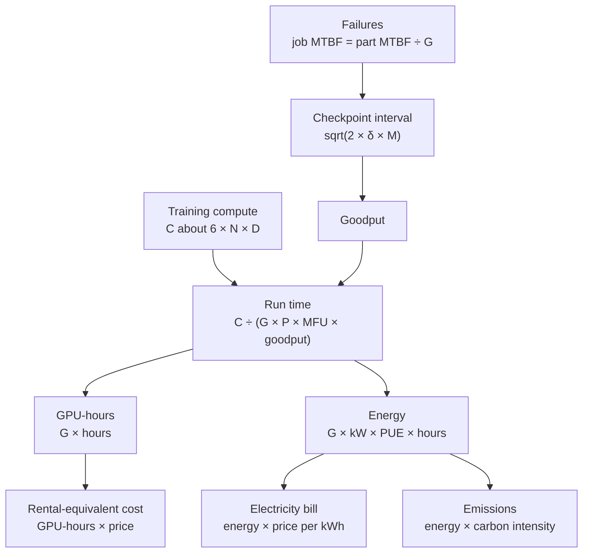

*Figure G.20: How a training run's budget is built from the entries above: compute and the cluster set the time, failures and checkpoints set the goodput, and time turns into GPU-hours, energy, dollars and carbon.*

### Energy and cost of a training run

**What it does:** Turns a training run's length and cluster into megawatt-hours and dollars.

`energy (kWh) = GPUs × all-in kW per GPU × PUE × hours; compute cost = GPU-hours × price per GPU-hour; electricity cost = energy × price per kWh`

- **all-in kW per GPU**: the GPU plus its share of the server and network
- **PUE**: building overhead
- **price per GPU-hour**: a rental-equivalent price

**In plain words:** Rental-equivalent cost leaves out research, failed runs, data and staff, which can exceed the final run's cost; electricity is usually a small share of the total.

**Tiny example:** With assumed figures, 1,000 GPUs × 1.5 kW × 1.3 × 720 hours (30 days) = 1,404 MWh, about $112,000 at $0.08 per kWh; 720,000 GPU-hours at $2 = $1.44 million. 100,000 GPUs × 1.8 kW × 1.2 = 216 MW for 2,160 hours: about 467,000 MWh, about $33 million at $70 per MWh. DeepSeek-V3 reported 2.788 million H800 GPU-hours, $5.576 million at an assumed $2 per GPU-hour.

**Where it is used:** Budgeting runs, model-card energy and emissions disclosures and policy estimates of frontier training cost; Meta's model card gives about 31 million H100 GPU-hours for Llama 3.1 405B.
**In the book:** Chapter 37 (From days to megawatts and dollars), Chapter 39 (Example 3: a 100,000-GPU cluster), Chapter 19 (From FLOPs to dollars) and Appendix B (Rental cost of a run).

### Energy per token and per query

**What it does:** Divides a server's power by its token output to give the energy behind each token and each answer.

`joules per token = power (W) ÷ tokens per second; facility energy per token = IT joules per token × PUE; watt-hours per query = joules per token × tokens per query ÷ 3,600; tokens per second per megawatt = tokens per second per GPU × 1,000 ÷ (all-in kW per GPU × PUE)`

- **power**: watts drawn by the GPU or server
- **tokens per second**: total throughput across all users
- **3,600**: joules in one watt-hour

**In plain words:** Like cost per token, energy per token falls steeply with batch size because the same power serves more users. Reasoning-heavy and long-context requests use many times more.

**Tiny example:** 1,500 W ÷ 2,000 tokens per second = 0.75 J per token; a 500-token answer = 375 J ≈ 0.10 Wh, or 0.125 Wh with PUE 1.2. At 2,000 tokens per second per GPU, 1.8 kW all-in and PUE 1.2: 2,000 × 1,000 ÷ 2.16 ≈ 926,000 tokens per second per megawatt.

**Where it is used:** Energy and carbon disclosures and comparing hardware on tokens per watt. Google measured a median Gemini Apps text prompt at 0.24 Wh (August 2025, counting idle machines and data-center overhead); OpenAI's chief executive gave about 0.34 Wh for an average ChatGPT query (June 2025).
**In the book:** Chapter 44 (The energy budget), Chapter 37 (From dollars per GPU-hour to dollars per million tokens), Chapter 40 (Distinction 4: per prompt versus in total) and Appendix B (Energy per token); tokens per megawatt is only here.

### Depreciation and annualized capital cost

**What it does:** Spreads the cost of a purchase over its useful life, with or without the cost of financing it.

`straight-line yearly depreciation = (cost − salvage value) ÷ useful life; declining balance: depreciation in year t = rate × book value at the start of year t; annualized cost with financing = cost × r ÷ (1 − (1 + r)^(−n))`

- **salvage value**: what the asset is worth at the end (residual value)
- **useful life**, **n**: years of use
- **book value**: cost minus depreciation taken so far
- **rate**: the declining-balance percentage per year
- **r**: the yearly cost of capital; **r ÷ (1 − (1 + r)^(−n))**: the capital recovery factor

**In plain words:** Depreciation is how accounts spread a purchase over its life; the assumed life of AI servers (4, 5 or 6 years) changes reported profits by billions. The capital recovery factor is the equal yearly payment that repays a purchase with interest, like a mortgage.

**Tiny example:** $50,000 with a $5,000 salvage value over 5 years: (50,000 − 5,000) ÷ 5 = $9,000 a year. Declining balance at 40%: $20,000, then 0.4 × 30,000 = $12,000, then 0.4 × 18,000 = $7,200. Financed at 8% over 5 years: 0.08 ÷ (1 − 1.08^(−5)) ≈ 0.2505, so about $12,520 a year.

**Where it is used:** Hyperscaler accounting for AI servers, GPU rental pricing and cost-of-ownership models.
**In the book:** Chapter 43 (Capex and opex; Depreciation: the 4, 5 or 6-year debate) gives straight-line depreciation; salvage value in the formula, declining balance and the capital recovery factor are only here.

> **Definition — Declining-balance depreciation:** An accounting method that writes off a fixed percentage of an asset's remaining value each year, so the deductions are largest in the first years.

> **Definition — Capital recovery factor:** The fraction of a purchase price that must be paid each year, for a given interest rate and number of years, to repay it with interest in equal installments, like a mortgage payment.

### Owner's cost per GPU-hour, break-even price and cost per useful FLOP

**What it does:** Builds the hourly cost of owning a GPU and the rental price needed to break even.

`cost per hour of life = capital cost ÷ (useful life in years × 8,760) + power cost per hour + facility and operating cost per hour; break-even price per sold hour = cost per hour of life ÷ utilization; cost per useful FLOP = price per GPU-hour ÷ (peak FLOP/s × MFU × 3,600)`

- **capital cost**: the price of the GPU and its share of the server
- **power cost per hour**: kW × price per kWh (times PUE if overhead is not counted elsewhere)
- **utilization**: the share of hours actually sold or used
- **3,600**: seconds in an hour

**In plain words:** An idle GPU still costs money, so the price per sold hour must cover the unsold ones too.

**Tiny example:** $50,000 over 5 years: 50,000 ÷ 43,800 ≈ $1.14 per hour, plus $0.16 of power and $0.49 of facility rent ≈ $1.79; at 70% utilization, 1.79 ÷ 0.7 ≈ $2.56 per sold hour. At $2.56 per hour, 989 × 10^12 FLOP/s and 40% MFU: 2.56 ÷ (989 × 10^12 × 0.4 × 3,600) ≈ $1.80 per 10^18 useful FLOPs.

**Where it is used:** GPU cloud pricing (CoreWeave, Lambda, hyperscalers), build-versus-rent decisions and internal chargeback.
**In the book:** Chapter 43 (Renting compute: the price of a GPU-hour; Utilization: the hotel occupancy of AI; Worked example: does a GPU pay for itself?); cost per useful FLOP is only here.

### Total cost of ownership (TCO) of AI infrastructure

**What it does:** Adds up everything an asset costs over its life, minus what it can be sold for.

`TCO = capital expenditure + sum over years of operating expenditure − resale value; TCO per GPU-hour = TCO ÷ (GPUs × lifetime hours); building capital ≈ IT megawatts × cost per MW`

- **capital expenditure**: chips, servers, network and building
- **operating expenditure**: power, staff, maintenance, rent and financing each year
- **resale value**: what the equipment fetches at the end

**In plain words:** Capital costs are spread over each asset's life (servers about 4 to 6 years, buildings 15 to 25) and added to running costs. In AI the IT equipment usually costs several times the building per megawatt, and chip-makers now compete on tokens per dollar of TCO rather than raw speed.

**Tiny example:** One GPU slot: $50,000 + ($0.16 + $0.49) × 43,800 hours = 50,000 + 28,470 = $78,470 over 5 years with no resale; ÷ 43,800 hours ≈ $1.79 per hour, matching the previous entry.

**Where it is used:** Chip purchase decisions (custom chips versus GPUs: Meta MTIA, Google TPU, AWS Trainium, Microsoft Maia) and data-center business plans; the cost model of Datacenter as a Computer.
**In the book:** Chapter 43 (Total cost of ownership; What it costs to build: dollars per megawatt; Putting it together: a 100 MW AI data center).

### Net present value, internal rate of return and payback

**What it does:** Values a stream of future cash in today's money, to decide whether an investment beats the cost of borrowing.

`NPV = sum over years t from 0 to n of CF_t ÷ (1 + r)^t; IRR = the r at which NPV = 0; payback period = upfront cost ÷ yearly net cash flow (for equal yearly flows)`

- **CF_t**: net cash in year t (negative for the purchase in year 0)
- **r**: the discount rate, usually the cost of capital
- **(1 + r)^t**: how much a dollar today grows to in t years, so dividing by it discounts future cash
- **IRR**: internal rate of return

**In plain words:** A dollar next year is worth less than a dollar today because today's dollar could earn interest. An investment is worthwhile if NPV > 0, or equivalently if its IRR beats the cost of capital.

**Tiny example:** Pay $100 now and receive $60 in each of the next two years, at r = 10%: −100 + 60 ÷ 1.1 + 60 ÷ 1.21 = −100 + 54.55 + 49.59 ≈ +4.13, worth doing; the IRR is about 13.1%. Chapter 43's GPU slot (−$50,000, then $12,670 a year for 5 years): payback 50,000 ÷ 12,670 ≈ 3.9 years, NPV at 8% ≈ +$590 and IRR about 8.4 to 8.5%, a thin margin.

**Where it is used:** Evaluating GPU purchases, data-center projects and their financing (bonds, private credit, GPU-backed loans).
**In the book:** Chapter 43 (Worked example: does a GPU pay for itself?; Financing the buildout) gives payback and IRR in words; the NPV formula is only here.

> **Definition — NPV (net present value):** The value today of all of an investment's future cash flows, each shrunk by the interest it could have earned elsewhere, minus what it costs. A positive NPV means the investment beats the cost of capital. (Not to be confused with negative predictive value in statistics.)

> **Definition — Discount rate:** The yearly rate used to convert future money into today's money, usually the investor's cost of capital. At 10%, $110 a year from now is worth $100 today.

### Levelized cost of energy (LCOE)

**What it does:** Gives the constant price per MWh at which a power plant exactly recovers all its costs over its life.

`LCOE = (sum over years t of (I_t + M_t + F_t) ÷ (1 + r)^t) ÷ (sum over years t of E_t ÷ (1 + r)^t)`

- **I_t**: investment in year t; **M_t**: operations and maintenance; **F_t**: fuel
- **E_t**: electricity generated in year t
- **r**: the discount rate
- **t**: the year, counting the upfront investment as year 0 (not discounted)

**In plain words:** Discounted lifetime costs divided by discounted lifetime energy, used to compare solar, wind, gas, nuclear and storage. It ignores when the energy arrives, which matters for a round-the-clock AI load.

**Tiny example:** $1,000 up front, $20 a year to run, 10 MWh a year for 3 years, r = 5%: the discount sum 1 ÷ 1.05 + 1 ÷ 1.05^2 + 1 ÷ 1.05^3 ≈ 2.723; LCOE = (1,000 + 20 × 2.723) ÷ (10 × 2.723) ≈ 1,054.5 ÷ 27.23 ≈ $38.7 per MWh (undiscounted it would be 1,060 ÷ 30 ≈ $35.3).

**Where it is used:** Power-purchase-agreement pricing and energy-source comparisons for AI campuses (Lazard and government studies).
**In the book:** Chapter 41 (Every energy source, compared) defines LCOE in words; the formula is only here.

### Cost per million tokens from GPU cost (and tokens per dollar)

**What it does:** Turns an hourly GPU price and a throughput into the cost of a million tokens.

`cost per million tokens = cost per GPU-hour ÷ (tokens per second per GPU × 3,600) × 10^6; tokens per dollar = tokens per second per GPU × 3,600 ÷ cost per GPU-hour; gross margin = (price − cost) ÷ price`

- **tokens per second per GPU**: total throughput across all users at the batch actually served
- **3,600**: seconds per hour
- **price**: what the customer pays per million tokens

**In plain words:** Batching, quantization and speculative decoding raise throughput and so cut cost. Input tokens are much cheaper to produce than output tokens. Customer prices, including caching discounts, are in the large language models section.

**Tiny example:** $3 per GPU-hour at 1,000 tokens per second: 3 ÷ 3,600,000 × 10^6 ≈ $0.83 per million, or 1,000 × 3,600 ÷ 3 = 1.2 million tokens per dollar; at 5,000 tokens per second, about $0.17. Selling at $2 per million: (2 − 0.83) ÷ 2 ≈ 58% gross margin.

**Where it is used:** Pricing APIs and comparing serving stacks and chips on tokens per dollar.
**In the book:** Chapter 37 (From dollars per GPU-hour to dollars per million tokens), Chapter 43 (From GPU-hours to the price of a token) and Appendix B (Cost per million tokens from GPU rent).

### Wright's law (experience curve)

**What it does:** Predicts that a product's unit cost falls by a fixed share every time cumulative production doubles.

`cost of the x-th unit = C_1 × x^(−b); learning rate = 1 − 2^(−b); b = log2(1 ÷ (1 − learning rate))`

- **C_1**: the cost of the first unit
- **x**: cumulative units produced so far
- **b**: the experience exponent
- **learning rate**: here, the fractional cost drop per doubling (not the training setting of the same name)

**In plain words:** Wright (1936) found that each doubling of cumulative aircraft production cut unit cost by a roughly constant percentage. The same pattern describes solar panels and batteries and is used for chips and inference prices.

**Tiny example:** A 20% learning rate: b = log2(1 ÷ 0.8) ≈ 0.322. Quadrupling cumulative volume (two doublings) cuts cost to 0.8 × 0.8 = 0.64. With C_1 = $100, the 1,000th unit costs 100 × 1,000^(−0.322) ≈ $10.8.

**Where it is used:** Forecasting the costs of solar, batteries and hardware for AI energy and compute planning.
**In the book:** Only here (Chapter 43 cites cost trends over time).

> **Definition — Wright's law (experience curve):** The observation that every doubling of the total number of units ever produced cuts the cost of making each unit by a roughly fixed percentage, as factories and suppliers learn.

### Rebound effect (Jevons paradox) condition

**What it does:** States when making something more efficient raises, rather than lowers, total resource use.

`total use = demand × resource per unit of service; with demand ∝ price^(−ε) and price ∝ resource per unit e: total use ∝ e^(1 − ε); efficiency gains raise total use when ε > 1`

- **e**: resource (energy or cost) per unit of service, such as joules per token
- **ε** (epsilon): the price elasticity of demand, how strongly demand responds to price
- **∝**: "proportional to"

**In plain words:** If a 10 times drop in energy or cost per token brings more than a 10 times rise in tokens used (ε > 1), total energy or spending rises (Jevons, 1865, about coal). Whether AI demand is that elastic is a central question in forecasting AI's electricity use.

**Tiny example:** Efficiency improves 10 times (e falls to 1 ÷ 10). With ε = 1.5: total use ∝ (1 ÷ 10)^(1 − 1.5) = 10^0.5 ≈ 3.16 times more. With ε = 0.5: (1 ÷ 10)^0.5 ≈ 0.32, a fall. Chapter 37's version: chips 1.34^5 ≈ 4.3 times more efficient while compute grows 5^5 = 3,125 times, so energy rises about 3,125 ÷ 4.3 ≈ 700 times.

**Where it is used:** Forecasting data-center energy demand and compute spending as efficiency improves.
**In the book:** Chapter 37 (Efficiency and the Jevons paradox), Chapter 41 (Forecasts: why they disagree) and Chapter 43; the elasticity condition is only here.

> **Definition — Price elasticity of demand:** How strongly the amount people buy responds to price: an elasticity of 2 means a 1% price cut raises purchases by about 2%. Above 1, cheaper goods bring in more total spending.
