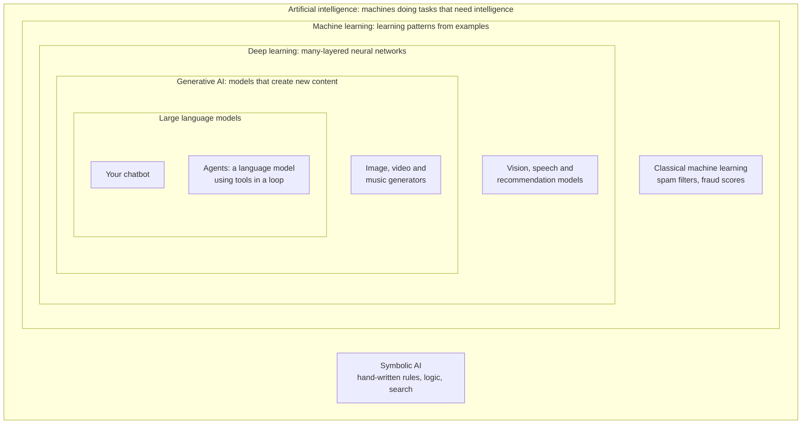
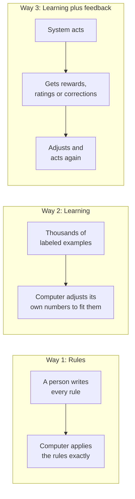
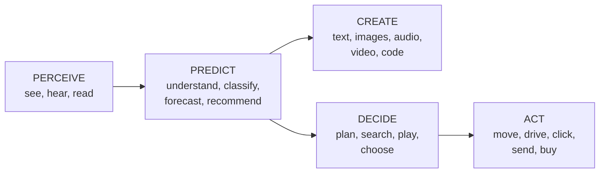
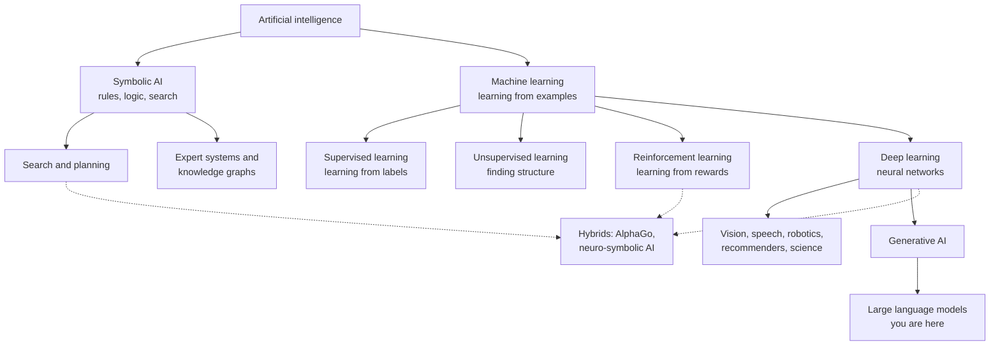
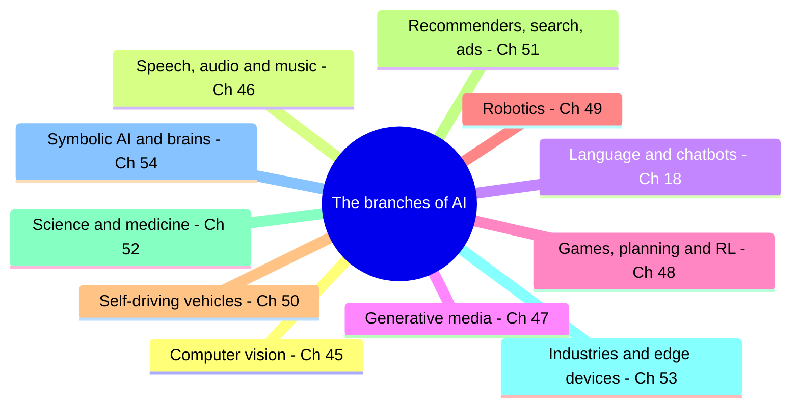
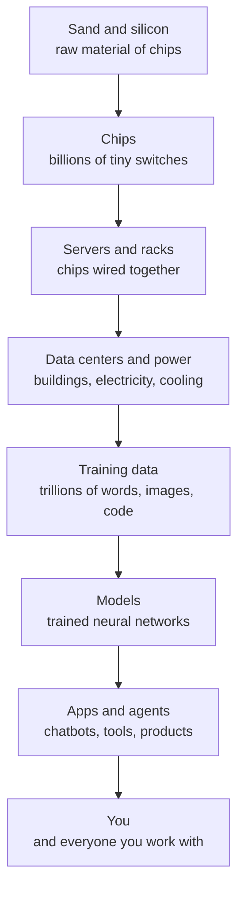
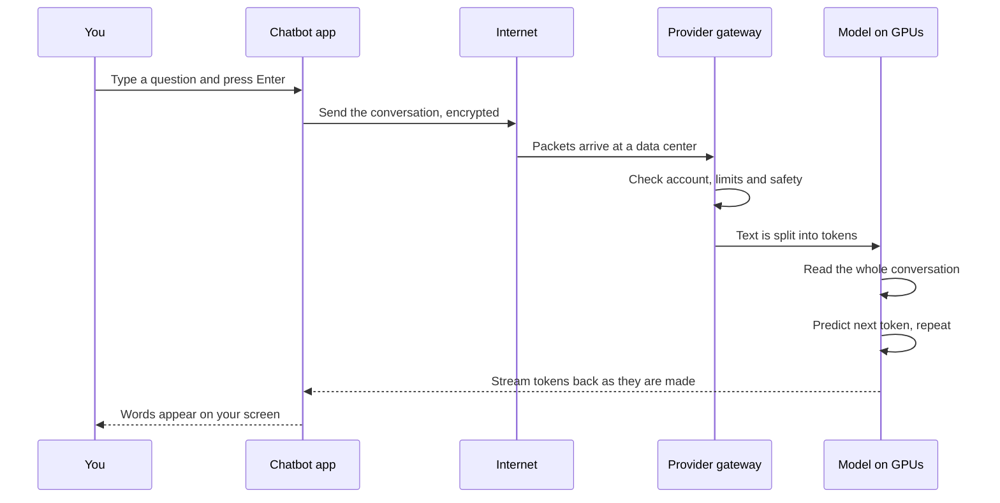
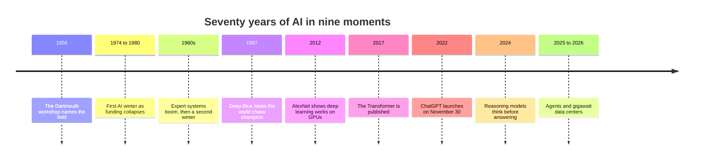
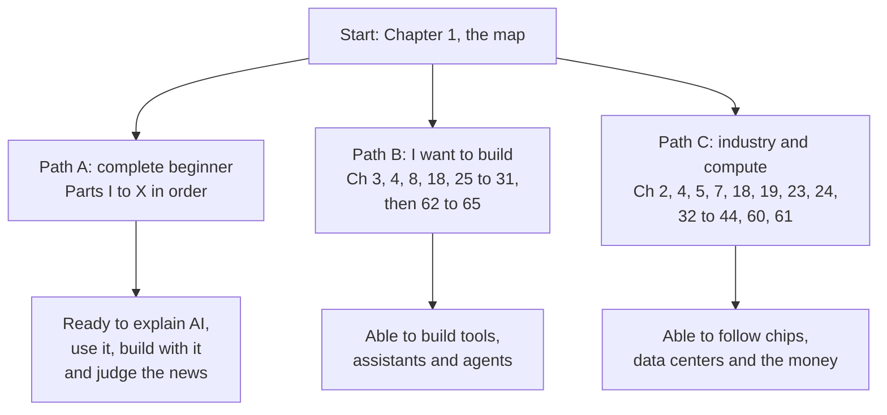

# Chapter 1: What AI Is: A Map of the Whole Field

*This chapter gives you a confident map of artificial intelligence, from the spam filter in your inbox to the gigawatt data centers behind your chatbot, and shows you how the rest of this book will take you from zero to the 2026 frontier.*

## What you'll learn

- What "artificial intelligence" actually means, and why it is best understood as a goal rather than a single technology.
- How AI, machine learning, deep learning, generative AI, large language models and agents fit inside each other like nested circles.
- The three ways to make a computer do something (rules, learning, and learning plus feedback), shown with a spam filter.
- The five verbs of AI (perceive, predict, create, decide, act) and how every branch of the field fits under them.
- The invisible AI you used this morning before you ever opened a chatbot.
- What your chatbot really is, in one paragraph, and the "AI stack" that runs from sand to you.
- The difference between today's narrow AI and the much-debated idea of artificial general intelligence.
- How this book is organized into ten Parts, and three reading paths you can take through it.

## Before you start

Nothing. Start here. This chapter assumes only that you have typed a question into ChatGPT, Claude or Gemini and read the answer. Every technical word is defined the first time it appears, and every big idea is only sketched here, with a pointer to the chapter that explains it properly. Think of this chapter as the map on the inside cover of a field guide: you will come back to it whenever you want to know where you are.

## Start with what you already know

You have used a chatbot almost every day for more than a year. You type a question, press Enter, and after a short pause the answer streams onto your screen a few words at a time. You have seen it write a cover letter in seconds and then confidently invent a book that does not exist. You are in good company: ChatGPT alone reached about 900 million weekly users by February 2026, and the 2026 Stanford AI Index reported that generative AI reached 53% population adoption within just three years.

What you probably do not know is what happens underneath. That is what this book is for. We will use your own chatbot as the running example from the first page to the last, and keep asking one question: what is really happening when I press Enter?

> **Definition — Chatbot:** A computer program you talk to in ordinary language, which replies in ordinary language. Modern chatbots such as ChatGPT, Claude and Gemini are apps built on top of large language models.

Here is the whole answer in one paragraph. Read it slowly, because the rest of the book unpacks it word by word.

**A chatbot is a program running on computers in a distant building. It turns your text into numbers, does trillions of multiplications on those numbers using billions of settings it learned from enormous amounts of text, and turns the resulting numbers back into text, one small piece at a time.**

> **Definition — Program:** A precise list of instructions that a computer follows exactly, step by step. Apps, websites and AI systems are all programs (also called software).

> **Definition — Data center:** A building packed with computers, network equipment, power equipment and cooling. When you use a chatbot, the real work happens on specialized chips inside one of these buildings, not on your phone.

Let us take that paragraph apart, phrase by phrase, and note where each piece is explained.

- **"A program running on computers in a distant building."** Your chatbot app is a thin window. The thinking happens on machines in a data center that may be hundreds or thousands of kilometers away. Chapter 2 explains what a computer physically is, Chapter 3 explains software, Chapter 4 follows your message across the internet, and Part VII walks you through the buildings themselves.
- **"Turns your text into numbers."** Computers can only store and process numbers. Your words are chopped into small pieces called tokens, and each token becomes a number. Chapter 3 shows how all text, images and sound become numbers; Chapter 18 shows how chatbots do it.
- **"Does trillions of multiplications."** The heart of a modern AI model is enormous tables of numbers being multiplied together. Chapter 5 teaches the math with nothing more than multiplication and addition, and Part VI explains the chips that do it.
- **"Using billions of settings it learned."** Those settings are called parameters. Nobody typed them in. They were adjusted automatically, over months, by showing the model huge amounts of text. That process, called training, is the subject of Parts II through IV.
- **"Turns the resulting numbers back into text, one small piece at a time."** The model does not write the whole answer at once. It predicts the next piece, adds it to the conversation, and predicts again. That is why answers stream onto your screen. Chapter 18 shows this loop in action.

> **Definition — Model:** The trained "brain" of an AI system: a file of learned numbers plus the recipe for using them, which takes an input (such as your question) and produces an output (such as an answer).

> **Definition — Parameter:** One adjustable number inside a model that shapes its behavior, like one knob on a giant mixing desk. Modern chatbot models have billions to trillions of them.

> **Definition — Token:** A small chunk of text, often a word or part of a word, that a language model reads and writes. In English a token averages about three-quarters of a word.

### How much math is in one answer?

Let us put a number on "trillions of multiplications," because it is the first of many worked examples in this book. A widely used rule of thumb says that producing one token costs about 2 arithmetic operations for every parameter the model uses. Labs rarely publish the exact sizes of their models, so imagine a model that uses 100 billion parameters for each token.

- One token: 2 × 100 billion = 200 billion operations.
- A 500-token answer (roughly 375 words): 500 × 200 billion = 100 trillion operations, which you can write as 10^14.
- If you did one multiplication per second by hand, never sleeping, 10^14 seconds would be about 3.2 million years.

The machines in the data center do it in a few seconds. That gap, between 3 million years of human arithmetic and a few seconds of machine arithmetic, is a good first sense of what modern AI is: not magic, but an astonishing amount of very simple math done very fast.

> **Key idea:** Your chatbot is not a database of answers and not a little person in your phone. It is a mathematical function with billions of learned numbers, running on specialized chips in a distant building, that predicts text one piece at a time.

> **Watch out:** A common belief is that the chatbot "looks up" answers in a giant database. It does not. It generates text from patterns stored in its parameters. Some products add a web search or a document lookup on top (Chapter 27 explains how), but the core is prediction, not retrieval. This is also why it can produce fluent, confident text that is simply wrong.

## What is AI? A definition that actually works

The phrase "artificial intelligence" was coined by the computer scientist John McCarthy in a 1955 proposal for a summer workshop held at Dartmouth College in 1956. That workshop is usually treated as the birth of the field. The founders were optimistic: they suggested that a small group working for one summer could make real progress on getting machines to use language, form concepts and improve themselves. It took about seventy years, two collapses in funding and a few revolutions in hardware to get to your chatbot. Chapter 7 tells that story.

The most useful definition of AI is a definition of a goal, not of a technology:

> **Definition — Artificial intelligence (AI):** The field of getting machines to do things that would require intelligence if people did them, such as recognizing faces, understanding language, translating, planning, making decisions or controlling a robot. AI names a goal; many very different techniques have been used to pursue it.

This matters because "AI" is not one thing. Over seventy years researchers have tried hand-written rules, logic, search through possibilities, statistics, simulated evolution and, most successfully in recent years, learning from huge amounts of data with neural networks. All of these are AI, because all of them aim at the same goal. When someone says "AI will do X," a good first question is: which kind of AI, doing which task?

A second useful idea is that the goal keeps moving. When a computer first beat the world chess champion in 1997, it was front-page AI news. Today the chess app on your phone plays far better, and nobody calls it AI. People in the field have long joked that "AI is whatever hasn't been done yet": spell-checkers, route-finding and handwriting recognition all became ordinary software the moment they worked.

> **Analogy:** "AI" is like the word "medicine." Medicine is a goal (keeping people healthy), pursued with very different tools: surgery, vaccines, antibiotics, physiotherapy. Asking "does medicine work?" makes no sense; you have to ask which treatment, for which problem. In the same way, a spam filter, a chess engine and your chatbot are all AI, built with very different tools.

> **Definition — Algorithm:** A step-by-step method for solving a problem, like a recipe. The same algorithm can be written in any programming language, or in plain words.

## Nested circles: AI, machine learning, deep learning, generative AI, LLMs and agents

The words you hear most often in AI news are not competing technologies. Most of them sit inside each other, like a set of nesting dolls. Learning this picture once will save you a lot of confusion.

*Figure 1.1: The nested circles of AI. Each inner box is a special case of the box around it. Your chatbot lives in the innermost box.*

Let us walk from the outside in.

**Artificial intelligence** is the outermost circle: the whole goal, by any method.

**Symbolic AI** sits inside AI but outside machine learning. It is the older tradition of writing knowledge down by hand as symbols and rules ("IF the patient has a fever AND a stiff neck THEN test for meningitis") and letting the computer reason with them. It dominated the field from the 1950s to the 1980s and never disappeared (Chapter 54).

> **Definition — Symbolic AI:** The approach of building intelligence from explicit, human-written symbols and rules, reasoned over with logic and search. Often nicknamed "GOFAI," for "good old-fashioned AI."

**Machine learning** is the big circle inside AI where the computer is not told the rules but works them out from examples. Show it ten thousand emails marked "spam" or "not spam" and it figures out for itself which features matter. Almost all the AI progress of the last thirty years has come from this circle. Part II explains it.

> **Definition — Machine learning (ML):** Building programs that learn patterns from examples instead of following rules a programmer wrote by hand. The program adjusts its own internal numbers until its outputs match the examples well.

> **Definition — Training:** The process of adjusting a model's parameters using data until it performs well. Training a frontier chatbot model takes months on tens of thousands of chips; it happens once per model, before you ever use it.

> **Definition — Inference:** Using an already-trained model to produce an output. Every reply you get from a chatbot is inference; the model's parameters do not change while you chat with it.

**Deep learning** is the part of machine learning that uses neural networks with many layers. A neural network is a mathematical structure loosely inspired by brain cells: lots of simple units, each of which multiplies its inputs by learned weights, adds them up and passes the result on. Stack many layers of these and train them on huge datasets, and they can learn to recognize faces, transcribe speech or translate languages. Deep learning took off in 2012, when a network called AlexNet, trained on two gaming graphics cards, won a major image-recognition contest with about half the error rate of the runner-up. Part III explains how these networks work.

> **Definition — Neural network:** A model made of many simple connected units arranged in layers, where each unit computes a weighted sum of its inputs and applies a simple "squash." It is loosely inspired by brain neurons but is really a stack of multiplications and additions.

> **Definition — Deep learning:** Machine learning using neural networks with many layers. It has powered most AI progress since about 2012, including image recognition, speech recognition and chatbots.

**Generative AI** is the part of deep learning that creates new content (text, images, audio, video, 3D scenes, code) rather than only labeling or predicting. The image generators, music generators and video generators of the last few years live here, alongside chatbots.

> **Definition — Generative AI:** AI that produces new content, such as text, images, audio, video or code, rather than only classifying or scoring existing content.

**Large language models (LLMs)** are generative models trained on vast amounts of text to predict the next token. They are the engine inside your chatbot. Almost all of them are built on a design called the Transformer, published by Google researchers in 2017. Part IV is devoted to how they are made.

> **Definition — Large language model (LLM):** A very large neural network trained on huge amounts of text to predict the next token. It is the engine inside chatbots like ChatGPT, Claude and Gemini.

> **Definition — Transformer:** The neural-network design introduced in 2017 that underlies nearly all modern chatbots. Its key ingredient, "attention," lets every token in the input weigh how much every other token matters.

**Agents** are the newest layer. An agent is a language model placed in a loop with tools: it can search the web, run code, click buttons, read files or send an email, look at the result, and decide what to do next, toward a goal you gave it. In 2025 and 2026 agents became the main way labs pushed AI from "answering questions" toward "doing tasks" (Chapter 28).

> **Definition — Agent:** An AI system that takes a series of actions toward a goal, such as searching, clicking, running code or editing files, deciding each next step from the results of the last, rather than just answering once.

> **Watch out:** The circles are a simplification. Not every generative model is a language model (image generators mostly use a different technique called diffusion, explained in Chapter 16). The word "agent" is also older than chatbots: in reinforcement learning (Chapter 48), any learner that acts in an environment is called an agent. And modern systems blend circles; the newest models read images, listen to speech and generate pictures, which is why they are often called "multimodal" (Chapter 22).

> **Definition — Multimodal:** Able to handle more than one kind of data, such as text, images, audio and video, within a single model.

Here is the same picture as a table, with the rough date each circle became prominent.

| Circle | One-line meaning | Everyday example | Became prominent | Where in this book |
|---|---|---|---|---|
| Artificial intelligence | Machines doing tasks that need intelligence | Any of the below | Named 1956 | This chapter, Chapter 7 |
| Symbolic AI | Hand-written rules, logic, search | Route search in maps, tax software | 1950s–1980s | Chapter 54 |
| Machine learning | Learning patterns from examples | Spam filter, card fraud check | 1990s–2000s | Part II |
| Deep learning | Many-layered neural networks | Face unlock, speech-to-text | From 2012 | Part III |
| Generative AI | Models that create new content | Image and music generators | From about 2014, booming 2022 | Chapter 16, Chapter 47 |
| Large language models | Next-token predictors trained on text | ChatGPT, Claude, Gemini | From 2018, booming 2022 | Part IV |
| Agents | Models acting in loops with tools | Coding agents, browser agents | 2024–2026 | Chapter 28, Chapter 29 |

> **Key idea:** When you hear an AI term, place it in the nested circles. Your chatbot is an agent-capable large language model, which is a kind of generative AI, which is a kind of deep learning, which is a kind of machine learning, which is one way of pursuing artificial intelligence.

## Three ways to make a computer do something

Every piece of AI you will meet is built in one of three basic ways, or a mix of them. We will use one example for all three: keeping spam out of your inbox.

*Figure 1.2: The three ways to make a computer do something. Modern chatbots use all three.*

### Way 1: Rules

The first approach is to write the rules yourself. A rule-based spam filter from the 1990s might say:

- IF the subject line contains "FREE MONEY" THEN mark as spam.
- IF the sender is in your contacts THEN never mark as spam.
- IF the email contains more than five exclamation marks THEN mark as spam.

> **Definition — Rule-based system:** A program whose behavior comes entirely from IF-THEN rules written by people. It is predictable and easy to inspect, but it only knows what its authors thought of.

This works, at first. Then spammers adapt. They write "FR3E M0NEY," or put the text in an image, or use exactly four exclamation marks. Someone has to notice and write a new rule. Meanwhile your aunt's email titled "Free lunch on Sunday!!!!!!" lands in the spam folder. Rule systems are brittle: they break on anything their authors did not imagine, and they need constant, expensive maintenance. This is exactly why the "expert systems" boom of the 1980s ended in disappointment (Chapter 7 and Chapter 54).

### Way 2: Learning from examples

The second approach is to collect thousands of emails that people have already marked as spam or not spam, and let the computer work out the pattern itself. These marked answers are called labels.

> **Definition — Training data:** The collection of examples a model learns from, such as emails, photos, sentences or game positions. Its size and quality largely decide how good the model becomes.

> **Definition — Label:** The "right answer" attached to a training example, such as "spam" on a spam email or "cat" on a photo of a cat.

Here is a tiny, simplified version of what a learning spam filter does. Imagine that after studying 20,000 labeled emails, it has learned a score for each word: words that show up mostly in spam get positive scores, and words that show up mostly in normal mail get negative ones.

| Word | Learned score |
|---|---|
| winner | +3.0 |
| free | +2.0 |
| click | +1.5 |
| invoice | −1.0 |
| meeting | −2.5 |

The rule it follows is now simple arithmetic: add up the scores of the words in the email, and if the total is above 2, call it spam.

- Email A: "Click here, you are a WINNER of a FREE cruise." Score = 1.5 + 3.0 + 2.0 = **6.5**. Above 2, so spam.
- Email B: "Are you free for a meeting Tuesday? Invoice attached." Score = 2.0 − 2.5 − 1.0 = **−1.5**. Below 2, so not spam.

Notice what happened. The rule "IF it contains 'free' THEN spam" would have blocked Email B. The learned filter weighs all the evidence together, and the word "meeting" outweighs the word "free." Nobody wrote those scores; they came from counting patterns in labeled examples. When spammers change tactics, you retrain on fresh examples instead of hand-writing new rules. This little table of scores is a real, if very small, machine-learning model, and the scores are its parameters. Your chatbot works on the same principle, with hundreds of billions of numbers instead of five.

> **Definition — Classifier:** A model that sorts inputs into categories, such as spam or not spam, fraud or legitimate, cat or dog.

### Way 3: Learning plus feedback

The third approach adds an ongoing signal of how well the system is doing. Every time you click "Report spam" or "Not spam," you give the filter a fresh, labeled example of its own mistake, and it can update. More broadly, a system can learn from rewards: it tries something, gets a score, and gradually shifts toward actions that earn higher scores. This is called reinforcement learning, and it is how computers learned to beat world champions at Go and how robots learn to walk in simulation (Chapter 48).

> **Definition — Reinforcement learning (RL):** Learning by trial and error: a system takes actions, receives rewards or penalties, and gradually learns which behavior earns the most reward.

> **Definition — Reward:** A number that tells a learning system how well it just did, like a score in a game or a treat for a dog.

Your chatbot was shaped by all three ways. First, it learned to predict the next word from trillions of words of examples (Chapter 19). Second, people compared pairs of its answers and marked the better one, and the model was adjusted toward the preferred kind; this is a big part of why ChatGPT felt so different when it launched on November 30, 2022 (Chapter 20). Third, the newest "reasoning" models were trained with rewards for checkable answers, such as solved math problems or passing software tests (Chapter 21). And rules never fully left: the instructions and safety filters around a chatbot are written by people.

> **Definition — RLHF (reinforcement learning from human feedback):** A training step where people rate or compare a model's answers, and the model is adjusted toward the kinds of answers people preferred. It helped turn raw text predictors into helpful assistants.

> **Analogy:** Rules are a recipe handed to a very literal cook. Learning is an apprentice who watches a master chef make ten thousand dishes and picks up the patterns. Learning plus feedback is the apprentice cooking for customers and adjusting each dish based on what comes back uneaten.

> **Try it:** Ask your chatbot: "Write me three IF-THEN rules for detecting spam, then write three spam emails that would slip past your own rules." Watch how easily rules are fooled. Then ask: "How would a machine-learning spam filter handle these differently?" Compare its answer with this section.

## The five verbs of AI

The field of AI is huge, and the news makes it look like a jumble of unrelated products. A simple way to organize it is by what a system does. Almost every AI system does one or more of five things.

*Figure 1.3: The five verbs of AI. A chatbot mostly perceives text and creates text; a self-driving car or a robot uses all five.*

- **Perceive.** Turn raw signals into something usable: recognizing a face, turning speech into text, reading a scanned receipt (Chapter 45, Chapter 46).
- **Predict.** Judge what is true or what will happen: is this email spam, how long will this drive take, which video will you watch next? Most of the AI that earns money today is prediction (Part II, Chapter 51, Chapter 53).
- **Create.** Generate something new: an essay, an image, a voice, a melody, a video clip, working code (Chapter 16, Chapter 47).
- **Decide.** Choose among options to reach a goal, often by looking ahead: a chess move, a delivery route, the next step of a task (Chapter 48).
- **Act.** Change the world: move a robot arm, steer a car, click a button, send an email. Robots (Chapter 49), self-driving cars (Chapter 50) and software agents (Chapter 28) act.

> **Key idea:** Ask "which verbs does this system do?" A face-unlock feature perceives. A fraud check predicts. An image generator creates. A chess engine decides. A robot vacuum perceives, decides and acts. Your chatbot perceives (reads) and creates (writes); when you let it use tools as an agent, it starts to decide and act too, which is exactly why agents raise new safety questions (Chapter 31, Chapter 58).

> **Definition — Prediction (in AI):** A model's output about something unknown, such as the next word in a sentence, tomorrow's temperature or whether a payment is fraudulent. Most AI outputs are predictions, even when they look like creativity.

## The invisible AI you used this morning

Here is something that surprises most chatbot users: the chatbot is not the AI you meet most often. Long before you opened ChatGPT today, you probably used a dozen AI systems without noticing. Here is a typical morning.

| Moment | What you saw | What the AI did | Verb | Chapter |
|---|---|---|---|---|
| Waking up | Phone unlocked when it saw your face | Face detection and verification | Perceive | Chapter 45 |
| Checking email | Three messages quietly sent to spam | Text classification | Predict | Chapter 8, Chapter 10 |
| Texting a friend | Keyboard suggested your next word | A small next-word predictor, often running on the phone | Predict, create | Chapter 18, Chapter 53 |
| Asking a smart speaker about the weather | It woke up at its name and answered aloud | Wake-word detection, speech-to-text, text-to-speech | Perceive, create | Chapter 46 |
| Scrolling a feed | Videos and posts in a particular order | Recommender system ranking thousands of candidates | Predict | Chapter 51 |
| Opening maps | Route and arrival time | Traffic prediction plus route search | Predict, decide | Chapter 48, Chapter 53 |
| Buying coffee by card | Payment approved instantly | Fraud scoring in milliseconds | Predict | Chapter 53 |
| Searching photos for "dog" | Every dog photo appeared | Image classification | Perceive | Chapter 45 |
| Reading a news site | An ad for shoes you looked at yesterday | Click prediction and an automated ad auction | Predict, decide | Chapter 51 |

> **Definition — Recommender system:** Software that predicts which items (videos, products, posts, songs) you are likely to engage with and ranks them for you. Your social media feed and streaming suggestions are recommender systems.

Recommender and ranking systems are almost certainly the AI that shapes your day the most. Netflix's own researchers reported in 2015 that about 80% of the hours streamed on the service were influenced by its recommendations. Every swipe and pause you make on a short-video app is a training signal for the system that picks the next video (Chapter 51).

> **Watch out:** "AI" is not the same thing as "chatbots." Chatbots are one famous branch of a large tree. Most AI in daily life is narrow, embedded and invisible: classifiers and rankers that make millions of small predictions every second. When people debate "AI," it helps to ask whether they mean chatbots, recommenders, face recognition, self-driving cars or something else, because the facts, benefits and risks differ for each.

> **Try it:** For the rest of today, keep a note on your phone. Every time software makes a guess or a choice for you (autocorrect, a suggested reply, a route, a playlist, a spam folder, a photo memory), write it down and tag it with one of the five verbs. Most people reach twenty before dinner. Exercise 1 at the end of this chapter turns this into a full audit.

## Narrow AI, general AI and superintelligence

Every system in the table above is narrow AI. Your face-unlock model cannot play chess, and a chess engine cannot unlock your phone. Each is built and trained for one job.

> **Definition — Narrow AI:** AI built for one task or one domain, such as a chess engine, a spam filter or a face-unlock system. Nearly all AI deployed in the world is narrow.

Chatbots blurred this line. One model can write a poem, explain chemistry, translate Japanese, draft a contract and fix a bug. That generality is why the old science-fiction idea of artificial general intelligence moved, in just a few years, from a fringe topic to something the largest technology companies say they are building.

> **Definition — Artificial general intelligence (AGI):** A hypothetical AI that can learn and perform most intellectual tasks a human can, across many domains. There is no single agreed definition, and people use the term in quite different ways.

> **Definition — Artificial superintelligence (ASI):** A hypothetical AI that greatly exceeds the best humans at virtually every intellectual task.

The trouble is that "AGI" means different things to different people. OpenAI's charter defines it as "highly autonomous systems that outperform humans at most economically valuable work." Google DeepMind proposed in 2023 a "Levels of AGI" grid that rates systems on two separate scales, how good they are (from Emerging to Superhuman) and how general, instead of drawing a single yes/no line. Others ask practical questions: could it do a remote office job end to end, or clean an unfamiliar house?

A second difficulty is that AI progress is uneven. Researchers call this the "jagged frontier": models can be superhuman at some tasks and surprisingly poor at nearby ones that seem easier to us. In July 2025, AI systems from Google DeepMind and OpenAI reached gold-medal standard at the International Mathematical Olympiad, one of the hardest math competitions for students in the world. Yet the 2026 Stanford AI Index noted a model with that level of math skill that could read the time from a picture of an analog clock correctly only about half the time. You have probably seen the jagged frontier yourself: a chatbot that writes a beautiful essay and then miscounts the letters in a word (Chapter 18 explains why).

> **Definition — Jagged frontier:** The uneven shape of AI ability: superhuman at some tasks while failing at nearby tasks that humans find easy. It is why "Is AI smarter than people?" has no single answer.

> **Analogy:** Arguing about "when AGI arrives" is like arguing about when a child "becomes an adult." Is it at 16 when they can drive, at 18 when they can vote, or when they pay their own rent? Before arguing about the date, agree on the definition.

So how close is AGI? Well-informed people disagree strongly. Some lab leaders and forecasters expect AI that can do most remote knowledge work within a few years, pointing to evidence such as METR's finding that the length of tasks AI agents can complete has been doubling roughly every seven months since 2019. Skeptics point to missing ingredients: reliability over long tasks, learning continuously after training, and robust understanding of the physical world. Chapter 60 lays out this debate fairly. For now, carry one habit: when you read that something "is AGI," ask "by what definition, measured how?"

> **Watch out:** Some 2026 marketing describes new models as AGI or as a "generational leap." Treat such words as claims to examine, not facts: does the claim name a specific definition and a specific measurement?

## A map of the whole field

Now we can draw the whole map. Think of AI as a family tree with two old trunks, symbolic AI and machine learning. Deep learning grew out of machine learning, generative AI grew out of deep learning, and large language models are one twig of generative AI. Many of the most famous AI achievements are hybrids that join branches together.

*Figure 1.4: The family tree of AI. Solid arrows show where each branch grew from; dotted arrows show hybrids that combine branches.*

> **Definition — Supervised learning:** Learning from examples that come with labels (the right answers), such as photos tagged "cat" or "dog." Most practical machine learning is supervised.

> **Definition — Unsupervised learning:** Finding structure, such as groups or patterns, in data that has no labels, for example grouping customers by shopping habits.

AlphaGo, which beat world champion Lee Sedol at Go in March 2016, is a classic hybrid: it combined search (looking ahead through moves, an old symbolic idea), a neural network that judged positions, and reinforcement learning from playing against itself. Google DeepMind's AlphaEvolve (2025) joined language models with evolutionary search to discover new algorithms. The branches keep cross-pollinating.

The same tree can be drawn by application area, which is how Part VIII of this book is organized.

*Figure 1.5: The application branches of AI and the chapters that cover them.*

Here is a one-paragraph tour of each branch, so you know what lives where.

**Computer vision** extracts information from images and video: what is in a photo, where each object is, what text it contains, whose face it is, how far away things are. It runs in phone cameras, factories, medical scanners and cars (Chapter 45).

> **Definition — Computer vision:** The branch of AI that extracts information from images and video, such as recognizing objects, reading text or measuring depth.

**Speech and audio** covers turning speech into text, text into natural-sounding speech, cloning voices, holding real-time voice conversations, generating music and recognizing sounds from coughs to whale songs (Chapter 46).

**Language** is the branch your chatbot comes from. Natural language processing once meant separate tools for translation, sentiment analysis and so on; today one large model does most of these with a single prompt, though small specialized models still run at huge scale because they are cheap (Chapter 18, Chapter 54).

> **Definition — Natural language processing (NLP):** The branch of AI that deals with human language: reading, writing, translating and extracting meaning from text.

**Generative media** covers image, video, 3D and "world model" generators that create interactive environments frame by frame (Chapter 16 explains the internals, Chapter 47 the products and their effects).

**Reinforcement learning, games and planning** is the branch that taught computers to search ahead and learn from rewards, from Deep Blue's chess win in 1997 to AlphaGo in 2016. It now also shapes how chatbots are trained to reason (Chapter 48, Chapter 21).

**Robotics** gives AI a body. What is easy for a toddler (picking up a sock) is extremely hard for machines, while chess and calculus can be easy for them. Robot models that take camera images plus a spoken instruction and output motor commands are one of 2026's most active frontiers (Chapter 49).

**Self-driving vehicles** combine perception, prediction, planning and control. They are no longer hypothetical: Waymo reported about 500,000 paid driverless rides per week in spring 2026 across a growing list of US cities, though only within mapped areas and conditions (Chapter 50).

**Recommenders, search and ads** are the AI you use without noticing, as the morning table showed (Chapter 51).

**AI for science and medicine** includes some of the field's most consequential results. AlphaFold predicts the 3D shape of proteins from their chemical sequence; its public database holds more than 200 million predictions, and its creators shared the 2024 Nobel Prize in Chemistry. AI weather models now run in operational forecasting (Chapter 52).

**Industries and the edge** covers finance, law, education, customer service, manufacturing, agriculture, defense and cybersecurity, plus "edge AI" that runs on phones, cars and sensors (Chapter 53). **Other paths to intelligence** covers symbolic reasoning, evolutionary algorithms, causal inference and the relationship between artificial and biological brains (Chapter 54).

> **Watch out:** "Old-fashioned symbolic AI is dead" is a myth. Search, planning, rules, knowledge graphs and formal verification run inside maps, airline scheduling, chip design and math proof checkers, and they are increasingly being combined with neural networks. The newest systems often pair a neural network's intuition with a symbolic tool's rigor.

> **At the frontier (2026):** The branches are converging on one recipe. The Transformer design that powers chatbots now also powers leading vision, speech, robot and even protein models. The 2024 Nobel Prizes, in Chemistry for AlphaFold's creators Demis Hassabis and John Jumper (shared with David Baker) and in Physics for John Hopfield and Geoffrey Hinton, marked how far neural networks had spread beyond computer science.

## The AI stack: from sand to you

Your chatbot is the visible tip of an enormous physical and industrial system. It helps to see the whole stack at once, from the raw material of chips to the app on your screen. Each layer depends on the one below it, and each layer is covered by a Part of this book.

*Figure 1.6: The AI stack. Your chatbot sits near the top; everything beneath it has to work for your answer to appear.*

| Layer | What it is | One number to remember | Where in this book |
|---|---|---|---|
| Silicon and chips | Tiny electrical switches (transistors) etched on silicon | NVIDIA's Blackwell B200 package holds 208 billion transistors | Chapter 2, Part VI |
| Servers and racks | Chips wired together into machines and cabinets | A modern AI rack can hold 72 GPUs acting as one | Chapter 34 |
| Data centers and power | Buildings full of racks, plus power and cooling | The largest AI sites approach 1 gigawatt, roughly the electricity of a million US homes | Part VII |
| Training data | Text, images, code and audio that models learn from | Meta's Llama 3 was trained on about 15.6 trillion tokens | Chapter 11, Chapter 19 |
| Models | Trained neural networks | Frontier models have hundreds of billions to trillions of parameters | Parts III and IV |
| Apps and agents | Products built on models | Hugging Face hosts about 3.17 million public models (October 2026) | Part V |
| You | Users, builders, workers, citizens | About 900 million weekly ChatGPT users (February 2026) | Parts IX and X |

> **Definition — Chip (integrated circuit):** A small slice of silicon with billions of microscopic switches and wires manufactured onto it. Processors, memory and AI accelerators are all chips.

> **Definition — GPU (graphics processing unit):** A chip with thousands of small processing cores that do the same math on lots of data at once. Built originally for video-game graphics, GPUs are now the main engine of AI.

> **Definition — Compute:** Shorthand for computing power, or for the total amount of calculation used for a job, as in "training compute." It is measured in operations and is one of the main limits on AI progress.

> **Definition — Gigawatt (GW):** A billion watts of power. AI companies now describe the size of their biggest data center campuses in gigawatts, comparable to the output of a large power plant.

Let us make one of those numbers concrete. A data center that draws 1 gigawatt around the clock uses 1 GW × 8,760 hours in a year = 8,760 gigawatt-hours, about 8.76 terawatt-hours of electricity. Epoch AI, a research group that tracks AI trends, estimates that building such a site costs about $38 billion per gigawatt and takes about two years. Chapter 2 teaches these units and Part VII teaches power; the point here is that your chatbot rests on infrastructure on the scale of power plants.

> **Watch out:** "The cloud" is not weightless. It is rows of real computers in real buildings using real electricity and water. When people say an AI "lives in the cloud," they mean it lives in a data center like the ones described in Part VII.

### What happens when you press Enter: the first look

Here is the journey of a single message, simplified. Chapter 4 follows it step by step across the internet, Chapter 23 shows what happens on the chips, and Chapter 44 retells it with real numbers for time, energy and cost at every step.

*Figure 1.7: What happens when you press Enter, in nine steps. The first word usually appears within a second or so, and the rest streams at tens of tokens per second.*

Two details in that picture explain everyday chatbot behavior. First, the model is stateless: each time you send a message, the app sends the whole conversation again, and the model reads it all from scratch. It does not remember you between chats unless the app saves notes and feeds them back in (Chapter 25). Second, because the model predicts one token at a time, the answer streams; the pause before the first word is the model reading your conversation, and the steady trickle afterward is the prediction loop.

> **Watch out:** Many people think the model is learning from their conversation as they chat. It is not. A deployed model's parameters are frozen while you use it. Apps may save "memories" and paste them into future conversations, and companies may use conversations to train future models depending on your settings, but the model you are talking to right now is not changing.

## How we got here, on one page

AI is not new, even though chatbots are. The field is about seventy years old, and its history is a cycle of bold promises, disappointment and comebacks. Chapter 7 tells the full story; here is the skeleton.

*Figure 1.8: The skeleton of AI history. Chapter 7 tells the full story, era by era.*

> **Definition — AI winter:** A period when disappointment caused funding and interest in AI to collapse. There were two major ones, roughly the mid-1970s and the late 1980s to early 1990s.

Three patterns run through this history, and they will help you judge today's news.

First, **each boom rode a jump in hardware and a jump in data at the same time.** Deep learning's ideas existed by the 1980s, but they only worked spectacularly once graphics chips made the math fast and the internet supplied millions of labeled images. Chatbots followed the same pattern a decade later with far bigger chips and far more text.

Second, **methods that scale with more computing power have tended to beat methods built on clever hand-written knowledge.** The researcher Rich Sutton called this "the bitter lesson" in a 2019 essay, bitter because it means decades of careful expert engineering were overtaken by simpler methods given more compute. This is why AI companies now spend tens of billions of dollars on chips and power: they are betting the pattern continues.

Third, **hype runs ahead of reality, and reality eventually arrives in a different shape than promised.** The 1950s founders were wrong about the timeline but right that machines could handle language.

> **Definition — Reasoning model:** A language model trained to produce a long internal chain of "thinking" before giving its final answer, which improves results on math, coding and logic problems. OpenAI's o1, first released as o1-preview on September 12, 2024, introduced the idea to the public.

> **At the frontier (2026):** By late 2026 the newest flagship models arrive roughly monthly. The pattern to recognize matters more than any single version number: each major lab ships a family of models in large, medium and small sizes (for example Anthropic's Claude Opus, Sonnet and Haiku); most offer adjustable "thinking" effort; agents that work for long stretches are the main battleground; open-weight models, many from Chinese labs such as DeepSeek and Alibaba's Qwen team, trail the closed leaders only narrowly; and some of the most capable models, such as Anthropic's Claude Mythos Preview (April 2026) and OpenAI's GPT-6 Astra (September 2026), were first made available only to selected organizations, largely because of their cybersecurity abilities. Epoch AI estimates that the computing power used to train frontier models has grown about 5 times per year since 2020. Chapter 24 surveys the landscape as of October 2026.

> **Definition — Frontier model:** One of the most capable AI models in existence at a given time, typically built by a handful of well-funded labs.

> **Definition — Open-weight model:** An AI model whose trained parameters are published so anyone can download and run it. The training data and code are often still private, so "open-weight" is not the same as fully open source.

## Who works in AI, and where you stand

People often imagine that AI is built by a few hundred geniuses with PhDs. The reality is a long ladder of involvement, and most of the jobs and most of the economic value sit in the middle rungs.

1. **User:** asks a chatbot questions now and then.
2. **Power user:** uses AI deliberately every day, gives it rich context, checks its work and delegates whole tasks to it.
3. **Builder:** connects AI to other tools, builds custom assistants and automations, often without writing code.
4. **Engineer:** writes software that calls AI models, builds retrieval systems and agents, measures quality.
5. **Researcher:** designs and trains new models and techniques.
6. **Frontier researcher:** pushes the state of the art at one of a handful of labs.

As a daily chatbot user for more than a year, you are already ahead of most people on this ladder. And the ladder is wider than it looks: in October 2026, research roles made up fewer than 10% of open jobs at Anthropic (68 of 675) and OpenAI (51 of 809). Outside the labs, AI creates work for data center electricians, for domain experts who test models, and for anyone who can redesign a workflow around AI (Part X).

> **Definition — Frontier lab:** A company that trains frontier models, such as OpenAI, Anthropic, Google DeepMind, Meta and xAI, along with leading Chinese labs such as DeepSeek.

> **Key idea:** You do not need to be a researcher to work in AI or to benefit from understanding it. Most value comes from people who understand the technology well enough to apply it, check it and explain it, which is exactly what this book is designed to give you.

## A guided tour of this book

This book has 66 chapters in ten Parts, plus five appendices. It is built as a spine: each Part rests on the ones before it, and the running example throughout is your own chatbot and what happens when you press Enter.

| Part | Title | Chapters | The question it answers |
|---|---|---|---|
| I | Foundations: How Computers Work and the Math Behind AI | 1–7 | What is a computer, how does everything become numbers, how does your message reach a data center, what math does AI use, and how did the field get here? |
| II | How Machines Learn | 8–11 | What does it mean for a machine to learn, how do we know if it learned well, what are the classic tools, and where does data come from? |
| III | Neural Networks and Deep Learning | 12–17 | How do neural networks work, how are deep networks trained, and how do CNNs, Transformers, diffusion models and newer designs work? |
| IV | Large Language Models: How Frontier Models Are Made | 18–24 | How does an LLM work, and how is a frontier model pretrained, post-trained, taught to reason, made multimodal, served cheaply and compared? |
| V | Using and Building With AI | 25–31 | How do you get the most from chatbots, call models with code, add your own knowledge, build agents, code with AI, customize models and ship reliable products? |
| VI | Compute: The Machines Behind AI | 32–37 | How do GPUs and other AI chips work, why is memory the bottleneck, how are thousands of chips wired together, who makes them and how, and what does training really cost? |
| VII | Data Centers and Energy | 38–44 | What is inside an AI data center, how does power reach the chips, where does the heat go, where does the energy come from, who is building what, and how does it all add up? |
| VIII | The Branches of AI | 45–54 | What does AI do beyond chatbots: vision, speech, generative media, games, robots, cars, recommenders, science, industry and older paths to intelligence? |
| IX | Safety, Ethics, Law and Society | 55–60 | What can go wrong, how do labs make AI safer, how do we look inside and test models, what are the harms, what are the laws, and what are the big debates about work and the future? |
| X | Your Path: Skills, Careers and Opportunity | 61–66 | Who makes money in AI, what skills matter, what jobs exist, where are the opportunities, how do you keep learning, and what are the open problems ahead? |

The five appendices are reference tools: A is a numbers-and-units cheat sheet, B a math cheat sheet, C a timeline from 1843 to 2026, D a who's who of companies, labs and people, and E a list of courses, books, newsletters and communities. A glossary of every defined term and an index of all exercises are generated from the chapters.

### Three reading paths

You can read this book straight through, and if you are a complete beginner that is the best way, because every chapter builds on the ones before. But you can also take a shorter path that matches your goal.

*Figure 1.9: Three reading paths through the book. Every path starts here.*

**Path A: the complete beginner.** Read Parts I through X in order. At one chapter a week you will finish in a little over a year; at two a week, in about eight months. You will be able to explain AI at every layer, from the chip to the policy debate.

**Path B: "I want to build."** Read Chapter 3 (software and data), Chapter 4 (the internet and APIs), Chapter 8 (what learning means) and Chapter 18 (how language models behave). Then read all of Part V (Chapters 25 to 31), from expert prompting to code, retrieval, agents, fine-tuning and shipping reliable products, and finish with Chapters 62 to 65. Dip into Chapters 21, 23 and 24 when you need to choose a model.

**Path C: "I want to understand the industry and compute."** Read Chapters 2, 4, 7, the memory-math sections of Chapter 5, and Chapters 18, 19, 23 and 24 on how models are built and served. Then read Parts VI and VII in full (Chapters 32 to 44), from transistors to gigawatt campuses and the money behind them, and finish with Chapters 60 and 61.

Whatever path you choose, read Chapter 44: it follows one prompt through the entire stack, then follows the making of one frontier model from data to deployment.

### How each chapter works

Every chapter has the same shape. Each technical term is defined in a box the first time it appears, and five kinds of boxes recur: **Key idea**, **Analogy**, **Try it** (a few minutes in a chatbot or browser), **At the frontier (2026)** and **Watch out** (a misconception, corrected). Each chapter ends with a plain-English recap, key terms, graded exercises that need no programming experience, areas of opportunity, self-check questions with answers, and resources for going deeper.

> **Try it:** Open your chatbot and paste in the table of ten Parts from this section. Ask: "Based on my job and interests, which reading path would you suggest, and which three chapters should I read first?" Tell it a little about yourself first. Then compare its suggestion with the paths above and decide for yourself.

> **Watch out:** "You need advanced math to understand AI" is a myth. The core ideas are multiplication and addition, lists of numbers, slopes and probabilities, and Chapters 5 and 6 teach exactly that, with examples you can check on a spreadsheet. Likewise, neural networks do not work "like the brain": they borrowed a loose cartoon of a neuron, but they are really stacks of multiplications (Chapter 54 compares the two).

## In plain English

Artificial intelligence is not one technology. It is a seventy-year-old goal: getting machines to do things that would need intelligence if people did them. People have pursued that goal with hand-written rules, with search and logic, and, most successfully, by letting machines learn patterns from examples. The words you hear in the news nest inside each other: machine learning is one way of doing AI, deep learning is one kind of machine learning, generative AI is deep learning that creates things, large language models are generative AI for text, and agents are language models that use tools to get tasks done.

Your chatbot is a program in a distant data center. It chops your words into tokens, turns them into numbers, multiplies those numbers through billions of learned settings, and predicts the answer one token at a time. It was built by learning from trillions of words, then polished with human feedback and rewards. It does not look things up in a database, it does not learn from you while you chat, and it is not the AI you use most: recommenders, spam filters, face unlock and fraud checks quietly make far more decisions in your day.

All of it rests on a physical stack: sand becomes chips, chips fill servers, servers fill data centers that draw as much power as cities, and data and training turn all that hardware into models and apps. Today's AI is narrow but increasingly general, brilliant at some tasks and weak at others, and nobody agrees on what "AGI" means or when it might arrive. This book walks up the whole stack, one layer at a time, with your own chatbot as the guide.

## Key terms

Chatbot, Program, Data center, Model, Parameter, Token, Artificial intelligence (AI), Algorithm, Symbolic AI, Machine learning (ML), Training, Inference, Neural network, Deep learning, Generative AI, Large language model (LLM), Transformer, Agent, Multimodal, Rule-based system, Training data, Label, Classifier, Reinforcement learning (RL), Reward, RLHF (reinforcement learning from human feedback), Prediction (in AI), Recommender system, Narrow AI, Artificial general intelligence (AGI), Artificial superintelligence (ASI), Jagged frontier, Supervised learning, Unsupervised learning, Computer vision, Natural language processing (NLP), Chip (integrated circuit), GPU (graphics processing unit), Compute, Gigawatt (GW), AI winter, Reasoning model, Frontier model, Open-weight model, Frontier lab

## Exercises

1. **[Easy] The invisible-AI audit.** For one full day, keep a running note on your phone. (1) Every time software makes a guess or a choice for you, write down what happened: unlocking your phone, autocorrect, a suggested reply, your feed's order, a playlist, a route and arrival time, a spam folder, a card payment approval, a photo memory, a smart-speaker answer. (2) Tag each entry with one or more of the five verbs: perceive, predict, create, decide, act. (3) At the end of the day count how many entries were chatbots and how many were something else. **What you'll learn:** most AI in your life is narrow, embedded and invisible, and recommenders and classifiers vastly outnumber chatbots.

2. **[Easy] Draw the nested circles from memory.** (1) On a blank sheet, without looking, draw the nested circles of AI: AI, symbolic AI, machine learning, deep learning, generative AI, large language models, agents. (2) Put one everyday example inside each circle. (3) Ask your chatbot: "Explain the difference between AI, machine learning, deep learning, generative AI, LLMs and agents, with one example each." (4) Compare its answer with your drawing and with Figure 1.1, and note any place where the chatbot was vague or wrong. **What you'll learn:** to place any AI term in context, and to check a chatbot's explanation instead of trusting it.

3. **[Easy] Be the spam filter.** Using the word scores from this chapter (winner +3.0, free +2.0, click +1.5, invoice −1.0, meeting −2.5, and a spam threshold of 2), score these by hand: (a) "Free invoice template, click to download." (b) "Winner of the team meeting raffle!" (c) "Click for your free winner bonus." For each, write the total and the verdict. Then invent one spam email that slips under the threshold and one normal email that gets wrongly flagged. **What you'll learn:** how a learned classifier weighs evidence, and why every filter makes some mistakes in both directions.

4. **[Medium] Train an image classifier with no code.** (1) Go to teachablemachine.withgoogle.com and start an Image Project. (2) Create two classes, "thumbs up" and "thumbs down," and record about 50 webcam images of each. (3) Click Train, then test it live with your hand. (4) Now sabotage it: retrain with all "thumbs up" pictures taken while wearing a red shirt and all "thumbs down" pictures in a different shirt, then test with the shirts swapped. **What you'll learn:** what "learning from labeled examples" looks like in practice, and how a model can learn an accidental shortcut (the shirt) instead of the thing you meant (the thumb).

5. **[Medium] Watch a neural network guess your doodles.** (1) Go to quickdraw.withgoogle.com and play a round of six drawings. (2) Note which drawings it recognized quickly and which it missed. (3) Ask your chatbot: "How might a neural network learn to recognize doodles from millions of examples, and why might it fail on unusual drawings?" **What you'll learn:** that models learn from huge collections of examples, recognize "typical" inputs best, and struggle with unusual ones.

6. **[Medium] Sort fifteen AI products by verb and branch.** (1) Make a table with three columns: product, verbs, branch. (2) Fill in fifteen products you know or use, for example: Google Lens, Waymo, Netflix recommendations, Gmail spam filter, a coding agent, an image generator, a voice assistant, a chess app, a bank fraud alert, a robot vacuum, AlphaFold, a translation app, a music generator, your chatbot, a smart doorbell. (3) For each, choose its verbs (perceive, predict, create, decide, act) and its branch from Figure 1.5. (4) Circle the products that use four or more verbs. **What you'll learn:** to organize the whole field with one simple framework, and to see why systems that act in the world are harder and riskier.

7. **[Medium] How much math is in one answer?** (1) Ask your chatbot a question and copy its answer into a free word counter (search "word counter"). (2) Estimate tokens as words ÷ 0.75. (3) Using the rule of thumb of 2 operations per parameter per token, and assuming a model that uses 100 billion parameters per token, compute the total operations for the answer. (4) Divide by 31.5 million (seconds in a year) to find how many years it would take a person doing one multiplication per second. **What you'll learn:** a feel for the scale of computation behind every reply, and practice with the kind of rough estimate this book uses constantly.

8. **[Challenge] Trace the stack for your favorite chatbot.** (1) Pick ChatGPT, Claude or Gemini. (2) For each layer of Figure 1.6 (chips, servers, data centers and power, training data, model, app), try to name one company or product involved, using your chatbot and a web search to help. (3) For every claim the chatbot gives you, find one independent source, such as the company's own announcement or a news article, and mark the claim as confirmed, unconfirmed or wrong. **What you'll learn:** how many companies sit beneath one chat window, and the habit of verifying AI-generated facts, which this book asks of you again and again.

9. **[Challenge] Map AI onto your own job.** (1) List twenty tasks you do regularly at work or at home. (2) For each, note which AI branch could help (vision, speech, language, recommendation, forecasting, generation, robotics, agents), what data it would need, what happens if it is wrong, and whether a human must check its output. (3) Pick the single most promising task and try it with a tool you already have, such as your chatbot. (4) Write three sentences on what worked and what did not. **What you'll learn:** to translate the map of AI into concrete value, and to judge when AI is and is not appropriate for a task.

## Areas of opportunity

- **AI-literate professional in any field.** The 2026 Stanford AI Index reports that 88% of organizations use AI, yet most people cannot explain what it does or where it fails. Employees who understand tokens, probabilities, costs and failure modes become the go-to person on their team; this is the most accessible opportunity in this book.
- **AI literacy trainer and explainer.** Companies, schools, libraries and senior centers need clear, hype-free teaching built on the mental model in this chapter: everything becomes numbers, models are learned functions, outputs are predictions. Over 80% of US high school and college students already use AI for schoolwork (2026 AI Index), and teachers need help.
- **Forward-deployed and solutions engineering.** Labs are hiring people who translate between what AI can do and how a business actually works. In October 2026 Anthropic announced $100 million to train 10,000 "Frontier Deployed Engineers," a strong signal of demand for people who understand both the technology and the customer.
- **"Invisible AI" audits for small businesses.** Most small firms already use AI unknowingly (spam filters, ad platforms, scheduling tools) and miss obvious wins. A consultant who maps a firm's tasks to AI branches, as in Exercise 9, and pilots off-the-shelf tools can charge for clear, measurable time savings.
- **Branch-specific services that do not need a chatbot.** Visual inspection for small manufacturers, voice receptionists for clinics and trades, document extraction for accounting firms, and recommendation engines for niche online shops all use mature, narrow AI. Customers pay for reliability in one job, not for general intelligence.
- **Verification and fact-checking.** Because models can be fluent and wrong, organizations need people and tools that check AI output: citations, figures, dates and legal references. Law firms, publishers and compliance teams pay for this.
- **Data center and energy trades.** Gigawatt campuses need electricians, cooling technicians, construction managers and power engineers in large numbers. These roles sit at the bottom of the AI stack and are covered in Part VII and Chapter 63.
- **Open problem: measuring general capability.** Nobody has an agreed way to measure how "general" an AI is, or to define AGI for laws and contracts. Researchers who design better evaluations, and policy experts who can turn them into workable rules, are in demand (Chapter 57, Chapter 59).

## Check your understanding

1. In one sentence, what is your chatbot, physically and mathematically?
2. Put these in order from the outermost circle to the innermost: deep learning, artificial intelligence, large language models, machine learning, generative AI.
3. Why did rule-based spam filters struggle, and how does a learning filter handle the email "Are you free for a meeting?" better?
4. Name the five verbs of AI and give one example system for each.
5. What is the difference between training and inference, and which one happens when you chat?
6. What is the "jagged frontier," and why does it make the question "when will we reach AGI?" hard to answer?
7. Name the layers of the AI stack from bottom to top.
8. Which kind of AI do most people interact with most often in a day, and why might they not notice it?

Answers

1. It is a program running on specialized chips in a distant data center that turns your text into numbers, multiplies them through billions of learned parameters, and turns the result back into text one token at a time.
2. Artificial intelligence, machine learning, deep learning, generative AI, large language models.
3. Rule-based filters only know the patterns their authors wrote down, so spammers could dodge them by changing spelling or wording, and innocent emails that happened to match a rule were blocked. A learning filter assigns learned scores to many words and adds them up, so a strongly "normal" word like "meeting" can outweigh a spammy word like "free."
4. Perceive: face unlock or speech-to-text. Predict: a spam filter, fraud check or feed ranking. Create: an image generator or your chatbot writing text. Decide: a chess engine or route planner. Act: a robot, a self-driving car or a software agent that clicks and sends.
5. Training is the long, expensive process of adjusting a model's parameters using data; it happens before the model is released. Inference is using the finished model to produce an output. Chatting is inference; the model's parameters do not change while you talk to it.
6. The jagged frontier is the uneven shape of AI ability: superhuman at some tasks (olympiad math) while failing at nearby easy ones (reading an analog clock). Because ability is uneven, there is no single line to cross, and people disagree about which tasks should count toward "general" intelligence.
7. Sand and silicon, chips, servers and racks, data centers and power, training data, models, apps and agents, and finally you.
8. Recommender and ranking systems (feeds, streaming suggestions, search results, ads), along with classifiers such as spam filters and fraud checks. They work silently in the background, so they feel like ordinary software rather than "AI."

## Going deeper

- **Andrej Karpathy, "Intro to Large Language Models" (YouTube, 2023).** A one-hour talk by a founding member of OpenAI that explains what a chatbot is for a general audience; the best single video companion to this chapter.
- **Melanie Mitchell, *Artificial Intelligence: A Guide for Thinking Humans* (2019).** A clear, balanced book by a working AI researcher on what AI can and cannot do, with excellent history.
- **Elements of AI (elementsofai.com).** A free online course from the University of Helsinki designed for non-specialists, covering what AI is, how it learns and its societal effects.
- **Andrew Ng, "AI for Everyone" and "Generative AI for Everyone" (Coursera and DeepLearning.AI).** Short, non-technical courses on what AI can do in organizations, taught by one of the field's best-known teachers.
- **Stanford AI Index Report (hai.stanford.edu/ai-index), published every year.** The standard annual collection of data on AI progress, investment, adoption and policy; skim the top takeaways each spring.
- **Epoch AI, "Trends" (epoch.ai/trends).** Charts and estimates of training compute, costs, hardware and data center growth, kept up to date by an independent research group.
- **Arvind Narayanan and Sayash Kapoor, *AI Snake Oil* (2024).** A sharp guide to telling the AI that works from the AI that does not, especially useful for judging news and product claims.
- **Stuart Russell and Peter Norvig, *Artificial Intelligence: A Modern Approach* (4th edition, 2020).** The standard university textbook covering every branch of AI, including the symbolic tradition; a reference to dip into rather than read cover to cover.
