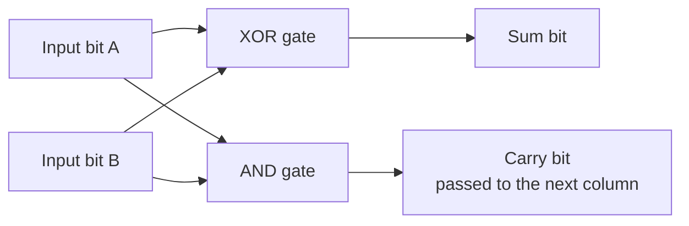
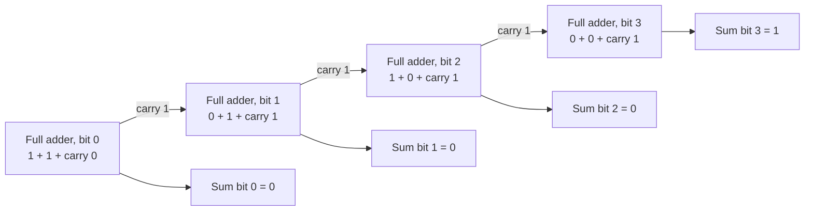
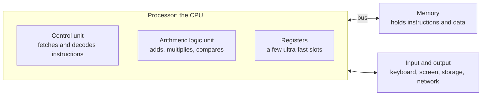
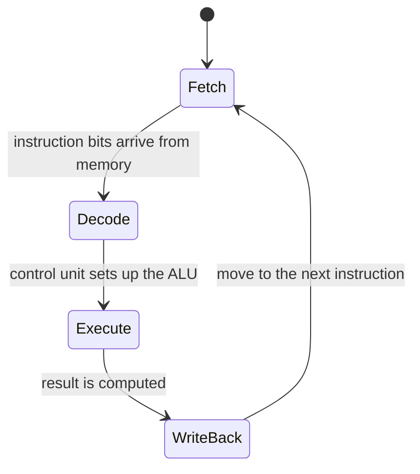
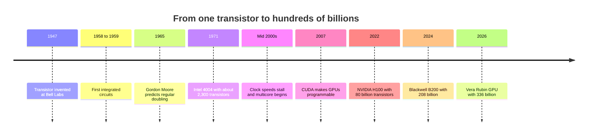
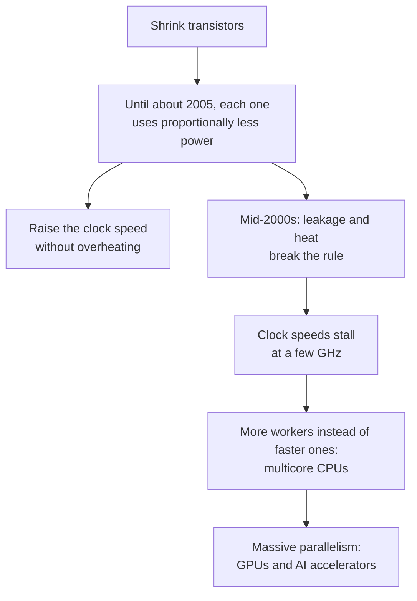
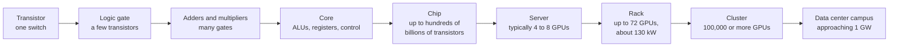

# Chapter 2: How Computers Work: Bits, Transistors and Processors

*From a single on/off switch to a chip with hundreds of billions of them, this chapter shows how a computer turns electricity into arithmetic, and gives you the number sense to see why AI needs so much of it.*

## What you'll learn

- How to feel very big and very small numbers: powers of ten, scientific notation, metric prefixes, estimation and rates.
- What a bit is, how to count in binary, and what bytes and gigabytes really measure.
- How a transistor works as a tiny electrical switch, and how a few make a logic gate.
- How logic gates combine into a circuit that adds numbers, worked by hand bit by bit.
- How a processor runs a program: the clock, the fetch–decode–execute loop and cores.
- Why memory forms a hierarchy, and why moving data costs more than doing math.
- What a GPU is, and why AI runs on GPUs and other accelerators.
- How compute is measured in FLOP and FLOP/s, and how power, heat, Moore's law and Dennard scaling shape AI hardware in 2026.

## Before you start

Chapter 1 (What AI Is: A Map of the Whole Field) showed that your chatbot is a program in a distant data center doing trillions of multiplications. This chapter explains the machine that does them, starting from a single switch, and needs nothing beyond everyday arithmetic. Chapter 3 then shows how text, images and sound become numbers, and Part VI returns to AI chips in depth.

## Why a chatbot user should care what is inside the box

In Chapter 1 we estimated that one 500-token chatbot answer takes on the order of 10^14 arithmetic operations. What is an "operation," physically? Why do AI companies build data centers that draw as much electricity as a city? Why did a maker of graphics cards for video games become the giant of the AI boom?

The answers are in the hardware. Every word your chatbot writes is the result of microscopic switches flipping inside chips, using electricity and producing heat. The cost of AI, its speed and its energy use come from the physics of those switches and from how data moves between them. By the end of this chapter you will be able to follow a calculation from a single transistor to a data center, and to estimate roughly how much computing a task needs.

We begin with numbers, because the hardware story is told in numbers so large that ordinary intuition fails.

## Numbers and scale: the language of AI

AI is a field of absurd numbers: hundreds of billions of parameters, trillions of training words, 10^25 or more operations per training run, gigawatt data centers. If those all feel like "a lot," you cannot tell a reasonable claim from a ridiculous one. This section gives you the tools to feel the difference.

### Big numbers, made concrete with time

Each named big number is 1,000 times the one before it.

| Name | Written out | Power of ten | Where you meet it in AI |
|---|---|---|---|
| Thousand | 1,000 | 10^3 | Tokens in a short answer |
| Million | 1,000,000 | 10^6 | Pixels in a phone photo (megapixels) |
| Billion | 1,000,000,000 | 10^9 | Parameters in a small model; clock ticks per second |
| Trillion | 1,000,000,000,000 | 10^12 | Tokens of training data; operations per second on a laptop |
| Quadrillion | 1,000,000,000,000,000 | 10^15 | Operations per second on one AI chip |
| Quintillion | 1,000,000,000,000,000,000 | 10^18 | Operations per second of a whole AI rack or supercomputer |

The best way to feel these numbers is to count seconds.

- **A million seconds** is 1,000,000 ÷ 60 = 16,667 minutes, ÷ 60 = 278 hours, ÷ 24 = **about 11.6 days**.
- **A billion seconds** is 1,000 times longer: 11,574 days, ÷ 365 = **about 31.7 years**.
- **A trillion seconds** is 1,000 times longer again: **about 31,700 years**, longer than all of recorded human history.

```
How long is a million, a billion, a trillion seconds?
(each extra block = 10 times longer)

million  |##                   11.6 days
billion  |#####                31.7 years
trillion |########             31,700 years
```
*Figure 2.1: A million, a billion and a trillion seconds on a scale where each block means ten times more. The gaps are factors of a thousand, not small steps.*

> **Watch out:** "A trillion is just a bit more than a billion" is one of the most common and most costly misunderstandings in reading AI news. A trillion is a thousand times a billion. A model trained on 15 trillion tokens did not see "a bit more" text than one trained on 15 billion; it saw a thousand times more.

### Powers of ten and scientific notation

Writing out all those zeros is tiring and error-prone, so scientists use powers of ten. 10^3 means 10 × 10 × 10 = 1,000. The small raised number, the exponent, tells you how many tens are multiplied together, which is the same as how many zeros follow the 1.

> **Definition — Exponent (power):** The small number that says how many times to multiply a number by itself. In 10^6 the exponent is 6, so 10^6 = 10 × 10 × 10 × 10 × 10 × 10 = 1,000,000.

> **Definition — Scientific notation:** Writing a number as a value between 1 and 10 multiplied by a power of ten, such as 2 × 10^25 instead of 20,000,000,000,000,000,000,000,000. The exponent tells you how many places to move the decimal point.

So 3.8 × 10^25 means moving the decimal point of 3.8 twenty-five places to the right. That is roughly the number of operations Meta used to train its Llama 3.1 405B model.

Powers of ten make arithmetic easy, because multiplying means adding exponents and dividing means subtracting them.

- 10^3 × 10^6 = 10^(3+6) = 10^9. A thousand millions is a billion.
- 10^14 ÷ 10^15 = 10^(14−15) = 10^−1 = 0.1. If a chatbot answer needs 10^14 operations and a chip can do 10^15 per second, the pure arithmetic takes a tenth of a second.

Negative exponents describe small things: 10^−3 is one thousandth (0.001), 10^−6 one millionth, 10^−9 one billionth.

> **Definition — Order of magnitude:** A factor of ten. "Two orders of magnitude bigger" means about 100 times bigger. Estimates that are "within an order of magnitude" are within a factor of ten of the truth.

### Metric prefixes

The same powers of ten have names that attach to units. You already know some: a kilometer is a thousand meters, a millisecond a thousandth of a second. AI uses the whole ladder.

> **Definition — Metric prefix:** A word added in front of a unit to multiply it by a power of ten: kilo (thousand), mega (million), giga (billion), tera (trillion), peta (quadrillion), exa (quintillion), and for small things milli (thousandth), micro (millionth) and nano (billionth).

| Prefix | Symbol | Multiplier | AI examples |
|---|---|---|---|
| exa | E | 10^18 | exaflop: 10^18 operations per second (a whole AI rack or top supercomputer) |
| peta | P | 10^15 | petaflop: one AI chip's speed; petabyte of training data |
| tera | T | 10^12 | terabyte of storage; terawatt-hours of electricity in a year |
| giga | G | 10^9 | gigabyte of memory; gigahertz clock; gigawatt data center |
| mega | M | 10^6 | megabyte photo; megawatt of power for a building |
| kilo | k | 10^3 | kilobyte of text; kilowatt for a rack shelf |
| milli | m | 10^−3 | milliseconds of delay across the internet |
| micro | µ | 10^−6 | microseconds to read from a fast SSD |
| nano | n | 10^−9 | nanoseconds per clock tick; nanometer-scale transistors |

You will meet "zetta" (10^21) occasionally too. The trick to reading any spec is to translate the prefix into a power of ten and then compare exponents.

### Estimation: is it closer to a thousand or a million?

Professionals in AI constantly make rough estimates, sometimes called Fermi estimates after the physicist Enrico Fermi, who loved them. The goal is not a precise answer but the right order of magnitude, quickly.

> **Definition — Fermi estimate:** A quick, rough calculation that multiplies a few reasonable guesses to get an answer within about a factor of ten. It is used to sanity-check claims and plan before precise data exists.

Here is one. How much text have you typed into chatbots in the past year, compared with what a large model was trained on?

1. Guess 20 messages a day, about 40 words each: 800 words a day.
2. Over a year: 800 × 365 = 292,000 words.
3. Tokens are about three-quarters of a word, so words ÷ 0.75 gives about 390,000 tokens. Call it 4 × 10^5.
4. Meta's Llama 3 was trained on about 15.6 trillion tokens, or 1.56 × 10^13.
5. Ratio: 1.56 × 10^13 ÷ (4 × 10^5) ≈ 4 × 10^7.

So the model read roughly 40 million times as much text as you typed to chatbots all year. Even if each guess were off by a factor of two, the answer would still be "tens of millions," and that is the insight: no human reads in a lifetime what a model reads in training.

> **Key idea:** Get the exponent right before you worry about the digits. "Is it closer to a thousand, a million or a billion?" is the most useful question you can ask about any AI number.

### Rates: per second, per token, per watt, per dollar

Almost every number in AI is a rate: something per something.

> **Definition — Rate:** A quantity measured per unit of something else, such as tokens per second, dollars per million tokens or operations per watt. Most AI speeds, costs and efficiencies are rates.

Three examples tie rates to your chatbot.

- **Speed.** Chatbots typically stream tens of tokens per second. At 50 tokens per second, a 1,000-token answer (about 750 words) takes 1,000 ÷ 50 = 20 seconds to finish appearing.
- **Price.** Epoch AI found that the price of GPT-4-level performance on a standard knowledge test fell from $37.50 per million tokens in March 2023 to $0.18 by February 2025. For a 1,000-token answer, that is 3.75 cents falling to 0.018 cents, about 200 times cheaper in two years.
- **Energy.** Google reported that the median text prompt in its Gemini apps in May 2025 used about 0.24 watt-hours of electricity (a company figure, not independently verified). A watt-hour is the energy of drawing one watt for an hour, and a joule, the scientific unit of energy, is one watt for one second; the section on power and heat later in this chapter explains both. That is about the energy a 10-watt LED bulb uses in 86 seconds: 0.24 Wh × 3,600 seconds per hour = 864 joules, and 864 ÷ 10 watts = 86.4 seconds.

> **Try it:** Ask your chatbot a question that needs a long answer and time it with your phone's stopwatch. Paste the answer into a free word counter, divide words by 0.75 to estimate tokens, and divide by the seconds to get tokens per second. You have just measured your first AI rate.

## Bits: the atoms of information

Now we go inside the machine. Every computer, from a calculator to an AI supercomputer, stores and processes information as patterns of bits.

> **Definition — Bit:** The smallest unit of information: a single choice between two possibilities, written 0 or 1 (off or on, no or yes). The word is short for "binary digit."

Claude Shannon's information theory of 1948 made the bit the basic unit of all information. Inside a chip, a bit is physical: a voltage that is low (0) or high (1), or a tiny stored charge that is absent or present.

One bit gives two patterns. Each extra bit doubles the number of patterns, because every old pattern can now be followed by either a 0 or a 1.

| Bits | Patterns | Calculation | What that is enough for |
|---|---|---|---|
| 1 | 2 | 2 | yes or no |
| 2 | 4 | 2 × 2 | four directions on a compass |
| 3 | 8 | 2 × 2 × 2 | days of the week, with one to spare |
| 4 | 16 | 2^4 | the values a 4-bit AI number can take |
| 8 | 256 | 2^8 | every English letter, digit and symbol |
| 16 | 65,536 | 2^16 | levels of brightness in a medical image |
| 32 | about 4.3 billion | 2^32 | every address in the original internet addressing scheme (IPv4) |
| 64 | about 1.8 × 10^19 | 2^64 | about 18 quintillion values |

Combinations of bits grow explosively: 64 bits is not 64 options but about 18 quintillion. The 4-bit row matters for AI: the newest AI chips can store model numbers in 4 bits to save memory and energy, so each such number takes only 16 distinct values (Chapter 5 and Chapter 32 explain how models still work).

> **Analogy:** Bits are light switches. One switch can show two patterns (off, on). A row of eight switches can show 256 patterns, enough to give every key on your keyboard its own pattern. A computer is, at bottom, an enormous panel of switches that flip billions of times per second.

> **Watch out:** "Binary means computers can only do simple yes/no things" is a myth. Groups of bits can represent any number, color, sound or letter to whatever precision you like. Every photo you have taken and every word your chatbot has written was stored as bits.

## Counting in binary

We count in base 10: each position in a number is worth ten times the one to its right, so 347 means 3 × 100 + 4 × 10 + 7 × 1. Computers count in base 2, called binary, because a switch has only two states. Each position is worth twice the one to its right: 1, 2, 4, 8, 16, 32, 64, 128 and so on.

> **Definition — Binary:** Counting with only two digits, 0 and 1. Each position is worth double the one to its right (1, 2, 4, 8, 16...), so the binary number 1101 means 8 + 4 + 0 + 1 = 13.

Here is how to count from 0 to 15 with four light switches, labeled with their place values 8, 4, 2 and 1.

| Decimal | 8 | 4 | 2 | 1 | Binary |
|---|---|---|---|---|---|
| 0 | 0 | 0 | 0 | 0 | 0000 |
| 1 | 0 | 0 | 0 | 1 | 0001 |
| 2 | 0 | 0 | 1 | 0 | 0010 |
| 3 | 0 | 0 | 1 | 1 | 0011 |
| 4 | 0 | 1 | 0 | 0 | 0100 |
| 5 | 0 | 1 | 0 | 1 | 0101 |
| 6 | 0 | 1 | 1 | 0 | 0110 |
| 7 | 0 | 1 | 1 | 1 | 0111 |
| 8 | 1 | 0 | 0 | 0 | 1000 |
| 9 | 1 | 0 | 0 | 1 | 1001 |
| 10 | 1 | 0 | 1 | 0 | 1010 |
| 11 | 1 | 0 | 1 | 1 | 1011 |
| 12 | 1 | 1 | 0 | 0 | 1100 |
| 13 | 1 | 1 | 0 | 1 | 1101 |
| 14 | 1 | 1 | 1 | 0 | 1110 |
| 15 | 1 | 1 | 1 | 1 | 1111 |

The rightmost column flips every step, the next every two steps, the next every four. It is a car's odometer whose wheels have only the digits 0 and 1: when a wheel passes 1, it rolls back to 0 and pushes the next wheel forward, just as 9 rolls over to 10 in decimal.

### Converting a decimal number to binary

To convert 41 to binary, go through the place values from largest to smallest and ask "does it fit?"

1. Place values available: 32, 16, 8, 4, 2, 1. (64 is bigger than 41, so we start at 32.)
2. Does 32 fit into 41? Yes. Write 1. Remainder: 41 − 32 = 9.
3. Does 16 fit into 9? No. Write 0.
4. Does 8 fit into 9? Yes. Write 1. Remainder: 1.
5. Does 4 fit into 1? No. Write 0.
6. Does 2 fit into 1? No. Write 0.
7. Does 1 fit into 1? Yes. Write 1. Remainder: 0.

So 41 in binary is 101001. Check: 32 + 8 + 1 = 41.

With eight switches you can count from 0 (all off) to 255 (all on: 128 + 64 + 32 + 16 + 8 + 4 + 2 + 1). Early computer scientists agreed to give every English letter a number in that range. The capital letter A is 65, which is 64 + 1:

```
place value:  128   64   32   16    8    4    2    1
switch:       off   ON   off  off  off  off  off   ON
bit:           0     1    0    0    0    0    0    1

  64 + 1 = 65  -->  the letter "A" in the ASCII code
```
*Figure 2.2: Eight switches (one byte) showing the number 65, which computers use to store the letter A. Chapter 3 explains how all text becomes numbers.*

### Adding in binary

Binary addition follows the same rules as the column addition you learned in school, with just four facts to remember: 0 + 0 = 0; 0 + 1 = 1; 1 + 1 = 10 (that is "0, carry 1"); and 1 + 1 + 1 = 11 ("1, carry 1").

Let us add 5 + 3, which is 0101 + 0011, working from the right.

```
  carries:    1 1 1
              0 1 0 1     (5)
            + 0 0 1 1     (3)
            ---------
              1 0 0 0     (8)
```
*Figure 2.3: Adding 5 + 3 in binary. Each column that sums to 2 writes 0 and carries 1 to the left.*

- Rightmost column: 1 + 1 = 10. Write 0, carry 1.
- Second column: 0 + 1 + carry 1 = 10. Write 0, carry 1.
- Third column: 1 + 0 + carry 1 = 10. Write 0, carry 1.
- Fourth column: 0 + 0 + carry 1 = 1. Write 1.

The result is 1000, which is 8. Hold on to this example: in a few pages we will build a circuit out of switches that does exactly these steps.

## Bytes and file sizes

Bits are grouped into bytes of eight.

> **Definition — Byte:** A group of 8 bits, which can hold one of 256 values (0 to 255). A byte is enough to store one basic English character, and file and memory sizes are measured in bytes.

> **Definition — Kilobyte, megabyte, gigabyte, terabyte (KB, MB, GB, TB):** About a thousand, a million, a billion and a trillion bytes. A page of text is a few KB, a phone photo a few MB, a phone's storage hundreds of GB, and a large hard drive several TB.

| Thing | Rough size |
|---|---|
| One English character | 1 byte |
| A page of plain text | a few kilobytes |
| A phone photo | a few megabytes |
| An hour of high-definition video | a few gigabytes |
| A laptop's working memory | typically 8 to 64 gigabytes |
| A 70-billion-parameter AI model stored at 2 bytes per parameter | 140 gigabytes |
| The training data of a frontier language model | tens of terabytes of text or more |

That model-size row is worth working out, because you will use it throughout the book. If a model has 70 billion parameters and each one is stored in 2 bytes, the model takes 70 × 10^9 × 2 = 140 × 10^9 bytes, which is 140 gigabytes. Your laptop's memory cannot hold it. One of NVIDIA's H100 AI chips, with 80 GB of memory, cannot hold it either. This simple multiplication, parameters times bytes per parameter, explains why big models need several data-center chips and why shrinking each number to fewer bytes, a trick called quantization, matters so much (Chapter 5, Chapter 30).

Two small traps are worth knowing.

**The 1,000 versus 1,024 confusion.** Because computers count in powers of two, memory is often measured in units of 1,024 (2^10) instead of 1,000, strictly called kibibytes (KiB), mebibytes (MiB) and gibibytes (GiB), though many programs still write KB, MB and GB. That is why a 1-terabyte drive (10^12 bytes) shows up as about 931 "GB": 10^12 ÷ 1,024^3 = 931.3.

**Bits versus bytes.** Internet speeds are quoted in bits per second, file sizes in bytes. A "100 megabit" connection (100 Mbps) moves at most 100 ÷ 8 = 12.5 megabytes per second. A lowercase b usually means bits; an uppercase B means bytes.

## Transistors: switches with no moving parts

So far, bits have been abstract 0s and 1s. Inside a chip, each bit is controlled by a transistor.

> **Definition — Transistor:** A microscopic switch, made of silicon, that lets electric current flow or blocks it depending on a small voltage applied to its control terminal, called the gate. It has no moving parts and can switch billions of times per second.

A transistor has three connections. Current can flow between two of them, the source and the drain, through a narrow channel. The third, the gate, sits over the channel. Put a small voltage on the gate and the channel conducts: the switch is on. Remove it and the channel blocks current: the switch is off.

```
              gate  (the "handle")
                |
                v
   source ====[###]==== drain
              channel

   gate voltage ON   -> channel conducts -> current flows -> 1
   gate voltage OFF  -> channel blocks   -> no current    -> 0
```
*Figure 2.4: A transistor as a switch. A small voltage on the gate opens or closes the path between source and drain.*

> **Analogy:** A transistor is a faucet whose handle is turned by electricity instead of a hand. A tiny push on the handle (the gate voltage) controls a much larger flow of water (the current). Because the output of one faucet can push the handle of the next, you can chain them together to build decisions.

The magic material is silicon, the main ingredient of ordinary sand. Pure silicon conducts electricity poorly, but adding tiny, carefully controlled amounts of other elements lets engineers decide exactly where and when it conducts. That property is what makes silicon a semiconductor, and it is why the chip industry is called the semiconductor industry.

> **Definition — Semiconductor:** A material, mainly silicon, whose ability to carry electricity can be precisely controlled, so it can act as a conductor or an insulator. Transistors are made from semiconductors, and the chip industry takes its name from them.

The transistor was invented at Bell Labs in 1947. Before it, computers used vacuum tubes: glass bulbs that could also act as switches but were large, hot and prone to burning out. ENIAC (1945), one of the first general-purpose electronic computers, used about 18,000 of them and filled a large room.

> **Definition — Vacuum tube:** A glass bulb with the air removed that can switch or amplify electric current. It was the switch inside the first electronic computers in the 1940s, before transistors replaced it.

In 1958 and 1959, engineers learned to manufacture many transistors and the wires between them together on a single slice of silicon: the integrated circuit, or chip.

> **Definition — Integrated circuit (chip):** Many transistors and the wires connecting them, manufactured together on one small piece of silicon. "Chip," "microchip" and "integrated circuit" mean the same thing.

> **Definition — Die:** A single rectangular piece of silicon, cut from a larger round wafer, that contains one chip's circuitry. A modern AI chip package may contain two or more dies plus separate memory stacks.

How many transistors fit on a chip today? NVIDIA's H100 AI chip, launched in 2022, has 80 billion transistors on one die. Its Blackwell B200 (announced 2024) has 208 billion, across two dies of 104 billion each. The Vera Rubin GPU that entered production in 2026 has 336 billion. With roughly 8 billion people on Earth, a single B200 has about 26 transistors for every person alive.

How small are they? The actual features are tens of nanometers across; a human hair is roughly 80,000 nanometers wide. Chapter 36 explains how such tiny structures are manufactured with light.

> **Definition — Nanometer (nm):** One billionth of a meter (10^−9 m). Transistor features measure tens of nanometers; a human hair is roughly 80,000 nanometers wide.

> **Watch out:** "A 3 nm chip has parts that are 3 nanometers wide" is false. Process names such as 3 nm or 2 nm are marketing labels for a manufacturing generation, inherited from an era when they matched a physical size. The real features are much larger.

## Logic gates: making decisions with switches

One switch on its own just turns something on or off. The power comes from wiring switches together so that the output of some controls others. The simplest useful arrangements are called logic gates.

> **Definition — Logic gate:** A tiny circuit, built from a few transistors, that takes one or more on/off inputs and produces an on/off output according to a fixed rule, such as AND, OR or NOT. All computer arithmetic and decision-making is built from gates.

The rules for gates predate electronics: the mathematician George Boole published an algebra of true and false in 1854, and switching circuits follow exactly his rules.

> **Definition — Boolean logic:** The algebra of true and false (1 and 0), using operations such as AND, OR and NOT. It was devised by George Boole in the 1850s and describes exactly how logic gates behave.

The behavior of a gate is described by a truth table, which lists every possible combination of inputs and the resulting output.

> **Definition — Truth table:** A table listing every possible combination of a circuit's inputs alongside the output it produces. It completely describes what a logic gate or circuit does.

Here are the four gates we need, each with an everyday example.

| A | B | NOT A | A AND B | A OR B | A XOR B |
|---|---|---|---|---|---|
| 0 | 0 | 1 | 0 | 0 | 0 |
| 0 | 1 | 1 | 0 | 1 | 1 |
| 1 | 0 | 0 | 0 | 1 | 1 |
| 1 | 1 | 0 | 1 | 1 | 0 |

- **NOT** flips its input: the output is on when the input is off. A door that stays unlocked unless the guard presses the lock button.
- **AND** is on only when both inputs are on. A vault that opens only when two managers both turn their keys.
- **OR** is on when either input (or both) is on. An office door that opens for an employee badge or a visitor pass.
- **XOR** ("exclusive OR") is on when exactly one input is on, but not both. A hallway light with a switch at each end: flipping either switch changes the light.

> **Definition — XOR (exclusive OR):** A logic gate whose output is 1 when exactly one of its two inputs is 1, and 0 when both are the same. It is the key ingredient in circuits that add numbers.

How do transistors make these gates? Picture each transistor as a switch in a wire leading to a lamp. Put two switches one after the other (in series) and the lamp lights only if both are closed: that is AND. Put them side by side (in parallel) and the lamp lights if either is closed: that is OR.

```
AND: switches in series            OR: switches in parallel

battery --[A]--[B]-- lamp          battery --+--[A]--+-- lamp
                                             |       |
lamp on only if A AND B                      +--[B]--+
are both closed
                                   lamp on if A OR B is closed
```
*Figure 2.5: Switches in series behave like an AND gate; switches in parallel behave like an OR gate.*

Real chips use a cleverer arrangement called CMOS, in which a NOT gate takes 2 transistors and a NAND gate (AND followed by NOT) takes 4. Remarkably, every other gate, and therefore every computer, can be built from NAND gates alone (Exercise 5 lets you try).

> **Key idea:** A logic gate is just a few transistors wired so that their on/off states combine by a rule. Everything else in a computer, from adding two numbers to running a chatbot, is built by connecting enormous numbers of gates.

## From gates to arithmetic: building an adder by hand

Now we can make switches do arithmetic. Look again at binary addition of two single bits:

| A | B | A + B in binary | Sum bit | Carry bit |
|---|---|---|---|---|
| 0 | 0 | 00 | 0 | 0 |
| 0 | 1 | 01 | 1 | 0 |
| 1 | 0 | 01 | 1 | 0 |
| 1 | 1 | 10 | 0 | 1 |

The Sum column is identical to the XOR column of the gate table, and the Carry column to the AND column. So a circuit that adds two bits is just one XOR gate and one AND gate fed the same inputs: a half adder.


*Figure 2.6: A half adder. Two gates are enough to add two single bits: XOR gives the sum, AND gives the carry.*

> **Definition — Adder (half adder and full adder):** A circuit of logic gates that adds binary numbers. A half adder adds two bits; a full adder adds two bits plus a carry from the previous column, so full adders can be chained to add numbers of any length.

> **Definition — Carry:** The extra 1 passed to the next column when a column's sum is too big to fit in one digit, as when 1 + 1 in binary gives 0 with 1 carried.

A half adder can only handle the rightmost column, because every other column must also add the carry coming in from its right. A full adder handles three inputs, A, B and the carry-in, and can be built from two half adders and one OR gate (five gates in all). Its rules are:

- Sum = A XOR B XOR carry-in.
- Carry-out = (A AND B) OR (carry-in AND (A XOR B)).

Let us check the hardest case by hand: A = 1, B = 1, carry-in = 1.

- A XOR B = 1 XOR 1 = 0. Then 0 XOR carry-in 1 = 1. So Sum = 1.
- A AND B = 1. So the first part of the carry rule is already 1, and Carry-out = 1.
- Result: sum 1, carry 1, which is binary 11 = 3. Correct, since 1 + 1 + 1 = 3.

Here is the full adder's complete truth table. Check any row by counting the inputs that are 1: zero gives 00, one gives 01, two gives 10, three gives 11.

| A | B | Carry-in | Sum | Carry-out |
|---|---|---|---|---|
| 0 | 0 | 0 | 0 | 0 |
| 0 | 0 | 1 | 1 | 0 |
| 0 | 1 | 0 | 1 | 0 |
| 0 | 1 | 1 | 0 | 1 |
| 1 | 0 | 0 | 1 | 0 |
| 1 | 0 | 1 | 0 | 1 |
| 1 | 1 | 0 | 0 | 1 |
| 1 | 1 | 1 | 1 | 1 |

### A 4-bit adder, worked by hand

Chain four full adders, each passing its carry-out to the next one's carry-in, and you have a circuit that adds two 4-bit numbers. Let us feed it 5 + 3 (0101 + 0011), the same sum we did on paper, and follow the electricity column by column. Bit 0 is the rightmost (worth 1), bit 3 the leftmost (worth 8).

| Column | Worth | A | B | Carry-in | Sum | Carry-out |
|---|---|---|---|---|---|---|
| Bit 0 | 1 | 1 | 1 | 0 | 0 | 1 |
| Bit 1 | 2 | 0 | 1 | 1 | 0 | 1 |
| Bit 2 | 4 | 1 | 0 | 1 | 0 | 1 |
| Bit 3 | 8 | 0 | 0 | 1 | 1 | 0 |


*Figure 2.7: A 4-bit adder made of four full adders, adding 5 + 3. The carry ripples from right to left, and the sum bits read 1000, which is 8.*

Reading the Sum column from bit 3 down to bit 0 gives 1000: eight. The circuit did what you did on paper, with voltages instead of pencil marks, in a fraction of a nanosecond. A 32-bit adder is the same idea with 32 full adders, about 160 gates and very roughly a thousand transistors (real chips use faster designs that do not wait for the carry to ripple across).

### From adding to multiplying

Multiplication in binary is repeated shifting and adding, just like long multiplication in school, only easier because each digit is 0 or 1. To compute 5 × 3, which is 0101 × 0011:

1. The rightmost bit of 0011 is 1, so take 0101 as it is.
2. The next bit of 0011 is 1, so take 0101 shifted one place left: 1010 (that is 10).
3. The remaining bits are 0, so add nothing more.
4. Add the pieces: 0101 + 1010 = 1111, which is 15. Correct.

A multiplier circuit is AND gates (to pick which shifted copies to include) feeding adders. Put a multiplier and an adder together and you get the most important operation in AI.

> **Definition — Multiply-accumulate (MAC):** One multiplication followed by adding the result to a running total, as in total = total + (a × b). Neural networks are built almost entirely from MACs, and one MAC counts as two operations.

When Chapter 5 shows that a neural network layer multiplies a list of numbers by a table of weights, every step is a MAC. Your chatbot's 10^14 operations per answer are, physically, about 5 × 10^13 of these little circuits firing.

> **Key idea:** Arithmetic is arranged switches. A transistor makes a switch, a few switches make a gate, a few gates make an adder, adders make a multiplier, and multiply-accumulate is what AI does trillions of times per answer.

## The clock: a metronome for billions of steps

A chip with billions of transistors needs a way to keep them in step, so that every adder has finished before the next stage reads its answer. That is the job of the clock: an electrical signal that ticks at a steady rate, like a metronome.

> **Definition — Clock speed:** How many ticks per second a chip's internal metronome makes, measured in hertz. Work inside the chip happens in step with these ticks, so a faster clock means more steps per second.

> **Definition — Hertz (Hz):** One cycle per second. A gigahertz (GHz) is a billion cycles per second, so a 3 GHz processor's clock ticks 3 billion times every second.

At 3 GHz, one tick lasts 1 ÷ (3 × 10^9) seconds, about 0.33 nanoseconds. In that time light travels only about 10 centimeters (3 × 10^8 meters per second × 3.33 × 10^−10 seconds = 0.1 meters), and electrical signals in a chip are slower still. At these speeds the length of a wire matters, which is one reason AI hardware is packed so tightly.

You might expect clock speeds to have kept rising. They have not: desktop processors run at a few gigahertz and AI chips at roughly 1 to 2 GHz, about where clocks were in the mid-2000s. The reason is heat, and we return to it in the section on Moore's law and Dennard scaling.

## The processor: how a CPU runs a program

Adders and multipliers need something to decide which numbers to add, where to get them and where to put the results. In 1945 the mathematician John von Neumann described the design almost every computer still follows: a processor, a memory holding both data and instructions, and a connection between them.

> **Definition — Von Neumann architecture:** The basic design of almost every computer since 1945: a processor that executes instructions, a separate memory that stores both the program and its data, and a pathway (bus) that moves information between them.

> **Definition — Bus:** A shared set of wires that carries data between parts of a computer, such as between the processor and memory.


*Figure 2.8: The von Neumann architecture. The processor and memory are separate, so every piece of data must travel across the bus, a detail that turns out to matter enormously for AI.*

> **Definition — CPU (central processing unit):** The general-purpose processor that runs a computer's programs one instruction after another. It is fast and flexible, excellent at varied, step-by-step work with many decisions, but it does only a limited number of calculations at once.

Inside the CPU, the arithmetic logic unit (ALU) contains the adders, multipliers and comparison circuits we just built. Registers are a handful of storage slots right next to the ALU, where numbers sit while they are being worked on. The control unit reads the program and tells everything else what to do.

> **Definition — ALU (arithmetic logic unit):** The part of a processor that performs arithmetic (add, subtract, multiply) and logic (compare, AND, OR) on numbers held in its registers.

> **Definition — Register:** One of a small number of storage slots inside a processor core that hold the numbers being worked on right now. Registers are the fastest memory in a computer.

A program, at the level the CPU sees it, is a long list of very simple instructions, each encoded as a pattern of bits called machine code. Which instructions exist, and how they are encoded, is fixed by the processor's instruction set architecture. The three you will hear about are x86 (Intel and AMD PCs and servers), Arm (almost all phones, Apple's Macs and a growing share of data-center processors) and RISC-V (a free, open standard).

> **Definition — Instruction:** One basic command a processor understands, such as "load a number from memory," "add these two registers" or "jump to another instruction if this number is zero."

> **Definition — Machine code:** Instructions written as the raw patterns of bits a processor executes directly. Every program, in any language, is eventually translated into machine code (Chapter 3 explains how).

> **Definition — Instruction set architecture (ISA):** The vocabulary of instructions a family of processors understands, and how they are encoded. x86, Arm and RISC-V are the major ISAs; a program compiled for one will not run directly on another.

### The fetch–decode–execute loop

Every CPU runs the same loop, billions of times per second: fetch the next instruction from memory, decode what it means, execute it, and move on.


*Figure 2.9: The fetch–decode–execute loop that every processor repeats, billions of times per second.*

Let us trace a tiny program that adds two numbers stored in memory. Suppose memory address 100 holds the number 7 and address 101 holds 5.

| Step | Instruction | What happens | State afterward |
|---|---|---|---|
| 1 | LOAD R1, [100] | Fetch the number at address 100 into register R1 | R1 = 7 |
| 2 | LOAD R2, [101] | Fetch the number at address 101 into register R2 | R2 = 5 |
| 3 | ADD R3, R1, R2 | The ALU's adder adds R1 and R2 into R3 | R3 = 12 |
| 4 | STORE R3, [102] | Copy R3 back to memory address 102 | address 102 = 12 |

Four instructions to add 7 and 5: every action, however trivial, is spelled out. Modern CPUs overlap the steps of several instructions like an assembly line and apply one instruction to several numbers at once, but the loop is the same.

### Cores

Since the mid-2000s, processors have contained several complete copies of this machinery, called cores, each running its own instructions: a laptop might have 8 to 16, a data-center CPU well over a hundred.

> **Definition — Core:** One independent processing unit inside a chip, with its own control unit, ALU and registers. A CPU has a handful to a few hundred large cores; a GPU has thousands of small ones.

A rough calculation shows what a CPU can do. A 16-core processor at 4 GHz has 16 × 4 × 10^9 = 64 billion core-ticks per second. With vector units doing many operations per tick, a high-end desktop CPU reaches very roughly a trillion (10^12) arithmetic operations per second. That sounds like a lot until you remember that one chatbot answer needs around 10^14 operations, and a model serves millions of people at once.

> **Analogy:** A CPU is the head chef of a restaurant kitchen. The chef can cook any dish, improvise, taste and change plans mid-recipe, but there is only one chef (or a few, if there are several cores). The recipe is the program, the countertop is memory, and the pantry is storage.

## Memory and storage: the desk and the filing cabinet

The processor can only work on numbers in its registers, and it has only a few dozen. Everything else waits somewhere slower, in a ladder of places, each bigger and slower than the one above.

> **Definition — Memory (RAM):** Fast working space that holds the programs and data a computer is using right now. It is volatile: everything in it disappears when the power goes off. RAM stands for random-access memory.

> **Definition — Volatile:** Describes memory that loses its contents when power is removed. Registers, caches and RAM are volatile; storage drives are not.

> **Definition — Storage (SSD and hard drive):** Slower but permanent places to keep files, which survive power-off. An SSD (solid-state drive) stores bits as trapped electric charges in flash chips; an older hard drive stores them magnetically on spinning disks.

> **Definition — Cache:** A small, very fast memory built onto the processor chip that keeps copies of recently used data close at hand, so the processor does not have to wait for slower main memory.

> **Definition — Memory hierarchy:** The ladder of storage in a computer, from tiny and instant (registers, cache) through main memory to huge and slow (SSDs, network storage). Each step down is bigger and cheaper per byte but slower, so good software keeps the data it needs near the top.

| Level | Typical size | Time to fetch (rough) | If a 1 ns cache read took 1 second... |
|---|---|---|---|
| Registers | a few hundred bytes per core | under 1 ns | under a second |
| Cache (SRAM) | kilobytes to tens of megabytes | about 1–10 ns | 1 to 10 seconds |
| Main memory (DRAM, or HBM on AI chips) | gigabytes | about 100 ns | about 1.7 minutes |
| SSD | terabytes | about 100 µs | about 28 hours |
| Hard drive | terabytes | about 10 ms | about 4 months |
| Another machine across a data center or the internet | effectively unlimited | 1 ms and up | 11.6 days and up |

SRAM and DRAM in the table are the two main kinds of memory chip: SRAM is faster and pricier per byte and is used for caches, while DRAM is denser and cheaper and is used for main memory.

Look at the last column. If fetching from cache took one second, fetching from the SSD would take more than a day, and asking another computer over the network at least a million seconds, which you now know is 11.6 days. The gaps are factors of thousands, which is why so much of AI engineering is about keeping the right data close to the processor.

```
                 /\        registers: bytes, < 1 ns
                /  \
               /    \      cache (SRAM): MB, ~1-10 ns
              /------\
             /        \    main memory / HBM: GB, ~100 ns
            /----------\
           /            \  SSD: TB, ~100 microseconds
          /--------------\
         /                \  network storage: PB, milliseconds
        /------------------\
   faster, smaller,           slower, bigger,
   pricier per byte           cheaper per byte
```
*Figure 2.10: The memory hierarchy. Higher levels are faster but smaller; the art of fast computing is keeping the data you need near the top.*

> **Analogy:** The memory hierarchy is your desk, your bookshelf, the library downstairs and a warehouse across town. Most slowness in computing is time spent walking to fetch books.

Two words describe how data moves, and they are easy to mix up.

> **Definition — Latency:** How long one request takes from start to finish, such as the time to fetch one piece of data or the delay before a chatbot's first word appears.

> **Definition — Bandwidth:** How much data can be moved per second, like the width of a pipe. Memory bandwidth is measured in gigabytes or terabytes per second.

Latency is how long the drive to the store takes; bandwidth is how many lanes the highway has.

## Moving data costs more than doing math

Here is the single most important hardware idea for understanding modern AI: on today's chips, moving numbers around costs more time and energy than doing arithmetic on them.

Start with energy. A widely cited 2014 analysis by the Stanford engineer Mark Horowitz estimated, for chips of that era, that a 32-bit floating-point multiplication cost a few picojoules (trillionths of a joule), while fetching 32 bits from off-chip memory cost hundreds of picojoules, roughly a hundred times more. The exact figures have shifted since, but the pattern has not: arithmetic is cheap, travel is expensive.

Then speed. Processors' ability to compute has grown much faster than memory's ability to feed them. Epoch AI estimates that GPU memory bandwidth has improved only about 28% per year since 2008, while AI chips' arithmetic price-performance has improved about 49% per year. The gap keeps widening, and chips increasingly sit idle, waiting for data. Engineers call this the memory wall.

> **Definition — Memory wall:** The growing gap between how fast processors can compute and how fast memory can supply them with data, which leaves chips waiting on memory. It is one of the main limits on AI speed.

> **Analogy:** The memory wall is a superfast chef starved by a slow delivery van. The chef can chop ten times faster every few years, but the pantry door widens only a little, so the chef spends more and more time standing at the door waiting for ingredients.

### Why your chatbot types at the speed it does

The memory wall explains something you see every day. When a chatbot generates text, it produces one token at a time, and to produce each token it must read essentially all of its parameters from memory (Chapter 23 explains why). Let us estimate the speed limit for one user.

- Take a model with 70 billion parameters stored at 1 byte each: 70 GB of numbers.
- Put it on an NVIDIA H200 chip, whose memory can deliver 4.8 terabytes per second.
- Each token requires reading all 70 GB, so the chip can make at most 4,800 GB/s ÷ 70 GB ≈ **69 tokens per second** for one user.

Now check the arithmetic. Each token needs about 2 operations per parameter: 2 × 70 billion = 1.4 × 10^11 operations. At 69 tokens per second that is about 10^13 operations per second. The chip can do roughly 10^15. So when serving a single user, the chip's math units are about 99% idle; the speed limit is set entirely by memory bandwidth. This is why AI providers process many users' requests together in a batch (each trip to memory then serves dozens of people), why they compress models into fewer bytes, and why AI chip makers obsess over memory (Chapter 23, Chapter 33).

The same arithmetic tells you whether a model will run well on your laptop. A typical laptop's memory delivers roughly 100 GB/s. An 8-billion-parameter model compressed to about half a byte per parameter is about 4 to 5 GB, so you can expect at most around 100 ÷ 4.7 ≈ 20 tokens per second (Chapter 30 shows you how to try it).

The answer AI chip designers found is to put the memory as close to the processor as physically possible.

> **Definition — HBM (high-bandwidth memory):** Memory chips stacked vertically and placed right beside an AI processor, connected by thousands of wires, so the processor can be fed data at terabytes per second. It is the critical, and often scarce, memory of AI chips.

NVIDIA's B200, for example, surrounds its processor dies with 192 GB of HBM delivering about 8 terabytes per second, more than fifty times a typical laptop's memory bandwidth. Chapter 33 tells the full story of the memory wall and HBM.

> **Try it:** Ask your chatbot: "A model file is 4.7 GB and my laptop's memory delivers 100 GB per second. What is the most tokens per second it could generate for one user? Show the arithmetic." Check its answer against this section, then ask it why batching many users together helps a data center but not your laptop.

> **Key idea:** For AI, the question is often not "how fast can the chip do math?" but "how fast can the chip get the numbers it needs?" Memory bandwidth, not raw arithmetic speed, usually sets how fast your chatbot types.

## GPUs and accelerators: thousands of simple workers

A CPU is built for flexibility: a few powerful cores that can handle anything, including programs full of decisions and branches. But some jobs are the same simple calculation repeated on enormous amounts of data. Graphics is the classic example. A 1920 × 1080 screen has 2,073,600 pixels, and a game redraws it 60 times per second, so the computer must calculate the color of 2,073,600 × 60 = about 124 million pixels every second, each with the same kind of arithmetic.

> **Definition — Parallelism:** Doing many operations at the same time instead of one after another. It is the central idea behind GPUs and AI accelerators.

> **Definition — GPU (graphics processing unit):** A chip with thousands of small, simple cores that apply the same operation to many pieces of data at once. Built for video-game graphics, GPUs turned out to be ideal for the repetitive multiply-and-add math of neural networks.

```
CPU: a few big, clever cores         GPU: thousands of small cores

+--------+ +--------+                ::::::::::::::::::::::::::::::::
| core 1 | | core 2 |                ::::::::::::::::::::::::::::::::
+--------+ +--------+                ::::::::::::::::::::::::::::::::
+--------+ +--------+                ::::::::::::::::::::::::::::::::
| core 3 | | core 4 |                ::::::::::::::::::::::::::::::::
+--------+ +--------+                ::::::::::::::::::::::::::::::::
|  large cache and   |               (each dot: a simple core; all
|  control logic     |                run the same instruction on
+--------------------+                different numbers at once)

good at: varied, branching work      good at: the same math on
(your browser, your OS)              huge grids of numbers (AI)
```
*Figure 2.11: A CPU spends its chip area on a few flexible cores; a GPU spends it on thousands of simple ones working in lockstep.*

Neural networks turned out to have exactly the shape of graphics work: huge grids of numbers multiplied and added the same way, over and over. In 2007 NVIDIA released CUDA, software that let programmers use its GPUs for general math. In 2012 AlexNet, trained on two gaming GPUs, launched the deep learning boom (Chapter 14), and GPUs became the main engine of AI.

> **Definition — CUDA:** NVIDIA's software platform, released in 2007, that lets programmers run general calculations on its GPUs. The huge ecosystem of tools built on it is a major reason NVIDIA dominates AI hardware.

Since 2017 NVIDIA's chips have included tensor cores, circuits that multiply a whole small grid of numbers in one step. An H100 can do about 989 trillion 16-bit operations per second, close to 10^15, using 700 watts. Google has used its own Tensor Processing Units since 2015, and phones and laptops now contain small neural processing units. Part VI compares them all.

> **Definition — Tensor core:** A specialized circuit inside modern NVIDIA GPUs that multiplies small matrices (grids of numbers) in one step. Other chip makers have equivalents under different names.

> **Definition — Accelerator:** Any chip specialized to do one kind of work, here AI math, much faster and more efficiently than a general-purpose CPU. GPUs, TPUs and NPUs are all AI accelerators.

> **Definition — TPU (Tensor Processing Unit):** Google's family of chips designed specifically for neural-network math, first deployed in Google's data centers in 2015 and also rented to outside customers through Google Cloud.

> **Definition — NPU (neural processing unit):** A small AI accelerator built into phones and laptops (Apple's Neural Engine, which debuted in 2017, is one example) for running AI features on the device itself, such as face unlock and photo search.

> **Analogy:** A CPU versus a GPU is one brilliant professor versus a stadium full of students with calculators. For a tricky proof, the professor wins; for a million simple multiplications, the stadium wins easily.

> **Try it:** Watch your own GPU work. On Windows, open Task Manager, then Performance, then GPU; on a Mac, open Activity Monitor and choose Window, then GPU History. Play a high-resolution video or spin a 3D globe in an online map and watch the graph climb while the CPU stays calmer.

> **Watch out:** "A GPU is just a faster CPU" is wrong. It is a different design, excellent at one kind of work and poor at others. Every AI server still pairs CPUs, which run the operating system and feed the work, with GPUs or other accelerators.

## Power and heat

Every time a transistor switches, it uses a tiny amount of energy, and essentially all of that energy ends up as heat. Multiply a tiny amount by hundreds of billions of transistors switching billions of times per second and you get the two great physical problems of AI hardware: feeding chips electricity and taking the heat away.

> **Definition — Watt (W):** The unit of power, meaning energy used per second (one joule per second). A kilowatt (kW) is 1,000 watts, a megawatt (MW) a million, a gigawatt (GW) a billion.

> **Definition — Kilowatt-hour (kWh):** A unit of energy: the energy used by drawing one kilowatt for one hour. Electricity bills are measured in kWh; one kWh is 3.6 million joules.

Power is a rate, like speed; energy is the total, like distance. Here is the ladder of AI power, worked out with the US average home using about 10,500 kWh of electricity a year (an average draw of about 1.2 kW).

- **One H100 GPU** draws about 700 watts. Running all year: 0.7 kW × 8,760 hours = 6,132 kWh, about 60% of an average US home's annual electricity.
- **One modern AI rack**, such as NVIDIA's GB300 NVL72 with 72 GPUs, draws roughly 120 to 140 kW. At 130 kW all year: 130 × 8,760 = 1,138,800 kWh, the electricity of about 100 homes in a cabinet the size of a refrigerator.
- **The largest AI data centers** are approaching 1 gigawatt, roughly the electricity of 800,000 to a million US homes.

All of that electricity becomes heat that must be carried away by air or liquid cooling (Chapter 40). The International Energy Agency estimated that data centers of all kinds used about 415 terawatt-hours in 2024, about 1.5% of the world's electricity, and projected about 945 TWh by 2030. Per prompt the energy is small; in aggregate it is reshaping electricity grids (Part VII).

> **At the frontier (2026):** Power per rack is still climbing. NVIDIA's published roadmap plans racks of roughly 600 kW for its Rubin Ultra generation (planned for 2027), several times today's 120 to 140 kW, and Epoch AI lists the largest AI site, xAI's Colossus 2 in Memphis, at roughly 1.1 million H100-equivalents of compute. Liquid cooling, once exotic, is now standard for the densest AI racks.

> **Key idea:** Computation is physical. Every operation costs energy and makes heat, which is why the AI boom is also a boom in power plants, transmission lines and cooling systems.

## Measuring compute: FLOP and FLOP/s

To compare chips, models and training runs, the AI world counts arithmetic operations on decimal numbers.

> **Definition — Floating-point number:** The way computers store decimal numbers such as 3.14159 or 0.000002, using a fixed number of bits split between significant digits and a power of two, like scientific notation in binary. Fewer bits mean less precision (Chapter 5).

> **Definition — FLOP:** One floating-point operation, a single addition or multiplication of decimal numbers. It is used to count the total amount of math a job takes, as in "this model was trained with 10^25 FLOP."

> **Definition — FLOP/s (FLOPS):** Floating-point operations per second, a measure of computing speed. A teraflop is 10^12 FLOP per second, a petaflop 10^15 and an exaflop 10^18.

Note the difference: FLOP is a count (how much work), FLOP/s is a speed (how fast). People often write "FLOPS" for both, so check which is meant.

| System | Speed (rough) | In powers of ten |
|---|---|---|
| A person doing arithmetic by hand | about 1 operation per second | 10^0 |
| A high-end laptop or desktop CPU | about a trillion per second | 10^12 |
| A phone's neural processing unit | tens of trillions of (low-precision) operations per second | 10^13 |
| One NVIDIA H100 GPU, 16-bit, dense | about 989 trillion per second | 10^15 |
| One GB300 NVL72 rack, 4-bit, dense | about 1.08 quintillion per second | 10^18 |
| LineShine, the top supercomputer on the June 2026 TOP500 list (64-bit) | about 2.2 quintillion per second | 10^18 |

> **Definition — Peak versus achieved performance:** Peak is the theoretical maximum speed on a chip's spec sheet; achieved is what real software actually gets, often 30 to 60% of peak for large training jobs and much less when waiting on memory.

Read spec numbers with three questions. **Which precision?** The rack and the supercomputer above look similar, but the rack's figure is for 4-bit numbers and the supercomputer's for 64-bit ones, each vastly more work. **Dense or sparse?** Some headline numbers assume half the multiplications can be skipped, which doubles them. **Per chip or per rack?** A rack figure is 72 chips' worth.

### Two worked examples

**One chatbot answer.** A common rule of thumb says generating one token costs about 2 × (number of parameters) FLOP. For a 70-billion-parameter model writing a 1,000-token answer: 2 × 70 × 10^9 × 1,000 = 1.4 × 10^14 FLOP. At an H100's 10^15 FLOP/s, the pure arithmetic would take 0.14 seconds. In practice the answer takes many seconds to stream, because, as we saw, the chip spends most of its time waiting on memory and is shared among many users.

**One training run.** Training costs about 6 × (parameters) × (training tokens) FLOP. Meta's Llama 3.1 405B had 405 billion parameters trained on about 15.6 trillion tokens:

- 6 × 4.05 × 10^11 × 1.56 × 10^13 ≈ 3.8 × 10^25 FLOP.
- On a single H100 at 9.89 × 10^14 FLOP/s, running perfectly: 3.8 × 10^25 ÷ (9.89 × 10^14) ≈ 3.8 × 10^10 seconds, about **1,200 years**.
- Meta used 16,384 H100s, achieving roughly 40% of peak: 3.8 × 10^25 ÷ (16,384 × 9.89 × 10^14 × 0.4) ≈ 5.9 × 10^6 seconds, about **68 days**.

That is why frontier training needs tens of thousands of chips running for months. Epoch AI estimates that the compute used to train frontier models has grown about 5 times per year since 2020, and 2026 frontier runs are believed to be in the range of 10^26 to 10^27 FLOP, though labs rarely disclose them. Chapters 19 and 37 work through these numbers in detail.

## Moore's law, Dennard scaling and the turn to parallelism

How did we get from ENIAC's 18,000 vacuum tubes to chips with hundreds of billions of transistors? In 1965 Gordon Moore, who later co-founded Intel, observed that the number of transistors on a chip was doubling at a regular pace; in 1975 he revised the pace to about every two years.

> **Definition — Moore's law:** Gordon Moore's observation (1965, revised 1975) that the number of transistors on a chip doubles roughly every two years. It is an industry trend, not a law of nature, and it has slowed.

Let us test it. Intel's 4004, the first commercial microprocessor (1971), had about 2,300 transistors. NVIDIA's B200 (2024) has 208 billion.

1. Growth factor: 208,000,000,000 ÷ 2,300 ≈ 90,000,000, or 9 × 10^7.
2. How many doublings is that? 2^26 = 67 million and 2^27 = 134 million, so about 26.4 doublings.
3. Over 2024 − 1971 = 53 years, that is 53 ÷ 26.4 ≈ **one doubling every 2.0 years**.

Moore's prediction held, on average, for half a century.


*Figure 2.12: Milestones on the road from a single transistor to the AI chips of 2026.*

For decades, shrinking transistors brought a second gift. Until about the mid-2000s, smaller transistors also used proportionally less power, so engineers could pack in more of them and raise the clock speed without the chip getting hotter. This rule is called Dennard scaling, after the IBM engineer Robert Dennard who described it in 1974.

> **Definition — Dennard scaling:** The historical rule that as transistors shrank, their power use shrank in proportion, so chips could get denser and faster without running hotter. It broke down in the mid-2000s, ending the era of rapidly rising clock speeds.

Around 2005 the gift ran out. Transistors had become so small that they leaked current even when off, and higher clock speeds made chips too hot to cool. Clocks stalled at a few gigahertz, and the industry's answer was to stop making each worker faster and hire more workers instead.


*Figure 2.13: How the end of Dennard scaling pushed computing from faster single processors toward massive parallelism, the shape of hardware that AI needed.*

This turned out to be lucky for AI, whose millions of independent multiply-adds are exactly the work parallel hardware is good at. Since the clock stopped speeding up, AI hardware progress has come from special circuits like tensor cores, lower-precision numbers (fewer bits per number means more math per second and less data to move), several dies in one package, faster memory beside the chip, and many chips wired together. Epoch AI estimates that the price-performance of AI chips has been improving about 49% per year and their energy efficiency about 34% per year.

> **Watch out:** Two opposite myths circulate. "Moore's law is a law of physics" is false: it was an industry trend, sustained by enormous investment, and it has slowed. But "Moore's law is dead, so computers have stopped improving" is also false: AI performance per chip and per dollar keeps rising quickly, through specialization, lower precision, packaging and scale rather than through faster clocks.

> **At the frontier (2026):** NVIDIA's Vera Rubin GPU, with 336 billion transistors made on TSMC's 3-nanometer-class process and paired with the newer HBM4 memory, entered full production in 2026 and was ramping in customers' data centers by late summer. NVIDIA quotes 50 petaflops of 4-bit performance per GPU (a "sparse" figure that assumes skippable zeros), against 20 for Blackwell. Even the spec sheets move: launch coverage in January 2026 cited 22 terabytes per second of memory bandwidth per GPU, while NVIDIA's product page later listed 19.2. Always check which precision, dense or sparse, per chip or per rack, and which date.

## From switch to data center: the ladder of scale

We can now climb the whole ladder from one switch to the building that runs your chatbot.


*Figure 2.14: The ladder of scale from a single transistor to a gigawatt AI campus. Part VI climbs it rung by rung, and Part VII explores the buildings at the top.*

Every rung has its own bottleneck: heat at the transistor, memory bandwidth at the processor, networking between chips, power and cooling at the rack and the building. When you press Enter, your request travels down this ladder to a few GPUs in one rack, and the answer climbs back up to you.

## In plain English

A computer is a huge collection of switches. Each switch, a transistor, is a microscopic valve made of silicon that lets electricity through or blocks it, and on or off stands for 1 or 0, a bit. Group bits together and you can count: binary is ordinary counting with only two digits, and eight bits, a byte, can hold any number from 0 to 255. Wire a few transistors together and you get logic gates that follow simple rules like AND and OR. Wire a few gates together and you get a circuit that adds numbers; add some more and it multiplies. A processor fetches instructions from memory and runs them, billions per second, in step with a clock.

AI's math is overwhelmingly multiply-and-add, repeated trillions of times, so it runs best on GPUs and other accelerators with thousands of simple cores working in parallel. The catch is memory: chips can now calculate far faster than they can fetch numbers, which is why your chatbot's typing speed is set mostly by how fast its memory can deliver the model's parameters. Every operation also uses energy and makes heat, which is why AI data centers need power plants and cooling.

To read AI news you need number sense: a trillion is a thousand billions, an exaflop is 10^18 operations per second, and almost every figure is a rate. Moore's law gave us a doubling of transistors every two years for half a century; when clock speeds stopped rising around 2005, the industry turned to parallelism, which happened to be exactly what AI needed.

## Key terms

Exponent (power), Scientific notation, Order of magnitude, Metric prefix, Fermi estimate, Rate, Bit, Binary, Byte, Kilobyte, megabyte, gigabyte, terabyte (KB, MB, GB, TB), Transistor, Semiconductor, Vacuum tube, Integrated circuit (chip), Die, Nanometer (nm), Logic gate, Boolean logic, Truth table, XOR (exclusive OR), Adder (half adder and full adder), Carry, Multiply-accumulate (MAC), Clock speed, Hertz (Hz), Von Neumann architecture, Bus, CPU (central processing unit), ALU (arithmetic logic unit), Register, Instruction, Machine code, Instruction set architecture (ISA), Core, Memory (RAM), Volatile, Storage (SSD and hard drive), Cache, Memory hierarchy, Latency, Bandwidth, Memory wall, HBM (high-bandwidth memory), Parallelism, GPU (graphics processing unit), CUDA, Tensor core, Accelerator, TPU (Tensor Processing Unit), NPU (neural processing unit), Watt (W), Kilowatt-hour (kWh), Floating-point number, FLOP, FLOP/s (FLOPS), Peak versus achieved performance, Moore's law, Dennard scaling

## Exercises

1. **[Easy] Big-number time travel.** With pencil and paper or a calculator: (1) Convert a million seconds into days by dividing by 60, then 60, then 24. (2) Convert a billion seconds into years by also dividing by 365. (3) Do the same for a trillion seconds. (4) Now convert your own age into seconds and write it in scientific notation. **What you'll learn:** the gap between a billion and a trillion is enormous, and you will never again hear "trillions of tokens" as a vague "lots."

2. **[Easy] Binary on your fingers.** (1) Assign place values to the fingers of one hand: thumb 1, index 2, middle 4, ring 8, little finger 16. A raised finger is 1. (2) Show 5, 13, 21 and 31. (3) Write your age in binary on paper using place values 64, 32, 16, 8, 4, 2, 1. (4) Ask your chatbot to check your answer, then ask it to quiz you on five more numbers. **What you'll learn:** binary is ordinary place value with 2 instead of 10, and five fingers can count to 31.

3. **[Easy] Meet your own computer's parts.** (1) On Windows, open Settings, then System, then About, and also Task Manager's Performance tab; on a Mac, open the Apple menu, then About This Mac, and Activity Monitor. (2) Write down your CPU's name, number of cores, clock speed, amount of RAM and storage size. (3) Open several heavy web pages and watch CPU and memory use rise. (4) Using this chapter's rough figure of a trillion operations per second for a fast CPU, estimate how long your computer would need for the 10^14 operations of one chatbot answer. **What you'll learn:** CPU, cores, RAM and storage are real, measurable parts of the device in front of you.

4. **[Medium] Be the adder.** (1) Copy the full-adder truth table from this chapter onto paper. (2) Using a 4-column table like the one in the chapter, add 0110 (6) and 0111 (7) one bit at a time, writing the carry-in, sum and carry-out for each column. (3) Check that the answer is 1101 (13). (4) Now multiply 0110 by 0011 using shift-and-add and check that you get 18 (10010). **What you'll learn:** a computer's arithmetic is nothing more than these little table lookups done by gates, column by column.

5. **[Medium] Build logic gates in your browser.** (1) Go to nandgame.com, a free game in which you build a computer starting from a single kind of gate (NAND). (2) Complete the first levels: build NOT (called "Invert"), AND, OR and XOR from NAND gates. (3) Continue to the half adder and full adder levels. (Alternatively, use the free simulator at circuitverse.org to wire up a half adder from an XOR and an AND gate.) (4) Write one sentence explaining why every chip could in principle be built from NAND gates alone. **What you'll learn:** how switches become gates and gates become arithmetic, with your own hands.

6. **[Medium] The memory hierarchy in human time.** (1) In a spreadsheet, make four columns: level, time in nanoseconds, scaled time in seconds, scaled time in friendly units. (2) Enter registers (0.5 ns), cache (5 ns), main memory (100 ns), SSD (100,000 ns), hard drive (10,000,000 ns) and network (1,000,000 ns). (3) Make the scaled time equal to the nanoseconds (so 1 ns becomes 1 second) and convert it into minutes, hours or days with division. (4) Write one sentence on what this means for software that must fetch data from far away. **What you'll learn:** why keeping data close to the processor dominates the design of fast software and AI chips.

7. **[Medium] Meet a real GPU in Google Colab.** (1) Go to colab.research.google.com and choose New notebook (a free Google account is needed). (2) Open the Runtime menu, choose Change runtime type, and select a GPU (often a "T4"). (3) In the first cell type `!nvidia-smi` and press the play button. The exclamation mark tells Colab to run a system command; `nvidia-smi` is NVIDIA's tool that reports on the GPU. (4) Write down the GPU's name, its memory in megabytes (convert to gigabytes by dividing by about 1,000) and its maximum power in watts. Compare with the H100's 80 GB and 700 W. **What you'll learn:** a GPU is a physical device with a fixed amount of memory and a power budget, and you can rent one for free for a few hours.

8. **[Challenge] Watch a GPU beat a CPU at matrix math.** In a Colab notebook with a GPU runtime (Exercise 7), paste and run this code. Each line is explained in the comment after the `#`.

   ```python
   import numpy as np, time, torch            # numpy: math on the CPU; time: a stopwatch; torch: math on the GPU
   n = 4000                                     # we will multiply two 4000-by-4000 grids of numbers
   ops = 2 * n**3                               # each of n*n*n steps is one multiply and one add
   A = np.random.rand(n, n)                     # a grid of random numbers, stored for the CPU
   B = np.random.rand(n, n)
   t = time.time(); C = A @ B; cpu = time.time() - t           # time the CPU doing the multiplication
   print(f"CPU: {cpu:.2f} s, {ops/cpu/1e9:.0f} billion operations per second")
   Ag = torch.rand(n, n, device="cuda")         # the same size of grids, created on the GPU
   Bg = torch.rand(n, n, device="cuda")
   Cg = Ag @ Bg; torch.cuda.synchronize()       # a warm-up run, because the first run is always slow
   t = time.time(); Cg = Ag @ Bg; torch.cuda.synchronize(); gpu = time.time() - t   # wait for the GPU to finish, then stop the clock
   print(f"GPU: {gpu:.4f} s, {ops/gpu/1e12:.1f} trillion operations per second")
   print(f"The GPU was about {cpu/gpu:.0f} times faster")
   ```

   Then change `n` to 1000 and 8000 and run it again. **What you'll learn:** the cost of matrix multiplication grows like n × n × n, GPUs do it many times faster than CPUs, and this is "AI is mostly multiplying big tables" in action.

9. **[Challenge] FLOP accounting in a spreadsheet.** (1) Make a row for one chatbot answer: parameters 70 × 10^9, tokens 1,000, FLOP = 2 × parameters × tokens. (2) Make a row for a training run: Llama 3.1 405B with 405 × 10^9 parameters and 15.6 × 10^12 tokens, FLOP = 6 × parameters × tokens. (3) Divide each by 9.89 × 10^14 (one H100) to get seconds, and convert to sensible units. (4) Now compute how many days the training run takes on 16,384 GPUs at 40% efficiency, and on 100,000 GPUs at 40%. **What you'll learn:** the two most useful rules of thumb in AI compute, and why labs buy chips by the hundred thousand.

10. **[Challenge] Test Moore's law yourself.** (1) In a spreadsheet, enter years and transistor counts: 1971, 2,300 (Intel 4004); 2022, 80 billion (NVIDIA H100); 2024, 208 billion (NVIDIA B200); 2026, 336 billion (NVIDIA Rubin). (2) For each later chip, compute the number of doublings since 1971 with the formula `=LOG(count/2300, 2)`. (3) Divide the years elapsed by the doublings to get the doubling time. (4) Ask your chatbot for three more chips with their years and transistor counts, verify each against a second source, add them, and chart transistor count against year with a logarithmic vertical axis. **What you'll learn:** how logarithms reveal exponential trends as straight lines, how well Moore's law has held, and the habit of verifying AI-supplied numbers.

## Areas of opportunity

- **Semiconductor manufacturing technicians and engineers.** New chip factories and packaging plants in the US, Japan and Europe need process, yield, lithography, packaging and equipment specialists. Many technician roles require a two-year degree rather than a PhD, and the transistor-and-gate knowledge in this chapter is the on-ramp (Chapter 36, Chapter 63).
- **GPU kernel and performance engineers.** People who write and tune the low-level code that runs on GPUs are among the scarcest and best-paid in AI, because a 10% speedup across a fleet of 100,000 chips is worth millions of dollars a year. The path runs from Python through PyTorch to GPU programming (Chapter 32, Chapter 62).
- **Hardware-literate analysts.** Investors, journalists, procurement teams and policy makers need people who can read a chip spec sheet and ask "which precision, dense or sparse, per chip or per rack?" This chapter's number sense is the core skill, and few non-engineers have it.
- **Inference cost optimization.** Because memory bandwidth, not arithmetic, usually limits chatbot speed, consultants who help companies batch requests, compress models and pick the right hardware can cut AI bills dramatically, with savings that are easy to prove (Chapter 23, Chapter 43).
- **On-device and edge AI products.** The memory math in this chapter decides which models fit on phones, laptops, cars and cameras. Products that run private, offline AI on local hardware are a growing market (Chapter 30, Chapter 53).
- **Data center electrical and cooling trades.** Every watt a chip uses must be delivered and then removed as heat. Electricians, HVAC and liquid-cooling technicians and power engineers are in short supply as gigawatt campuses go up (Part VII).
- **Open problem: the memory wall.** Memory bandwidth has improved only about 28% a year while compute grows faster. New memory technologies, smarter packaging, and algorithms that move less data are active research and business areas (Chapter 33).
- **Open problem: energy-efficient computing.** With data center electricity projected to more than double by 2030, lower-precision arithmetic, better chips and new approaches such as analog, optical and brain-inspired computing are open frontiers, though none of the new paradigms yet competes at frontier scale (Chapter 35).
- **Computer-literacy teaching.** Clear explanations of how computers work, built on light switches, gates and adders, are in demand in schools and workplaces as AI makes "what is actually happening inside?" a common question.

## Check your understanding

1. How many days is a million seconds, and how many years is a billion seconds? How many times bigger is a trillion than a billion?
2. Convert 13 to binary and 101001 to decimal. How many different values can 8 bits hold?
3. What does a transistor do, and why is silicon called a semiconductor?
4. Which two logic gates make a half adder, and which output does each produce?
5. A model has 70 billion parameters stored at 2 bytes each. How much memory does it need, and does it fit on an 80 GB GPU?
6. Why is a chatbot's typing speed usually limited by memory bandwidth rather than by arithmetic speed?
7. What is the difference between FLOP and FLOP/s? Roughly how many FLOP did training Llama 3.1 405B take?
8. What was Dennard scaling, what happened when it ended around 2005, and why did that turn out to suit AI?

<details><summary>Answers</summary>

1. A million seconds is about 11.6 days; a billion seconds is about 31.7 years. A trillion is 1,000 times a billion.
2. 13 is 1101 (8 + 4 + 1). 101001 is 32 + 8 + 1 = 41. Eight bits can hold 2^8 = 256 different values (0 to 255).
3. A transistor is a microscopic electrical switch: a small voltage on its gate lets current flow between source and drain, or blocks it. Silicon is a semiconductor because adding tiny amounts of other elements lets engineers control precisely where and when it conducts electricity.
4. An XOR gate produces the sum bit and an AND gate produces the carry bit, both fed the same two input bits.
5. 70 × 10^9 × 2 bytes = 140 × 10^9 bytes, or 140 GB. It does not fit on one 80 GB GPU; it needs at least two, or must be compressed to fewer bytes per parameter.
6. To produce each token, the model must read essentially all of its parameters from memory, and memory delivers data far more slowly than the chip can do arithmetic. For a single user, a GPU's math units sit mostly idle while waiting, so the speed is roughly memory bandwidth divided by the size of the model in bytes.
7. FLOP is a count of operations (how much work); FLOP/s is operations per second (how fast). Training Llama 3.1 405B took about 6 × 405 × 10^9 × 15.6 × 10^12 ≈ 3.8 × 10^25 FLOP.
8. Dennard scaling was the rule that smaller transistors used proportionally less power, so chips could get denser and faster without overheating. When it broke down in the mid-2000s, clock speeds stopped rising and the industry turned to more cores and massive parallelism. Neural networks are made of huge numbers of independent multiply-adds, which parallel hardware such as GPUs handles extremely well.

</details>

## Going deeper

- **Charles Petzold, *Code: The Hidden Language of Computer Hardware and Software* (2nd edition, 2022).** The classic book that builds a computer from flashlights and telegraph relays up to a working processor, at exactly the pace of this chapter.
- **Noam Nisan and Shimon Schocken, *The Elements of Computing Systems* and the free "Nand to Tetris" course (nand2tetris.org).** You build a complete computer from NAND gates, then write software for it; the best hands-on next step after Exercise 5.
- **Crash Course Computer Science (YouTube, PBS Digital Studios).** Short, lively videos covering transistors, logic gates, binary, the ALU, memory and the CPU, ideal for review.
- **Ben Eater, "Building an 8-bit breadboard computer" (YouTube).** A video series that builds a working computer from individual chips on breadboards, showing every gate and clock tick.
- **Chris Miller, *Chip War: The Fight for the World's Most Critical Technology* (2022).** A readable history of the transistor, the chip industry and its geopolitics, bridging to Part VI.
- **Mark Horowitz, "Computing's Energy Problem (and what we can do about it)," ISSCC 2014.** The widely cited talk and paper showing that moving data costs far more energy than arithmetic.
- **Epoch AI, "Trends" (epoch.ai/trends).** Up-to-date charts on AI training compute, chip performance per dollar, energy efficiency and memory bandwidth.
- **David Patterson and John Hennessy, *Computer Organization and Design*.** The standard university textbook on how processors and memory work, for readers who want the full engineering picture.
