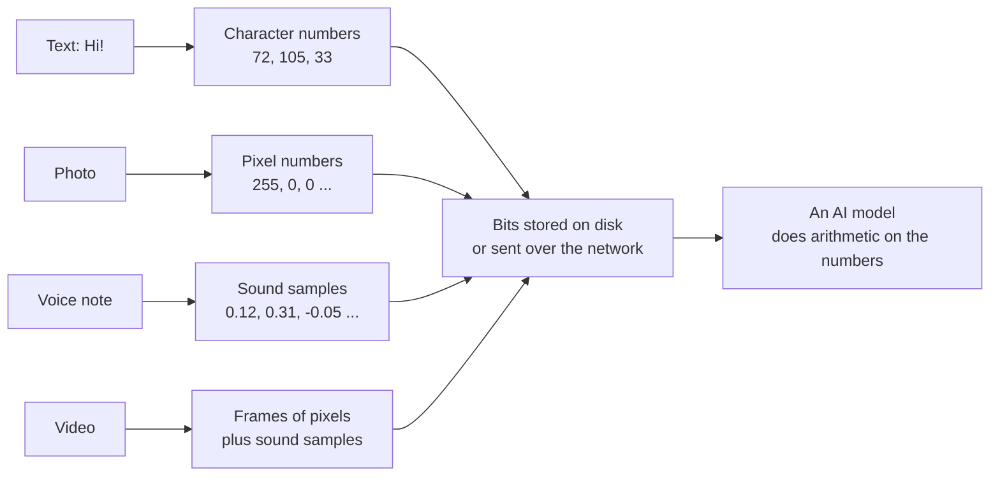
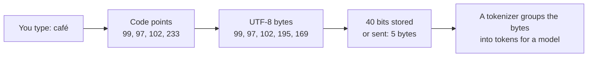
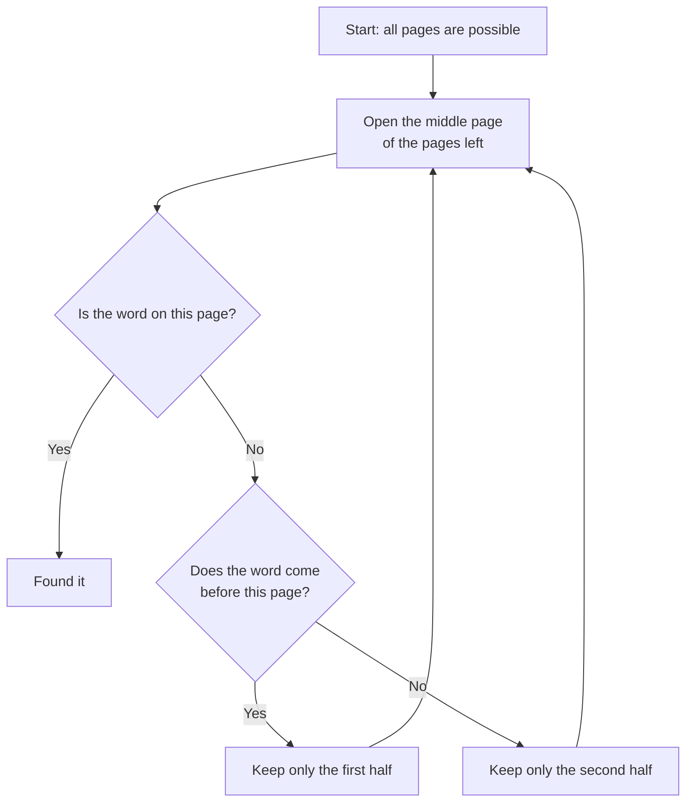
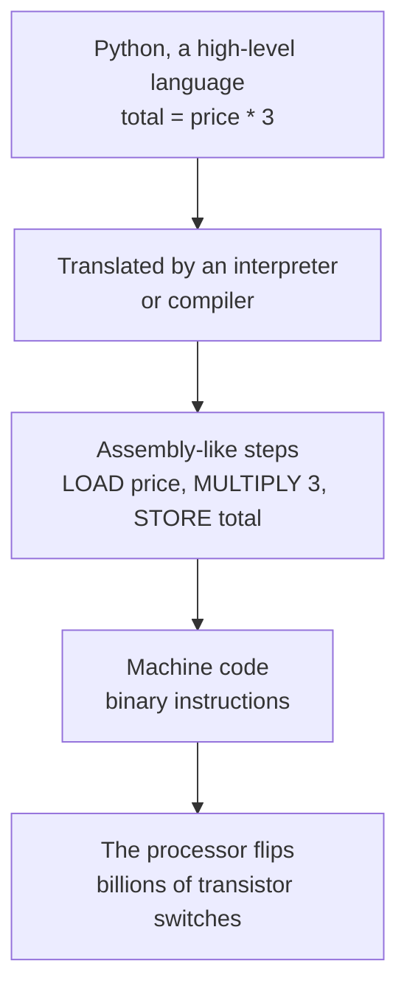
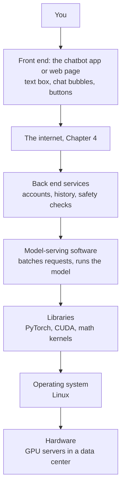
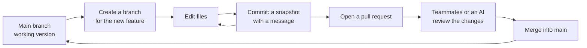
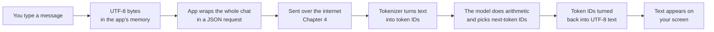

# Chapter 3: Software, Code and Data: How Everything Becomes Numbers

*By the end of this chapter you will know how a sentence, a photo, a song and a program all turn into numbers a machine can work with, and you will have run your first piece of code.*

## What you'll learn

- How text, images, sound and video are stored as numbers, and why that one trick lets AI handle every kind of media.
- What a file and a file format really are, and how compression makes data smaller (and why "a model is a compressed copy of the internet" is only half true).
- What programs, algorithms and programming languages are, and how a compiler or interpreter turns words into switch flips.
- Enough Python to read simple code: variables, data types, if statements, loops, functions and libraries.
- How to read an error message, and how to get a chatbot to help you fix one.
- What an operating system does, how the "app stack" fits together, and why your chatbot app is only a thin front end.
- The difference between open-source software and open-weight AI models, and what Git and GitHub are for.
- How data is organized in tables, CSV files, JSON and databases: the raw material of every AI system.

## Before you start

Chapter 1 (What AI Is: A Map of the Whole Field) gives you the big picture. Chapter 2 (How Computers Work: Bits, Transistors and Processors) explains bits, bytes, binary counting and the hardware that runs everything in this chapter. If "8 bits make a byte, and a byte can hold a number from 0 to 255" sounds familiar, you are ready. You do not need any programming experience.

## The big idea: everything becomes numbers

Here is a puzzle. Chapter 2 showed that a computer is nothing but billions of tiny switches, each on or off. There are no letters, colors or sounds inside your phone. Yet it shows you a photo of your dog, plays a voice note, and when you paste a photo of your fridge into ChatGPT, the model answers in fluent English about the eggs and spinach it "saw".

The answer is a set of agreements. People agreed, decades ago, that the number 65 would stand for the letter "A", that three numbers would describe the color of one dot on a screen, and that a sound could be written down as a long list of measurements. Once everyone uses the same agreement, any machine can store, send and display that kind of information.

> **Definition — Encoding:** An agreed rule for turning something (letters, colors, sounds) into numbers and back again. The same numbers mean nothing without the encoding that explains them.

Underneath every encoding are the bits and bytes from Chapter 2: a bit is one on-off switch, and a byte is 8 bits, enough to hold a whole number from 0 to 255. Every agreement in this chapter is a way of writing information as bytes.

This matters enormously for AI. A neural network is a giant calculator: it can only multiply and add numbers. Because text, images, audio and video can all be turned into numbers, one kind of machine can learn from all of them. That is why the same model can read your essay, look at your fridge photo and listen to your voice. Each medium arrives as a long list of numbers, and the model does arithmetic on it.



*Figure 3.1: Every kind of media becomes a list of numbers before a computer, or an AI model, can do anything with it.*

> **Key idea:** A computer only ever stores numbers. The meaning lives in the agreement (the encoding) about what the numbers stand for. Change the agreement and the same bytes become a different letter, color or sound.

## Text as numbers

### ASCII: one number per letter

The first widely used agreement for English text was ASCII, published in the 1960s. It gives a number to each of 128 characters: the uppercase and lowercase English letters, the digits 0 to 9, punctuation, the space, and some invisible control signals such as "new line".

> **Definition — ASCII:** An early encoding (American Standard Code for Information Interchange) that gives numbers 0 to 127 to English letters, digits and common symbols. "A" is 65, "a" is 97, and the space is 32.

Let's encode the word "Hi!" by hand. Look up each character in the ASCII table: "H" is 72, "i" is 105 and "!" is 33. Now write each number in binary, using the place values you met in Chapter 2 (128, 64, 32, 16, 8, 4, 2, 1):

- 72 = 64 + 8, so "H" is `01001000`.
- 105 = 64 + 32 + 8 + 1, so "i" is `01101001`.
- 33 = 32 + 1, so "!" is `00100001`.

The word "Hi!" is therefore 3 bytes: 24 tiny switches in a particular pattern. A 1,000-word English essay is about 6,000 characters, about 6 kilobytes. A single phone photo is hundreds of times larger, even after compression, as you will see below.

### Unicode: a number for every character on Earth

ASCII has no "é", no Arabic, Hindi or Chinese, and no emoji. In the 1980s, countries and companies invented their own incompatible encodings, and a file sent between systems arrived as garbage: "café" instead of "café".

The fix was Unicode, first published in 1991. Unicode gives every character in every writing system its own unique number, called a code point. Code points are written with "U+" and the number in hexadecimal (base 16), so "A" is U+0041. In base 16 each place is worth 16 times the place to its right (just as in ordinary numbers each place is worth 10 times), so 41 means 4 × 16 + 1 = 65, and the letters A to F stand for the extra digits 10 to 15. The Unicode space has room for 1,114,112 code points. Recent versions assign roughly 150,000 of them, covering well over 150 scripts, historic writing systems, mathematical symbols and thousands of emoji.

> **Definition — Unicode:** The worldwide standard that assigns a unique number to every character in every writing system, including emoji. It is why a message in Hindi, Arabic or Chinese displays correctly on any modern device.

> **Definition — Code point:** The number Unicode assigns to one character, written like U+0041 (the letter "A", which is 65 in ordinary decimal numbers).

### UTF-8: packing code points into bytes

A code point is just a number. You still need a rule for storing it as bytes. The most popular rule by far is UTF-8, designed in 1992 by Ken Thompson and Rob Pike. Its clever trick is that it uses a variable number of bytes. Plain English characters keep their old ASCII number and take one byte, so old English files are automatically valid UTF-8. Other characters take two, three or four bytes.

> **Definition — UTF-8:** The most common way to store Unicode code points as bytes. It uses 1 byte for basic English characters and 2 to 4 bytes for everything else, and it is the default encoding of the web.

| Character | Code point (decimal) | UTF-8 bytes (decimal) | Bytes used |
|---|---|---|---|
| A | U+0041 (65) | 65 | 1 |
| é | U+00E9 (233) | 195, 169 | 2 |
| 中 (Chinese "middle") | U+4E2D (20,013) | 228, 184, 173 | 3 |
| The "face with tears of joy" emoji | U+1F602 (128,514) | 240, 159, 152, 130 | 4 |

*Figure 3.2: The same encoding uses more bytes for characters further from basic English.*

Here is a worked example. The word "café" has four characters, but in UTF-8 it takes five bytes: c (99), a (97), f (102), and then é as two bytes (195, 169). A short Chinese sentence may use fewer characters than its English translation, but each character usually costs three bytes.



*Figure 3.3: From keystrokes to bits. Four characters become five bytes in UTF-8.*

### From characters to tokens: a preview

Here is where text meets AI. A language model does not read characters one at a time. A tokenizer first chops your text into tokens: common chunks such as short words, pieces of longer words and punctuation. Each token has an ID number, and those numbers are what the model receives. In English, a token averages about four characters, roughly three quarters of a word.

> **Definition — Token:** A small chunk of text (often a word or part of a word) that a language model reads and writes. "unbelievable" might be split into "un", "believ" and "able".

> **Definition — Tokenizer:** The program that splits text into tokens and turns them into ID numbers for a model, and turns the model's output numbers back into text.

Many modern tokenizers work directly on UTF-8 bytes, so they never fail on an unusual language, emoji or typo. The price is fairness: text in languages that were rare in the tokenizer's training data gets split into more, smaller pieces, so the same meaning costs more tokens and more money. Tokenizers also change between model generations; Anthropic notes that Claude models from 4.7 onward use a newer tokenizer that turns the same text into roughly 1.0 to 1.35 times as many tokens (up to about 35% more, depending on the content). Chapter 15 and Chapter 18 explain tokens in depth.

> **Watch out:** It is natural to assume a chatbot "sees" your letters the way you do. It does not. It sees token IDs, numbers standing for chunks of text. That is why models have historically stumbled on tasks like counting the letter "r" in "strawberry": the letters are hidden inside tokens. Chapter 18 covers this.

> **Try it:** Open a Unicode lookup site (search for "Unicode character lookup") and type your name, then a letter with an accent, then an emoji. Note each code point and how many UTF-8 bytes each takes. Then paste a sentence into a token counter such as platform.openai.com/tokenizer and compare the number of characters with the number of tokens.

## Images as numbers

Zoom into any digital photo as far as your phone allows and eventually you see tiny squares of solid color. Each square is a pixel. Each pixel is stored as three numbers: how much red, how much green and how much blue light to mix, each from 0 (none) to 255 (full). Red is (255, 0, 0). White is all three at full, (255, 255, 255). Black is (0, 0, 0). Yellow is red plus green, (255, 255, 0).

> **Definition — Pixel:** One tiny dot of a digital image, usually stored as three numbers for its red, green and blue brightness.

> **Definition — RGB:** Describing a color as amounts of red, green and blue light, each typically from 0 to 255. Mixing them makes every color a screen can show.

> **Definition — Resolution:** How many pixels an image or screen has, written as width × height, such as 1920 × 1080. More pixels means more detail and more data.

Here is a tiny 4 × 4 image of a red square on a white background, written out as the numbers a computer actually stores:

```
A 4 x 4 image, zoomed in. Each cell is one pixel: (R, G, B)

+-------------+-------------+-------------+-------------+
| 255,255,255 | 255,255,255 | 255,255,255 | 255,255,255 |
+-------------+-------------+-------------+-------------+
| 255,255,255 |   255,0,0   |   255,0,0   | 255,255,255 |
+-------------+-------------+-------------+-------------+
| 255,255,255 |   255,0,0   |   255,0,0   | 255,255,255 |
+-------------+-------------+-------------+-------------+
| 255,255,255 | 255,255,255 | 255,255,255 | 255,255,255 |
+-------------+-------------+-------------+-------------+

16 pixels x 3 numbers = 48 bytes
```

*Figure 3.4: An image is a grid of numbers. White is (255, 255, 255) and red is (255, 0, 0).*

Each of the three color layers is called a channel. A black-and-white (grayscale) image needs only one channel per pixel. With 256 levels per channel and three channels, a pixel can show 256 × 256 × 256 = 16,777,216 different colors, which is where the "16.7 million colors" on old monitor boxes came from.

Now a worked example with a real photo. A typical 12-megapixel phone camera takes pictures 4,000 pixels wide and 3,000 pixels tall:

- Pixels: 4,000 × 3,000 = 12,000,000.
- Bytes, uncompressed: 12,000,000 pixels × 3 bytes = 36,000,000 bytes, about 36 MB.

Yet the photo file on your phone is usually only a few megabytes. The difference is compression, which we'll get to shortly.

To an AI system, an image is a three-dimensional block of numbers, height × width × 3, called a tensor (Chapter 5). Vision models cut it into small square patches, often 16 × 16 pixels, and turn each patch into a list of numbers processed alongside text tokens. That is why an uploaded photo "costs" tokens (Chapter 22).

> **Analogy:** A digital image is a paint-by-numbers kit with millions of squares, where each square gets three numbers, and the computer never sees the picture, only the numbers.

## Audio as numbers

Sound is a wave of air pressure. When you speak, your voice pushes air back and forth hundreds or thousands of times per second. A microphone turns those pressure changes into a changing electrical signal, and the computer measures that signal's height at regular, very short intervals. Each measurement is a sample. Played back in order, quickly enough, the samples recreate the sound.

```
height
  +1 |          *   *
     |      *           *
   0 |--*-----------------*-------------------*---> time
     |                        *           *
  -1 |                            *   *
        ^   ^   ^   ^   ^   ^   ^   ^   ^   ^
        each ^ is one sample: a number such as 0.31
```

*Figure 3.5: Sampling. The computer stores only the heights at the marked moments, as a list of numbers.*

> **Definition — Sample (audio):** One measurement of a sound wave's height at one instant. A recording is a long list of samples.

> **Definition — Sample rate:** How many samples are taken per second, measured in hertz (Hz), which simply means "per second". CD audio uses 44,100 samples per second.

> **Definition — Bit depth:** How many bits each sample uses, which sets how finely the wave's height is measured. CD audio uses 16 bits, giving 65,536 possible levels.

Why 44,100? A rule from signal theory says you must sample at more than twice the highest frequency you want to capture. A sound's frequency is how many times per second its wave goes up and down; the higher the frequency, the higher the pitch you hear. Human hearing tops out around 20,000 Hz, so a little over 40,000 samples per second captures everything we can hear.

Worked example: one second of CD-quality stereo music.

- 44,100 samples per second × 2 bytes per sample (16 bits) × 2 channels (left and right) = 176,400 bytes per second.
- In bits: 176,400 × 8 = about 1,411,000 bits per second (1,411 kilobits per second).
- A 3-minute song: 176,400 × 180 seconds = about 31.8 MB.

A typical MP3 of that song at 128 kilobits per second is 16,000 bytes per second (128,000 bits ÷ 8) × 180 = about 2.9 MB, roughly 11 times smaller.

> **Definition — MP3:** The most widely used format for compressed music and audio. It uses lossy compression (explained later in this chapter), dropping sounds your ear is unlikely to notice, so a song typically shrinks to about a tenth of its raw size.

AI speech systems need far less. OpenAI's Whisper speech-recognition model works on 16,000 samples per second in one channel, because the important parts of speech sit well below 8,000 Hz. Many audio models first turn samples into a spectrogram, a picture of which pitches are loud at each moment, and treat it much like an image (Chapter 46).

## Video as numbers

A video is a rapid sequence of still images, called frames, shown one after another, usually with a soundtrack. Show 24 to 60 frames per second and your brain sees smooth motion.

Worked example: one minute of uncompressed Full HD video (1920 × 1080 pixels at 30 frames per second).

- One frame: 1,920 × 1,080 × 3 bytes = 6,220,800 bytes, about 6.2 MB.
- One second: 6.2 MB × 30 frames = about 187 MB.
- One minute: 187 MB × 60 = about 11.2 GB.
- One hour: about 672 GB, more than many laptops can hold.

Streaming services deliver HD video at roughly 5 megabits per second, which is about 0.6 MB per second (5 ÷ 8, since a byte is 8 bits). That is around 300 times smaller than the uncompressed stream. The magic is a codec, software that compresses video by storing occasional complete frames (keyframes) and, in between, only what changed. In a video of someone talking against a still wall, the wall barely changes for minutes, so it costs almost nothing after the first frame.

> **Definition — Codec:** Software that compresses and decompresses audio or video (the name comes from coder-decoder). Common video codecs include H.264, HEVC and AV1.

AI video models face the same mountain of numbers, so they usually look at a handful of sampled frames, or work on compressed "spacetime patches" rather than raw pixels (Chapter 16 and Chapter 47).

## Files and formats

Everything you have seen so far ends up in a file. A file is simply a named sequence of bytes saved on a storage device. The bytes themselves carry no label saying "I am a photo". The format is an agreement about what the bytes mean, and the extension at the end of the name (.jpg, .mp3, .pdf) is a hint to your computer about which agreement to use.

> **Definition — File:** A named chunk of stored bytes, such as a document, a photo, a song or a program.

> **Definition — File format:** The rulebook for what a file's bytes mean and in what order they appear, such as JPEG for photos or MP3 for music.

> **Definition — JPEG:** The most common format for photos, named after the Joint Photographic Experts Group that created it. It uses lossy compression, storing fine color detail coarsely, which typically makes a photo about ten times smaller than its raw pixel data.

Many formats also start with a fixed signature so programs can recognize them even if the name is wrong. Every PNG image (a common format for screenshots and graphics that, unlike JPEG, loses no detail) begins with the bytes 137, 80, 78, 71 (the last three are ASCII for "P", "N", "G"), and every PDF starts with "%PDF". Here is a surprise: a Word document (.docx) is actually a ZIP folder (a bundle of files squeezed into one smaller file) full of small text files. Rename a copy from report.docx to report.zip and you can open it and look inside (Exercise 3 asks you to do this).

Some formats are plain text: you can open them in Notepad or TextEdit and read them, because every byte is a UTF-8 character. Others are binary: the bytes are raw numbers (pixel values, sound samples, compressed data) and look like gibberish in a text editor.

| Extension | What it holds | Plain text or binary | Where you meet it in AI |
|---|---|---|---|
| .txt | Unformatted text | Plain text | Training text, notes |
| .csv | A table, one row per line | Plain text | Datasets, spreadsheets |
| .json | Structured labeled data | Plain text | API requests and responses |
| .html | Web pages | Plain text | Web data scraped for training |
| .py | Python code | Plain text | Almost all AI code |
| .jpg / .png | Photos and graphics | Binary | Images you upload |
| .mp3 / .wav | Audio | Binary | Voice notes, speech data |
| .mp4 | Video with sound | Binary | Video generation and analysis |
| .pdf | Print-ready documents | Binary (mostly) | Documents you ask a chatbot about |
| .docx / .xlsx | Office files (ZIP of text files) | Binary | Office work with AI |
| .safetensors / .gguf | Model weights | Binary | Downloading open-weight models (Chapter 30) |

*Figure 3.6: Common file formats and where each shows up in AI work.*

Files also carry metadata. A photo from your phone usually records the date, the camera model and often the exact GPS location where it was taken. When you share a photo, you may be sharing where you live.

> **Definition — Metadata:** Data about data, such as a photo's date, location and camera model, or a document's author and creation time.

> **Watch out:** A PDF was designed for printing, not for preserving meaning. Inside, it is often just "draw these letters at these positions", with no record of which words form a table. That is why AI tools sometimes scramble tables from PDFs, and why many chatbot apps read a PDF both as text and as page images (Chapter 22 and Chapter 27).

## Compression: making data smaller

You have now seen three dramatic size drops: a 36 MB photo stored in a few megabytes, a 32 MB song in 3 MB, a video stream 300 times smaller. All of them come from compression.

> **Definition — Compression:** Making data take fewer bytes by describing it more cleverly. The compressed version must be decompressed before use.

> **Definition — Lossless compression:** Compression that can be undone perfectly, bit for bit, such as ZIP files and PNG images.

> **Definition — Lossy compression:** Compression that throws away detail people are unlikely to notice in order to save much more space, such as JPEG photos, MP3 music and streaming video.

The simplest lossless trick is run-length encoding. One row of a black-and-white image with ten white pixels, three black and seven white is `WWWWWWWWWWBBBWWWWWWW`, 20 symbols. Written as runs, it is `10W3B7W`, 7 symbols, and you can rebuild the original exactly. Real methods such as ZIP find repeated patterns anywhere in the file and give frequent things short codes, as Morse code gives the common letter "E" a single dot. English text often shrinks to about a third of its size.

Lossy methods go further by deciding what you won't miss. JPEG keeps the broad shapes and brightness of an image but stores fine color detail and texture coarsely, because your eye is far more sensitive to brightness than to color. MP3 drops quiet sounds that are masked by louder sounds at the same moment. Push lossy compression too far and you see blocky smears in a photo or hear a "swishy" song.

| Data | Uncompressed | Typical compressed | Roughly smaller by |
|---|---|---|---|
| 1,000-word essay (text, ZIP) | 6 KB | about 2 KB | 3 times |
| 12 MP (megapixel) photo (JPEG) | 36 MB | a few MB | about 10 times |
| 3-minute song (MP3, 128 kbps) | 31.8 MB | 2.9 MB | 11 times |
| 1 second of HD video (streaming) | 187 MB | about 0.6 MB | about 300 times |

*Figure 3.7: Compression ratios for everyday data. Lossy methods save far more because they discard detail.*

One more useful fact: compressing something twice barely helps. A JPEG is already compressed, so zipping it saves almost nothing. Compression works by removing predictable patterns, and once they are removed, what is left looks random.

> **Try it:** Find a photo on your phone and check its file size, then send it to yourself through a messaging app and check the size of the copy you receive. Most apps quietly recompress photos with lossy compression, so the copy is often much smaller and slightly less sharp.

### Is a language model a compressed copy of the internet?

People sometimes say a chatbot is "a compressed internet". That is half true, and the true half is interesting. Let's check it with numbers.

- Meta's Llama 3 models were trained on about 15.6 trillion tokens of text. At roughly 4 bytes per token, that is about 62 trillion bytes, around 62 terabytes.
- The 70-billion-parameter version stores each parameter in 2 bytes, so the whole model is about 140 GB (Chapter 5 shows this memory math).
- 62 terabytes ÷ 140 gigabytes is about 450. The model is roughly 450 times smaller than the text it learned from.

Lossless compression of text typically achieves only a few times, nowhere near 450, so the model cannot be holding a copy of its training data. What it keeps is a very lossy summary of patterns: grammar, facts that appeared many times, styles, ways of reasoning. That is why it can write a new sonnet about your cat but cannot reliably quote page 212 of a novel, and why, where the summary is blurry, it may fill gaps with something plausible but false.

The other half of the truth: models can memorize text that appeared many times, such as famous speeches, popular code and some copyrighted passages, which raises the legal questions covered in Chapter 11 and Chapter 58. And there is a deep mathematical link discovered by Claude Shannon in the 1940s: a system that predicts the next symbol well can be turned into a good compressor. Training a language model to predict the next token is, in a precise sense, training it to compress text.

> **Key idea:** A model is like a blurry, lossy summary of its training data, not a stored copy. It keeps patterns that appeared often and loses the exact details of things that appeared rarely, which is why it can be fluent and wrong at the same time.

> **Analogy:** Lossless compression is vacuum-packing clothes: everything comes out exactly as it went in. Lossy compression is leaving behind the socks you will never miss. A language model is like a friend who read the whole library and can tell you what is in it, but cannot recite most pages.

## Programs: recipes for a very literal cook

So far we have looked at data, the numbers that stand for things. Now we turn to software, the instructions that tell the computer what to do with those numbers.

A program is a list of instructions the computer follows exactly. Each instruction is something tiny: add these two numbers, copy this byte here, compare these two values, jump to a different instruction if they are equal. A modern processor carries out billions of these per second, and every app you use is built from them.

> **Definition — Program (software):** A set of instructions a computer follows to do a task, such as a web browser, a game or a chatbot app. "Software" is the general name for programs, as opposed to the physical hardware they run on.

The key thing to understand about programs is that the computer does exactly what you told it, not what you meant. Suppose you write a program to reject messages longer than ten words, and you count words by counting spaces and adding one. "I live in New York" has four spaces, so five words: correct. Type it with an accidental double space between "New" and "York" and it counts six. A long web address with no spaces counts as one word. Nothing is broken; the computer did precisely what the rule said. The rule just did not match what you meant.

> **Analogy:** A program is a recipe followed by an extremely literal cook. If the recipe says "add two eggs" and never says "crack them", the shells go in too.

The large language model behind your chatbot is a strange kind of software: almost none of its behavior was written by a person. The code that runs it is fairly ordinary. The behavior lives in billions of learned numbers, its weights, set by training on data (Chapter 8). Andrej Karpathy called this "Software 2.0" in a 2017 essay: instead of writing rules, you collect examples and let an optimizer (a procedure that nudges the numbers step by step until the model's answers improve, Chapter 6) find the numbers.

> **Definition — Weights:** The learned numbers inside an AI model that set how strongly each input influences each output. A large model has billions of them, and together they encode its knowledge and skills (Chapter 5).

## Algorithms: methods that solve problems

An algorithm is the method behind a program: a step-by-step procedure for solving a problem, written in plain words or any programming language. A recipe is an algorithm for a cake. Long division is an algorithm you learned at school. The directions your map app reads out are the output of an algorithm that searched millions of possible routes.

> **Definition — Algorithm:** A step-by-step method for solving a problem, like a recipe. It can be written in plain words or in any programming language.

Different algorithms for the same problem can differ wildly in speed. Here is the classic example. You want to find a word in a printed dictionary of 1,000,000 pages.

- **Method 1: start at page 1 and check every page.** On average you check half the book, 500,000 pages. In the worst case, all 1,000,000.
- **Method 2: binary search.** Open the book in the middle. Your word comes either before or after this page, so throw away the wrong half. Repeat with the half that is left.

Each step of binary search halves the pile: 1,000,000 → 500,000 → 250,000 → and so on. How many halvings until one page is left? Since 2 multiplied by itself 20 times is 1,048,576, the answer is at most 20 steps. Twenty, versus up to a million.

> **Definition — Binary search:** Finding an item in a sorted list by repeatedly checking the middle and throwing away the half that cannot contain it. It finds anything among a million sorted items in at most 20 steps.



*Figure 3.8: Binary search as a flowchart. Each loop throws away half of what is left, so a million pages need at most 20 loops.*

Sorting shows the same lesson with bigger stakes. Suppose you must sort 1,000,000 names alphabetically.

- A simple method ("find the smallest remaining name, move it to the front, repeat") makes about n × n ÷ 2 comparisons. With n = 1,000,000, that is 500 billion comparisons. At a billion comparisons per second, about 500 seconds.
- A smarter method called merge sort (split the list, sort each half, then merge the sorted halves) needs about n × log2(n) comparisons. Here log2(n) simply means "how many times you can halve n before you reach 1", which for a million is about 20, just as in binary search. So the count is 1,000,000 × 20 = 20 million. At the same speed, 0.02 seconds.

Same computer, same data, 25,000 times faster, purely from a better method. Computer scientists study this under the name of algorithmic efficiency.

> **Key idea:** A better algorithm can beat a faster computer. Going from a million steps to twenty, or from 500 seconds to 0.02, comes from a smarter method, not better hardware.

This matters for AI in two ways. First, AI's cost is dominated by a few algorithms run trillions of times, above all multiplying tables of numbers (Chapter 5), so small improvements save fortunes. Second, machine learning flips who writes the algorithm: a person writes a learning method (gradient descent, Chapter 6), and the data shapes the final behavior (Chapter 8).

> **At the frontier (2026):** AI systems now help discover algorithms. In May 2025, Google DeepMind's AlphaEvolve found a way to multiply two 4 × 4 matrices (grids of numbers, Chapter 5) of complex numbers (a kind of number used in physics and engineering) using 48 scalar multiplications (multiplications of one single number by another). That was the first improvement for that case in 56 years: the best method until then was built on a shortcut for multiplying matrices with fewer multiplications, found by the mathematician Volker Strassen in 1969. Since AI training is mostly matrix multiplication, even tiny gains like this are worth chasing.

## Code and programming languages

A processor understands only machine code: instructions written as binary numbers. Nobody wants to write `10110000 01100001` by hand, so people invented a ladder of languages. Just above machine code sits assembly language, which gives each instruction a short name such as ADD or LOAD. Far above it sit high-level languages such as Python, where one line can stand for hundreds of machine instructions. Software translates the friendly version down the ladder.

> **Definition — Machine code:** The raw binary instructions a processor actually executes. Every program eventually becomes machine code.

> **Definition — Programming language:** A precise artificial language for writing instructions, such as Python, JavaScript or C++. Unlike English, every statement has exactly one meaning. Text written in one is called source code, or just code.



*Figure 3.9: The ladder from a line of Python to transistor switches. Each step down is more detailed and harder for humans to read.*

There are two ways to translate code down the ladder. A compiler translates the whole program ahead of time, like translating a book before publishing it. An interpreter translates and runs it as it goes, like a live interpreter at a meeting. Compiled programs usually run faster; interpreted ones are quicker to write and change. Python is normally run by an interpreter. C, C++ and Rust are compiled. NVIDIA's CUDA, released in 2007, lets programmers write compiled code that runs on GPUs, and it is one reason NVIDIA dominates AI hardware (Chapter 35).

> **Definition — NVIDIA:** An American chip company that designs most of the GPUs used to train and run AI models, along with the networking gear that links them and CUDA, the software for programming them. Founded in 1993 to make graphics chips for video games, it became the dominant supplier of AI hardware with data-center chips such as the H100 and B200.

> **Definition — Compiler:** A program that translates a whole program from a programming language into machine code before it runs.

> **Definition — Interpreter:** A program that reads code and carries it out step by step as it goes, without producing a separate machine-code file first.

### Why Python runs AI

Python, first released in 1991, is the language of AI. It topped the TIOBE popularity index (a monthly ranking of programming languages based on how many web pages search engines find about each one) in October 2026 at about 19%. On GitHub (the website where programmers share code, described later in this chapter), TypeScript (popular for web apps) overtook Python by monthly contributors in August 2025, but Python still led AI projects by a wide margin and powered nearly half of new AI repositories (project folders), according to GitHub's 2025 Octoverse report.

> **Definition — Python:** The most widely used programming language for AI work, popular for its readable code and its huge collection of ready-made libraries for math, data and neural networks.

Why Python? Three reasons. It reads almost like English, so researchers who are not professional programmers can use it. It has an enormous collection of free, ready-made code for every AI task. And it is the steering wheel, not the engine. Python itself is slow, but when you ask it to multiply two huge matrices, it hands the job to fast compiled code written in C, C++ or CUDA that runs on the GPU. You get the ease of Python with the speed of machine code.

| Language | Where you meet it in AI | Usually compiled or interpreted |
|---|---|---|
| Python | Research, training scripts, data work, almost everything | Interpreted |
| C and C++ | Fast inference engines, math libraries | Compiled |
| CUDA | Programs that run directly on NVIDIA GPUs | Compiled |
| JavaScript and TypeScript | Chatbot web apps and their screens | Interpreted (in the browser) |
| SQL | Asking databases for data | Run by the database |
| Rust | Fast, safe tools such as tokenizers | Compiled |

*Figure 3.10: The main programming languages around AI and what each is used for.*

## Reading Python: a ten-minute tour

Chatbots and coding agents now write most code (Chapter 29), but being able to read it lets you check it and fix small problems. Here are the core ideas, each with a tiny example. Text after a `#` sign is a comment, a note for humans that Python ignores.

### Variables and data types

```python
name = "Ada"          # a variable holding text (a string)
age = 36              # a whole number (an integer)
price = 19.99         # a decimal number (a float)
is_member = True      # a yes-or-no value (a boolean)
print("Hello,", name) # print shows something on the screen
```

Each line stores a value in a named box; afterwards, `name` means "whatever is in the box called name". The kind of value matters: Python happily adds 36 + 1 but refuses to add "36" (text) + 1 (a number), because it cannot guess what you meant.

> **Definition — Variable:** A named box in a program that holds a value, like `price = 20`. The value can change while the program runs.

> **Definition — Data type:** The kind of value something is: a whole number (integer), a decimal (float), text (string), true-or-false (boolean), a list, and so on. The type decides what you can do with it.

### Lists and dictionaries

```python
scores = [72, 88, 95]                  # a list: an ordered collection
print(scores[0])                       # lists count from 0, so this prints 72
person = {"name": "Ada", "age": 36}    # a dictionary: labels mapped to values
print(person["age"])                   # prints 36
```

> **Definition — List:** An ordered collection of values in a program, written in square brackets, such as [72, 88, 95]. Items are numbered from 0.

> **Definition — Dictionary:** A collection of labeled values, written in curly brackets, such as {"name": "Ada", "age": 36}. You look up a value by its label (its "key").

Keep the dictionary in mind. It looks almost exactly like JSON, the format your chatbot app uses to talk to its servers, which you will meet at the end of this chapter.

### Decisions and repetition

```python
temperature = 31
if temperature > 30:                   # a decision
    print("Hot day: bring water")
else:
    print("Normal day")

for score in scores:                   # a loop: do this for each item
    print(score * 2)                   # prints 144, then 176, then 190
```

An `if` statement runs code only when a condition is true, with an optional `else` for when it is not. A `for` loop repeats code once for each item. The indented lines belong to the `if` or the `for` above them. In Python, the indentation is not decoration; it is how the computer knows which lines go together.

> **Definition — Loop:** An instruction to repeat steps, such as "for each photo in this folder, shrink it". Loops let a few lines of code process millions of items.

### Functions

```python
def tip(bill, percent):                # define a reusable recipe called tip
    return bill * percent / 100        # send back the answer

print(tip(80, 15))                     # prints 12.0
```

A function packages a few steps under a name so you can reuse them with different inputs. In a sense, an AI model is one gigantic function: text goes in, and a prediction for the next token comes out (Chapter 5).

> **Definition — Function (programming):** A named, reusable block of code that takes inputs and returns an output, like `tip(80, 15)` returning 12.0.

### Libraries and import

```python
import random                          # load a ready-made library
next_word = {"Paris": 0.90, "Lyon": 0.04, "the": 0.04, "a": 0.02}
words = list(next_word.keys())         # ["Paris", "Lyon", "the", "a"]
probs = list(next_word.values())       # [0.90, 0.04, 0.04, 0.02]
print(random.choices(words, probs, k=5))   # pick 5 words using those odds
```

Run this and you might see `['Paris', 'Paris', 'Paris', 'the', 'Paris']`. This is a toy version of what your chatbot does for every token: it has a list of candidate next words with probabilities and picks one at random according to those odds. Chapter 6 explains why, and how "temperature" changes the odds.

> **Definition — Library:** Ready-made code that others wrote and shared so you can reuse it, such as NumPy or PyTorch. Also called a package. In Python you load one with the word `import`.

The AI world runs on a handful of famous libraries. You only need to recognize their names for now:

- **NumPy**: fast arrays and matrices of numbers.
- **pandas**: tables of data, like a spreadsheet you control with code.
- **PyTorch** and **JAX**: building and training neural networks on GPUs (Chapter 13).
- **Hugging Face Transformers**: downloading and running thousands of pretrained models.
- **scikit-learn**: classical machine learning (Chapter 10).
- **Matplotlib**: drawing charts.

### Notebooks: code you can run in your browser

Most AI learners and many researchers write Python in notebooks. A notebook is a document that mixes text, code and the code's results, all in cells you can run one at a time. Google Colab is a free notebook service that runs entirely in your browser on Google's computers, so you do not need to install anything. It can even lend you a GPU for small experiments. Exercise 4 walks you through your first notebook.

> **Definition — Notebook (Jupyter, Google Colab):** A document mixing text and runnable code cells, with each cell's output shown underneath. Colab runs notebooks free in your browser on Google's computers.

## Bugs and debugging

Every programmer, and every AI coding agent, writes code that does not work the first time. The word "bug" for a technical fault is older than computers, but it got a famous mascot in 1947, when operators of the Harvard Mark II computer found a moth stuck in a relay (an electrically operated switch) and taped it into their logbook as the "first actual case of bug being found".

> **Definition — Bug:** A mistake in code that makes a program behave wrongly or crash.

> **Definition — Debugging:** Finding the cause of a bug and fixing it. It is a normal, everyday part of programming, not a sign of failure.

Bugs come in three families:

1. **Syntax errors.** The code breaks the language's grammar, such as a missing quote mark or bracket. Python refuses to run it at all.
2. **Runtime errors.** The code is grammatical but hits an impossible situation while running, such as dividing by zero or adding text to a number. The program stops with an error message.
3. **Logic errors.** The code runs without complaint but gives the wrong answer, like the word counter that tripped on double spaces. These are the most dangerous, because nothing warns you.

When Python hits a runtime error, it prints a traceback: a report of where the program was and what went wrong. Here is one:

```text
Traceback (most recent call last):
  File "<ipython-input-3>", line 2, in <module>
    print("Total: " + total)
TypeError: can only concatenate str (not "int") to str
```

> **Definition — Error message (traceback):** The report a program prints when it crashes, listing where the problem happened and what kind of error it was. Read it from the bottom up.

Read it from the bottom. The last line says what went wrong: a `TypeError`, meaning a value of the wrong type. "Can only concatenate str (not int) to str" means "I can only glue text to text, and you gave me a number". The lines above say where: line 2. The fix is to turn the number into text first, `print("Total: " + str(total))`, or simply `print("Total:", total)`.

Chatbots are excellent debugging partners if you give them what a human expert would need. A good request includes four things:

1. The code (all of it, or the relevant part).
2. The complete error message, copied exactly, not paraphrased.
3. What you expected to happen.
4. What you have already tried.

> **Watch out:** Code written by AI can look perfect and still be wrong, especially with logic errors that produce plausible but incorrect numbers. Always test it on a case where you already know the right answer. In one careful 2025 study, METR (an independent nonprofit that tests AI systems, Chapter 57) found that experienced open-source developers using early-2025 AI tools took 19% longer on their tasks, even though they expected to be faster. Tools have improved since: METR's February 2026 follow-up, with tools from late 2025, found some evidence of a speedup and judged that developers probably gained more from AI by early 2026 than in early 2025, though it called its own new data an unreliable signal. The lesson stands: checking matters (Chapter 29).

## Operating systems: the building manager

When you open three apps at once, who decides which one gets the processor this millisecond, which part of memory belongs to whom, and which app may use the microphone? That is the job of the operating system, the master program that starts when you switch on a device and manages everything else.

> **Definition — Operating system (OS):** The master program (Windows, macOS, Linux, Android, iOS) that manages the hardware and lets apps run and share the processor, memory, files and devices safely.

The OS shares the processor by switching between programs many times per second, gives each app its own private memory, keeps track of where every file's bytes live, controls devices through small programs called drivers (AI servers need NVIDIA's GPU driver before any CUDA code can run), and asks your permission before an app uses the camera or microphone.

> **Analogy:** The operating system is the manager of an apartment building. It assigns rooms (memory), schedules the elevator (processor time) and makes sure no tenant (app) can walk into another's apartment.

You use several operating systems every day. Windows and macOS run most laptops. iOS runs iPhones. Android runs most other phones, and it is built on the Linux kernel, the core part of an operating system that directly controls the hardware. Linux itself, started by Linus Torvalds in 1991 and free for anyone to use and modify, runs almost all of the world's servers, and every one of the 500 fastest supercomputers on the TOP500 list. The GPU servers that answer your chatbot messages almost certainly run Linux.

> **Definition — Linux:** A free, open-source operating system that runs almost all servers, supercomputers and AI clusters, and whose kernel is the base of Android.

> **Definition — TOP500:** A ranking of the world's 500 fastest supercomputers, published twice a year since 1993 by a small team of researchers, based on how fast each machine runs a standard math test.

> **At the frontier (2026):** Operating systems are some of the most heavily tested code in the world, and AI is now finding bugs that decades of human review missed. On April 7, 2026, Anthropic announced Project Glasswing, giving defenders limited access to an unreleased model, Claude Mythos Preview. According to Anthropic, it found thousands of high-severity vulnerabilities (security flaws an attacker could exploit) across every major operating system and web browser, including a 27-year-old bug in OpenBSD (a free operating system known for its focus on security) and a 16-year-old bug in FFmpeg (free software used almost everywhere to play and convert audio and video) that automated testing had hit five million times without catching. Partners included AWS, Apple, Google, Microsoft, NVIDIA and the Linux Foundation (the nonprofit that looks after Linux). Chapter 58 discusses what this means for security.

> **Definition — AWS (Amazon Web Services):** Amazon's cloud-computing business, the world's largest cloud provider, which rents out computing power, storage and AI chips over the internet. It launched in 2006; Chapter 4 explains the cloud.

## The app stack: from chip to chat

Software is built in layers, each one relying on the layer below. At the bottom is hardware. Above it, the operating system. Above that, libraries of shared code. On top, the apps you touch. Requests travel down the layers and results come back up.

For your chatbot, the stack is split across two places. The part on your phone or in your browser is the front end: the text box, the chat bubbles, the buttons. The real work happens in the back end, on servers in a distant data center, where a different stack runs the model.

> **Definition — Front end and back end:** The front end is the part of a system you see and touch (an app's screen). The back end is the behind-the-scenes servers that store data and do the heavy work.



*Figure 3.11: The software stack behind one chatbot reply. Your phone holds only the top layer; everything below the internet runs in a data center.*

> **Watch out:** "The AI is in my phone" is a common belief, but for the big chatbots the app is a thin front end and the model runs on GPU servers far away. Some phones run small on-device models for simple features, but big conversations travel to a data center and back (Chapter 4).

> **Try it:** Put your phone in airplane mode and try to send a message in your chatbot app. It will fail or queue the message, because the model is not on your phone. Turn the network back on and watch the answer stream in.

## Open source, licenses and open weights

Some software keeps its source code secret; you can run it but not read or change it. Open-source software publishes its source code so anyone can read it, use it, change it and share it, under a license that spells out the rules.

> **Definition — Open source:** Software whose source code is published so anyone can use, study, change and share it under a license.

> **Definition — License:** The legal terms saying what you may do with code, data or a model. Permissive licenses such as MIT and Apache 2.0 allow almost anything; "copyleft" licenses such as the GPL (GNU General Public License) require you to share your changes under the same terms.

Linux, Python, PyTorch and most tools for serving models are open source, improved by thousands of volunteers and companies together.

AI added a new twist. A trained model has two very different parts: the code that defines and runs it, and the weights, the billions of learned numbers. Many companies now publish the weights of their models so anyone can download and run them. These are called open-weight models. Meta's Llama, DeepSeek, Alibaba's Qwen, the models of Mistral (a French AI company) and OpenAI's gpt-oss are well-known examples. But publishing the weights is not the same as open source. The training data and the training code usually stay private, and the license may restrict use; some forbid certain applications or very large companies.

> **Definition — Open-weight model:** An AI model whose trained weights can be downloaded and run by anyone. The training data and code may stay private, and the license may restrict how it is used.

In October 2024 the Open Source Initiative, which maintains the official definition of open source, published the Open Source AI Definition 1.0. Under it, an AI system counts as open source only if you get the weights, the code, and enough detail about the training data for a skilled person to build a substantially equivalent system. By that standard, most "open" models are open-weight, not open source.

> **Analogy:** Open-source software is a published recipe that anyone can cook, change and share. An open-weight model is a finished, frozen cake given away for free: you can eat it, slice it and add your own icing (fine-tuning, Chapter 30), but you do not get the recipe or the list of ingredients.

| | Closed model | Open-weight model | Fully open model |
|---|---|---|---|
| Can you download the weights? | No, only use it through an app or API | Yes | Yes |
| Can you see the training code? | No | Usually not | Yes |
| Can you see the training data? | No | No, or only a description | Yes, or enough detail to rebuild it |
| Can you run it on your own computer? | No | Yes, if you have the hardware | Yes |
| Examples | The main ChatGPT, Claude and Gemini models | Llama, DeepSeek, Qwen, gpt-oss | Research releases such as OLMo from AI2 (the Allen Institute for AI, a nonprofit lab) |

*Figure 3.12: Three levels of openness for AI models. "Open" in AI headlines usually means open-weight.*

The main place people share open models is Hugging Face, a website that hosted about 3.17 million models as of October 21, 2026, along with datasets and demo apps. Chapter 24 and Chapter 30 cover open-weight models, their licenses and how to run them yourself.

## Git and GitHub: tracking every change

Imagine five people editing the same 10,000-page document at once, each needing to undo mistakes and see who changed what. That is software development, and version control makes it possible.

> **Definition — Version control (Git):** A system that records every change to a set of files over time, so you can see who changed what, compare versions and roll back mistakes. Git, created by Linus Torvalds in 2005, is by far the most widely used version-control tool.

Git's core ideas are few. A project lives in a repository (a "repo"): a folder whose full history Git tracks. When you finish a meaningful change, you make a commit: a snapshot with a short message such as "Fix word counter for double spaces". To try something risky without disturbing the working version, you create a branch, a parallel line of work. When the experiment works, you propose merging it back through a pull request, where teammates review the changes line by line.

> **Definition — Repository (repo):** A project folder whose complete history of changes is tracked by Git.

> **Definition — Commit:** A saved snapshot of changes in a Git repository, with a message describing what changed and why.

> **Definition — Pull request:** A proposal to merge changes from one branch into another, where others can review, comment and approve before the changes are accepted.



*Figure 3.13: The everyday Git workflow. Branches let people experiment safely; pull requests let others review before changes land.*

GitHub is a website, owned by Microsoft since 2018, where people store Git repositories online and collaborate on them. It is the public square of software. GitHub's 2025 Octoverse report counted more than 180 million developers, more than 4.3 million AI-related repositories, and over 1.1 million public repositories that use a software kit for calling a large language model.

> **Definition — GitHub:** The largest website for storing Git repositories online and collaborating on them, owned by Microsoft. People work together there through issues, reviews and pull requests, and most open-source AI code lives there.

> **Analogy:** Git is save points in a video game combined with "track changes" in a word processor: you can return to any earlier save, see exactly what changed, and let a friend try a risky path on their own copy.

AI coding agents such as Claude Code and OpenAI's Codex work inside Git repositories: they read the code, make changes, create commits and open pull requests for humans to review. Understanding the basics of Git is what lets you supervise them safely. Chapter 29 covers coding with AI.

## Data: tables, CSV, JSON and databases

We started with numbers that stand for individual letters and pixels. Now zoom out. Most useful information comes as collections of records: customers, transactions, sensor readings, chat messages, labeled images. This is data, and organized collections of it are datasets, the raw material every AI system learns from.

> **Definition — Dataset:** An organized collection of examples (texts, images, labeled records) used to train or test AI.

### Tables: rows and columns

The simplest organization is a table, which you already know from spreadsheets. Each row is one record (one customer, one example). Each column is one attribute of every record (name, city, signup date). In machine learning, rows are often called examples and columns features (Chapter 8).

The most common way to save a table as a file is CSV, "comma-separated values". It is plain text: one line per row, with commas between the columns.

```text
name,city,signup_date,plan
Ada,London,2026-03-14,Pro
Grace,New York,2026-05-02,Free
Alan,Manchester,2026-07-21,Pro
```

> **Definition — CSV (comma-separated values):** A plain-text table where each line is a row and commas separate the columns. Every spreadsheet program can open and save it.

CSV's simplicity is also its weakness. A value containing a comma, such as "New York, NY" (a city and its state), must be wrapped in quote marks or the columns shift, and a file saved in the wrong encoding turns "José" into garbage. Much real data work is fixing exactly these problems.

### JSON: structured data with labels

Tables are great when every record has the same fields. But a chat conversation is not a neat table: it has a list of messages, each with a role and content, and maybe attachments. For data like this, programs use JSON, a plain-text format of labels and values that can nest inside each other. Here is a chatbot request, simplified, of the kind your app sends to its servers:

```json
{
  "model": "example-model",
  "max_tokens": 1000,
  "messages": [
    {"role": "user", "content": "Plan a 3-day trip to Lisbon"},
    {"role": "assistant", "content": "Happy to help. What is your budget?"},
    {"role": "user", "content": "About 600 euros"}
  ]
}
```

Read it line by line. Curly brackets `{ }` hold an object: a set of "label": value pairs. Square brackets `[ ]` hold a list. Text sits in quote marks; numbers like 1000 do not. So this request says: use the model called "example-model", write at most 1,000 tokens, and here is the conversation so far, three messages, each with a role (who spoke) and content (what they said). It looks just like a Python dictionary holding a list of dictionaries. Chapter 26 builds real requests like this one.

> **Definition — JSON (JavaScript Object Notation):** A plain-text format for structured data using labels and values, like {"name": "Ada", "age": 36}, which can nest lists and objects inside each other. APIs and AI tools use it constantly.

> **Try it:** Ask your chatbot: "Turn this into JSON with fields name, city and hobbies (a list): My friend Sam lives in Leeds and likes climbing and chess; my friend Priya lives in Pune and likes painting." Check that every label and value is where you expect.

Notice that every message is resent each time. The model itself remembers nothing between requests; the app sends the whole conversation so far with every new message. That is why long chats get slower and more expensive (Chapter 25).

### Databases

Services with millions of users need a database, software built to find, add and change records quickly even when thousands of people do so at once. The most common kind stores data in tables and answers questions written in SQL:

```sql
SELECT name, city FROM customers WHERE plan = 'Pro';
```

That one line means "give me the name and city of every customer on the Pro plan". Chapter 11 teaches the four basic moves of SQL.

> **Definition — Database:** Organized storage software designed to save, search and update large amounts of data quickly and safely.

> **Definition — SQL (Structured Query Language):** The standard language for asking a database questions and changing its data, such as `SELECT name FROM customers WHERE plan = 'Pro'`.

Other databases store JSON documents, or embeddings (lists of numbers that capture meaning) so AI apps can search by meaning (Chapter 27). Your chat history lives in databases like these: when you reopen yesterday's conversation, the app fetches it from the provider's database, not from the model.

### Structured and unstructured data

Data in tables with fixed columns is structured: easy for programs to sort, count and search. Emails, PDFs, photos, voice notes, contracts and web pages are unstructured: rich in information but hard for traditional software to use. For decades, getting information out of unstructured data required armies of people typing it into tables.

> **Definition — Structured and unstructured data:** Structured data is organized into fixed fields, like a table of customers with a column for each attribute. Unstructured data has no fixed layout, like emails, documents, images and audio.

Large language models changed this. A model can read a scanned invoice and return JSON with the supplier, date and total, or sort a thousand customer emails by complaint type.

> **Key idea:** Data is the raw material of AI. Tables (CSV), labeled structures (JSON) and databases are how it is stored, and moving information between unstructured form (documents, images) and structured form (tables, JSON) is where a great deal of AI's everyday value lies.

## Putting it together: your words before they leave your phone

You can now follow your own message through every layer of this chapter, up to the moment it leaves your device. Chapter 4 picks up the journey from there.



*Figure 3.14: The life of your words as data. At every step, your message is numbers in an agreed format.*

Each arrow is an agreement (UTF-8, JSON, the tokenizer's vocabulary) and each box is software. Underneath all of it, billions of transistors switch on and off.

> **At the frontier (2026):** As of late 2026, leading models accept text, images, PDFs and audio in one conversation, write and run their own code in sandboxes (sealed-off test environments), and can return JSON that exactly matches a structure you specify (Chapter 26). Every one of those abilities still rests on the bytes, encodings and formats in this chapter.

## In plain English

Computers store only numbers: long rows of on-off switches. Everything else is an agreement about what the numbers mean. Unicode and UTF-8 give every character in every language a number, so "Hi!" is just 72, 105, 33. A photo is a grid of pixels, each three numbers for red, green and blue. Sound is thousands of height measurements per second, and video is a stack of photos plus sound. A file is a named pile of bytes; its format is the rulebook for reading them. Raw media is huge, so we compress it, losslessly when every bit matters and lossily when the eye or ear won't notice. A language model is a bit like extreme lossy compression of its training text: it keeps patterns, not pages.

Software is instructions the computer follows literally. An algorithm is the method, and a good method can be thousands of times faster than a bad one. People write code in languages like Python, which interpreters and compilers translate into machine code. Python rules AI because it is readable and hands the heavy math to fast code on GPUs. Bugs are normal: read error messages from the bottom up, and give a chatbot your code, the full error and what you expected.

The operating system manages the hardware for every app. Your chatbot app is a thin front end; the model runs on Linux servers far away. Open-source code can be read and changed by anyone, while open-weight models share their trained numbers but usually not their data or recipe. Git tracks every change to code, and GitHub is where people share it. And data lives in tables, CSV, JSON and databases: the raw material of every AI system.

## Key terms

Encoding, ASCII, Unicode, Code point, UTF-8, Token, Tokenizer, Pixel, RGB, Resolution, Sample (audio), Sample rate, Bit depth, MP3, Codec, File, File format, JPEG, Metadata, Compression, Lossless compression, Lossy compression, Program (software), Weights, Algorithm, Binary search, Machine code, Programming language, Compiler, Interpreter, NVIDIA, Python, Variable, Data type, List, Dictionary, Loop, Function (programming), Library, Notebook (Jupyter, Google Colab), Bug, Debugging, Error message (traceback), Operating system (OS), Linux, TOP500, AWS (Amazon Web Services), Front end and back end, Open source, License, Open-weight model, Version control (Git), Repository (repo), Commit, Pull request, GitHub, Dataset, CSV (comma-separated values), JSON (JavaScript Object Notation), Database, SQL (Structured Query Language), Structured and unstructured data


## Exercises

1. **[Easy] Spell your name in numbers.** See text turn into code points and bytes.
   1. Open any Unicode lookup site (search "Unicode character lookup"), or ask a chatbot, and find the code point of each letter of your first name.
   2. Look up a letter with an accent (é or ñ), a Chinese or Arabic character, and the "face with tears of joy" emoji.
   3. For each, note how many bytes it takes in UTF-8 (the site usually shows this; otherwise ask the chatbot and check it against the table in this chapter).
   4. Optional: in a Google Colab cell (see Exercise 4), run `for ch in "José": print(ch, ord(ch), list(ch.encode("utf-8")))` to print each character, its code point and its UTF-8 bytes.
   **What you'll learn:** text is stored as numbers, and characters outside basic English take more bytes, which is one reason some languages cost more tokens.

2. **[Easy] A photo is a spreadsheet.** Measure how much compression your phone does.
   1. Pick a photo on your phone or computer and find its resolution (width × height in pixels) and file size in the photo's info or properties panel.
   2. Compute the uncompressed size: width × height × 3 bytes. Divide by 1,000,000 to get megabytes.
   3. Divide the uncompressed size by the actual file size to get the compression ratio. Make sure both numbers are in megabytes first: if the file size is shown in kilobytes (KB), divide it by 1,000.
   4. Open a free "image color picker" website, upload the photo, and read the RGB numbers of three different pixels: one bright, one dark, one colorful.
   **What you'll learn:** an image really is a grid of numbers, and lossy formats like JPEG shrink it roughly tenfold.

3. **[Easy] Look inside a Word file.** Discover that a format is just an agreement about bytes.
   1. Make a copy of any .docx file (never use the original). Rename the copy so it ends in .zip instead of .docx. Accept the warning.
   2. Open the .zip (double-click on Mac or Windows). Inside you will find folders such as "word" and "docProps".
   3. Open "word/document.xml" in a web browser or text editor (XML is another plain-text format that wraps text in labels written in angle brackets, such as `<w:t>Hello</w:t>`) and search for a sentence you know is in the document.
   4. Also open "docProps/core.xml" to see the metadata: author name and creation date.
   **What you'll learn:** a .docx is a ZIP folder of plain-text files, and documents carry metadata you may not know you are sharing.

4. **[Medium] Your first Python program in Google Colab.** Run real code in your browser, for free.
   1. Go to colab.research.google.com, sign in with a Google account, and choose "New notebook".
   2. Click in the code cell, paste the code below, and press the round play button (or Shift+Enter).

   ```python
   name = "Ada"                             # a variable holding text
   numbers = [3, 1, 4, 1, 5, 9]             # a list of whole numbers
   print("Hello,", name)                    # show a greeting
   print("Total:", sum(numbers))            # sum() adds up the list
   print("Average:", sum(numbers) / len(numbers))  # len() counts the items
   for n in numbers:                        # a loop: repeat for each number
       print(n, "squared is", n * n)        # indented line runs each time
   ```

   3. Change "Ada" to your name and add your favorite numbers to the list. Run it again.
   4. Add a new cell (click "+ Code") and write `print(2 ** 20)`. In Python `**` means "to the power of", so this multiplies twenty 2s together (2 × 2 × 2 and so on). Check that the answer matches the binary search number from this chapter.
   **What you'll learn:** variables, lists, functions and loops in practice, and that running code is no more mysterious than running a calculator.

5. **[Medium] Have a chatbot explain code line by line.** Use AI as a patient code tutor, then check it.
   1. Copy the code from Exercise 4, or any short Python file you find on GitHub.
   2. Ask your chatbot: "Explain this Python code line by line for a complete beginner. Then predict the exact output it will print."
   3. Run the code in Colab and compare the real output with the prediction.
   4. Ask a follow-up: "What would happen if I removed the indentation on the last line? Why?" Then try it and see if the chatbot was right.
   **What you'll learn:** chatbots are excellent at explaining code, but you should always verify their predictions by actually running it.

6. **[Medium] Break it on purpose.** Learn to read error messages without fear.
   1. In Colab, run `print("Hello)` (missing quote mark). Read the last line of the error.
   2. Run `print("Total: " + 5)`. Read the error type and message.
   3. Run `price = 10` in one cell and then `print(prcie * 2)` (misspelled) in another.
   4. For each error, write in your own words what went wrong before asking for help. Then paste one error into a chatbot using the four-part request from this chapter (code, full error, what you expected, what you tried) and ask it to explain the cause, not just give the fix.
   **What you'll learn:** syntax, type and name errors look scary but are readable, and reading from the bottom of the traceback up tells you what and where.

7. **[Medium] Play binary search.** Feel why good algorithms win.
   1. Ask a friend (or a chatbot) to think of a whole number between 1 and 1,000 and to answer only "higher", "lower" or "correct".
   2. Always guess the middle of the range that is still possible (start with 500). Count your guesses. You should never need more than 10.
   3. Now let the chatbot guess a number you pick. Does it use the halving strategy? How many guesses does it take?
   4. On paper, work out how many guesses you would need for numbers up to 1,000,000, and up to 1,000,000,000 (keep doubling: 2, 4, 8, ...).
   **What you'll learn:** halving the problem each step turns a million possibilities into 20 steps, the core idea of algorithmic efficiency.

8. **[Medium] An image is an array.** Draw a picture by typing numbers.
   1. In a new Colab cell, paste and run:

   ```python
   import numpy as np                     # NumPy: fast arrays of numbers
   import matplotlib.pyplot as plt        # Matplotlib: drawing pictures
   img = np.zeros((8, 8, 3), dtype=np.uint8)   # 8 x 8 pixels, 3 colors, all black
   img[2:6, 2:6] = [255, 0, 0]            # paint a red square in the middle
   img[0, :] = [0, 0, 255]                # paint the top row blue
   print(img.shape)                       # prints (8, 8, 3)
   print(img[3, 3])                       # the three numbers of one pixel
   plt.imshow(img)                        # turn the numbers into a picture
   plt.show()
   ```

   2. Change the numbers to draw the first letter of your name in yellow (255, 255, 0). How the positions work: `img[row, column]` picks one pixel, counting from 0 at the top-left, and `2:6` means "from 2 up to but not including 6", so `img[2:6, 2:6]` is rows 2 to 5 and columns 2 to 5. For example, `img[1:7, 1] = [255, 255, 0]` paints a yellow vertical line down column 1, and `img[6, 1:6] = [255, 255, 0]` paints a yellow line along row 6, which together make an "L". Delete the red-square and blue-row lines first if you want a clean black background.
   3. Ask a chatbot to explain what `img[2:6, 2:6]` means, then predict what `img[7, 7] = [255, 255, 255]` will do before you run it.
   **What you'll learn:** to a computer an image is a block of numbers with a shape (height × width × 3), exactly the kind of block AI models take in.

9. **[Medium] The compression experiment.** See where lossless compression works and where it does not.
   1. Copy a long article from Wikipedia into a plain-text file (Notepad on Windows, or TextEdit set to "Make Plain Text" on Mac) and save it. Note its size.
   2. Compress it: on Windows right-click, then "Send to", then "Compressed (zipped) folder" (on Windows 11 you may first need to click "Show more options"); on Mac right-click, then "Compress". Note the new size and compute the ratio.
   3. Do the same with a JPEG photo and with an .mp4 video.
   4. Explain to a chatbot why the text shrank but the photo and video barely changed, and check its explanation against this chapter.
   **What you'll learn:** lossless compression removes predictable patterns, so text shrinks a lot while already-compressed files hardly shrink at all.

10. **[Challenge] From spreadsheet to CSV to JSON.** Move data between the three most common formats.
    1. In Google Sheets, make a small table with columns name, city, favorite_food and five rows. Include one city with a comma, such as "Portland, Oregon".
    2. Download it with File, then Download, then "Comma-separated values (.csv)". Open the .csv in a text editor and look at how the comma inside the city was handled.
    3. In Colab, run the code below and choose your CSV when the file picker appears.

    ```python
    import pandas as pd                     # pandas: tables in Python
    from google.colab import files          # Colab's file-upload helper
    uploaded = files.upload()               # opens a picker; choose your CSV
    name = list(uploaded.keys())[0]         # the name of the file you chose
    df = pd.read_csv(name)                  # read the CSV into a table
    print(df)                               # show the table
    print(df.to_json(orient="records", indent=2))  # the same data as JSON
    ```

    4. Compare the CSV and JSON versions. Ask a chatbot which format it would prefer to receive for a list of customer orders with several items each, and why.
    **What you'll learn:** CSV is a flat table, JSON is labeled and can nest, and pandas converts between them in one line.

11. **[Challenge] Open source or open weights?** Investigate what "open" really means for real projects.
    1. On github.com, open the PyTorch repository (github.com/pytorch/pytorch). Find its LICENSE file, its README (the introduction file shown on the project's front page), and how many commits it has.
    2. On huggingface.co, search for an open-weight model such as gpt-oss, Qwen or Llama. Open its model card (the page that describes the model, shown when you click on it) and find its license and anything it says about training data.
    3. Make a three-column table with rows "code", "weights", "training data", "license" and columns "PyTorch", "the model you chose", "a closed chatbot model". Fill in what is available for each.
    4. Ask a chatbot to check your table, then decide which items count as open source under the Open Source AI Definition described in this chapter.
    **What you'll learn:** open-source code and open-weight models share very different things, and licenses are where the real rules live.

## Areas of opportunity

- **Document-to-data services.** Law firms, insurers, hospitals and accountants sit on mountains of PDFs, scans and recordings. People who can turn them into clean JSON or CSV with AI, and check the results, are paid to save thousands of hours of manual data entry.
- **Small-business automation from unstructured data.** Bookkeepers and small shops pay for workflows that read receipts, invoices and emails and fill spreadsheets automatically. This needs only the formats in this chapter, an AI model and careful testing.
- **Reviewing and hardening AI-written code.** Vibe-coded prototypes (software built by describing it to an AI and accepting the code without reading it closely) are cheap, but companies need people who can read Python, write tests, use Git and catch logic errors before software reaches customers. Code review and QA (quality assurance) testing skills are rising in value, not falling.
- **AI-assisted security work.** Project Glasswing showed AI models finding long-hidden bugs in operating systems and open-source libraries. Defenders who understand operating systems, open source and how to triage AI-found vulnerabilities are in demand at software vendors and security firms.
- **Open-source contribution as a career launchpad.** Fixing documentation, writing tests and answering issues on popular AI projects on GitHub builds a public portfolio that employers can inspect directly.
- **Model and license auditing.** With about 3.17 million models on Hugging Face as of October 2026 and licenses that vary widely, companies need people who can check whether a model's license, data disclosure and terms fit their use before they build on it.
- **Fairer tools for under-served languages.** Languages that tokenizers handle poorly cost more and work worse. Building datasets, evaluation sets and tools for these languages is valuable to governments, NGOs (non-governmental organizations, such as charities) and regional companies serving the 2.2 billion people who are still offline and many more who are online in under-served languages.
- **Data and database roles.** Every AI project depends on clean, well-organized data. SQL, spreadsheets and Python for data cleaning remain among the most reliably hired skills (Chapter 11 and Chapter 62).
- **Privacy and metadata hygiene.** Organizations that upload documents and photos to AI tools need processes that strip hidden metadata such as locations and author names. Consultants and tool builders can serve this compliance need.
- **Teaching "everything is numbers".** Schools, companies and older adults need clear AI-literacy teaching. The ideas in this chapter (encodings, files, code, data) are the foundation, and good explainers are scarce.

## Check your understanding

1. The word "café" has four characters. Why does it take five bytes in UTF-8?
2. What is the uncompressed size of one 1920 × 1080 color image? Show the calculation.
3. You need to compress a spreadsheet of bank balances. Should you use lossless or lossy compression, and why?
4. Using binary search, what is the largest number of steps needed to find one item among 1,000,000 sorted items?
5. Python itself is a slow language. Why does it still dominate AI?
6. When you see a Python traceback, which line should you read first, and what does it tell you?
7. What does an open-weight model share, and what does it usually not share, compared with fully open-source AI?
8. Your chatbot app sends the whole conversation as JSON with every new message. What does that tell you about the model's memory, and about why long chats get slower and more expensive?

<details><summary>Answers</summary>

1. UTF-8 stores "c", "a" and "f" in one byte each (they are basic ASCII characters), but "é" (code point 233) is outside the ASCII range, so UTF-8 uses two bytes for it (195 and 169). 3 + 2 = 5 bytes.
2. 1,920 × 1,080 = 2,073,600 pixels. Each pixel needs 3 bytes (red, green, blue), so 2,073,600 × 3 = 6,220,800 bytes, about 6.2 MB.
3. Lossless. Every digit of a bank balance matters, and lossless compression gives back exactly the original data. Lossy compression is only for data where small losses are invisible, like photos and music.
4. At most 20 steps, because each step halves the remaining items and 2 to the power 20 is 1,048,576, which is more than a million.
5. Python is easy to read and write and has a huge ecosystem of libraries. The heavy math is not done in Python itself: libraries like NumPy and PyTorch hand it to fast compiled code (C, C++, CUDA) running on GPUs. Python is the steering wheel, not the engine.
6. Read the last line first. It names the type of error (such as TypeError) and describes what went wrong. The lines above it show where in the code it happened.
7. An open-weight model shares its trained weights, so you can download and run it. It usually does not share its training data or full training code, and its license may restrict use. Fully open-source AI, under the Open Source AI Definition 1.0, shares the weights, the code and enough detail about the training data for a skilled person to build a substantially equivalent system.
8. The model does not remember earlier messages by itself; it only "remembers" what is sent in each request. Because the whole conversation is resent every time, a long chat means more tokens to process for each new message, which takes more time and costs more.

</details>

## Going deeper

- **Charles Petzold, *Code: The Hidden Language of Computer Hardware and Software* (2nd edition, 2022).** Builds from flashlights and switches all the way to software, one gentle step at a time.
- **Harvard CS50x (cs50.harvard.edu/x).** The world's most popular free introduction to computer science (the "CS" in its name), covering encodings, algorithms, Python and SQL with excellent lectures.
- **Al Sweigart, *Automate the Boring Stuff with Python* (free at automatetheboringstuff.com).** Practical Python for non-programmers, focused on real chores like spreadsheets and files.
- **The official Python Tutorial (docs.python.org/3/tutorial).** The authoritative, well-written guide to the language once you want to go beyond reading code.
- **Kaggle Learn: Python and Pandas courses (kaggle.com/learn).** Free, short, browser-based lessons with exercises, ideal after this chapter.
- **Scott Chacon and Ben Straub, *Pro Git* (free at git-scm.com/book).** The standard book on Git; the first three chapters are all most people need.
- **MIT, "The Missing Semester of Your CS Education" (missing.csail.mit.edu).** Free lectures on the command line, Git, debugging and the practical tools courses forget to teach.
- **Joel Spolsky, "The Absolute Minimum Every Software Developer Absolutely, Positively Must Know About Unicode and Character Sets" (2003).** A classic, funny explanation of why encodings matter.
- **The Open Source Initiative's Open Source AI Definition (opensource.org/ai).** The primary source for what "open source AI" officially means.
