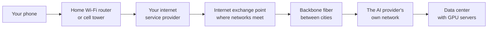
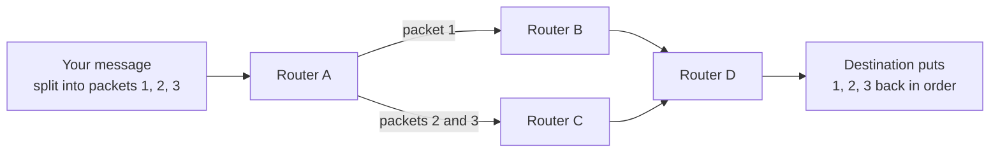
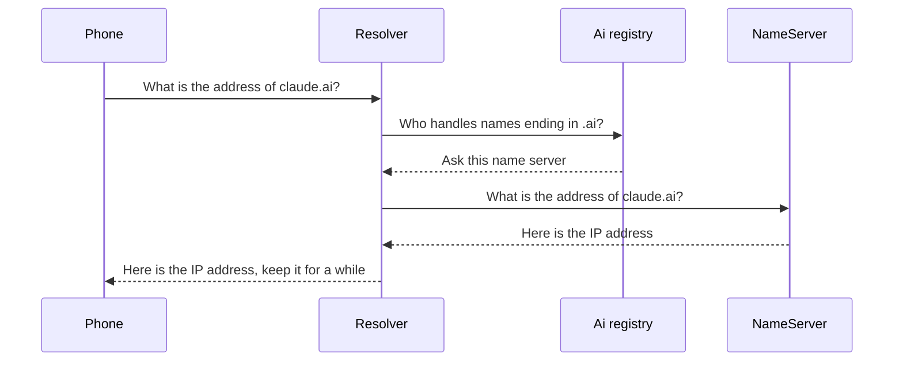
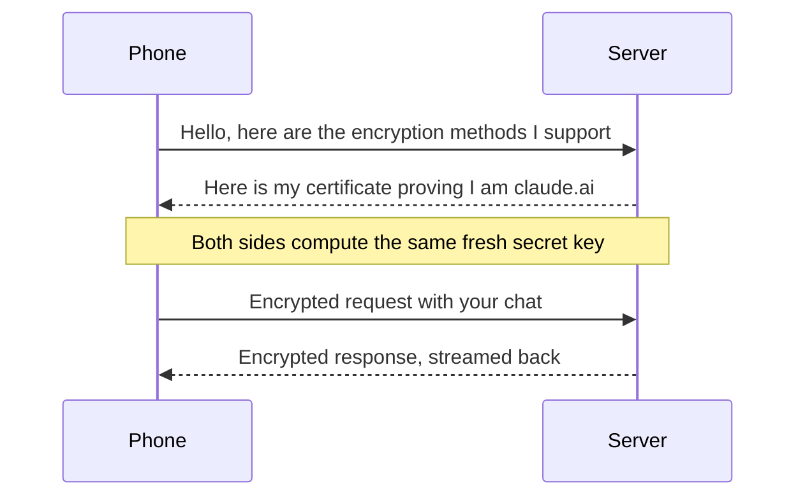
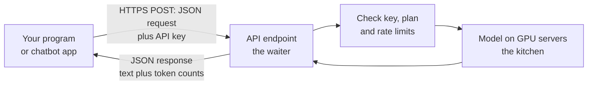
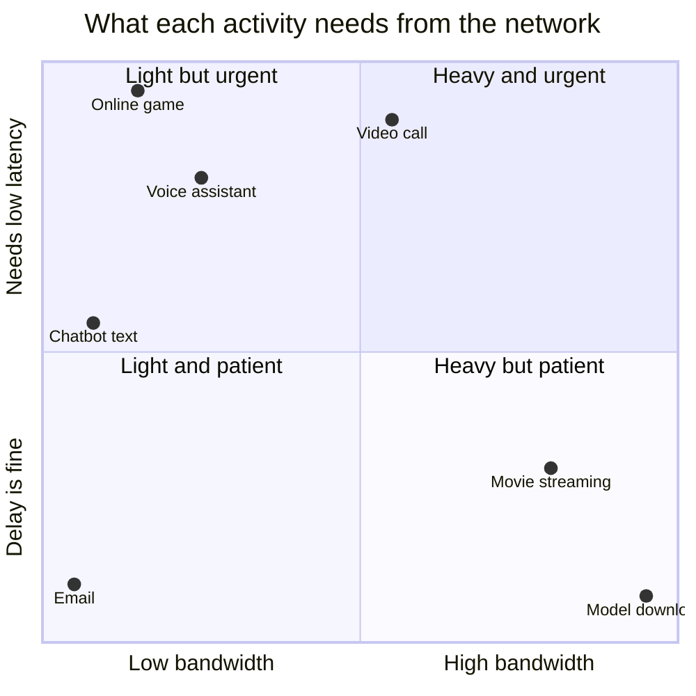
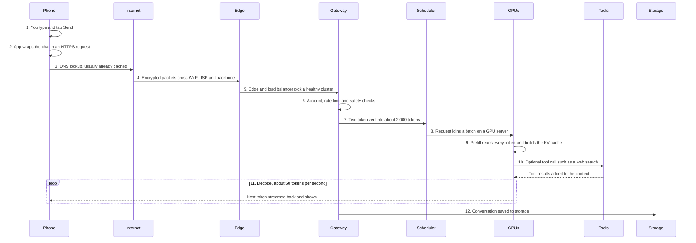

# Chapter 4: The Internet and the Cloud: How Your Message Reaches a Data Center

*By the end of this chapter you will be able to follow one chatbot message from your thumb to a GPU in a distant building and back, step by step, with real numbers for time, distance, energy and cost.*

## What you'll learn

- What a network is, how the internet connects billions of devices, and why messages travel as small packets.
- The physical internet: radio, copper, fiber-optic glass and the undersea cables that carry nearly all traffic between continents, and how the speed of light sets a hard floor on delay.
- How IP addresses and DNS find the right computer, and how HTTP, URLs and status codes work.
- What HTTPS encryption protects, and what it does not.
- Clients, servers, data centers, the cloud and the hyperscalers, at the level you need for the rest of the book.
- What an API is, why it is how programs (and chatbot apps) talk to AI models, and what a message costs.
- The difference between latency and bandwidth, and why your chatbot pauses before the first word and then streams.
- The full 12-step journey of one chatbot message, with a timing, energy and cost budget.

## Before you start

Chapter 2 (How Computers Work: Bits, Transistors and Processors) explains bits, bytes, processors and GPUs. Chapter 3 (Software, Code and Data: How Everything Becomes Numbers) explains how your words become UTF-8 bytes and JSON, what a server's operating system is, and why your chatbot app is only a thin front end. This chapter picks up the moment your message leaves your phone.

## One message, one second, half a continent

You type "Plan a 3-day trip to Lisbon for under 600 euros" and tap Send. About a second later, words start appearing, then stream in at a steady pace until the plan is done. In that second, your message was split into pieces, turned into flashes of light, carried through glass fibers, possibly across a state or an ocean, checked, queued, read by a model spread across several GPUs that draw as much power as a small neighborhood, and answered one token at a time.

Most people never think about any of this, and that is a sign of how well it works. But if you want to understand AI's costs, its speed, its privacy and its physical footprint, you need to see the whole trip. This chapter builds it piece by piece and then puts it together in one diagram.

> **Key idea:** Your chatbot is not in your phone. Every message makes a round trip to a data center, and every part of that trip, from radio waves to glass cables to GPUs, adds time, uses energy and costs money.

## Networks and the internet

A network is simply computers connected so they can exchange data. Your home Wi-Fi is a small network: your phone, laptop, TV and smart speaker all connect to one box, the router, which passes data between them and out to the wider world.

> **Definition — Network:** Two or more computers connected so they can exchange data, by cable or by radio.

> **Definition — Router:** A device that forwards data between networks, choosing where each piece should go next. Your home Wi-Fi box is a router; the internet has millions more.

Your router connects to an internet service provider, the company you pay for internet access. Your ISP connects to bigger networks, which connect to other big networks at meeting points called internet exchange points. The very largest long-distance links, the high-capacity fiber routes between cities and continents, are called the backbone. The internet is not one network owned by anyone. It is tens of thousands of independent networks that have agreed to pass each other's traffic.

> **Definition — ISP (Internet service provider):** The company that connects your home or phone to the internet, such as a cable, fiber or mobile phone company.

> **Definition — Internet:** The worldwide network of networks, linked by shared rules so that any connected device can reach any other.

> **Definition — Internet exchange point (IXP):** A building where many networks meet and hand traffic directly to each other, so data does not have to take long detours.

> **Definition — Backbone:** The highest-capacity long-distance links of the internet, mostly fiber-optic cables between major cities and across oceans.



*Figure 4.1: The internet is a network of networks. Your message hops from your home network to your ISP, through exchange points and backbone links, into the AI provider's network.*

All these networks can work together only because they follow the same protocols, agreed rules for how to format and exchange data. The key ones date back decades: the ARPANET, the internet's ancestor, sent its first messages in 1969; the TCP/IP protocols that define today's internet became its standard in 1983; and the World Wide Web, invented by Tim Berners-Lee in 1989, went public in 1991.

> **Definition — Protocol:** An agreed set of rules for how computers communicate, like etiquette for machines. TCP/IP, HTTP and TLS are protocols.

The internet now reaches most of humanity, but not all of it. The International Telecommunication Union reported in 2025 that almost three quarters of the world's people are online and about 2.2 billion remain offline, mostly in low- and middle-income countries. For them, cloud AI is out of reach.

## Packets: big messages in small pieces

The internet never sends a big message in one piece. It chops every message into small chunks called packets, each usually up to about 1,500 bytes. Every packet carries a label, its header, with the sender's address, the destination's address and its position in the sequence. Routers read each header and pass the packet one step, or "hop", closer to its destination.

> **Definition — Packet:** A small chunk of data, usually up to about 1,500 bytes, sent across a network with a label saying where it came from and where it is going. Big messages are split into many packets and reassembled.

Why chop things up? Because it makes the network resilient and fair. If one link is congested or broken, routers send later packets another way. No single giant file can hog a cable; packets from millions of users take turns, interleaved like cars merging on a highway.

Worked example: how many packets?

- Your chat request, with a few thousand tokens of conversation history, is roughly 8 to 10 KB of text. At up to 1,500 bytes per packet, that is about 6 or 7 packets.
- A 3 MB photo you upload is 3,000,000 ÷ 1,500 = about 2,000 packets.
- A 4 GB open-weight model download is about 2.7 million packets.

Packets can arrive out of order, and occasionally one is lost. A protocol called TCP numbers every packet, puts them back in order at the destination and asks for any missing ones to be sent again. Your app never sees the chaos; it receives a clean stream of bytes. (A newer protocol called QUIC, used by HTTP/3, does the same job with fewer round trips, and many large sites use it.)

> **Definition — TCP (Transmission Control Protocol):** The protocol that makes packet delivery reliable: it numbers packets, reassembles them in order and resends any that are lost.



*Figure 4.2: Packets from one message may take different routes and arrive out of order. TCP reassembles them.*

> **Analogy:** Sending a message over the internet is like mailing a long letter as numbered postcards. Each postcard has the from and to addresses. They may travel by different trucks and arrive in any order, but the numbers let the recipient put the letter back together, and ask for any missing card.

## The physical internet: radio, copper, glass and the ocean floor

The internet is a physical thing. Your message travels through four kinds of medium.

- **Radio.** From your phone to your Wi-Fi router, or to a cell tower (4G or 5G), your data travels as radio waves. This "last hop" is often the slowest and least reliable part of the trip.
- **Copper.** Some homes still connect over copper telephone or cable TV wires, which carry data as electrical signals.
- **Fiber-optic cable.** Almost all long-distance traffic travels as pulses of light inside strands of glass thinner than a hair. A single fiber can carry enormous amounts of data, and a cable bundles many fibers.
- **Satellites.** Some links, especially in remote areas, go through satellites.

> **Definition — Fiber-optic cable:** A cable of hair-thin glass strands that carry data as pulses of light. It carries far more data, over far longer distances, than copper.

Between continents, the internet runs along the ocean floor. Several hundred undersea cables, many no thicker than a garden hose in the deep ocean, carry nearly all intercontinental internet traffic. Powered repeaters spaced along the cable boost the light as it fades. When you chat with a model served from another continent, your words almost certainly travel through one of these cables, not through space.

> **Definition — Undersea (subsea) cable:** A fiber-optic cable laid on the ocean floor between continents. Such cables carry nearly all intercontinental internet traffic.

### The speed of light sets a floor on delay

Light in a vacuum travels about 300,000 km per second. Inside glass it is slower, roughly 200,000 km per second. That works out to about 5 microseconds (millionths of a second) per kilometer of fiber, or 5 milliseconds per 1,000 km. No engineering can beat this; it is physics. Real cables also zigzag rather than going in straight lines, and every router along the way adds a little extra delay.

Worked examples (one-way, light in fiber, straight line, no delays):

| Trip | Rough distance | Minimum one-way time | Minimum round trip |
|---|---|---|---|
| Across a big city | 50 km | 0.25 ms | 0.5 ms |
| Chicago to Virginia | 1,000 km | 5 ms | 10 ms |
| New York to London | 5,600 km | 28 ms | 56 ms |
| Sydney to Los Angeles | 12,000 km | 60 ms | 120 ms |
| Up to a geostationary satellite and down | 72,000 km (at light speed in space) | about 240 ms | about 480 ms |

*Figure 4.3: The speed of light sets a minimum delay no technology can beat. Real round trips are always somewhat longer.*

The last row explains why traditional satellite internet feels sluggish: geostationary satellites orbit about 36,000 km up. Newer low-orbit satellite networks fly a few hundred kilometers up, which is why their delays are far smaller.

> **Watch out:** It is tempting to picture the internet as wireless, or as something in the sky. Apart from the first and last few hundred meters of radio, your data almost always travels through glass cables buried under streets, strung along railways and laid across ocean floors.

## Addresses and names: IP and DNS

To deliver a packet, the network needs an address. Every device on the internet has an IP address, a number that works like a postal address. The older version, IPv4, uses 32-bit addresses written as four numbers from 0 to 255, such as 203.0.113.42. That gives 2 to the power 32, about 4.3 billion, possible addresses: fewer than the number of devices on Earth. So your home router usually shares one public address among all your devices, and the newer IPv6 uses 128-bit addresses, about `3.4 × 10^38` of them, enough to never run out.

> **Definition — IP address:** A number that identifies a device on the internet so packets can be delivered to it, such as 203.0.113.42. IP stands for Internet Protocol.

Nobody wants to remember numbers, so we use domain names like claude.ai, chatgpt.com or gemini.google.com. The Domain Name System (DNS) is the internet's phone book: it turns a name into an IP address. When your app needs to reach a server it hasn't contacted recently, it asks a DNS resolver (usually run by your ISP or a public service), which may ask a chain of other servers: the root servers, then the servers for the ending (.ai, .com), then the servers for the specific name.

> **Definition — Domain name:** A human-readable name for an internet address, such as claude.ai. The ending (.com, .ai, .org) is called the top-level domain.

> **Definition — DNS (Domain Name System):** The internet's phone book, which turns names like claude.ai into the numeric IP addresses computers use.

A fun detail: .ai is the country-code ending of Anguilla, a small Caribbean territory. Like .tv for Tuvalu, it became popular for reasons its owners never planned, and the AI boom turned it into valuable real estate.



*Figure 4.4: A DNS lookup. Answers are cached, so most lookups are answered instantly from memory instead of repeating this chain.*

Because answers are saved (cached) for minutes or hours, most lookups take no time at all. An uncached lookup typically takes tens of milliseconds. DNS is also a tool for traffic control: big services return different IP addresses to different users, steering each person toward a nearby, healthy entrance to their network.

> **Try it:** On Windows, open Command Prompt and type `nslookup chatgpt.com`; on a Mac, open Terminal and type the same. You will see one or more IP addresses. Try `nslookup claude.ai` and `nslookup gemini.google.com` too, and notice that big services often return several addresses.

## The web's language: URLs, HTTP and status codes

Once your app knows the server's address, it needs to say what it wants. On the web, that conversation uses HTTP, the Hypertext Transfer Protocol. HTTP is a simple request-and-response pattern: the client sends a request, the server sends back a response.

> **Definition — HTTP (Hypertext Transfer Protocol):** The protocol browsers and apps use to request things from servers and receive responses. Nearly every website and AI API speaks it.

A request is aimed at a URL, a web address that names the protocol, the server and the specific thing you want:

```text
https://api.example.com/v1/messages?stream=true
  |          |              |          |
scheme     domain          path      query
(how)      (which server)  (what)    (options)
```

*Figure 4.5: The anatomy of a URL.*

> **Definition — URL (Uniform Resource Locator):** A web address, such as https://claude.ai/new. It names the protocol, the server and the specific page or resource.

A request also has a method (GET to fetch something, POST to send something, such as your chat message), headers (labels with extra information, such as your login token and the format of the data) and, for POST, a body (the data itself, for a chatbot usually the JSON from Chapter 3). The response comes back with a three-digit status code, its own headers and a body.

> **Definition — Request and response:** The two halves of a web conversation. The client sends a request (what it wants, plus any data); the server sends a response (a status code plus the result).

> **Definition — Status code:** A three-digit number at the start of every HTTP response summarizing what happened: 200 means OK, 404 means not found, 429 means too many requests.

| Code | Meaning | When you might see it in AI |
|---|---|---|
| 200 | OK | Your message was accepted and answered |
| 301 | Moved permanently | An old web address redirects to a new one |
| 400 | Bad request | The request was malformed, such as broken JSON |
| 401 | Unauthorized | Missing or wrong API key |
| 402 | Payment required | Long unused; revived in 2025 for pay-per-crawl (see below) |
| 403 | Forbidden | You are identified but not allowed |
| 404 | Not found | Wrong URL or a model name that does not exist |
| 429 | Too many requests | You hit a rate limit; wait and retry |
| 500 | Internal server error | Something broke on the provider's side |
| 503 | Service unavailable | The service is overloaded or down for maintenance |

*Figure 4.6: Common HTTP status codes. The first digit tells you the family: 2 is success, 4 is your side's problem, 5 is the server's problem.*

Some providers add their own codes. Anthropic's API, for example, uses 529 to signal that its servers are temporarily overloaded.

> **At the frontier (2026):** The web's plumbing is being rewired around AI. On July 1, 2025, Cloudflare, which sits in front of a large share of websites, began blocking known AI crawlers by default for new domains and launched "Pay Per Crawl", which revives the long-dormant HTTP status code 402 Payment Required so sites can charge AI companies for access. Chapter 11 covers how this affects AI training data.

## HTTPS and encryption: the locked briefcase

Your chat travels through your Wi-Fi router, your ISP, exchange points and backbone links owned by companies you have never heard of. Anyone along the way could, in principle, read raw packets. HTTPS prevents that. It is HTTP wrapped in encryption, so that only your device and the server can read what is inside.

> **Definition — Encryption:** Scrambling data with a secret key so that only someone with the right key can unscramble and read it.

> **Definition — HTTPS:** HTTP with encryption (the S stands for secure). The padlock icon in your browser means the connection uses it.

There is a puzzle at the heart of this. To encrypt, both sides need the same secret key. But you have never met the server, and any key you send over the internet could be copied by an eavesdropper. The solution, public-key cryptography, is one of the great inventions of the 20th century.

> **Definition — Public-key cryptography:** Encryption that uses a pair of keys: a public key that anyone can use to lock (encrypt) data, and a private key, kept secret, that alone can unlock it. It lets strangers set up a shared secret over an open network.

> **Analogy:** Public-key cryptography is like a server handing out thousands of open padlocks. Anyone can snap one shut on a box, but only the server holds the key that opens them. You put a fresh secret inside a box, lock it with the server's padlock and send it. Eavesdroppers see only a locked box.

In practice, the protocol called TLS uses public-key methods for a quick handshake, in which the two sides agree on a fresh shared key, and then switches to fast ordinary encryption for the actual conversation. During the handshake, the server also proves its identity with a certificate, a digital document vouched for by a trusted certificate authority. That stops an impostor from pretending to be claude.ai. The modern version, TLS 1.3, completes the handshake in a single round trip.

> **Definition — TLS (Transport Layer Security):** The protocol that encrypts HTTPS connections. It verifies the server's identity and sets up a shared secret key during a short handshake.

> **Definition — Certificate (digital):** An electronic document, vouched for by a trusted certificate authority, that proves a server really belongs to the name it claims, such as claude.ai.



*Figure 4.7: A simplified TLS handshake. After one round trip, everything else is encrypted with a shared key that was never sent over the network.*

It is just as important to know what HTTPS does not hide.

| Who | Can see | Cannot see |
|---|---|---|
| The owner of the café Wi-Fi | That your device connected to the AI provider, when, and roughly how much data moved | Your messages, the answers, your password |
| Your ISP and the networks in between | The same as above | The same as above |
| The AI provider | Everything you send and receive, once decrypted at its servers | Nothing in your chat is hidden from it |

*Figure 4.8: What HTTPS protects. It hides content from everyone in between, but not from the service you are talking to.*

> **Watch out:** HTTPS is not end-to-end encryption in the sense used by messaging apps such as Signal, where even the company cannot read your messages. A chatbot provider must decrypt your text, because its model has to read it to answer. Your privacy with an AI service depends on the provider's policies and settings, not on the padlock (Chapter 58).

> **Definition — End-to-end encryption:** Encryption where only the people communicating can read messages, not even the company running the service. Chatbots cannot work this way, because the provider's model must read your text.

## Clients and servers

Every exchange in this chapter has two roles. The client asks; the server answers. Your phone's chatbot app is a client. The computer that receives its request is a server.

> **Definition — Client:** A device or program that sends requests to another computer, such as your phone's chatbot app or your web browser.

> **Definition — Server:** A computer that waits for requests and answers them. It usually has no screen or keyboard and sits in a rack in a data center.

There is nothing magical about a server. It is a computer like your laptop, usually more powerful, with no screen, running Linux (Chapter 3), and built to run day and night. One web server can handle thousands of clients at once. An AI server is a special case: a heavy box with several GPUs, which can cost as much as a house and draw as much power as several homes.

> **Analogy:** A server is a shop that never closes and a client is a customer. A data center is a mall of thousands of such shops, with its own power plant and air conditioning.

## Data centers: where the servers live

Servers live in data centers: buildings packed with racks of servers, network equipment, power gear and cooling. A rack is a standard metal cabinet, about the size of a tall refrigerator, holding servers stacked like pizza boxes. Rows of racks fill large halls. Outside sit the substation, backup generators and cooling equipment.

> **Definition — Data center:** A building packed with servers, network equipment, power systems and cooling. Your chatbot's model runs in one.

> **Definition — Rack:** A standard metal cabinet that holds servers and network gear in data centers. A 2026 AI rack can draw around 120 to 140 kilowatts, about as much as 100 homes.

AI data centers are measured not in square meters but in power. The largest are approaching 1 gigawatt, roughly enough electricity for 800,000 to a million US homes. Epoch AI estimates that building one costs about $38 billion per gigawatt of IT power and takes about two years. As of October 20, 2026, Epoch's data center tracker followed 95 large AI data centers with about 14.2 GW of IT power between them. The largest known, according to Epoch, is xAI's Colossus 2 in Memphis, at roughly 1.1 million H100-equivalent chips. Altogether, the International Energy Agency estimated that the world's data centers (AI and everything else) used about 415 terawatt-hours of electricity in 2024, about 1.5% of global electricity, and projected about 945 TWh by 2030.

Your traffic enters a data center through fiber cables from several network carriers, which meet the building's own network in a secure room called a meet-me room. From there it flows over the building's front-end network, the one that handles user traffic and storage. Separate, much faster networks link the GPUs to each other so that a model too big for one chip can run across many (Chapter 34). Part VII of this book (Chapter 38 to Chapter 43) tours the building, its power, its cooling, its energy sources and its economics.

> **Watch out:** "The cloud" sounds weightless, but it is concrete, steel, copper, glass, water pipes and gas turbines in specific towns. Every chatbot answer comes from a real machine drawing real electricity in a real building.

> **Try it:** Open Epoch AI's data center hub (epoch.ai/data/data-centers) and find the largest AI data center in or nearest to your country. Note its power in megawatts, its owner and its chips, then divide the power by about 1.2 kilowatts (an average US home's draw) to see how many homes' worth of electricity it represents.

## The cloud and the hyperscalers

Before about 2006, a company that wanted servers bought them, installed them in its own building and hired people to run them. Then Amazon Web Services launched in 2006 and offered something new: rent computers by the hour over the internet, start them in minutes, and switch them off when you are done. That is cloud computing.

> **Definition — Cloud computing:** Renting computing power, storage and software over the internet, paying for what you use, instead of owning and running the machines yourself.

The biggest cloud providers are called hyperscalers: Amazon Web Services (AWS), Microsoft Azure and Google Cloud, with Oracle growing fast. Meta builds giant data centers too, but mainly for its own services. During the AI boom, a newer group of "neoclouds" such as CoreWeave, Nebius, Lambda, Crusoe and Together AI specialize in renting GPUs for AI. The major AI labs rent enormous amounts of capacity from these companies, and increasingly build their own sites with partners (Chapter 42).

> **Definition — Hyperscaler:** A giant cloud provider operating huge data centers worldwide, such as Amazon Web Services, Microsoft Azure or Google Cloud.

> **Definition — Neocloud:** A newer cloud company that specializes in renting GPUs for AI, such as CoreWeave, Nebius or Lambda.

Cloud providers organize their data centers into regions, such as "US East" or "Europe West", each a cluster of buildings in one geographic area. Regions matter for speed (closer is faster) and for law: some customers must keep data inside a particular country or bloc. AI providers charge for this; OpenAI, for example, adds a 10% uplift for regional processing on models released since March 2026.

> **Definition — Region (cloud):** A geographic area where a cloud provider runs a group of data centers, such as US East or Europe West. Choosing a region affects speed, price and which country's laws apply to your data.

Clouds sell at three levels. You can rent bare machines (often virtual machines, software slices of a physical server) and manage everything yourself; rent a platform where the provider handles the servers; or simply use finished software through a browser or app.

> **Definition — Virtual machine:** A software imitation of a whole computer, running alongside others on one physical server. Clouds rent them so many customers can share a machine safely.

| Level | What you rent | Who manages the servers | AI example |
|---|---|---|---|
| Infrastructure as a service (IaaS) | Raw machines, GPUs, storage | You | Renting eight H100 GPUs by the hour to fine-tune a model |
| Platform as a service (PaaS) | A ready platform to run your code or models | Mostly the provider | Calling a hosted model through a cloud AI platform |
| Software as a service (SaaS) | A finished application | The provider | Your ChatGPT, Claude or Gemini subscription |

*Figure 4.9: The three levels of cloud service. A chatbot subscription is software as a service.*

Worked example: renting GPUs. In October 2026, Lambda listed on-demand H100 GPUs at about $3.99 to $4.29 per GPU-hour, and RunPod listed them from about $2.69 to $3.99 (in 2025 they were widely available for $2 to $3). At $4 per hour:

- 8 GPUs for a 10-hour fine-tuning experiment: 8 × 10 × $4 = $320.
- 8 GPUs running all month (about 730 hours): 8 × 730 × $4 = about $23,000.
- 8 GPUs for a full year (8,760 hours): about $280,000.

Renting is ideal for short or unpredictable jobs. Companies that will keep GPUs busy around the clock for years sign much cheaper long-term contracts, or buy and run their own (Chapter 43).

> **Key idea:** The cloud turns computers into a utility you rent by the hour. That is what lets a two-person startup use the same GPUs as a giant company for an afternoon, and why AI labs, not just their customers, are among the cloud's biggest renters.

> **Analogy:** The cloud is like using taxis and rental cars instead of owning a car: you pay only for the trips you take, and someone else handles maintenance. A hyperscaler is a city that owns its own buildings; a neocloud is a hotel chain renting rooms (GPUs) by the night or the year.

Clouds also run content delivery networks: thousands of small edge sites close to users that keep copies of popular content, such as images, videos and the code of web apps, so it loads quickly. AI providers use the edge to accept your connection close to you and then carry your request over their own fast private network to a data center. The answer itself cannot be cached at the edge, because every response is generated fresh.

> **Definition — CDN (content delivery network) and edge:** A network of many small sites near users, called the edge, that keeps copies of popular content and accepts connections close to you, making websites and apps faster.

## APIs: how programs order from each other

Your chatbot app does not talk to the model directly. It talks to an API, an Application Programming Interface: a published menu of requests one program can make of another, with exact rules for how to ask and what comes back. AI companies sell access to their models through APIs, and their own apps use APIs behind the scenes too.

> **Definition — API (Application Programming Interface):** A defined way for one program to request services from another, like a restaurant menu and a waiter. AI companies sell model access through APIs.

> **Analogy:** An API is a waiter with a menu. You order only what is on the menu, in the expected way ("one Sonnet, 1,000 tokens max, here is the conversation"). The kitchen is hidden, and the waiter brings back your dish (the response) or tells you the kitchen is too busy (a 429).

An API lives at an endpoint, a specific URL. Anthropic's main model endpoint, for example, is https://api.anthropic.com/v1/messages. A program sends a POST request there with JSON describing the model and the conversation, plus an API key in the headers to prove who is paying.

> **Definition — Endpoint:** The specific URL where an API receives a particular kind of request, such as https://api.anthropic.com/v1/messages.

> **Definition — API key:** A secret code, like a password, that identifies who is using an API so they can be billed and limited. Anyone who gets your key can spend your money.



*Figure 4.10: An API call. The program never touches the model directly; it orders through a strict menu.*

APIs charge by the token, usually quoted per million tokens, with output (what the model writes) priced higher than input (what it reads). Worked example using Anthropic's list prices as of October 2026 for Claude Sonnet 5.5, $2 per million input tokens and $10 per million output tokens:

- A chat turn that sends 2,000 tokens of conversation and gets 600 tokens back:
  - Input: 2,000 × $2 ÷ 1,000,000 = $0.004.
  - Output: 600 × $10 ÷ 1,000,000 = $0.006.
  - Total: about $0.01, one cent.
- A thousand such turns cost about $10.

> **Key idea:** Every chatbot app, AI-powered product and agent is built on API calls: a JSON request goes in over HTTPS, a JSON response comes back, and the bill is counted in tokens.

APIs also enforce rate limits: caps on requests or tokens per minute, so no single customer can swamp the service. Exceed one and you get status code 429; well-written programs wait a moment and try again, waiting longer after each failure. Chapter 26 shows you how to make API calls yourself, and Chapter 28 explains how agents are built as API calls in a loop.

> **Definition — Rate limit:** A cap on how many requests or tokens you may send in a period of time, such as per minute. Going over it returns a 429 error.

## Latency and bandwidth

Two words describe the speed of any network connection, and people mix them up constantly.

> **Definition — Latency:** How long it takes for data to get from one place to another, or for a request to get its first response. It is measured in milliseconds.

> **Definition — Bandwidth:** How much data can move per second, like the width of a pipe. Internet speeds are quoted in megabits per second (Mbps).

> **Analogy:** Latency is how long the drive is; bandwidth is how many lanes the highway has. Adding lanes lets more cars travel at once, but it does not make a 500-kilometer trip shorter.

A measure you will see often is round-trip time: how long a tiny message takes to go somewhere and come back. The `ping` command measures it.

> **Definition — Round-trip time (RTT):** The time for a small message to travel to a destination and for the reply to come back, often measured with the ping command. It is the basic unit of network delay.

One unit trap first. Internet speeds are quoted in megabits per second (Mbps), but file sizes are in megabytes (MB). A byte is 8 bits, so divide by 8: a 100 Mbps connection moves 12.5 MB per second.

Worked examples:

- **Downloading a 4 GB open-weight model on 100 Mbps:** 4 GB = 4,000 MB = 32,000 megabits. 32,000 ÷ 100 = 320 seconds, about 5 minutes. Here bandwidth is everything; a 1,000 Mbps connection would take 32 seconds.
- **Sending a 10 KB chat request on the same connection:** 10 KB = 80,000 bits. 80,000 ÷ 100,000,000 = 0.0008 seconds, under a millisecond. But the request still needs perhaps 20 to 40 milliseconds to reach a data center 1,000 km away. Here latency is everything.
- **Receiving a streamed answer:** a model writing 50 tokens per second, at roughly 4 bytes of text per token, sends about 200 bytes of text per second. Even with the wrapping and labels around each chunk, that is a few kilobytes per second at most. HD video streaming uses about 5 megabits per second, hundreds of times more.



*Figure 4.11: Different activities stress different things. Chatbot text needs almost no bandwidth; its speed is set by latency and by the data center.*

This is why your chatbot behaves as it does. Before the first word appears, there is a pause made of network round trips plus waiting and reading time inside the data center. After that, words stream at a pace set mostly by the GPUs, not by your connection. The two numbers that describe this are time to first token and tokens per second.

> **Definition — Time to first token (TTFT):** How long you wait after sending a message until the first piece of the answer appears. It dominates how fast an AI app feels.

> **Definition — Tokens per second:** How fast a model writes once it has started, often tens of tokens per second for a chatbot. Divide the answer length by it to estimate how long a reply takes.

> **Definition — Streaming:** Sending a response piece by piece as it is produced, instead of all at once at the end. It is why chatbot answers appear word by word.

The streaming itself usually uses a simple web technique called server-sent events: the server keeps the HTTPS connection open and pushes each new chunk of text down it as soon as it exists.

> **Definition — Server-sent events (SSE):** A web technique where a server keeps a connection open and pushes a stream of small updates to the client. Most AI APIs use it to stream tokens.

> **Key idea:** Your Wi-Fi is almost never the reason a chatbot types slowly. A chat answer needs only a few kilobytes per second. The pause before the first word comes from distance, queues and the model reading your conversation; the typing speed after that comes from the GPUs in the data center.

> **Try it:** Open fast.com or speedtest.net. Note two numbers: your download speed (bandwidth, in Mbps) and your latency or "ping" (in milliseconds). Then compute how long a 4 GB file would take to download at your speed.

## The journey of one chatbot message

Now put it all together. Here is the trip your Lisbon question makes, in twelve steps. To keep the numbers concrete, imagine you are in Chicago on home Wi-Fi, the conversation so far is about 2,000 tokens long, the answer will be about 600 tokens, and the model streams about 50 tokens per second.



*Figure 4.12: The end-to-end journey of one chatbot message. Steps 1 to 4 happen on your side of the internet; steps 5 to 12 happen inside the AI provider's network and data center.*

### Steps 1 and 2: on your phone

You tap Send. The app takes the whole conversation so far, not just your new line, because the model remembers nothing between requests (Chapter 3). It packages everything as JSON, along with your login token, the model choice and settings, and prepares an HTTPS POST request to the provider's API. If the app has been open for a while, it already has an encrypted connection to the server and simply reuses it, skipping the handshake.

### Steps 3 and 4: across the internet

If the app has not looked up the server's address recently, it asks DNS, which usually answers from a cache in a few milliseconds and otherwise in tens of milliseconds. Then roughly 6 or 7 encrypted packets leave your phone by radio to your router, travel over copper or fiber to your ISP, pass through exchange points and backbone fiber, and reach the provider's nearest entrance. Within the United States, this one-way trip typically takes somewhere around 10 to 40 milliseconds; from another continent, add the undersea cable.

### Steps 5 and 6: at the provider's front door

The packets arrive at an edge site, where the provider's equipment completes the encryption handshake and decrypts the request. A load balancer then picks which data center region and which cluster of servers should handle it, steering away from anything overloaded or broken.

> **Definition — Load balancer:** A traffic director that spreads incoming requests across many servers so no single one is overwhelmed, and routes around servers that have failed.

Next comes the API gateway, the service that checks everything before any expensive GPU work begins: Is this account valid? Is it within its plan and rate limits? Is the request well formed? Many providers also run fast safety classifiers here, smaller models that screen inputs for clear abuse (Chapter 56). These checks take milliseconds.

> **Definition — API gateway:** The front-door service of an API that checks keys or logins, enforces rate limits and routes each request to the right back-end system.

### Steps 7 to 9: inside the data center

Your text is now turned into tokens by the tokenizer (Chapter 3): about 2,000 token IDs. A scheduler decides which group of GPU servers running your chosen model gets the request. Those servers are serving many users at once; your request joins a batch alongside dozens of others, because processing many requests together uses the hardware far more efficiently.

> **Definition — Inference:** Running an already-trained model to produce an output. Every chatbot reply is inference, as opposed to training, which creates the model.

> **Definition — Batching:** Processing many users' requests together on the same GPUs at the same time, which makes far better use of the hardware than handling them one by one.

A frontier model is too large to fit in one GPU's memory, so it is split across several GPUs in the same server or rack, linked by very fast connections (Chapter 34). In 2026, a typical high-end AI rack holds 72 GPUs, draws around 120 to 140 kilowatts and weighs over a tonne (Chapter 38).

The model then reads your whole conversation in one pass. This is called prefill. All 2,000 tokens are processed in parallel, which keeps the GPUs' arithmetic units busy, and the model stores what it computed for each token in a KV cache so it never has to recompute it. If the start of your conversation was processed recently, the provider may reuse the cached work (prompt caching), which makes this step faster and cheaper.

> **Definition — Prefill:** The first phase of answering, in which the model reads the entire prompt at once, in parallel. Its length mostly determines the wait before the first word.

> **Definition — KV cache:** Stored intermediate results for every token the model has already read or written, so it does not redo that work for each new token. It grows with the length of the conversation.

### Step 10: tools, if needed

If you asked for something current, such as hotel prices in Lisbon this week, the model may call a tool: a web search, a code sandbox or a connector to your files. Each tool call is another round trip to another service, often adding a second or more, and the results are added to the model's context before it continues. An agent working on a long task can make dozens of such trips (Chapter 28).

### Step 11: decode and stream back

Now the model writes, one token at a time. This phase is called decode. For every single new token, the GPUs must read through the model's enormous set of weights in memory, so the speed is limited mostly by memory bandwidth, not by arithmetic (Chapter 23 and Chapter 33). At about 50 tokens per second, each token takes about 20 milliseconds.

> **Definition — Decode:** The second phase of answering, in which the model generates the response one token at a time, each new token depending on all the tokens before it. Its speed sets how fast the text streams.

Each new token is turned back into text and pushed down the still-open HTTPS connection as a server-sent event, a few bytes at a time. Your app adds it to the chat bubble and formats it as it arrives. A 600-token answer at 50 tokens per second takes about 12 seconds to finish, but you started reading after about a second.

### Step 12: saved

When the answer is complete, the conversation is written to the provider's databases, so it appears in your chat history on all your devices and, if you use them, memory features can draw on it later. How long it is kept, and whether it may be used to train future models, depends on the provider's policies and your settings (Chapter 58).

```
Rough time budget for one chat turn (illustrative, varies widely)

Step                               Typical time
---------------------------------  ---------------------------
3. DNS lookup                      0 ms if cached, else ~20-50 ms
4. Packets to the provider         ~10-40 ms one way in the US
5-6. Edge, balancer, checks        a few ms to tens of ms
7-8. Tokenize, queue, batch        0 ms to hundreds of ms
9. Prefill of 2,000 tokens         a fraction of a second
   First token travels back        ~10-40 ms
   ----> first word on screen      about 0.5 to 2 seconds
11. Decode 600 tokens at 50/s      ~12 s, read as it streams
```

*Figure 4.13: Where the time goes. The network adds roughly a tenth of a second; most of the wait and all of the typing happen in the data center.*

### The budget of one message

| Quantity | Rough value for this chat turn | Where it comes from |
|---|---|---|
| Time to first word | About 0.5 to 2 seconds | Network round trip, queue and prefill |
| Time to finish | About 12 seconds | 600 tokens at 50 tokens per second |
| Data sent and received | Tens of kilobytes | 2,000 tokens up, 600 tokens down, plus packaging |
| Arithmetic | Hundreds of trillions of operations | About 2 operations per parameter per token (Chapter 5) |
| Energy | About 0.3 watt-hours | Company and independent estimates for a typical text prompt |
| Price at API list rates | About 1 cent | Claude Sonnet 5.5 at $2 and $10 per million tokens |

*Figure 4.14: The physical and economic budget of a single chatbot message.*

Two of those rows deserve a worked example.

**Arithmetic.** Labs rarely publish the size of their closed models, so take a hypothetical model that uses 100 billion parameters for each token. The rule of thumb from Chapter 5 is about 2 operations per parameter per token, so 2 × 100 billion = 200 billion operations per token. The turn involves about 2,600 tokens (2,000 read plus 600 written): 2,600 × 200 billion = 520 trillion operations, written `5.2 × 10^14`. A human doing one multiplication per second would need over 16 million years.

**Energy.** Google reported that its median Gemini Apps text prompt in May 2025 used 0.24 watt-hours, including idle machines and building overhead, and said this had fallen 33-fold in twelve months; Google notes the figure was not independently verified. OpenAI's chief executive said in June 2025 that an average ChatGPT query uses about 0.34 watt-hours. Epoch AI independently estimated about 0.3 watt-hours for a typical GPT-4o query, but about 2.5 watt-hours with 10,000 input tokens and about 40 with 100,000. Taking 0.3 watt-hours:

- A 10-watt LED bulb uses 0.3 watt-hours in 0.3 ÷ 10 = 0.03 hours, about 1.8 minutes. One typical message is like leaving that bulb on for two minutes.
- A billion such messages per day use 1,000,000,000 × 0.3 = 300 million watt-hours, which is 300 megawatt-hours per day. Spread over 24 hours, that is an average draw of 12.5 megawatts, a small power plant running nonstop for one kind of request.

Per message, the energy is small. In total, across billions of messages, longer contexts, reasoning models that write many more tokens, agents that run for hours and video generation, it adds up to the gigawatt-scale buildout described in Part VII.

> **Watch out:** Per-prompt energy figures come mostly from the companies themselves, measure different things (some include building overhead and idle machines, some do not), and apply to short text prompts. A long document, a reasoning model or an agent can use ten or a hundred times more. Treat "0.3 watt-hours" as a typical short-chat figure, not a universal constant.

> **At the frontier (2026):** Speed is now something you can buy. As of October 2026, Anthropic offers a "fast mode" for Claude Opus 5.5 at $8 and $40 per million input and output tokens, double the standard $4 and $20, while batch requests that can wait hours cost 50% less; OpenAI renamed its priority tier "Fast mode" on July 30, 2026. Behind these prices sit the choices in this section: how big the batches are, which hardware serves the request, and how long the request waits in the queue (Chapter 23).

> **At the frontier (2026):** The same speed-of-light limits that shape your chat now shape how frontier models are trained. Microsoft links its Fairwater AI data centers in Wisconsin and Atlanta, about 700 miles apart, into one "AI WAN" for training; over roughly 1,200 km of fiber, light alone takes about 6 milliseconds one way, an eternity for GPUs that must coordinate constantly. OpenAI said its GPT-6 Astra, unveiled in September 2026, came from its first pretraining run on more than 100,000 GPUs, at its Stargate site in Texas. Chapter 34 and Chapter 42 cover these giant clusters.

## In plain English

When you tap Send, your chatbot app wraps the whole conversation in a small JSON package and sends it over the internet. The internet is a network of networks: your Wi-Fi router passes data to your internet provider, which connects through exchange points and long-distance fiber to the AI company's own network. Messages travel as small numbered packets that may take different routes and are reassembled at the other end. Almost all of the trip is light in glass cables, including cables on the ocean floor between continents, and the speed of light sets a minimum delay of about 5 milliseconds per 1,000 km.

DNS turns names like claude.ai into numeric IP addresses. HTTP is the request-and-response language of the web, with status codes like 200 (OK) and 429 (too many requests). HTTPS encrypts everything so people in between cannot read it, but the AI provider can, because its model has to read your words to answer.

Servers are screenless computers in data centers, buildings now measured in megawatts and gigawatts. The cloud means renting those computers by the hour from companies like AWS, Microsoft and Google. Programs talk to AI models through APIs, paying per token: one typical chat turn costs about a cent at list prices.

Latency is how long the trip takes; bandwidth is how much fits through the pipe. Chat needs almost no bandwidth. The pause before the first word is network time plus the model reading your conversation; the typing speed after that is set by GPUs. One message takes about a second to start, uses about 0.3 watt-hours, and is saved to the provider's databases when it is done.

## Key terms

Network, Router, ISP (Internet service provider), Internet, Internet exchange point (IXP), Backbone, Protocol, Packet, TCP (Transmission Control Protocol), Fiber-optic cable, Undersea (subsea) cable, IP address, Domain name, DNS (Domain Name System), HTTP (Hypertext Transfer Protocol), URL (Uniform Resource Locator), Request and response, Status code, Encryption, HTTPS, Public-key cryptography, TLS (Transport Layer Security), Certificate (digital), End-to-end encryption, Client, Server, Data center, Rack, Cloud computing, Hyperscaler, Neocloud, Region (cloud), Virtual machine, CDN (content delivery network) and edge, API (Application Programming Interface), Endpoint, API key, Rate limit, Latency, Bandwidth, Round-trip time (RTT), Time to first token (TTFT), Tokens per second, Streaming, Server-sent events (SSE), Load balancer, API gateway, Inference, Batching, Prefill, KV cache, Decode

## Exercises

1. **[Easy] Trace your route to a chatbot.** See the hops and the delays for yourself.
   1. On Windows, open Command Prompt and type `tracert claude.ai`. On a Mac, open Terminal and type `traceroute claude.ai`. (If a line shows stars, that router simply did not answer; keep going.)
   2. Count the hops and note the milliseconds on the last line that answered.
   3. Run `nslookup chatgpt.com` and write down the IP addresses it returns.
   4. Ask a chatbot to explain your output line by line.
   **What you'll learn:** DNS turns names into addresses, your message passes through many routers, and latency is something you can measure.

2. **[Easy] Inspect the padlock.** Look at a real certificate.
   1. Open claude.ai, chatgpt.com or gemini.google.com in a desktop browser.
   2. Click the padlock or the settings icon left of the address bar, then find the connection or certificate details.
   3. Note who issued the certificate (the certificate authority), which names it covers, and when it expires.
   4. Write one sentence on what this certificate protects you from, and one on what it does not protect you from.
   **What you'll learn:** HTTPS proves you are talking to the real server and encrypts the trip, but the provider still reads your messages.

3. **[Easy] Speed-of-light napkin math.** Compute the delay no technology can beat.
   1. Pick three places: a city about 1,000 km from you, one on another continent, and the other side of the world (about 20,000 km).
   2. For each, compute the minimum one-way time at 5 milliseconds per 1,000 km of fiber, then double it for a round trip.
   3. If you can, compare with a real ping: `ping` followed by a website hosted in that region.
   4. Explain why the real number is always higher.
   **What you'll learn:** physics sets a floor on delay, which is why providers place data centers and edge sites close to users.

4. **[Medium] Latency versus bandwidth on your own connection.** Separate the two ideas with real numbers.
   1. Run a test at fast.com (click "Show more info") or speedtest.net. Write down download speed (Mbps) and latency or ping (ms).
   2. Convert your speed to megabytes per second by dividing by 8.
   3. Compute how long a 4 GB model download would take, and how long it takes to push a 10 KB chat request at your speed.
   4. Compare that push time with your latency. Which one dominates for chat, and which for the download?
   **What you'll learn:** bandwidth decides big downloads, latency decides small, chatty exchanges like chatbot messages.

5. **[Medium] Watch a chatbot request in your browser.** See the API conversation your app hides.
   1. In Chrome or Edge on a computer, open your chatbot's website and press F12 (or right-click, then Inspect). Choose the Network tab.
   2. Send a short message. Look for a request that stays open while the answer streams in; it often has a name containing "message", "conversation" or "completion".
   3. Click it. Look at the request's method (likely POST), its status code, its JSON payload (your message and settings) and the response arriving in many small chunks.
   4. Find the timing information and note how long it took before the first bytes arrived.
   **What you'll learn:** the chatbot app is a front end that sends JSON to an API over HTTPS and receives the answer as a stream.

6. **[Medium] Time to first token with a stopwatch.** Measure prefill and decode from the outside.
   1. In your chatbot, ask a short question that needs a long answer, such as "Explain how bread rises in about 400 words". Time from Send to the first word, and from the first word to the last.
   2. Paste a long document (several pages) and ask a short question about it. Time the same two intervals.
   3. Estimate tokens per second: count the answer's words, multiply by about 1.33 to get tokens, and divide by the streaming time.
   4. Compare the waits before the first word in the two tests and explain the difference using the word "prefill".
   **What you'll learn:** long inputs mainly lengthen the wait before the first word, while the streaming speed is set by the model and its hardware.

7. **[Medium] Read URLs and status codes.** Get fluent in the web's basic language.
   1. Take three URLs from your browser history and split each into scheme, domain, path and query (the part after a ? sign, if any).
   2. Visit a page that does not exist on a real site, such as wikipedia.org/this-page-does-not-exist-123, and note what you see. Then open the browser's Network tab, reload, and find the status code.
   3. Ask a chatbot what you should do as a programmer when an AI API returns 401, 429 and 503, and check its answers against the table in this chapter.
   **What you'll learn:** URLs have a fixed anatomy, and status codes tell you at a glance whose problem an error is.

8. **[Medium] Who answers when you call a chatbot?** Discover the edge.
   1. Run `nslookup claude.ai` and `nslookup chatgpt.com` and copy one IP address from each.
   2. Paste each address into a free lookup site such as ipinfo.io and note the organization that owns it and its listed location.
   3. You may find a content delivery network or cloud company, and a location near you rather than near the AI company's headquarters.
   4. Explain in two sentences why the provider would answer your connection close to you, even though the model runs elsewhere.
   **What you'll learn:** your connection usually lands at an edge site near you, and the request then travels over the provider's own network to a data center.

9. **[Challenge] Your first API call, no key needed.** Talk to a real API from Google Colab.
   1. Open colab.research.google.com, start a new notebook, paste this into a cell and run it:

   ```python
   import requests                                    # a library for web requests
   url = "https://api.github.com/repos/pytorch/pytorch"   # an API endpoint
   response = requests.get(url)                       # send an HTTP GET request
   print("Status code:", response.status_code)        # 200 means OK
   print("Format:", response.headers["Content-Type"]) # the response is JSON
   print("Requests left this hour:", response.headers.get("X-RateLimit-Remaining"))
   data = response.json()                             # turn the JSON into a dictionary
   print("Stars:", data["stargazers_count"])          # read one field
   print("License:", data["license"]["name"])         # a field inside a field
   ```

   2. Read the output. GitHub allows a limited number of requests per hour without a key; watch "Requests left" drop each time you run the cell.
   3. Change the URL to a repository that does not exist, such as ".../repos/pytorch/no-such-repo", run again and note the status code.
   4. Ask a chatbot to explain each line, then ask how an AI API call would differ (hint: POST instead of GET, a JSON body, and an API key in the headers). Chapter 26 shows the real thing.
   **What you'll learn:** an API call is just an HTTP request with a status code, headers and a JSON body, and rate limits are visible in the headers.

10. **[Challenge] Budget a chat from Sydney.** Build your own version of the journey with numbers.
    1. Assume a user in Sydney talks to a model served from the US West Coast, about 12,000 km away. Using 5 ms per 1,000 km, compute the minimum round trip, then double it to allow for real-world routing.
    2. Add 0.5 seconds for queue and prefill. What is the time to first token? Compare with the Chicago example in this chapter.
    3. For a 900-token answer at 60 tokens per second, compute the time to finish.
    4. Using $2 per million input tokens and $10 per million output tokens, compute the price of a turn with 3,000 input and 900 output tokens.
    5. Using 0.3 watt-hours per message, compute the energy for 500 million such messages per day, and the average power in megawatts.
    **What you'll learn:** distance matters for the first word but not the typing speed, and per-message costs become large only at enormous scale.

## Areas of opportunity

- **Cloud and site reliability engineering.** Companies running AI products need engineers who understand networks, DNS, load balancing, regions and failures. These roles exist at every company with an online product, not just at AI labs.
- **AI infrastructure networking.** Training clusters and inference fleets depend on fast optical links and specialized networks (Chapter 34). Network engineers and fiber technicians who understand both classic internet networking and AI cluster networks are scarce and well paid.
- **Data center construction and operations trades.** Gigawatt campuses need electricians, fiber splicers, cooling technicians and operations staff. These jobs need practical training rather than degrees and are in demand wherever new sites are built (Chapter 38 and Chapter 63).
- **AI cost optimization.** Many companies overspend on GPU rentals and API bills. Consultants and engineers who can cut costs with caching, batching, smaller models and the right cloud contracts can show savings directly, which makes the value easy to sell (Chapter 31 and Chapter 43).
- **Low-latency AI products.** Voice assistants, customer-service agents and real-time translation live or die by time to first token. Engineers who can shave hundreds of milliseconds through edge placement, streaming and model choice are valuable to any company building real-time AI.
- **Data residency and sovereign cloud advice.** Hospitals, banks and governments must keep certain data in specific countries. Advisers who understand regions, providers' residency options and their price premiums help these organizations adopt AI legally (Chapter 59).
- **API security.** Leaked API keys, misconfigured endpoints and exposed data are common and expensive. Security specialists, and tools that scan code and logs for exposed secrets, are in steady demand.
- **Connecting the 2.2 billion offline.** Affordable connectivity, offline-capable apps and small models that run on cheap phones open AI to people the cloud does not reach yet. Telecoms, NGOs and development agencies fund this work.
- **Monitoring AI applications.** When an AI app is slow or failing, someone has to trace each request across the network, the gateway, the model and the tools. Observability tools and the engineers who use them are a growing niche.

## Check your understanding

1. Why does the internet split messages into packets instead of sending them whole?
2. What is the minimum one-way delay for light through 3,000 km of fiber, and why will real delays be longer?
3. What does DNS do, and why does it usually add almost no time to a chatbot message?
4. You chat with an AI on café Wi-Fi using HTTPS. What can the café owner see, and what can the AI provider see?
5. An API returns status code 429. What does it mean, and what should a well-written program do?
6. For a chatbot conversation, which matters more, latency or bandwidth? Explain with numbers.
7. Why does the first token take longer to appear than each later token?
8. A chat turn has 2,000 input tokens and 600 output tokens. At $2 per million input tokens and $10 per million output tokens, what does it cost?

<details><summary>Answers</summary>

1. Packets let many users share the same links fairly, let routers send traffic around congestion or broken links, and mean that only a lost packet, not the whole message, needs resending.
2. At about 5 milliseconds per 1,000 km, 3,000 km takes about 15 milliseconds one way. Real delays are longer because cables do not follow straight lines and every router and piece of equipment along the way adds a little delay.
3. DNS turns a name like claude.ai into the numeric IP address computers use. Answers are cached on your device and by resolvers, so an app that has used the address recently does not need to look it up again.
4. The café owner can see that your device connected to the AI provider, when, and roughly how much data moved, but not the content. The provider decrypts the connection at its servers, so it can see everything you send and receive.
5. 429 means "too many requests": you went over a rate limit. The program should wait and retry, waiting longer after each failed attempt, rather than hammering the server.
6. Latency matters far more. A chat request is about 10 KB, which takes under a millisecond to push through a 100 Mbps connection, and the answer streams at a few kilobytes per second at most. But each round trip to a data center 1,000 km away takes tens of milliseconds.
7. Before the first token, the request must cross the network, pass the gateway checks, wait in a queue and go through prefill, in which the model reads the entire conversation. After that, each new token needs only one decode step, about 20 milliseconds at 50 tokens per second.
8. Input: 2,000 × $2 ÷ 1,000,000 = $0.004. Output: 600 × $10 ÷ 1,000,000 = $0.006. Total: $0.01, one cent.

</details>

## Going deeper

- **Code.org, "How the Internet Works" video series (on YouTube and code.org).** Short, friendly videos on packets, DNS, HTTP and encryption, introduced by internet pioneer Vint Cerf.
- **Cloudflare Learning Center (cloudflare.com/learning).** Clear, free articles on DNS, TLS, CDNs, latency and almost every term in this chapter.
- **MDN Web Docs, "An overview of HTTP" (developer.mozilla.org).** The standard reference for how HTTP requests, headers and status codes work.
- **TeleGeography's Submarine Cable Map (submarinecablemap.com).** An interactive map of the undersea cables that carry the world's internet traffic.
- **Andrew Blum, *Tubes: A Journey to the Center of the Internet* (2012).** A reporter visits the buildings, exchange points and cable landings that make up the physical internet.
- **Ilya Grigorik, *High Performance Browser Networking* (free at hpbn.co).** The best deep dive on latency, TCP, TLS and why the speed of light matters for apps.
- **Julia Evans's networking zines (wizardzines.com).** Illustrated, playful explanations of DNS, HTTP and networking tools.
- **James Kurose and Keith Ross, *Computer Networking: A Top-Down Approach*.** The standard university textbook, if you want the full technical picture.
- **Epoch AI's data center hub (epoch.ai/data/data-centers).** A regularly updated tracker of the world's largest AI data centers, their power and their chips.
