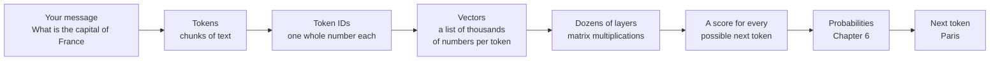
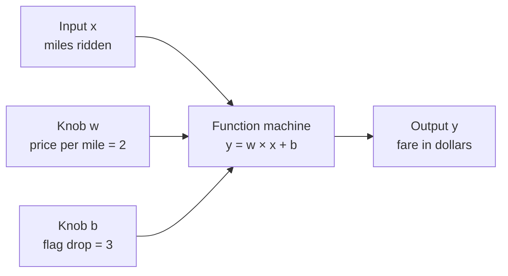
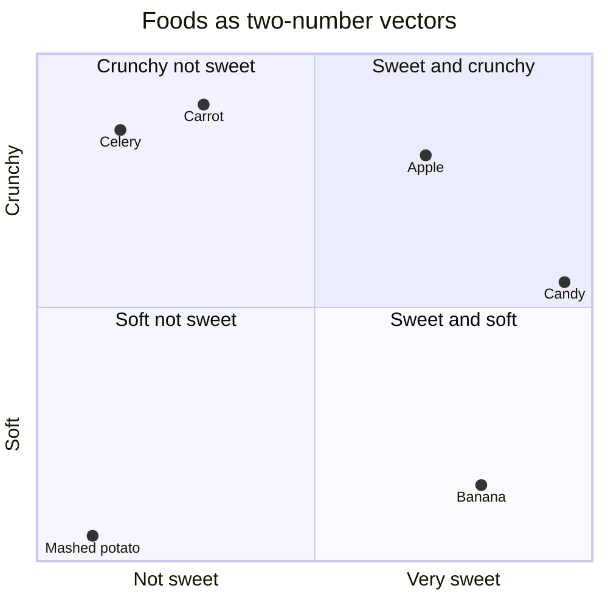
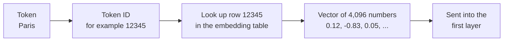
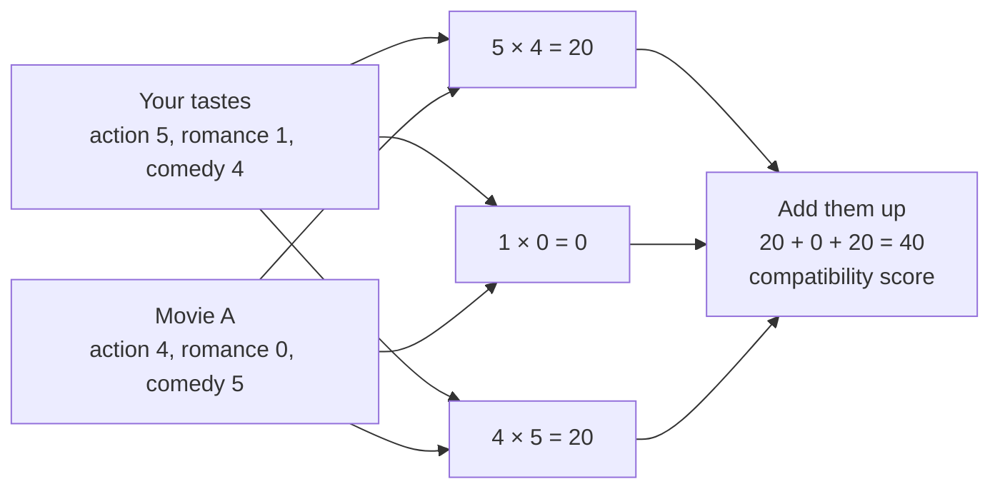
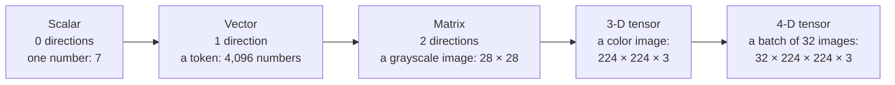
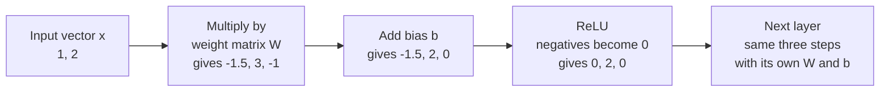
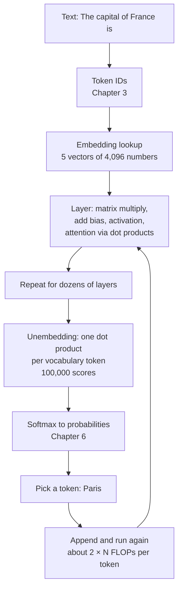

# Chapter 5: The Math of AI, Part 1: Functions, Vectors and Matrices

*Everything your chatbot does comes down to multiplying lists and tables of numbers, and by the end of this chapter you will have done every one of those operations yourself, by hand, with nothing more than arithmetic and a spreadsheet.*

## What you'll learn

- What a function is, and why a chatbot is one giant function with billions of adjustable knobs.
- How to read a graph, compute a slope and decide which line fits a set of data points best, which is the simplest form of machine learning.
- What vectors are, how words become vectors (embeddings), and why "king minus man plus woman" lands on "queen".
- How to compute a dot product and a cosine similarity by hand, and why these two small calculations power search, recommendations and attention.
- How to multiply matrices by hand, what a matrix's "shape" is, and how to count the cost of a multiplication.
- What a tensor is, and why a neural-network layer is just "multiply, add, squash".
- The two rules of thumb that size the whole AI industry: about 2 × N operations per generated token, and about 6 × N × D operations to train a model.
- How computers store decimal numbers at different precisions (FP32, BF16, FP8, FP4), and how to work out how much memory a model needs.

## Before you start

Chapter 2 (How Computers Work: Bits, Transistors and Processors) gives you powers of ten, metric prefixes, bytes and the FLOP, all of which this chapter uses constantly. Chapter 3 (Software, Code and Data: How Everything Becomes Numbers) shows how text, images and sound become numbers; this chapter starts where it ends. You need only arithmetic: adding, subtracting, multiplying, dividing and squaring a number. Keep a calculator, a pencil and a free spreadsheet (Google Sheets or Microsoft Excel) open as you read. Every idea here is worked with small numbers, and every one can be checked in a spreadsheet.

## Why a chatbot needs math, and how little of it you need

When you type "What is the capital of France?" into ChatGPT, Claude or Gemini and press Enter, your words travel to a data center (Chapter 4 follows that journey). There, a program does three things. It turns your text into numbers. It does an enormous amount of multiplying and adding with those numbers. Then it turns the resulting numbers back into text, one small piece at a time. This chapter is about the middle step, the multiplying and adding.

Here is the reassuring part. The operations themselves are simple. A chatbot does not use some exotic branch of mathematics that only professors understand. It multiplies numbers together and adds up the results, over and over, in a few carefully arranged patterns. What makes it hard to picture is the *scale*: a single answer can take tens of trillions of these little operations. You will do the same operations in this chapter, just with three or four numbers instead of billions.

First, one word you will need constantly. Chapter 3 explained that chatbots do not read letters; they read chunks of text.

> **Definition — Token:** A small chunk of text, often a whole word or part of a word, that a language model reads and writes as a single unit. On average one English token is about three-quarters of a word.

The diagram below shows the whole pipeline your message goes through. Each box uses an idea from this chapter or the next one.



*Figure 5.1: The journey of your message through the model, as a chain of number transformations.*

Here is the map of this chapter against that pipeline.

| Math idea | Where it shows up in your chatbot | Section |
|---|---|---|
| Function | The whole model: text in, next-token probabilities out | Functions |
| Slope and line fitting | The simplest version of "learning from data" | Graphs, slopes and fitting a line |
| Vector | Every token becomes a list of numbers | Vectors, Embeddings |
| Dot product | Scoring how relevant one thing is to another | The dot product |
| Cosine similarity | Search and "find similar" features | Cosine similarity |
| Matrix multiplication | Every layer of the model | Matrices, Matrix multiplication |
| Tensor | Batches of many tokens and many users at once | Tensors |
| FLOP counting | What a model costs to run and to train | Counting the cost |
| Precision and memory | Why models need giant chips, and how they shrink | Number precision |

> **Key idea:** All the math in a chatbot is built from four everyday operations: multiply, add, square, and take a square root. The difficulty is scale, not complexity.

## Functions: machines that turn inputs into outputs

### The function machine

Imagine a machine with a slot on one side and a chute on the other. You drop a number in the slot. The machine follows a fixed rule and pushes a number out of the chute. If the rule is "double it and add one", then putting in 3 gives you 7, and putting in 10 gives you 21. Every time you put in 3, you get 7. That predictability is the whole point.

Mathematicians write this rule as `f(x) = 2 × x + 1`. Read it aloud as "f of x equals two times x plus one". The letter `f` is just a name for the machine. The letter `x` stands for whatever number you put in.

> **Definition — Mathematical function:** A rule that turns each input into exactly one output, like a machine that always gives the same result for the same input. `f(x) = 2 × x + 1` is a function that doubles its input and adds one.

> **Definition — Mathematical variable:** A letter, such as x or y, that stands for a number that can change. In `f(x) = 2 × x + 1`, x is the variable you feed in.

A table makes a function concrete. Here is our machine at work:

| Input x | Rule: 2 × x + 1 | Output f(x) |
|---|---|---|
| 0 | 2 × 0 + 1 | 1 |
| 1 | 2 × 1 + 1 | 3 |
| 2 | 2 × 2 + 1 | 5 |
| 3 | 2 × 3 + 1 | 7 |
| 10 | 2 × 10 + 1 | 21 |

> **Analogy:** A function is a vending machine. Press B4 and you get the same snack every time. You do not need to know how the machine works inside to use it, but if you are the owner, you can open it up and change its settings.

### Functions with knobs: parameters

Now take a real example. A taxi company charges $3 the moment you get in (the "flag drop") plus $2 for every mile. The fare is a function of the miles you ride:

`fare = 2 × miles + 3`

A 5-mile ride costs 2 × 5 + 3 = $13. Now suppose a taxi company in another city charges $2.50 per mile and $4 to start. Its function is `fare = 2.5 × miles + 4`. The *shape* of the rule is the same: multiply the input by something, then add something. Only the two settings changed.

Those settings are the most important idea in this chapter. We can write the general shape as

`y = w × x + b`

where x is the input, y is the output, and w and b are knobs you can turn. Turn w up and the price per mile rises. Turn b up and every ride costs more from the start.

> **Definition — Parameter:** An adjustable number inside a function or model that shapes how it turns inputs into outputs. In `y = w × x + b`, w and b are parameters; modern AI models have billions to trillions of them.

> **Definition — Weight:** The most common kind of parameter: a number that is multiplied by an input and so sets how strongly that input influences the output. In the taxi fare, the weight is the price per mile.

> **Definition — Bias:** A parameter that is added after the multiplying, shifting every output up or down by the same amount, like the taxi's flag-drop fee. It has nothing to do with unfair bias in the social sense.



*Figure 5.2: A function with two knobs. Training an AI model means finding good settings for its knobs.*

### Functions with many inputs

Real decisions depend on more than one thing. Suppose a real-estate agent has a rough rule for guessing house prices:

`price = 20,000 × bedrooms + 1,500 × square meters − 1,000 × age in years + 50,000`

For a 3-bedroom, 100-square-meter, 20-year-old house:

- 20,000 × 3 = 60,000
- 1,500 × 100 = 150,000
- −1,000 × 20 = −20,000
- plus the base of 50,000

Total: 60,000 + 150,000 − 20,000 + 50,000 = $240,000.

Look at the pattern: each input gets its own weight, you multiply each input by its weight, you add everything up, and then you add a bias (the 50,000). Notice that age has a *negative* weight: older houses lower the estimate. This "multiply each input by its weight and add it all up" pattern is about to become the star of the chapter under the name *dot product*.

### Your chatbot is one enormous function

Here is the leap. The model inside your chatbot is a function too. Its input is the conversation so far, as a list of tokens. Its output is a list of probabilities, one for every token it knows, saying how likely each one is to come next. If you type "The capital of France is", the output might give " Paris" a probability of 0.92 (a 92% chance; Chapter 6 covers probability properly) and every other token a small share of the rest.

> **Definition — Model:** In AI, the trained function itself: a fixed design (its architecture) plus all of its learned parameter values. "The model" is what actually turns your input into an output.

> **Definition — Vocabulary:** The fixed list of every token a language model can read or write. Modern chatbots typically have vocabularies of roughly 100,000 to 260,000 tokens.

The difference between our taxi function and a chatbot is the number of knobs. The taxi has 2 parameters. A chatbot model has billions or even trillions. Someone has to set all of those knobs, and no human could do it by hand. That is what training does.

> **Definition — Training:** The process of adjusting a model's parameters, using example data, until its outputs are good. Training a frontier chatbot takes months on tens of thousands of chips.

> **Definition — Inference:** Using an already-trained model to produce outputs, with its parameters frozen. Every reply your chatbot writes is inference.

> **Watch out:** The model's knobs do not move while you chat with it. When a chatbot seems to "learn" something about you during a conversation, it is because your earlier messages are fed back in as input (or saved in a separate memory feature), not because its parameters changed.

### Chaining functions together

You can feed the output of one function into another. Suppose you always tip your taxi driver 20%. Your total cost is `total = 1.2 × fare`, and the fare is itself `2 × miles + 3`. Chain them:

`total = 1.2 × (2 × miles + 3) = 2.4 × miles + 3.6`

A 5-mile ride: 2.4 × 5 + 3.6 = $15.60. Check it the long way: fare = $13, and 1.2 × 13 = $15.60. It matches.

> **Definition — Composition (of functions):** Feeding the output of one function into another to make a new, combined function. A neural network is a long composition of simple functions called layers.

### Straight and bent: linear and nonlinear

The taxi function draws a straight line if you plot it: each extra mile adds exactly $2. Functions built only from multiplying by fixed numbers and adding are called linear. (Mathematicians reserve "linear" for lines through zero and call `w × x + b` "affine", but in AI everyone says linear.)

> **Definition — Linear function:** A function built only from multiplying inputs by fixed numbers and adding, so its graph is a straight line (or a flat plane in more dimensions). Each extra unit of input always changes the output by the same amount.

> **Definition — Nonlinear function:** Any function whose graph bends, curves or has corners, such as `y = x × x` or "replace negative numbers with zero". Neural networks need nonlinear steps to model anything more interesting than straight lines.

Now notice something about the tip example. We chained two linear functions, and the result, `2.4 × miles + 3.6`, was still a straight line. That is always true: chaining linear functions gives you another linear function, no matter how many you chain. Keep that fact in your pocket. It is the reason every neural network has a small "bend" between its steps, which we will meet in the section on layers.

## Graphs, slopes and fitting a line

### Points on a grid

A graph turns numbers into pictures. Draw a horizontal line (the x-axis) for inputs and a vertical line (the y-axis) for outputs. Any pair of numbers, such as (3, 5), marks one point: go 3 steps right, then 5 steps up.

> **Definition — Coordinate:** One number that gives a position along one direction (an axis) of a graph. The point (3, 5) has an x-coordinate of 3 and a y-coordinate of 5.

Plot the taxi fare `fare = 2 × miles + 3` at 0, 1, 2, 3 and 4 miles. You get the points (0, 3), (1, 5), (2, 7), (3, 9) and (4, 11). They sit perfectly on a straight line.

### Slope: rise over run

How steep is that line? Pick any two points, say (1, 5) and (3, 9). Going from the first to the second, you move 2 to the right (the run) and 4 up (the rise). The slope is rise divided by run: 4 ÷ 2 = 2. That is exactly the taxi's price per mile. The slope of a line tells you how much the output changes for each one-unit step of the input.

Where does the line cross the vertical axis? At x = 0 the fare is 3, the flag drop. That crossing point is the intercept.

> **Definition — Slope:** How steep a line is, measured as "rise over run": the change in output divided by the change in input. A positive slope goes up to the right; a negative slope goes down; zero is flat.

> **Definition — Intercept:** The point where a line crosses the vertical axis, meaning the output when the input is zero. In `y = w × x + b`, the intercept is b.

So the two knobs of `y = w × x + b` have a picture. The weight w is the slope. The bias b is the intercept. A car that loses $2,000 of value per year has a slope of −2,000 dollars per year. A flat line, with slope 0, means the input does not matter at all.

### Fitting a line to messy data

Real data never sits perfectly on a line. Suppose four friends tell you how many hours they studied for a 10-point quiz and what they scored:

| Hours studied (x) | Quiz score (y) |
|---|---|
| 1 | 3 |
| 2 | 5 |
| 3 | 8 |
| 4 | 9 |

You want a rule that predicts the score from the hours. No straight line passes through all four points. So which line is "best"? We need a way to measure how wrong a line is.

For each friend, the line makes a prediction. The difference between prediction and reality is the error. Let's try a first guess, Line A: `score = 2 × hours + 1`.

| Hours | Actual | Line A predicts | Error (predicted − actual) | Error squared |
|---|---|---|---|---|
| 1 | 3 | 3 | 0 | 0 |
| 2 | 5 | 5 | 0 | 0 |
| 3 | 8 | 7 | −1 | 1 |
| 4 | 9 | 9 | 0 | 0 |

Average of the squared errors: (0 + 0 + 1 + 0) ÷ 4 = 0.25.

Now a second guess, Line B: `score = 3 × hours`.

| Hours | Actual | Line B predicts | Error | Error squared |
|---|---|---|---|---|
| 1 | 3 | 3 | 0 | 0 |
| 2 | 5 | 6 | 1 | 1 |
| 3 | 8 | 9 | 1 | 1 |
| 4 | 9 | 12 | 3 | 9 |

Average: (0 + 1 + 1 + 9) ÷ 4 = 2.75. Line A is much better.

Why square the errors? Two reasons. First, squaring makes every error positive, so a miss of +2 and a miss of −2 do not cancel out and pretend the line is perfect. Second, squaring punishes big misses much more than small ones: an error of 3 counts as 9, three times worse than three separate errors of 1.

> **Definition — Error (residual):** The difference between what a model predicted and what actually happened for one example. A good model has small errors on examples it has never seen.

> **Definition — Mean squared error (MSE):** The average of the squared errors over all examples. It is a single number summarizing how wrong a model is, where lower is better and zero is perfect.

Can we beat Line A? The best possible line for these four points turns out to be `score = 2.1 × hours + 1.0`:

| Hours | Actual | Best line predicts | Error | Error squared |
|---|---|---|---|---|
| 1 | 3 | 3.1 | 0.1 | 0.01 |
| 2 | 5 | 5.2 | 0.2 | 0.04 |
| 3 | 8 | 7.3 | −0.7 | 0.49 |
| 4 | 9 | 9.4 | 0.4 | 0.16 |

Average: (0.01 + 0.04 + 0.49 + 0.16) ÷ 4 = 0.70 ÷ 4 = 0.175. That beats Line A's 0.25. Notice that this line gets *no* point exactly right, yet its overall error is the smallest. "Best" means best on average, not perfect anywhere.

> **Definition — Line of best fit:** The straight line whose knob settings (slope and intercept) give the smallest mean squared error on a set of data points. Finding it is called linear regression.

```
 10 |
  9 |                                    ....o
  8 |                              o.....
  7 |                           ....
  6 |                      .....
  5 |                 ...o.
  4 |            .....
  3 |        ..o.
  2 |   .....
  1 |...
  0 |
    +--------------------------------------------> hours
     0         1         2         3         4
```

*Figure 5.3: The four quiz scores (o) and the line of best fit, score = 2.1 × hours + 1.0 (dots). The line misses every point a little, but misses the group as a whole by the least.*

> **Key idea:** In its simplest form, learning means choosing the knob values (here w = 2.1 and b = 1.0) that make the average error on the examples as small as possible. Every AI model in this book learns this way. The only differences are that its function is far more complicated, it has billions of knobs instead of two, and its error measure is designed for words instead of quiz scores.

How did we find 2.1 and 1.0? For a straight line there is a shortcut formula, and spreadsheets build it in. For a chatbot there is no shortcut, so the computer finds good knob values by repeatedly nudging them downhill on the error. Chapter 6 shows exactly how that works, and Chapter 8 treats linear regression in depth.

> **Try it:** Open a spreadsheet. Put the hours 1, 2, 3, 4 in cells A2 to A5 and the scores 3, 5, 8, 9 in B2 to B5. In any empty cell type `=SLOPE(B2:B5, A2:A5)` and you should get 2.1. Then type `=INTERCEPT(B2:B5, A2:A5)` and you should get 1. The spreadsheet just did machine learning on four examples.

> **Watch out:** A line of best fit describes the data you gave it; it does not prove that studying causes higher scores, and it may predict nonsense far outside the data (it says 20 hours of study gives a score of 43 out of 10). Chapter 6 returns to the difference between patterns and causes, and Chapter 9 to testing models honestly.

## Vectors: lists of numbers that describe things

### A vector is an ordered list

A vector is just a list of numbers in a fixed order. You can describe a house with the vector [3, 120, 15], meaning 3 bedrooms, 120 square meters and 15 years old. A recipe is a vector of ingredient amounts. A character in a video game is a vector of stats: [strength 7, speed 3, magic 9].

The order matters. [3, 120, 15] and [120, 3, 15] describe very different houses (the second has 120 bedrooms). Everyone using the vector must agree on what each position means.

> **Definition — Vector:** An ordered list of numbers, such as [3, 120, 15], where each position has an agreed meaning. A vector can describe a thing's features, or a point or arrow in space.

> **Definition — Dimension:** How many numbers a vector has. [3, 120, 15] is a 3-dimensional vector; the vectors inside a chatbot typically have thousands of dimensions.

> **Analogy:** A vector is a character sheet in a game. Strength, speed and magic are written in the same order on every sheet, so you can compare two characters at a glance. The dimension is simply how many stats the sheet has.

### Vectors as points and arrows

A 2-dimensional vector like [3, 2] can be drawn as a point on a graph: 3 to the right, 2 up. You can also draw it as an arrow from the corner of the graph (the origin, at [0, 0]) to that point. A 3-dimensional vector [x, y, z] is a point in a room: how far along the floor, how far across, how high up.

What about a vector with 4,096 numbers? Nobody can picture 4,096 directions. Here is the good news: you never have to. Every calculation in this chapter works exactly the same way whether a vector has 2 numbers or 4,096. You picture 2 or 3 dimensions, and you trust the arithmetic for the rest. Professional researchers do exactly this.

Here is a small example of vectors as points. Score some foods from 0 to 1 on two features, sweetness and crunchiness, and each food becomes a 2-number vector:



*Figure 5.4: Each food is a vector of [sweetness, crunchiness]. Similar foods land near each other, such as carrot and celery. AI uses the same trick with thousands of features instead of two.*

> **Watch out:** "Dimension" in AI has nothing to do with science-fiction dimensions or time travel. A "4,096-dimensional vector" just means a list of 4,096 numbers.

### Vector arithmetic

You can add two vectors of the same length by adding matching elements:

`[1, 2] + [3, 1] = [1 + 3, 2 + 1] = [4, 3]`

If Monday's shopping is [2 apples, 1 bread] and Tuesday's is [3 apples, 0 bread], the week's total is [5, 1]. Subtraction works the same way: `[4, 3] − [1, 2] = [3, 1]`.

You can also multiply a vector by a single ordinary number, which multiplies every element: `2 × [1, 2] = [2, 4]`. Doubling a recipe doubles every ingredient. An ordinary single number like this has a special name.

> **Definition — Scalar:** A single ordinary number, like 2 or −0.5, as opposed to a list (vector) or table (matrix) of numbers. Multiplying a vector by a scalar stretches or shrinks it.

You cannot add vectors of different lengths. `[1, 2] + [1, 2, 3]` has no meaning, because the third element has no partner. This "shapes must match" rule will follow us all the way to matrices.

### Length and distance

How long is the arrow for the vector [3, 4]? Use the rule you may remember from school (Pythagoras): square each element, add them up, and take the square root.

`length of [3, 4] = square root of (3 × 3 + 4 × 4) = square root of 25 = 5`

> **Definition — Square root:** The number that, multiplied by itself, gives the number you started with. The square root of 25 is 5, because 5 × 5 = 25. Spreadsheets compute it with `=SQRT(25)`.

> **Definition — Magnitude:** The length of a vector: square each element, add them, and take the square root. The magnitude of [3, 4] is 5. Also called the norm.

The same rule works in any number of dimensions. The length of [1, 2, 2] is the square root of (1 + 4 + 4) = the square root of 9 = 3.

The distance between two points is the length of the difference between them. From [1, 2] to [4, 6], the difference is [4 − 1, 6 − 2] = [3, 4], and its length is 5. So the two points are 5 units apart.

> **Definition — Euclidean distance:** The straight-line distance between two points, found by subtracting the vectors and taking the magnitude of the result. It is the "as the crow flies" distance, extended to any number of dimensions.

## Embeddings: meaning as a location

### Words as points on a map

Chapter 3 showed that a tokenizer turns each token into an ID number. But those ID numbers are arbitrary labels, like jersey numbers on a team. Token 9,906 and token 9,907 need not have anything to do with each other. A model cannot do anything clever with jersey numbers.

What it needs instead are numbers where *similar meanings sit close together*. If "cat" and "kitten" are near each other, and both are far from "invoice", then distance itself carries meaning. That is what an embedding provides.

Let's build a toy one by hand. Give each word two numbers: how "royal" it is (0 for not royal, 1 for royal) and its gender (+1 for male, −1 for female).

| Word | Royalty | Gender | Vector |
|---|---|---|---|
| king | 1 | +1 | [1, 1] |
| queen | 1 | −1 | [1, −1] |
| man | 0 | +1 | [0, 1] |
| woman | 0 | −1 | [0, −1] |

Now try the most famous calculation in the history of embeddings: king − man + woman.

1. king − man = [1, 1] − [0, 1] = [1 − 0, 1 − 1] = [1, 0]. We removed "male" and kept "royal".
2. [1, 0] + woman = [1, 0] + [0, −1] = [1, −1]. We added "female".
3. [1, −1] is exactly queen.

```
 gender
  +1 (male)    man  o-----------------------o  king
                    |                       |
                    |  minus man            |  minus man
                    |  plus woman           |  plus woman
                    v                       v
  -1 (female) woman o-----------------------o  queen
                    0                       1
                              royalty  ->
```

*Figure 5.5: In a toy 2-D embedding, the step from man to woman is the same arrow as the step from king to queen. Real embeddings have hundreds or thousands of axes, and nobody chooses what they mean.*

> **Definition — Embedding:** A vector that represents a word, token, image, song or anything else, arranged so that similar things get similar vectors. The imaginary space these vectors live in is called the embedding space, a map where distance means difference in meaning.

### Real embeddings

In our toy, we chose the axes ourselves. Real embeddings are *learned* from data. A 2013 method called word2vec learned word vectors by reading huge amounts of text and predicting which words appear near which (Chapter 14 explains how). Nobody told it about royalty or gender. Yet directions like "male to female" and "country to capital" showed up in its vector space on their own, because they help predict text.

> **Definition — word2vec:** A 2013 technique that learns a vector for every word by training on the task of predicting nearby words. It became famous for analogies like king − man + woman ≈ queen.

Three honest caveats make this more real:

- **The axes are not labeled.** In a learned embedding, meaning is smeared across many numbers. There is no single "royalty" number you can point to.
- **Analogies work only approximately.** In real word vectors, king − man + woman lands *near* queen, and queen is the nearest word only once you exclude the three input words (king itself is often closest). Many analogies fail outright.
- **Embeddings absorb the biases of their training text.** If the text links certain jobs with one gender, so will the geometry.

> **Watch out:** "king − man + woman = queen" is a lovely illustration, not an exact law. Treat embedding arithmetic as a rough compass, not a calculator.

### Your chatbot's embedding table

Inside your chatbot, the very first thing that happens to your tokens is an embedding lookup. The model keeps a giant table with one row per token in its vocabulary. Each row is a vector of a few thousand numbers (4,096 is a common size in open models). To embed a token, the model simply looks up its row.

> **Definition — Embedding table:** A large table inside a language model with one row of numbers (one vector) per token in its vocabulary. Turning a token ID into a vector is just looking up its row. Also called the embedding matrix.

How big is that table? With a vocabulary of 100,000 tokens and 4,096 numbers per row, it holds 100,000 × 4,096 = 409,600,000 numbers. That is about 0.4 billion parameters before the model has done any real work, and every one of those numbers was learned in training.



*Figure 5.6: Turning a token into a vector is a table lookup. The ID and the numbers shown are made up for illustration.*

> **At the frontier (2026):** Embeddings are not only inside chatbots. Separate embedding models turn whole sentences, documents, images and products into vectors so that software can search by meaning. A small free model such as all-MiniLM-L6-v2 turns any sentence into a vector of 384 numbers, and large companies store billions of such vectors in special databases. Chapter 27 shows how chatbots use this to search your own documents.

## The dot product: the most important calculation in this book

### Multiply matching entries, then add

You have done dot products all your life without the name. At the grocery checkout you buy 2 loaves of bread at $1.50, 1 block of cheese at $4.00 and 3 apples at $0.50. Your bill is:

`2 × 1.50 + 1 × 4.00 + 3 × 0.50 = 3.00 + 4.00 + 1.50 = $8.50`

Write the quantities as one vector, [2, 1, 3], and the prices as another, [1.50, 4.00, 0.50]. The bill is what you get when you multiply matching entries and add up the results. That is a dot product, written with a dot: `[2, 1, 3] · [1.50, 4.00, 0.50] = 8.50`.

> **Definition — Dot product:** Multiply two equal-length vectors entry by entry and add up the results. [2, 1, 3] · [1.50, 4.00, 0.50] = 3 + 4 + 1.5 = 8.5. A large dot product means the vectors "agree".

> **Definition — Weighted sum:** Adding up several numbers after multiplying each by its own importance (weight). A dot product is a weighted sum, and so is the house-price rule earlier in this chapter.

Now a more AI-flavored example. A movie app describes your tastes as a vector of how much you like action, romance and comedy, each from 0 to 5: you = [5, 1, 4]. It describes each movie by how much of each it contains:

- Movie A, an action comedy: [4, 0, 5]
- Movie B, a romantic drama: [1, 5, 0]

Score each movie with a dot product:

- you · Movie A = 5 × 4 + 1 × 0 + 4 × 5 = 20 + 0 + 20 = **40**
- you · Movie B = 5 × 1 + 1 × 5 + 4 × 0 = 5 + 5 + 0 = **10**

Movie A wins easily. The dot product rewards the movie for having lots of what you like, and ignores what you don't care about.



*Figure 5.7: A dot product pairs up matching entries, multiplies each pair, and adds the results into one score.*

> **Analogy:** A dot product is the compatibility score on a dating or movie app. For each trait, multiply how much you care by how much the other side has, then add it all up. Big shared enthusiasms make a big score.

### What the sign of a dot product tells you

Dot products can be positive, zero or negative, and each tells you something:

| Example | Calculation | Result | Meaning |
|---|---|---|---|
| [2, 1] · [1, 2] | 2 × 1 + 1 × 2 | 4 | Positive: they point in roughly the same direction |
| [1, 0] · [0, 1] | 1 × 0 + 0 × 1 | 0 | Zero: they are at right angles, unrelated |
| [1, 1] · [−1, −1] | 1 × (−1) + 1 × (−1) | −2 | Negative: they point in opposite directions |

Negative numbers make the dot product even more expressive. If your taste vector includes horror at −5 (you hate it), a movie that is full of horror gets a large negative contribution, pulling its score down. That is exactly the behavior you want from a recommender.

### The dot product inside AI

This one small calculation shows up everywhere in this book:

- **A single artificial neuron** is a dot product of its inputs with its weights, plus a bias (Chapter 12).
- **Attention**, the key ingredient of the Transformer, scores how relevant each token is to each other token with a dot product (Chapter 15).
- **Search and recommendations** score your query or profile against millions of items with dot products (Chapter 27 and Chapter 51).
- **The last step of your chatbot** scores its final vector against the vector of every token in the vocabulary, one dot product per token, to decide what comes next.

### Counting the cost

A dot product of two vectors of length n takes n multiplications and n − 1 additions. Chapter 2 introduced the unit for counting this kind of work.

> **Definition — FLOP (floating-point operation):** One arithmetic operation, such as a single multiplication or a single addition, on decimal numbers. Counting FLOPs is how people measure how much computing a job takes.

> **Definition — Multiply-add:** The pair of operations "multiply two numbers, then add the result to a running total", which is the basic step of every dot product. One multiply-add counts as 2 FLOPs.

For two vectors of 4,096 numbers, that is 4,096 multiplications and 4,095 additions, or about 8,192 FLOPs. In general, a dot product of length n costs about 2 × n FLOPs. This counting habit will let us estimate the cost of a whole chatbot by the end of the chapter.

> **Try it:** In a spreadsheet, put 2, 1, 3 in cells A1 to C1 and 1.5, 4, 0.5 in A2 to C2. In any other cell type `=SUMPRODUCT(A1:C1, A2:C2)`. You should get 8.5. SUMPRODUCT is a dot product, and you will use it in several exercises.

## Cosine similarity: comparing direction, ignoring size

### The problem with raw dot products

Dot products have a weakness: they grow with the size of the vectors. Suppose your friend has exactly your taste but is more enthusiastic, so they rate everything twice as high: friend = [10, 2, 8]. Their dot product with Movie A is 10 × 4 + 2 × 0 + 8 × 5 = 80, double yours. The raw score makes your friend look twice as compatible with Movie A, even though your tastes point in exactly the same direction.

Often we care about *direction* (what kind of thing it is), not *size* (how loud or long it is). For documents, size might just mean the document is long. So we divide the dot product by the lengths of both vectors. The result is called cosine similarity, because it equals the cosine of the angle between the two arrows (a fact from trigonometry you don't need).

`cosine similarity = (a · b) ÷ (length of a × length of b)`

> **Definition — Cosine similarity:** A score from −1 to 1 measuring how closely two vectors point in the same direction, ignoring their lengths. It is the dot product divided by both vectors' lengths: 1 means same direction, 0 unrelated, −1 opposite.

### Worked by hand

**You and your enthusiastic friend.**

1. Dot product: you · friend = 5 × 10 + 1 × 2 + 4 × 8 = 50 + 2 + 32 = 84.
2. Your length: square root of (25 + 1 + 16) = square root of 42 ≈ 6.48.
3. Friend's length: square root of (100 + 4 + 64) = square root of 168 ≈ 12.96.
4. Cosine: 84 ÷ (6.48 × 12.96) = 84 ÷ 84.0 = 1.0.

A perfect 1: same direction, exactly as it should be.

**You and Movie A.**

1. Dot product: 40 (from before).
2. Movie A's length: square root of (16 + 0 + 25) = square root of 41 ≈ 6.40.
3. Cosine: 40 ÷ (6.48 × 6.40) = 40 ÷ 41.5 ≈ 0.96. Very similar.

**You and Movie B.**

1. Dot product: 10.
2. Movie B's length: square root of (1 + 25 + 0) = square root of 26 ≈ 5.10.
3. Cosine: 10 ÷ (6.48 × 5.10) = 10 ÷ 33.0 ≈ 0.30. Not very similar.

Three simpler cases show the full range:

| Vectors | Dot product | Lengths | Cosine | Meaning |
|---|---|---|---|---|
| [3, 4] and [6, 8] | 18 + 32 = 50 | 5 and 10 | 50 ÷ 50 = 1 | Same direction |
| [3, 4] and [4, −3] | 12 − 12 = 0 | 5 and 5 | 0 ÷ 25 = 0 | At right angles, unrelated |
| [3, 4] and [−3, −4] | −9 − 16 = −25 | 5 and 5 | −25 ÷ 25 = −1 | Opposite directions |

Many AI systems skip the division step by rescaling every vector to length 1 ahead of time (for example, [3, 4], whose length is 5, becomes [3 ÷ 5, 4 ÷ 5] = [0.6, 0.8]), which is called normalizing. After that, a plain dot product *is* the cosine similarity, and it is cheaper to compute.

### Why this matters to you

When a support chatbot finds the help article that answers "I forgot my login", even though the article is titled "How do I reset my password?" and shares no words with your question, cosine similarity between embeddings is usually doing the work. The two sentences mean similar things, so their embedding vectors point in similar directions.

> **Watch out:** High cosine similarity means "about similar things", not "says the same thing". "I love this phone" and "I hate this phone" can have quite similar embeddings, because they are both short opinions about a phone. Systems that rely on similarity need other checks for meaning.

> **At the frontier (2026):** Attention compares tokens to each other with dot products, so the number of comparisons grows with the square of the conversation length: double the length and there are four times as many comparisons. That is a big problem for million-token contexts (the context is all the text the model reads at once; Chapter 7 and Chapter 18 explain it). DeepSeek's V4 models use compressed and sparse attention (each token compares itself with a summary or a selected subset of earlier tokens instead of all of them) to cut this down; according to DeepSeek's technical report, at a 1-million-token context V4-Pro needs only 27% of the per-token computation of its predecessor, V3.2. Chapter 15 and Chapter 23 explain these tricks.

## Matrices: tables of numbers

### A grid with a shape

A matrix is a rectangular table of numbers, arranged in rows and columns. If three students each take four quizzes, their scores form a matrix with 3 rows and 4 columns:

| | Quiz 1 | Quiz 2 | Quiz 3 | Quiz 4 |
|---|---|---|---|---|
| Ana | 7 | 9 | 8 | 10 |
| Ben | 5 | 6 | 9 | 7 |
| Chen | 8 | 8 | 6 | 9 |

We say this matrix has shape 3 × 4 (read "three by four"): rows first, then columns. It holds 3 × 4 = 12 numbers. Each row is a vector (one student's scores), and so is each column (one quiz's scores). A spreadsheet is a matrix with labels around it.

> **Definition — Matrix:** A rectangular table of numbers arranged in rows and columns. In AI, a matrix can hold a dataset (one row per example) or a layer's weights (a machine that transforms vectors).

> **Definition — Shape:** The size of a matrix or tensor, written as rows × columns (for example 3 × 4), or as a longer list for tensors. Shapes must line up for operations like multiplication to make sense.

Matrices play two different roles in AI, and it helps to keep them apart:

1. **A matrix as data.** Each row is one example (a house, a patient, a token) and each column is one feature. This is how spreadsheets and databases store things.
2. **A matrix as a machine.** The matrix holds weights, and multiplying a vector by it transforms that vector into a new one. This is what a neural-network layer is.

### A matrix as a machine that transforms vectors

A bakery makes two products, cakes and batches of cookies. Each needs flour, sugar and eggs:

| Ingredient | Per cake | Per cookie batch |
|---|---|---|
| Flour (cups) | 2 | 1 |
| Sugar (cups) | 1 | 1 |
| Eggs | 3 | 2 |

The numbers in this table form a 3 × 2 matrix. Today's order is 4 cakes and 10 cookie batches, the vector [4, 10]. How much of each ingredient do you need?

- Flour: 2 × 4 + 1 × 10 = 8 + 10 = **18 cups**
- Sugar: 1 × 4 + 1 × 10 = 4 + 10 = **14 cups**
- Eggs: 3 × 4 + 2 × 10 = 12 + 20 = **32 eggs**

Look at what each line is: a row of the matrix dotted with the order vector. The matrix took in a 2-number vector (what to bake) and produced a 3-number vector (what to buy). That is matrix-vector multiplication.

> **Definition — Matrix-vector multiplication:** Turning a vector into a new vector by taking the dot product of each row of a matrix with the vector. A matrix with 3 rows and 2 columns turns a 2-number vector into a 3-number vector.

The shape rule: a matrix of shape (m × n) can multiply a vector of length n, and it produces a vector of length m. The number of *columns* must equal the length of the input. The bakery matrix has 2 columns, one per product, and the order has 2 numbers, one per product. They match.

Notice that the output can be longer or shorter than the input. This is how layers in a neural network expand a representation into a bigger space or squeeze it into a smaller one.

> **Analogy:** A matrix is a currency-exchange board or a mixing desk. Inputs come in on one side, each output is a blend of all the inputs in fixed proportions, and the board's numbers set the proportions.

### By hand: a 2 × 2 example

Multiply the matrix with rows [1, 2] and [3, 4] by the vector [5, 6]:

- First output: row 1 · vector = 1 × 5 + 2 × 6 = 5 + 12 = **17**
- Second output: row 2 · vector = 3 × 5 + 4 × 6 = 15 + 24 = **39**

Result: [17, 39]. Two dot products, two outputs. That is all matrix-vector multiplication ever is, however large the matrix.

### Matrices as transformations

Small matrices make the "machine" idea visible:

| Matrix (rows) | What it does to [x, y] | Example |
|---|---|---|
| [1, 0] and [0, 1] | Leaves it unchanged | [3, 2] becomes [3, 2] |
| [2, 0] and [0, 1] | Stretches it sideways to double width | [3, 2] becomes [6, 2] |
| [0, −1] and [1, 0] | Rotates it a quarter turn counterclockwise | [1, 0] becomes [0, 1] |
| [1, 1] and [0, 0] | Mixes the two numbers into one and drops the rest | [3, 2] becomes [5, 0] |

Check the rotation by hand: row 1 · [1, 0] = 0 × 1 + (−1) × 0 = 0, and row 2 · [1, 0] = 1 × 1 + 0 × 0 = 1, giving [0, 1]. An arrow pointing right now points up.

> **Definition — Linear transformation:** Any change to vectors that a matrix multiplication can produce, such as stretching, rotating, mixing or flattening. Every layer of a neural network starts with one, and training chooses which.

A neural-network layer is a matrix whose numbers were learned. During training, it discovers a transformation that moves the vectors around so that useful distinctions become easier to see: for example, so that "a question about cooking" and "a question about taxes" end up pointing in different directions.

## Matrix multiplication: many dot products at once

### The rule: row times column

Now multiply two matrices. Take A, with rows [1, 2] and [3, 4], and B, with rows [5, 6] and [7, 8]. The answer C = A × B is a new matrix. Each entry of C is one dot product: a row of A with a column of B.

```
      A              B                 C = A × B
  [ 1  2 ]       [ 5  6 ]         [ 19  22 ]
  [ 3  4 ]   ×   [ 7  8 ]    =    [ 43  50 ]

  C top-left     = row 1 of A · column 1 of B = 1×5 + 2×7 = 19
  C top-right    = row 1 of A · column 2 of B = 1×6 + 2×8 = 22
  C bottom-left  = row 2 of A · column 1 of B = 3×5 + 4×7 = 43
  C bottom-right = row 2 of A · column 2 of B = 3×6 + 4×8 = 50
```

*Figure 5.8: Matrix multiplication by hand. Each output cell is the dot product of one row from the left matrix with one column from the right matrix.*

Note the columns of B: column 1 is [5, 7] (reading down), and column 2 is [6, 8]. A common beginner slip is to use B's rows instead of its columns. Say it out loud as you go: "across the row, down the column".

> **Definition — Matrix multiplication:** Combining two matrices into a new one where each entry is the dot product of a row of the first with a column of the second. It is the single most common operation in AI and is often shortened to "matmul".

You can think of matrix multiplication as many matrix-vector multiplications done side by side. Each column of B is a vector, and A transforms each of them.

### The shape rule

The rows of the left matrix and the columns of the right matrix must be the same length, or the dot products cannot be computed. In shape terms:

`(m × n) times (n × p) gives (m × p)`

The two inside numbers must match, and the two outside numbers give the shape of the answer.

Try a 2 × 3 matrix times a 3 × 2 matrix. Let A have rows [1, 0, 2] and [0, 1, 3]. Let B have rows [1, 2], [0, 1] and [4, 0], so its columns are [1, 0, 4] and [2, 1, 0].

- Row 1 · column 1 = 1 × 1 + 0 × 0 + 2 × 4 = 9
- Row 1 · column 2 = 1 × 2 + 0 × 1 + 2 × 0 = 2
- Row 2 · column 1 = 0 × 1 + 1 × 0 + 3 × 4 = 12
- Row 2 · column 2 = 0 × 2 + 1 × 1 + 3 × 0 = 1

The answer has rows [9, 2] and [12, 1]: shape 2 × 2, exactly as the rule predicted.

| Left shape | Right shape | Inner numbers match? | Result shape |
|---|---|---|---|
| 2 × 2 | 2 × 2 | yes (2 and 2) | 2 × 2 |
| 2 × 3 | 3 × 2 | yes (3 and 3) | 2 × 2 |
| 3 × 2 | 2 × 3 | yes (2 and 2) | 3 × 3 |
| 1 × 4096 | 4096 × 4096 | yes | 1 × 4096 |
| 2 × 3 | 2 × 3 | no (3 and 2) | not allowed |

### Order matters

With ordinary numbers, 3 × 5 = 5 × 3. With matrices, the order usually changes the answer. Compute B × A for our 2 × 2 example, using rows of B and columns of A:

- [5, 6] · [1, 3] = 5 + 18 = 23
- [5, 6] · [2, 4] = 10 + 24 = 34
- [7, 8] · [1, 3] = 7 + 24 = 31
- [7, 8] · [2, 4] = 14 + 32 = 46

B × A has rows [23, 34] and [31, 46], which is different from A × B's [19, 22] and [43, 50]. "Rotate then stretch" is not the same as "stretch then rotate", and that is why the order of layers in a network matters.

### Why AI multiplies matrices, not just vectors: batching

A layer applies the same weight matrix to every token. When you paste a 2,000-token document into Claude, the model could transform each token's vector one at a time, doing 2,000 separate matrix-vector multiplications. Instead, it stacks all 2,000 vectors into one matrix and does a single big matrix-matrix multiplication. The arithmetic is identical, but the chip can organize the work far more efficiently, keeping thousands of tiny calculators busy at once. The same trick lets a data center serve many users' requests together. Chapter 23 shows how much money this saves.

### Counting the cost

Each entry of an (m × n) times (n × p) product is a dot product of length n, which takes n multiply-adds. There are m × p entries. So the total is m × n × p multiply-adds, or about 2 × m × n × p FLOPs.

- 2 × 2 times 2 × 2: 2 × 2 × 2 = 8 multiplications (plus 4 additions).
- 1,000 × 1,000 times 1,000 × 1,000: one billion multiply-adds, or about 2 × 10^9 FLOPs.
- 4,096 × 4,096 times 4,096 × 4,096: 4,096 × 4,096 × 4,096 ≈ 6.9 × 10^10 multiply-adds, or about 1.4 × 10^11 FLOPs.

| Matrix size (square, n × n) | Multiply-adds (n × n × n) | Approximate FLOPs |
|---|---|---|
| 10 | 1,000 | 2,000 |
| 100 | 1,000,000 | 2 × 10^6 |
| 1,000 | 1,000,000,000 | 2 × 10^9 |
| 10,000 | 10^12 | 2 × 10^12 |

Notice the pattern: make the matrices 10 times wider and the work grows 1,000 times. Double the size and the work grows 8 times. A modern AI chip does on the order of 10^15 FLOPs per second, so even the 4,096-wide multiplication takes a fraction of a millisecond. That speed exists precisely because the chips were designed around this one operation (Chapter 32).

> **At the frontier (2026):** Even something as old as matrix multiplication still has open problems. In 1969 Volker Strassen found a way to multiply 2 × 2 matrices with 7 multiplications instead of the obvious 8. In May 2025, Google DeepMind's AlphaEvolve system found a way to multiply 4 × 4 matrices of complex numbers (a kind of number, used in physics and engineering, that is really a pair of ordinary numbers) with 48 multiplications, the first improvement on Strassen's approach for that case in 56 years. AI is now helping discover better ways to do the very math that AI runs on.

## Tensors: stacks of matrices

A vector is a line of numbers. A matrix is a grid. What comes next? A stack of grids, and a stack of stacks, and so on. A color photo, for instance, is three grids stacked together (height × width × 3 colors: red, green and blue), and a batch of 32 photos is a stack of those. The general word for "a block of numbers with any number of directions" is tensor.



*Figure 5.9: Each step adds one more direction. "Tensor" is the general name for all of them.*

> **Definition — Tensor:** A block of numbers with any number of directions (axes): a vector is a 1-D tensor, a matrix 2-D, a color image 3-D, a batch of images 4-D. In AI, "tensor" simply means a multi-dimensional array of numbers.

To count the numbers in a tensor, multiply the sizes in its shape. A batch of 32 color images, each 224 × 224 pixels, has 32 × 224 × 224 × 3 = 4,816,896 numbers. Inside a chatbot, a typical tensor might hold 8 conversations × 1,000 tokens each × 4,096 numbers per token = 32,768,000 numbers.

> **Definition — Batch:** A group of examples (images, sentences, users' requests) processed together in one go. Batching keeps the chip busy and is a major reason AI is affordable to run.

> **Definition — Hidden size:** The number of numbers in each token's vector as it travels through a language model, such as 4,096. It sets the width of most of the model's matrices.

The word appears all over AI: Google's TensorFlow library, its TPU (Tensor Processing Unit) chips, and the "tensor cores" inside NVIDIA GPUs that do small matrix multiplications in one step. Physicists use "tensor" for something more specific, but in AI it just means a block of numbers.

| Name | Directions | Example shape | Example in AI |
|---|---|---|---|
| Scalar | 0 | (no shape) | A learning rate of 0.001 (a training setting, Chapter 6) |
| Vector | 1 | 4,096 | One token's embedding |
| Matrix | 2 | 4,096 × 4,096 | One layer's weights |
| 3-D tensor | 3 | 8 × 1,000 × 4,096 | 8 conversations of 1,000 tokens, 4,096 numbers per token |
| 4-D tensor | 4 | 32 × 224 × 224 × 3 | A batch of 32 color photos |

## Why AI is mostly multiplying big tables of numbers

### One layer: multiply, add, squash

You now have all the pieces to understand a layer of a neural network. A layer does three things to a vector:

1. Multiply it by a weight matrix (a matrix-vector multiplication).
2. Add a bias vector (one number per output).
3. Apply a simple bend, called an activation function, to each number.

In symbols: `output = activation(W × x + b)`.

The most popular bend is beautifully simple: replace every negative number with zero, and leave positive numbers alone.

> **Definition — Layer:** One stage of a neural network that takes a vector in, multiplies it by a weight matrix, adds a bias, applies an activation function, and passes the result to the next stage.

> **Definition — Activation function:** A simple nonlinear "bend" applied to each number after a layer's multiply-and-add, such as "replace negatives with zero". Without it, stacking layers would be pointless.

> **Definition — ReLU (Rectified Linear Unit):** The most common activation function: it outputs the input if it is positive and zero otherwise. ReLU(3) = 3, ReLU(−2) = 0.

Let's run one layer by hand. The input is x = [1, 2]. The weight matrix W has 3 rows: [0.5, −1], [1, 1] and [−2, 0.5]. The bias is b = [0, −1, 1].

1. **Multiply.** W × x:
   - row 1: 0.5 × 1 + (−1) × 2 = 0.5 − 2 = −1.5
   - row 2: 1 × 1 + 1 × 2 = 3
   - row 3: −2 × 1 + 0.5 × 2 = −2 + 1 = −1
   - result: [−1.5, 3, −1]
2. **Add the bias.** [−1.5 + 0, 3 − 1, −1 + 1] = [−1.5, 2, 0]
3. **Squash with ReLU.** [0, 2, 0], because −1.5 becomes 0, 2 stays 2, and 0 stays 0.

The layer turned 2 numbers into 3. Some outputs were "switched off" by ReLU and one passed through. In a real network the next layer would now take [0, 2, 0] as its input.



*Figure 5.10: One neural-network layer, worked with the numbers from the text: multiply, add, squash, pass it on.*

### Why the squash matters

Remember the tip example: chaining two linear functions gave another straight line. The same is true for layers. Suppose layer 1 computes `y = 2 × x` and layer 2 computes `z = 3 × y + 1`. Chained, `z = 3 × (2 × x) + 1 = 6 × x + 1`, a single straight line. Stack a hundred layers without activation functions and you still have one straight line, just with different numbers. All that work would buy nothing.

ReLU breaks the chain. Here is a tiny demonstration of its power: `ReLU(x) + ReLU(−x)` gives a V shape, the "absolute value" of x. For x = 3: ReLU(3) + ReLU(−3) = 3 + 0 = 3. For x = −3: ReLU(−3) + ReLU(3) = 0 + 3 = 3. No straight line can make a V. With enough ReLUs, a network can build any curvy shape it needs, one bend at a time. (Chapter 13 explains the mathematical result behind this, called universal approximation.)

> **Analogy:** A neural network is an assembly line of mixing desks. Each desk blends its inputs in learned proportions (the matrix), adds a learned offset (the bias), then passes everything through a "no negatives allowed" filter (ReLU) before the next desk.

### Stacking layers: a neural network

Chain many layers and you have a neural network. Run an input through all of them, start to finish, and you have done a forward pass.

> **Definition — Neural network:** A function made of many layers chained together, each doing "multiply by a weight matrix, add a bias, apply an activation". It is loosely inspired by brain cells but is really stacked matrix arithmetic.

> **Definition — Deep learning:** Machine learning using neural networks with many layers. "Deep" refers to the number of layers stacked, not to profound understanding.

> **Definition — Forward pass:** Running an input through a neural network from the first layer to the last to get an output. Every token your chatbot writes requires one forward pass.

> **Watch out:** Neural networks are not miniature brains. Each artificial "neuron" is just a dot product, an addition and a bend. Biology inspired the name, but what runs on the chip is the arithmetic you just did by hand.

### Counting parameters

How many knobs does a layer have? A layer that turns n inputs into m outputs has an m × n weight matrix plus m biases:

`parameters = m × n + m`

- Our worked layer (2 inputs, 3 outputs): 3 × 2 + 3 = **9**.
- A small network with 3 inputs, a hidden layer (one between input and output) of 4, and 2 outputs: (4 × 3 + 4) + (2 × 4 + 2) = 16 + 10 = **26**.
- One square layer of width 4,096: 4,096 × 4,096 + 4,096 = 16,777,216 + 4,096 = **16,781,312**, about 16.8 million.

A large language model contains several hundred matrices of this kind of size (some of them three or four times wider), stacked in dozens of layers, plus the embedding table. Add them up and you reach the tens or hundreds of billions. When someone says "a 70-billion-parameter model", they mean 70 billion numbers like the 0.5 and −1 in our worked layer, every one set by training. Chapter 12 builds such networks from scratch, and Chapter 15 shows exactly which matrices a Transformer contains.

> **Key idea:** A neural network is "multiply by a matrix, add, bend", repeated. The vast majority of the arithmetic a chatbot does is matrix multiplication, which is why the AI industry is built around chips that multiply matrices fast.

## Counting the cost: two rules of thumb that size the AI industry

You can now estimate what it costs, in raw arithmetic, to run and to train a model. Two rules of thumb, popularized by a 2020 paper on scaling laws (formulas showing how a model improves predictably as it gets more compute, data and parameters; Chapter 19) by Jared Kaplan and colleagues at OpenAI, are used everywhere from research papers to investment memos. Let N be the number of parameters.

### Rule 1: about 2 × N FLOPs to generate one token

When the model processes one token, each weight takes part in one multiply-add: multiply the incoming number by the weight, add it to a running total. One multiply-add is 2 FLOPs. So one token costs about 2 × N FLOPs.

| Model size N | FLOPs per token (2 × N) | FLOPs for a 500-token answer |
|---|---|---|
| 8 billion | 1.6 × 10^10 | 8 × 10^12 |
| 70 billion | 1.4 × 10^11 | 7 × 10^13 |
| 405 billion | 8.1 × 10^11 | 4 × 10^14 |

So a 70-billion-parameter model writing you a 500-token answer (roughly 375 words) does about 70 trillion arithmetic operations. Every reply. For every user.

There is one important twist for the biggest modern models. Many use a design called mixture of experts, where each token only passes through a small, selected part of the network.

> **Definition — Mixture of experts (MoE):** A model design that contains many smaller sub-networks ("experts") plus a router that sends each token through only a few of them. It gives a model huge total size while keeping the work per token modest.

> **Definition — Active parameters:** In a mixture-of-experts model, the parameters actually used to process one token, as opposed to the total stored. Compute per token depends on active parameters; memory depends on the total.

For example, DeepSeek describes its V4-Pro model as having 1.6 trillion parameters in total but only 49 billion active per token. Its compute per token is therefore about 2 × 49 billion ≈ 10^11 FLOPs, similar to a 50-billion-parameter ordinary model, even though all 1.6 trillion parameters must be stored somewhere. Chapter 17 explains how this works.

### Rule 2: about 6 × N × D FLOPs to train

Training is more expensive per token for a simple reason. For every training token, the model must do a forward pass (about 2 × N FLOPs) and then work out how to adjust every knob, which is called the backward pass (Chapter 6 explains it). The backward pass costs about twice the forward pass, or 4 × N. Together, that is about 6 × N FLOPs per training token. Multiply by D, the number of tokens in the training data:

`training FLOPs ≈ 6 × N × D`

**Worked example 1: GPT-3 (2020).** N = 175 billion = 1.75 × 10^11 parameters, D = 300 billion = 3 × 10^11 tokens.

6 × 1.75 × 10^11 × 3 × 10^11 = 6 × 5.25 × 10^22 = 3.15 × 10^23 FLOPs.

**Worked example 2: Meta's Llama 3.1 405B (2024).** N = 405 billion = 4.05 × 10^11, D = 15.6 trillion = 1.56 × 10^13 tokens.

6 × 4.05 × 10^11 × 1.56 × 10^13 ≈ 3.8 × 10^25 FLOPs. This matches the figure Meta reported, which shows how good the rule of thumb is.

How long does that take? Divide by how fast the computers really run. Meta trained Llama 3.1 405B on 16,384 NVIDIA H100 GPUs. Each H100 can do about 989 trillion FLOPs per second at the 16-bit precision used for training, but no real job runs at full speed; Meta reported using roughly 40% of it.

> **Definition — MFU (model FLOPs utilization):** The fraction of a chip's theoretical top speed that a real training job actually achieves on the model's necessary math. Large training runs typically reach about 35 to 50%, because time is lost to communication, memory waits and failures.

16,384 GPUs × 989 × 10^12 FLOPs per second × 0.40 ≈ 6.5 × 10^18 FLOPs per second for the whole cluster.

3.8 × 10^25 ÷ 6.5 × 10^18 ≈ 5.9 million seconds ≈ **68 days** of nonstop computing.

That is why frontier training runs take months, and why labs buy GPUs by the tens of thousands. Chapter 19 and Chapter 37 turn these numbers into dollars, electricity and calendar time.

> **At the frontier (2026):** According to Epoch AI, the compute used to train frontier models has grown about 5 times per year since 2020, and 2025–26 frontier runs are at 10^26 FLOPs and beyond. OpenAI said in September 2026 that its GPT-6 Astra model came from its first pretraining run on more than 100,000 GPUs. Plug numbers like these into 6 × N × D and you can sanity-check headlines yourself.

> **Watch out:** These rules ignore some real costs, such as the extra work attention does on very long conversations, the time chips spend talking to each other, and failed experiments that never became a product. Treat them as estimates of the core arithmetic, not as invoices. They are still the first tool professionals reach for.

## Number precision: how many digits does each number get?

### Floating point: scientific notation for computers

Every parameter is a decimal number like 0.0372 or −1.58, and the computer has to store it in a fixed number of bits. How? The same way scientists write huge and tiny numbers. The number of molecules in a spoonful of water might be written 6.02 × 10^23: some significant digits (6.02) and a scale (10 to the 23rd). Computers do the same thing in binary, using one bit for the sign (plus or minus), some bits for the scale, and the remaining bits for the significant digits.

> **Definition — Floating point:** The standard way computers store decimal numbers: a sign, a scale (exponent) and a fixed number of significant digits (mantissa), like scientific notation in binary. It lets the same format hold both tiny and huge values.

> **Definition — Exponent and mantissa:** The two main parts of a floating-point number. The exponent sets how big or small the number is (its range); the mantissa holds its significant digits (its detail).

> **Definition — Numerical precision:** How finely a number format can distinguish nearby values, set mostly by how many bits it uses. Higher precision means more significant digits and smaller rounding errors.

### The precision ladder

AI has walked steadily down a ladder of smaller and smaller number formats. Here is the ladder, with what each format does to the number pi (3.14159265...):

| Format | Bits | Bytes per number | Significant decimal digits (about) | Largest value (about) | Pi stored as | Typical use |
|---|---|---|---|---|---|---|
| FP32 | 32 | 4 | 7 | 3.4 × 10^38 | 3.1415927 | Original standard; sensitive parts of training |
| BF16 | 16 | 2 | 2 to 3 | 3.4 × 10^38 | 3.140625 | Default for training large models |
| FP16 | 16 | 2 | 3 | 65,504 | 3.140625 | Older half precision |
| FP8 (E4M3) | 8 | 1 | 1 | 448 | 3.25 | Training and serving on recent chips |
| FP4 (E2M1) | 4 | 0.5 | only 16 bit patterns | 6 | 3 | Serving, and emerging training |

> **Definition — FP32:** "Single precision": 32 bits (4 bytes) per number, with about 7 significant decimal digits. It was the standard for training neural networks and is still used for the most sensitive numbers.

> **Definition — BF16 (bfloat16):** A 16-bit (2-byte) format created by Google that keeps FP32's huge range but only about 2 to 3 significant digits. It became the default for training large models.

> **Definition — FP16:** "Half precision": a 16-bit format with a little more detail than BF16 but a much smaller range (its largest value is 65,504), so it needs extra tricks to train safely.

> **Definition — FP8:** An 8-bit (1-byte) floating-point format, supported in hardware since NVIDIA's Hopper chips (the H100 generation). Variants trade detail against range (E4M3 keeps more detail, E5M2 more range).

> **Definition — FP4:** A 4-bit (half-byte) floating-point format with only 16 possible bit patterns, standing for 0, 0.5, 1, 1.5, 2, 3, 4, 6 and their negatives. It works only with scaling tricks that share one scale factor across a block of numbers.

> **Definition — INT8 and INT4:** Formats that store whole numbers in 8 or 4 bits, multiplied by a shared scale factor to represent decimals. They are mainly used to shrink trained models for serving.

```
 FP4 (E2M1) can only land on these points (and their negatives):

0    0.5  1    1.5  2         3         4                   6
|----|----|----|----|---------|---------|-------------------|
                              ^
                              pi = 3.14159... rounds to 3
```

*Figure 5.11: The entire positive range of the FP4 format. Every number must snap to one of these marks, so the format is only usable when each block of numbers gets its own scale factor.*

> **Analogy:** Precision is the number of tick marks on a ruler. FP32 is a ruler marked in hundredths of a millimeter. FP4 is a ruler with eight marks on it. For measuring furniture, the eight-mark ruler is surprisingly often good enough, and it is much faster to read.

### Why AI tolerates rough numbers

How can a model work when its numbers are rounded this hard? Three reasons.

1. **Errors average out.** Each output is a sum of thousands of products. Small rounding errors point in random directions and partly cancel.
2. **Training is already noisy.** Models learn from random batches of data, so they become robust to small disturbances anyway.
3. **Engineers protect the sensitive parts.** Running totals, the optimizer's memory (extra numbers the training procedure keeps about each parameter; Chapter 6 introduces optimizers) and a few delicate layers stay in higher precision, while the bulk of the multiplications use low precision. New formats also give each small block of numbers (16 or 32 of them) its own shared scale factor, so a 4-bit number can mean 0.003 in one block and 300 in another.

> **Definition — Mixed precision:** Doing most of a model's arithmetic in a low-precision format while keeping key quantities (like running totals and optimizer state) in a higher-precision format. It gets most of the speed with little loss of accuracy.

> **Definition — Quantization:** Converting a trained model's numbers to fewer bits (for example from 16-bit to 4-bit) to make it smaller and faster, accepting a small loss of accuracy. It is like saving a photo as a smaller JPEG.

Why go to all this trouble? Each halving of the bits halves the memory a model needs, halves the data the chip must move, and on modern chips roughly doubles the number of operations per second. That is a lot of free speed.

> **Watch out:** Low precision has real traps. In 16-bit FP16, if you start at 0 and add 0.1 ten thousand times, the total gets stuck at 256 instead of reaching 1,000: once the running total is large, 0.1 is smaller than the gap between neighboring numbers the format can store, so each addition rounds away to nothing. This is exactly why running totals are kept in higher precision. Exercise 11 lets you see it happen.

### Memory math: how big is a model?

Here is the most useful formula in this section:

`memory for the weights = number of parameters × bytes per parameter`

A 70-billion-parameter model in BF16 (2 bytes each) needs 70 × 10^9 × 2 = 140 × 10^9 bytes = **140 GB** just to hold its weights.

| Model size | FP32 (4 bytes) | BF16 (2 bytes) | FP8 (1 byte) | FP4 (0.5 bytes) |
|---|---|---|---|---|
| 8 billion | 32 GB | 16 GB | 8 GB | 4 GB |
| 70 billion | 280 GB | 140 GB | 70 GB | 35 GB |
| 405 billion | 1,620 GB | 810 GB | 405 GB | about 203 GB |
| 1 trillion | 4,000 GB | 2,000 GB | 1,000 GB | 500 GB |

Now compare with real hardware. A typical laptop has 16 GB of memory. An NVIDIA H100 GPU has 80 GB. A B200 has 192 GB, and a B300 has 288 GB. So:

- An 8-billion-parameter model at 4 bits (about 4 GB, a little more in practice) fits on a laptop. This is how people run AI at home (Chapter 30).
- A 70-billion-parameter model in BF16 (140 GB) does not fit on one H100, so it must be split across at least two. In FP8 (70 GB) it squeezes onto one, with little room left over for the conversation's working memory.
- A 1-trillion-parameter model needs many top-end GPUs working together even at 4 bits.

These numbers are for the weights alone. Serving a model also needs memory for each conversation's working notes (the "KV cache", Chapter 23), and training needs far more: with the standard training recipe, about 16 bytes per parameter, so a 70-billion-parameter model needs roughly 1.12 TB before counting anything else (Chapter 33).

Memory also sets speed. To write each token, the chip must read every weight from memory once. So for a single user, the fastest possible speed is roughly the chip's memory bandwidth divided by the size of the weights.

> **Definition — Memory bandwidth:** How many bytes per second can move between a chip's memory and its calculators, like the width of a pipe. For AI chips it is measured in terabytes per second.

For example, a 70-billion-parameter model in FP8 (70 GB) on an NVIDIA H200, which moves about 4.8 TB per second, can produce at most about 4,800 ÷ 70 ≈ 69 tokens per second for one user. Halve the bytes per parameter and this ceiling roughly doubles. That is why precision is not a technical footnote: it directly sets how fast your chatbot types and how much it costs (Chapter 23 and Chapter 33).

> **At the frontier (2026):** The industry is moving to 4-bit numbers. OpenAI's open-weight gpt-oss model (August 2025) stores its expert weights in a 4-bit format called MXFP4 so that its 116.8 billion parameters fit on a single 80 GB GPU. DeepSeek reports that its V4 models use FP4 for the experts and FP8 elsewhere. NVIDIA reported in March 2026 that Nemotron 3 Super was the first model in its family pretrained in its 4-bit NVFP4 format. NVIDIA's Rubin chips, in full production since early 2026 and in cloud data centers from mid-2026, are rated at 50 petaflops of sparse FP4 math per GPU, compared with 20 for Blackwell. Chapter 32 explains the hardware side.

## Your message, in math

Let's put the whole chapter together by following "The capital of France is" through a model, step by step, naming the math at each stage. Assume a 70-billion-parameter model with a hidden size of 4,096 and a vocabulary of 100,000 tokens (round numbers for illustration).

1. **Tokens to IDs.** The tokenizer splits your text into about 5 tokens and looks up an ID for each (Chapter 3).
2. **IDs to vectors.** Each ID selects a row of the embedding table: 5 vectors of 4,096 numbers, stacked into a 5 × 4,096 matrix.
3. **Layer after layer.** Each layer multiplies that matrix by its weight matrices, adds biases and applies activation functions. Inside each layer, an attention step also lets every token compare itself with earlier tokens using dot products (Chapter 15). This repeats for dozens of layers.
4. **Scores for every token.** The final vector for the last position is multiplied by an "unembedding" matrix of 100,000 rows, one dot product per vocabulary token. That is 100,000 × 4,096 ≈ 410 million multiply-adds, producing 100,000 scores.
5. **Scores to probabilities.** A function called softmax turns the scores into probabilities that add up to 1 (Chapter 6).
6. **Pick a token.** The app picks one, usually " Paris", appends it to your text, and runs the whole thing again for the next token.

Each new token costs about 2 × 70 billion = 1.4 × 10^11 FLOPs. A 400-token answer costs about 5.6 × 10^13 FLOPs: 56 trillion multiplications and additions, every one of them the same kind you did by hand in this chapter.



*Figure 5.12: Your message, in math. The loop at the bottom repeats once for every token of the answer.*

> **Key idea:** Your chatbot is three operations repeated at enormous scale: dot products, matrix multiplications and simple bends. If you can multiply two 2 × 2 matrices by hand, you understand what the world's largest data centers spend their electricity on.

## In plain English

A chatbot is a giant function: a machine that takes the conversation so far and outputs, for every possible next word-piece, how likely it is to come next. Like the taxi-fare rule "2 dollars a mile plus 3 to start", it has settings called parameters, except it has billions of them instead of two. Training means finding settings that make the model's errors small on average, just like finding the line that best fits four friends' quiz scores.

Inside, everything is lists of numbers called vectors. Each word-piece becomes a vector, arranged so that similar meanings sit close together; that is an embedding, and it is why "king minus man plus woman" lands near "queen". The workhorse calculation is the dot product: multiply matching numbers and add them up, exactly like totaling a grocery bill. It works as a compatibility score, which is why search, recommendations and the Transformer's attention all use it. Cosine similarity is the same score with size removed.

A matrix is a table of numbers. Multiplying a vector by a matrix is just a batch of dot products, and it transforms the vector into a new one. A neural-network layer multiplies by a matrix, adds a bias and bends the result (ReLU turns negatives into zeros); stack dozens of layers and you have a deep network. Because each parameter is used once per word-piece, generating one costs about 2 × N operations, and training costs about 6 × N × D. Finally, each number can be stored with more or fewer bits. Fewer bits means smaller, faster models: 70 billion parameters at 2 bytes each needs 140 GB, but at half a byte only 35 GB.

## Key terms

Token, Mathematical function, Mathematical variable, Parameter, Weight, Bias, Model, Vocabulary, Training, Inference, Composition (of functions), Linear function, Nonlinear function, Coordinate, Slope, Intercept, Error (residual), Mean squared error (MSE), Line of best fit, Vector, Dimension, Scalar, Square root, Magnitude, Euclidean distance, Embedding, word2vec, Embedding table, Dot product, Weighted sum, FLOP (floating-point operation), Multiply-add, Cosine similarity, Matrix, Shape, Matrix-vector multiplication, Linear transformation, Matrix multiplication, Tensor, Batch, Hidden size, Layer, Activation function, ReLU (Rectified Linear Unit), Neural network, Deep learning, Forward pass, Mixture of experts (MoE), Active parameters, MFU (model FLOPs utilization), Floating point, Exponent and mantissa, Numerical precision, FP32, BF16 (bfloat16), FP16, FP8, FP4, INT8 and INT4, Mixed precision, Quantization, Memory bandwidth

## Exercises

1. **[Easy] The function machine and its graph.** Make the taxi fare visible.
   1. On paper, make a table of `fare = 2 × miles + 3` for 0, 1, 2, 3, 4 and 5 miles.
   2. Type the miles in column A and the fares in column B of a spreadsheet. Select both columns and choose Insert, then Chart, then a scatter chart.
   3. Pick any two points and compute the slope (rise over run). Check that it equals 2.
   4. In column C, compute the second city's fare, `=2.5*A2+4`, fill it down, and add it to the chart. Which knob changed the steepness, and which one moved the whole line up?

   **What you'll learn:** A weight sets the slope of a line and a bias sets where it starts, which is all "parameters" mean at the smallest scale.

2. **[Easy] Movie matchmaking with SUMPRODUCT.** Build a tiny recommender out of dot products.
   1. In row 1, cells B1 to F1, score your own taste for action, romance, comedy, horror and documentary from −5 (hate) to 5 (love). If you want labels, put the genre names in row 8, below everything else, so the formulas in these exercises still line up.
   2. In rows 2 to 6, list five movies you know (name in column A) and score how much of each genre they contain, from 0 to 5.
   3. In G2 type `=SUMPRODUCT($B$1:$F$1, B2:F2)` and fill it down to G6. The dollar signs keep your taste row fixed while the movie row changes.
   4. Sort the movies by column G. Does the ranking match your gut? Change your horror score from 0 to −5 and watch horror movies drop.

   **What you'll learn:** A dot product is a compatibility score, and negative weights actively push unwanted things down, exactly as in real recommendation systems.

3. **[Easy] Cosine similarity in a spreadsheet.** Separate direction from size.
   1. Using the sheet from Exercise 2, compute the length of your taste vector in H1 with `=SQRT(SUMSQ(B1:F1))`, and each movie's length in H2 to H6 with `=SQRT(SUMSQ(B2:F2))`.
   2. In I2 compute the cosine similarity: `=G2/($H$1*H2)`. Fill down.
   3. Add a row 7 called "Superfan" whose scores are exactly double your own (in B7 type `=2*B1` and fill right to F7). In J2 type `=SUMPRODUCT($B$7:$F$7, B2:F2)` and fill down to J6: each Superfan dot product should be double the one in column G. In J7 type `=SUMPRODUCT(B1:F1, B7:F7)/(H1*SQRT(SUMSQ(B7:F7)))`: the Superfan's cosine with your own vector should be exactly 1.
   4. Compare the ranking by dot product (column G) with the ranking by cosine (column I). Do any movies swap places?

   **What you'll learn:** Cosine similarity compares what kind of thing a vector describes while ignoring how big it is, which is why search engines prefer it.

4. **[Medium] Fit a line by hand, then let the spreadsheet do it.** Do machine learning with two knobs.
   1. Enter the quiz data from this chapter: hours 1, 2, 3, 4 in A2:A5 and scores 3, 5, 8, 9 in B2:B5.
   2. Put a guess for w in E1 and for b in E2 (start with 1 and 1).
   3. In C2, compute the prediction `=$E$1*A2+$E$2`. In D2, compute the squared error `=(C2-B2)^2`. Fill both down.
   4. In E4, compute the mean squared error `=AVERAGE(D2:D5)`.
   5. Change w and b by hand, trying to make E4 as small as you can. Write down your best attempt.
   6. Now type `=SLOPE(B2:B5,A2:A5)` and `=INTERCEPT(B2:B5,A2:A5)`. Put those values into E1 and E2. You should see an error of 0.175. How close did you get?

   **What you'll learn:** Learning means turning knobs to shrink an error number, and Chapter 6 will show you how a computer turns the knobs automatically.

5. **[Medium] Matrix multiplication by hand, then with MMULT.** Practice "across the row, down the column".
   1. On paper, multiply A (rows [1, 2] and [3, 4]) by B (rows [5, 6] and [7, 8]). You should get rows [19, 22] and [43, 50].
   2. In a spreadsheet, put A in A1:B2 and B in D1:E2. In G1 type `=MMULT(A1:B2, D1:E2)`. Google Sheets and current Excel fill in the 2 × 2 answer automatically. (In older Excel, select G1:H2 first, type the formula, and press Ctrl+Shift+Enter.)
   3. Reverse the order with `=MMULT(D1:E2, A1:B2)` and confirm you get rows [23, 34] and [31, 46].
   4. Make two 2 × 3 matrices and try to multiply them. Read the error message and explain it using the shape rule.
   5. Set up the bakery example as a 3 × 2 matrix times a 2 × 1 column (4 cakes, 10 batches) and check you get 18, 14 and 32.

   **What you'll learn:** Every cell of a matrix product is one dot product, the order matters, and the inner sizes must match.

6. **[Medium] Make your own embeddings and test king − man + woman.** Turn meaning into geometry.
   1. In a spreadsheet, give eight words (king, queen, prince, princess, man, woman, boy, girl) three numbers each on axes you choose, such as royalty (0 to 1), gender (−1 to 1) and age (0 to 1).
   2. In a new row, compute king − man + woman, one column at a time.
   3. Measure the distance from that result to every word with `=SQRT(SUMXMY2(result_range, word_range))`, replacing result_range with the cells of your result row (for example B10:D10) and word_range with one word's row (for example B2:D2). SUMXMY2 adds up the squared differences between two ranges. Which word is closest?
   4. Try prince − boy + girl.
   5. Optional, with real learned vectors: open colab.research.google.com, choose New notebook, paste the code below into a cell and press the play button. It downloads word vectors (about 130 MB) learned from Wikipedia and news text.

      ```python
      # Install gensim, a free library for working with word vectors
      # (version 4.4 or newer: older versions do not work with today's Colab)
      !pip install -q "gensim>=4.4"
      import gensim.downloader as api               # a helper that downloads ready-made vectors
      wv = api.load("glove-wiki-gigaword-100")       # 400,000 words, each a vector of 100 numbers
      # king - man + woman: "positive" words are added, "negative" words are subtracted
      print(wv.most_similar(positive=["king", "woman"], negative=["man"], topn=5))
      # paris - france + japan: does it find the capital of Japan?
      print(wv.most_similar(positive=["paris", "japan"], negative=["france"], topn=3))
      # cosine similarity between pairs of words (1 = same direction)
      print(wv.similarity("coffee", "tea"), wv.similarity("coffee", "airplane"))
      ```

      Invent five analogies of your own and note which ones fail. Note that `most_similar` quietly leaves out the words you typed in. (When we ran it in October 2026, the top answers were "queen" and "tokyo".)

   **What you'll learn:** Embeddings place meaning in space, vector arithmetic on them works only approximately, and real learned vectors behave like your hand-made ones but messier.

7. **[Medium] Build a one-layer neural network in a spreadsheet.** Multiply, add, squash.
   1. Put the input x = 1, 2 in a column, B1:B2.
   2. Put the weight matrix in D1:E3 with rows [0.5, −1], [1, 1] and [−2, 0.5]. Put the bias 0, −1, 1 in G1:G3.
   3. In I1 type `=MMULT(D1:E3, B1:B2)`. You should get −1.5, 3, −1 down the column.
   4. In K1 type `=I1+G1` and fill down to K3. In M1 type `=MAX(0, K1)` and fill down. That is ReLU. Check you get 0, 2, 0.
   5. Add a second layer: put a 2 × 3 weight matrix of your choice in O1:Q2, type `=MMULT(O1:Q2, M1:M3)` in S1, then add a bias and apply ReLU as in step 4.
   6. Change single weights in the first layer and watch which outputs switch on and off.

   **What you'll learn:** A neural-network layer really is just a matrix multiplication, an addition and a simple bend, and you can build one with three spreadsheet functions.

8. **[Medium] The model-size calculator.** Will it fit, and how fast could it go?
   1. Make a table with model sizes 1, 8, 70, 405 and 1,000 billion parameters down the side and FP32 (4 bytes), BF16 (2), FP8 (1) and FP4 (0.5) across the top.
   2. Fill each cell with parameters × bytes ÷ 1,000,000,000 to get gigabytes. Type 70 billion as `70E9`.
   3. Find your own computer's memory (Windows: Settings, System, About; Mac: Apple menu, About This Mac). Mark which models fit. Also mark what fits on an 80 GB H100 and a 288 GB B300.
   4. Add a column for FLOPs per token (2 × N) and per 500-token answer.
   5. Add a column for the speed ceiling for one user: memory bandwidth ÷ model size. Use 4,800 GB per second for an H200 and, as a rough assumption, 100 GB per second for a laptop.

   **What you'll learn:** Memory, not just math, decides which models can run where, and halving the bytes per parameter both shrinks a model and speeds it up.

9. **[Challenge] Estimate a training run with 6 × N × D.** Size the biggest computations on Earth.
   1. In a spreadsheet, compute GPT-3's training compute: `=6*175E9*300E9`. You should get about 3.15E+23.
   2. Compute Llama 3.1 405B's: `=6*405E9*15.6E12`, about 3.8E+25.
   3. A rule from 2022 research (Chapter 19) suggests training on about 20 tokens per parameter. Compute the training FLOPs for a 1-trillion-parameter model trained that way (D = 20 trillion). You should get 1.2E+26.
   4. Turn compute into days: FLOPs ÷ (number of GPUs × 989E12 × 0.4) ÷ 86,400 (the number of seconds in a day). Check that Llama 3.1 405B on 16,384 GPUs gives about 68 days.
   5. How many days would the 1-trillion-parameter run take on 100,000 of the same GPUs? Ask a chatbot to check your arithmetic and see whether it agrees.

   **What you'll learn:** You can estimate the scale of any model's training from two numbers, and you can see why frontier runs take months on enormous clusters.

10. **[Challenge] Watch the cubic cost of matrix multiplication (Google Colab).** See why AI needs special chips.
    1. Open colab.research.google.com, choose New notebook, paste this code into a cell and press the play button:

       ```python
       import numpy as np    # NumPy: Python's standard library for vectors and matrices
       import time           # lets us measure how long something takes

       for n in [100, 500, 1000, 2000, 4000]:
           A = np.random.rand(n, n)     # an n-by-n matrix filled with random numbers
           B = np.random.rand(n, n)     # another one
           start = time.time()          # start the stopwatch
           C = A @ B                    # the @ sign means matrix multiplication
           seconds = time.time() - start
           flops = 2 * n**3             # our rule: about 2 x n x n x n operations
           print(f"{n} x {n}: {flops/1e9:.1f} billion FLOPs in {seconds:.3f} s, "
                 f"{flops/seconds/1e9:.0f} billion FLOPs per second")
       ```

    2. Notice how the time grows roughly eightfold each time n doubles (it will not be exact for small sizes).
    3. Switch to a GPU: Runtime menu, Change runtime type, choose a GPU, save. Then run this in a new cell, twice (the first run includes warm-up time):

       ```python
       import torch, time    # PyTorch: the most popular deep-learning library

       for n in [1000, 2000, 4000, 8000]:
           A = torch.rand(n, n, device="cuda")   # create the matrices directly on the GPU
           B = torch.rand(n, n, device="cuda")
           torch.cuda.synchronize()              # wait until the GPU is idle before timing
           start = time.time()
           C = A @ B                             # matrix multiplication on the GPU
           torch.cuda.synchronize()              # wait until the GPU has truly finished
           seconds = time.time() - start
           print(f"{n} x {n}: {2*n**3/seconds/1e12:.2f} trillion FLOPs per second")
       ```

    4. Compare the FLOPs per second on the CPU and the GPU.

    **What you'll learn:** Matrix multiplication cost grows with the cube of the size, and GPUs exist because they do this one operation many times faster than ordinary processors.

11. **[Challenge] See rounding errors with your own eyes (Google Colab).** Feel what precision means.
    1. In a new Colab notebook, paste and run:

       ```python
       import numpy as np

       # How pi survives in two precisions
       print("FP32 pi:", float(np.float32(np.pi)))   # 32-bit: about 7 correct digits
       print("FP16 pi:", float(np.float16(np.pi)))   # 16-bit: about 3 correct digits

       # Add 0.1 ten thousand times. The true answer is 1000.
       total16 = np.float16(0)
       total32 = np.float32(0)
       for i in range(10000):
           total16 = np.float16(total16 + np.float16(0.1))   # keep the total in 16 bits
           total32 = np.float32(total32 + np.float32(0.1))   # keep the total in 32 bits
       print("FP16 total:", total16)
       print("FP32 total:", total32)
       ```

    2. You should see FP16 pi as 3.140625, the FP16 total stuck at 256, and the FP32 total close to (but not exactly) 1,000.
    3. Ask a chatbot: "Why does adding 0.1 to a float16 number stop working at 256?" Check its explanation against this chapter's Watch out box.

    **What you'll learn:** Low-precision numbers really do lose information, which is why AI systems keep running totals in higher precision even when the weights are tiny 4- or 8-bit numbers.

## Areas of opportunity

- **AI cost and capacity analysts.** Companies buying AI services or GPUs need people who can turn "70 billion parameters at 8 bits on H200s" into memory, speed and dollars using the math in this chapter. Cloud providers, consultancies and corporate IT departments hire for this, often under titles like AI infrastructure analyst or FinOps for AI.
- **Quantization and inference optimization.** Every halving of bytes per parameter halves memory and can roughly double serving speed, so engineers who can shrink models to FP8 or FP4 without hurting quality save their employers real money. Model providers, chip companies and businesses running their own open-weight models pay for this skill.
- **Embedding-based search and recommendations for small businesses.** Semantic search (search by meaning rather than exact keywords) over a company's documents, "customers who liked this also liked", and duplicate detection all run on dot products and cosine similarity. The technology is mature and cheap, but most small and medium businesses still do not use it, which leaves room for consultants and productized services.
- **On-device and private AI setups.** Law firms, clinics and other privacy-sensitive organizations want models that never leave their building. Knowing which model fits on which machine (the memory table in this chapter) is the first step in selling and installing these systems.
- **GPU kernel and performance engineering.** Someone has to write the code that makes matrix multiplication and attention fast on each new chip and number format. These engineers are chronically scarce and highly paid at chip makers and AI labs.
- **Technical due diligence and AI journalism.** Investors, analysts and reporters regularly face claims like "trained for $5 million" or "runs on a phone". The ability to check them with 2 × N, 6 × N × D and memory math is rare and valuable.
- **Math and AI-literacy education.** Clear, visual teaching of vectors, matrices and dot products for working adults is in demand from companies rolling out AI, from schools, and from online learners, and few explainers connect the math to real chatbots.
- **Open problem: faster and cheaper arithmetic.** AlphaEvolve's 2025 result shows that even the number of multiplications needed to multiply small matrices is not settled. Better algorithms, stable 4-bit training and ways around the memory wall (memory bandwidth improves more slowly than compute) are active research areas with industrial payoff.
- **Open problem: understanding embedding spaces.** What the directions inside a model's vectors mean, how biases get encoded in them, and how to remove those biases are open questions for interpretability researchers (who study what goes on inside models) and fairness researchers (Chapter 57).

## Check your understanding

1. A taxi company's fare is `fare = 1.5 × miles + 4`. Which number is the weight and which is the bias, and what does a 10-mile ride cost?
2. Compute the dot product of [2, −1, 3] and [4, 5, 1]. Do the two vectors point in roughly the same direction?
3. Why do search systems often use cosine similarity rather than a raw dot product?
4. What shape is the result of multiplying a 3 × 5 matrix by a 5 × 2 matrix? Can you multiply a 3 × 5 matrix by another 3 × 5 matrix?
5. Why does every neural network put an activation function, such as ReLU, between its layers?
6. About how many FLOPs does a 7-billion-parameter ordinary (dense) model need to generate one token, and to generate 1,000 tokens?
7. How much memory do the weights of a 30-billion-parameter model need in BF16, and in a 4-bit format?
8. Estimate the training compute for a 10-billion-parameter model trained on 2 trillion tokens.

<details><summary>Answers</summary>

1. The weight (price per mile) is 1.5 and the bias (starting fee) is 4. A 10-mile ride costs 1.5 × 10 + 4 = $19.
2. 2 × 4 + (−1) × 5 + 3 × 1 = 8 − 5 + 3 = 6. It is positive, so they point in roughly the same general direction, though not strongly (their lengths are about 3.7 and 6.5, so the cosine is only about 0.25).
3. A raw dot product grows with the length of the vectors, so long documents or enthusiastic raters get inflated scores. Cosine similarity divides by both lengths, so it measures only whether the vectors point the same way, meaning whether they are about the same kind of thing.
4. The result is 3 × 2, because the inner numbers (5 and 5) match and the outer numbers give the shape. You cannot multiply 3 × 5 by 3 × 5: the inner numbers, 5 and 3, do not match, so the row-times-column dot products are impossible.
5. Without a bend, chaining layers is chaining linear functions, which always collapses into a single linear function (one straight line or flat plane), so extra layers would add no power. The activation function's bends let the network build curved, complicated shapes.
6. About 2 × 7 billion = 1.4 × 10^10 FLOPs per token, and about 1.4 × 10^13 (14 trillion) FLOPs for 1,000 tokens.
7. BF16: 30 × 10^9 × 2 bytes = 60 GB. 4-bit: 30 × 10^9 × 0.5 bytes = 15 GB (a little more in practice because of scale factors).
8. 6 × 10^10 × 2 × 10^12 = 1.2 × 10^23 FLOPs.

</details>

## Going deeper

- **3Blue1Brown, "Essence of Linear Algebra" (YouTube series).** Beautiful animations of vectors, matrices as transformations and the dot product; the best visual companion to this chapter.
- **3Blue1Brown, "Neural Networks" series (YouTube).** Shows how layers, weights and the Transformer use the operations from this chapter, with the same visual style.
- **Khan Academy, Linear Algebra (khanacademy.org).** Free, self-paced lessons and practice problems if you want more repetitions with vectors and matrices.
- **Gilbert Strang, MIT 18.06 Linear Algebra (MIT OpenCourseWare).** The classic university course, free online, for readers who want the full subject.
- **Deisenroth, Faisal and Ong, "Mathematics for Machine Learning" (Cambridge University Press, 2020; free PDF at mml-book.com).** A textbook written specifically for the math machine learning needs; chapters 2 and 3 cover this chapter's material formally.
- **Jay Alammar, "The Illustrated Word2vec" (jalammar.github.io).** A friendly, picture-heavy explanation of how word embeddings are learned and used.
- **Andrej Karpathy, "Neural Networks: Zero to Hero" (YouTube).** Builds neural networks from scratch in Python, turning this chapter's arithmetic into working code.
- **Kaplan and colleagues, "Scaling Laws for Neural Language Models" (2020, arXiv 2001.08361).** The paper behind the 2 × N and 6 × N × D rules of thumb.
- **Epoch AI, Trends (epoch.ai/trends).** Up-to-date charts of training compute, hardware performance and costs, which you can now read and check with your own arithmetic.
