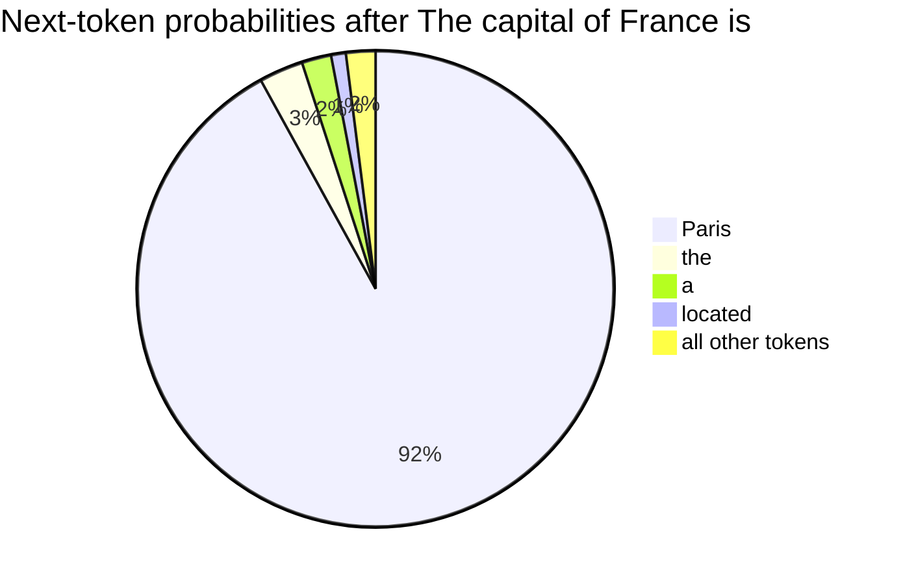
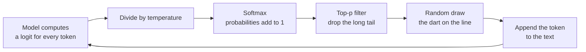
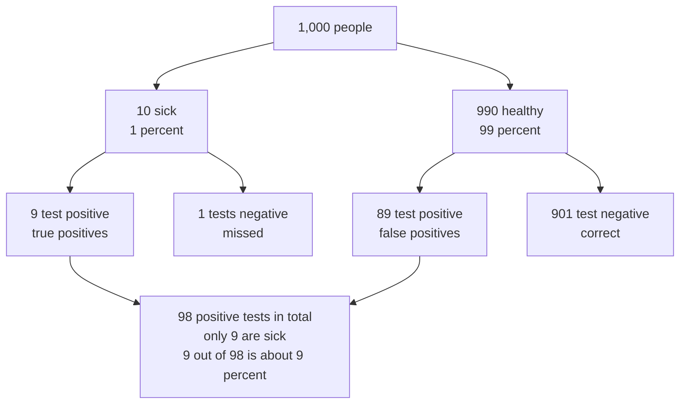
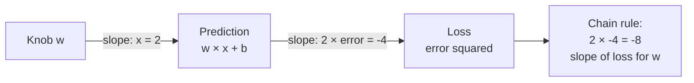
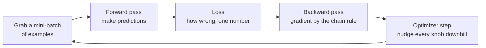
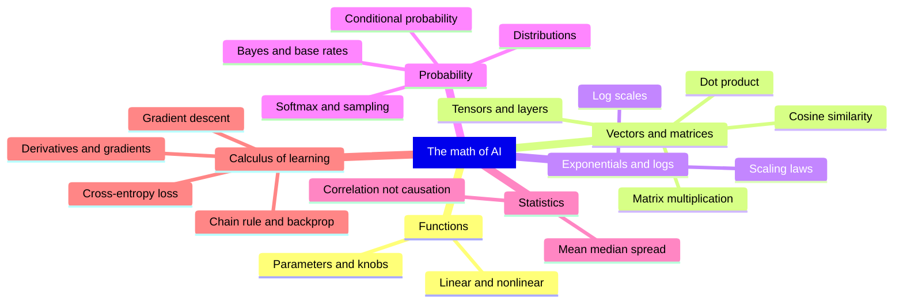

# Chapter 6: The Math of AI, Part 2: Probability, Statistics and Learning by Slopes

*Your chatbot never knows the next word for certain, and it got good by sliding downhill on its own mistakes; this chapter teaches you the math of both, by hand, starting from nothing but arithmetic.*

## What you'll learn

- How exponentials and logarithms work, and why almost every chart about AI progress uses a log scale.
- The basic rules of probability, and what a probability distribution is.
- How softmax turns a model's raw scores into probabilities, worked with three numbers.
- How a chatbot picks each token by sampling, and what temperature and top-p actually do.
- Conditional probability and Bayes' rule, and why base rates matter when you decide whether to trust an AI answer.
- The statistics you need to read AI claims: mean, median, spread, the bell curve, and correlation versus causation.
- What derivatives, gradients and the chain rule are, and what a loss function such as cross-entropy measures.
- How gradient descent and the training loop turn all of this into a machine that learns.

## Before you start

You need Chapter 5 (The Math of AI, Part 1: Functions, Vectors and Matrices), especially parameters, the line of best fit, mean squared error, and the idea that a model is a function with knobs. Chapter 2 (How Computers Work: Bits, Transistors and Processors) covers powers of ten and scientific notation, which come back immediately. As before, keep a calculator and a spreadsheet open. Any phone calculator in "scientific" mode has the two new buttons you will need: `e^x` and `ln`. In a spreadsheet they are `=EXP()` and `=LN()`.

## Two kinds of math a learning machine needs

Chapter 5 showed what a model *is*: a giant function that multiplies vectors by matrices. This chapter answers two different questions.

The first is **how a model deals with uncertainty**. When you type "The best thing about Paris is", there is no single correct next word. "the", "its", "how" and "that" are all reasonable. A chatbot does not pick one rule-based answer; it computes a *probability* for every possible next token and then draws one. That is why asking the same question twice can give different answers. To understand this you need exponentials, logarithms and probability.

The second is **how a model learns**. Chapter 5 found the best line through four quiz scores using a spreadsheet's built-in shortcut. A chatbot with billions of knobs has no shortcut. Instead, it measures how wrong it is, works out which way to turn every knob to be a little less wrong, turns them a tiny amount, and repeats this trillions of times. To understand this you need slopes, gradients and the chain rule.

Along the way you will pick up the statistics you need to read benchmark claims (scores on standard tests used to compare AI models), news stories and company announcements without being fooled.

## Exponentials: repeated multiplication

### Powers and doubling

Multiplication is repeated addition: 3 × 4 means 4 + 4 + 4. An exponent is repeated multiplication: `2^5` means 2 × 2 × 2 × 2 × 2 = 32. The small raised number (here 5) counts how many times you multiply.

> **Definition — Exponent:** The number that says how many times to multiply a number by itself. In `2^5 = 32`, the exponent is 5; it is also called a power, so `2^5` is read "two to the fifth power".

Things that grow by multiplying, rather than adding, grow astonishingly fast. The old legend of rice on a chessboard makes the point: put 1 grain on the first square, 2 on the second, 4 on the third, doubling each time. The 64th square alone needs `2^63` grains, about 9.2 × 10^18, and the whole board about 1.8 × 10^19. That is far more rice than the world has ever grown.

> **Definition — Exponential growth:** Growth by repeated multiplication, such as doubling every year. It looks slow at first and then explodes, because each step adds more than the one before.

> **Definition — Doubling time:** How long something growing exponentially takes to double. Something that doubles every 5.2 months grows about 5 times in a year.

You have met exponential growth in your bank account, under the name compound interest. Put $1,000 in an account that pays 7% a year and leave the interest in. After one year you have $1,000 × 1.07 = $1,070. In the second year you earn interest on the interest too: $1,070 × 1.07 ≈ $1,145. Every year multiplies the balance by the same 1.07, so after n years you have `1,000 × 1.07^n`. After 10 years that is about $1,967, almost exactly double, and after 30 years about $7,612, more than seven times the start, from a rate that sounds modest. Simple interest, which pays 7% of the original $1,000 each year ($70) and never pays interest on interest, gives only 1,000 + 30 × 70 = $3,100 after 30 years. The whole gap comes from multiplying instead of adding. A handy shortcut called the rule of 72 estimates the doubling time: divide 72 by the growth rate in percent. At 7% a year, 72 ÷ 7 ≈ 10 years, which matches the calculation.

> **Definition — Compound interest:** Interest that is added to the balance and then earns interest itself, so the balance is multiplied by the same factor every period. It is the everyday example of exponential growth.

### Exponential growth in AI

AI is full of exponentials. Epoch AI, a research group that tracks the field, estimates that the computing power used to train frontier models has grown about 5 times per year since 2020. Compare that with steady linear growth of "plus 5 units a year":

| Year | Linear: add 5 per year | Exponential: multiply by 5 per year |
|---|---|---|
| 0 | 0 | 1 |
| 1 | 5 | 5 |
| 2 | 10 | 25 |
| 3 | 15 | 125 |
| 4 | 20 | 625 |
| 5 | 25 | 3,125 |

After five years the linear line has reached 25. The exponential one has reached `5^5` = 3,125. That is the difference between a company that grows its computing budget by a fixed amount each year and one that multiplies it.

Epoch describes the same trend as compute doubling about every 5.2 months. Are those two descriptions consistent? A year has 12 ÷ 5.2 ≈ 2.3 doubling periods, and 2 multiplied by itself 2.3 times is about 4.9. (A fraction of a doubling is fine for a calculator: type `2^2.3`, or `=2^2.3` in a spreadsheet. As a check, two doublings give 4 and three give 8, so 2.3 doublings must land a little above 4.) So yes: doubling every 5.2 months is about 5 times per year.

### Exponential decay

Exponentials also shrink things. Halving again and again (1, 0.5, 0.25, 0.125, ...) is exponential decay. Radioactive material decays this way, and so do AI prices. The 2025 Stanford AI Index reported that the cost of using a model as capable as GPT-3.5 fell more than 280-fold between November 2022 and October 2024. Spread over those roughly two years, that is a drop of more than ten times per year: a drop of about 17 times in each year gives 17 × 17 ≈ 290 over two years.

> **Definition — Exponential decay:** Shrinking by repeated multiplication by a number less than 1, such as halving every year. It falls fast at first and then flattens toward zero without ever quite reaching it.

> **Watch out:** Real-world exponentials do not continue forever. Computing growth runs into limits of electricity, chip supply, money and data. "It grew 5 times a year for six years" is a fact; "so it will for the next six" is a forecast, and Chapter 60 presents the arguments on both sides.

### The special number e

One number appears whenever things grow continuously, and it sits inside the softmax function you will meet shortly. It is called e, and it is about 2.718. You never need to compute it yourself; every calculator has an `e^x` button and every spreadsheet has `=EXP(x)`.

> **Definition — Euler's number (e):** A constant, about 2.718, that is the natural base for growth and decay. Raising e to a power, written `e^x` or `EXP(x)`, is the "exponential function" used throughout AI.

Here is what `e^x` looks like for a few values of x. Get a feel for the pattern: it is always positive, it is exactly 1 at x = 0, and it grows (or shrinks) by a factor of about 2.7 for each step of 1.

| x | −2 | −1 | 0 | 1 | 2 | 3 |
|---|---|---|---|---|---|---|
| `e^x` | 0.135 | 0.368 | 1 | 2.718 | 7.389 | 20.09 |

## Logarithms: counting the multiplications

### "How many zeros?"

A logarithm runs an exponential backward. It answers the question "what power do I need?" The base-10 logarithm of 1,000 is 3, because `10^3` = 1,000. A quick way to think of it: the base-10 log of a big round number is roughly how many zeros it has.

- log10(10) = 1
- log10(1,000) = 3
- log10(1,000,000) = 6
- log10(1) = 0
- log10(0.1) = −1 (a tenth is "one step down")

Logs in base 2 count doublings instead: log2(8) = 3, because doubling three times (1 → 2 → 4 → 8) gets you to 8.

> **Definition — Logarithm:** The inverse of an exponential: it answers "what power gives this number?" log10(1,000) = 3 because `10^3` = 1,000. Roughly, a base-10 log counts zeros and a base-2 log counts doublings.

AI uses a third kind most often, the natural logarithm, written ln, which runs `e^x` backward. ln(1) = 0 and ln(e) = 1. The spreadsheet functions are `=LOG10()`, `=LOG(x, 2)` and `=LN()`.

> **Definition — Natural logarithm (ln):** The logarithm whose base is e (about 2.718). It is the reverse of the `e^x` button, and it is the log used in AI loss functions. ln(1) = 0, and ln of any number between 0 and 1 is negative.

The natural log of numbers between 0 and 1 matters a lot, because probabilities live there. Notice that they are all negative, and that they get more negative quickly as the number gets small:

| Number | 1 | 0.9 | 0.5 | 0.1 | 0.01 |
|---|---|---|---|---|---|
| ln(number) | 0 | −0.105 | −0.693 | −2.303 | −4.605 |

### Logs turn multiplying into adding

Logs have one magic property: the log of a product is the sum of the logs.

`log(a × b) = log(a) + log(b)`

Check it: log10(100 × 1,000) = log10(100,000) = 5, and log10(100) + log10(1,000) = 2 + 3 = 5. It works.

Why should you care? Because models multiply many probabilities together, and those products get absurdly small. Multiply 0.5 × 0.1 × 0.2 and you get 0.01. Do that for a thousand tokens and the number has hundreds of zeros after the decimal point, too small for a computer to store. Using logs, you *add* instead: log10(0.5) + log10(0.1) + log10(0.2) = −0.301 − 1 − 0.699 = −2, which is log10(0.01). Adding a thousand ordinary negative numbers is easy. That is why AI systems almost always work with "log-probabilities" rather than raw probabilities.

### Log scales

Most charts space their tick marks evenly: 0, 10, 20, 30. A log-scale chart spaces them by multiplying: 1, 10, 100, 1,000. Each step up means "ten times more".

```
 Ordinary scale (each tick adds 1,000):
 0      1,000    2,000    3,000    4,000    5,000
 |--------|--------|--------|--------|--------|
 1, 10 and 100 are all squashed into the first sliver.

 Log scale (each tick multiplies by 10):
 1        10       100      1,000    10,000   100,000
 |--------|--------|--------|--------|--------|
 1, 5, 25, 125, 625, 3,125 land at evenly spaced steps.
```

*Figure 6.1: An ordinary axis versus a log axis. On a log axis, steady multiplication (like 5 times per year) becomes a straight line.*

> **Definition — Log scale:** A chart axis where each equal step multiplies the value (1, 10, 100, 1,000) instead of adding to it. It lets one chart show both tiny and enormous numbers, and it turns exponential growth into a straight line.

That last point is why AI-progress charts are almost always drawn on log scales. Plot the "multiply by 5 per year" column from the table above on an ordinary axis and it looks flat for years and then shoots off the top. Plot it on a log axis and it is a perfectly straight line, which makes it easy to see whether a trend is speeding up, slowing down or holding steady.

### Log-log plots and scaling laws

Some relationships are power laws: one quantity varies as another raised to a fixed power. For example, the area of a square is its side length squared. If you put a log scale on *both* axes (a log-log plot), every power law becomes a straight line, and the slope of that line is the power.

> **Definition — Power law:** A relationship where one quantity changes as another raised to a fixed power, such as area = side × side. On a log-log plot (a chart with log scales on both axes) it appears as a straight line.

This is how researchers discovered scaling laws. In 2020, Jared Kaplan and colleagues at OpenAI plotted language models' error against the computing power used to train them on log-log axes, and the points fell along a remarkably straight line across many sizes. That straight line told the industry something precious: if you spend 10 times more compute, you can predict roughly how much better the model will get before you spend the money. Chapter 19 tells that story in full, including the 2022 "Chinchilla" refinement.

> **Definition — Scaling laws:** Observed patterns, usually straight lines on log-log plots, showing that a model's error falls predictably as training compute, data and parameters grow together.

> **At the frontier (2026):** Epoch AI's trend charts (updated February 2026) are all drawn on log scales: frontier training compute growing about 5 times per year, training costs about 3.5 times per year, AI chip performance per dollar improving about 49% per year, and GPU memory bandwidth improving only about 28% per year. That last, slower line is the "memory wall" from Chapter 2 made visible, and it explains why so much engineering effort goes into moving fewer bytes.

## Probability: a number between 0 and 1

### Counting outcomes

A probability is a number from 0 to 1 saying how likely something is. 0 means impossible, 1 means certain, and 0.5 means a coin toss. When every outcome is equally likely, a probability is just counting: the number of ways to get what you want, divided by the number of possible outcomes. A fair six-sided die has 6 outcomes, so the probability of rolling a 6 is 1 ÷ 6 ≈ 0.167. The probability of rolling an even number is 3 ÷ 6 = 0.5, because three faces (2, 4, 6) are even.

> **Definition — Probability:** A number from 0 (impossible) to 1 (certain) that measures how likely something is. It can also be written as a percentage, so 0.25 means 25%.

Anything you can ask the probability of, such as "roll a 6" or "the next token is Paris", is called an event. We write the probability of an event A as P(A). So P(roll a 6) = 1/6.

### The three rules you need

**Rule 1: not.** The probability that something does *not* happen is 1 minus the probability that it does. P(not a 6) = 1 − 1/6 = 5/6 ≈ 0.833.

> **Definition — Complement:** The event that something does not happen. Its probability is 1 minus the probability of the event itself.

**Rule 2: and (for independent events), multiply.** If two events do not affect each other, the probability that both happen is the product of their probabilities. Two coin flips both landing heads: 0.5 × 0.5 = 0.25. Two dice both showing 6: 1/6 × 1/6 = 1/36 ≈ 0.028.

> **Definition — Independence:** Two events are independent if knowing that one happened tells you nothing about the other, like two separate coin flips. Only for independent events can you multiply probabilities directly.

**Rule 3: or, add, then subtract any overlap.** The probability that at least one of two events happens is the sum of their probabilities minus the probability that both happen (otherwise you would count the overlap twice). Drawing a heart or a king from a 52-card deck: 13/52 + 4/52 − 1/52 = 16/52 ≈ 0.31, because the king of hearts is in both groups. When two events cannot both happen (rolling a 1 or a 2 on one die), the overlap is zero and you simply add: 1/6 + 1/6 = 1/3.

> **Watch out:** Independence is easy to assume and often false. After five heads in a row, a fair coin is still 50/50 on the next flip (believing otherwise is the "gambler's fallacy"). But the words in a sentence are *not* independent: after "peanut butter and", the next word is far more likely to be "jelly" than it would be on its own. Language is full of dependence, and that is exactly what a chatbot learns.

### Expected value

If you repeat something random many times, what is the average result? Multiply each outcome by its probability and add them up. For a fair die: (1 + 2 + 3 + 4 + 5 + 6) × 1/6 = 21 ÷ 6 = 3.5. You can never roll a 3.5, but over many rolls the average approaches it. You may notice the method: it is a dot product of the outcomes [1, 2, 3, 4, 5, 6] with the probabilities [1/6, 1/6, ...], exactly as in Chapter 5.

> **Definition — Expected value:** The long-run average outcome of something random, found by multiplying each outcome by its probability and adding the results. A fair die's expected value is 3.5.

The same arithmetic tells you whether a bet is worth it. A $2 lottery ticket with a 1-in-1,000,000 chance of winning $1,000,000 has an expected value of 1,000,000 × 0.000001 = $1. You pay $2 to get $1 back on average.

### The law of large numbers

Flip a coin 10 times and you might get 7 heads. Flip it 10,000 times and you will almost certainly get very close to 5,000. The more you repeat a random process, the closer the average gets to the expected value.

> **Definition — Law of large numbers:** The principle that the average of many repeated random trials gets closer and closer to the expected value as the number of trials grows.

This is why a single surprising chatbot answer tells you little, while a test over 1,000 questions tells you a lot. It is also why AI companies can predict their costs and error rates well, even though each single response is random.

## Probability distributions: the shape of uncertainty

A probability distribution lists every possible outcome together with its probability, and the probabilities add up to exactly 1. A fair die's distribution gives 1/6 to each face; when every outcome gets the same share like this, the distribution is called uniform. A loaded die might give 0.5 to the 6 and 0.1 to each other face (check: 0.5 + 5 × 0.1 = 1).

> **Definition — Probability distribution:** A complete list of possible outcomes with their probabilities, which always add up to 1. A bag of marbles is a physical distribution: the share of each color is its probability of being drawn.

> **Analogy:** A probability distribution is a bag of marbles. If the bag holds 92 red marbles, 3 blue, 2 green, 1 yellow and 2 white, then reaching in blindfolded gives red 92% of the time. Changing the distribution means changing what is in the bag.

Every time your chatbot writes a token, it produces exactly such a distribution over its whole vocabulary of perhaps 100,000 or more tokens. For the prompt "The capital of France is", a model's distribution might look like this (illustrative numbers):



*Figure 6.2: A language model's output is a probability distribution over its vocabulary. The numbers here are illustrative.*

Two things in that picture are worth noticing. First, "Paris" is not certain, even though it is correct: the model leaves a little probability for sentences like "The capital of France is located on the Seine". Second, tens of thousands of other tokens share the last 2%. Most of them have tiny probabilities, but tiny is not zero. How the app chooses from this distribution is the subject of the Softmax and Sampling sections below.

### Random variables, joint tables and marginals

Statisticians have a name for a quantity whose value is settled by chance: a random variable. The roll of a die is one (its possible values are 1 to 6), the next token your chatbot writes is another, and tomorrow's high temperature is a third. A probability distribution describes a random variable completely.

> **Definition — Random variable:** A quantity whose value is set by chance, such as a die roll or the next token a chatbot will write. Its probability distribution says how likely each possible value is.

Often you track two random variables at once. Suppose 100 emails are sorted two ways: spam or not, and whether they contain the word "free".

| | Contains "free" | No "free" | Row total |
|---|---|---|---|
| Spam | 20 | 10 | 30 |
| Not spam | 5 | 65 | 70 |
| Column total | 25 | 75 | 100 |

Each inner cell gives a joint probability, the chance of two things together: P(spam and "free") = 20 ÷ 100 = 0.20. Add across a row or down a column and you get a marginal probability, the chance of one variable on its own with the other added away: P(spam) = 0.20 + 0.10 = 0.30, and P("free") = 0.20 + 0.05 = 0.25. The odd name comes from writing those totals in the margins of the table. Dividing one by the other previews the conditional probability you will meet later in this chapter: of the 25 emails containing "free", 20 are spam, so 20 ÷ 25 = 0.8.

> **Definition — Joint probability:** The probability that two (or more) things are true together, such as an email being spam and containing "free". It is written P(A and B).

> **Definition — Marginal probability:** The probability of one variable on its own, found by adding the joint probabilities over every value of the other variables, like the row and column totals in the margins of a table.

## Softmax: turning scores into probabilities

### From raw scores to probabilities

The final layer of a language model does not output probabilities directly. As Chapter 5 described, it outputs one raw score per token, made by dot products. These scores can be any numbers, positive or negative, and they do not add up to 1. They are called logits.

> **Definition — Logit:** A raw score a model gives to each possible output before it is turned into a probability. Higher logits mean the model favors that option more, but logits can be any number and need not add up to 1.

To turn logits into a proper distribution, models use a function called softmax. It has two steps:

1. Raise e to the power of each score (`e^score`). This makes every number positive.
2. Divide each result by the total, so they add up to 1.

> **Definition — Softmax:** A function that turns any list of scores into probabilities that are all positive and add up to 1: raise e to each score, then divide each result by their total. Bigger scores get disproportionately bigger shares.

### Worked with three numbers

Suppose a model has narrowed things down to three candidate tokens with logits Paris = 2.0, Lyon = 1.0 and Nice = 0.1.

| Token | Logit | `e^logit` | Divide by total (11.21) | Probability |
|---|---|---|---|---|
| Paris | 2.0 | 7.389 | 7.389 ÷ 11.21 | 0.659 |
| Lyon | 1.0 | 2.718 | 2.718 ÷ 11.21 | 0.242 |
| Nice | 0.1 | 1.105 | 1.105 ÷ 11.21 | 0.099 |
| Total | | 11.21 | | 1.000 |

The three probabilities, 65.9%, 24.2% and 9.9%, add to 100%. The order is preserved: the highest score still gets the highest probability. But look at the ratios. The scores 2.0 and 1.0 differ by only 1, yet Paris ends up with almost three times Lyon's probability, because e raised to a difference of 1 is 2.718. Softmax exaggerates gaps.

Here is a neat property. Add the same number to every score, say +1, giving 3.0, 2.0 and 1.1. Work it through and you get exactly the same probabilities: 0.659, 0.242, 0.099. Only the *differences* between scores matter, not their absolute size.

> **Try it:** In a spreadsheet, put 2, 1 and 0.1 in A1 to A3. In B1 type `=EXP(A1)` and fill down. In C1 type `=B1/SUM($B$1:$B$3)` and fill down (the $ signs keep the total pointing at B1 to B3 as you fill down). You have built softmax. Now change the first score to 5 and watch Paris's probability approach 1.

Softmax appears in two key places in a chatbot: at the end, to produce next-token probabilities, and inside every attention step, where it turns relevance scores into percentages that say how much each token should borrow from each other token (Chapter 15).

## Sampling and temperature: why the same question gets different answers

### Drawing from the bag

Once the model has a distribution, the app has to pick one token. The simplest choice is to always take the most likely one.

> **Definition — Greedy decoding:** Always choosing the single most probable next token. It is predictable but tends to produce bland, repetitive text.

Most chatbots instead *sample*: they pick at random, with each token's chance equal to its probability. A simple way to do this is to lay the probabilities end to end along a line from 0 to 1, then throw a dart at a random point.

| Token | Probability | Covers the stretch of the line from | to |
|---|---|---|---|
| Paris | 0.92 | 0.00 | 0.92 |
| the | 0.03 | 0.92 | 0.95 |
| a | 0.02 | 0.95 | 0.97 |
| located | 0.01 | 0.97 | 0.98 |
| everything else | 0.02 | 0.98 | 1.00 |

If the random number is 0.37, the dart lands in Paris's stretch. If it is 0.96, it lands on "a", and the model writes "The capital of France is a city of..." which is fine. Then that token is appended, the model computes a fresh distribution for the next position, and the dart is thrown again.

> **Definition — Sampling:** Picking an outcome at random according to a probability distribution, like drawing a marble from a bag. Chatbots sample each next token, which is why their answers vary.

### Temperature

Temperature is a dial that reshapes the distribution before sampling. Technically, the model divides every logit by the temperature T before applying softmax. Let's redo the Paris, Lyon, Nice example at three temperatures:

| Temperature | Logits after dividing by T | Paris | Lyon | Nice |
|---|---|---|---|---|
| 0.5 (cooler) | 4.0, 2.0, 0.2 | 0.864 | 0.117 | 0.019 |
| 1.0 (normal) | 2.0, 1.0, 0.1 | 0.659 | 0.242 | 0.099 |
| 2.0 (hotter) | 1.0, 0.5, 0.05 | 0.502 | 0.304 | 0.194 |

Low temperature stretches the gaps between scores, and softmax then exaggerates them further, so the top choice dominates. High temperature squeezes the gaps, flattening the distribution so that unlikely tokens get picked more often. As temperature approaches 0, sampling becomes greedy decoding.

> **Definition — Temperature:** A sampling setting that divides the model's scores before softmax. Low temperature (below 1) makes output more predictable; high temperature (above 1) makes it more varied and more error-prone.

> **Analogy:** Temperature is how adventurous a diner is. At low temperature they always order their favorite dish. At high temperature they might order anything on the menu, including things they will regret.

### Top-p: cutting off the long tail

Even at normal temperature, thousands of junk tokens share a small slice of probability, and occasionally one gets drawn. Top-p sampling (also called nucleus sampling) fixes this. Keep only the most likely tokens until their probabilities add up to at least p, throw away the rest, and rescale the survivors to add up to 1.

Suppose a bakery-slogan prompt gives these options for the next word: fresh 0.40, warm 0.30, daily 0.20, artisan 0.10. With p = 0.8:

1. fresh alone covers 0.40. Not enough.
2. fresh plus warm covers 0.70. Still short of 0.8.
3. Adding daily gives 0.90. That passes 0.8, so stop.
4. Rescale the three survivors by dividing by 0.90: fresh 0.444, warm 0.333, daily 0.222. "artisan" can no longer be chosen.

> **Definition — Top-p sampling:** Sampling only from the smallest set of most-likely tokens whose probabilities add up to at least p (such as 0.9), after rescaling them. It cuts off the long tail of unlikely tokens while keeping variety.



*Figure 6.3: How a chatbot chooses each token. The loop runs once per token, tens of times per second.*

> **Try it:** Open a fresh chat and ask "Give me a one-sentence slogan for a bakery." Do it five times in five new chats. Then ask "What is 17 × 23?" five times. The slogans vary a lot; the arithmetic answer (391) should not. For the math question, the model's distribution has one dominant token at each step, so sampling almost always picks it.

> **Watch out:** Turning temperature up does not make a model more creative in any deep sense, and turning it down does not make it more truthful. Temperature only changes how adventurously the app draws from the same distribution. Chapter 18 adds two more twists: other sampling methods such as top-k and min-p, and why even temperature 0 is not perfectly repeatable on shared servers.

> **At the frontier (2026):** Sampling is now used deliberately to make models *smarter*, not just more varied. Reasoning systems often sample many independent attempts at a hard problem and then pick the best one or take a majority vote, an idea first popularized in 2022 as "self-consistency". Premium "deep thinking" modes from several labs spend extra compute on related ideas, such as exploring several lines of reasoning in parallel before answering. Meanwhile some providers have taken the temperature dial away from developers: Anthropic's Claude models from version 4.7 on accept only the default sampling settings, and its API version dated October 21, 2026 rejects the temperature, top-p and top-k settings altogether. Chapter 21 explains how reasoning systems use sampling.

## Conditional probability: the heart of every chatbot

### Narrowing the room

Conditional probability is the probability of something *given* that something else is already known. It is written P(A | B), read "the probability of A given B".

Picture a room of 100 people. 40 wear glasses. 30 are carrying a book. 20 are doing both.

- P(glasses) = 40 ÷ 100 = 0.40.
- Now narrow the room to only the 30 people carrying books. Of those, 20 wear glasses. So P(glasses | book) = 20 ÷ 30 ≈ 0.67.

Knowing someone carries a book raised the chance they wear glasses from 40% to 67%. The formula version just divides the "both" share by the "given" share: P(A | B) = P(A and B) ÷ P(B) = 0.20 ÷ 0.30 ≈ 0.67.

> **Definition — Conditional probability:** The probability that A happens given that B is known to have happened, written P(A | B). You compute it by narrowing your attention to only the cases where B is true.

> **Analogy:** Conditional probability is narrowing the room. Of everyone here, how many wear glasses? Now, of only the people holding books, how many?

### P(next token | everything so far)

This is the single most important probability idea for understanding chatbots. A language model computes one thing, over and over:

`P(next token | all the tokens so far)`

Given "The capital of France is", the probability of " Paris" is high. Given "My favorite city to visit is", the probability of " Paris" is lower, but still real. Given "2 + 2 =", it is nearly zero. Same token, different condition, completely different probability. Everything a chatbot "knows" is stored as its ability to compute these conditional probabilities well.

> **Key idea:** A chatbot is a machine for one conditional probability, P(next token | everything so far), computed afresh for every token it writes. A better model is simply one that estimates this probability more accurately, especially for conversations it has never seen.

> **Definition — Language model:** A model that assigns probabilities to sequences of text, usually by predicting the probability of each next token given all the previous ones. Chatbots are built on large language models.

### Chaining probabilities for a whole sentence

How likely is a whole sentence? Multiply the conditional probabilities of each token given what came before. Suppose a model says:

- P("The") = 0.05 (as a first word)
- P("cat" | "The") = 0.01
- P("sat" | "The cat") = 0.2

Then P("The cat sat") = 0.05 × 0.01 × 0.2 = 0.0001. In logs, the same calculation is a sum: log10(0.05) + log10(0.01) + log10(0.2) = −1.30 − 2 − 0.70 = −4.0, which is log10(0.0001). For a 1,000-token essay you would add 1,000 such numbers. This sum, the log-probability, is how models score whole texts.

> **Definition — Log-probability:** The logarithm of a probability. Because it turns multiplying into adding, models use log-probabilities to score long sequences without the numbers becoming too small to store; it is always zero or negative.

### A language model you can build by counting

Here is a complete, if tiny, language model. Take three sentences: "I like tea. I like coffee. I drink tea." Count which word follows each word:

| Previous word | What follows, and how often | Conditional probabilities |
|---|---|---|
| I | like (2 times), drink (1 time) | P(like given I) = 2/3, P(drink given I) = 1/3 |
| like | tea (1), coffee (1) | P(tea given like) = 1/2, P(coffee given like) = 1/2 |
| drink | tea (1) | P(tea given drink) = 1 |

To generate text, start with "I", roll a die to pick the next word with those probabilities, and continue. You might produce "I like coffee" or "I drink tea". The probability of "I like tea" is 2/3 × 1/2 = 1/3.

This kind of model, which looks only at the previous word or few words, is called an n-gram model, and versions of it powered phone keyboards and speech recognition for decades.

> **Definition — N-gram model:** A simple language model that predicts the next word from only the previous few words (n − 1 of them), using counts from a large body of text. A "bigram" model looks back one word.

Counting has an obvious weak spot: zeros. Our tiny model has never seen "drink coffee", so it says P(coffee given drink) = 0 and calls any sentence containing that pair impossible. The classic patch is smoothing: pretend you saw every possible next word a little. With add-one smoothing over our five-word vocabulary (I, like, drink, tea, coffee), P(coffee given drink) becomes (0 + 1) ÷ (1 + 5) = 1/6, and P(tea given drink) drops from 1 to (1 + 1) ÷ (1 + 5) = 1/3. Chapter 10's spam filter uses the same trick.

> **Definition — Smoothing:** Adjusting probability estimates so that events never seen in the training data get a small, non-zero probability instead of zero, for example by adding one to every count before dividing.

Practical n-gram systems also used a second patch, backoff: when a longer context has never been seen, fall back to a shorter one. A three-word model that has never seen "I drink coffee" asks the two-word model how often "coffee" follows "drink"; if that pair is unseen too, it falls back to how common "coffee" is on its own. Long contexts give sharper predictions when there is data for them, and short ones give a sensible answer when there is not.

> **Definition — Backoff:** In an n-gram model, falling back to a shorter context (fewer previous words) when the longer one never appeared in the training text, so the model can still make a reasonable prediction.

Why aren't chatbots built this way? Because counting breaks down. Your prompt today, together with everything before it in your conversation, has almost certainly never appeared anywhere in history, so there is nothing to count. A large language model instead *learns a function* (Chapter 5) that computes `P(next token | everything so far)` for contexts it has never seen, by generalizing from patterns. It conditions on your entire conversation, up to its context window (the maximum amount of text it can take in at once), not just the last word.

## Bayes' rule: updating beliefs with evidence

### The medical test, with 1,000 people

Here is a famous puzzle that most people, including many doctors, get wrong. A disease affects 1% of people. A test catches 90% of people who have it. But it also wrongly flags 9% of healthy people. You test positive. How likely is it that you are sick?

Many people guess 90%. The real answer is about 9%. The clearest way to see why is to imagine 1,000 people, using whole numbers instead of percentages:

- 1% of 1,000 = **10 people are sick**. The test catches 90% of them: **9 true positives**, and 1 is missed.
- **990 people are healthy**. The test wrongly flags 9% of them: 990 × 0.09 ≈ **89 false positives**. The other 901 correctly test negative.
- Total positive tests: 9 + 89 = **98**. Of those, only 9 are actually sick.
- So P(sick | positive) = 9 ÷ 98 ≈ **0.09**, about 9%.



*Figure 6.4: Bayes' rule with natural frequencies. Because healthy people vastly outnumber sick ones, false positives swamp true positives.*

| | Test positive | Test negative | Total |
|---|---|---|---|
| Sick | 9 | 1 | 10 |
| Healthy | 89 | 901 | 990 |
| Total | 98 | 902 | 1,000 |

The test is not bad. The problem is the base rate: the disease is rare, so even a small error rate applied to the huge healthy group produces far more false alarms than there are sick people.

> **Definition — Base rate:** How common something is before you look at any specific evidence, such as a disease affecting 1% of people. Ignoring the base rate is one of the most common reasoning mistakes.

> **Definition — False positive:** A result that says "yes" when the truth is "no", such as a healthy person testing positive or a spam filter flagging a real email. A false negative is the reverse.

### The rule itself

Bayes' rule is the general recipe behind that calculation:

`P(A | B) = P(B | A) × P(A) ÷ P(B)`

In our case, A is "sick" and B is "positive test":

- P(positive | sick) = 0.9 (how well the test catches the disease)
- P(sick) = 0.01 (the base rate)
- P(positive) = 0.009 + 0.0891 = 0.0981 (all positives: 0.9 × 0.01 = 0.009 from sick people, plus 0.09 × 0.99 = 0.0891 from healthy people)
- P(sick | positive) = 0.9 × 0.01 ÷ 0.0981 ≈ 0.092

Same answer, about 9%. The natural-frequency picture and the formula always agree; the picture is just easier to trust.

> **Definition — Bayes' rule:** A formula for updating a belief when new evidence arrives: P(A given B) = P(B given A) × P(A) ÷ P(B). It combines how well the evidence points to A with how common A was to begin with.

> **Definition — Prior and posterior:** In Bayes' rule, the prior is your belief before the evidence (1% chance of being sick), and the posterior is your updated belief after it (9% after one positive test).

### Updating again

Suppose you take a second, independent test and it is also positive. Your 9% posterior now becomes the prior. Among the 98 people who tested positive the first time, about 9 × 0.9 = 8.1 sick people and 89 × 0.09 ≈ 8.0 healthy people would test positive again. Now it is roughly 8 sick versus 8 healthy: about a 50% chance. A third positive would push it much higher. Evidence accumulates, but each piece starts from where the last one left you.

> **Analogy:** Bayes' rule is a detective updating a hunch. A clue matters, but so does who was in the building to begin with. If a thousand innocent people and one suspect were there, a clue that fits 9% of innocent people still points mostly at the innocent.

### Why this matters for AI

Bayesian thinking shows up in AI in three practical ways.

- **Judging AI answers.** A chatbot's fluent, confident tone is evidence of very little on its own. If you ask about a rare fact that was barely mentioned in its training data, the base rate of the model knowing it well is low, so a confident answer deserves more checking, not less.
- **Calibration.** A well-behaved model's confidence should match reality: of all the times it says "I'm 90% sure", it should be right about 90% of the time.
- **Hallucination.** A 2025 paper by Adam Kalai and colleagues at OpenAI argued that models make things up partly because training and benchmarks reward guessing: a wrong guess usually costs no more than saying "I don't know", so guessing scores better on average. Chapter 18 and Chapter 55 return to this.

> **Definition — Calibration:** How well a model's stated confidence matches how often it is actually right. A well-calibrated forecaster's "70% chance of rain" days see rain about 70% of the time.

> **Key idea:** Evidence should move your beliefs, but how far it moves them depends on the base rate. A fluent, confident answer about something rare or obscure deserves a check, not extra trust.

## Descriptive statistics: summarizing a pile of numbers

### Mean, median and mode

Statistics is the art of summarizing many numbers with a few. Start with the "typical" value. Suppose nine people in a bar earn these salaries, in thousands of dollars: 40, 45, 50, 50, 55, 60, 65, 70, 80.

- The **mean** (average) adds them up and divides by how many there are: 515 ÷ 9 ≈ 57.2, so about $57,200.
- The **median** is the middle value when sorted: the 5th of 9, which is 55, or $55,000.
- The **mode** is the most common value: 50, or $50,000.

> **Definition — Mean:** The ordinary average: add up all the values and divide by how many there are. It is sensitive to extreme values.

> **Definition — Median:** The middle value once all values are sorted (or the average of the two middle values if there is an even number of them). It is barely affected by extreme values.

Now a billionaire walks in, earning $1 billion (1,000,000 thousand). There are now 10 people.

- New mean: (515 + 1,000,000) ÷ 10 = 100,051.5 thousand, about **$100 million**. Everyone in the bar is now "on average" a multimillionaire.
- New median: the average of the 5th and 6th values, (55 + 60) ÷ 2 = 57.5, about **$57,500**. It barely moved.

> **Definition — Outlier:** A value far away from the rest of the data, like a billionaire in a bar. Outliers can drag the mean a long way, which is why the median is often the better summary.

> **Watch out:** When you read that an AI tool "saves an average of 5 hours a week", ask whether that is a mean or a median. A few power users saving 40 hours can produce a big mean while the typical user saves very little.

### Spread: variance and standard deviation

Two classes can both average 70% on a test, one with everyone between 65 and 75, the other split between 40s and 100s. To tell them apart you need a measure of spread. The simplest is the range: the largest value minus the smallest. The first class has a range of 75 − 65 = 10 points; if the second runs from 40 to 100, its range is 60 points. The range is quick to compute but fragile, because it depends on only the two most extreme values: one student who skipped the test and scored 0 would stretch the first class's range from 10 to 75 points, even though everyone else is tightly bunched.

> **Definition — Range (statistics):** The largest value minus the smallest, the simplest measure of how spread out a set of numbers is. It is easy to compute but is set entirely by the two most extreme values, so a single outlier can distort it.

A sturdier measure uses every value. The standard one is computed in four steps. Take the numbers 2, 4, 4, 4, 5, 5, 7, 9:

1. Find the mean: 40 ÷ 8 = 5.
2. Find each value's distance from the mean and square it: 9, 1, 1, 1, 0, 0, 4, 16.
3. Average those squares: 32 ÷ 8 = 4. This is the **variance**.
4. Take the square root: the square root of 4 = 2. This is the **standard deviation**, back in the original units.

So these numbers typically sit about 2 away from their mean of 5. (Spreadsheets compute these with `=VAR.P()` and `=STDEV.P()`.) For the bar salaries, the standard deviation is about $12,000 before the billionaire arrives and about $300 million after: one outlier wrecks the spread, too.

> **Definition — Variance:** A measure of spread: the average of the squared distances of the values from their mean. Bigger variance means the values are more scattered.

> **Definition — Standard deviation:** The square root of the variance, which puts the spread back into the original units. Roughly, it is how far a typical value sits from the mean.

### Percentiles

A percentile tells you where a value ranks. The 90th percentile is the value that 90% of the data falls below. The median is the 50th percentile. AI companies use percentiles constantly to describe speed: "p50 latency" is the median response time, and "p99 latency" is the time that 99% of requests beat. A chatbot with a p50 of 1 second but a p99 of 30 seconds is usually fast and occasionally infuriating, and the average would hide that.

> **Definition — Percentile:** The value below which a given percentage of the data falls. The 50th percentile is the median; the 99th percentile describes the slowest or largest 1% of cases.

## The normal distribution, noise and random starts

### The bell curve

Measure the heights of thousands of adults and plot how many people have each height. You get a hump: most people near the middle, fewer and fewer toward the extremes, roughly symmetrical. That shape is the normal distribution, or bell curve.

```
                             |  mean
                           :::::
                        :::::::::::
                      :::::::::::::::
                    :::::::::::::::::::
                  :::::::::::::::::::::::
               :::::::::::::::::::::::::::::
            :::::::::::::::::::::::::::::::::::
      :::::::::::::::::::::::::::::::::::::::::::::::
  ---+-------+-------+-------+-------+-------+-------+---
   -3 sd   -2 sd   -1 sd    mean   +1 sd   +2 sd   +3 sd
                     |<---- 68% ---->|
             |<------------ 95% ------------>|
```

*Figure 6.5: The normal distribution. About 68% of values fall within 1 standard deviation of the mean, about 95% within 2, and about 99.7% within 3.*

That "68, 95, 99.7" pattern is worth memorizing. Imagine a group whose heights have a mean of 170 cm and a standard deviation of 7 cm. Then about 68% are between 163 and 177 cm, about 95% are between 156 and 184 cm, and only about 3 in 1,000 fall outside 149 to 191 cm.

> **Definition — Normal distribution:** The symmetrical bell-shaped pattern where most values cluster near the mean and extremes are rare. About 68% of values lie within one standard deviation of the mean and about 95% within two.

Why is it so common? A deep result of probability says that when many small, independent random effects add together, the total tends to follow a bell curve, whatever the individual effects look like. Height comes from many genes and environmental factors added together, so it is roughly normal. Measurement errors usually are too.

### Smooth quantities: densities and areas

A die has six separate outcomes, but height can be any number at all: 170 cm, 170.2 cm, 170.21 cm. With endlessly many possible values, the chance of hitting one exact value is zero, so a smooth random variable is described differently. The height of the bell curve at each point is a probability density, and probabilities are areas under the curve. The 68% in Figure 6.5 is the share of the total area lying within one standard deviation of the mean (163 to 177 cm in the height example above), and the whole area under any density curve is exactly 1, just as a distribution's probabilities add up to 1. Adding up the area under a curve is what mathematicians call integration, and the result is an integral, written with a tall S (∫) for "sum". You will not need to compute one in this book, but when you meet the word, read it as "the area under this curve". The AUC score in Chapter 9 is an example: it is literally the area under the ROC curve.

> **Definition — Probability density:** For a quantity that can take any value in a range, like height, the height of its distribution curve at each point. Probabilities are not read off the curve directly but as areas under it: the area between two values is the chance of landing between them.

> **Definition — Integral:** The total area under a curve between two points, found by adding up very many very thin slices. In probability, the integral of a density between two values is the chance of landing between them.

### Noise

Real data is never perfectly clean. Two identical students on two identical days score slightly differently. A thermometer jitters. That random variation, which hides the true pattern underneath, is called noise. Recall the quiz-score data in Chapter 5: the line of best fit missed every point a little. Those misses are the noise, and a good model should learn the line, not the noise.

> **Definition — Noise:** Random variation in data that hides the underlying pattern, such as measurement errors or one-off flukes. Models should learn the signal and ignore the noise.

### Why model weights start as random numbers

Before training, every parameter in a neural network needs a starting value. The obvious choice, all zeros, fails: every neuron in a layer would compute the same thing, receive the same correction, and stay identical forever, like a choir where every singer copies every other. So networks start with small random numbers, usually drawn from a bell curve centered on zero with a small, carefully chosen standard deviation. The randomness breaks the symmetry so that different neurons can learn different things. Chapter 13 explains how the size of that starting spread is chosen.

> **Definition — Random initialization:** Setting a neural network's parameters to small random numbers, often drawn from a normal distribution, before training begins. The randomness lets different parts of the network learn different things.

## Correlation, causation and honest testing

### Things that move together

Two quantities are correlated when they tend to rise and fall together. Taller people tend to weigh more. Hours studied tend to go with higher quiz scores. Statisticians measure this with a correlation coefficient between −1 and 1: near 1 means "strongly move together", near 0 means "no straight-line relationship", and near −1 means "one goes up as the other goes down". A spreadsheet computes it with `=CORREL()`.

> **Definition — Correlation:** A measure, from −1 to 1, of how strongly two quantities tend to move together in a straight-line way. It describes a pattern; it does not say why the pattern exists.

### Correlation is not causation

Ice-cream sales and drownings are strongly correlated. Ice cream does not cause drowning. Hot weather causes both: more people buy ice cream and more people swim. A hidden third factor like this is called a confounder.

> **Definition — Confounder:** A hidden factor that influences two things at once and makes them look causally linked when they are not, like summer heat behind both ice-cream sales and drownings.

This matters enormously for AI, because **models learn correlations, not causes**. A famous kind of failure: train an image classifier to tell "thumbs up" from "thumbs down", but record all the thumbs-up photos in front of a bookcase. The model may learn "bookcase means thumbs up", because that correlation is perfect in the training data. It looks brilliant in testing on similar photos and fails the moment the background changes. Chapter 9 and Chapter 11 show real versions of this, including in medicine.

> **Definition — Sampling bias:** A distortion that arises when the data collected is not representative of the situation the model will face, such as training a speech recognizer mostly on one accent. The model then learns patterns that do not hold in general.

### Don't grade yourself on the answer key

How do you know whether a model has learned the real pattern or just memorized its examples? You test it on examples it has never seen. The standard practice is to split the data three ways before training starts.

> **Definition — Training, validation and test sets:** Three separate portions of data: the training set is used to learn the parameters, the validation set to make design choices during development, and the test set is held back for one final, honest exam on unseen data.

> **Definition — Overfitting:** When a model fits its training examples so closely, noise included, that it does worse on new data. It is like memorizing last year's exam answers instead of learning the subject.

> **Definition — Generalization:** A model's ability to perform well on new examples it was not trained on. Generalization, not a perfect score on training data, is the real goal of learning.

> **Watch out:** A benchmark score is only meaningful if the test questions were truly unseen. When test questions leak into a model's training data (which happens easily when models are trained on much of the internet), the score measures memory, not skill. Chapter 24 explains how to read benchmark claims with this in mind.

## Slopes and derivatives: how much does the output move?

### From speed to slope

Your car's speedometer reads 60 miles per hour. That is a rate of change: how fast distance changes as time passes. Chapter 5 measured the slope of a straight line, which is the same everywhere along the line. But most interesting functions curve, so their steepness changes from place to place. A derivative is the slope at one exact point.

> **Definition — Derivative:** The slope of a function at a single point: how much the output changes for a tiny nudge of the input, divided by the size of the nudge. It answers "if I nudge this input a little, how much does the output move, and in which direction?"

### Finding a slope by nudging

You can measure a derivative with nothing but a calculator. Take `f(x) = x × x` (x squared) and ask for its slope at x = 3, where f(3) = 9. Nudge x a little and see how much f changes:

| Nudge | New x | f(new x) | Change in f | Change ÷ nudge |
|---|---|---|---|---|
| 0.1 | 3.1 | 9.61 | 0.61 | 6.1 |
| 0.01 | 3.01 | 9.0601 | 0.0601 | 6.01 |
| 0.001 | 3.001 | 9.006001 | 0.006001 | 6.001 |

As the nudge shrinks, the ratio settles on exactly 6. So the slope of x squared at x = 3 is 6. Try it at x = 5 and you will find 10. The pattern is that the derivative of x squared is 2 × x. Mathematicians have worked out such patterns for all common functions, so nobody has to nudge by hand in practice. A few you may meet:

| Function | Its derivative (slope at any x) | Example |
|---|---|---|
| A constant, like 7 | 0 | Flat line, no slope |
| `w × x` | w | Slope of the taxi fare is the per-mile price |
| `x^2` | 2 × x | At x = 3 the slope is 6 |
| `e^x` | `e^x` | Its slope equals its own height |
| `ln(x)` | 1 ÷ x | At x = 2 the slope is 0.5 |

The derivative tells you three useful things:

- **Its sign tells you the direction.** Positive means increasing x makes the output go up; negative means it makes the output go down.
- **Its size tells you the steepness.** A slope of 6 means the output changes about 6 times as much as the input, near that point.
- **Zero means flat.** At the very bottom of a valley (or top of a hill) the slope is zero. For `x^2`, that happens at x = 0.

That last point is the key to learning. If you want to make an error as small as possible, you are looking for the bottom of a valley, and you can find which way is "down" from the sign of the slope.

## Gradients: slopes for many knobs at once

### One knob at a time

A model has many knobs, and its error depends on all of them. A partial derivative is the slope with respect to one knob while all the others are held still. Nudge one knob, watch the error, put it back, and nudge the next.

> **Definition — Partial derivative:** The slope of a function with respect to one input while every other input is held fixed. A model with a billion knobs has a billion partial derivatives.

Let's do it for real, on the smallest possible model. Use the Chapter 5 line `prediction = w × x + b`, and a single training example: x = 2, actual answer y = 5. Start with knobs w = 1 and b = 1. Measure the error as the squared error.

- Prediction: 1 × 2 + 1 = 3. Error: 3 − 5 = −2. Squared error (the loss): 4.
- **Nudge w** to 1.01: prediction 3.02, error −1.98, loss 3.9204. The loss fell by 0.0796. Slope for w ≈ −0.0796 ÷ 0.01 ≈ **−8**.
- **Nudge b** to 1.01 (w back at 1): prediction 3.01, error −1.99, loss 3.9601. The loss fell by 0.0399. Slope for b ≈ **−4**.

### The gradient points uphill

Put the slopes for every knob into one list and you have the gradient: here, [−8, −4].

> **Definition — Gradient:** The list of partial derivatives for every knob of a function. It points in the direction that increases the output fastest, so stepping the opposite way decreases it fastest.

Both slopes are negative, meaning "increasing this knob decreases the loss". The w slope is twice as steep, so w matters more right now. To reduce the loss, we step *against* the gradient: increase both knobs, w more than b. Use a step size of 0.05:

- new w = 1 − 0.05 × (−8) = 1 + 0.4 = 1.4
- new b = 1 − 0.05 × (−4) = 1 + 0.2 = 1.2
- new prediction: 1.4 × 2 + 1.2 = 4.0. Error −1. Loss 1.

One step took the loss from 4 to 1. You have just done one step of the algorithm that trains every neural network in this book.

> **Definition — Loss landscape:** An imaginary terrain where each location is a setting of all the model's knobs and the height is the loss there. Training is a walk downhill across this landscape.

> **Analogy:** The gradient is an arrow painted on a hiking map that always points straight uphill from wherever you stand. To get down, walk the other way.

## The chain rule: gears turning gears

### Gears

Picture three gears. Turning gear A once turns gear B 3 times. Turning gear B once turns gear C 2 times. How many times does C turn for one turn of A? 3 × 2 = 6. To find how a change ripples through a chain of steps, multiply the rates of each step. That is the chain rule.

> **Definition — Chain rule:** The rule that the rate of change through a chain of steps is the product of each step's rate of change. If y changes 6 times as fast as u, and u changes 3 times as fast as x, then y changes 18 times as fast as x.

Worked example. Let `u = 3 × x` and then `y = u × u`. At x = 1, u = 3 and y = 9.

- How fast does y change with u? The slope of u squared is 2 × u = 6.
- How fast does u change with x? The slope of 3 × x is 3.
- Chain rule: 6 × 3 = **18**.

Check by nudging: x = 1.001 gives u = 3.003 and y = 9.018009. The change in y is 0.018009, and 0.018009 ÷ 0.001 ≈ 18. It works.

You already used the chain rule without noticing. In the gradient example, the loss depends on the prediction (the slope of "error squared" is 2 × error = 2 × (−2) = −4), and the prediction depends on w (its slope with respect to w is x = 2). Multiply: −4 × 2 = −8. That is exactly the slope we found by nudging.



*Figure 6.6: The chain rule as gears. Multiply the local slope of each link to get how the final loss responds to a knob at the start.*

### Backpropagation

A neural network is a long chain: knob, layer, layer, layer, and finally the loss. To find the slope of the loss with respect to a knob in the first layer, you multiply local slopes all the way along the chain. Doing that separately for each of a billion knobs would be hopelessly slow. Backpropagation is the trick that makes it fast: start at the loss, work backward one layer at a time, and reuse each layer's results for every knob before it. One backward pass computes every single partial derivative, at a cost of roughly twice a forward pass. (That is the "4 × N" in Chapter 5's 6 × N × D rule.)

> **Definition — Backpropagation:** The method for computing the gradient of the loss with respect to every parameter of a neural network in one backward sweep, by applying the chain rule layer by layer from the output back to the input. It was popularized in a 1986 paper by Rumelhart, Hinton and Williams.

> **Analogy:** Backpropagation is tracing blame back through a relay team. The team's final time was bad. How much was the anchor runner's fault? The runner before? Pass the blame backward, leg by leg, in proportion to each runner's influence.

Nobody does this by hand. Modern frameworks such as PyTorch record every calculation in the forward pass and then compute all the slopes automatically.

> **Definition — Automatic differentiation:** Software that records the steps of a calculation and then computes all the derivatives automatically by applying the chain rule. It is why AI engineers never have to work out a network's slopes by hand. Often shortened to autograd.

Chapter 12 works backpropagation through a small network on paper, so you can see every gear turn.

## Loss functions: one number for "how wrong"

### Squared error, revisited

Training needs a single number that says how wrong the model is, so that "make it smaller" has a precise meaning. That number comes from a loss function. Chapter 5's mean squared error is one: it works well when the model predicts quantities, like a quiz score or a house price.

> **Definition — Loss function:** A formula that turns a model's outputs and the correct answers into a single number measuring how wrong the model is. Training adjusts the parameters to make this number small.

### Cross-entropy: how surprised was the model?

A language model does not predict a quantity; it predicts a probability distribution over tokens. So its loss asks a different question: how much probability did the model give to the token that actually came next? If it gave the true next token a high probability, it was not surprised, and the loss should be small. If it gave it a tiny probability, it was very surprised, and the loss should be big. The standard measure is:

`loss for one token = −ln(probability the model gave to the correct token)`

| Probability given to the correct token | ln of it | Loss (−ln) | How surprised |
|---|---|---|---|
| 1.0 | 0 | 0 | Not at all: perfect |
| 0.9 | −0.105 | 0.105 | Barely |
| 0.5 | −0.693 | 0.693 | Somewhat |
| 0.1 | −2.303 | 2.303 | Quite |
| 0.01 | −4.605 | 4.605 | Very |
| 0.001 | −6.908 | 6.908 | Shocked |

The minus sign just flips the always-negative log into a positive loss. To score a model on a whole text, average this loss over every token.

> **Definition — Cross-entropy:** The standard loss for models that predict categories or next tokens: the average of minus the log of the probability the model gave to each correct answer. It measures how surprised the model was by the truth.

Why the log, rather than just 1 minus the probability? Three reasons. It turns the product of probabilities across a sentence into a sum (as you saw earlier). It punishes confident mistakes severely: going from 0.01 to 0.001 adds another 2.3 to the loss, so a model learns never to be certain that the truth is impossible. And it connects to information theory: measured in base-2 logs, the loss is the number of bits of surprise, so a coin flip carries exactly 1 bit.

When a lab says its model's pretraining loss went down, this is the number they mean: the average surprise per token on text the model is learning to predict.

### Perplexity

Cross-entropy has a friendlier cousin. Raise e to the power of the average loss and you get perplexity, which reads as "how many equally likely options the model feels it is choosing between". A loss of 2.303 gives a perplexity of e^2.303 = 10: as uncertain as picking from 10 equally likely tokens. A loss of 0.693 gives a perplexity of 2, like a coin flip.

> **Definition — Perplexity:** e raised to the average cross-entropy loss, read as "the number of equally likely choices the model is effectively picking between at each token". Lower is better.

### Maximum likelihood, entropy and KL divergence

Why cross-entropy, and not some other score? Because minimizing it is the same as a principle statisticians have used for about a century: maximum likelihood. Picture every possible setting of the model's knobs. For each setting, ask: if the world really worked like this model, how probable would the text we actually observed be? That probability is called the likelihood. Maximum likelihood picks the setting under which the real data looks least surprising. The likelihood of a whole text is the product of the probabilities of its tokens (the chain from earlier in this chapter), and taking minus the log turns that product into a sum of per-token losses. So "maximize the likelihood" and "minimize the average cross-entropy" are one instruction written two ways.

> **Definition — Maximum likelihood estimation (MLE):** Choosing a model's parameters to make the observed data as probable as possible under the model. For a language model it is exactly the same as minimizing the average cross-entropy loss.

Two more quantities from information theory complete the picture. **Entropy** is the average surprise of the truth itself: how unpredictable the data is even to a perfect model. A fair coin has an entropy of ln 2 ≈ 0.693 (exactly 1 bit). No model can average less surprise than that on fair coin flips, and the same logic explains why a language model's loss never reaches zero: some of what comes next in real text is genuinely unpredictable.

> **Definition — Entropy:** The average surprise of outcomes drawn from a probability distribution: the average of minus the log of each outcome's probability. It is the lowest average loss any model can achieve on that kind of data.

**KL divergence** is the extra surprise you pay for believing the wrong distribution: cross-entropy minus entropy. Worked with the fair coin: a model that wrongly believes heads comes up 90% of the time has a cross-entropy of 0.5 × (−ln 0.9) + 0.5 × (−ln 0.1) = 0.5 × 0.105 + 0.5 × 2.303 = 1.204. Subtract the entropy of 0.693 and the KL divergence is 0.511, the price of the model's misplaced confidence. Training pushes this gap toward zero. Chapter 20 uses KL divergence as a leash that stops a fine-tuned model from drifting too far from where it started.

> **Definition — KL divergence (Kullback–Leibler divergence):** The extra surprise, on average, that a model's distribution produces compared with the true distribution: cross-entropy minus entropy. It is zero only when the two distributions are identical.

> **Key idea:** A chatbot's pretraining is nothing more than adjusting billions of knobs to make the average surprise at the real next token as small as possible, across trillions of tokens of text.

### Why not train on accuracy directly?

What you usually care about is accuracy: how often the model's top answer is right. So why train on cross-entropy instead? Because accuracy gives the downhill walk of the next section nothing to grip. Suppose a spam filter gives a spam email a 0.48 chance of being spam. Nudge a knob so that the chance rises to 0.49, and accuracy does not move: the email is still called "not spam". Accuracy changes only when a probability crosses the 0.5 line, so its slope is zero almost everywhere and then it jumps. Cross-entropy improves with every small nudge: −ln 0.48 = 0.734 falls to −ln 0.49 = 0.713. So training minimizes a smooth stand-in, called a surrogate loss, and people check the score they really care about separately.

A second gap sits underneath. Training can only shrink the average loss on the examples it has (the empirical risk), while the real goal is a low loss on future data nobody has seen yet. That is why the held-out test set from earlier in this chapter matters, and why learning is not quite the same thing as pure optimization.

> **Definition — Surrogate loss:** A smooth loss that training minimizes in place of the measure people actually care about, such as cross-entropy in place of accuracy, because the real measure gives gradient descent no useful slope.

> **Definition — Empirical risk:** The average loss of a model on its training examples. Training minimizes it as a stand-in for the true goal, low loss on new data, which can only be estimated with held-out examples.

## Gradient descent: walking downhill in fog

### The algorithm

Gradient descent is the procedure that ties this chapter together:

1. Compute the loss.
2. Compute the gradient (the slope for every knob).
3. Move every knob a small step against its slope: `new knob = old knob − learning rate × slope`.
4. Repeat.

The learning rate is the size of the step. It is chosen by people, not learned.

> **Definition — Gradient descent:** An optimization method that repeatedly moves every parameter a small step in the direction that reduces the loss, using the gradient. It is how virtually every neural network is trained.

> **Definition — Learning rate:** The size of each gradient-descent step, the number multiplied by the slope. Too small and training crawls; too big and it overshoots the valley and can blow up.

### Worked: rolling down a parabola

Use the simplest possible landscape: `loss = (x − 3) × (x − 3)`, whose bottom is obviously at x = 3. Its slope at any point is 2 × (x − 3). That comes from the chain rule: call u = x − 3, so the loss is u squared with slope 2 × u, and u moves exactly as fast as x (slope 1), so the slope is 2 × u × 1 = 2 × (x − 3). Start far away, at x = 10, with a learning rate of 0.1:

| Step | x | Slope 2 × (x − 3) | Move (−0.1 × slope) | New x |
|---|---|---|---|---|
| 0 | 10.000 | 14.000 | −1.400 | 8.600 |
| 1 | 8.600 | 11.200 | −1.120 | 7.480 |
| 2 | 7.480 | 8.960 | −0.896 | 6.584 |
| 3 | 6.584 | 7.168 | −0.717 | 5.867 |
| 4 | 5.867 | 5.734 | −0.573 | 5.294 |

After 10 steps x is about 3.75, after 20 about 3.08, and after 30 about 3.009. Notice that the steps get smaller on their own: near the bottom the slope flattens, so the same learning rate produces gentler moves. The walker slows down as it arrives.

```
 loss|                                                 .0
     |                                                .
     |                                               .
     |                                             ..
     |                                           1.
     |                                          .
     |                                        ..
     |                                      2.
     |.                                   ..
     | ...                             .3.
     |    ...                       .4.
     |       .....             ...5.
     |            ......*......
     +--------------------------------------------------------
          0             3        5                     10   x
```

*Figure 6.7: Gradient descent on loss = (x − 3) squared, starting at x = 10. The digits mark steps 0 to 5; the star marks the bottom at x = 3. Steps shrink as the slope flattens.*

### Choosing the step size

Now change only the learning rate and watch the first few values of x:

| Learning rate | x over the first steps | What happens |
|---|---|---|
| 0.01 | 10, 9.86, 9.72, 9.59, 9.46 | Too small: it crawls and would need hundreds of steps |
| 0.1 | 10, 8.6, 7.48, 6.58, 5.87 | Steady progress toward 3 |
| 0.5 | 10, 3, 3, 3, 3 | Lands exactly at the bottom in one step (a lucky fit for this simple bowl) |
| 1.0 | 10, −4, 10, −4, 10 | Bounces between the two walls forever |
| 1.1 | 10, −5.4, 13.1, −9.1, 17.5 | Overshoots more each time and explodes |

Real training lives with this trade-off at enormous scale. A learning rate that is too high can make a frontier training run's loss suddenly spike or blow up into meaningless numbers. One that is too low wastes millions of dollars of computing. Chapter 13 covers the schedules labs use, such as starting small, warming up, and slowly decreasing the rate.

> **Analogy:** Gradient descent is walking downhill in thick fog. You cannot see the valley, but you can feel which way the ground slopes under your feet. The learning rate is your stride: giant leaps carry you across the valley and up the other side, while tiny shuffles take forever.

### Valleys, plateaus and smarter walkers

Real loss landscapes are not tidy bowls. They have small dips that feel like the bottom in the fog (local minima), long flat plateaus where the slope is nearly zero and progress stalls, and narrow ravines where the walker zig-zags. In practice, for very large networks, getting stuck in a bad local minimum turns out to be less of a problem than early researchers feared, and why that is so is still an active research question.

> **Definition — Local minimum:** A point lower than everything immediately around it but not the lowest point overall, like a hollow on a mountainside. In fog, it can feel like the bottom.

The friendliest landscape of all is a single smooth bowl with no false bottoms. Mathematicians call such a function convex, and on a convex landscape the foggy walk, with a sensible stride, is guaranteed to reach the true lowest point. The losses of linear regression (with squared error) and logistic regression (Chapter 8) are convex: wherever you start, walking downhill ends at the same best answer. A neural network's loss is non-convex, full of dips, ridges and flat stretches, so there is no such guarantee, and where the walk ends depends on where it started.

> **Definition — Convex function:** A function shaped like a bowl: the straight line between any two points on its graph never passes below the graph. A convex loss has no false bottoms, so gradient descent can find its lowest point.

Two practical improvements are used everywhere. First, computing the exact gradient over trillions of training tokens before every single step would be absurdly slow. Instead, each step uses a small random handful of examples.

> **Definition — Stochastic gradient descent (SGD):** Gradient descent where each step estimates the gradient from a small random batch of examples instead of the entire dataset. The steps are noisier but vastly cheaper, so training makes much faster progress.

> **Definition — Mini-batch:** The small random group of training examples used to compute one gradient step. In language-model training a batch can contain millions of tokens, yet it is still a tiny sample of the full dataset.

Second, the plain rule "step against the slope" can be improved, for example by giving the walker momentum (like a heavy ball rolling through small bumps) or by adapting the step size separately for each knob. The algorithm that turns gradients into knob updates is called the optimizer.

> **Definition — Optimizer:** The algorithm that turns gradients into actual parameter updates. Plain gradient descent is the simplest; Adam, AdamW and Muon are smarter variants used to train modern models.

## The training loop: putting it all together

### Training the Chapter 5 line

Now train the quiz-score line from Chapter 5 with gradient descent, using all four examples at once. As a reminder, the four friends studied 1, 2, 3 and 4 hours (x) and scored 3, 5, 8 and 9 (y), and the error is the prediction minus the real score. The loss is the mean squared error. For a line, the chain rule gives tidy slopes: the slope for w is the average of 2 × error × x, and the slope for b is the average of 2 × error. Start from w = 0 and b = 0, with a learning rate of 0.05.

**Step 0, by hand.** With w = 0 and b = 0, every prediction is 0, so the errors are −3, −5, −8 and −9.

- Loss: (9 + 25 + 64 + 81) ÷ 4 = 179 ÷ 4 = 44.75.
- Slope for w: average of 2 × error × x = (−6 − 20 − 48 − 72) ÷ 4 = −146 ÷ 4 = −36.5.
- Slope for b: average of 2 × error = 2 × (−25) ÷ 4 = −12.5.
- Update: w = 0 − 0.05 × (−36.5) = 1.825, and b = 0 − 0.05 × (−12.5) = 0.625.

Repeat, and here is what happens:

| Step | w | b | Loss (MSE) |
|---|---|---|---|
| 0 | 0.000 | 0.000 | 44.75 |
| 1 | 1.825 | 0.625 | 1.398 |
| 2 | 2.125 | 0.731 | 0.218 |
| 3 | 2.173 | 0.752 | 0.186 |
| 10 | 2.175 | 0.780 | 0.183 |
| 50 | 2.141 | 0.880 | 0.177 |
| 100 | 2.119 | 0.943 | 0.1755 |
| 500 | 2.100 | 1.000 | 0.175 |

The loss collapses in the first few steps, then creeps down for hundreds more. And the knobs end up at exactly w = 2.1 and b = 1.0, the same line of best fit the spreadsheet's shortcut gave in Chapter 5, with the same error of 0.175. Notice that w overshoots a little at first (2.18) and then drifts back as b slowly catches up. Knobs that affect each other often move in such curving paths.

You have now seen the complete machine. Every model in this book, from a spam filter to the largest chatbot, learns with this same loop.



*Figure 6.8: The training loop. For a frontier chatbot it runs for weeks or months over trillions of tokens.*

> **Definition — Training loop:** The repeated cycle at the heart of machine learning: take a batch of examples, predict, measure the loss, compute the gradient by backpropagation, and update the parameters. One trip around the loop is a step.

> **Definition — Epoch:** One complete pass through the entire training dataset. Small models often train for many epochs; frontier language models see most of their data only about once.

### The same loop at the frontier

Scale the line-fitting example up and you have pretraining a chatbot:

| | Chapter 5 line | A frontier language model |
|---|---|---|
| Knobs | 2 (w and b) | Billions to trillions |
| Examples | 4 quiz scores | Trillions of tokens of text |
| Prediction | A score | A probability for every token in the vocabulary |
| Loss | Mean squared error | Cross-entropy (average surprise at the real next token) |
| Gradient | Two slopes, by hand | Every parameter's slope, by backpropagation |
| Steps | 500 | Hundreds of thousands or more, each on a batch of millions of tokens |
| Hardware | A spreadsheet | Tens of thousands of GPUs for months (Chapter 19) |

And remember the split between training and inference from Chapter 5. Training runs this loop. Inference, every chat you have ever had, runs only the forward pass with the knobs frozen.

> **At the frontier (2026):** The optimizer, frozen on Adam and AdamW for about a decade, is moving again. Muon, introduced by researcher Keller Jordan in December 2024, adjusts each weight matrix's update so that no single direction dominates. Moonshot AI, a Chinese AI company, trained its 1-trillion-parameter Kimi K2 (July 2025) with a Muon variant and reported no loss spikes, DeepSeek says its 2026 V4 models use Muon, and PyTorch now ships a built-in Muon optimizer. Chapter 13 explains how these smarter walkers work.

> **Key idea:** Learning is a loop of four steps: predict, measure the surprise, compute the slopes with the chain rule, and nudge every knob a little downhill. Repeat it trillions of times and a pile of random numbers becomes a chatbot.

### What you now know

Across these two chapters you have built, by hand, every mathematical piece a modern AI system uses.



*Figure 6.9: The complete math toolkit from Chapter 5 and Chapter 6.*

You now know enough math to understand how every model in this book learns. When Chapter 12 builds a neural network, it is stacking the layers from Chapter 5 and training them with the loop from this chapter. When Chapter 15 explains attention, it is dot products, softmax and a weighted sum. When Chapter 19 talks about scaling laws, it is straight lines on log-log plots and 6 × N × D. When Chapter 21 describes reasoning models trained with rewards, it is still gradients pushing knobs downhill. The details get richer, but the arithmetic never changes.

## In plain English

A chatbot is never certain what comes next. For every possible next word-piece it computes a probability, a number between 0 and 1, and all those probabilities add up to 1. That list is a probability distribution. The model's raw scores are turned into probabilities by softmax, which raises the number e to each score and divides by the total. Then the app picks one at random, like drawing a marble from a bag. Temperature reshapes the bag before the draw: low temperature makes the favorite almost certain, high temperature gives long shots a chance. That is why you get different answers to the same question.

Everything the model knows is the ability to compute "the probability of this next word, given everything so far", which is called conditional probability. Bayes' rule shows how evidence should update a belief, and why rare things stay unlikely even after evidence that seems strong; a confident-sounding answer is not proof.

Exponentials (repeated multiplying) describe how fast AI computing has grown, about five times a year, and logarithms (counting the multiplications) let us draw that growth as a straight line. Basic statistics, such as the median instead of the mean and correlation not proving causation, keep you from being fooled by numbers.

Learning works by slopes. A loss function gives one number for how wrong the model is; for chatbots it is cross-entropy, the model's surprise at the real next word. The gradient says which way each knob should turn to reduce that surprise, the chain rule lets backpropagation compute it for billions of knobs at once, and gradient descent takes a small step downhill. Repeat that loop trillions of times and you have trained a model.

## Key terms

Exponent, Exponential growth, Doubling time, Compound interest, Exponential decay, Euler's number (e), Logarithm, Natural logarithm (ln), Log scale, Power law, Scaling laws, Probability, Complement, Independence, Expected value, Law of large numbers, Probability distribution, Random variable, Joint probability, Marginal probability, Logit, Softmax, Greedy decoding, Sampling, Temperature, Top-p sampling, Conditional probability, Language model, Log-probability, N-gram model, Smoothing, Backoff, Base rate, False positive, Bayes' rule, Prior and posterior, Calibration, Mean, Median, Outlier, Range (statistics), Variance, Standard deviation, Percentile, Normal distribution, Probability density, Integral, Noise, Random initialization, Correlation, Confounder, Sampling bias, Training, validation and test sets, Overfitting, Generalization, Derivative, Partial derivative, Gradient, Loss landscape, Chain rule, Backpropagation, Automatic differentiation, Loss function, Cross-entropy, Perplexity, Maximum likelihood estimation (MLE), Entropy, KL divergence (Kullback–Leibler divergence), Surrogate loss, Empirical risk, Gradient descent, Learning rate, Local minimum, Convex function, Stochastic gradient descent (SGD), Mini-batch, Optimizer, Training loop, Epoch

## Exercises

1. **[Easy] Linear versus exponential, and the log-scale trick.** See why AI charts use log axes.
   1. In a spreadsheet, put the years 0 to 10 in A2:A12.
   2. In B2 type `=5*A2` (add 5 per year) and in C2 type `=5^A2` (multiply by 5 per year). Fill both down to row 12.
   3. Select columns A to C and insert a line chart. The linear line looks flat next to the exponential one.
   4. Open the chart editor, find the vertical axis settings, and turn on "log scale". The exponential curve becomes a straight line.
   5. In D2 type `=LOG10(C2)` and fill down. Notice it rises by the same amount, about 0.7, every year.

   **What you'll learn:** Exponential growth dwarfs linear growth, and a log scale turns steady multiplication into a straight line, which is how to read nearly every chart of AI progress.

2. **[Easy] Same question, five answers.** Watch sampling happen.
   1. In five fresh chats, ask "Give me a one-sentence slogan for a bakery." Copy the five answers into a note.
   2. In five more fresh chats, ask "What is 17 × 23?"
   3. Compare how much each set varies.
   4. Ask the chatbot: "Using the idea of a probability distribution over next tokens, explain why your bakery slogans varied but your arithmetic answer did not." Check its explanation against this chapter.

   **What you'll learn:** A chatbot samples from a probability distribution, so creative prompts (with spread-out distributions) vary a lot and well-determined ones barely vary.

3. **[Easy] The billionaire walks into the bar.** Feel why the median matters.
   1. Enter the salaries 40, 45, 50, 50, 55, 60, 65, 70, 80 (in thousands) in A1:A9.
   2. Compute `=AVERAGE(A1:A9)`, `=MEDIAN(A1:A9)`, `=MODE(A1:A9)` and `=STDEV.P(A1:A9)`.
   3. Add 1000000 in A10 and change every range to A1:A10.
   4. Which number changed the most, and which barely moved?
   5. Find a news story or company claim that uses the word "average" and decide whether a median would have been more honest.

   **What you'll learn:** The mean and the standard deviation are easily dragged by one outlier, while the median is robust, which matters whenever you read claims about AI productivity, pay or speed.

4. **[Medium] Softmax and temperature in a spreadsheet.** Build the dial yourself.
   1. Put Paris, Lyon and Nice in A2:A4 and their logits 2, 1 and 0.1 in B2:B4. Put a temperature of 1 in E1.
   2. In C2 type `=EXP(B2/$E$1)` and fill down. In D2 type `=C2/SUM($C$2:$C$4)` and fill down. Check you get 0.659, 0.242 and 0.099.
   3. Change E1 to 0.5, 2, 0.1 and 10. Record Paris's probability each time.
   4. Set E1 back to 1 and add 5 to every logit. What happens to the probabilities, and why?
   5. Insert a bar chart of D2:D4 and watch it reshape as you change the temperature.

   **What you'll learn:** Softmax turns any scores into probabilities, only the differences between scores matter, and temperature sharpens or flattens the distribution.

5. **[Medium] Bayes with 1,000 imaginary people.** Beat the classic trap.
   1. A disease affects 2% of people. A test catches 95% of sick people and wrongly flags 5% of healthy ones. On paper, draw the tree for 1,000 people (like Figure 6.4).
   2. Fill in the 2 × 2 table: sick or healthy, positive or negative.
   3. Compute the chance that someone who tests positive is sick.
   4. Ask a chatbot the same question in words and check whether it gets the same answer.
   5. In a spreadsheet, find the prevalence (the share of people who have the disease, 2% so far) at which a positive test means a 50% chance of being sick. Put prevalences 0.01, 0.02, 0.03 and so on up to 0.10 in A2:A11. In B2 type `=A2*0.95` (the share of everyone who is sick and tests positive), in C2 type `=(1-A2)*0.05` (healthy and tests positive) and in D2 type `=B2/(B2+C2)` (the chance a positive is sick). Fill B2:D2 down to row 11 and find where column D reaches 0.5.

   **What you'll learn:** Base rates dominate even good tests, and you can check an AI's probability reasoning yourself instead of trusting its confident tone.

6. **[Medium] Build a language model by counting.** Make next-token prediction concrete.
   1. Take three sentences: "the cat sat on the mat", "the dog sat on the log", "the cat saw the dog".
   2. For every word, list which words follow it inside a sentence and how often. (For example, "the" is followed 6 times: cat 2, mat 1, dog 2, log 1.)
   3. Turn each count into a conditional probability, such as P(cat given the) = 2/6.
   4. Generate a sentence: start with "the", then roll a die to choose the next word (for "the": 1 or 2 means cat, 3 mat, 4 or 5 dog, 6 log). Keep going until you reach "mat" or "log", or six words.
   5. Compute the probability your model gives to "the cat sat on the mat" by multiplying the conditional probabilities after the first "the".
   6. Did your model ever produce a sentence that was not in the original three? Why could it?

   **What you'll learn:** A language model is a machine for conditional probabilities, generating text is repeated sampling, and even a counting model can produce new sentences, though it cannot handle contexts it has never seen.

7. **[Medium] Simulate sampling and temperature (Google Colab).** Run the dart-throwing yourself.
   1. Open colab.research.google.com, choose New notebook, paste this code into a cell and press the play button:

      ```python
      import random, math    # built-in tools for random numbers and math functions

      # Part 1: the law of large numbers. Flip a fair coin 10,000 times.
      flips = [random.choice("HT") for _ in range(10000)]
      print("Share of heads:", flips.count("H") / len(flips))   # should be close to 0.5

      # Part 2: a tiny "model output": four candidate next words and their scores (logits)
      words  = ["Paris", "Lyon", "the", "a"]
      scores = [4.0, 1.0, 1.0, 0.3]

      def softmax(scores, temperature):
          # divide each score by the temperature, raise e to it, then divide by the total
          exps = [math.exp(s / temperature) for s in scores]
          total = sum(exps)
          return [e / total for e in exps]

      for T in [0.2, 1.0, 2.0]:
          probs = softmax(scores, T)
          picks = random.choices(words, weights=probs, k=20)   # draw 20 samples
          print(f"Temperature {T}: probabilities {[round(p, 3) for p in probs]}")
          print("   20 samples:", " ".join(picks))
      ```

   2. Run it several times. Notice that the coin's share of heads is always near 0.5, while the samples change on every run.
   3. Change the scores so that two words are nearly tied (for example 2.0 and 1.9) and rerun. How does that change the variety?

   **What you'll learn:** Averages over many random trials are stable, single samples are not, and temperature controls how often unlikely words get picked.

8. **[Medium] Find slopes by nudging.** Compute derivatives with a spreadsheet.
   1. Put x = 0, 1, 2, 3, 4, 5 in A2:A7.
   2. In B2 type `=A2^2`. In C2 type `=(A2+0.001)^2`. In D2 type `=(C2-B2)/0.001`. Fill all three down. Compare column D with 2 × x.
   3. Repeat with `=EXP(A2)` and `=EXP(A2+0.001)`. The slope should match the function's own value.
   4. Repeat with `=LN(A2)` and `=LN(A2+0.001)`, and look at x from 1 to 5 (the x = 0 row shows an error, because ln of 0 does not exist). The slope should be close to 1 divided by x.
   5. Chain-rule check: repeat with `=(3*A2)^2` and its nudged version `=(3*(A2+0.001))^2`. The slope at x = 1 should be about 18, which is 6 × 3.

   **What you'll learn:** A derivative is just "change in output divided by a tiny change in input", and the chain rule really does multiply the slopes of each step.

9. **[Challenge] Gradient descent on a curve, and the trap of local minima.** Walk downhill in a spreadsheet.
   1. Put the learning rate 0.1 in F1. In A2:A32 put the step numbers 0 to 30. In B2 put the starting x, 10.
   2. In C2 compute the slope `=2*(B2-3)` and in D2 the loss `=(B2-3)^2`.
   3. In B3 type `=B2-$F$1*C2`. Fill B, C and D down to row 32. Chart column B against the step.
   4. Try learning rates 0.01, 0.5, 0.9, 1.0 and 1.1. Describe each behavior in one word.
   5. Now replace the loss with a bumpier curve: put the slope `=4*B2^3-6*B2+1` in C2 and the loss `=B2^4-3*B2^2+B2` in D2, set the learning rate in F1 to 0.01, and fill B, C and D down to row 202 for 200 steps. Start at x = 2 (in B2), then at x = −2. Where does each walker end up, and which one found the lower valley?

   **What you'll learn:** The learning rate decides between crawling, converging and exploding, and where you start can decide which valley you end up in.

10. **[Challenge] Train the Chapter 5 line yourself.** Run a complete training loop.
    1. Put the quiz data in H2:I5: hours 1, 2, 3, 4 in column H and scores 3, 5, 8, 9 in column I. Put the learning rate 0.05 in K1.
    2. Row 2 is step 0. Put 0 in A2 (step), 0 in B2 (w) and 0 in C2 (b).
    3. Loss in D2: `=SUMPRODUCT(($B2*$H$2:$H$5+$C2-$I$2:$I$5)^2)/4`
    4. Slope for w in E2: `=SUMPRODUCT(2*($B2*$H$2:$H$5+$C2-$I$2:$I$5)*$H$2:$H$5)/4`
    5. Slope for b in F2: `=SUMPRODUCT(2*($B2*$H$2:$H$5+$C2-$I$2:$I$5))/4`
    6. In row 3: A3 `=A2+1`, B3 `=B2-$K$1*E2`, C3 `=C2-$K$1*F2`, then copy D2:F2 down into D3:F3.
    7. Fill row 3 down to row 501. Check that step 1 shows w = 1.825 and b = 0.625, and that w and b settle at 2.1 and 1.0 with a loss of 0.175.
    8. Chart the loss against the step. Then try learning rates of 0.01, 0.1 and 0.12. What happens at 0.12?

    **What you'll learn:** You have personally run the predict, measure, compute-slopes, nudge loop that trains every neural network, and seen it rediscover the line of best fit.

11. **[Challenge] Grade two language models with cross-entropy.** Score models the way labs do.
    1. Two models read "the cat sat on the mat". After each of the first five words, here is the probability each model gave to the word that actually came next:

       | Next word | cat | sat | on | the | mat |
       |---|---|---|---|---|---|
       | Model A | 0.5 | 0.25 | 0.8 | 0.9 | 0.6 |
       | Model B | 0.2 | 0.1 | 0.5 | 0.7 | 0.3 |

    2. For each probability compute the loss `=-LN(p)`. Average the five losses for each model.
    3. Compute each model's perplexity with `=EXP(average loss)`.
    4. Now suppose Model A had given the word "the" a probability of 0.001 instead of 0.9. Recompute its average loss and perplexity.
    5. Which single change hurt more: being somewhat unsure everywhere, or being confidently wrong once?

    **What you'll learn:** Cross-entropy and perplexity measure a model's surprise at the truth, and the log makes a single confident mistake very expensive, which is exactly the pressure that shapes chatbots during training.

## Areas of opportunity

- **AI evaluation and benchmarking.** Deciding whether a model is really better needs statistics: enough test questions, error bars, medians and percentiles, and checks for leaked test data. AI labs, companies choosing between models, and third-party evaluators all hire people with these skills, often as AI evaluators or evaluation engineers (Chapter 31).
- **Measuring AI's real effects.** Correlation-versus-causation thinking and well-designed experiments are scarce. A 2025 randomized study by METR found that experienced open-source developers were 19% slower with early-2025 AI tools despite expecting a speed-up. Companies rolling out AI need analysts who can design such tests rather than trust impressions.
- **Calibration and "when to trust the AI" features.** Getting models to say "I'm not sure" at the right times is an open problem, and products that surface uncertainty, cite sources or route doubtful cases to humans are valuable in medicine, law, finance and customer support.
- **Verification and fact-checking services.** Base-rate thinking (Bayes) is the core skill for checking AI-generated content, from citations in legal briefs to claims in marketing. Publishers, law firms and compliance teams pay for it.
- **Training and optimization engineering.** Choosing learning rates, schedules and optimizers, and diagnosing loss spikes, decide whether a training run costing millions succeeds. With new optimizers such as Muon spreading, people who understand gradient descent deeply are in demand at labs and at companies fine-tuning their own models.
- **Data analysis everywhere.** Spreadsheet fluency with averages, medians, correlation and simple regression remains one of the most hireable skills in any industry, and AI tools make an analyst who understands the underlying math more productive, not redundant.
- **Teaching probability and statistics for the AI age.** Explaining why chatbots vary, why confidence is not correctness, and how to read AI charts is in demand from schools, companies and online learners.
- **Open research problems.** Why huge networks generalize instead of simply memorizing still has no complete mathematical theory; why optimizers like Muon work so well is only partly understood; and making models well calibrated without making them useless is unsolved. Each is a live research area with practical payoff.

## Check your understanding

1. Something grows 3 times per year. How much bigger is it after 4 years? And what is log10(1,000,000)?
2. What is the probability of rolling two sixes with two fair dice, and which rule of probability did you use?
3. What does softmax give for the scores [1, 1, 1]? What happens to the probabilities if you subtract 1 from every score?
4. You lower the temperature from 1.0 to 0.3. What happens to the distribution, and to the variety of answers?
5. A disease affects 2% of people. A test catches 95% of cases and gives false positives for 5% of healthy people. Out of 1,000 people, about what fraction of those who test positive are actually sick?
6. Why is the median often a better summary than the mean for incomes or for chatbot response times?
7. A model gives the correct next token a probability of 0.25. What is its cross-entropy loss on that token? If it gave every token in a text a probability of 0.25, what would its perplexity be?
8. During gradient descent, a knob's slope is +3 and the learning rate is 0.1. Which way does the knob move, and by how much?

<details><summary>Answers</summary>

1. 3 × 3 × 3 × 3 = 81 times bigger. log10(1,000,000) = 6, because 1,000,000 is 10 multiplied by itself 6 times (six zeros).
2. 1/6 × 1/6 = 1/36, about 0.028. You used the "and" rule for independent events: multiply the probabilities.
3. [1/3, 1/3, 1/3], because equal scores give equal probabilities. Subtracting 1 from every score changes nothing, since softmax depends only on the differences between scores.
4. Dividing the scores by 0.3 stretches the gaps between them, so the distribution becomes sharper: the most likely token gets an even bigger share. Answers become more predictable and less varied.
5. 20 people are sick and about 19 of them test positive. 980 are healthy and about 49 of them test positive. So about 19 out of 68 positives, roughly 28%, are actually sick.
6. A few extreme values (a billionaire, or one request that took a minute) drag the mean far from what is typical, while the median stays at the middle value. The median describes the typical case; percentiles like p99 describe the bad cases separately.
7. The loss is −ln(0.25) ≈ 1.386. If every token got 0.25, the average loss is 1.386 and the perplexity is e^1.386 = 4: as uncertain as choosing among 4 equally likely options.
8. The knob moves against the slope: new value = old value − 0.1 × 3, so it decreases by 0.3. A positive slope means increasing the knob would raise the loss, so we lower it.

</details>

## Going deeper

- **3Blue1Brown, "Essence of Calculus" (YouTube series).** Animated, intuition-first explanations of derivatives and the chain rule; the best visual companion to the second half of this chapter.
- **3Blue1Brown, "Neural Networks" series, especially the episodes on gradient descent and backpropagation (YouTube).** Shows exactly how this chapter's math trains a real network.
- **3Blue1Brown, "Bayes theorem, the geometry of changing beliefs" (YouTube).** A clear, visual treatment of the medical-test problem and base rates.
- **Seeing Theory (seeing-theory.brown.edu).** Free interactive visualizations of probability and statistics from Brown University; you can draw samples and watch distributions form.
- **Khan Academy, Statistics and Probability (khanacademy.org).** Free lessons and practice for everything from means to the normal distribution.
- **David Spiegelhalter, "The Art of Statistics" (2019).** A readable book on reasoning with data, by one of Britain's best-known statisticians, full of real cases of correlation, causation and risk.
- **Charles Wheelan, "Naked Statistics" (2013).** A funny, non-technical introduction to the statistics you meet in the news.
- **Andrej Karpathy, "The spelled-out intro to neural networks and backpropagation: building micrograd" (YouTube).** Builds automatic differentiation and gradient descent from scratch in a couple of hours of friendly code.
- **Deisenroth, Faisal and Ong, "Mathematics for Machine Learning" (free PDF at mml-book.com).** Chapters 5 to 7 cover calculus, probability and optimization formally when you are ready for the full version.
