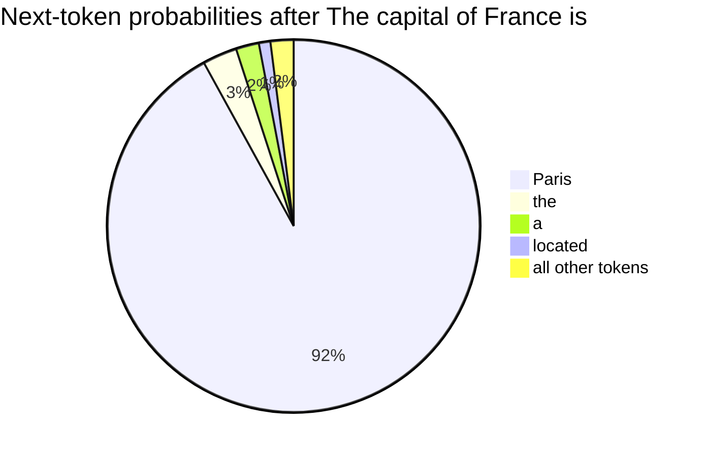
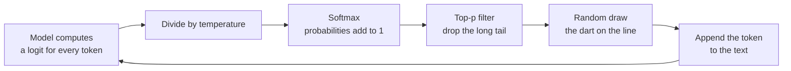
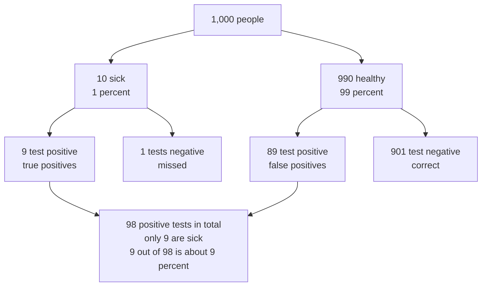

# Chapter 6: The Math of AI, Part 2: Probability, Statistics and Learning by Slopes

*Your chatbot never knows the next word for certain, and it got good by sliding downhill on its own mistakes; this chapter teaches you the math of both, by hand, starting from nothing but arithmetic.*

## What you'll learn

- How exponentials and logarithms work, and why almost every chart about AI progress uses a log scale.
- The basic rules of probability, and what a probability distribution is.
- How softmax turns a model's raw scores into probabilities, worked with three numbers.
- How a chatbot picks each token by sampling, and what temperature and top-p actually do.
- Conditional probability and Bayes' rule, and why base rates matter when you decide whether to trust an AI answer.
- The statistics you need to read AI claims: mean, median, spread, the bell curve, and correlation versus causation.
- What derivatives, gradients and the chain rule are, and what a loss function such as cross-entropy measures.
- How gradient descent and the training loop turn all of this into a machine that learns.

## Before you start

You need Chapter 5 (The Math of AI, Part 1: Functions, Vectors and Matrices), especially parameters, the line of best fit, mean squared error, and the idea that a model is a function with knobs. Chapter 2 (How Computers Work: Bits, Transistors and Processors) covers powers of ten and scientific notation, which come back immediately. As before, keep a calculator and a spreadsheet open. Any phone calculator in "scientific" mode has the two new buttons you will need: `e^x` and `ln`. In a spreadsheet they are `=EXP()` and `=LN()`.

## Two kinds of math a learning machine needs

Chapter 5 showed what a model *is*: a giant function that multiplies vectors by matrices. This chapter answers two different questions.

The first is **how a model deals with uncertainty**. When you type "The best thing about Paris is", there is no single correct next word. "the", "its", "how" and "that" are all reasonable. A chatbot does not pick one rule-based answer; it computes a *probability* for every possible next token and then draws one. That is why asking the same question twice can give different answers. To understand this you need exponentials, logarithms and probability.

The second is **how a model learns**. Chapter 5 found the best line through four quiz scores using a spreadsheet's built-in shortcut. A chatbot with billions of knobs has no shortcut. Instead, it measures how wrong it is, works out which way to turn every knob to be a little less wrong, turns them a tiny amount, and repeats this trillions of times. To understand this you need slopes, gradients and the chain rule.

Along the way you will pick up the statistics you need to read benchmark claims, news stories and company announcements without being fooled.

## Exponentials: repeated multiplication

### Powers and doubling

Multiplication is repeated addition: 3 × 4 means 4 + 4 + 4. An exponent is repeated multiplication: `2^5` means 2 × 2 × 2 × 2 × 2 = 32. The small raised number (here 5) counts how many times you multiply.

> **Definition — Exponent:** The number that says how many times to multiply a number by itself. In `2^5 = 32`, the exponent is 5; it is also called a power, so `2^5` is read "two to the fifth power".

Things that grow by multiplying, rather than adding, grow astonishingly fast. The old legend of rice on a chessboard makes the point: put 1 grain on the first square, 2 on the second, 4 on the third, doubling each time. The 64th square alone needs `2^63` grains, about 9.2 × 10^18, and the whole board about 1.8 × 10^19. That is far more rice than the world has ever grown.

> **Definition — Exponential growth:** Growth by repeated multiplication, such as doubling every year. It looks slow at first and then explodes, because each step adds more than the one before.

> **Definition — Doubling time:** How long something growing exponentially takes to double. Something that doubles every 5.2 months grows about 5 times in a year.

### Exponential growth in AI

AI is full of exponentials. Epoch AI, a research group that tracks the field, estimates that the computing power used to train frontier models has grown about 5 times per year since 2020. Compare that with steady linear growth of "plus 5 units a year":

| Year | Linear: add 5 per year | Exponential: multiply by 5 per year |
|---|---|---|
| 0 | 0 | 1 |
| 1 | 5 | 5 |
| 2 | 10 | 25 |
| 3 | 15 | 125 |
| 4 | 20 | 625 |
| 5 | 25 | 3,125 |

After five years the linear line has reached 25. The exponential one has reached `5^5` = 3,125. That is the difference between a company that grows its computing budget by a fixed amount each year and one that multiplies it.

Epoch describes the same trend as compute doubling about every 5.2 months. Are those two descriptions consistent? A year has 12 ÷ 5.2 ≈ 2.3 doubling periods, and 2 multiplied by itself 2.3 times is about 4.9. So yes: doubling every 5.2 months is about 5 times per year.

### Exponential decay

Exponentials also shrink things. Halving again and again (1, 0.5, 0.25, 0.125, ...) is exponential decay. Radioactive material decays this way, and so do AI prices. The 2025 Stanford AI Index reported that the cost of using a model as capable as GPT-3.5 fell more than 280-fold between November 2022 and October 2024. Spread over those roughly two years, that is a drop of more than ten times per year.

> **Definition — Exponential decay:** Shrinking by repeated multiplication by a number less than 1, such as halving every year. It falls fast at first and then flattens toward zero without ever quite reaching it.

> **Watch out:** Real-world exponentials do not continue forever. Computing growth runs into limits of electricity, chip supply, money and data. "It grew 5 times a year for six years" is a fact; "so it will for the next six" is a forecast, and Chapter 60 presents the arguments on both sides.

### The special number e

One number appears whenever things grow continuously, and it sits inside the softmax function you will meet shortly. It is called e, and it is about 2.718. You never need to compute it yourself; every calculator has an `e^x` button and every spreadsheet has `=EXP(x)`.

> **Definition — Euler's number (e):** A constant, about 2.718, that is the natural base for growth and decay. Raising e to a power, written `e^x` or `EXP(x)`, is the "exponential function" used throughout AI.

Here is what `e^x` looks like for a few values of x. Get a feel for the pattern: it is always positive, it is exactly 1 at x = 0, and it grows (or shrinks) by a factor of about 2.7 for each step of 1.

| x | −2 | −1 | 0 | 1 | 2 | 3 |
|---|---|---|---|---|---|---|
| `e^x` | 0.135 | 0.368 | 1 | 2.718 | 7.389 | 20.09 |

## Logarithms: counting the multiplications

### "How many zeros?"

A logarithm runs an exponential backward. It answers the question "what power do I need?" The base-10 logarithm of 1,000 is 3, because `10^3` = 1,000. A quick way to think of it: the base-10 log of a big round number is roughly how many zeros it has.

- log10(10) = 1
- log10(1,000) = 3
- log10(1,000,000) = 6
- log10(1) = 0
- log10(0.1) = −1 (a tenth is "one step down")

Logs in base 2 count doublings instead: log2(8) = 3, because doubling three times (1 → 2 → 4 → 8) gets you to 8.

> **Definition — Logarithm:** The inverse of an exponential: it answers "what power gives this number?" log10(1,000) = 3 because `10^3` = 1,000. Roughly, a base-10 log counts zeros and a base-2 log counts doublings.

AI uses a third kind most often, the natural logarithm, written ln, which runs `e^x` backward. ln(1) = 0 and ln(e) = 1. The spreadsheet functions are `=LOG10()`, `=LOG(x, 2)` and `=LN()`.

> **Definition — Natural logarithm (ln):** The logarithm whose base is e (about 2.718). It is the reverse of the `e^x` button, and it is the log used in AI loss functions. ln(1) = 0, and ln of any number between 0 and 1 is negative.

The natural log of numbers between 0 and 1 matters a lot, because probabilities live there. Notice that they are all negative, and that they get more negative quickly as the number gets small:

| Number | 1 | 0.9 | 0.5 | 0.1 | 0.01 |
|---|---|---|---|---|---|
| ln(number) | 0 | −0.105 | −0.693 | −2.303 | −4.605 |

### Logs turn multiplying into adding

Logs have one magic property: the log of a product is the sum of the logs.

`log(a × b) = log(a) + log(b)`

Check it: log10(100 × 1,000) = log10(100,000) = 5, and log10(100) + log10(1,000) = 2 + 3 = 5. It works.

Why should you care? Because models multiply many probabilities together, and those products get absurdly small. Multiply 0.5 × 0.1 × 0.2 and you get 0.01. Do that for a thousand tokens and the number has hundreds of zeros after the decimal point, too small for a computer to store. Using logs, you *add* instead: log10(0.5) + log10(0.1) + log10(0.2) = −0.301 − 1 − 0.699 = −2, which is log10(0.01). Adding a thousand ordinary negative numbers is easy. That is why AI systems almost always work with "log-probabilities" rather than raw probabilities.

### Log scales

Most charts space their tick marks evenly: 0, 10, 20, 30. A log-scale chart spaces them by multiplying: 1, 10, 100, 1,000. Each step up means "ten times more".

```
 Ordinary scale (each tick adds 1,000):
 0      1,000    2,000    3,000    4,000    5,000
 |--------|--------|--------|--------|--------|
 1, 10 and 100 are all squashed into the first sliver.

 Log scale (each tick multiplies by 10):
 1        10       100      1,000    10,000   100,000
 |--------|--------|--------|--------|--------|
 1, 5, 25, 125, 625, 3,125 land at evenly spaced steps.
```

*Figure 6.1: An ordinary axis versus a log axis. On a log axis, steady multiplication (like 5 times per year) becomes a straight line.*

> **Definition — Log scale:** A chart axis where each equal step multiplies the value (1, 10, 100, 1,000) instead of adding to it. It lets one chart show both tiny and enormous numbers, and it turns exponential growth into a straight line.

That last point is why AI-progress charts are almost always drawn on log scales. Plot the "multiply by 5 per year" column from the table above on an ordinary axis and it looks flat for years and then shoots off the top. Plot it on a log axis and it is a perfectly straight line, which makes it easy to see whether a trend is speeding up, slowing down or holding steady.

### Log-log plots and scaling laws

Some relationships are power laws: one quantity varies as another raised to a fixed power. For example, the area of a square is its side length squared. If you put a log scale on *both* axes (a log-log plot), every power law becomes a straight line, and the slope of that line is the power.

> **Definition — Power law:** A relationship where one quantity changes as another raised to a fixed power, such as area = side × side. On a log-log plot it appears as a straight line.

> **Definition — Log-log plot:** A chart with log scales on both axes. Power-law relationships show up as straight lines on it, which makes them easy to spot and extend.

This is how researchers discovered scaling laws. In 2020, Jared Kaplan and colleagues at OpenAI plotted language models' error against the computing power used to train them on log-log axes, and the points fell along a remarkably straight line across many sizes. That straight line told the industry something precious: if you spend 10 times more compute, you can predict roughly how much better the model will get before you spend the money. Chapter 19 tells that story in full, including the 2022 "Chinchilla" refinement.

> **Definition — Scaling laws:** Observed patterns, usually straight lines on log-log plots, showing that a model's error falls predictably as training compute, data and parameters grow together.

> **At the frontier (2026):** Epoch AI's trend charts (updated February 2026) are all drawn on log scales: frontier training compute growing about 5 times per year, training costs about 3.5 times per year, AI chip performance per dollar improving about 49% per year, and GPU memory bandwidth improving only about 28% per year. That last, slower line is the "memory wall" from Chapter 5 made visible, and it explains why so much engineering effort goes into moving fewer bytes.

## Probability: a number between 0 and 1

### Counting outcomes

A probability is a number from 0 to 1 saying how likely something is. 0 means impossible, 1 means certain, and 0.5 means a coin toss. When every outcome is equally likely, a probability is just counting: the number of ways to get what you want, divided by the number of possible outcomes. A fair six-sided die has 6 outcomes, so the probability of rolling a 6 is 1 ÷ 6 ≈ 0.167. The probability of rolling an even number is 3 ÷ 6 = 0.5, because three faces (2, 4, 6) are even.

> **Definition — Probability:** A number from 0 (impossible) to 1 (certain) that measures how likely something is. It can also be written as a percentage, so 0.25 means 25%.

> **Definition — Event:** Any outcome or group of outcomes you can ask the probability of, such as "roll a 6", "roll an even number" or "the next token is Paris".

We write the probability of an event A as P(A). So P(roll a 6) = 1/6.

### The three rules you need

**Rule 1: not.** The probability that something does *not* happen is 1 minus the probability that it does. P(not a 6) = 1 − 1/6 = 5/6 ≈ 0.833.

> **Definition — Complement:** The event that something does not happen. Its probability is 1 minus the probability of the event itself.

**Rule 2: and (for independent events), multiply.** If two events do not affect each other, the probability that both happen is the product of their probabilities. Two coin flips both landing heads: 0.5 × 0.5 = 0.25. Two dice both showing 6: 1/6 × 1/6 = 1/36 ≈ 0.028.

> **Definition — Independence:** Two events are independent if knowing that one happened tells you nothing about the other, like two separate coin flips. Only for independent events can you multiply probabilities directly.

**Rule 3: or, add, then subtract any overlap.** The probability that at least one of two events happens is the sum of their probabilities minus the probability that both happen (otherwise you would count the overlap twice). Drawing a heart or a king from a 52-card deck: 13/52 + 4/52 − 1/52 = 16/52 ≈ 0.31, because the king of hearts is in both groups. When two events cannot both happen (rolling a 1 or a 2 on one die), the overlap is zero and you simply add: 1/6 + 1/6 = 1/3.

> **Watch out:** Independence is easy to assume and often false. After five heads in a row, a fair coin is still 50/50 on the next flip (believing otherwise is the "gambler's fallacy"). But the words in a sentence are *not* independent: after "peanut butter and", the next word is far more likely to be "jelly" than it would be on its own. Language is full of dependence, and that is exactly what a chatbot learns.

### Expected value

If you repeat something random many times, what is the average result? Multiply each outcome by its probability and add them up. For a fair die: (1 + 2 + 3 + 4 + 5 + 6) × 1/6 = 21 ÷ 6 = 3.5. You can never roll a 3.5, but over many rolls the average approaches it. You may notice the method: it is a dot product of the outcomes [1, 2, 3, 4, 5, 6] with the probabilities [1/6, 1/6, ...], exactly as in Chapter 5.

> **Definition — Expected value:** The long-run average outcome of something random, found by multiplying each outcome by its probability and adding the results. A fair die's expected value is 3.5.

The same arithmetic tells you whether a bet is worth it. A $2 lottery ticket with a 1-in-1,000,000 chance of winning $1,000,000 has an expected value of 1,000,000 × 0.000001 = $1. You pay $2 to get $1 back on average.

### The law of large numbers

Flip a coin 10 times and you might get 7 heads. Flip it 10,000 times and you will almost certainly get very close to 5,000. The more you repeat a random process, the closer the average gets to the expected value.

> **Definition — Law of large numbers:** The principle that the average of many repeated random trials gets closer and closer to the expected value as the number of trials grows.

This is why a single surprising chatbot answer tells you little, while a test over 1,000 questions tells you a lot. It is also why AI companies can predict their costs and error rates well, even though each single response is random.

## Probability distributions: the shape of uncertainty

A probability distribution lists every possible outcome together with its probability, and the probabilities add up to exactly 1. A fair die's distribution gives 1/6 to each face. A loaded die might give 0.5 to the 6 and 0.1 to each other face (check: 0.5 + 5 × 0.1 = 1).

> **Definition — Probability distribution:** A complete list of possible outcomes with their probabilities, which always add up to 1. A bag of marbles is a physical distribution: the share of each color is its probability of being drawn.

> **Definition — Uniform distribution:** A distribution where every outcome is equally likely, like a fair die or a fair coin.

> **Analogy:** A probability distribution is a bag of marbles. If the bag holds 92 red marbles, 3 blue, 2 green, 1 yellow and 2 white, then reaching in blindfolded gives red 92% of the time. Changing the distribution means changing what is in the bag.

Every time your chatbot writes a token, it produces exactly such a distribution over its whole vocabulary of perhaps 100,000 or more tokens. For the prompt "The capital of France is", a model's distribution might look like this (illustrative numbers):



*Figure 6.2: A language model's output is a probability distribution over its vocabulary. The numbers here are illustrative.*

Two things in that picture are worth noticing. First, "Paris" is not certain, even though it is correct: the model leaves a little probability for sentences like "The capital of France is located on the Seine". Second, tens of thousands of other tokens share the last 2%. Most of them have tiny probabilities, but tiny is not zero. How the app chooses from this distribution is the subject of the next two sections.

## Softmax: turning scores into probabilities

### From raw scores to probabilities

The final layer of a language model does not output probabilities directly. As Chapter 5 described, it outputs one raw score per token, made by dot products. These scores can be any numbers, positive or negative, and they do not add up to 1. They are called logits.

> **Definition — Logit:** A raw score a model gives to each possible output before it is turned into a probability. Higher logits mean the model favors that option more, but logits can be any number and need not add up to 1.

To turn logits into a proper distribution, models use a function called softmax. It has two steps:

1. Raise e to the power of each score (`e^score`). This makes every number positive.
2. Divide each result by the total, so they add up to 1.

> **Definition — Softmax:** A function that turns any list of scores into probabilities that are all positive and add up to 1: raise e to each score, then divide each result by their total. Bigger scores get disproportionately bigger shares.

### Worked with three numbers

Suppose a model has narrowed things down to three candidate tokens with logits Paris = 2.0, Lyon = 1.0 and Nice = 0.1.

| Token | Logit | `e^logit` | Divide by total (11.21) | Probability |
|---|---|---|---|---|
| Paris | 2.0 | 7.389 | 7.389 ÷ 11.21 | 0.659 |
| Lyon | 1.0 | 2.718 | 2.718 ÷ 11.21 | 0.242 |
| Nice | 0.1 | 1.105 | 1.105 ÷ 11.21 | 0.099 |
| Total | | 11.21 | | 1.000 |

The three probabilities, 65.9%, 24.2% and 9.9%, add to 100%. The order is preserved: the highest score still gets the highest probability. But look at the ratios. The scores 2.0 and 1.0 differ by only 1, yet Paris ends up with almost three times Lyon's probability, because e raised to a difference of 1 is 2.718. Softmax exaggerates gaps.

Here is a neat property. Add the same number to every score, say +1, giving 3.0, 2.0 and 1.1. Work it through and you get exactly the same probabilities: 0.659, 0.242, 0.099. Only the *differences* between scores matter, not their absolute size.

> **Try it:** In a spreadsheet, put 2, 1 and 0.1 in A1 to A3. In B1 type `=EXP(A1)` and fill down. In C1 type `=B1/SUM($B$1:$B$3)` and fill down. You have built softmax. Now change the first score to 5 and watch Paris's probability approach 1.

Softmax appears in two key places in a chatbot: at the end, to produce next-token probabilities, and inside every attention step, where it turns relevance scores into percentages that say how much each token should borrow from each other token (Chapter 15).

## Sampling and temperature: why the same question gets different answers

### Drawing from the bag

Once the model has a distribution, the app has to pick one token. The simplest choice is to always take the most likely one.

> **Definition — Greedy decoding:** Always choosing the single most probable next token. It is predictable but tends to produce bland, repetitive text.

Most chatbots instead *sample*: they pick at random, with each token's chance equal to its probability. A simple way to do this is to lay the probabilities end to end along a line from 0 to 1, then throw a dart at a random point.

| Token | Probability | Covers the stretch of the line from | to |
|---|---|---|---|
| Paris | 0.92 | 0.00 | 0.92 |
| the | 0.03 | 0.92 | 0.95 |
| a | 0.02 | 0.95 | 0.97 |
| located | 0.01 | 0.97 | 0.98 |
| everything else | 0.02 | 0.98 | 1.00 |

If the random number is 0.37, the dart lands in Paris's stretch. If it is 0.96, it lands on "a", and the model writes "The capital of France is a city of..." which is fine. Then that token is appended, the model computes a fresh distribution for the next position, and the dart is thrown again.

> **Definition — Sampling:** Picking an outcome at random according to a probability distribution, like drawing a marble from a bag. Chatbots sample each next token, which is why their answers vary.

### Temperature

Temperature is a dial that reshapes the distribution before sampling. Technically, the model divides every logit by the temperature T before applying softmax. Let's redo the Paris, Lyon, Nice example at three temperatures:

| Temperature | Logits after dividing by T | Paris | Lyon | Nice |
|---|---|---|---|---|
| 0.5 (cooler) | 4.0, 2.0, 0.2 | 0.864 | 0.117 | 0.019 |
| 1.0 (normal) | 2.0, 1.0, 0.1 | 0.659 | 0.242 | 0.099 |
| 2.0 (hotter) | 1.0, 0.5, 0.05 | 0.502 | 0.304 | 0.194 |

Low temperature stretches the gaps between scores, and softmax then exaggerates them further, so the top choice dominates. High temperature squeezes the gaps, flattening the distribution so that unlikely tokens get picked more often. As temperature approaches 0, sampling becomes greedy decoding.

> **Definition — Temperature:** A sampling setting that divides the model's scores before softmax. Low temperature (below 1) makes output more predictable; high temperature (above 1) makes it more varied and more error-prone.

> **Analogy:** Temperature is how adventurous a diner is. At low temperature they always order their favorite dish. At high temperature they might order anything on the menu, including things they will regret.

### Top-p: cutting off the long tail

Even at normal temperature, thousands of junk tokens share a small slice of probability, and occasionally one gets drawn. Top-p sampling (also called nucleus sampling) fixes this. Keep only the most likely tokens until their probabilities add up to at least p, throw away the rest, and rescale the survivors to add up to 1.

Suppose a bakery-slogan prompt gives these options for the next word: fresh 0.40, warm 0.30, daily 0.20, artisan 0.10. With p = 0.8:

1. fresh alone covers 0.40. Not enough.
2. fresh plus warm covers 0.70. Still short of 0.8.
3. Adding daily gives 0.90. That passes 0.8, so stop.
4. Rescale the three survivors by dividing by 0.90: fresh 0.444, warm 0.333, daily 0.222. "artisan" can no longer be chosen.

> **Definition — Top-p sampling:** Sampling only from the smallest set of most-likely tokens whose probabilities add up to at least p (such as 0.9), after rescaling them. It cuts off the long tail of unlikely tokens while keeping variety.



*Figure 6.3: How a chatbot chooses each token. The loop runs once per token, tens of times per second.*

> **Try it:** Open a fresh chat and ask "Give me a one-sentence slogan for a bakery." Do it five times in five new chats. Then ask "What is 17 × 23?" five times. The slogans vary a lot; the arithmetic answer (391) should not. For the math question, the model's distribution has one dominant token at each step, so sampling almost always picks it.

> **Watch out:** Turning temperature up does not make a model more creative in any deep sense, and turning it down does not make it more truthful. Temperature only changes how adventurously the app draws from the same distribution. Chapter 18 adds two more twists: other sampling methods such as top-k and min-p, and why even temperature 0 is not perfectly repeatable on shared servers.

> **At the frontier (2026):** Sampling is now used deliberately to make models *smarter*, not just more varied. Reasoning systems often sample many independent attempts at a hard problem and then pick the best one or take a majority vote, an idea first popularized in 2022 as "self-consistency". The "heavy" or "deep think" modes some labs sell spend extra compute on exactly this kind of parallel sampling. Chapter 21 explains how.

## Conditional probability: the heart of every chatbot

### Narrowing the room

Conditional probability is the probability of something *given* that something else is already known. It is written P(A | B), read "the probability of A given B".

Picture a room of 100 people. 40 wear glasses. 30 are carrying a book. 20 are doing both.

- P(glasses) = 40 ÷ 100 = 0.40.
- Now narrow the room to only the 30 people carrying books. Of those, 20 wear glasses. So P(glasses | book) = 20 ÷ 30 ≈ 0.67.

Knowing someone carries a book raised the chance they wear glasses from 40% to 67%. The formula version just divides the "both" share by the "given" share: P(A | B) = P(A and B) ÷ P(B) = 0.20 ÷ 0.30 ≈ 0.67.

> **Definition — Conditional probability:** The probability that A happens given that B is known to have happened, written P(A | B). You compute it by narrowing your attention to only the cases where B is true.

> **Analogy:** Conditional probability is narrowing the room. Of everyone here, how many wear glasses? Now, of only the people holding books, how many?

### P(next token | everything so far)

This is the single most important probability idea for understanding chatbots. A language model computes one thing, over and over:

`P(next token | all the tokens so far)`

Given "The capital of France is", the probability of " Paris" is high. Given "My favorite city to visit is", the probability of " Paris" is lower, but still real. Given "2 + 2 =", it is nearly zero. Same token, different condition, completely different probability. Everything a chatbot "knows" is stored as its ability to compute these conditional probabilities well.

> **Definition — Language model:** A model that assigns probabilities to sequences of text, usually by predicting the probability of each next token given all the previous ones. Chatbots are built on large language models.

### Chaining probabilities for a whole sentence

How likely is a whole sentence? Multiply the conditional probabilities of each token given what came before. Suppose a model says:

- P("The") = 0.05 (as a first word)
- P("cat" | "The") = 0.01
- P("sat" | "The cat") = 0.2

Then P("The cat sat") = 0.05 × 0.01 × 0.2 = 0.0001. In logs, the same calculation is a sum: log10(0.05) + log10(0.01) + log10(0.2) = −1.30 − 2 − 0.70 = −4.0, which is log10(0.0001). For a 1,000-token essay you would add 1,000 such numbers. This sum, the log-probability, is how models score whole texts.

> **Definition — Log-probability:** The logarithm of a probability. Because it turns multiplying into adding, models use log-probabilities to score long sequences without the numbers becoming too small to store; it is always zero or negative.

### A language model you can build by counting

Here is a complete, if tiny, language model. Take three sentences: "I like tea. I like coffee. I drink tea." Count which word follows each word:

| Previous word | What follows, and how often | Conditional probabilities |
|---|---|---|
| I | like (2 times), drink (1 time) | P(like given I) = 2/3, P(drink given I) = 1/3 |
| like | tea (1), coffee (1) | P(tea given like) = 1/2, P(coffee given like) = 1/2 |
| drink | tea (1) | P(tea given drink) = 1 |

To generate text, start with "I", roll a die to pick the next word with those probabilities, and continue. You might produce "I like coffee" or "I drink tea". The probability of "I like tea" is 2/3 × 1/2 = 1/3.

This kind of model, which looks only at the previous word or few words, is called an n-gram model, and versions of it powered phone keyboards and speech recognition for decades.

> **Definition — N-gram model:** A simple language model that predicts the next word from only the previous few words (n − 1 of them), using counts from a large body of text. A "bigram" model looks back one word.

Why aren't chatbots built this way? Because counting breaks down. Your prompt today, together with everything before it in your conversation, has almost certainly never appeared anywhere in history, so there is nothing to count. A large language model instead *learns a function* (Chapter 5) that computes `P(next token | everything so far)` for contexts it has never seen, by generalizing from patterns. It conditions on your entire conversation, up to its context window, not just the last word.

## Bayes' rule: updating beliefs with evidence

### The medical test, with 1,000 people

Here is a famous puzzle that most people, including many doctors, get wrong. A disease affects 1% of people. A test catches 90% of people who have it. But it also wrongly flags 9% of healthy people. You test positive. How likely is it that you are sick?

Many people guess 90%. The real answer is about 9%. The clearest way to see why is to imagine 1,000 people, using whole numbers instead of percentages:

- 1% of 1,000 = **10 people are sick**. The test catches 90% of them: **9 true positives**, and 1 is missed.
- **990 people are healthy**. The test wrongly flags 9% of them: 990 × 0.09 ≈ **89 false positives**. The other 901 correctly test negative.
- Total positive tests: 9 + 89 = **98**. Of those, only 9 are actually sick.
- So P(sick | positive) = 9 ÷ 98 ≈ **0.09**, about 9%.



*Figure 6.4: Bayes' rule with natural frequencies. Because healthy people vastly outnumber sick ones, false positives swamp true positives.*

| | Test positive | Test negative | Total |
|---|---|---|---|
| Sick | 9 | 1 | 10 |
| Healthy | 89 | 901 | 990 |
| Total | 98 | 902 | 1,000 |

The test is not bad. The problem is the base rate: the disease is rare, so even a small error rate applied to the huge healthy group produces far more false alarms than there are sick people.

> **Definition — Base rate:** How common something is before you look at any specific evidence, such as a disease affecting 1% of people. Ignoring the base rate is one of the most common reasoning mistakes.

> **Definition — False positive:** A result that says "yes" when the truth is "no", such as a healthy person testing positive or a spam filter flagging a real email. A false negative is the reverse.

### The rule itself

Bayes' rule is the general recipe behind that calculation:

`P(A | B) = P(B | A) × P(A) ÷ P(B)`

In our case, A is "sick" and B is "positive test":

- P(positive | sick) = 0.9 (how well the test catches the disease)
- P(sick) = 0.01 (the base rate)
- P(positive) = 0.009 + 0.0891 = 0.0981 (all positives, from sick and healthy people)
- P(sick | positive) = 0.9 × 0.01 ÷ 0.0981 ≈ 0.092

Same answer, about 9%. The natural-frequency picture and the formula always agree; the picture is just easier to trust.

> **Definition — Bayes' rule:** A formula for updating a belief when new evidence arrives: P(A given B) = P(B given A) × P(A) ÷ P(B). It combines how well the evidence points to A with how common A was to begin with.

> **Definition — Prior and posterior:** In Bayes' rule, the prior is your belief before the evidence (1% chance of being sick), and the posterior is your updated belief after it (9% after one positive test).

### Updating again

Suppose you take a second, independent test and it is also positive. Your 9% posterior now becomes the prior. Among the 98 people who tested positive the first time, about 9 × 0.9 = 8.1 sick people and 89 × 0.09 ≈ 8.0 healthy people would test positive again. Now it is roughly 8 sick versus 8 healthy: about a 50% chance. A third positive would push it much higher. Evidence accumulates, but each piece starts from where the last one left you.

> **Analogy:** Bayes' rule is a detective updating a hunch. A clue matters, but so does who was in the building to begin with. If a thousand innocent people and one suspect were there, a clue that fits 9% of innocent people still points mostly at the innocent.

### Why this matters for AI

Bayesian thinking shows up in AI in three practical ways.

- **Judging AI answers.** A chatbot's fluent, confident tone is evidence of very little on its own. If you ask about a rare fact that was barely mentioned in its training data, the base rate of the model knowing it well is low, so a confident answer deserves more checking, not less.
- **Calibration.** A well-behaved model's confidence should match reality: of all the times it says "I'm 90% sure", it should be right about 90% of the time.
- **Hallucination.** A 2025 paper by Adam Kalai and colleagues at OpenAI argued that models make things up partly because training and benchmarks reward guessing: a wrong guess usually costs no more than saying "I don't know", so guessing scores better on average. Chapter 18 and Chapter 55 return to this.

> **Definition — Calibration:** How well a model's stated confidence matches how often it is actually right. A well-calibrated forecaster's "70% chance of rain" days see rain about 70% of the time.

## Descriptive statistics: summarizing a pile of numbers

### Mean, median and mode

Statistics is the art of summarizing many numbers with a few. Start with the "typical" value. Suppose nine people in a bar earn these salaries, in thousands of dollars: 40, 45, 50, 50, 55, 60, 65, 70, 80.

- The **mean** (average) adds them up and divides by how many there are: 515 ÷ 9 ≈ 57.2, so about $57,200.
- The **median** is the middle value when sorted: the 5th of 9, which is 55, or $55,000.
- The **mode** is the most common value: 50, or $50,000.

> **Definition — Mean:** The ordinary average: add up all the values and divide by how many there are. It is sensitive to extreme values.

> **Definition — Median:** The middle value once all values are sorted (or the average of the two middle values if there is an even number of them). It is barely affected by extreme values.

> **Definition — Mode:** The value that appears most often in a set of numbers.

Now a billionaire walks in, earning $1 billion (1,000,000 thousand). There are now 10 people.

- New mean: (515 + 1,000,000) ÷ 10 = 100,051.5 thousand, about **$100 million**. Everyone in the bar is now "on average" a multimillionaire.
- New median: the average of the 5th and 6th values, (55 + 60) ÷ 2 = 57.5, about **$57,500**. It barely moved.

> **Definition — Outlier:** A value far away from the rest of the data, like a billionaire in a bar. Outliers can drag the mean a long way, which is why the median is often the better summary.

> **Watch out:** When you read that an AI tool "saves an average of 5 hours a week", ask whether that is a mean or a median. A few power users saving 40 hours can produce a big mean while the typical user saves very little.

### Spread: variance and standard deviation

Two classes can both average 70% on a test, one with everyone between 65 and 75, the other split between 40s and 100s. To tell them apart you need a measure of spread. The standard one is computed in four steps. Take the numbers 2, 4, 4, 4, 5, 5, 7, 9:

1. Find the mean: 40 ÷ 8 = 5.
2. Find each value's distance from the mean and square it: 9, 1, 1, 1, 0, 0, 4, 16.
3. Average those squares: 32 ÷ 8 = 4. This is the **variance**.
4. Take the square root: the square root of 4 = 2. This is the **standard deviation**, back in the original units.

So these numbers typically sit about 2 away from their mean of 5. (Spreadsheets compute these with `=VAR.P()` and `=STDEV.P()`.) For the bar salaries, the standard deviation is about $12,000 before the billionaire arrives and about $300 million after: one outlier wrecks the spread, too.

> **Definition — Variance:** A measure of spread: the average of the squared distances of the values from their mean. Bigger variance means the values are more scattered.

> **Definition — Standard deviation:** The square root of the variance, which puts the spread back into the original units. Roughly, it is how far a typical value sits from the mean.

### Percentiles

A percentile tells you where a value ranks. The 90th percentile is the value that 90% of the data falls below. The median is the 50th percentile. AI companies use percentiles constantly to describe speed: "p50 latency" is the median response time, and "p99 latency" is the time that 99% of requests beat. A chatbot with a p50 of 1 second but a p99 of 30 seconds is usually fast and occasionally infuriating, and the average would hide that.

> **Definition — Percentile:** The value below which a given percentage of the data falls. The 50th percentile is the median; the 99th percentile describes the slowest or largest 1% of cases.

## The normal distribution, noise and random starts

### The bell curve

Measure the heights of thousands of adults and plot how many people have each height. You get a hump: most people near the middle, fewer and fewer toward the extremes, roughly symmetrical. That shape is the normal distribution, or bell curve.

```
                             |  mean
                           :::::
                        :::::::::::
                      :::::::::::::::
                    :::::::::::::::::::
                  :::::::::::::::::::::::
               :::::::::::::::::::::::::::::
            :::::::::::::::::::::::::::::::::::
      :::::::::::::::::::::::::::::::::::::::::::::::
  ---+-------+-------+-------+-------+-------+-------+---
   -3 sd   -2 sd   -1 sd    mean   +1 sd   +2 sd   +3 sd
                     |<---- 68% ---->|
             |<------------ 95% ------------>|
```

*Figure 6.5: The normal distribution. About 68% of values fall within 1 standard deviation of the mean, about 95% within 2, and about 99.7% within 3.*

That "68, 95, 99.7" pattern is worth memorizing. Imagine a group whose heights have a mean of 170 cm and a standard deviation of 7 cm. Then about 68% are between 163 and 177 cm, about 95% are between 156 and 184 cm, and only about 3 in 1,000 fall outside 149 to 191 cm.

> **Definition — Normal distribution:** The symmetrical bell-shaped pattern where most values cluster near the mean and extremes are rare. About 68% of values lie within one standard deviation of the mean and about 95% within two.

Why is it so common? A deep result of probability says that when many small, independent random effects add together, the total tends to follow a bell curve, whatever the individual effects look like. Height comes from many genes and environmental factors added together, so it is roughly normal. Measurement errors usually are too.

### Noise

Real data is never perfectly clean. Two identical students on two identical days score slightly differently. A thermometer jitters. That random variation, which hides the true pattern underneath, is called noise. Recall the quiz-score data in Chapter 5: the line of best fit missed every point a little. Those misses are the noise, and a good model should learn the line, not the noise.

> **Definition — Noise:** Random variation in data that hides the underlying pattern, such as measurement errors or one-off flukes. Models should learn the signal and ignore the noise.

### Why model weights start as random numbers

Before training, every parameter in a neural network needs a starting value. The obvious choice, all zeros, fails: every neuron in a layer would compute the same thing, receive the same correction, and stay identical forever, like a choir where every singer copies every other. So networks start with small random numbers, usually drawn from a bell curve centered on zero with a small, carefully chosen standard deviation. The randomness breaks the symmetry so that different neurons can learn different things. Chapter 13 explains how the size of that starting spread is chosen.

> **Definition — Random initialization:** Setting a neural network's parameters to small random numbers, often drawn from a normal distribution, before training begins. The randomness lets different parts of the network learn different things.
