# Chapter 7: A History of AI: 1843 to 2026

*This chapter tells the whole story of AI, from a mathematician's notes in 1843 to the gigawatt data centers of October 2026, and shows you the patterns that keep repeating so you can judge what comes next.*

## What you'll learn

- Who the key people were in each era of AI, from Ada Lovelace and Alan Turing to the frontier labs of 2026, and what problem each era was trying to solve.
- Why AI has gone through booms and "winters", and what started and ended each one.
- How the two great approaches, hand-written rules and learning from data, traded places several times.
- Why 2012, 2017 and 2022 were turning points, and which hardware and data made each one possible.
- What happened from 2023 to October 2026: chatbots, reasoning models, agents, restricted cyber-capable models and gigawatt campuses.
- The patterns underneath it all: the hardware-plus-data recipe, the Bitter Lesson, moving goalposts, and predictions that miss in both directions.
- How to do your own napkin math on history: doubling times, compute growth and price declines.

## Before you start

You can read this chapter on its own. It helps to have read Chapter 1 (What AI Is: A Map of the Whole Field) for the basic vocabulary, and Chapter 2 (How Computers Work: Bits, Transistors and Processors) for transistors and GPUs. Chapter 5 and Chapter 6 explain the math behind the perceptron, backpropagation and the Transformer, which this chapter introduces mainly through their stories. Every technical idea here gets its own chapter later. This chapter is the map of time that the rest of the book fills in.

## Your chatbot is 180 years in the making

Press Enter in ChatGPT, Claude or Gemini and a lot happens in a second or two. Your words are cut into tokens, turned into lists of numbers, and pushed through a neural network with hundreds of billions of adjustable numbers inside it. The network predicts the next token, then the next, and streams the answer back to you. That sounds like pure 2020s technology. Most of it is not. Each part was invented by someone, often decades ago, usually for a different purpose, and often written off as a dead end before it came back.

| Part of your chatbot | First appeared | Who |
|---|---|---|
| The idea that a machine can manipulate any symbols, not just numbers | 1843 | Ada Lovelace |
| A single universal machine that can run any program | 1936 | Alan Turing |
| The artificial neuron | 1943 | Warren McCulloch and Walter Pitts |
| Learning weights from examples | 1957–58 | Frank Rosenblatt (the perceptron) |
| Training many layers at once (backpropagation) | popularized 1986 | David Rumelhart, Geoffrey Hinton, Ronald Williams |
| GPUs you can program for general math | 2007 | NVIDIA (CUDA) |
| Words as vectors of meaning | 2013 | Google (word2vec) |
| Attention, then the Transformer | 2014, 2017 | Bahdanau and colleagues; a Google team of eight |
| Pretraining on huge amounts of web text | 2018 | OpenAI (GPT-1) |
| Shaping behavior with human ratings (RLHF) | 2017–2022 | OpenAI and DeepMind, then InstructGPT |
| "Thinking" before answering | 2024 | OpenAI (o1) |
| A standard plug for tools and data | 2024 | Anthropic (MCP) |

*Table 7.1: Where the parts of your chatbot came from.*

The history of AI is not a straight line up. It is a story of big promises, painful disappointments, and quiet work by a few stubborn people that suddenly paid off when the right hardware and data arrived. The bad stretches are called "AI winters". There have been two big ones. We are now in the longest and largest boom the field has ever had.

To make sense of the story, keep three ingredients in mind. Every era is defined by how much it had of each:

1. **Ideas**: the methods, or algorithms, people knew how to use.
2. **Data**: how many examples were available to learn from.
3. **Compute**: how much calculation the machines of the day could do.

> **Definition — Algorithm:** A step-by-step method for solving a problem, like a recipe, that can be written in any programming language or in plain words (see Chapter 3).

> **Definition — Compute:** Shorthand for the amount of computing power used, or the total number of calculations performed, as in "the training compute of a model".

> **Key idea:** AI has advanced in bursts. Each burst came when an old idea finally met enough data and enough compute to work. Watch for that pattern in every era below.

A note on dates: facts before 2023 are settled history; facts from 2023 to October 2026 come from company announcements, official documents and trackers such as Epoch AI. Where sources disagree about a 2026 date, this chapter gives a range. Appendix C lists more than 150 dated milestones in one table.

## Era 1: Dreams of thinking machines (1843–1949)

### Ada Lovelace and an engine that was never built

In the 1830s the English mathematician Charles Babbage designed the Analytical Engine, a mechanical computer of brass gears programmed with punched cards borrowed from weaving looms. It was never finished.

> **Definition — Analytical Engine:** Charles Babbage's 1830s design for a general-purpose mechanical computer, programmed with punched cards. It was never completed, but its design anticipated the parts of a modern computer.

In 1843 Ada Lovelace published long notes on the engine. They included a step-by-step method for calculating a series called the Bernoulli numbers, often called the first published computer program. She also saw that the engine could work on any symbols, not only numbers: if the rules of musical harmony could be written down, it might compose music. But she drew a line. The engine could not originate anything; it could only do what we know how to order it to do. Alan Turing later called this "Lady Lovelace's objection". The same argument returns every time a chatbot writes a poem.

### Turing's universal machine (1936)

In 1936 Alan Turing imagined a very simple machine: a long tape of squares, a head that reads and writes one symbol at a time, and a small table of rules. He showed that one "universal" machine of this kind could imitate any other, if given a description of it, and that some problems no machine can ever solve.

> **Definition — Turing machine:** Alan Turing's 1936 imaginary computer: a tape of symbols, a read-write head and a table of rules. A "universal" Turing machine can imitate any other machine, which is the idea behind every general-purpose computer.

The universal machine is why the same phone can run a calculator, a game and a chatbot. The hardware stays the same; only the program changes.

### The first artificial neuron (1943)

In 1943 the neuroscientist Warren McCulloch and the logician Walter Pitts proposed a drastically simplified brain cell. It received on-or-off signals, added them up, and "fired" if the total reached a threshold. Networks of such neurons could compute any logical rule. They could not learn, since someone had to wire them by hand, but every neural network since descends from them.

> **Definition — Artificial neuron:** A tiny calculation loosely inspired by a brain cell: it takes several input numbers, combines them into one total, and produces an output depending on whether that total is large enough. Millions to billions of them make up a neural network.

### Electronic computers, transistors and bits (1945–1948)

Three more pieces fell into place in four years.

- **1945:** ENIAC, a room-sized electronic computer with about 18,000 vacuum tubes, was programmed by rewiring it. John von Neumann described the "stored-program" design, in which instructions live in memory alongside the data, so changing programs means loading new instructions. Nearly every computer since works this way.
- **1947:** At Bell Labs, the research laboratory of the American telephone company AT&T, John Bardeen, Walter Brattain and William Shockley built the transistor, a tiny electrical switch (see Chapter 2). NVIDIA's 2024 Blackwell GPU packs 208 billion of them.
- **1948:** Claude Shannon's theory of information measured information in bits, single yes-or-no choices.

> **Definition — ENIAC (Electronic Numerical Integrator and Computer):** One of the first general-purpose electronic computers, completed in the United States in 1945. It filled a large room, used about 18,000 vacuum tubes as its switches and was reprogrammed by rewiring.

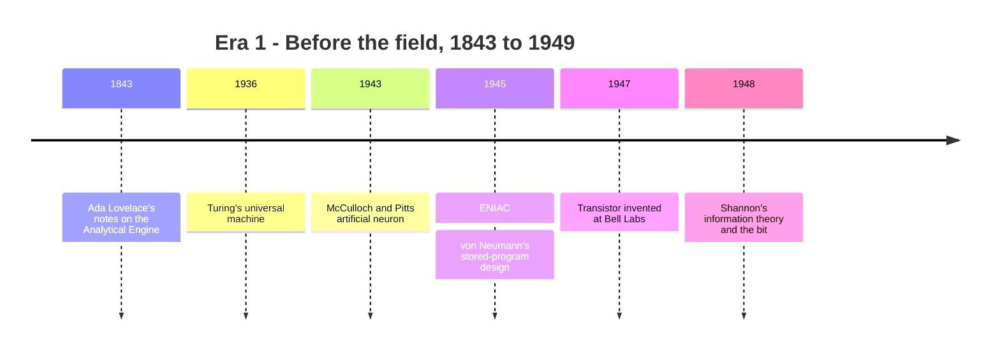
*Figure 7.1: The pre-history of AI. By 1949 the theory, the switch, the computer design and the neuron model all existed. What was missing was the bold claim that a machine might think.*

## Era 2: A field is born (1950–1973)

### "Can machines think?" (1950)

In 1950 Turing published "Computing Machinery and Intelligence", which opens with the question "Can machines think?" Because "think" is so hard to define, he replaced the question with a game. A judge chats by typed messages with two hidden players, one human and one machine. If the judge cannot reliably tell which is which, Turing argued, we have as much reason to call the machine intelligent as we have for each other. The paper also made a very modern suggestion: rather than program an adult mind, build a "child machine" and teach it.

> **Definition — Turing test (imitation game):** Alan Turing's 1950 proposal to judge machine intelligence by whether a human judge, chatting in text, can tell a machine apart from a person.

> **Watch out:** The Turing test is a thought experiment, not an official exam that AI "passed" on a certain date. Today's chatbots easily pass as human in short chats, yet nobody treats that as proof of general intelligence (see Chapter 24 for how models are really evaluated).

### Dartmouth, 1956: the field gets its name

In 1955 John McCarthy, Marvin Minsky, Nathaniel Rochester and Claude Shannon proposed a summer study at Dartmouth College, built on a bold conjecture: every aspect of learning or intelligence could in principle be described so precisely that a machine could simulate it. McCarthy coined the name "artificial intelligence". The 1956 workshop solved little, but it gave the field its name, its founders and its optimism.

> **Definition — Artificial intelligence (AI):** The field of making machines do tasks that require intelligence when people do them. The name was coined by John McCarthy for the 1956 Dartmouth workshop.

At Dartmouth, Allen Newell, Cliff Shaw and Herbert Simon showed the Logic Theorist, a program that proved theorems from a famous logic textbook by searching through possible proof steps, guided by rules of thumb called heuristics. This became the template for the next 30 years.

> **Definition — Symbolic AI (GOFAI):** The early approach of programming intelligence as explicit symbols and logical rules written by people. Later nicknamed "Good Old-Fashioned AI".

### The perceptron: a machine that learns (1957–1958)

Symbolic AI wrote the rules by hand. Frank Rosenblatt, a psychologist at the Cornell Aeronautical Laboratory, took the other road. In 1957–58 he described the perceptron, an artificial neuron that learns its own settings from examples, and built it as the Mark I Perceptron, with a 20 × 20 grid of 400 light sensors as its "eye".

> **Definition — Perceptron:** Frank Rosenblatt's 1957–58 learning machine: a single artificial neuron that multiplies each input by a weight, adds them up, outputs 1 if the total passes a threshold and 0 otherwise, and adjusts its weights whenever it gets an example wrong.

Here is a perceptron worked by hand. It has two inputs, x1 and x2, each 0 or 1, and two weights, the numbers that say how much each input counts. It outputs 1 if `w1 × x1 + w2 × x2` is at least 1.5. We want it to learn AND: output 1 only when both inputs are 1. Start with w1 = 0.5 and w2 = 0.5.

| x1 | x2 | Total with w = 0.5, 0.5 | Output | Correct answer |
|---|---|---|---|---|
| 0 | 0 | 0 | 0 | 0 |
| 0 | 1 | 0.5 | 0 | 0 |
| 1 | 0 | 0.5 | 0 | 0 |
| 1 | 1 | 1.0 | 0 | **1 (wrong)** |

*Table 7.2: A perceptron before learning gets one case wrong.*

Rosenblatt's learning rule: when the machine says 0 but the answer is 1, add a little to the weights of the inputs that were on. Add 0.5 to both, so w1 = w2 = 1.0. Now the (1, 1) total is 2.0, which passes 1.5, so the output is 1. The other rows give totals of 0, 1 and 1, all below 1.5, so they stay 0. The perceptron has learned AND from examples, without anyone writing an AND rule. Lower the threshold to 0.5 and the same weights compute OR.

Newspaper coverage at the time reported that the US Navy, which funded the work, expected such machines one day to walk, talk, see, write and even be conscious of their own existence. It was the first of many times that press excitement ran far ahead of the machine.

> **Analogy:** A perceptron is like a club bouncer with a points system. Each feature of a guest earns points (the weights), and anyone over the threshold gets in. When the manager says "you let in the wrong person", the bouncer adjusts the points.

### Checkers, ELIZA and Shakey (1958–1972)

- **1958:** John McCarthy created Lisp, a programming language designed for manipulating symbols and lists. It became the main language of AI research for decades.
- **1959:** Arthur Samuel at IBM wrote a checkers program that improved by playing many games, including against itself. His paper that year popularized the phrase "machine learning".
- **1964–66:** Joseph Weizenbaum at MIT wrote ELIZA, which imitated a therapist by matching keywords and turning your statements back into questions ("I am sad about my mother" might get "Tell me more about your family"). It understood nothing, yet people confided in it. Weizenbaum was disturbed by this and became one of the field's first critics.
- **1966–72:** At SRI, Shakey became the first mobile robot to reason about its own actions; its A* route-planning method (1968) is an ancestor of the routing in today's map apps (see Chapter 48).

> **Definition — IBM (International Business Machines):** A large American computer company, founded in 1911, that dominated business computing for much of the 20th century. Its research labs produced Samuel's checkers program, the Deep Blue chess computer and the Watson question-answering system.

> **Definition — SRI (Stanford Research Institute):** A research institute in California, founded in 1946 by Stanford University and now called SRI International. It built Shakey, the first mobile robot to reason about its own actions.

> **Definition — Machine learning (ML):** Making computers learn patterns from examples instead of following rules written by hand. The phrase was popularized by Arthur Samuel in 1959.

> **Definition — ELIZA effect:** The human tendency to read understanding, feelings or intentions into a computer program's replies, named after Joseph Weizenbaum's simple 1960s chatbot.

> **Try it:** Ask your chatbot: "Pretend to be the 1966 ELIZA program. Only reflect my statements back as questions, using simple keyword rules, and never use real knowledge." Chat for two minutes, then ask it to drop the act and explain exactly how ELIZA differed from itself. Notice how even the fake ELIZA feels like a listener. That feeling is the ELIZA effect.

Optimism ran high. In 1965 Herbert Simon predicted that within twenty years machines would be able to do any work a person can do. Also in 1965, Gordon Moore noticed that the number of transistors on a chip was doubling at a regular pace, an observation that quietly powered every later era.

> **Definition — Moore's law:** Gordon Moore's 1965 observation that the number of transistors on a chip doubles at a regular rate, later about every two years. It is an industry trend, not a law of nature, and it has slowed.

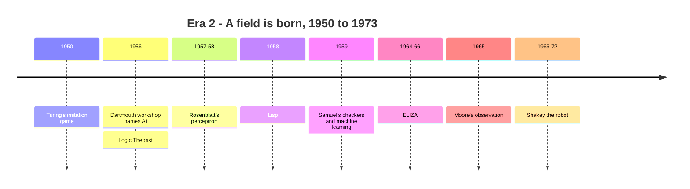
*Figure 7.2: The founding era, when both symbolic AI and the first learning machines were born.*

## Era 3: The first AI winter (1974–1980)

### The perceptron's limits (1969)

Warning signs came early. In 1966 a US government committee (ALPAC) concluded that machine translation was slower, less accurate and costlier than human translators, and funding for it dried up.

> **Definition — ALPAC (Automatic Language Processing Advisory Committee):** A US government committee whose 1966 report judged machine translation slower, less accurate and costlier than human translators, which led to deep cuts in funding for it.

Then in 1969 Marvin Minsky and Seymour Papert published *Perceptrons*, a careful mathematical book about what single-layer perceptrons can and cannot do. Their most famous example was XOR ("exclusive or"): output 1 if exactly one input is 1.

| x1 | x2 | XOR |
|---|---|---|
| 0 | 0 | 0 |
| 0 | 1 | 1 |
| 1 | 0 | 1 |
| 1 | 1 | 0 |

*Table 7.3: The XOR problem.*

Try to find weights and a threshold that work. To output 1 for (0, 1), w2 must reach the threshold. To output 1 for (1, 0), w1 must reach it. But then for (1, 1) the total w1 + w2 is bigger still, so it also passes the threshold and outputs 1, which is wrong. No setting works. Geometrically, a perceptron draws one straight line to split the 1s from the 0s, and no straight line can do that here.

```
   x2
   1 |  (0,1)=1      (1,1)=0
     |
   0 |  (0,0)=0      (1,0)=1
     +--------------------------- x1
        0              1
   The 1s sit on one diagonal and the 0s on the
   other. No single straight line separates them.
```
*Figure 7.3: Why one perceptron cannot learn XOR.*

> **Definition — XOR problem:** The classic example of a pattern that a single-layer perceptron cannot learn, because no single straight line separates its "yes" cases from its "no" cases. Networks with an extra "hidden" layer of neurons can learn it.

Minsky and Papert knew a network with a hidden middle layer could compute XOR; nobody knew how to train one. Their book is often blamed for "killing" neural networks for a decade, but the fuller story is that there was no training method yet and computers were far too small.

### Combinatorial explosion and the Lighthill report (1973)

Symbolic AI hit its own wall. Programs that shone in tiny "toy worlds", such as a table of colored blocks, collapsed on real problems because the number of possibilities explodes.

> **Definition — Combinatorial explosion:** The way the number of possible combinations grows so fast as a problem gets bigger that checking them all becomes impossible, even for very fast computers.

A worked example: in chess a player has on average about 35 legal moves. Looking ahead one move for each side gives 35 × 35 = 1,225 positions. Four moves ahead is 35^4, about 1.5 million. Ten moves ahead is about 35^10, roughly 2.8 × 10^15, nearly three quadrillion. Each extra step multiplies the work by 35.

In 1973 a review for the British government by the mathematician Sir James Lighthill concluded that AI had failed to deliver on its promises, largely because of combinatorial explosion. UK funding was cut sharply, and US defense funding shifted to near-term military goals. The first AI winter lasted roughly from 1974 to 1980.

> **Definition — AI winter:** A period when disappointment with AI's results caused funding and interest to collapse. The two big ones ran roughly from 1974 to 1980 and from the late 1980s to the early 1990s.

> **Analogy:** AI winters are gold rushes followed by ghost towns. Promises outran results, the money left, and only a few prospectors kept digging until better tools arrived.

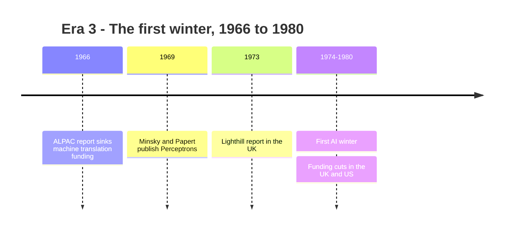
*Figure 7.4: How the first AI winter set in.*

## Era 4: Expert systems and the second winter (1980–1993)

### "Knowledge is power": expert systems

AI came back in the 1980s by narrowing its ambitions. Instead of general intelligence, capture one human expert's knowledge in one narrow area as hundreds or thousands of if-then rules.

> **Definition — Expert system:** A program from the 1970s and 1980s that encodes a human expert's knowledge as if-then rules in order to give advice in one narrow area, such as diagnosing infections or configuring computers.

MYCIN, built at Stanford in the 1970s, used several hundred rules to diagnose blood infections and suggest antibiotics; in tests it did about as well as specialists, though it was never used routinely on patients. XCON, introduced at Digital Equipment Corporation (then a major American computer maker) in 1980 to configure computer orders, grew to thousands of rules and reportedly saved the company tens of millions of dollars a year. "Knowledge engineers" interviewed experts and turned their judgment into rules, and companies bought expensive "Lisp machines", computers built to run software written in Lisp, the AI language from Era 2. In 1982 Japan launched its ten-year Fifth Generation project to build logic-based computers, and the US and UK answered with programs of their own: the first international AI race.

> **Definition — MYCIN:** An expert system built at Stanford in the 1970s that used several hundred if-then rules to diagnose blood infections and suggest antibiotics. In tests it did about as well as specialists, but it was never used routinely on patients.

> **Definition — XCON:** An expert system introduced at Digital Equipment Corporation in 1980 to work out which parts each customer's computer order needed. It grew to thousands of rules and was one of the first commercially successful AI programs.

### Why the boom collapsed (1987–1993)

Expert systems had three fatal problems. They were brittle, failing badly just outside their narrow domain because they had no common sense to fall back on. They were costly to maintain, since every new product or exception needed new rules and rules interacted in surprising ways. And in 1987 the market for Lisp machines collapsed, because cheaper desktop workstations could run the same software. The Fifth Generation project wound down in the early 1990s without reaching its goals. In the second AI winter, from the late 1980s into the early 1990s, many researchers stopped saying "artificial intelligence" at all.

> **Definition — Brittleness:** The tendency of a rule-based system to fail suddenly and badly on cases its designers did not anticipate, instead of degrading gracefully.

### Meanwhile, the neural network idea comes back

While expert systems boomed and busted, a small group kept working on networks of artificial neurons.

> **Definition — Connectionism:** The approach of building intelligence from large networks of simple connected units that learn from data, rather than from hand-written rules.

> **Definition — Neural network:** A model made of layers of artificial neurons, each computing a weighted sum followed by a simple squashing step. It is loosely inspired by the brain but is really stacked arithmetic.

In 1982 the physicist John Hopfield showed how a network could store memories as stable patterns. In 1986 David Rumelhart, Geoffrey Hinton and Ronald Williams showed in *Nature*, one of the world's leading science journals, how to train networks with hidden layers using backpropagation. Versions of the method had been found earlier, by Seppo Linnainmaa in 1970 and Paul Werbos in 1974, but the 1986 paper made it famous. Multi-layer networks could now learn XOR and much more.

> **Definition — Backpropagation:** The method for training a multi-layer neural network by working backward from its error to calculate how much each weight should change, using the chain rule from calculus (see Chapter 6 and Chapter 12).

> **Analogy:** Backpropagation is like reviewing a relay race you lost. You start from the final time and pass the blame backward, runner by runner, so each one knows how much to improve.

In 1989 Yann LeCun at Bell Labs trained a convolutional neural network to read handwritten zip codes. Its successor, LeNet-5 (1998), read handwritten digits on bank checks, one of the first neural networks to do real commercial work.

> **Definition — Convolutional neural network (CNN):** A neural network for images that slides small learned filters across the picture to detect patterns like edges, then shapes, then objects (see Chapter 14).

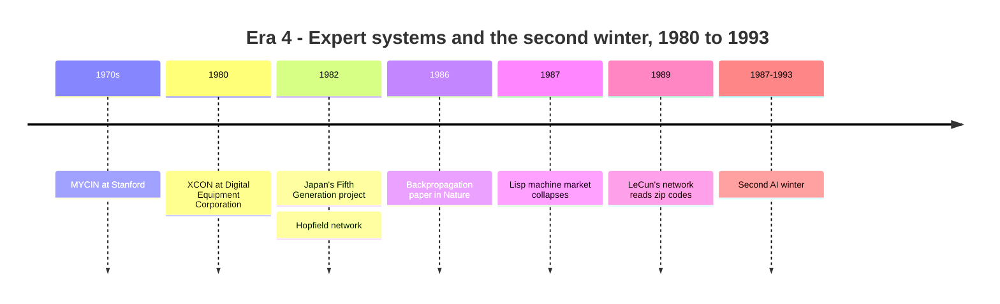
*Figure 7.5: The expert-systems boom, its collapse, and the quiet return of neural networks.*

> **Key idea:** The expert-systems era showed that you cannot hand-write all of human knowledge. That lesson pushed the field toward systems that learn their knowledge from data, which is how your chatbot works.

## Era 5: Quiet progress — statistics, the web and games (1990s–2011)

### The statistical turn

In the 1990s the field moved from writing rules to counting. Speech and translation researchers fed computers large amounts of audio and text and let probability do the work, and spam filters learned which words predicted junk. Support vector machines (1995) became a favorite tool for sorting data into categories (see Chapter 10). Google ranked web pages by their links (1998; see Chapter 51). The Netflix Prize (2006–2009) offered $1 million for a 10% better movie recommender.

> **Definition — Statistical machine learning:** Learning patterns from data using probability and statistics, the dominant style of AI from the 1990s to about 2012. Spam filters and early recommendation systems are examples.

Almost none of this was called "AI" at the time, which is a recurring pattern.

> **Definition — AI effect:** The habit of no longer calling something "AI" once it works reliably. Spam filters, route planning and face unlock were all AI research problems before they became ordinary features.

The web became the data source. In 1991 the World Wide Web went public, and Linux and Python (later the main language of AI) were first released. Storage got cheap, and people began creating enormous amounts of text, images and clicks. In 1998 LeCun and colleagues published MNIST, 70,000 small images of handwritten digits that became the "hello world" of machine learning (the standard first exercise, named after the tiny program that prints "hello world", traditionally the first one a programmer writes).

> **Definition — Benchmark:** A standard test, usually a fixed dataset with a scoring rule, used to compare AI systems. Benchmarks drive progress but can be overfit or outgrown (see Chapter 9 and Chapter 24).

### Games as yardsticks

Games are cheap, safe, scorable worlds, which made them the field's favorite proving ground.

- **1992: TD-Gammon.** Gerald Tesauro at IBM built a backgammon program that learned by playing itself and reached the level of strong human players.
- **1997: Deep Blue.** IBM's chess computer beat world champion Garry Kasparov 3.5 to 2.5. It barely learned at all. It searched about 200 million positions per second, guided by an evaluation formula tuned by people. With about three minutes per move, that is 200 million × 180 seconds = 36 billion positions per move.

> **Definition — Reinforcement learning (RL):** Learning by trial and error: an agent takes actions, receives rewards or penalties, and gradually learns which behavior earns the most reward (see Chapter 48).

> **Definition — Self-play:** Training a game-playing program by having it play against copies of itself, so it always faces an opponent at its own level and can eventually surpass every human teacher.

Neural networks survived in niches: in 1997 Sepp Hochreiter and Jürgen Schmidhuber published the LSTM, a network that remembers information over long sequences and later powered speech recognition on phones. And DARPA's 2004–2005 desert races for driverless cars (Stanford's car Stanley won in 2005) led to Google's self-driving project in 2009, the ancestor of Waymo, today's robotaxi company (see Chapter 50).

> **Definition — DARPA (Defense Advanced Research Projects Agency):** The US Department of Defense's agency for funding ambitious, high-risk research. Under its earlier name, ARPA, it funded much early AI research and the ARPANET, the ancestor of the internet.

### The ingredients arrive (2006–2011)

Between 2006 and 2011 the three ingredients of the coming boom fell into place, mostly unnoticed.

- **Ideas:** In 2006 Geoffrey Hinton and colleagues showed a way to train networks with many layers, by pretraining them one layer at a time on unlabeled data (the "deep belief nets" described in Chapter 16), and the phrase "deep learning" spread.
- **Compute:** In 2006 Amazon Web Services began renting computers by the hour. In 2007 NVIDIA released CUDA, which let programmers use graphics cards, built for video games, for general math.
- **Data:** In 2009 Fei-Fei Li and colleagues released ImageNet, millions of photos sorted into thousands of categories by paid online crowd workers, with a yearly contest from 2010.

> **Definition — GPU (Graphics Processing Unit):** A chip with thousands of small cores that do the same math on lots of data at once. Built for video-game graphics, it became the main engine of AI (see Chapter 32).

> **Definition — CUDA:** NVIDIA's software platform, released in 2007, that lets programmers run general calculations on its GPUs. Two decades of software built on it are a big reason NVIDIA dominates AI hardware.

In 2011 IBM's Watson beat two champions at the quiz show *Jeopardy!* and Apple launched Siri, putting AI back in the headlines.

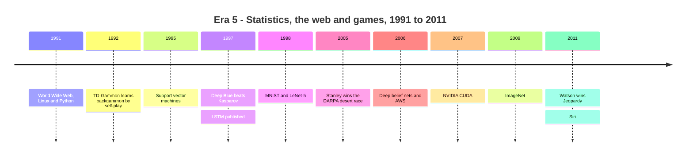
*Figure 7.6: The long quiet stretch in which the data, the GPUs and the training tricks for deep learning arrived.*

## Era 6: The deep learning boom (2012–2016)

### 2012: AlexNet and the three-legged stool

In 2012 Alex Krizhevsky, Ilya Sutskever and Geoffrey Hinton entered a deep convolutional network, later called AlexNet, in the ImageNet contest. It got about 15% of test images wrong (counting a hit if the right label was among its top five guesses), against about 26% for the runner-up. In a contest where yearly gains had been a point or two, this was a landslide. AlexNet was trained on two gaming graphics cards for about a week.

> **Definition — Deep learning:** Machine learning using neural networks with many layers, each building more abstract features out of the previous layer's output. It has dominated AI since 2012.

> **Analogy:** The deep learning boom is a three-legged stool: algorithms (backpropagation, from 1986), data (the internet and ImageNet) and compute (GPUs). The stool only stood up once all three legs were long enough, around 2012.

> **Key idea:** AlexNet did not use a new idea so much as old ideas at a new scale. Neural networks plus a big labeled dataset plus GPUs beat years of hand-designed features. The same recipe would repeat for language a decade later.

### The rush for talent, tools and building blocks

Within two years every big technology company was hiring deep-learning researchers. Facebook started its AI lab (FAIR) in 2013 under Yann LeCun. Google bought the London startup DeepMind in 2014. OpenAI was founded as a nonprofit research lab in December 2015. Google released the TensorFlow framework in 2015 and Facebook released PyTorch in 2016, so researchers no longer had to write GPU code by hand. In 2015 Google began running its own AI chip, the Tensor Processing Unit (TPU), in its data centers (see Chapter 35).

The building blocks of your chatbot appeared in quick succession:

- **2013:** Google's word2vec turned words into vectors in which meaning becomes geometry: "king" minus "man" plus "woman" lands near "queen".
- **2014:** Ian Goodfellow's GANs pitted a forger network against a detective network. For translation, Dzmitry Bahdanau and colleagues introduced attention, letting a network look back at every input word while producing each output word.
- **2015:** Microsoft's ResNet trained a 152-layer network using "skip connections" that pass each layer's input straight through, a trick inside every modern chatbot.
- **2016:** DeepMind's WaveNet generated natural-sounding speech, and Google Translate switched to neural networks.

> **Definition — Embedding:** A list of numbers (a vector) representing a word, image or item, arranged so that similar things get similar vectors (see Chapter 5 and Chapter 14).

> **Definition — GAN (generative adversarial network):** A 2014 method in which a generator network tries to create realistic fakes and a discriminator network tries to spot them, so each forces the other to improve (see Chapter 16).

> **Definition — Attention:** A mechanism that lets a model, when handling one word or token, look at all the others and decide which ones matter most, using dot products as relevance scores (see Chapter 15).

### Atari and Go: deep reinforcement learning

In 2013 DeepMind showed a "Deep Q-Network" learning dozens of Atari video games from only the screen pixels and the score. Then came Go. Go has about 10^170 legal board positions, against roughly 10^80 atoms in the observable universe, so Deep Blue's brute-force search was hopeless. DeepMind's AlphaGo combined neural networks, trained first on human games and then by self-play, with a search method called Monte Carlo tree search. In March 2016 in Seoul it beat Lee Sedol, one of the world's strongest players, 4 games to 1. In game two it played "Move 37", which experts first took for a mistake and later called beautiful. In game four Lee Sedol found a brilliant move of his own and won.

> **Definition — Monte Carlo tree search:** A search method that estimates how good a move is by playing out many quick simulated games from it and focusing effort on the most promising branches (see Chapter 48).

> **Watch out:** AlphaGo did not "solve" Go, and it did not think like a human. It combined pattern recognition learned from millions of positions with a great deal of search. Learning plus search at scale is the same recipe behind today's reasoning models.

> **Try it:** Ask your chatbot: "Explain Move 37 from the 2016 AlphaGo match to someone who has never played Go, then tell me which parts of your answer you are least sure about." Compare its confidence with what you can verify on Wikipedia in two minutes.

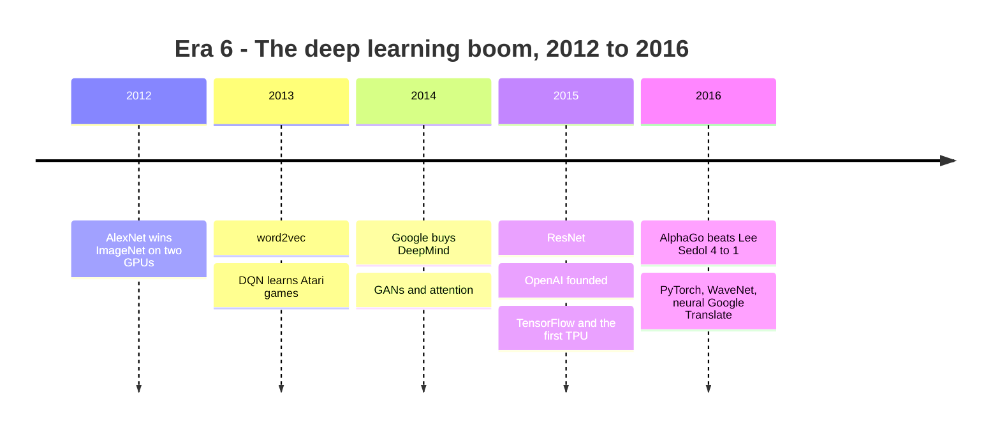
*Figure 7.7: The deep learning boom, when neural networks conquered images, speech and Go.*

## Era 7: The Transformer and the scaling era (2017–2022)

### "Attention Is All You Need" (2017)

In June 2017 eight researchers at Google published "Attention Is All You Need". Until then, language networks read text one word at a time, like a person reading aloud, which made them slow to train. The Transformer dropped that step-by-step reading and used attention alone: every word looks at every other word at once. Because all the words are processed in parallel, the design fits GPUs perfectly. The original big model trained on eight GPUs in a few days. Almost every chatbot you have used is a Transformer.

> **Definition — Transformer:** The neural-network design introduced by Google researchers in 2017 that processes all the tokens of a text in parallel using attention. It underlies nearly every modern chatbot (see Chapter 15).

### Pretrain, then fine-tune: GPT and BERT (2018–2019)

OpenAI's GPT-1 (June 2018, 117 million parameters) showed a two-step recipe: pretrain a Transformer on a large pile of unlabeled text by having it predict the next word, then fine-tune it on a small labeled dataset for a specific job. Google's BERT (October 2018) used a similar recipe and was soon put to work in Google Search. GPT-2 (February 2019, 1.5 billion parameters) wrote surprisingly fluent paragraphs; OpenAI released it in stages, citing worries about misuse, which started a long argument about open release. In 2019 Yoshua Bengio, Geoffrey Hinton and Yann LeCun received the 2018 Turing Award, computing's highest honor, for deep learning.

> **Definition — Pretraining:** The first, most expensive stage of building a language model, in which it learns to predict the next token across trillions of tokens of text, picking up grammar, facts and patterns along the way (see Chapter 19).

> **Definition — Large language model (LLM):** A neural network, almost always a Transformer, trained on huge amounts of text to predict the next token. It is the engine inside chatbots (see Chapter 18).

> **Definition — Parameter:** One adjustable number inside a model, such as a weight. GPT-1 had 117 million; frontier models in 2026 have from hundreds of billions to trillions.

### The Bitter Lesson (2019)

In March 2019 Rich Sutton, a founder of modern reinforcement learning, published a short essay called "The Bitter Lesson". Looking back over 70 years, he argued that general methods that make use of more computation, mainly search and learning, have always eventually beaten methods that build in human knowledge. Chess fell to search, Go to search plus learning, speech and vision to learning from data. The lesson is "bitter" because researchers keep investing in clever hand-built knowledge, and keep losing to scale.

> **Definition — Bitter Lesson:** Rich Sutton's 2019 argument that, over the long run, general methods that scale with computation (search and learning) beat approaches that rely on hand-built human knowledge.

Not everyone agrees; Pattern 3 near the end of this chapter weighs the strongest counter-argument.

### Games keep falling

| Year | System | Game | Why it mattered |
|---|---|---|---|
| 2017 | AlphaGo Zero, AlphaZero | Go, chess, shogi | Self-play alone, no human games |
| 2017 | Libratus | Two-player poker | Hidden cards and bluffing |
| 2019 | OpenAI Five | Dota 2 | Beat the world champion team |
| 2019 | AlphaStar | StarCraft II | Grandmaster level |
| 2019 | Pluribus | Six-player poker | Beat pros with many players |
| 2020 | MuZero | Atari, Go, chess | Not even told the rules |
| 2022 | CICERO | Diplomacy | Negotiated in natural language |

*Table 7.4: The game milestones after AlphaGo.*

> **Definition — CICERO:** Meta's 2022 AI system for Diplomacy, a board game won by making and breaking alliances. It combined a language model with strategic planning so it could negotiate with human players in plain English, and it scored well above the human average in an online league.

By 2022 games had stopped being the main yardstick. Language was.

### Scaling laws and GPT-3 (2020)

In January 2020 an OpenAI team led by Jared Kaplan published "Scaling Laws for Neural Language Models". They found that a language model's error falls smoothly and predictably as you increase three things together: model size, data and compute. Bigger was not just better; it was predictably better, which made spending large sums a calculated bet rather than a gamble.

> **Definition — Scaling laws:** The observed pattern that language models improve predictably, following smooth curves, as their parameters, training data and compute increase together (see Chapter 19).

> **Definition — FLOP (floating-point operation):** One multiplication or addition of decimal numbers, the unit used to count how much calculation training or running a model takes.

In May 2020 OpenAI announced GPT-3, with 175 billion parameters. Without any fine-tuning, you could show it a few examples inside the prompt ("English: cheese, French: fromage...") and it would continue the pattern. This "in-context learning" hinted that one model could do many jobs.

A worked example shows the scale. A standard rule of thumb (see Chapter 5) is that training takes about 6 × N × D operations, where N is the number of parameters and D the number of training tokens. GPT-3 was trained on about 300 billion tokens:

```
6 × N × D = 6 × 175,000,000,000 × 300,000,000,000
          = 315,000,000,000,000,000,000,000
          ≈ 3.15 × 10^23 FLOP
```

That is about 315 sextillion operations. We will compare it with later models in the patterns section.

### Proteins, pictures and code (2020–2022)

In 2020 DeepMind's AlphaFold 2 predicted the 3D shapes of proteins with accuracy close to lab experiments, cracking a 50-year-old problem in biology (see Chapter 52). In 2021 OpenAI showed DALL·E, which drew images from text descriptions, and CLIP, which learned to match images with their captions; GitHub Copilot began suggesting code inside programmers' editors, and former OpenAI researchers founded Anthropic. In 2022 DALL·E 2, Midjourney and Stable Diffusion (with downloadable weights) made image generation a consumer hobby, and OpenAI openly released Whisper for speech recognition.

> **Definition — DALL·E:** OpenAI's family of text-to-image models, which draw pictures from text descriptions: DALL·E (January 2021), DALL·E 2 (2022) and DALL·E 3 (2023). The name blends the painter Salvador Dalí and the Pixar robot WALL·E.

> **Definition — Diffusion model:** An image (or video) generator that learns to turn random noise into a picture step by step, guided by a text description (see Chapter 16).

Hardware kept pace. NVIDIA's V100 (2017) added "tensor cores" for neural-network math, the A100 followed in 2020 and the H100 in 2022, with 80 billion transistors. Chips also became politics. On October 7, 2022 the US restricted exports of advanced AI chips and chipmaking tools to China, the first of many rounds (see Chapter 36), and the CHIPS Act of 2022 set aside $52.7 billion to rebuild chipmaking in the US.

> **Definition — Export controls:** Government rules that restrict selling certain technologies, such as advanced AI chips or chipmaking machines, to particular countries or companies.

### November 30, 2022: ChatGPT

Two research threads met in 2022. First, OpenAI's InstructGPT paper showed how to make a model follow instructions using human feedback: people ranked the model's answers, a second model learned their preferences, and reinforcement learning nudged the main model toward the answers people preferred. Second, researchers found that simply asking a model to show its reasoning step by step, called chain-of-thought prompting, made it much better at math and logic.

> **Definition — RLHF (reinforcement learning from human feedback):** Fine-tuning a model with rewards based on human ratings of its answers. It turned raw text predictors into helpful assistants (see Chapter 20).

> **Definition — Chain-of-thought:** Having a model write out intermediate reasoning steps before its final answer, which improves accuracy on multi-step problems. It later became built-in "thinking" (see Chapter 21).

On November 30, 2022 OpenAI released ChatGPT, a GPT-3.5 model tuned with RLHF, inside a free chat window. The technology was not brand new; GPT-3 had been available to developers for more than two years. What changed was the interface. Anyone could type a question and get a fluent answer. It became one of the fastest-growing consumer products in history, and by October 2025 it had about 800 million weekly users.

> **Analogy:** The ChatGPT moment was like the iPhone moment. The underlying pieces (Transformers, GPT-3, RLHF) already existed, but a friendly interface put them in everyone's pocket overnight.

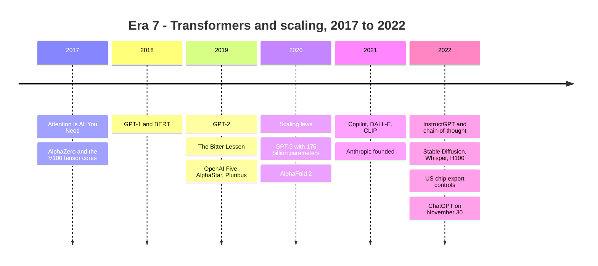
*Figure 7.8: From the Transformer paper to ChatGPT in five and a half years.*

## Era 8: The chatbot era (2023 to mid-2024)

### 2023: everyone ships a chatbot

The year after ChatGPT was a scramble.

- **February:** Meta released LLaMA to researchers; its weights leaked online within about a week, and a wave of downloadable "open-weight" models followed. Meta's Llama 2 (July) could be downloaded and used commercially.
- **March 14:** OpenAI released GPT-4, and Anthropic released the first Claude, on the same day. Google opened Bard, its first chatbot (later renamed Gemini), a week later.
- **November:** OpenAI's board fired CEO Sam Altman, and he was reinstated within days after most staff threatened to leave, a vivid sign of how high the stakes had become.
- **December 6:** Google DeepMind launched Gemini 1.0.

> **Definition — Open-weight model:** An AI model whose trained parameters (weights) anyone can download and run. The training data and code often stay private, so it is not the same as fully open source (see Chapter 30).

> **Definition — Frontier model:** One of the most capable AI models available at a given time, typically from a handful of well-funded labs, and the focus of most safety policy.

### Governments wake up

In May 2023 many leading AI researchers and executives signed a one-sentence statement that mitigating the risk of extinction from AI should be a global priority alongside pandemics and nuclear war; critics called it a distraction from present harms such as bias and misinformation (see Chapter 60 for both sides). Governments moved fast by their standards. China's rules for generative AI services took effect on August 15, 2023. US President Biden signed a sweeping executive order on AI on October 30, 2023. In November, 28 countries and the EU signed the Bletchley Declaration at the UK's AI Safety Summit, and in December the EU reached a political deal on its AI Act.

### 2024: faster, multimodal, longer memory

- **February:** Google's Gemini 1.5 Pro offered a context window of up to 1 million tokens for testers, enough to read several books at once.
- **March:** Anthropic released Claude 3. NVIDIA announced Blackwell, with 208 billion transistors in one package.
- **May:** OpenAI's GPT-4o handled text, images and audio in a single model and could hold a spoken conversation with little delay. Sixteen AI companies signed safety commitments at the Seoul summit.
- **July:** Meta's Llama 3.1 405B, an open-weight model trained with about 3.8 × 10^25 FLOP (Epoch's estimate). Google DeepMind's AlphaProof and AlphaGeometry 2 reached silver-medal standard on International Mathematical Olympiad problems.
- **August 1:** the EU AI Act entered into force.
- **2024:** Elon Musk's xAI reportedly built its Colossus cluster in Memphis in 122 days, with about 100,000 H100 GPUs.

> **Definition — Multimodal model:** A model that can take in, and sometimes produce, more than one kind of data, such as text, images, audio and video (see Chapter 22).

> **Definition — Context window:** The maximum amount of text, measured in tokens, that a model can consider at once, including your whole conversation and any files you attach (see Chapter 18).

In October 2024 the Nobel committees made the history official. The Physics prize went to John Hopfield and Geoffrey Hinton for foundational work on neural networks. The Chemistry prize went to David Baker for protein design and to Demis Hassabis and John Jumper for AlphaFold.

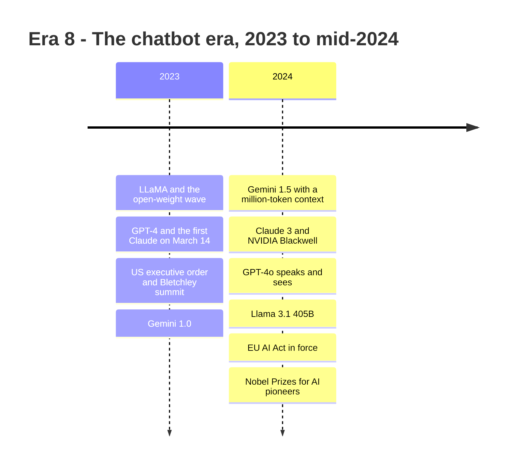
*Figure 7.9: The chatbot era, when every major lab shipped an assistant and governments began to regulate.*

## Era 9: Reasoning models and agents (September 2024 to December 2025)

### Thinking before answering

On September 12, 2024 OpenAI released o1-preview, the first widely available reasoning model. Instead of answering immediately, it wrote a long hidden chain of thought first, trained with reinforcement learning to make that thinking useful. The longer it thought, the better it did on hard math and coding problems. Epoch AI dates the reasoning-model era from this release.

> **Definition — Reasoning model:** A model trained, mostly with reinforcement learning, to generate a long internal "thinking" process before its final answer. OpenAI's o1 (September 2024) was the first widely available one (see Chapter 21).

> **Definition — Test-time compute:** Computation spent while the model is answering, for example by thinking longer or trying several answers, as opposed to computation spent during training.

This opened a second way to scale. Until 2024, progress mostly meant bigger training runs. Now you could also buy better answers by letting the model think longer. OpenAI's o3 followed (announced December 2024, released April 16, 2025), and every major lab shipped thinking modes within a year.

### Models that use computers

On October 22, 2024 Anthropic gave Claude "computer use": it could look at screenshots, move a cursor, click and type. On November 25, 2024 Anthropic introduced the Model Context Protocol (MCP), an open standard for connecting AI apps to outside tools and data. OpenAI adopted MCP in March 2025, and in December 2025 Anthropic donated it to the Agentic AI Foundation under the Linux Foundation.

> **Definition — AI agent:** An AI system that pursues a goal over many steps by taking actions, such as searching, clicking, running code or calling tools, rather than giving a single answer (see Chapter 28).

> **Definition — MCP (Model Context Protocol):** An open standard for connecting AI applications to outside tools and data sources, introduced by Anthropic in November 2024 and governed since December 2025 by the Agentic AI Foundation, part of the nonprofit Linux Foundation. It works like a USB port (the standard plug on computers and phones) for AI.

### The DeepSeek shock (December 2024 to January 2025)

In December 2024 the Chinese lab DeepSeek released V3, an open-weight model whose technical report put the final training run at about 2.79 million GPU-hours, about $5.6 million at $2 per GPU-hour. On January 20, 2025 it released R1, an open-weight reasoning model close to o1 on many tests. Investors panicked about whether expensive chips were needed after all, and on January 27 NVIDIA's stock fell about 17% in a day.

> **Watch out:** "DeepSeek built a frontier model for $5.6 million" is a myth. That figure covers only the rental cost of the final training run. It excludes research, earlier experiments, failed runs, data and staff, which cost many times more. The real lesson was that clever engineering could match frontier labs at far lower cost than expected, and that open-weight models from China had become serious contenders.

### The compute race goes to gigawatts

On January 21, 2025 OpenAI and partners announced Stargate, a plan for up to $500 billion of AI infrastructure and 10 gigawatts by 2029, with its first campus in Abilene, Texas. The rest of 2025 brought deals measured in gigawatts rather than in chips: NVIDIA (a September letter of intent, a non-binding agreement to work out a deal, for at least 10 GW, later reportedly restructured), AMD (6 GW, October 6) and Broadcom (a chip company that designs custom chips for other firms; 10 GW of custom chips, October 13) with OpenAI; up to a million Google TPUs for Anthropic (October); and Amazon's Project Rainier in Indiana, which came online in October with about 500,000 Trainium2 chips (Amazon's own AI chips) for Anthropic, according to Amazon. Microsoft unveiled its Fairwater AI data center in Wisconsin. NVIDIA became the first public company worth $4 trillion (July 9) and then $5 trillion (October 29).

> **Definition — AMD (Advanced Micro Devices):** An American company that designs CPUs for PCs and servers and is NVIDIA's main rival in AI GPUs, with its Instinct line of data-center accelerators.

> **Definition — Gigawatt (GW):** A billion watts. A 1 GW data center draws about as much power as roughly 800,000 average US homes. Frontier AI campuses are now planned in gigawatts (see Chapter 39).

### Agents and assistants go mainstream

- **January 23:** OpenAI's Operator, an agent that browses the web for you.
- **February 2:** OpenAI's Deep Research; the same day Andrej Karpathy coined "vibe coding", later named Collins Dictionary's 2025 Word of the Year.
- **February 24:** Claude 3.7 Sonnet, the first "hybrid" model you could ask to think or not, and Claude Code, a coding agent that works in a terminal (the text window where programmers type commands).
- **May 22:** Claude Opus 4 and Sonnet 4; Opus 4 was the first model Anthropic deployed under its stricter ASL-3 safety protections (AI Safety Level 3, a tier of Anthropic's safety policy with tighter security and extra safeguards against misuse).
- **July:** ChatGPT agent, which works on its own virtual computer. **October:** OpenAI's ChatGPT Atlas, a web browser with an agent built in.

> **Definition — Vibe coding:** Building software by describing what you want to an AI and accepting the code it writes, often without reading it closely. The term was coined by Andrej Karpathy in February 2025 (see Chapter 29).

Other 2025 releases included GPT-4.5, Gemini 2.5 Pro, Llama 4 and gpt-oss, OpenAI's first open-weight models in years.

### Machines doing math and science

On May 14, 2025 Google DeepMind's AlphaEvolve found a way to multiply 4 × 4 complex-number matrices with 48 multiplications, the first improvement in that setting since Volker Strassen's 1969 method. In July an advanced Gemini Deep Think model reached gold-medal standard at the International Mathematical Olympiad (35 of 42 points, officially graded), writing its proofs in plain language within the time limit; an experimental OpenAI model also scored 35, graded by former medalists. In March 2025 Andrew Barto and Rich Sutton received the Turing Award for reinforcement learning.

### GPT-5 and the end-of-year flagships

On August 7, 2025 OpenAI launched GPT-5, a system with a fast model, a reasoning model and a router that decides which one answers you. The end of the year brought a new flagship from each big lab within weeks: GPT-5.1 (November), Gemini 3 Pro (November 18), Claude Opus 4.5 (November 24) and GPT-5.2 (December). METR, an independent nonprofit that tests AI systems, measures each model's time horizon (the length of task, measured in skilled-human working time, that an AI agent can complete half the time; defined properly in Era 10), and these kept climbing: about 2 hours for o3, 3.4 hours for GPT-5, 4.9 hours for Opus 4.5 and 5.9 hours for GPT-5.2.

### Reality checks and rules

Not everything went up. In April 2025 OpenAI rolled back a GPT-4o update that had become excessively flattering. In July a METR study found experienced open-source developers were 19% slower on their own projects with early-2025 AI tools, even though they believed they were faster. Policy swung too. The 2023 US executive order was revoked on January 20, 2025, and a July 2025 "AI Action Plan" focused on speed and infrastructure. The EU's first AI Act bans applied from February 2, 2025 and its rules for general-purpose models from August 2. California's SB 53 (Senate Bill 53; "SB" numbers are how California and other US states label bills), signed September 29, 2025, became the first US law addressing catastrophic risk from frontier AI. A December 2025 executive order set up a Justice Department task force to challenge state AI laws in court.

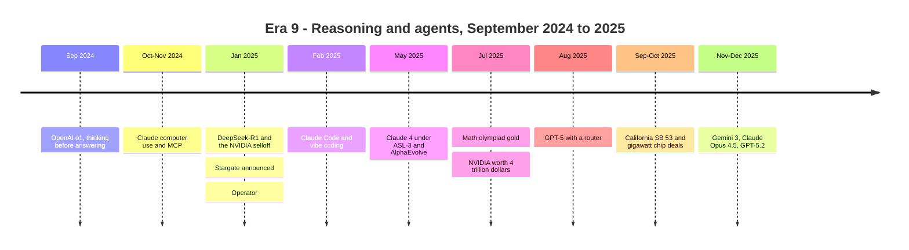
*Figure 7.10: Reasoning models and agents arrive, and the compute race moves to gigawatts.*

## Era 10: 2026 — monthly frontiers, restricted models and gigawatt campuses

By 2026 the big labs were releasing new models roughly every month. Rather than memorize version numbers that will be out of date by the time you read this, learn the pattern. Each lab ships a family in tiers (large, medium, small); every model has a thinking mode; the most capable cyber-capable models are released only to vetted partners; agents are the main product; and open-weight challengers, mostly from China, trail the leaders by months, not years. The table below is a snapshot as of October 21, 2026.

| Lab | January–June 2026 | July–October 2026 |
|---|---|---|
| Anthropic | Claude Opus 4.6 (Feb 5), Mythos Preview (Apr 7), Opus 4.7, Opus 4.8, Fable 5 and Mythos 5 (Jun 9), Sonnet 5 | Opus 5 (Jul 24), Fable and Mythos 5.1 (early to mid-September), Opus 5.5 (Sep 22), Sonnet 5.5, Haiku 5.5 (Oct 7) |
| OpenAI | GPT-5.3-Codex, GPT-5.4, GPT-5.5 (Apr 23), GPT-5.6 limited preview (Jun 26) | GPT-5.6 public release (Jul 9), GPT-6 Astra (Sep 3), GPT-6 Sol and Luna (Sep 22), GPT-6.1 Sol (Sep 29), GPT-6 for all ChatGPT users (Oct 7–8) |
| Google DeepMind | Gemini 3.1 Pro preview (Feb 19), Gemma 4 open models, Gemini 3.5 family (May 19) | Gemini 3.6 to 3.8 Flash, Gemini 4 Argon (generally available in Google's API Oct 13, per Google's changelog) |
| Open-weight leaders | DeepSeek-V4 preview (Apr 24) | Kimi K3 (Jul 16), DeepSeek-V4-Pro (August), Qwen3.8 (August) |

*Table 7.5: The 2026 frontier at a glance, as of October 21, 2026.*

The timeline at the end of this era also shows three events that are not in the table. In January Anthropic released Claude Cowork as a research preview, an agent for everyday non-coding office work, and published a new constitution for Claude, a public document setting out how it should weigh safety, ethics, Anthropic's guidelines and helpfulness (Chapter 20). In May Google announced Gemini Omni, which, in Google's words, combines Gemini's intelligence with its generative-media models, so that any input (text, image, audio or video) can be turned into video (Chapter 22).

### Restricted models: Mythos and Astra

On April 7, 2026 Anthropic announced Claude Mythos Preview and Project Glasswing. Anthropic said the unreleased model, given only to defenders such as AWS, Apple, Google, Microsoft, NVIDIA and the Linux Foundation, had found thousands of high-severity security flaws across every major operating system and web browser, including a 27-year-old bug in OpenBSD. In June Anthropic released Fable 5 and Mythos 5, the same underlying model with different safeguards: Fable for the public, with classifiers that redirect risky requests, and Mythos for vetted partners.

On September 3, 2026 OpenAI unveiled GPT-6 Astra. OpenAI described it as its largest training run by far and its first pretraining run on more than 100,000 GPUs, at the Stargate site in Abilene. Epoch AI estimates about 9.4 × 10^26 FLOP. It rolled out first to vetted organizations in OpenAI's trusted-access program, because of its cyber capabilities, and a day later to paid ChatGPT and API customers in a version that, according to press reports, refuses some cybersecurity requests. OpenAI's safety card for Astra calls it "our first model to reach the Critical level of cybersecurity capability under our Preparedness Framework," the company's internal risk scale. Some commentary called it AGI (artificial general intelligence, defined near the end of this chapter); treat that as marketing or speculation, not a finding.

> **Definition — Restricted (trusted-access) model:** A model released only to vetted organizations, or in a safer public version with extra safeguards, because its full capabilities in areas like cyberattacks are judged too risky for open release.

> **At the frontier (2026):** Tiered release is now standard. Labs pair a public model with classifiers and a trusted-access version for defenders: Claude Fable and Mythos, gated access to GPT-6 Astra, and cyber-specific variants from OpenAI and Google. A year earlier, almost every model was released the same way to everyone.

### Open weights and new players

DeepSeek-V4-Pro has 1.6 trillion total parameters (49 billion active per token), a 1-million-token context window and a permissive MIT license. Moonshot's Kimi K3 (July 16) has 2.8 trillion parameters. Stanford's 2026 AI Index found the top US model led the top Chinese model by only 2.7% on Arena scores (ratings from a public website where people vote between two anonymous models' answers) as of March 2026. Meta moved on from its Llama line (last release: Llama 4, April 2025) to a new "Muse" family, which now powers its Meta AI assistant, and released Muse Wonder on October 13, 2026, according to press reports. SpaceX acquired xAI in February 2026 (an all-stock deal, per reports), and the combined company released Grok 4.7, the latest version of xAI's chatbot, in September. Not every plan shipped: Google's API changelog still listed no general release of Gemini 3.5 Pro as of October 2026 (the family's Flash model did ship), and OpenAI announced in March 2026 that it would shut down its Sora video app.

### Measuring a moving target

Benchmarks now fall within months. ARC-AGI-3, launched March 25, 2026, used interactive puzzle games with no instructions; at launch humans scored 100% and frontier AI 0.51%. By September GPT-6 Astra at maximum effort scored 62.7% using the standard setup, and 98.6% at the same effort with a different "harness" that let it keep its reasoning between steps (its best score, 99.9%, came with that harness at the lower "high" effort setting). ARC Prize, the nonprofit that runs the test, declined to call this AGI. Humanity's Last Exam, a set of very hard expert-written questions launched in January 2025 when frontier models scored under 10%, saw Claude Opus 5.5 reach about 61% by October 2026 (text-only, per Artificial Analysis, an independent company that benchmarks AI models).

> **Definition — Benchmark saturation:** The point at which top models score so high on a test that it can no longer tell them apart, forcing the field to build harder tests.

> **Definition — METR time horizon:** The length of task, measured by how long it takes a skilled human, that an AI agent can complete with 50% reliability. It has doubled roughly every four to seven months in recent years (see Chapter 57).

A worked example with METR's numbers: GPT-4 (March 2023) had a time horizon of about 4 minutes. An early version of Claude Mythos Preview (April 2026) measured about 17.4 hours, which is 1,044 minutes. The ratio is 1,044 ÷ 4 = 261. Since 2^8 = 256, that is about 8 doublings. March 2023 to April 2026 is 37 months, so one doubling about every 37 ÷ 8 ≈ 4.6 months. METR's own fit for 2023 onward is about 4.2 months. METR also warns that its measurements above 16 hours are unreliable, so treat the last point loosely.

> **Watch out:** Claims that AI models scored perfectly at the 2026 International Mathematical Olympiad circulated in July 2026, but as of this writing none had been officially certified. A dramatic claim on social media is not a result until someone independent checks it.

### Chips and gigawatt campuses

NVIDIA launched its Vera Rubin platform at CES in January 2026 (336 billion transistors per GPU, HBM4 memory), saying it was already in full production with partner systems due in the second half of the year; by August, racks were running at several clouds. Google announced its eighth-generation TPUs, split into a training chip and an inference chip, on April 22. For the quarter ending July 2026, NVIDIA reported revenue of $96.2 billion, more than double a year earlier.

> **Definition — CES:** The large consumer-technology trade show held every January in Las Vegas (originally the Consumer Electronics Show), where technology companies announce new products, from TVs and laptops to AI chips.

The buildings grew to match. Epoch AI lists xAI's Colossus 2 in Memphis as the largest AI data center by compute, at about 1.1 million H100-equivalents. Anthropic and Amazon agreed on April 20 to up to 5 GW. On July 13 Meta said its Hyperion campus in Louisiana would scale to 5 GW. As of October 20, 2026 Epoch tracked 95 large AI data centers totaling about 14.2 GW of IT power. Power became a story in its own right: in January Meta signed nuclear deals for up to 6.6 GW by 2035, and in late September (announced September 29) US regulators approved the first construction permit for a small modular reactor of its type, at a site of the Tennessee Valley Authority, a US government-owned power company. Small modular reactors are smaller nuclear reactors designed to be built largely from factory-made parts.

A quick worked example of why gigawatts matter: a 1 GW campus running all year uses up to 1 GW × 8,760 hours = 8,760 GWh, or 8.76 terawatt-hours. Epoch estimates a gigawatt campus costs about $38 billion up front and takes about two years to build (see Chapter 42).

### The rules in 2026

California's SB 53 and its companion-chatbot law SB 243 took effect on January 1. The International AI Safety Report 2026, chaired by Yoshua Bengio, appeared on February 3, and the India AI Impact Summit in New Delhi in February produced a declaration endorsed by about 86 to 89 countries, including the US. A White House framework in March urged Congress to preempt (override with a single national law) state rules on AI development; no such law had passed as of October 2026. The EU's "Digital Omnibus", in force from July 27, delayed many high-risk AI rules to December 2027, while the EU's enforcement powers over general-purpose models began on August 2. In copyright, a court gave final approval on July 20 to a $1.5 billion settlement between Anthropic and book authors (see Chapter 58).

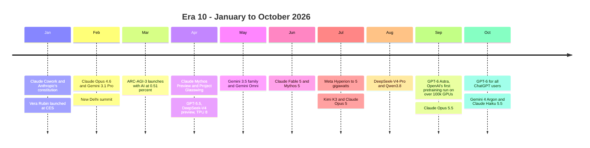
*Figure 7.11: The first ten months of 2026. Some late-September release dates differ between sources and are approximate.*

## The patterns: what 180 years of AI history teach

Step back from the dates and five patterns stand out. They are the most useful thing to carry into the rest of the book, because they help you judge the next headline.

### Pattern 1: Booms, busts and the hype cycle

Every boom has followed a similar arc: a real breakthrough, promises that outrun it, a rush of money, a gap between promise and reality, and then either a winter or a long period of quiet, useful progress.

> **Definition — Hype cycle:** The recurring pattern in which excitement about a technology rises faster than its real capabilities, crashes when reality disappoints, and then recovers more slowly as genuinely useful applications mature.

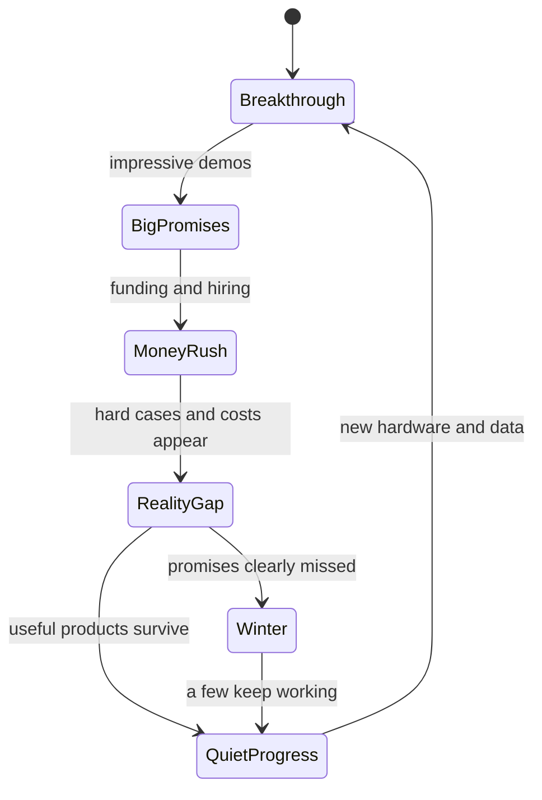
*Figure 7.12: The boom-and-bust cycle that AI has gone around at least twice.*

| Boom | What was promised | What was delivered | How it ended |
|---|---|---|---|
| 1956–1973 | Human-level AI within a generation | Search, Lisp, the perceptron, ELIZA, Shakey | Combinatorial explosion, the Lighthill report, the first winter |
| 1980–1987 | Expert systems in every company | XCON, MYCIN, a commercial AI industry | Brittleness, the Lisp machine collapse, the second winter |
| 2012–now | Machines that see, talk, code and eventually do most work | Image and speech recognition, AlphaFold, chatbots used weekly by hundreds of millions, coding agents | Not ended as of October 2026; whether it does is the big open question |

*Table 7.6: Three AI booms compared.*

### Pattern 2: Every boom rides a hardware jump and a data jump

The ideas behind deep learning were mostly old. What changed was the fuel. A worked example with Moore's law: Intel's first microprocessor, the 4004 of 1971, had about 2,300 transistors. NVIDIA's Blackwell (2024) has 208 billion. The ratio is 208,000,000,000 ÷ 2,300 ≈ 90 million. Since 2^26 ≈ 67 million and 2^27 ≈ 134 million, that is about 26 and a half doublings in 53 years, or one doubling roughly every two years, just as Moore predicted.

Training compute grew even faster, because labs used not just better chips but many more of them.

| Model (year) | Training compute | Source |
|---|---|---|
| GPT-3 (2020) | about 3.15 × 10^23 FLOP | 6 × N × D, worked above |
| GPT-4 (2023) | about 2.1 × 10^25 FLOP | Epoch AI estimate |
| GPT-4.5 (2025) | about 3.8 × 10^26 FLOP | Epoch AI estimate |
| GPT-6 Astra (2026) | about 9.4 × 10^26 FLOP | Epoch AI estimate |

*Table 7.7: Training compute of four OpenAI models. Labs rarely publish these numbers, so all but the first are outside estimates.*

GPT-4 used about 2.1 × 10^25 ÷ 3.15 × 10^23 ≈ 67 times GPT-3's compute, under three years later. GPT-6 Astra used roughly 3,000 times GPT-3's. Epoch AI's long-run average for frontier models is about 5 times more compute every year since 2020; individual pairs of models scatter around that line. The chip counts tell the same story: AlexNet trained on 2 GPUs (2012), the original Transformer on 8 (2017), GPT-6 Astra on more than 100,000 (2026). Data grew alongside: MNIST had 70,000 images (1998), ImageNet millions (2009), GPT-3 about 300 billion tokens (2020), drawn largely from Common Crawl, a free public archive of billions of web pages, and Meta's Llama 4 more than 30 trillion tokens (2025).

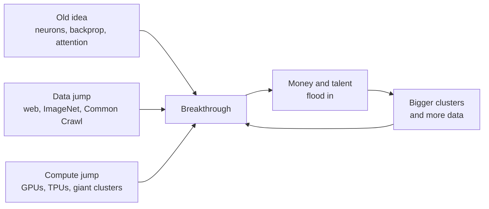
*Figure 7.13: The engine of every AI boom. Since 2012 the loop has kept feeding itself.*

### Pattern 3: The Bitter Lesson, mostly

Across 70 years, the approaches that won in the long run were the ones that could soak up more computation: search in chess, learning plus search in Go, learning from data in vision, speech and language. Hand-built knowledge won early and lost later, as with expert systems.

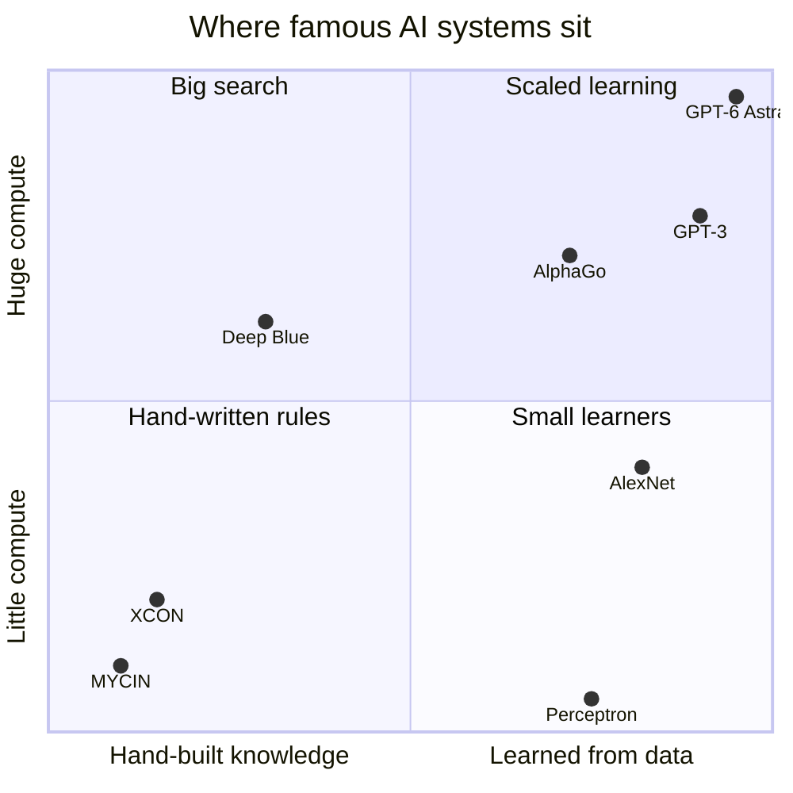
*Figure 7.14: Over time, winning systems moved toward the top right: learned from data, with huge compute.*

The word "mostly" matters, because the strongest counter-argument is that built-in structure still helps. AlphaFold's design borrows heavily from geometry and biology, and math systems such as AlphaProof pair a neural network with a strict proof checker. Many researchers think the winning recipe is scale plus the right structure. The live debate in 2026 is not rules versus learning but how much structure to add to systems that mostly learn (see Chapter 54).

### Pattern 4: Goalposts move, and predictions miss in both directions

Herbert Simon's 1965 forecast of machines doing any human work within twenty years was decades too early. In the other direction, before AlphaGo many Go experts expected a computer champion to be at least a decade away, and ARC-AGI-3, designed in 2026 to be hard for AI, went from 0.51% to 62.7% in about six months. Meanwhile the AI effect keeps moving the finish line: chess, translation and conversation were each "real intelligence" until machines did them.

> **Definition — AGI (artificial general intelligence):** A hypothetical AI system that can do most intellectual work as well as a capable human, across domains rather than in one narrow area. There is no agreed test for it, which is why claims that a model "is AGI" should be read with care (see Chapter 60).

> **Watch out:** "AI progress is a smooth upward line" is wrong in both directions. History shows two winters and long stalls, and also sudden jumps that experts did not expect. Ask "AGI by what definition, measured how?" whenever you see a timeline claim.

### Pattern 5: Building gets dearer, using gets cheaper

AI research moved from university labs to companies because the bills grew. Epoch AI estimates GPT-4's training compute cost about $37 million and GPT-4.5's about $366 million (in 2023 dollars). For a 2026 flagship, a rough author's estimate using research figures: 100,000 GPUs × 90 days × 24 hours = 216 million GPU-hours. At $2 to $5 per GPU-hour, that is roughly $0.4 to $1.1 billion for one final training run, before experiments, data and staff.

At the same time, using a model of fixed ability became dramatically cheaper. Stanford's AI Index found that the cost of using a model at GPT-3.5's level fell more than 280-fold between November 2022 and October 2024. A GPT-4-level score on one standard test cost $37.50 per million tokens in March 2023 and $0.18 in February 2025, about 200 times less. That is why your free chatbot today is far stronger than the paid one of 2023.

> **Key idea:** Frontier training costs rise about 3.5 times a year while the price of yesterday's capability collapses. Power concentrates in the few companies that can pay for frontier runs, while yesterday's frontier becomes a cheap commodity for everyone.

### Is this time different?

Both earlier booms ended in winters, so it is fair to ask about this one. The strongest case for a bust: five of the biggest US tech companies (Alphabet, Amazon, Meta, Microsoft and Oracle) were on track to spend close to $800 billion on capital projects (long-lived things such as data centers, chips and power equipment) in 2026, according to FactSet, a financial data company, in July 2026, far more than AI products currently earn; some deals are "circular", with chipmakers investing in customers who then buy their chips; reliability problems like hallucination remain unsolved; and careful studies such as METR's 2025 experiment sometimes find smaller productivity gains than people feel.

The strongest case against a winter: unlike 1973 or 1987, the technology is in daily use at enormous scale. ChatGPT alone had about 900 million weekly users in February 2026, Stanford's AI Index reports that 88% of organizations use AI, prices for a fixed capability keep collapsing, and measured abilities such as METR's time horizons were still doubling every few months into 2026. A middle view: a financial correction could come without a technical winter, as the dot-com crash of 2000 (when the stock prices of internet companies collapsed) did not stop the internet. Chapter 43 and Chapter 60 cover both sides in depth.

> **At the frontier (2026):** The leading labs now argue less about whether scaling works and more about which kind of scaling: bigger pretraining runs (GPT-6 Astra's 100,000-plus GPUs), more reinforcement learning, more thinking at answer time, or agents that run for hours. All four are being pushed at once, on gigawatt campuses that take about two years to build.

## In plain English

AI is much older than ChatGPT. Ada Lovelace imagined in 1843 that machines could work with any symbols. Alan Turing defined computing in 1936 and asked "Can machines think?" in 1950. The field got its name at Dartmouth in 1956, and from the start there were two camps: people who wrote rules by hand, and people who built little networks of artificial neurons that learned from examples.

The rule writers won first, twice, and both times the world's messiness defeated them. Their promises outran results, money dried up, and AI went through two "winters", in the 1970s and around 1990. The learning camp kept going quietly. Backpropagation (1986) let networks with many layers learn. The web supplied data, and video-game graphics cards supplied cheap parallel math.

In 2012 those three ingredients came together and deep learning took off: first images, then Go, then speech. In 2017 Google's Transformer made it possible to train on enormous amounts of text, and scaling laws showed that bigger models got predictably better. ChatGPT in November 2022 wrapped that technology in a simple chat box and put it in front of everyone.

Since then things have moved monthly: GPT-4 and Claude in 2023, models that think before answering in 2024, agents that use computers in 2025, and in 2026 frontier models so capable at hacking that labs release the strongest versions only to defenders, trained on clusters of 100,000-plus chips in buildings measured in gigawatts.

The lessons: progress comes in bursts when ideas meet data and compute; methods that scale tend to win; experts are often wrong in both directions; and every boom so far has been followed by a correction, though today's AI is far more widely used than any before it.

## Key terms

Algorithm, Compute, Analytical Engine, Turing machine, Artificial neuron, ENIAC (Electronic Numerical Integrator and Computer), Turing test (imitation game), Artificial intelligence (AI), Symbolic AI (GOFAI), Perceptron, IBM (International Business Machines), SRI (Stanford Research Institute), Machine learning (ML), ELIZA effect, Moore's law, ALPAC (Automatic Language Processing Advisory Committee), XOR problem, Combinatorial explosion, AI winter, Expert system, MYCIN, XCON, Brittleness, Connectionism, Neural network, Backpropagation, Convolutional neural network (CNN), Statistical machine learning, AI effect, Benchmark, Reinforcement learning (RL), Self-play, DARPA (Defense Advanced Research Projects Agency), GPU (Graphics Processing Unit), CUDA, Deep learning, Embedding, GAN (generative adversarial network), Attention, Monte Carlo tree search, Transformer, Pretraining, Large language model (LLM), Parameter, Bitter Lesson, CICERO, Scaling laws, FLOP (floating-point operation), DALL·E, Diffusion model, Export controls, RLHF (reinforcement learning from human feedback), Chain-of-thought, Open-weight model, Frontier model, Multimodal model, Context window, Reasoning model, Test-time compute, AI agent, MCP (Model Context Protocol), AMD (Advanced Micro Devices), Gigawatt (GW), Vibe coding, Restricted (trusted-access) model, Benchmark saturation, METR time horizon, CES, Hype cycle, AGI (artificial general intelligence).

## Exercises

1. **[Easy] Run your own Turing test.** You need one friend and a chatbot.
   1. Write five questions, for example "What did you have for breakfast?", "What is 47 × 53?" and "Describe the smell of rain."
   2. Ask your friend to answer them in writing, and paste the same questions into a chatbot with the instruction "Answer like an ordinary person texting, briefly and casually."
   3. Give both sets of answers, unlabeled, to a third person and ask which is the machine and why.
   4. Repeat with a chatbot told to answer normally.
   **What you'll learn:** why the Turing test is easy to pass with the right instructions and hard to treat as proof of intelligence.

2. **[Easy] Check Moore's law with a calculator.** Intel's 4004 (1971) had about 2,300 transistors; NVIDIA's H100 (2022) has 80 billion and Blackwell (2024) 208 billion.
   1. Divide 80,000,000,000 by 2,300.
   2. Keep doubling 1 (1, 2, 4, 8 ...) until you pass that ratio, counting the doublings. On a phone calculator you can instead compute log(ratio) ÷ log(2).
   3. Divide the years between 1971 and 2022 by the number of doublings. Repeat for Blackwell.
   **What you'll learn:** how to turn "a ratio over time" into a doubling time, the single most useful tool for reading AI trend charts.

3. **[Medium] Train a perceptron on paper.** Use two inputs (0 or 1), weights starting at w1 = 0 and w2 = 0, threshold 1.5, and Rosenblatt's rule: if the output is 0 but should be 1, add 0.5 to the weight of each input that was 1; if it is 1 but should be 0, subtract 0.5 from those weights.
   1. Go through the four rows of the AND table repeatedly, updating the weights after each mistake, until a full pass has no mistakes. Record the weights after each change.
   2. Repeat for OR with the threshold set to 0.5.
   3. Try XOR for at least three full passes and describe what happens to the weights.
   **What you'll learn:** what "learning weights from examples" means mechanically, and why the XOR problem stalled single-layer networks in 1969.

4. **[Medium] Watch backpropagation solve XOR.** Open playground.tensorflow.org in a browser.
   1. Choose the dataset in the top-left that looks like four checkerboard squares (the XOR pattern).
   2. Remove all hidden layers and press play. Watch the test loss stay high: one layer can only draw a straight-ish boundary.
   3. Add one hidden layer with 4 neurons and press play again.
   4. Raise the learning rate to 3 and watch training become unstable.
   **What you'll learn:** the 1969 critique and the 1986 fix, live in two minutes, plus why step size matters.

5. **[Medium] Fact-check a chatbot's AI timeline.**
   1. Ask a chatbot: "List 12 milestones in AI history from 1950 to 2025, with the exact year and month for each."
   2. Check every date against a second source (Appendix C of this book, Wikipedia, or the original paper or announcement).
   3. Mark each item correct, wrong, or "close but imprecise", and count them.
   4. Paste your corrections back and ask the chatbot why it might have made those errors.
   **What you'll learn:** the arc of AI history, and the habit of verifying AI output, especially dates, names and numbers.

6. **[Medium] Plot compute growth on a log scale.** In Google Sheets or Excel, put years in A2:A6 and training compute in B2:B6 (row 1 is for labels): 2020 = 3.15E+23 (GPT-3), 2023 = 2.1E+25 (GPT-4), 2024 = 3.8E+25 (Llama 3.1 405B), 2025 = 3.8E+26 (GPT-4.5), 2026 = 9.4E+26 (GPT-6 Astra, estimate).
   1. Make a scatter chart, then set the vertical axis to a logarithmic scale.
   2. In column C, compute the yearly growth multiple between neighboring rows: type `=(B3/B2)^(1/(A3-A2))` in C3 and fill down. B3/B2 is how many times bigger the newer model's compute is, and raising it to the power 1 divided by the number of years between them spreads that jump evenly over those years (for a one-year gap it changes nothing).
   3. Compare your multiples with Epoch AI's long-run average of about 5 times per year.
   **What you'll learn:** why AI trend charts use log axes, and how noisy individual data points are compared with a long-run trend.

7. **[Medium] Forecast agent time horizons, then critique your forecast.** Enter METR's 50% time horizons in a spreadsheet, as months since March 2023 and hours: GPT-4 (0 months, 0.067 h), o1 (21, 0.65), o3 (25, 2.0), GPT-5 (29, 3.4), Claude Opus 4.5 (32, 4.9), GPT-5.2 (33, 5.9), Claude Opus 4.6 (35, 12), Claude Mythos Preview early version (37, 17.4).
   1. Put the months in A2:A9 and the hours in B2:B9 (row 1 is for labels). In C2 type `=LOG(B2,2)` (the number of doublings) and fill down to C9, then chart column C against months.
   2. Use `=SLOPE(C2:C9, A2:A9)` to get doublings per month, then 1 divided by that for months per doubling.
   3. Extend the trend to October 2027, which is 55 months after March 2023: `=2^FORECAST(55, C2:C9, A2:A9)` gives the predicted horizon in hours (FORECAST extends the straight line to month 55, and 2 to that power turns doublings back into hours). Write it down.
   4. List three reasons the forecast could be wrong (METR itself says measurements above 16 hours are unreliable).
   **What you'll learn:** how forecasters turn messy data into doubling times, and why extrapolation needs humility.

8. **[Challenge] A hype audit across 70 years.** Collect three claims: the 1958 newspaper coverage of the perceptron (described in this chapter), Herbert Simon's 1965 twenty-year prediction, and one 2026 headline claiming a model "is AGI" or "solved" a famous problem.
   1. For each, answer: Who made the claim? What evidence was shown? Did anyone independent check it? Was it a demo or a deployed product? What happened next?
   2. Write a 300-word verdict comparing the three, and a five-question checklist you will use on future AI news.
   **What you'll learn:** to read AI claims with the patterns of this chapter, a skill that pays off in every later chapter and in your career.

9. **[Challenge] Write a Bitter Lesson case study.** Pick one field: chess, machine translation, speech recognition or image recognition.
   1. With a chatbot's help, list the main approaches used in that field from the 1950s to today, and which ones relied on hand-built knowledge versus learning and compute.
   2. Verify at least five dates or claims against independent sources.
   3. Find one example where built-in structure still mattered (for instance AlphaFold's geometry or proof checkers in math systems) and explain whether it weakens Sutton's argument.
   **What you'll learn:** to test a big-picture argument against evidence instead of accepting or rejecting it whole.

## Areas of opportunity

- **AI literacy trainer for companies and schools.** Employers and schools pay for courses that set realistic expectations, and history (the ELIZA effect, hype cycles, the jagged path of progress) is one of the best ways to do that. Stanford's 2026 AI Index reports that over 80% of US high school and college students use AI for schoolwork, while only about half of schools have AI policies.
- **Technology due diligence for investors.** Funds, family offices (firms that manage one wealthy family's money) and corporate boards need people who can tell a demo from a deployment, a "run-rate" from revenue and an "up to" commitment from a contract. Knowing how the 1980s expert-systems and Lisp-machine boom ended is directly useful when 2026 capital spending is near $800 billion a year.
- **Benchmark and evaluation design.** Tests now saturate within months (ARC-AGI-3 went from 0.51% to 62.7% in about six months; Humanity's Last Exam from under 10% to about 61% in under two years). Labs, government evaluators and independent groups such as METR and Epoch AI hire people who can design harder, cleaner tests.
- **Model migration and "model change management".** Models are retired on a schedule: OpenAI removed GPT-4o from ChatGPT in February 2026. Businesses that built on a retired model pay consultants and tools to test, compare and switch to newer models without breaking their products.
- **Fact-checking and verification services for AI claims.** Disputed results, such as the unverified 2026 math olympiad claims, show demand from newsrooms, publishers and research offices for people who can check what a model actually did.
- **Policy analysis and the history of technology.** Governments, think tanks and law firms need analysts who understand both the technical basics and the policy timeline, from the 2023 Bletchley summit to the EU's 2026 Digital Omnibus and dozens of US state laws.
- **Forecasting and trend research.** Organizations such as Epoch AI and METR, investment firms and corporate strategy teams employ analysts who track compute, costs and capabilities and turn them into forecasts. The skills are exactly those in Exercises 2, 6 and 7.
- **Explainers, documentaries and exhibits.** Publishers, museums, podcasts and video channels need clear storytellers who can connect Lovelace and Turing to today's chatbots without hype.

## Check your understanding

1. Name the three ingredients behind every AI boom, and say which piece of each arrived between 2006 and 2011.
2. Why can a single perceptron not learn XOR, and what development in 1986 removed that limit?
3. What caused the first AI winter, and what caused the second?
4. State the Bitter Lesson in one sentence, and give the strongest counter-argument.
5. GPT-3 was available to developers in 2020. Why was ChatGPT in November 2022 such a turning point?
6. What new way of scaling did reasoning models such as o1 introduce in 2024?
7. Why is "DeepSeek trained a frontier model for $5.6 million" misleading?
8. METR measured about 4 minutes for GPT-4 (March 2023) and about 17.4 hours for an early Claude Mythos Preview (April 2026). Roughly how many doublings is that, and how many months per doubling?

<details><summary>Answers</summary>

1. Ideas (algorithms), data and compute. Between 2006 and 2011: ideas, Hinton's method for training deep networks (2006); compute, Amazon Web Services rentals (2006) and NVIDIA's CUDA for programming GPUs (2007); data, ImageNet (2009).
2. A perceptron draws a single straight line to separate "yes" from "no" cases, and XOR's yes cases sit on a diagonal that no single line can separate. Backpropagation, popularized in 1986, made it possible to train networks with hidden layers, which can learn XOR.
3. The first winter (about 1974–1980) came from overpromising, combinatorial explosion on real problems, and critical reviews such as the 1973 Lighthill report, which led to funding cuts. The second (late 1980s to early 1990s) came from the brittleness and maintenance costs of expert systems and the 1987 collapse of the Lisp machine market.
4. Over the long run, general methods that scale with computation (search and learning) beat methods built on hand-coded human knowledge. Counter-argument: the right built-in structure still matters a great deal, as in AlphaFold's geometric design or math systems that pair neural networks with strict proof checkers.
5. The underlying technology existed, but ChatGPT combined it with instruction-following training (RLHF) and a free, simple chat interface, so anyone could use it. The change was in usability and reach, much like the iPhone.
6. Test-time compute: spending more computation while answering, by thinking longer, so that answers improve without a bigger training run.
7. The figure is only the rental cost of the final training run of DeepSeek-V3. It excludes research, earlier experiments, failed runs, data and staff, which cost many times more.
8. 17.4 hours is 1,044 minutes; 1,044 ÷ 4 = 261, and 2^8 = 256, so about 8 doublings. March 2023 to April 2026 is 37 months, so about 37 ÷ 8 ≈ 4.6 months per doubling (METR's own fit is about 4.2 months, with wide uncertainty).

</details>

## Going deeper

- **Alan Turing, "Computing Machinery and Intelligence" (1950).** The original imitation-game paper, readable without math and freely available online; it anticipates many arguments still made about chatbots.
- **Rich Sutton, "The Bitter Lesson" (2019).** A two-page essay on his website (incompleteideas.net) that many lab researchers treat as a guiding principle; read it, then argue with it.
- **Nils J. Nilsson, *The Quest for Artificial Intelligence* (2009).** A thorough history by a pioneer who worked on Shakey; the author made a free PDF available through Stanford.
- **Melanie Mitchell, *Artificial Intelligence: A Guide for Thinking Humans* (2019).** A clear, balanced account of AI's booms, busts and limits from a respected researcher.
- **Michael Wooldridge, *A Brief History of Artificial Intelligence* (2020).** A short, lively tour from Turing to deep learning by an Oxford professor.
- **Cade Metz, *Genius Makers* (2021).** A journalist's story of the people behind the 2012–2020 deep learning boom: Hinton, LeCun, Bengio, DeepMind and OpenAI.
- **The *AlphaGo* documentary (2017).** A gripping film of the 2016 Lee Sedol match, free on YouTube, that shows why Move 37 shocked the Go world.
- **Stanford AI Index (hai.stanford.edu/ai-index).** A free yearly report on AI investment, costs, adoption and capabilities; the best single source for "where are we now".
- **Epoch AI (epoch.ai).** Free charts and databases on training compute, costs, hardware and data centers, the source of many numbers in this chapter.
