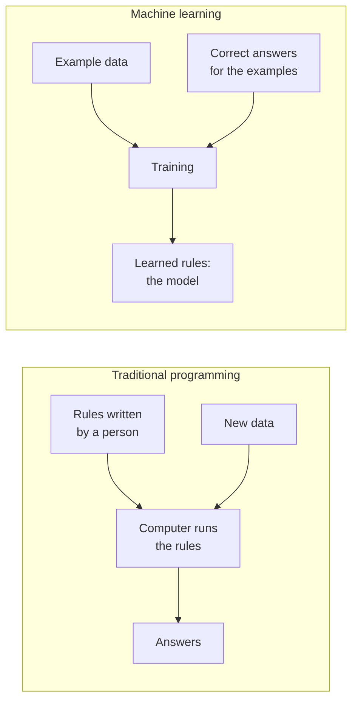
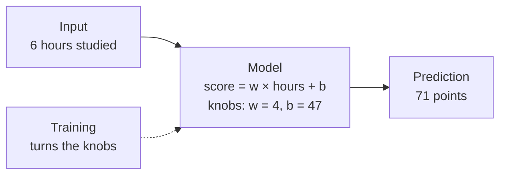
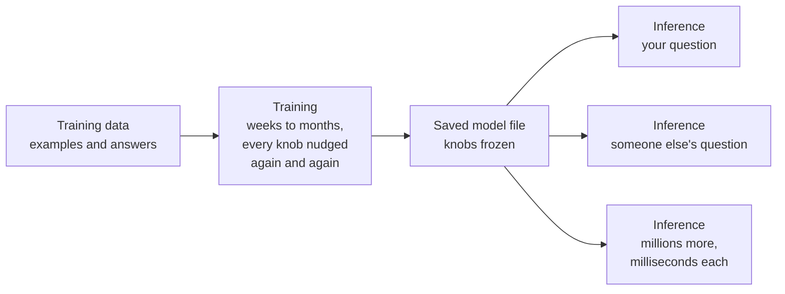
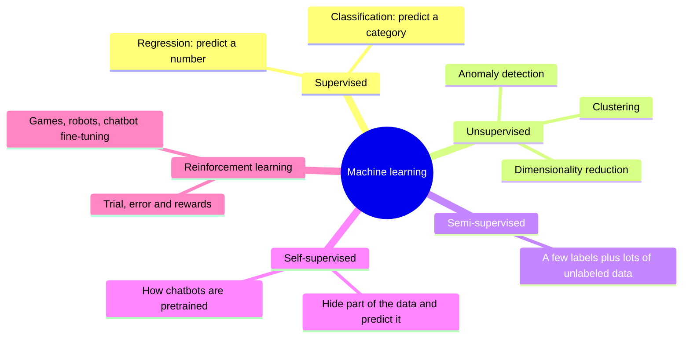
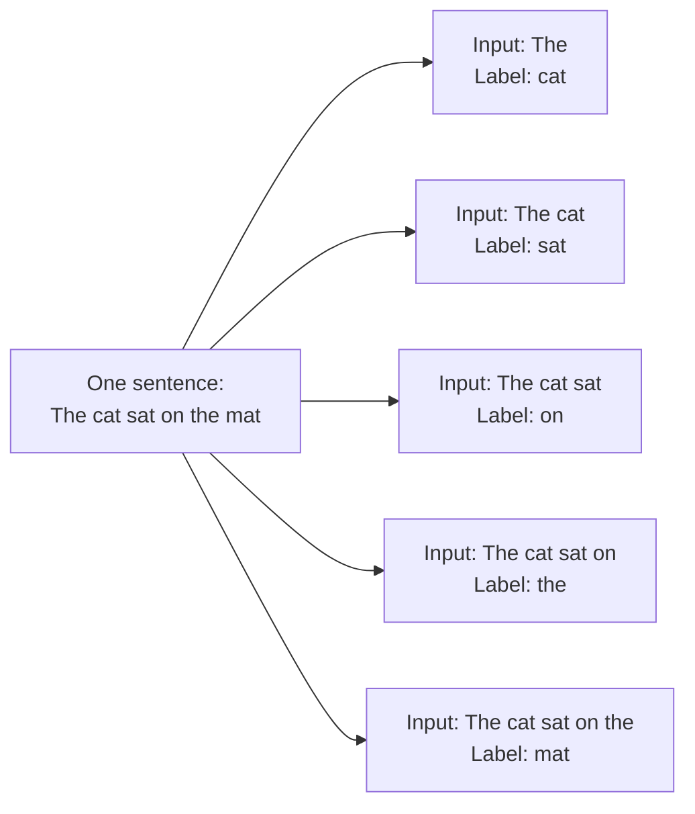
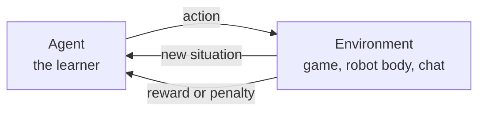
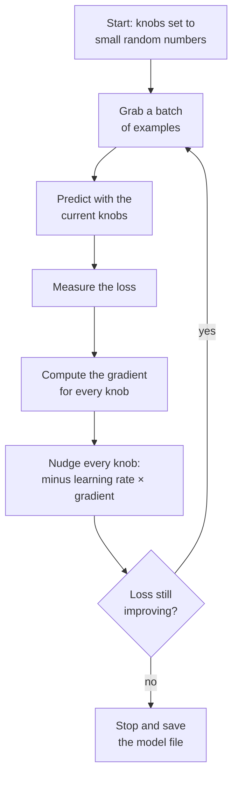
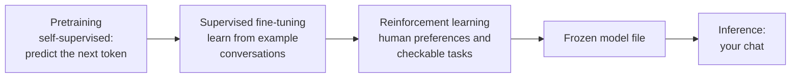

# Chapter 8: Learning From Examples: What Machine Learning Really Is

*By the end of this chapter you will know what it actually means for a computer to "learn", and you will have trained a model yourself, by hand, in a spreadsheet.*

## What you'll learn

- Why some problems can be solved with hand-written rules and others can only be solved by learning from examples.
- What a model physically is (a file of numbers plus a recipe), and the difference between parameters, which are learned, and hyperparameters, which you choose.
- How to read any dataset as features and labels, and why training and inference are completely different activities. Chatting with Claude or ChatGPT is inference.
- The main families of machine learning: supervised, unsupervised, semi-supervised, self-supervised and reinforcement learning, and how self-supervised learning connects straight to your chatbot.
- How learning actually happens: a loss function measures wrongness, and gradient descent turns the knobs to reduce it. You will work through the numbers yourself.
- How to fit a straight line in a spreadsheet, how logistic regression turns a score into a probability, and what a decision boundary is.
- What it means for a model to be well calibrated, and why your chatbot's confidence is not always trustworthy.

## Before you start

This chapter is the start of Part II. It leans on three earlier chapters. Chapter 3 (Software, Code and Data) explained programs, algorithms and how everything becomes numbers. Chapter 5 (The Math of AI, Part 1) introduced functions, slope and the idea of fitting a line. Chapter 6 (The Math of AI, Part 2) introduced probability, loss functions, derivatives as slopes, and gradient descent as walking downhill. You do not need to remember the math in detail. Everything is rebuilt here from simple examples, with the numbers worked out in front of you.

## Two ways to make a computer do something

Every app you have ever used is, at bottom, a list of instructions. Somebody sat down and wrote "when the user taps this button, open that screen." A thermostat is the simplest example: "if the temperature drops below 19 °C, turn the heater on; if it rises above 21 °C, turn it off." A cooking recipe works the same way. Follow the steps exactly and you get the cake.

> **Definition — Algorithm:** A step-by-step procedure for solving a problem, precise enough for a computer to follow. In machine learning it usually means the procedure that learns a model from data, as in "the decision-tree algorithm."

> **Definition — Rules-based system:** A program whose behavior is entirely spelled out by human-written if-then rules, such as "if the email contains the word lottery, mark it as spam." Older AI systems built this way were called expert systems.

Rules work well when a person can actually write them down. Tax calculations, bank transfers, airline booking and the thermostat all fit. The trouble starts with tasks that people find easy but cannot explain.

Try to write rules for "is this photo a cat?" You might start with "has fur, has pointy ears, has whiskers, has four legs." Then the counter-examples arrive. A hairless Sphynx cat has no fur. A cat curled up in a box shows no legs. A cartoon cat has no real whiskers. A fox has pointy ears and whiskers. A tiger is technically a cat, but probably not what you meant. Each fix needs new rules, and each new rule creates new exceptions. The list never ends, and you still have not explained how to find "ears" in a grid of millions of colored dots.

The same wall appears everywhere. Try writing rules to read messy handwriting, recognize your friend's voice on a bad phone line, or decide whether a product review that says "Oh great, another charger that lasts a whole day" is praise or sarcasm. You can do all of these instantly. You cannot write down how.

Machine learning flips the problem around. Instead of writing the rules, you collect thousands of examples where the right answer is already known: photos already marked "cat" or "not cat." Then you let the computer adjust itself until its guesses match those answers. A child learns "dog" the same way. Nobody gives a three-year-old a definition ("a domesticated carnivorous mammal of the family Canidae"). They point at dogs, the child guesses, and the adults say "yes, dog" or "no, that's a cat." After enough examples the child gets it, including for dogs they have never seen before.

> **Definition — Machine learning (ML):** Getting a computer to do a task by learning patterns from examples, instead of following rules a person wrote by hand. It is the dominant way of building AI today.



*Figure 8.1: Traditional programming takes rules and data and produces answers. Machine learning takes data and answers and produces the rules.*

Look at Figure 8.1 carefully, because it contains the whole idea of this chapter. In traditional programming, a person supplies the rules. In machine learning, a person supplies examples with answers, and the computer produces the rules. Those learned rules are called the model. Once you have the model, you use it just like a normal program: new data goes in, answers come out.

> **Analogy:** A recipe versus a taste-testing apprentice. A recipe tells you every step. An apprentice cook tastes thousands of dishes, hears "too salty" or "perfect" each time, and slowly develops a feel for it that nobody could write down as a recipe.

The term "machine learning" goes back to Arthur Samuel at IBM, who in 1959 described a checkers program that improved partly by playing games against itself, until it played better than he did (see Chapter 7). A widely used definition comes from the computer scientist Tom Mitchell (1997): a program learns from experience E, with respect to some task T and performance measure P, if its performance at T, as measured by P, improves with experience E. Translated: there is a job to do, a way to score how well it is done, and a pile of examples, and the score goes up as the program sees more examples. Every system in this book fits that sentence, from a spam filter to Claude.

> **Key idea:** Machine learning is for problems where you can collect examples of the right answer but cannot write down the rule. You trade the job of writing rules for the job of collecting good examples.

> **Watch out:** "AI" and "machine learning" are not the same thing. Machine learning is one way of building AI, and today it is the dominant way. Rules-based systems, search and planning are also AI (see Chapter 54), and many real products mix learned parts with hand-written rules. Your chatbot is a learned model wrapped in a lot of ordinary, hand-written software.

## What a model really is

People talk about "the model" as if it were a mysterious mind. It is much plainer than that. A model is a mathematical function: a machine that takes numbers in and gives numbers out. You can picture it as a box with knobs on the front. Data goes in one side, a prediction comes out the other, and the knobs control exactly how the input gets turned into the output.

> **Definition — Model:** The thing machine learning produces: a mathematical function with adjustable numbers inside that turns inputs into predictions. Physically it is a file of numbers plus the code that knows how to use them.

The output is called a prediction, even when it is not about the future. It can be a number (a price), a category ("spam"), a probability (0.93) or, for a chatbot, the next piece of text.

Here is the smallest useful model you will meet, and we will build it fully later in the chapter. It predicts a student's test score from how many hours they studied:

`predicted score = w × hours + b`

It has two knobs, `w` and `b`. If `w = 4` and `b = 47`, a student who studied 6 hours is predicted to score `4 × 6 + 47 = 71`. Change the knobs and the predictions change. Those two numbers are the entire learned content of the model. Save them in a file and you have saved the model.

> **Definition — Parameter:** One adjustable number inside a model that gets set by training. A straight line has 2 parameters. Frontier chatbots have hundreds of billions to trillions.

> **Definition — Weight:** A parameter that says how strongly one input pushes the output. In `w × hours + b`, the weight `w` says how many points each extra hour of study is worth. People often say "the weights" to mean all of a model's learned numbers.

> **Definition — Bias (parameter):** A parameter that shifts the output up or down no matter what the input is, like `b` in `w × hours + b` (the score you would predict for zero hours of study). This meaning of bias has nothing to do with unfairness; Chapter 9 and Chapter 11 cover the other two meanings of the word.



*Figure 8.2: A model is a box with knobs. Training turns the knobs; inference uses the box with the knobs locked.*

Notice what a model is not. It is not a database of the examples it was trained on. Our two-knob model was trained on ten students, but it does not contain those ten students' scores anywhere. It contains `w` and `b`, a compressed summary of the pattern. The same is true, at enormous scale, of a chatbot. Its file holds learned numbers, not a searchable copy of the internet. Big models can memorize some fragments of their training data, and that is a known privacy and copyright problem (see Chapter 11), but answering a question is calculation, not lookup.

> **Analogy:** A model is like a sound mixing board with hundreds of sliders. Training slowly adjusts every slider until the music sounds right. Using the model is just playing the song with the sliders locked in place.

How many knobs do real models have? The range is enormous.

| Model | Rough number of parameters | What the knobs do |
|---|---|---|
| Straight line (this chapter) | 2 | Slope and starting point |
| Classic spam filter | Thousands | One weight per word or clue |
| Small image classifier | Millions | Detect edges, shapes, objects |
| GPT-3 (2020) | 175 billion | Predict the next word |
| Kimi K3, an open-weight model released July 2026 | About 2.8 trillion | Predict the next token, across text and images |

*Table 8.1: From 2 knobs to trillions. The idea is the same at every size; only the scale changes.*

### Hyperparameters: the settings about learning

Some numbers are not learned. A person chooses them before training starts. How big should each knob adjustment be? How many times should the computer go through the examples? How many questions deep may a decision tree go? These are settings about the learning process itself.

> **Definition — Hyperparameter:** A setting chosen by a person before training, such as the learning rate, the number of passes through the data, or the maximum depth of a decision tree. It controls how learning happens but is not itself learned from the data.

| | Parameters | Hyperparameters |
|---|---|---|
| Who sets them | The training process | A person (or an automated search) |
| When | During training | Before training |
| Example in our line | `w` and `b` | How big each knob adjustment is |
| Example in a chatbot | Hundreds of billions of weights | Model size, learning rate, how many tokens to train on |
| Saved in the model file? | Yes | Usually written in a separate config or report |

*Table 8.2: Parameters are what the model learns; hyperparameters are how you ask it to learn.*

A good way to remember the difference: if you could change the number and then have to retrain to see the effect, it is a hyperparameter. Chapter 9 explains how people pick good hyperparameters without cheating.

## Features, labels and the anatomy of a dataset

Machine learning data almost always fits a spreadsheet picture. Each row is one example. Each column is one fact about that example. One special column holds the answer you want the model to predict.

> **Definition — Example:** One record in a dataset: one email, one house, one photo, one patient. Also called an instance, a sample or a row.

> **Definition — Feature:** One measurable input fact about an example, such as square footage, number of links in an email, or the brightness of one pixel. In a table, each feature is a column.

> **Definition — Label:** The correct answer the model should learn to predict for an example, such as "spam" or "$412,000." Also called the target. In a table it is the column you are trying to fill in.

> **Definition — Dataset:** A collection of examples used to train or test models. It can be a ten-row spreadsheet or tens of trillions of words of text.

Here is a tiny house-price dataset.

| Square feet | Bedrooms | Distance to center (km) | Year built | **Sale price (label)** |
|---|---|---|---|---|
| 1,400 | 3 | 12 | 1995 | $285,000 |
| 2,100 | 4 | 8 | 2008 | $430,000 |
| 900 | 2 | 3 | 1978 | $310,000 |
| 1,800 | 3 | 15 | 2015 | $340,000 |
| 2,600 | 5 | 20 | 2001 | $395,000 |
| 1,200 | 2 | 5 | 1990 | ? |

*Table 8.3: Anatomy of a dataset. The first four columns are features, the last column is the label, each row is one example, and the last row is the kind of case the model will be asked to predict.*

The first five rows are training examples: features and answers together. The last row is what the model exists for. Someone wants to sell a house, and the price is the unknown.

A model can only be as good as its features. Suppose you tried to identify fruit using only color. "Red" could be an apple, a strawberry, a cherry or a tomato. No amount of clever learning fixes that, because the information simply is not in the columns. Add size, and whether the skin is smooth or bumpy, and the problem becomes solvable. Choosing and building good features is a big part of practical machine learning, called feature engineering (see Chapter 11). One of the great advantages of deep learning (Part III) is that it learns its own features directly from raw pixels or text.

> **Analogy:** Features and labels are like a doctor's chart. Symptoms and measurements are written at the top (the features); the diagnosis is at the bottom (the label). A medical student learns by reading thousands of charts and checking their guess against the diagnosis.

> **Try it:** Paste Table 8.3 into your chatbot and ask: "Which feature do you think matters most for price, and what feature is missing that would help a lot?" Notice that the chatbot reasons about features the same way a data scientist would. It will probably suggest location quality, condition, or lot size.

## Training versus inference

There are two completely different phases in the life of any model, and mixing them up causes most of the confusion people have about AI.

> **Definition — Training:** The process of adjusting a model's parameters so that its predictions on example data get better. It is slow, done in advance, and for big models it is extremely expensive.

> **Definition — Inference:** Using a finished model to make predictions on new inputs, with its parameters locked. Every chatbot reply you have ever received was produced by inference.

Training is like studying for an exam: slow, effortful and done ahead of time. Inference is like answering a question on exam day: quick, and using only what you already learned. You do not learn new material in the middle of the exam.



*Figure 8.3: Training happens once, or occasionally. Inference happens millions of times a day using the same frozen model. Your chat with Claude, ChatGPT or Gemini lives on the right-hand side.*

This has a practical consequence that surprises many daily chatbot users. When you chat, the model is not learning from you in that moment. Its weights are frozen. If you correct a mistake ("No, Lisbon is the capital of Portugal, not Porto"), the model will use your correction for the rest of that conversation, because your correction is now part of the text it reads. Open a fresh chat and the correction is gone, because nothing inside the model changed.

So how do chatbots seem to remember you across chats? Product features like "memory" save notes about you in a separate store and quietly paste the relevant ones into future conversations. That is ordinary software, not learning. Separately, depending on your settings and the company's policy, your conversations may be used to help train a future version of the model, weeks or months later. That is a new training run producing a new model, not the current model updating itself (see Chapter 25 for the privacy controls).

> **Watch out:** "The chatbot is learning from my conversation right now" is one of the most common misconceptions about AI. During inference the weights are frozen. What feels like learning within a chat is the model reading the whole conversation again each time it answers.

The two phases also differ wildly in cost. Training a frontier model takes many thousands of chips running for weeks or months (see Chapter 19 and Chapter 37). A single inference takes a fraction of a second and a tiny fraction of a cent. But inference happens billions of times, so across a year the total spent on inference is also huge (see Chapter 23). Almost every economic question in Parts VI and VII comes back to this split.

## Generalization: the whole point

Here is a trick question. Suppose you have a model that perfectly predicts the score of all ten students it was trained on. Is it a good model?

You cannot tell yet. A model that simply memorized the ten answers would also be perfect on those ten students, and useless for an eleventh student. What you actually want is a model that works on examples it has never seen. That is called generalization, and it is the true goal of all machine learning.

> **Definition — Generalization:** How well a model performs on new data it never saw during training. A model that does well only on its training examples has memorized; a model that does well on new examples has learned.

> **Analogy:** Generalization versus memorization is the difference between understanding a subject and memorizing last year's answer key. The student who memorized the key does brilliantly until the teacher changes the questions.

This one idea drives everything in Chapter 9: holding back test data the model has never seen, catching models that cheat by accident, and measuring performance honestly. For now, keep the rule in mind: a model's score on its own training examples tells you almost nothing about how good it is.

> **Key idea:** Training is studying, inference is the exam, and generalization is whether the studying worked on questions you have never seen before.

## The kinds of machine learning

Machine learning comes in a few families. They differ in one main way: what kind of answer, or feedback, is available during training.



*Figure 8.4: The family tree of machine learning. The families differ in what kind of feedback the learner gets.*

### Supervised learning: flashcards with answers on the back

In supervised learning, every training example comes with its correct answer. It is like studying with flashcards: question on the front, answer on the back. The model guesses, flips the card, and adjusts. Most practical machine learning in business is supervised.

> **Definition — Supervised learning:** Learning from examples that come with correct answers (labels), so the model can compare each guess to the truth and adjust.

Supervised learning comes in two flavors, depending on what kind of answer you want.

> **Definition — Regression:** A supervised task where the answer is a number on a scale, such as a price, a temperature, or a delivery time. (The name is historical; it has nothing to do with going backward.)

> **Definition — Classification:** A supervised task where the answer is a category, such as spam or not spam, which digit is in an image, or which language a sentence is written in.

Classification has a few sub-types worth naming, because you will see them in tools like Teachable Machine and in job descriptions.

> **Definition — Binary classification:** Classification with exactly two possible answers, such as fraud or not fraud, or pass or fail.

> **Definition — Multiclass classification:** Classification with three or more possible answers, where each example gets exactly one, such as "cat," "dog" or "bird."

A third variant, multilabel classification, lets each example carry several labels at once, such as a photo tagged both "beach" and "dog."

| Task | Type | Features (inputs) | Label (answer) |
|---|---|---|---|
| Estimate a home's price | Regression | Size, bedrooms, location | A dollar amount |
| Forecast tomorrow's electricity demand | Regression | Weather, day of week, past demand | Megawatts |
| Estimate your food delivery time | Regression | Distance, restaurant, traffic | Minutes |
| Filter spam | Binary classification | Words, sender, links | Spam or not |
| Flag a suspicious card payment | Binary classification | Amount, place, time, history | Fraud or not |
| Read a handwritten digit | Multiclass classification | Pixel brightness values | 0 to 9 |
| Tag a photo | Multilabel classification | Pixels | Any of: person, dog, beach, sunset |

*Table 8.4: Everyday supervised learning. If the answer is a number, it is regression; if it is a category, it is classification.*

### Unsupervised learning: sorting a box of buttons

Sometimes you have plenty of data but no answers at all. A shop has a million customer purchase histories and no labels saying what "type" of customer each one is. Unsupervised learning looks for structure anyway. Imagine tipping out a box of mixed buttons and sorting them into piles that seem to go together, without anyone telling you the categories.

> **Definition — Unsupervised learning:** Finding structure, such as groups, simpler summaries or unusual items, in data that has no labels.

There are three classic jobs.

> **Definition — Clustering:** Grouping similar examples together without predefined labels, such as discovering that a shop's customers fall into "bargain hunters," "weekend families" and "big one-off spenders."

> **Definition — Dimensionality reduction:** Compressing many features into a few new ones while keeping the important information, such as summarizing a 20-question personality survey into two scores.

> **Definition — Anomaly detection:** Spotting examples that are unusually different from the rest, such as a card payment that does not look like you, or a machine vibrating in a new way before it fails.

Your bank's "Is this you?" text, when your card is used abroad at 3 a.m., is often powered by anomaly detection. Chapter 10 walks through the actual algorithms, such as k-means for clustering and PCA for dimensionality reduction.

> **Watch out:** Unsupervised does not mean the computer discovers meaning by itself. It finds groups and directions of variation. A human still has to look at a cluster and decide it means "weekend families," and sometimes clusters turn out to be arbitrary splits that mean nothing.

### Semi-supervised learning: a few labels go a long way

Labels are expensive. Someone has to look at each X-ray, read each contract, or listen to each recording. Raw data is cheap. Semi-supervised learning combines a small labeled set with a large unlabeled set.

> **Definition — Semi-supervised learning:** Learning from a small set of labeled examples plus a much larger set of unlabeled ones.

A common trick is pseudo-labeling. Say a hospital has 1,000 X-rays labeled by radiologists and 100,000 unlabeled ones. Train a first model on the 1,000. Run it on the 100,000, and keep only the cases where it is very confident, perhaps 30,000 of them. Treat those confident guesses as if they were labels, add them to the training set, and train again. The model has taught itself from its own easiest cases. The risk is obvious: if the first model is confidently wrong about something, it will teach itself the mistake. So people check samples by hand.

### Self-supervised learning: the bridge to your chatbot

Now for the most important family in this book. What if the data could supply its own labels, so you needed no human labeling at all?

Take any sentence, hide a word, and ask the model to guess it. The hidden word is the label, and the data provided it for free. Take the sentence "The cat sat on the mat." Hide the end and you get a whole set of training examples, each pairing the words so far with the word that comes next.



*Figure 8.5: Self-supervised learning turns one ordinary sentence into five labeled training examples, with no human labeler involved.*

> **Definition — Self-supervised learning:** Learning where the labels are created automatically from the data itself, for example by hiding the next word of a sentence and asking the model to predict it. This is how large language models are pretrained.

This is the "aha" link between this chapter and your daily chatbot use. The large first stage of building ChatGPT, Claude or Gemini is exactly this game: read text, predict the next piece, check, adjust, repeat. Not on one sentence, but on tens of trillions of words. Meta said its Llama 4 models were pretrained on more than 30 trillion tokens (April 2025). Alibaba said its Qwen3 models used about 36 trillion tokens in 119 languages (April 2025). For comparison, MNIST, the famous handwritten-digit dataset that was a standard benchmark for years, has 70,000 tiny images.

> **Definition — Token:** A small chunk of text, often a word or part of a word, that a language model reads and writes. "Unbelievable" might be split into "un", "believ" and "able". Dataset sizes for chatbots are measured in tokens (see Chapter 18).

> **Definition — Pretraining:** The large first stage of training a model on broad data, usually with self-supervised learning, before it is specialized for particular tasks.

Why does this work so well? Because to predict the next word reliably across all the text humans have written, a model has to pick up a great deal: grammar, facts, the style of a legal contract, how a joke is built, the steps of a math proof. Nobody labels any of that. It is the cheapest source of "supervision" ever discovered, and it scales with the amount of text available. The same trick works for images (hide a patch, predict it) and audio (hide a slice of sound, predict it). Chapter 19 explains pretraining in depth.

> **Analogy:** Self-supervised learning is a fill-in-the-blank workbook that the internet writes for free. Hide a word, guess it, check the answer, repeat billions of times.

> **Key idea:** Your chatbot began life as a self-supervised next-token predictor. Everything that makes it a helpful assistant was added on top, using supervised learning and reinforcement learning (Chapter 20 and Chapter 21).

### Reinforcement learning: learning from rewards

The last big family works differently. There are no right answers to copy. Instead, a learner takes actions in some world and gets a score afterward. Think of training a dog with treats, or learning a video game by dying a lot.

> **Definition — Reinforcement learning (RL):** Learning by trial and error. A learner takes actions, receives rewards or penalties, and gradually improves its strategy to collect more reward.

RL has its own vocabulary.

> **Definition — Agent:** In reinforcement learning, the learner and decision-maker: the program choosing what to do next.

> **Definition — Environment:** The world, game or simulation that a reinforcement learning agent acts in, and which responds to its actions.

> **Definition — Reward:** The number an RL agent receives after acting, telling it how good the outcome was. Winning a game might be +1 and losing −1.

> **Definition — Policy:** An RL agent's strategy: its rule for choosing an action in each situation. Learning in RL means improving the policy.



*Figure 8.6: The reinforcement learning loop. The agent acts, the environment responds with a new situation and a reward, and the agent adjusts its policy to collect more reward over time.*

The hard part of RL is that rewards often arrive late. In chess you only learn whether you won at the end, so which of your 40 moves deserves the credit? Famous RL successes include DeepMind's AlphaGo, which beat the Go champion Lee Sedol in 2016, robots that learn to walk in simulation, and systems that control data-center cooling (see Chapter 48 for the full story).

RL also matters directly to your chatbot. After pretraining, labs use reinforcement learning from human feedback: people compare two answers, a model learns their preferences, and the chatbot is tuned to produce answers people prefer. Since 2024, labs have increasingly used RL on tasks with checkable answers, such as math problems with known solutions and code that must pass tests. This is how "reasoning" models learned to think step by step before answering (see Chapter 21).

> **Definition — RLHF (Reinforcement Learning from Human Feedback):** Fine-tuning a model using human judgments, often rankings of two responses, as the reward signal. It is a key part of how chatbots are made helpful and polite.

> **At the frontier (2026):** Labs increasingly treat practice environments as a new kind of training data. Instead of only collecting more text, they build simulated tasks, such as a sandboxed computer, a copy of a website or a math checker, where a model can try things and get scored automatically. DeepSeek's V3.2 technical report (December 2025) describes generating large numbers of synthetic agent tasks for RL, and at least one data vendor, Mercor, reportedly agreed in July 2026 to buy a company that builds such environments. Chapter 21 explains how this works.

### Other ways to learn

A few more setups come up constantly. Each is a twist on the families above.

> **Definition — Transfer learning:** Reusing what a model learned on one task to help with a different task. A model that learned to recognize thousands of everyday objects already "knows" edges, textures and shapes, so it can learn to spot, say, cracked phone screens from only a few hundred examples.

> **Definition — Fine-tuning:** Further training an already-trained model on a smaller, specialized dataset, to adapt it to a task, a style or a domain. Chapter 30 shows how anyone can fine-tune open models.

> **Definition — Few-shot and zero-shot learning:** Doing a new task from just a few examples (few-shot) or none at all (zero-shot), usually by relying on a large pretrained model. When you show a chatbot three examples of the format you want and it follows the pattern, that is few-shot.

> **Definition — Active learning:** A strategy where the model chooses which unlabeled examples it would most benefit from having a human label, usually the ones it is least sure about, so that expensive human labeling time is spent where it helps most.

> **Definition — Online learning:** Updating a model continuously as new data arrives, instead of training once and freezing it. Fraud detectors and news-feed rankers often update this way.

There is a subtle point hiding in few-shot learning. When you give your chatbot three examples in a prompt and it follows the pattern, no weights change. The model is doing inference on a longer input that happens to contain examples. This is often called in-context learning, and it is one of the more surprising abilities of large language models. It looks like learning from the outside, but it disappears the moment the examples leave the conversation.

| Setup | What the learner gets | Everyday example |
|---|---|---|
| Supervised | Examples with correct answers | Spam filter trained on marked emails |
| Unsupervised | Examples with no answers | Grouping customers by shopping habits |
| Semi-supervised | A few answers, many unlabeled examples | X-ray model trained on 1,000 labeled plus 100,000 unlabeled scans |
| Self-supervised | Answers made from the data itself | Chatbot pretraining on next-token prediction |
| Reinforcement | Rewards after actions | AlphaGo; tuning a chatbot from human preferences |
| Transfer and fine-tuning | A model already trained on something else | Turning a general image model into a crack detector |
| Active | Labels for the examples the model asks about | Asking doctors to label only the confusing scans |
| Online | A continuous stream of new data | A fraud model updated every night |

*Table 8.5: The learning setups side by side.*

> **At the frontier (2026):** Continual learning, meaning a model that keeps learning safely from new experience after it is deployed, the way people do, is still an open research problem as of late 2026. Today's chatbots fake it with memory notes and long context windows, and get genuinely new knowledge only when a new version is trained. Making real continual learning work, without the model forgetting old skills or absorbing bad information, is one of the frontier problems discussed in Chapter 24 and Chapter 66.

> **Try it:** Ask your chatbot: "Give me 12 real-world AI applications, one per line, without saying which type of learning they use." Label each one yourself as supervised (regression or classification), unsupervised, self-supervised or reinforcement learning. Then ask the chatbot to check your answers, and push back if you think it is wrong.

## How learning actually happens: loss and gradient descent

So far "training" has meant "the computer adjusts itself until its guesses match the answers." Now we open the box. Training needs exactly two ingredients: a way to measure how wrong the model is, and a way to decide which direction to turn each knob. Chapter 6 introduced both with math; here you will see them do actual work.

### Measuring wrongness: the loss function

A loss function boils all of a model's mistakes down to one number. Big number: bad model. Small number: good model. Training means "make this number as small as possible."

> **Definition — Loss function:** A formula that turns a model's mistakes on a set of examples into a single number. Training tries to make it as small as possible. Also called a cost function.

For predicting numbers, the most common loss is mean squared error. For each example, take the error (the true answer minus the prediction), square it, and then average the squares over all examples.

> **Definition — MSE (Mean Squared Error):** The average of the squared differences between predictions and true values. Squaring makes every error positive and punishes big misses much more than small ones: an error of 10 counts 100 times as much as an error of 1.

> **Definition — MAE (Mean Absolute Error):** The average size of the misses, ignoring whether they were too high or too low. An MAE of 3 points means predictions were off by 3 points on average.

Why square the errors instead of just averaging them? Two reasons. First, if you simply averaged raw errors, a miss of +10 and a miss of −10 would cancel out to zero, and a terrible model would look perfect. Second, squaring makes the loss a smooth bowl shape, which, as you are about to see, makes it easy to roll downhill toward the best knob settings. MAE also avoids canceling and is easier to interpret, but its V-shaped bottom is less convenient to optimize, so MSE is the usual training loss and MAE is often the number you report to people.

For predicting categories, the standard loss is cross-entropy, which we will meet properly in the logistic regression section. For now: it punishes a model hardest when it is confidently wrong.

> **Analogy:** A loss function is a golf score. Lower is better, and it adds up how far off every shot was. Training is practicing until your score stops going down.

### Walking downhill in fog: gradient descent

Now the clever part. Suppose a model has just two knobs. For every possible setting of those knobs there is a loss. Picture all those losses as a landscape: hills where the knob settings are bad, valleys where they are good. Training means finding the bottom of the deepest valley.

With two knobs you could just try every combination. With a billion knobs you cannot. Gradient descent is the trick that makes training possible at any scale. Imagine you are blindfolded on a hillside in thick fog and want to reach the bottom of the valley. You cannot see the valley, but you can feel the slope under your feet. So you take a small step in the downhill direction, feel the slope again, take another step, and repeat. Eventually you are at the bottom.

> **Definition — Gradient:** For each knob, the slope of the loss: which direction to turn that knob to make the loss go up, and how steeply. Gradient descent turns each knob the opposite way, downhill.

> **Definition — Gradient descent:** The standard way models learn: repeatedly nudge every parameter a small step in the direction that reduces the loss, then recompute the slope and nudge again.

> **Definition — Learning rate:** A hyperparameter that sets how big each gradient-descent step is. Too large and you overshoot the valley; too small and training crawls.

Here is gradient descent with real numbers, on one knob. We will use the study-hours model `score = w × hours + b` and the ten students listed in Table 8.7 (in the next section). To keep it to one knob, freeze `b` at 47 and let the computer learn only `w`, starting from `w = 0`.

At `w = 0`, the model predicts 47 points for every student, and the mean squared error is 617. How do we find the slope of the loss? The simplest way is to nudge the knob a tiny bit and see what happens. At `w = 0.01`, the MSE is 613.92. So increasing `w` by 0.01 lowered the loss by 3.08, which is a slope of about −3.08 ÷ 0.01 = −308. The exact calculus version (Chapter 6) gives exactly −308. A negative slope means "increase `w` and the loss goes down," so we should increase `w`.

The update rule is: new `w` = old `w` − learning rate × gradient. With a learning rate of 0.01:

`new w = 0 − 0.01 × (−308) = 0 + 3.08 = 3.08`

Repeat from the new spot. Here are the first five steps at three different learning rates.

| Step | Learning rate 0.01 (just right) | Learning rate 0.001 (too small) | Learning rate 0.03 (too big) |
|---|---|---|---|
| 0 | w = 0.00, loss = 617 | w = 0.00, loss = 617 | w = 0.00, loss = 617 |
| 1 | w = 3.08, loss = 33.6 | w = 0.31, loss = 526 | w = 9.24, loss = 1,058 |
| 2 | w = 3.79, loss = 2.7 | w = 0.59, loss = 448 | w = −2.86, loss = 1,815 |
| 3 | w = 3.95, loss = 1.09 | w = 0.85, loss = 382 | w = 12.99, loss = 3,114 |
| 4 | w = 3.99, loss = 1.00 | w = 1.10, loss = 325 | w = −7.78, loss = 5,344 |
| 5 | w = 4.00, loss = 1.00 | w = 1.32, loss = 277 | w = 19.43, loss = 9,169 |

*Table 8.6: Gradient descent on one knob. The best value is w = 4, where the loss bottoms out at 1.0.*

Look at what each column teaches. With a learning rate of 0.01, the knob reaches the bottom of the valley (`w = 4`) in about four steps. With 0.001 it is heading the right way but so slowly that after five steps it has barely started; it would need hundreds of steps. With 0.03, each step overshoots the valley so badly that it lands higher up the opposite slope than where it started, and the loss explodes. This is called diverging, and it is a real failure that happens in large training runs too (Chapter 13 discusses "loss spikes").

```
     |0                                                       .
     | .                                                     .
     |  ..                                                 ..
     |    .                                               .
     |     ..                                           ..
     |       ..                                       ..
     |         ..                                   ..
     |           ..                               ..
     |             ..                           ..
     |               ...                     ...
     |                  ....1           .....
     |                       ....23.....
     +---------------------------------------------------------
      0      1      2      3      4      5      6      7      8   w
```

*Figure 8.7: The loss as a bowl. Vertical axis: loss (from 1 at the bottom to 617 at the top). Horizontal axis: the knob w. With learning rate 0.01, step 0 starts high on the left wall, step 1 lands near the bottom, and steps 2 and 3 settle almost on top of each other at w = 4.*

> **Key idea:** Gradient descent is just three moves on repeat: measure the slope of the loss for every knob, nudge every knob a little bit downhill, and measure again. Every model in this book, from this two-knob line to a frontier chatbot, learns this way.

### Batches, epochs and noisy steps

In the toy example, we computed the loss using all ten students at every step. Real datasets have millions or trillions of examples, and calculating the exact slope over all of them for every single step would take forever. So in practice, each step uses a small random handful of examples, called a batch. The slope from a batch is a noisy estimate of the true slope, but it is fast, and the noise averages out over many steps. Oddly, a bit of noise even helps, by jostling the model out of shallow dips.

> **Definition — Batch:** The group of training examples used for one update step. Also called a mini-batch. Typical sizes range from a few dozen examples to millions of tokens for large language models.

> **Definition — Stochastic gradient descent (SGD):** Gradient descent where each step uses a small random batch of data instead of the whole dataset. It is faster and noisier than using everything, and it is the basis of how almost all modern models are trained.

One update on one batch is called an iteration, or simply a step.

> **Definition — Epoch:** One full pass through the entire training dataset.

Here is how the terms fit together. Suppose you have 1,000,000 training examples and a batch size of 1,000. One epoch takes 1,000,000 ÷ 1,000 = 1,000 steps. Training for 3 epochs means 3,000 steps, and each example was seen three times. Large language models are often trained for about one epoch over most of their data, because they have so much of it.

> **Definition — Local minimum:** A valley in the loss landscape that is lower than its surroundings but not the lowest point overall. Gradient descent can get stuck in one, although in very large models this turns out to be less of a problem than people once feared.

When the loss stops improving in any meaningful way, people say training has converged.



*Figure 8.8: The training loop. Every model in this book, from a two-knob line to a trillion-parameter chatbot, is trained by running this loop many times.*

> **Analogy:** Learning rate is your stride length on the foggy hillside. Too long and you stumble right over the valley and up the other side. Too short and night falls before you arrive. Good training runs often start with longer strides and shorten them as they get close (a "learning-rate schedule," covered in Chapter 13).

## Worked example: fitting a line in a spreadsheet

Time to train a complete model by hand. A teacher records how many hours ten students studied and what they scored on a test.

| Student | Hours studied | Test score |
|---|---|---|
| 1 | 1 | 50 |
| 2 | 2 | 57 |
| 3 | 3 | 58 |
| 4 | 4 | 64 |
| 5 | 5 | 66 |
| 6 | 6 | 71 |
| 7 | 7 | 75 |
| 8 | 8 | 78 |
| 9 | 9 | 84 |
| 10 | 10 | 87 |

*Table 8.7: The training data. Hours studied is the feature; test score is the label.*

```
  87 |                                                 .*..
     |                                             *...
     |                                         ....
  78 |                                     ...*
     |                                  .*.
     |                              *...
  69 |                          ....
     |                      ...*
     |                   .*.
  60 |               ....
     |          *....*
     |       ....
  51 |   ..*.
     +------------------------------------------------------
         1    2    3    4    5    6    7    8    9   10   hours
```

*Figure 8.9: The ten students (stars) and the best-fit line (dots), score = 4 × hours + 47. The points do not sit exactly on the line; real data never does.*

> **Definition — Linear regression:** A model that predicts a number by fitting a straight line (or, with several features, a flat surface) through the data. It is the oldest and most widely used regression method.

> **Definition — Slope and intercept:** The two parameters of a straight line. The slope says how much the prediction rises for each one-unit increase in the input; the intercept is the prediction when the input is zero.

> **Definition — Residual:** The error for one example: the true value minus the model's prediction. A positive residual means the model guessed too low.

Our model is `score = w × hours + b`. Training means finding the values of `w` (the slope) and `b` (the intercept) that make the mean squared error as small as possible. Let us try three guesses and compute the loss for each, exactly as a computer would.

**Guess A: w = 3, b = 50.** The predictions are 53, 56, 59, ..., 80. The residuals are −3, 1, −1, 2, 1, 3, 4, 4, 7, 7. Squared: 9, 1, 1, 4, 1, 9, 16, 16, 49, 49. They add up to 155, so the MSE is 155 ÷ 10 = **15.5**. Notice the residuals grow at the right-hand end: the line is too flat.

**Guess B: w = 5, b = 45.** Predictions 50, 55, 60, ..., 95. Residuals 0, 2, −2, −1, −4, −4, −5, −7, −6, −8. Squared and added: 215. MSE = **21.5**. Now the line is too steep, and it overshoots the strong students.

**Guess C: w = 4, b = 48.** Residuals −2, 1, −2, 0, −2, −1, −1, −2, 0, −1. Squared and added: 20. MSE = **2.0**. Much better. Almost every residual is negative, though, which tells us the whole line sits a little too high.

**The best line: w = 4, b = 47.** Lower the line by one point and the residuals become −1, 2, −1, 1, −1, 0, 0, −1, 1, 0. Squared and added: 10. MSE = **1.0**. No other straight line does better on these ten students.

| Guess | w (slope) | b (intercept) | Sum of squared errors | MSE (loss) |
|---|---|---|---|---|
| A | 3 | 50 | 155 | 15.5 |
| B | 5 | 45 | 215 | 21.5 |
| C | 4 | 48 | 20 | 2.0 |
| Best fit | 4 | 47 | 10 | 1.0 |

*Table 8.8: Four sets of knob settings and their losses. Training is the search for the bottom row.*

The learned model says each hour of study is worth about 4 points, and a student who studied zero hours would be expected to score about 47. Now use it, which is inference. A new student who studies 6.5 hours is predicted to score `4 × 6.5 + 47 = 73` points.

### Doing it in a spreadsheet

You can reproduce all of this in Google Sheets or Excel in about 20 minutes. Put "Hours" in A1 and "Score" in B1, and the ten rows of Table 8.7 in A2:B11. Then set up the knobs and the loss:

```text
G1: w        H1: 3          <- the slope knob (try changing it)
G2: b        H2: 50         <- the intercept knob
C1: Prediction   C2: =$H$1*A2+$H$2      (copy down to C11)
D1: Error        D2: =B2-C2             (copy down to D11)
E1: Squared      E2: =D2^2              (copy down to E11)
G3: MSE      H3: =AVERAGE(E2:E11)       <- the loss
```

Now change H1 and H2 by hand and watch H3. You are doing exactly what training does, just slowly and with your own judgment instead of a gradient. When you think you have found the best setting, check it against the spreadsheet's built-in answer:

```text
=SLOPE(B2:B11, A2:A11)       returns 4
=INTERCEPT(B2:B11, A2:A11)   returns 47
```

Finally, select the data, insert a scatter chart, and add a linear trendline with "show equation." The chart will display y = 4x + 47.

How does the spreadsheet find the answer instantly, without trial and error? For a straight line with squared error there is a direct formula, called least squares, which goes back more than 200 years: Adrien-Marie Legendre published it in 1805 and Carl Friedrich Gauss developed it around the same time to predict the orbits of asteroids. For most models, including every neural network, no such shortcut exists. That is why gradient descent matters: it works for any model with a slope you can measure. Exercise 6 has you run gradient descent in the spreadsheet as well, and watch it land on the same answer, `w = 4` and `b = 47`.

> **Watch out:** A model only knows the range it was trained on. Our line was fit on students who studied 1 to 10 hours. Ask it about a student who studied 30 hours and it confidently predicts `4 × 30 + 47 = 167` points on a test out of 100. This is called extrapolation, and every model, including chatbots asked about events after their training data ends, can fail this way while sounding completely sure.

### More than one feature

Real problems have many features. A house-price model might be:

`price = w1 × square feet + w2 × bedrooms + w3 × distance to center + b`

The idea is identical. There is one weight per feature plus one bias, the loss is still mean squared error, and gradient descent still turns all the knobs at once. Each weight now tells you how much its feature pushes the price, holding the others fixed. That interpretability is why linear regression is still a workhorse of economics, medicine and science: you can read the model. With a million features you can no longer read it, but the training loop is unchanged. A neural network (Chapter 12) is, at heart, many of these weighted sums stacked in layers with a little bend added between them.

Choosing a kind of model is choosing which patterns it can possibly find. Linear regression with one feature can only ever return a straight line; the set of all the models a method can choose from is called its hypothesis space. If the truth is a curve, no amount of data will make a straight line fit it. Yet the same method can learn curves if you feed it extra, computed features. Suppose the data are (1, 1), (2, 4) and (3, 9). No straight line passes through all three points. Add a second feature, x², and ask for `prediction = w1 × x + w2 × x² + b`: the weights w1 = 0, w2 = 1 and b = 0 fit every point exactly. The model is still a weighted sum, so all the training machinery above still works, but its hypothesis space now contains curves. This trick, called feature expansion or basis expansion, is how the polynomial curves of Chapter 9 are fitted, and Chapter 9 also shows its danger: the bigger the hypothesis space, the easier it is to fit noise.

> **Definition — Hypothesis space:** The set of all models a learning method can possibly choose from, such as "every straight line" for simple linear regression. A method can only learn patterns that some model in its hypothesis space can express.

> **Definition — Feature expansion (basis expansion):** Adding new features computed from the old ones, such as x² or x × y, so that a simple model like linear regression can fit curves and interactions while its training method stays the same.

## Predicting categories: logistic regression

Linear regression predicts numbers. What if the answer is yes or no: pass or fail, spam or not, fraud or not? You might try predicting 1 for yes and 0 for no with a straight line, but a line runs off past 1 and below 0, and a "probability" of 1.4 or −0.3 makes no sense. The fix is to take the line's output and squash it into the range 0 to 1 with an S-shaped curve.

> **Definition — Logistic regression:** Despite its name, a classification method. It computes a weighted sum of the features, just like linear regression, and then squashes that score into a probability between 0 and 1 with an S-shaped curve.

> **Definition — Sigmoid function:** The S-shaped curve that turns any number into a value between 0 and 1. Large positive inputs give values near 1, large negative inputs give values near 0, and an input of 0 gives exactly 0.5.

The sigmoid is `1 ÷ (1 + e^(−z))`, where `e` is about 2.718 and `z` is the weighted-sum score. You never need to compute it by hand; every spreadsheet can do it with `=1/(1+EXP(-z))`.

Here is a worked example. Suppose a model for "will this student pass?" learned the score `z = −4 + 1 × hours`. Put that through the sigmoid:

| Hours studied | Score z = −4 + hours | Probability of passing |
|---|---|---|
| 0 | −4 | 0.018 (about 2%) |
| 1 | −3 | 0.047 (5%) |
| 2 | −2 | 0.119 (12%) |
| 3 | −1 | 0.269 (27%) |
| 4 | 0 | 0.500 (50%) |
| 5 | 1 | 0.731 (73%) |
| 6 | 2 | 0.881 (88%) |
| 7 | 3 | 0.953 (95%) |
| 8 | 4 | 0.982 (98%) |

*Table 8.9: Logistic regression turns a straight-line score into a probability.*

```
 1.0 |                                                 ........
     |                                         ........
     |                                    .....
     |                                 ...
     |                              ...
 0.5 |- - - - - - - - - - - - - -.o.- - - - - - - - - - - - - -
     |                        ...
     |                     ...
     |                .....
     |        ........
 0.0 |........
     +---------------------------------------------------------
      0      1      2      3      4      5      6      7      8 hours
```

*Figure 8.10: The sigmoid curve for z = −4 + hours. The probability of passing crosses 0.5 (the dashed threshold line) at exactly 4 hours.*

To turn a probability into a decision, you pick a cutoff.

> **Definition — Threshold:** The cutoff that turns a probability into a yes or no decision. It is often 0.5, but you can move it: a cautious bank might only approve loans where the predicted chance of repayment is above 0.9.

With a threshold of 0.5, the model predicts "pass" for anyone who studied more than 4 hours. Raise the threshold to 0.8 and it only predicts "pass" above about 5.4 hours. Same model, different decisions. Choosing the threshold is a business or safety decision, not a math one, and Chapter 9 shows how to make that choice well.

### Decision boundaries

With one feature, the threshold is a single point on a line (4 hours). With two features, it becomes a line on a map. Suppose a spam filter uses two features, the number of links in an email and the number of exclamation marks, and has learned:

`z = −4 + 0.5 × links + 0.5 × exclamation marks`

An email with 6 links and 4 exclamation marks scores `z = −4 + 3 + 2 = 1`, which the sigmoid turns into 0.73: spam. An email with 2 links and 1 exclamation mark scores `−4 + 1 + 0.5 = −2.5`, probability 0.08: not spam. The probability is exactly 0.5 wherever `z = 0`, which happens when links + exclamation marks = 8. That is a straight line on the chart, and it splits the map into a "spam" side and a "not spam" side.

> **Definition — Decision boundary:** The dividing line (or, with more features, the dividing surface) where a classifier switches from predicting one class to another.

```
  8 | \       S   S           S
  7 |     \           S           S
  6 |     o   \           S
  5 |         o   \       S           S
  4 | o               \       S
  3 |             o   o   \       S
  2 |     o                   \       S
  1 |     o   o   o   o       o   \
  0 | o                   o           \
    +-----------------------------------
      0   1   2   3   4   5   6   7   8    links
```

*Figure 8.11: A decision boundary. Vertical axis: exclamation marks; horizontal axis: links. S marks spam emails, o marks normal emails, and the diagonal line is where the model's probability is exactly 0.5. Everything above and to the right is classified as spam.*

Logistic regression can only draw straight boundaries. If spam and normal emails were arranged in, say, a ring, no straight line could separate them. Chapter 10 shows algorithms that draw curved boundaries (decision trees, support vector machines), and Chapter 12 shows how neural networks bend boundaries into almost any shape. In fact, a single artificial neuron is essentially a logistic regression, which makes this section the doorway to deep learning.

### Cross-entropy: the loss for categories

How do you measure the loss of a probability? If an email really is spam, a model that said 0.99 was nearly perfect, one that said 0.6 was hesitant, and one that said 0.01 was confidently wrong. The standard loss, cross-entropy, is the negative logarithm of the probability the model gave to the correct answer (Chapter 6 calls this "surprise").

> **Definition — Cross-entropy (log loss):** The standard loss for classification: minus the logarithm of the probability the model assigned to the correct answer. It is small when the model is confidently right and very large when it is confidently wrong.

| Probability given to the correct answer | Cross-entropy loss |
|---|---|
| 0.99 | 0.01 |
| 0.90 | 0.11 |
| 0.70 | 0.36 |
| 0.50 | 0.69 |
| 0.30 | 1.20 |
| 0.10 | 2.30 |
| 0.01 | 4.61 |

*Table 8.10: Cross-entropy punishes confident mistakes. Putting 1% on the truth costs about 460 times as much as putting 99% on it.*

This is exactly the loss used to pretrain your chatbot. At every position in every training sentence, the model spreads probability across its vocabulary of possible next tokens, and the loss is minus the log of the probability it gave to the token that actually came next. Training lowers that number, averaged over trillions of tokens.

## Calibration: what "80% sure" should mean

A probability is a promise. If a weather forecaster says "70% chance of rain" on 100 different days, it should rain on about 70 of them. If it rains on all 100, or on only 30, the forecaster's numbers are not trustworthy, even if the forecaster is good at telling rainy days from dry ones.

> **Definition — Calibration:** Whether a model's stated confidence matches reality. A well-calibrated model is right about 70% of the time on the cases where it says it is 70% sure.

When a model's stated confidence is higher than its real accuracy, it is overconfident. Modern neural networks, chatbots included, often lean this way, especially when they claim to be very sure.

You check calibration by grouping predictions by stated confidence and counting how often each group was actually right. Here is a made-up but typical example for a classifier tested on 2,000 cases.

| Model said | Cases | Actually correct | Real accuracy | Verdict |
|---|---|---|---|---|
| About 55% | 100 | 53 | 53% | Well calibrated |
| About 65% | 200 | 120 | 60% | Slightly overconfident |
| About 75% | 300 | 192 | 64% | Overconfident |
| About 85% | 400 | 280 | 70% | Overconfident |
| About 95% | 1,000 | 780 | 78% | Badly overconfident |

*Table 8.11: A calibration check. When this model says "95% sure," it is right only 78% of the time, so its 95% should be read as roughly 78%.*

Plot the first column against the fourth and you get a reliability diagram: stated confidence across, real accuracy up. A perfectly calibrated model sits on the diagonal; an overconfident one sags below it.

Calibration matters most when people act on the number. A doctor deciding whether to order a biopsy, or a bank deciding whether to approve a loan, needs the 85% to mean 85%. And it matters for you every day. When a chatbot says something with total confidence, that tone is not a calibrated probability.

> **At the frontier (2026):** Research has repeatedly found that large language models can be reasonably well calibrated before they are tuned into chatbots. Anthropic's 2022 paper "Language Models (Mostly) Know What They Know" showed good calibration on multiple-choice questions, and OpenAI's GPT-4 technical report (2023) showed that the pretrained model was well calibrated but that post-training reduced calibration. A 2025 OpenAI paper by Kalai and colleagues argued that hallucinations persist partly because benchmarks grade answers only as right or wrong, which rewards confident guessing over saying "I don't know" (see Chapter 18). Getting chatbots to express honest uncertainty without becoming uselessly vague is an active research area as of late 2026.

> **Try it:** Ask your chatbot ten tricky trivia questions (obscure capitals, birth years of minor historical figures) and ask it to give a confidence percentage with each answer. Check the answers yourself. Was it right on about as many as its confidence implied? Most people find the stated confidence runs higher than the real hit rate.

## From a straight line to your chatbot

Everything in this chapter scales up, with surprisingly few changes, to the chatbot you use every day.

| Ingredient | Our study-hours line | A frontier chatbot |
|---|---|---|
| Model | `score = w × hours + b` | A Transformer neural network (Chapter 15) |
| Parameters | 2 | Hundreds of billions to trillions |
| Training data | 10 rows | Tens of trillions of tokens, plus curated examples and practice tasks |
| Kind of learning | Supervised | Self-supervised pretraining, then supervised fine-tuning, then reinforcement learning |
| Loss | Mean squared error | Cross-entropy on the next token, then reward-based objectives |
| Optimizer | Gradient descent | Advanced forms of gradient descent (Chapter 13) |
| Training time | Instant | Weeks to months on many thousands of chips |
| Inference | One multiplication and one addition | Trillions of multiplications per answer (Chapter 23) |

*Table 8.12: The same recipe at two very different scales.*



*Figure 8.12: How the learning families in this chapter combine to produce a chatbot. Part IV covers each stage in depth.*

It is worth pausing on what did not change. There is still a model with knobs, a loss that measures wrongness, gradient descent that turns the knobs, training that happens before you ever type a word, and inference that uses the frozen result. When you read headlines about a new model that "cost hundreds of millions of dollars to train," that is the training-loop cost of Figure 8.8 run at an extraordinary scale. When you read about a company's inference costs, that is the right-hand side of Figure 8.3.

It is also worth knowing what has not been replaced. For spreadsheet-style business data, such as predicting which customers will cancel a subscription or how many umbrellas a shop will sell next week, simple methods like logistic regression and decision trees are still the workhorses. They are cheap, fast and explainable. Chapter 10 tours this classical toolkit, including the 2025–2026 arrival of "foundation models for spreadsheets."

> **Key idea:** Data, a model with knobs, a loss and gradient descent: that is the entire recipe for machine learning. Frontier AI is this recipe at enormous scale, with a lot of engineering and care about what data goes in.

## Your first model in code: Google Colab

You do not need to know how to program to run the same training loop in real code. Google Colab is a free website where you can run Python in your browser.

> **Definition — Google Colab:** A free Google website (colab.research.google.com) where you can write and run Python code in your browser, with nothing to install. It is a notebook: a page that mixes runnable code, its results, charts and written notes.

Colab runs Python, the programming language most widely used for data science and AI (see Chapter 3).

> **Definition — scikit-learn:** The standard free Python library for classical machine learning. It can train a linear or logistic regression model in one line.

To use it: go to colab.research.google.com, sign in with a Google account, and click "New notebook." You will see an empty box called a cell. Paste the code below (Cell 1, which trains a straight line with gradient descent, step by step) into it and press the play button (or Shift+Enter). Lines starting with `#` are comments for you to read; the computer ignores them.

```python
import numpy as np                       # numpy does fast math on whole lists of numbers
import matplotlib.pyplot as plt          # matplotlib draws charts

hours  = np.array([1, 2, 3, 4, 5, 6, 7, 8, 9, 10], dtype=float)           # the feature
scores = np.array([50, 57, 58, 64, 66, 71, 75, 78, 84, 87], dtype=float)  # the label

w, b = 0.0, 0.0          # the two knobs (parameters), starting at zero
learning_rate = 0.02     # a hyperparameter: how big each nudge is

for step in range(2001):                     # repeat the training loop 2,001 times
    predictions = w * hours + b              # 1. guess with the current knobs
    errors = scores - predictions            # 2. how far off is each guess?
    loss = np.mean(errors ** 2)              # 3. the loss: mean squared error
    if step in (0, 1, 2, 10, 100, 500, 1000, 2000):
        print(f"step {step:4d}:  w = {w:6.3f}  b = {b:6.3f}  loss = {loss:8.2f}")
    grad_w = -2 * np.mean(hours * errors)    # 4. which way is downhill for w?
    grad_b = -2 * np.mean(errors)            #    ...and for b?
    w = w - learning_rate * grad_w           # 5. take a small step downhill
    b = b - learning_rate * grad_b

print("Learned model: score =", round(w, 2), "x hours +", round(b, 2))
print("Prediction for 6.5 hours of study:", round(w * 6.5 + b, 1))

plt.scatter(hours, scores, label="students")              # the data points
plt.plot(hours, w * hours + b, label="learned line")       # the model
plt.xlabel("hours studied"); plt.ylabel("test score"); plt.legend(); plt.show()
```

What each part does, in plain words. The first two lines load two free toolkits, one for math and one for charts. The next two lines type in Table 8.7. The knobs start at zero and the learning rate is set to 0.02. Then the loop runs the five moves of Figure 8.8 over and over: predict, measure the errors, compute the loss, compute the slope for each knob, and nudge each knob downhill. Every so often it prints its progress. You should see the loss fall from 4,894 at step 0 to about 83 by step 100, about 1.10 by step 500, and 1.00 by step 1,000, with `w` settling at 4.000 and `b` at 47.000, the same answer as the spreadsheet's SLOPE and INTERCEPT. Notice that `w` races ahead early (it even overshoots to 16.5 on the first step) while `b` creeps up slowly. Different knobs often learn at different speeds, which is one reason the fancier optimizers in Chapter 13 exist.

Now click "+ Code" to add a second cell, and paste Cell 2, which lets scikit-learn do the training and then tries logistic regression:

```python
from sklearn.linear_model import LinearRegression, LogisticRegression

X = hours.reshape(-1, 1)                      # scikit-learn wants a table: one row per student
line = LinearRegression().fit(X, scores)      # training, done for you in one line
print("slope:", round(line.coef_[0], 3), " intercept:", round(line.intercept_, 3))

passed = np.array([0, 0, 0, 1, 0, 1, 1, 1, 1, 1])  # 1 = passed the exam, 0 = failed
clf = LogisticRegression().fit(X, passed)         # learns a probability of passing
for h in [1, 3, 5, 7, 9]:
    p = clf.predict_proba([[h]])[0, 1]           # column 1 = probability of "passed"
    print(f"{h} hours studied -> {p:.0%} chance of passing")
print("weight:", round(clf.coef_[0][0], 2), " bias:", round(clf.intercept_[0], 2))
print("decision boundary (50%) at hours =", round(-clf.intercept_[0] / clf.coef_[0][0], 2))
```

The first part confirms the slope of 4 and intercept of 47 in one line of training. The second part trains a logistic regression on who passed. Notice the data is messy on purpose: the student who studied 4 hours passed but the one who studied 5 hours failed, just like real life. You should see probabilities of about 4%, 21%, 62%, 91% and 98% for 1, 3, 5, 7 and 9 hours, a learned weight of about 0.9 and bias of about −4.0, and a decision boundary at about 4.5 hours.

> **Try it:** Change `learning_rate = 0.02` in Cell 1 to `0.002`, run it, and then try `0.026`. The first never quite finishes in 2,000 steps; the second blows up into enormous numbers. You have just reproduced the three columns of Table 8.6 on a two-knob model.

## In plain English

Normal software follows rules a person wrote. That works for taxes and thermostats, but nobody can write the rules for spotting a cat or reading handwriting. Machine learning solves this by flipping the job around: you collect lots of examples with the right answers, and the computer adjusts itself until its guesses match. What it produces is a model, which is just a file of numbers (the parameters, or weights) plus a recipe for using them. A straight line has two such numbers; a frontier chatbot has hundreds of billions or more.

Training is the slow, expensive phase where those numbers get tuned. Inference is using the finished, frozen model, and every chatbot reply you get is inference. The model is not learning from you mid-chat. The real test of any model is generalization: does it work on examples it has never seen?

There are a few families of learning. Supervised learning uses examples with answers, to predict a number (regression) or a category (classification). Unsupervised learning finds groups and oddities without answers. Self-supervised learning makes its own answers by hiding part of the data, and predicting the next word over trillions of words is exactly how chatbots start life. Reinforcement learning learns from rewards, and it is how chatbots get polished and learn to reason.

Under the hood, learning means two things. A loss function scores how wrong the model is, and gradient descent nudges every knob a little bit downhill to reduce that score, over and over. You can watch it happen by fitting a line in a spreadsheet. Logistic regression bends the same idea into probabilities for yes-or-no questions, and calibration asks whether those probabilities can be trusted.

## Key terms

Algorithm, Rules-based system, Machine learning (ML), Model, Parameter, Weight, Bias (parameter), Hyperparameter, Example, Feature, Label, Dataset, Training, Inference, Generalization, Supervised learning, Regression, Classification, Binary classification, Multiclass classification, Unsupervised learning, Clustering, Dimensionality reduction, Anomaly detection, Semi-supervised learning, Self-supervised learning, Token, Pretraining, Reinforcement learning (RL), Agent, Environment, Reward, Policy, RLHF (Reinforcement Learning from Human Feedback), Transfer learning, Fine-tuning, Few-shot and zero-shot learning, Active learning, Online learning, Loss function, MSE (Mean Squared Error), MAE (Mean Absolute Error), Gradient, Gradient descent, Learning rate, Batch, Stochastic gradient descent (SGD), Epoch, Local minimum, Linear regression, Slope and intercept, Residual, Hypothesis space, Feature expansion (basis expansion), Logistic regression, Sigmoid function, Threshold, Decision boundary, Cross-entropy (log loss), Calibration, Google Colab, scikit-learn

## Exercises

1. **[Easy] Write rules for a cat.** (Paper and a chatbot, 15 minutes.)
   1. On paper, write as many if-then rules as you can for "Is this photo a cat?" Aim for at least eight.
   2. Paste your rules into a chatbot and ask: "Find counter-examples that break each of these rules: real photos that are cats but fail the rules, or non-cats that pass them."
   3. Try to patch your rules, then ask for counter-examples again. Count how many rules you have after two rounds.

   **What you'll learn:** Why hand-written rules collapse for perception tasks, and why learning from examples was needed.

2. **[Easy] Be the model: features and labels.** (Paper or spreadsheet, 20 minutes.)
   1. List 10 fruits. For each, write three features (color, size as small/medium/large, skin smooth or bumpy) and the label (the fruit's name).
   2. Cover the label column and read only the features to a friend (or paste them into a fresh chatbot chat without the names). How many can they identify?
   3. Now delete every feature except color and try again. Then add one new feature of your own choosing (for example "has a pit") and try again.

   **What you'll learn:** The difference between features and labels, and that no learner can succeed if the features do not contain the information.

3. **[Easy] Sort these into learning types.** (Pencil and paper, then a chatbot, 15 minutes.) Label each as supervised regression, supervised classification, unsupervised, self-supervised or reinforcement learning: (a) predicting tomorrow's taxi demand in each neighborhood; (b) grouping songs by sound without any genre tags; (c) a program that learns to play a racing game from its lap times; (d) deciding whether a photo of a mole looks cancerous, from photos labeled by dermatologists; (e) pretraining a model by predicting missing words in Wikipedia; (f) flagging bank transactions that are unlike any of a customer's past ones; (g) predicting a used car's price; (h) tuning a chatbot using people's votes on which of two answers is better. Then ask a chatbot to check your answers and explain any you got wrong.

   **What you'll learn:** To recognize the families of machine learning in everyday products, and to check a chatbot's reasoning rather than just accept it.

4. **[Medium] Train an image classifier in your browser, then fool it.** (Teachable Machine, 30 minutes, needs a webcam.)
   1. Go to teachablemachine.withgoogle.com, click Get Started, and choose Image Project, then Standard image model.
   2. Rename "Class 1" to "Thumbs up" and "Class 2" to "Thumbs down." For each class click Webcam and hold the record button to capture about 50 images, moving your hand around a little.
   3. Click Train Model and wait. Then test it live in the Preview panel. This is inference.
   4. Click "Advanced" under the Train button. You will see settings such as epochs, batch size and learning rate. These are hyperparameters: you chose them (or accepted the defaults) before training, and the model did not learn them.
   5. Now sabotage it. Start a new project. Record "Thumbs up" only in a bright room and "Thumbs down" only with the lights dimmed (or against a very different background). Train, then show a thumbs up in the dim room. What does it predict?

   **What you'll learn:** Training versus inference, what hyperparameters look like in a real tool, and how a model can learn the wrong shortcut (the lighting instead of your hand). Teachable Machine reuses a network pretrained on millions of images, which is transfer learning in action.

5. **[Medium] Fit a line by hand in a spreadsheet.** (Google Sheets or Excel, 30 minutes.)
   1. Type Table 8.7 into columns A (Hours) and B (Score), rows 2 to 11.
   2. Set up the knob cells and formulas exactly as in the "Doing it in a spreadsheet" section: H1 for `w`, H2 for `b`, predictions in column C, errors in D, squared errors in E, and the MSE in H3.
   3. Start from `w = 3`, `b = 50` (MSE should read 15.5). Change the knobs by hand to make the MSE as small as you can. Write down each attempt.
   4. Check your best answer against `=SLOPE(B2:B11, A2:A11)` and `=INTERCEPT(B2:B11, A2:A11)`, which should return 4 and 47 (MSE 1.0).
   5. Make a scatter chart, add a linear trendline with its equation, and confirm it reads y = 4x + 47.
   6. Change one student's score to 99 (a typo, say) and see how much the best line moves.

   **What you'll learn:** That parameters are just numbers, that the loss is just arithmetic, and that training is literally turning knobs to reduce error. Step 6 shows how a single bad data point can drag a model.

6. **[Medium] Gradient descent in a spreadsheet.** (Same sheet as Exercise 5, 30 minutes.) This makes the spreadsheet learn the two knobs by itself.
   1. In Q1 type "learning rate" and in R1 type 0.02.
   2. In J1 to O1 type the headers Step, w, b, Loss, Grad w, Grad b.
   3. In row 2 (step 0) type: J2 `0`, K2 `0`, L2 `0`. Then in M2 type `=SUMPRODUCT(($B$2:$B$11-(K2*$A$2:$A$11+L2))^2)/10` (the MSE for these knob values), in N2 type `=-2*SUMPRODUCT($A$2:$A$11*($B$2:$B$11-(K2*$A$2:$A$11+L2)))/10` (the slope of the loss for `w`), and in O2 type `=-2*SUMPRODUCT($B$2:$B$11-(K2*$A$2:$A$11+L2))/10` (the slope for `b`).
   4. In row 3 type: J3 `=J2+1`, K3 `=K2-$R$1*N2`, L3 `=L2-$R$1*O2` (each knob takes one step downhill). Copy M2:O2 into M3:O3.
   5. Select J3:O3, copy, then select J4:O1001 and paste. You now have 1,000 steps of gradient descent.
   6. Scroll to row 1001. You should see `w` close to 4.00, `b` close to 46.99 and the loss close to 1.00. Make a line chart of the Loss column.
   7. Change R1 to 0.002 and watch row 1001: still far from the answer (about `w = 6.8`, `b = 27.4`). Change it to 0.026: the numbers explode.

   **What you'll learn:** Gradient descent, the learning rate, slow convergence and divergence, all with formulas you can inspect cell by cell.

7. **[Medium] Make your own self-supervised dataset.** (Paper and a chatbot, 15 minutes.)
   1. Pick any sentence of 10 to 12 words from a book or article. Write out every training example it produces for next-word prediction, as in Figure 8.5. How many are there?
   2. Ask a chatbot: "Continue this text with exactly one word, and give three other likely candidates with rough probabilities," feeding it the first 4 words of your sentence. Repeat with the first 6 and first 8 words.
   3. Note when the real next word was the chatbot's top guess, and when it was not.

   **What you'll learn:** How text supplies its own labels, why this needs no human labelers, and what "predicting the next token" feels like from the model's side.

8. **[Challenge] Train and break models in Google Colab.** (Colab, 45 minutes.)
   1. Open colab.research.google.com, start a new notebook, and paste Cell 1 and Cell 2 from the "Your first model in code" section into two cells. Run them both and check the numbers against the text.
   2. In Cell 1, add an eleventh student who studied 2 hours but scored 95: change the data lines to `hours = np.array([1, 2, 3, 4, 5, 6, 7, 8, 9, 10, 2], dtype=float)` and add `, 95` at the end of the scores list. Run again. How much did `w` and `b` change, and does the line still look sensible on the chart?
   3. Change `learning_rate` to 0.002, then 0.026, and record what happens to the printed loss.
   4. In Cell 2, change the `passed` list so the data is perfectly clean (for example `[0, 0, 0, 0, 1, 1, 1, 1, 1, 1]`) and rerun. Where does the decision boundary move?
   5. Ask a chatbot to explain any line of the code you do not understand.

   **What you'll learn:** The training loop in real code, the effect of outliers and learning rate, and how a decision boundary follows the data.

9. **[Challenge] Test your chatbot's calibration.** (Chatbot and spreadsheet, 45 minutes.)
   1. Write 20 factual questions with answers you can check (mix easy and hard: populations, dates, chemical formulas, sports records).
   2. In a fresh chat, ask each question and add: "Answer in one line and give your confidence as a percentage."
   3. In a spreadsheet, record the stated confidence and whether the answer was correct (1 or 0).
   4. Group answers into buckets (below 70%, 70 to 89%, 90% and above) and compute the actual share correct in each with `=AVERAGEIFS`.
   5. Compare the stated confidence with the actual accuracy in each bucket, as in Table 8.11.

   **What you'll learn:** What calibration means in practice, and how far to trust a chatbot's expressed certainty. Twenty questions is a small sample, so treat the result as a hint, not proof.

10. **[Easy] Is my chatbot learning from me right now?** (Chatbot, 15 minutes.)
    1. In one chat, tell the chatbot a made-up fact ("My cat's name is Professor Biscuit"). Ask about it two messages later.
    2. Open a brand-new chat (with memory features turned off, if your app has them) and ask "What is my cat's name?"
    3. Now look in your app's settings for memory and data-use controls. Find out whether your chats may be used to train future models, and whether there is a separate memory feature.

    **What you'll learn:** The difference between the model reading the conversation (inference), a memory feature storing notes (ordinary software), and actual training (a future model).

## Areas of opportunity

- **AI trainer and expert data contributor.** Frontier labs now pay doctors, lawyers, accountants, engineers, scientists and coders, through vendors such as Mercor, Surge AI, Scale AI, Handshake, micro1 and Turing, to write hard problems, grade model answers and design rubrics. Pay above $100 an hour has been reported for some expert programs. It is flexible work, though project volumes are volatile.
- **The analyst-to-ML ladder.** Spreadsheets, SQL, Python with pandas, and the concepts in this chapter (features, labels, training versus inference, loss) remain the entry point to data analyst, data scientist and machine learning engineer roles. AI coding assistants lower the programming barrier but raise expectations for framing the right question and checking results.
- **Machine learning for small businesses.** Restaurants, independent retailers, gyms and subscription businesses would pay for simple, well-explained models: next week's demand, which customers are likely to cancel, which invoices will be paid late. A logistic regression or a small tree model with a friendly interface is often enough, and much cheaper than an LLM call per prediction.
- **Problem framer or AI product manager.** Teams waste months building models for badly framed problems. People who can turn a business question into "what are the features, what is the label, how will we get labels, what does a wrong answer cost" are valuable in every industry adopting AI.
- **Labeling operations and data quality lead.** Someone has to write annotation guidelines, measure whether labelers agree, audit vendors and decide which examples are worth labeling (active learning). Organizations building in-house models, from hospitals to insurers, need this role.
- **RL environment builder.** Building simulated tasks with automatic graders, such as a sandboxed spreadsheet, a fake online store or a code repository with tests, is an emerging 2025–2026 niche where software engineering meets machine learning, as labs look for training signal beyond text.
- **No-code ML trainer and educator.** Schools, libraries and companies want workshops that demystify AI. Tools like Teachable Machine, spreadsheets and Colab make it possible to teach the training loop to non-programmers in an afternoon, as this chapter shows.
- **Open problem: calibration and honest uncertainty.** Getting models to say "I'm not sure" at the right moments, without becoming uselessly vague, is valuable for any high-stakes deployment and remains unsolved as of late 2026.
- **Open problem: continual learning.** A model that safely keeps learning after deployment, without forgetting old skills or absorbing bad data, would change how AI products work. Researchers and startups who make progress here will be in high demand.

## Check your understanding

1. Give one task that is better solved with hand-written rules and one that is better solved with machine learning, and explain the difference.
2. In the model `score = w × hours + b` trained with a learning rate of 0.02, which numbers are parameters and which is a hyperparameter?
3. You tell a chatbot it made a mistake, and two messages later it gets the answer right. Did the model learn? What happens if you ask the same question in a new chat?
4. Turn the sentence "I love sunny days" into self-supervised training examples for next-word prediction. Why is this called self-supervised?
5. A model predicts 10 and 20; the true answers are 12 and 17. What is the mean squared error?
6. The gradient of the loss for knob `w` is −50, the current value of `w` is 2 and the learning rate is 0.1. What is the new value of `w` after one step of gradient descent, and did the knob go up or down?
7. A logistic regression has learned `z = −2 + 0.5 × x`. What probability does it give at `x = 4`, and roughly what at `x = 8`?
8. A model says "90% sure" on 50 cases and is right on 30 of them. Is it well calibrated? What should you do with its 90%?

<details><summary>Answers</summary>

1. Calculating sales tax is better with rules: the rule is known exactly and can be written down. Recognizing a cat, transcribing speech or detecting sarcasm is better with machine learning: people can do it and can label examples, but nobody can write the rule.
2. `w` and `b` are parameters: training sets them. The learning rate of 0.02 is a hyperparameter: you chose it before training, and it controls how big each step is.
3. No. The model's weights did not change. It got the answer right because your correction is now part of the conversation it re-reads each time. In a new chat the correction is gone, unless a memory feature saved a note and pastes it back in, which is ordinary software rather than learning.
4. Input "I" with label "love"; input "I love" with label "sunny"; input "I love sunny" with label "days". It is self-supervised because the labels come from the data itself (the hidden next word), so no human had to label anything.
5. The errors are 12 − 10 = 2 and 17 − 20 = −3. Squared: 4 and 9. The mean is (4 + 9) ÷ 2 = 6.5.
6. New `w` = 2 − 0.1 × (−50) = 2 + 5 = 7. The knob went up, because a negative slope means increasing `w` lowers the loss.
7. At `x = 4`, `z = −2 + 2 = 0`, and the sigmoid of 0 is 0.5, so 50%. At `x = 8`, `z = 2`, and the sigmoid of 2 is about 0.88, so about 88%.
8. No. It was right on 30 of 50 cases, or 60%, while claiming 90%. It is overconfident. Treat its "90%" as roughly 60% until it is recalibrated, and do not use it for decisions that need the stated confidence to be true.

</details>

## Going deeper

- **Google's Machine Learning Crash Course** (developers.google.com/machine-learning/crash-course): free, short modules on linear and logistic regression, loss and gradient descent, with interactive exercises.
- **Andrew Ng's Machine Learning Specialization** (DeepLearning.AI on Coursera): the classic beginner course, rebuilt for Python. It covers this chapter and the next two in depth.
- **StatQuest with Josh Starmer** (YouTube): exceptionally clear short videos on linear regression, logistic regression, gradient descent and cross-entropy, with hand-drawn worked examples.
- **3Blue1Brown, "Neural networks" series** (YouTube): the gradient descent episode gives the best visual intuition for the foggy-hillside picture, and leads naturally into Chapter 12.
- **R2D3, "A Visual Introduction to Machine Learning"** (r2d3.us): a scrolling, animated explanation of how a model learns to classify homes, with no math required.
- **Elements of AI** (elementsofai.com): a free online course from the University of Helsinki aimed at non-programmers, covering what AI and machine learning are.
- **Andriy Burkov, *The Hundred-Page Machine Learning Book***: a compact, honest overview of the whole field once you are comfortable with this chapter.
- **Aurélien Géron, *Hands-On Machine Learning with Scikit-Learn, Keras and TensorFlow*** (O'Reilly): the standard practical book for when you want to start writing real code.
- **Teachable Machine** (teachablemachine.withgoogle.com): train image, sound and pose models in your browser in minutes, as in Exercise 4.
