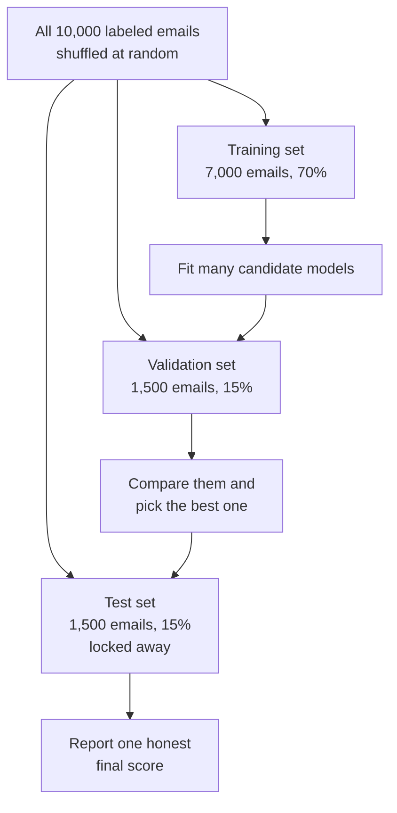
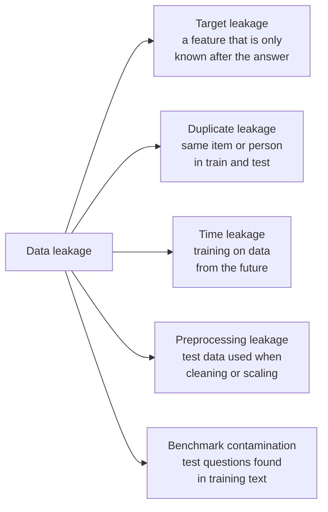
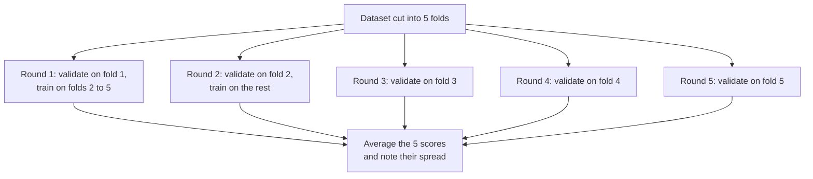
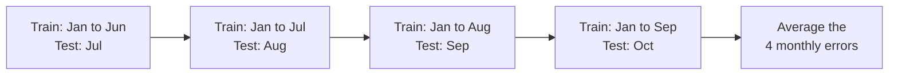
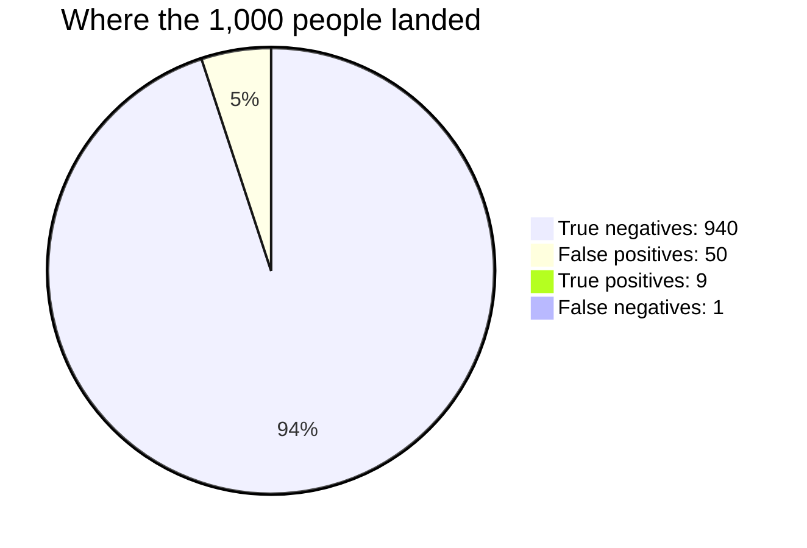
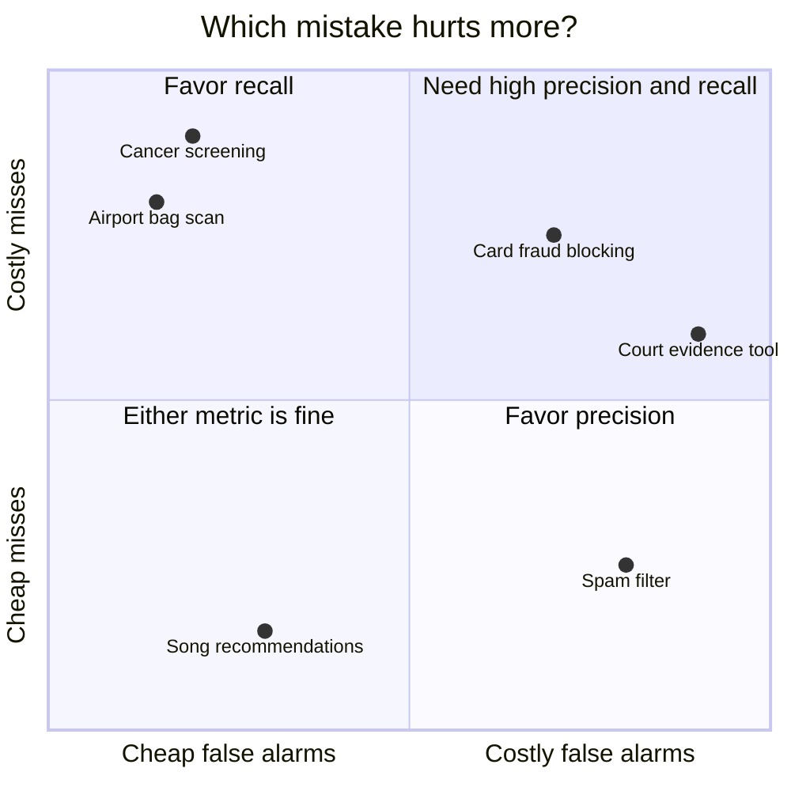
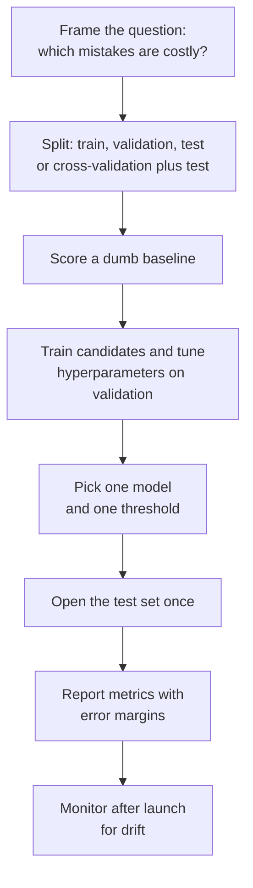
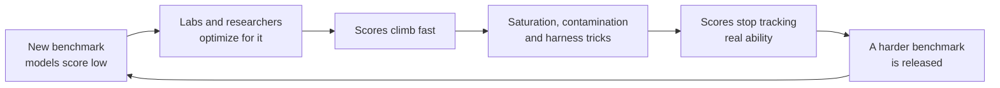

# Chapter 9: Is the Model Any Good? Evaluation, Overfitting and Metrics

*This chapter gives you the tools to tell a genuinely good model from one that only looks good, and to see through impressive-sounding numbers, including the ones in AI headlines.*

## What you'll learn

- Why a model's score on its own training data is nearly meaningless, and how splitting data into training, validation and test sets fixes that.
- How models cheat by accident through data leakage, with real cautionary tales from medicine and research.
- What overfitting and underfitting look like, with a worked example where a fancier model does dozens of times worse on new data.
- The bias–variance tradeoff, explained with a dartboard, plus a first look at the surprising "double descent" of huge models.
- How regularization and cross-validation keep you honest.
- How to build a confusion matrix and compute accuracy, precision, recall, specificity and F1 by hand, using a medical test and a real cancer dataset.
- How thresholds, ROC curves and AUC work, and how to measure models that predict numbers.
- How to train on rare classes, and how slice-based evaluation and behavioral tests find failures that one overall score hides.
- Why you should always beat a dumb baseline, how to tune settings without cheating, and why benchmarks stop working once everyone aims at them (Goodhart's law).

## Before you start

You need Chapter 8 (Learning From Examples), which introduced models, parameters, hyperparameters, training versus inference, generalization, loss functions and thresholds. Chapter 6 (The Math of AI, Part 2) helps with probability, base rates and Bayes' rule, which explain why a positive medical test can still mean you are probably healthy. Chapter 5 introduced graphs and curves. As always, every number here is worked out step by step, and you can redo all of it in a spreadsheet.

## Why "how good is it?" is a hard question

In Chapter 8 you fit a line to ten students and got a mean squared error of 1.0. Was that a good model? You cannot tell from that number alone. A model that simply memorized all ten students would score a perfect 0.0 and be useless for the eleventh.

The same trap shows up in AI headlines every week. A fraud detector is "99.9% accurate." A new chatbot "beats every rival on the leading benchmark." A medical AI "matches expert doctors." Each claim might be true and important, or true and meaningless, or quietly false. This chapter teaches you to tell which.

Evaluation answers three questions:

1. **Does it generalize?** Does the model work on examples it has never seen?
2. **Which mistakes does it make?** Not just how many, but which kind, and what they cost.
3. **Is it actually better than the alternative?** Better than a simple rule, an older model or a human?

> **Definition — Evaluation:** Measuring how well a model performs, in a way that predicts how it will behave on real, new data. Good evaluation is honest about which mistakes the model makes and how sure we can be of the score.

> **Key idea:** A model is only as good as its performance on data it did not learn from. Everything in this chapter is a way of measuring that honestly.

## Splitting the data: train, validation and test

The single most important habit in machine learning is simple: before you train anything, set some data aside and do not let the model see it.

> **Definition — Training set:** The portion of the data the model learns from. Its parameters are adjusted to fit these examples.

> **Definition — Validation set:** Held-out data used during development to compare models and tune hyperparameters. The model never trains on it, but your choices are shaped by it.

> **Definition — Test set:** Data locked away until the very end and used once, to give an honest final score. If you peek at it while making decisions, it stops being a test.

Here is a typical split. You have 10,000 emails labeled spam or not spam. Shuffle them at random, then cut:

- 70% for training: 7,000 emails.
- 15% for validation: 1,500 emails.
- 15% for testing: 1,500 emails.



*Figure 9.1: The three-way split. Train on the training set, make choices with the validation set, and open the test set only once at the end.*

Why three sets instead of two? Because choosing is a form of learning. Suppose you train 50 different models and pick the one with the best score on some held-out set. Part of that winning score is skill, and part is luck: the winner happened to suit those particular 1,500 emails. If you then report that same score as your final result, you are reporting a lucky number. The validation set absorbs the luck of choosing. The test set, untouched by any decision, tells you the truth.

> **Analogy:** The validation set is the practice quizzes; the test set is the sealed final exam. Take as many practice quizzes as you like and adjust your studying. Open the final once.

### Keeping the mix fair

Suppose only 2% of the emails are spam: 200 out of 10,000. If you cut the data purely at random, one set might get 160 spam emails and another only 15, just by chance. To avoid this, split each class separately: 140 spam for training, 30 for validation and 30 for test, and the same proportions for the 9,800 normal emails.

> **Definition — Stratified sampling:** Splitting data so that each part keeps the same mix of classes as the whole, for example 2% spam in the training, validation and test sets alike.

### How sure is the score?

A test set is a sample, and samples are noisy. If a spam filter gets 90% of 1,500 test emails right, its true accuracy on all future emails is probably close to 90%, but not exactly. A standard statistics rule of thumb (Chapter 6 covers the background) gives the margin of error for an accuracy as about `1.96 × square root of (accuracy × (1 − accuracy) ÷ number of test examples)`.

Worked out for 1,500 emails at 90%: `0.9 × 0.1 = 0.09`; divided by 1,500 is 0.00006; the square root is about 0.0077; times 1.96 is about 0.015. So the honest statement is "90%, give or take about 1.5 percentage points." With only 100 test emails the same calculation gives about plus or minus 6 points.

> **Definition — Margin of error:** The range within which the true value probably lies, given the noise of measuring on a limited sample. A score of 90% plus or minus 1.5 points means the true accuracy is very likely between 88.5% and 91.5%.

This matters more than people think. If model A scores 91.0% and model B scores 91.8% on the same 1,500 test emails, the difference is smaller than the noise. You have not shown that B is better. Many "state of the art" claims in research papers and product launches are differences of this size.

> **Watch out:** A small test set makes every number wobbly. Before you get excited about a score, ask how many examples it was measured on. A chatbot "winning" 7 out of 10 comparisons tells you almost nothing; 700 out of 1,000 tells you a lot.

## Data leakage: how models cheat by accident

The most common way to fool yourself in machine learning is not a math error. It is leakage: information sneaks into the model's inputs that would not be available when the model is actually used, or test data quietly ends up in training.

> **Definition — Data leakage:** When information that would not be available at prediction time, or information from the test set, sneaks into training, producing scores that look excellent and mean nothing.

> **Analogy:** Data leakage is the answer key slipping under the exam paper. The student scores 100%, and the score tells you nothing about what the student knows.

Leaks come in a few recognizable shapes.



*Figure 9.2: Five common kinds of leakage. Each one makes a model look better in testing than it will be in real use.*

**Target leakage.** Imagine predicting whether a hospital patient has a certain infection, and one of your columns is "antibiotic prescribed." The model will learn that this column predicts infection extremely well, because doctors prescribe the antibiotic after they diagnose the infection. In real use, you want the prediction before the diagnosis, when that column is empty. The same thing happens with a loan dataset that includes "collections agency contacted": a perfect predictor of default, recorded only after the default happened.

> **Definition — Target leakage:** A kind of leakage where a feature is a consequence of the answer, recorded after the fact, such as "treatment given" when predicting a disease.

**Duplicate leakage.** If the same item appears in both training and test data, the test partly measures memory. Researchers found that the popular CIFAR image benchmarks contained near-duplicates of some test images in their training sets. In medicine, a subtler version happens when several scans of the same patient are split across training and test. The model can learn to recognize that patient instead of the disease. The fix is to split by patient, not by scan.

**Time leakage.** When predicting the future, you must train only on the past. A model that predicts next month's sales using a feature computed over the whole year, including next month, looks brilliant in testing and fails on day one.

**Preprocessing leakage.** Even calculating an average over all the data, test set included, before splitting can leak a little information. The rule is: split first, then do everything else using only the training data.

> **Definition — Benchmark contamination:** When the questions and answers of a public test end up in a model's training data, for example because they were posted online and scraped. Scores then partly measure memory rather than ability.

Benchmark contamination is leakage at the scale of a whole field. Chatbots are trained on huge scrapes of the internet, and popular test questions get discussed, copied and posted online. Labs try to remove them from training data, a step called decontamination (see Chapter 19), but it is hard to be sure every copy was caught.

### Shortcut learning: the right answer for the wrong reason

A close cousin of leakage is a model that finds an easy clue that happens to work in the data but has nothing to do with the real task.

> **Definition — Shortcut learning:** When a model succeeds by exploiting an accidental clue in the training data, such as the background of a photo or a marker on an X-ray, instead of the thing it was supposed to learn.

Some of the best-known cases:

- **Wolves and snow.** In a 2016 paper on explaining model decisions ("Why Should I Trust You?"), researchers deliberately trained a classifier on photos where every wolf stood on snow and every husky did not. The model learned "snow means wolf." Their explanation tool exposed the trick. It was a planted experiment, but the lesson stuck because real systems do the same thing without anyone planting it.
- **Which hospital took the X-ray.** A 2018 study of a pneumonia detector trained on chest X-rays found that the model could tell which hospital an image came from, and that its performance dropped on images from other hospitals. Hospitals differ in their patients and their equipment, so "which hospital" was a useful clue in the training data and useless in the real world. A 2021 study of COVID-19 X-ray models found similar shortcuts, including text markers in the corner of images.
- **Rulers and skin cancer.** Dermatology researchers reported that an image classifier for skin lesions seemed more likely to call a lesion malignant when a ruler appeared in the photo. Doctors tend to measure the spots that worry them, so the ruler was a hint about what the doctor thought.

> **Watch out:** If a result looks too good to be true, look for a leak before you celebrate. A survey by Princeton researchers Sayash Kapoor and Arvind Narayanan (2023) found leakage problems in hundreds of published papers that used machine learning, across more than a dozen scientific fields.

> **Try it:** Ask your chatbot: "Create a 15-row table for predicting whether a customer will cancel their phone contract. Secretly include one column that leaks the answer. Don't tell me which." Then find the leak yourself and ask the chatbot to confirm. Typical leaks are columns like "final bill date" or "retention offer made."

## Overfitting and underfitting

Leakage is cheating from outside. Overfitting is a model fooling itself from inside, by learning the noise in its training data as if it were a real pattern.

> **Definition — Overfitting:** When a model learns the quirks and random noise of its training data so closely that it does worse on new data. Its training score is excellent and its test score is disappointing.

> **Definition — Underfitting:** When a model is too simple to capture the real pattern, so it does poorly even on its training data.

> **Definition — Noise:** The random, unpredictable part of data: measurement errors, one-off events and everything the features cannot explain. A good model ignores noise; an overfit one memorizes it.

### A worked example: iced drinks and temperature

A café records the outdoor temperature and how many iced drinks it sold on 12 days. Sales rise with temperature, and they rise faster on hot days.

| Temperature (°C) | 10 | 12 | 14 | 16 | 18 | 20 | 22 | 24 | 26 | 28 | 30 | 32 |
|---|---|---|---|---|---|---|---|---|---|---|---|---|
| Iced drinks sold | 22 | 20 | **27** | 29 | 36 | **38** | 47 | 49 | **60** | 63 | 75 | **80** |
| Used for | train | train | test | train | train | test | train | train | test | train | train | test |

*Table 9.1: Twelve days of café data. The four bold days (14, 20, 26 and 32 °C) are held out as a test set; the model trains on the other eight.*

We fit curves of increasing flexibility to the eight training days. A "degree 1" curve is a straight line, as in Chapter 8. "Degree 2" can bend once, like a gentle bowl. Higher degrees can wiggle more and more. A curve of degree 7 has 8 knobs, exactly as many as there are training days, so it can pass through every single one.

> **Definition — Polynomial:** A formula built from powers of the input, such as `a + b × x + c × x²`. Its degree is the highest power used. Higher-degree polynomials can draw more wiggly curves.

> **Definition — Model complexity:** How flexible a model is: how many different patterns it is able to fit. More parameters, deeper trees or higher-degree curves mean more complexity. Also called capacity.

Here are the mean squared errors (Chapter 8) on the training days and on the four held-out test days.

| Model | Knobs | Training MSE | Test MSE | Prediction at 32 °C (truth: 80) |
|---|---|---|---|---|
| Degree 0: always predict the average | 1 | 336.23 | 491.08 | 42.6 |
| Degree 1: straight line | 2 | 12.67 | 13.60 | 74.5 |
| Degree 2: gentle curve | 3 | 3.98 | **2.79** | 82.0 |
| Degree 3 | 4 | 3.97 | 3.41 | 82.4 |
| Degree 5 | 6 | 0.33 | 71.47 | 95.3 |
| Degree 7: passes through every training day | 8 | 0.00 | 206.51 | 52.8 |

*Table 9.2: Training error always falls as the model gets more flexible. Test error falls, bottoms out at degree 2, then shoots up. The degree-7 model is perfect on the training days and about 74 times worse than degree 2 on new days.*

Read the table from top to bottom. Predicting the average for every day underfits badly. The straight line is decent but misses the way sales accelerate on hot days, so it underfits a little. The gentle curve captures the real shape and does best on the test days. After that, extra flexibility only helps the model memorize the training days. The degree-7 curve hits all eight training days exactly, then predicts that a 32 °C scorcher will sell fewer drinks than a 26 °C day. On the training data it looks perfect. On the one question that matters, it is badly wrong.

```
|                       |                       |
|                       |                    .  |
|                    o  |                   .o  |                    o
|                  *..  |                 .*    |                 .*.
|                ...    |                ..     |                 . .
|               o*      |               o*      |               o*   .
|             ..        |             ...       |               .    .
|           *.*         |           *.*         |           *.*.
|         ..            |          ..           |         ...
|       *.o             |       *.o.            |       *.o
|     ..                |     ...               |      ..
|   .o*                 |   .o*                 |    o*
|*.*.                   |*.*                    |*.*..
|.                      |                       |
+---------------------  +---------------------  +--------------------
  degree 1: underfit      degree 2: good fit      degree 7: overfit
```

*Figure 9.3: The café data drawn three ways. Stars are training days, o marks the held-out test days, and dots are the model's curve. The straight line runs below the hot days; the gentle curve follows the data; the degree-7 curve passes through every star and then droops at the hot end, far below the 32 °C test day in the top-right corner.*

The pattern is general, and it gives you a diagnostic:

| Training error | Validation error | Diagnosis | What to try |
|---|---|---|---|
| High | High | Underfitting | A more flexible model, better features |
| Low | Much higher | Overfitting | A simpler model, regularization, more data |
| Low | Low, close to training | Good fit | Check on the test set, then ship |

*Table 9.3: Reading the two error numbers together tells you which direction to move.*

```
 error
   |
   |\                                            /
   | \                                         /   validation
   |  \                                      /     error
   |   \                                  _/
   |    `.                             _-'
   |      `-._                    _.-'
   |          `--..__________..--'
   |  \                 ^
   |   `.          sweet spot:
   |     `-._      stop here
   |         `--..__
   |                `---..___________________   training error
   +-------------------------------------------------- complexity
      underfitting        |        overfitting
```

*Figure 9.4: The classic picture. As complexity grows, training error keeps falling, but validation error falls and then rises. The best model sits at the bottom of the validation curve.*

> **Analogy:** Underfitting is a weather forecaster who always predicts "mild": too simple to ever be badly wrong or usefully right. Overfitting is a student who memorized last year's exam word for word, then meets new questions.

The same curve appears when you train for longer instead of making the model bigger. Early in training, both errors fall. Train too long on a small dataset and the model starts memorizing, so the validation error turns upward while the training error keeps dropping. That observation leads directly to one of the simplest fixes, early stopping, below.

## Bias and variance: the dartboard

Statisticians describe the two failure modes with two words.

> **Definition — Bias (statistical):** Systematic error from a model that is too simple or makes wrong assumptions, so it misses in the same direction again and again, like the straight line that always underestimates the hot days.

> **Definition — Variance (statistical):** How much a model's predictions would change if it were trained on a different sample of data. High variance means the model is jumpy and sensitive to the particular examples it saw, which is the signature of overfitting.

Picture throwing darts. Bias is how far the center of your cluster is from the bullseye. Variance is how spread out your darts are.

```
               LOW VARIANCE              HIGH VARIANCE
            +---------------+          +---------------+
            |               |          |  x         x  |
   LOW      |      xxx      |          |       x       |
   BIAS     |      xox      |          | x     o    x  |
            |      xxx      |          |          x    |
            |               |          |    x          |
            +---------------+          +---------------+
            +---------------+          +---------------+
            |  xxx          |          | x      x      |
   HIGH     |  xxx          |          |    x          |
   BIAS     |   x   o       |          | x     o       |
            |               |          |  x            |
            |               |          |       x       |
            +---------------+          +---------------+
```

*Figure 9.5: The bias–variance dartboard. The o is the bullseye (the truth); each x is one model trained on a different sample of data. Top left is the goal. Bottom left is a too-simple model, consistently wrong. Top right is an overfit model, right on average but wildly scattered.*

In the café example, the straight line has high bias: train it on any eight days you like and it will still underestimate hot days. The degree-7 curve has high variance: swap out one or two training days and its predictions at 32 °C would jump around wildly, because it bends itself to fit whatever eight points it is given.

> **Definition — Bias–variance tradeoff:** The classic tension in model building. Making a model more flexible lowers its bias but raises its variance; the best model balances the two for the amount of data you have.

The amount of data matters a lot. With 8 training days, a degree-7 curve is hopeless. With 8,000 days covering every kind of weather, a flexible model has enough evidence to tell real patterns from noise. This is one reason "more data" is the most reliable fix for overfitting, and one reason AI labs collect so much of it.

> **Watch out:** "Bias" now has three different meanings in this book. In Chapter 8 it was a parameter (the intercept of a line). Here it is statistical bias: systematic error. In Chapter 11 and Chapter 58 it is social bias: unfair treatment of groups of people. Always check which one a writer means.

The mathematics behind "it depends on how much data you have" is called statistical learning theory. Its classic results, from Vladimir Vapnik and Alexey Chervonenkis in the Soviet Union in the late 1960s and 1970s, and from Leslie Valiant's "probably approximately correct" (PAC) framework of 1984, put a number on a model's flexibility and prove that, with enough examples relative to that flexibility, the training score is guaranteed to be close to the score on new data. Guarantees like these are why the U-shaped curve was trusted for decades. They also explain why the next discovery came as a shock: modern neural networks are so flexible that the classic guarantees say nothing useful about them, yet they generalize anyway.

> **Definition — Statistical learning theory:** The branch of mathematics that proves when, and how well, a model trained on a sample will perform on new data, depending on how many examples it saw and how flexible the model is.

> **Definition — VC dimension (Vapnik–Chervonenkis dimension):** A classic measure of a model's flexibility: the largest number of points it can classify correctly under every possible labeling. A straight-line boundary in two dimensions has a VC dimension of 3.

> **Definition — PAC learning (probably approximately correct learning):** Leslie Valiant's 1984 framework for learning guarantees: given enough examples, a learner will, with high probability, find a rule whose error on new data is small.

### A twist: double descent

For decades the U-shaped curve of Figure 9.4 was the whole story. Then deep learning broke it. Modern neural networks often have far more parameters than training examples, enough to memorize the training set completely, and yet they generalize well.

In 2019, researchers led by Mikhail Belkin described "double descent," and a team from OpenAI and Harvard (Nakkiran and colleagues) showed it across many deep learning setups. As model size grows, test error first follows the classic U: down, then up as the model becomes just big enough to memorize the training data. But keep growing the model far past that point and test error comes down again, often lower than before.

> **Definition — Double descent:** The surprising finding that test error can fall, rise and then fall again as models grow far beyond the size needed to fit the training data exactly. It shows that the classic bias–variance picture is incomplete for very large models.

Why this happens is still debated. One popular intuition is that among all the ways a huge model could fit the training data, training tends to find smooth, simple ones. Chapter 13 returns to this. For now, the lesson is that "bigger means more overfitting" is not a safe rule for neural networks, while "always measure on held-out data" remains completely safe.

> **At the frontier (2026):** Frontier language models are trained on tens of trillions of tokens, mostly seeing each document only about once, so classic overfitting to the training set is rarely their main problem. Instead the evaluation worries have moved: memorizing rare passages word for word (a privacy and copyright issue, see Chapter 11), benchmark contamination, and models learning to please graders rather than to be right (see Chapter 20). The habits in this chapter, held-out data, honest baselines and suspicion of too-good scores, are exactly what labs apply to those newer problems.

## Regularization: keeping models simple on purpose

If overfitting comes from too much flexibility, one fix is to make flexibility cost something.

> **Definition — Regularization:** Any technique that discourages unnecessary complexity in order to reduce overfitting, such as penalizing large weights, limiting tree depth, stopping training early or adding noise during training.

The most common version adds a penalty to the loss for large weights. Training then has to balance two goals: fit the data, and keep the weights small.

> **Definition — L1 and L2 regularization:** Adding a penalty for large weights to the loss. L2 (also called ridge) adds the sum of squared weights and shrinks all weights toward zero; L1 (also called lasso) adds the sum of absolute weights and tends to push unhelpful weights to exactly zero, which removes those features.

A worked example. Two models each have a training MSE of 4.0. Model A has weights 2 and −1. Model B has weights 40 and −38: two huge numbers that nearly cancel, a typical sign of a model contorting itself to fit noise. With an L2 penalty strength of 0.1:

- Model A's penalty is `0.1 × (2² + (−1)²) = 0.1 × 5 = 0.5`, so its total loss is 4.0 + 0.5 = **4.5**.
- Model B's penalty is `0.1 × (40² + (−38)²) = 0.1 × (1,600 + 1,444) = 304.4`, so its total loss is **308.4**.

Gradient descent will strongly prefer Model A. The penalty strength (0.1 here) is a hyperparameter: too small and it does nothing, too large and it squashes the model into underfitting.

> **Analogy:** Regularization is a word limit on an essay. It forces you to keep only what matters instead of padding with every passing thought. It is Occam's razor, the old principle that simpler explanations are usually better, enforced by math.

Other common forms:

> **Definition — Early stopping:** Halting training when the validation error stops improving, even though the training error could still go down. It catches the moment in Figure 9.4 just before memorization sets in.

> **Definition — Dropout:** A regularization trick for neural networks that randomly switches off a fraction of the network's units during each training step, so no single unit can become a crutch. Chapter 13 covers it.

> **Definition — Data augmentation:** Creating extra training examples by changing existing ones in ways that should not change the answer, such as flipping, cropping or brightening a photo, or paraphrasing a sentence.

Early stopping is easy to picture with numbers. Here is an illustrative validation loss after each epoch of training:

| Epoch | 1 | 2 | 3 | 4 | 5 | 6 | 7 | 8 | 9 | 10 |
|---|---|---|---|---|---|---|---|---|---|---|
| Validation loss | 0.90 | 0.62 | 0.48 | 0.41 | 0.38 | **0.37** | 0.38 | 0.41 | 0.45 | 0.50 |

*Table 9.4: An illustrative early-stopping run. Validation loss bottoms out at epoch 6 and then climbs as the model starts memorizing. Keep the epoch-6 version of the model.*

In practice people usually wait a few epochs past the best one (in case it was a temporary bump), then roll back to the best saved version.

Data augmentation deserves a special mention, because it directly attacks the shortcut problem. If you randomly brighten and darken your Teachable Machine photos during training, the model can no longer use lighting as a shortcut, and must look at your hand. Real image models are trained with many such variations.

And the most powerful regularizer of all is simply more data. With more varied examples, there is less room for the model to memorize accidents.

## Cross-validation: don't trust one lucky split

A single validation set has a weakness: it is one particular slice of data, and some slices are easier than others. Cross-validation rotates the role of validation set through the whole dataset.

> **Definition — Cross-validation (k-fold):** Cutting the data into k equal parts called folds, then training k times, each time holding out a different fold for validation and training on the rest, and finally averaging the k scores. Five and ten folds are common.



*Figure 9.6: Five-fold cross-validation. Every example is used for validation exactly once and for training four times.*

Here is a real result you can reproduce in Colab later in this chapter. The Wisconsin breast cancer dataset, which ships free with the scikit-learn library, contains 569 tumors described by 30 measurements taken from images of cell samples, each labeled malignant (212) or benign (357). Five-fold cross-validation of a logistic regression model gives these accuracies, each measured on about 114 tumors the model did not train on:

| Fold | 1 | 2 | 3 | 4 | 5 | Average |
|---|---|---|---|---|---|---|
| Accuracy | 98.2% | 98.2% | 97.4% | 97.4% | 99.1% | **98.1%** |

*Table 9.5: Five-fold cross-validation on the breast cancer dataset. The scores range from 97.4% to 99.1%, so any single split could have given a slightly flattering or slightly harsh number.*

Two things come out of this that a single split cannot give you: a more reliable average, and a sense of how much the score moves from one slice of data to another. If two models' averages differ by less than that spread, you should be cautious about calling one better.

> **Analogy:** Cross-validation is rotating which friend is the taste-tester, so one person's quirky palate does not decide the recipe.

Cross-validation should also be stratified when classes are unbalanced, so that every fold has the same share of positive cases.

### Time series: never train on the future

For data that unfolds over time, such as sales, prices or electricity demand, random folds would let the model train on Thursday and be tested on Wednesday. That is time leakage. Instead, walk forward through time.

> **Definition — Walk-forward validation:** Testing a forecasting model by repeatedly training on everything up to a point in time and predicting the next period, then moving the point forward and repeating. Also called backtesting.



*Figure 9.7: Walk-forward validation. Each test month comes strictly after its training data, exactly as it will in real use.*

One practical limit: cross-validation multiplies the cost of training by k. That is fine for a model that trains in seconds. Nobody cross-validates a frontier language model whose single training run costs a fortune; labs rely on carefully held-out evaluation sets instead.

## The confusion matrix: counting every kind of mistake

So far we have mostly measured how wrong a model is with a single number. For classification, a single number hides the most important question: which mistakes is it making? A classifier can be wrong in two very different ways, and in most real problems one way is far worse than the other.

Take a yes-or-no model and call "yes" the positive class (sick, spam, fraud, malignant) and "no" the negative class. Every prediction falls into one of four boxes.

> **Definition — True positive (TP):** The model said yes and the answer really was yes, such as a sick person correctly flagged by a test.

> **Definition — False positive (FP):** The model said yes but the answer was no: a false alarm, such as a healthy person told they might be sick. Statisticians call it a Type I error.

> **Definition — False negative (FN):** The model said no but the answer was yes: a miss, such as a sick person sent home. Statisticians call it a Type II error.

> **Definition — True negative (TN):** The model said no and the answer really was no, such as a healthy person correctly cleared.

> **Definition — Confusion matrix:** A table that counts a classifier's predictions by type: true positives, false positives, false negatives and true negatives for a yes-or-no task, or every combination of actual and predicted class for a task with more classes.

### A worked medical test

A screening test for a rare disease is given to 1,000 people. Ten of them actually have the disease. The test correctly flags 9 of the 10 sick people, and it also wrongly flags 50 of the 990 healthy people.

```
                          WHAT THE TEST SAYS
                      Positive          Negative
                 +----------------+----------------+
   ACTUALLY      |  TP = 9        |  FN = 1        |    10 sick
   SICK          |  caught        |  missed        |
                 +----------------+----------------+
   ACTUALLY      |  FP = 50       |  TN = 940      |   990 healthy
   HEALTHY       |  false alarm   |  cleared       |
                 +----------------+----------------+
                    59 flagged       941 cleared       1,000 total
```

*Figure 9.8: The confusion matrix for the screening test. Rows are the truth, columns are the test's verdict. Every one of the 1,000 people lands in exactly one box.*



*Figure 9.9: The same 1,000 people as a pie. The sick people (the two thinnest slices, 10 in total) are almost invisible, which is exactly why a single "accuracy" number can mislead.*

Now let us compute every standard metric from these four numbers.

**Accuracy** is the share of all predictions that were right.

> **Definition — Accuracy:** The share of all predictions that were correct: (TP + TN) ÷ total. It is easy to understand and badly misleading when one class is rare.

Accuracy = (9 + 940) ÷ 1,000 = 949 ÷ 1,000 = **94.9%**. Sounds good. Now consider a "test" that ignores the patient entirely and always says "healthy." It gets all 990 healthy people right and all 10 sick people wrong: accuracy = 990 ÷ 1,000 = **99.0%**. The useless test beats the real one on accuracy.

> **Definition — Class imbalance:** When one category vastly outnumbers another, such as 10 sick people among 1,000, or a handful of fraudulent payments among millions of normal ones. It makes accuracy misleading and calls for other metrics.

The same trap appears everywhere rare events matter. If 1 in 1,000 card payments is fraud, a "fraud detector" that never flags anything is 99.9% accurate and catches zero fraud. So we need metrics that look at the positive class directly.

**Precision** asks: when the test says "positive," how often is it right?

> **Definition — Precision:** Of everything the model flagged as positive, the share that truly was positive: TP ÷ (TP + FP). It answers "when it cries wolf, how often is there a wolf?"

Precision = 9 ÷ (9 + 50) = 9 ÷ 59 = **15.3%**. Only about 1 in 7 people who test positive are actually sick. This is the base-rate effect you met with Bayes' rule in Chapter 6: when a disease is rare, even a fairly good test produces more false alarms than true finds, simply because there are so many more healthy people to make mistakes on.

**Recall** asks: of all the people who really are sick, how many did the test catch?

> **Definition — Recall:** Of all the real positives, the share the model caught: TP ÷ (TP + FN). Also called sensitivity or the true positive rate. It answers "how many of the wolves did it spot?"

Recall = 9 ÷ (9 + 1) = **90%**. The always-healthy "test" has a recall of 0%, which exposes it immediately.

**Specificity** is recall's mirror image for the negative class.

> **Definition — Specificity:** Of all the real negatives, the share correctly left alone: TN ÷ (TN + FP). A test with high specificity rarely raises false alarms on healthy people.

Specificity = 940 ÷ (940 + 50) = 940 ÷ 990 = **94.9%**.

> **Definition — False positive rate:** Of all the real negatives, the share wrongly flagged: FP ÷ (FP + TN). It equals 1 minus specificity.

False positive rate = 50 ÷ 990 = **5.1%**. Notice the gap between a 5.1% false positive rate and 15.3% precision. Only 5% of healthy people get a false alarm, but because there are 990 healthy people and only 10 sick ones, those false alarms swamp the true ones.

**F1** combines precision and recall into one number that is only high if both are high.

> **Definition — F1 score:** A single number combining precision and recall, calculated as their harmonic mean: 2 × precision × recall ÷ (precision + recall). It is high only when both are high, so a model cannot score well by maximizing one and ignoring the other.

F1 = 2 × 0.153 × 0.90 ÷ (0.153 + 0.90) = 0.275 ÷ 1.053 = **0.26**. A plain average of 15.3% and 90% would be about 53%, which hides the terrible precision. The harmonic mean drags the score toward the weaker of the two.

| Metric | Formula | Question it answers | Screening test | Always "healthy" |
|---|---|---|---|---|
| Accuracy | (TP + TN) ÷ all | How often is it right overall? | 94.9% | 99.0% |
| Precision | TP ÷ (TP + FP) | When it says yes, is it right? | 15.3% | undefined (never says yes) |
| Recall | TP ÷ (TP + FN) | Does it catch the real cases? | 90.0% | 0% |
| Specificity | TN ÷ (TN + FP) | Does it leave negatives alone? | 94.9% | 100% |
| False positive rate | FP ÷ (FP + TN) | How often are negatives falsely flagged? | 5.1% | 0% |
| F1 | 2PR ÷ (P + R) | Are precision and recall both good? | 0.26 | 0 |

*Table 9.6: Every standard classification metric for the screening test, next to the useless always-healthy "test." Only accuracy is fooled.*

> **Key idea:** With rare events, accuracy lies. Always ask for the confusion matrix, or at least for precision and recall, before trusting a classifier.

Rare classes cause trouble during training too, not only in scoring. A spam filter trained on 9,800 normal emails and 200 spam emails sees normal mail 49 times as often, and it can push its loss down by mostly answering "normal". There are three standard fixes. You can oversample the rare class, repeating or slightly varying the 200 spam emails so they make up a bigger share. You can undersample the common class, training on, say, 2,000 of the 9,800 normal emails. Or you can keep the data as it is and use class weights: tell the loss to count every spam mistake as 49 times as costly as a normal-email mistake (9,800 ÷ 200 = 49), so the two classes pull equally hard on the model. Each fix shifts the model's raw probabilities, so recheck calibration (Chapter 8) and choose the threshold afterward on untouched validation data. Never rebalance the validation or test sets: they must keep the real-world mix, or your precision numbers will describe a world that does not exist.

> **Definition — Oversampling and undersampling:** Rebalancing a training set by repeating or synthesizing examples of the rare class (oversampling), or by dropping examples of the common class (undersampling), so a model does not simply learn to predict the majority.

> **Definition — Class weights:** Numbers that make mistakes on some classes count more in the loss than mistakes on others, for example counting each missed spam email 49 times, so a model pays proper attention to a rare class without changing the data.

### Precision or recall: which matters more?

You usually cannot have both at maximum, and the right balance depends entirely on what each kind of mistake costs.

- **Cancer screening, airport bag scans, smoke alarms:** a miss can be catastrophic, while a false alarm costs a follow-up test or a second look. Favor **recall**.
- **Spam filters:** a real email from your bank hidden in the spam folder is worse than one more spam message in your inbox. Favor **precision**.
- **Automatically blocking a card payment:** a missed fraud costs money, but blocking a real customer at the checkout costs goodwill and sales. Both matter, so tune carefully.
- **Song recommendations:** neither mistake costs much. Almost any balance is fine.



*Figure 9.10: Where some applications sit by the cost of each kind of mistake. Top left: misses are expensive, so favor recall. Bottom right: false alarms are expensive, so favor precision.*

> **Analogy:** Precision versus recall is like fishing with a net. A huge, fine net catches every fish (high recall) but also boots and seaweed (low precision). A small net cast by a picky fisher keeps only fish (high precision) but misses many (low recall).

### Real counts from a real dataset

Here is the confusion matrix from an actual model, which you can reproduce exactly in Colab at the end of this chapter. Using the breast cancer dataset from the cross-validation section, we hold out 25% of the tumors as a test set (143 tumors: 53 malignant, 90 benign), train a logistic regression on the other 426, and call "malignant" the positive class. With the default threshold of 0.5:

| | Model says malignant | Model says benign |
|---|---|---|
| **Actually malignant (53)** | TP = 49 | FN = 4 |
| **Actually benign (90)** | FP = 1 | TN = 89 |

*Table 9.7: A real confusion matrix: logistic regression on 143 held-out tumors from the Wisconsin breast cancer dataset, threshold 0.5.*

Work out the metrics yourself before reading on. Accuracy = (49 + 89) ÷ 143 = 138 ÷ 143 = **96.5%**. Precision = 49 ÷ (49 + 1) = **98.0%**. Recall = 49 ÷ (49 + 4) = **92.5%**. F1 = 2 × 0.980 × 0.925 ÷ (0.980 + 0.925) = **0.95**.

That is a strong model. But look at the FN box: 4 malignant tumors were called benign. In a screening setting, that is the number a doctor cares about most. Compare the dumbest possible baseline, which always says "benign": it scores 62.9% accuracy (90 of 143) and catches zero cancers. And look at the training accuracy, 98.8%, against the test accuracy of 96.5%: a small, normal gap, not a sign of serious overfitting.

What if we lower the threshold so the model flags a tumor as malignant whenever it estimates even a 10% chance? Then: TP = 52, FN = 1, FP = 6, TN = 84. Recall rises to 52 ÷ 53 = **98.1%**, precision falls to 52 ÷ 58 = **89.7%**, and accuracy actually drops slightly to 95.1%. We traded five more false alarms for three fewer missed cancers. For a screening tool, a doctor would probably take that deal. Accuracy alone would have told you not to.

> **Watch out:** This dataset is a classic teaching set, not a medical device. Real clinical AI must be tested on patients from many hospitals, on the equipment and populations where it will be used, and approved by regulators (see Chapter 52). A 96.5% score on 143 tumors from one source says little about performance elsewhere.

### More than two classes

For tasks with more than two classes, the confusion matrix simply grows. Here is a hypothetical one for a Teachable Machine model with three classes, tested on 20 new images of each:

| Actual \ Predicted | Thumbs up | Thumbs down | Nothing |
|---|---|---|---|
| **Thumbs up (20)** | 18 | 1 | 1 |
| **Thumbs down (20)** | 3 | 15 | 2 |
| **Nothing (20)** | 0 | 1 | 19 |

*Table 9.8: A three-class confusion matrix. The diagonal holds the correct predictions; everything off the diagonal is a specific kind of confusion.*

Accuracy is the diagonal divided by the total: (18 + 15 + 19) ÷ 60 = 52 ÷ 60 = 86.7%. But the table tells you much more. Recall for "thumbs down" is only 15 ÷ 20 = 75%, and its most common mistake is being read as "thumbs up." That points straight at a fix: record more thumbs-down examples from more angles. Precision and recall can be computed for each class separately and then averaged, which is called macro-averaging.

## Thresholds, ROC curves and AUC

Most classifiers do not output yes or no. They output a probability or score, and a threshold turns it into a decision (Chapter 8). Every threshold gives a different confusion matrix. Sliding the threshold is how you trade false alarms for misses.

### The threshold game

Here are 20 emails scored by a spam model, with the truth alongside:

| Truth | Model scores |
|---|---|
| Spam (8 emails) | 0.95, 0.90, 0.85, 0.80, 0.70, 0.55, 0.45, 0.30 |
| Not spam (12 emails) | 0.75, 0.60, 0.50, 0.40, 0.35, 0.25, 0.20, 0.15, 0.10, 0.08, 0.05, 0.02 |

*Table 9.9: Model scores for 20 emails. Most spam scores high and most normal mail scores low, but there is overlap in the middle.*

Flag as spam everything scoring at or above the threshold, and count:

| Threshold | TP | FN | FP | TN | Precision | Recall | False positive rate |
|---|---|---|---|---|---|---|---|
| 0.1 | 8 | 0 | 9 | 3 | 47% | 100% | 75% |
| 0.2 | 8 | 0 | 7 | 5 | 53% | 100% | 58% |
| 0.3 | 8 | 0 | 5 | 7 | 62% | 100% | 42% |
| 0.4 | 7 | 1 | 4 | 8 | 64% | 88% | 33% |
| 0.5 | 6 | 2 | 3 | 9 | 67% | 75% | 25% |
| 0.6 | 5 | 3 | 2 | 10 | 71% | 63% | 17% |
| 0.7 | 5 | 3 | 1 | 11 | 83% | 63% | 8% |
| 0.8 | 4 | 4 | 0 | 12 | 100% | 50% | 0% |
| 0.9 | 2 | 6 | 0 | 12 | 100% | 25% | 0% |

*Table 9.10: Sliding the threshold. A low threshold catches all spam but flags many good emails; a high threshold flags only certain spam but lets half of it through.*

So which threshold is best? It depends on costs, not on the model. Suppose a spam email reaching your inbox costs 1 unit of annoyance, while a real email lost in the spam folder costs 10 units. The total cost at each threshold is `1 × FN + 10 × FP`:

- At 0.5: 1 × 2 + 10 × 3 = **32**.
- At 0.7: 1 × 3 + 10 × 1 = **13**.
- At 0.8: 1 × 4 + 10 × 0 = **4**.
- At 0.9: 1 × 6 + 10 × 0 = **6**.

The cheapest choice is 0.8. Change the costs and the best threshold moves. This is how real teams pick thresholds: by putting a price on each kind of mistake.

> **Analogy:** A threshold is the sensitivity dial on a smoke alarm. Set it too sensitive and it shrieks every time you make toast (false positives). Set it too lax and it stays quiet during a real fire (false negatives).

### The ROC curve

If you plot the result of every threshold at once, you get a picture of the model's whole range of trade-offs.

> **Definition — ROC curve:** A graph of the true positive rate (recall) against the false positive rate as the threshold slides from strict to lenient. The name comes from "receiver operating characteristic," a term from World War II radar engineering.

```
 1.0 |                 #C##########################
     |              ####                    ....
     |           B###                  .....
     |        ####                 ....
     | ########                ....
 0.5 |A#                  .....
     |#               ....
     |#           ....
     |#      .....
     |#  ....
 0.0 |#..
     +---------------------------------------------
      0.0       0.25       0.5        0.75       1.0
```

*Figure 9.11: The ROC curve for the 20 emails. Vertical axis: true positive rate (recall). Horizontal axis: false positive rate. A is the strict threshold 0.8, B is 0.5, C is the lenient 0.3. The dotted diagonal is a coin flip. The more the curve hugs the top-left corner, the better the model.*

> **Definition — AUC (Area Under the ROC Curve):** A single score from 0.5 to 1.0 summarizing the ROC curve. It equals the chance that the model gives a randomly chosen positive example a higher score than a randomly chosen negative one. 0.5 is a coin flip; 1.0 is perfect ranking.

That second description of AUC gives you a way to compute it by hand. There are 8 spam emails and 12 normal ones, so there are 8 × 12 = 96 spam-versus-normal pairs. For each pair, check whether the spam email got the higher score. The top four spam scores (0.95, 0.90, 0.85 and 0.80) beat all 12 normal emails: 48 wins. The spam email at 0.70 beats 11 (it loses to the 0.75). The one at 0.55 beats 10, the one at 0.45 beats 9, and the one at 0.30 beats 7. Total wins: 48 + 11 + 10 + 9 + 7 = 85 out of 96, so **AUC = 0.885**. The real breast cancer model scores an AUC of 0.996: it almost always ranks a malignant tumor above a benign one.

AUC is useful because it does not depend on any single threshold. It measures how well the model ranks, and leaves the threshold decision for later.

### When positives are rare: precision–recall curves

ROC curves have a blind spot. The false positive rate divides by the number of negatives, which can be enormous. Imagine a fraud model scanning 1,000,000 legitimate payments and 1,000 frauds. A false positive rate of just 1% sounds tiny, and the ROC curve will look superb. But 1% of a million is 10,000 false alarms, against at most 1,000 real frauds. Precision would be below 10%.

> **Definition — Precision–recall curve:** A graph of precision against recall across all thresholds. When positives are rare, it shows the false-alarm problem much more clearly than an ROC curve.

For fraud, disease screening, safety incidents and other rare-event problems, ask for the precision–recall curve, or at least for precision at the recall level you need.

> **Try it:** Ask your chatbot: "My fraud model has an AUC of 0.98. Fraud is 0.1% of transactions. At a threshold where recall is 80%, the false positive rate is 2%. Out of 1,000,000 transactions, how many alerts will my team review, and what share will be real fraud?" Check its arithmetic: 800 real frauds caught, about 19,980 false alarms, so roughly 4% of alerts are real.

## Measuring models that predict numbers

For regression, the confusion matrix does not apply. Instead we measure the size of the misses. Chapter 8 introduced MSE (mean squared error) and MAE (mean absolute error) as losses for training. Here they serve as report cards, joined by three more.

> **Definition — RMSE (Root Mean Squared Error):** The square root of the mean squared error. It puts the error back into the original units (dollars, degrees), while still weighting big misses heavily.

> **Definition — R² (coefficient of determination):** The share of the variation in the true values that the model explains. 1 means perfect; 0 means no better than always predicting the average; below 0 means worse than that.

> **Definition — MAPE (Mean Absolute Percentage Error):** The average miss as a percentage of the true value. Easy to explain to non-specialists, but it breaks down when true values are near zero.

A worked example. A house-price model makes five predictions (in thousands of dollars):

| House | Actual | Predicted | Error | Absolute error | Squared error | Percent error |
|---|---|---|---|---|---|---|
| 1 | 300 | 320 | +20 | 20 | 400 | 6.7% |
| 2 | 450 | 430 | −20 | 20 | 400 | 4.4% |
| 3 | 250 | 270 | +20 | 20 | 400 | 8.0% |
| 4 | 600 | 540 | −60 | 60 | 3,600 | 10.0% |
| 5 | 400 | 410 | +10 | 10 | 100 | 2.5% |

*Table 9.11: Five house-price predictions and their errors.*

- **MAE** = (20 + 20 + 20 + 60 + 10) ÷ 5 = 130 ÷ 5 = **26**, so the model is off by $26,000 on average.
- **MSE** = (400 + 400 + 400 + 3,600 + 100) ÷ 5 = 4,900 ÷ 5 = **980** (in "thousands of dollars squared," a unit nobody can picture).
- **RMSE** = square root of 980 = **31.3**, so about $31,300. RMSE is higher than MAE because the one big miss on house 4 counts extra.
- **MAPE** = (6.7 + 4.4 + 8.0 + 10.0 + 2.5) ÷ 5 = **6.3%**.
- **R²**: the average actual price is 400. The squared distances of the actual prices from that average are 100², 50², 150², 200² and 0², which add up to 75,000. The model's squared errors add up to 4,900. R² = 1 − 4,900 ÷ 75,000 = **0.935**: the model explains about 93.5% of the variation in prices.

Now the baseline. A "model" that always predicts the average, $400,000, has an MAE of 100 and an RMSE of about 122.5, and an R² of exactly 0. Our model's MAE of 26 is about four times better. That comparison is far more informative than "MAE = 26" alone.

| Metric | Best for | Watch out for |
|---|---|---|
| MAE | Explaining to anyone: "off by $26,000 on average" | Treats one huge miss the same as several small ones |
| RMSE | When big misses are especially bad | Dominated by a few large errors |
| MAPE | Comparing across scales (cheap and expensive items) | Explodes when true values are near zero |
| R² | "How much better than guessing the average?" | Can look high on data with a strong trend even when errors are large in dollars |

*Table 9.12: Choosing a regression metric.*

> **Watch out:** In a spreadsheet, the RSQ function returns the squared correlation between two columns, which is not always the same as the R² of your model's predictions. Compute R² directly as 1 minus the sum of squared errors divided by the sum of squared differences from the mean (Exercise 5 shows the formulas).

## Baselines: is it better than doing something dumb?

Every evaluation needs a comparison point, and the first one should be embarrassingly simple.

> **Definition — Baseline:** A simple reference model that any real model must beat, such as "always predict the most common class," "always predict the average" or "tomorrow will be the same as today."

You have already met several baselines in this chapter. The always-benign tumor "model" scores 62.9% accuracy. The always-average house price model scores R² = 0. The flat line in the café example had a test MSE of 491. Each one turned a lonely number into a meaningful comparison.

Good baselines depend on the problem:

| Problem | Natural baseline |
|---|---|
| Classification | Always predict the most common class |
| Regression | Always predict the training average |
| Forecasting | Tomorrow equals today, or this week equals the same week last year |
| Recommendations | Recommend the most popular items |
| Text classification | A simple keyword rule, or a small logistic regression on word counts |
| A new chatbot feature | The same task done with a smaller, cheaper model, or by a person |

*Table 9.13: Baselines for common problems. In forecasting especially, simple baselines are notoriously hard to beat.*

> **Key idea:** A score with no baseline is not a result. "96.5% accurate" means little until you know that guessing gets 62.9%; "MAE of 26" means little until you know the dumb model gets 100.

## Tuning hyperparameters without cheating

Chapter 8 introduced hyperparameters, the settings you choose before training: the learning rate, the depth of a decision tree, the strength of a regularization penalty. Choosing them well can matter as much as choosing the algorithm.

> **Definition — Hyperparameter tuning:** Systematically trying different hyperparameter settings and keeping the one that scores best on validation data (or in cross-validation), never on the test set.

There are three main strategies.

> **Definition — Grid search:** Trying every combination from a list of values for each hyperparameter, such as every pairing of 3 tree depths with 3 learning rates.

> **Definition — Random search:** Trying randomly chosen combinations of hyperparameter values. It often finds good settings faster than a grid, because it tests more distinct values of the settings that matter most.

> **Definition — Bayesian optimization:** A smarter search that uses the results so far to guess which untried settings are most promising, and tries those next.

The cost adds up quickly. A grid of 3 depths × 3 learning rates is 9 combinations. With 5-fold cross-validation, that is 9 × 5 = 45 training runs. Add two more hyperparameters with 5 values each and the grid has 3 × 3 × 5 × 5 = 225 combinations, or 1,125 runs. This is why random search, popularized in a 2012 paper by James Bergstra and Yoshua Bengio, is often preferred: with a fixed budget of, say, 60 runs, you sample the space broadly instead of exhaustively.

Neural networks add a fourth trick, because a single training run can take hours or days: stop the losers early. In **successive halving**, you start many settings on a small budget and repeatedly promote only the best fraction to a bigger one. Worked example: start 27 settings for 1 epoch each, keep the best 9 and train them to 3 epochs, keep the best 3 and train them to 9 epochs, then train the single winner to the full 27. Even if every round restarted from scratch, that is 27 + 27 + 27 + 27 = 108 epochs of training, against 27 × 27 = 729 epochs to train all 27 settings fully. Hyperband runs several such tournaments with different starting budgets, in case a slow starter would have won in the end.

> **Definition — Successive halving (and Hyperband):** A tuning strategy that starts many hyperparameter settings with a small training budget and repeatedly keeps only the best fraction for longer training, so most compute goes to promising settings. Hyperband repeats it with several starting budgets.



*Figure 9.12: An honest evaluation workflow. Every choice happens before the test set is opened, and monitoring continues after launch.*

> **Watch out:** The most common way to accidentally cheat is to tune on the test set: try something, check the test score, adjust, check again. After a dozen rounds, your test set has become a second validation set, and your final score is optimistic. If you have peeked, be honest about it, or collect a fresh test set.

## Beyond one number: slices and behavioral tests

A single overall score can hide a model that fails a whole group of people. Suppose a loan-approval model is right about 90% of 10,000 test applicants. Now split the test set by how people applied:

| Slice | Applicants | Correct | Accuracy |
|---|---|---|---|
| Applied on the website | 9,000 | 8,370 | 93% |
| Applied by phone (typed in by staff, more blank fields) | 1,000 | 630 | 63% |
| Everyone | 10,000 | 9,000 | 90% |

*Table 9.14: One overall score, two very different experiences.*

The average looks healthy, yet one applicant in ten gets a decision barely better than a coin toss. Nothing in the overall number warned you.

> **Definition — Slice-based evaluation:** Measuring a model's performance separately on meaningful subgroups (slices) of the data, such as region, device, age group or language, to find where it fails even when the overall score looks good.

Good slices come from the problem: the customer groups the business cares about, groups protected by law (Chapter 58 covers fairness), and groups whose data looks different, such as the phone applicants with their blank fields. Watch the sizes, though. A slice of 40 examples carries a wide margin of error (see "How sure is the score?" earlier), so a bad-looking small slice is a lead to investigate, not yet a verdict.

A second idea comes from software testing: write down behaviors you expect in advance and check them, often without needing any labeled data.

> **Definition — Invariance test:** A check that a change which should not matter leaves the prediction unchanged, such as swapping an applicant's name or replacing "Chicago" with "Atlanta" in a restaurant review.

> **Definition — Directional expectation test:** A check that a change which should push a prediction one way really does, such as a house-price estimate rising when the floor area grows and nothing else changes.

For a review-sentiment model: "The food was great" and "The food was great, said Maria" should get the same label (invariance); adding "but the service was terrible" should make the score less positive (direction); and "The food was not great" must not come out as positive, a basic capability check. In 2020 Marco Tulio Ribeiro and colleagues ran tests like these, a method they called CheckList, on commercial sentiment models and research models that scored well on standard benchmarks, and found many simple failures that the benchmarks had never revealed. Behavioral tests are cheap to write, and they turn vague worries ("is it sensitive to names?") into pass rates you can track from one model version to the next. The same idea, under the name of evals, is how teams test language-model products (Chapter 31).

## When the world changes: distribution shift

Even a perfectly evaluated model can fail later, because the test set was a snapshot of the past.

> **Definition — Distribution shift:** When the data a model meets in real use differs from the data it was trained and tested on, such as a model trained on one hospital's patients being used at another hospital, or a shopping model trained before a pandemic being used during one. Also called data drift.

The chest X-ray models above are a distribution-shift story: excellent on test images from their own hospitals, worse elsewhere. Consumer behavior shifted sharply in 2020 and broke many forecasting models overnight. Your chatbot faces a version of this every day: its training data ends at a cutoff date, and the world keeps moving.

The defenses are to test on data from the places and times where the model will actually be used, to monitor its performance after launch, and to retrain when the numbers slip (see Chapter 10 for the basics of monitoring, and Chapter 31 for how AI products are evaluated after launch).

## Benchmarks and Goodhart's law

So far we have evaluated one model on one problem. Science and industry also need to compare many models built by many teams. That is what benchmarks are for.

> **Definition — Benchmark:** A standard dataset plus a standard scoring method that many teams use to compare their models, such as MNIST for handwritten digits or a set of exam questions for chatbots.

> **Definition — Leaderboard:** A public ranking of models by their benchmark scores.

Benchmarks have driven much of AI's progress. MNIST (1998), with its 70,000 small images of handwritten digits, was the standard test of image recognition for years. ImageNet (2009), with about 14 million labeled images, set up the yearly challenge in which, in 2012, the AlexNet neural network cut the top-5 error rate to about 15.3%, against about 26% for the runner-up. That single benchmark result launched the deep learning era (see Chapter 7 and Chapter 14).

But a benchmark is a test set that the whole world gets to look at, again and again, for years. Every published paper that tunes its approach to do slightly better on the same test set is, collectively, a small step of tuning on the test set. In 2019, a team led by Benjamin Recht built a fresh ImageNet-style test set, following the original recipe as closely as they could, and re-tested many published models. Accuracy dropped by roughly 11 to 14 percentage points, although the ranking of the models mostly held. Part of each model's original score was fitted to the particular quirks of the original test images.

> **Definition — Goodhart's law:** "When a measure becomes a target, it ceases to be a good measure." Named after the economist Charles Goodhart, who made the point about monetary policy in 1975; this popular phrasing comes from the anthropologist Marilyn Strathern.

Goodhart's law is everywhere once you notice it. Schools judged on test scores start teaching to the test. Call centers judged on call length start hanging up on difficult callers. And AI models judged on benchmarks get better at benchmarks, which is not always the same as getting better at the job.

### Benchmarks in the chatbot era

Chatbot benchmarks have shortened this life cycle dramatically.



*Figure 9.13: The life cycle of a benchmark. Each turn of this loop now takes a year or two at the frontier.*

> **Definition — Benchmark saturation:** When the best models score near the maximum on a benchmark, so it can no longer tell them apart.

A few examples from the research for this book, all as of October 2026:

- **Saturation.** MMLU, a 2020 multiple-choice exam across 57 school and professional subjects, was a headline benchmark for years and is now saturated for frontier models. Humanity's Last Exam, a set of 2,500 expert-level questions released in January 2025, was designed to be much harder: frontier models scored under 10% at launch. By October 2026 the best text-only score reported by the independent evaluator Artificial Analysis was about 61%.
- **Wrong answers in the answer key.** Test sets have label errors too. An audit by the research group FutureHouse suggested that about 30% of the answers in Humanity's Last Exam's text-only chemistry and biology questions might be wrong, which prompted a rolling, corrected version. A model that "fails" a question with a wrong answer key may be right.
- **Harness dependence.** The same model can score very differently depending on the testing setup, or harness: the instructions, tools and memory it is given. On the ARC-AGI-3 puzzle benchmark, OpenAI's GPT-6 Astra reportedly scored 62.7% under the standard harness and 99.9% under a harness that let it keep its reasoning state between steps. Same model, same puzzles, very different headline numbers.

> **Definition — Evaluation harness:** The software setup used to run a benchmark: how questions are phrased, how many attempts are allowed, what tools and memory the model gets, and how answers are graded. Different harnesses can produce very different scores for the same model.

Goodhart's law even helps explain hallucination. A 2025 OpenAI paper by Adam Kalai and colleagues argued that most benchmarks grade answers only as right or wrong, with no credit for "I don't know." Under that scoring rule, guessing always beats admitting uncertainty, so models trained and selected to score well learn to bluff. The metric shaped the behavior (see Chapter 18).

> **At the frontier (2026):** Leading labs and evaluators now fight Goodhart's law on several fronts: removing known benchmark questions from training data, keeping private test sets that are never published, building benchmarks that refresh over time, publishing exact harness settings, measuring human preferences in blind side-by-side comparisons (as LMArena does), and testing on realistic work tasks rather than exam questions. Chapter 24 explains how to read model benchmarks, Chapter 31 how product teams build their own evaluations, and Chapter 57 how safety evaluations work.

> **Try it:** Ask your chatbot: "Which AI benchmarks have become saturated or contaminated, and why does that make headline scores less meaningful?" Then ask it to name one way it might itself have seen benchmark questions during training. Notice whether it is appropriately uncertain about its own training data.

## A checklist for any model claim

Everything in this chapter boils down to questions you can ask about any model, whether it is your own spreadsheet model, a vendor's sales pitch or a chatbot launch announcement.

1. **Measured on what?** Was the score measured on data the model never trained on? How was the test set chosen?
2. **How big was the test?** How many examples, and what is the margin of error?
3. **Any leaks?** Could any feature, duplicate or future information have sneaked in? Is the result suspiciously good?
4. **Which mistakes?** What do the confusion matrix, precision and recall look like, especially for the rare, important class?
5. **Compared to what?** What does a dumb baseline score? What does the current method score?
6. **Which threshold, and why?** Was it chosen based on the real costs of each mistake?
7. **Tuned on the test?** Were the hyperparameters and design choices made without peeking at the test set?
8. **Does it transfer?** Was it tested on data from the place, time and population where it will be used?
9. **Is the benchmark still meaningful?** Is it saturated, possibly contaminated, or sensitive to the harness?
10. **Who measured it?** Are the numbers self-reported by the company selling the model, or independently reproduced?

> **Key idea:** Good evaluation is mostly skepticism, organized. Ask what the number was measured on, what it is compared to, and which mistakes it hides.

## Real evaluation in code: Google Colab

You can run everything in this chapter yourself. Open colab.research.google.com, start a new notebook, and paste each cell below into its own code cell (Chapter 8 explains how to use Colab).

The first cell reproduces the café overfitting experiment and draws all the curves.

```python
import numpy as np                         # math on whole lists of numbers
import matplotlib.pyplot as plt            # charts

temp   = np.array([10, 12, 14, 16, 18, 20, 22, 24, 26, 28, 30, 32])   # feature: temperature in C
drinks = np.array([22, 20, 27, 29, 36, 38, 47, 49, 60, 63, 75, 80])   # label: iced drinks sold

test_days  = [2, 5, 8, 11]                                  # positions of the 4 held-out days
train_days = [i for i in range(12) if i not in test_days]   # the other 8 days are for training

def mse(pred, true):                       # mean squared error, as in Chapter 8
    return np.mean((pred - true) ** 2)

print("degree   train MSE    test MSE")
for degree in [0, 1, 2, 3, 5, 7]:          # 0 = flat line (the average), 7 = very wiggly curve
    curve = np.polynomial.Polynomial.fit(temp[train_days], drinks[train_days], degree)  # training
    train_error = mse(curve(temp[train_days]), drinks[train_days])   # score on days it studied
    test_error  = mse(curve(temp[test_days]),  drinks[test_days])    # score on unseen days
    print(f"{degree:6d} {train_error:11.2f} {test_error:11.2f}")
    xs = np.linspace(10, 32, 200)                            # smooth x-values for drawing
    plt.plot(xs, curve(xs), label=f"degree {degree}")

plt.scatter(temp[train_days], drinks[train_days], color="black", label="training days")
plt.scatter(temp[test_days], drinks[test_days], color="red", marker="x", s=80, label="test days")
plt.ylim(0, 110); plt.xlabel("temperature (C)"); plt.ylabel("iced drinks sold"); plt.legend(); plt.show()
```

In plain words: the first lines load the math and chart toolkits and type in Table 9.1. The `test_days` list marks which four days are held out. The small `mse` function computes mean squared error. The loop fits a curve of each degree using only the training days, then scores it on the training days and on the test days, and prints both. The last lines draw every curve over the data, with the test days as red crosses. You should see exactly the numbers in Table 9.2, ending with a degree-7 test MSE of 206.51, and a chart where the wiggliest curves swing far away from the red crosses.

The second cell trains a real classifier and evaluates it every way this chapter describes. Colab already has the scikit-learn library and the breast cancer dataset built in.

```python
from sklearn.datasets import load_breast_cancer
from sklearn.model_selection import train_test_split, cross_val_score
from sklearn.preprocessing import StandardScaler
from sklearn.linear_model import LogisticRegression
from sklearn.pipeline import make_pipeline
from sklearn.dummy import DummyClassifier
from sklearn.metrics import (confusion_matrix, precision_score, recall_score,
                             f1_score, accuracy_score, roc_auc_score)

data = load_breast_cancer()                  # 569 tumors, 30 measurements each
X = data.data                                # the features
y = (data.target == 0).astype(int)           # label: 1 = malignant (the positive class), 0 = benign

X_train, X_test, y_train, y_test = train_test_split(   # hold out 25% as a test set
    X, y, test_size=0.25, random_state=42, stratify=y)  # stratify keeps the class mix the same

model = make_pipeline(StandardScaler(), LogisticRegression(max_iter=1000))  # scale, then logistic regression
model.fit(X_train, y_train)                  # training uses ONLY the training set
probs = model.predict_proba(X_test)[:, 1]    # probability of malignant for each test tumor

def report(threshold):
    pred = (probs >= threshold).astype(int)  # turn probabilities into yes/no decisions
    tn, fp, fn, tp = confusion_matrix(y_test, pred).ravel()
    print(f"threshold {threshold}: TP={tp} FN={fn} FP={fp} TN={tn} | "
          f"accuracy={accuracy_score(y_test, pred):.3f} precision={precision_score(y_test, pred):.3f} "
          f"recall={recall_score(y_test, pred):.3f} F1={f1_score(y_test, pred):.3f}")

for t in [0.5, 0.2, 0.1]:                    # try three thresholds
    report(t)
print("ROC AUC:", round(roc_auc_score(y_test, probs), 3))

baseline = DummyClassifier(strategy="most_frequent").fit(X_train, y_train)   # always guesses benign
print("baseline accuracy:", round(baseline.score(X_test, y_test), 3))

scores = cross_val_score(make_pipeline(StandardScaler(), LogisticRegression(max_iter=1000)), X, y, cv=5)
print("5-fold accuracies:", np.round(scores, 3), " mean:", round(scores.mean(), 3))
```

In plain words: the `import` lines load the tools. The data is loaded and the label is flipped so that "malignant" counts as positive. `train_test_split` sets aside 25% of the tumors as a test set, with a fixed random seed (`random_state=42`) so you get the same split as this book, and `stratify=y` so both parts have the same share of malignant tumors. The model scales each measurement to a comparable range and then fits a logistic regression, using only the training tumors. The `report` function turns probabilities into decisions at a given threshold, builds the confusion matrix and prints the metrics. Then the cell prints the AUC, the score of an always-benign baseline, and five-fold cross-validation scores.

You should see TP=49, FN=4, FP=1, TN=89 at threshold 0.5; TP=51, FN=2, FP=3, TN=87 at 0.2; TP=52, FN=1, FP=6, TN=84 at 0.1; an AUC of 0.996; a baseline accuracy of 0.629; and fold accuracies of about 0.982, 0.982, 0.974, 0.974 and 0.991. Software versions occasionally shift a count by one; the lessons do not change.

## In plain English

A model's score on the data it learned from tells you almost nothing, the same way a student acing last year's exam after memorizing the answer key tells you nothing. So before training, you lock some data away. You train on one part, use a second part to compare models and tune settings, and open the third part, the test set, once at the end for an honest score. Cross-validation rotates the held-out slice so one lucky split cannot fool you, and for anything involving time, you only ever train on the past.

The sneakiest failure is leakage: the answer slipping into the inputs, like a "treatment given" column when predicting a disease, or the same patient in both training and test data. Models also take shortcuts, learning snow instead of wolves or a hospital's markings instead of pneumonia.

Models fail in two directions. Too simple, and they underfit: wrong everywhere in the same way (high bias). Too flexible, and they overfit: they memorize noise and scatter on new data (high variance). Regularization, early stopping and more data push back against overfitting.

For yes-or-no models, accuracy can lie badly when one class is rare. The confusion matrix counts each kind of mistake, and precision ("when it says yes, is it right?") and recall ("does it catch the real cases?") tell you which mistakes it makes. Moving the threshold trades one for the other, and the right setting depends on what each mistake costs. ROC curves and AUC summarize the whole trade-off. For number predictions, MAE, RMSE, MAPE and R² measure the size of the misses.

Finally, always compare against a dumb baseline, never tune on the test set, and remember Goodhart's law: once everyone aims at a benchmark, its score stops meaning what it used to.

## Key terms

Evaluation, Training set, Validation set, Test set, Stratified sampling, Margin of error, Data leakage, Target leakage, Benchmark contamination, Shortcut learning, Overfitting, Underfitting, Noise, Polynomial, Model complexity, Bias (statistical), Variance (statistical), Bias–variance tradeoff, Statistical learning theory, VC dimension (Vapnik–Chervonenkis dimension), PAC learning (probably approximately correct learning), Double descent, Regularization, L1 and L2 regularization, Early stopping, Dropout, Data augmentation, Cross-validation (k-fold), Walk-forward validation, True positive (TP), False positive (FP), False negative (FN), True negative (TN), Confusion matrix, Accuracy, Class imbalance, Oversampling and undersampling, Class weights, Precision, Recall, Specificity, False positive rate, F1 score, ROC curve, AUC (Area Under the ROC Curve), Precision–recall curve, RMSE (Root Mean Squared Error), R² (coefficient of determination), MAPE (Mean Absolute Percentage Error), Baseline, Hyperparameter tuning, Grid search, Random search, Bayesian optimization, Successive halving (and Hyperband), Slice-based evaluation, Invariance test, Directional expectation test, Distribution shift, Benchmark, Leaderboard, Goodhart's law, Benchmark saturation, Evaluation harness

## Exercises

1. **[Easy] Build a confusion matrix from a medical-test story.** (Pencil and paper, 20 minutes.) A test for a rare condition is given to 2,000 people. 40 of them have the condition. The test correctly flags 36 of the 40, and wrongly flags 98 of the healthy people.
   1. Draw the 2 × 2 confusion matrix and fill in TP, FN, FP and TN (TN is the healthy people the test correctly cleared).
   2. Compute accuracy, precision, recall, specificity and F1. (Check: precision should come out at about 27% and recall at exactly 90%.)
   3. Compute the accuracy of a "test" that always says healthy. Which one has the higher accuracy?
   4. Write two sentences you would say to a patient who just tested positive.

   **What you'll learn:** Why accuracy misleads with rare events, what precision and recall each mean, and how base rates turn into real conversations.

2. **[Easy] Which mistake is worse?** (Paper and a chatbot, 15 minutes.) For each scenario, decide whether you would favor precision or recall, and write one sentence on why: (a) detecting gas leaks in a building; (b) flagging social media posts for removal; (c) a job-application filter that rejects candidates automatically; (d) alerting a farmer to possible crop disease; (e) a self-checkout camera that accuses shoppers of theft; (f) flagging emails as phishing; (g) recommending podcasts; (h) screening blood donations for infection. Then ask a chatbot for its answers and discuss any disagreements.

   **What you'll learn:** That the right metric depends on the cost of each kind of mistake, which is a human decision, not a mathematical one.

3. **[Medium] The threshold game in a spreadsheet.** (Google Sheets or Excel, 30 minutes.)
   1. Type the 20 scores from Table 9.9 into column A (A2:A21) and the truth into column B (1 for spam, 0 for not spam).
   2. Put a threshold in E1, starting at 0.5.
   3. Count the four boxes: TP `=COUNTIFS(A2:A21,">="&E1,B2:B21,1)`, FP `=COUNTIFS(A2:A21,">="&E1,B2:B21,0)`, FN `=COUNTIFS(A2:A21,"<"&E1,B2:B21,1)`, TN `=COUNTIFS(A2:A21,"<"&E1,B2:B21,0)`.
   4. Add precision `=TP/(TP+FP)`, recall `=TP/(TP+FN)` and false positive rate `=FP/(FP+TN)`, pointing at the cells where you put the counts.
   5. Change E1 to 0.1, 0.2, and so on up to 0.9, and copy each result into a small table. You should match Table 9.10.
   6. Make a scatter chart with false positive rate across and recall up. That is your ROC curve.
   7. Add a cost cell: `=1*FN+10*FP`. Which threshold is cheapest? Now set the costs to 5 for a missed spam and 1 for a false alarm. Which threshold wins now?

   **What you'll learn:** Where confusion matrices, precision–recall trade-offs and ROC curves come from, and how costs choose the threshold.

4. **[Medium] Watch overfitting happen with trendlines.** (Google Sheets or Excel, 20 minutes.)
   1. Enter the eight training days from Table 9.1 in two columns, and the four test days (14, 20, 26 and 32 °C) in two other columns.
   2. Make a scatter chart with two series: training days and test days, in different colors.
   3. Add a trendline to the training series only. Start with linear, then switch to polynomial and raise the degree step by step as far as your spreadsheet allows (Excel stops at 6).
   4. At each degree, look at how close the curve passes to the four test points, especially the 32 °C day at the right edge.
   5. Write down which degree you would choose and why.

   **What you'll learn:** Overfitting and underfitting as something you can see, and why held-out data is the only fair judge. (Exercise 7 measures the same thing exactly in code.)

5. **[Medium] Regression metrics in a spreadsheet.** (Google Sheets or Excel, 20 minutes.)
   1. Put the actual prices from Table 9.11 in A2:A6 and the predictions in B2:B6.
   2. Compute: MAE `=SUMPRODUCT(ABS(B2:B6-A2:A6))/5`, MSE `=SUMXMY2(B2:B6,A2:A6)/5`, RMSE `=SQRT(SUMXMY2(B2:B6,A2:A6)/5)`, MAPE `=SUMPRODUCT(ABS(B2:B6-A2:A6)/A2:A6)/5` and R² `=1-SUMXMY2(B2:B6,A2:A6)/DEVSQ(A2:A6)`. You should get 26, 980, 31.3, 0.063 (6.3%) and 0.935.
   3. In column C, put a baseline that predicts 400 for every house, and compute the same five metrics for it.
   4. Change house 4's prediction from 540 to 600 (a perfect guess). Which metric improves the most? (Check: MAE falls to 14 but RMSE falls further, from 31.3 to 16.1.)

   **What you'll learn:** How each regression metric behaves, why RMSE punishes big misses, and why every metric needs a baseline.

6. **[Medium] A confusion matrix for your own Teachable Machine model.** (Teachable Machine, 40 minutes, needs a webcam.)
   1. At teachablemachine.withgoogle.com, make an image project with three classes: "Thumbs up," "Thumbs down" and "Nothing" (an empty frame). Record about 50 images of each and train.
   2. Build your own test set: hold up 20 new examples of each class in the Preview panel, in slightly different positions and lighting, and note the top prediction each time.
   3. Fill in a 3 × 3 confusion matrix like Table 9.8 and compute accuracy and the recall of each class.
   4. Find the most common confusion. Add 30 more training images aimed at that weakness, retrain, and re-test on 20 fresh examples per class.
   5. Optional: under the Train panel, open Advanced and then "Under the hood" to see the charts Teachable Machine itself computes, and compare them with your own.

   **What you'll learn:** How to build a test set, how a multiclass confusion matrix points you at the fix, and why the test examples must be new.

7. **[Challenge] Run the evaluation notebook and stress-test it.** (Google Colab, 45 minutes.)
   1. Paste both cells from the "Real evaluation in code" section into a Colab notebook and run them. Check that your numbers match Table 9.2 and Table 9.7.
   2. In the first cell, change `test_days` to `[0, 3, 6, 9]` and rerun. Does degree 2 still win? Does degree 7 still fail?
   3. In the second cell, change `random_state=42` to 0, then 1, then 2, rerunning each time and noting the threshold-0.5 accuracy. (Across ten different seeds, this book's run ranged from about 95.1% to 98.6%.) How does that spread compare with the margin of error you would expect from 143 test tumors?
   4. Add these two lines at the end of the second cell to draw the ROC curve: `from sklearn.metrics import RocCurveDisplay` and then `RocCurveDisplay.from_predictions(y_test, probs)`.
   5. Ask a chatbot to explain any line you do not understand.

   **What you'll learn:** That a single train/test split carries real luck, why cross-validation and margins of error matter, and how ROC curves are drawn in practice.

8. **[Challenge] Fall into a leakage trap on purpose.** (Google Colab, 30 minutes.) Paste and run this complete cell:

   ```python
   import numpy as np
   from sklearn.linear_model import LogisticRegression
   from sklearn.model_selection import train_test_split

   rng = np.random.default_rng(0)                    # fixed seed so the made-up data is repeatable
   n = 2000                                          # 2,000 past loans
   income = rng.normal(50, 15, n)                    # yearly income in thousands
   debt_ratio = rng.uniform(0, 1, n)                 # debt as a share of income
   late_payments = rng.poisson(1, n)                 # late payments in the past year
   risk = -2 + 2.5 * debt_ratio + 0.6 * late_payments - 0.03 * (income - 50)
   defaulted = rng.random(n) < 1 / (1 + np.exp(-risk))      # who actually defaulted (the label)
   collections = defaulted & (rng.random(n) < 0.95)         # THE LEAK: only recorded after a default

   honest = np.column_stack([income, debt_ratio, late_payments])
   leaky  = np.column_stack([income, debt_ratio, late_payments, collections])

   print("share who defaulted:", round(defaulted.mean(), 3))
   for name, X in [("honest features", honest), ("with leaky column", leaky)]:
       X_train, X_test, y_train, y_test = train_test_split(X, defaulted, test_size=0.3, random_state=0)
       model = LogisticRegression(max_iter=1000).fit(X_train, y_train)
       print(name, "-> test accuracy:", round(model.score(X_test, y_test), 3))
   ```

   In plain words: it invents 2,000 loans with three honest features, decides who defaulted using a hidden formula plus chance, and adds a fourth column, "collections agency contacted," that is only ever filled in after a default. It then trains the same model with and without that column. You should see roughly 45% defaults, about 68% accuracy with honest features and about 98% with the leaky column (exact numbers can shift slightly with library versions). Write one paragraph explaining why the 98% model would fail on the day a new loan application arrives, and what the right baseline accuracy is here.

   **What you'll learn:** Data leakage from the inside, and healthy suspicion of scores that look too good.

9. **[Medium] Evaluate two chatbots like a scientist.** (Two chatbots and a spreadsheet, 45 minutes.)
   1. Write 30 questions with answers you can check exactly (unit conversions, dates of well-documented events, short logic puzzles, facts from a document you paste in). Do not show them to anyone in advance. This is your test set.
   2. Ask both chatbots every question in fresh chats with the same wording. Mark each answer 1 (correct) or 0.
   3. Compute each chatbot's accuracy and its margin of error with `=1.96*SQRT(p*(1-p)/30)`, where p is the accuracy.
   4. Decide honestly: is the difference between the two bigger than the margins of error?
   5. Note any questions where an answer key error was possible, and any where the chatbots disagreed with your "correct" answer and were right.

   **What you'll learn:** Test sets, margins of error and answer-key errors, and why "I tried it on a few questions" is weak evidence.

10. **[Easy] Goodhart's law hunt.** (Pencil and paper, then a browser, 20 minutes.)
    1. Write down three examples of Goodhart's law from your own work, school or daily life: a number people started optimizing that stopped meaning what it used to.
    2. Open the announcement page or model card of any recent AI model and find its benchmark table.
    3. For two of the benchmarks listed, apply questions 1, 5, 9 and 10 of the checklist in this chapter. Ask a chatbot what each benchmark measures and whether it is considered saturated.

    **What you'll learn:** To recognize Goodhart's law everywhere and to read AI benchmark claims with the right questions.

## Areas of opportunity

- **Evaluation engineer.** Companies deploying AI need people who can build test sets, choose metrics that match business costs, set thresholds and catch leakage. As more products are built on chatbots, "evals" has become a recognized specialty (see Chapter 31), and the skills in this chapter are its foundation.
- **Model risk and validation in regulated industries.** Banks, insurers and healthcare organizations are required to validate models independently before and after deployment. People who can audit a model's evaluation, spot leakage and explain precision and recall to regulators and executives are steadily in demand.
- **Clinical AI validation.** Hospitals and health systems need specialists who test vendor AI tools on their own patients and equipment, because performance often drops under distribution shift. Clinicians with data skills are especially valuable here.
- **Benchmark and dataset creation.** Labs and evaluators need fresh, uncontaminated, carefully checked test sets, and they pay domain experts to write and verify hard questions. Answer-key errors in famous benchmarks show how much careful quality control is worth.
- **Monitoring and drift detection services.** Every deployed model degrades as the world changes. Tools and consulting that watch live performance, alert on drift and trigger retraining serve any company with models in production.
- **Independent testing and AI audits.** Buyers increasingly want third-party verification of vendors' accuracy, fairness and robustness claims, rather than self-reported numbers. Audit firms, testing labs and certification bodies are a growing market.
- **Data science education for managers.** Executives approve AI projects based on numbers they cannot interrogate. Short courses that teach the checklist in this chapter, especially baselines, base rates and precision versus recall, fill a real gap.
- **Open problem: evaluations that resist Goodhart's law.** How to measure AI ability in ways that do not saturate, leak into training data or depend on harness tricks is an open research question as of late 2026, and good answers shape billions of dollars of decisions.
- **Open problem: measuring real-world value.** Benchmarks measure exam-style skill; businesses care about time saved and errors avoided in real work. Methods that connect the two are scarce and valuable.

## Check your understanding

1. Why do we need a validation set as well as a test set? What goes wrong if you use the test set to choose between 50 models?
2. A model predicting hospital readmission includes the column "discharge follow-up call scheduled after readmission." What is the problem called, and why will the model fail in real use?
3. A model's training error is very low and its validation error is much higher. Is it overfitting or underfitting, and name two things you could try.
4. A spam filter is tested on 1,000 emails, 100 of which are spam. It flags 80 emails, of which 72 are really spam. Compute precision and recall.
5. Why is a fraud detector with 99.9% accuracy not necessarily any good?
6. A model has an AUC of 0.5. What does that mean in plain words?
7. A model predicts prices with an R² of 0. What does that tell you?
8. What is Goodhart's law, and give one way it shows up in AI benchmarks.

<details><summary>Answers</summary>

1. Choosing among models is itself a kind of learning: part of the winner's score is luck on that particular data. The validation set absorbs that luck, so the untouched test set can give an honest final score. If you pick the best of 50 models by their test scores, the winning test score is optimistic, and you no longer have an unbiased estimate of real performance.
2. Target leakage. The column is recorded after the outcome (the readmission) has happened, so it will not exist when the model needs to make its prediction, at discharge. The model looks excellent in testing because the answer leaked into its inputs.
3. Overfitting. You could use a simpler model, add regularization (such as an L2 penalty), stop training earlier, use data augmentation, or collect more training data.
4. TP = 72 and FP = 80 − 72 = 8, so precision = 72 ÷ 80 = 90%. There are 100 real spam emails and 72 were caught, so FN = 28 and recall = 72 ÷ 100 = 72%.
5. Because fraud is rare. If only 1 in 1,000 transactions is fraud, a model that never flags anything is 99.9% accurate and catches no fraud at all. You need recall (how much fraud it catches) and precision (how many alerts are real), not accuracy.
6. The model ranks a random positive example above a random negative one only half the time, which is no better than flipping a coin. Its scores carry no useful information for separating the classes.
7. The model explains none of the variation in prices: it does no better than always predicting the average price. (A negative R² would mean it does worse than that.)
8. "When a measure becomes a target, it ceases to be a good measure." In AI, once a benchmark becomes the standard target, models get tuned toward it, its questions leak into training data, and harness settings get optimized, so scores rise faster than real ability. Grading only right or wrong, with no credit for "I don't know," also rewards confident guessing, which encourages hallucination.

</details>

## Going deeper

- **Google's Machine Learning Crash Course** (developers.google.com/machine-learning/crash-course): its classification and data-splitting modules cover thresholds, the confusion matrix, ROC and AUC, and overfitting with interactive exercises.
- **StatQuest with Josh Starmer** (YouTube): clear, friendly videos on the confusion matrix, sensitivity and specificity, ROC and AUC, cross-validation, bias and variance, and regularization.
- **Gareth James, Daniela Witten, Trevor Hastie and Robert Tibshirani, *An Introduction to Statistical Learning*** (free PDF at statlearning.com): the standard gentle textbook on bias and variance, cross-validation and regularization, with Python and R editions.
- **Kaggle Learn, "Intro to Machine Learning" and "Intermediate Machine Learning"** (kaggle.com/learn): free short courses with in-browser notebooks; they include lessons on underfitting, overfitting and data leakage.
- **Arvind Narayanan and Sayash Kapoor, *AI Snake Oil*** (2024): an accessible book on how to tell AI that works from AI that does not, full of evaluation failures and leakage stories.
- **Sayash Kapoor and Arvind Narayanan, "Leakage and the Reproducibility Crisis in ML-based Science"** (2023): the survey of leakage across scientific fields mentioned in this chapter, with a useful taxonomy of leak types.
- **Benjamin Recht and colleagues, "Do ImageNet Classifiers Generalize to ImageNet?"** (2019): the readable study that rebuilt an ImageNet test set and measured how much of the field's progress was fitted to the original.
- **scikit-learn user guide, "Metrics and scoring" and "Cross-validation"** (scikit-learn.org): precise definitions and code for every metric in this chapter.
- **Epoch AI's benchmarking hub** (epoch.ai/benchmarks): independent, regularly updated measurements of frontier models, useful for practicing the checklist in this chapter.
