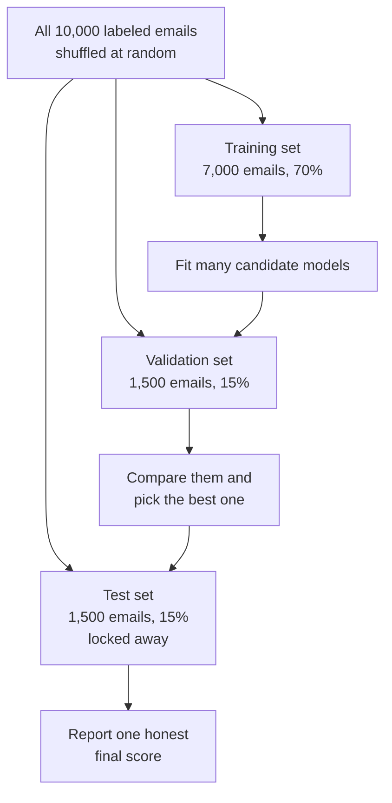
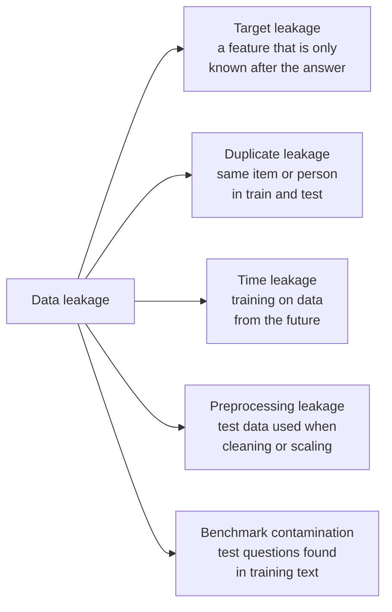
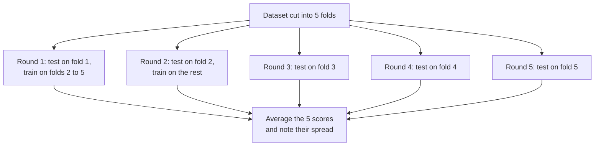
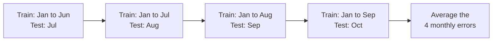

# Chapter 9: Is the Model Any Good? Evaluation, Overfitting and Metrics

*This chapter gives you the tools to tell a genuinely good model from one that only looks good, and to see through impressive-sounding numbers, including the ones in AI headlines.*

## What you'll learn

- Why a model's score on its own training data is nearly meaningless, and how splitting data into training, validation and test sets fixes that.
- How models cheat by accident through data leakage, with real cautionary tales from medicine and research.
- What overfitting and underfitting look like, with a worked example where a fancier model does ten times worse on new data.
- The bias–variance tradeoff, explained with a dartboard, plus a first look at the surprising "double descent" of huge models.
- How regularization and cross-validation keep you honest.
- How to build a confusion matrix and compute accuracy, precision, recall, specificity and F1 by hand, using a medical test and a real cancer dataset.
- How thresholds, ROC curves and AUC work, and how to measure models that predict numbers.
- Why you should always beat a dumb baseline, how to tune settings without cheating, and why benchmarks stop working once everyone aims at them (Goodhart's law).

## Before you start

You need Chapter 8 (Learning From Examples), which introduced models, parameters, hyperparameters, training versus inference, generalization, loss functions and thresholds. Chapter 6 (The Math of AI, Part 2) helps with probability, base rates and Bayes' rule, which explain why a positive medical test can still mean you are probably healthy. Chapter 5 introduced graphs and curves. As always, every number here is worked out step by step, and you can redo all of it in a spreadsheet.

## Why "how good is it?" is a hard question

In Chapter 8 you fit a line to ten students and got a mean squared error of 1.0. Was that a good model? You cannot tell from that number alone. A model that simply memorized all ten students would score a perfect 0.0 and be useless for the eleventh.

The same trap shows up in AI headlines every week. A fraud detector is "99.9% accurate." A new chatbot "beats every rival on the leading benchmark." A medical AI "matches expert doctors." Each claim might be true and important, or true and meaningless, or quietly false. This chapter teaches you to tell which.

Evaluation answers three questions:

1. **Does it generalize?** Does the model work on examples it has never seen?
2. **Which mistakes does it make?** Not just how many, but which kind, and what they cost.
3. **Is it actually better than the alternative?** Better than a simple rule, an older model or a human?

> **Definition — Evaluation:** Measuring how well a model performs, in a way that predicts how it will behave on real, new data. Good evaluation is honest about which mistakes the model makes and how sure we can be of the score.

> **Key idea:** A model is only as good as its performance on data it did not learn from. Everything in this chapter is a way of measuring that honestly.

## Splitting the data: train, validation and test

The single most important habit in machine learning is simple: before you train anything, set some data aside and do not let the model see it.

> **Definition — Training set:** The portion of the data the model learns from. Its parameters are adjusted to fit these examples.

> **Definition — Validation set:** Held-out data used during development to compare models and tune hyperparameters. The model never trains on it, but your choices are shaped by it.

> **Definition — Test set:** Data locked away until the very end and used once, to give an honest final score. If you peek at it while making decisions, it stops being a test.

Here is a typical split. You have 10,000 emails labeled spam or not spam. Shuffle them at random, then cut:

- 70% for training: 7,000 emails.
- 15% for validation: 1,500 emails.
- 15% for testing: 1,500 emails.



*Figure 9.1: The three-way split. Train on the training set, make choices with the validation set, and open the test set only once at the end.*

Why three sets instead of two? Because choosing is a form of learning. Suppose you train 50 different models and pick the one with the best score on some held-out set. Part of that winning score is skill, and part is luck: the winner happened to suit those particular 1,500 emails. If you then report that same score as your final result, you are reporting a lucky number. The validation set absorbs the luck of choosing. The test set, untouched by any decision, tells you the truth.

> **Analogy:** The validation set is the practice quizzes; the test set is the sealed final exam. Take as many practice quizzes as you like and adjust your studying. Open the final once.

### Keeping the mix fair

Suppose only 2% of the emails are spam: 200 out of 10,000. If you cut the data purely at random, one set might get 160 spam emails and another only 15, just by chance. To avoid this, split each class separately: 140 spam for training, 30 for validation and 30 for test, and the same proportions for the 9,800 normal emails.

> **Definition — Stratified sampling:** Splitting data so that each part keeps the same mix of classes as the whole, for example 2% spam in the training, validation and test sets alike.

### How sure is the score?

A test set is a sample, and samples are noisy. If a spam filter gets 90% of 1,500 test emails right, its true accuracy on all future emails is probably close to 90%, but not exactly. A standard statistics rule of thumb (Chapter 6 covers the background) gives the margin of error for an accuracy as about `1.96 × square root of (accuracy × (1 − accuracy) ÷ number of test examples)`.

Worked out for 1,500 emails at 90%: `0.9 × 0.1 = 0.09`; divided by 1,500 is 0.00006; the square root is about 0.0077; times 1.96 is about 0.015. So the honest statement is "90%, give or take about 1.5 percentage points." With only 100 test emails the same calculation gives about plus or minus 6 points.

> **Definition — Margin of error:** The range within which the true value probably lies, given the noise of measuring on a limited sample. A score of 90% plus or minus 1.5 points means the true accuracy is very likely between 88.5% and 91.5%.

This matters more than people think. If model A scores 91.0% and model B scores 91.8% on the same 1,500 test emails, the difference is smaller than the noise. You have not shown that B is better. Many "state of the art" claims in research papers and product launches are differences of this size.

> **Watch out:** A small test set makes every number wobbly. Before you get excited about a score, ask how many examples it was measured on. A chatbot "winning" 7 out of 10 comparisons tells you almost nothing; 700 out of 1,000 tells you a lot.

## Data leakage: how models cheat by accident

The most common way to fool yourself in machine learning is not a math error. It is leakage: information sneaks into the model's inputs that would not be available when the model is actually used, or test data quietly ends up in training.

> **Definition — Data leakage:** When information that would not be available at prediction time, or information from the test set, sneaks into training, producing scores that look excellent and mean nothing.

> **Analogy:** Data leakage is the answer key slipping under the exam paper. The student scores 100%, and the score tells you nothing about what the student knows.

Leaks come in a few recognizable shapes.



*Figure 9.2: Five common kinds of leakage. Each one makes a model look better in testing than it will be in real use.*

**Target leakage.** Imagine predicting whether a hospital patient has a certain infection, and one of your columns is "antibiotic prescribed." The model will learn that this column predicts infection extremely well, because doctors prescribe the antibiotic after they diagnose the infection. In real use, you want the prediction before the diagnosis, when that column is empty. The same thing happens with a loan dataset that includes "collections agency contacted": a perfect predictor of default, recorded only after the default happened.

> **Definition — Target leakage:** A kind of leakage where a feature is a consequence of the answer, recorded after the fact, such as "treatment given" when predicting a disease.

**Duplicate leakage.** If the same item appears in both training and test data, the test partly measures memory. Researchers found that the popular CIFAR image benchmarks contained near-duplicates of some test images in their training sets. In medicine, a subtler version happens when several scans of the same patient are split across training and test. The model can learn to recognize that patient instead of the disease. The fix is to split by patient, not by scan.

**Time leakage.** When predicting the future, you must train only on the past. A model that predicts next month's sales using a feature computed over the whole year, including next month, looks brilliant in testing and fails on day one.

**Preprocessing leakage.** Even calculating an average over all the data, test set included, before splitting can leak a little information. The rule is: split first, then do everything else using only the training data.

> **Definition — Benchmark contamination:** When the questions and answers of a public test end up in a model's training data, for example because they were posted online and scraped. Scores then partly measure memory rather than ability.

Benchmark contamination is leakage at the scale of a whole field. Chatbots are trained on huge scrapes of the internet, and popular test questions get discussed, copied and posted online. Labs try to remove them from training data, a step called decontamination (see Chapter 19), but it is hard to be sure every copy was caught.

### Shortcut learning: the right answer for the wrong reason

A close cousin of leakage is a model that finds an easy clue that happens to work in the data but has nothing to do with the real task.

> **Definition — Shortcut learning:** When a model succeeds by exploiting an accidental clue in the training data, such as the background of a photo or a marker on an X-ray, instead of the thing it was supposed to learn.

Some of the best-known cases:

- **Wolves and snow.** In a 2016 paper on explaining model decisions ("Why Should I Trust You?"), researchers deliberately trained a classifier on photos where every wolf stood on snow and every husky did not. The model learned "snow means wolf." Their explanation tool exposed the trick. It was a planted experiment, but the lesson stuck because real systems do the same thing without anyone planting it.
- **Which hospital took the X-ray.** A 2018 study of a pneumonia detector trained on chest X-rays found that the model could tell which hospital an image came from, and that its performance dropped on images from other hospitals. Hospitals differ in their patients and their equipment, so "which hospital" was a useful clue in the training data and useless in the real world. A 2021 study of COVID-19 X-ray models found similar shortcuts, including text markers in the corner of images.
- **Rulers and skin cancer.** Dermatology researchers reported that an image classifier for skin lesions seemed more likely to call a lesion malignant when a ruler appeared in the photo. Doctors tend to measure the spots that worry them, so the ruler was a hint about what the doctor thought.

> **Watch out:** If a result looks too good to be true, look for a leak before you celebrate. A survey by Princeton researchers Sayash Kapoor and Arvind Narayanan (2023) found leakage problems in hundreds of published papers that used machine learning, across more than a dozen scientific fields.

> **Try it:** Ask your chatbot: "Create a 15-row table for predicting whether a customer will cancel their phone contract. Secretly include one column that leaks the answer. Don't tell me which." Then find the leak yourself and ask the chatbot to confirm. Typical leaks are columns like "final bill date" or "retention offer made."

## Overfitting and underfitting

Leakage is cheating from outside. Overfitting is a model fooling itself from inside, by learning the noise in its training data as if it were a real pattern.

> **Definition — Overfitting:** When a model learns the quirks and random noise of its training data so closely that it does worse on new data. Its training score is excellent and its test score is disappointing.

> **Definition — Underfitting:** When a model is too simple to capture the real pattern, so it does poorly even on its training data.

> **Definition — Noise:** The random, unpredictable part of data: measurement errors, one-off events and everything the features cannot explain. A good model ignores noise; an overfit one memorizes it.

### A worked example: iced drinks and temperature

A café records the outdoor temperature and how many iced drinks it sold on 12 days. Sales rise with temperature, and they rise faster on hot days.

| Temperature (°C) | 10 | 12 | 14 | 16 | 18 | 20 | 22 | 24 | 26 | 28 | 30 | 32 |
|---|---|---|---|---|---|---|---|---|---|---|---|---|
| Iced drinks sold | 22 | 20 | **27** | 29 | 36 | **38** | 47 | 49 | **60** | 63 | 75 | **80** |
| Used for | train | train | test | train | train | test | train | train | test | train | train | test |

*Table 9.1: Twelve days of café data. The four bold days (14, 20, 26 and 32 °C) are held out as a test set; the model trains on the other eight.*

We fit curves of increasing flexibility to the eight training days. A "degree 1" curve is a straight line, as in Chapter 8. "Degree 2" can bend once, like a gentle bowl. Higher degrees can wiggle more and more. A curve of degree 7 has 8 knobs, exactly as many as there are training days, so it can pass through every single one.

> **Definition — Polynomial:** A formula built from powers of the input, such as `a + b × x + c × x²`. Its degree is the highest power used. Higher-degree polynomials can draw more wiggly curves.

> **Definition — Model complexity:** How flexible a model is: how many different patterns it is able to fit. More parameters, deeper trees or higher-degree curves mean more complexity. Also called capacity.

Here are the mean squared errors (Chapter 8) on the training days and on the four held-out test days.

| Model | Knobs | Training MSE | Test MSE | Prediction at 32 °C (truth: 80) |
|---|---|---|---|---|
| Degree 0: always predict the average | 1 | 336.23 | 491.08 | 42.6 |
| Degree 1: straight line | 2 | 12.67 | 13.60 | 74.5 |
| Degree 2: gentle curve | 3 | 3.98 | **2.79** | 82.0 |
| Degree 3 | 4 | 3.97 | 3.41 | 82.4 |
| Degree 5 | 6 | 0.33 | 71.47 | 95.3 |
| Degree 7: passes through every training day | 8 | 0.00 | 206.51 | 52.8 |

*Table 9.2: Training error always falls as the model gets more flexible. Test error falls, bottoms out at degree 2, then shoots up. The degree-7 model is perfect on the training days and about 74 times worse than degree 2 on new days.*

Read the table from top to bottom. Predicting the average for every day underfits badly. The straight line is decent but misses the way sales accelerate on hot days, so it underfits a little. The gentle curve captures the real shape and does best on the test days. After that, extra flexibility only helps the model memorize the training days. The degree-7 curve hits all eight training days exactly, then predicts that a 32 °C scorcher will sell fewer drinks than a 26 °C day. On the training data it looks perfect. On the one question that matters, it is badly wrong.

```
|                       |                       |
|                       |                    .  |
|                    o  |                   .o  |                    o
|                  *..  |                 .*    |                 .*.
|                ...    |                ..     |                 . .
|               o*      |               o*      |               o*   .
|             ..        |             ...       |               .    .
|           *.*         |           *.*         |           *.*.
|         ..            |          ..           |         ...
|       *.o             |       *.o.            |       *.o
|     ..                |     ...               |      ..
|   .o*                 |   .o*                 |    o*
|*.*.                   |*.*                    |*.*..
|.                      |                       |
+---------------------  +---------------------  +---------------------
  degree 1: underfit      degree 2: good fit      degree 7: overfit
```

*Figure 9.3: The café data drawn three ways. Stars are training days, o marks the held-out test days, and dots are the model's curve. The straight line runs below the hot days; the gentle curve follows the data; the degree-7 curve passes through every star and then droops at the hot end, far below the 32 °C test day in the top-right corner.*

The pattern is general, and it gives you a diagnostic:

| Training error | Validation error | Diagnosis | What to try |
|---|---|---|---|
| High | High | Underfitting | A more flexible model, better features |
| Low | Much higher | Overfitting | A simpler model, regularization, more data |
| Low | Low, close to training | Good fit | Check on the test set, then ship |

*Table 9.3: Reading the two error numbers together tells you which direction to move.*

```
 error
   |
   |\                                            /
   | \                                         /   validation
   |  \                                      /     error
   |   \                                  _/
   |    `.                             _-'
   |      `-._                    _.-'
   |          `--..__________..--'
   |  \                 ^
   |   `.          sweet spot:
   |     `-._      stop here
   |         `--..__
   |                `---..___________________   training error
   +-------------------------------------------------- complexity
      underfitting        |        overfitting
```

*Figure 9.4: The classic picture. As complexity grows, training error keeps falling, but validation error falls and then rises. The best model sits at the bottom of the validation curve.*

> **Analogy:** Underfitting is a weather forecaster who always predicts "mild": too simple to ever be badly wrong or usefully right. Overfitting is a student who memorized last year's exam word for word, then meets new questions.

The same curve appears when you train for longer instead of making the model bigger. Early in training, both errors fall. Train too long on a small dataset and the model starts memorizing, so the validation error turns upward while the training error keeps dropping. That observation leads directly to one of the simplest fixes, early stopping, below.

## Bias and variance: the dartboard

Statisticians describe the two failure modes with two words.

> **Definition — Bias (statistical):** Systematic error from a model that is too simple or makes wrong assumptions, so it misses in the same direction again and again, like the straight line that always underestimates the hot days.

> **Definition — Variance (statistical):** How much a model's predictions would change if it were trained on a different sample of data. High variance means the model is jumpy and sensitive to the particular examples it saw, which is the signature of overfitting.

Picture throwing darts. Bias is how far the center of your cluster is from the bullseye. Variance is how spread out your darts are.

```
               LOW VARIANCE              HIGH VARIANCE
            +---------------+          +---------------+
            |               |          |  x         x  |
   LOW      |      xxx      |          |       x       |
   BIAS     |      xox      |          | x     o    x  |
            |      xxx      |          |          x    |
            |               |          |    x          |
            +---------------+          +---------------+
            +---------------+          +---------------+
            |  xxx          |          | x      x      |
   HIGH     |  xxx          |          |    x          |
   BIAS     |   x   o       |          | x     o       |
            |               |          |  x            |
            |               |          |       x       |
            +---------------+          +---------------+
```

*Figure 9.5: The bias–variance dartboard. The o is the bullseye (the truth); each x is one model trained on a different sample of data. Top left is the goal. Bottom left is a too-simple model, consistently wrong. Top right is an overfit model, right on average but wildly scattered.*

In the café example, the straight line has high bias: train it on any eight days you like and it will still underestimate hot days. The degree-7 curve has high variance: swap out one or two training days and its predictions at 32 °C would jump around wildly, because it bends itself to fit whatever eight points it is given.

> **Definition — Bias–variance tradeoff:** The classic tension in model building. Making a model more flexible lowers its bias but raises its variance; the best model balances the two for the amount of data you have.

The amount of data matters a lot. With 8 training days, a degree-7 curve is hopeless. With 8,000 days covering every kind of weather, a flexible model has enough evidence to tell real patterns from noise. This is one reason "more data" is the most reliable fix for overfitting, and one reason AI labs collect so much of it.

> **Watch out:** "Bias" now has three different meanings in this book. In Chapter 8 it was a parameter (the intercept of a line). Here it is statistical bias: systematic error. In Chapter 11 and Chapter 58 it is social bias: unfair treatment of groups of people. Always check which one a writer means.

### A twist: double descent

For decades the U-shaped curve of Figure 9.4 was the whole story. Then deep learning broke it. Modern neural networks often have far more parameters than training examples, enough to memorize the training set completely, and yet they generalize well.

In 2019, researchers led by Mikhail Belkin described "double descent," and a team from OpenAI and Harvard (Nakkiran and colleagues) showed it across many deep learning setups. As model size grows, test error first follows the classic U: down, then up as the model becomes just big enough to memorize the training data. But keep growing the model far past that point and test error comes down again, often lower than before.

> **Definition — Double descent:** The surprising finding that test error can fall, rise and then fall again as models grow far beyond the size needed to fit the training data exactly. It shows that the classic bias–variance picture is incomplete for very large models.

Why this happens is still debated. One popular intuition is that among all the ways a huge model could fit the training data, training tends to find smooth, simple ones. Chapter 13 returns to this. For now, the lesson is that "bigger means more overfitting" is not a safe rule for neural networks, while "always measure on held-out data" remains completely safe.

> **At the frontier (2026):** Frontier language models are trained on tens of trillions of tokens, mostly seeing each document only about once, so classic overfitting to the training set is rarely their main problem. Instead the evaluation worries have moved: memorizing rare passages word for word (a privacy and copyright issue, see Chapter 11), benchmark contamination, and models learning to please graders rather than to be right (see Chapter 20). The habits in this chapter, held-out data, honest baselines and suspicion of too-good scores, are exactly what labs apply to those newer problems.

## Regularization: keeping models simple on purpose

If overfitting comes from too much flexibility, one fix is to make flexibility cost something.

> **Definition — Regularization:** Any technique that discourages unnecessary complexity in order to reduce overfitting, such as penalizing large weights, limiting tree depth, stopping training early or adding noise during training.

The most common version adds a penalty to the loss for large weights. Training then has to balance two goals: fit the data, and keep the weights small.

> **Definition — L1 and L2 regularization:** Adding a penalty for large weights to the loss. L2 (also called ridge) adds the sum of squared weights and shrinks all weights toward zero; L1 (also called lasso) adds the sum of absolute weights and tends to push unhelpful weights to exactly zero, which removes those features.

A worked example. Two models each have a training MSE of 4.0. Model A has weights 2 and −1. Model B has weights 40 and −38: two huge numbers that nearly cancel, a typical sign of a model contorting itself to fit noise. With an L2 penalty strength of 0.1:

- Model A's penalty is `0.1 × (2² + (−1)²) = 0.1 × 5 = 0.5`, so its total loss is 4.0 + 0.5 = **4.5**.
- Model B's penalty is `0.1 × (40² + (−38)²) = 0.1 × (1,600 + 1,444) = 304.4`, so its total loss is **308.4**.

Gradient descent will strongly prefer Model A. The penalty strength (0.1 here) is a hyperparameter: too small and it does nothing, too large and it squashes the model into underfitting.

> **Analogy:** Regularization is a word limit on an essay. It forces you to keep only what matters instead of padding with every passing thought. It is Occam's razor, the old principle that simpler explanations are usually better, enforced by math.

Other common forms:

> **Definition — Early stopping:** Halting training when the validation error stops improving, even though the training error could still go down. It catches the moment in Figure 9.4 just before memorization sets in.

> **Definition — Dropout:** A regularization trick for neural networks that randomly switches off a fraction of the network's units during each training step, so no single unit can become a crutch. Chapter 13 covers it.

> **Definition — Data augmentation:** Creating extra training examples by changing existing ones in ways that should not change the answer, such as flipping, cropping or brightening a photo, or paraphrasing a sentence.

Early stopping is easy to picture with numbers. Here is an illustrative validation loss after each epoch of training:

| Epoch | 1 | 2 | 3 | 4 | 5 | 6 | 7 | 8 | 9 | 10 |
|---|---|---|---|---|---|---|---|---|---|---|
| Validation loss | 0.90 | 0.62 | 0.48 | 0.41 | 0.38 | **0.37** | 0.38 | 0.41 | 0.45 | 0.50 |

*Table 9.4: An illustrative early-stopping run. Validation loss bottoms out at epoch 6 and then climbs as the model starts memorizing. Keep the epoch-6 version of the model.*

In practice people usually wait a few epochs past the best one (in case it was a temporary bump), then roll back to the best saved version.

Data augmentation deserves a special mention, because it directly attacks the shortcut problem. If you randomly brighten and darken your Teachable Machine photos during training, the model can no longer use lighting as a shortcut, and must look at your hand. Real image models are trained with many such variations.

And the most powerful regularizer of all is simply more data. With more varied examples, there is less room for the model to memorize accidents.

## Cross-validation: don't trust one lucky split

A single validation set has a weakness: it is one particular slice of data, and some slices are easier than others. Cross-validation rotates the role of validation set through the whole dataset.

> **Definition — Cross-validation (k-fold):** Cutting the data into k equal parts called folds, then training k times, each time holding out a different fold for validation and training on the rest, and finally averaging the k scores. Five and ten folds are common.



*Figure 9.6: Five-fold cross-validation. Every example is used for validation exactly once and for training four times.*

Here is a real result you can reproduce in Colab later in this chapter. The Wisconsin breast cancer dataset, which ships free with the scikit-learn library, contains 569 tumors described by 30 measurements taken from images of cell samples, each labeled malignant (212) or benign (357). Five-fold cross-validation of a logistic regression model gives these accuracies, each measured on about 114 tumors the model did not train on:

| Fold | 1 | 2 | 3 | 4 | 5 | Average |
|---|---|---|---|---|---|---|
| Accuracy | 98.2% | 98.2% | 97.4% | 97.4% | 99.1% | **98.1%** |

*Table 9.5: Five-fold cross-validation on the breast cancer dataset. The scores range from 97.4% to 99.1%, so any single split could have given a slightly flattering or slightly harsh number.*

Two things come out of this that a single split cannot give you: a more reliable average, and a sense of how much the score moves from one slice of data to another. If two models' averages differ by less than that spread, you should be cautious about calling one better.

> **Analogy:** Cross-validation is rotating which friend is the taste-tester, so one person's quirky palate does not decide the recipe.

Cross-validation should also be stratified when classes are unbalanced, so that every fold has the same share of positive cases.

### Time series: never train on the future

For data that unfolds over time, such as sales, prices or electricity demand, random folds would let the model train on Thursday and be tested on Wednesday. That is time leakage. Instead, walk forward through time.

> **Definition — Walk-forward validation:** Testing a forecasting model by repeatedly training on everything up to a point in time and predicting the next period, then moving the point forward and repeating. Also called backtesting.



*Figure 9.7: Walk-forward validation. Each test month comes strictly after its training data, exactly as it will in real use.*

One practical limit: cross-validation multiplies the cost of training by k. That is fine for a model that trains in seconds. Nobody cross-validates a frontier language model whose single training run costs a fortune; labs rely on carefully held-out evaluation sets instead.
