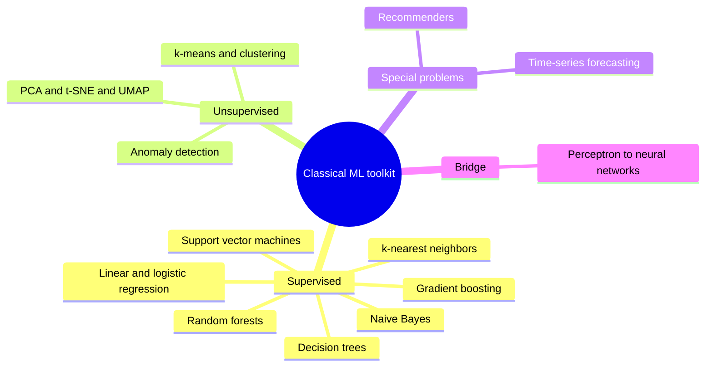
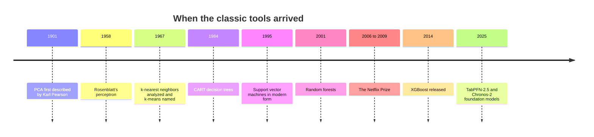
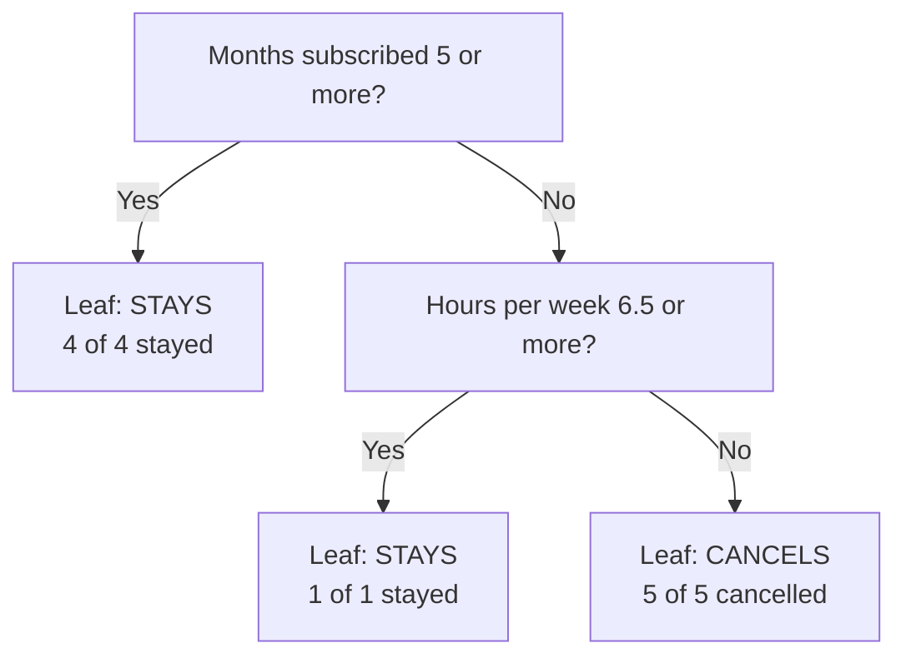
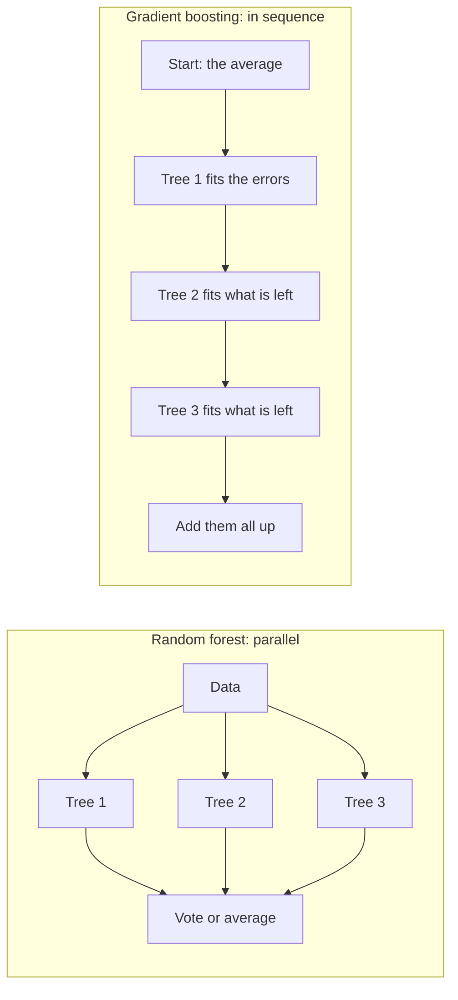
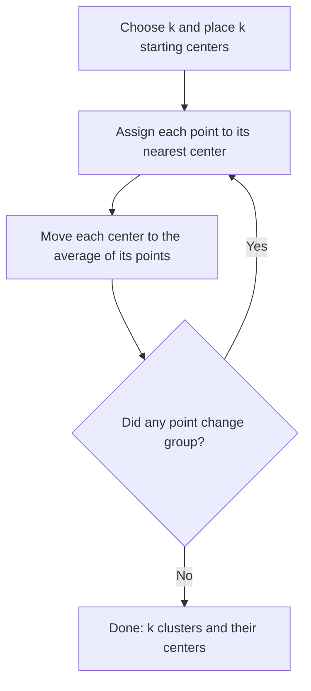
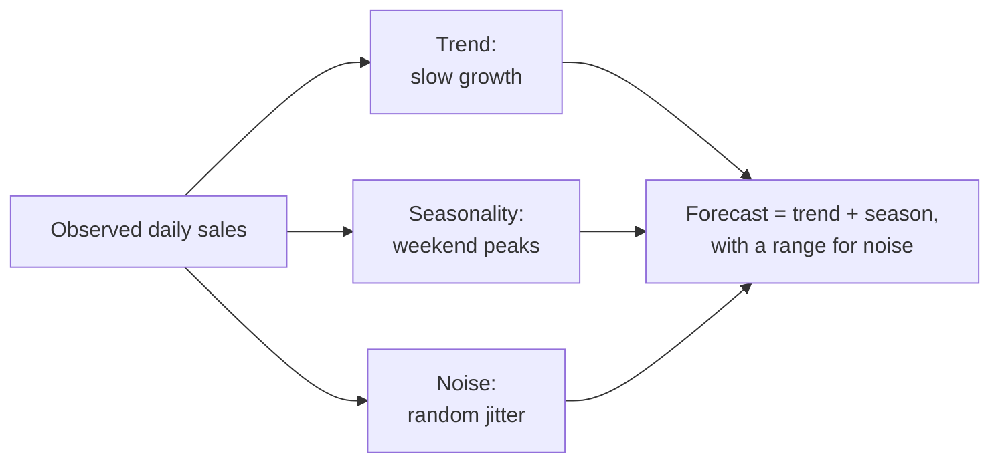
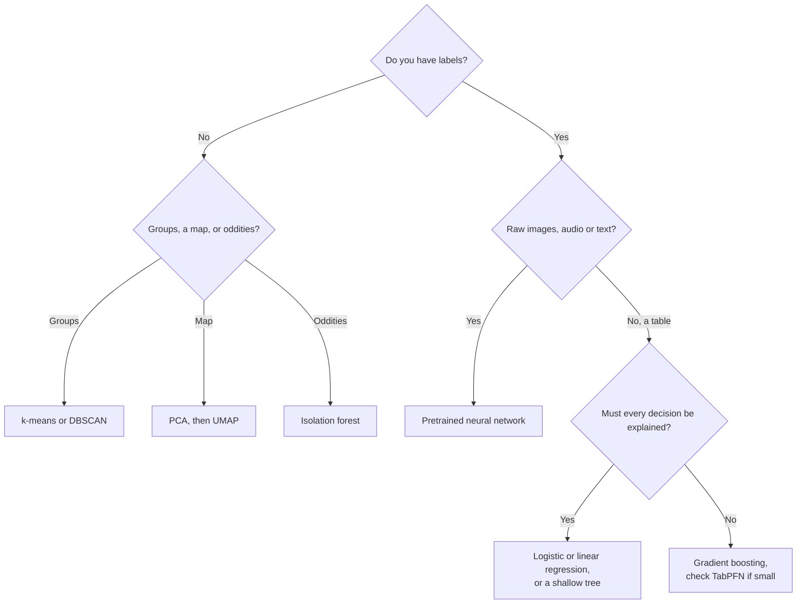
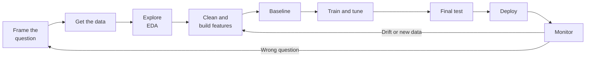
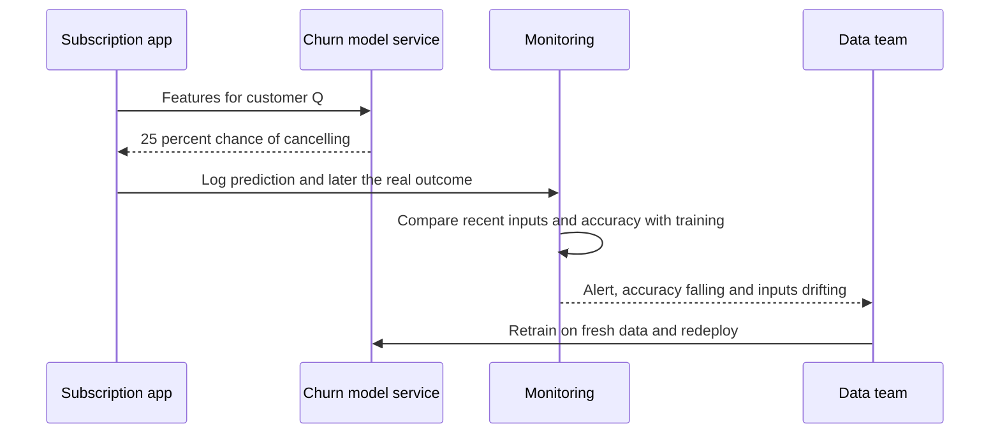

# Chapter 10: The Classical Machine Learning Toolkit

*This chapter hands you the dozen classic algorithms that still make most of the world's everyday predictions, shows how each one "thinks" with small worked examples, and teaches you how to choose, test and run one yourself.*

## What you'll learn

- How the main supervised algorithms work, each with a worked example: k-nearest neighbors, linear and logistic regression, naive Bayes, decision trees, random forests, gradient boosting and SVMs.
- How unsupervised tools find structure without answers: clustering, PCA, t-SNE, UMAP and anomaly detection.
- The basics of recommendations (and the story of the Netflix Prize) and of time-series forecasting.
- Why boosted trees still rule spreadsheet-style data, and how 2025–26 "foundation models" for tables and time series are challenging them.
- How the humble perceptron connects all of this to the neural network behind your chatbot.
- How to pick an algorithm, run a project from question to monitoring, and use the standard free tools.
- Where classical machine learning fits in a world of large language models.

## Before you start

Chapter 8 (Learning From Examples) explained models, parameters, features, labels, training and inference. Chapter 9 (Is the Model Any Good?) explained train/test splits, overfitting, cross-validation and metrics such as precision and recall. Chapters 5 and 6 supply the math: distances, dot products, probability, Bayes' rule, the sigmoid curve and gradient descent. Chapter 3 introduced Python and Google Colab, used in the exercises.

## Why a toolkit, and why it still matters

Every time you press Enter in ChatGPT, Claude or Gemini, a giant neural network does the work, so it is natural to assume all AI is now neural networks. It is not. When your bank texts "Was this you?" about a payment, or a supermarket decides how much milk to order for Tuesday, the model is very often one of the "classical" algorithms in this chapter: older, smaller, cheaper, and on the right problem still the best tool.

> **Definition — Classical machine learning:** The family of machine-learning methods developed mostly before the deep-learning boom of the 2010s, such as regression, decision trees and clustering. They usually have from a handful to a few million parameters and run comfortably on an ordinary laptop.

Each algorithm carries a different idea about what patterns look like. One assumes "things that are close together behave alike." Another assumes "the answer is a weighted sum of the inputs." Another assumes "the answer can be found with a short series of yes/no questions." Choosing an algorithm is mostly choosing which assumption fits your problem.

> **Definition — Inductive bias:** The built-in assumption an algorithm makes about what kind of pattern it is looking for, such as "nearby examples share a label" or "the answer is a straight-line combination of the inputs." No algorithm can learn anything without one.

> **Definition — Tabular data:** Data arranged like a spreadsheet: each row is one example (a customer, a loan, a day) and each column is one feature. Most business data is tabular.

> **Analogy:** A hammer, a saw and a screwdriver are all tools for wood, but you would not drive a screw with a hammer. Each algorithm in this chapter is excellent at one shape of problem and clumsy at others, and a good practitioner knows which to reach for first.



*Figure 10.1: The classical toolkit at a glance. Supervised tools learn from labeled answers; unsupervised tools find structure without them.*



*Figure 10.2: A rough timeline of the toolkit. Many of these ideas are decades old and still in daily use.*

## A running example: will this subscriber cancel?

Imagine you work at a company selling a monthly chatbot subscription, much like a paid ChatGPT, Claude or Gemini plan. If you could predict who is about to cancel, you could offer help or a discount first. This is churn prediction, one of the most common machine-learning jobs in business.

> **Definition — Churn:** Customers leaving a service, for example by cancelling a subscription. "Churn prediction" means estimating which customers are likely to leave soon.

Here is a tiny training set with two features and one label. Real projects have thousands of rows, but ten let us do every calculation by hand.

| Customer | Hours of use per week | Months subscribed | Cancelled? |
|---|---|---|---|
| A | 1 | 2 | Yes |
| B | 2 | 1 | Yes |
| C | 2 | 4 | Yes |
| D | 3 | 2 | Yes |
| E | 8 | 3 | No |
| F | 6 | 9 | No |
| G | 9 | 10 | No |
| H | 7 | 6 | No |
| I | 2 | 11 | No |
| J | 5 | 2 | Yes |

A new subscriber, Q, uses the product 6 hours a week and has been subscribed for 4 months. Will Q cancel? We will ask several algorithms.

```
months
 12 |
 11 |       oI
 10 |                                   oG
  9 |                       oF
  8 |
  7 |
  6 |                           oH
  5 |
  4 |       xC              ?Q
  3 |                               oE
  2 |   xA      xD      xJ
  1 |       xB
  0 +---+---+---+---+---+---+---+---+---+---+
    0   1   2   3   4   5   6   7   8   9   10  hours/week
```

*Figure 10.3: The ten subscribers. x = cancelled, o = stayed, ? = the new customer Q.*

## k-nearest neighbors: you are like your neighbors

The simplest learning algorithm needs no training at all. To predict for a new example, it finds the k most similar examples it has already seen and lets them vote.

> **Definition — k-nearest neighbors (kNN):** An algorithm that predicts by finding the k most similar labeled examples and taking a vote (for categories) or an average (for numbers). k is a number the user chooses, such as 3 or 5.

> **Definition — Euclidean distance:** The straight-line distance between two points: subtract each pair of coordinates, square the differences, add them up and take the square root. It is what a ruler would measure on a graph.

Q is at (6 hours, 4 months) and E is at (8, 3). The differences are 2 and −1; squared, 4 and 1; added, 5; square root, about 2.24. Doing the same for everyone and sorting:

| Customer | Calculation | Distance | Cancelled? |
|---|---|---|---|
| E | (8−6)² + (3−4)² = 4 + 1 = 5 | 2.24 | No |
| H | (7−6)² + (6−4)² = 1 + 4 = 5 | 2.24 | No |
| J | (5−6)² + (2−4)² = 1 + 4 = 5 | 2.24 | Yes |
| D | (3−6)² + (2−4)² = 9 + 4 = 13 | 3.61 | Yes |
| C | (2−6)² + (4−4)² = 16 + 0 = 16 | 4.00 | Yes |

With k = 3, the neighbors are E, H and J: two stayed, one cancelled, so Q stays. With k = 5, D and C join, both cancelled, and the vote becomes three to two: Q cancels.

Same data, opposite answers, because k is a hyperparameter you choose (Chapter 8). Small k is jumpy: one odd neighbor can flip the answer (high variance, in Chapter 9's language). Large k is sluggish: with k = 10, every new customer gets the same 5-to-5 tie (high bias). In practice you pick k by cross-validation.

> **Key idea:** Q is a borderline customer, so reasonable settings disagree. That disagreement is itself useful: it tells you the model is unsure and a human might want to look.

kNN has two traps. First, units: if tenure were measured in days, a 30-day gap would swamp a 3-hour gap and usage would barely count.

> **Definition — Feature scaling:** Rescaling numeric features so they have comparable ranges, for example so each has an average of 0 and a typical spread of 1. Without it, features measured in big units dominate distance-based algorithms.

Second, dimensions: with 500 features, almost every point is about the same distance from every other, so "nearest" loses meaning (the "curse of dimensionality"). kNN is also slow at prediction time, since it compares each question with every stored example unless clever indexes find approximate neighbors quickly, as vector databases do (Chapter 27).

> **Analogy:** Real-estate agents price a house from "comps," the sale prices of the five most similar houses nearby. That is kNN for regression: average the neighbors instead of voting.

> **Watch out:** kNN looks too simple to matter, but its core idea, that similarity is distance between lists of numbers, is the idea behind embeddings and semantic search (Chapters 14 and 27). When Claude searches your uploaded files for the passage closest in meaning to your question, it is doing a nearest-neighbor lookup.

## Linear and logistic regression, revisited

Chapter 8 built these two step by step. Here they are as tools, the workhorses of medicine, economics and finance.

> **Definition — Linear regression:** A method that predicts a number as a weighted sum of the inputs plus a constant, for example price = 150 × square metres + 20,000. Training finds the weights that make the squared errors smallest.

> **Definition — Logistic regression:** Despite its name, a classification method. It computes a weighted sum of the inputs (a score) and squashes it into a probability between 0 and 1 with the S-shaped sigmoid curve.

Suppose logistic regression, trained on our ten subscribers, settles on:

`score = 4.5 − 0.6 × hours − 0.5 × months`

and turns the score into a probability with `1 ÷ (1 + e^(−score))`, where e is about 2.718 (Chapter 6).

For Q: score = 4.5 − 3.6 − 2.0 = −1.1. Since e^1.1 is about 3.00, the probability is 1 ÷ 4.00 = 0.25. A 25 percent chance of cancelling, so with the usual 0.5 threshold, Q stays. For customer A (1 hour, 2 months): score = 2.9, and the probability is 1 ÷ (1 + 0.055) = 0.95. These weights put all ten customers on the correct side of 0.5.

The real attraction is that you can read the weights. Each extra weekly hour lowers the score by 0.6, which multiplies the odds of cancelling (the chance it happens divided by the chance it does not) by e^−0.6, about 0.55: every extra hour of use roughly halves the odds.

> **Definition — Interpretability:** How easily a person can understand why a model made a particular prediction. A regression with five readable weights is highly interpretable; a forest of 500 trees much less so.

The decision boundary is where the score is zero, which rearranges to months = 9 − 1.2 × hours: a straight line on Figure 10.3 from 9 months at zero hours down to zero months at 7.5 hours. Everyone below it is predicted to cancel. That straightness is the strength and the weakness. These models are fast, stable, hard to overfit with a little regularization (Chapter 9), and usually give well-calibrated probabilities. But if the true pattern curves, or depends on combinations ("light users cancel only if they are also new"), a straight line misses it unless a human adds features such as hours × months.

> **Key idea:** When a bank must explain to a regulator, or a doctor to a patient, why the model said what it said, a regression with a few readable weights is often the right tool even if a more complex model scores slightly higher.

## Naive Bayes: adding up the clues

Naive Bayes is the classic early spam filter. It treats each word as a clue and combines clues with Bayes' rule (Chapter 6): start from the prior (how common spam is overall) and multiply by the likelihood of each clue (how often that word appears in spam compared with normal mail).

> **Definition — Naive Bayes:** A probabilistic classifier that multiplies together the evidence from each feature, assuming (naively) that the features are independent of one another once you know the class.

You have 100 past emails: 30 spam and 70 normal. You count two words:

| Word | Appears in spam | Appears in normal email |
|---|---|---|
| "free" | 15 of 30 (50%) | 7 of 70 (10%) |
| "meeting" | 3 of 30 (10%) | 21 of 70 (30%) |

A new email contains "free." Spam: 0.30 × 0.50 = 0.15. Normal: 0.70 × 0.10 = 0.07. Divide each by their total, 0.22: spam = 0.68, a 68 percent chance.

Another email contains both words. Spam: 0.30 × 0.50 × 0.10 = 0.015. Normal: 0.70 × 0.10 × 0.30 = 0.021. Spam = 0.015 ÷ 0.036 = 0.42. "Meeting" pulled it back toward normal. A real filter does this with thousands of words in a fraction of a millisecond.

The "naive" part is assuming the clues are independent. They are not ("free" and "offer" travel together), but for picking the more likely class the ranking usually survives. One fix is essential: a word never seen in spam would get probability zero and wipe out the whole product, so filters add a small pretend count to every word, a trick called Laplace smoothing.

> **Analogy:** Naive Bayes is a detective adding up clues: "mentions a lottery, more suspicious; sent by a known contact, less suspicious." The detective treats each clue as independent, which is not quite true, but the verdict is usually right.

Naive Bayes is fast, needs little data and remains a strong first baseline for text classification.

## Decision trees: Twenty Questions learned from data

A decision tree is a flowchart of yes/no questions ending in predictions. The clever part is that the algorithm chooses the questions.

> **Definition — Decision tree:** A model shaped like a flowchart of yes/no questions about the features ("Months subscribed 5 or more?"), learned from data, with a prediction stored at each final branch.

> **Definition — Node, leaf and depth:** In a decision tree, a node is a point where a question is asked, a leaf is a final box holding a prediction, and depth is the number of questions from the top to the deepest leaf.

At each step the algorithm tries every feature and many thresholds, and picks the question that splits the examples into the purest groups, as close as possible to all-Yes or all-No.

> **Definition — Gini impurity:** A score from 0 to 0.5 (for two classes) of how mixed a group is: 1 minus the sum of the squared shares of each class. An all-one-class group scores 0; a 50/50 mix scores 0.5.

Our ten subscribers are 5 cancelled and 5 stayed, so Gini = 1 − (0.5² + 0.5²) = 0.5, the most mixed possible. Try two first questions.

**"Hours per week 5 or more?"** Yes side: E, F, G, H, J (four stayed, one cancelled), Gini = 1 − (0.8² + 0.2²) = 0.32. No side: A, B, C, D, I, also 0.32. Weighted average: 0.32.

**"Months subscribed 5 or more?"** Yes side: F, G, H, I, all stayed, Gini = 0. No side: A, B, C, D, E, J (five cancelled, one stayed), Gini = 1 − ((5/6)² + (1/6)²) = 0.28. Weighted: 0.4 × 0 + 0.6 × 0.28 = 0.17.

The months question drops impurity to 0.17, far better than 0.32, so it goes first. On the "under 5 months" side, one more question finishes the job: E uses the product 8 hours a week and stayed, while A, B, C, D and J use it 5 hours or less and cancelled. The algorithm puts the threshold halfway between 5 and 8, at 6.5 hours.



*Figure 10.4: The decision tree learned from the ten subscribers. Each leaf shows how many training customers ended there.*

Follow Q down: months 4, "No"; hours 6, less than 6.5, "No." The tree predicts Q cancels, disagreeing with logistic regression. Q sits near a boundary, and different inductive biases draw it in different places.

Trees are easy to read, mix numbers and categories freely, need no scaling and capture combinations naturally. Their weakness is overfitting: allowed to keep asking questions, a tree builds one leaf per training example and memorizes noise. Hyperparameters such as maximum depth and minimum examples per leaf keep it honest. Trees are also unstable: change a few rows and the top question can change.

> **Analogy:** A decision tree plays Twenty Questions. A good player asks the question that splits the remaining possibilities most evenly. A tree that asks forty questions about ten people has stopped playing and started memorizing.

## Random forests: a crowd of trees

That instability turns out to be useful. If trees make different mistakes, a crowd of them voting can cancel many mistakes out.

> **Definition — Ensemble:** A combination of several models whose predictions are merged, by voting or averaging, so that their individual errors partly cancel out.

The arithmetic of crowds: suppose each of five trees is right 70 percent of the time and, unrealistically, their mistakes are independent. The majority is right when at least three are. Exactly three right: 10 × 0.7³ × 0.3² = 0.309. Exactly four: 5 × 0.7⁴ × 0.3 = 0.360. All five: 0.7⁵ = 0.168. Total: about 0.84. Five 70-percent trees make an 84-percent forest; 101 independent ones would be right more than 99.99 percent of the time.

The catch is "independent": trees trained on the same data make the same mistakes. Leo Breiman's random forest (2001) makes trees deliberately different. Each trains on a bootstrap sample, a random draw of rows with replacement (some rows twice, some not at all), and at each question each tree may consider only a random handful of features.

> **Definition — Bagging:** Short for "bootstrap aggregating": training many models on different random resamples of the rows and averaging or voting their predictions. It mainly reduces variance.

> **Definition — Random forest:** A bagged ensemble of decision trees in which each tree also sees only a random subset of features at each split, which makes the trees more different and their vote more reliable.

Random forests are the safe default of tabular machine learning: they need little tuning, rarely overfit badly as you add trees, and report which features mattered.

> **Definition — Feature importance:** A score for each input feature showing how much it contributed to a model's predictions, for example how much the trees' impurity dropped thanks to splits on that feature.

The price is interpretability: you can read one tree, not 500.

## Gradient boosting: a relay of tutors

Random forests build trees side by side. Boosting builds them one after another, each new tree focused on the mistakes left by those before it.

> **Definition — Boosting:** Building models in sequence, each trained to fix the errors of the combined models so far, then adding them all together.

> **Definition — Residual:** The leftover error for one example: the true value minus the current prediction.

Here is boosting with three houses that sold for $200,000, $300,000 and $400,000.

1. Start with the average, $300,000, for every house. Residuals: −$100,000, $0, +$100,000.
2. Train a small tree to predict those residuals. Suppose it learns them perfectly. Add only half its answer, a safety brake called the learning rate. Predictions: $250,000, $300,000, $350,000. Residuals: −$50,000, $0, +$50,000.
3. Train a second tree on the new residuals and add half again. Predictions: $225,000, $300,000, $375,000.
4. Each round halves the remaining error. After 10 rounds it is $100,000 × 0.5¹⁰, under $100.

Real data is noisy, so too many rounds start fitting noise; practitioners stop when validation error stops falling (early stopping, Chapter 9). "Gradient" appears because predicting the residuals is exactly a gradient-descent step on squared error (Chapter 6).

> **Definition — Gradient boosting:** Boosting in which each new tree is fitted to the gradient of the loss (for squared error, simply the residuals), so the ensemble walks downhill on its errors one small tree at a time.

> **Definition — XGBoost, LightGBM and CatBoost:** The three most popular open-source gradient-boosting libraries. XGBoost was released in 2014; LightGBM comes from Microsoft and CatBoost from Yandex.

For about a decade, gradient-boosted trees have been the default winner on tabular data, in industry and in Kaggle competitions: fraud scoring, credit risk, ad click prediction, insurance pricing, demand planning. Careful 2022 research comparing them with deep neural networks on typical business tables still found the trees ahead in most cases.



*Figure 10.5: Bagging builds independent trees and lets them vote; boosting builds trees in sequence, each correcting the last.*

> **Analogy:** Boosting is a relay of tutors. The first teaches the whole syllabus. The second looks only at the questions the student still gets wrong. The third handles whatever is still wrong after that.

### The 2025–26 twist: foundation models for spreadsheets

Chapter 18 shows how a chatbot learns a task from examples pasted into your prompt, with no retraining. Could a model do the same for tables?

> **Definition — In-context learning:** A model picking up a new task from examples supplied in its input at prediction time, with no change to its parameters, as when you show a chatbot three examples and it follows the pattern.

The best-known answer is TabPFN, from the startup Prior Labs: a neural network pretrained on millions of synthetic, computer-generated tables. You do not train it. You hand it your whole small training table plus the new rows, and it predicts the labels in one pass.

> **Definition — Tabular foundation model:** A model pretrained, often on synthetic tables, to make predictions on new spreadsheet-style datasets with little or no training of its own. TabPFN is the best-known example.

According to its developers, TabPFN-2.5 (November 2025) led the TabArena benchmark ahead of tuned tree ensembles on small-to-medium tables. In May 2026 SAP announced it would acquire Prior Labs, in a deal described as a commitment of more than €1 billion; it was reported closed in July 2026.

> **At the frontier (2026):** Gradient boosting is still the practical default for business tables: cheap, fast, well understood and runnable anywhere. But pretrained "models for spreadsheets" are moving fast, and big enterprise software makers are betting on them. Whether they replace hand-tuned XGBoost for everyday business data is one of 2026's open questions.

## Support vector machines: the widest street

If two classes can be separated by a line at all, many lines do it. A support vector machine picks the one that leaves the widest empty "street" between the classes, because a line hugging one class will misclassify the next example that lands slightly on the wrong side.

> **Definition — Support vector machine (SVM):** A classifier that finds the boundary leaving the widest possible margin between two classes.

> **Definition — Margin and support vectors:** The margin is the width of the empty street between the boundary and the nearest examples of each class. The support vectors are those nearest examples; they alone fix where the boundary goes.

Real data is messy, so SVMs allow some examples inside the street, with a penalty set by a hyperparameter usually called C: large C insists on few mistakes (risking overfitting), small C accepts some in exchange for a wider street.

The famous part is the kernel trick, which lets this straight-line method draw curves. Seven points sit on a number line, red (R) at both ends and blue (B) in the middle. No single cut separates them. Add a second feature, x squared: the reds become 9, 4, 4 and 9, the blues 1, 0 and 1, and a flat cut at 2.5 separates them perfectly. On the original line, that one cut becomes two, at about −1.58 and +1.58.

```
BEFORE: one feature, x. No single cut separates R from B.

        R     R     B     B     B     R     R
      --+-----+-----+-----+-----+-----+-----+---  x
       -3    -2    -1     0     1     2     3

AFTER: add x squared as a second feature. One flat cut works.

 9 |    R                                   R
 4 |          R                       R
2.5| - - - - - - - - - - - - - - - - - - - - -  the cut
 1 |                B           B
 0 |                      B
   +----+-----+-----+-----+-----+-----+-----+---  x
       -3    -2    -1     0     1     2     3
```

*Figure 10.6: The idea behind the kernel trick. Lifting data into an extra dimension can make a curved problem straight.*

> **Definition — Kernel trick:** A mathematical shortcut that lets an SVM behave as if it had added many extra features (even infinitely many) without computing them, so it can draw curved boundaries cheaply.

SVMs dominated the 2000s, in handwriting recognition, text classification and biology, before deep learning took over. They still suit small, high-dimensional data, such as a few hundred patients with thousands of gene measurements, but are slow on very large datasets.

> **Analogy:** An SVM is a town planner drawing the widest possible road between two neighborhoods. The houses right at the roadside are the support vectors; move any other house and the road stays put.

## Clustering: finding groups without answers

So far we had a "Cancelled?" column to learn from. Often you have no labels, just a pile of customers or articles, and want to know whether they fall into natural groups.

> **Definition — Clustering:** Grouping examples so that members of the same group are similar to each other and different from other groups, without being told what the groups should be.

The most famous method is k-means. You choose k, the number of groups. The algorithm places k centers, then repeats two steps until nothing changes: assign every example to its nearest center, then move each center to the average of its examples (the centroid).

> **Definition — k-means:** A clustering algorithm that repeatedly assigns each example to the nearest of k centers and moves each center to the average of its assigned examples, until the groups stop changing.

By hand: six subscribers use the product 1, 2, 3, 10, 11 and 12 hours a week. Ask for k = 2 and start the centers, badly on purpose, at 1 and 4.

1. **Assign.** 1 and 2 go to center 1. 3, 10, 11 and 12 go to center 2.
2. **Move.** Center 1 moves to 1.5. Center 2 moves to 36 ÷ 4 = 9.
3. **Assign.** Hour 3 is now 1.5 from center 1 and 6 from center 2, so it switches. Groups: {1, 2, 3} and {10, 11, 12}.
4. **Move.** Centers go to 2 and 11.
5. **Assign.** Nobody switches. Converged.

You might name the groups "light users" and "heavy users." The algorithm did not name them or know they mattered. You did.



*Figure 10.7: The k-means loop. It always stops, but where it stops depends on where the centers started.*

Bad starts can trap k-means, so software runs it several times and keeps the best. To choose k, the "elbow" trick plots how tight the clusters are for k = 1, 2, 3 and so on and stops where extra clusters stop helping. And k-means assumes round blobs; two other families handle other shapes.

> **Definition — Hierarchical clustering:** Building a tree of nested clusters by repeatedly merging the closest pair of groups, so you can cut the tree at whatever level of detail you like.

> **Definition — DBSCAN:** A density-based clustering method that grows clusters through crowded regions, finds clusters of any shape and labels isolated points as noise.

> **Analogy:** k-means is placing ice-cream trucks in a park. Put three trucks down anywhere, let everyone walk to the nearest one, move each truck to the middle of its crowd, and repeat until no one switches.

> **Watch out:** Clusters are not facts about the world. k-means always returns exactly k groups, even from random noise. Humans decide whether the groups mean anything.

## Shrinking many columns into a few: PCA, t-SNE and UMAP

A dataset can have hundreds of columns, and a chatbot's internal representation of a word has thousands of numbers (Chapter 14). Nobody can picture 500 dimensions.

> **Definition — Dimensionality reduction:** Compressing many features into fewer, for example from 64 columns to 2, while keeping as much of the important information as possible.

Principal component analysis (PCA) looks for the directions along which the data spreads most. People's height and arm span rise together so closely that most variation lies along one diagonal, "overall size." A second direction, "arm span minus height," holds only small differences. Keep the first and drop the second, and two numbers become one with little lost.

> **Definition — Principal component analysis (PCA):** A method that finds new axes, each a weighted mix of the original features, ordered by how much of the data's variation they capture. Keeping only the first few compresses the data.

PCA tells you how much you keep. In the Colab exercise you will squash handwritten-digit images, 64 pixel values each, to just 2 components. Those keep about 28.5 percent of the variation, yet the plot already shows the digits forming recognizable neighborhoods.

> **Analogy:** PCA is finding the best camera angle. Photograph a long, flat sculpture end-on and you see a blob; from the side, its shape is obvious.

PCA only rotates and squashes in straight lines. For pictures of complex data, t-SNE (2008) and UMAP (2018) are more popular: both keep each point's close neighbors close in a 2-D map, producing striking "islands" of similar items.

> **Definition — t-SNE and UMAP:** Methods for squashing high-dimensional data into a 2-D or 3-D map in which similar items end up near each other, used mainly for visualization.

> **Watch out:** In a t-SNE or UMAP map, island sizes and the distances between islands often mean little. Read these maps as who-is-near-whom, not as rulers.

This is the bridge to a central idea of modern AI. The famous "word maps," with "king" near "queen" and "Paris" near "France," are embeddings with hundreds of dimensions squashed to two by these methods.

> **Definition — Embedding:** A list of numbers representing an item (a word, image, product or user) so that similar items get similar lists. Embeddings let computers measure meaning as distance.

## Anomaly detection: spotting the odd one out

Your bank's "this doesn't look like you" message is anomaly detection.

> **Definition — Anomaly detection:** Identifying examples that are unusually different from the rest, such as a fraudulent payment, a failing machine or a network intrusion.

The simplest tool measures distance from normal in units of standard deviation, the typical spread of values around their average (Chapter 6).

> **Definition — Z-score:** How many standard deviations a value is from the average: (value − average) ÷ standard deviation. Values with a z-score beyond about 3 are often flagged as unusual.

Suppose your daily card spending averages $40 with a standard deviation of $15. A $85 day has z = (85 − 40) ÷ 15 = 3: unusual but plausible. A $400 day has z = 24, so the bank texts you. But z-scores look at one number at a time, and "normal" varies by person and season: a $400 day in December may be ordinary.

For many features at once, the isolation forest builds random trees of random cuts. A normal point in a dense crowd needs many cuts before it stands alone; an outlier is cut off quickly. In a crowd of about 1,000 points, halving it with each cut takes around 10 cuts to isolate a typical point (2 multiplied by itself 10 times is 1,024), while a lone outlier may fall away in 2 or 3.

> **Definition — Isolation forest:** An anomaly detector that builds random trees of random cuts and flags points that can be isolated with unusually few cuts.

Anomaly detection lives on Chapter 9's precision–recall trade-off: too eager and customers drown in false alarms, too relaxed and fraud slips through.

## Recommenders and the Netflix Prize

Recommender systems decide what fills your feeds and your streaming home screen. Chapter 51 covers today's giant systems; here are the foundations.

> **Definition — Recommender system:** A system that predicts which items (films, products, posts, songs) a person is likely to want, usually to rank what to show them.

> **Definition — Content-based filtering:** Recommending items whose attributes (genre, author, ingredients) resemble those of items the user already liked.

> **Definition — Collaborative filtering:** Recommending items based on the behavior of similar users ("people like you also liked") or similar items, without needing to know what the items are.

```
            Alien  Die Hard  Titanic  Notebook  Toy Story
  Sam         5       5         1        ?          3
  Priya       5       4         1        1          ?
  Leo         1       ?         5        5          4
  Mei         ?       1         4        5          5
```

*Figure 10.8: A ratings matrix with gaps. Sam and Priya rate almost identically, so Priya's 1 star for Notebook suggests Sam would also dislike it.*

The breakthrough of the 2000s was matrix factorization. Suppose each film has a few hidden traits, such as how much action and romance it contains, and each user has a taste for each trait. A predicted rating is then a dot product (Chapter 5). If Sam's tastes are (action 4, romance 1) and Die Hard's traits are (1.0, 0.1), the prediction is 4 × 1.0 + 1 × 0.1 = 4.1 stars. For The Notebook, (0.1, 0.9), it is 4 × 0.1 + 1 × 0.9 = 1.3 stars. The algorithm learns tastes and traits together from the known ratings, and nobody tells it that "action" exists.

> **Definition — Matrix factorization:** Splitting a big user-by-item ratings table into two smaller tables of hidden "taste" factors, one row per user and one per item, whose dot products fill in the missing ratings.

> **Definition — Cold-start problem:** The difficulty of recommending to a brand-new user, or recommending a brand-new item, when there is no history of behavior to learn from.

Most real signals are also implicit: services rarely get star ratings, but they see what you clicked, finished or skipped.

The most famous episode is the Netflix Prize. From 2006 to 2009 Netflix offered $1 million for a 10 percent improvement in its rating predictions and released about 100 million ratings. Thousands of teams competed, and the prize went in 2009 to the merged team "BellKor's Pragmatic Chaos," whose entry blended many models, an early showcase for ensembles. Two footnotes matter. Netflix later explained it never put the full winning blend into production, because the extra accuracy did not justify the engineering cost as its business shifted to streaming. And researchers showed that the "anonymized" ratings could be partly linked back to real people, which led to a privacy lawsuit and a cancelled second contest (Chapter 11).

> **Key idea:** The Netflix Prize taught three lessons that still hold: ensembles win competitions, a better score on a fixed metric is not automatically a better product, and "anonymous" data is often less anonymous than it looks.

## Forecasting time series

Many business questions concern the future of a number: sales next week, electricity demand tomorrow afternoon.

> **Definition — Time series:** A sequence of measurements recorded in time order, such as daily sales, hourly temperatures or monthly subscribers.

> **Definition — Trend and seasonality:** In a time series, the trend is the long-run upward or downward drift, and seasonality is a pattern that repeats on a fixed cycle, such as busier weekends or a December peak.



*Figure 10.9: Decomposing a time series. Good forecasts model trend and seasonal cycle and treat the rest as uncertainty.*

A coffee shop sold these cups last week, Monday to Sunday: 120, 130, 125, 135, 160, 210, 190. What about next Monday?

| Method | Rule | Forecast for Monday | Error if Monday is 124 |
|---|---|---|---|
| Naive | Same as the last day (Sunday) | 190 | 66 |
| Seasonal naive | Same as last Monday | 120 | 4 |
| 7-day moving average | 1,070 ÷ 7 | 153 | 29 |

The seasonal naive forecast wins because the shop has a strong weekly cycle. Simple baselines like these are surprisingly hard to beat, and any fancier method must prove it does better.

> **Definition — Naive forecast:** The simplest forecast, "the next value equals the last value" (or, in the seasonal version, "equals the value one cycle ago"). It is the baseline every forecasting model must beat.

One step up, exponential smoothing blends the latest actual with the previous forecast. With a weight of 0.3: forecast 100, actual 120, so the next forecast is 0.3 × 120 + 0.7 × 100 = 106. If the next actual is 90, the forecast after that is 0.3 × 90 + 0.7 × 106 = 101.2. Recent values count most; older ones fade.

> **Definition — Exponential smoothing:** A forecasting method in which each new forecast is a weighted blend of the latest actual value and the previous forecast, so recent data counts most and older data fades.

> **Definition — ARIMA:** A classic statistical forecasting model that predicts the next value from recent past values and recent past forecast errors, after removing trend.

Further up sit Prophet, an open-source forecaster from Meta (2017), and gradient-boosted trees fed lag and calendar features such as day of week and holidays, an approach large retailers use heavily.

> **Definition — Lag feature:** A past value of the series used as an input, such as "sales 7 days ago" or "sales on this date last year."

The golden rule is never peek at the future. A random train/test split lets a model learn from Thursday to predict Wednesday. Instead you backtest (Chapter 9's walk-forward validation).

> **Definition — Backtesting:** Testing a forecasting method by repeatedly training only on data up to a past date, forecasting the period after it, and comparing with what actually happened.

> **At the frontier (2026):** Forecasting has its own foundation models, pretrained on huge collections of time series. Amazon's Chronos-2 (October 2025) handles many related series and outside factors together; Google's TimesFM 2.5 is available inside the BigQuery data warehouse; Salesforce's Moirai and others compete on the GIFT-Eval benchmark. Whether they beat a tuned boosted-tree forecaster depends on the data, so backtest both.

> **Definition — Time-series foundation model:** A model pretrained on a large, varied collection of time series that can forecast a new series with little or no task-specific training.

## The perceptron: the bridge to neural networks

In 1958 the psychologist Frank Rosenblatt built the perceptron, a machine that learned to classify simple images. It multiplies each input by a weight, adds a bias, and outputs 1 if the total is above zero, otherwise 0.

> **Definition — Perceptron:** The simplest artificial neuron: a weighted sum of inputs plus a bias, followed by a hard yes/no threshold. It learns by nudging its weights whenever it makes a mistake.

You have seen this before. With our churn weights, Q's weighted sum is 4.5 − 0.6 × 6 − 0.5 × 4 = −1.1. Logistic regression squashes −1.1 smoothly to 0.25; a perceptron just asks "above zero?" and answers 0, "stays." A perceptron is logistic regression with a hard cutoff instead of an S-curve.

A single perceptron can only draw a straight line. In 1969 Marvin Minsky and Seymour Papert showed this rules out even exclusive-or ("true if exactly one input is true"), whose two classes sit on opposite corners of a square where no single line separates them. Their book helped push neural-network research into a long winter (Chapter 7).

The fix echoes the kernel trick. Stack perceptron-like units in layers, and the first layer computes new features ("is exactly one input on?") that make the problem straight for the next. The crucial difference is that a neural network learns those intermediate features from data instead of having a human or a fixed kernel supply them.

> **Definition — Neural network:** A model built from many layers of simple units, each computing a weighted sum followed by a squashing function, so that the layers learn their own intermediate features. Chapter 12 builds one from scratch.

This explains the great division of labor. For raw pixels, sound and text, nobody can hand-design good features, so networks that learn their own win by a mile; that is why your chatbot is a neural network. Business tables already arrive as meaningful features ("months subscribed," "debt to income"), so trees and regressions stay strong, cheap and explainable.

> **Key idea:** A neural network is, at heart, many logistic regressions stacked in layers and trained together so that each layer invents features for the next. Everything in Part III grows from that sentence.

## Choosing an algorithm: a cheat sheet

A famous result nicknamed "no free lunch" says that, averaged over every possible problem, no learner beats another. What matters is fit: what kind of data, how much, whether people must understand the decisions, and how fast predictions must be.

| Your situation | Try first | Also try |
|---|---|---|
| Table, predict a category or a number | Gradient boosting | Random forest, logistic or linear regression, TabPFN for small tables |
| Must explain every decision (credit, medicine) | Logistic or linear regression | A shallow decision tree |
| Images, audio, long text | A pretrained neural network | An LLM or vision model through an API |
| No labels, want groups | k-means | DBSCAN, hierarchical clustering |
| Want to see high-dimensional data | PCA | UMAP, t-SNE |
| Find rare odd cases | Isolation forest | z-scores, autoencoders (Chapter 16) |
| Forecast a series | Seasonal naive baseline | Exponential smoothing, boosting with lags, Chronos or TimesFM |



*Figure 10.10: A first-pass decision guide. Whatever you pick, compare it against a dumb baseline.*

> **Key idea:** Start simple and add complexity only when it pays. A logistic regression you understand, compared honestly against a baseline, beats a giant model you cannot debug.

## The machine-learning project lifecycle

Algorithms are the fun part, but in real projects they are a small slice of the work.



*Figure 10.11: The machine-learning project lifecycle. The loop back from monitoring keeps a model useful.*

Walk our churn project through it. **Frame the question:** if the plan is to offer discounts, the real question may be "who will stay only if offered one?", which is harder; and "cancelled" needs a precise definition. **Get the data:** usage logs, billing, support tickets, using only what will exist at prediction time (Chapter 9's leakage traps). **Explore:** charts may reveal that usage is missing for every mobile-app customer.

> **Definition — Exploratory data analysis (EDA):** Examining data with summaries and charts before modeling, to understand it and spot problems such as missing values, odd distributions and errors.

**Clean and build features** such as "change in usage last month" (Chapter 11). **Baseline:** "nobody cancels." **Train and tune** a few algorithms with cross-validation. **Final test:** open the sealed test set once. **Deploy**, perhaps as a nightly scoring job. **Monitor and retrain** as the world changes.

> **Watch out:** Newcomers think the job is choosing clever algorithms. Practitioners say it is mostly framing the question, getting and cleaning the right data, and explaining results. The often-quoted "80 percent of the time goes on data work" is folklore, not a measured statistic, but most practitioners recognize its spirit.

## The toolbox

You do not write these algorithms from scratch. A standard set of free tools covers almost everything here, most of it in Python inside notebooks such as Google Colab (Chapter 3).

> **Definition — pandas:** The standard Python library for working with tables of data, called DataFrames, much like a spreadsheet you control with code.

> **Definition — scikit-learn:** The standard free Python library for classical machine learning, with nearly every algorithm in this chapter behind the same simple commands.

| Tool | What it is for | Note |
|---|---|---|
| Spreadsheets | Small data, charts, simple regressions | Still valid for many jobs |
| Python with Jupyter or Colab notebooks | Code, results and notes on one page | Colab needs only a browser |
| pandas and NumPy | Loading, cleaning and crunching tables and arrays | pandas 3.0 arrived January 21, 2026, so older tutorials may show warnings |
| scikit-learn | Classical algorithms, splitting, metrics | Version 1.8 (December 2025) added experimental GPU support |
| XGBoost, LightGBM, CatBoost | Gradient boosting | The tabular workhorses |
| SQL | Asking questions of databases | Chapter 11 |
| Kaggle (owned by Google) | Competitions, free datasets, shared notebooks | Over 23 million accounts as of April 2025 |
| Hugging Face | Shared models and datasets | Chapters 11 and 30 |
| No-code and AutoML tools | Teachable Machine, Orange, BigQuery ML | Train models with clicks or SQL; AutoML tries many algorithms for you |

The beauty of scikit-learn is that every algorithm speaks the same verbs:

```python
from sklearn.ensemble import RandomForestClassifier  # pick an algorithm
model = RandomForestClassifier(n_estimators=300)     # set its hyperparameters
model.fit(X_train, y_train)                          # training: turn the knobs
predictions = model.predict(X_test)                  # inference: use the model
print(model.score(X_test, y_test))                   # accuracy on the test set
```

Swap the first two lines for any other algorithm and the rest stays the same, so a beginner can compare five algorithms in an afternoon.

> **Try it:** Paste the five lines above into ChatGPT, Claude or Gemini and ask: "Explain what each line does for a non-programmer." Then ask it to switch to k-nearest neighbors with k = 5 and explain what changed.

## MLOps: keeping a model alive

A model is trained once, but the world keeps moving.

> **Definition — MLOps:** The practices and tools for deploying, monitoring, updating and maintaining machine-learning models in real products, borrowed from "DevOps," software engineering's practices for shipping and running ordinary software reliably.

The biggest threat is drift. Data drift means the inputs change: a marketing campaign brings in younger customers who behave differently. Concept drift means the relationship itself changes: a competitor launches a cheaper product, and customers with the same usage now cancel more often. In 2020, when the pandemic changed how people shopped and spent almost overnight, many forecasting and fraud models trained on earlier years went wrong until they were retrained.

> **Definition — Data drift:** A change over time in the inputs a model sees, so they no longer resemble the training data.

> **Definition — Concept drift:** A change over time in the relationship between inputs and the correct answer, so patterns the model learned no longer hold.



*Figure 10.12: A deployed model in daily life. Monitoring compares live data and outcomes with the training data and triggers retraining.*

Good MLOps also means experiment tracking: recording which data, code and settings produced each model so results can be reproduced and audited, fixing the random seed so "random" splits repeat exactly, and noting library versions so an upgrade does not silently change results.

> **Analogy:** A deployed model is a printed map. It was accurate the day it was printed, but roads change. MLOps is the surveying team that notices new roads and reprints the map before drivers get lost.

## Classical machine learning in the age of LLMs

In 2026 LLMs and classical models work together in four ways. **As labelers:** an LLM labels 10,000 support tickets, humans check a sample, and a small, fast classical model trains on the result. **As feature makers:** an embedding model turns each customer message into numbers that capture its meaning, which a boosted tree uses alongside ordinary columns. **As coding assistants:** pandas and scikit-learn code is drafted in seconds; the scarce skill is knowing whether it is right. **As analysts:** chat apps run Python on a spreadsheet you upload and fit models from a plain-English request.

There are equally strong reasons not to send every prediction to an LLM. Cost: a bank scoring 10 million card payments a day would pay $10,000 a day, about $3.65 million a year, at an illustrative tenth of a cent per LLM call, while a boosted tree scores them on a few ordinary servers. Speed: a small model scores a payment in well under a millisecond; an LLM call takes hundreds of milliseconds or more. Explainability and regulation: lenders and insurers must often justify decisions. Stability: a fixed model gives the same answer to the same input, which auditors like.

> **Watch out:** "Deep learning made classical ML obsolete" is a common misconception. For business tables, boosted trees and logistic regression remain the workhorses because they are cheaper, faster and more explainable. Even their 2025–26 challengers, tabular foundation models, are neural networks built specifically to beat trees on the trees' home ground.

> **At the frontier (2026):** The newest twist is AI agents that do data science themselves: load a dataset, explore it, try several algorithms from this chapter, cross-validate and write up results. They are fast and useful, but they inherit every trap in Chapter 9, from leakage to overfitting the validation set. Knowing the toolkit is what lets you check their work.

> **Try it:** Upload a small spreadsheet (even a made-up one with 30 rows) to a chatbot that can run code, and ask: "Train a logistic regression and a random forest to predict the last column, use 5-fold cross-validation, compare them with a majority-class baseline, and explain the results to a beginner." Then ask: "What could make these results misleading?"

## In plain English

Machine learning is a toolbox, and each tool assumes something different about patterns. k-nearest neighbors says "you are like the examples closest to you." Linear and logistic regression say "the answer is a weighted sum of the inputs," which makes them easy to explain. Naive Bayes adds up clues like a detective. Decision trees play Twenty Questions. Random forests let a crowd of differently trained trees vote, and gradient boosting builds trees one after another, each fixing the mistakes left so far; on business tables boosted trees have been champions for a decade, though "foundation models for tables" such as TabPFN now challenge them. Support vector machines draw the widest road between two classes.

Without answers, k-means finds groups, PCA and its cousins squash many columns into a picture, and anomaly detectors flag the odd one out. Recommenders learn from people with similar taste, and forecasters split a series into trend, cycle and noise, tested without peeking at the future.

The perceptron, a weighted sum with a yes/no cutoff, is the seed of the neural network behind your chatbot: stack many and let them learn their own features. In real projects most of the work is framing the question, getting and cleaning data, beating a simple baseline and watching the model as the world drifts. LLMs now help with labels, features and code, but small classical models still win when you need cheap, fast, explainable predictions.

## Key terms

Classical machine learning, inductive bias, tabular data, churn, k-nearest neighbors (kNN), Euclidean distance, feature scaling, linear regression, logistic regression, interpretability, naive Bayes, decision tree, node, leaf, depth, Gini impurity, ensemble, bagging, random forest, feature importance, boosting, residual, gradient boosting, XGBoost, LightGBM, CatBoost, in-context learning, tabular foundation model, support vector machine (SVM), margin, support vectors, kernel trick, clustering, k-means, hierarchical clustering, DBSCAN, dimensionality reduction, principal component analysis (PCA), t-SNE, UMAP, embedding, anomaly detection, z-score, isolation forest, recommender system, content-based filtering, collaborative filtering, matrix factorization, cold-start problem, time series, trend, seasonality, naive forecast, exponential smoothing, ARIMA, lag feature, backtesting, time-series foundation model, perceptron, neural network, exploratory data analysis (EDA), pandas, scikit-learn, MLOps, data drift, concept drift.

## Exercises

1. **[Easy] Be the nearest neighbor.** Pencil and paper, 15 minutes.
   1. Copy the ten-subscriber table from this chapter.
   2. A new customer, R, uses the product 3 hours a week and has been subscribed for 9 months. Compute R's Euclidean distance to all ten customers (square the two differences, add, take the square root; a phone calculator is fine).
   3. Sort the distances and predict "cancel" or "stay" with k = 1, k = 3 and k = 5.
   4. Now pretend months were recorded in days (multiply every months value by 30) and redo the k = 3 prediction. Which feature now dominates?

   **What you'll learn:** how kNN really works, why k is a choice, and why feature scaling matters.

2. **[Easy] Human k-means with coins.** Tabletop, 20 minutes.
   1. Scatter about 20 coins on a table in two or three loose clumps.
   2. Place 3 "center" markers (bottle caps) at random spots.
   3. Assign each coin to its nearest marker, then move each marker to the middle of its coins. Repeat until no coin changes marker.
   4. Start again with the markers in different places. Do you get the same groups?

   **What you'll learn:** clustering, iteration, convergence, and how the starting position changes the result.

3. **[Easy] Grow a decision tree on paper.** Chatbot plus paper, 30 minutes.
   1. Ask a chatbot: "Give me the classic 14-row 'play tennis' weather table with columns Outlook, Temperature, Humidity, Wind and Play, as a plain table."
   2. For each of the four columns, split the 14 days by that column's values and count Play = Yes and No in each group.
   3. Compute the Gini impurity of each group (1 minus the sum of squared shares) and the size-weighted average for each column. The lowest average is the best first question.
   4. Build a two-level tree and use it to predict three new days you invent. Ask the chatbot to check your arithmetic.

   **What you'll learn:** how trees choose their questions and why they are easy to explain.

4. **[Medium] A naive Bayes spam filter in a spreadsheet.** Google Sheets or Excel, 40 minutes.
   1. Write 10 short messages, 4 spam ("Win a free prize now") and 6 normal ("Meeting moved to 3pm"), one per row, with a Spam? column.
   2. Pick 5 clue words (for example free, win, meeting, now, lunch). Add a column per word with 1 if the message contains it, 0 if not (or use a formula such as `=IF(ISNUMBER(SEARCH("free",A2)),1,0)`).
   3. For each word, compute the share of spam messages and the share of normal messages that contain it. Add 1 to each count and 2 to each total first (Laplace smoothing) so nothing is zero.
   4. Write a new message. Multiply the prior (4/10 or 6/10) by the shares for the words it contains, for each class, and divide by the total to get the spam probability.

   **What you'll learn:** priors, likelihoods, Laplace smoothing and why naive Bayes is fast.

5. **[Medium] Forecasting bake-off.** Google Sheets plus Google Trends, 60 minutes.
   1. At trends.google.com, search a term with a weekly or yearly rhythm (for example "pizza" or "gym") and download the past 5 years as CSV. Open it in Sheets.
   2. For the last 8 periods, make four forecasts per period using only earlier data: naive (previous value), seasonal naive (same period one cycle ago), 4-period moving average, and exponential smoothing with weight 0.3.
   3. For each method compute the mean absolute error (the average of the absolute differences between forecast and actual).
   4. Which method won? Ask a chatbot to explain why, given your series' shape.

   **What you'll learn:** trend, seasonality, baselines and honest backtesting.

6. **[Medium] Train and compare two classical models in Google Colab.** Colab, 45 minutes. Open colab.research.google.com, click "New notebook," paste each block below into its own cell and run it with Shift+Enter. The data is scikit-learn's built-in breast-cancer dataset: 569 tumor samples, each with 30 measurements taken from a microscope image, labeled malignant (cancer) or benign.

   ```python
   # ---------- Cell 1: load the tools ----------
   import pandas as pd                                   # tables in code
   from sklearn.datasets import load_breast_cancer       # a built-in medical dataset
   from sklearn.model_selection import train_test_split, cross_val_score
   from sklearn.pipeline import make_pipeline            # chains steps together
   from sklearn.preprocessing import StandardScaler      # puts features on one scale
   from sklearn.linear_model import LogisticRegression   # model 1
   from sklearn.ensemble import RandomForestClassifier   # model 2
   from sklearn.dummy import DummyClassifier             # the "dumb baseline"
   from sklearn.metrics import accuracy_score, precision_score, recall_score, confusion_matrix

   # ---------- Cell 2: load the data and look at it ----------
   data = load_breast_cancer(as_frame=True)   # 569 tumor samples, 30 measurements each
   X = data.data                              # the features (inputs)
   y = (data.target == 0).astype(int)         # the label: 1 = malignant (cancer), 0 = benign
   print("Rows and columns:", X.shape)
   print("Cancer cases:", y.sum(), "of", len(y))
   print(X.iloc[:5, :4])                      # peek at 5 rows, 4 columns

   # ---------- Cell 3: split into study set and sealed exam ----------
   X_train, X_test, y_train, y_test = train_test_split(
       X, y, test_size=0.2, random_state=42, stratify=y)   # 80% train, 20% test, same cancer mix
   print("Training rows:", len(X_train), " Test rows:", len(X_test))

   # ---------- Cell 4: define the contestants ----------
   models = {
       "Baseline (always 'benign')": DummyClassifier(strategy="most_frequent"),
       "Logistic regression": make_pipeline(StandardScaler(), LogisticRegression(max_iter=1000)),
       "Random forest (300 trees)": RandomForestClassifier(n_estimators=300, random_state=42),
   }

   # ---------- Cell 5: train, cross-validate and test each one ----------
   rows = []
   for name, model in models.items():
       cv = cross_val_score(model, X_train, y_train, cv=5, scoring="accuracy")  # 5 practice quizzes
       model.fit(X_train, y_train)                 # training = turning the knobs
       pred = model.predict(X_test)                # inference on the sealed exam
       rows.append({
           "model": name,
           "cv accuracy": round(cv.mean(), 3),
           "test accuracy": round(accuracy_score(y_test, pred), 3),
           "precision": round(precision_score(y_test, pred, zero_division=0), 3),
           "recall": round(recall_score(y_test, pred), 3),
       })
       print(name)
       print(confusion_matrix(y_test, pred))       # rows: true benign/cancer, columns: predicted
   print(pd.DataFrame(rows).to_string(index=False))

   # ---------- Cell 6: what did each model pay attention to? ----------
   forest = models["Random forest (300 trees)"]
   importance = pd.Series(forest.feature_importances_, index=X.columns)
   print("Random forest - top 5 features:")
   print(importance.sort_values(ascending=False).head(5).round(3))

   logreg = models["Logistic regression"].named_steps["logisticregression"]
   weights = pd.Series(logreg.coef_[0], index=X.columns)
   print("Logistic regression - 5 biggest weights (positive = pushes toward cancer):")
   print(weights.reindex(weights.abs().sort_values(ascending=False).index).head(5).round(2))
   ```

   What each cell does, in plain words: Cell 1 loads the free libraries. Cell 2 loads the data, flips the label so that 1 means cancer, and prints a peek. Cell 3 locks away 20 percent of the samples as a final exam, keeping the same share of cancer cases in both parts. Cell 4 lists three contestants: a baseline that always says "benign," a logistic regression (with feature scaling first) and a random forest. Cell 5 scores each one with 5-fold cross-validation on the training data, then trains it and tests it once on the sealed exam, printing a confusion matrix and a summary table. Cell 6 shows which measurements each model relied on. When we ran it in late 2026, the baseline scored about 63 percent accuracy with zero recall, while both real models scored around 96–97 percent, with logistic regression slightly ahead in cross-validation and the forest slightly ahead on the test set; your numbers may differ a little with library versions. Then experiment: change `n_estimators=300` to `10`; add a k-nearest-neighbors contestant with `from sklearn.neighbors import KNeighborsClassifier` and `make_pipeline(StandardScaler(), KNeighborsClassifier(n_neighbors=5))`; and decide which model you would trust for cancer screening, where missing a cancer (recall) matters most.

   **What you'll learn:** the full train, cross-validate and test workflow in code, why a baseline matters, and that the fancier model does not always win.

7. **[Medium] Pick the right tool.** Chatbot, 20 minutes.
   1. Ask a chatbot: "List 10 realistic business prediction problems, one per line, without saying which algorithm to use." 
   2. For each, use this chapter's cheat sheet to choose a first algorithm and a baseline, and write one sentence of reasoning.
   3. Paste your answers back and ask the chatbot to critique them. Where you disagree, decide who is right and why.

   **What you'll learn:** matching problem shapes to inductive biases, and checking a chatbot's reasoning rather than trusting it.

8. **[Challenge] Find structure without labels in Colab.** Colab, 45 minutes. Paste these cells into a new notebook.

   ```python
   # ---------- Cell 1: tools and data ----------
   import pandas as pd
   import matplotlib.pyplot as plt
   from sklearn.datasets import load_digits
   from sklearn.decomposition import PCA
   from sklearn.cluster import KMeans

   digits = load_digits()            # 1,797 tiny 8x8 images of handwritten digits
   X = digits.data                   # each image flattened to 64 numbers (pixel darkness 0-16)
   y = digits.target                 # the true digit 0-9 (we hide this from k-means)
   print(X.shape)

   # ---------- Cell 2: PCA squashes 64 columns down to 2 ----------
   pca = PCA(n_components=2)
   X2 = pca.fit_transform(X)
   print("Share of variation kept by 2 components:", round(pca.explained_variance_ratio_.sum(), 3))
   plt.figure(figsize=(7, 6))
   plt.scatter(X2[:, 0], X2[:, 1], c=y, cmap="tab10", s=8)   # color each dot by its true digit
   plt.colorbar(label="true digit")
   plt.title("64-pixel digits squashed onto 2 axes by PCA")
   plt.show()

   # ---------- Cell 3: k-means finds 10 groups WITHOUT seeing the labels ----------
   km = KMeans(n_clusters=10, n_init=10, random_state=0)
   clusters = km.fit_predict(X)                               # a group number for each image
   table = pd.crosstab(clusters, y, rownames=["cluster"], colnames=["true digit"])
   print(table)                                               # which digits landed in which group
   purity = table.max(axis=1).sum() / len(y)
   print("Share of images in a cluster dominated by their own digit:", round(purity, 3))
   ```

   Cell 2 should report that two components keep about 28.5 percent of the variation and draw a map where same-digit dots crowd together. Cell 3 runs k-means without ever seeing the labels, then compares its groups with the true digits; expect roughly 80 percent of images to land in a cluster dominated by their own digit. Look at the table: which digits get confused (often 1, 8 and 9)? Try `n_clusters=5` and `20`.

   **What you'll learn:** dimensionality reduction, clustering, and how much structure exists in data before anyone labels it.

9. **[Challenge] Watch a tree overfit, and a forest fix it.** Colab, 20 minutes.

   ```python
   from sklearn.datasets import load_breast_cancer
   from sklearn.model_selection import train_test_split
   from sklearn.tree import DecisionTreeClassifier
   from sklearn.ensemble import RandomForestClassifier

   X, y = load_breast_cancer(return_X_y=True)
   X_train, X_test, y_train, y_test = train_test_split(X, y, test_size=0.3, random_state=0, stratify=y)

   print("depth  train_accuracy  test_accuracy")
   for depth in [1, 2, 3, 4, 5, 7, 10, 15, None]:            # None = no depth limit at all
       tree = DecisionTreeClassifier(max_depth=depth, random_state=0)
       tree.fit(X_train, y_train)                            # grow one tree
       print(f"{str(depth):>5}  {tree.score(X_train, y_train):14.3f}  {tree.score(X_test, y_test):13.3f}")

   forest = RandomForestClassifier(n_estimators=300, random_state=0).fit(X_train, y_train)
   print("Random forest of 300 unlimited trees:",
         round(forest.score(X_train, y_train), 3), round(forest.score(X_test, y_test), 3))
   ```

   The loop grows one tree at each maximum depth and prints its accuracy on the data it studied and on the sealed test set. Expect training accuracy to climb to a perfect 1.000 by depth 7 while test accuracy stalls around 0.90–0.91: the deeper trees are memorizing. The last line grows 300 unlimited trees as a random forest; expect its test accuracy to jump to about 0.95 even though every tree in it overfits. Write two sentences explaining why.

   **What you'll learn:** overfitting in action, the max-depth hyperparameter, and why ensembles reduce variance.

## Areas of opportunity

- **Tabular data scientist or ML engineer.** Churn, fraud, credit risk, pricing and demand forecasting are still mostly classical ML, and companies pay for people who can frame the question, build a trustworthy boosted-tree model and explain it to managers.
- **Forecasting and decision science.** Retailers, restaurants, utilities and logistics firms need demand forecasts they can act on; people who can backtest honestly and compare classical methods with the new time-series foundation models are in demand.
- **Vertical ML products for small businesses.** A forecasting tool for independent restaurants, churn prediction for subscription boxes or gyms, anomaly alerts for small manufacturers: classical ML plus a good interface is often enough, and these customers cannot hire data scientists.
- **Model validation and explainability in regulated industries.** Banks, insurers and healthcare providers must document and defend their models; specialists in interpretable models, fairness checks and model risk review are steadily needed.
- **MLOps and monitoring.** Many companies have models in production that nobody watches. Drift monitoring, retraining pipelines and experiment tracking are concrete services a consultant or small firm can sell.
- **LLM-plus-classical cost cutting.** Companies that send millions of simple classification calls to LLMs can often save most of that cost by having the LLM label data once and training a small model; helping them do it is a clear value proposition.
- **Tabular and time-series foundation models.** SAP's purchase of Prior Labs shows enterprise appetite. Open problems include scaling to larger tables, handling messy real-world columns, and proving reliability; startups and integrators can build on the open releases.
- **Teaching no-code and AI-assisted analysis.** Managers, analysts and small-business owners want to run these algorithms through chatbots and no-code tools without being misled; practical training in baselines and validation is a sellable skill.
- **Open problems worth working on.** Robustness to drift, calibrated probabilities, fair models when sensitive attributes are unavailable, and whether pretrained models will replace hand-tuned XGBoost for everyday business data.

## Check your understanding

1. For the new customer Q, k-nearest neighbors predicted "stays" with k = 3 and "cancels" with k = 5. Why, and how would you choose k in practice?
2. In the naive Bayes example, why did adding the word "meeting" lower the spam probability from 68 percent to 42 percent, and what exactly is "naive" about naive Bayes?
3. Why does a random forest train each tree on a random sample of rows and let it consider only random subsets of features?
4. How does gradient boosting differ from a random forest, and what stops boosting from overfitting?
5. A bank must predict loan defaults and explain each decision to regulators. Which algorithm would you try first, and why might it accept slightly lower accuracy?
6. Why is a random train/test split wrong for evaluating a sales forecaster, and what should you do instead?
7. How is a perceptron related to logistic regression, and what limitation did Minsky and Papert point out in 1969?
8. Give three reasons a bank might score card payments with a small classical model rather than an LLM call.

<details><summary>Answers</summary>

1. Q is a borderline case. Its three nearest neighbors (E, H and J, all at distance 2.24) include two who stayed, but the next two (D and C) both cancelled, so widening the vote to five flips the majority. k is a hyperparameter: try several values and pick the one that scores best in cross-validation on held-out data.
2. "Meeting" appears in 30 percent of normal emails but only 10 percent of spam, so multiplying it in favors the normal class (0.021 against 0.015). It is "naive" because it assumes each word is independent evidence given the class, which is false (spammy words travel together), though the ranking of classes usually survives.
3. To make the trees different from each other. Trees trained on identical data make the same mistakes, so voting would not help. Random rows (bootstrap samples) and random feature subsets decorrelate the trees, so their errors partly cancel when they vote.
4. A forest builds independent trees in parallel and averages them; boosting builds small trees in sequence, each fitted to the errors (residuals) left by the trees before it, adding only a fraction of each (the learning rate). Too many rounds would fit noise, so practitioners use early stopping on a validation set, plus limits on tree depth.
5. Logistic regression (or a shallow decision tree), because each weight or rule can be read and explained, the probabilities are usually well calibrated, and the model is stable. Regulated decisions often require a justification for each applicant, which matters more than a small gain in accuracy.
6. A random split lets the model learn from later dates to predict earlier ones, which is impossible in real life and makes scores look too good. Use backtesting (walk-forward validation): train only on data before a cut-off date, forecast the next period, then slide forward and repeat.
7. A perceptron computes the same weighted sum as logistic regression but applies a hard yes/no threshold instead of the smooth S-shaped sigmoid. A single perceptron can only draw a straight-line boundary, so it cannot learn exclusive-or (XOR), whose classes sit on opposite corners; stacking units into layers that learn intermediate features solves this, which leads to neural networks.
8. Any three of: cost (millions of calls a day add up quickly), speed (well under a millisecond versus hundreds of milliseconds), explainability for regulators and customers, and stability (the same input always gives the same answer).

</details>

## Going deeper

- **An Introduction to Statistical Learning** (James, Witten, Hastie and Tibshirani), free at statlearning.com, with a Python edition: the clearest serious textbook on everything in this chapter.
- **Hands-On Machine Learning with Scikit-Learn, Keras and TensorFlow** (Aurélien Géron): the most popular practical book, full of runnable notebooks.
- **The scikit-learn User Guide** (scikit-learn.org): excellent plain explanations and examples for every algorithm, plus its "choosing the right estimator" map.
- **StatQuest with Josh Starmer** (YouTube): friendly, visual explanations of decision trees, random forests, gradient boosting, PCA and more.
- **Kaggle Learn** (kaggle.com/learn): free short courses, "Intro to Machine Learning" and "Intermediate Machine Learning," that run in the browser.
- **Machine Learning Specialization** (Andrew Ng, DeepLearning.AI and Coursera): a well-paced video course covering regression, trees, clustering, anomaly detection and recommenders.
- **Forecasting: Principles and Practice** (Hyndman and Athanasopoulos), free at otexts.com/fpp3: the standard friendly guide to time-series forecasting and backtesting.
- **"XGBoost: A Scalable Tree Boosting System"** (Chen and Guestrin, 2016): the paper behind the most famous boosting library.
- **"Why do tree-based models still outperform deep learning on tabular data?"** (Grinsztajn, Oyallon and Varoquaux, 2022): a careful comparison explaining the trees' advantage, useful context for the TabPFN debate.
