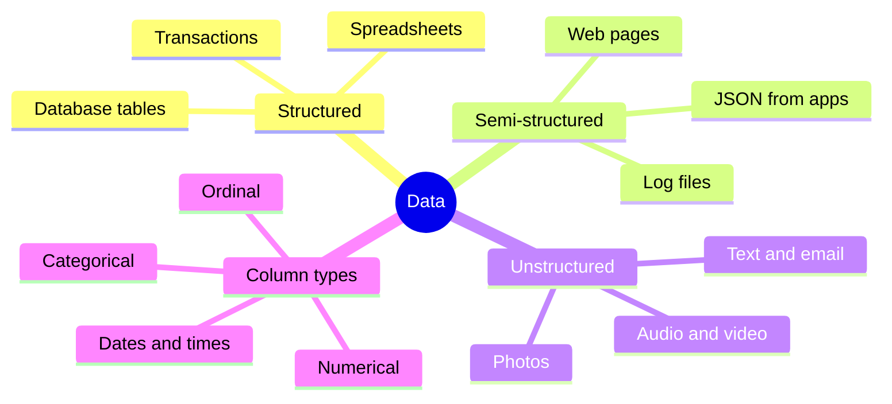
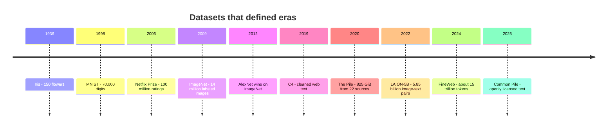
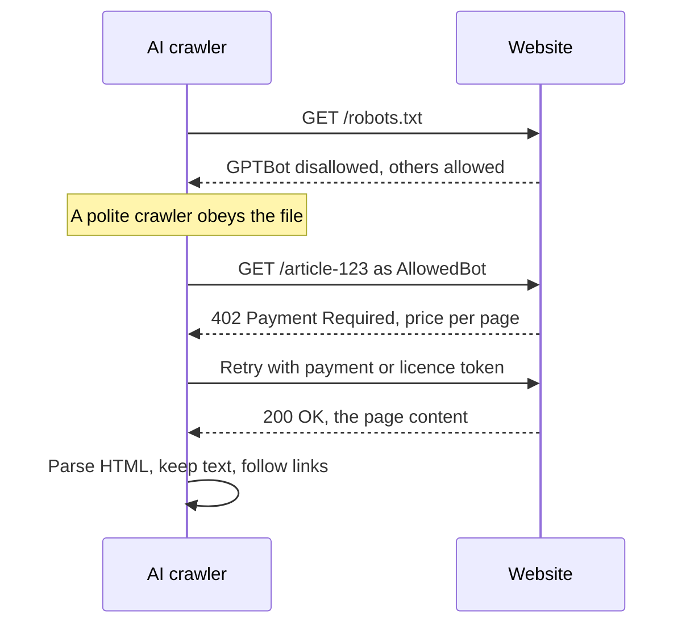
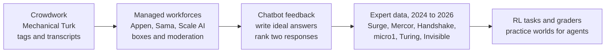
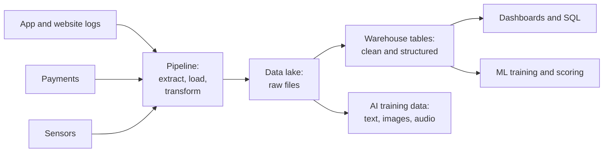
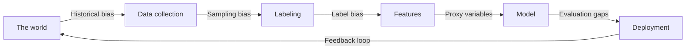
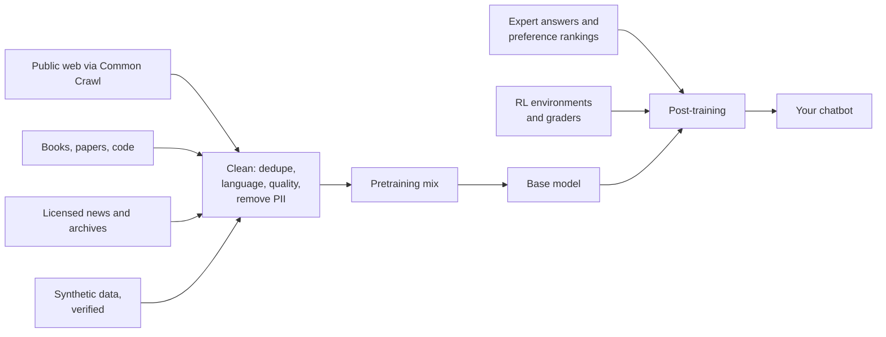

# Chapter 11: Data: The Fuel of AI

*This chapter shows you where AI's data comes from, who labels and cleans it, how it is stored and questioned, how it goes wrong, and why fights over consent, copyright and a possible "data wall" will shape the next few years of AI.*

## What you'll learn

- The kinds of data, and how photos, text and clicks all become numbers.
- Where data comes from, told as a history of famous datasets from Iris to the Common Pile.
- How web crawling works, what robots.txt does and does not do, and the 2025–26 shift to blocking and charging AI crawlers.
- How labeling works and how the labeling industry moved from crowdwork to expert data, including its human costs.
- The everyday craft of cleaning data, engineering features, asking questions in SQL, and moving data through pipelines, warehouses and lakes.
- How data goes wrong: quality problems, bias, and privacy failures, plus the tools (documentation, differential privacy, federated learning) that help.
- The promise and risk of synthetic data, the basics of the copyright fights, and the "data wall" debate.

## Before you start

Chapter 3 (Software, Code and Data) showed how text, images and sound become numbers and introduced CSV and JSON files. Chapter 8 (Learning From Examples) explained features, labels and self-supervised learning. Chapter 9 (Is the Model Any Good?) covered data leakage and test sets, and Chapter 10 (The Classical Machine Learning Toolkit) showed what algorithms do with a clean table, including feature scaling.

## Why data matters more than you think

When you ask Claude, ChatGPT or Gemini a question, everything the model "knows" came from data. Its knowledge of history, its ability to write Python, its polite tone and its habit of refusing certain requests were all shaped by three kinds of data: trillions of words of text from the web, books and code; examples written and rated by paid human experts; and scores from automated practice tasks. Change the data and you change the model.

> **Definition — Data:** Recorded facts or measurements: numbers, text, images, sounds, clicks. In AI, data is what a model learns from.

> **Definition — Dataset:** A collection of examples gathered for training or testing models, such as 70,000 handwritten digits or 15 trillion tokens of web text.

AI researchers have a blunt saying: garbage in, garbage out. A brilliant algorithm trained on mislabeled, biased or duplicated data learns the mislabels, the bias and the duplicates. Many of the biggest jumps in AI history came less from new algorithms than from new datasets.

> **Analogy:** Data is the ingredients; the model is the dish. Even a great chef cannot make a good meal from spoiled ingredients, and most of the work in a professional kitchen is washing, chopping and sorting, which diners never see.

## What data is

Data comes in three broad shapes. Structured data lives in neat rows and columns, like a spreadsheet of bank transactions. Semi-structured data has labels but no fixed table, like the JSON a weather app receives (Chapter 3) or a server's log file. Unstructured data has no built-in organization at all: emails, photos, voice notes, videos. Most of the world's data, and most of what chatbots learn from, is unstructured.

> **Definition — Structured data:** Data organized in rows and columns with a fixed format, such as a spreadsheet or database table.

> **Definition — Semi-structured data:** Data with some labels and organization but no rigid table, such as JSON files, web pages or log files.

> **Definition — Unstructured data:** Data without a predefined table format: free text, images, audio and video.

Inside a table, columns come in types. Numerical columns are measured quantities such as age or price. Categorical columns take one of a fixed set of values, such as country or subscription plan. Some categories have a natural order ("small, medium, large" or a 1–5 star rating), which statisticians call ordinal. Dates and times need special care, and free text is its own world.

> **Definition — Categorical feature:** A feature that takes one value from a fixed set of categories, such as color, country or plan type, rather than a measured number.

Files come in formats. CSV (comma-separated values) is a plain-text spreadsheet. JSON stores nested, labeled data. Parquet stores big tables column by column and compressed, so a program that needs only two columns of a billion-row table can skip the rest; it is the workhorse format for large AI datasets, including many on Hugging Face.

Everything eventually becomes numbers. A handwritten digit in the famous MNIST dataset is a 28 × 28 grid of gray levels, so 784 numbers from 0 to 255. The full set of 70,000 digits is 70,000 × 784 = 54,880,000 numbers, about 55 megabytes at one byte each, small enough for a phone. Text becomes numbers through tokens.

> **Definition — Token:** A small chunk of text, often a word or part of a word, that a language model reads and writes. Text datasets for language models are measured in tokens; in English, 1,000 tokens is roughly 750 words.



*Figure 11.1: The shapes and types of data. Chatbots learn mostly from unstructured text; most business ML runs on structured tables.*

## Where data comes from

Data arrives from many sources: app and website logs (every tap and scroll), purchase transactions, sensors and connected devices, surveys, government open-data portals, scientific instruments, posts and reviews written by users, the public web, licensed archives of books and news, paid human labelers, and, increasingly, other AI models generating synthetic data.

A great deal of it is a by-product. Nobody sets out to create a dataset when they order a taxi, but the pickup point, route, price and rating all become rows in a database. Technologists call this data exhaust.

> **Definition — Data exhaust:** Data produced as a side effect of everyday digital activity, such as clicks, searches, location pings and app usage, rather than collected on purpose.

Your chatbot conversations are data too. Depending on the product, your settings and the company's policy, conversations may be stored, reviewed for safety, or used to improve future models; most major apps let you opt out of training use in their privacy settings. The model does not learn from you mid-chat (Chapter 8), but your chat may become part of a future training set unless you opt out.

> **Try it:** Open the settings of the chatbot you use most and find the data or privacy controls. Is "use my conversations to improve the model" switched on? How long are chats kept? Two minutes here is the most practical privacy lesson in this chapter.

## A history of AI told through datasets

You can tell the story of AI as a story of datasets, each one bigger and messier than the last, and each unlocking a new era.

**Iris (1936).** The statistician Ronald Fisher published measurements of 150 iris flowers from three species: four numbers per flower (petal and sepal length and width). It is still the "hello world" of machine learning, and it fits on one page.

**MNIST (1998).** Yann LeCun and colleagues assembled 70,000 handwritten digits (60,000 for training, 10,000 for testing). For two decades it was the standard first test of any new image method, and it powered early check-reading systems.

**The Netflix Prize (2006).** About 100 million movie ratings, released for a $1 million contest (Chapter 10). It showed the power of big real-world data, and, through a privacy scandal you will meet below, its dangers.

**ImageNet (2009).** Fei-Fei Li and colleagues collected about 14 million images in roughly 22,000 categories, labeled by crowdworkers on Amazon Mechanical Turk. Its yearly challenge used about 1.28 million training images in 1,000 classes. In 2012 a deep neural network called AlexNet cut the top-5 error to about 15.3 percent, against about 26 percent for the runner-up. That single result launched the deep-learning era (Chapter 14).

> **Key idea:** ImageNet's lesson was that a simple-sounding change, a thousand times more labeled examples, can matter more than a decade of clever algorithm design. That lesson drives the hunger for data to this day.

**COCO (2014).** Microsoft's Common Objects in Context dataset outlined everyday objects in cluttered scenes, pushing AI from "what is in this photo?" to "where exactly is each thing?" (Chapter 45).

**Common Crawl.** A nonprofit that has archived the public web since the late 2000s and gives the archive away free. It is the raw material for most language-model pretraining.

> **Definition — Common Crawl:** A nonprofit's free, massive, regularly updated archive of web pages. Most large language-model training datasets start from it.

To feel the scale: Common Crawl's August 2026 crawl captured 2.14 billion web pages, 360 tebibytes uncompressed, gathered between August 7 and 20. That is about 2.14 billion ÷ 14 days ≈ 153 million pages a day, or roughly 1,770 pages every second.

**C4 (2019).** Google filtered Common Crawl into the "Colossal Clean Crawled Corpus" to train its T5 model, an early sign that cleaning web text mattered as much as collecting it.

**The Pile (2020).** EleutherAI combined 825 gibibytes of text from 22 sources, including academic papers, code and a books collection called Books3 that later became central to copyright lawsuits.

**LAION-5B (2022).** About 5.85 billion image–text pairs scraped from the web, used to train open image generators such as Stable Diffusion (Chapter 47). In late 2023 researchers found links to child sexual abuse material in it, and it was taken down for cleaning: a stark example of what indiscriminate scraping sweeps up.

**RedPajama, Dolma and FineWeb (2023–24).** Open, documented recreations of the kind of data the big labs use. Hugging Face's FineWeb holds about 15 trillion tokens drawn from 96 Common Crawl snapshots, according to its creators, with "FineWeb-Edu" subsets filtered for educational value.

**The Common Pile (2025).** EleutherAI and partners released an 8-terabyte collection of public-domain and openly licensed text from 30 sources. Small 7-billion-parameter models trained only on it were competitive with Meta's Llama 1 and 2 models of the same size, showing that rights-cleared training is viable, at least at moderate scale.

Meanwhile the labs' own training sets kept growing: Meta said Llama 4 was pretrained on "more than 30 trillion tokens" (April 2025), and Alibaba said Qwen3 used about 36 trillion tokens across 119 languages.



*Figure 11.2: A history of AI in datasets. Each era was unlocked by data roughly 100 to 1,000 times larger than the last.*

```
Iris (1936)          #### 150 flowers
MNIST (1998)         ########## 70,000 images
ImageNet (2009)      ############## 14 million images
Netflix Prize (2006) ################ 100 million ratings
LAION-5B (2022)      #################### 5.85 billion pairs
FineWeb (2024)       ########################## 15 trillion tokens
Qwen3 data (2025)    ########################### 36 trillion tokens
```

*Figure 11.3: Dataset sizes on a logarithmic scale: every two # marks mean ten times more items. The units differ, so read it as orders of magnitude, not exact comparisons.*

How big is 15 trillion tokens? At about 0.75 words per token, that is roughly 11 trillion words. A fast reader managing 250 words a minute for 8 hours a day reads 120,000 words a day. Reading FineWeb would take 11,250,000,000,000 ÷ 120,000 ≈ 94 million days, about a quarter of a million years.

## Collecting data from the web

Most text for chatbots is gathered by programs called crawlers that visit a web page, save it, find its links, and visit those, millions of times an hour. Pulling the useful content out of the saved pages is called scraping.

> **Definition — Web crawler:** A program that automatically visits web pages, saves them and follows their links to discover more pages. Search engines and AI companies both run crawlers.

> **Definition — Web scraping:** Automatically extracting content from web pages, such as the article text without the menus and ads.

Polite crawlers check a small file at the root of each website called robots.txt, which says which crawlers may visit which parts. Each crawler identifies itself with a name, its "user agent." Well-known AI-related names include GPTBot (OpenAI), ClaudeBot (Anthropic), Google-Extended (Google's control for AI training use) and CCBot (Common Crawl). A site that wants search traffic but not AI training might write:

```
User-agent: GPTBot
Disallow: /

User-agent: CCBot
Disallow: /

User-agent: *
Allow: /
```

> **Definition — robots.txt:** A file on a website telling automated crawlers which parts they may visit. It is a request that reputable crawlers honor, not a lock that stops anyone.

Other rules also apply. Terms of service may forbid scraping. Paywalls and logins keep content out of reach. Many sites prefer to offer an API, a structured doorway for programs (Chapter 4), with rate limits on how many requests you may make per minute. Collecting through an API is cleaner and more clearly permitted than scraping.

The big shift of 2025–26 was that websites started fighting back and asking to be paid. On July 1, 2025, Cloudflare, which sits in front of a large share of the world's websites, began blocking known AI crawlers by default for new customer domains and launched "Pay Per Crawl," which revives a long-unused web code, HTTP 402 "Payment Required," so a site can charge a crawler per page. In September 2025 a group backed by Reddit, Yahoo, Medium, Quora and others launched RSL (Really Simple Licensing), a machine-readable way for sites to state their AI licensing and payment terms. Platforms also turned to the courts: Reddit sued Anthropic in June 2025 (a case sent back to California state court as a contract, trespass and privacy dispute rather than a copyright one), and in October 2025 sued Perplexity and several scraping firms.



*Figure 11.4: A crawler's visit in the 2025–26 web. robots.txt states preferences; pay-per-crawl systems can now attach a price.*

> **Watch out:** "If it is on the public internet, it is free to use for anything" is false. Public does not mean public domain. Copyright, terms of service, privacy law and contracts all still apply, and courts are actively deciding how they apply to AI training.

## Labeling: teaching by example

Raw data often lacks the answers a model needs. Someone has to draw boxes around pedestrians, transcribe audio, tag reviews as positive or negative, or, for chatbots, write and judge answers. This is labeling, also called annotation.

> **Definition — Annotation (labeling):** Adding labels to raw data, such as tagging images, transcribing audio, marking names in text or rating chatbot answers, so models can learn from it.

> **Definition — Bounding box and segmentation mask:** Two kinds of image label. A bounding box is a rectangle drawn around an object; a segmentation mask outlines the object's exact shape pixel by pixel.

For chatbots the most valuable labels are different. Experts write ideal answers to prompts, which teach a base model to act as an assistant (Chapter 20). Raters compare two answers and say which is better, producing preference data. Red-teamers try to make the model misbehave. Specialists grade step-by-step reasoning, and increasingly build whole practice tasks with automatic graders.

> **Definition — Preference data:** Human judgments comparing two or more model outputs ("A is better than B"), used to train chatbots to give answers people prefer.

> **Definition — RL environment:** A simulated task, such as a software sandbox, a website clone or a math problem with an automatic checker, where a model can practice and be scored. Labs increasingly treat these as "the new training data."

Labels are only as good as the people and instructions behind them, so vendors check quality constantly. They slip in questions with known answers to catch careless workers, have several people label the same item and take a consensus, and measure how often labelers agree.

> **Definition — Gold standard:** Trusted, correct labels used to check the accuracy of models or of human labelers, for example test questions with known answers mixed into a labeler's work.

> **Definition — Inter-annotator agreement:** How often different labelers give the same label to the same item. Low agreement signals an ambiguous task or unclear instructions.

Worked example: two labelers tag 100 product reviews as positive or negative and agree on 85. That sounds good, but if each tags half the reviews positive at random, they would agree about 50 percent of the time by pure chance. A common score, Cohen's kappa, corrects for this: (0.85 − 0.50) ÷ (1 − 0.50) = 0.70. Researchers usually read 0.70 as substantial but imperfect agreement: worth tightening the instructions.

Labels also cost real money. Tagging one million images at 5 seconds each takes 5 million seconds, about 1,390 hours of work. Now the chatbot era: suppose a lab wants 10,000 expert comparisons of medical answers, each taking a doctor 5 minutes. That is 50,000 minutes, about 833 hours, and at an illustrative $100 an hour (some expert programs reportedly pay more) it costs about $83,000 for one small batch.

### The labeling industry

The industry has moved through roughly four stages. It began with crowdwork: Amazon Mechanical Turk, launched in 2005, split jobs into tiny paid tasks for anyone online, and ImageNet was labeled that way. Managed workforce companies such as Appen, Sama and Scale AI then built trained teams and software for large jobs like self-driving car images and content moderation. From 2022, chatbots created demand for written answers and preference rankings. By 2024–26 the money had moved decisively toward expert data: STEM PhDs, physicians, lawyers, bankers and senior programmers writing exam-grade problems, grading reasoning and building RL tasks.

> **Definition — Expert data:** Training and evaluation data written or judged by credentialed specialists, such as doctors, lawyers or PhD scientists, to teach and test models on hard professional tasks.



*Figure 11.5: How the labeling industry moved from cheap generalist crowdwork toward credentialed experts and RL environments.*

The biggest names show how valuable this became. In June 2025 Meta invested about $14.3 billion for roughly 49 percent of Scale AI, valuing it at about $29 billion; founder Alexandr Wang left to lead Meta's superintelligence effort, and several other labs reportedly pulled work from Scale afterward. In July 2026 Scale named Francis deSouza, a former Google Cloud executive, as chief executive. Surge AI, founded by Edwin Chen, grew without outside investors and is reported to have passed $1 billion in annual revenue in 2024, according to analyst estimates. Mercor, a marketplace connecting labs with doctors, lawyers and other experts, raised money at a $10 billion valuation in October 2025 and was reportedly in talks at around $20 billion by July 2026. Handshake, once a campus jobs site, became a major supplier of graduate-level experts, and micro1, Turing and Invisible compete in the same market.

> **Watch out:** "Labeling is low-skill busywork that AI has already automated" is wrong. Simple tagging is increasingly done by models, but frontier labs now pay large sums for expert human judgment. Labeling became more specialized, not extinct.

The human side is less glamorous. Much generalist labeling is done by low-paid workers in lower-income countries. In 2023 a TIME investigation reported that Kenyan workers employed through the outsourcing firm Sama were paid less than $2 an hour to label graphic descriptions of violence and abuse so that OpenAI could build safety filters, work that many described as psychologically damaging. Content moderators across the industry report similar strain. Even well-paid expert work is gig work: projects appear and vanish with a lab's priorities, pay can change abruptly, and contractors carry heavy confidentiality duties. It also carries security risk: in March 2026 Mercor was hit by a supply-chain attack through poisoned versions of an open-source software library, and contractors filed class-action lawsuits over the exposure of their data.

> **Analogy:** Labelers are the invisible kitchen staff of AI. Diners see the plated dish, the chatbot, but not the many people who prepped it, from crowdworkers drawing boxes to PhDs writing exam questions.

## Cleaning data

Real data is messy. Here are five customer records as they might arrive:

| Name | State | Age | Signed up |
|---|---|---|---|
| Ana Lima | NY | 34 | 2026-03-02 |
| ana lima | New York | 34 | 03/02/2026 |
| Ben Ode | new york | 340 | 2026-03-05 |
| Chen Wu | CA | (blank) | 2026-03-07 |
| Dara Fox | Calif. | 29 | 7 March 2026 |

Problems: rows 1 and 2 are the same person (a duplicate with different capitalization and date format); "NY," "New York" and "new york" are one state written three ways, as are "CA" and "Calif."; an age of 340 is impossible (probably a typo for 34); one age is missing; and the dates use three formats, one of them ambiguous (is 03/02 March 2 or February 3?). Fixing these is data cleaning.

> **Definition — Data cleaning:** Finding and fixing incorrect, duplicate, missing or inconsistent data, such as merging duplicate records, standardizing spellings and units, and correcting impossible values.

For a missing value you can drop the row, fill the gap with a sensible estimate such as the column's median (called imputation), or add a "was missing" flag, since missingness itself can carry information. Extreme values, called outliers, need judgment: a $1 million purchase may be a typo or your best customer. Unit mix-ups (pounds versus kilograms) and time-zone errors are classic silent killers.

> **Definition — Deduplication:** Finding and removing repeated or near-identical records. At web scale it is critical, because duplicated text makes a model memorize and wastes training compute.

At web scale, cleaning becomes an industrial process: extracting text from HTML, identifying each document's language, removing exact and near-duplicate pages, stripping boilerplate such as menus and cookie banners, filtering for quality (often with a small classifier trained to spot "textbook-like" pages), and removing toxic content and personal information. Most of a raw web crawl is thrown away. Chapter 19 walks through this pipeline for frontier models.

> **Analogy:** Data cleaning is washing and chopping vegetables. It takes most of the kitchen time, nobody sees it, and it matters most.

## Feature engineering

Once data is clean, you often reshape it into inputs a model can use well, guided by knowledge of the problem.

> **Definition — Feature engineering:** Creating more useful input features from raw data, such as turning a birth date into an age or a timestamp into "weekend or weekday."

A few standard moves:

- **One-hot encoding.** Algorithms need numbers, but "plan = Plus" is a word. Make one yes/no column per category: with plans Free, Plus and Pro, "Plus" becomes [0, 1, 0].
- **Scaling.** Put numbers on comparable scales (Chapter 10). In Chapter 10's subscriber table, weekly hours average 4.5 with a standard deviation of about 2.7, so 8 hours becomes (8 − 4.5) ÷ 2.7 ≈ 1.3.
- **Dates.** A raw timestamp means little; "day of week," "hour," "days since last login" and "is a holiday" mean a lot.
- **Ratios and combinations.** Lenders care less about debt than about debt ÷ income.
- **Text to numbers.** Count words, then weight them by how informative they are.

> **Definition — One-hot encoding:** Turning a category into several yes/no columns, one per possible value, so that "Plus" out of Free, Plus and Pro becomes [0, 1, 0].

> **Definition — Standardization:** Rescaling a numeric feature by subtracting its average and dividing by its standard deviation, so values become "how many standard deviations from typical."

The classic text recipe is TF-IDF. Take 1,000 support emails. The word "the" appears in all 1,000, so its weight is log10(1,000 ÷ 1,000) = 0: useless for telling emails apart. "Refund" appears in only 10, so its weight is log10(1,000 ÷ 10) = 2. An email that says "refund" three times scores 3 × 2 = 6 on that word, while "the," however often it appears, scores 0.

> **Definition — TF-IDF:** "Term frequency times inverse document frequency": a way to turn text into numbers by counting each word in a document and weighting rare, informative words up and common words down.

Deep learning automated much of this for images and text: a neural network learns its own features from raw pixels and tokens (Chapter 10). For business tables, though, thoughtful feature engineering is still often the single biggest lever on accuracy.

## Databases and SQL: the four everyday moves

Most organizational data lives in databases, and the most common kind stores linked tables that you question with SQL.

> **Definition — Database:** An organized system for storing, updating and retrieving data, designed so many people and programs can use it safely at once.

> **Definition — Relational database:** A database that stores data in tables linked by shared columns, and is queried with SQL. Examples include PostgreSQL, MySQL and SQLite.

> **Definition — SQL (Structured Query Language):** The standard language for asking questions of relational databases, built from a few readable commands such as SELECT, WHERE, GROUP BY and JOIN.

Imagine a chatbot company with two tables. Each row in `users` has a unique `user_id`, its primary key. Each row in `chats` records one conversation and points back to its user through the same `user_id`.

> **Definition — Primary key and join:** A primary key is a column that uniquely identifies each row, such as a user ID. A join combines two tables by matching rows that share a key value.

```
users                               chats
user_id name  country plan          chat_id user_id topic    tokens
1       Ana   Brazil  Pro           1       1       cooking    1200
2       Ben   USA     Free          2       1       coding     5400
3       Chen  China   Pro           3       2       travel      800
4       Dara  USA     Pro           4       3       coding     7000
5       Eli   Brazil  Free          5       4       homework   2300
6       Fay   India   Pro           6       4       coding     3100
                                    7       5       cooking     600
                                    8       6       travel     1500
                                    9       6       coding     4200
                                    10      3       cooking     900
```

*Figure 11.6: Two linked tables. The user_id column in chats points to the matching row in users.*

Almost all everyday SQL is four moves:

1. **SELECT** picks columns: `SELECT name, plan FROM users` lists every user's name and plan.
2. **WHERE** filters rows: `SELECT name FROM users WHERE plan = 'Pro'` returns Ana, Chen, Dara and Fay.
3. **GROUP BY** summarizes: `SELECT topic, SUM(tokens) FROM chats GROUP BY topic` returns coding 19,700, cooking 2,700, travel 2,300 and homework 2,300.
4. **JOIN** combines tables: `SELECT users.country, SUM(chats.tokens) FROM chats JOIN users ON chats.user_id = users.user_id GROUP BY users.country` returns China 7,900, Brazil 7,200, USA 6,200 and India 5,700.

> **Analogy:** A database is a library catalog, and SQL is asking the librarian precise questions: "Show me every Pro user in Brazil, and total their tokens by topic."

Not all data fits tables. NoSQL databases store documents, key–value pairs or networks of connections, trading some structure for flexibility and scale. A newer kind, the vector database, stores embeddings and finds the items closest in meaning to a query, which is how chatbots search your documents (Chapter 27).

> **Definition — Vector database:** A database built to store embeddings (lists of numbers representing meaning) and quickly find the items most similar to a query. It is the backbone of retrieval-augmented generation.

## Pipelines, warehouses, lakes and lakehouses

Data rarely stays where it was born. A pipeline moves it from apps, sensors and payment systems to where it is analyzed or used for training, running on a schedule (batch) or continuously (streaming).

> **Definition — Data pipeline:** An automated series of steps that moves data from its sources, transforms it, and delivers it to where it is used, such as a warehouse, a dashboard or a training job.

> **Definition — ETL and ELT:** Two pipeline styles. Extract–Transform–Load cleans data before storing it; Extract–Load–Transform stores raw data first and cleans it later, inside the storage system.

Where does it land? A data warehouse is a tidy library of cleaned, structured tables, built for fast business questions. A data lake is a huge, cheap storage room of raw files in every format, from logs to images, cleaned only when needed. A lakehouse tries to combine the two: lake-style cheap storage with warehouse-style tables and queries on top. Major platforms include Snowflake, Google BigQuery, Databricks and Amazon Redshift.

> **Definition — Data warehouse:** A central store of cleaned, structured data organized for analysis and reporting.

> **Definition — Data lake:** A large, low-cost store of raw data in many formats, kept as-is and cleaned only when someone needs it.

> **Definition — Lakehouse:** An architecture that adds warehouse-style tables, rules and fast queries on top of data-lake storage.



*Figure 11.7: A typical modern data flow. A lakehouse keeps the lake and the warehouse tables in one system.*

## Data quality and documentation

How do you know data is good? Practitioners check six dimensions:

| Dimension | Question | Example of failure |
|---|---|---|
| Accuracy | Are the values right? | Age 340 |
| Completeness | Is anything missing? | 30% of rows lack an email |
| Consistency | Do sources agree? | "NY" in one table, "New York" in another |
| Timeliness | Is it up to date? | Prices from last year |
| Validity | Does it follow the rules? | A date of February 30 |
| Uniqueness | Is each thing recorded once? | The same customer twice |

> **Definition — Data quality:** How fit data is for its purpose, usually judged on accuracy, completeness, consistency, timeliness, validity and uniqueness.

Good teams also record lineage, the history of where each number came from and every transformation it went through, and keep versions so a model can always be traced to the exact data that trained it. In 2018 researchers led by Timnit Gebru proposed "datasheets for datasets," a standard questionnaire about who made a dataset, why, how it was collected and labeled, what is missing and what it should not be used for. Data cards and model cards follow the same idea, and Hugging Face dataset pages use a version of it.

> **Definition — Datasheet (data card):** Standard documentation describing a dataset's origin, contents, collection and labeling process, intended uses, limitations and license.

Documentation is becoming law. Since August 2, 2025, providers of general-purpose AI models in the EU must publish a "sufficiently detailed summary" of their training content using a European Commission template, and the EU's AI Office gained powers to enforce these rules from August 2, 2026. California's AB 2013 requires generative-AI developers to post high-level documentation of their training data from January 1, 2026. Chapter 59 covers these laws.

## Bias in data

Models learn whatever patterns their data contains, including unfair ones. Bias can enter at every stage.

- **Sampling bias:** the data does not represent the people the model will serve. A voice assistant trained mostly on one accent struggles with others.
- **Historical bias:** the data faithfully records a past that was unfair, and the model learns to repeat it.
- **Measurement and label bias:** what is recorded is a poor stand-in for what matters. Using "was arrested" as a label for "committed a crime" bakes in patterns of policing.
- **Proxies:** removing a sensitive column does not remove its signal if another column stands in for it.
- **Feedback loops:** a model's decisions shape the next round of data.

> **Definition — Sampling bias:** When collected data does not represent the population a model will be used on, so the model works worse for under-represented groups.

> **Definition — Historical bias:** When data accurately records a past that was unfair, so a model trained on it learns to repeat the unfairness.

> **Definition — Proxy variable:** A feature that indirectly stands in for a sensitive attribute, such as a zip code standing in for race or a hobby standing in for gender.

> **Definition — Feedback loop:** When a model's predictions influence the future data it is trained on, for example predictive policing that sends more patrols to an area, which records more incidents there.

A worked example: a company's past records show 200 men and 200 women applying, with 60 men hired (30 percent) and 30 women hired (15 percent). A model trained to imitate past hiring will learn to favor men. Deleting the gender column does not fix it if a column like "captain of the women's chess club" or the name of a women's college remains. In 2018 Reuters reported that Amazon scrapped an experimental recruiting model after it learned to downgrade résumés containing the word "women's."

Two other cases became landmarks. In 2016 ProPublica analyzed COMPAS, a risk score used in US courts, and found that Black defendants who did not reoffend were nearly twice as likely as white defendants to have been labeled high risk; the company replied that its scores were equally accurate for both groups. Both claims were mathematically true at once, because different definitions of "fair" can conflict when groups have different base rates. In 2018 the Gender Shades study by Joy Buolamwini and Timnit Gebru found that commercial face-analysis systems misclassified darker-skinned women up to 34.7 percent of the time, against at most 0.8 percent for lighter-skinned men.

> **Definition — Algorithmic fairness:** The study of whether models treat groups equitably. It includes several competing mathematical definitions of "fair" that often cannot all be satisfied at once.



*Figure 11.8: Bias can enter at every stage of the pipeline, and deployment feeds back into the world the next dataset is drawn from.*

> **Watch out:** "Algorithms are objective because they are math" is a misconception. The choices of data, labels and success metrics are human choices, and a model faithfully learns whatever patterns they contain. Chapter 58 goes deeper into fairness.

## Privacy

Data about people is personal information, and using it for AI raises hard privacy questions.

> **Definition — PII (personally identifiable information):** Data that can identify a specific person, such as a name, email address, ID number, face or precise location.

The traditional protection was anonymization: strip the names and release the rest. It fails surprisingly often, because combinations of innocent-looking facts are unique. In 2000 the computer scientist Latanya Sweeney showed that about 87 percent of Americans could be uniquely identified by just their 5-digit zip code, birth date and sex; earlier she had used public voter rolls to find the Massachusetts governor's records in "anonymized" hospital data. In 2006 AOL released about 20 million "anonymous" search queries from roughly 650,000 users, and New York Times reporters identified user 4417749 as a 62-year-old woman in Georgia from her searches alone. And researchers linked "anonymous" Netflix Prize ratings to public movie reviews, leading to a privacy lawsuit and the cancellation of the planned second contest.

> **Definition — Re-identification:** Working out who a person is in a supposedly anonymous dataset by linking it with other available data.

The law has caught up partly. Europe's GDPR (applying since 2018) and California's CCPA (in force since 2020) give people rights to know, access and delete their data, and require a lawful basis for processing it. A core principle is data minimization: collect only what you need.

> **Definition — GDPR and CCPA:** The European Union's General Data Protection Regulation and the California Consumer Privacy Act, the best-known laws giving people rights over their personal data and placing duties on organizations that use it.

Two technical ideas offer stronger protection. Differential privacy adds carefully calibrated noise so that results barely change whether or not any one person is included. The oldest version is a survey trick you can do with a coin. Ask 1,000 people "Have you ever cheated on a test?" Each secretly flips a coin: heads, answer truthfully; tails, flip again and say "yes" for heads, "no" for tails. Nobody can tell whether any individual "yes" is true. But if the true rate is p, the expected share of yeses is 0.5 × p + 0.25. If 400 of 1,000 say yes, then 0.40 = 0.5 × p + 0.25, so p = 0.30: 30 percent have cheated, measured without exposing anyone. The US Census Bureau used differential privacy for the 2020 census, and Apple uses it to collect some usage statistics.

> **Definition — Differential privacy:** A mathematical guarantee, achieved by adding calibrated random noise, that a result barely changes whether or not any single person's data is included, so no individual can be singled out.

Federated learning takes a different route: instead of sending your data to the model, it sends the model to your data. Your phone improves a shared keyboard-prediction model using your typing, sends back only the small update, and the raw text never leaves the device. Google has used this approach for its Gboard keyboard since 2017.

> **Definition — Federated learning:** Training a shared model across many devices or institutions by sending the model to the data and collecting only updates, so the raw data never leaves its owner.

Large language models add a new risk: memorization. Researchers have shown that models can sometimes reproduce exact passages from their training data, including personal details, when prompted cleverly. And what you type can travel further than you expect: in the New York Times lawsuit against OpenAI, a court ordered production of a 20-million-log sample of ChatGPT outputs in January 2026. Removing one person's data from an already-trained model, called machine unlearning, remains an open research problem.

> **Definition — Memorization:** When a model can reproduce exact pieces of its training data, such as a paragraph of a book or a person's phone number, raising privacy and copyright concerns.

> **Key idea:** Removing names is not the same as protecting privacy. Combinations of ordinary facts identify people, so real protection needs minimization, access controls, and mathematical tools such as differential privacy.

## Synthetic data and model collapse

When real data is scarce, private or expensive, you can make more. Synthetic data is produced by simulations or by models: game-engine streets full of virtual pedestrians for self-driving cars, realistic but fake patient records for testing hospital software, and, above all in 2026, text written by one AI model to train another. Alibaba said it used its own math and coding models to generate synthetic textbooks and question-and-answer pairs for Qwen3. Training a smaller "student" model on a stronger "teacher" model's answers is called distillation (Chapter 20). A simpler cousin, data augmentation, makes extra examples by tweaking real ones: flipping or cropping photos, or paraphrasing sentences.

> **Definition — Synthetic data:** Artificially generated data, made by simulations or by AI models, used in place of or alongside real data.

Synthetic data works best where results can be checked. A model can generate a million math problems with worked solutions, and a program can verify which answers are correct, keeping only those. The same goes for code that must pass tests. Where nothing checks the output, the generator's errors, biases and blind spots flow straight into the next model, and generated text tends to be cleaner, blander and more repetitive than real human writing. The commercial market is consolidating: NVIDIA acquired the synthetic-data company Gretel in 2025.

The extreme risk is model collapse. In a 2024 paper in *Nature*, Ilia Shumailov and colleagues showed that when models are trained generation after generation on the output of earlier models, without fresh human data, they progressively lose the rare and unusual parts of the original distribution, and eventually produce narrow, degraded output. A toy calculation shows why rare things vanish first: if each generation keeps only 90 percent of the previous generation's rare phrasings, after 10 generations only 0.9¹⁰ ≈ 35 percent remain. Exercise 9 lets you watch a simple version happen in Colab, and shows that mixing in a steady share of fresh real data prevents it.

> **Definition — Model collapse:** The degradation that can occur when models are trained repeatedly on model-generated data without enough fresh human data, losing rare patterns and diversity with each generation.

> **Analogy:** Synthetic data is a flight simulator. Pilots learn a great deal in one, but a simulator cannot teach what its designers did not model, and nobody wants a pilot trained only in one. Model collapse is photocopying a photocopy: each generation loses a little detail.

> **Watch out:** Both "synthetic data is fake, so it is useless" and "synthetic data solves the data problem" are wrong. It works well where outputs can be verified (math, code) or simulated (driving scenes), and it is risky where it drifts from reality or recycles a model's own mistakes.

## Who owns the data? Copyright, licensing and lawsuits in brief

Much of the text, images and music that AI learns from was made by people who were never asked. Whether that is legal is one of the biggest open questions in AI. This section gives the basics; Chapter 58 covers the creative-industry fights and Chapter 59 the law in depth.

> **Definition — Copyright:** The legal rights an author has over an original creative work, including control over copying and distribution. It covers most books, articles, photos, music and code automatically, without registration.

> **Definition — Fair use:** A US legal doctrine allowing some unlicensed uses of copyrighted works, judged case by case on four factors, including the purpose of the use and its effect on the market for the original.

> **Definition — TDM (text and data mining) exception:** Laws in places such as the EU, UK and Japan that allow automated analysis of content under certain conditions; in the EU, rights holders can opt out of commercial mining in machine-readable ways.

The legal picture as of October 2026 is mixed and unsettled:

| Case or event | What happened | Status, late 2026 |
|---|---|---|
| Bartz v. Anthropic (US) | Judge ruled in June 2025 that training on lawfully bought books was fair use, but building a library from pirated copies was not | Settled for $1.5 billion, about $3,000 per book for roughly 480,000 works; final approval July 2026 |
| Kadrey v. Meta (US) | Judge granted Meta summary judgment on training (June 2025), stressing the ruling was narrow and that market harm could win a better-argued case | Other claims continued into 2026 |
| Thomson Reuters v. Ross (US) | Copying Westlaw legal summaries to train a competing, non-generative search tool | First appeals-court ruling on AI training, September 29, 2026: not fair use |
| New York Times v. OpenAI and Microsoft (US) | Newspapers allege copying of millions of articles | Still pending; no trial date |
| Getty Images v. Stability AI (UK) | Court found model weights that never stored copies are not "infringing copies" (November 2025) | Getty largely lost; appeal permitted |
| Music labels v. Suno and Udio | Universal and Warner settled (late 2025) and moved to licensed models | Partly settled |

Alongside the lawsuits runs a licensing market. Reported deals include Reddit with Google (about $60 million a year, reported in 2024), News Corp with OpenAI (more than $250 million over five years, reported 2024), the New York Times with Amazon (2025) and News Corp with Meta (up to $50 million a year for three years, March 2026). OpenAI alone had signed roughly two dozen publisher deals by mid-2026. In December 2025 Disney agreed to let OpenAI's Sora video app generate short videos with more than 200 Disney characters, alongside a $1 billion Disney investment in OpenAI.

> **Watch out:** "Courts have decided that AI training is legal" (or illegal) is wrong as of October 2026. Two US trial judges found training fair use on their records, with pirated acquisition treated differently; the only appeals ruling found non-generative training on a competitor's content not fair use; and the big generative-AI cases are still pending.

The open questions are the ones to watch: Is training a generative model fair use? Does it matter if the data was pirated? When do outputs themselves infringe? How detailed must training-data disclosures be? And can collective licensing, where creators are paid through a shared pool, work at internet scale?

## The data wall: are we running out?

Here is the debate that ties this chapter together. Frontier language models have grown by training on ever more text: GPT-3 (2020) used about 300 billion tokens, Llama 3 (2024) about 15.6 trillion, and Llama 4 and Qwen3 (2025) more than 30 trillion. But there is only one internet.

> **Definition — Data wall:** The idea that AI progress could stall because the supply of high-quality, human-generated training data is running out.

In 2024 the research group Epoch AI estimated that the stock of high-quality, publicly available human text is about 300 trillion tokens (with a wide range of 100 to 1,000 trillion), and that at current trends models would use it all up sometime between 2026 and 2032, around 2028 for the most compute-efficient training, earlier if labs train smaller models on extra data. In December 2024 the OpenAI co-founder Ilya Sutskever told the NeurIPS conference that pretraining "as we know it will end," because "we have but one internet," calling data the "fossil fuel of AI."

```
tokens (log scale)
1000T | - - - - - - - - - - - - - - - - - - - - - - * - -  high
 300T |=================================*=================  central
 100T | - - - - - - - - - - - - * - - - - - - - - - - - -  low
  30T |                     Q
  10T |                 L
   3T |
   1T |
 0.3T | G
      +-+-------+-------+-------+-------+-------+-------+-
       2020    2022    2024    2026    2028    2030    2032
  G = GPT-3   L = Llama 3   Q = Llama 4, Qwen3   * = trend
```

*Figure 11.9: A schematic of the data wall. Training sets (letters) climb toward Epoch AI's 2024 estimate of usable public text (dashed and double lines); where the trend meets the band depends on which estimate is right. Not to scale beyond orders of magnitude.*

A worked comparison: 36 trillion tokens is already about 12 percent of the central 300-trillion estimate, and training sets have been growing several-fold every couple of years. A few more doublings and they reach the band.

The pessimistic side argues that the easy reserves are drilled: the best text (books, papers, quality journalism) is limited, much of the rest is spam or duplicates, sites are now blocking crawlers, and courts may restrict what remains. The optimistic side points to many escape routes:

- **Synthetic data**, especially where a checker can verify it, as in math and code.
- **Other modalities**: video, audio and images contain vastly more raw information than text.
- **RL environments and verifiable tasks**: instead of reading more, models practice. DeepSeek's V3.2 technical report (December 2025) described generating large numbers of synthetic agent tasks for reinforcement learning (Chapter 21), and expert-data firms are expanding into building such environments.
- **Private and proprietary data**: company documents, licensed archives and specialist databases dwarf the public web.
- **Expert-written data**: small amounts of very high-quality human data, bought from the industry described above.
- **Better data efficiency and repetition**: training several passes over the best data, and algorithms that learn more from each token.



*Figure 11.10: The life of training data for a 2026 chatbot. As public text runs short, the right-hand sources (synthetic data, expert data and RL environments) carry more of the load.*

> **At the frontier (2026):** Frontier labs increasingly describe their data advantage less in terms of web scraping and more in terms of expert data, verified synthetic data and RL environments. Simulated practice worlds are widely called "the new training data," and the labeling industry's shift toward experts and environment-building is the market's response.

> **Key idea:** The data wall is real pressure, not a cliff date. It is an estimate with wide uncertainty and many workarounds, and it is changing what labs collect and buy, from more text toward better text, verified practice and new kinds of data.

> **At the frontier (2026):** The training-data supply chain is being renegotiated on every front at once: websites charge crawlers, publishers sign licences, courts weigh fair use, the EU requires training-data summaries, and openly licensed datasets such as the Common Pile test whether rights-cleared training can keep up.

## In plain English

AI runs on data the way a car runs on fuel, and the quality of the fuel matters as much as the quantity. Data comes as tidy tables, semi-structured files and messy text, images and audio, and all of it ends up as numbers. The history of AI is partly a history of datasets: 150 iris flowers, 70,000 handwritten digits, 14 million labeled ImageNet photos, and now tens of trillions of tokens of web text gathered by crawlers.

Collecting that text is getting harder. robots.txt is a polite request, not a lock, and since 2025 many websites block AI crawlers by default or charge them per page. Raw data also needs human labels, and the labeling industry has moved from cheap crowdwork, often done by low-paid workers abroad, toward doctors, lawyers and PhDs writing and judging answers for chatbots.

Before any model sees data, people clean it, engineer features, store it in databases they question with SQL, and move it through pipelines into warehouses and lakes. Good teams document where data came from and check its quality. Data can carry bias, from unrepresentative samples to unfair history to proxies and feedback loops, and "anonymous" data can often be traced back to real people; tools like differential privacy and federated learning help.

When real data runs short, synthetic data can help, especially where answers can be checked, but training models only on other models' output can cause collapse. Courts are still deciding whether training on copyrighted work is fair use. And the data wall debate asks whether we are running out of human text, with labs turning to synthetic data, video, expert data and practice environments.

## Key terms

Data, dataset, structured data, semi-structured data, unstructured data, categorical feature, token, data exhaust, Common Crawl, web crawler, web scraping, robots.txt, annotation (labeling), bounding box, segmentation mask, preference data, RL environment, gold standard, inter-annotator agreement, expert data, data cleaning, deduplication, feature engineering, one-hot encoding, standardization, TF-IDF, database, relational database, SQL, primary key, join, vector database, data pipeline, ETL, ELT, data warehouse, data lake, lakehouse, data quality, datasheet (data card), sampling bias, historical bias, proxy variable, feedback loop, algorithmic fairness, PII, re-identification, GDPR, CCPA, differential privacy, federated learning, memorization, synthetic data, model collapse, copyright, fair use, TDM exception, data wall.

