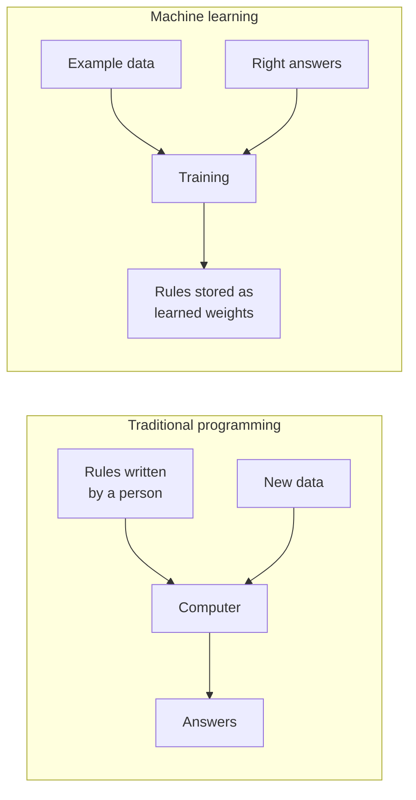
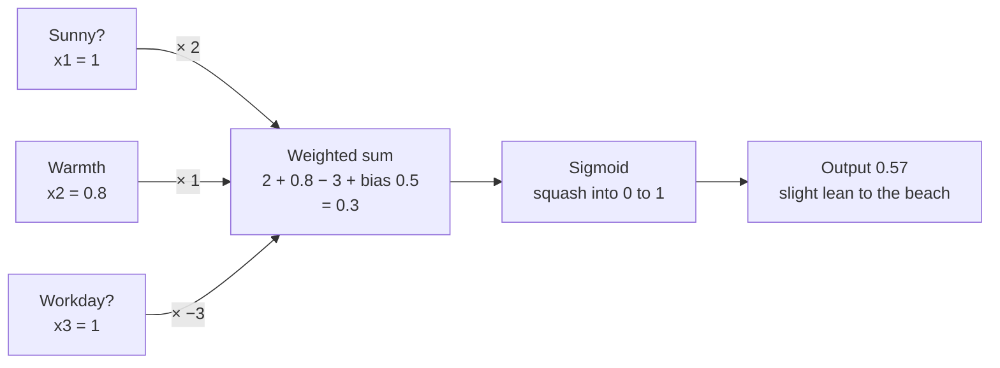
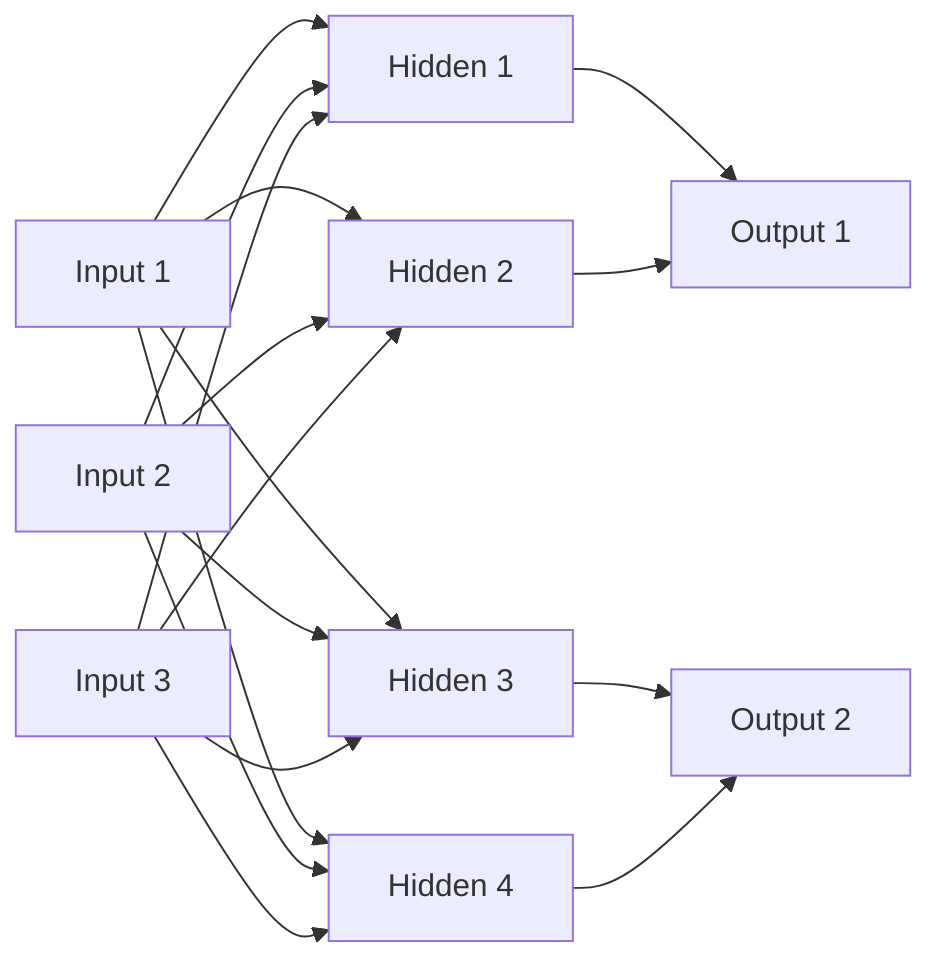
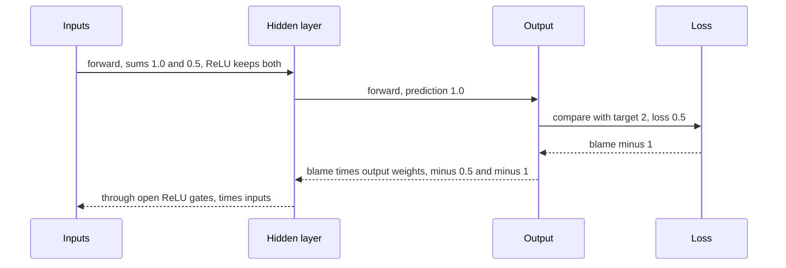
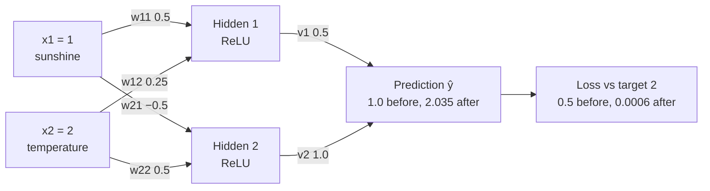
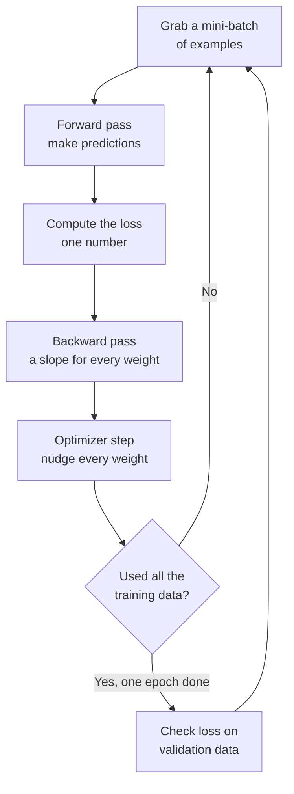
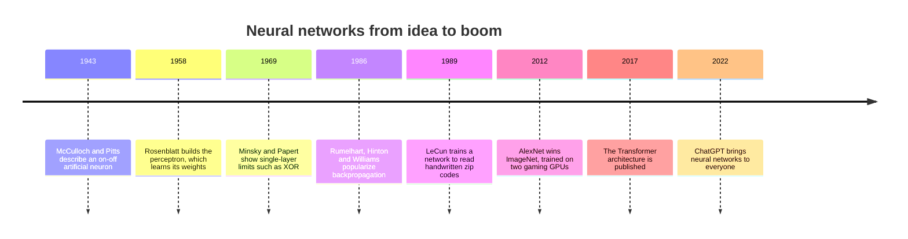

# Chapter 12: Neural Networks From Scratch

*By the end of this chapter you will be able to build, run and train a tiny neural network with a pencil, and you will know exactly what the word "training" means when people say a chatbot was trained.*

## What you'll learn

- Why a neural network is a different kind of program from the ones people write by hand, and why "learning" means turning knobs.
- How one artificial neuron works, computed by hand with a "should I go to the beach?" example.
- Why activation functions are essential, and what the main ones (step, sigmoid, tanh, ReLU, GELU, SiLU, softmax) do.
- How layers, width and depth fit together, and how to count the parameters of any simple network.
- Why a layer is really one matrix multiplication, and why that makes GPUs so important.
- How loss, gradient descent and backpropagation fit together, including a complete forward and backward pass through a tiny network, worked with real numbers.
- The vocabulary of the training loop: batch, step, epoch, training set, validation set and test set.
- How this pencil-sized recipe becomes the training run behind the chatbot you use every day.

## Before you start

This chapter stands on its own, but four earlier chapters make it easier. Chapter 5 (The Math of AI, Part 1: Functions, Vectors and Matrices) covers the dot products and matrix multiplications that a layer performs. Chapter 6 (The Math of AI, Part 2: Probability, Statistics and Learning by Slopes) introduces slopes, the chain rule, softmax, cross-entropy and gradient descent, which we use here in their natural home. Chapter 8 (Learning From Examples) explains training versus inference, and Chapter 10 (The Classical Machine Learning Toolkit) ends with the perceptron, where this chapter picks up. Each idea gets a short recap when it appears, so you can read straight through even if you skipped those chapters.

## From rules to learning

Imagine writing a spam filter by hand: "if the email contains the word *lottery*, mark it as spam." Spammers write "l0ttery", you add a rule, they hide the word in an image, you add another, and a year later you have thousands of rules that contradict each other.

Now try something harder. Write the rules for recognizing a cat in a photo. Pointy ears? Some cats have folded ears, and so do some dogs. Whiskers? They are invisible in half of all photos. Fur color? Cats come in every color. Nobody has ever managed to write that rulebook, because we recognize cats without knowing how we do it.

Machine learning turns the problem around (see Chapter 8). Instead of writing the rules, you write a flexible program full of adjustable numbers, show it thousands of examples with the right answers, and let an automatic procedure adjust the numbers until the program gives the right answers. The rules end up stored in the numbers, not in anyone's head.

A **neural network** is the most successful kind of flexible program ever invented. Every chatbot you have used, every photo app that finds faces, and every voice assistant that understands you is built from one.

> **Definition — Neural network:** A computer program made of many simple connected units ("neurons") that each multiply, add and squash numbers; its behavior is set by millions or billions of adjustable numbers that are tuned on example data. Despite the name, it is only loosely inspired by the brain.

> **Definition — Weight:** An adjustable number inside a neural network that sets how strongly one input influences one neuron. Large positive weights mean "this input matters a lot and pushes up"; negative weights push down.

> **Definition — Parameter:** Any number a model learns during training, mainly its weights and biases. When people say "a 70-billion-parameter model", they mean 70 billion such learned numbers.

> **Definition — Training:** The process of automatically adjusting a model's parameters, using example data, until its outputs become good. Training a frontier chatbot takes months on many thousands of chips.

> **Definition — Inference:** Using a trained model to produce an output, with its parameters frozen. Every time you send a message to a chatbot, the model is doing inference, not training.

> **Definition — Deep learning:** Machine learning with neural networks that have many layers stacked on top of each other. "Deep" refers to the number of layers, not to any deep understanding.


*Figure 12.1: In traditional programming a person writes the rules. In machine learning the rules are produced by training and stored as numbers.*

> **Analogy:** Picture a sound engineer's mixing desk with billions of sliders. Each slider changes the sound a tiny bit. Training is an automatic engineer that plays a song, listens to how far the mix is from the target, nudges every slider slightly in the helpful direction, and repeats this millions of times. The final slider positions are the trained model.

Here is the important connection to your daily life. When you press Enter in ChatGPT, Claude or Gemini, the sliders do not move. They were set months earlier in a training run, then frozen. Your message flows through the frozen network, and an answer comes out. This chapter explains what those sliders are, how the message flows through them, and how they got set.

> **Key idea:** A neural network is a big adjustable function. Training means turning its knobs (parameters) until its outputs match the examples. Using it afterwards (inference) leaves the knobs untouched.

## Everything becomes numbers

A neural network can only do arithmetic. It multiplies, adds and applies a few simple functions. So before anything can go into a network, it must become numbers. Chapter 3 showed how computers store text, images and sound as numbers. Here is the version that matters for neural networks.

An image is a grid of pixels (dots), and each pixel is stored as a brightness value. Here is a tiny 5-by-5 picture of the digit 1, where 0 is white and 9 is black:

```
  0  0  9  0  0
  0  9  9  0  0      flattened into one list of 25 numbers:
  0  0  9  0  0
  0  0  9  0  0      [0,0,9,0,0, 0,9,9,0,0, 0,0,9,0,0,
  0  9  9  9  0       0,0,9,0,0, 0,9,9,9,0]
```
*Figure 12.2: A tiny image is just a grid of brightness numbers, which can be laid out as one long list.*

The famous MNIST handwritten-digit images are 28 by 28 pixels, so each is a list of 28 × 28 = 784 numbers. A color photo of 1,000 by 1,000 pixels has three numbers per pixel (red, green, blue), so it is 3 million numbers.

Text goes through two steps. First a tokenizer chops it into tokens, small chunks such as words or parts of words, and each token gets an ID number (Chapter 18 covers this in detail). Then each ID is swapped for a list of a few thousand numbers that the model has learned, called an embedding (Chapter 14 and Chapter 15). Sound becomes a list of air-pressure measurements taken thousands of times per second (Chapter 46).

Mathematicians have names for these shapes of numbers, and AI people use them constantly.

> **Definition — Vector:** An ordered list of numbers, such as [0.2, −1.3, 4.0]. The 784 pixel values of an MNIST digit form a vector with 784 entries.

> **Definition — Matrix:** A rectangular grid of numbers with rows and columns, like a spreadsheet table. The weights of one neural-network layer are stored as a matrix.

> **Definition — Tensor:** The general name for a block of numbers with any number of dimensions: a single number, a vector (1-D), a matrix (2-D), or a stack of matrices (3-D and up). A batch of 32 color photos is a 4-D tensor: 32 photos × 3 colors × height × width.

> **Analogy:** Think of a spreadsheet. One row of numbers is a vector. A whole sheet is a matrix. A workbook with many sheets is a 3-D tensor, and a folder of workbooks is a 4-D tensor. Neural networks spend their whole lives moving numbers between such spreadsheets.

> **Key idea:** Whatever goes into a neural network, whether words, pictures or sound, is first turned into lists of numbers. Whatever comes out is also numbers, which software then turns back into words or pictures.

## The artificial neuron

The building block of every neural network is the artificial neuron. It does three things:

1. Multiply each input by its own weight.
2. Add up the results, plus one extra number called the bias.
3. Pass the total through an activation function, which squashes or bends it into the output.

That is the whole thing. Let's run one by hand.

### Should I go to the beach?

You are deciding whether to go to the beach on Saturday. Three facts matter:

- x1: Is it sunny? (1 for yes, 0 for no.) Today: **1**.
- x2: How warm is it, on a scale from 0 to 1? Today: **0.8**.
- x3: Do I have to work? (1 for yes, 0 for no.) Today: **1**.

You care about these facts by different amounts, and that is what the weights express:

- Sunshine matters a lot: w1 = **2**.
- Warmth matters somewhat: w2 = **1**.
- Having to work is a strong reason not to go: w3 = **−3** (negative because it pushes against going).
- You generally like the beach, so you start with a slight lean in favor: bias b = **0.5**.

Step 1 and 2, the weighted sum:

```
z = w1 × x1  +  w2 × x2  +  w3 × x3  +  b
  =  2 × 1   +   1 × 0.8 +  (−3) × 1 + 0.5
  =    2     +    0.8    −     3     + 0.5
  =  0.3
```

Step 3, the activation. We will use the **sigmoid** function, which squeezes any number into the range 0 to 1, so the output can be read as "how strongly the neuron says yes". The formula is sigmoid(z) = 1 ÷ (1 + e^(−z)), where e ≈ 2.718. You can type it into any calculator or spreadsheet: sigmoid(0.3) = 1 ÷ (1 + 2.718^(−0.3)) = 1 ÷ (1 + 0.741) = **0.57**.

The neuron says 0.57: a slight lean towards the beach. Now change the inputs and watch the decision move:

| Situation | Weighted sum z | Sigmoid output | Reading |
|---|---|---|---|
| Sunny, warm 0.8, workday | 0.3 | 0.57 | Slight yes |
| Sunny, warm 0.8, day off (x3 = 0) | 3.3 | 0.96 | Strong yes |
| Cloudy (x1 = 0), warm 0.8, workday | −1.7 | 0.15 | Fairly firm no |


*Figure 12.3: One artificial neuron deciding about the beach. Each input is multiplied by its weight, the results and the bias are summed, and the sigmoid turns the total into a 0-to-1 output.*

> **Definition — Artificial neuron:** The basic unit of a neural network. It multiplies each input by a weight, adds them up together with a bias, and passes the total through an activation function to produce one output number.

> **Definition — Weighted sum:** The result of multiplying each input by its weight and adding everything up. It is the same operation as the dot product from Chapter 5, plus the bias.

> **Definition — Bias (in a neuron):** An extra adjustable number added to a neuron's weighted sum, which shifts how easily the neuron switches on. It has nothing to do with social bias or unfairness.

> **Definition — Sigmoid:** An S-shaped activation function that squeezes any number into the range 0 to 1: large negative inputs give nearly 0, large positive inputs give nearly 1, and 0 gives exactly 0.5.

> **Analogy:** A neuron is like one member of a voting committee. Each input argues for or against, and the weight is how loudly that argument counts. The bias is the member's mood before the meeting started. The activation function decides how firmly the member votes once all the arguments are in.

Notice what a neuron is *not*. It does not understand beaches, sunshine or work. It is arithmetic. The meaning lives in the choice of weights. In this example you picked the weights by thinking about your own preferences. The magic of neural networks is that training picks the weights automatically, from examples, for millions of neurons at once.

> **Watch out:** "Neural networks work like the brain" is a common misconception. Artificial neurons were loosely inspired by brain cells in the 1940s, but a real neuron is a living cell with complex chemistry and timing. An artificial neuron is three lines of arithmetic. And the way networks learn (backpropagation, later in this chapter) is not how brains are known to learn. Chapter 54 compares the two properly.

### A little history: from logic units to the perceptron

In 1943 Warren McCulloch and Walter Pitts described an idealized neuron that switched fully on or fully off, and showed that networks of them could compute logical functions. Their neurons had fixed, hand-chosen weights. In 1958 Frank Rosenblatt built the **perceptron**, a neuron that *learned* its weights from examples. Its learning rule was simple: show it an example, and if it answers wrongly, nudge each weight a little in the direction that would have made the answer right. Rosenblatt built it as a custom machine (the Mark I Perceptron) wired to a camera of 400 light sensors, and it learned to tell simple shapes apart, and the newspapers of the day predicted thinking machines within a few years (see Chapter 7 for that story).

> **Definition — Perceptron:** The earliest trainable artificial neuron (Frank Rosenblatt, 1958). It computes a weighted sum and outputs 1 if the sum passes a threshold and 0 otherwise, and it learns by nudging its weights after each mistake.

> **Definition — Step function:** An activation that outputs 0 below a threshold and 1 above it, like a light switch. The perceptron used it. It cannot be trained with slopes, because its slope is zero almost everywhere.

### What one neuron can and cannot do

With two inputs, you can draw every possible input as a point on a flat sheet of paper (input 1 across, input 2 up). A single neuron splits that sheet into two halves with a **straight line**: on one side the weighted sum is positive, on the other side negative. This line is the neuron's **decision boundary**. Changing the weights rotates and shifts the line. Learning, for one neuron, means moving the line until the "yes" examples are on one side and the "no" examples on the other.

> **Definition — Decision boundary:** The border in input space where a model's answer flips from one class to another. A single neuron can only draw a straight-line (flat) boundary.

Straight lines can solve many problems. They cannot solve all of them. The most famous failure is a tiny puzzle called **XOR** ("exclusive or"): output 1 if exactly one of the two inputs is 1, and 0 otherwise.

| Input A | Input B | XOR answer |
|---|---|---|
| 0 | 0 | 0 |
| 0 | 1 | 1 |
| 1 | 0 | 1 |
| 1 | 1 | 0 |

Draw the four points on paper. The two "1" answers sit at opposite corners (top-left and bottom-right), and the two "0" answers sit at the other two corners. No single straight line can put both 1s on one side and both 0s on the other. Try it.

> **Definition — XOR (exclusive or):** A logic rule that outputs 1 when exactly one of two inputs is 1. It is the classic example of a problem a single neuron cannot solve, because the yes-cases and no-cases cannot be separated by one straight line.

In 1969 Marvin Minsky and Seymour Papert published *Perceptrons*, a book that proved this kind of limitation carefully. It helped push neural-network research into the shadows for more than a decade. The way out was known in principle (use more than one layer), but nobody yet had a good way to train multiple layers. The next sections show both halves of the solution: layers with a bend in them, and a way to train them.

## Activation functions: the bend that makes everything work

Why not skip the activation function and just pass the weighted sum along? Because then stacking layers would be pointless. Here is why, with numbers.

Suppose layer 1 computes y = 3x + 1, and layer 2 takes that result and computes z = 2y + 4. Substitute the first into the second:

```
z = 2 × (3x + 1) + 4
  = 6x + 2 + 4
  = 6x + 6
```

Two layers collapsed into one straight line, z = 6x + 6. You could have used a single layer with weight 6 and bias 6. This is true no matter how many layers you stack and how many neurons each has: without something to bend the line, a hundred layers behave exactly like one.

> **Definition — Linear function:** A function whose output changes in exact proportion to its inputs, like y = 6x + 6; its graph is a straight line (or a flat plane with more inputs). Stacking linear functions only ever gives another linear function.

> **Definition — Non-linear function:** Any function whose graph is not a straight line, such as one with a bend, a curve or a threshold. Neural networks need non-linearity to model the curved, messy patterns of the real world.

> **Definition — Activation function:** The simple non-linear function applied to each neuron's weighted sum, such as sigmoid or ReLU. It supplies the bends that let stacked layers build complicated shapes instead of collapsing into one straight line.

> **Analogy:** If all you have are straight rulers, gluing more rulers end to end still gives you a straight line. An activation function is a hinge between the rulers. With enough hinges you can trace any shape you like.

### Solving XOR with two bent neurons

Here is the payoff. The simplest modern activation is **ReLU**: if the number is positive, keep it; if it is negative, output 0. Using ReLU, two hidden neurons and one output neuron can solve XOR. The weights below were chosen by hand to show it is possible:

- Hidden neuron 1: h1 = ReLU(A + B). It measures "how many inputs are on".
- Hidden neuron 2: h2 = ReLU(A + B − 1). It only switches on when *both* inputs are on.
- Output: out = h1 − 2 × h2.

Check every row:

| A | B | h1 = ReLU(A+B) | h2 = ReLU(A+B−1) | out = h1 − 2×h2 | XOR |
|---|---|---|---|---|---|
| 0 | 0 | 0 | ReLU(−1) = 0 | 0 − 0 = 0 | 0 |
| 0 | 1 | 1 | ReLU(0) = 0 | 1 − 0 = 1 | 1 |
| 1 | 0 | 1 | ReLU(0) = 0 | 1 − 0 = 1 | 1 |
| 1 | 1 | 2 | ReLU(1) = 1 | 2 − 2 = 0 | 0 |

Every answer is right. The trick is that the hidden neurons invent new, more useful descriptions of the input ("at least one is on", "both are on"), and the output neuron combines them with a straight line. Without the ReLU, h2 would be A + B − 1 even when it is negative, and the whole thing would collapse back into one straight line that cannot solve XOR.

> **Key idea:** Hidden layers with non-linear activations let a network invent its own intermediate features and combine them. That is the entire reason deep networks can do things a single neuron cannot.

### The activation function gallery

Researchers have tried many activation functions. You will meet these names in papers and model descriptions:

> **Definition — Tanh:** An S-shaped activation like sigmoid, but ranging from −1 to 1 and centered on zero. Short for "hyperbolic tangent".

> **Definition — ReLU (Rectified Linear Unit):** The activation that outputs the input if it is positive and 0 otherwise. It is extremely cheap to compute, and its popularity from around 2010 onward made deep networks much easier to train.

> **Definition — Leaky ReLU:** A ReLU variant that lets a small fraction of negative inputs through (for example 0.01 × the input), so a neuron never goes completely silent.

> **Definition — GELU (Gaussian Error Linear Unit):** A smooth, slightly curved version of ReLU that dips a little below zero for small negative inputs. It was used in GPT-2, BERT and many other Transformer models.

> **Definition — SiLU (also called Swish):** A smooth ReLU-like activation computed as the input times the sigmoid of the input. Its gated cousin SwiGLU is the standard building block in the feed-forward part of most current large language models.

| Function | Value at −2 | Value at 0 | Value at 2 | Range | Where you meet it |
|---|---|---|---|---|---|
| Step | 0 | (jump) | 1 | 0 or 1 | 1950s perceptron |
| Sigmoid | 0.119 | 0.5 | 0.881 | 0 to 1 | Yes/no outputs, gates |
| Tanh | −0.964 | 0 | 0.964 | −1 to 1 | Older networks, RNNs |
| ReLU | 0 | 0 | 2 | 0 to infinity | Most image networks |
| Leaky ReLU (0.01) | −0.02 | 0 | 2 | any | Fix for silent neurons |
| GELU | −0.046 | 0 | 1.954 | about −0.17 up | GPT-2, BERT |
| SiLU / Swish | −0.238 | 0 | 1.762 | about −0.28 up | Inside SwiGLU in modern LLMs |

```
  Step                 Sigmoid               ReLU
 1|      +-----       1|          .---      2|          /
  |      |             |        /           |        /
  |      |          0.5|      /             |      /
  |      |             |    /               |    /
 0+------+-----       0+---'----------     0+---+--------
 -2      0     2      -4      0      4     -2   0      2
```
*Figure 12.4: Three activation shapes. The step jumps, the sigmoid bends smoothly between 0 and 1, and ReLU is flat at zero then rises in a straight line.*

Why did ReLU win over the older sigmoid? Look at the sigmoid's flat tails. Far from zero, the curve is almost horizontal, so its slope is nearly zero. As you will see in the backpropagation section, learning signals get multiplied by these slopes, and multiplying by nearly-zero many times kills the signal. ReLU's slope is exactly 1 for every positive input, so signals pass through cleanly. Its one weakness is that a neuron whose sum is always negative outputs 0 forever and stops learning, a "dead" neuron, which is why variants like Leaky ReLU and GELU exist. Chapter 13 returns to this problem of fading signals in depth.

> **Watch out:** People sometimes think the choice of activation function is what makes a model smart. It matters for how easily a network trains, but modern smooth variants (GELU, SiLU) differ from plain ReLU by small margins. What matters most is that there is *some* bend.

### Softmax: turning scores into probabilities

The last layer of a network often needs to choose between options: which digit is in this picture, or which token should come next. The network produces one raw score per option, called a **logit**, and the **softmax** function turns those scores into probabilities that add up to 1. Chapter 6 worked through softmax in detail. Here is how it looks inside your chatbot.

Suppose that after reading "The capital of France is", a language model gives these logits for three candidate next tokens: Paris 5.0, Lyon 2.0, the 1.0. Softmax raises e to the power of each score and divides by the total:

```
e^5.0 = 148.41    e^2.0 = 7.39    e^1.0 = 2.72    total = 158.52

P(Paris) = 148.41 / 158.52 = 0.936   (93.6%)
P(Lyon)  =   7.39 / 158.52 = 0.047   ( 4.7%)
P(the)   =   2.72 / 158.52 = 0.017   ( 1.7%)
```

A real model does this over its whole vocabulary of 100,000 or more tokens, every time it produces a single token.

> **Definition — Logit:** A raw, unbounded score that a network gives to one option before softmax. A higher logit means the network favors that option more.

> **Definition — Softmax:** A function that turns a list of scores into positive numbers that add up to 1, so they can be read as probabilities. Bigger scores get exponentially bigger shares.

## Layers, width and depth

One neuron draws one straight line. To do more, we arrange neurons in **layers**. Every neuron in a layer looks at the same inputs (each with its own weights), and the outputs of one layer become the inputs of the next.

- The **input layer** is not really neurons at all; it is just the numbers you feed in (25 pixels, or 3 beach facts).
- The **hidden layers** are the neurons in the middle. They are "hidden" because you never see their outputs directly; they are the network's private working notes.
- The **output layer** produces the answer: one number for a prediction, or one score per option for a choice.

When every neuron in a layer is connected to every input from the previous layer, the layer is called **dense** or **fully connected**. A network built only from dense layers is called a multilayer perceptron, or MLP.

> **Definition — Layer:** A group of neurons that all take the same inputs and work side by side. Networks stack layers so that each one builds on what the previous one computed.

> **Definition — Input layer:** The entry point of a network, holding the raw numbers being fed in, such as pixel values or token embeddings. It has no weights of its own.

> **Definition — Hidden layer:** Any layer between the input and the output. Its outputs are internal working values that the network invents during training.

> **Definition — Output layer:** The final layer, which produces the network's answer, such as one number for a price or one score per possible next token.

> **Definition — Dense layer (fully connected layer):** A layer in which every neuron receives every output of the previous layer. Mathematically it is one matrix multiplication plus a bias, followed by an activation.

> **Definition — MLP (multilayer perceptron):** A neural network made of stacked dense layers. The same name is used for the feed-forward block inside every Transformer layer.

Two words describe the shape of a network. **Width** is how many neurons a layer has. **Depth** is how many layers there are. A network with a 3-number input, a hidden layer of 4 neurons and an output layer of 2 neurons is written "3 → 4 → 2". Those choices are made by people before training, so they are **hyperparameters**, not parameters.

> **Definition — Width:** The number of neurons in a layer. A wider layer can detect more different patterns at the same level.

> **Definition — Depth:** The number of layers in a network. A deeper network can build more complex features out of simpler ones, step by step.

> **Definition — Hyperparameter:** A setting chosen by people before training rather than learned, such as the number of layers, the width of each layer, or the learning rate.


*Figure 12.5: A 3 → 4 → 2 network. Each arrow carries one weight. For readability only some hidden-to-output arrows are drawn; in a dense layer all four hidden neurons connect to both outputs.*

### Counting parameters

You can count the parameters of any dense network with one rule. For each layer:

**parameters = (number of inputs × number of neurons) + number of neurons**

The first part counts the weights (one per arrow), and the second counts the biases (one per neuron).

| Network | Layer by layer | Total parameters |
|---|---|---|
| 3 → 4 → 2 | (3×4 + 4) + (4×2 + 2) = 16 + 10 | 26 |
| 3 → 4 → 4 → 2 | (3×4 + 4) + (4×4 + 4) + (4×2 + 2) = 16 + 20 + 10 | 46 |
| MNIST digits, 784 → 128 → 10 | (784×128 + 128) + (128×10 + 10) = 100,480 + 1,290 | 101,770 |
| One square layer of width 4,096 | 4,096 × 4,096 weights | about 16.8 million |
| A "70B" language model | many such layers stacked | about 70 billion |

The jump from the third row to the fourth explains a lot about modern AI. A language model whose internal vectors have 4,096 numbers needs about 16.8 million weights for just one square matrix, and each of its dozens of layers contains several such matrices plus a larger feed-forward block. Stack enough of them and you reach tens or hundreds of billions of parameters. The recipe is the same as the 3 → 4 → 2 network; only the numbers are bigger.

> **Try it:** Count the parameters of a 10 → 20 → 20 → 5 network with pencil and paper (answer: 220 + 420 + 105 = 745). Then ask your chatbot: "How many parameters does a dense neural network with layer sizes 10, 20, 20, 5 have? Show the calculation." Check that its arithmetic matches yours.

> **At the frontier (2026):** The largest open-weight models are now counted in trillions of parameters. DeepSeek V4-Pro has about 1.6 trillion parameters in total, and Kimi K2 has about 1 trillion. Both are "mixture of experts" models that only use a fraction of their parameters for each token (about 49 billion and 32 billion respectively), a design explained in Chapter 17. The closed frontier labs (OpenAI, Anthropic, Google) do not publish the sizes or architectures of their flagship models, so any number you see for them is a guess.

## The forward pass: a layer is one matrix multiplication

Running inputs through a network to get an output is called the **forward pass**. Data flows left to right, layer by layer. Let's do one with the tiny network we will train later in this chapter.

### Meet the ice-cream network

A beach kiosk wants to predict how many ice creams it will sell. The network has two inputs:

- x1 = sunshine (1 means sunny). Today: **1**.
- x2 = temperature in tens of degrees (2 means 20 °C). Today: **2**.

The true sales for this day turned out to be **2** (that is, 200 ice creams). This right answer is called the **target** or **label**.

The network is 2 → 2 → 1: two inputs, two hidden ReLU neurons, and one output neuron with no activation (it outputs a plain number). Its nine parameters start out like this:

| Parameter | Meaning | Starting value |
|---|---|---|
| w11 | sunshine → hidden neuron 1 | 0.5 |
| w12 | temperature → hidden neuron 1 | 0.25 |
| b1 | bias of hidden neuron 1 | 0 |
| w21 | sunshine → hidden neuron 2 | −0.5 |
| w22 | temperature → hidden neuron 2 | 0.5 |
| b2 | bias of hidden neuron 2 | 0 |
| v1 | hidden neuron 1 → output | 0.5 |
| v2 | hidden neuron 2 → output | 1.0 |
| c | bias of the output | 0 |

In a real network these starting values would be small random numbers. We picked tidy ones so you can follow every step.

> **Definition — Label (target):** The correct answer attached to a training example, such as "cat" for a photo or 200 ice creams for a day's sales. The network's output is compared with it.

### The hidden layer, as a matrix multiplication

Arrange the four hidden-layer weights as a matrix, one row per hidden neuron, and the inputs as a vector:

```
   weights W          inputs x     weighted sums z
 [ 0.5    0.25 ]       [ 1 ]      [ 0.5×1 + 0.25×2 ]   [ 1.0 ]
 [ −0.5   0.5  ]   ×   [ 2 ]   =  [ −0.5×1 + 0.5×2 ] = [ 0.5 ]
```
*Figure 12.6: The hidden layer's work is one matrix-times-vector multiplication. Each row of the matrix is one neuron's weights.*

Add the biases (both 0 here), so z1 = 1.0 and z2 = 0.5. Apply ReLU: both are positive, so the hidden outputs are h1 = **1.0** and h2 = **0.5**.

### The output layer

The output neuron takes a weighted sum of the hidden outputs:

```
prediction ŷ = v1 × h1 + v2 × h2 + c
             = 0.5 × 1.0 + 1.0 × 0.5 + 0
             = 1.0
```

The network predicts 1.0 (100 ice creams). The truth was 2. It is wrong by 1. (The little hat on ŷ, said "y-hat", is the usual symbol for "the model's guess of y".)

> **Definition — Forward pass:** Running inputs through a network from the first layer to the last to produce an output. Each layer multiplies by its weight matrix, adds biases and applies its activation function.

> **Definition — Matrix multiplication (matmul):** Multiplying a grid of numbers by a list (or another grid) by taking many dot products at once. It is the core arithmetic of neural networks, and it is exactly what GPUs are built to do quickly.

### Why this matters for chips

Every dense layer, in every network, does this same thing: one matrix multiplication, add biases, apply an activation. When you send a batch of many inputs at once, the input vector becomes an input matrix, and the layer becomes a matrix-times-matrix multiplication. This is thousands of independent multiply-and-add operations that can all happen at the same moment.

A CPU, the general-purpose chip in your laptop, does a few of these at a time. A **GPU** does tens of thousands at a time. That single fact, explained in Chapter 32, is why NVIDIA became one of the most valuable companies in the world and why AI data centers are packed with GPUs.

> **Definition — GPU (Graphics Processing Unit):** A chip with thousands of small processing cores built to do many simple calculations at once. Originally made for video-game graphics, it turned out to be ideal for the matrix multiplications of neural networks.

> **Definition — FLOP (floating-point operation):** One arithmetic operation, such as a multiplication or an addition, on numbers with decimal points. AI compute is measured in FLOPs, often in the trillions or far more.

Here is a rule of thumb from Chapter 5. A forward pass costs about **2 FLOPs per parameter** for each token: one multiplication and one addition per weight. So a 70-billion-parameter model needs about 2 × 70 billion = 140 billion FLOPs to produce one token. A 500-token answer to your question takes about 500 × 140 billion = 70 trillion FLOPs. That is what happens in a data center every time you ask a chatbot something, and Chapter 23 explains how it is done fast and cheaply.

> **Key idea:** A neural-network layer is a matrix multiplication followed by a simple bend. A whole network is a chain of those. That is why AI hardware is, at heart, matrix-multiplication hardware.

## Loss: one number for "how wrong"

To improve the network, we first need to measure how bad it is, with a single number. That number is the **loss**. Training is the job of making the loss small.

### Squared error, for predicting numbers

For predicting a number, the standard choice is the squared error: subtract the target from the prediction and square the result. Squaring makes every error positive and punishes big errors much more than small ones (an error of 3 costs 9, while an error of 1 costs 1). We will use half the squared error, a common convention that makes the slope tidier later:

```
loss L = ½ × (ŷ − y)²
       = ½ × (1.0 − 2)²
       = ½ × 1
       = 0.5
```

Our ice-cream network has a loss of 0.5. With many examples, you average the squared errors across all of them, which gives the **mean squared error** (MSE).

> **Definition — Loss function:** A formula that turns "how wrong is the model?" into a single number, where lower is better. Training means adjusting parameters to make the loss smaller on average.

> **Definition — Mean squared error (MSE):** The standard loss for predicting numbers: the average, over all examples, of the squared difference between prediction and truth. Big mistakes cost much more than small ones.

### Cross-entropy, for choosing between options

When the network picks between options, such as which digit is shown or which token comes next, the standard loss is **cross-entropy**. Chapter 6 introduced it as surprise. You look at the probability the network gave to the *correct* answer and take the negative natural logarithm: loss = −ln(probability of the right answer).

| Probability given to the right answer | Cross-entropy loss | How surprised |
|---|---|---|
| 0.9 | 0.105 | Barely |
| 0.5 | 0.693 | Somewhat |
| 0.1 | 2.303 | Quite |
| 0.01 | 4.605 | Very |

In the France example above, the model gave Paris a probability of 0.936, so its loss on that token is −ln(0.936) = 0.066: almost no surprise. If it had given the right answer only 4.7%, the loss would have been about 3.07.

This is exactly how chatbots are pre-trained (Chapter 19). The model reads trillions of tokens of text. At every position it predicts a probability for every possible next token, and its loss is the surprise at the token that actually came next. The training loss you see reported in research papers is that surprise, averaged over enormous numbers of tokens. A related number, **perplexity**, is e raised to the power of the average loss. A loss of 2.0 gives a perplexity of about 7.4, which you can read as "the model is about as unsure as if it were choosing between 7.4 equally likely tokens each time".

> **Definition — Cross-entropy loss:** The standard loss for classification and next-token prediction: the negative logarithm of the probability the model gave to the correct answer. It measures how surprised the model was by the truth.

> **Definition — Perplexity:** A language-model score equal to e raised to the average cross-entropy loss. Roughly, it is the number of equally likely options the model feels it is choosing between at each step; lower is better.

> **Key idea:** Everything a network learns, it learns by trying to make one number go down. For a chatbot in pre-training, that number is its average surprise at the next token of human-written text.

> **Watch out:** A low loss on the training examples does not guarantee good answers on new examples. A network can memorize its training data, the problem of overfitting from Chapter 9. That is why we always keep some examples aside for testing, as the training-loop section below explains, and why Chapter 13 is largely about generalizing well.

## Gradient descent: walking downhill in fog

We have a loss of 0.5 and nine knobs. Which way should each knob turn? Chapter 6 gave the answer in general: compute the slope of the loss with respect to each knob, and step each knob a little in the downhill direction. Here is a quick recap in one dimension, then the real problem.

### One knob

Suppose a model has a single knob w, and its loss is L(w) = (w − 3)². The best value is obviously w = 3, where the loss is 0, but the training procedure does not know that. It only knows how to compute the slope at the current spot, which for this loss is 2 × (w − 3). The update rule is:

**new w = old w − learning rate × slope**

The minus sign means "go against the slope", so downhill. The **learning rate** sets the size of the step. Start at w = 0 (loss 9) and try three learning rates:

| Step | Learning rate 0.01 | Learning rate 0.1 | Learning rate 1.1 |
|---|---|---|---|
| 0 | w = 0, loss 9 | w = 0, loss 9 | w = 0, loss 9 |
| 1 | w = 0.06, loss 8.64 | w = 0.6, loss 5.76 | w = 6.6, loss 12.96 |
| 2 | w = 0.12, loss 8.30 | w = 1.08, loss 3.69 | w = −1.32, loss 18.66 |
| 3 | w = 0.18, loss 7.97 | w = 1.46, loss 2.36 | w = 8.18, loss 26.87 |
| 5 | w = 0.29, loss 7.35 | w = 2.02, loss 0.97 | w = 10.47, loss 55.73 |

With 0.01 the walker creeps. With 0.1 it settles nicely towards 3. With 1.1 every step overshoots the valley by more than it gained, and the loss explodes. Chapter 13 is largely about choosing step sizes well.

```
 loss
   9 |o                                  /
     | \                               /
   6 |  o   step 1: w = 0.6          /
     |   \                         /
   4 |    o   step 2: w = 1.08   /
     |     \                   /
   2 |      o  step 3        /
     |        o  o        /
   0 +-----------o------------------------- w
     0           3                    6
```
*Figure 12.7: Gradient descent on a one-knob loss with learning rate 0.1. Each step goes downhill, and the steps shrink as the slope flattens near the bottom at w = 3.*

> **Definition — Derivative (slope):** How much a function's output changes when you nudge its input a tiny amount. A derivative of −2 means "increase the input by 0.01 and the output drops by about 0.02".

> **Definition — Gradient:** The list of slopes of the loss with respect to every parameter at once. It points in the direction where the loss rises fastest, so training steps the opposite way.

> **Definition — Gradient descent:** The procedure of repeatedly computing the gradient and moving every parameter a small step in the downhill direction, so that the loss shrinks step by step.

> **Definition — Learning rate:** The size of each gradient-descent step, chosen before training. Too small and training crawls; too big and it overshoots and can blow up. It is usually the most important hyperparameter.

> **Analogy:** You are on a hillside in thick fog and want to reach the valley floor. You cannot see the valley, but you can feel the slope under your feet. So you take a step in the steepest downhill direction, feel again, and step again. The learning rate is the length of your stride. Gradient descent is this walk, in a landscape with billions of directions instead of two.

### Nine knobs, or seventy billion

Our ice-cream network has nine knobs, so its gradient is a list of nine slopes. A 70-billion-parameter model has a gradient of 70 billion slopes, and it needs a fresh one at every training step. How do we get them?

The obvious method is to nudge one knob at a time. Increase w11 by 0.01, rerun the forward pass, see how much the loss changes, and put it back. Do the same for every other knob. This works, and it is a great way to check your work. But it needs one extra forward pass per parameter. For a 70-billion-parameter model, that is 70 billion forward passes to take a *single* step, and training needs hundreds of thousands of steps. The universe would end first.

We need a way to get every slope at once, for roughly the price of one extra pass through the network. That method is backpropagation.

## Backpropagation: passing the blame backward

**Backpropagation** (backprop for short) is the method that computes every slope in a network in one sweep from the output back to the input. It is the engine of all modern AI training. The idea is easier than its reputation.

> **Analogy:** A restaurant serves a soup that is far too salty. Whose fault is it? The head chef added some salt at the end. The sous-chef made the stock, which was already salty. The supplier sent salted butter. To fix it, you trace the blame backward, starting at the bowl: how much did the final seasoning contribute, and how much was already there when it arrived? Then, for the stock, how much came from the butter? Each person's share of blame depends on how much their step influenced the final taste. Backpropagation traces blame backward through a network in the same way, weight by weight.

### The chain rule as gears

The mathematical tool behind backprop is the **chain rule** from Chapter 6. Picture three gears in a row. When gear A turns once, gear B turns 3 times. When gear B turns once, gear C turns 2 times. How many times does C turn when A turns once? 3 × 2 = 6. The rates multiply.

A neural network is a long chain of simple steps: multiply by a weight, add, apply ReLU, multiply again, compare with the target. Each step has its own "gear ratio", its local slope. To find how much the loss changes when you nudge a particular weight, you multiply the local slopes along the path from that weight to the loss.

> **Definition — Chain rule:** The calculus rule that the rate of change through a chain of steps equals the product of the rates of change of each step. If A changes B three times as fast and B changes C twice as fast, then A changes C six times as fast.

> **Definition — Backpropagation (backprop):** The algorithm that computes the gradient of the loss with respect to every parameter in a network by applying the chain rule backward, from the output to the first layer, reusing intermediate results so the whole job costs about as much as two forward passes.

You only need four local slopes to backpropagate through our ice-cream network:

| Step in the network | Local rule for passing blame backward |
|---|---|
| Loss L = ½ × (ŷ − y)² | Slope with respect to ŷ is (ŷ − y) |
| Weighted sum, such as ŷ = v1 × h1 + ... | Blame reaching a weight = blame at the sum × that weight's input; blame reaching an input = blame at the sum × that input's weight |
| Adding a bias | The bias receives exactly the blame at the sum |
| ReLU | If the neuron's sum was positive, blame passes through unchanged (slope 1); if it was negative, blame stops (slope 0) |

The phrase "blame at the sum" is shorthand for the slope of the loss with respect to that sum. A negative blame means "making this bigger would reduce the loss", so the update will increase it.

### The worked example: one complete forward and backward pass

Here is the whole thing with real numbers. Have a pencil ready; every step is one multiplication.

**Step 1: forward pass (from earlier).** Inputs x1 = 1, x2 = 2. Hidden sums z1 = 1.0 and z2 = 0.5. After ReLU, h1 = 1.0 and h2 = 0.5. Prediction ŷ = 1.0. Target y = 2. Loss L = 0.5.

**Step 2: blame at the output.** The slope of the loss with respect to the prediction is ŷ − y = 1.0 − 2 = **−1**. The negative sign says "a bigger prediction would lower the loss", which matches common sense: we predicted too little.

**Step 3: blame for the output layer's parameters.** Each output weight gets the output blame times the input that flowed through it:

```
slope for v1 = (−1) × h1 = (−1) × 1.0 = −1.0
slope for v2 = (−1) × h2 = (−1) × 0.5 = −0.5
slope for c  = (−1)                    = −1.0
```

**Step 4: blame passed back to the hidden neurons.** Each hidden output gets the output blame times the weight connecting it to the output:

```
blame at h1 = (−1) × v1 = (−1) × 0.5 = −0.5
blame at h2 = (−1) × v2 = (−1) × 1.0 = −1.0
```

**Step 5: through the ReLU gates.** Both hidden sums were positive (1.0 and 0.5), so both gates are open and the blame passes through unchanged: blame at z1 = −0.5 and blame at z2 = −1.0. If z2 had been negative, its blame would have been 0 and none of its weights would change on this step.

**Step 6: blame for the hidden layer's parameters.** Each first-layer weight gets its neuron's blame times the input on its arrow:

```
slope for w11 = (−0.5) × x1 = (−0.5) × 1 = −0.5
slope for w12 = (−0.5) × x2 = (−0.5) × 2 = −1.0
slope for b1  = (−0.5)                   = −0.5
slope for w21 = (−1.0) × x1 = (−1.0) × 1 = −1.0
slope for w22 = (−1.0) × x2 = (−1.0) × 2 = −2.0
slope for b2  = (−1.0)                   = −1.0
```

That is the complete gradient: nine slopes, one for each knob, found in a single backward sweep.


*Figure 12.8: The forward pass carries numbers from left to right. The backward pass carries blame (slopes) from the loss back to every weight.*

**Step 7: the update.** Use gradient descent with a learning rate of 0.1: new value = old value − 0.1 × slope. Because every slope is negative, every parameter goes up.

| Parameter | Old value | Slope | Change (−0.1 × slope) | New value |
|---|---|---|---|---|
| w11 | 0.5 | −0.5 | +0.05 | 0.55 |
| w12 | 0.25 | −1.0 | +0.10 | 0.35 |
| b1 | 0 | −0.5 | +0.05 | 0.05 |
| w21 | −0.5 | −1.0 | +0.10 | −0.40 |
| w22 | 0.5 | −2.0 | +0.20 | 0.70 |
| b2 | 0 | −1.0 | +0.10 | 0.10 |
| v1 | 0.5 | −1.0 | +0.10 | 0.60 |
| v2 | 1.0 | −0.5 | +0.05 | 1.05 |
| c | 0 | −1.0 | +0.10 | 0.10 |

**Step 8: run the forward pass again with the new values.**

```
z1 = 0.55 × 1 + 0.35 × 2 + 0.05 = 0.55 + 0.70 + 0.05 = 1.30  -> h1 = 1.30
z2 = −0.40 × 1 + 0.70 × 2 + 0.10 = −0.40 + 1.40 + 0.10 = 1.10 -> h2 = 1.10
ŷ  = 0.60 × 1.30 + 1.05 × 1.10 + 0.10 = 0.78 + 1.155 + 0.10 = 2.035
L  = ½ × (2.035 − 2)² = ½ × 0.001225 = 0.0006
```

The prediction jumped from 1.0 to 2.035, and the loss fell from 0.5 to about 0.0006. One step of training, and the network is almost exactly right on this example.

Look closely at what happened, because the same things happen inside every training run:

1. **Every knob moved in the helpful direction.** Nobody told the network that sunshine and temperature should push sales up; the gradient worked it out.
2. **Knobs with more influence moved more.** w22 changed the most (+0.2), because it sat on the arrow carrying the larger input (temperature, 2) into the neuron with the larger output weight (v2 = 1.0). Blame is shared in proportion to influence.
3. **The step slightly overshot.** The target was 2 and we landed on 2.035. Each slope describes what happens if you move *one* knob while the others stay still. We moved all nine at once, and their effects added up to a bit more than needed. A bigger learning rate would overshoot further, and a smaller one would land short. This is the learning-rate trade-off from the gradient-descent table, and Chapter 13 explores it.
4. **One example is not the goal.** A real network sees thousands of different days. A step that is perfect for one day might hurt another. That is why real training averages the gradient over a batch of examples, as the next section explains.


*Figure 12.9: The ice-cream network with its starting weights. After one backward pass and one update, the prediction moved from 1.0 to 2.035.*

### Checking backpropagation by nudging

You can verify any slope with the slow method from earlier. Nudge v1 from 0.5 to 0.51 and rerun the forward pass with the original numbers: ŷ becomes 0.51 × 1.0 + 1.0 × 0.5 = 1.01, and the loss becomes ½ × (1.01 − 2)² = 0.49005. The loss changed by 0.49005 − 0.5 = −0.00995 for a nudge of 0.01, a slope of about −1. Backprop said −1.0. It matches.

Try w22: nudge it from 0.5 to 0.51. Then z2 = −0.5 + 0.51 × 2 = 0.52, the prediction becomes 0.5 × 1.0 + 1.0 × 0.52 = 1.02, and the loss becomes ½ × (0.98)² = 0.4802. The change is −0.0198, a slope of about −2. Backprop said −2.0. It matches again.

Engineers do exactly this, called **gradient checking**, when they write new kinds of layers, to make sure their backward computations are correct.

> **Definition — Gradient checking:** Verifying computed slopes by nudging one parameter by a tiny amount, rerunning the forward pass, and comparing the change in loss with the slope that backpropagation produced.

### Why backpropagation is such a big deal

The nudging method needs one extra forward pass per parameter. Backpropagation needs one backward pass, which costs about twice as much as a forward pass, no matter how many parameters there are. For our nine-parameter network that is a modest saving. For a 70-billion-parameter model it is the difference between 70 billion forward passes and the equivalent of two.

So one training step costs about three forward passes' worth of arithmetic: one forward and two for the backward. Since a forward pass is about 2 FLOPs per parameter per token, a training step is about 6 FLOPs per parameter per token. That is where the famous rule from Chapter 5 comes from: training compute ≈ 6 × N × D, where N is the number of parameters and D the number of training tokens. Chapter 19 and Chapter 37 use it to estimate the cost of real training runs.

The core idea was discovered more than once. Reverse-mode differentiation, the mathematical trick underneath, was described around 1970, and Paul Werbos proposed applying it to neural networks in the 1970s. It became famous in 1986, when David Rumelhart, Geoffrey Hinton and Ronald Williams showed in the journal *Nature* that networks trained this way learned useful internal features in their hidden layers. Hinton later shared the 2018 Turing Award with Yoshua Bengio and Yann LeCun, and the 2024 Nobel Prize in Physics with John Hopfield, for work that grew from this line of research.

Nobody computes these slopes by hand in practice. Deep-learning frameworks such as PyTorch and JAX (Chapter 13) record every operation during the forward pass and then run the backward pass automatically. The programmer writes the forward computation, and one line of code produces all the gradients.

> **Definition — Automatic differentiation (autograd):** Software that records the steps of a forward computation and then computes every gradient automatically by applying the chain rule backward. It is why researchers never derive gradients by hand.

> **Watch out:** "Backpropagation is how the network learns" is only half right. Backprop computes the gradient: who is to blame and by how much. A separate piece, the **optimizer**, decides how to change the weights given that blame. Plain gradient descent (new = old − learning rate × slope) is the simplest optimizer. Chapter 13 covers smarter ones, from momentum and Adam to the 2024 newcomer Muon.

> **Key idea:** Backpropagation is the chain rule applied backward through a network. Each simple step passes blame to its inputs by multiplying by its local slope, and the whole gradient arrives for about the cost of two extra forward passes. Without it, training large networks would be impossible.

## The training loop: batches, steps and epochs

You now have every piece. Training a network is a loop:

1. Grab a batch of training examples.
2. Forward pass: compute predictions.
3. Compute the loss.
4. Backward pass: compute the gradient.
5. Update every parameter a small step downhill.
6. Repeat, many thousands or millions of times.


*Figure 12.10: The training loop. Each trip around the inner loop is one step; each full pass through the training data is one epoch.*

### Why batches?

You could compute the gradient using one example at a time, like our ice-cream day. That is cheap, but the gradient is noisy: a step that helps one example may hurt another. You could compute it using every example at once, which gives the true average direction, but then each step is enormously expensive. The practical middle ground is the **mini-batch**: take, say, 32, 100 or 1,000 random examples, average their gradients, and step. The average of a batch points roughly the right way, and GPUs process a batch almost as fast as a single example because the work becomes one big matrix multiplication.

Gradient descent with random mini-batches is called **stochastic gradient descent**, or SGD. "Stochastic" means "involving randomness", here the random choice of examples in each batch.

> **Definition — Batch (mini-batch):** A small group of training examples processed together in one step. Their individual gradients are averaged to decide one update.

> **Definition — Batch size:** The number of examples in each mini-batch, a hyperparameter. Small batches give noisy but cheap steps; large batches give smoother but costlier steps.

> **Definition — Step (iteration):** One parameter update: one batch through the forward pass, the loss, the backward pass and the optimizer.

> **Definition — Epoch:** One complete pass through the whole training dataset. If a dataset has 60,000 examples and the batch size is 100, one epoch is 600 steps.

> **Definition — Stochastic gradient descent (SGD):** Gradient descent that estimates the gradient from a small random batch of examples at each step instead of from the whole dataset. It is noisier but vastly faster, and the noise can even help.

### A worked example: training a digit reader

The MNIST dataset has 60,000 training images of handwritten digits. Suppose we train the 784 → 128 → 10 network from the parameter table, with a batch size of 100:

- Steps per epoch: 60,000 ÷ 100 = 600.
- Five epochs: 5 × 600 = 3,000 steps.
- At every step, all 101,770 parameters are updated at once.
- Total updates to individual numbers: 3,000 × 101,770, roughly 305 million.

On an ordinary laptop this takes a minute or two, and the network ends up reading digits it has never seen with roughly 97 to 98% accuracy. Exercise 10 lets you train a tiny network yourself, and Chapter 13 gives a complete script that trains a digit reader in Google Colab.

> **Analogy:** Training is like practicing piano with flashcards. Each flashcard is an example, a small stack is a batch, adjusting your technique after each stack is a step, and going through the whole deck once is an epoch. You keep a few cards you never practice with, to test whether you have really learned or just memorized the deck.

### Keeping score honestly: training, validation and test data

That last point is essential. Before training starts, the data is split into three parts (Chapter 9 covers this properly):

- The **training set** is what the network learns from.
- The **validation set** is checked during development, to choose hyperparameters and to notice when the network starts memorizing.
- The **test set** is touched once, at the end, to report an honest score on data the network has never influenced.

> **Definition — Training set, validation set and test set:** The three portions a dataset is split into: examples the model learns from, examples used to tune choices during development, and examples held back for a final honest score.

If training loss keeps falling while validation loss starts rising, the network is memorizing the training examples rather than learning the pattern. That is the signal to stop or to add the regularization tricks of Chapter 13.

### The same loop, at chatbot scale

The training loop for a frontier chatbot is the same six steps. What changes is the size:

- An "example" is a stretch of text, and the loss is the cross-entropy surprise at every next token in it.
- A batch holds millions of tokens. OpenAI's GPT-3 paper (2020), for instance, reported batches of about 3.2 million tokens.
- The dataset is trillions of tokens, and frontier models usually see most of it only about once, roughly a single epoch (Chapter 19).
- The forward and backward passes are split across thousands to more than a hundred thousand chips working together (Chapter 37).

> **Watch out:** "The chatbot learns from my conversation as we talk" is a misconception. During your chat, the model only does forward passes. No loss is computed, no gradient flows backward, and no weight changes. The model "remembers" earlier messages only because they are fed back in as part of the input (its context window, Chapter 18) or through a separate memory feature that stores notes as text. A company may later use conversations as training data under its policies, but that happens in a separate training run, not while you type.

## What the hidden neurons learn

Something remarkable happens inside trained networks: the hidden neurons become **feature detectors** that nobody designed. In the XOR example, we hand-picked hidden neurons meaning "at least one input is on" and "both are on". Training finds such intermediate concepts automatically.

In image networks, researchers who visualize what each neuron responds to find a hierarchy. Neurons in the first layers respond to simple edges and color blobs. Middle layers respond to textures and parts such as eyes or wheels. Later layers respond to whole objects such as faces or cars (Chapter 14 shows this in detail). Each layer builds its features out of the features of the layer below, which is the basic reason depth helps, and Chapter 13 explains the theory.

> **Definition — Feature (learned):** A pattern that part of a network has learned to detect, such as an edge, a texture, or the concept "legal language". Features are discovered by training rather than programmed by people.

In language models, the features are more abstract: some respond to specific topics, languages, kinds of sentence structure, or ideas such as "this code has a bug". They are hard to read off, because a concept is usually spread across many neurons, and each neuron takes part in many concepts. Researchers call this superposition, and untangling it is the field of interpretability (Chapter 57).

> **Watch out:** "Each neuron represents one concept" is usually false in large networks. A single neuron may respond to Korean text, to legal citations and to a particular kind of punctuation. Concepts live in combinations of neurons, which is why interpretability research had to develop special tools to find them.

> **Try it:** Ask your chatbot: "What does it mean that neural networks learn features? Give me one example from image models and one from language models, and tell me which claims come from published interpretability research." Notice whether it separates published findings from speculation.

### How we got here


*Figure 12.11: The neural-network idea is more than 80 years old. What changed after 2012 was the amount of data and compute available to train it.*

Why did a 1986 algorithm take until 2012 to change the world? Three things had to arrive together: the algorithm (backprop), enough labeled data (the internet and datasets like ImageNet, Chapter 11) and enough compute (GPUs, Chapter 32). Chapter 7 tells the full story. The recipe in this chapter never changed in its essentials. It was scaled up, and Chapter 13 explains the tricks that made scaling possible.

> **At the frontier (2026):** As far as public information shows, every major model in 2026, from open-weight systems like DeepSeek V4 and Qwen3.5 to the closed flagships of OpenAI, Anthropic and Google, is trained with the loop in this chapter: forward pass, cross-entropy loss, backpropagation, gradient-based update. Researchers continue to explore alternatives to backpropagation, such as Geoffrey Hinton's 2022 "forward-forward" algorithm, partly in the hope of cheaper, more brain-like hardware, but none has displaced backprop for large models. The frontier innovations are in the architecture (Chapter 15 and Chapter 17), the optimizers and stability tricks (Chapter 13), the data (Chapter 11 and Chapter 19), and the post-training (Chapter 20 and Chapter 21).

## In plain English

A neural network is a program whose behavior is set by a huge number of adjustable numbers called weights. Instead of writing rules by hand, you show it examples and let a procedure tune the weights until it gives the right answers.

The building block is the artificial neuron. It multiplies each input by a weight, adds them up with a bias, and runs the total through an activation function, a simple bend such as ReLU ("keep positives, zero out negatives") or sigmoid ("squash into 0 to 1"). Without those bends, stacking layers would be pointless, because straight lines stacked on straight lines are still a straight line. With them, hidden layers can invent useful in-between features, which is how two neurons solve the XOR puzzle that defeats one.

Neurons are arranged in layers. Each layer is one matrix multiplication plus a bend, which is why GPUs, built for matrix multiplication, power AI. To count parameters, multiply inputs by neurons and add the biases, layer by layer.

Training repeats a loop. Run a batch of examples forward, measure how wrong the outputs are with a loss (squared error for numbers, cross-entropy "surprise" for choices), then run backpropagation: pass blame backward through the network using the chain rule, so every weight learns how much it contributed to the error. Finally, nudge every weight a little in the direction that reduces the loss. In our ice-cream example, one such step moved the prediction from 1.0 to 2.035 when the target was 2.

Your chatbot was built with exactly this loop, with trillions of tokens instead of one sunny day, and billions of weights instead of nine. When you chat with it, the loop is switched off: the weights are frozen, and only forward passes run.

## Key terms

Neural network, weight, parameter, training, inference, deep learning, vector, matrix, tensor, artificial neuron, weighted sum, bias (in a neuron), sigmoid, perceptron, step function, decision boundary, XOR (exclusive or), linear function, non-linear function, activation function, tanh, ReLU (Rectified Linear Unit), Leaky ReLU, GELU (Gaussian Error Linear Unit), SiLU (Swish), logit, softmax, layer, input layer, hidden layer, output layer, dense layer (fully connected layer), MLP (multilayer perceptron), width, depth, hyperparameter, label (target), forward pass, matrix multiplication (matmul), GPU (Graphics Processing Unit), FLOP (floating-point operation), loss function, mean squared error (MSE), cross-entropy loss, perplexity, derivative (slope), gradient, gradient descent, learning rate, chain rule, backpropagation (backprop), gradient checking, automatic differentiation (autograd), batch (mini-batch), batch size, step (iteration), epoch, stochastic gradient descent (SGD), training set, validation set and test set, feature (learned).

## Exercises

1. **[Easy] Be a neuron with pencil and paper.** Use the beach neuron from this chapter, but with your own preferences.
   1. Choose three inputs that matter to you (for example sunshine, warmth, and whether friends are coming) and give each a value between 0 and 1 for next Saturday.
   2. Choose a weight for each (positive if it makes you want to go, negative if it holds you back) and a bias for your general mood.
   3. Compute the weighted sum, then three outputs: the step function (1 if the sum is above 0, else 0), ReLU, and sigmoid (use a calculator or a spreadsheet: =1/(1+EXP(-z))).
   4. Change one weight until the step-function decision flips. Note how big the change had to be.

   **What you'll learn:** a neuron is just multiply, add and squash, and "learning" means changing those numbers.

2. **[Easy] Count the knobs.** With pencil and paper, count the parameters of these networks using (inputs × neurons) + neurons per layer: (a) 2 → 3 → 1, (b) 4 → 8 → 8 → 3, (c) 784 → 256 → 128 → 10. Then ask a chatbot to check your answers and to explain where any difference comes from. (Answers: 13, 139, 235,146.)

   **What you'll learn:** how network size grows with width and depth, and why "billions of parameters" is just this sum done for very large layers.

3. **[Easy] TensorFlow Playground: why the bend matters.** Open https://playground.tensorflow.org in a browser. It trains a real neural network live on 2-D dots, with orange and blue points to separate.
   1. Under DATA, pick the **Circle** dataset (blue dots inside a ring of orange). Under FEATURES, keep only X1 and X2. Click the minus button next to HIDDEN LAYERS until there are none. Press the play button. Watch the "Test loss" number at the top right: it stays high, because one neuron can only draw a straight line.
   2. Now also tick the X1² and X2² features and press play again. It succeeds with no hidden layer at all: you supplied the curve by hand (this is feature engineering, Chapter 10).
   3. Untick X1² and X2². Add one hidden layer with 3 or 4 neurons, set Activation to ReLU or Tanh, and press play. It succeeds again: the hidden neurons invented the curve themselves. Hover over each hidden neuron to see the pattern it learned.
   4. Set Activation to **Linear** and add a second hidden layer. Press play. It fails, no matter how many layers you add, because stacked straight lines are still a straight line.
   5. Switch to the **Exclusive or** dataset (the XOR pattern from this chapter) and find the smallest hidden layer that solves it.

   **What you'll learn:** what activation functions and hidden layers actually buy you, seen live rather than in equations.

4. **[Easy] Teachable Machine: train an image classifier with your webcam.** Go to https://teachablemachine.withgoogle.com, choose "Image Project" and "Standard image model". Make three classes (for example thumbs up, thumbs down, nothing), record about 50 webcam images of each, click Train, and test it live. Then sabotage it: retrain with only 5 images per class, or record one class only in front of a window and another only in front of a wall, and see what the model really learned.

   **What you'll learn:** data quantity and quality matter, models happily learn shortcuts (the background instead of the gesture), and the tool uses transfer learning, starting from a network already trained on millions of images (Chapter 14).

5. **[Medium] Gradient descent in a spreadsheet.** Fit the rule y = w × x to four data points: (1, 2), (2, 4), (3, 6), (4, 8). The right answer is w = 2.
   1. In Google Sheets or Excel, put the x values in F2:F5, the y values in G2:G5, and a learning rate of 0.05 in H1.
   2. In A2 type 0 (step number) and in B2 type 0 (starting w).
   3. In C2 (loss): =SUMPRODUCT((B2*$F$2:$F$5-$G$2:$G$5)^2)/4
   4. In D2 (gradient): =SUMPRODUCT(2*$F$2:$F$5*(B2*$F$2:$F$5-$G$2:$G$5))/4
   5. In A3: =A2+1 and in B3: =B2-$H$1*D2. Copy C2:D2 down to row 3, then copy A3:D3 down to row 31.
   6. Chart columns B and C. Then change H1 to 0.01, 0.1, 0.13 and 0.2 and watch what happens. (The first loss is 30 and the first gradient is −30; with 0.05 the second w is 1.5.)

   **What you'll learn:** gradient descent is literally "move against the slope", and there is a sharp edge (around 0.133 for this data) where a slightly bigger learning rate turns convergence into explosion.

6. **[Medium] Backpropagation through one neuron, by hand.** One neuron has input x = 2, weight w = 0.5, bias b = 0, a sigmoid activation, a target of 1 and the loss L = ½ × (output − 1)².
   1. Forward: z = w × x + b, output s = sigmoid(z), then the loss.
   2. Backward, three local slopes: dL/ds = s − 1; ds/dz = s × (1 − s) (the slope of the sigmoid); dz/dw = x.
   3. Multiply them (chain rule) to get the slope for w.
   4. Update with learning rate 1: new w = w − 1 × slope. Run the forward pass again.

   You should find z = 1, s ≈ 0.731, L ≈ 0.0362, slopes −0.269, 0.197 and 2, a gradient of about −0.106, a new w of about 0.606, and a new loss of about 0.0263. **What you'll learn:** the chain rule is just multiplying local slopes, and that is all backpropagation is.

7. **[Medium] Check backprop by nudging, in a spreadsheet.** Rebuild the ice-cream network in a spreadsheet and confirm the chapter's gradients.
   1. Type the nine starting parameters into B2:B10 in this order: w11 0.5, w12 0.25, b1 0, w21 −0.5, w22 0.5, b2 0, v1 0.5, v2 1, c 0. Put x1 = 1 in B12, x2 = 2 in B13 and the target 2 in B14.
   2. Hidden neuron 1 in B16: =MAX(0,B2*B12+B3*B13+B4). Hidden neuron 2 in B17: =MAX(0,B5*B12+B6*B13+B7). Prediction in B18: =B8*B16+B9*B17+B10. Loss in B19: =0.5*(B18-B14)^2. You should see 1, 0.5, 1 and 0.5.
   3. Copy column B into column C. In column C, add 0.01 to one parameter. The slope is about (C19 − B19) ÷ 0.01. Do this for each of the nine parameters in turn and compare with the gradient table in this chapter.
   4. Finally, type the nine updated values from the update table into column C and check that the loss is about 0.0006.

   **What you'll learn:** backpropagation gives exactly the slopes you would get by brute-force nudging, but all at once.

8. **[Medium] Chatbot as tutor: explain it back.** Ask your chatbot: "Explain backpropagation to me using a bakery analogy, then quiz me with five questions, one at a time, and grade my answers honestly." After the quiz, ask: "What is publicly known about your own architecture and training, and what is not?" Compare its answer with the At the frontier callouts in this chapter.

   **What you'll learn:** active recall locks in understanding, and good AI users separate facts a company has published from guesses.

9. **[Challenge] TensorFlow Playground: tame the spiral.** At https://playground.tensorflow.org, choose the **Spiral** dataset and use only the X1 and X2 features. Find the smallest network (fewest total neurons) that gets the test loss below 0.1. Try different activations (ReLU, Tanh), learning rates (0.01 to 0.1) and numbers of layers. Write down each attempt: layers, neurons, activation, final test loss, and epochs needed. Then count the parameters of your best network with this chapter's rule (Playground networks have 2 inputs and 1 output).

   **What you'll learn:** harder shapes need more capacity, depth and width trade off against each other, and there is no single right architecture, only experiments.

10. **[Challenge] A neural network from scratch in Google Colab.** You will train a network on XOR using only NumPy, writing the forward pass, backpropagation and updates yourself, exactly as in this chapter. Go to https://colab.research.google.com, sign in with a Google account, click "New notebook", paste the code below into the first cell, and press the play button (or Shift+Enter).

    ```python
    import numpy as np                      # NumPy: fast arrays of numbers
    np.random.seed(0)                       # make the "random" start repeatable

    # 1. The data: the XOR puzzle. Four examples, two inputs each.
    X = np.array([[0, 0], [0, 1], [1, 0], [1, 1]], dtype=float)
    y = np.array([[0], [1], [1], [0]], dtype=float)   # the right answers

    # 2. The parameters (the knobs): small random weights, zero biases.
    H = 4                              # number of hidden neurons
    W1 = np.random.randn(2, H) * 0.5   # 2 inputs -> H hidden neurons
    b1 = np.zeros((1, H))              # one bias per hidden neuron
    W2 = np.random.randn(H, 1) * 0.5   # H hidden -> 1 output
    b2 = np.zeros((1, 1))              # the output bias
    lr = 0.5                           # learning rate: the size of each step

    def sigmoid(z):                    # squashes any number into 0..1
        return 1 / (1 + np.exp(-z))

    for step in range(3001):
        # 3. Forward pass: inputs flow left to right.
        z1 = X @ W1 + b1               # hidden weighted sums (a matrix multiply)
        h = np.tanh(z1)                # hidden activations (the bend)
        z2 = h @ W2 + b2               # output weighted sum
        p = sigmoid(z2)                # output: probability the answer is 1
        loss = -np.mean(y * np.log(p) + (1 - y) * np.log(1 - p))  # cross-entropy

        # 4. Backward pass: blame flows right to left (the chain rule).
        dz2 = (p - y) / len(X)         # slope of loss w.r.t. output sum
        dW2 = h.T @ dz2                # blame for each output weight
        db2 = dz2.sum(axis=0, keepdims=True)
        dh = dz2 @ W2.T                # blame passed back to hidden neurons
        dz1 = dh * (1 - h ** 2)        # through tanh (its slope is 1 - h^2)
        dW1 = X.T @ dz1                # blame for each input weight
        db1 = dz1.sum(axis=0, keepdims=True)

        # 5. Update: step every knob a little bit downhill.
        W1 -= lr * dW1
        b1 -= lr * db1
        W2 -= lr * dW2
        b2 -= lr * db2

        if step % 500 == 0:
            print(f"step {step:4d}   loss {loss:.4f}")

    print("predictions:", p.round(3).ravel())
    print("targets:    ", y.ravel())
    ```

    What each part does: part 1 is the training data (the four XOR rows and their answers). Part 2 creates the knobs: two weight matrices and two bias vectors, 17 parameters in all with H = 4. Part 3 is the forward pass from this chapter, with tanh as the hidden activation and a sigmoid output that gives a probability; the loss is cross-entropy. Part 4 is backpropagation written out by hand: each line passes blame one step back, multiplying by a local slope (`@` means matrix multiplication and `.T` flips a matrix so the shapes line up). Part 5 is plain gradient descent. You should see the loss fall from about 0.72 to about 0.0015, and predictions close to 0, 1, 1, 0.

    Then experiment, one change at a time: (a) set H = 1 (one hidden neuron cannot solve XOR, so the loss gets stuck); (b) remove the bend by changing `h = np.tanh(z1)` to `h = z1` and `dz1 = dh * (1 - h ** 2)` to `dz1 = dh` (the loss freezes at 0.693 and every prediction is 0.5); (c) try lr = 0.05, 5 and 50 (slow, fast, and "nan", meaning the numbers blew up).

    **What you'll learn:** every piece of this chapter (weights, forward pass, activation, loss, backpropagation, gradient descent) in about 40 lines of real code you can change and rerun.

## Areas of opportunity

- **AI educator and technical explainer.** Companies, schools and governments need people who can explain how neural networks really work to non-specialists, accurately and without hype. Corporate training budgets for AI literacy are large, and people who can teach "what training is" with worked examples, as in this chapter, stand out.
- **Applied machine-learning engineer.** The largest-volume technical AI role fine-tunes, evaluates and deploys models. Engineers who understand forward passes, losses and gradients can debug training problems that leave API-only developers stuck, which is a durable career advantage.
- **Custom small classifiers for small businesses.** Tools like Teachable Machine show that a useful image or sound classifier can be trained in minutes. A consultant who builds and maintains small models for quality checks (a bakery spotting burnt cookies, a recycler sorting materials, a farm grading produce) sells something mid-sized firms will pay for but cannot build themselves.
- **Interactive learning tools.** TensorFlow Playground, CNN Explainer and Transformer Explainer are some of the most loved resources in AI education. Schools, bootcamps and companies would pay for interactive explainers tailored to their audiences and languages, a niche where educators with modest coding skills can build products with AI coding assistants (Chapter 29).
- **Data creation for specialist models.** A network is only as good as its labeled examples. People with domain expertise (radiology, law, agronomy, manufacturing) are paid well to create and check training data, and the labeling industry described in Chapter 11 hires such experts at scale.
- **Performance and kernel engineering.** Since every layer is a matrix multiplication, engineers who make matrix math run faster on GPUs and other chips (using CUDA or Triton) are chronically scarce and highly paid. The fundamentals start with exactly the forward and backward passes in this chapter.
- **Open problem: learning from fewer examples.** Children learn "cat" from a handful of examples; networks need thousands or millions. Methods that close this data-efficiency gap would matter for medicine, science and robotics, where examples are expensive.
- **Open problem: alternatives to backpropagation.** Backprop needs to store the forward pass and send exact signals backward, which is awkward for very low-power or brain-inspired chips (Chapter 54). Learning rules that work locally, neuron by neuron, remain an open research area with potential payoffs for edge devices.
- **Open problem: understanding hidden features.** Interpretability research (Chapter 57) tries to read what hidden neurons have learned. It is a growing field at frontier labs and safety organizations, and it starts from the idea of learned features introduced here.

## Check your understanding

1. What three things does an artificial neuron do to its inputs?
2. Layer 1 computes y = 4x − 1 and layer 2 computes z = 3y + 2, with no activation function. What single line is the two-layer network equivalent to, and why does this show that activation functions are needed?
3. How many parameters does a 5 → 10 → 3 dense network have?
4. In the ice-cream example, the slope for w22 was −2.0 while the slope for w21 was −1.0. Why did w22 get twice the blame?
5. What is the difference between backpropagation and gradient descent?
6. A dataset has 50,000 training examples and the batch size is 250. How many steps are in one epoch, and how many in four epochs?
7. When you send a message to Claude or ChatGPT, do the model's weights change? Explain what happens instead.
8. Why did ReLU largely replace sigmoid as the activation in hidden layers?

<details><summary>Answers</summary>

1. It multiplies each input by its weight, adds the results together with a bias, and passes that total through an activation function such as ReLU or sigmoid.
2. z = 3 × (4x − 1) + 2 = 12x − 1, a single straight line. Without a bend between them, any number of linear layers collapses into one linear layer, so depth would add nothing. Activation functions supply the bends that let layers build curved, complex shapes.
3. First layer: 5 × 10 + 10 = 60. Second layer: 10 × 3 + 3 = 33. Total: 93 parameters.
4. A weight's slope is the blame at its neuron times the input on its arrow. Both weights feed hidden neuron 2, whose blame was −1.0, but w22 carries the temperature input (2) while w21 carries the sunshine input (1). So w22's slope is −1.0 × 2 = −2.0 and w21's is −1.0 × 1 = −1.0: the knob with more influence on the error gets more of the blame.
5. Backpropagation computes the gradient: how much each parameter contributed to the loss. Gradient descent (or any other optimizer) uses that gradient to decide how to change the parameters, for example new = old − learning rate × slope.
6. 50,000 ÷ 250 = 200 steps per epoch, so 800 steps in four epochs.
7. No. Chatting is inference: the model runs forward passes with frozen weights, producing one token at a time. It only knows earlier messages because the app sends them back in as part of the input (the context window) or stores notes in a separate memory feature. Any training on conversations would happen later, in a separate training run, under the company's data policies.
8. The sigmoid's slope is close to zero far from the center, and backpropagation multiplies blame by these slopes, so signals fade away in deep networks. ReLU's slope is exactly 1 for positive inputs, so blame passes through cleanly, and ReLU is also very cheap to compute. (Its weakness, neurons that get stuck at zero, led to variants like Leaky ReLU and GELU.)

</details>

## Going deeper

- **3Blue1Brown, "Neural networks" video series (YouTube).** Beautiful animations of neurons, gradient descent and backpropagation; the best visual introduction available.
- **Michael Nielsen, *Neural Networks and Deep Learning* (free online book, neuralnetworksanddeeplearning.com).** Builds a digit-reading network from scratch with clear explanations of backprop.
- **Andrej Karpathy, "Neural Networks: Zero to Hero" (YouTube).** The first video builds a tiny automatic-differentiation engine ("micrograd") line by line; ideal after Exercise 10.
- **TensorFlow Playground (playground.tensorflow.org).** A live neural network in your browser; return to it whenever an idea in this chapter or the next feels abstract.
- **Simon J. D. Prince, *Understanding Deep Learning* (MIT Press, 2023; free PDF at udlbook.github.io).** A modern, carefully illustrated textbook covering everything in this chapter and Chapter 13 in more mathematical depth.
- **Ian Goodfellow, Yoshua Bengio and Aaron Courville, *Deep Learning* (MIT Press, 2016; free at deeplearningbook.org).** The classic reference textbook, especially its chapters on feed-forward networks and backpropagation.
- **fast.ai, "Practical Deep Learning for Coders" (course.fast.ai).** A free, code-first course that gets you training real models quickly, with theory added as you go.
- **Rumelhart, Hinton and Williams, "Learning representations by back-propagating errors" (*Nature*, 1986).** The short paper that made backpropagation famous; readable once you have worked this chapter's example.
- **Dive into Deep Learning (d2l.ai).** A free interactive book in which every concept comes with runnable code in PyTorch and other frameworks.
