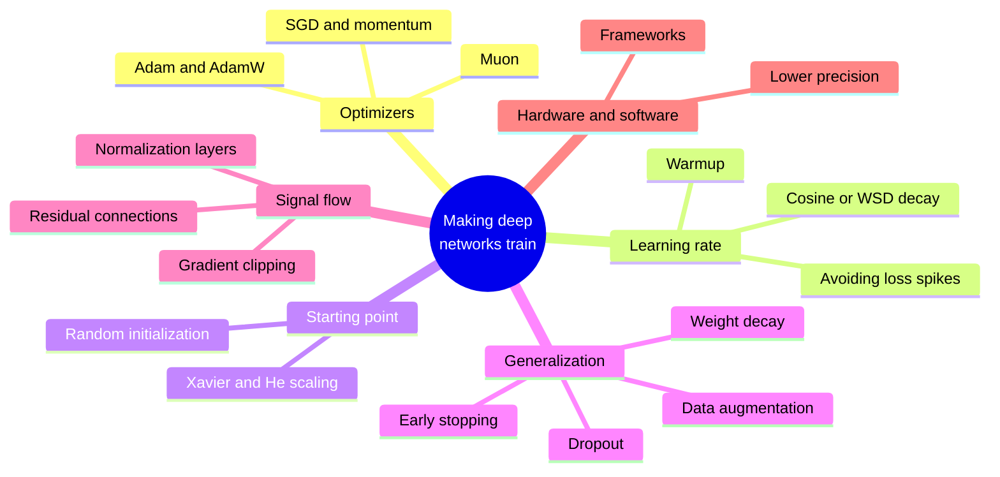
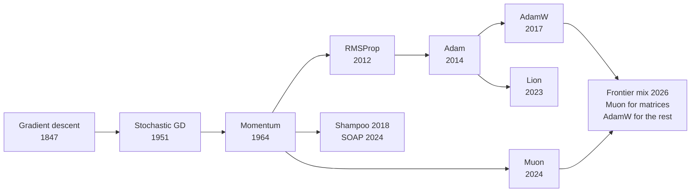
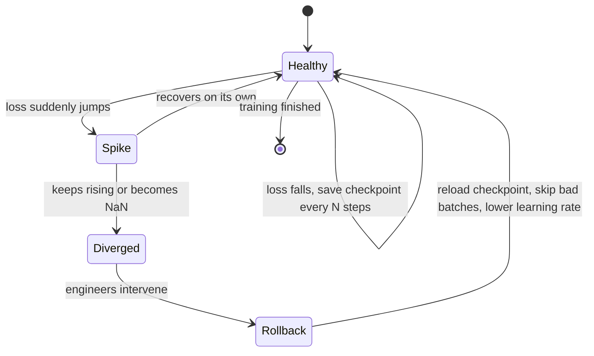
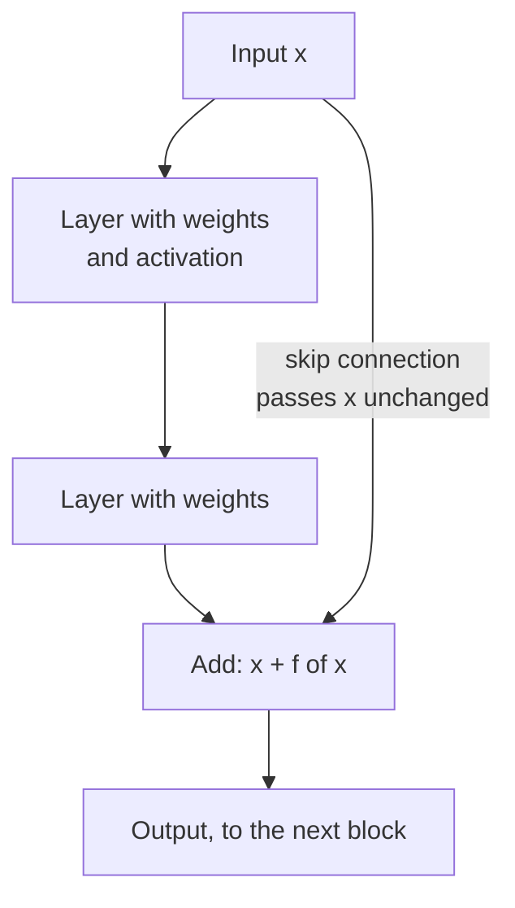
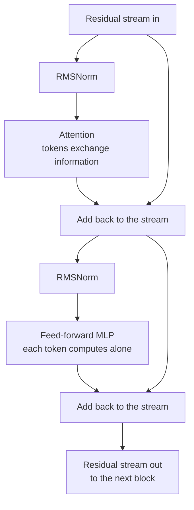
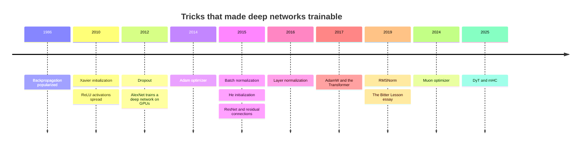

# Chapter 13: Training Deep Networks: Optimizers, Tricks and Why Depth Works

*This chapter shows you the tricks that turn the simple training loop of Chapter 12 into something that can train a network a hundred layers deep with a trillion parameters, and ends with a complete training script you can run yourself.*

## What you'll learn

- Why training a deep network is much harder than training the tiny network of Chapter 12, and the five problems every trick in this chapter solves.
- How optimizers evolved from plain gradient descent to momentum, Adam, AdamW and Muon, the optimizer that frontier labs adopted in 2025–26.
- How to choose a learning rate, what warmup and decay schedules do, and what a loss spike is.
- Why the starting values of the weights matter so much, and how initialization is done.
- How networks memorize versus generalize, and the regularization toolkit (weight decay, dropout, augmentation, early stopping), plus the puzzle of double descent.
- What normalization layers and residual connections are, and why they made 100-plus-layer networks trainable.
- The theory in plain words: universal approximation, why depth helps, inductive biases and the Bitter Lesson.
- How number precision, frameworks (PyTorch, JAX, TensorFlow/Keras) and a real training script fit together, with an annotated 15-line PyTorch script and a complete script for Google Colab.

## Before you start

You need Chapter 12 (Neural Networks From Scratch), which builds the neuron, the forward pass, the loss, backpropagation and the training loop that this chapter improves. Chapter 6 (The Math of AI, Part 2) helps with slopes and averages, and Chapter 9 (Is the Model Any Good?) introduces overfitting, validation sets and regularization, which we revisit here from the deep-learning side. The hardware side of number precision is covered properly in Chapter 32, so this chapter only sketches it.

## Why deep networks are hard to train

In Chapter 12, one step of plain gradient descent took the ice-cream network from a loss of 0.5 to almost zero. With nine parameters and one example, the recipe is easy. Now scale it up: a hundred layers, billions of parameters, trillions of examples. Five problems appear, and for about twenty years they made deep networks look like a dead end.

1. **It is slow.** The loss landscape of a big network has long, narrow valleys. Plain gradient descent zig-zags across them instead of walking along them.
2. **It is unstable.** One step that is too big can blow the numbers up. A training run that has cost millions of dollars can suddenly print "loss = NaN" and die.
3. **Signals fade or explode.** Backpropagation multiplies slopes layer by layer. Through a hundred layers, the learning signal can shrink to nothing or grow to infinity.
4. **It memorizes.** A network with enough parameters can memorize every training example, including the noise, and fail on new data.
5. **It is expensive.** Every number costs memory and energy. How many bits each number gets, and which software organizes the work, matters enormously at scale.

Between 2006 and 2017 researchers found a fix for each problem: better optimizers, learning-rate schedules, careful initialization, regularization, normalization layers and residual connections, plus lower-precision arithmetic and good software. None of these tricks is glamorous. Together they are the reason deep learning works at all, and frontier labs still innovate on them in 2026.

> **Definition — Optimizer:** The algorithm that turns gradients into actual parameter updates. Plain gradient descent is the simplest; SGD with momentum, Adam, AdamW and Muon are smarter versions.

> **Definition — Loss landscape:** An imaginary terrain where each location is one setting of all the parameters and the height is the loss. Training is a walk across this terrain looking for low ground; real landscapes have billions of dimensions.


*Figure 13.1: The toolkit of this chapter. Each branch fixes one of the five problems that made deep networks hard to train.*

> **Key idea:** The training loop from Chapter 12 never changes. Everything in this chapter is about making each step better aimed, better sized and better behaved, so that the same loop works at a million times the scale.

## Optimizers: smarter ways to walk downhill

### The trouble with plain SGD

Recall stochastic gradient descent (SGD): grab a random batch, compute the gradient, and step every parameter by the same rule, new = old − learning rate × slope. Two things go wrong at scale.

The first is **ravines**. Imagine a valley that is steep across and almost flat along its floor, like a long gutter. The gradient points mostly across the gutter, towards the nearest wall, not along it towards the lowest point. With a learning rate big enough to make progress along the floor, the walker overshoots the walls and bounces from side to side. With a learning rate small enough not to bounce, it crawls along the floor. In a network, some parameters sit in steep directions and others in flat ones, so a single learning rate is always wrong for somebody.

The second is **noise**. Each mini-batch gives only an estimate of the true gradient. Some steps point in slightly wrong directions. A little noise is useful (it can shake the walker out of shallow dips), but too much wastes steps.

Loss landscapes also contain flat plateaus and **saddle points**, places that slope down in some directions and up in others, like the middle of a horse saddle. In very high dimensions these are far more common than true dead-end valleys, and a walker that slows to a crawl on a plateau can waste a lot of time.

> **Definition — Saddle point:** A spot in the loss landscape where the slope is zero but which is a low point in some directions and a high point in others, like the center of a horse saddle. Training can stall near them because the gradient there is tiny.

### Momentum: a rolling ball

The first fix, proposed by Boris Polyak in 1964, is **momentum**. Instead of stepping by the current gradient alone, keep a running "velocity" that adds up recent gradients, and step by the velocity:

```
velocity = 0.9 × velocity + gradient
new w    = old w − learning rate × velocity
```

The 0.9 means "keep 90% of the old velocity each step". If the gradient keeps pointing the same way, the velocity grows. With a constant gradient of 1, the velocity goes 1, then 1.9, then 2.71, then 3.44, and keeps climbing towards 10. That is up to ten times faster travel along a consistent slope. If the gradient flips back and forth, as it does across a ravine, the flips mostly cancel out in the velocity, so the zig-zag is damped.

Here is the one-knob loss from Chapter 12, L = (w − 3)², starting at w = 0 with a small learning rate of 0.01:

| Step | Plain gradient descent | With momentum (0.9) |
|---|---|---|
| 1 | w = 0.06 | w = 0.06 |
| 3 | w = 0.18 | w = 0.33 |
| 10 | w = 0.55 | w = 2.08 |
| 20 | w = 1.00 | w = 3.81 (overshot) |
| 30 | w = 1.36 | w = 3.53 |
| 60 | w = 2.11 | w = 3.00 (settled) |

Momentum reaches the neighborhood of the answer far sooner. It also overshoots, the way a heavy ball rolls past the bottom of a bowl before settling. That trade-off is everywhere in optimization.

> **Definition — Momentum:** An optimizer technique that keeps a running sum of recent gradients (a velocity) and steps along it, so progress speeds up along consistent slopes and zig-zags cancel out.

> **Analogy:** Plain gradient descent is a ping-pong ball on a bumpy slope: every little bump knocks it sideways. Momentum turns it into a bowling ball: it builds speed downhill, rolls straight through small bumps, and only changes direction when the slope really changes.

### Adam: a separate stride for every knob

Momentum still uses one learning rate for every parameter. But in a real network, some parameters get huge gradients and others tiny ones. A word that appears rarely in the training data gives its embedding parameters a gradient only occasionally; a parameter in a busy layer gets large gradients every step.

**Adam** (Diederik Kingma and Jimmy Ba, 2014) gives every parameter its own effective step size. For each parameter it keeps two running averages:

```
m = 0.9   × m + 0.1   × gradient        (average direction)
v = 0.999 × v + 0.001 × gradient²       (average size, squared)
step = learning rate × m ÷ (√v + a tiny number)
```

(Adam also applies a small correction during the first few steps, because m and v start at zero.)

Look at what the division does. Suppose one parameter's gradient is steadily 0.001 and another's is steadily 100. After a while, m ≈ gradient and √v ≈ the size of the gradient, so m ÷ √v ≈ 1 for both. Each parameter moves by about the learning rate per step, whatever the raw size of its gradient:

| | Gradient 0.001 | Gradient 100 |
|---|---|---|
| Plain SGD, learning rate 0.001 | moves 0.000001 per step | moves 0.1 per step |
| Adam, learning rate 0.001 | moves about 0.001 per step | moves about 0.001 per step |

With SGD, one parameter barely moves while the other jumps around. Adam equalizes them. It combines this per-parameter scaling with momentum, and it works well with little tuning, which is why it became the default optimizer of deep learning for about a decade. Its direct ancestor, RMSProp (Geoffrey Hinton, 2012), introduced the dividing-by-average-size idea. RMSProp in turn fixed AdaGrad (2011), which divided by the running total of every past squared gradient, so its steps only ever shrank and could stall long before training was done.

> **Definition — Adam:** An optimizer (2014) that combines momentum with a separate, automatically adjusted step size for each parameter, based on running averages of each parameter's gradients and squared gradients.

> **Definition — Optimizer state:** The extra numbers an optimizer stores for each parameter between steps, such as momentum's velocity or Adam's two running averages. For large models this extra memory can be several times the size of the model itself.

> **Analogy:** Adam is a hiker with adjustable shoes for each foot and each direction: long strides where the ground has been smooth and consistent, careful short steps where it has been rocky, decided separately for every direction of travel.

### AdamW: weight decay done right

A long-standing regularization trick is **weight decay**: at every step, shrink every weight slightly towards zero. This discourages the network from relying on a few huge weights, which tends to help it generalize. Here is the effect on its own: with a learning rate of 0.001 and a weight decay of 0.1, each step multiplies a weight by 1 − 0.001 × 0.1 = 0.9999. That looks like nothing, but over 10,000 steps it compounds to 0.9999^10,000 ≈ 0.37. A weight of 2.0 that no gradient defended would shrink to about 0.74.

In 2017 Ilya Loshchilov and Frank Hutter noticed that the usual way of adding weight decay to Adam was subtly broken: the decay was mixed into the gradient and then divided by Adam's per-parameter scaling, so parameters with big gradients barely decayed. Their fix, **AdamW**, applies the decay directly to the weights, separately ("decoupled") from the gradient step. It is a small change, and it became the standard optimizer for training Transformers.

> **Definition — Weight decay:** Shrinking every weight by a tiny fraction at each training step, so that weights only stay large if the data keeps pushing them up. It is a simple form of regularization.

> **Definition — AdamW:** Adam with weight decay applied separately ("decoupled") from the gradient-based step. It has been the standard optimizer for Transformers since the late 2010s.

### Beyond Adam: Lion, Shampoo and SOAP

Researchers kept looking for better walkers. **Lion** (Google, 2023), found partly by an automated search over possible update rules, uses only the *sign* of a momentum-like quantity, so every parameter moves by exactly the same amount each step, and it stores less state than Adam. **Shampoo** (2018) and its 2024 descendant **SOAP** go the other way: they keep richer information about the *curvature* of the landscape, meaning how the slope itself changes as you move, for each layer. Curvature tells you how big a step is safe in each direction (where the landscape bends sharply, a step that looks safe can quickly overshoot), so these optimizers, sometimes called "second-order" methods, can take better-aimed steps at the cost of extra memory and computation.

> **Definition — Lion, Shampoo and SOAP:** Alternative optimizers. Lion (2023) moves each parameter by a fixed amount in the direction of the sign of its momentum. Shampoo (2018) and SOAP (2024) use per-layer curvature information to shape their steps, at extra cost.

### Muon: balance the whole matrix

For about ten years, almost every large model was trained with Adam or AdamW. Then, on 8 December 2024, a researcher named Keller Jordan published a blog post introducing **Muon**, short for "MomentUm Orthogonalized by Newton–Schulz". It treats each layer's weights not as a pile of separate numbers but as what they are: a matrix.

Here is the idea in plain words. The update for a layer's weight matrix (the gradient, smoothed with momentum) is itself a matrix. Any matrix can be thought of as a set of directions, each with a strength: "push the weights strongly this way, weakly that way". In practice, a few directions dominate the update and most get almost nothing. Muon keeps the directions but makes all their strengths equal, so the neglected directions also learn. Mathematicians call this **orthogonalizing** the update.

A toy example makes it concrete. Suppose a 2-by-2 layer's momentum update is:

```
 update before Muon          update after Muon
 [ 3.0   0   ]               [ 1   0 ]
 [ 0     0.1 ]       ->      [ 0   1 ]
```

Before, the first direction gets 30 times as much push as the second. After, both get the same. For real matrices with thousands of rows, the directions are not lined up neatly along the rows and columns, and finding them exactly would be slow. Muon uses a shortcut called the **Newton–Schulz iteration**: about five rounds of matrix multiplications that push all the strengths towards 1. Since GPUs are built for matrix multiplication, this costs only a little extra time.

Muon is meant for the 2-D weight matrices of hidden layers. The recommended practice is to use AdamW for everything else: the embedding table, the final output layer, and the small 1-D parameters such as biases.

The results came quickly:

- Muon set speed records on two community benchmarks, the NanoGPT "speedrun" and training a small image classifier on CIFAR-10 (reaching 94% accuracy in 2.6 seconds of A100 GPU time instead of 3.3).
- In February 2025, Moonshot AI published "Muon is Scalable for LLM Training", showing that with weight decay and a per-matrix adjustment of the update size, Muon works for large language models.
- In July 2025, Moonshot's Kimi K2 (about 1 trillion total parameters, 32 billion active) was pre-trained on 15.5 trillion tokens with **MuonClip**, Muon plus a fix that stops attention scores from growing out of control, and Moonshot reported zero loss spikes during the run.
- DeepSeek V4 (2026) states that it uses Muon "for faster convergence and greater training stability".
- PyTorch includes `torch.optim.Muon` from version 2.9 onward, and its documentation pairs it with AdamW for the non-matrix parameters, exactly as recommended.

Muon also stores less than Adam: one momentum buffer per parameter instead of two running averages. The theory of *why* it works so well is still catching up with practice, and new variants kept appearing in 2026.

> **Definition — Muon:** An optimizer (Keller Jordan, December 2024) for the weight matrices of hidden layers. It takes the momentum update for each matrix and orthogonalizes it, so every direction of change gets equal strength; it is usually paired with AdamW for other parameters.

> **Definition — Orthogonalization (of an update):** Reshaping a matrix so that all of its independent directions have the same strength while keeping the directions themselves. Muon applies it to each weight matrix's update.

> **Definition — Newton–Schulz iteration:** A short recipe of repeated matrix multiplications that approximately orthogonalizes a matrix. Muon uses about five rounds because it is far faster on GPUs than computing the exact answer.

> **Analogy:** Think of a team where two people do all the work and everyone else sits idle. Muon is the manager who rebalances the workload so every member contributes equally. The team (the weight matrix) improves along all its dimensions at once instead of only its busiest ones.

> **Try it:** Ask your chatbot: "Using a 2-by-2 matrix, show me what it means to orthogonalize a matrix, and explain in plain words why the Muon optimizer does this to its updates." Check its example: after orthogonalizing, every stretch factor of the matrix (its singular values) should equal 1, while the directions stay the same.


*Figure 13.2: The family tree of optimizers. Gradient descent goes back to Augustin-Louis Cauchy in 1847; the stochastic version to Robbins and Monro in 1951. Frontier labs in 2026 often combine Muon and AdamW.*

| Optimizer | Year | What it remembers about each parameter | Extra numbers per parameter | Typical use |
|---|---|---|---|---|
| SGD | 1951 | Nothing | 0 | Teaching, simple problems |
| SGD with momentum | 1964 | A velocity | 1 | Image networks of the 2010s |
| Adam | 2014 | Average gradient and average squared gradient | 2 | The default for a decade |
| AdamW | 2017 | Same as Adam, with decoupled decay | 2 | Standard for Transformers and fine-tuning |
| Lion | 2023 | A momentum; steps use only its sign | 1 | Lower-memory alternative |
| Shampoo / SOAP | 2018 / 2024 | Curvature summaries for each layer | More than 2 | Research and some large runs |
| Muon | 2024 | A momentum per weight matrix | 1 | Hidden-layer matrices at frontier scale, with AdamW for the rest |

> **At the frontier (2026):** The optimizer field, frozen on Adam and AdamW for about ten years, is moving again. Muon-family optimizers trained Kimi K2 and DeepSeek V4, two of the largest open-weight models, and PyTorch ships Muon as a standard component. Research papers in 2026 continued to propose refinements and to explain why orthogonalized updates work. The closed labs (OpenAI, Anthropic, Google) do not say which optimizers they use.

> **Watch out:** Newer is not automatically better for your project. For small networks and most fine-tuning jobs, AdamW with a sensible learning rate remains the safe default. Optimizers interact with learning rates, batch sizes and architectures, so the only reliable way to compare them is a fair experiment, like Exercise 8.

## The learning rate: the most important knob

Of all the hyperparameters, the learning rate matters most. Chapter 12 showed the three behaviors on a single knob: too small and training crawls, just right and it settles, too big and every step overshoots by more than the last until the numbers explode. In a real network, explosion shows up as the loss suddenly printing **NaN**, the computer's way of saying the arithmetic produced something that is not a number, usually after an overflow to infinity. Once a single NaN appears, it spreads through every calculation it touches, and the run is dead.

> **Definition — NaN (Not a Number):** A special value a computer produces when arithmetic breaks down, for example infinity minus infinity. A loss of NaN means training has blown up and must be restarted from an earlier saved state.

### Schedules: the learning rate changes during training

The best learning rate is not constant. Early in training, the weights are random and the gradients are large and erratic, so big steps are dangerous. In the middle, you want big steps to make fast progress. At the end, you want small steps to settle precisely into a good spot. So practitioners use a **learning-rate schedule**:

- **Warmup**: start with a tiny learning rate and raise it in a straight line over the first few hundred or few thousand steps. This gives Adam's running averages time to become reliable before any big steps are taken.
- **Cosine decay**: after warmup, lower the learning rate smoothly along a half cosine curve, from the peak down to near zero by the end.
- **Warmup–stable–decay (WSD)**: after warmup, hold the learning rate flat for most of training, then drop it quickly in a short final phase. It became popular in 2024–26 because you do not need to know the total length of training in advance: you can keep going at the stable rate, and branch off a short decay phase whenever you want a finished model.

A worked example: a run of 10,000 steps with a peak learning rate of 0.001 and 1,000 warmup steps.

| Step | Phase | Cosine schedule | WSD schedule (decay in the last 1,000 steps) |
|---|---|---|---|
| 0 | Warmup starts | 0 | 0 |
| 500 | Halfway through warmup | 0.0005 | 0.0005 |
| 1,000 | Peak | 0.001 | 0.001 |
| 5,500 | Halfway through decay | 0.0005 | 0.001 |
| 7,750 | Three-quarters through decay | about 0.00015 | 0.001 |
| 9,500 | Near the end | about 0.000008 | 0.0005 |
| 10,000 | End | 0 | 0 |

```
 lr     warmup + cosine                warmup + stable + decay
0.001 |    .--.                     |    .-------------------.
      |   /    '.                   |   /                     \
      |  /       '.                 |  /                       \
      |  /         '.               |  /                        \
      | /            '.             | /                          \
    0 |/               '--.         |/                            \
      +-------------------- step    +------------------------------
```
*Figure 13.3: Two common learning-rate schedules. Both start with a warmup ramp. Cosine decay lowers the rate gradually; WSD holds it flat and drops it at the end.*

> **Definition — Learning-rate schedule:** A plan for changing the learning rate during training, typically a short ramp up followed by a long decline.

> **Definition — Warmup:** The first phase of a learning-rate schedule, in which the rate rises from nearly zero to its peak, so the early, chaotic steps are small.

> **Definition — Cosine decay:** A schedule that lowers the learning rate from its peak to near zero along a smooth half cosine curve: slowly at first, faster in the middle, gently at the end.

> **Definition — WSD (warmup–stable–decay):** A schedule that warms up, holds the learning rate constant for most of training, and then decays it quickly at the end, which makes it easy to extend training or produce checkpoints at any point.

### Batch size and the learning rate

Learning rate and batch size work together. A bigger batch averages more examples, so its gradient is less noisy, and you can usually afford bigger steps. Frontier language-model runs use batches of millions of tokens. Some even grow the batch during training; Meta's Llama 3 paper, for example, describes doubling the batch size twice during its largest run as training stabilized. Chapter 19 describes these frontier pretraining runs in detail.

### Loss spikes

Even with a good schedule, large runs sometimes suffer a **loss spike**: the loss, which had been falling smoothly, suddenly jumps up. Sometimes it recovers on its own within a few hundred steps. Sometimes it never recovers, or turns into NaN. Causes include an unusual batch of data, numbers inside the attention mechanism growing too large, and the optimizer taking one step too far in a sharp part of the landscape.

At frontier scale, spikes are expensive, because thousands of chips sit idle or compute garbage. The standard defense is to save a **checkpoint**, a complete snapshot of all parameters and optimizer state, every so often. If a spike does not recover, engineers roll back to a checkpoint from before the spike and change something: skip the batches that triggered it, lower the learning rate, or tighten gradient clipping (explained later in this chapter). Google's PaLM paper (2022), for example, reported about 20 spikes during training and handled them by restarting from a checkpoint roughly 100 steps before each one and skipping a few hundred batches of data. Newer designs try to prevent spikes in the first place, for instance by normalizing the queries and keys inside attention ("QK-norm") or by clipping them, as in Kimi K2's MuonClip.

> **Definition — Loss spike:** A sudden jump in the training loss during an otherwise smooth run, usually a sign of numerical instability. At frontier scale each spike can waste large amounts of compute.

> **Definition — Checkpoint:** A saved snapshot of a model's parameters (and usually its optimizer state) at a point in training, used to resume after failures and to roll back after instabilities. A released model's "weights file" is a checkpoint.


*Figure 13.4: The life of a large training run. Most of the time it is healthy; when a spike does not recover, the team rolls back to a checkpoint and changes something.*

> **Key idea:** The learning rate controls the size of every step. Warm it up gently, keep it high while there is ground to cover, and bring it down at the end. Most failed training runs are learning-rate problems in disguise.

> **Try it:** Make a loss spike yourself. At https://playground.tensorflow.org, choose the Spiral dataset, press play at learning rate 0.03, and let the loss fall for a few hundred epochs. Then switch the learning rate to 3 for a few seconds and watch the loss chart jump. Switch back to 0.03 and see whether the run recovers on its own, the same question engineers ask on a frontier run.

## Initialization: where the walk begins

Before the first step, every weight needs a starting value. This sounds like a detail. It is not.

### Why not start at zero?

Suppose every weight starts at 0. Then every hidden neuron in a layer computes exactly the same thing, receives exactly the same blame in backpropagation, and gets exactly the same update. After a million steps they are still identical twins. A layer of 4,096 identical neurons is no better than one neuron. Starting with random values breaks this **symmetry**, so different neurons can specialize in different features.

> **Definition — Symmetry breaking:** Starting the weights of a layer at different random values so that its neurons compute different things and learn different features. With identical starting weights, neurons would remain identical forever.

### Why the size of the random numbers matters

The random numbers must also be the right size. Each layer multiplies its input by its weight matrix. If the weights are a bit too big, signals grow at every layer; if a bit too small, they shrink. Over many layers the effect compounds. If each of 50 layers scaled the signal by 0.5, it would end at 0.5^50 ≈ 0.000000000000001 of its original size, lost in rounding error. If each scaled it by 1.5, it would end about 600 million times larger. The same compounding hits the gradients on the way back.

The fix is to scale the random starting weights according to how many inputs each neuron has: the more inputs being added together, the smaller each weight should be, so the sum stays about the same size as each input.

- **Xavier (or Glorot) initialization** (Xavier Glorot and Yoshua Bengio, 2010) sets the spread of the random weights based on the number of inputs and outputs of the layer. For a layer with 512 inputs and 512 outputs, the standard deviation (the typical size of the random numbers, see Chapter 6) is √(2 ÷ 1,024) ≈ 0.044.
- **He initialization** (Kaiming He and colleagues, 2015) adjusts this for ReLU, which zeroes out about half its inputs, so the weights are a bit larger: √(2 ÷ number of inputs). For 512 inputs that is √(2 ÷ 512) = 0.0625.

Modern frameworks apply sensible defaults automatically, so you rarely choose by hand. Large language models typically draw their starting weights from a narrow bell curve, and their published configuration files often list the spread as a setting (frequently called something like `initializer_range`). Some designs also shrink the starting weights of layers that add into a residual connection, so that a stack of many such layers starts out calm; the GPT-2 paper (2019), for example, scaled them down according to the number of layers.

> **Definition — Initialization:** Choosing the starting values of all weights before training. They must be random (to break symmetry) and correctly scaled (so signals neither fade nor explode through the layers).

> **Definition — Xavier (Glorot) initialization:** A 2010 rule for setting the spread of random starting weights from the number of inputs and outputs of each layer, designed to keep signal sizes steady through sigmoid and tanh networks.

> **Definition — He initialization:** A 2015 variant of Xavier initialization with slightly larger weights, designed for ReLU networks, in which half the signals are zeroed out at each layer.

> **Analogy:** Initialization is like tuning every instrument in an orchestra before the concert. If they all start on exactly the same note, you have one instrument played loudly (symmetry). If some are wildly out of tune, the sound collapses into noise before the music has a chance (exploding or vanishing signals).

## Generalization versus memorization

A network's goal is not to do well on its training examples. It is to do well on examples it has never seen. That is **generalization**, and Chapter 9 introduced the two ways it fails: **underfitting** (too simple or undertrained to capture the pattern) and **overfitting** (memorizing the training examples, noise included). Deep networks add a twist: they are so flexible that they can memorize almost anything.

In a famous 2016 experiment, researchers trained standard image networks on photos whose labels had been replaced with random ones. "Cat" and "truck" were assigned by coin flip. The networks still reached nearly perfect accuracy on the training set: they simply memorized every meaningless pairing. Yet the same networks, trained on the real labels, generalize well to new photos. So the networks *can* memorize, but when real patterns exist, training tends to find them first. Explaining exactly why is still an open research question.

> **Definition — Generalization:** A model's ability to perform well on new, unseen data rather than only on its training examples. It is the real goal of training.

> **Definition — Overfitting:** When a model learns its training examples too specifically, including their noise and quirks, so it scores well on them but worse on new data, like memorizing the answer key instead of learning the subject.

> **Definition — Underfitting:** When a model is too simple or too briefly trained to capture the real pattern, so it does poorly even on its training data.

You watch for overfitting by plotting two curves: loss on the training data and loss on held-out validation data. Early in training both fall. If the validation loss turns upward while the training loss keeps falling, the network has started memorizing.

```
 loss
  |\
  | \.
  |  \ '.                         .----'  validation loss
  |   \  '.                 .---''
  |    \   '-..___.....--''
  |     '.
  |       '-._
  |           '--.___          training loss
  |                  '----------------------------
  +-----------------------|---------------------> epochs
                    best point to stop
```
*Figure 13.5: Training loss keeps falling while validation loss bottoms out and starts to rise. The gap that opens up is overfitting; stopping near the bottom of the validation curve is early stopping.*

### The regularization toolkit

Any technique that reduces overfitting is called **regularization**. Four are standard in deep learning:

| Technique | What it does | Everyday comparison |
|---|---|---|
| Weight decay | Shrinks every weight slightly each step | A small tax on complexity |
| Dropout | Randomly switches off a fraction of neurons at each training step | Benching random players at practice |
| Data augmentation | Makes new training examples by flipping, cropping or recoloring images, or rephrasing text | Practicing the same skill in different conditions |
| Early stopping | Stops training when validation loss stops improving | Leaving the exam room once you have checked your answers |

**Dropout** (Geoffrey Hinton's group, 2012) deserves a worked example. During training, each neuron's output is set to zero with some probability, say 50%, chosen fresh at every step. The survivors are scaled up to keep the average the same. Suppose four neurons output [4, 2, 6, 8] and the random coin flips keep the first and third. The output becomes [8, 0, 12, 0]: the dropped ones are zeroed and the survivors doubled. The average was 5 and is still 5. Because any neuron might vanish at any moment, the network cannot rely on one star neuron and must spread what it knows across many. At inference time, dropout is switched off and all neurons work.

> **Definition — Regularization:** Any technique that discourages a model from memorizing its training data and helps it generalize, such as weight decay, dropout, data augmentation and early stopping.

> **Definition — Dropout:** A regularization method that randomly switches off a fraction of neurons at each training step (and scales up the rest), so the network cannot depend on any single neuron. It is turned off when the model is used.

> **Definition — Data augmentation:** Creating extra training examples by transforming existing ones, for example flipping, cropping or recoloring images or paraphrasing sentences, so the model learns what should not matter.

> **Definition — Early stopping:** Ending training at the point where performance on validation data stops improving, before the model starts to memorize its training set.

Two more regularizers turn up in many recipes. **Label smoothing** stops a classifier from becoming absurdly sure of itself by softening the answer key. Instead of training toward 100% on the correct class and 0% on every other, with 10 classes and a smoothing of 0.1 the target becomes 91% on the correct class and 1% on each of the other nine (0.91 + 9 × 0.01 = 1). **Multi-task learning**, training one network on several related jobs at once, also regularizes, because features that must serve every job cannot overfit to any single one; the ranking models behind social feeds are the classic case (Chapter 51).

> **Definition — Label smoothing:** Training a classifier toward slightly softened targets (for example 91% on the right answer and a little on every other answer) instead of 100%, which discourages overconfidence and often improves generalization.

### Double descent and other surprises

Classical statistics says that as a model grows more flexible, its test error first falls (it can capture the pattern) and then rises (it starts fitting noise): a U-shaped curve. Deep learning broke this picture. Around 2019, researchers (Mikhail Belkin and colleagues, then Preetum Nakkiran and colleagues at Harvard and OpenAI) documented **double descent**: as models grow, test error falls, rises to a peak at the size where the model can only just fit the training data exactly, and then *falls again* as the model grows even bigger. Very large models can fit their training data perfectly and still generalize well.

```
 test error
   |
   |\                 peak: the model can only
   | \        /\      just fit the training data
   |  \      /  \
   |   \____/    \
   |              '.
   |                '-.._
   |                     ''--.....______  bigger keeps helping
   +------------------|----------------------------> model size
      classical U     |   modern "overparameterized" regime
```
*Figure 13.6: Double descent. Past the danger zone where the model can barely fit its training data, making it even bigger lowers the test error again.*

Another surprise, **grokking** (reported in 2022), happens on some small, puzzle-like tasks: a network memorizes the training set quickly, its validation accuracy stays poor for a long time, and then, thousands of steps later, it suddenly "gets" the underlying rule and validation accuracy jumps. One of the NeurIPS 2025 best papers, "Why Diffusion Models Don't Memorize", found a related pattern in image generators: generalization appears on one timescale during training, and memorization only on a later, slower one.

> **Definition — Double descent:** The observation that as models grow, test error can fall, rise to a peak near the size where the model just fits its training data, and then fall again for even larger models.

> **Definition — Grokking:** A training phenomenon in which a network first memorizes its training data and then, much later, suddenly generalizes, as if it had finally understood the rule.

How does this apply to chatbots? Frontier language models are trained on so much text that they see most of it only about once, so classic overfitting is rarely the main problem in pretraining. But they do memorize passages that appear many times in their data, which raises copyright and privacy questions (Chapter 11 and Chapter 58). Fine-tuning a model on a small dataset is where overfitting returns in full force (Chapter 30).

> **Watch out:** "Bigger models always overfit more" is the classical intuition, and in deep learning it is often wrong. Past a certain size, bigger networks frequently generalize better, as long as there is enough data and training is done well. The reasons are still debated, which makes generalization one of the deepest open questions in the field.

## Normalization: keeping numbers in a sane range

As data flows through dozens of layers, the numbers can drift. One layer's outputs might average around 0.001, another's around 500. Each layer then has to cope with inputs of a wildly changing scale, and every time earlier layers update, later layers see a shifted range and must re-adapt. A **normalization layer** fixes this by rescaling a group of numbers to a standard range before they move on.

### Layer normalization, worked by hand

Take one token's vector of four numbers: [2, 4, 6, 8].

1. Find the mean: (2 + 4 + 6 + 8) ÷ 4 = 5.
2. Find the spread (standard deviation): the squared distances from the mean are 9, 1, 1 and 9, which average to 5, and √5 ≈ 2.236.
3. Subtract the mean and divide by the spread: [(2 − 5) ÷ 2.236, ...] = **[−1.342, −0.447, 0.447, 1.342]**.

The result always has a mean of 0 and a spread of 1, whether the input was [2, 4, 6, 8] or [2,000, 4,000, 6,000, 8,000]. The layer then multiplies each position by a learned "gain" and adds a learned shift, so the network can still choose the scale it wants. That is **layer normalization**.

**RMSNorm** is a simpler, cheaper version. It skips the mean and only divides by the root-mean-square (the square root of the average of the squares). For [2, 4, 6, 8]: the squares are 4, 16, 36 and 64, their average is 30, and √30 ≈ 5.477. Dividing gives **[0.365, 0.730, 1.095, 1.461]**. The sizes are tamed but the mean is not forced to zero, and in practice this works just as well with less computation.

### The family of normalizations

| Method | Year | What it averages over | Where it is used |
|---|---|---|---|
| Batch normalization | 2015 | Each feature, across the examples in the batch | Image networks (CNNs) |
| Layer normalization | 2016 | All features of one example | Original Transformers, many models |
| RMSNorm | 2019 | All features of one example, scale only | Llama, Qwen, DeepSeek and most open LLMs |
| DyT (Dynamic Tanh) | 2025 | Nothing: a learned tanh squash replaces normalization | Research; matches normalized Transformers in many tests |

**Batch normalization** (Sergey Ioffe and Christian Szegedy, 2015) was a breakthrough for image networks, but it depends on the other examples in the batch, which is awkward for text of varying lengths and for small batches. **Layer normalization** (Jimmy Ba, Jamie Kiros and Geoffrey Hinton, 2016) normalizes each example on its own and became the Transformer standard. **RMSNorm** (Biao Zhang and Rico Sennrich, 2019) simplified it and is now used in most open large language models.

Where the normalization sits also matters. The original 2017 Transformer normalized *after* each sub-layer (**post-norm**). Later models such as GPT-2 moved it *before* each sub-layer (**pre-norm**), which trains much more stably in deep stacks and is the norm today. And in 2025, a paper titled "Transformers without Normalization" (CVPR 2025) showed that replacing normalization layers with a simple learned squash, tanh(α × x), called **DyT**, matches normalized Transformers in many settings, a reminder that even basic plumbing is still being rethought.

> **Definition — Normalization layer:** A layer that rescales a group of numbers to a standard range (for example mean 0 and spread 1) before passing them on, so that training stays stable as values flow through many layers.

> **Definition — Batch normalization:** A 2015 normalization method that rescales each feature using the average and spread across the examples in the current batch. It is a key ingredient of image networks.

> **Definition — Layer normalization:** A 2016 normalization method that rescales all the features of a single example to mean 0 and spread 1, then applies a learned scale and shift. It became the standard in Transformers.

> **Definition — RMSNorm:** A simpler, cheaper layer normalization (2019) that only divides by the root-mean-square of the values, without subtracting the mean. Most open large language models use it.

> **Definition — Pre-norm and post-norm:** Two placements of normalization in a Transformer block: before each sub-layer (pre-norm, the modern standard, more stable in deep stacks) or after it (post-norm, as in the original 2017 design).

> **Definition — DyT (Dynamic Tanh):** A 2025 proposal to replace normalization layers with a learned squashing function, tanh(α × x), which matched normalized Transformers in many experiments.

> **Analogy:** Normalization is like a radio station's automatic volume leveler between songs. Some songs were recorded quietly, others loudly, but the leveler brings each to a standard volume, so nothing clips and nothing fades into silence. The learned gain is the DJ's knob for deliberately making one song a bit louder.

## Vanishing and exploding gradients

Chapter 12 showed that backpropagation multiplies local slopes along the path from the loss back to each weight. In a deep network the path is long, and repeated multiplication is dangerous.

Consider the sigmoid activation. Its slope is at most 0.25 (at its center) and much smaller in its flat tails. Suppose blame passes back through 10 sigmoid layers, each multiplying it by at most 0.25:

```
0.25 × 0.25 × ... (10 times) = 0.25^10 ≈ 0.00000095
```

Even in the best case, the first layer receives less than one millionth of the learning signal that reached the last layer. Through 20 such layers, it is about one trillionth. The early layers effectively stop learning. That is the **vanishing gradient** problem, and it is a big part of why deep networks seemed untrainable before about 2010. If instead the factors are bigger than 1, say weights that are too large, the signal grows exponentially, the updates become enormous, and the numbers overflow: an **exploding gradient**. Recurrent networks, which apply the same weights again at every word of a sentence, suffered especially badly from both (Chapter 14).

> **Definition — Vanishing gradient:** The problem that learning signals shrink as they are multiplied backward through many layers, so the early layers of a deep network barely learn.

> **Definition — Exploding gradient:** The opposite problem: learning signals grow as they pass backward through many layers, causing huge updates, unstable training and often NaN values.

> **Analogy:** It is the telephone game. Whisper a sentence down a line of 50 people and it arrives garbled or gone. Each person changes the message a little, and the changes compound. A deep network without safeguards loses or distorts its learning signal the same way.

The fixes, most of which you have already met:

1. **Better activations.** ReLU's slope is exactly 1 for positive inputs, so blame passes through active neurons undiminished.
2. **Careful initialization.** Xavier and He scaling keep signal sizes roughly constant from layer to layer at the start.
3. **Normalization layers.** They re-center the forward signals at every layer, which also keeps the backward signals well behaved.
4. **Gradient clipping.** A safety cap on the total size of the gradient.
5. **Residual connections.** The most important fix, with its own section below.

**Gradient clipping** works like this. Measure the overall size of the gradient, its **norm**: the square root of the sum of all the squared slopes. If it is larger than a chosen limit, scale the whole gradient down so its norm equals the limit, keeping its direction. For example, a gradient of [30, 40] has a norm of √(900 + 1,600) = 50. With a limit of 1, divide by 50 to get [0.6, 0.8]: same direction, safe size. Large language model training runs commonly clip at a norm of 1.0, and the script at the end of this chapter does the same.

> **Definition — Gradient norm:** A single number for the overall size of a gradient, computed as the square root of the sum of the squares of all its slopes. A sudden jump in it is an early warning of instability.

> **Definition — Gradient clipping:** Capping the gradient norm at a chosen limit by scaling the whole gradient down when it is too large, which prevents one bad step from wrecking training.

## Residual connections: the express elevator

In 2015, Kaiming He and colleagues at Microsoft Research asked a puzzling question. If you take a working 20-layer image network and add 36 more layers, the deeper network should be at least as good: the extra layers could simply learn to pass their input through unchanged. Yet in practice the deeper network trained *worse*, even on its training data. Learning to "do nothing" turned out to be hard for a stack of layers.

Their fix was almost embarrassingly simple. Instead of asking each block of layers to compute a new output from scratch, add the block's input back to its output:

**output = input + f(input)**

Here f is whatever the block computes (a couple of layers with activations). If the block has nothing useful to add, it only needs to learn f ≈ 0, which is easy, and the input passes straight through. If it has something useful, it adds a correction. This is a **residual connection** (or skip connection), and the network family built from it is **ResNet**. A 152-layer ResNet won the 2015 ImageNet competition, and residual connections have been in almost every deep network since.


*Figure 13.7: A residual block. The input takes two routes: through the layers, which compute a correction f(x), and around them on a shortcut. The two are added.*

Why does this fix vanishing gradients? Look at the backward pass. Addition passes blame to both of its inputs unchanged (Chapter 12). So blame arriving at the output of a block flows back along the shortcut with a slope of exactly 1, in addition to whatever flows through the layers. Through 100 blocks, there is always a route made entirely of shortcuts, and 1 × 1 × ... × 1 = 1. The learning signal can reach the very first layer at full strength.

You can see the effect in Exercise 9 of this chapter. It builds two 30-layer networks of old-fashioned sigmoid layers, identical except that one has skip connections. In our test run, the learning signal at the first layer of the plain network was so small that the computer rounded it to zero, and after training it was still guessing at random (10% accuracy on ten digits). The network with skip connections received a healthy signal at its first layer and reached 93% accuracy in the same time.

> **Definition — Residual connection (skip connection):** A shortcut that adds a block's input to its output (output = input + f(input)), giving signals and gradients an unobstructed path around the block. It made networks with 100 or more layers trainable.

> **Definition — ResNet (residual network):** A family of image networks introduced in 2015 that stacks residual blocks; a 152-layer version won that year's ImageNet competition.

> **Analogy:** A tall building has stairs between every floor and an express elevator that goes straight from top to bottom. Each floor (layer) can add something to the passenger's journey by sending them through its stairs, but the elevator always works. Blame from the top floor can ride the elevator straight to the ground floor without being lost on 100 flights of stairs.

### The residual stream in your chatbot

Every Transformer, including every chatbot model, is built around residual connections. Each token carries a vector through the whole network, and each block reads from it, computes something (attention or a feed-forward network), and adds its result back. Researchers call this running vector the **residual stream**: a shared whiteboard that every layer reads and writes to, with nobody erasing. Chapter 15 explains the blocks themselves; here is where normalization and residuals sit in a modern pre-norm block.


*Figure 13.8: One block of a modern Transformer. Each sub-layer is normalized first (pre-norm) and its result is added back to the residual stream. Large models stack dozens to more than a hundred such blocks.*

> **Definition — Residual stream:** In a Transformer, the running vector each token carries through all the layers; every layer reads it and adds its own contribution back, so information and gradients flow freely from bottom to top.

> **Definition — Hyper-connections and mHC:** 2024–25 generalizations of residual connections that keep several parallel streams and learn how to mix them. DeepSeek's mHC (manifold-constrained hyper-connections, December 2025) restricts the mixing to keep training stable and is used in DeepSeek V4.

> **At the frontier (2026):** The humble skip connection is being reinvented. DeepSeek's mHC, published at the end of December 2025 and used in DeepSeek V4, widens the single residual stream into several mixed streams while constraining the mixing so that training stays as stable as with a plain shortcut. One of the NeurIPS 2025 best papers, "1000 Layer Networks for Self-Supervised RL", showed reinforcement-learning networks scaling to 1,024 layers. Chapter 17 covers these designs, along with gated attention and other stability tricks.

> **Watch out:** "Normalization, residuals and dropout are minor implementation details" is a common belief among newcomers. These plumbing choices are what made deep networks trainable at all. A model with a brilliant architecture but bad plumbing will not train, and frontier labs still publish important papers about the plumbing.

## Why depth works: the theory in plain words

Everything so far has been practical. Here are the main theoretical ideas, without equations.

### Universal approximation: anything is possible, in principle

In 1989 George Cybenko proved, and in 1991 Kurt Hornik extended, a result called the **universal approximation theorem**. It says that a network with just *one* hidden layer, if it has enough neurons, can approximate any reasonable function as closely as you like. Any curve, any decision boundary, any input-to-output relationship.

That sounds like the end of the story. It is not, for three reasons. The theorem says suitable weights *exist*; it does not say gradient descent will *find* them. It does not say how many neurons you need, and for many functions the number is astronomically large. And it says nothing about whether the network will generalize to new data. It is a promise that the toolbox is not fundamentally limited, not a recipe.

> **Definition — Universal approximation theorem:** A mathematical result (Cybenko 1989, Hornik 1991) that a neural network with one sufficiently wide hidden layer can approximate any reasonable function. It guarantees that good weights exist, not that training will find them or how many neurons are needed.

> **Watch out:** "Universal approximation means neural networks can learn anything" is a misreading. The theorem is about what can be represented, not about what can be learned from limited data with limited compute. Those practical questions are where all the hard work is.

### Why depth beats width

If one wide layer is enough in principle, why build networks 100 layers deep? Because depth lets a network build features out of features, which can be exponentially more efficient.

Here is a worked example. A layer with just two ReLU neurons can compute a "tent" shape on the numbers from 0 to 1: t(x) = 2 × ReLU(x) − 4 × ReLU(x − 0.5). Check it: t(0) = 0, t(0.25) = 0.5, t(0.5) = 1, t(0.75) = 2 × 0.75 − 4 × 0.25 = 0.5, and t(1) = 2 − 2 = 0. One tooth, made of 2 straight pieces.

Now feed the output of the tent into a second copy of the same two-neuron layer. Since the first tent sweeps from 0 up to 1 and back down, the second tent is traced twice: two teeth, 4 straight pieces. A third layer gives four teeth and 8 pieces. Every extra layer of just two neurons doubles the number of pieces.

```
 one layer: t(x)                two layers: t(t(x))
 1 |         /\                 1 |     /\          /\
   |       /    \                 |    /  \        /  \
   |     /        \               |   /    \      /    \
   |   /            \             |  /      \    /      \
 0 |_/________________\_        0 |_/________\__/________\_
    0        0.5        1          0   0.25   0.5  0.75   1
```
*Figure 13.9: Composing a simple two-neuron "tent" layer with itself doubles the number of teeth. Ten layers give 512 teeth from just 20 neurons.*

With 10 layers of 2 neurons, 20 neurons in total, the network draws 2^10 = 1,024 straight pieces. A network with a single hidden layer of ReLU neurons, working on one input, can only add one bend per neuron, so it would need at least 1,023 neurons to draw the same shape. Twenty neurons stacked deep do the work of a thousand spread wide. This result, published by Matus Telgarsky in 2016, is one clean example of a general pattern: depth lets networks reuse and compose simple pieces.

Real networks exploit this constantly. In an image network, early layers detect edges, middle layers combine edges into textures and parts, and late layers combine parts into objects (Chapter 14). Each layer only has to learn something simple *relative to the layer below*.

> **Analogy:** Fold a sheet of paper in half, then in half again, ten times. Cut a single notch through the folded stack, and when you unfold it there are hundreds of notches. Each ReLU layer is like a fold: it bends the space so that whatever later layers do is repeated many times over. A single layer can only make one cut per neuron.

> **Key idea:** Depth helps because features are built from features. A deep network can represent some functions with exponentially fewer neurons than a shallow one, and residual connections and normalization are what make that depth trainable in practice.

### Inductive biases: built-in assumptions

Every architecture makes assumptions about the world, called **inductive biases**. A convolutional network (Chapter 14) assumes that nearby pixels belong together and that a pattern means the same thing wherever it appears in an image, so it reuses one small filter across the whole picture. A recurrent network assumes that order matters and processes words one at a time. A Transformer assumes very little: any token may relate to any other token.

Strong assumptions help when data is scarce, because the network does not have to discover them. Weak assumptions win when data is abundant, because the network is free to discover patterns that the designers never imagined. That is why convolutional networks beat early Vision Transformers on small image datasets, while Transformers caught up and pulled ahead once trained on enormous ones (Chapter 15).

> **Definition — Inductive bias:** An assumption built into a model's design that makes some solutions easier to learn than others, such as a convolutional network's assumption that nearby pixels belong together.

> **Analogy:** Inductive biases are training wheels. When you are learning with little practice (little data), they keep you upright. Once you have ridden thousands of miles (huge data), they slow you down on corners, and taking them off lets you go further.

### The Bitter Lesson

In March 2019 Rich Sutton, a founder of reinforcement learning, published a short essay called "The Bitter Lesson". His argument: across 70 years of AI research, methods that cleverly encode human knowledge (hand-written chess strategy, hand-designed speech features, hand-built image detectors) have won in the short term, and then been overtaken by general methods that simply use more computation, through search and learning. It is "bitter" because researchers keep investing in their own cleverness, and keep losing to scale.

The strongest case *for* the Bitter Lesson is the history of the field itself. Chess fell to massive search, Go to self-play learning, speech recognition and computer vision to deep networks trained on huge datasets, and language to Transformers trained on most of the public internet. The scaling laws of Chapter 19 turned this into a forecasting tool: loss falls predictably as compute, data and parameters grow.

The strongest case for *qualifying* it is just as real. Clever design still decides how far a given budget goes: residual connections, normalization, Muon, mixture-of-experts layers (Chapter 17) and efficient attention are all human ingenuity, and together they multiply the value of every chip. Data quality often matters more than raw quantity (Chapter 11). Where data is scarce, as in medicine or robotics, inductive biases still earn their keep. And compute is not free: it costs energy, money and time (Part VII). The working consensus in 2026 is something like this: general methods that scale win the long game, but engineering cleverness decides who can afford to play it.

> **Definition — The Bitter Lesson:** Rich Sutton's 2019 essay arguing that, over the long run, general methods that make use of growing computation (search and learning) beat approaches built on hand-crafted human knowledge.

> **Definition — Scaling laws:** Empirical rules showing that a model's loss falls smoothly and predictably as its parameters, training data and compute grow. Chapter 19 covers them in detail.

## Numbers on hardware: precision in brief

Every weight, activation and gradient is stored in a fixed number of bits. More bits mean more precise numbers but more memory, more energy and slower arithmetic. Chapter 32 explains the hardware; here is what matters for training.

| Format | Bits | Bytes per number | Typical role in 2026 |
|---|---|---|---|
| FP32 | 32 | 4 | Master copy of weights, optimizer state, sensitive sums |
| BF16 | 16 | 2 | Standard format for training math and stored weights |
| FP8 | 8 | 1 | Large-scale training and fast inference |
| FP4 (such as NVFP4 and MXFP4) | 4 | 0.5 | Inference, and the first 4-bit pretraining runs |

Training uses **mixed precision**: most of the heavy matrix multiplication happens in a low-precision format such as BF16 or FP8, while a few sensitive quantities, like a master copy of the weights and the optimizer's running averages, stay in FP32. Small updates would otherwise vanish when rounded to a coarse format: adding 0.0001 to a weight of 1.0 can round straight back to 1.0 in BF16, which only keeps about two to three decimal digits.

> **Try it:** Ask your chatbot: "In the BF16 number format, what is 1.0 + 0.0001, and why? What about 1.0 + 0.01?" A good answer explains that BF16 keeps only about 8 bits of precision, so numbers near 1 are spaced about 0.008 apart: the first sum rounds back to 1.0, and the second becomes about 1.0078.

This has a large effect on memory. A common accounting for training with Adam in mixed precision is about **16 bytes per parameter**: 2 for the BF16 weights, 2 for the BF16 gradients, 4 for the FP32 master weights, and 4 + 4 for Adam's two running averages. For a 70-billion-parameter model that is 70 billion × 16 bytes ≈ 1.1 terabytes, before counting the activations saved for backpropagation. A single top GPU of the H100 generation holds 80 gigabytes, so the model must be split across many chips just to fit (Chapter 33 and Chapter 37).

> **Definition — Floating-point format:** A way of storing a number in a fixed number of bits as a sign, an exponent (rough size) and a fraction (fine detail), so the same bits can represent both very large and very small values. FP32, BF16, FP8 and FP4 are formats with 32, 16, 8 and 4 bits.

> **Definition — BF16 (bfloat16):** A 16-bit number format created by Google that keeps the same range as 32-bit numbers but with less fine detail. It became the default for training large models.

> **Definition — Mixed precision:** Doing most of the arithmetic in a low-precision format for speed and memory savings while keeping a few sensitive values, such as a master copy of the weights, in higher precision.

> **Definition — Quantization:** Converting a model's numbers to fewer bits (for example from 16-bit to 4-bit) to make it smaller and faster, usually after training, at some cost in accuracy. Chapter 23 and Chapter 30 cover it.

> **At the frontier (2026):** Training precision keeps dropping. DeepSeek-V3 (December 2024) was a widely studied public example of large-scale FP8 training. According to its model card, DeepSeek V4 uses FP4 for its expert weights and FP8 elsewhere. NVIDIA reported in March 2026 that Nemotron 3 Super was the first model in its family pre-trained in the 4-bit NVFP4 format. Each halving of bits roughly doubles how much math a chip can do per second, which is why the race to 4-bit training matters for the cost of every future model.

## Frameworks: PyTorch, JAX and TensorFlow/Keras

Nobody writes forward and backward passes by hand for real models, as you did in Chapter 12's NumPy exercise. They use a deep-learning **framework**, a software library that provides:

- **Tensors** that can live on GPUs, with fast matrix multiplication.
- **Automatic differentiation**: write the forward pass, and the framework computes all the gradients.
- **Ready-made layers**, loss functions and optimizers (including AdamW and Muon).
- **Data loaders** that shuffle and batch training data.
- Tools for splitting a model across thousands of chips.

| Framework | Origin | Style | Where it leads in 2026 |
|---|---|---|---|
| PyTorch | Meta, 2016; now run by the PyTorch Foundation | Python-first; runs code line by line, easy to debug | Research and most open frontier models |
| JAX | Google, 2018 | Functional style; compiles whole computations | Google DeepMind's main research stack, Google TPUs |
| TensorFlow | Google, 2015 | Originally graph-based; mature production tools | Large installed base in companies |
| Keras 3 | François Chollet, 2015; version 3 in 2023 | High-level and beginner-friendly | Runs on top of TensorFlow, JAX or PyTorch |

PyTorch dominates research and open-model development. Its 2.11 release on 23 March 2026 contained 2,723 commits from 432 contributors, and the project moved to a new release every two months in 2026. JAX is the research workhorse at Google DeepMind and is closely tied to Google's TPU chips. TensorFlow, which dominated the late 2010s, retains a large base in production systems, and Keras offers the gentlest on-ramp.

Around the frameworks sits an ecosystem: **Hugging Face** hosts open models and datasets and provides the Transformers and Diffusers libraries; serving engines such as vLLM run trained models efficiently (Chapter 23); and **CUDA** and **Triton** let engineers write the low-level **kernels**, individual GPU routines, that make the math fast.

> **Definition — Framework (deep-learning framework):** A software library that handles tensors on GPUs, automatic differentiation, ready-made layers, optimizers and data loading, so researchers can describe a model in a few lines instead of writing all the math by hand.

> **Definition — PyTorch:** The most widely used deep-learning framework, originally developed at Meta and now governed by the PyTorch Foundation. It is Python-first and dominates research and open-model development.

> **Definition — JAX:** Google's library for fast numerical computing with automatic differentiation and compilation, widely used at Google DeepMind and on Google's TPU chips.

> **Definition — TensorFlow and Keras:** Google's deep-learning framework (2015), with a large production base, and Keras, a high-level, beginner-friendly interface for building networks that in version 3 runs on TensorFlow, JAX or PyTorch.

> **Definition — CUDA, Triton and kernels:** CUDA is NVIDIA's platform for programming its GPUs; Triton is a Python-like language for writing GPU code; a kernel is one optimized routine that runs on the GPU, such as a fast matrix multiplication.

> **Definition — Hugging Face:** The main online hub for sharing open models and datasets, which also maintains popular libraries such as Transformers and Diffusers.

> **Analogy:** Frameworks are kitchen appliances. You could cook over an open fire, as you did with NumPy in Chapter 12, but an oven with a thermostat, a food processor and a timer let you produce a banquet. PyTorch is the busy restaurant kitchen most chefs train in; JAX is the specialist kitchen built around one company's custom ovens.

## Anatomy of a training script

Here is a complete PyTorch training script in 15 lines. It trains a small network to read handwritten digits, using a dataset of 1,797 tiny 8-by-8-pixel images that comes bundled with the scikit-learn library.

```python
import torch, torch.nn as nn
from sklearn.datasets import load_digits
X, y = load_digits(return_X_y=True)
X, y = torch.tensor(X / 16, dtype=torch.float32), torch.tensor(y)
model = nn.Sequential(nn.Linear(64, 64), nn.ReLU(), nn.Linear(64, 10))
loss_fn = nn.CrossEntropyLoss()
opt = torch.optim.AdamW(model.parameters(), lr=1e-3, weight_decay=0.01)
for epoch in range(20):
    for i in range(0, len(X), 64):
        xb, yb = X[i:i + 64], y[i:i + 64]
        loss = loss_fn(model(xb), yb)
        opt.zero_grad()
        loss.backward()
        opt.step()
    print(epoch, round(loss.item(), 3))
```

| Line | What it does, in Chapter 12 terms |
|---|---|
| 1 | Loads PyTorch and its library of ready-made layers (`nn`). |
| 2 | Loads a helper that supplies the digit images. |
| 3 | `X` holds the images (64 pixel values each) and `y` the right answers (0 to 9). |
| 4 | Scales pixel values from 0–16 down to 0–1 and turns both into PyTorch tensors. |
| 5 | Builds a 64 → 64 → 10 network: a dense layer, ReLU, and a dense output layer with one score (logit) per digit. That is 64×64 + 64 + 64×10 + 10 = 4,810 parameters. |
| 6 | Chooses cross-entropy as the loss; PyTorch applies the softmax inside it. |
| 7 | Creates the AdamW optimizer, hands it every parameter, and sets the learning rate (0.001) and weight decay (0.01). |
| 8 | Repeats for 20 epochs. |
| 9 | Walks through the data 64 examples at a time. |
| 10 | Slices out one mini-batch of images and answers. |
| 11 | Forward pass and loss in one line: `model(xb)` computes the logits, `loss_fn` compares them with the answers. |
| 12 | Clears the gradients from the previous step (PyTorch adds new gradients to old ones unless told otherwise). |
| 13 | Backpropagation: autograd computes the slope for all 4,810 parameters. |
| 14 | The optimizer nudges every parameter using those slopes. |
| 15 | Prints the epoch number and the last batch's loss so you can watch it fall. |

Lines 11 to 14 are the training loop of Chapter 12, written in four lines. Every training run in the world, up to the largest frontier models, has those four steps at its core: forward, loss, backward, step. In our test, the printed loss fell from about 2.2 in the first epoch to about 0.06 by the twentieth.

This short version has shortcuts that a real project should not take: it never shuffles the data, never holds out a test set, and has no learning-rate schedule. The full version below fixes all three.

### A complete training script for Google Colab

This script puts the whole chapter to work: shuffled mini-batches, a held-out test set, AdamW with weight decay, a warmup-plus-cosine learning-rate schedule, gradient clipping, evaluation after every epoch, and charts. To run it, open https://colab.research.google.com, sign in with a Google account, choose "New notebook", paste everything into one cell and press the play button. It needs no downloads beyond what Colab already has and runs in under a minute, even without a GPU.

```python
#-- Part 1: tools ------------------------------------------------------------
import math                                   # for the cosine in the schedule
import torch                                  # the PyTorch library
import torch.nn as nn                         # ready-made layers and losses
from torch.utils.data import TensorDataset, DataLoader   # batching helpers
from sklearn.datasets import load_digits      # a small built-in digit dataset
from sklearn.model_selection import train_test_split     # splits the data
import matplotlib.pyplot as plt               # for drawing charts

torch.manual_seed(0)                          # same "random" start every run
device = "cuda" if torch.cuda.is_available() else "cpu"  # use a GPU if present
print("Running on:", device)

#-- Part 2: data -------------------------------------------------------------
X, y = load_digits(return_X_y=True)           # 1,797 images of 8x8 pixels
X = X / 16.0                                  # pixel values 0..16 -> 0..1
X_train, X_test, y_train, y_test = train_test_split(
    X, y, test_size=0.2, random_state=0, stratify=y)   # 80% study, 20% exam
to_t = lambda a, dt: torch.tensor(a, dtype=dt)
train_ds = TensorDataset(to_t(X_train, torch.float32), to_t(y_train, torch.long))
test_ds = TensorDataset(to_t(X_test, torch.float32), to_t(y_test, torch.long))
train_dl = DataLoader(train_ds, batch_size=64, shuffle=True)  # shuffled batches
test_dl = DataLoader(test_ds, batch_size=256)

#-- Part 3: the model --------------------------------------------------------
model = nn.Sequential(
    nn.Linear(64, 128), nn.ReLU(),            # hidden layer 1: 64 -> 128
    nn.Linear(128, 128), nn.ReLU(),           # hidden layer 2: 128 -> 128
    nn.Linear(128, 10),                       # output: one score per digit
).to(device)
n_params = sum(p.numel() for p in model.parameters())
print(f"Parameters: {n_params:,}")

#-- Part 4: loss, optimizer, learning-rate schedule --------------------------
loss_fn = nn.CrossEntropyLoss()               # softmax + "surprise" in one
EPOCHS = 30
opt = torch.optim.AdamW(model.parameters(), lr=3e-3, weight_decay=0.01)
total_steps = EPOCHS * len(train_dl)
warmup = 50                                   # steps of gentle start
def lr_factor(step):                          # multiplies the base lr
    if step < warmup:
        return (step + 1) / warmup            # ramp up: 2%, 4%, ... 100%
    progress = (step - warmup) / (total_steps - warmup)
    return 0.5 * (1 + math.cos(math.pi * progress))   # cosine glide to 0
sched = torch.optim.lr_scheduler.LambdaLR(opt, lr_factor)

#-- Part 5: a helper that measures the model on the test set -----------------
def evaluate():
    model.eval()                              # switch to "exam mode"
    correct, total, loss_sum = 0, 0, 0.0
    with torch.no_grad():                     # no gradients needed here
        for xb, yb in test_dl:
            xb, yb = xb.to(device), yb.to(device)
            logits = model(xb)
            loss_sum += loss_fn(logits, yb).item() * len(yb)
            correct += (logits.argmax(dim=1) == yb).sum().item()
            total += len(yb)
    model.train()                             # back to "study mode"
    return loss_sum / total, correct / total

#-- Part 6: the training loop ------------------------------------------------
train_hist, test_hist = [], []
for epoch in range(1, EPOCHS + 1):
    running = 0.0
    for xb, yb in train_dl:                   # one mini-batch at a time
        xb, yb = xb.to(device), yb.to(device)
        logits = model(xb)                    # 1. forward pass
        loss = loss_fn(logits, yb)            # 2. how wrong? (one number)
        opt.zero_grad()                       # 3. clear old gradients
        loss.backward()                       # 4. backprop: all gradients
        torch.nn.utils.clip_grad_norm_(model.parameters(), 1.0)  # 5. safety cap
        opt.step()                            # 6. nudge every weight
        sched.step()                          # 7. update the learning rate
        running += loss.item() * len(yb)
    train_loss = running / len(train_ds)
    test_loss, test_acc = evaluate()
    train_hist.append(train_loss); test_hist.append(test_loss)
    if epoch % 5 == 0 or epoch == 1:
        print(f"epoch {epoch:2d}  train loss {train_loss:.3f}  "
              f"test loss {test_loss:.3f}  test accuracy {test_acc:.1%}")

#-- Part 7: look at the results ----------------------------------------------
plt.plot(train_hist, label="training loss")
plt.plot(test_hist, label="test loss")
plt.xlabel("epoch"); plt.ylabel("loss"); plt.legend(); plt.show()

model.eval()
xb, yb = test_ds[:8]
preds = model(xb.to(device)).argmax(dim=1).cpu()
fig, axes = plt.subplots(1, 8, figsize=(12, 2))
for ax, img, p, t in zip(axes, xb, preds, yb):
    ax.imshow(img.reshape(8, 8), cmap="gray_r"); ax.axis("off")
    ax.set_title(f"guess {p.item()}\ntrue {t.item()}")
plt.show()
```

What each part does, in plain words:

- **Part 1** loads the tools and fixes the random seed, so you get the same "random" starting weights every time. It also uses a GPU if Colab gave you one (Runtime menu, "Change runtime type"); for a network this small, the CPU is fine.
- **Part 2** loads the 1,797 digit images, scales the pixels to 0–1, and splits them: 80% for training and 20% held back as a test set the network never learns from. `stratify=y` keeps the same mix of digits in both parts. The `DataLoader` serves shuffled mini-batches of 64.
- **Part 3** builds a 64 → 128 → 128 → 10 network. PyTorch initializes the weights with a sensible random scheme automatically. The script prints the parameter count: 26,122.
- **Part 4** chooses cross-entropy loss and AdamW, then builds the learning-rate schedule from this chapter: a 50-step linear warmup followed by cosine decay to zero.
- **Part 5** defines the exam: switch the model to evaluation mode, turn off gradient tracking (it is not needed for a forward-only check), and measure test loss and accuracy.
- **Part 6** is the training loop, with the seven numbered steps from this chapter: forward, loss, clear old gradients, backpropagate, clip, optimizer step, schedule step.
- **Part 7** draws the training and test loss curves and shows eight test digits with the network's guesses.

When we ran it, the output looked like this (yours may differ slightly):

```
Parameters: 26,122
epoch  1  train loss 2.254  test loss 2.089  test accuracy 74.4%
epoch  5  train loss 0.161  test loss 0.173  test accuracy 95.0%
epoch 10  train loss 0.048  test loss 0.139  test accuracy 96.4%
epoch 20  train loss 0.013  test loss 0.114  test accuracy 97.2%
epoch 30  train loss 0.010  test loss 0.112  test accuracy 97.2%
```

Read it like a practitioner. Test accuracy climbs quickly and settles around 97%: the network correctly reads about 350 of the 360 test digits it has never seen. Training loss keeps falling towards zero, while test loss flattens out around 0.11. That gap between the two curves is the generalization gap from earlier in the chapter: the network has nearly memorized its training set, and further training no longer helps on new digits. Because the learning rate decays to zero, training settles calmly at the end instead of wandering. Exercise 7 suggests experiments that break each part on purpose.

### When a network will not learn: a debugging checklist

Training runs fail quietly far more often than they crash. The loss still goes down a little, the code still runs, and the model is simply worse than it should be. Practitioners work through a standard checklist, much of it popularized by Andrej Karpathy's "A Recipe for Training Neural Networks" (see Going deeper):

1. **Look at the data.** Print some examples with their labels. Mislabeled, duplicated or wrongly scaled data causes more failures than any choice of model.
2. **Score a dumb baseline first** (Chapter 9), so you know what "better" means.
3. **Check the starting loss.** An untrained classifier should be equally unsure of every class, so with 10 classes its cross-entropy should start near ln 10 = 2.30. The script's first-epoch average of 2.254 sits just below that, as it should. A starting loss of 15 means something is broken before learning has even begun.
4. **Overfit one tiny batch.** Train on 10 examples only. A correct network should drive their loss close to zero within a few hundred steps. If it cannot, you have a bug, not a shortage of data.
5. **Find the learning rate.** Try values ten times apart (0.1, 0.01, 0.001) for short runs and keep the largest one that falls fast without blowing up.
6. **Read the two curves** (Figure 13.5). Both high: underfitting, so use a bigger model or train longer. Training low but validation high: overfitting, so get more data, augment or regularize. More data is worth collecting when the validation score is still improving as the training set grows.
7. **Study the mistakes.** Sort the validation errors and read 50 of them. One fixable cause, such as blurry photos or a confusing label, often sits behind many errors.
8. **Change one thing at a time** and keep notes. Removing one component to see what it was worth is called an ablation (Chapter 19).

> **Definition — Learning curve:** A plot of a model's validation score against the amount of training data (or training time). If it is still climbing at the right-hand edge, more data or more training is likely to help.

> **Definition — Error analysis:** Reading through a sample of a model's mistakes and sorting them by cause, to find which fix would remove the most errors.

## The 2026 recipe at a glance

Put the chapter together and you can read the "recipe card" of a modern model. Here is how the typical ingredients changed between a classic 2015 image network and a 2026 open-weight frontier language model.

| Ingredient | Typical 2015 image network | Typical 2026 open frontier language model |
|---|---|---|
| Optimizer | SGD with momentum | AdamW, increasingly Muon for weight matrices plus AdamW for the rest |
| Learning-rate schedule | Divide by 10 a few times when progress stalls | Warmup, then cosine decay or WSD |
| Initialization | He initialization | Small random values, residual branches scaled down |
| Normalization | Batch normalization | RMSNorm in pre-norm position, often extra norms inside attention (QK-norm) |
| Shortcuts | Residual connections (ResNet) | Residual stream; some use hyper-connections such as DeepSeek's mHC |
| Activation | ReLU | SwiGLU (a gated form of SiLU) |
| Regularization | Dropout, data augmentation, weight decay | Weight decay; little or no dropout; enormous data seen about once |
| Precision | FP32 | BF16 mixed precision, FP8, and the first FP4 runs |
| Scale | Tens of millions of parameters, a few GPUs | Hundreds of billions to over a trillion parameters, thousands of chips |


*Figure 13.10: Most of the tricks that make deep learning work arrived between 2010 and 2017. The 2024–25 additions show the plumbing is still being improved.*

> **At the frontier (2026):** Published open designs have converged on a recognizable recipe: mixture-of-experts layers with only a few percent of parameters active per token, attention that is cheaper than the original full version, million-token context windows, 4-to-8-bit number formats, stability tricks such as QK-norm, gated attention and mHC, Muon-family optimizers, and multi-token prediction. Chapter 17 covers the architecture side of this convergence. The closed frontier labs (OpenAI, Anthropic, Google) do not publish their recipes, so statements about how GPT, Claude or Gemini are trained internally are speculation unless the company has said so.

## In plain English

Chapter 12's training loop (forward, loss, backward, update) works beautifully on a nine-knob network. On a hundred-layer network with billions of knobs, it runs into trouble: it is slow, unstable, loses its learning signal in the depths, memorizes instead of learning, and eats memory. This chapter is the toolkit that fixes each problem.

Smarter optimizers aim each step better. Momentum adds a rolling-ball velocity so progress builds up along consistent slopes. Adam gives every knob its own stride length. AdamW adds a gentle shrink towards zero. Muon, the 2024 newcomer now used by Kimi K2 and DeepSeek V4, balances each weight matrix's update so every direction learns.

The learning rate, the size of each step, is the most important setting. Training warms it up gently, keeps it high, then lowers it at the end. Big runs save checkpoints so they can roll back when the loss suddenly spikes.

Weights start as small random numbers, scaled to the size of each layer, so neurons differ and signals neither fade nor explode. Regularization (weight decay, dropout, data augmentation, early stopping) keeps the network from memorizing. Oddly, very large networks often generalize better, a puzzle called double descent.

Normalization layers keep numbers in a sane range, and residual connections add each block's input to its output, giving the learning signal an express elevator through a hundred layers. Theory adds perspective: one wide layer can represent anything in principle, but depth builds features from features far more efficiently, and general methods that scale with compute tend to win.

Finally, frameworks such as PyTorch do the calculus for you, so a complete, modern training loop fits in a few dozen lines that you can run today in Google Colab.

## Key terms

Optimizer, loss landscape, saddle point, momentum, Adam, optimizer state, weight decay, AdamW, Lion, Shampoo and SOAP, Muon, orthogonalization, Newton–Schulz iteration, NaN (Not a Number), learning-rate schedule, warmup, cosine decay, WSD (warmup–stable–decay), loss spike, checkpoint, symmetry breaking, initialization, Xavier (Glorot) initialization, He initialization, generalization, overfitting, underfitting, regularization, dropout, data augmentation, early stopping, label smoothing, double descent, grokking, normalization layer, batch normalization, layer normalization, RMSNorm, pre-norm and post-norm, DyT (Dynamic Tanh), vanishing gradient, exploding gradient, gradient norm, gradient clipping, residual connection (skip connection), ResNet, residual stream, hyper-connections and mHC, universal approximation theorem, inductive bias, the Bitter Lesson, scaling laws, floating-point format, BF16, mixed precision, quantization, framework, PyTorch, JAX, TensorFlow and Keras, CUDA, Triton and kernels, Hugging Face, learning curve, error analysis.

## Exercises

1. **[Easy] TensorFlow Playground: find the learning-rate cliff.** Open https://playground.tensorflow.org. Choose the **Circle** dataset, keep the default network (two hidden layers) and the Tanh activation.
   1. Set the Learning rate menu to 0.00001 and press play for about 300 epochs (the counter is at the top). Note the "Test loss".
   2. Press the reset button (the circular arrow), then repeat with 0.001, 0.03, 0.3, 3 and 10.
   3. Make a small table: learning rate, test loss after about 300 epochs, and whether the loss chart was smooth, slow or jumpy.

   **What you'll learn:** the three behaviors of the learning rate (crawl, settle, thrash) on a real network, and that the good range is narrower than you might expect.

2. **[Easy] TensorFlow Playground: overfit on purpose, then fix it.** At https://playground.tensorflow.org choose the **Spiral** dataset. Move the "Ratio of training to test data" slider to 10% and the "Noise" slider to about 50. Build a big network (six hidden layers of eight neurons), tick "Show test data", and train with ReLU at learning rate 0.01.
   1. Watch the decision boundary twist around individual training dots, and compare "Training loss" with "Test loss". The gap is overfitting.
   2. Press reset, set Regularization to L2 with a regularization rate of 0.01 or 0.03 (this is weight decay), and train again. Compare the gap.
   3. Try instead a much smaller network with no regularization. Which fix narrows the gap more?

   **What you'll learn:** what memorization looks like, and how weight decay and smaller capacity trade training accuracy for generalization.

3. **[Medium] TensorFlow Playground: watch gradients vanish.** Choose the **Circle** dataset and build six hidden layers of eight neurons. Set Activation to **Sigmoid** and learning rate to 0.03, press play, and note how many epochs it takes for the test loss to fall clearly (it may sit flat for a long time). Watch the lines between the first two layers: their thickness shows the weights, and they barely change. Reset and repeat with **ReLU**, then with **Tanh**. Finally, try sigmoid with only one hidden layer.

   **What you'll learn:** the vanishing gradient problem live: deep sigmoid stacks starve their early layers of learning signal, while ReLU passes it through.

4. **[Easy] Chatbot as tutor: four hikers.** Ask your chatbot: "Explain plain SGD, momentum, Adam and Muon as four different hikers trying to reach a valley in fog. Then describe three different landscapes and quiz me on which hiker would do best in each, grading my answers." Then ask: "Which optimizer and learning-rate schedule were used to train you?" A good answer says honestly whether this has been published. Compare its claims with this chapter's At the frontier callouts.

   **What you'll learn:** the intuition behind optimizers through active recall, and the habit of checking whether a model's statements about itself are disclosed facts or guesses.

5. **[Medium] Momentum in a spreadsheet.** Compare plain gradient descent with momentum on the loss L = (w − 3)², whose slope is 2 × (w − 3).
   1. In Google Sheets or Excel, put the learning rate 0.01 in H1 and the momentum factor 0.9 in H2.
   2. Row 2 is step 0: A2 = 0 (step), B2 = 0 (plain w), C2 = 0 (momentum w), D2 = 0 (velocity).
   3. Row 3: A3: =A2+1. B3: =B2-$H$1*2*(B2-3). D3: =$H$2*D2+2*(C2-3). C3: =C2-$H$1*D3.
   4. Copy row 3 down to row 62 and chart columns B and C against A.
   5. Check: at step 10, plain w ≈ 0.55 and momentum w ≈ 2.08; momentum passes 3 at about step 15, peaks near 3.9 around step 22, then settles. Now try H2 = 0.5 and H2 = 0.99.

   **What you'll learn:** how momentum speeds up progress, why it overshoots, and how the momentum factor controls that trade-off.

6. **[Medium] Normalize, clip and drop out by hand.** With pencil and calculator:
   1. Layer-normalize [1, 3, 5, 7]: subtract the mean, divide by the spread (standard deviation).
   2. RMS-normalize the same vector: divide by the square root of the average of the squares.
   3. Clip the gradient [6, 8] to a maximum norm of 5.
   4. Apply dropout with probability 0.5 to [2, 4, 6, 8], keeping the first and fourth values and doubling them. Compare the averages before and after. Then keep the second and fourth instead.

   Answers to check yourself: (1) mean 4, spread √5 ≈ 2.236, result [−1.342, −0.447, 0.447, 1.342]; (2) root-mean-square √21 ≈ 4.583, result [0.218, 0.655, 1.091, 1.528]; (3) norm 10, so halve it to [3, 4]; (4) [4, 0, 0, 16], average 5 before and after, but keeping the second and fourth gives [0, 8, 0, 16], average 6: dropout preserves the average only on average over many coin flips. **What you'll learn:** these "plumbing" operations are simple arithmetic you can do yourself.

7. **[Medium] Train, then break, a real network in Google Colab.** Copy the complete script from the section "A complete training script for Google Colab" in this chapter into a new notebook at https://colab.research.google.com and run it. Confirm you see about 26,122 parameters and roughly 97% test accuracy. Then change one thing at a time, rerun, and write down the final test accuracy and what the loss curves look like:
   1. Learning rate `lr=3e-3` to `lr=1.0` (expect instability), then to `lr=1e-5` (expect crawling).
   2. Remove both `nn.ReLU()` entries (the network collapses into a linear model; accuracy drops).
   3. Change `nn.Linear(64, 128)` and the next layer to width 8 instead of 128 (fix the matching numbers so the shapes line up: 64 → 8 → 8 → 10).
   4. Set `warmup = 0` and remove the line with `clip_grad_norm_`; then set `EPOCHS = 200` and look for the generalization gap widening.

   **What you'll learn:** how the learning rate, activations, capacity and schedule show up in real training curves, the skill practitioners call "reading the loss".

8. **[Challenge] Optimizer race in Colab.** Paste the code below into a new Colab notebook and run it. It trains the same network from the same starting weights, on the same batches, with five optimizers, and plots their training loss.

   ```python
   import torch, torch.nn as nn
   from sklearn.datasets import load_digits
   import matplotlib.pyplot as plt

   X, y = load_digits(return_X_y=True)
   X, y = torch.tensor(X / 16, dtype=torch.float32), torch.tensor(y)

   def make_model():
       torch.manual_seed(0)                 # every racer starts from the SAME weights
       return nn.Sequential(nn.Linear(64, 128), nn.ReLU(),
                            nn.Linear(128, 128), nn.ReLU(),
                            nn.Linear(128, 10))

   def make_optimizers(model, name):
       p = list(model.parameters())
       if name == "SGD":       return [torch.optim.SGD(p, lr=0.05)]
       if name == "Momentum":  return [torch.optim.SGD(p, lr=0.05, momentum=0.9)]
       if name == "Adam":      return [torch.optim.Adam(p, lr=1e-3)]
       if name == "AdamW":     return [torch.optim.AdamW(p, lr=1e-3, weight_decay=0.01)]
       if name == "Muon":      # Muon for weight matrices, AdamW for everything else
           mats = [q for q in p if q.ndim == 2]
           rest = [q for q in p if q.ndim != 2]
           return [torch.optim.Muon(mats, lr=0.02), torch.optim.AdamW(rest, lr=1e-3)]

   racers = ["SGD", "Momentum", "Adam", "AdamW"]
   if hasattr(torch.optim, "Muon"):         # only in PyTorch 2.9 and later
       racers.append("Muon")

   for name in racers:
       model = make_model()
       opts = make_optimizers(model, name)
       loss_fn = nn.CrossEntropyLoss()
       g = torch.Generator().manual_seed(1)   # same batch order for everyone
       curve = []
       for epoch in range(5):
           order = torch.randperm(len(X), generator=g)
           for i in range(0, len(X), 64):
               idx = order[i:i + 64]
               loss = loss_fn(model(X[idx]), y[idx])
               for o in opts: o.zero_grad()
               loss.backward()
               for o in opts: o.step()
               curve.append(loss.item())
       print(f"{name:9s} final loss {sum(curve[-20:]) / 20:.3f}")
       plt.plot(curve, label=name, alpha=0.8)

   plt.yscale("log"); plt.xlabel("step"); plt.ylabel("training loss (log scale)")
   plt.legend(); plt.show()
   ```

   What each part does: the first block loads the digits; `make_model` builds a fresh 64 → 128 → 128 → 10 network with identical starting weights for every racer; `make_optimizers` creates each optimizer, giving Muon only the 2-D weight matrices and AdamW the biases, as recommended; the main loop trains each racer for five epochs on the same shuffled batches and records the loss after every step; the chart uses a log scale so small and large losses are both visible. In our run, plain SGD was still far behind after five epochs (final loss about 1.9), momentum, Adam and AdamW reached roughly 0.14 to 0.24, and Muon reached about 0.03. Your numbers may differ. Now multiply and divide each learning rate by 10 and rerun. Does the ranking change?

   **What you'll learn:** optimizers differ in speed, the learning rate interacts with the choice of optimizer, and a fair comparison needs the same starting point and the same data.

9. **[Challenge] Residual connections versus a plain deep network in Colab.** Paste and run this code. It builds two 30-layer networks of sigmoid layers that differ in one line: whether each layer's input is added back to its output.

   ```python
   import torch, torch.nn as nn
   from sklearn.datasets import load_digits

   X, y = load_digits(return_X_y=True)
   X, y = torch.tensor(X / 16, dtype=torch.float32), torch.tensor(y)

   class DeepNet(nn.Module):
       def __init__(self, depth=30, width=64, residual=False):
           super().__init__()
           self.inp = nn.Linear(64, width)
           self.blocks = nn.ModuleList([nn.Linear(width, width) for _ in range(depth)])
           self.out = nn.Linear(width, 10)
           self.residual = residual
       def forward(self, x):
           h = self.inp(x)
           for layer in self.blocks:
               f = torch.sigmoid(layer(h))           # an old-fashioned squashing layer
               h = h + f if self.residual else f      # the ONLY difference
           return self.out(h)

   for residual in (False, True):
       torch.manual_seed(0)
       model = DeepNet(residual=residual)
       opt = torch.optim.Adam(model.parameters(), lr=1e-3)
       loss_fn = nn.CrossEntropyLoss()
       # 1) How strong is the learning signal at the first vs the last block?
       loss_fn(model(X[:256]), y[:256]).backward()
       first = model.blocks[0].weight.grad.norm().item()
       last = model.blocks[-1].weight.grad.norm().item()
       opt.zero_grad()
       # 2) Train briefly and measure accuracy on the training data.
       for epoch in range(10):
           for i in range(0, len(X), 64):
               loss = loss_fn(model(X[i:i + 64]), y[i:i + 64])
               opt.zero_grad(); loss.backward(); opt.step()
       acc = (model(X).argmax(1) == y).float().mean().item()
       name = "WITH skip connections" if residual else "plain (no skips)    "
       print(f"{name}: gradient first block {first:.2e}, last block {last:.2e}, "
             f"accuracy after training {acc:.0%}")
   ```

   What each part does: `DeepNet` stacks an input layer, 30 hidden sigmoid layers and an output layer; the line marked "the ONLY difference" either replaces the signal with the layer's output (plain) or adds the output to it (residual). Step 1 runs one backward pass and measures the gradient norm at the first and last hidden layers. Step 2 trains each network for ten epochs with Adam. In our run the plain network's first-layer gradient was so small it printed as 0.00e+00, and it stayed at chance level (10%), while the residual network had a healthy first-layer gradient and reached 93%. Then try `depth=5` for both, and change `torch.sigmoid` to `torch.relu`.

   **What you'll learn:** vanishing gradients and the residual fix, measured directly rather than taken on trust.

10. **[Challenge] Read a real model's training settings.** Go to https://huggingface.co and open the page of an open-weight model, for example one from the Qwen, DeepSeek, Mistral or Llama families (Chapter 24 lists current ones). Click "Files and versions" and open `config.json`. Find the fields whose names look like these (they vary by model): the number of layers (`num_hidden_layers`), the width (`hidden_size`), the activation (`hidden_act`, often "silu"), the normalization setting (a name containing `rms_norm`, which tells you it uses RMSNorm), the initialization spread (`initializer_range`) and the stored number format (`torch_dtype`, often "bfloat16"). Then open the model's technical report or model card and search for the words "optimizer", "learning rate", "warmup" and "weight decay". Fill a small table, and ask a chatbot to explain any field you do not recognize, checking its answers against this chapter.

    **What you'll learn:** how this chapter's vocabulary maps onto the actual configuration of real 2026 models, and how to read primary sources instead of summaries.

## Areas of opportunity

- **Training and research engineer.** Frontier labs and well-funded startups pay top salaries for people who can keep large training runs healthy: choosing learning rates and schedules, diagnosing loss spikes, and testing new optimizers such as Muon. The skill set is rare because it combines the math of this chapter with large-scale engineering.
- **Fine-tuning specialist for companies.** Many businesses fine-tune open models on their own data (Chapter 30). Most failed fine-tunes are learning-rate, overfitting or data problems, exactly this chapter's material. Consultants who can run a clean, well-validated fine-tune and explain the loss curves to a client are in steady demand.
- **Low-precision and kernel engineering.** Every move from BF16 to FP8 to FP4 training needs new GPU kernels, careful scaling tricks and numerical debugging. NVIDIA, AMD, the hyperscalers and the labs all compete for engineers who can make 4-bit training match 16-bit quality.
- **Training observability tools.** Teams running expensive training jobs pay for tools that track loss curves, gradient norms and hardware health, detect spikes early and automate rollbacks. There is room for products aimed at mid-sized companies that train or fine-tune models without a dedicated platform team.
- **Hyperparameter tuning and automated experimentation.** Searching learning rates, batch sizes and schedules costs a lot of compute. Services and methods that find good settings with fewer trial runs, or transfer them from small models to large ones, save customers real money.
- **Practical training education.** Courses, workshops and internal training that teach people to read loss curves and debug training runs, using tools like TensorFlow Playground and Colab, have a large audience among engineers moving into AI.
- **Open problem: why optimizers like Muon work, and what comes next.** Practice is ahead of theory. A clear explanation could guide the next generation of optimizers and save large amounts of training compute.
- **Open problem: stability at trillion-parameter scale.** Loss spikes, growing attention scores, residual-stream design (such as mHC) and 4-bit pretraining are all active research areas where small improvements are worth a lot at frontier scale.
- **Open problem: why big networks generalize.** Double descent, grokking and the memorization timescales in diffusion models remain only partly explained. Better theory would help predict when a model will memorize sensitive or copyrighted data.
- **Open problem: continual learning.** Today's models are trained once and then frozen. Methods that let a model keep learning from new data without forgetting what it knew would change how AI products work.

## Check your understanding

1. Why can't all the weights of a network start at zero?
2. With a momentum factor of 0.9 and a gradient that stays at 1, what is the velocity after three steps, and what value does it approach?
3. What problem with plain SGD does Adam solve, and how?
4. What does Muon do differently from Adam, and which parameters is it usually applied to?
5. Why do training runs use a warmup at the start of the learning-rate schedule?
6. The sigmoid's slope is at most 0.25. Roughly how much of the learning signal survives backward through 8 sigmoid layers, and how do residual connections change the picture?
7. Your training loss is 0.01 and still falling, but your validation loss has been rising since epoch 10. What is happening, and name two fixes.
8. What does the universal approximation theorem guarantee, and what does it not guarantee?

<details><summary>Answers</summary>

1. If every weight starts equal, every neuron in a layer computes the same output, receives the same gradient and gets the same update, so they stay identical forever and the layer behaves like a single neuron. Random starting values break this symmetry so neurons can learn different features.
2. The velocity goes 1, then 0.9 × 1 + 1 = 1.9, then 0.9 × 1.9 + 1 = 2.71. It approaches 1 ÷ (1 − 0.9) = 10.
3. Plain SGD uses one learning rate for every parameter, but parameters receive gradients of very different sizes, so some barely move while others jump around. Adam keeps a running average of each parameter's gradient and squared gradient and divides one by the square root of the other, giving each parameter its own effective step size, combined with momentum.
4. Adam treats each parameter separately. Muon treats each weight matrix as a whole: it takes the momentum update for the matrix and orthogonalizes it (with a few Newton–Schulz rounds of matrix multiplication), so every direction of change gets equal strength. It is applied to the 2-D weight matrices of hidden layers, with AdamW used for embeddings, the output layer, biases and other parameters.
5. At the start the weights are random, gradients are large and erratic, and Adam's running averages are not yet reliable. Large steps then can destabilize training or cause a loss spike, so the learning rate is ramped up gradually from near zero.
6. At most 0.25^8 ≈ 0.000015, about one sixty-five-thousandth. With residual connections, each block adds its output to its input, and addition passes blame back with a slope of exactly 1, so there is always a shortcut route along which the signal reaches the early layers at full strength.
7. The network is overfitting: memorizing the training examples rather than learning patterns that generalize. Fixes include early stopping (keep the checkpoint from around epoch 10), more weight decay, dropout, data augmentation, more training data or a smaller model.
8. It guarantees that a network with one sufficiently wide hidden layer can approximate any reasonable function, meaning suitable weights exist. It does not say how many neurons are needed (often impractically many), whether gradient descent will find those weights, or whether the result will generalize to new data.

</details>

## Going deeper

- **Andrej Karpathy, "A Recipe for Training Neural Networks" (blog post, 2019).** A practical, opinionated guide to debugging training, from checking the data to tuning learning rates.
- **Google Research, "Deep Learning Tuning Playbook" (GitHub, 2023).** A free, detailed guide from Google engineers on choosing optimizers, batch sizes and learning-rate schedules systematically.
- **Keller Jordan, "Muon: An optimizer for hidden layers in neural networks" (blog post, December 2024).** The original description of Muon, with the reasoning behind orthogonalized updates.
- **Gabriel Goh, "Why Momentum Really Works" (Distill, 2017).** An interactive article with sliders that let you watch momentum succeed and fail on different landscapes.
- **Sebastian Ruder, "An overview of gradient descent optimization algorithms" (2016).** A clear survey of SGD, momentum, RMSProp, Adam and their relatives.
- **Kaiming He and colleagues, "Deep Residual Learning for Image Recognition" (2015).** The ResNet paper; its introduction explains the "deeper is worse" puzzle that skip connections solved.
- **Rich Sutton, "The Bitter Lesson" (essay, 2019).** Two pages that shaped how the field thinks about scale versus cleverness; read it alongside the counterarguments in this chapter.
- **PyTorch tutorials, "Learn the Basics" (pytorch.org/tutorials).** The official step-by-step introduction to tensors, datasets, models, autograd and the optimization loop.
- **Simon J. D. Prince, *Understanding Deep Learning* (MIT Press, 2023; free PDF at udlbook.github.io).** Its chapters on fitting, initialization, regularization and residual networks cover this chapter in more mathematical depth, with excellent figures.
- **Sebastian Raschka, "LLM Architecture Gallery" (sebastianraschka.com).** Side-by-side diagrams of recent open models showing their normalization, residual and attention choices.
