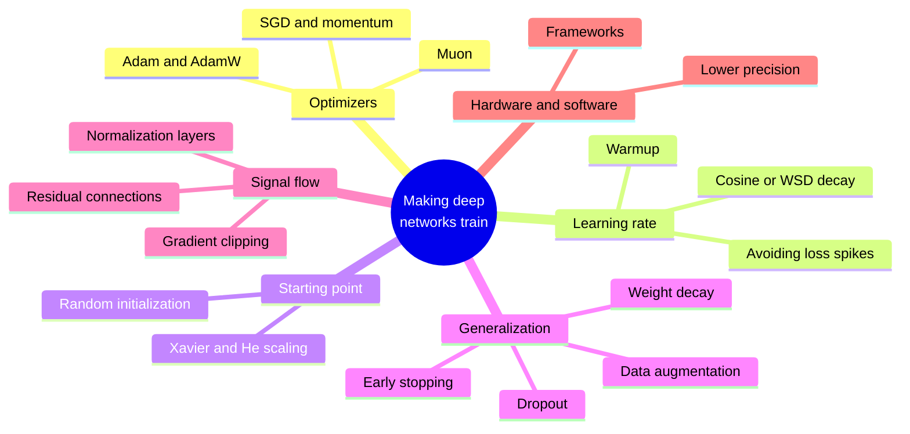
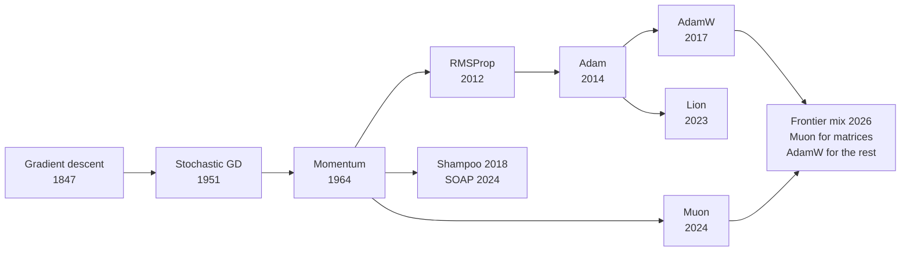
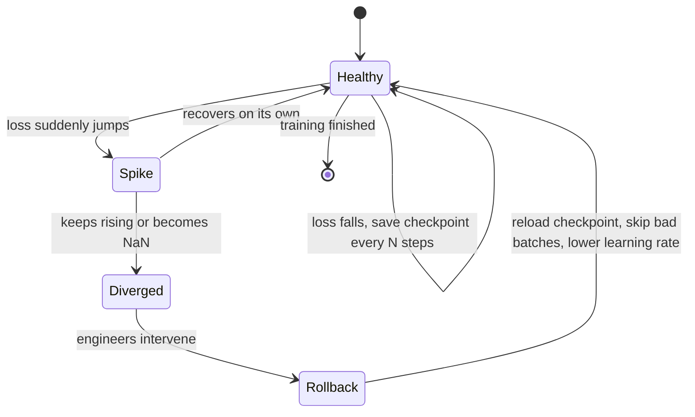

# Chapter 13: Training Deep Networks: Optimizers, Tricks and Why Depth Works

*This chapter shows you the tricks that turn the simple training loop of Chapter 12 into something that can train a network a hundred layers deep with a trillion parameters, and ends with a complete training script you can run yourself.*

## What you'll learn

- Why training a deep network is much harder than training the tiny network of Chapter 12, and the five problems every trick in this chapter solves.
- How optimizers evolved from plain gradient descent to momentum, Adam, AdamW and Muon, the optimizer that frontier labs adopted in 2025–26.
- How to choose a learning rate, what warmup and decay schedules do, and what a loss spike is.
- Why the starting values of the weights matter so much, and how initialization is done.
- How networks memorize versus generalize, and the regularization toolkit (weight decay, dropout, augmentation, early stopping), plus the puzzle of double descent.
- What normalization layers and residual connections are, and why they made 100-plus-layer networks trainable.
- The theory in plain words: universal approximation, why depth helps, inductive biases and the Bitter Lesson.
- How number precision, frameworks (PyTorch, JAX, TensorFlow/Keras) and a real training script fit together, with an annotated 15-line PyTorch script and a complete script for Google Colab.

## Before you start

You need Chapter 12 (Neural Networks From Scratch), which builds the neuron, the forward pass, the loss, backpropagation and the training loop that this chapter improves. Chapter 6 (The Math of AI, Part 2) helps with slopes and averages, and Chapter 9 (Is the Model Any Good?) introduces overfitting, validation sets and regularization, which we revisit here from the deep-learning side. The hardware side of number precision is covered properly in Chapter 32, so this chapter only sketches it.

## Why deep networks are hard to train

In Chapter 12, one step of plain gradient descent took the ice-cream network from a loss of 0.5 to almost zero. With nine parameters and one example, the recipe is easy. Now scale it up: a hundred layers, billions of parameters, trillions of examples. Five problems appear, and for about twenty years they made deep networks look like a dead end.

1. **It is slow.** The loss landscape of a big network has long, narrow valleys. Plain gradient descent zig-zags across them instead of walking along them.
2. **It is unstable.** One step that is too big can blow the numbers up. A training run that has cost millions of dollars can suddenly print "loss = NaN" and die.
3. **Signals fade or explode.** Backpropagation multiplies slopes layer by layer. Through a hundred layers, the learning signal can shrink to nothing or grow to infinity.
4. **It memorizes.** A network with enough parameters can memorize every training example, including the noise, and fail on new data.
5. **It is expensive.** Every number costs memory and energy. How many bits each number gets, and which software organizes the work, matters enormously at scale.

Between 2006 and 2017 researchers found a fix for each problem: better optimizers, learning-rate schedules, careful initialization, regularization, normalization layers and residual connections, plus lower-precision arithmetic and good software. None of these tricks is glamorous. Together they are the reason deep learning works at all, and frontier labs still innovate on them in 2026.

> **Definition — Optimizer:** The algorithm that turns gradients into actual parameter updates. Plain gradient descent is the simplest; SGD with momentum, Adam, AdamW and Muon are smarter versions.

> **Definition — Loss landscape:** An imaginary terrain where each location is one setting of all the parameters and the height is the loss. Training is a walk across this terrain looking for low ground; real landscapes have billions of dimensions.


*Figure 13.1: The toolkit of this chapter. Each branch fixes one of the five problems that made deep networks hard to train.*

> **Key idea:** The training loop from Chapter 12 never changes. Everything in this chapter is about making each step better aimed, better sized and better behaved, so that the same loop works at a million times the scale.

## Optimizers: smarter ways to walk downhill

### The trouble with plain SGD

Recall stochastic gradient descent (SGD): grab a random batch, compute the gradient, and step every parameter by the same rule, new = old − learning rate × slope. Two things go wrong at scale.

The first is **ravines**. Imagine a valley that is steep across and almost flat along its floor, like a long gutter. The gradient points mostly across the gutter, towards the nearest wall, not along it towards the lowest point. With a learning rate big enough to make progress along the floor, the walker overshoots the walls and bounces from side to side. With a learning rate small enough not to bounce, it crawls along the floor. In a network, some parameters sit in steep directions and others in flat ones, so a single learning rate is always wrong for somebody.

The second is **noise**. Each mini-batch gives only an estimate of the true gradient. Some steps point in slightly wrong directions. A little noise is useful (it can shake the walker out of shallow dips), but too much wastes steps.

Loss landscapes also contain flat plateaus and **saddle points**, places that slope down in some directions and up in others, like the middle of a horse saddle. In very high dimensions these are far more common than true dead-end valleys, and a walker that slows to a crawl on a plateau can waste a lot of time.

> **Definition — Saddle point:** A spot in the loss landscape where the slope is zero but which is a low point in some directions and a high point in others, like the center of a horse saddle. Training can stall near them because the gradient there is tiny.

### Momentum: a rolling ball

The first fix, proposed by Boris Polyak in 1964, is **momentum**. Instead of stepping by the current gradient alone, keep a running "velocity" that adds up recent gradients, and step by the velocity:

```
velocity = 0.9 × velocity + gradient
new w    = old w − learning rate × velocity
```

The 0.9 means "keep 90% of the old velocity each step". If the gradient keeps pointing the same way, the velocity grows. With a constant gradient of 1, the velocity goes 1, then 1.9, then 2.71, then 3.44, and keeps climbing towards 10. That is up to ten times faster travel along a consistent slope. If the gradient flips back and forth, as it does across a ravine, the flips mostly cancel out in the velocity, so the zig-zag is damped.

Here is the one-knob loss from Chapter 12, L = (w − 3)², starting at w = 0 with a small learning rate of 0.01:

| Step | Plain gradient descent | With momentum (0.9) |
|---|---|---|
| 1 | w = 0.06 | w = 0.06 |
| 3 | w = 0.18 | w = 0.33 |
| 10 | w = 0.55 | w = 2.08 |
| 20 | w = 1.00 | w = 3.81 (overshot) |
| 30 | w = 1.36 | w = 3.53 |
| 60 | w = 2.11 | w = 3.00 (settled) |

Momentum reaches the neighborhood of the answer far sooner. It also overshoots, the way a heavy ball rolls past the bottom of a bowl before settling. That trade-off is everywhere in optimization.

> **Definition — Momentum:** An optimizer technique that keeps a running sum of recent gradients (a velocity) and steps along it, so progress speeds up along consistent slopes and zig-zags cancel out.

> **Analogy:** Plain gradient descent is a ping-pong ball on a bumpy slope: every little bump knocks it sideways. Momentum turns it into a bowling ball: it builds speed downhill, rolls straight through small bumps, and only changes direction when the slope really changes.

### Adam: a separate stride for every knob

Momentum still uses one learning rate for every parameter. But in a real network, some parameters get huge gradients and others tiny ones. A word that appears rarely in the training data gives its embedding parameters a gradient only occasionally; a parameter in a busy layer gets large gradients every step.

**Adam** (Diederik Kingma and Jimmy Ba, 2014) gives every parameter its own effective step size. For each parameter it keeps two running averages:

```
m = 0.9   × m + 0.1   × gradient        (average direction)
v = 0.999 × v + 0.001 × gradient²       (average size, squared)
step = learning rate × m ÷ (√v + a tiny number)
```

(Adam also applies a small correction during the first few steps, because m and v start at zero.)

Look at what the division does. Suppose one parameter's gradient is steadily 0.001 and another's is steadily 100. After a while, m ≈ gradient and √v ≈ the size of the gradient, so m ÷ √v ≈ 1 for both. Each parameter moves by about the learning rate per step, whatever the raw size of its gradient:

| | Gradient 0.001 | Gradient 100 |
|---|---|---|
| Plain SGD, learning rate 0.001 | moves 0.000001 per step | moves 0.1 per step |
| Adam, learning rate 0.001 | moves about 0.001 per step | moves about 0.001 per step |

With SGD, one parameter barely moves while the other jumps around. Adam equalizes them. It combines this per-parameter scaling with momentum, and it works well with little tuning, which is why it became the default optimizer of deep learning for about a decade. Its direct ancestor, RMSProp (Geoffrey Hinton, 2012), introduced the dividing-by-average-size idea.

> **Definition — Adam:** An optimizer (2014) that combines momentum with a separate, automatically adjusted step size for each parameter, based on running averages of each parameter's gradients and squared gradients.

> **Definition — Optimizer state:** The extra numbers an optimizer stores for each parameter between steps, such as momentum's velocity or Adam's two running averages. For large models this extra memory can be several times the size of the model itself.

> **Analogy:** Adam is a hiker with adjustable shoes for each foot and each direction: long strides where the ground has been smooth and consistent, careful short steps where it has been rocky, decided separately for every direction of travel.

### AdamW: weight decay done right

A long-standing regularization trick is **weight decay**: at every step, shrink every weight slightly towards zero. This discourages the network from relying on a few huge weights, which tends to help it generalize. Here is the effect on its own: with a learning rate of 0.001 and a weight decay of 0.1, each step multiplies a weight by 1 − 0.001 × 0.1 = 0.9999. That looks like nothing, but over 10,000 steps it compounds to 0.9999^10,000 ≈ 0.37. A weight of 2.0 that no gradient defended would shrink to about 0.74.

In 2017 Ilya Loshchilov and Frank Hutter noticed that the usual way of adding weight decay to Adam was subtly broken: the decay was mixed into the gradient and then divided by Adam's per-parameter scaling, so parameters with big gradients barely decayed. Their fix, **AdamW**, applies the decay directly to the weights, separately ("decoupled") from the gradient step. It is a small change, and it became the standard optimizer for training Transformers.

> **Definition — Weight decay:** Shrinking every weight by a tiny fraction at each training step, so that weights only stay large if the data keeps pushing them up. It is a simple form of regularization.

> **Definition — AdamW:** Adam with weight decay applied separately ("decoupled") from the gradient-based step. It has been the standard optimizer for Transformers since the late 2010s.

### Beyond Adam: Lion, Shampoo and SOAP

Researchers kept looking for better walkers. **Lion** (Google, 2023), found partly by an automated search over possible update rules, uses only the *sign* of a momentum-like quantity, so every parameter moves by exactly the same amount each step, and it stores less state than Adam. **Shampoo** (2018) and its 2024 descendant **SOAP** go the other way: they keep richer information about the *curvature* of the landscape, meaning how the slope itself changes as you move, for each layer. Curvature tells you how big a step is safe in each direction, so these optimizers can take better-aimed steps at the cost of extra memory and computation.

> **Definition — Curvature:** How quickly the slope of the loss changes as you move, that is, how sharply the landscape bends. High curvature means a step that looks safe can quickly overshoot; optimizers that track curvature are sometimes called "second-order" methods.

> **Definition — Lion, Shampoo and SOAP:** Alternative optimizers. Lion (2023) moves each parameter by a fixed amount in the direction of the sign of its momentum. Shampoo (2018) and SOAP (2024) use per-layer curvature information to shape their steps, at extra cost.

### Muon: balance the whole matrix

For about ten years, almost every large model was trained with Adam or AdamW. Then, on 8 December 2024, a researcher named Keller Jordan published a blog post introducing **Muon**, short for "MomentUm Orthogonalized by Newton–Schulz". It treats each layer's weights not as a pile of separate numbers but as what they are: a matrix.

Here is the idea in plain words. The update for a layer's weight matrix (the gradient, smoothed with momentum) is itself a matrix. Any matrix can be thought of as a set of directions, each with a strength: "push the weights strongly this way, weakly that way". In practice, a few directions dominate the update and most get almost nothing. Muon keeps the directions but makes all their strengths equal, so the neglected directions also learn. Mathematicians call this **orthogonalizing** the update.

A toy example makes it concrete. Suppose a 2-by-2 layer's momentum update is:

```
 update before Muon          update after Muon
 [ 3.0   0   ]               [ 1   0 ]
 [ 0     0.1 ]       ->      [ 0   1 ]
```

Before, the first direction gets 30 times as much push as the second. After, both get the same. For real matrices with thousands of rows, the directions are not lined up neatly along the rows and columns, and finding them exactly would be slow. Muon uses a shortcut called the **Newton–Schulz iteration**: about five rounds of matrix multiplications that push all the strengths towards 1. Since GPUs are built for matrix multiplication, this costs only a little extra time.

Muon is meant for the 2-D weight matrices of hidden layers. The recommended practice is to use AdamW for everything else: the embedding table, the final output layer, and the small 1-D parameters such as biases.

The results came quickly:

- Muon set speed records on two community benchmarks, the NanoGPT "speedrun" and training a small image classifier on CIFAR-10 (reaching 94% accuracy in 2.6 seconds of A100 GPU time instead of 3.3).
- In February 2025, Moonshot AI published "Muon is Scalable for LLM Training", showing that with weight decay and a per-matrix adjustment of the update size, Muon works for large language models.
- In July 2025, Moonshot's Kimi K2 (about 1 trillion total parameters, 32 billion active) was pre-trained on 15.5 trillion tokens with **MuonClip**, Muon plus a fix that stops attention scores from growing out of control, and Moonshot reported zero loss spikes during the run.
- DeepSeek V4 (2026) states that it uses Muon "for faster convergence and greater training stability".
- PyTorch includes `torch.optim.Muon` from version 2.9 onward, and its documentation pairs it with AdamW for the non-matrix parameters, exactly as recommended.

Muon also stores less than Adam: one momentum buffer per parameter instead of two running averages. The theory of *why* it works so well is still catching up with practice, and new variants kept appearing in 2026.

> **Definition — Muon:** An optimizer (Keller Jordan, December 2024) for the weight matrices of hidden layers. It takes the momentum update for each matrix and orthogonalizes it, so every direction of change gets equal strength; it is usually paired with AdamW for other parameters.

> **Definition — Orthogonalization (of an update):** Reshaping a matrix so that all of its independent directions have the same strength while keeping the directions themselves. Muon applies it to each weight matrix's update.

> **Definition — Newton–Schulz iteration:** A short recipe of repeated matrix multiplications that approximately orthogonalizes a matrix. Muon uses about five rounds because it is far faster on GPUs than computing the exact answer.

> **Analogy:** Think of a team where two people do all the work and everyone else sits idle. Muon is the manager who rebalances the workload so every member contributes equally. The team (the weight matrix) improves along all its dimensions at once instead of only its busiest ones.


*Figure 13.2: The family tree of optimizers. Gradient descent goes back to Augustin-Louis Cauchy in 1847; the stochastic version to Robbins and Monro in 1951. Frontier labs in 2026 often combine Muon and AdamW.*

| Optimizer | Year | What it remembers about each parameter | Extra numbers per parameter | Typical use |
|---|---|---|---|---|
| SGD | 1951 | Nothing | 0 | Teaching, simple problems |
| SGD with momentum | 1964 | A velocity | 1 | Image networks of the 2010s |
| Adam | 2014 | Average gradient and average squared gradient | 2 | The default for a decade |
| AdamW | 2017 | Same as Adam, with decoupled decay | 2 | Standard for Transformers and fine-tuning |
| Lion | 2023 | A momentum; steps use only its sign | 1 | Lower-memory alternative |
| Shampoo / SOAP | 2018 / 2024 | Curvature summaries for each layer | More than 2 | Research and some large runs |
| Muon | 2024 | A momentum per weight matrix | 1 | Hidden-layer matrices at frontier scale, with AdamW for the rest |

> **At the frontier (2026):** The optimizer field, frozen on Adam and AdamW for about ten years, is moving again. Muon-family optimizers trained Kimi K2 and DeepSeek V4, two of the largest open-weight models, and PyTorch ships Muon as a standard component. Research papers in 2026 continued to propose refinements and to explain why orthogonalized updates work. The closed labs (OpenAI, Anthropic, Google) do not say which optimizers they use.

> **Watch out:** Newer is not automatically better for your project. For small networks and most fine-tuning jobs, AdamW with a sensible learning rate remains the safe default. Optimizers interact with learning rates, batch sizes and architectures, so the only reliable way to compare them is a fair experiment, like Exercise 8.

## The learning rate: the most important knob

Of all the hyperparameters, the learning rate matters most. Chapter 12 showed the three behaviors on a single knob: too small and training crawls, just right and it settles, too big and every step overshoots by more than the last until the numbers explode. In a real network, explosion shows up as the loss suddenly printing **NaN**, the computer's way of saying the arithmetic produced something that is not a number, usually after an overflow to infinity. Once a single NaN appears, it spreads through every calculation it touches, and the run is dead.

> **Definition — NaN (Not a Number):** A special value a computer produces when arithmetic breaks down, for example infinity minus infinity. A loss of NaN means training has blown up and must be restarted from an earlier saved state.

### Schedules: the learning rate changes during training

The best learning rate is not constant. Early in training, the weights are random and the gradients are large and erratic, so big steps are dangerous. In the middle, you want big steps to make fast progress. At the end, you want small steps to settle precisely into a good spot. So practitioners use a **learning-rate schedule**:

- **Warmup**: start with a tiny learning rate and raise it in a straight line over the first few hundred or few thousand steps. This gives Adam's running averages time to become reliable before any big steps are taken.
- **Cosine decay**: after warmup, lower the learning rate smoothly along a half cosine curve, from the peak down to near zero by the end.
- **Warmup–stable–decay (WSD)**: after warmup, hold the learning rate flat for most of training, then drop it quickly in a short final phase. It became popular in 2024–26 because you do not need to know the total length of training in advance: you can keep going at the stable rate, and branch off a short decay phase whenever you want a finished model.

A worked example: a run of 10,000 steps with a peak learning rate of 0.001 and 1,000 warmup steps.

| Step | Phase | Cosine schedule | WSD schedule (decay in the last 1,000 steps) |
|---|---|---|---|
| 0 | Warmup starts | 0 | 0 |
| 500 | Halfway through warmup | 0.0005 | 0.0005 |
| 1,000 | Peak | 0.001 | 0.001 |
| 5,500 | Halfway through decay | 0.0005 | 0.001 |
| 7,750 | Three-quarters through decay | about 0.00015 | 0.001 |
| 9,500 | Near the end | about 0.00001 | 0.0005 |
| 10,000 | End | 0 | 0 |

```
 lr     warmup + cosine                warmup + stable + decay
0.001 |    .--.                     |    .-------------------.
      |   /    '.                   |   /                     \
      |  /       '.                 |  /                       \
      |  /         '.               |  /                        \
      | /            '.             | /                          \
    0 |/               '--.         |/                            \
      +-------------------- step    +------------------------------
```
*Figure 13.3: Two common learning-rate schedules. Both start with a warmup ramp. Cosine decay lowers the rate gradually; WSD holds it flat and drops it at the end.*

> **Definition — Learning-rate schedule:** A plan for changing the learning rate during training, typically a short ramp up followed by a long decline.

> **Definition — Warmup:** The first phase of a learning-rate schedule, in which the rate rises from nearly zero to its peak, so the early, chaotic steps are small.

> **Definition — Cosine decay:** A schedule that lowers the learning rate from its peak to near zero along a smooth half cosine curve: slowly at first, faster in the middle, gently at the end.

> **Definition — WSD (warmup–stable–decay):** A schedule that warms up, holds the learning rate constant for most of training, and then decays it quickly at the end, which makes it easy to extend training or produce checkpoints at any point.

### Batch size and the learning rate

Learning rate and batch size work together. A bigger batch averages more examples, so its gradient is less noisy, and you can usually afford bigger steps. Frontier language-model runs use batches of millions of tokens. Some even grow the batch during training; Meta's Llama 3 paper, for example, describes doubling the batch size twice during its largest run as training stabilized. Chapter 19 describes these frontier pretraining runs in detail.

### Loss spikes

Even with a good schedule, large runs sometimes suffer a **loss spike**: the loss, which had been falling smoothly, suddenly jumps up. Sometimes it recovers on its own within a few hundred steps. Sometimes it never recovers, or turns into NaN. Causes include an unusual batch of data, numbers inside the attention mechanism growing too large, and the optimizer taking one step too far in a sharp part of the landscape.

At frontier scale, spikes are expensive, because thousands of chips sit idle or compute garbage. The standard defense is to save a **checkpoint**, a complete snapshot of all parameters and optimizer state, every so often. If a spike does not recover, engineers roll back to a checkpoint from before the spike and change something: skip the batches that triggered it, lower the learning rate, or tighten gradient clipping (explained later in this chapter). Google's PaLM paper (2022), for example, reported about 20 spikes during training and handled them by restarting from a checkpoint roughly 100 steps before each one and skipping a few hundred batches of data. Newer designs try to prevent spikes in the first place, for instance by normalizing the queries and keys inside attention ("QK-norm") or by clipping them, as in Kimi K2's MuonClip.

> **Definition — Loss spike:** A sudden jump in the training loss during an otherwise smooth run, usually a sign of numerical instability. At frontier scale each spike can waste large amounts of compute.

> **Definition — Checkpoint:** A saved snapshot of a model's parameters (and usually its optimizer state) at a point in training, used to resume after failures and to roll back after instabilities. A released model's "weights file" is a checkpoint.


*Figure 13.4: The life of a large training run. Most of the time it is healthy; when a spike does not recover, the team rolls back to a checkpoint and changes something.*

> **Key idea:** The learning rate controls the size of every step. Warm it up gently, keep it high while there is ground to cover, and bring it down at the end. Most failed training runs are learning-rate problems in disguise.

## Initialization: where the walk begins

Before the first step, every weight needs a starting value. This sounds like a detail. It is not.

### Why not start at zero?

Suppose every weight starts at 0. Then every hidden neuron in a layer computes exactly the same thing, receives exactly the same blame in backpropagation, and gets exactly the same update. After a million steps they are still identical twins. A layer of 4,096 identical neurons is no better than one neuron. Starting with random values breaks this **symmetry**, so different neurons can specialize in different features.

> **Definition — Symmetry breaking:** Starting the weights of a layer at different random values so that its neurons compute different things and learn different features. With identical starting weights, neurons would remain identical forever.

### Why the size of the random numbers matters

The random numbers must also be the right size. Each layer multiplies its input by its weight matrix. If the weights are a bit too big, signals grow at every layer; if a bit too small, they shrink. Over many layers the effect compounds. If each of 50 layers scaled the signal by 0.5, it would end at 0.5^50 ≈ 0.000000000000001 of its original size, lost in rounding error. If each scaled it by 1.5, it would end about 600 million times larger. The same compounding hits the gradients on the way back.

The fix is to scale the random starting weights according to how many inputs each neuron has: the more inputs being added together, the smaller each weight should be, so the sum stays about the same size as each input.

- **Xavier (or Glorot) initialization** (Xavier Glorot and Yoshua Bengio, 2010) sets the spread of the random weights based on the number of inputs and outputs of the layer. For a layer with 512 inputs and 512 outputs, the standard deviation (the typical size of the random numbers, see Chapter 6) is √(2 ÷ 1,024) ≈ 0.044.
- **He initialization** (Kaiming He and colleagues, 2015) adjusts this for ReLU, which zeroes out about half its inputs, so the weights are a bit larger: √(2 ÷ number of inputs). For 512 inputs that is √(2 ÷ 512) = 0.0625.

Modern frameworks apply sensible defaults automatically, so you rarely choose by hand. Large language models typically draw their starting weights from a narrow bell curve, and their published configuration files often list the spread as a setting (frequently called something like `initializer_range`). Some designs also shrink the starting weights of layers that add into a residual connection, so that a stack of many such layers starts out calm; the GPT-2 paper (2019), for example, scaled them down according to the number of layers.

> **Definition — Initialization:** Choosing the starting values of all weights before training. They must be random (to break symmetry) and correctly scaled (so signals neither fade nor explode through the layers).

> **Definition — Xavier (Glorot) initialization:** A 2010 rule for setting the spread of random starting weights from the number of inputs and outputs of each layer, designed to keep signal sizes steady through sigmoid and tanh networks.

> **Definition — He initialization:** A 2015 variant of Xavier initialization with slightly larger weights, designed for ReLU networks, in which half the signals are zeroed out at each layer.

> **Analogy:** Initialization is like tuning every instrument in an orchestra before the concert. If they all start on exactly the same note, you have one instrument played loudly (symmetry). If some are wildly out of tune, the sound collapses into noise before the music has a chance (exploding or vanishing signals).

## Generalization versus memorization

A network's goal is not to do well on its training examples. It is to do well on examples it has never seen. That is **generalization**, and Chapter 9 introduced the two ways it fails: **underfitting** (too simple or undertrained to capture the pattern) and **overfitting** (memorizing the training examples, noise included). Deep networks add a twist: they are so flexible that they can memorize almost anything.

In a famous 2016 experiment, researchers trained standard image networks on photos whose labels had been replaced with random ones. "Cat" and "truck" were assigned by coin flip. The networks still reached nearly perfect accuracy on the training set: they simply memorized every meaningless pairing. Yet the same networks, trained on the real labels, generalize well to new photos. So the networks *can* memorize, but when real patterns exist, training tends to find them first. Explaining exactly why is still an open research question.

> **Definition — Generalization:** A model's ability to perform well on new, unseen data rather than only on its training examples. It is the real goal of training.

> **Definition — Overfitting:** When a model learns its training examples too specifically, including their noise and quirks, so it scores well on them but worse on new data, like memorizing the answer key instead of learning the subject.

> **Definition — Underfitting:** When a model is too simple or too briefly trained to capture the real pattern, so it does poorly even on its training data.

You watch for overfitting by plotting two curves: loss on the training data and loss on held-out validation data. Early in training both fall. If the validation loss turns upward while the training loss keeps falling, the network has started memorizing.

```
 loss
  |\
  | \.
  |  \ '.                         .----'  validation loss
  |   \  '.                 .---''
  |    \   '-..___.....--''
  |     '.
  |       '-._
  |           '--.___          training loss
  |                  '----------------------------
  +-----------------------|---------------------> epochs
                    best point to stop
```
*Figure 13.5: Training loss keeps falling while validation loss bottoms out and starts to rise. The gap that opens up is overfitting; stopping near the bottom of the validation curve is early stopping.*

### The regularization toolkit

Any technique that reduces overfitting is called **regularization**. Four are standard in deep learning:

| Technique | What it does | Everyday comparison |
|---|---|---|
| Weight decay | Shrinks every weight slightly each step | A small tax on complexity |
| Dropout | Randomly switches off a fraction of neurons at each training step | Benching random players at practice |
| Data augmentation | Makes new training examples by flipping, cropping or recoloring images, or rephrasing text | Practicing the same skill in different conditions |
| Early stopping | Stops training when validation loss stops improving | Leaving the exam room once you have checked your answers |

**Dropout** (Geoffrey Hinton's group, 2012) deserves a worked example. During training, each neuron's output is set to zero with some probability, say 50%, chosen fresh at every step. The survivors are scaled up to keep the average the same. Suppose four neurons output [4, 2, 6, 8] and the random coin flips keep the first and third. The output becomes [8, 0, 12, 0]: the dropped ones are zeroed and the survivors doubled. The average was 5 and is still 5. Because any neuron might vanish at any moment, the network cannot rely on one star neuron and must spread what it knows across many. At inference time, dropout is switched off and all neurons work.

> **Definition — Regularization:** Any technique that discourages a model from memorizing its training data and helps it generalize, such as weight decay, dropout, data augmentation and early stopping.

> **Definition — Dropout:** A regularization method that randomly switches off a fraction of neurons at each training step (and scales up the rest), so the network cannot depend on any single neuron. It is turned off when the model is used.

> **Definition — Data augmentation:** Creating extra training examples by transforming existing ones, for example flipping, cropping or recoloring images or paraphrasing sentences, so the model learns what should not matter.

> **Definition — Early stopping:** Ending training at the point where performance on validation data stops improving, before the model starts to memorize its training set.

### Double descent and other surprises

Classical statistics says that as a model grows more flexible, its test error first falls (it can capture the pattern) and then rises (it starts fitting noise): a U-shaped curve. Deep learning broke this picture. Around 2019, researchers (Mikhail Belkin and colleagues, then Preetum Nakkiran and colleagues at Harvard and OpenAI) documented **double descent**: as models grow, test error falls, rises to a peak at the size where the model can only just fit the training data exactly, and then *falls again* as the model grows even bigger. Very large models can fit their training data perfectly and still generalize well.

```
 test error
   |
   |\                 peak: the model can only
   | \        /\      just fit the training data
   |  \      /  \
   |   \____/    \
   |              '.
   |                '-.._
   |                     ''--.....______  bigger keeps helping
   +------------------|----------------------------> model size
      classical U     |   modern "overparameterized" regime
```
*Figure 13.6: Double descent. Past the danger zone where the model can barely fit its training data, making it even bigger lowers the test error again.*

Another surprise, **grokking** (reported in 2022), happens on some small, puzzle-like tasks: a network memorizes the training set quickly, its validation accuracy stays poor for a long time, and then, thousands of steps later, it suddenly "gets" the underlying rule and validation accuracy jumps. One of the NeurIPS 2025 best papers, "Why Diffusion Models Don't Memorize", found a related pattern in image generators: generalization appears on one timescale during training, and memorization only on a later, slower one.

> **Definition — Double descent:** The observation that as models grow, test error can fall, rise to a peak near the size where the model just fits its training data, and then fall again for even larger models.

> **Definition — Grokking:** A training phenomenon in which a network first memorizes its training data and then, much later, suddenly generalizes, as if it had finally understood the rule.

How does this apply to chatbots? Frontier language models are trained on so much text that they see most of it only about once, so classic overfitting is rarely the main problem in pretraining. But they do memorize passages that appear many times in their data, which raises copyright and privacy questions (Chapter 11 and Chapter 58). Fine-tuning a model on a small dataset is where overfitting returns in full force (Chapter 30).

> **Watch out:** "Bigger models always overfit more" is the classical intuition, and in deep learning it is often wrong. Past a certain size, bigger networks frequently generalize better, as long as there is enough data and training is done well. The reasons are still debated, which makes generalization one of the deepest open questions in the field.
