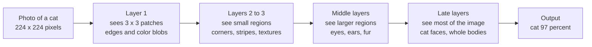
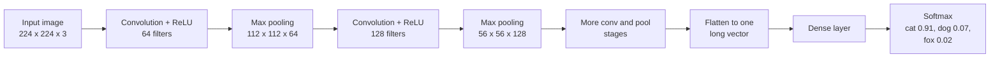
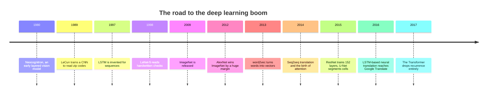
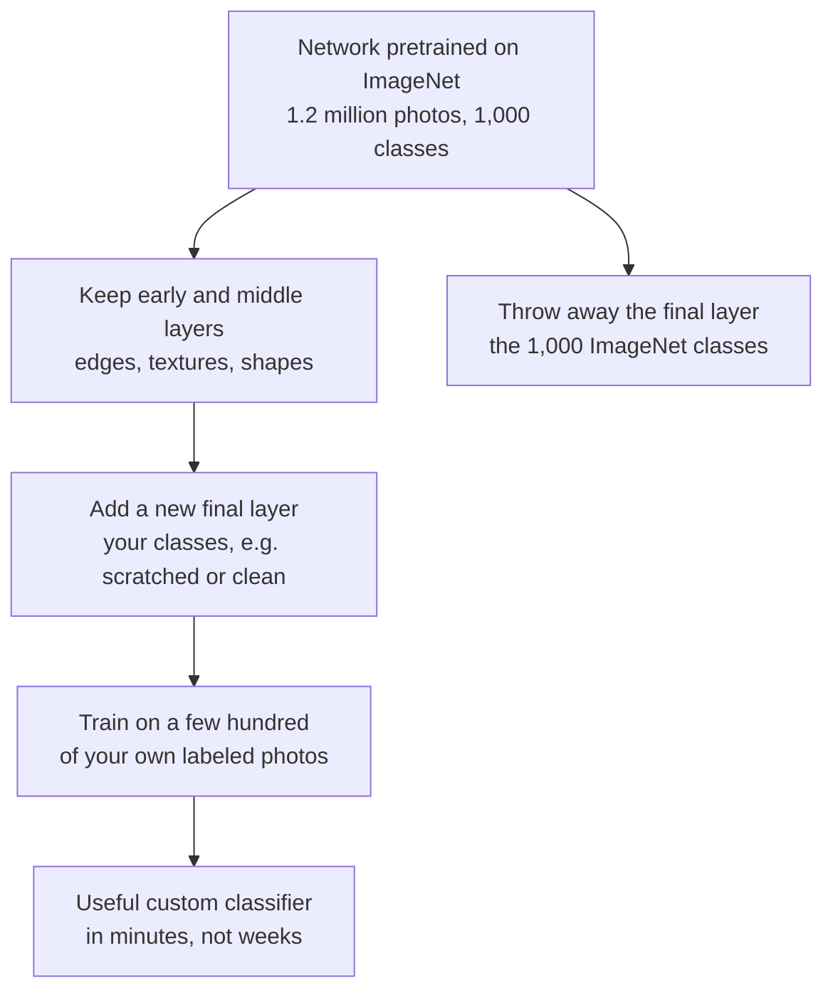
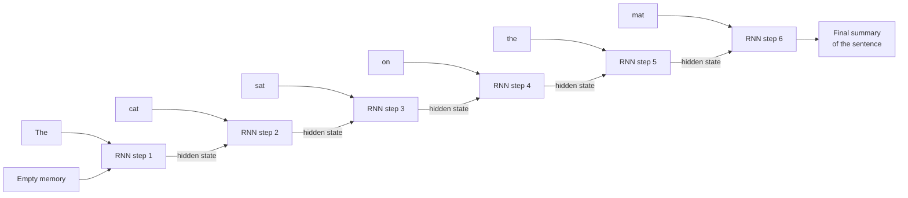
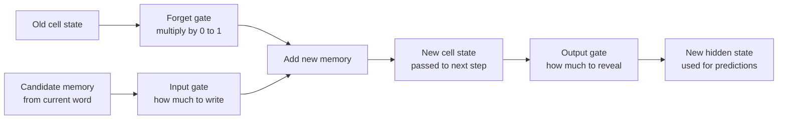
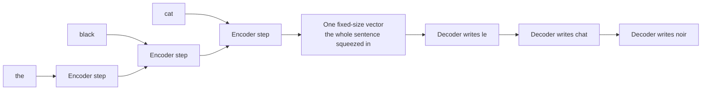
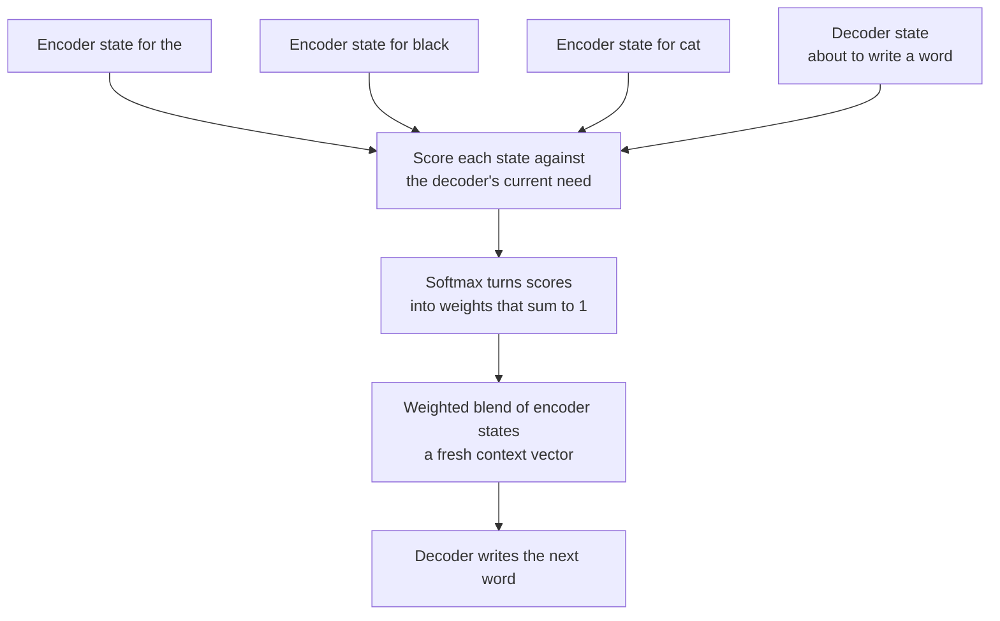

# Chapter 14: Seeing and Remembering: CNNs, RNNs, Embeddings and the Deep Learning Boom

*This chapter shows you how neural networks learned to see pictures, read sentences in order and place words on a map of meaning, and why each of those ideas led straight to the Transformer behind your chatbot.*

## What you'll learn
- Why a plain stack of dense layers is a poor fit for photos, and how convolutional neural networks (CNNs) fix that with small sliding filters.
- How to compute a convolution, a feature map and a pooling step by hand, and how stacked filters build a hierarchy from edges to whole objects.
- The story of the deep learning boom: LeNet, ImageNet, AlexNet, VGG, ResNet and U-Net, and why 2012 was the turning point.
- How transfer learning lets you reuse a network trained on millions of images for your own small problem.
- How recurrent neural networks (RNNs) read a sequence one step at a time, why they forget, and how LSTM and GRU gates help.
- How sequence-to-sequence translation worked, where its bottleneck was, and how attention was born in 2014 to fix it.
- How embeddings turn words into vectors, from one-hot codes to word2vec to the contextual and sentence embeddings used in search today.
- Why all of this set the stage for the Transformer (Chapter 15).

## Before you start
This chapter leans on four earlier chapters. From Chapter 5 (The Math of AI, Part 1: Functions, Vectors and Matrices) you need vectors, the dot product, cosine similarity and matrix multiplication. From Chapter 6 (The Math of AI, Part 2: Probability, Statistics and Learning by Slopes) you need softmax and the idea of a gradient. From Chapter 12 (Neural Networks From Scratch) you need neurons, layers, activation functions and backpropagation. From Chapter 13 (Training Deep Networks: Optimizers, Tricks and Why Depth Works) you need residual connections, vanishing gradients and the Bitter Lesson. If any of those feel shaky, reread the "In plain English" recap at the end of that chapter before you begin.

## Why a plain network struggles with pictures

When you upload a photo of your fridge to a chatbot and ask "what can I cook with this?", the model has to turn a picture into something it can reason about. Long before chatbots, researchers had to teach computers to tell a cat from a dog, or a 3 from an 8. The tricks they invented are still inside every modern AI system.

To a computer, a picture is a grid of numbers. Each square holds a brightness value, usually from 0 (black) to 255 (white).

> **Definition — Pixel:** One tiny square of a digital image, stored as a number (or a few numbers) describing its brightness and color. A 1,000 × 1,000 photo has one million pixels.

A color image stores three numbers per pixel (red, green and blue), like three grids stacked on top of each other.

> **Definition — Channel:** One layer of numbers in an image or in a network's internal picture. A color photo has three channels (red, green, blue); a layer deep inside a vision network may have hundreds of channels, each tracking a different pattern.

The classic teaching dataset is a collection of handwritten digits, each a 28 × 28 grayscale picture, or 784 numbers.

> **Definition — MNIST:** A famous dataset of 70,000 small images of handwritten digits (0 to 9), each 28 × 28 pixels. It has been the "hello world" of image recognition since the late 1990s.

In Chapter 12 you met the plain neural network, where every input connects to every neuron.

> **Definition — MLP (Multilayer Perceptron):** A neural network made of stacked fully connected (dense) layers, where every number coming in is connected to every neuron in the next layer. It is the plain, general-purpose neural network.

An MLP can learn MNIST quite well. Flatten the grid into a row of 784 numbers, feed it to a hidden layer of 128 neurons, and you have about 101,770 parameters that get roughly 97 to 98 percent of test digits right after a few minutes of training. So what is the problem? There are two, and both get worse as pictures get bigger.

**Problem 1: far too many weights.** A modest 1,000 × 1,000 color photo is 3 million numbers. If the first hidden layer has 1,000 neurons, and each neuron connects to every input, that one layer needs 3 million × 1,000 = 3 billion weights, before it has learned anything clever.

**Problem 2: no sense of "nearby" or of "same thing, different place."** Flattening loses the fact that pixel 1 and pixel 29 sit next to each other (one is directly above the other). And a cat that moves 10 pixels to the right lands on completely different input neurons, so the MLP must learn "cat" separately for every position, which needs enormous amounts of data. You know that an edge is an edge wherever it appears. Building that kind of assumption into a network's design is called an inductive bias.

> **Definition — Inductive bias:** An assumption built into a model's design that makes some patterns easier to learn. A CNN assumes that nearby pixels belong together and that a pattern means the same thing wherever it appears.

> **Key idea:** An MLP treats an image as a shapeless list of numbers. Images have structure: nearby pixels are related, and patterns repeat across positions. A network that respects that structure can use far fewer weights and learn from far less data.

## Convolution: a small flashlight sliding over the picture

The fix is simple. Instead of one giant set of weights that looks at the whole image, use a tiny 3 × 3 grid of weights and slide it across the image. At each position, multiply the nine pixels under it by the nine weights, add them up, and write the result into a new grid.

> **Definition — Convolution:** Sliding a small grid of weights across an input (such as an image) and, at each position, multiplying the overlapping numbers together and adding them up. The result is a new grid that shows where the pattern in the weights was found.

> **Definition — Filter (kernel):** The small grid of learned weights used in a convolution, often 3 × 3. Each filter acts as a detector for one simple pattern, such as a vertical edge or a patch of a certain color.

> **Analogy:** Convolution is a flashlight with a stencil. Slide a small "vertical edge" stencil across a dark picture, and the light shines brightly wherever the picture matches the stencil and stays dim everywhere else.

### Working one convolution by hand

Below is a 6 × 6 grayscale image whose left half is bright (9) and right half is dark (0), so there is a vertical edge down the middle. Next to it is a 3 × 3 vertical-edge filter: a column of 1s, a column of 0s and a column of −1s.

```
Input image (6 x 6)          Vertical-edge filter (3 x 3)

9  9  9  0  0  0               1   0  -1
9  9  9  0  0  0               1   0  -1
9  9  9  0  0  0               1   0  -1
9  9  9  0  0  0
9  9  9  0  0  0
9  9  9  0  0  0
```
*Figure 14.1: A tiny image with a vertical edge, and a filter built to find vertical edges.*

Place the filter over the top-left 3 × 3 corner. Every pixel under it is 9, so each row gives 9 × 1 + 9 × 0 + 9 × (−1) = 0, and the total is 0. No edge here, which is right: the corner is flat brightness.

Now slide the filter one column to the right. The window now covers columns 2, 3 and 4:

```
9  9  0
9  9  0      each row: 9 x 1 + 9 x 0 + 0 x (-1) = 9
9  9  0      three rows: 9 + 9 + 9 = 27
```

The answer is 27, a strong response: bright on the left, dark on the right, exactly the filter's pattern. Keep sliding across and down, and you get a 4 × 4 grid of answers:

```
Feature map (4 x 4)

0  27  27  0
0  27  27  0
0  27  27  0
0  27  27  0
```
*Figure 14.2: The feature map lights up (27) along the columns where the edge sits, and stays at 0 where the image is flat.*

> **Definition — Feature map:** The grid of numbers produced by sliding one filter across an input. High values mark the places where the filter's pattern was found.

A horizontal-edge filter (1s on top, 0s in the middle, −1s at the bottom) gives 0 everywhere on this image: there is no horizontal edge. Exercise 1 has you try both on graph paper.

> **Try it:** Ask your chatbot: "Give me the 3 × 3 convolution kernels for blur, sharpen and edge detection used in photo editing, and explain in one sentence each why those numbers do what they do." The blur and sharpen buttons in your phone's photo editor are hand-designed convolutions. A CNN learns its own.

### The big trick: the same filter everywhere

Convolution solves both problems from the last section. The filter's 9 weights are reused at every position, so an edge detector learned in one corner works in every corner.

> **Definition — Weight sharing:** Using the same small set of weights at every position in the input, as a convolution does. It slashes the number of parameters and lets a pattern learned in one place be recognized everywhere.

Count it out for a 224 × 224 color image, the standard size for many classic image networks. A 3 × 3 filter covers all three channels, so it has 3 × 3 × 3 = 27 weights plus 1 bias, or 28. A first layer with 64 different filters has 64 × 28 = 1,792 parameters. A dense layer with 64 neurons looking at the same image would need 224 × 224 × 3 = 150,528 inputs × 64 neurons, which comes to about 9.6 million weights. The convolutional layer is more than 5,000 times smaller, and it generalizes better because it is built on a true assumption about pictures.

Weight sharing also means that if the cat moves, its features move with it in the feature map. Pooling (coming up) then makes the final answer barely care where the cat was.

> **Definition — Translation invariance:** The property of giving the same answer when the object in an image is shifted to a different position. CNNs get much of this from weight sharing plus pooling.

### Stride and padding: how the flashlight moves

> **Definition — Stride:** How many pixels a filter moves between one position and the next. A stride of 1 checks every position; a stride of 2 skips every other one and roughly halves the size of the output.

> **Definition — Padding:** Extra pixels, usually zeros, added around the border of an input so a filter can be centered on edge pixels. With the right padding, the output stays the same size as the input.

The output size follows a simple formula:

`output size = (input size − filter size + 2 × padding) ÷ stride + 1` (rounded down)

Our example: (6 − 3 + 0) ÷ 1 + 1 = 4, the 4 × 4 map we built. With padding 1: (6 − 3 + 2) ÷ 1 + 1 = 6, so the size is kept. A 224 × 224 image with padding 1 and stride 2: (224 − 3 + 2) ÷ 2 + 1 = 112.5, rounded down to 112, halved in each direction.

### Channels in, channels out

A convolutional layer uses many filters, often 32, 64 or several hundred, and each makes its own feature map, so the output is a stack of maps, one channel per filter. The next layer's filters look across all those channels at once: a filter in layer two might fire only where layer one found a vertical and a horizontal edge close together, which is to say, a corner. After each convolution comes an activation function, almost always ReLU (Chapter 12).

> **Definition — ReLU (Rectified Linear Unit):** An activation function that passes positive numbers through unchanged and turns negative numbers into zero. It is cheap to compute and made deep networks much easier to train.

### Pooling: making a thumbnail

CNNs often shrink each feature map with a pooling step, which chops it into small squares (usually 2 × 2) and keeps one number per square.

> **Definition — Pooling (max pooling, average pooling):** Shrinking a feature map by summarizing each small region with one number: the largest value (max pooling) or the average (average pooling). It keeps the strongest signals and makes the network less sensitive to small shifts.

Here is a 4 × 4 feature map pooled with 2 × 2 squares:

```
Feature map (4 x 4)              2 x 2 max pooling    2 x 2 average

1  3 | 2  0
4  6 | 1  1                      6   2                3.5   1.0
-----+-----        ------>
0  2 | 9  5                      2   9                1.0   5.25
1  1 | 3  4
```
*Figure 14.3: Max pooling keeps the strongest response in each 2 × 2 block; average pooling keeps the mean. Either way, 16 numbers become 4.*

The top-left block holds 1, 3, 4 and 6, so max pooling keeps 6 and average pooling gives (1 + 3 + 4 + 6) ÷ 4 = 3.5. The bottom-right block holds 9, 5, 3 and 4, so the max is 9 and the average is 21 ÷ 4 = 5.25. Pooling throws away exact positions but keeps the gist: "there was a strong match somewhere in this corner."

> **Analogy:** Pooling is making a thumbnail. You lose fine detail, but you can still tell what the picture shows, and a thumbnail looks the same even if the original was nudged a pixel or two.

### Receptive fields and the feature hierarchy

Here is where depth pays off. A first-layer neuron sees a 3 × 3 patch of pixels. A second-layer neuron sees a 3 × 3 patch of first-layer outputs, each of which summarized a 3 × 3 patch, so it indirectly sees a 5 × 5 region. A third layer sees 7 × 7, and pooling between layers roughly doubles the region each time.

> **Definition — Receptive field:** The region of the original input that a particular neuron can "see," directly or through earlier layers. It grows with each layer, so deep neurons respond to large parts of the image.

So early layers learn tiny patterns (edges, color blobs), middle layers combine them into textures and parts (fur, an eye, a wheel arch), and late layers respond to whole objects (a cat's face). Researchers confirmed this by visualizing what makes each neuron fire.


*Figure 14.4: The feature hierarchy. Each layer builds on the one before, and the receptive field widens with depth, from tiny edges to whole objects.*

> **Key idea:** A CNN builds understanding like an assembly line: edges become corners, corners become parts, parts become objects. Nobody programs these stages. They emerge from training, because they are the most useful way to reuse small patterns.

> **Try it:** Photograph a cluttered desk, upload it to your chatbot and ask it to list every object with its rough position (top-left, center and so on), then to count the pens. Recognizing objects is now easy for these systems; exact counting and precise positions are still weak spots (Chapter 22 explains why).

There is a biological echo. Around 1959 to 1962, the neuroscientists David Hubel and Torsten Wiesel found neurons in cats' visual cortex that fired for edges at particular angles, with more complex cells built on top. That work inspired Kunihiko Fukushima's Neocognitron (1980), an ancestor of the CNN.

> **Watch out:** "CNNs see the way the brain sees." The inspiration is real, but the resemblance is loose. Artificial neurons are simple multiply-add-squish units trained with backpropagation, which is not how the brain is known to learn. CNNs also fail in very un-human ways, such as being fooled by tiny, carefully chosen changes to pixels.

### Beyond flat pictures: convolution in one and three dimensions

Nothing about the sliding flashlight requires a flat picture. It only needs data in which neighbors belong together.

In one dimension, a sound recording is a single long row of numbers (Chapter 3), and a 1-D convolution slides a short filter along it, firing on a click or a rising pitch wherever it occurs. Because the same filter is simply applied more or fewer times, one network can read a two-second clip or a two-minute one, something a fixed table of weights cannot do. Text works the same way once each word becomes a list of numbers (the embeddings at the end of this chapter): a filter three words wide slides along a sentence and can learn to fire on phrases such as "not very good". In 2014 Yoon Kim showed that a simple CNN of this kind, built on pretrained word vectors, beat the best previous results on 4 of 7 sentence-classification tasks, including sentiment analysis (judging whether a review or comment is positive or negative).

In three dimensions, video adds time to height and width. A 3-D convolution uses a small cube instead of a square, for example 3 × 3 pixels across 3 frames, the size used throughout the C3D video network released in late 2014. A single filter can then respond to motion, such as an edge that shifts between frames, as well as to shape. Stacks of medical scan slices, such as CT (computed tomography) scans, which X-ray the body in thin slices, are handled the same way, with depth in place of time. Chapter 45 shows how video recognition uses this.

> **Definition — 1-D convolution:** A convolution whose filter slides along a single direction, such as time in an audio recording or word position in a sentence, to find short patterns wherever they occur.

> **Definition — 3-D convolution:** A convolution whose filter is a small cube that slides across height, width and a third direction, such as time in a video or depth in a stack of scan slices, so it can detect motion or 3-D shape.

## A whole CNN, start to finish

> **Definition — CNN (Convolutional Neural Network):** A neural network built mainly from convolutional layers, which slide small learned filters across an image (or a sound, or any grid-like data) and reuse the same weights everywhere. CNNs dominated computer vision from 2012 until about 2020 and are still widely used.

A typical CNN repeats convolution, ReLU and pooling a few times. Each round makes the picture smaller but deeper in channels (224 × 224 × 3 might become 112 × 112 × 64, then 56 × 56 × 128), trading spatial detail for richer descriptions. At the end, the network flattens what is left into one long vector, and a dense layer or two produce one score per class, which a softmax turns into probabilities.

> **Definition — Softmax:** A function that turns a list of raw scores into positive numbers that add up to 1, so they can be read as probabilities. Bigger scores get a bigger share. (Chapter 6 works an example.)


*Figure 14.5: The classic CNN recipe. Repeated convolution and pooling stages shrink the image while adding channels, then dense layers and softmax produce class probabilities.*

Training works exactly as in Chapter 12: forward pass, cross-entropy loss, backpropagation, nudge every filter weight. The filters start as random noise and end up as edge detectors and color blobs, because those turn out to be the most useful building blocks. To see one working, the CNN Explainer website from a Georgia Tech research group runs a small network called TinyVGG (a miniature of the VGG design described later in this chapter) in your browser (Exercise 2).

### Looking inside a trained CNN

How did researchers confirm the edges-to-objects hierarchy, and how do engineers check what a trained network is really looking at? Four techniques became famous, and you may have seen their pictures online.

- **Feature visualization.** Collect the image patches that make one neuron fire hardest, or start from gray noise and adjust the pixels, step by step, until the neuron fires as strongly as possible. Matthew Zeiler and Rob Fergus's 2013 gallery of what each layer of an AlexNet-style network responds to was the first famous example: edges in layer 1, textures in the middle, dog faces and whole objects near the top.
- **Saliency maps.** Ask which pixels the answer depends on most, by measuring how much the "cat" score changes when each pixel is nudged (its gradient, Chapter 6), and paint the result as a heat map over the photo. Grad-CAM (gradient-weighted class activation mapping, 2017) made coarser, cleaner heat maps from the last convolutional layer. Explanation tools like these are how shortcut learning, such as a classifier that decides "wolf" by looking at snow, gets caught (Chapter 45).
- **DeepDream** (Google, 2015). Run feature visualization on a whole photo: tweak it so whatever a layer already faintly sees, it sees more. Clouds sprout dog heads and eyes, the hallucinatory images that briefly flooded the internet.
- **Neural style transfer** (Leon Gatys and colleagues, 2015). Optimize a new image so that its deep-layer features match a content photo while its texture statistics match a painting: your holiday snapshot, repainted as if by Van Gogh.

> **Definition — Feature visualization:** Techniques that show what a neuron or layer responds to, by collecting the inputs that excite it most or by adjusting an image until it excites the neuron as strongly as possible.

> **Definition — Saliency map:** A heat map over an input image showing which pixels most influenced a model's answer, usually computed from gradients. Grad-CAM is a popular version for CNNs.

> **Definition — DeepDream:** A 2015 Google technique that alters a photo to amplify whatever patterns one of a network's layers detects in it, producing dreamlike images full of eyes and animal faces.

> **Definition — Neural style transfer:** Creating an image that keeps the content of one picture (judged by a CNN's deep features) and the style of another (judged by the texture statistics of its layers), such as a photo repainted in the style of a famous painting.

The same questions, asked of language models instead of image networks, grew into the field of interpretability (Chapter 57).

## The deep learning boom: a short history of CNNs

The ideas above are old. The story of CNNs is the story of how ideas, data and compute finally came together.

### LeNet: reading checks in the 1990s

In 1989, Yann LeCun and colleagues at Bell Labs trained a convolutional network with backpropagation to read handwritten zip codes. The refined LeNet-5 (1998) had about 60,000 parameters and was used commercially to read handwritten amounts on bank checks. But on messy, full-color photos, CNNs were not yet competitive, and much of the field moved to other methods (Chapter 10).

### ImageNet: the dataset that changed the game

In 2009, a team led by Fei-Fei Li released ImageNet, which grew to about 14 million photos hand-labeled into more than 20,000 categories, much of it by paid online workers. From 2010, an annual competition used about 1.2 million training images in 1,000 categories, from "tabby cat" to "container ship."

> **Definition — ImageNet:** A large dataset of about 14 million labeled photos released in 2009. Its yearly competition (2010 to 2017), using 1,000 categories, became the main scoreboard for computer vision and the stage where deep learning broke through.

> **Definition — Top-5 error:** The share of test images for which the correct label is not among the model's five highest-scoring guesses. It was ImageNet's headline score, because some photos contain several plausible objects.

### AlexNet, 2012: the big bang

In 2012, Alex Krizhevsky, Ilya Sutskever and Geoffrey Hinton from the University of Toronto entered a CNN later called AlexNet. It had about 60 million parameters across eight learned layers (five convolutional, three dense). It made a top-5 error of 15.3 percent. The second-best entry, which used carefully hand-engineered features, scored 26.2 percent. In a field used to gaining a point or two per year, that gap was a shock.

> **Definition — AlexNet:** The 2012 CNN by Krizhevsky, Sutskever and Hinton that won the ImageNet competition by a huge margin. It is widely seen as the start of the modern deep learning era.

What made it work was a combination:
- **Data:** ImageNet gave it 1.2 million labeled examples, enough to train 60 million parameters without simply memorizing.
- **Compute:** It was trained on two NVIDIA GTX 580 gaming graphics cards for roughly a week. GPUs, built to do many multiplications at once for video games, turned out to be perfect for the matrix math of neural networks (Chapter 32 explains why).
- **Tricks:** It used ReLU activations (much faster to train than the older sigmoid), dropout to fight overfitting, and data augmentation (random crops and mirror flips of each photo) to stretch the dataset further.

> **Definition — GPU (Graphics Processing Unit):** A chip originally built to draw video-game graphics by doing thousands of simple calculations at the same time. That same ability makes it ideal for the multiplications inside neural networks.

> **Definition — Data augmentation:** Creating extra training examples by changing existing ones in ways that keep the label true, such as flipping, cropping, rotating or recoloring a photo. It helps a network generalize instead of memorizing.

> **Definition — Dropout:** A training trick that randomly switches off a fraction of neurons at each step, so the network cannot rely on any single one. It reduces overfitting and is turned off when the model is used.

The field changed direction almost overnight. Google hired Hinton and his two students in 2013, and within two or three years nearly every serious vision team used deep CNNs. LeCun, Hinton and Yoshua Bengio later shared the 2018 Turing Award, computing's highest prize, for this work.

> **Key idea:** AlexNet won because three things arrived at once: a big labeled dataset (ImageNet), cheap parallel compute (GPUs) and a few training tricks (ReLU, dropout, augmentation). The same three ingredients, scaled up enormously, drive every frontier model today.

### VGG, GoogLeNet and the race for depth

If eight layers were good, were more better? In 2014, Oxford's VGG (named after the university's Visual Geometry Group) used 16 or 19 layers of nothing but 3 × 3 filters: two stacked 3 × 3 layers see the same 5 × 5 region as one 5 × 5 filter, with fewer weights (18 instead of 25) and an extra ReLU. Google's GoogLeNet (Inception) reached 22 layers with only about 7 million parameters by running several filter sizes in parallel. But past roughly 20 layers, plain networks got worse, even on their own training data, because the error signal faded on its way back (the vanishing-gradient problem from Chapter 13).

### ResNet, 2015: the express elevator

In 2015, Kaiming He and colleagues at Microsoft Research fixed this with residual connections: each block's input is added back to its output, `output = input + block(input)`, so the block only learns a correction and signals can flow along the "skip" path untouched.

> **Definition — Residual connection (skip connection):** Adding a block's input back to its output, so information and gradients can bypass the block. It lets networks with hundreds of layers train well, and every Transformer uses it.

> **Definition — ResNet:** A family of CNNs introduced in 2015 that used residual connections to train networks with 50, 101 and even 152 layers. It won the 2015 ImageNet competition with a top-5 error of 3.57 percent.

For comparison, the researcher Andrej Karpathy, who tried the task himself, estimated a careful human's top-5 error at about 5 percent. The residual connection became one of the most important ideas in the field; every chatbot relies on it (Chapter 15).

### U-Net, 2015: networks that draw, not just label

Labeling every pixel ("these pixels are the cat, those are the sofa") is a different job from labeling the whole image. In 2015, Olaf Ronneberger and colleagues at the University of Freiburg designed U-Net for this on biomedical images, such as outlining cells under a microscope.

> **Definition — Image segmentation:** Labeling every pixel of an image with the object or region it belongs to, for example coloring each pixel of a scan as "tumor" or "healthy tissue."

U-Net has a down path that shrinks the image while learning what is there, and an up path that expands it back to full size to say where everything is, with skip connections linking matching levels so fine detail survives. Drawn on paper, it looks like the letter U.

> **Definition — U-Net:** An encoder-decoder CNN from 2015 with skip connections between matching resolutions. Designed for medical image segmentation, it later became the classic denoising network inside image generators such as early Stable Diffusion (Chapter 16).

| Network | Year | Layers | Parameters (approx.) | ImageNet top-5 error |
|---|---|---|---|---|
| LeNet-5 | 1998 | 7 (incl. pooling) | 60 thousand | not entered (digits only) |
| AlexNet | 2012 | 8 | 60 million | 15.3% |
| VGG-16 | 2014 | 16 | 138 million | about 7% |
| GoogLeNet | 2014 | 22 | 7 million | 6.7% |
| ResNet-152 | 2015 | 152 | 60 million | 3.57% (ensemble) |

*Table 14.1: The CNN hall of fame. Depth went from 8 to 152 layers in three years, and error fell by about three-quarters. Notice that parameter count did not simply rise: clever design mattered as much as size.*


*Figure 14.6: The milestones covered in this chapter. Each one fixed a weakness of the one before, and the last one opens Chapter 15.*

### After ResNet: smaller, faster CNNs

Once accuracy was good enough, attention turned to cost, because many CNNs run on phones and cameras. The key tool is the **1 × 1 convolution**, a filter that looks at a single pixel position but across all of its channels, mixing channels without looking at neighbors. GoogLeNet used it to shrink channel counts cheaply. Google's MobileNet (2017) went further with **depthwise separable convolutions**: first one small 3 × 3 filter per channel looks at the neighborhood, then a 1 × 1 convolution mixes the channels. Worked example: an ordinary 3 × 3 layer from 256 channels to 256 channels needs 3 × 3 × 256 × 256 = 589,824 weights. The separable version needs 3 × 3 × 256 = 2,304 weights for the per-channel filters plus 256 × 256 = 65,536 for the mixing, 67,840 in all: about 8.7 times fewer, for a small loss in accuracy. DenseNet (2017) connected every layer to every later layer, and EfficientNet (2019) showed how to grow a network's depth, width and image resolution together in balance. Designs like these still power much of the vision AI on your phone (Chapter 53).

> **Definition — 1 × 1 convolution (pointwise convolution):** A convolution whose filter covers a single pixel position but all of its channels, used to mix channels or cheaply change how many there are.

> **Definition — Depthwise separable convolution:** Splitting a convolution into two cheap steps, a small filter applied to each channel separately and then a 1 × 1 convolution that mixes the channels. It cuts weights and computation several-fold and powers mobile networks such as MobileNet.

## Transfer learning: borrowing a trained eye

Training AlexNet took a week and 1.2 million labeled photos. You probably have a few hundred photos of what you care about, say scratched versus clean phone screens on a factory line. Do you start from scratch? No. The early and middle layers of an ImageNet-trained network have learned edges, textures, shapes and parts, which are useful for almost any photo. Only the last layers are specific to ImageNet's 1,000 categories. So you keep the early layers and retrain only the end.

> **Definition — Transfer learning:** Reusing a model trained on one task as the starting point for a different task. The model's general knowledge (like edges and shapes) carries over, so the new task needs far less data and compute.

> **Definition — Pretrained model:** A model that has already been trained, usually on a large general dataset, and is published so others can reuse it rather than train from scratch.

> **Definition — Fine-tuning:** Continuing to train a pretrained model on new, usually smaller, data so it adapts to a specific task. You can fine-tune all of its weights or only the last few layers.


*Figure 14.7: Transfer learning. Reuse the general visual knowledge, replace only the task-specific part, and train briefly on your own data.*

This is how Google's free Teachable Machine website learns your hand gestures from a few dozen webcam snapshots (Exercise 3). "Pretrain big and general, then adapt small and specific" became the central recipe of modern AI. Your chatbot is a giant example: pretrained on trillions of words, then adapted into an assistant (Chapters 19 and 20).

> **Key idea:** Transfer learning means the expensive part of learning, building general knowledge, can be done once and shared. That is why a small company with 500 photos can build a useful vision system, and why foundation models exist at all.

> **Definition — Foundation model:** A large model pretrained on broad data, such as huge collections of text, images or both, that is then adapted to many different tasks instead of being built for one. The models behind ChatGPT, Claude and Gemini are foundation models.

> **At the frontier (2026):** The largest vision systems now mostly use Transformers instead of CNNs (Chapter 15 explains how images become "patches"). But CNNs never went away. Modernized designs such as ConvNeXt (2022) showed that CNNs updated with Transformer-era training tricks can match Vision Transformers on standard benchmarks. CNNs remain common in phones, cameras, cars, factory inspection and medical imaging, where they are fast, small and well understood. Chapter 45 covers computer vision applications in depth.

> **Watch out:** "Transformers replaced everything, so CNNs and RNNs are dead." Not true. CNNs still power a lot of practical vision, especially on small devices. And as you will see at the end of this chapter, the core idea of RNNs, a running memory, came back in 2024 to 2026 inside some of the most advanced language models.

## Sequences: when order is the meaning

Language has a different structure from pictures. It comes in order, and the order carries meaning: "dog bites man" and "man bites dog" use the same three words. Speech, music, stock prices and heart-rate readings work the same way.

> **Definition — Sequence:** An ordered list of items where the order matters, such as the words of a sentence, the samples of a sound recording or the daily prices of a stock.

An MLP is awkward here. It expects a fixed number of inputs, but sentences come in every length, and it would have to learn "the subject of the sentence" separately for every position, the same no-sharing problem it has with images. A CNN can slide along a sentence, but each filter sees only a few words. To connect the first word of a paragraph to the last, you need a way to carry information forward.

## Recurrent neural networks: reading with a running memory

A recurrent neural network reads the way you do: one word at a time, keeping a running sense of what has been said so far.

> **Definition — RNN (Recurrent Neural Network):** A neural network that processes a sequence one step at a time, combining each new input with a memory vector carried over from the previous step. The same weights are reused at every step.

> **Definition — Hidden state:** The memory vector an RNN carries from one step to the next. It is a running summary of everything the network has read so far.

At each step, the RNN mixes the current input (the vector for the current word) with the previous hidden state, adds a bias and squashes the result with tanh:

`new hidden state = tanh(W_input × current input + W_memory × old hidden state + bias)`

> **Definition — Tanh:** An S-shaped activation function that squeezes any number into the range −1 to 1. It is centered on zero and was the standard choice inside RNNs.

The same two weight matrices are used at every step: weight sharing across time. So an RNN can read sentences of any length, and a pattern learned at word 3 is recognized at word 30.

> **Try it:** On your phone keyboard, type "I'll be there in" and look at the suggested next words, then type "The keys to the cabinet" and see what it suggests. A small language model is predicting the next word from the words before it, the same job RNNs were built for, and long-range agreement is exactly where small models stumble.

### Unrolling the loop

An RNN's loop is easiest to understand, and to train, when you draw it unrolled.

> **Definition — Unrolling:** Drawing (or computing) a recurrent network as a chain of identical copies, one per time step, each passing its hidden state to the next. It turns the loop into an ordinary deep network.


*Figure 14.8: An RNN unrolled over six words. Each step reads one word plus the memory from the step before. Step 6 cannot start until step 5 is finished.*

### A worked example: watching memory fade

Shrink an RNN to one input number, one hidden-state number and two weights: input weight 0.5, memory weight 0.8, bias 0. Feed it a 1 (an important word) followed by 0s (filler words), and watch the memory of that first word.

- Step 1: tanh(0.5 × 1 + 0.8 × 0) = tanh(0.5) = 0.462
- Step 2: tanh(0.5 × 0 + 0.8 × 0.462) = tanh(0.370) = 0.354
- Step 3: tanh(0.8 × 0.354) = tanh(0.283) = 0.276
- Step 4: 0.217
- Step 5: 0.172
- Step 10: 0.055

After ten steps, the trace of the first word has shrunk to about one-eighth. Each step multiplies it by roughly 0.8. The network has not decided to forget; forgetting is built into the arithmetic.

> **Analogy:** An RNN is like reading a book while allowed only one sticky note. Every page, you must rewrite the same small note to include the new page. By chapter 20, whatever you wrote about chapter 1 has been squeezed out.

### Backpropagation through time, and why gradients vanish

To train an RNN, you unroll it and run ordinary backpropagation through the whole chain.

> **Definition — Backpropagation through time (BPTT):** Training a recurrent network by unrolling it across all its time steps and running backpropagation backward through the whole chain, so every step's share of the error is measured.

Going backward, the error signal is multiplied by roughly the memory weight at every step. If that is 0.8, then after 20 steps the signal is 0.8 to the 20th power, 0.0115; after 50 steps, 0.000014. Early words get almost no credit or blame, so long-range connections are never learned.

> **Definition — Vanishing gradient:** When the error signal used for learning shrinks toward zero as it travels backward through many layers or time steps, so the early parts of the network barely learn.

If the factor is 1.2 instead, 50 steps multiply the signal by about 9,100, and training blows up.

> **Definition — Exploding gradient:** When the error signal grows uncontrollably as it travels backward, producing huge weight updates that wreck training. A common fix is gradient clipping, which caps its size.

In "The keys to the old wooden cabinet in the hallway are missing," choosing "are" over "is" means remembering the plural "keys" eight words back. Plain RNNs often fail at exactly this. There is a second, quieter problem: step 100 cannot start until step 99 is done. GPUs are fast because they do thousands of things at once, and an RNN cannot use that power along a sentence. This is the main reason RNNs lost to the Transformer.

> **Key idea:** Plain RNNs have two flaws. Their memory fades (vanishing gradients make long-range learning nearly impossible), and they must work strictly one step at a time, which wastes the parallel power of GPUs.

## LSTM and GRU: memory with valves

In 1997, Sepp Hochreiter and Jürgen Schmidhuber published the Long Short-Term Memory, or LSTM. Its key addition is a separate memory lane that runs through the sequence and is changed only by careful, gated additions and deletions, instead of being squashed and re-multiplied at every step.

> **Definition — LSTM (Long Short-Term Memory):** A type of RNN, introduced in 1997, that adds a protected memory lane (the cell state) and three gates that decide what to forget, what to store and what to output. It can remember information across far longer stretches than a plain RNN.

> **Definition — Cell state:** The LSTM's long-term memory lane. It passes from step to step and is changed only by gated, mostly additive updates, so information and gradients can travel a long way without fading.

> **Definition — Gate:** A learned valve in a neural network: a set of numbers between 0 and 1 (made by a sigmoid function) that is multiplied by a signal to decide how much of it passes through. 0 means "block all," 1 means "let all through."

The LSTM has three gates, recomputed at every step from the current input and the previous hidden state:

1. **Forget gate:** how much of the old cell state to keep. Close to 1 means "keep remembering," close to 0 means "wipe it."
2. **Input gate:** how much of a new candidate memory to write into the cell state.
3. **Output gate:** how much of the cell state to reveal as this step's hidden state.

(The forget gate was actually added a few years after the original 1997 design, by Felix Gers, Schmidhuber and Fred Cummins, and it proved essential.)


*Figure 14.9: Inside an LSTM step. The cell state flows along the top like a conveyor belt; gates decide what to remove, what to add and what to show.*

### A worked example with the gates

Suppose one number in the cell state tracks "the subject is plural" (+1 means plural). After "keys," it is 1.0. Then the filler word "old" arrives, and the trained gates come out as: forget 0.98, input 0.05, and the candidate memory from "old" is −0.2. The update is:

`new cell state = forget × old cell state + input × candidate`
`= 0.98 × 1.0 + 0.05 × (−0.2) = 0.98 − 0.01 = 0.97`

The plural flag barely moved, while our plain RNN lost about 20 percent per step. With a forget gate of 0.99 for 50 steps, the memory keeps 0.99 to the 50th power, about 0.61 of its strength, against 0.000014 for the plain RNN. At the verb, the output gate opens, reveals "plural," and the network writes "are." Gradients get the same protection going backward. It is ResNet's skip-connection idea, found for sequences nearly twenty years earlier: give information a mostly additive highway.

> **Analogy:** The LSTM's cell state is a conveyor belt running through a factory. Workers at each station (the gates) can lift items off the belt, place new items on it or show an item to the inspector. Items no one touches ride all the way to the end.

In 2014, Kyunghyun Cho and colleagues introduced a simpler cousin, the GRU.

> **Definition — GRU (Gated Recurrent Unit):** A simplified LSTM, introduced in 2014, with two gates (update and reset) and no separate cell state. It is cheaper to run and often performs about as well.

LSTMs had a glorious decade. Around 2015 and 2016 they powered speech recognition, handwriting recognition, character-by-character text generators and Google's neural machine translation system, launched in September 2016 with stacks of LSTM layers plus attention. But gates only slow the forgetting, and they do nothing for the one-step-at-a-time speed problem.

> **Watch out:** "LSTMs solved long-term memory." They improved it greatly, from a handful of steps to a few hundred. But a 300-page document is hundreds of thousands of words, and the whole document still has to squeeze through one fixed-size memory, one step at a time.

### Stacking layers and reading both ways

Two upgrades made recurrent networks much stronger in practice. The first is depth. Feed the hidden states of one recurrent layer, step by step, into a second recurrent layer, and those into a third. As in a CNN, higher layers build more abstract summaries. Google's 2016 translation system stacked 8 LSTM layers in its encoder and 8 in its decoder.

The second is reading both ways. In "Teddy bears are on sale" and "Teddy Roosevelt was president," you cannot tell whether "Teddy" is a toy or a person until you read the words after it, but a left-to-right RNN at "Teddy" has seen nothing yet. A bidirectional RNN runs two RNNs over the sentence, one forward and one backward, and joins their two hidden states at every word, so each word's summary reflects both sides of its context. That only works when the whole input is available, as when you tag, classify or translate a finished sentence. It cannot write text, because the words to the right do not exist yet. ELMo's contextual embeddings (later in this chapter) came from bidirectional LSTMs, and BERT, whose B stands for "Bidirectional," brought the same idea to Transformers (Chapter 15).

> **Definition — Stacked (deep) RNN:** Several recurrent layers on top of each other, each reading the sequence of hidden states produced by the layer below. Higher layers learn more abstract patterns.

> **Definition — Bidirectional RNN:** Two recurrent networks reading the same sequence in opposite directions, with their hidden states combined at each position, so every position's summary reflects the words before and after it.

## Sequence to sequence: translation and its bottleneck

Some tasks turn one sequence into another of a different length: English into French, speech into text. In 2014, two groups (Ilya Sutskever, Oriol Vinyals and Quoc Le at Google, and Kyunghyun Cho and colleagues in Yoshua Bengio's Montreal lab) proposed the same design: one RNN reads the input, a second writes the output.

> **Definition — Seq2seq (sequence-to-sequence):** A design in which one network reads an input sequence and another produces an output sequence, possibly of a different length. Machine translation was its first big use.

> **Definition — Encoder:** The part of a model that reads the input and turns it into an internal numerical representation.

> **Definition — Decoder:** The part of a model that takes an internal representation and produces the output, usually one piece at a time, each piece feeding into the next.

The encoder LSTM reads "the black cat" word by word. Its final hidden state, a vector of maybe 1,000 numbers, is meant to capture the meaning of the whole sentence. That vector is handed to the decoder LSTM, which writes "le," then "chat," then "noir," each time feeding its own last word back in.

> **Definition — Context vector:** The vector a decoder uses as its summary of the input. In early seq2seq it was simply the encoder's final hidden state; with attention it is recomputed for every output word.


*Figure 14.10: Early seq2seq translation. Everything the decoder knows about the input must pass through a single vector, the bottleneck.*

It worked surprisingly well on short sentences, but quality fell as sentences grew longer. The diagram shows why: a 50-word sentence and a 5-word sentence must both fit into the same fixed-size vector.

> **Definition — Bottleneck (information bottleneck):** A point in a system where all information must squeeze through a small, fixed-size space, so some of it is inevitably lost.

> **Analogy:** The seq2seq bottleneck is like translating a long speech by listening to all of it first, writing a single sticky note, then translating from the note alone. You can do it for a sentence. For a paragraph, details vanish.

## The birth of attention

In September 2014, Dzmitry Bahdanau, Kyunghyun Cho and Yoshua Bengio published a fix that would change AI: keep the encoder's hidden state for every input word, and each time the decoder is about to write a word, let it look back over all of them and decide which matter right now.

> **Definition — Attention:** A mechanism that lets a model compute, for the current step, a relevance score for each of a set of items, turn those scores into weights with softmax, and take a weighted average of the items. It lets a model focus on what matters instead of squeezing everything into one vector.

Say the decoder is about to write the French word for "cat." It compares its current state with each encoder state and gets a relevance score for each (Bahdanau used a small learned network for this; later versions used a simple dot product):

| Encoder word | the | black | cat |
|---|---|---|---|
| Relevance score | 0.5 | 1.0 | 3.0 |
| e raised to the score | 1.649 | 2.718 | 20.086 |
| Attention weight (divide by the total, 24.453) | 0.067 | 0.111 | 0.821 |

*Table 14.2: Attention weights for the step that writes "chat." Softmax turns three scores into weights that add up to 1.*

The decoder now builds its context vector as a blend: 0.067 × (the hidden state for "the") + 0.111 × (the one for "black") + 0.821 × (the one for "cat"). It is mostly "cat," with a little of the rest. At the next step, writing "noir," the scores might come out 0.2, 3.2 and 1.0, giving weights of 0.043, 0.862 and 0.095: the decoder now looks mostly at "black." French puts the color after the noun, and attention handles the reordering on its own.

> **Definition — Alignment:** Which input words a translation model relies on when producing each output word. Attention weights give a readable picture of it.

```
Attention weights (rows: French word being written,
columns: English words being looked at)

             the     black     cat
le           0.85    0.05      0.10
chat         0.07    0.11      0.82
noir         0.04    0.86      0.10
```
*Figure 14.11: An attention map for translating "the black cat." The bright cells cross over because French says "cat black." (The "le" row is illustrative; the other two come from the worked numbers above.)*


*Figure 14.12: Bahdanau attention. Instead of one fixed summary, the decoder builds a new, focused summary for every word it writes.*

Attention fixed the bottleneck. Quality stopped collapsing on long sentences, and researchers could finally see what the model was doing by plotting the weights.

> **Key idea:** Attention is just three steps: score how relevant each item is, turn the scores into percentages with softmax, and blend the items using those percentages. Hold onto this. In Chapter 15, it becomes the whole engine.

> **Try it:** Ask your chatbot to translate "the black cat sleeps on the red sofa" into French, Spanish and Japanese, and to explain for each language which English word each translated word corresponds to. You are asking for an alignment, the same thing attention learned to compute in 2014.

But in 2014, attention was an add-on bolted onto RNNs that still crawled through the sentence one word at a time. Hold that thought too.

## Embeddings: putting words on a map of meaning

Every language model must turn words into numbers first, and how you do it matters enormously. This is the idea you will meet most often in the rest of the book.

> **Definition — Vocabulary:** The fixed list of all the words (or word pieces) a model knows, each with an ID number.

### One-hot vectors: numbers with no meaning

The simplest approach gives each word in a 50,000-word vocabulary its own slot: if "cat" is word 3,721, it becomes 50,000 zeros with a 1 in position 3,721.

> **Definition — One-hot encoding:** Representing item number k out of N as a vector of N zeros with a single 1 in position k. It identifies the item but says nothing about how similar it is to anything else.

The flaw: the dot product of any two different one-hot words is 0, so "cat" is exactly as different from "kitten" as from "carburetor," and learning about cats teaches the network nothing about kittens.

### Dense embeddings: similar words, nearby points

The better approach gives each word a short list of, say, 300 ordinary numbers, with similar words placed near each other.

> **Definition — Embedding:** A learned list of numbers (a vector) that represents a word, word piece, image, product or anything else, arranged so that similar things get similar vectors.

> **Definition — Embedding space (vector space):** The imaginary space where embeddings live, with one direction per number in the vector. Distances and directions in it carry meaning.

To see the idea, pretend the vectors have only three numbers, and that they happen to mean "animal-ness," "pet-ness" and "vehicle-ness":

- cat = [0.9, 0.8, 0.0]
- dog = [0.9, 0.7, 0.1]
- car = [0.0, 0.1, 0.95]

> **Definition — Cosine similarity:** A measure of how closely two vectors point in the same direction: their dot product divided by the product of their lengths. It runs from 1 (same direction) through 0 (unrelated) to −1 (opposite).

For cat and dog: the dot product is 0.9 × 0.9 + 0.8 × 0.7 + 0.0 × 0.1 = 0.81 + 0.56 + 0 = 1.37. Their lengths are about 1.204 and 1.145, so the cosine similarity is 1.37 ÷ (1.204 × 1.145) = 0.994, almost identical. For cat and car: the dot product is 0 + 0.08 + 0 = 0.08, and the cosine similarity is 0.08 ÷ (1.204 × 0.955) = 0.070, nearly unrelated. The numbers now carry meaning.

In a real model the numbers have no tidy labels like "pet-ness"; meaning is spread across many directions. But near still means similar. The vectors live in one big table, one row per word: 50,000 words × 300 numbers = 15 million learned numbers. Getting a word's embedding is just looking up its row (multiplying a one-hot vector by the table gives the same answer).

> **Definition — Embedding table (embedding matrix):** The table of learned vectors, one row per vocabulary item. Looking up a word's row gives its embedding.

### word2vec: learning meaning from neighbors

In 2013, Tomas Mikolov and colleagues at Google published word2vec, which learned embeddings from raw text with no human labels. It rests on an old idea, summed up by the linguist J. R. Firth in 1957: "You shall know a word by the company it keeps."

> **Definition — Distributional hypothesis:** The idea that words appearing in similar contexts tend to have similar meanings. "Coffee" and "tea" both appear near "cup," "hot" and "drink," so they must be related.

word2vec turns this into a prediction game. Reading "the cat sat on the mat," it tries to predict, for "sat," the words within two places: "the," "cat," "on," "the." Text supplies billions of these quizzes for free, and to win, the model must give "cat" and "dog" similar vectors, because they keep similar company.

> **Definition — word2vec:** A 2013 method from Google that learns word embeddings by training a small network to predict which words appear near each other. Its vectors famously captured analogies such as king − man + woman ≈ queen.

The released vectors, trained on about 100 billion words of news text, held 300 numbers for each of 3 million words and phrases, and directions in the space meant things. "man" to "woman" pointed roughly the same way as "king" to "queen," and "France" to "Paris" the same way as "Japan" to "Tokyo." You could do arithmetic on meaning.

Here is a toy two-number version, where the numbers mean "royalty" and "maleness":

- king = [0.9, 0.8], man = [0.1, 0.8], woman = [0.1, −0.8], queen = [0.9, −0.8]
- king − man + woman = [0.9 − 0.1 + 0.1, 0.8 − 0.8 − 0.8] = [0.9, −0.8] = queen

In 2014, Stanford's GloVe method produced similar vectors from word co-occurrence counts.

```
A flattened sketch of an embedding space (real ones have
hundreds or thousands of dimensions)

  royalty ^
          |   king  ------------>  queen
          |     ^                    ^
          |     |                    |
          |    man  ------------>  woman
          |
          |                     coffee  tea
          |   Paris  Tokyo         cup
          +-------------------------------------> 
```
*Figure 14.13: Similar words cluster together, and consistent directions (here, male to female) appear across the map.*

> **Watch out:** "king − man + woman = queen exactly." In real embeddings the answer is only approximately "queen," and only if you exclude the input words, since the nearest point is often "king" itself. Many analogies fail outright. Worse, embeddings absorb the biases of their training text: a 2016 paper was titled "Man is to Computer Programmer as Woman is to Homemaker?" Exercise 7 lets you test this yourself.

### Contextual embeddings: one word, many meanings

word2vec gives each word one vector, so "bank" in "river bank" and in "bank account" get blurred together. The fix was to compute a word's vector from the sentence around it. In 2018, the Allen Institute's ELMo did this with LSTMs, and Google's BERT did it with a Transformer: layer after layer mixes in the surrounding words, so "bank" ends up near "shore" in one sentence and near "loan" in the other.

> **Definition — Contextual embedding:** A word's vector computed from the specific sentence it appears in, so the same word gets different vectors in different contexts. Every modern language model works with contextual embeddings.

### Sentence embeddings: searching by meaning

The same idea scales up to whole passages. A sentence-embedding model (Sentence-BERT, 2019, is a well-known early one) turns any passage into one vector, so "How do I reset my password?" lands near "Steps to recover access to your account" even though they share no words.

> **Definition — Sentence embedding:** A single vector that represents the meaning of a whole sentence or passage, so that passages with similar meaning have similar vectors.

> **Definition — Semantic search:** Searching by meaning rather than by matching keywords: embed the query and every document, then return the documents whose vectors are closest to the query's.

This is the engine behind "chat with your documents" features and retrieval-augmented generation (RAG), where a chatbot first finds the relevant passages in your files and then answers from them (Chapter 27). And embeddings are not only for words: a CNN's last layer turns photos into vectors ("find similar images"), and streaming services and shops embed songs, products and users (Chapter 51).

> **Try it:** Go to https://projector.tensorflow.org, type "happy" into the search box on the right and read the list of nearest words. Then try "pizza" and "Monday." In two minutes you will see that a list of numbers can capture what words have in common.

> **Key idea:** An embedding turns a thing into a location. Once things are locations, "similar" becomes "nearby," and searching, grouping and recommending become geometry. This one idea runs through search engines, recommendation feeds and every language model.

> **At the frontier (2026):** Embedding models are now a mature, inexpensive commodity used for search, deduplication, recommendation and RAG, with many vendors and open-weight options. Inside frontier language models, the input embedding table is only the start: a model with a vocabulary of 100,000 to 260,000 tokens turns each one into a vector of thousands of numbers, then rewrites it through dozens of layers. Chapter 27 covers choosing and using embedding models in practice.

## What the boom left unsolved, and where it led

Each architecture of the 2012 to 2017 boom built a different assumption about data into its design.

| | MLP | CNN | RNN / LSTM | Seq2seq + attention |
|---|---|---|---|---|
| Built-in assumption | none | nearby pixels matter; patterns repeat everywhere | order matters; carry a running memory | output words depend on specific input words |
| Shares weights across | nothing | positions in space | steps in time | steps in time |
| Best at | small tables of numbers | images | short sequences | translation |
| Main weakness | too many weights, no structure | sees only local patches per layer | forgets; cannot run steps in parallel | still built on slow, step-by-step RNNs |

*Table 14.3: The architectures of the deep learning boom, and the weakness each one left for the next.*

By 2016, the best language systems were LSTMs with attention, and attention was doing much of the useful work, letting any output word reach straight back to any input word. The RNN part was mostly a slow pipe. In June 2017, eight researchers, most of them at Google, asked the obvious question in a paper titled "Attention Is All You Need": what if you threw away the recurrence and let every word look at every other word at once, in parallel? The result, the Transformer, trained much faster on GPUs, handled long-range connections directly and kept improving as it grew. It is the architecture inside ChatGPT, Claude and Gemini, and the subject of Chapter 15.

> **At the frontier (2026):** The RNN's core idea, a fixed-size running memory, has come back. State-space models such as Mamba (2023) and Mamba-3 (2026), and "linear attention" layers such as Gated DeltaNet and Kimi Delta Attention, keep a fixed-size memory that is updated token by token, so their cost per new word does not grow with the length of the text. Several 2026 open models mix them with standard attention: Qwen3.5 uses three Gated DeltaNet layers for every one full-attention layer, and Kimi K3 uses 69 Kimi Delta Attention layers alongside 24 attention layers. Chapter 17 explains these hybrids and the debate over whether they lose recall.

> **Key idea:** Every idea in this chapter survives inside today's AI. Weight sharing and feature hierarchies live on in vision. Gated, additive memory lives on in residual streams and new recurrent layers. Embeddings are the first and last step of every language model. And attention became the Transformer.

## In plain English

Computers see pictures as grids of numbers. A plain neural network treats that grid as one long list, which wastes billions of weights and ignores the obvious fact that nearby pixels belong together. A convolutional neural network fixes this by sliding small filters, little 3 × 3 pattern detectors, across the image and reusing the same filter everywhere. Early layers find edges, later layers combine edges into textures, parts and whole objects. Pooling shrinks the result into a thumbnail so small shifts don't matter. In 2012, a CNN called AlexNet, trained on the ImageNet photo collection using gaming graphics cards, crushed the competition and started the deep learning boom. ResNet then added skip connections so networks could be 152 layers deep, and transfer learning let anyone reuse those trained networks on small problems.

Language comes in order, so researchers built recurrent networks that read one word at a time while carrying a running memory. Plain RNNs forget quickly, so LSTMs added gates, little learned valves, that protect important memories. For translation, one network read the sentence into a single vector and another wrote the translation from it, but one vector was too small for long sentences. In 2014, attention fixed that by letting the translator look back at every input word and blend the relevant ones, using softmax percentages.

Meanwhile, embeddings turned words into points on a map where similar meanings sit close together, first with one fixed point per word (word2vec), then with context-dependent points (BERT). That is how semantic search works today. In 2017, researchers kept the attention, threw away the slow step-by-step reading, and created the Transformer.

## Key terms
Pixel, Channel, MNIST, MLP (Multilayer Perceptron), Inductive bias, Convolution, Filter (kernel), Feature map, Weight sharing, Translation invariance, Stride, Padding, ReLU (Rectified Linear Unit), Pooling (max pooling, average pooling), Receptive field, 1-D convolution, 3-D convolution, CNN (Convolutional Neural Network), Softmax, Feature visualization, Saliency map, DeepDream, Neural style transfer, ImageNet, Top-5 error, AlexNet, GPU (Graphics Processing Unit), Data augmentation, Dropout, Residual connection (skip connection), ResNet, Image segmentation, U-Net, 1 × 1 convolution (pointwise convolution), Depthwise separable convolution, Transfer learning, Pretrained model, Fine-tuning, Foundation model, Sequence, RNN (Recurrent Neural Network), Hidden state, Tanh, Unrolling, Backpropagation through time (BPTT), Vanishing gradient, Exploding gradient, LSTM (Long Short-Term Memory), Cell state, Gate, GRU (Gated Recurrent Unit), Stacked (deep) RNN, Bidirectional RNN, Seq2seq (sequence-to-sequence), Encoder, Decoder, Context vector, Bottleneck (information bottleneck), Attention, Alignment, Vocabulary, One-hot encoding, Embedding, Embedding space (vector space), Cosine similarity, Embedding table (embedding matrix), Distributional hypothesis, word2vec, Contextual embedding, Sentence embedding, Semantic search

## Exercises

1. **[Easy] Convolution by hand.** You need graph paper (or a printed grid) and a pencil.
   1. Draw a 6 × 6 grid. Fill the left three columns with 9 and the right three with 0.
   2. Write the vertical-edge filter: rows [1, 0, −1], [1, 0, −1], [1, 0, −1].
   3. Place the filter at all 16 positions, multiply the 9 overlapping pairs, add them, and write each answer into a 4 × 4 grid. Check that you get columns of 0, 27, 27, 0.
   4. Repeat with the horizontal-edge filter [1, 1, 1], [0, 0, 0], [−1, −1, −1]. You should get all zeros.
   5. Now draw a new image with a diagonal line of 9s from top-left to bottom-right (0 elsewhere) and run both filters again. Then apply 2 × 2 max pooling to each feature map.
   **What you'll learn:** a filter is a pattern detector, the feature map shows where the pattern is, and pooling summarizes it.

2. **[Easy] Walk through a real CNN in your browser.** Open CNN Explainer at https://poloclub.github.io/cnn-explainer/.
   1. Pick one of the sample images and look at the columns of small pictures: each is one channel's feature map at one layer.
   2. Click a feature map in the first convolutional layer. Watch the animation of the 3 × 3 filter sliding over the input and note the numbers.
   3. Find a ReLU layer and a max-pooling layer, and describe in one sentence what each did to the picture.
   4. At the end, read the class probabilities. Then try an image of your own if the site offers it, and see whether the guess is sensible.
   **What you'll learn:** how convolution, ReLU, pooling and softmax chain together, and what a feature hierarchy looks like in a working network.

3. **[Easy] Train a webcam classifier with transfer learning.** Go to https://teachablemachine.withgoogle.com, choose Get Started, then Image Project.
   1. Make three classes: "thumbs up," "thumbs down" and "nothing." Record about 50 webcam images for each, then press Train.
   2. Test it live. Note how quickly it trained.
   3. Sabotage it: retrain with only 5 images per class, or record "thumbs up" only with a lamp on and "thumbs down" only with it off. Test in the opposite lighting.
   **What you'll learn:** transfer learning makes training fast with little data, and models happily learn shortcuts (the lighting) instead of the thing you meant (the gesture).

4. **[Medium] Build a convolution in a spreadsheet.** Open Google Sheets or Excel.
   1. Type the 6 × 6 image from Exercise 1 into cells A1:F6. Type the 3 × 3 filter into H1:J3.
   2. In cell A9 type `=SUMPRODUCT(A1:C3,$H$1:$J$3)`. This multiplies the 3 × 3 window by the filter and adds everything up. The dollar signs keep the filter fixed when you copy.
   3. Copy A9 across to D9 and down to row 12. You now have the 4 × 4 feature map.
   4. Change the image (draw an "L" or an "X" with 9s) and the filter, and watch the map update instantly. Try the blur filter (every weight 1/9; type it as `=1/9`, because a bare 1/9 is turned into a date) and the sharpen filter (0, −1, 0 / −1, 5, −1 / 0, −1, 0).
   **What you'll learn:** convolution is nothing but multiply-and-add in a sliding window, and different weights detect different patterns.

5. **[Medium] Watch an RNN forget, and an LSTM remember.** In a spreadsheet:
   1. Put step numbers 1 to 40 in A2:A41. In B2 put 1, and in B3:B41 put 0 (one important word, then filler).
   2. Put 0 in C1. In C2 type `=TANH(0.5*B2+0.8*C1)` and copy it down to C41. This is the tiny RNN from this chapter.
   3. Put 0 in D1. In D2 type `=0.98*D1+0.5*B2` and copy it down. This mimics an LSTM cell state with forget gate 0.98 and input gate 0.5.
   4. Chart columns C and D. Then change 0.8 to 0.95 and to 1.5, and change 0.98 to 0.9 and to 1.0. Each time, edit the number inside the formula in C2 (or D2) and copy it down to row 41 again, so every row uses the new value. With 1.5 the memory does not fade: it climbs and sticks near 0.86, because tanh can never go above 1. The forward signal is capped, but in training it is the backward signal, which has no such cap, that explodes.
   **What you'll learn:** repeated multiplication makes memory fade (or, with a factor above 1, run away until tanh caps it), and a forget gate near 1 keeps information alive for many steps.

6. **[Medium] Attention weights with a calculator.** Translate "the red car" into French: "la voiture rouge."
   1. When writing "voiture" (car), suppose the scores for the English words [the, red, car] are [0.3, 0.8, 2.9]. Compute e to each score (the e^x key on a calculator, or `=EXP(0.3)` in a spreadsheet), add them, and divide each by the total. (Check: the weights should be about 0.06, 0.10 and 0.84.)
   2. When writing "rouge" (red), invent scores you think are sensible, compute the weights, and check that they add to 1.
   3. Double every score in step 1 and recompute. What happens to the biggest weight?
   **What you'll learn:** attention is scores, then softmax, then a blend, and bigger score gaps make attention sharper.

7. **[Medium] Explore a real embedding space.** Open the Embedding Projector at https://projector.tensorflow.org (it loads word2vec vectors for 10,000 words by default).
   1. Search for "king," "paris" and "happy," and read each list of nearest neighbors.
   2. Switch the view between PCA, t-SNE and UMAP (three ways of flattening hundreds of dimensions onto your screen) and see how the clusters change.
   3. Search "doctor" and "nurse," isolate the nearby points, and look for gender or other stereotypes among the neighbors.
   **What you'll learn:** meaning as geometry, why flattened pictures of embedding space are only shadows, and how embeddings absorb social biases from text.

8. **[Medium] Do arithmetic on meaning in Google Colab.** Open https://colab.research.google.com, click New notebook, paste this into a cell and press the play button. The first line installs a word-vector library; the second loads it; the third downloads GloVe vectors (about 130 MB, 100 numbers per word); the last three lines ask for analogies and similarities.
   ```python
   !pip install -q gensim
   import gensim.downloader as api
   wv = api.load("glove-wiki-gigaword-100")
   print(wv.most_similar(positive=["king", "woman"], negative=["man"], topn=5))
   print(wv.most_similar(positive=["paris", "japan"], negative=["france"], topn=3))
   print(wv.similarity("coffee", "tea"), wv.similarity("coffee", "airplane"))
   ```
   Then invent five analogies of your own (for example "puppy is to dog as kitten is to ?") and record which succeed and which fail.
   **What you'll learn:** vector arithmetic on meaning works surprisingly often but not reliably, and the library quietly removes the input words from the answers.

9. **[Challenge] MLP versus CNN on handwritten digits, in Colab.** Open a new Colab notebook, paste the code below and run it (it takes a few minutes on the free tier).
   ```python
   import tensorflow as tf   # TensorFlow includes Keras, a friendly way to build networks

   # Load 70,000 handwritten digits (28 x 28 pixels) and scale pixels from 0-255 to 0-1
   (x_train, y_train), (x_test, y_test) = tf.keras.datasets.mnist.load_data()
   x_train, x_test = x_train / 255.0, x_test / 255.0
   x_train, x_test = x_train[..., None], x_test[..., None]   # add a channel: 28 x 28 x 1

   # Model A: a plain MLP that flattens each picture into 784 numbers
   mlp = tf.keras.Sequential([
       tf.keras.Input(shape=(28, 28, 1)),
       tf.keras.layers.Flatten(),
       tf.keras.layers.Dense(128, activation="relu"),
       tf.keras.layers.Dense(10, activation="softmax"),
   ])

   # Model B: a small CNN with two convolution + pooling stages
   cnn = tf.keras.Sequential([
       tf.keras.Input(shape=(28, 28, 1)),
       tf.keras.layers.Conv2D(32, 3, activation="relu"),   # 32 filters of 3 x 3
       tf.keras.layers.MaxPooling2D(2),                     # 2 x 2 max pooling
       tf.keras.layers.Conv2D(64, 3, activation="relu"),
       tf.keras.layers.MaxPooling2D(2),
       tf.keras.layers.Flatten(),
       tf.keras.layers.Dense(10, activation="softmax"),
   ])

   # Train both the same way, then test on digits they have never seen
   for name, model in [("MLP", mlp), ("CNN", cnn)]:
       model.compile(optimizer="adam", loss="sparse_categorical_crossentropy", metrics=["accuracy"])
       model.fit(x_train, y_train, epochs=3, validation_split=0.1, verbose=2)
       loss, acc = model.evaluate(x_test, y_test, verbose=0)
       print(name, "parameters:", model.count_params(), "test accuracy:", round(acc, 4))

   # Shift every test digit 3 pixels to the right and test both models again
   x_shift = tf.roll(x_test, shift=3, axis=2)
   for name, model in [("MLP", mlp), ("CNN", cnn)]:
       loss, acc = model.evaluate(x_shift, y_test, verbose=0)
       print(name, "accuracy on shifted digits:", round(acc, 4))
   ```
   Record each model's parameter count (you should see about 101,770 for the MLP and 34,826 for the CNN), its test accuracy and its accuracy on shifted digits. Then change the CNN's 32 and 64 filters to 4 and 8 and run again.
   **What you'll learn:** a CNN can beat an MLP with about a third of the parameters, how shifting the input affects each model, and how capacity (number of filters) affects accuracy.

10. **[Easy] Use your chatbot as a tutor for gates.** Ask your chatbot: "Explain the forget, input and output gates of an LSTM using a kitchen analogy. Then quiz me with five questions, one at a time, and grade my answers." After the quiz, ask: "What is one way the LSTM's cell state is similar to a ResNet skip connection?" Check its answer against this chapter.
    **What you'll learn:** active recall locks in the ideas, and comparing the chatbot's explanation with the book trains you to spot confident mistakes.

## Areas of opportunity
- **Visual inspection for manufacturers.** Factories pay to catch scratches, cracks and misassembled parts, and transfer learning means a useful model can be trained from a few hundred labeled photos. Consultants and small firms that can collect good images, label them carefully and deploy on a cheap camera are in demand.
- **Edge and on-device vision engineering.** Phones, doorbells, drones, cars and farm equipment run small CNNs locally for speed and privacy. Engineers who can shrink and speed up vision models for small chips (Chapter 53) are scarce.
- **Medical imaging AI.** Segmentation networks descended from U-Net outline tumors, organs and cells. The opportunity is real but so is the bar: regulatory approval, clinical validation and hospital IT integration. People who combine imaging knowledge with ML skills are rare and valuable.
- **Semantic search for small and medium businesses.** Embedding-based search over help-center articles, product catalogs or internal documents is mature and inexpensive, yet many businesses still use keyword search. Building and maintaining these systems is a practical service business (Chapter 27).
- **Agriculture and environment.** Phone-photo plant-disease detection, camera-trap species identification and satellite-image land monitoring all rely on CNN-style vision, and local experts who can label data well are the bottleneck.
- **Sensor and time-series modeling.** Predictive maintenance, energy forecasting and health monitoring still use small recurrent and convolutional models on sequence data, where giant language models are overkill.
- **Data labeling and dataset design.** ImageNet's lesson is that a carefully labeled dataset can unlock a whole field. Domain experts who design labeling guidelines, check quality and spot shortcut-learning traps are hired by AI companies and by labeling vendors (Chapter 11).
- **Bias and robustness auditing.** Embeddings and vision models absorb stereotypes and can fail on lighting, skin tones or camera types not seen in training. Organizations deploying them in hiring, lending or public services need audits, and that work is growing with regulation (Chapter 59).
- **Open problem: robustness.** Vision models can still be fooled by tiny pixel changes or fail under unfamiliar conditions. Making them reliable under distribution shift remains an active research area.

## Check your understanding
1. A dense layer with 1,000 neurons looks at a 1,000 × 1,000 color photo. Roughly how many weights does it need, and how does a convolutional layer avoid this?
2. A 32 × 32 image goes through a 5 × 5 filter with no padding and stride 1, then 2 × 2 max pooling. What size is the result?
3. How large is the receptive field of a neuron after three stacked 3 × 3 convolutional layers (no pooling), and why does that matter?
4. Name the three ingredients that came together in AlexNet's 2012 win.
5. A plain RNN's memory is multiplied by about 0.8 each step, while an LSTM's forget gate holds at 0.99. After 20 steps, roughly how much of the original signal survives in each?
6. What was the bottleneck in early seq2seq translation, and how did Bahdanau attention remove it?
7. Attention scores for three words are [2, 0, 0]. What are the attention weights?
8. Why can't one-hot vectors capture similarity, and what is the difference between a word2vec embedding and a contextual embedding?

<details><summary>Answers</summary>

1. About 3 million inputs × 1,000 neurons = 3 billion weights. A convolutional layer reuses one small filter (for example 3 × 3 × 3 = 27 weights plus a bias) at every position, so 64 filters need under 2,000 parameters no matter how big the image is.
2. (32 − 5 + 0) ÷ 1 + 1 = 28, so 28 × 28 after the convolution. Pooling halves each side: 14 × 14.
3. 7 × 7 pixels (3, then 5, then 7). It matters because deeper neurons can respond to larger structures, which is how edges become parts and parts become objects.
4. A large labeled dataset (ImageNet, about 1.2 million training images), parallel compute (two GPUs) and training tricks (ReLU, dropout, data augmentation).
5. Plain RNN: 0.8 to the 20th power is about 0.012, roughly 1 percent. LSTM: 0.99 to the 20th power is about 0.82, roughly 82 percent.
6. The encoder had to squeeze the whole input sentence into one fixed-size vector, so long sentences lost detail. Attention kept every encoder hidden state and let the decoder build a fresh weighted blend of them for each output word.
7. e to the power 2 is about 7.389 and e to the power 0 is 1, so the total is 9.389. The weights are 7.389 ÷ 9.389 ≈ 0.787, and 1 ÷ 9.389 ≈ 0.107 for each of the other two.
8. Any two different one-hot vectors have a dot product of 0, so every word is equally unrelated to every other. A word2vec embedding gives each word one fixed vector learned from its neighbors, so similar words are close; a contextual embedding is recomputed from the sentence, so "bank" gets different vectors in "river bank" and "bank account."

</details>

## Going deeper
- **Stanford CS231n course notes, "Convolutional Neural Networks for Visual Recognition"** (cs231n.github.io): the classic free explanation of convolution, pooling and CNN architectures, with clear diagrams.
- **CNN Explainer** (poloclub.github.io/cnn-explainer): the interactive tool from Exercise 2; worth revisiting after you finish the chapter.
- **Christopher Olah, "Understanding LSTM Networks"** (colah.github.io, 2015): the clearest step-by-step pictures of LSTM gates ever drawn.
- **Andrej Karpathy, "The Unreasonable Effectiveness of Recurrent Neural Networks"** (2015 blog post): a famous, playful tour of what character-level RNNs could generate.
- **Jay Alammar, "The Illustrated Word2vec"** (jalammar.github.io): a gentle, visual walk through how word embeddings are trained.
- **Bahdanau, Cho and Bengio, "Neural Machine Translation by Jointly Learning to Align and Translate"** (2014): the paper that introduced attention; the introduction and alignment figures are readable without the math.
- **Krizhevsky, Sutskever and Hinton, "ImageNet Classification with Deep Convolutional Neural Networks"** (2012): the AlexNet paper that started the boom; short and historically important.
- **Dive into Deep Learning** (d2l.ai): a free interactive textbook with runnable code for CNNs, RNNs, LSTMs, attention and embeddings.
- **Goodfellow, Bengio and Courville, "Deep Learning"** (MIT Press, 2016; free at www.deeplearningbook.org): the standard reference text for the classic architectures in this chapter.
- **Olah, Mordvintsev and Schubert, "Feature Visualization"** (Distill, 2017): beautiful images of what individual neurons in a vision network respond to, layer by layer.
