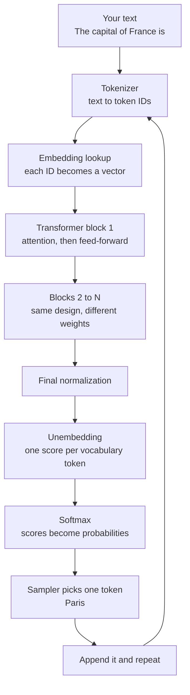
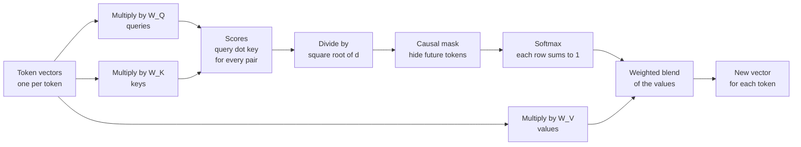
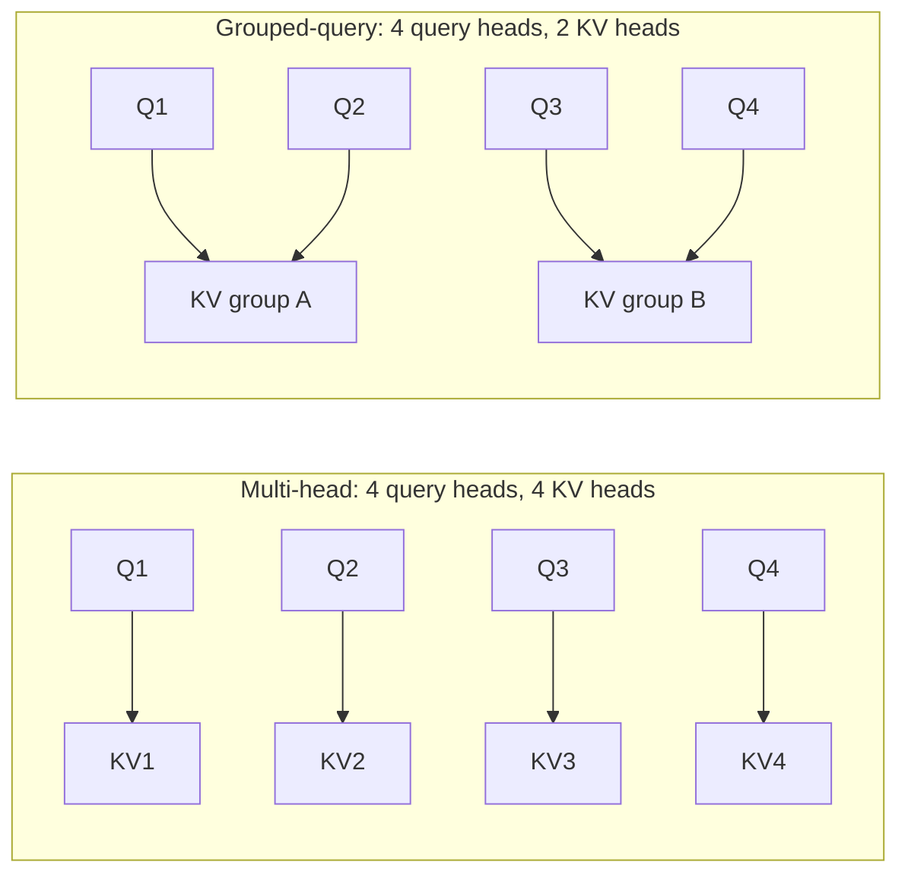
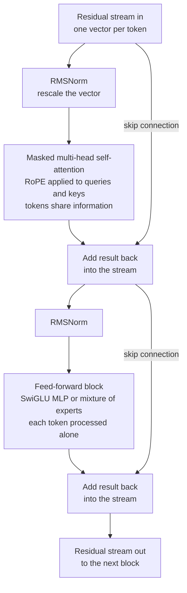
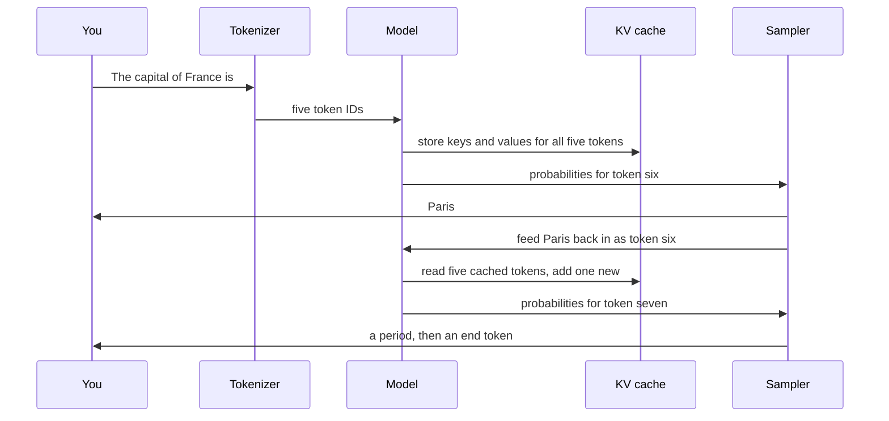
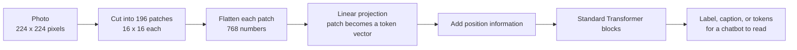
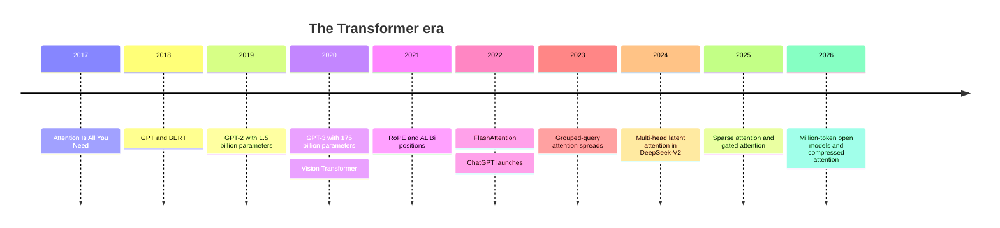

# Chapter 15: The Transformer, Piece by Piece

*This chapter takes apart the machine inside ChatGPT, Claude and Gemini, one component at a time, and has you compute self-attention by hand, so that "Transformer" becomes something you can draw, explain and reason about.*

## What you'll learn
- Why the Transformer replaced recurrent networks in 2017, and why it still dominates in 2026.
- How text becomes tokens (with a byte-pair encoding worked example) and how tokens become vectors.
- How a model knows word order: sinusoidal and learned positions, RoPE, ALiBi and how context windows were stretched to a million tokens.
- Self-attention, worked by hand for three tokens with real numbers: queries, keys, values, scaling, softmax, masking and the weighted blend.
- Multi-head attention and the memory-saving variants MQA, GQA and MLA, with KV-cache memory math.
- The feed-forward block (SwiGLU), the residual stream and one full Transformer block as a diagram.
- Encoder versus decoder, the causal mask, and how vectors become the next word you see on screen.
- How attention was made cheaper (FlashAttention, sliding-window, sparse and compressed attention), and how Transformers read images, audio, video and proteins.

## Before you start
You need four earlier chapters. Chapter 5 (The Math of AI, Part 1: Functions, Vectors and Matrices) gives you vectors, dot products and matrix multiplication; every step here is built from them. Chapter 6 (The Math of AI, Part 2: Probability, Statistics and Learning by Slopes) gives you softmax, temperature and cross-entropy. Chapters 12 and 13 (Neural Networks From Scratch; Training Deep Networks) give you layers, activation functions, residual connections and normalization. Most important is Chapter 14 (Seeing and Remembering: CNNs, RNNs, Embeddings and the Deep Learning Boom), which introduced embeddings and the 2014 version of attention. If "score, softmax, blend" does not ring a bell, reread the attention section of Chapter 14 first.

## Why the Transformer won

In June 2017, eight researchers, most of them at Google, published a paper called "Attention Is All You Need." Their model was built for translation. It had 6 encoder layers and 6 decoder layers, and its larger version trained in 3.5 days on 8 NVIDIA P100 GPUs, a fraction of the time the best recurrent translation systems needed. It set new records on English-to-German and English-to-French translation. Few people guessed that its design would, within five years, be inside almost every major AI system on Earth.

> **Definition — Transformer:** A neural network architecture introduced in 2017 that processes all the tokens of a text in parallel, using self-attention to let each token gather information from the others and small per-token networks to process it. It underlies essentially every large language model.

Chapter 14 ended with a problem. Recurrent networks read one word at a time, so step 100 must wait for step 99, and their memory fades over long stretches. Attention, bolted onto them in 2014, let a translator look straight back at any input word. The 2017 paper's idea was to drop the recurrence and build everything from attention. Three advantages followed:

1. **Parallel.** Every token is processed at the same time. A 4,000-token document is one big batch of matrix multiplications, which is exactly what GPUs are built for.
2. **Short paths.** Any token can pull information directly from any other token in a single step, whether it is one word away or 50,000 words away. Nothing has to survive a long chain of fading memories.
3. **Scales well.** Make it wider, deeper and train it on more data, and it keeps getting better, smoothly and predictably (the scaling laws of Chapter 19). That made it the perfect vehicle for the Bitter Lesson from Chapter 13: general methods plus more compute win.

> **Key idea:** The Transformer won not because attention is magic, but because it turns language processing into big, parallel matrix multiplications that GPUs can run fast, and because it keeps improving as you scale it up.

Here is the whole machine at a glance, using a running example. You type "The capital of France is" into a chatbot. This is roughly what happens next, and the rest of the chapter takes each box in turn.


*Figure 15.1: A decoder-only Transformer, the design behind every major chatbot, from your text to the next token. The loop at the bottom runs once per token of the reply.*

## Step 1: Turning text into tokens

A Transformer cannot read letters. It reads tokens.

> **Definition — Token:** A chunk of text, often a whole common word, part of a rarer word, a punctuation mark or a piece of a number, that a language model reads and writes as one unit. In English, a token averages about three-quarters of a word.

> **Definition — Tokenizer:** The fixed program that splits text into tokens and maps each one to an ID number from the model's vocabulary, and turns IDs back into text afterwards. It is built before the model is trained and never changes during use.

Why not just use letters or whole words? Letters make sequences very long: a 1,000-word essay is about 5,000 characters, and attention's cost grows with the square of the length. Whole words make the vocabulary enormous and still fail on new words ("ChatGPT-ish"), typos and other languages. Subword tokens are the compromise: common words get one token, rare words are spelled out of a few familiar pieces.

### Byte-pair encoding, worked by hand

The most common way to build a tokenizer is byte-pair encoding. It was a 1990s data-compression trick, adapted for neural translation in 2015.

> **Definition — BPE (Byte-Pair Encoding):** A method for building a tokenizer's vocabulary. Start with single characters (or bytes), count every adjacent pair in a large body of text, merge the most frequent pair into a new token, and repeat until the vocabulary reaches the size you want.

Imagine a tiny training text containing four words with these counts: "low" 5 times, "lower" 2 times, "newest" 6 times and "widest" 3 times. Split everything into letters and count adjacent pairs, weighted by how often each word appears. The pair "e s" appears in "newest" (6) and "widest" (3), so it occurs 9 times. So does "s t." The pair "l o" occurs 7 times (5 + 2). Merge the top pair, recount, and repeat:

| Merge | Pair merged | Count | Words afterwards |
|---|---|---|---|
| 1 | e + s → es | 9 | l o w, l o w e r, n e w es t, w i d es t |
| 2 | es + t → est | 9 | l o w, l o w e r, n e w est, w i d est |
| 3 | l + o → lo | 7 | lo w, lo w e r, n e w est, w i d est |
| 4 | lo + w → low | 7 | low, low e r, n e w est, w i d est |
| 5 | n + e → ne | 6 | low, low e r, ne w est, w i d est |
| 6 | ne + w → new | 6 | low, low e r, new est, w i d est |

*Table 15.1: Six BPE merges on a toy text. (When two pairs tie, as in merge 1, the tokenizer just picks one by a fixed rule.)*

After six merges, the vocabulary contains "est," "low" and "new." Now the tokenizer meets a word it has never seen, "lowest," and splits it into two known pieces: "low" + "est." That is the magic of subwords: unfamiliar words are built from familiar parts, and the model can guess that "lowest" relates to both "low" and "newest."

Real tokenizers run this on billions of words until they have between about 100,000 and 260,000 tokens. GPT-2 (2019) used 50,257; Kimi K3 (2026) uses about 160,000. Modern tokenizers work on raw bytes rather than letters, so any text at all, including emoji, Chinese characters and computer code, can be encoded without an "unknown word" symbol.

> **Definition — Vocabulary:** The fixed list of all tokens a model knows, each with an ID number. Frontier models in 2026 have vocabularies of roughly 100,000 to 260,000 tokens.

Tokenizers also reserve a few special tokens that never appear in normal text, such as "end of text" or markers for where a user's message starts and the assistant's reply begins. Chapter 18 shows how chat apps use them.

> **Definition — Special token:** A reserved token with a control meaning rather than text content, such as "end of text" or "start of the assistant's turn." It lets the model see the structure of a conversation.

Tokenization explains several chatbot quirks you may have noticed. "strawberry" is usually two or three tokens, not ten letters, which is why models used to miscount its r's. Languages that were rare in the tokenizer's training text get chopped into more pieces, so the same sentence costs more tokens (and more money) in, say, Hindi than in English. Tokenizers also change between model generations: Anthropic says that for the tokenizer introduced with Claude Opus 4.7, one million tokens is about 555,000 English words, against about 750,000 words before. Chapter 18 explores these effects for users.

> **Try it:** Open https://tiktokenizer.vercel.app and type "strawberry," then " strawberry" (with a leading space), then "Strawberry," then a sentence in another language you know and the number 123456789. Watch how the splits and counts change. You are seeing exactly what the model sees.

> **Watch out:** "If a model can't count the letters in a word, it must be stupid." Mostly it never saw the letters. Your text arrived as a handful of token IDs. Ask the model to spell the word out first, one letter per line, and it usually counts correctly.

## Step 2: Token embeddings

Each token ID is just a number, like 3,721. The model's first real step is to swap that number for a vector, exactly as with the word embeddings of Chapter 14.

> **Definition — Embedding matrix:** A big table of learned numbers with one row per vocabulary token. Looking up a token's row gives its starting vector. It is learned during training like every other weight.

> **Definition — Model dimension (hidden size):** The number of values in each token's vector as it travels through the model, often written d_model. GPT-2 small used 768; large modern models use several thousand.

The table's size is vocabulary × model dimension. For GPT-2 small, that is 50,257 × 768 ≈ 38.6 million learned numbers. For a model with a 100,000-token vocabulary and 4,096-number vectors, it is 409.6 million, before a single layer has run.

At this point every copy of a token gets the same vector, whatever surrounds it. "bank" in "river bank" and in "bank account" start identical. The layers above will rewrite each vector with context, turning these static embeddings into the contextual embeddings of Chapter 14.

## Step 3: Telling the model about word order

Here is a surprising fact: attention, which you will meet properly in a moment, has no idea what order the tokens are in. It compares every token with every other token as an unordered set. To plain attention, "dog bites man" and "man bites dog" contain the same three items, so they look the same. The model must be told the positions separately.

> **Definition — Positional encoding:** Information added to a Transformer so it knows the order of tokens, either by adding a position signal to each token's vector or by changing how attention compares tokens at different positions.

The 2017 Transformer added a fixed pattern of sine and cosine waves of different speeds to each embedding, a unique "barcode" for every position. GPT-2 and BERT instead learned a separate vector for each position, up to a fixed limit (1,024 positions for GPT-2, 512 for BERT). That limit was a problem: the model had never seen position 1,025, so it could not go beyond it.

### RoPE: rotating the arrows

Nearly every major open model today uses rotary position embedding, published in 2021.

> **Definition — RoPE (Rotary Position Embedding):** A way of encoding position by rotating each token's query and key vectors by an angle proportional to the token's position. When two tokens are compared with a dot product, the result depends on how far apart they are, not on their absolute positions.

Picture a vector as an arrow. RoPE turns the arrow by a fixed angle for every step along the text. Here is a toy version with 2-number vectors and 10 degrees per position. Suppose a query and a key both start as the arrow [1, 0].

- The query sits at position 5, so it is turned 50 degrees: [cos 50°, sin 50°] = [0.643, 0.766].
- The key sits at position 3, so it is turned 30 degrees: [0.866, 0.500].
- Their dot product is 0.643 × 0.866 + 0.766 × 0.500 = 0.557 + 0.383 = 0.940, which is the cosine of 20 degrees, the angle between them.

Now move the same pair far along the text, to positions 105 and 103. The arrows are turned 1,050 and 1,030 degrees, but the angle between them is still 20 degrees, so the dot product is still 0.940. Only the distance, 2 positions, matters. Move them 4 apart (positions 5 and 1) and the dot product falls to cos 40° = 0.766.

```
RoPE in two dimensions (10 degrees per position)

          query at position 5 (turned 50 degrees)
           /
          /   key at position 3 (turned 30 degrees)
         /  _/
        / _/        angle between them: 20 degrees
       /_/          dot product = cos 20 = 0.940
      +------------------------> position 0 direction

  Same pair at positions 105 and 103: still 20 degrees apart,
  so the attention score is exactly the same.
```
*Figure 15.2: RoPE turns each vector by an angle set by its position, so the score between two tokens depends only on how far apart they are.*

A real model's vectors have thousands of numbers, which RoPE treats as hundreds of pairs, each spinning at a different speed. Fast-spinning pairs are sensitive to small distances (the next word), and slow-spinning pairs track large distances (the previous chapter), like the second, minute and hour hands of a clock.

> **Analogy:** RoPE works like clock hands. Each token's vector is a hand turned according to its position. To know how far apart two tokens are, the model compares the angle between their hands, which is the same at 3 o'clock as at 9 o'clock.

Two other ideas are worth knowing. ALiBi (2021) skips rotations and simply lowers the attention score in proportion to distance, so nearby tokens are favored. And some newer models drop positional encoding from a few of their attention layers altogether: Meta's Llama 4 (April 2025) interleaves layers without position information with RoPE layers, a design it calls iRoPE, which can help with very long texts.

> **Definition — ALiBi (Attention with Linear Biases):** A position method that subtracts a penalty from each attention score in proportion to the distance between the two tokens, so the model naturally pays more attention to nearby text.

### Stretching the context window

> **Definition — Context window:** The maximum number of tokens a model can consider at once, including your prompt, the conversation so far, any pasted documents and its own reply.

The original Transformer handled a few hundred tokens at a time. GPT-3 (2020) handled 2,048. As of October 2026, about 1 million tokens is the frontier standard: the Claude 5.5 family, Google's Gemini 4 Argon, DeepSeek V4 and Kimi K3 all offer about 1 million, and OpenAI's GPT-6 Astra offers 1.05 million. Part of how this happened is context extension: a model is pretrained mostly on shorter texts, then its RoPE rotations are rescaled (slowed down) so that long distances map onto angles it already understands, followed by a short round of training on long documents. YaRN (2023) is a widely used recipe for this.

> **Definition — Context extension:** Techniques for making a trained model handle longer texts than it was mostly trained on, typically by rescaling its position encoding (as YaRN does with RoPE) and briefly training on long documents.

| Method | How position enters | Used in |
|---|---|---|
| Sinusoidal | fixed wave pattern added to each embedding | original 2017 Transformer |
| Learned positions | one learned vector per position, up to a limit | GPT-2, BERT |
| RoPE | queries and keys rotated by position | most open models since about 2023 |
| ALiBi | score penalty grows with distance | some 2022 to 2023 models |
| No position in some layers | a few attention layers skip position entirely | Llama 4 (iRoPE) |

*Table 15.2: Ways to give a Transformer a sense of order.*

> **Watch out:** "A 1-million-token context means the model reads and remembers a million words perfectly." A million tokens is roughly 555,000 to 750,000 English words, depending on the tokenizer, and models still use information buried in the middle of a long context less reliably than information near the start or end. Chapter 18 covers this "lost in the middle" effect.

## Step 4: Self-attention, worked by hand

This is the heart of the Transformer. Everything else is supporting cast.

> **Definition — Self-attention:** Attention in which a sequence attends to itself: every token computes how relevant every other token (in a chatbot, every earlier token) is to it, and gathers a weighted blend of their information.

### The intuition: a library search

In Chapter 14, a translator's decoder scored each input word, turned the scores into percentages with softmax and blended the words. Self-attention does the same thing, but every token does it at once, to the other tokens of the same text. And it uses a clever division of labor. Each token produces three different vectors from its embedding:

> **Definition — Query, key and value (Q, K, V):** Three vectors each token computes from its current vector using three learned weight matrices. The query says what the token is looking for, the key advertises what the token contains, and the value is the information it hands over if another token attends to it.

> **Analogy:** Self-attention is a library search. Your query is what you are looking for ("books about baking"). Each book's key is the label on its spine. Each book's value is what is inside. You compare your query with every spine label, and instead of borrowing one book, you walk out with a blend of the contents, mostly from the best-matching books.

Why three separate vectors instead of just comparing embeddings directly? Because what a word is looking for is different from what it offers. The pronoun "it" is looking for a noun it could refer to; it does not itself offer much. A noun like "cat" offers "I am a creature you could be talking about." Separate query and key matrices let the model learn both roles.

### The setup: three tokens

Imagine the model has just read three tokens: "cat," "sat," "it" (we have dropped the little words to keep the arithmetic small). We want to see how "it" figures out what it refers to. Each token arrives with a 3-number vector that already includes its position. We have invented small whole numbers so you can follow along with a pencil; in a real model the vectors have thousands of numbers and none of them has a tidy meaning. Loosely, think of the first number as "is a creature or thing," the second as "is an action" and the third as a mix of other features.

| Token | Vector x |
|---|---|
| cat | [2, 0, 1] |
| sat | [0, 2, 0] |
| it | [1, 0, 2] |

The layer has three learned weight matrices, each turning a 3-number vector into a 2-number vector. Each has 3 rows (one per input number) and 2 columns (one per output number):

```
W_Q (queries)     W_K (keys)       W_V (values)
[0  1]            [1  1]           [1  0]
[0  1]            [0  1]           [0  1]
[1  1]            [0  1]           [0  0]
```
*Figure 15.3: The three learned weight matrices for our toy attention layer. Training would set these numbers; we chose them for easy arithmetic.*

### Step A: compute every query, key and value

To multiply a vector by a matrix (Chapter 5), each output number is the dot product of the vector with one column. For "it" = [1, 0, 2]:

- Query, first number: 1 × 0 + 0 × 0 + 2 × 1 = 2. Second number: 1 × 1 + 0 × 1 + 2 × 1 = 3. So q(it) = [2, 3].
- Key, first number: 1 × 1 + 0 × 0 + 2 × 0 = 1. Second: 1 × 1 + 0 × 1 + 2 × 1 = 3. So k(it) = [1, 3].
- Value, first number: 1 × 1 + 0 + 0 = 1. Second: 1 × 0 + 0 × 1 + 2 × 0 = 0. So v(it) = [1, 0].

Doing the same for all three tokens gives:

| Token | Query q | Key k | Value v |
|---|---|---|---|
| cat | [1, 3] | [2, 3] | [2, 0] |
| sat | [0, 2] | [0, 2] | [0, 2] |
| it | [2, 3] | [1, 3] | [1, 0] |

*Table 15.3: Queries, keys and values for the three tokens. Notice that "cat" and "it" have different queries and keys even though both are noun-like: the roles differ.*

### Step B: score "it" against every token

The score for how much "it" should attend to each token is the dot product of its query with that token's key.

> **Definition — Attention weights (attention matrix):** The percentages, produced by softmax from query-key scores, that say how much each token draws from each other token. Arranged as a grid with one row per token, they form the attention matrix.

- it → cat: q(it) · k(cat) = 2 × 2 + 3 × 3 = 4 + 9 = 13
- it → sat: q(it) · k(sat) = 2 × 0 + 3 × 2 = 0 + 6 = 6
- it → it: q(it) · k(it) = 2 × 1 + 3 × 3 = 2 + 9 = 11

### Step C: scale

Divide every score by the square root of the query/key length. Here the length is 2, and the square root of 2 is about 1.414: 13 ÷ 1.414 = 9.19, 6 ÷ 1.414 = 4.24, 11 ÷ 1.414 = 7.78.

> **Definition — Scaled dot-product attention:** The standard attention recipe: score each query against each key with a dot product, divide by the square root of the key length, apply softmax, and use the resulting weights to average the values. Written compactly: softmax(Q × K-transposed ÷ √d) × V.

Why scale? In a real model, queries and keys have 64 or 128 numbers, so dot products can be large, say 22 versus 0. Softmax of [22, 0] gives essentially [1.0, 0.0]: all attention on one token, and the learning signal through the other options vanishes. Dividing by √128 ≈ 11.3 brings those scores back to about [2, 0], whose softmax is a healthier [0.88, 0.12].

### Step D: softmax

Softmax turns the scaled scores into weights that add up to 1. A trick that real software uses: subtract the largest score first, which does not change the answer but keeps the numbers small. Subtracting 9.19 gives [0, −4.95, −1.41].

- e to the 0 = 1
- e to the −4.95 = 0.0071
- e to the −1.41 = 0.2432
- Total = 1.2503

Divide each by the total: **cat 0.800, sat 0.006, it 0.194.**

"it" puts 80 percent of its attention on "cat," about 19 percent on itself and almost none on "sat." Our made-up weights have learned what a real model learns: a pronoun should look for the noun it refers to.

### Step E: blend the values

The output for "it" is the weighted sum of the value vectors:

`0.800 × [2, 0] + 0.006 × [0, 2] + 0.194 × [1, 0] = [1.600 + 0 + 0.194, 0 + 0.012 + 0] ≈ [1.79, 0.01]`

The new vector for "it" is dominated by cat's value, [2, 0]. Think of the first number as "creature information": "it" now carries information about the cat. This output is passed through one more learned matrix and then added to the token's running vector (more on that in Step 7), so the next layer sees an "it" that knows it means the cat.

> **Key idea:** Self-attention is the 2014 recipe, run by every token at once: compare my query with everyone's key (dot products), scale, softmax into percentages, and take that blend of everyone's values. Nothing more mysterious is going on, just multiplications, additions and one softmax, repeated at enormous scale.


*Figure 15.4: Self-attention step by step. Every token runs this at the same time, which is why it maps so well onto GPUs.*

### The whole attention matrix, with the mask

Every token does this simultaneously. In a chatbot, though, a token is only allowed to look at itself and earlier tokens, never later ones; you will see why in Step 8. Here are the raw scores for every pair, then the weights after hiding the future and applying softmax row by row:

```
Raw scores q . k            After causal mask + scaling + softmax
(rows: the token asking)    (each row sums to 1)

        cat   sat   it              cat     sat     it
cat      11     6   10      cat    1.000     -       -
sat       6     4    6      sat    0.804   0.196     -
it       13     6   11      it     0.800   0.006   0.194
```
*Figure 15.5: The attention matrix for our three tokens. The dashes are masked future positions. "cat" can only see itself; "sat" mostly attends to "cat" (a verb finding its subject); "it" mostly attends to "cat."*

Check the "sat" row yourself: its query [0, 2] scores 6 against cat's key and 4 against its own. Scaled, that is 4.24 and 2.83; after subtracting the larger, 0 and −1.41; e to those is 1 and 0.243; divided by their total, 1.243, that gives 0.804 and 0.196.

### The catch: attention costs grow with the square of length

Every token scores every other token, so a text of n tokens needs n × n scores, in every attention head of every layer. At 1,000 tokens that is 1 million scores. At 100,000 tokens it is 10 billion. At 1 million tokens it is 1 trillion. Storing one 100,000 × 100,000 grid of 16-bit numbers would take 20 GB, for one head in one layer. This "quadratic" growth is why long contexts are expensive, and why so much research has gone into making attention cheaper (later in this chapter, and Chapter 17).

> **Watch out:** "Attention means the model is paying attention the way a person does." It is a learned weighted average based on vector similarity, a routing mechanism for information. A high attention weight shows where information flowed, not necessarily why the model made its final choice.

## Step 5: Many heads, and how to save their memory

One attention calculation can only blend information one way at a time. "it" might need to find its referent, while also tracking the verb's tense and the sentence's topic. So Transformers run several attention calculations side by side.

> **Definition — Multi-head attention:** Running several independent attention calculations ("heads") in parallel in the same layer, each with its own smaller query, key and value matrices, then joining their outputs and mixing them with one more learned matrix (the output projection).

> **Definition — Attention head:** One of the parallel attention calculations inside a multi-head attention layer. Different heads learn to track different relationships.

In GPT-2 small, each layer has a model dimension of 768 split across 12 heads of 64 numbers each. Each head does exactly what you just did by hand, with its own W_Q, W_K and W_V. The 12 outputs of 64 numbers are joined back into 768 and multiplied by an output matrix. The parameter count per layer is 4 × 768 × 768 ≈ 2.36 million (the query, key, value and output matrices).

When researchers look inside trained models, many heads have recognizable jobs. Some attend to the previous token. Some link pronouns to nouns. One famous kind, the induction head, implements copying: if the text earlier contained "Harry Potter" and now says "Harry," an induction head looks back to what followed "Harry" last time and boosts "Potter." Anthropic researchers described these in 2021 and 2022 and linked them to models' ability to pick up patterns from examples in the prompt.

> **Definition — Induction head:** An attention head that finds an earlier occurrence of the current token and copies forward what came right after it. It is one of the best-understood mechanisms behind in-context learning.

> **Analogy:** Multi-head attention is a panel of editors reading the same page at once. One tracks who "she" refers to, one checks grammar, one follows the timeline. Each reports back, and their notes are combined.

### The KV cache and its memory bill

When a chatbot writes its reply one token at a time, every new token must attend to all earlier tokens. Recomputing the keys and values of the whole conversation for every new token would be wasteful, because they do not change. So the model stores them.

> **Definition — KV cache:** Stored keys and values for every earlier token, kept in GPU memory so that each new token only computes its own query, key and value and then attends to the cached ones. It grows with every token in the conversation.

The cache is big. For each token, each layer stores one key and one value vector per key-value head. Take a 70-billion-parameter model shaped like Meta's Llama 3 70B: 80 layers, 64 query heads, head vectors of 128 numbers, 16-bit (2-byte) storage. If every head kept its own keys and values, each token would need 2 (key and value) × 80 layers × 64 heads × 128 numbers × 2 bytes = 2.6 MB. Filling a 128,000-token context would take about 335 GB of GPU memory for one conversation, more than four 80 GB GPUs can hold.

The fix is to let several query heads share one set of keys and values.

> **Definition — MQA and GQA (multi-query and grouped-query attention):** Ways to shrink the KV cache by letting query heads share keys and values. In multi-query attention, all query heads share a single key-value head; in grouped-query attention, query heads are split into groups that each share one.

Llama 3 70B actually uses grouped-query attention with 8 key-value heads shared by its 64 query heads. That cuts the cache 8-fold, to about 0.33 MB per token, or about 42 GB for 128,000 tokens. Multi-query attention (one shared head) would cut it to about 5 GB, but usually costs some quality.

DeepSeek introduced a third approach in 2024.

> **Definition — MLA (Multi-head Latent Attention):** A design from DeepSeek that compresses each token's keys and values into one small "latent" vector for the cache and expands it again when needed, shrinking memory while keeping separate heads. DeepSeek, Kimi and GLM models use it.


*Figure 15.6: Multi-head versus grouped-query attention. Fewer key-value heads means a smaller KV cache to store for every token of the conversation.*

| Design | KV heads stored (Llama-3-70B shape) | Cache per token | Cache for 128,000 tokens |
|---|---|---|---|
| Multi-head (MHA) | 64 | about 2.6 MB | about 335 GB |
| Grouped-query (GQA), 8 groups | 8 | about 0.33 MB | about 42 GB |
| Multi-query (MQA) | 1 | about 0.04 MB | about 5 GB |
| Multi-head latent (MLA) | one compressed latent per layer | small, depends on latent size | much smaller than full multi-head, per DeepSeek's reports |

*Table 15.4: Why attention variants matter: the memory each design needs to remember one long conversation, at 16-bit precision.*

> **At the frontier (2026):** Nobody agrees on one attention design anymore. Sebastian Raschka's LLM Architecture Gallery, surveying 111 recent models in 2026, found grouped-query attention in about 65 percent, sliding-window patterns in about 31 percent, MLA-style attention in about 23 percent, linear-attention hybrids in about 14 percent, and classic full multi-head attention in only about 4 percent. (A model can use several, so the shares overlap.)

The KV cache is a big reason why long chats cost more and why providers price "cached" input differently. Chapters 23 and 33 work through the serving economics.

## Step 6: The feed-forward block, where each token thinks alone

Attention lets tokens share information. The second half of every block lets each token process what it has gathered, on its own, with a small two-layer neural network (an MLP, from Chapters 12 and 14).

> **Definition — Feed-forward network (FFN):** The small multilayer perceptron inside every Transformer block. It is applied to each token's vector separately: expand to a larger size, apply a non-linear activation, shrink back.

In the 2017 design, the FFN expanded each vector to 4 times its size and back. In GPT-2 small, 768 numbers grow to 3,072 and return to 768, which takes 2 × 768 × 3,072 ≈ 4.7 million weights per layer, twice the 2.36 million of the attention part. So in a classic dense Transformer, roughly two-thirds of the parameters sit in feed-forward blocks. Interpretability research suggests these blocks store much of a model's factual associations, acting a bit like a giant lookup table: the pattern "capital of France" switches on hidden units that push the vector toward "Paris."

> **Analogy:** Attention is a meeting where everyone shares notes. The feed-forward block is each person going back to their desk to think about what they just heard, using everything they already know.

Most models now use a gated version called SwiGLU.

> **Definition — SwiGLU:** A gated feed-forward design used in most current LLMs. The input is projected two ways; one branch goes through the smooth Swish activation and then multiplies the other branch number by number, acting as a learned volume knob, before a third matrix projects the result back down.

Here is one hidden unit at work. Swish of a number a is a × sigmoid(a). Suppose the gate branch gives a = 2: Swish(2) = 2 × 0.881 = 1.762. If the other branch gives 0.5, the unit outputs 1.762 × 0.5 = 0.881. If instead the gate gives a = −2, Swish(−2) = −0.238, and the output shrinks to −0.119: the gate has nearly closed. SwiGLU uses three weight matrices instead of two, so designers shrink the hidden size to about 8/3 of the model dimension to keep the parameter count similar.

In many 2026 models, this block is replaced by a mixture of experts: many separate feed-forward networks, with a small router that sends each token to only a few of them.

> **Definition — Mixture of experts (MoE):** A design that replaces one feed-forward block with many "expert" blocks plus a router that picks a few experts for each token, so a model can store a huge number of parameters while using only a small fraction of them per token. Chapter 17 covers it in depth.

## Step 7: The residual stream and one full block

Now assemble the pieces. Every block follows the same two-part recipe, and both parts use the residual connection from Chapters 13 and 14: compute something, then add it back to the token's running vector.

> **Definition — Residual stream:** The running vector each token carries through all the layers of a Transformer. Every attention and feed-forward sub-layer reads from it and adds its result back, so it acts as a shared workspace that accumulates information.

Before each sub-layer, the vector is normalized, rescaled so its numbers stay in a sensible range.

> **Definition — RMSNorm:** A normalization step that divides a vector by the root-mean-square of its numbers (and multiplies by learned scales), keeping values in a stable range. Modern Transformers apply it before each sub-layer ("pre-norm"), which trains more stably than the original "after" placement.

So one block computes, for every token:

`x = x + Attention(RMSNorm(x))`
`x = x + FeedForward(RMSNorm(x))`

> **Definition — Transformer block:** One repeating unit of a Transformer: a normalization, a self-attention sub-layer and a residual add, followed by a normalization, a feed-forward sub-layer and a residual add. Models stack dozens of identical-looking blocks, each with its own weights.


*Figure 15.7: One full Transformer block as used in modern decoder-only models. The two skip connections mean each sub-layer only writes a correction onto the stream. Stack 30 to 120 of these.*

> **Analogy:** The residual stream is a shared whiteboard that travels up through the building. On each floor, two specialists read it: the attention specialist adds notes gathered from other tokens, and the feed-forward specialist adds what it knows. Nobody erases; everyone adds.

Stacking is where depth comes from. GPT-2 small has 12 blocks, GPT-3 has 96, Llama 3 70B has 80 and Kimi K3 has 93. Early blocks tend to handle local grammar and word pieces; middle blocks build up meaning and facts; late blocks prepare the prediction. Chapter 57 shows how interpretability researchers read the residual stream to find features such as "this is French" or "this is a bug in code."

You can now count a model's size. Per block, attention has about 4 × d² weights and the 4× feed-forward block about 8 × d², so a block is about 12 × d². For GPT-3, with d = 12,288 and 96 blocks: 12 × 96 × 12,288² ≈ 174 billion. Add the embedding table (50,257 × 12,288 ≈ 0.6 billion) and you get GPT-3's famous 175 billion parameters. Exercise 7 has you check GPT-2 the same way.

> **Key idea:** A Transformer is one block, repeated. Each block lets tokens exchange information (attention), then lets each token process it (feed-forward), and both write their results onto a running stream that flows from the first layer to the last.

## Step 8: Encoders, decoders and the causal mask

The 2017 Transformer had two halves, like the seq2seq translators of Chapter 14: an encoder that read the source sentence and a decoder that wrote the translation. The decoder used cross-attention to look at the encoder's output.

> **Definition — Cross-attention:** Attention in which one sequence's queries look at another sequence's keys and values, for example a translation decoder looking at the encoded source sentence, or an image generator looking at the text prompt.

Researchers soon found that each half was useful alone.

> **Definition — Encoder-only model:** A Transformer whose tokens can all see each other in both directions, built to understand text rather than generate it. It is used for classification, search and embeddings; BERT is the classic example.

> **Definition — BERT:** A 2018 encoder-only Transformer from Google, trained by hiding words and predicting them from both sides. It transformed language understanding tasks and was added to Google Search in 2019.

> **Definition — Masked language modeling:** A training task in which some tokens (15 percent in BERT) are hidden and the model must predict them from the surrounding text on both sides.

> **Definition — Decoder-only model:** A Transformer in which each token can only see itself and earlier tokens, trained to predict the next token. The GPT family and every major chatbot, including ChatGPT, Claude and Gemini, are decoder-only.

> **Definition — Encoder-decoder model:** A Transformer with both halves: an encoder reads the input fully, and a decoder generates the output while attending to it through cross-attention. The original Transformer, Google's T5 and OpenAI's Whisper speech recognizer use this layout.

A decoder-only model must never see the future during training. If it is learning to predict the word after "The capital of France is," and it can peek at the next position, it will simply copy " Paris" and learn nothing. The causal mask prevents this.

> **Definition — Causal mask:** A rule applied inside attention that blocks each token from seeing tokens that come after it. Future scores are set to minus infinity before softmax, so their weights become exactly zero.

You saw the effect in Figure 15.5: the upper-right triangle of the attention matrix is blank. Mechanically, the scores for future positions are replaced with minus infinity, and e to the minus infinity is 0, so softmax gives them zero weight and spreads all the weight over the past.

> **Analogy:** The causal mask is reading a mystery novel with a rule against peeking ahead. To guess the next word, you may only use pages you have already read.

| Layout | Who can see whom | Trained to | Good for | Examples |
|---|---|---|---|---|
| Encoder-only | every token sees every token | fill in hidden words | classification, search, embeddings | BERT (2018) |
| Decoder-only | each token sees only the past | predict the next token | generating text, chat, code | GPT series, Claude, Gemini, Llama, DeepSeek, Qwen |
| Encoder-decoder | encoder sees all; decoder sees the past plus the encoder | turn input into output | translation, speech to text | original Transformer, T5, Whisper |

*Table 15.5: The three Transformer layouts.*

Why did decoder-only win for chatbots? It is the simplest design, every token of every document provides a training example, generation falls out naturally, and the KV cache makes it efficient. One recipe, scaled up, turned out to handle translation, summarizing, coding and conversation all at once.

## Step 9: From vectors back to words

After the last block, each token's vector is normalized one final time. Only the vector at the last position matters for choosing the next token: it is multiplied by one more big matrix with one column per vocabulary token.

> **Definition — Unembedding:** The final matrix that turns a token's vector into one score for every token in the vocabulary. Many models reuse the embedding matrix for this, a trick called weight tying.

> **Definition — Logit:** A raw score the model gives a possible next token, before softmax. A higher logit means the model favors that token more.

Suppose that after "The capital of France is," four candidates get these logits (a real model scores all 100,000-plus tokens; we keep four so you can do it by hand): " Paris" 9.0, " a" 6.5, " the" 6.0, " located" 5.0. Subtract the largest: 0, −2.5, −3.0, −4.0. Exponentiate: 1, 0.082, 0.050, 0.018. The total is 1.150, so the probabilities are **Paris 0.869, a 0.071, the 0.043, located 0.016.**

> **Definition — Temperature:** A sampling setting that divides every logit by a number before softmax. Below 1 it sharpens the distribution toward the top choice; above 1 it flattens it, giving unlikely tokens more chance.

Divide the logits by a temperature of 0.5 (doubling the gaps) and " Paris" rises to 0.991. Use a temperature of 2 (halving the gaps) and it falls to 0.608, with " a" at 0.174. A sampler then picks one token at random according to these probabilities, or always the top one ("greedy"). Chapter 18 compares the sampling methods (top-k, top-p, min-p) and explains why temperature 0 is still not perfectly repeatable.

Then the chosen token is appended to the text and the whole process repeats, one token at a time, until the model produces an "end" token.

> **Definition — Autoregressive generation:** Producing output one token at a time, where each new token is chosen using everything before it, then fed back in as input for the next step.


*Figure 15.8: Generating a reply. The prompt is processed once, its keys and values are cached, and each new token only needs a small amount of fresh work before reading the cache.*

This is why replies stream onto your screen word by word, and why the first word takes longer than the rest: the model must first process your whole prompt (called prefill), then generates each new token cheaply using the cache (called decode). Chapter 23 explains how serving systems exploit this.

## Step 10: How a Transformer learns

Training uses the same loop as every network in Chapters 12 and 13: forward pass, loss, backpropagation, update. The task for a decoder-only model is next-token prediction.

> **Definition — Next-token prediction:** The training task of predicting each token from all the tokens before it. Applied to trillions of tokens of text, it is how every base language model learns.

The causal mask makes this remarkably efficient. In a single forward pass over a 4,000-token document, position 1 predicts token 2, position 2 predicts token 3, and so on, all at once, because each position can only see its own past. One document gives 3,999 training examples in one go. During training, the model always sees the real previous tokens, not its own guesses.

> **Definition — Teacher forcing:** Training a sequence model by feeding it the true previous tokens at every step, rather than its own possibly wrong predictions, so all positions can be trained in parallel.

> **Definition — Cross-entropy loss:** The standard score for next-token prediction: the negative logarithm of the probability the model gave to the token that actually came next. It is near 0 when the model was confident and right, and large when it was surprised.

If the model gave " Paris" a probability of 0.869 and " Paris" was indeed next, the loss is −ln(0.869) = 0.14. If it had given " Paris" only 0.01, the loss would be −ln(0.01) = 4.6. Backpropagation then nudges every weight, in every embedding, attention matrix and feed-forward block, so " Paris" becomes a little more likely next time. Repeat this for trillions of tokens (Chapter 19), and grammar, facts, styles and reasoning patterns emerge from one simple objective.

Some recent models add a twist: predicting several future tokens at once.

> **Definition — Multi-token prediction (MTP):** Training a model to predict the next few tokens at each position instead of just one. It can improve learning, and the extra predictions can be used to speed up generation. DeepSeek-V3 and NVIDIA's Nemotron 3 Super use it.

> **Watch out:** "It just predicts the next word, so it can't plan." The training objective is next-token prediction, but what a model learns in order to predict well can be rich. Interpretability research has found models internally choosing a rhyming word before writing the line that leads to it (Chapter 57).

## Making attention cheaper

Attention's cost grows with the square of the text length. Much of the engineering of the last few years has gone into reducing that bill.

**FlashAttention (2022)** computes exactly the same answer as standard attention, but faster. A GPU has a small amount of very fast on-chip memory and a large amount of slower main memory. Instead of writing the full grid of scores to slow memory, FlashAttention processes the queries and keys in small tiles that fit in fast memory, keeping a running softmax as it goes, and never stores the whole grid.

> **Definition — FlashAttention:** A way of computing exact attention in small tiles inside a GPU's fast on-chip memory, without ever storing the full score grid. It makes attention much faster and less memory-hungry with no change to the result.

Since then, new versions have tracked each GPU generation. PyTorch 2.11 (March 2026) added a FlashAttention-4 backend that its developers report is 1.2 to 3.2 times faster on compute-bound workloads.

Other methods change what is computed, accepting some approximation:

> **Definition — Sliding-window attention:** Attention in which each token looks only at the most recent N tokens instead of the whole history, capping the cost. Models often alternate sliding-window layers with full-attention layers.

> **Definition — Sparse attention:** Attention in which each token attends to a selected subset of earlier tokens, such as the top-k most relevant ones, instead of all of them. DeepSeek Sparse Attention is an example.

> **Definition — Attention sink:** The tendency of trained models to dump large amounts of attention on the very first token, using it as a place to "park" attention when nothing else is relevant. Some designs add an explicit sink; others remove the need for one.

> **Definition — Gated attention:** Adding a learned sigmoid gate to the output of each attention head, so the model can turn a head's contribution down. A Qwen team paper on it won a NeurIPS 2025 Best Paper award for improving stability and removing attention sinks.

| Method | What it changes | Exact? | Example (as of 2026) |
|---|---|---|---|
| FlashAttention | how attention is computed on the chip | yes | standard in training and serving |
| GQA, MQA, MLA | how much key-value memory is stored | nearly | most open models |
| Sliding window | each token sees only recent tokens | no | gpt-oss reportedly alternates full and 128-token windows |
| Sparse attention | each token sees a chosen subset | no | DeepSeek Sparse Attention |
| Compressed attention | earlier tokens stored in compressed groups | no | DeepSeek V4 |
| Gated attention | a gate on each head's output | not a shortcut, a stability fix | Qwen3-Next |
| Linear attention and state-space hybrids | most layers keep a fixed-size memory | no | Qwen3.5, Kimi K3, Nemotron 3 (Chapter 17) |

*Table 15.6: The toolbox for cheaper or steadier attention.*

The most dramatic 2026 example is DeepSeek V4. Its hybrid of Compressed Sparse Attention and Heavily Compressed Attention means that at a 1-million-token context, according to DeepSeek's report, V4-Pro needs only 27 percent of the per-token computation and 10 percent of the KV cache of its predecessor, V3.2.

> **At the frontier (2026):** The open question is whether cheaper attention loses something. Several labs build hybrids where most layers use a fixed-size memory and only one in four uses full attention. MiniMax went the other way with M2 (October 2025), returning to full attention because, it said, hybrids looked fine on benchmarks but degraded on multi-hop reasoning at scale. Chapter 17 lays out both sides.

## Transformers beyond text

Nothing in a Transformer is specific to words. Anything you can chop into a sequence of vectors can be a "token."

> **Definition — Vision Transformer (ViT):** A Transformer that reads an image by cutting it into small square patches, turning each patch into a vector and treating the patches as a sequence of tokens. It was introduced by Google in 2020.

> **Definition — Patch:** A small square of an image (or a small block of video across space and time) that a Transformer treats as one token.

Take a 224 × 224 color image and cut it into 16 × 16 patches. That gives 14 × 14 = 196 patches, each holding 16 × 16 × 3 = 768 numbers. A learned matrix turns each patch into an embedding, position information is added, and from there the ordinary Transformer takes over. Without a CNN's built-in assumptions about nearby pixels (Chapter 14's "training wheels"), ViTs need more training data to match CNNs, but given enough data and compute they match or beat them, another case of the Bitter Lesson.


*Figure 15.9: How a Vision Transformer turns a picture into tokens. Multimodal chatbots use the same idea to read the photos you upload (Chapter 22).*

The same trick works almost everywhere:
- **Speech.** Sound is turned into a spectrogram, and slices of it become tokens. OpenAI's Whisper (2022), an encoder-decoder Transformer trained on 680,000 hours of audio, transcribes speech this way (Chapter 46).
- **Video.** Video is cut into spacetime patches, small cubes covering a few pixels across a few frames, which is how modern video generators work (Chapter 16).
- **Proteins.** A protein is a sequence of amino acids, and attention between positions helps models such as DeepMind's AlphaFold 2 predict how the chain folds (Chapter 52).

> **Definition — Spectrogram:** A picture of sound showing how much energy each frequency has at each moment in time. Speech models often treat slices of it like image patches or tokens.

> **Key idea:** A Transformer is a general machine for sequences of vectors. Text, images, audio, video and proteins become one kind of problem once they are cut into tokens, which is why one architecture now powers chatbots, image generators, speech recognizers and scientific models.

## The 2017 Transformer versus a 2026 frontier model

The core idea has barely changed since 2017: tokens, embeddings, attention, feed-forward blocks, residual stream, next-token prediction. Almost every component has been upgraded.

| Component | Original Transformer (2017) | Typical open frontier model (2026) |
|---|---|---|
| Layout | encoder-decoder, for translation | decoder-only |
| Size | 65 million (base) and 213 million (big) parameters | hundreds of billions to about 3 trillion total, mostly in mixture-of-experts layers |
| Depth | 6 encoder + 6 decoder layers | roughly 60 to 95 layers |
| Context | short sentences, a few hundred tokens | about 1 million tokens |
| Position | sinusoidal waves | RoPE, sometimes with position-free layers |
| Normalization | LayerNorm after each sub-layer | RMSNorm before each sub-layer, plus tricks to keep attention scores from blowing up |
| Attention | full multi-head | GQA or MLA, plus sliding-window, sparse, compressed or linear-attention hybrids |
| Feed-forward | ReLU MLP | SwiGLU, usually as mixture of experts |
| Number format | 32-bit | 16-bit, 8-bit and even 4-bit (Chapter 32) |
| Optimizer | Adam | AdamW, increasingly Muon (Chapter 13) |

*Table 15.7: Same skeleton, new organs. Every row of the right-hand column is still recognizably the 2017 design.*

For a concrete 2026 example, take Kimi K3 from Moonshot AI, released in July 2026 with open weights. According to its model card, it has 93 layers: 69 use Kimi Delta Attention, a linear-attention design with a fixed-size memory, and 24 use gated multi-head latent attention. Its feed-forward layers are mixtures of 896 experts, of which 16 plus 2 shared experts are used for each token, giving about 2.8 trillion parameters in total but about 104 billion active per token. It has a 160,000-token vocabulary and a 1-million-token context. Every one of those terms is now in your vocabulary.

> **At the frontier (2026):** Frontier open models tend to combine the same ingredients: sparse mixture of experts, attention cheaper than the full version (GQA or MLA, sliding windows, sparse or compressed attention, or linear hybrids), 1-million-token contexts, 4-bit to 8-bit number formats, stability tricks such as gated attention, Muon-family optimizers and multi-token prediction. The closed labs (OpenAI, Anthropic, Google) do not publish their architectures, so any confident claim about what is inside GPT-6, Claude or Gemini is speculation unless the company has said so.


*Figure 15.10: Milestones of the Transformer era covered in this chapter.*

## In plain English

When you send a message to a chatbot, a tokenizer first chops it into tokens, pieces of words, using a vocabulary built by repeatedly merging common letter pairs. Each token is swapped for a long list of numbers from a big lookup table. Because the core mechanism has no sense of order, position is mixed in, today usually by rotating the vectors by an angle that depends on where each token sits.

Then the vectors climb through a tall stack of identical blocks. In each block, every token does a quick search of the earlier tokens: it makes a query ("what am I looking for?"), compares it with every other token's key ("what do I offer?"), turns those match scores into percentages with softmax, and takes that blend of their values. That is self-attention, and you did it by hand: "it" put 80 percent of its attention on "cat." Several of these searches run side by side as heads. Then each token passes through a small network on its own, and both steps add their results to a running vector, the residual stream.

At the top, the last token's vector is turned into a score for every possible next token, softmax makes those scores probabilities, and one token is picked. It is appended to the text and the whole thing runs again, with earlier work saved in a KV cache. The model learned all its weights by predicting the next token across trillions of words. Engineers have since made attention cheaper and stretched context to about a million tokens, and the same design now reads images, sound, video and proteins.

## Key terms
Transformer, Token, Tokenizer, BPE (Byte-Pair Encoding), Vocabulary, Special token, Embedding matrix, Model dimension (hidden size), Positional encoding, RoPE (Rotary Position Embedding), ALiBi (Attention with Linear Biases), Context window, Context extension, Self-attention, Query, key and value (Q, K, V), Attention weights (attention matrix), Scaled dot-product attention, Multi-head attention, Attention head, Induction head, KV cache, MQA and GQA (multi-query and grouped-query attention), MLA (Multi-head Latent Attention), Feed-forward network (FFN), SwiGLU, Mixture of experts (MoE), Residual stream, RMSNorm, Transformer block, Cross-attention, Encoder-only model, BERT, Masked language modeling, Decoder-only model, Encoder-decoder model, Causal mask, Unembedding, Logit, Temperature, Autoregressive generation, Next-token prediction, Teacher forcing, Cross-entropy loss, Multi-token prediction (MTP), FlashAttention, Sliding-window attention, Sparse attention, Attention sink, Gated attention, Vision Transformer (ViT), Patch, Spectrogram
