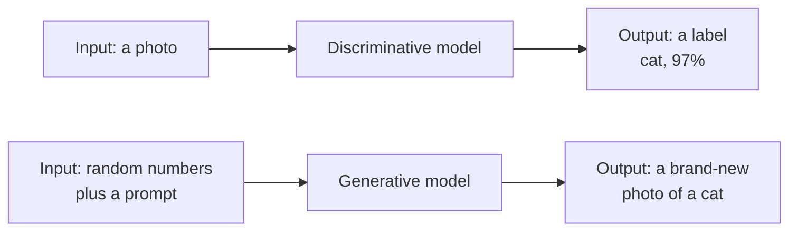
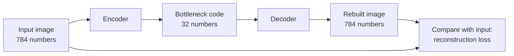
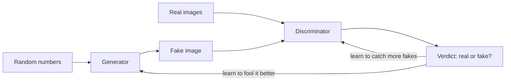
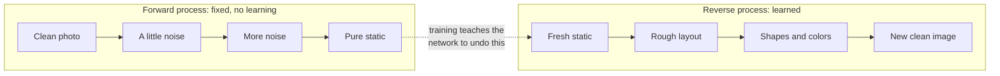
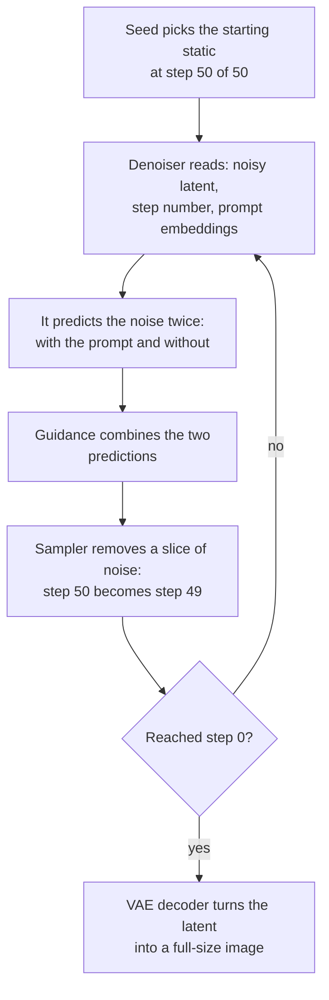
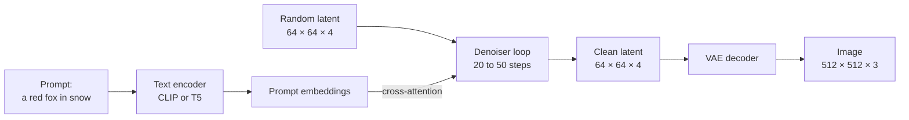
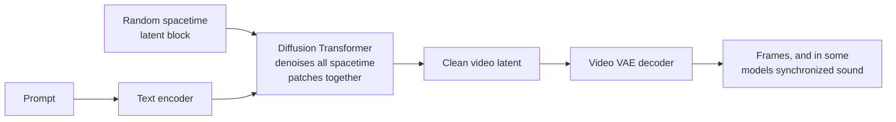
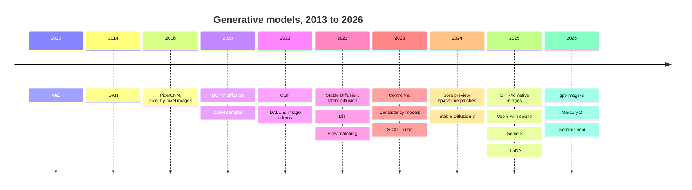

# Chapter 16: Generative Models: Autoencoders, GANs, Diffusion and Flow

*By the end of this chapter you will know, step by step, how a machine turns random static and a sentence into a brand-new picture, video or paragraph, and why the methods behind it changed so quickly.*

## What you'll learn
- What "generative" means: learning a distribution, sampling from it, and latent space.
- How models learn without labels (self-supervised and contrastive learning), and how CLIP links pictures to words.
- How autoencoders, VAEs and GANs work, and why GANs lost to diffusion.
- Diffusion in depth: noising, noise prediction, step-by-step denoising, samplers, guidance, seeds, latent diffusion and the Diffusion Transformer.
- Flow matching and distillation, which cut 1,000 steps to as few as one.
- Editing and control (inpainting, ControlNet, LoRA, instruction editing) and video generation.
- Diffusion language models, plus a preview of multimodal models and world models.

## Before you start
Chapter 5 (The Math of AI, Part 1) and Chapter 6 (The Math of AI, Part 2) supply vectors, dot products, probability, softmax and gradient descent. Chapter 12 (Neural Networks From Scratch) and Chapter 13 (Training Deep Networks) explain how a network learns by shrinking a loss. Chapter 14 introduced CNNs, the U-Net and embeddings, and Chapter 15 (The Transformer, Piece by Piece) explained attention, patches and the Vision Transformer. Everything else is built up here.

## What "generative" really means

Ask ChatGPT, Gemini or Claude for "a watercolor fox reading a book," and seconds later a picture exists that never existed before. Nobody drew it and no database held it. The model made it from random numbers and your sentence. This chapter explains exactly how.

Start with a distinction. Most of the models you met in Part II answer a question about an input: is this email spam, is this photo a cat, what will this house sell for? These are discriminative models. A generative model does a different job. It produces new examples that look like they came from the same source as its training data: new faces, new sentences, new songs.

> **Definition — Discriminative model:** A model that takes an input and predicts a label or a number about it, such as "spam" or "cat, 97%". It learns to tell things apart, not to create them.

> **Definition — Generative model:** A model that learns what a kind of data looks like well enough to produce brand-new examples of it, such as images, text, audio or video.


*Figure 16.1: A discriminative model judges an input. A generative model produces a new one.*

### Learning a distribution

What does it mean to "learn what data looks like"? Suppose you measured the height of 1,000 adults. Most are between 160 and 185 cm, and almost nobody is 250 cm. That pattern of common and rare values is a probability distribution (Chapter 6). With a good model of it, you could invent a believable new height by rolling dice weighted the same way: 172 cm comes up often, 250 cm almost never. Drawing a new example like this is called sampling.

> **Definition — Probability distribution:** A description of how likely every possible outcome is. For adult heights it says that 170 cm is common and 250 cm is almost impossible.

> **Definition — Sampling:** Drawing one specific example at random from a probability distribution, the way rolling weighted dice picks one outcome. A chatbot samples each next word; an image model samples a whole picture.

A generative image model does the same thing with a far bigger object. A small 512 × 512 color image is 512 × 512 × 3 = 786,432 numbers (Chapter 3 explained how pixels become numbers). Every possible image of that size is a point in a space with 786,432 dimensions. Almost all of those points are meaningless static. Real photographs of faces, foxes and kitchens occupy a tiny, oddly shaped island inside that ocean of noise. Learning the distribution means learning the shape of that island well enough to land on it at a spot nobody has visited before.

> **Key idea:** A generative model does not store pictures and paste them together. It learns where "realistic" lives in a huge space of possible outputs, then picks a new point inside that region.

Your chatbot is a generative model too: it samples each token of its reply from a distribution over its vocabulary (Chapter 18). Image, video and audio generators use different machinery toward the same goal.

### Latent space: a map of possibilities

Working directly with 786,432 numbers is clumsy. Most generative models therefore learn a smaller internal description of their data: a few hundred or thousand numbers that capture what matters (pose, lighting, the shape of the nose) and drop what doesn't (the exact speckle in pixel 300,112). That compressed internal space is the latent space. "Latent" means hidden: you never see these numbers, but they control what comes out. One point in it, a single short list of numbers, is called a latent.

> **Definition — Latent space:** The compressed internal space where a model represents its data as short lists of numbers. Nearby points produce similar outputs, and moving smoothly through it changes the output smoothly.

> **Analogy:** Latent space is like the character creator in a video game. Instead of painting every pixel of a face, you set sliders for jaw width, eye color and age. Every slider setting gives a plausible face, and sliding slowly morphs one face into another.

## Learning without labels: self-supervised and contrastive learning

Where does the training signal come from? Nobody has labeled billions of images with the "correct" picture to generate. The trick that unlocked modern AI is to make the data label itself.

### Self-supervised learning

In self-supervised learning, the model hides part of an example from itself and learns to predict the hidden part. Your chatbot was pretrained this way: take a sentence from the internet, hide the next word, predict it, check, adjust (Chapter 8 introduced the idea). BERT (2018) hid about 15% of the words in each sentence and learned to fill them in. Vision models do the same with pictures: masked autoencoders (2021) hide most of an image's patches and learn to repaint them.

> **Definition — Self-supervised learning:** Training where the labels come from the data itself, for example by hiding the next word or a patch of an image and predicting it. No human has to annotate anything, which is why the whole internet can serve as training material.

This produces the strong representations (embeddings) that generators build on, and, as you will see later, "fill in the blanks" can itself become a way to generate text.

### Contrastive learning and CLIP

The second unlock was teaching a model to connect pictures and words. In 2021 OpenAI trained CLIP on about 400 million image–caption pairs gathered from the web. CLIP has two encoders. One turns an image into an embedding (a vector, Chapter 14). The other turns a caption into an embedding of the same length. Training uses contrastive learning: matching pairs are pulled together in the shared space, and mismatched pairs are pushed apart.

> **Definition — Contrastive learning:** Training embeddings by pulling matching pairs (a photo and its caption) close together and pushing non-matching pairs apart, so that closeness in the space means similarity in meaning.

> **Definition — CLIP (Contrastive Language–Image Pretraining):** An OpenAI model from 2021 that learned a shared embedding space for images and text from about 400 million image–caption pairs. It lets a computer score how well a caption matches a picture.

Here is one training step with a tiny batch of three pairs. CLIP embeds the three photos and the three captions, then computes the similarity of every photo with every caption. The measure is cosine similarity (Chapter 5): 1 means "pointing the same way," 0 means "unrelated." The numbers below are illustrative.

```
                    caption A      caption B      caption C
                   "a dog on      "a red         "a bowl of
                    a beach"       bicycle"       soup"
  dog photo          0.31 *         0.02           0.05
  bicycle photo      0.04           0.29 *         0.01
  soup photo         0.03           0.06           0.33 *

  * = true pair. Training pushes these up and all others down.
```
*Figure 16.2: One CLIP training batch. The diagonal holds the true image–caption pairs.*

For each photo, training treats its row like a multiple-choice question ("which caption is mine?"), turns the row into percentages with softmax (Chapter 6), and applies a penalty whenever the right caption does not clearly win. It asks the same question down each column. Real batches hold tens of thousands of pairs, so every step is a giant multiple-choice exam.

Once trained, CLIP can classify images into categories it was never trained on: embed a photo and the phrases "a photo of a dog," "a photo of a cat" and "a diagram," then pick the closest phrase. That is zero-shot classification. CLIP's text encoder also became the way early image generators "read" prompts. Google's SigLIP (2023) later made training cheaper by scoring each pair on its own.

> **Definition — Zero-shot:** Doing a task without any task-specific training examples, for example classifying photos into categories just by comparing them with text descriptions of those categories.

> **Definition — SigLIP:** A 2023 Google variant of CLIP that scores each image–caption pair independently with a sigmoid ("match or not?") instead of a softmax over the whole batch.

> **Analogy:** CLIP is a bilingual dictionary between pictures and words. Both are placed on one shared map, so the phrase "photo of a dog" lands right next to actual dog photos.

> **Try it:** In any image-capable chatbot, upload a photo and ask: "Which of these captions fits best: (a) ..., (b) ..., (c) ...? Give a percentage for each." You are asking it to do a CLIP-style matching task. Then add a fourth caption that is almost right but wrong in one detail, and see whether it notices.

## Autoencoders and VAEs: squeezing the world through a bottleneck

### The autoencoder

An autoencoder is the simplest generator-shaped network. It has two halves. The encoder squeezes an input into a short code at the network's narrowest point, the bottleneck. The decoder tries to rebuild the original from that code alone. The loss is how different the rebuild is from the original. Because the code is much smaller than the input, the network must keep what matters and throw away what doesn't.

> **Definition — Autoencoder:** A neural network trained to compress its input into a small code and then rebuild the input from that code. The squeeze forces it to learn the essential structure of the data.

> **Definition — Encoder:** The part of a network that turns an input (an image, a sentence) into a compact internal representation.

> **Definition — Decoder:** The part of a network that turns a compact internal representation back into an output, such as an image or text.


*Figure 16.3: An autoencoder squeezes an input through a bottleneck and is trained to rebuild it.*

A worked example. A handwritten digit from the classic MNIST dataset is a 28 × 28 grid: 784 brightness values. Squeeze it into a code of 32 numbers and you have compressed it 784 ÷ 32 = 24.5 times. If the decoder can still redraw a recognizable "7" from 32 numbers, those numbers must capture something like "slant, stroke thickness, length of the crossbar."

The loss is the reconstruction error, usually the mean squared error (Chapter 9). If an original pixel is 0.90 and the rebuild says 0.70, the squared error for that pixel is (0.90 − 0.70)² = 0.04. Average that over all 784 pixels and you have the loss for one image.

> **Definition — Reconstruction loss:** How different an autoencoder's rebuilt output is from its original input, often measured with mean squared error. Training pushes it down.

Autoencoders are useful on their own. They compress data. Trained to rebuild clean images from deliberately noisy ones, they become denoisers (remember that for diffusion). Trained only on normal factory parts, they rebuild defective parts badly, which makes them anomaly detectors.

But a plain autoencoder is a poor generator. Its codes are scattered points with empty space between them. Decode a random code from between a "3" and an "8" and you often get a smudge, because the network never learned what belongs in the gaps.

> **Analogy:** An autoencoder is like packing a suitcase for a long trip. You can't bring everything, so you squeeze what matters into a small bag (the code) and unpack it at the destination. What survives the packing shows what the network thought was important.

### The variational autoencoder (VAE)

The variational autoencoder, introduced by Diederik Kingma and Max Welling in 2013, fills the gaps. Instead of mapping each input to one exact point, the encoder outputs a small fuzzy region: a center (the mean) and a spread for every latent number. During training the decoder receives a random point from inside that fuzzy region, so it must learn to produce something sensible from anywhere nearby. A second term in the loss gently pulls every fuzzy region toward one shared bell-curve shape, so the regions overlap and cover the space without holes.

> **Definition — VAE (variational autoencoder):** An autoencoder whose encoder outputs a fuzzy region (a mean and a spread) instead of a single point. This makes the latent space smooth and gap-free, so you can pick a random point and decode it into a plausible new example.

> **Definition — Reparameterization trick:** The VAE technique of writing a random sample as "mean + spread × random noise," so the randomness comes from outside the network and gradients can still flow back through the mean and the spread during training.

A tiny worked example. Suppose that for one face the encoder outputs mean 1.5 and spread 0.2 for the latent number that seems to control "smile." One training sample might be 1.5 + 0.2 × (−0.7) = 1.36. Another time it might be 1.5 + 0.2 × 1.1 = 1.72. The decoder has to turn both into a sensible smile. After training, you can throw the encoder away, pick random latent values from the standard bell curve, and the decoder turns them into new faces that never existed.

VAEs give smooth, explorable latent spaces, but blurry images: when the decoder is unsure where a strand of hair goes, the safest answer under a squared-error loss is a smear. VAEs lost the image-quality race but became a crucial component. Inside Stable Diffusion and most modern image and video generators, a VAE compresses images into a latent space and decodes latents back into pixels.

## GANs: the forger and the detective

In 2014 Ian Goodfellow and colleagues proposed a completely different idea: train two networks against each other. The generator takes random numbers and produces an image. The discriminator is shown a mix of real images and the generator's fakes and must say which is which. The generator's goal is to fool the discriminator. The discriminator's goal is not to be fooled. Each improves because the other does.

> **Definition — GAN (generative adversarial network):** A pair of networks trained against each other: a generator that makes fakes from random numbers, and a discriminator that tries to tell fakes from real data. The competition pushes the fakes toward realism.

> **Definition — Generator:** In a GAN, the network that turns random input numbers into a synthetic example, such as an image.

> **Definition — Discriminator:** In a GAN, the network that looks at an example and outputs the probability that it is real rather than generated.


*Figure 16.4: A GAN. The discriminator learns to catch fakes, and the generator learns from the discriminator's verdicts.*

In one round the discriminator sees a real photo and says "82% real" (it should say high), then a fake and says "35% real" (it should say low); its loss rewards both. Then the generator is updated with the discriminator as its only teacher: the gradient shows how to change its output so the "real" score on its fakes goes up. Repeat millions of times.

GANs produced the first truly photorealistic synthetic faces. NVIDIA's StyleGAN (2018–2019) made faces convincing enough for the viral site thispersondoesnotexist.com, and one generator pass gives a full image, so GANs are fast.

But GANs are notoriously hard to train. If the discriminator gets too good too quickly, the generator receives no useful signal. If the generator finds one kind of image that fools the discriminator, it may produce only that, over and over. That failure is called mode collapse. Training balances two moving targets and often oscillates or falls apart.

> **Definition — Mode collapse:** A GAN failure where the generator produces only a few kinds of outputs that fool the discriminator, instead of covering the full variety of the real data.

> **Analogy:** A GAN is an art forger and a detective locked in a room together. Each time the detective spots a fake, the forger improves; each time a fake gets through, the detective studies harder. But if the forger finds one trick that always works, he paints the same painting forever.

Around 2021–2022, diffusion models overtook GANs for most image generation. Diffusion trains with one stable, simple loss instead of a two-player game, covers the full variety of the data instead of collapsing, and follows text prompts well. GANs survive where raw speed matters, and the adversarial idea lives on inside some of the fastest distilled image models.

> **Try it:** Visit GAN Lab (poloclub.github.io/ganlab) in your browser, choose the ring-shaped distribution and press play. Watch the generator's dots chase the real ones while the discriminator's background colors shift. Then raise the generator's learning rate and see whether it starts collapsing onto one part of the ring.

## Autoregressive image generation: painting by tokens

A third way to generate an image is the one your chatbot already uses for words: treat the image as a sequence and predict it one piece at a time. Early versions (PixelRNN and PixelCNN, 2016) predicted raw pixels one by one, which was painfully slow: a 256 × 256 image has 65,536 positions to fill in order.

The breakthrough was to tokenize images first. An image tokenizer (an autoencoder variant, often called a VQ-VAE) cuts the image into a grid and replaces each cell with the closest entry from a learned codebook of visual patterns, the way a mosaic artist picks tiles from a fixed box. OpenAI's first DALL·E (January 2021) turned a 256 × 256 image into a 32 × 32 grid of tokens, 1,024 in all, each chosen from a codebook of 8,192 entries. A Transformer then learned to predict those image tokens one after another after reading the text prompt, exactly as a language model predicts words.

> **Definition — Autoregressive model:** A model that generates output one piece at a time, each piece conditioned on everything generated so far. Chatbots write text this way, and some image models paint images this way.

> **Definition — Image tokenizer (VQ-VAE):** A network that converts an image into a grid of discrete tokens by matching each small region to the nearest entry in a learned codebook (a fixed list of visual patterns), and that can turn the tokens back into an image.

The appeal is unity: one Transformer, text and images in one stream. That is why the approach returned once chatbots became the main way people make images. OpenAI's native image generation in GPT-4o (March 2025) was autoregressive: the same model that chats also produces the image tokens, which helps it follow long, specific instructions and render readable text inside pictures. OpenAI's gpt-image-2 (April 2026) is reported to plan its composition, a kind of "thinking," before drawing; that detail comes from secondary press coverage, so treat it as reported rather than confirmed.

> **Watch out:** "Image generators see the prompt and draw it." They don't see anything. The prompt becomes lists of numbers (embeddings) that steer the generation. That is why exact counts ("seven apples"), left-and-right relations and spelled-out text were weak points for years. Models that reason before drawing have improved this a lot by 2026, but it still fails often enough that you should check.

## Diffusion, step by step

Now the centerpiece. Diffusion models and their close relatives power most image and video generators you have used: Stable Diffusion, Midjourney, Google's Imagen and Veo, Black Forest Labs' FLUX. The idea was proposed in 2015 and made practical by Jonathan Ho, Ajay Jain and Pieter Abbeel's DDPM paper in 2020. It is surprisingly simple.

> **Definition — Diffusion model:** A generator trained to reverse a gradual noising process. It creates data by starting from pure random static and removing noise step by step until a clean image (or sound, or video) remains.

> **Analogy:** Think of restoring an old photo that has been buried under static. Removing all of it in one go is impossible. But cleaning off just a little bit of static is a skill you could learn. Diffusion learns that one small skill, then applies it 20 or 50 times in a row, starting from a "photo" that is nothing but static.


*Figure 16.5: Diffusion in one picture. Training destroys real images with noise; generation learns to run the film backwards from fresh static.*

### Part 1: the forward process (destroying images on purpose)

Take a real training image and add a small amount of random noise. Then add a bit more. Keep going for many steps (the original DDPM used 1,000) until nothing of the picture is left. This is the forward process. It needs no learning at all; it is just arithmetic with random numbers.

> **Definition — Gaussian noise:** Random numbers drawn from a bell-shaped (normal) distribution centered on zero. Most values are small and a few are large. It is the "static" that diffusion adds and removes.

> **Definition — Forward process (noising):** The fixed, unlearned procedure that turns a clean training image into pure noise by adding a little Gaussian noise at each of many steps.

> **Definition — Timestep:** A number saying how far along the noising process an example is, from 0 (clean) to the final step (pure noise). The network is always told the current timestep.

> **Definition — Noise schedule:** The plan for how much noise is present at each timestep, for example a little at first and then more and more until the image is gone.

A convenient shortcut makes training fast: you never have to apply 700 small steps to reach step 700. A formula jumps straight there. If `a` is the fraction of the original signal's strength that survives at a given step (set by the noise schedule), then:

`noisy pixel = sqrt(a) × clean pixel + sqrt(1 − a) × noise`

Follow one pixel. Its clean brightness is 0.8, and the random noise drawn for it is −0.5.
- Early in the schedule, `a = 0.81`. Then sqrt(0.81) = 0.9 and sqrt(0.19) ≈ 0.436. Noisy pixel = 0.9 × 0.8 + 0.436 × (−0.5) = 0.72 − 0.218 = 0.502. Still mostly picture.
- Midway, `a = 0.25`. Then sqrt(0.25) = 0.5 and sqrt(0.75) ≈ 0.866. Noisy pixel = 0.4 − 0.433 = −0.033. Half picture, half static.
- At the end, `a` is close to 0. The pixel is essentially just the noise, −0.5. The picture is gone.

Every pixel gets its own independent noise value, so at the end the whole image is a field of random speckles.

### Part 2: training (learning to spot the noise)

Now the learning. Training repeats one small exercise millions of times:

1. Take a real image (with its caption) from the training set.
2. Pick a random timestep, say step 300 of 1,000.
3. Draw fresh random noise and use the formula to make the noisy version for step 300.
4. Show the network the noisy image, the timestep and the caption, and ask: what noise was added?
5. Compare its guess with the noise you actually added, using mean squared error, and nudge the weights downhill (Chapter 12).

In our pixel example the true noise was −0.5. If the network guesses −0.4, the squared error is (−0.4 − (−0.5))² = 0.01. Training pushes that number down, averaged over every pixel, every timestep and millions of images.

> **Definition — Denoiser (noise-prediction network):** The neural network at the heart of a diffusion model. Given a noisy input, the timestep and the prompt, it predicts the noise that was added (or, in some variants, the clean image). It is usually a U-Net or a Transformer.

> **Key idea:** A diffusion model is trained on one boring question: "how much of this is static, and where?" Answering it well at every noise level turns out to be all you need to create images from scratch.

Why predict the noise rather than the finished image? At high noise levels many different clean images could have produced the same mess, and guessing one exact image leads back to the blurry averages of VAEs. "Which way is less noisy from here?" is a small, local question the network can answer well. Many small, easy steps beat one impossible leap.

### Part 3: the reverse process (generating a new image)

To create a brand-new image, run the process backwards:

1. Start with pure random noise the size of the image. A number called the seed decides exactly which static you start from.
2. Ask the denoiser: "this is at the last step; here is the prompt; what is the noise?"
3. Remove a slice of the predicted noise, giving a slightly cleaner image at an earlier step.
4. Repeat until you reach step 0.

> **Definition — Reverse process (denoising):** The learned procedure that turns pure noise into a clean sample by repeatedly predicting and removing a portion of the noise.

> **Definition — Seed:** The number that fixes the starting random noise. The same seed with the same model, prompt and settings reproduces the same image; a different seed gives a different image for the same prompt.

Do one reverse step with our pixel. The current noisy value is 0.502 at a step where `a = 0.81`, and the denoiser predicts noise of −0.45 (close to the true −0.5). Undo the formula to estimate the clean pixel:

`estimated clean pixel = (noisy − sqrt(1 − a) × predicted noise) ÷ sqrt(a)`

`= (0.502 − 0.436 × (−0.45)) ÷ 0.9 = (0.502 + 0.196) ÷ 0.9 ≈ 0.776`

The true value was 0.8, so the estimate is close. Because estimates are rough at high noise, the sampler moves only part of the way there, keeps a smaller amount of noise, and asks again at the next step. Early steps decide the big picture (composition, main colors); late steps add fine detail (fur, texture, the letters on a sign).

Here is what that looks like for a whole (very tiny) image, drawn with text characters. Denser characters mean darker pixels.

```
  step 0        step 15       step 35       step 50
  (pure noise)  (layout)      (shapes)      (finished)

  :+.#:.+:#     .:..+..:.     ....#....         #
  .#+:.#.+.     :..+#+..:     ...###...        ###
  +:.#+:.#:     ..+###+..     ..#####..       #####
  #.:+.#:+.     .+#####+:     .#######.      #######
  .+#:.+#.:     :.+#.+#..     ..#. .#..       #   #
  :.+#:.:+#     ..#+.:#.:     ..#  .#..       #   #
  +#.:+.#:.     :.##+##..     ..#####..       #####
```
*Figure 16.6: Denoising a tiny 9 × 7 image of a house over 50 steps. The layout appears first, then the shapes, then the clean details.*

And here is the loop the software runs. It is the same for nearly every modern image generator; only the network and the step count change.


*Figure 16.7: The denoising loop, step by step. Guidance and the VAE decoder are explained in the next two sections.*

> **Key idea:** Generation is a loop: guess the noise, remove a slice, repeat. The same network is called at every step, so the number of steps directly sets how long you wait.

### Samplers and step counts

The original DDPM recipe (DDPM stands for denoising diffusion probabilistic model) took 1,000 small steps per image: 1,000 passes through a large network. DDIM (2020) showed you can take bigger, non-random strides and get good images in about 50 steps. Later samplers (Euler, DPM-Solver, UniPC in image apps) treat the denoising path as a smooth curve and follow it accurately with even fewer steps. In image tools they appear as the "sampler" menu and the "steps" slider.

> **Definition — Sampler (scheduler):** The algorithm that decides how big each denoising step is and how predictions are combined to move from noise to image. Better samplers reach good images in fewer steps.

> **Definition — DDIM (denoising diffusion implicit model):** A 2020 sampler that takes larger, non-random steps along the same path as DDPM, producing good images in around 50 steps instead of 1,000.

The trade-off is simple arithmetic. If one pass through the denoiser takes 40 milliseconds on a GPU, then 1,000 steps take 40 seconds, 50 steps take 2 seconds and 4 steps take 0.16 seconds. That is why the field spent years attacking the step count.

### The denoiser network: from U-Net to Transformer

In the first wave of diffusion models the denoiser was the U-Net, the encoder–decoder CNN from Chapter 14 (built in 2015 for medical images). It shrinks the image to see the layout, then expands back to full detail, with skip connections carrying fine detail straight across. The timestep is fed in so the network knows how noisy its input is.

> **Definition — U-Net:** An encoder–decoder convolutional network with skip connections between matching resolutions, shaped like the letter U. It was the standard denoiser in early diffusion models.

Since about 2023 the field has moved to Transformers, as you will see shortly.

## Steering diffusion with words

Everything so far would generate random realistic images, but not your fox reading a book. To follow a prompt, the denoiser has to read text.

### Text encoders and cross-attention

First, a text encoder turns the prompt into a sequence of embeddings, one vector per token. Early Stable Diffusion used CLIP's. Later systems (Google's Imagen, Stable Diffusion 3, FLUX) added larger language-model encoders such as Google's T5, which handle longer sentences, and the newest use a full multimodal LLM.

> **Definition — Text encoder:** The network that turns a prompt into a sequence of embeddings the image generator can use. CLIP's text encoder and Google's T5 are common choices.

Then, inside the denoiser, cross-attention connects the picture to the words. Self-attention (Chapter 15) lets tokens in one sequence look at each other; in cross-attention one sequence looks at another. Each patch of the noisy image forms a query ("what should I become?"), and the prompt's tokens supply the keys and values.

> **Definition — Cross-attention:** Attention where elements of one sequence (for example, patches of an image being generated) look up information in a different sequence (for example, the tokens of the prompt).

Worked example: the prompt is "a red fox in snow." For one patch in the upper middle, the attention weights might be "a" 2%, "red" 21%, "fox" 61%, "in" 2%, "snow" 14%. That patch receives a blend that is mostly "fox," partly "red," and the denoiser nudges it toward red fur. A patch near the bottom edge might attend 70% to "snow." Each patch picks its relevant words at every step.

### Classifier-free guidance: the "follow the prompt" knob

Text conditioning alone gives images that only loosely follow the prompt. The fix nearly every tool uses is classifier-free guidance (CFG), introduced by Jonathan Ho and Tim Salimans in 2021–2022. During training, the caption is swapped for an empty prompt a small fraction of the time (often about 10%), so the network learns to denoise both with and without a prompt. At generation time it runs both at every step:

- the unconditional prediction, `u`: the noise predicted with an empty prompt;
- the conditional prediction, `c`: the noise predicted with your prompt.

The difference `c − u` is the direction "toward your prompt." Guidance exaggerates it:

`guided prediction = u + w × (c − u)`

where `w` is the guidance scale. Work it for one number. Suppose `u = 0.10` and `c = 0.30`. With `w = 1` you get the plain conditional prediction: 0.10 + 1 × 0.20 = 0.30. With `w = 7.5` (a classic default in Stable Diffusion) you get 0.10 + 7.5 × 0.20 = 1.60. The push toward the prompt is 7.5 times stronger.

> **Definition — Classifier-free guidance (CFG):** A technique that makes generated images follow the prompt more closely by computing the model's prediction with and without the prompt and exaggerating the difference between them.

> **Definition — Guidance scale:** The number (often between about 3 and 12 in image tools) that sets how hard classifier-free guidance pushes toward the prompt. Low values give loose, varied images; high values give literal but often oversaturated ones.

> **Definition — Negative prompt:** Text describing what you do not want (for example, "blurry, watermark"). It takes the place of the empty prompt in classifier-free guidance, so the image is pushed away from it.

The price: CFG doubles the work per step, and very high values overcook the image with harsh colors, extreme contrast and no variety. Negative prompts reuse the machinery: put "blurry, watermark" where the empty prompt would go, and guidance pushes away from them as well as toward your prompt.

> **Analogy:** Classifier-free guidance is the "follow the brief" knob on an illustrator. Turn it too low and the artist ignores you and paints whatever it likes. Turn it too high and it overdoes everything: every fox becomes the reddest, foxiest fox imaginable.

> **Try it:** Open Diffusion Explainer (poloclub.github.io/diffusion-explainer) and generate from one of its prompts. Move the guidance scale from low to high and watch the image go from vague to faithful to garish. Then change only the seed and notice that the composition changes while the idea stays the same.

## Latent diffusion and the Diffusion Transformer

### Latent diffusion: do the hard work on a thumbnail

Running 50 denoising steps on 786,432 numbers is expensive. The breakthrough that made diffusion cheap enough for home computers was latent diffusion, released as Stable Diffusion in August 2022. It reuses the VAE from earlier in this chapter, trained to compress images into a small latent and decode them back. In Stable Diffusion's first versions, a 512 × 512 × 3 image becomes a 64 × 64 × 4 latent: 16,384 numbers instead of 786,432, which is 48 times fewer. The whole diffusion process (noise, denoise, guidance) happens in that small space. Only at the very end does the VAE decoder turn the finished latent into full-size pixels.

> **Definition — Latent diffusion:** Running the diffusion process inside a VAE's compressed latent space rather than on full-resolution pixels, then decoding the result. It cuts the work dramatically and is the key efficiency trick behind Stable Diffusion and most later generators.

> **Definition — Stable Diffusion:** An open-weight latent diffusion image model first released in August 2022. Because anyone could download and run it, it became the base of a huge ecosystem of tools, fine-tunes and add-ons.


*Figure 16.8: The latent diffusion pipeline behind Stable Diffusion. All the denoising happens in a space 48 times smaller than the image.*

> **Analogy:** Latent diffusion is an artist who works out every decision on a small thumbnail sketch, then hands it to an assistant who scales it up to a full canvas. The thinking happens small; the enlarging is mechanical.

### The Diffusion Transformer (DiT)

In 2022 William Peebles and Saining Xie replaced the U-Net with a plain Transformer, the architecture of your chatbot. The latent is cut into patches, as the Vision Transformer does with images (Chapter 15), and each patch becomes a token. Attention lets patches look at each other and at the text, and the output is the predicted noise for every patch.

> **Definition — DiT (Diffusion Transformer):** A diffusion model whose denoiser is a Transformer working on patches of the latent instead of a U-Net. It improves smoothly with more parameters and compute and is the standard design for modern image and video generators.

Worked example: cut the 64 × 64 × 4 latent into 2 × 2 patches and you get 32 × 32 = 1,024 tokens, each carrying 2 × 2 × 4 = 16 numbers. That is a sequence length any Transformer handles easily.

DiTs won for a Bitter Lesson reason (Chapter 13): a general architecture that scales with compute beats a hand-designed one. They improved predictably as they grew, reuse all the engineering invested in Transformers and extend naturally to video. Stable Diffusion 3 (2024), FLUX and the leading video generators all use Transformer denoisers.

## Flow matching and the race to fewer steps

### Flow matching and rectified flow

Diffusion's path from noise to image is curved, which is why it needs many careful steps. In 2022 several research groups proposed a cleaner formulation, called flow matching or rectified flow: train the model to travel along straight lines.

Here is the whole idea in one dimension. Pick a noise value and a data value and draw a straight line between them. A point partway along is:

`x(t) = (1 − t) × noise + t × data`, with `t` running from 0 (pure noise) to 1 (clean data).

The velocity along that line is constant: `data − noise`. The model learns to predict that velocity from any point on the way. To generate, start at noise and follow the predicted velocity.

Numbers: noise = −1.2 and data = 0.8, so the velocity is 0.8 − (−1.2) = 2.0. At `t = 0.5`, `x = 0.5 × (−1.2) + 0.5 × 0.8 = −0.2`. If the model predicts velocity 2.0 there, one step of size 0.5 lands at −0.2 + 0.5 × 2.0 = 0.8: exactly the data. On a straight path a few big steps are enough. On a curvy path, big steps cut corners and miss.

> **Definition — Flow matching:** A training method in which the model learns a velocity field, a rule giving the direction and speed to move from every point, that carries random noise to real data. Generation follows those directions from noise to a finished sample.

> **Definition — Rectified flow:** A form of flow matching that trains on straight-line paths between noise and data, so that generation needs far fewer steps.

```
  DIFFUSION: a winding path, so 20 to 50 small steps
  noise o.                                         .> image
          '.        .''''''.          .'''''.    .'
            '......'        '........'       ''''

  FLOW MATCHING: a nearly straight path, so 1 to 4 big steps
  noise o=============>=============>==============> image
             step 1         step 2         step 3
```
*Figure 16.9: Why straighter paths mean fewer steps.*

Real learned paths are not perfectly straight, but they are much straighter than diffusion's. Stable Diffusion 3 and FLUX use rectified flow with Transformer backbones, and flow matching is now a default for new image, video and audio generators. The two methods are close cousins, so people often call both "diffusion."

> **Analogy:** Flow matching straightens a winding mountain road into a highway. Same starting point (noise), same destination (an image), far fewer turns.

### Distillation: from 50 steps to 1

The other route to speed is distillation (Chapter 20 covers it for language models). A slow teacher generates with many steps, and a student learns to jump to the same result in one to four. Consistency models (2023) map any point on a denoising path straight to its endpoint. Stability AI's SDXL-Turbo (November 2023) added a GAN-style discriminator during distillation and could make a usable image in a single step.

> **Definition — Step distillation:** Training a fast student model to reproduce in one to four steps what a slow teacher model produces in dozens of steps.

The arithmetic: 50 steps with guidance means about 100 network passes; a 4-step distilled model without guidance needs 4. That is 25 times less work, the difference between waiting and real time. The usual cost is some loss of variety and fine detail.

> **At the frontier (2026):** The leading image systems are a mix. Some are diffusion or flow-matching Transformers, such as Black Forest Labs' FLUX.2 (November 2025, with an open-weight "dev" tier of about 32 billion parameters). Others live inside multimodal LLMs and generate autoregressively, such as OpenAI's GPT-4o image generation and gpt-image-2. Google's Nano Banana line (August 2025; Nano Banana Pro, November 2025) sits inside Gemini. Many products combine an LLM that plans with a diffusion-style decoder that renders. Chapter 47 covers the products.

## Control and customization

A prompt is a blunt instrument. Professionals need "change only this region," "keep this pose" or "use our brand's style." The same machinery handles all of these.

**Inpainting and outpainting.** Paint over the coffee cup in a photo; the model starts from noise inside the mask, keeps the rest fixed at every step, and denoises the masked area so it blends in. Outpainting does the same beyond the borders.

> **Definition — Inpainting and outpainting:** Regenerating only a selected (masked) region of an image so it blends with the untouched rest, or extending an image beyond its borders with new content that continues the scene.

**Image-to-image.** Start from a partly noised version of your own picture instead of pure static. At "strength" 0.3 the model noises your photo 30% of the way and denoises from there, keeping the composition and changing the style; at 0.9 only a ghost of the layout survives.

> **Definition — Image-to-image (img2img):** Generating a new image by partly noising an existing one and then denoising it under a new prompt. The strength setting controls how much of the original survives.

**ControlNet.** ControlNet (2023) attaches a trainable copy of part of the denoiser to a frozen model. The copy reads a control image (edge outline, stick-figure pose, depth map) and injects guidance at every step, so "a knight in armor" appears in exactly your stick figure's pose.

> **Definition — ControlNet:** An add-on network that steers a diffusion model with structural guides such as edge maps, human poses or depth maps, while leaving the original model unchanged.

**LoRA.** To teach a model a new style, product or character, LoRA (low-rank adaptation, 2021) freezes the original weights and learns the change as the product of two thin matrices. A 4,096 × 4,096 weight matrix holds about 16.8 million numbers. A rank-8 LoRA learns a 4,096 × 8 matrix and an 8 × 4,096 matrix: 65,536 numbers, about 0.4% of the original. LoRA files are small, train on one consumer GPU from a few dozen images, and swap in and out like lenses. Chapter 30 covers LoRA for language models.

> **Definition — LoRA (low-rank adaptation):** A cheap fine-tuning method that keeps a model's original weights frozen and trains small add-on matrices whose product represents the change. Widely used to teach image models new styles, characters and products.

**Instruction-based editing.** The newest tools need no masks: upload a photo and type "make it night, keep everything else." Trained on (before, instruction, after) triples, they learn to change only what the instruction mentions. Google's Nano Banana and Black Forest Labs' FLUX Kontext are 2025 examples.

> **Definition — Instruction-based editing:** Changing an existing image by describing the change in words ("remove the car," "make it winter"), with the model keeping everything else as consistent as possible.

> **Watch out:** "Diffusion models collage pieces of training images." Typical outputs are newly generated pixels, not cut-and-paste. But models can memorize and reproduce images that appear many times in their training data (famous paintings, logos), a real legal and research issue (Chapter 58 and Chapter 59). A NeurIPS 2025 best paper, "Why Diffusion Models Don't Memorize," found that these models learn to generalize well before they start to memorize, which helps explain why typical outputs are new.

## Video generation

Five seconds of video at 24 frames per second is 120 frames; at 1280 × 720 pixels and 3 colors, about 332 million numbers. Generating frames separately would flicker, because nothing would force frame 37 to agree with frame 36. So video generators treat the clip as one object:

1. A spacetime VAE compresses the video in space and time. A typical design shrinks each frame 8 times in width and height and merges groups of about 4 frames.
2. The latent block is cut into spacetime patches, small cubes of area and time. Each cube is a token.
3. A Diffusion Transformer denoises all tokens together. A patch in frame 1 can attend to the matching patch in frame 100, which keeps a character's face and clothes consistent.
4. The VAE decoder turns the clean latent back into frames.

> **Definition — Spacetime patch:** A small block of a video latent that spans a little area of the frame and a short stretch of time, treated as one token by a video Transformer.

> **Definition — Video VAE (3D VAE):** A variational autoencoder that compresses video across width, height and time into a compact latent, and decodes latents back into frames.

> **Definition — Temporal consistency:** Whether objects, faces, lighting and motion stay coherent from frame to frame in a generated video.

Worked token count with those illustrative ratios: 120 frames ÷ 4 = 30 latent frames, each 160 × 90 latent pixels (1280 × 720 ÷ 8). In 2 × 2 patches that is 80 × 45 = 3,600 tokens per latent frame and 108,000 tokens for the clip, about 100 times more than one image. Attention cost grows with the square of length (Chapter 15), which is why video is expensive and clips are short.


*Figure 16.10: How a video generator works. It is latent diffusion with time added as a third dimension.*

OpenAI's Sora preview (February 2024) popularized spacetime patches. Google's Veo 3 (May 2025) generated synchronized sound with the pictures, and Veo 3.1 (October 2025) remained DeepMind's lead video model into 2026. The field churns: OpenAI closed its Sora app in April 2026, with the API ending in September 2026. Chapter 47 covers the products.

> **Watch out:** "Video generators simulate physics." They learn visual regularities from footage, not the laws of motion. Look closely and you will see cups passing through hands and objects that merge or vanish. Plausible is not the same as physical.

## Diffusion language models

Can diffusion write text? You can't add "a bit of Gaussian noise" to the word "cat," so text diffusion uses masking instead of static: a "noisy" sentence has some tokens replaced by a mask symbol, and a fully noisy one is all masks. The model learns, BERT-style, to fill in masked tokens. An 8-token answer in three passes looks like this:

```
  Prompt: "What is the capital of France?"   [M] = masked

  pass 0:  [M]  [M]      [M]   [M]  [M]     [M]  [M]     [M]
  pass 1:  [M]  capital  [M]   [M]  France  [M]  Paris   [M]
  pass 2:  The  capital  [M]   of   France  is   Paris   .
  pass 3:  The  capital  city  of   France  is   Paris   .
```
*Figure 16.11: A diffusion language model fills in the tokens it is surest of first, in parallel, and refines the rest over a few passes.*

On each pass the model predicts every masked position at once, keeps the predictions it is most confident about, and leaves the rest masked. A 1,000-token answer might take a few dozen passes instead of 1,000 sequential steps.

> **Definition — Diffusion language model (dLLM):** A text generator that starts from a fully masked answer and fills in many tokens in parallel over several refinement passes, instead of writing strictly one token at a time from left to right.

> **Definition — Masked diffusion:** The text version of diffusion, where "noise" means replacing tokens with a mask symbol. Generation repeatedly predicts the masked tokens and keeps the most confident ones.

LLaDA (2025) showed a diffusion LM could compete with autoregressive models of similar size. LLaDA2.0 (December 2025) scaled the idea to a 100-billion-parameter mixture-of-experts model (Chapter 17) by converting an existing autoregressive model, with open weights. Google demonstrated an experimental Gemini Diffusion in May 2025. Inception's Mercury 2 (February 2026), billed as the first reasoning diffusion LLM, generates about 1,000 tokens per second according to the company.

Diffusion LMs are fast and can revise earlier parts of an answer, which suits code edits. But most tooling, caching (the KV cache of Chapter 15 assumes left-to-right writing) and reinforcement learning for reasoning was built for autoregressive models, and whether parallel refinement can match them on long reasoning is still open as of late 2026.

> **Analogy:** An autoregressive model fills in a crossword answer letter by letter, left to right. A diffusion language model pencils in the letters it is surest of all over the grid, then uses them to fill in the rest.

## Beyond single media: multimodal models and world models

**Multimodal LLMs.** In late fusion, a separately trained vision encoder (often CLIP-like) turns an image into embeddings, a small projector translates them, and the LLM reads them like extra tokens. In early fusion, image and text tokens are trained together from the start, as in Meta's Llama 4 (April 2025). "Any-to-any" models also produce many media: Google's Gemini Omni, announced in May 2026, takes text, images, audio and video in and generates video out. Chapter 22 goes deeper.

> **Definition — Multimodal model:** A model that can take in, and sometimes produce, more than one kind of data, such as text, images, audio and video.

> **Definition — Late fusion:** Building a multimodal model by attaching a separately trained encoder (for example, for images) to a language model through a small translation layer.

> **Definition — Early fusion:** Building a multimodal model that mixes tokens from different media in one network from the start of training, so it learns them together.

**World models.** A video generator predicts frames from a prompt; a world model predicts them from actions ("the player pressed left"). Google DeepMind's Genie 3 (August 2025) turns a prompt into an explorable world at 720p and roughly 20–24 frames per second, consistent for a few minutes, and has been used to train AI agents. Yann LeCun argues that predicting every pixel is wasteful: his JEPA approach predicts in embedding space, forecasting the meaning ("the ball will be behind the box") rather than the pixels. Meta's V-JEPA 2 (2025) applied it to video and robot planning, and LeCun left Meta in November 2025 to found Advanced Machine Intelligence Labs. Chapter 49 connects world models to robots.

> **Definition — World model:** A model that predicts how an environment will change, especially in response to actions, sometimes rendering it as interactive video.

> **Definition — JEPA (joint-embedding predictive architecture):** Yann LeCun's approach of training a model to predict missing or future parts of its input in embedding space (the meaning) rather than pixel by pixel.

## Generative models in 2026: the family tree

The history is a relay race. Each method fixed the previous one's weakness, and the old ideas survive as parts of the new ones.


*Figure 16.12: A timeline of the main generative-model milestones covered in this chapter.*

| Method | How it generates | Strengths | Weaknesses | Role in 2026 |
|---|---|---|---|---|
| Autoencoder | Compresses and rebuilds; not really a generator | Simple, fast | Gaps in latent space | Compression, anomaly detection |
| VAE | Decodes a random point from a smooth latent space | Stable training, smooth latents | Blurry samples | The compressor inside latent diffusion |
| GAN | One pass of a generator trained against a discriminator | Very fast, sharp | Unstable, mode collapse | Niches; adversarial losses in distillation |
| Autoregressive | Predicts image tokens one by one | Unified with LLMs, follows instructions | Slow for many tokens | Native image generation in chat models |
| Diffusion | Denoises static over many steps | High quality, diverse, stable training | Many steps | Most image, video and audio generators |
| Flow matching | Follows a learned velocity field along straight paths | Fewer steps, simple training | Paths not perfectly straight | Default for many new models |
| Diffusion LM | Unmasks many tokens in parallel | Very fast text, can revise | Less proven on long reasoning | Fast-generation niches, research |

*Table 16.1: The generative model families compared.*

> **At the frontier (2026):** Three trends define the field as of late 2026. Convergence on Transformers: whatever the method, the network inside is almost always a Transformer. Merging with LLMs: the strongest image and video tools increasingly sit inside a multimodal chat model that plans and edits through conversation (gpt-image-2, Nano Banana Pro, Gemini Omni). The step race: flow matching plus distillation push generation toward a handful of steps, enabling real-time, interactive worlds like Genie's.

> **Key idea:** Every method in this chapter answers the same question: how do you turn random numbers into something that looks like real data? Diffusion and flow matching won images and video because their training is a simple, stable "predict the noise" or "predict the direction" exercise that scales with compute.

## In plain English

A generative model learns what a kind of data looks like (faces, foxes, sentences, songs) well enough to make new examples. It does not paste stored pictures together; it learns the shape of "realistic" inside a huge space of possibilities and picks a new spot in it.

Researchers tried several ways to do this. Autoencoders squeeze data through a bottleneck and rebuild it; VAEs make that squeezed space smooth enough to sample from. GANs pit a forger against a detective, which gave sharp faces but unstable training. Autoregressive models paint an image token by token, the way your chatbot writes.

The winner for images and video was diffusion. During training you bury real images under random static, a little at a time, and teach a network one skill: spot the noise. To generate, you start from pure static and remove noise step by step, with your prompt steering every step through cross-attention and a guidance knob that exaggerates "toward the prompt." Doing this in a compressed latent space (latent diffusion) made it cheap; using a Transformer as the denoiser (DiT) made it scale; flow matching and distillation cut the steps from 1,000 to a handful.

The same ideas power editing (inpainting, ControlNet, LoRA, instruction editing), video (denoising spacetime patches together so frames agree), and even an experimental way to write text by unmasking many words at once. In 2026 these generators are merging with chat models, so the assistant you talk to can plan an image, draw it and edit it in conversation.

## Key terms
Discriminative model, Generative model, Probability distribution, Sampling, Latent space, Self-supervised learning, Contrastive learning, CLIP (Contrastive Language–Image Pretraining), Zero-shot, SigLIP, Autoencoder, Encoder, Decoder, Reconstruction loss, VAE (variational autoencoder), Reparameterization trick, GAN (generative adversarial network), Generator, Discriminator, Mode collapse, Autoregressive model, Image tokenizer (VQ-VAE), Diffusion model, Gaussian noise, Forward process (noising), Timestep, Noise schedule, Denoiser (noise-prediction network), Reverse process (denoising), Seed, Sampler (scheduler), DDIM (denoising diffusion implicit model), U-Net, Text encoder, Cross-attention, Classifier-free guidance (CFG), Guidance scale, Negative prompt, Latent diffusion, Stable Diffusion, DiT (Diffusion Transformer), Flow matching, Rectified flow, Step distillation, Inpainting and outpainting, Image-to-image (img2img), ControlNet, LoRA (low-rank adaptation), Instruction-based editing, Spacetime patch, Video VAE (3D VAE), Temporal consistency, Diffusion language model (dLLM), Masked diffusion, Multimodal model, Late fusion, Early fusion, World model, JEPA (joint-embedding predictive architecture)

## Exercises

1. **[Easy] Turn the knobs in Diffusion Explainer.** Open poloclub.github.io/diffusion-explainer in your browser. (1) Pick one of the preset prompts and drag the timestep slider from the start to the end; write down the step at which you can first recognize the layout. (2) Set the guidance scale to its lowest value, then its highest, and describe the difference in one sentence each. (3) Change only the seed three times. (4) Change one word of the prompt and keep the seed. **What you'll learn:** layout appears early and detail late, guidance trades variety for faithfulness, and the seed fixes the starting static.

2. **[Easy] Stress-test your chatbot's image model.** In any image-capable chatbot, generate the same scene three ways: (1) plain ("a bakery on a rainy street"), (2) with style words ("...in 1950s film photography style, golden light"), (3) with exact text ("...with a sign that reads OPEN UNTIL 9 PM"). Then ask for "exactly five red apples on a table" and count them. Finally ask for an edit: "make it night, keep everything else the same," and list what changed that should not have. **What you'll learn:** how prompts steer generation, and where 2026 models still slip (counting, text, consistency during edits).

3. **[Easy] Watch a GAN fight in GAN Lab.** Open poloclub.github.io/ganlab, choose the ring distribution and press play. Watch the green (generated) points chase the real ones. Restart, raise the generator's learning rate, and look for the generated points clumping on one part of the ring. **What you'll learn:** adversarial training in motion, and what mode collapse looks like.

4. **[Medium] Bury a pixel in noise, then dig it out (spreadsheet).** In Google Sheets or Excel, put these values of `a` in column A, rows 2–8: 0.99, 0.9, 0.81, 0.5, 0.25, 0.1, 0.01. The clean pixel is 0.8 and the noise is −0.5. In B2 type `=SQRT(A2)*0.8+SQRT(1-A2)*(-0.5)` and fill down: this is the noisy pixel at each level. In C2 type `=(B2-SQRT(1-A2)*(-0.45))/SQRT(A2)` and fill down: this is the denoiser's estimate of the clean pixel if it predicts noise −0.45. Chart columns B and C. **What you'll learn:** at low noise the estimate is excellent, at high noise a small error in predicted noise becomes a big error in the picture, which is why samplers take many small steps.

5. **[Medium] Guidance by hand.** Three latent numbers have unconditional predictions `u` = 0.10, −0.20, 0.05 and conditional predictions `c` = 0.30, −0.10, 0.00. With pencil or a spreadsheet, compute `u + w × (c − u)` for each number at w = 1, 3, 7.5 and 15. Then pretend a negative prompt gives predictions n = 0.15, −0.25, 0.10 and recompute at w = 7.5 using n in place of u. **What you'll learn:** guidance amplifies the prompt's direction, large w makes values balloon (the cause of oversaturated images), and a negative prompt changes the starting point of the push.

6. **[Medium] Zero-shot image classification with CLIP (Google Colab).** Open colab.research.google.com, choose New notebook, paste the code below into a cell and press the play button. Replace PASTE_ANY_IMAGE_URL_HERE with the web address of any photo (right-click an image online and choose "Copy image address").
   ```python
   !pip install -q transformers pillow          # install the Hugging Face library and an image library
   from transformers import pipeline            # "pipeline" bundles a model with its pre- and post-processing
   clf = pipeline("zero-shot-image-classification",
                  model="openai/clip-vit-base-patch32")   # download a small CLIP model
   url = "PASTE_ANY_IMAGE_URL_HERE"             # the image to classify
   print(clf(url, candidate_labels=["a photo of a dog", "a photo of a cat",
                                    "a painting", "a diagram"]))   # scores for each label
   ```
   The output lists each label with a score that adds to 1. Try your own labels, and try "dog" versus "a photo of a dog." **What you'll learn:** CLIP's shared image–text space classifies with labels it was never trained on, and the wording of the label matters.

7. **[Medium] Count the cost.** With a calculator: (1) A 1024 × 1024 image compressed 8 times in width and height into 4 channels gives what latent size, how many numbers, and how many 2 × 2 patch tokens? (2) A 10-second clip at 24 frames per second and 1280 × 720, compressed as in this chapter (4 frames merged, 8 × 8 spatially, 2 × 2 patches), has how many tokens? (3) If one denoiser pass takes 40 ms, how long do 50 steps with classifier-free guidance take, versus a 4-step distilled model without guidance? (Expected: 128 × 128 × 4 = 65,536 numbers and 4,096 tokens; 60 latent frames × 3,600 = 216,000 tokens; 4 seconds versus 0.16 seconds.) **What you'll learn:** why resolution, video length and step count dominate generation cost.

8. **[Challenge] Generate images and turn the knobs in Colab.** In Colab choose Runtime, then Change runtime type, then a GPU. Paste and run:
   ```python
   !pip install -q diffusers transformers accelerate     # install the image-generation library
   import torch                                          # PyTorch, the math engine underneath
   from diffusers import AutoPipelineForText2Image       # a ready-made text-to-image pipeline
   pipe = AutoPipelineForText2Image.from_pretrained(
       "stabilityai/sdxl-turbo",                         # a distilled model built for 1 to 4 steps
       torch_dtype=torch.float16, variant="fp16").to("cuda")  # 16-bit numbers, placed on the GPU
   g = torch.Generator("cuda").manual_seed(42)           # the seed fixes the starting static
   image = pipe("a watercolor fox reading a book",
                num_inference_steps=1,                   # number of denoising steps
                guidance_scale=0.0,                      # this model is trained to work without guidance
                generator=g).images[0]
   image                                                 # display the picture
   ```
   Change `num_inference_steps` to 2 and 4, and the seed to 43 and 44, re-running each time. Note what changes. The model's license is non-commercial, and Hugging Face may ask you to log in with a free account. **What you'll learn:** seeds, step counts, and what a distilled few-step model can do.

9. **[Challenge] Straight paths versus curved paths (spreadsheet).** A sample must travel from noise −1.2 to data 0.8. On a straight path the velocity is always 2.0; on a curved path the position is `x(t) = −1.2 + 2.0 × t²`, so the velocity at time t is `4 × t`. Simulate generation with 1, 2, 4 and 10 equal steps, each step using the velocity at its start: new x = x + step size × velocity. Record the final x and the error from 0.8 for both paths. (Expected: the straight path is exact even with 1 step; the curved path's error is 2.0, 1.0, 0.5 and 0.2.) **What you'll learn:** why flow matching's straighter paths let generators use far fewer steps.

10. **[Medium] Play diffusion language model with your chatbot.** Ask: "Simulate a diffusion language model answering 'Why is the sky blue?' in exactly 12 tokens. Show pass 0 as twelve [M] masks, then four passes, each time unmasking only the tokens you are most confident about, and explain each choice." Compare the order with how you would write the sentence left to right. **What you'll learn:** how parallel unmasking works and why the most predictable words tend to appear first.

## Areas of opportunity

- **Generative media specialist or technical director.** Agencies, game studios and film pre-visualization teams pay for people who can build reliable pipelines with diffusion models, ComfyUI-style node workflows, ControlNet and LoRA, and who understand why a setting misbehaves.
- **Brand-consistent image production.** Retailers and marketers need product photos, ad variants and localized creative at scale. Training and maintaining brand or product LoRAs and editing workflows is a sellable service.
- **Video localization and dubbing.** Generated video and audio make it possible to adapt one ad or training video for many markets; companies pay per minute for quality and consistency.
- **Synthetic data for vision and robotics.** Teams training inspection cameras, retail scanners or robots need rare cases (defects, unusual lighting, edge cases) that generators and world models can supply, with careful validation.
- **Cost and speed optimization.** Every step removed is money saved for anyone serving images at volume. Engineers who can distill, quantize and tune samplers for production are in demand.
- **Evaluation of generative models.** Businesses choosing between image and video models need testing for text rendering, counting, identity consistency and bias; independent evaluation is a gap.
- **Provenance and rights tooling.** Memorization, likeness and copyright questions (Chapter 58 and Chapter 59) create demand for tools that check outputs against protected material and track how images were made.
- **Multi-vendor resilience.** Sora's 2026 shutdown showed the risk of building on one generator. Products that can switch between models, and consultants who design such setups, reduce that risk for clients.
- **Open research problems.** Physical consistency in long videos, controllable world models, few-step generation without quality loss, and whether diffusion language models can match autoregressive reasoning are all open as of late 2026.

## Check your understanding

1. What is the difference between a discriminative and a generative model? Give one example of each from your own use of AI.
2. Why is a diffusion model trained to predict the noise rather than the finished image?
3. With classifier-free guidance, the unconditional prediction is 0.2 and the conditional prediction is 0.5. What is the guided prediction at a guidance scale of 4, and what goes wrong if you raise it to 20?
4. Why does latent diffusion save so much work, and what part does the VAE play?
5. Why does flow matching usually need fewer steps than classic diffusion?
6. What is mode collapse, and why did it make GANs hard to use?
7. Why is generating five seconds of video so much more expensive than generating one image?
8. How does a diffusion language model write differently from your chatbot, and what is one advantage and one open problem?

<details><summary>Answers</summary>

1. A discriminative model judges an input and outputs a label or number (a spam filter, photo tagging in your phone's gallery). A generative model produces new examples (a chatbot's reply, an image generated from a prompt).
2. Predicting noise is a small, well-defined question at every noise level ("which way is less noisy?"). Predicting the final image directly from heavy noise is ambiguous, because many images fit, and leads to blurry averages.
3. 0.2 + 4 × (0.5 − 0.2) = 1.4. At 20 it becomes 0.2 + 20 × 0.3 = 6.2: the push is exaggerated so much that colors and contrast overshoot and variety disappears.
4. The VAE compresses a 512 × 512 × 3 image (786,432 numbers) into a 64 × 64 × 4 latent (16,384 numbers), 48 times fewer. All denoising happens in that small space, and the VAE decoder turns the result back into pixels once at the end.
5. It trains the model to follow nearly straight paths from noise to data, so big steps do not cut corners. Curved diffusion paths need many small steps to stay on track.
6. Mode collapse is when the generator produces only a few kinds of output that fool the discriminator instead of the full variety of real data. It made GANs unreliable and hard to train, which is one reason diffusion replaced them.
7. A clip has many frames, so even after compression it becomes about 100 times more tokens than one image (about 108,000 versus about 1,000 in this chapter's example), and attention cost grows with the square of the number of tokens. All frames must also stay consistent.
8. Your chatbot writes one token at a time, left to right. A diffusion language model starts from an all-masked answer and fills in many tokens in parallel over a few passes. Advantage: speed and the ability to revise. Open problem: whether it can match autoregressive models on long, careful reasoning, given that tooling and RL methods were built for left-to-right models.

</details>

## Going deeper

- **Lilian Weng, "What are Diffusion Models?" (lilianweng.github.io, 2021, updated)** — the clearest written walkthrough of the math, from DDPM to guidance.
- **Ho, Jain and Abbeel, "Denoising Diffusion Probabilistic Models" (2020)** — the paper that made diffusion practical; readable once you know this chapter's pixel example.
- **Rombach et al., "High-Resolution Image Synthesis with Latent Diffusion Models" (2022)** — the paper behind Stable Diffusion and the latent-space trick.
- **Peebles and Xie, "Scalable Diffusion Models with Transformers" (2022)** — the DiT paper that moved image generation onto Transformers.
- **Lipman et al., "Flow Matching for Generative Modeling," and Liu et al., "Flow Straight and Fast" (both 2022)** — the two original flow-matching and rectified-flow papers.
- **Goodfellow et al., "Generative Adversarial Networks" (2014), and Kingma and Welling, "Auto-Encoding Variational Bayes" (2013)** — the founding GAN and VAE papers, both short.
- **Radford et al., "Learning Transferable Visual Models From Natural Language Supervision" (2021)** — the CLIP paper, with striking zero-shot examples.
- **Simon Prince, *Understanding Deep Learning* (MIT Press, 2023; free PDF at udlbook.github.io)** — textbook chapters on VAEs, GANs, flows and diffusion with excellent figures.
- **Hugging Face Diffusion Models Course (free, on GitHub at huggingface/diffusion-models-class)** — hands-on Colab notebooks that build and use diffusion models with the diffusers library.
- **Polo Club's Diffusion Explainer and GAN Lab (poloclub.github.io)** — interactive browser tools that let you watch these models work.
