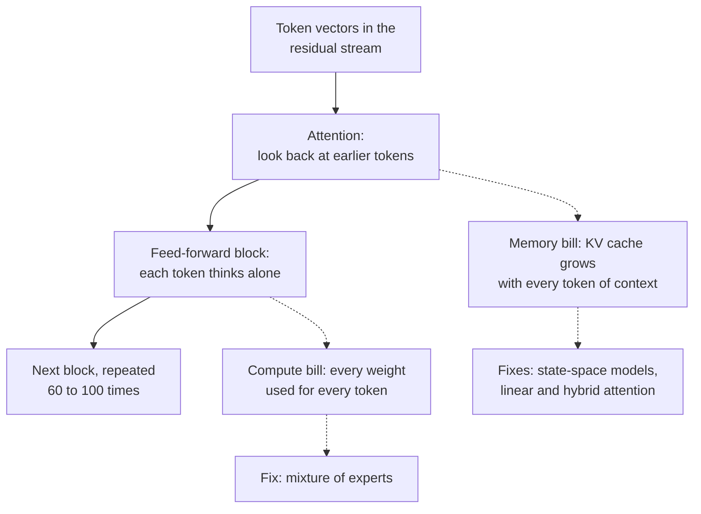
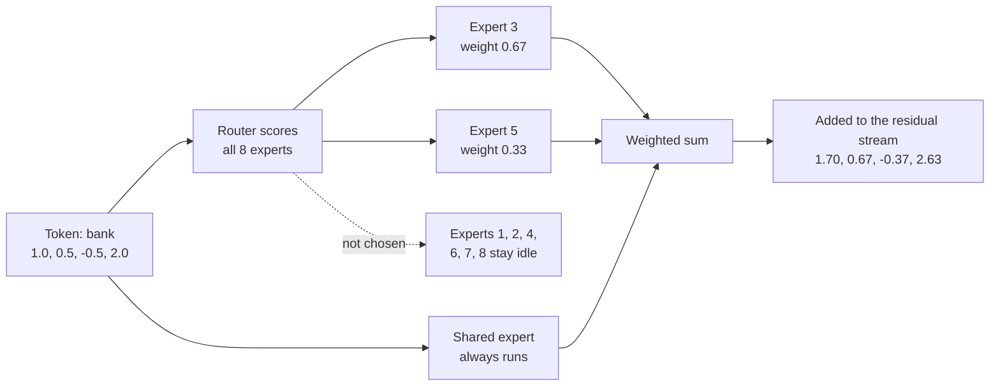
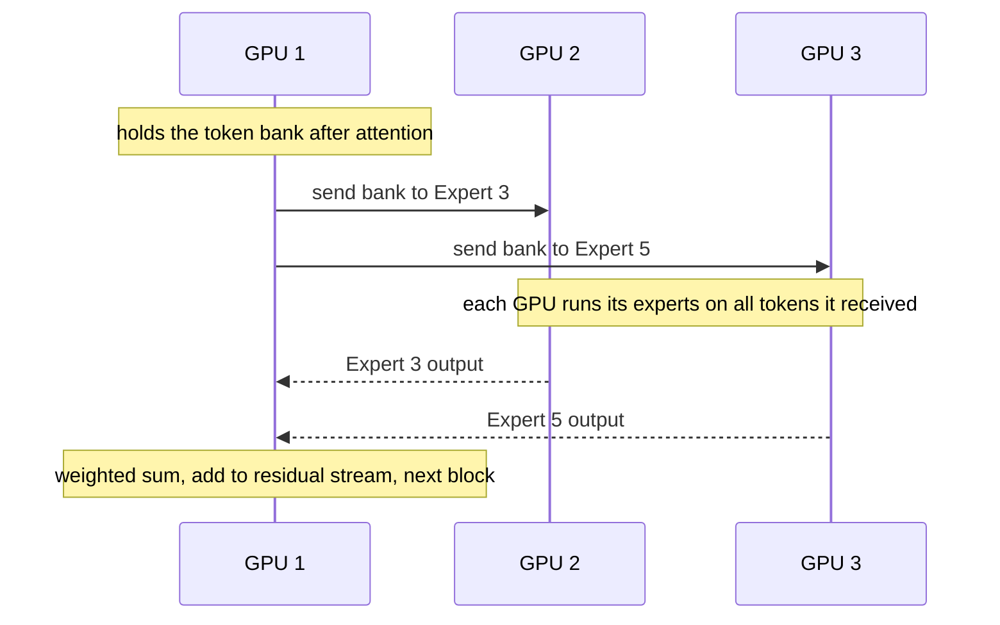
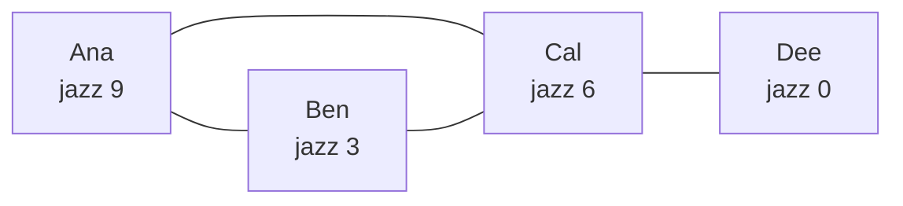
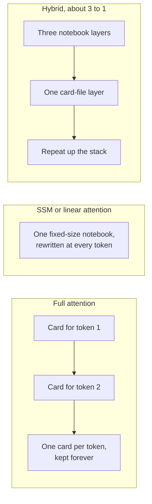
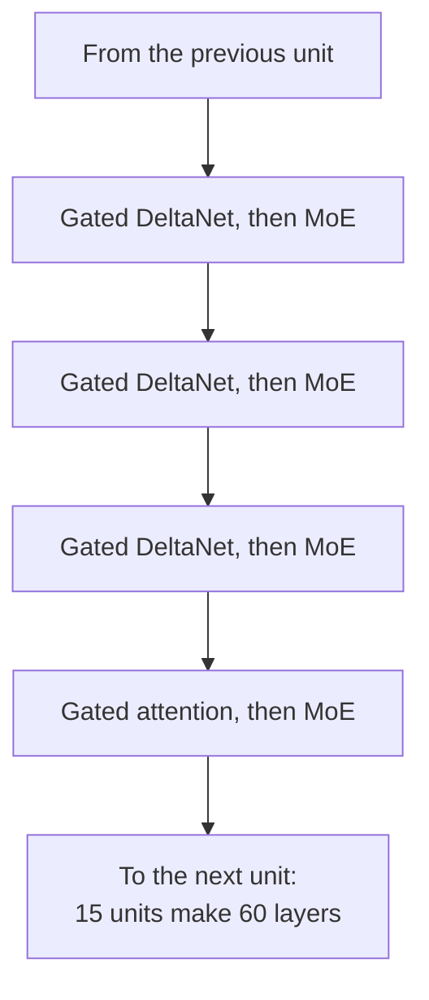
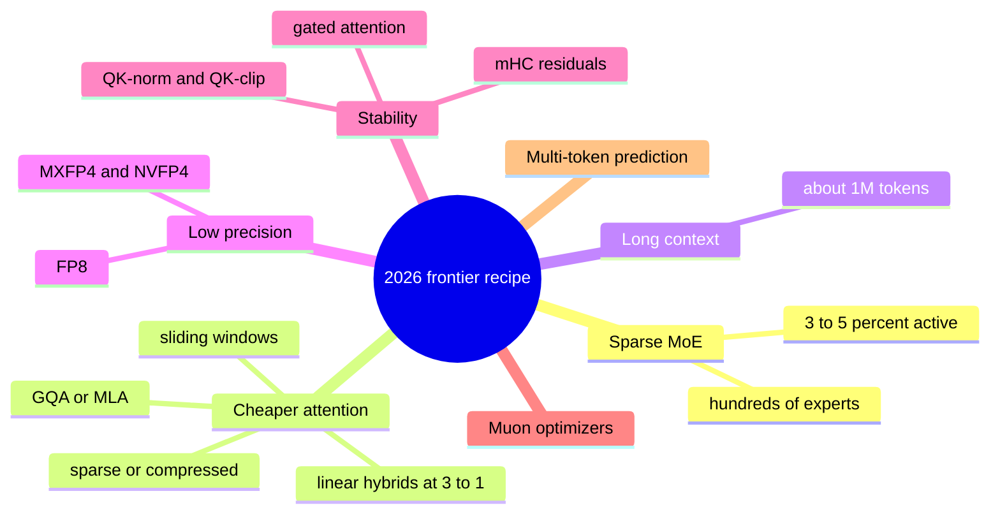
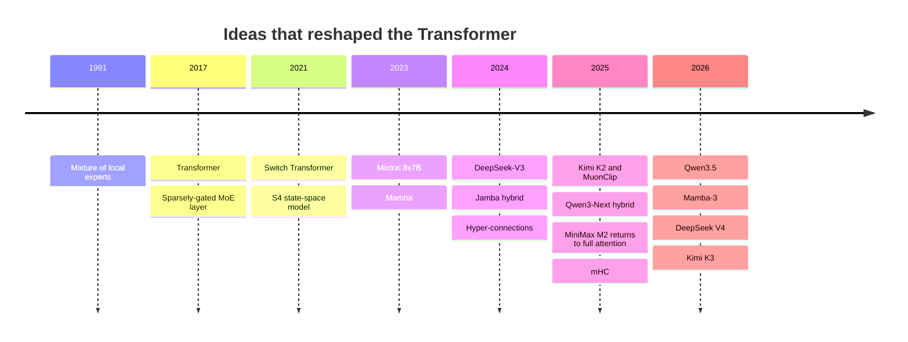

# Chapter 17: Beyond the Transformer: Mixture of Experts, State Space Models and New Architectures

*This chapter shows you what is inside 2026's frontier models: how a 1.6-trillion-parameter model uses only 49 billion parameters per word, how new layers remember a million tokens without a growing memory, and where the top labs agree and disagree about design.*

## What you'll learn
- The two "bills" every Transformer pays, compute per token and memory per token of context, and which new designs attack each.
- Mixture of experts in depth, with one token routed by hand: routers, top-k, gating weights, total versus active parameters, shared and fine-grained experts.
- Why load balancing is hard, how experts are spread across GPUs, and why nearly every open frontier model is now an MoE.
- How graph neural networks pass messages between connected things.
- How state-space models and linear attention (S4, Mamba, Mamba-3, RWKV, DeltaNet) keep a fixed-size memory, and what they lose.
- Hybrid architectures such as Qwen3.5, Kimi K3 and Nemotron 3, and the lab that went back to full attention.
- The "plumbing" that keeps trillion-parameter training stable (mHC, QK-norm, gated attention, DyT), plus recursion and memory research, the 2026 convergence and open questions.

## Before you start
You need Chapter 15 (The Transformer, Piece by Piece), especially attention, the feed-forward block, the residual stream and the KV cache. Chapter 13 (Training Deep Networks) introduced residual connections, normalization and the Muon optimizer, and Chapter 14 introduced RNNs and their hidden state. Chapter 5 gives dot products and the "2 × N operations per token" rule, and Chapter 6 gives softmax. Chapter 16 is helpful but not required.

## Two bills every Transformer pays

Every time your chatbot writes one token, each Transformer block does two things (Chapter 15). In attention, the new token looks back at all earlier tokens. In the feed-forward block, the token "thinks" alone through a large two-layer network. The residual stream carries the result to the next block, and the pattern repeats 60 to 100 or more times.

> **Definition — Feed-forward block (FFN):** The per-token neural network inside each Transformer block, usually two or three big matrices with an activation between them. In dense models it holds about two-thirds of the parameters.

> **Definition — Dense model:** A model that uses all of its weights for every token. A 70-billion-parameter dense model does about 70 billion multiply-adds for each token it reads or writes.

That design sends two bills.

**The compute bill.** In a dense model every weight is used for every token, so the work per token is about 2 × N operations, where N is the parameter count (Chapter 5). A dense 1.6-trillion-parameter model would need about 3.2 trillion operations per token. Make the model bigger to make it smarter, and every token gets proportionally more expensive.

**The memory bill.** Attention stores a key and a value for every earlier token in every layer, the KV cache (Chapter 15). It grows with every token in the conversation. When you paste a 300-page PDF into Claude, the cache for that one conversation can run to many gigabytes, and comparing each new token against all earlier ones means total attention work grows with the square of the length.

> **Definition — KV cache:** The stored keys and values for every earlier token in every attention layer, kept so the model does not recompute them. It grows with each token in the conversation.

> **Definition — Quadratic cost:** Cost that grows with the square of the input length. Doubling the text length roughly quadruples the total work of full attention, because every token is compared with every other.


*Figure 17.1: The two pressure points of a Transformer block and the families of fixes this chapter covers.*

> **Key idea:** Most architecture news of 2024–2026 attacks one of two costs: compute per token (answered by mixture of experts) or memory per token of context (answered by state-space models, linear attention and hybrids). Keep that map in mind and the jargon falls into place.

## Mixture of experts: a huge model that uses a sliver at a time

### The idea

Here is the trick in one sentence: replace the single feed-forward block with many smaller ones, called experts, and add a tiny router that sends each token to only a few of them.

The idea is older than you might think. Robert Jacobs, Michael Jordan, Steven Nowlan and Geoffrey Hinton proposed "adaptive mixtures of local experts" in 1991. Noam Shazeer and colleagues at Google made it work at scale in 2017 with the "sparsely-gated mixture-of-experts layer." Google's Switch Transformer (2021) sent each token to just one expert. Mistral's Mixtral 8x7B (December 2023) brought the design to a popular open model: 8 experts per layer, 2 used per token, about 47 billion parameters in total but only about 13 billion active for each token.

> **Definition — Mixture of experts (MoE):** A layer containing many expert sub-networks plus a router that activates only a few of them for each token, giving the model huge total capacity at modest compute per token.

> **Definition — Expert:** One of the sub-networks inside an MoE layer, usually a feed-forward block of its own. Experts specialize in statistical token patterns, not in neat human subjects.

> **Definition — Router (gating network):** The small network in an MoE layer that scores every expert for the current token and picks which ones will process it.

> **Definition — Conditional computation (sparse activation):** Running only part of a network for each input, chosen by the input itself. MoE is the main example: most experts sit idle for any given token.

> **Analogy:** An MoE layer is a hospital with a triage desk. The receptionist (router) sends each patient (token) to two relevant specialists instead of making every doctor see everyone. The hospital can employ hundreds of doctors while each patient's visit stays short.

### Worked example: routing one token

Take the sentence "She sat on the river bank and watched the boats." Follow the token "bank" as it reaches the MoE layer in, say, block 20. Real token vectors have thousands of numbers; ours has four: `[1.0, 0.5, −0.5, 2.0]`. The layer has 8 experts and uses top-2 routing.

> **Definition — Top-k routing:** The rule that each token is sent to the k experts with the highest router scores (top-1, top-2, top-8 and so on). The rest are skipped for that token.

**Step 1: score every expert.** The router holds one small vector per expert and takes a dot product (Chapter 5) with the token. For Expert 3 the router vector is `[0.5, 1.0, 0.0, 0.8]`:

`1.0 × 0.5 + 0.5 × 1.0 + (−0.5) × 0.0 + 2.0 × 0.8 = 0.5 + 0.5 + 0 + 1.6 = 2.6`

Doing the same for all eight gives these scores: E1 0.2, E2 −1.0, E3 2.6, E4 0.9, E5 1.9, E6 −0.3, E7 0.4, E8 1.1.

**Step 2: turn scores into percentages.** Softmax (Chapter 6) raises e to each score and divides by the total. e^2.6 ≈ 13.46, e^1.9 ≈ 6.69, and so on; the eight values add up to about 29.44. So Expert 3 gets 13.46 ÷ 29.44 ≈ 45.7%.

```
  Router probabilities for the token "bank" (8 experts, top-2)

  Expert 3  ######################  45.7%  <- chosen
  Expert 5  ###########             22.7%  <- chosen
  Expert 8  #####                   10.2%
  Expert 4  ####                     8.4%
  Expert 7  ##                       5.1%
  Expert 1  ##                       4.1%
  Expert 6  #                        2.5%
  Expert 2  #                        1.2%
```
*Figure 17.2: The router's softmax over eight experts for one token. Only the top two will run.*

**Step 3: pick the top 2 and renormalize.** Experts 3 and 5 win, with 45.7% and 22.7%. Rescale those two so they add to 1: 45.7 ÷ 68.4 ≈ 0.67 and 22.7 ÷ 68.4 ≈ 0.33. These are the gating weights.

> **Definition — Gating weight:** The share each chosen expert gets in the final mix for a token, computed from the router's scores. With top-2 routing the two gating weights add up to 1.

**Step 4: run only the chosen experts.** Each expert is its own small feed-forward network. Suppose Expert 3 outputs `[0.8, −0.2, 0.4, 1.0]` and Expert 5 outputs `[0.2, 0.6, −0.4, 0.5]`. The other six experts do nothing at all for this token.

**Step 5: blend.** `0.67 × Expert 3 + 0.33 × Expert 5`, number by number:
- first: 0.67 × 0.8 + 0.33 × 0.2 ≈ 0.60
- second: 0.67 × (−0.2) + 0.33 × 0.6 ≈ 0.07
- third: 0.67 × 0.4 + 0.33 × (−0.4) ≈ 0.13
- fourth: 0.67 × 1.0 + 0.33 × 0.5 ≈ 0.83

**Step 6: add a shared expert.** Many modern MoEs also have a shared expert that every token visits. Say it outputs `[0.1, 0.1, 0.0, −0.2]`. The layer's output becomes `[0.70, 0.17, 0.13, 0.63]`.

**Step 7: add back to the residual stream.** As in every Transformer block, the result is added to the token's running vector: `[1.0 + 0.70, 0.5 + 0.17, −0.5 + 0.13, 2.0 + 0.63] = [1.70, 0.67, −0.37, 2.63]`. The token moves on to the next block, which has its own router and its own experts.


*Figure 17.3: One token's trip through an MoE layer, with the numbers from the worked example.*

What did we save? Six of eight routed experts were skipped, so this layer's routed compute was a quarter of what running all eight would cost. The next token, "and," might go to Experts 1 and 8. With 8 experts and top-2 there are 28 possible pairs per layer; with 60 layers, each token takes its own path through an enormous number of combinations.

> **Watch out:** "Mixture of experts means a math expert, a history expert and a cooking expert." When researchers inspect trained routers, experts specialize in statistical token patterns (punctuation, certain grammar, code syntax, a particular language), not school subjects. Nobody designs the specialties; they emerge from training.

### Total versus active parameters

Because only a few experts run per token, an MoE model has two sizes. Total parameters is everything stored. Active parameters is what one token actually uses: attention, any shared experts, the router and the chosen routed experts. Compute per token follows the active count. Memory follows the total.

> **Definition — Total parameters:** Every learned number stored in a model, including all experts. It decides how much memory the model needs.

> **Definition — Active parameters:** The parameters actually used to process one token in an MoE model. It decides compute per token, and so speed and cost. "A17B" in a model name means about 17 billion active.

| Model (release) | Total | Active | Active share | Experts per MoE layer |
|---|---|---|---|---|
| Mixtral 8x7B (Dec 2023) | ~47B | ~13B | ~28% | 8, top-2 |
| DeepSeek-V3 (Dec 2024) | 671B | 37B | ~5.5% | 256 routed + 1 shared, 8 routed active |
| Llama 4 Maverick (Apr 2025) | 400B | 17B | ~4.3% | 128 routed + 1 shared |
| gpt-oss-120b (Aug 2025) | 116.8B | 5.1B | ~4.4% | not covered here |
| Kimi K2 (Jul 2025) | 1T | 32B | ~3.2% | not covered here |
| Qwen3.5 flagship (Feb 2026) | 397B | 17B | ~4.3% | not covered here |
| DeepSeek V4-Flash (2026) | 284B | 13B | ~4.6% | not covered here |
| DeepSeek V4-Pro (2026) | 1.6T | 49B | ~3.1% | not covered here |
| Qwen3.8 open flagship (Aug 2026) | 2.4T | 95B | ~4.0% | not covered here |
| Kimi K3 (Jul 2026) | 2.8T | 104B | ~3.7% | 896, 16 active + 2 shared |

*Table 17.1: Total and active parameters of well-known MoE models. Recent frontier MoEs activate roughly 3–5% of their weights per token.*

Work through DeepSeek V4-Pro, the largest open model from DeepSeek as of late 2026.
- **Compute per token:** 2 × 49 billion ≈ 98 billion operations. A dense 1.6T model would need 2 × 1.6 trillion = 3.2 trillion, about 33 times more.
- **Training compute:** with the 6 × N × D rule (Chapter 19: training costs about 6 operations per parameter per training token, the 2 of the forward pass plus about 4 for the backward pass), using active parameters for N and about 33 trillion training tokens for D: 6 × 49e9 × 33e12 ≈ 9.7 × 10^24 operations (49e9 is computer shorthand for 49 × 10^9, that is 49 billion), matching the estimate of Epoch AI, a research group that tracks AI training runs. A dense 1.6T model trained on the same data would need about 3.2 × 10^26, again about 33 times more.
- **Memory:** all 1.6 trillion parameters must sit in fast memory. DeepSeek stores the expert weights in a 4-bit format (FP4) and most other weights in 8-bit (FP8). At half a byte per parameter, 1.6T is about 0.8 TB; at one byte, 1.6 TB. Either way, that is a multi-GPU server, not a laptop.

Precision matters for MoE because the expert weights are most of the memory. OpenAI's open gpt-oss-120b stores its MoE weights in MXFP4, about 4.25 bits per number, which is how a 116.8-billion-parameter model fits on a single 80 GB GPU. Roughly: 116.8 billion × 4.25 bits ÷ 8 ≈ 62 GB, if every weight used that format (Chapter 23 covers quantization).

> **Definition — MXFP4 and NVFP4:** Four-bit number formats in which small blocks of numbers share a scale factor, so weights take about half a byte each. They are used to store and increasingly to train large MoE models.

> **Key idea:** In an MoE, memory follows total parameters and compute follows active parameters. That split is why a 2.8-trillion-parameter model like Kimi K3 can cost, per token, roughly what a dense model of about 100 billion parameters costs, ignoring communication overhead.

> **Watch out:** "A one-trillion-parameter MoE uses a trillion parameters for every word." Only the active parameters compute each token (32 billion for Kimi K2, 49 billion for DeepSeek V4-Pro), though all of them must be stored. When comparing models, ask for both numbers.

### Shared experts and fine-grained experts

Two refinements, popularized by DeepSeek's DeepSeekMoE work in 2024, define modern MoE design.

**Shared experts.** Some knowledge is needed by nearly every token: grammar, common words, basic formatting. If every routed expert has to relearn it, capacity is wasted. A shared expert that every token visits holds the common knowledge, and the routed experts are free to specialize. Llama 4 Maverick has one shared expert beside 128 routed ones; Kimi K3 has two shared beside 896 routed.

> **Definition — Shared expert:** An expert in an MoE layer that processes every token, holding broadly useful knowledge so the routed experts can specialize.

**Fine-grained experts.** Instead of 8 big experts with top-2, use 64 experts each one-eighth the size with top-16. The compute per token is the same (16 small experts equal 2 big ones), but the number of possible combinations explodes: 28 pairs from 8, against about 4.9 × 10^14 ways to choose 16 from 64. More combinations let each token get a more precisely tailored mix. Frontier models have pushed this far: Kimi K3's 896 experts with 16 active means each token visits under 2% of the routed experts in a layer.

> **Definition — Fine-grained experts:** Splitting an MoE layer into many small experts and activating more of them per token, keeping compute the same while allowing far more combinations.

### Load balancing: keeping every expert busy

Routers have a rich-get-richer problem. Early in training, a few experts happen to score slightly higher. They get more tokens, so they learn faster, so they score even higher. Left alone, a handful of experts do all the work and the rest wither. This is routing collapse, and it wastes most of the model.

> **Definition — Routing collapse (expert collapse):** An MoE failure where the router sends most tokens to a few experts, which keep improving while the rest go unused.

> **Definition — Load balancing:** Techniques that keep tokens spread evenly across experts, so every expert learns and no GPU becomes a bottleneck.

There is a hardware problem too. Experts live on different chips (next section). If one expert receives far more tokens than average, its chip becomes the slowest worker, and everyone waits for it. Systems therefore set an expert capacity: the most tokens an expert will accept per batch, usually the fair share times a capacity factor such as 1.25. Tokens beyond capacity are dropped from that expert and simply pass through on the residual stream, unprocessed by that layer.

> **Definition — Expert capacity (capacity factor):** The maximum number of tokens an expert accepts per batch, set as the fair share times a factor such as 1.25. It keeps any one chip from being overloaded.

> **Definition — Token dropping:** What happens when an expert is over capacity: extra tokens skip that expert and carry on through the residual connection without its contribution.

A worked example: 16 tokens with top-2 routing make 32 expert slots. Spread evenly over 8 experts, that is 4 each; with a capacity factor of 1.25, each expert accepts at most 5.

```
  32 expert slots (16 tokens x top-2), 8 experts, capacity 5 each

  E1  ##              2
  E2  #               1
  E3  ###########    11   <- 6 over capacity, dropped
  E4  ###             3
  E5  #########       9   <- 4 over capacity, dropped
  E6  #               1
  E7  ##              2
  E8  ###             3
                     --
                     32   (fair share: 4 each)
```
*Figure 17.4: An unbalanced router. Ten of 32 slots are dropped, and the other six experts all get less than their fair share.*

Three fixes are common:
1. **Auxiliary loss.** Add a penalty to the training loss that grows when some experts receive a bigger share of tokens and router probability than others. The Switch Transformer used this. It works, but the extra loss term pulls slightly against the main goal of predicting text.
2. **Auxiliary-loss-free balancing.** DeepSeek-V3 added a small bias to each expert's score that is used only for choosing experts, not for the gating weights. After each training step, overloaded experts get their bias lowered and underused ones get it raised. Example: a token scores E3 2.0, E5 1.3, E8 1.1. E3 is overloaded (bias −0.5) and E8 is underused (bias +0.5), so the selection scores become 1.5, 1.3 and 1.6, and the token goes to E8 and E3 instead of E3 and E5. The mixing still uses the original scores (softmax over 2.0 and 1.1: e^2.0 ≈ 7.39 and e^1.1 ≈ 3.00), giving E3 about 0.71 and E8 about 0.29.
3. **Routing limits.** Cap how many machines a single token's experts can be spread across, which caps communication.

> **Definition — Auxiliary loss (load-balancing loss):** An extra penalty added to the training loss that discourages the router from overusing some experts.

> **Definition — Auxiliary-loss-free balancing:** DeepSeek's method of balancing experts by nudging a per-expert bias used only for selection, raising it for underused experts and lowering it for overloaded ones, without adding a term to the loss.

### MoE on real hardware: expert parallelism

A 1.6-trillion-parameter model doesn't fit on one chip, so its experts are spread across many GPUs. This is expert parallelism. Each MoE layer then needs two rounds of communication: send each token's vector to the GPUs holding its chosen experts, and send the results back. Because every GPU may need to send something to every other GPU, this pattern is called all-to-all.

> **Definition — Expert parallelism:** Placing different experts on different chips and shipping each token to the chips that hold its chosen experts.

> **Definition — All-to-all communication:** A data exchange where every chip sends a different piece of data to every other chip. MoE layers do it twice: once to dispatch tokens to experts and once to bring results back.


*Figure 17.5: Expert parallelism. Experts 1–4 live on GPU 2 and Experts 5–8 on GPU 3; tokens travel to their experts and back in every MoE layer.*

This is why giant MoE models favor hardware with very fast chip-to-chip links, such as NVIDIA's 72-GPU NVL72 racks (Chapter 34), and why the "all-to-all" step is a favorite target for performance engineers (Chapter 37). It also explains a serving trade-off. In a data center that batches thousands of users, every expert stays busy and MoE is very cheap per token. On your own computer with one user, you still have to hold every expert in memory while using only a few, so a local MoE is limited by memory, not compute (Chapter 30).

### Why MoE won the frontier, and what it costs

By 2026 nearly every large open-weight model is an MoE: DeepSeek V4, Kimi K3, Qwen3.5 and Qwen3.8, Llama 4, Mistral Large 3 (675 billion total, 41 billion active), gpt-oss and NVIDIA's Nemotron 3. Google's Gemini 1.5 technical report (2024) described that model as a sparse MoE Transformer. OpenAI and Anthropic do not publish their flagship architectures, so their exact designs are not public.

Why the shift?
- **Capacity without compute.** Knowledge seems to scale with total parameters, while cost per token scales with active parameters. MoE decouples the two.
- **Better results per training dollar.** At a fixed training budget, well-tuned MoE models reach lower loss than dense models of the same active size.
- **Cheaper serving at scale.** A provider serving millions of chats pays for active compute per token; the memory is shared across all those users.

The costs are real:
- **Memory:** all experts must be stored, which raises hardware needs and rules out small devices.
- **Communication:** all-to-all traffic every MoE layer needs fast networks.
- **Training difficulty:** routers can collapse or become unstable, and balancing adds engineering.
- **Complexity for everyone downstream:** fine-tuning, quantizing and serving MoE models is harder than for dense ones.

So dense models still make sense at small sizes and on devices. Google's Gemma 4 family (March 31, 2026), for example, includes both a 31-billion-parameter dense model and a 26B-A4B MoE.

> **At the frontier (2026):** The largest open models are trillion-scale MoEs with hundreds of fine-grained experts and roughly 3–5% of weights active per token. Kimi K3 (July 2026) has 2.8 trillion total and 104 billion active parameters, with 896 experts of which 16 routed plus 2 shared run per token. DeepSeek V4-Pro has 1.6 trillion total and 49 billion active, with 4-bit expert weights and a 1-million-token context, released under the permissive MIT license. NVIDIA's Nemotron 3 Super (March 2026) uses a variant it calls LatentMoE. The frontier question is no longer whether to use MoE but how fine-grained, how sparse and how to serve it.

> **Try it:** Ask your chatbot: "Explain mixture of experts using a hospital triage analogy, then tell me which parts of your own architecture your company has publicly disclosed and which it has not." Notice whether it separates published facts from speculation. Most closed-model assistants will say their architecture is not public.

## Graph neural networks: when data is a web, not a line

Before going back to sequences, take a short detour to a different shape of data. Text is a line of tokens and an image is a grid of pixels, but much of the world is a web: atoms bonded in a molecule, friends in a social network, intersections joined by roads, weather stations on a globe. Mathematicians call such a web a graph.

> **Definition — Graph:** A set of things (nodes) joined by connections (edges). A molecule is a graph with atoms as nodes and bonds as edges; a road map has intersections and roads.

> **Definition — Node and edge:** A node is one item in a graph (an atom, a person, a city); an edge is a connection between two nodes (a bond, a friendship, a road).

A graph neural network (GNN) learns on graphs by message passing. In each round, every node collects messages from its neighbors, combines them with its own state, and updates itself. Stack several rounds and information travels several hops.

> **Definition — Graph neural network (GNN):** A neural network that works on graph-shaped data by repeatedly updating each node from its neighbors.

> **Definition — Message passing:** The core GNN step: each node gathers information from the nodes it is connected to, combines it with its own, and updates its representation.

A worked example. Four friends, each with a "how much I like jazz" score: Ana 9, Ben 3, Cal 6, Dee 0. Ana knows Ben and Cal, Ben knows Cal, and Cal also knows Dee. In this simplified version, each round every person's new score is the average of their own score and their friends' scores. (A real GNN uses learned weights and an activation function in place of a plain average.)


*Figure 17.6: A tiny social graph. Dee is two hops from Ana and only connected through Cal.*

Round 1: Ana = (9 + 3 + 6) ÷ 3 = 6. Ben = (3 + 9 + 6) ÷ 3 = 6. Cal = (6 + 9 + 3 + 0) ÷ 4 = 4.5. Dee = (0 + 6) ÷ 2 = 3.

Round 2: Ana = (6 + 6 + 4.5) ÷ 3 = 5.5. Ben = 5.5. Cal = (4.5 + 6 + 6 + 3) ÷ 4 = 4.875. Dee = (3 + 4.5) ÷ 2 = 3.75.

After two rounds, Dee's score carries a trace of Ana's enthusiasm, even though they have never met: it arrived through Cal. That is how a GNN lets an atom "know" about atoms two bonds away, or a road segment "know" about a traffic jam two junctions upstream.

The graph convolutional network (GCN, 2016) made this practical. Google DeepMind's GraphCast (2023) used message passing on a mesh covering the globe to forecast weather, and GNNs are standard tools in drug and materials discovery (Chapter 52).

> **Definition — Graph convolutional network (GCN):** A 2016 GNN design in which each node's update is a learned, weighted average of its neighbors' features, a graph version of the sliding filters in a CNN.

There is a neat connection back to this book's main thread. Self-attention is message passing on a graph where every token is connected to every other token, and the edge weights (attention scores) are computed on the fly. A Transformer is a GNN on a fully connected graph. That is also why it is expensive: a fully connected graph of n tokens has about n² edges.

> **Analogy:** A GNN is gossip in a village. Each house updates its opinion from its neighbors, and after a few rounds news has spread across the whole map. A Transformer is a village where everyone talks to everyone at once, which is thorough but loud and costly.

## The memory problem: why long context is expensive

Back to language models and the memory bill. How big does the KV cache get? Take an illustrative mid-size model with 60 attention layers, 8 key-value heads of 128 numbers each (a grouped-query design, Chapter 15), stored in 16-bit format (2 bytes per number). Per token per layer it stores a key and a value: 2 × 8 × 128 × 2 bytes = 4,096 bytes. Across 60 layers that is about 245 KB per token. Then:
- 10,000 tokens (a long chat): about 2.5 GB.
- 100,000 tokens (a long PDF): about 25 GB.
- 1,000,000 tokens (a frontier context window): about 245 GB, for one conversation. An NVIDIA H100 has 80 GB.

Chapter 15 introduced the first line of defense, which keeps attention but makes it cheaper: grouped-query and multi-head latent attention (GQA, MLA) shrink what is stored per token; sliding windows cap how far back a layer looks; sparse attention picks only the most relevant earlier tokens. DeepSeek V4 combines compressed and sparse attention and reports that, at a 1-million-token context, V4-Pro needs 27% of the per-token compute and 10% of the KV cache of its predecessor V3.2.

> **Definition — Sparse and compressed attention:** Attention variants that compare a new token with only a selected subset of earlier tokens, or with compressed summaries of them, instead of every token in full. DeepSeek V4's Compressed Sparse Attention is an example.

The more radical line of defense replaces most attention layers with layers that keep a fixed-size memory, no matter how long the text gets.

> **Try it:** Paste a long document (50 pages or more) into your chatbot. Ask for one exact detail from the middle, such as a number in a table. Then ask a two-step question that links a fact near the start with a fact near the end. You are testing exact recall and multi-hop reasoning, the two abilities that cheaper memory designs can weaken.

## State-space models and linear attention: a notebook instead of a filing cabinet

### Back to recurrence, done right

Recall the RNN from Chapter 14. It read text one token at a time while carrying a hidden state, a fixed-size memory vector. Its memory never grew, which is exactly what we want now. But RNNs had two problems: training was slow because each step waited for the previous one, and they forgot long-range information.

> **Definition — State (memory state):** A fixed-size set of numbers a layer carries from token to token as its running summary of everything it has read. Unlike a KV cache, it does not grow with the length of the text.

The new families aim for the best of both worlds: train in parallel like a Transformer, but generate like an RNN, with constant memory and constant work per new token.

Start with the simplest possible recurrence: `state = 0.9 × state + input`. Feed in 5, then 0, 0, 0: the state goes 5.0, 4.5, 4.05, 3.65. Every old input fades by 10% per step, whether it mattered or not. After 100 steps the 5 has faded to almost nothing.

The key upgrade is selectivity: let the token itself decide how much to keep and how much to write. Suppose a model reads "The access code is 4719. Um, anyway, as I was saying..." A selective layer can learn to write strongly when it sees the digits and to set its keep-rate close to 1 (almost no fading) while reading filler like "um, anyway," so the code survives. On a new topic it can lower the keep-rate and clear space.

> **Definition — Selectivity (selective state):** Letting the input decide, token by token, how much of the existing state to keep and how much new information to write, so a fixed-size memory can hold what matters and drop filler.

### From S4 to Mamba-3

> **Definition — State-space model (SSM):** A sequence layer that updates a fixed-size internal state at each step, as an RNN does, but is designed so it can also be trained in parallel on GPUs. The idea comes from control engineering.

The modern line runs:
- **S4 (2021).** Albert Gu and colleagues borrowed state-space equations from control engineering and found a way to train them in parallel like a convolution. S4 was strong on very long sequences but weak on language, because its update rule was the same for every token.
- **Mamba (December 2023).** Gu and Tri Dao made the state updates selective (input-dependent), with a GPU-friendly algorithm to keep training fast. Mamba was among the first such models to match Transformers of similar size on language.
- **Mamba-2 (2024).** A reformulation showing that SSMs and attention are mathematically close relatives, which made training much faster on GPUs.
- **Mamba-3 (2026, an oral paper at ICLR 2026, a major machine-learning research conference).** Adds a more expressive recurrence, complex-valued state updates and a "multi-input, multi-output" design. At 1.5 billion parameters it beat Gated DeltaNet on average downstream accuracy and matched Mamba-2's perplexity (a standard score of how well a model predicts text, where lower is better; Chapter 12) with half the state size.

> **Definition — Mamba:** A selective state-space model introduced in December 2023 whose state updates depend on the input, letting it choose what to remember. Successors are Mamba-2 (2024) and Mamba-3 (2026).

### Linear attention and the delta rule

A second road reaches a similar destination by rewriting attention itself. In normal attention, the softmax forces you to compare a new query with every stored key. If you drop the softmax (or replace it with a simpler function), the math can be rearranged so that all past keys and values are folded into one fixed-size matrix, a memory S. Writing token i adds `value × keyᵀ` to S; reading with a query q gives `S × q`. (The ᵀ means "transposed": the key is laid on its side as a row, so `value × keyᵀ` is a grid whose entry in row r, column c is value number r times key number c. `S × q` is the matrix-times-vector multiplication of Chapter 5.) That is linear attention: constant memory and constant work per token.

> **Definition — Linear attention:** A family of attention variants that fold all past keys and values into a fixed-size memory matrix, so each new token costs the same no matter how long the text is.

Plain linear attention has a flaw: it only adds, so memories pile up and blur. The delta rule fixes this by correcting instead of piling. Before writing, it asks the memory what it currently returns for this key, and writes only the difference.

A worked example with 2-number keys and values. The memory S starts as all zeros. Store value `v1 = [3, 1]` under key `k = [1, 0]`.
- Delta rule: the memory currently returns S × k = [0, 0]. The error is [3, 1] − [0, 0] = [3, 1], so write that. Reading with k now gives [3, 1].
- Now the fact changes: store `v2 = [2, 2]` under the same key. The memory returns [3, 1]; the error is [2, 2] − [3, 1] = [−1, 1]. Write that correction, and reading with k gives exactly [2, 2]. The old value was cleanly replaced.
- Plain additive linear attention would have added both values: reading with k gives [3, 1] + [2, 2] = [5, 3], a blur of the old and new facts.

> **Definition — Delta rule:** An update rule for a memory matrix that first checks what the memory currently returns for a key and then writes only the difference from the new value, so outdated information is overwritten instead of piled up.

This idea powers a family of layers. DeltaNet applies the delta rule. Gated DeltaNet (2024) adds a learned forget gate so the memory can also decay. Moonshot's Kimi Delta Attention (October 2025) gives each channel of the memory its own gate. Two designs pursue the same goal from the RNN side: RWKV (an open-source recurrent family, published in 2023) and xLSTM (2024, a modernized LSTM from the group of Sepp Hochreiter, co-inventor of the LSTM).

> **Definition — Gated DeltaNet:** A linear-attention layer that combines the delta rule with a learned forget gate, letting its fixed-size memory both overwrite and gradually fade old information. Used in Qwen3-Next and Qwen3.5.

> **Definition — Kimi Delta Attention (KDA):** Moonshot AI's 2025 variant of Gated DeltaNet in which each channel of the memory has its own forget gate. Used in Kimi Linear and Kimi K3.

> **Definition — RWKV and xLSTM:** Two modern recurrent architectures that train in parallel yet generate with constant memory: RWKV from an open-source community, and xLSTM, a 2024 update of the LSTM.

### The catch: a notebook forgets

A fixed-size memory is a summary, and summaries lose detail. Ask a pure SSM to repeat a phone number from 500,000 tokens ago, or to connect a fact on page 12 with a fact on page 280 to answer a question, and it may fail, because those details were overwritten. Full attention keeps every token's key and value, so exact recall is always possible.

> **Definition — Multi-hop reasoning:** Answering a question by chaining several facts that may be far apart in the text, for example "Who is the manager of the person who wrote the March report?"

> **Analogy:** Full attention is a filing cabinet with every page you have ever read: perfect recall, but it grows forever. An SSM or linear-attention layer is a running summary notebook: fixed size, cheap to carry, but details get overwritten. A hybrid is mostly notebooks, with a filing cabinet on every fourth floor.


*Figure 17.7: Three ways to remember. Full attention keeps everything; linear layers keep a summary; hybrids mix the two.*

> **Watch out:** "Linear and hybrid attention is strictly better because it is cheaper." It trades exact recall for efficiency. Some labs have seen reasoning get worse with hybrids at scale, as the next section shows. Cheaper is a trade-off, not a free win.

## Hybrid architectures: mostly notebooks, some filing cabinets

The practical answer of 2025–2026 is to mix layer types: most layers are cheap linear or SSM layers, and every few layers a full-attention layer keeps exact recall. Jamba (March 2024), from the Israeli AI company AI21 Labs, was an early large example, mixing Transformer and Mamba layers with MoE. Since then, a 3-to-1 ratio has become common.

> **Definition — Hybrid architecture:** A model that mixes layer types, typically mostly linear-attention or state-space layers plus some full-attention layers, to get long-context efficiency while keeping exact recall.

> **Definition — Gated attention:** Full attention with a learned sigmoid "valve" on each head's output that can turn it down. It improves stability and removes attention sinks; the Qwen team's paper on it won a NeurIPS 2025 Best Paper award.


*Figure 17.8: The repeating unit of Qwen3.5's flagship model: three linear-attention layers, then one full-attention layer, each followed by an MoE block.*

| Model (release) | Total / active | Layer mix |
|---|---|---|
| Jamba, AI21 (Mar 2024) | not covered here | Transformer and Mamba layers, with MoE |
| Qwen3-Next (Sep 2025) | 80B / 3B | 48 layers: 12 × (3 Gated DeltaNet + 1 gated attention) |
| Kimi Linear (Oct 2025) | 48B / 3B | Kimi Delta Attention to MLA at about 3 : 1 |
| Nemotron 3 Nano, NVIDIA (Dec 2025) | 30B / 3.5B | 52 layers: 23 Mamba-2, 23 MoE, 6 attention |
| Qwen3.5 flagship (Feb 2026) | 397B / 17B | 60 layers: 15 × (3 Gated DeltaNet + 1 gated attention), each with MoE |
| Nemotron 3 Super, NVIDIA (Mar 2026) | 120B / 12B | Mamba-2, LatentMoE and a few attention layers; pretrained in 4-bit NVFP4 |
| Kimi K3, Moonshot (Jul 2026) | 2.8T / 104B | 93 layers: 69 Kimi Delta Attention + 24 gated MLA, with MoE |

*Table 17.2: Hybrid architectures, 2024–2026.*

What does the 3-to-1 ratio buy? Redo the memory math for our illustrative 60-layer model with only 15 full-attention layers. The KV cache drops to a quarter: about 61 KB per token, so roughly 61 GB at 1 million tokens instead of 245 GB. The 45 linear layers add only a fixed state, around 256 KB per layer in a typical setup (about 12 MB in total), the same at 1,000 tokens or 1,000,000.

| Context length | All 60 layers full attention | Hybrid 3:1 (15 attention layers) | Linear or SSM layers alone |
|---|---|---|---|
| 10,000 tokens | ~2.5 GB | ~0.6 GB | fixed, ~12 MB |
| 100,000 tokens | ~25 GB | ~6 GB | fixed, ~12 MB |
| 1,000,000 tokens | ~245 GB | ~61 GB | fixed, ~12 MB |

*Table 17.3: Memory for one conversation in an illustrative 60-layer model. The numbers are worked from this chapter's assumptions, not measured from a specific product.*

Companies report big gains. Moonshot says Kimi Linear cuts KV cache by up to 75% and decodes up to 6 times faster at a 1-million-token context; critics noted its relatively small training budget and baselines, so treat these as company-reported. NVIDIA claims Nemotron 3 Super reaches up to 2.2 times the throughput of gpt-oss-120b.

> **At the frontier (2026):** Moonshot's Kimi K3 (July 2026), one of the largest open models, is a hybrid: 69 of its 93 layers use Kimi Delta Attention and 24 use gated MLA, combined with an 896-expert MoE, a 1-million-token context and 4-bit MXFP4 weights; according to its model card, quantization-aware training is applied from the supervised fine-tuning stage onward (the post-training step that learns from example answers, Chapter 20), not during pretraining. Qwen3.5 uses the same 3:1 pattern from its small dense variants (0.8 to 9 billion parameters) up to the 397B flagship. DeepSeek V4 takes the other road, keeping attention in every layer but compressing and sparsifying it.

> **Definition — Quantization-aware training (QAT):** Training or fine-tuning a model while simulating the low-precision numbers it will later run with, so that its final 4-bit or 8-bit version loses very little quality.

### The counter-trend: going back to full attention

Not everyone is convinced. In October 2025 the Chinese AI company MiniMax released MiniMax M2 with plain full attention, after earlier MiniMax models had used a hybrid "lightning attention." Its stated reasons: hybrids looked fine on benchmarks but degraded on multi-hop reasoning at scale, and full attention has far more mature kernels and serving tools.

> **Definition — Kernel (GPU kernel):** A single, hand-optimized routine that runs on a GPU, such as one that computes attention. New layer types need new kernels before they run fast, which takes specialist engineering.

Here is the strongest case for each side. **For hybrids:** long contexts and long agent sessions are where demand is growing, memory is the binding cost there, and 3:1 designs at Qwen, Moonshot and NVIDIA keep benchmark quality while cutting memory severalfold. **For full attention:** benchmarks may not reveal subtle recall failures that show up in long, multi-step reasoning, and the mature tooling around full attention (and cheaper variants such as MLA and sparse attention) delivers much of the efficiency without the risk. DeepSeek V4 represents a third path: keep attention everywhere, but compress and sparsify it.

The diversity shows in the numbers. Sebastian Raschka's LLM Architecture Gallery counted attention types across 111 recent models (one model can use several, so shares add to more than 100%):

| Attention family | Share of 111 recent models |
|---|---|
| Grouped-query attention family | ~65% |
| Sliding-window and global patterns | ~31% |
| Multi-head latent attention family | ~23% |
| DeltaNet, Lightning or KDA hybrids | ~14% |
| Mamba or mLSTM (xLSTM's memory layer) layers | ~7% |
| DeepSeek Sparse Attention | ~6% |
| Classic full multi-head attention | ~4% |

*Table 17.4: Nobody agrees on attention anymore. Shares overlap because many models mix types.*

> **Key idea:** In 2026 attention is a menu, not a single dish. Labs mix full, grouped, latent, sliding, sparse and linear layers to trade recall against memory, and whether cheap layers lose something important in hard reasoning is one of the field's live disputes.

## Keeping giants stable: the residual stream and other plumbing

A frontier pretraining run can occupy tens of thousands of chips for months. If the training loss suddenly jumps (a loss spike), the team may have to roll back to an earlier checkpoint and lose days of expensive compute. At this scale, small "plumbing" choices about how numbers flow through the network matter enormously, and labs still innovate here.

> **Definition — Loss spike:** A sudden jump in training loss, usually a sign that numbers inside the network have grown unstable. At frontier scale each spike can waste days of compute.

> **Definition — Residual stream:** The running vector each token carries up through all the layers of a Transformer; each layer reads it and adds its contribution back (Chapter 15).

**Hyper-connections and mHC.** A residual connection computes `output = input + layer(input)` (Chapter 13), which gives signals a highway through 100+ layers. Hyper-connections, proposed in 2024, widen the highway into several parallel streams (say, 4) and let the network learn how to mix them between layers. More capacity, but a risk: if mixing slightly amplifies the signal at every layer, the effect compounds. A gain of 1.1 per layer over 60 layers is 1.1^60 ≈ 304 times; a loss of 10% per layer leaves 0.9^60 ≈ 0.002. DeepSeek's manifold-constrained hyper-connections (mHC, December 2025), used in DeepSeek V4, restrict the mixing to blending-style operations that can shuffle and average the streams but cannot blow them up or shrink them away, restoring the identity-like stability of a plain residual connection.

> **Definition — Hyper-connections:** A generalization of residual connections that carries several parallel copies of the residual stream and learns how to mix them between layers.

> **Definition — mHC (manifold-constrained hyper-connections):** DeepSeek's December 2025 version of hyper-connections that constrains the stream-mixing to stable, blending-style operations so signals neither explode nor vanish over many layers. Used in DeepSeek V4.

**QK-norm and QK-clip.** Attention scores are dot products of queries and keys (Chapter 15). If the weights drift larger during training, those scores, called attention logits, can explode. Example: query [10, 10] against key A [10, 10] and key B [10, 0] gives scores 200 and 100; divided by √2 they are about 141 and 71. Softmax of a 70-point gap gives key A essentially 100% and key B about 10^−31. Attention becomes a hard switch, gradients die, and values can overflow. QK-norm rescales every query and key to length 1 before the dot product, so scores can never exceed a learned scale. With a scale of 10, the same vectors give scores 10 and about 7.1, a sensible 95% / 5% split. Moonshot's Kimi K2 used QK-clip instead, shrinking the query and key weights whenever the largest score passes a threshold, combined with the Muon optimizer (Chapter 13) as "MuonClip." Moonshot reported zero loss spikes across 15.5 trillion training tokens.

> **Definition — Attention logit:** The raw score from a query–key dot product, before softmax turns the scores into attention weights.

> **Definition — QK-norm:** Normalizing query and key vectors to a fixed length before computing attention scores, so the scores stay bounded and training stays stable.

> **Definition — QK-clip (MuonClip):** Moonshot's technique, used to train Kimi K2, of shrinking the query and key weights whenever attention scores grow past a threshold, paired with the Muon optimizer.

**Gated attention and attention sinks.** Models tend to dump spare attention on the very first token of a text, an "attention sink," because softmax forces the weights to add up to 1 even when nothing is relevant. Gated attention (defined above) adds a valve after attention that can simply turn the output down, which removes the need for a sink and improves stability.

> **Definition — Attention sink:** The habit of attention heads to park leftover attention on the first token when nothing else is relevant, a side effect of softmax weights having to add up to 1.

**DyT (Dynamic Tanh).** Normalization layers (Chapter 13) keep numbers in a sane range but cost time. A 2025 paper by Zhu, Chen, He, LeCun and Liu showed that replacing them with a simple squashing function, `tanh(α × x)` with a learned α, matches normalized Transformers in many settings. With α = 0.5: an input of 0.2 becomes about 0.10, an input of 4 becomes about 0.96, and an outlier of −10 becomes about −1.00. Ordinary values are simply scaled by α, almost in a straight line (a learned scale afterwards can restore their size); extreme ones are tamed.

> **Definition — DyT (Dynamic Tanh):** A 2025 replacement for normalization layers that passes each number through tanh(α × x) with a learned α, squashing outliers while keeping ordinary values in nearly straight-line proportion.

> **Analogy:** These tricks are the circuit breakers and surge protectors of a power grid. Nobody notices them on a normal day, but without them one surge anywhere in a giant system can take the whole thing down.

## Recursion, memory and small models

Several research directions question whether bigger stacks of fixed layers are the only way forward. Treat these as live research, not settled practice.

- **Looped (recursive) models.** Instead of 100 different layers, run a smaller block many times, refining an answer with each pass. The Tiny Recursive Model (October 2025) reported that a network with only millions of parameters, looping its reasoning, could compete with far larger language models on certain grid puzzles. Whether looping can substitute for scale on general tasks is open.
- **Test-time memory.** Google's Titans research gives a model a memory module whose weights keep updating while it reads, storing what surprised it. It is one approach to the bigger goal of models that keep learning after deployment (Chapter 24).
- **Multi-token prediction.** Training a model to predict several upcoming tokens, not just the next one, gives a richer learning signal and can speed up generation through speculative decoding, where several tokens are drafted cheaply and then checked in one pass (Chapter 23). DeepSeek-V3 and NVIDIA's Nemotron 3 Super use it.
- **Depth.** A NeurIPS 2025 best paper, "1000 Layer Networks for Self-Supervised RL," scaled networks for reinforcement learning to 1,024 layers, a reminder that how deep networks can usefully go is still being explored.

> **Definition — Looped (recursive) model:** A network that applies the same block of layers repeatedly to refine its answer, trading more computation per answer for fewer distinct parameters.

> **Definition — Test-time memory:** A memory component whose contents or weights keep updating while the model reads at inference time, so it can retain information beyond its normal context.

> **Definition — Multi-token prediction (MTP):** Training a model to predict several future tokens at once, which strengthens the training signal and can be reused to draft tokens for faster generation.

Test-time memory revives an older ambition. In 2014, DeepMind's Neural Turing Machine and Facebook AI Research's Memory Networks attached a separate memory bank that a network learns to read from and write to, choosing where to look with attention-like weights, and DeepMind's Differentiable Neural Computer (2016) refined the design. They proved hard to train and scale, but the idea of reading from memory by attention fed straight into the Transformer era, and agent memory (Chapter 28) chases the same goal with simpler tools.

> **Definition — Memory-augmented neural network:** A network with a separate, learnable memory bank that it reads from and writes to, such as the 2014 Neural Turing Machine and Memory Networks. It aims to store information outside the network's weights.

Small, efficient designs matter commercially too. SSM and hybrid layers with fixed memory, quantized to 4 bits, are attractive for phones, cars and factory devices, where memory is scarce and context still matters (Chapter 53).

## The 2026 convergence

Despite the disagreements, the frontier open designs of 2026 look strikingly alike. Most combine:

1. **Sparse MoE** with hundreds of experts and roughly 3–5% of parameters active.
2. **Attention cheaper than full softmax attention**: GQA or MLA, sliding windows, sparse or compressed attention, or linear and SSM hybrids at about 3:1.
3. **Contexts of about 1 million tokens.**
4. **4-bit to 8-bit number formats** for training and serving (FP8, MXFP4, NVFP4).
5. **Stability tricks**: QK-norm or QK-clip, gated attention, mHC-style residuals.
6. **Muon-family optimizers.**
7. **Multi-token prediction.**


*Figure 17.9: The ingredients that most 2026 frontier open models share.*


*Figure 17.10: A timeline of the architecture ideas in this chapter.*

Two cautions. First, closed labs (OpenAI, Anthropic, Google) disclose little about their current flagships, so this recipe describes open models; claims you read about closed architectures are usually speculation unless the company has published them. Second, architecture is only part of the story.

> **Watch out:** "A model's architecture is its intelligence." At the frontier, the data, the amount of training compute, post-training with reinforcement learning (Chapters 20 and 21) and reasoning at answer time matter as much as or more than layer design, which has largely converged. Two models with near-identical architectures can differ enormously in quality.

> **Definition — Inductive bias:** An assumption built into a model's design that makes some solutions easier to learn, such as a CNN's assumption that nearby pixels belong together, or an SSM's assumption that a running summary is enough.

Sutton's Bitter Lesson (Chapter 13) says general methods that scale with compute beat hand-built knowledge. The 2026 designs fit that story, since MoE and cheaper attention are ways to scale further on the same budget. But inductive biases still matter wherever data or compute is limited: on small devices, in science with scarce data, and in the choice of which kinds of memory to give a model.

## Open questions

As of late 2026, these are the questions researchers argue about:
- **Long context without losing recall.** Do 3:1 hybrids truly match full attention on multi-hop reasoning at scale? The MiniMax M2 versus Kimi Linear disagreement is unresolved.
- **Why Muon-style optimizers work** and what comes next; theory trails practice.
- **Stability at trillion-parameter scale:** loss spikes, attention-logit growth, residual design and fully 4-bit pretraining.
- **Can small recursive models stand in for scale** on reasoning, or only on narrow puzzles?
- **Interpretability of MoE models:** what experts actually encode, and how to audit a model whose computation takes a different path for every token (Chapter 57).
- **Continual learning and memory:** updating a model without forgetting, and whether test-time memory can make that practical.
- **What closed frontier models use.** Until labs publish, the best open models are the only public window into frontier design.

## In plain English

Every Transformer pays two bills. The compute bill: a dense model uses every weight for every word. The memory bill: attention keeps notes on every earlier word, so long conversations eat memory.

Mixture of experts attacks the compute bill. Instead of one big feed-forward block, a layer holds many experts, and a tiny router sends each token to just a few, then blends their answers. So a model can store 1.6 trillion parameters but use only 49 billion per token, as DeepSeek V4-Pro does. The catches are that every expert must still be stored, tokens must be shipped between chips, and routers must be kept from overloading a few favorite experts.

State-space models and linear attention attack the memory bill. They replace the ever-growing pile of notes with a fixed-size notebook that is updated at each token, choosing what to keep (Mamba) or correcting old entries (the delta rule). Because notebooks forget details, most labs now build hybrids: three cheap layers for every one full-attention layer. One lab, MiniMax, went back to full attention, arguing the hybrids hurt hard reasoning.

Around these big ideas sits plumbing that keeps giant training runs stable: constrained residual streams (mHC), bounded attention scores (QK-norm), gates and simple squashing functions. Graph neural networks apply the same "pass messages between neighbors" idea to molecules, maps and weather.

By 2026 the open frontier has converged on a recipe of sparse MoE, cheaper attention, million-token contexts, 4-to-8-bit numbers and stability tricks. Closed labs don't say what they use, and data and training matter at least as much as the blueprint.

## Key terms
Feed-forward block (FFN), Dense model, KV cache, Quadratic cost, Mixture of experts (MoE), Expert, Router (gating network), Conditional computation (sparse activation), Top-k routing, Gating weight, Total parameters, Active parameters, MXFP4 and NVFP4, Shared expert, Fine-grained experts, Routing collapse (expert collapse), Load balancing, Expert capacity (capacity factor), Token dropping, Auxiliary loss (load-balancing loss), Auxiliary-loss-free balancing, Expert parallelism, All-to-all communication, Graph, Node and edge, Graph neural network (GNN), Message passing, Graph convolutional network (GCN), Sparse and compressed attention, State (memory state), Selectivity (selective state), State-space model (SSM), Mamba, Linear attention, Delta rule, Gated DeltaNet, Kimi Delta Attention (KDA), RWKV and xLSTM, Multi-hop reasoning, Hybrid architecture, Gated attention, Kernel (GPU kernel), Loss spike, Residual stream, Hyper-connections, mHC (manifold-constrained hyper-connections), Attention logit, QK-norm, QK-clip (MuonClip), Attention sink, DyT (Dynamic Tanh), Looped (recursive) model, Memory-augmented neural network, Test-time memory, Multi-token prediction (MTP), Inductive bias, Quantization-aware training (QAT)

## Exercises

1. **[Easy] Decode model names.** Model names often encode both sizes: "Qwen3.5-397B-A17B," "Nemotron 3 Nano 30B-A3B" and "Gemma 4 26B-A4B." For each, write down the total and active parameters, the active share (active ÷ total), the operations per token (2 × active) and the memory needed at 4 bits (half a byte per parameter). Which would fit on a single 80 GB GPU at 4 bits? (Expected: about 4.3%, 10% and 15% active; about 199 GB, 15 GB and 13 GB, so the last two fit.) **What you'll learn:** to read total versus active parameters straight off a model card.

2. **[Easy] Route a token by hand.** A token's router scores for six experts are E1 1.2, E2 0.3, E3 2.1, E4 −0.5, E5 1.8, E6 0.0. (1) Pick the top 2. (2) Compute their gating weights with softmax over the two winners: e^2.1 ÷ (e^2.1 + e^1.8), and so on (use the e^x key on a calculator, or `=EXP(2.1)` in a spreadsheet). (3) If Expert 3 outputs [1, 0] and Expert 5 outputs [0, 1], what is the blended output? (4) Now E3 is overloaded (selection bias −0.4) and E1 underused (bias +0.7). Which two experts win now, and what are their gating weights if they still come from the original scores? (Expected: E3 and E5 with about 0.57 and 0.43, output [0.57, 0.43]; then E1 and E5 with about 0.35 and 0.65.) **What you'll learn:** exactly what a router does, and how bias-based balancing changes choices without changing the mixing math.

3. **[Easy] Spread the jazz gossip one more round.** Using Figure 17.6 and the round-2 scores in this chapter (Ana 5.5, Ben 5.5, Cal 4.875, Dee 3.75), compute round 3 with the same averaging rule. Then add a friendship between Ana and Dee, restart from the original scores (9, 3, 6, 0) and redo round 1. (Expected round 3: Ana and Ben about 5.29, Cal about 4.91, Dee about 4.31. With the new Ana–Dee friendship, round 1 gives Ana 4.5, Ben 6, Cal 4.5 and Dee 5.) **What you'll learn:** how message passing moves information one hop per round, and how adding one edge changes the flow.

4. **[Medium] Simulate load balancing with dice or a spreadsheet.** For 16 tokens, pick two different experts out of 8 for each token, either by rolling an 8-sided die (re-roll duplicates) or with `=RANDBETWEEN(1,8)` in a spreadsheet. Tally the load per expert. With capacity 5, count dropped slots. Then make the router "biased": treat any roll of 1 or 2 as Expert 3. Count again. Finally try capacities of 4 (factor 1.0) and 8 (factor 2.0). **What you'll learn:** even random routing is lumpy, favoritism quickly causes dropping, and a bigger capacity factor trades wasted memory for fewer drops.

5. **[Medium] Build a KV-cache calculator.** In a spreadsheet, make input cells for layers with full attention, key-value heads, numbers per head, bytes per number and context length. The cache in bytes is `2 × heads × numbers per head × bytes × layers × tokens`. Reproduce Table 17.3, then find the context length at which one conversation's cache reaches 80 GB for 60 attention layers and for 15. (Expected: about 325,000 tokens and about 1.3 million tokens.) **What you'll learn:** why long context is a memory problem and exactly how much a 3:1 hybrid saves.

6. **[Medium] Delta rule versus plain adding, on paper.** Use 2-number keys and values and a memory that starts at zero. Write value [3, 1] under key [1, 0], then value [0, 4] under key [0, 1], then value [2, 2] under key [1, 0] again. Do it twice: once by simply adding `value × keyᵀ` each time, once with the delta rule (write only the difference between the new value and what the memory currently returns). The memory is a 2 × 2 grid. Writing value [a, b] under key [c, d] adds the grid with rows [a × c, a × d] and [b × c, b × d]; for example, [3, 1] under [1, 0] adds rows [3, 0] and [1, 0]. Reading with a key [c, d] gives [c × (top-left) + d × (top-right), c × (bottom-left) + d × (bottom-right)]. After all three writes, read with each key. (Expected: adding gives [5, 3] and [0, 4]; the delta rule gives [2, 2] and [0, 4].) **What you'll learn:** why the delta rule lets a fixed-size memory update facts instead of blurring them.

7. **[Medium] Architecture detective.** On huggingface.co, search for Qwen3.5-397B-A17B and DeepSeek-V4-Flash. On each model page, read the model card and open `config.json` under "Files and versions." Look for fields whose names mention experts, layer types or hidden layers (names differ between companies). Fill in a table: number of layers, attention types, experts (total and active per token), context length, number precision and license. Cross-check with Sebastian Raschka's LLM Architecture Gallery. **What you'll learn:** to map this chapter's vocabulary onto real frontier specifications.

8. **[Challenge] A tiny MoE router in Google Colab.** Open colab.research.google.com, choose New notebook, paste the code below and press run. It needs no GPU.
   ```python
   import numpy as np                          # numpy: fast math on arrays of numbers
   rng = np.random.default_rng(0)              # random-number generator with a fixed seed
   n_tokens, n_experts, dim, top_k = 16, 8, 4, 2
   tokens = rng.normal(size=(n_tokens, dim))   # 16 made-up token vectors, 4 numbers each
   router = rng.normal(size=(dim, n_experts))  # the router: one column of weights per expert
   bias = np.zeros(n_experts)                  # per-expert selection bias, starts at zero

   def route(bias):
       scores = tokens @ router                # dot product of every token with every expert
       chosen = np.argsort(-(scores + bias), axis=1)[:, :top_k]  # the top-2 experts per token
       return scores, chosen

   scores, chosen = route(bias)
   for t in range(n_tokens):
       s = scores[t, chosen[t]]                # original scores of the two winners
       w = np.exp(s) / np.exp(s).sum()         # softmax over the winners = gating weights
       print(f"token {t:2d} -> experts {chosen[t]}, weights {np.round(w, 2)}")

   capacity = int(1.25 * n_tokens * top_k / n_experts)   # fair share 4 x 1.25 = 5
   load = np.bincount(chosen.ravel(), minlength=n_experts)  # tokens per expert
   print("load per expert:", load, "capacity:", capacity,
         "dropped:", np.maximum(load - capacity, 0).sum())

   for step in range(30):                      # DeepSeek-style balancing by bias
       _, chosen = route(bias)
       load = np.bincount(chosen.ravel(), minlength=n_experts)
       bias -= 0.1 * np.sign(load - n_tokens * top_k / n_experts)  # busy down, idle up
   print("after balancing:", load, "dropped:", np.maximum(load - capacity, 0).sum())
   print("biases:", np.round(bias, 1))
   ```
   In plain words: it invents 16 token vectors and a router, scores every token against every expert, keeps the top 2, prints each token's experts and gating weights, counts each expert's load and the slots dropped over capacity, and then nudges per-expert biases for 30 rounds the way DeepSeek-V3 does. With seed 0 the first load is lumpy (one expert gets 8 tokens, another 0, and 4 slots are dropped); after balancing every expert gets 3 to 5 tokens and nothing is dropped. Change `top_k` to 1 or 4 and the seed to other numbers. **What you'll learn:** routing, gating, capacity and auxiliary-loss-free balancing as real running code.

9. **[Challenge] Judge the hybrid debate.** Ask a chatbot to argue, in 200 words each, (a) that 3:1 hybrid attention is the future and (b) that full attention is worth its cost, using only facts from this chapter: MiniMax M2's stated reasons, Kimi Linear's company-reported gains and the criticism of them, Qwen3.5's and Kimi K3's designs, and DeepSeek V4's compressed attention. Then write your own 150-word verdict and design one test that would settle the question for your use case, such as multi-hop questions about a 300-page document. **What you'll learn:** how to weigh vendor claims, separate benchmarks from real workloads and form an evidence-based view.

10. **[Medium] Explain it back.** Ask your chatbot: "Quiz me with eight questions on mixture of experts, state-space models and hybrid architectures, one at a time, and grade each answer." Answer from memory, then reread the sections where you slipped. **What you'll learn:** active recall of this chapter's core ideas.

## Areas of opportunity

- **ML performance and kernel engineer.** Every new layer type (DeltaNet variants, compressed attention, MoE routing, 4-bit formats) needs fast GPU kernels before anyone can use it. People who write CUDA or Triton kernels are chronically scarce and among the best paid in AI.
- **Inference engineer for MoE serving.** Expert parallelism, all-to-all communication, KV-cache management and quantization decide what each token costs. Providers serving open MoE models pay well for each percentage point of efficiency.
- **Research engineer on architectures and optimizers.** Labs need people who can run careful experiments on routers, hybrids, stability tricks and optimizers like Muon. It requires strong math and large-scale engineering and is very competitive.
- **Model selection consultant.** Companies adopting open-weight models (DeepSeek, Qwen, Kimi, Nemotron, gpt-oss) need someone who can read configs and licenses, explain total versus active parameters, and size the hardware. Few people can translate this for business buyers.
- **Long-context evaluation.** Whether hybrids lose recall on real multi-hop work is unresolved. Building realistic long-document and long-session test suites for law firms, insurers or research groups is valuable and needs domain knowledge more than code.
- **Edge and on-device AI.** Fixed-memory SSM and hybrid layers, quantized to 4 bits, suit phones, cars and factory devices. Products that run long-context assistants locally, for privacy or offline use, are an open market.
- **Domain-specialist GNN work.** Molecules, materials, power grids, logistics networks and fraud rings are graphs. Domain experts who learn GNN basics are a rare combination in pharma, energy and finance.
- **Interpretability of MoE models.** Understanding what experts encode and auditing models whose computation path changes for every token is an open safety research problem (Chapter 57).
- **Technical educator and writer.** Few people can explain MoE, SSMs and hybrids accurately to non-experts. Developer relations teams, courses and media need them.

## Check your understanding

1. What is the difference between total and active parameters? Use DeepSeek V4-Pro's numbers, and say which one sets memory and which sets compute per token.
2. A router picks two experts with scores 1.0 and 0.0. What are the gating weights?
3. What is routing collapse, and what are two ways labs prevent it?
4. Why does an MoE layer need all-to-all communication, and why does that favor certain hardware?
5. Why does a state-space or linear-attention layer use the same memory at 1,000 tokens as at 1,000,000, and what does it give up?
6. What does a 3:1 hybrid do to the KV cache, and why did MiniMax go back to full attention?
7. What problems do QK-norm and mHC each solve?
8. In what sense is a Transformer a graph neural network?

<details><summary>Answers</summary>

1. Total parameters are everything stored (1.6 trillion for V4-Pro); active parameters are those used for one token (49 billion). Memory follows the total, because every expert must be stored; compute per token follows the active count, about 2 × 49 billion ≈ 98 billion operations.
2. Softmax over the two: e^1 ÷ (e^1 + e^0) ≈ 2.718 ÷ 3.718 ≈ 0.73, and 0.27 for the other.
3. Routing collapse is when a few experts get most tokens, improve faster, and attract even more, leaving the rest unused. Fixes: an auxiliary load-balancing loss; DeepSeek's auxiliary-loss-free bias adjustment; and expert capacity limits with token dropping as a backstop.
4. Experts sit on different chips, so each token's vector must be sent to the chips holding its chosen experts and the results sent back; every chip may exchange data with every other. That favors hardware with very fast chip-to-chip links, such as 72-GPU NVL72 racks.
5. It folds everything it has read into a fixed-size state (a summary or memory matrix) instead of keeping a key and value per token. It gives up exact recall of arbitrary old details, which can hurt multi-hop reasoning.
6. Only a quarter of the layers keep a KV cache, so it shrinks to about a quarter (about 61 GB instead of 245 GB at 1 million tokens in this chapter's example). MiniMax said hybrids looked fine on benchmarks but degraded on multi-hop reasoning at scale, and full attention has far more mature kernels and tooling.
7. QK-norm keeps attention scores bounded by normalizing queries and keys, preventing exploding logits and loss spikes. mHC keeps the mixing of multiple residual streams from amplifying or shrinking signals over many layers, so deep networks train stably.
8. Attention is message passing in which every token is connected to every other token and the edge weights (attention scores) are computed on the fly. A Transformer is a GNN on a fully connected graph, which is also why its cost grows with the square of the number of tokens.

</details>

## Going deeper

- **Shazeer et al., "Outrageously Large Neural Networks: The Sparsely-Gated Mixture-of-Experts Layer" (2017)** — the paper that made MoE work at scale; readable introduction and figures.
- **Fedus, Zoph and Shazeer, "Switch Transformers" (2021)** — top-1 routing, capacity factors and the auxiliary balancing loss, clearly explained.
- **DeepSeek-AI, "DeepSeek-V3 Technical Report" (arXiv 2412.19437, 2024)** — fine-grained and shared experts, auxiliary-loss-free balancing and multi-token prediction in one place.
- **Hugging Face blog, "Mixture of Experts Explained" (December 2023)** — a friendly overview with history, diagrams and serving trade-offs.
- **Gu and Dao, "Mamba: Linear-Time Sequence Modeling with Selective State Spaces" (2023), and Tri Dao's Mamba-3 blog posts at tridao.me (2026)** — the source papers for selective state-space models, from the authors.
- **Sebastian Raschka's LLM Architecture Gallery (sebastianraschka.com)** — side-by-side diagrams of current open models' layers, attention types and expert counts, kept up to date.
- **Sanchez-Lengeling et al., "A Gentle Introduction to Graph Neural Networks" (Distill, 2021)** — an interactive, visual explanation of message passing.
- **Model cards for DeepSeek-V4-Pro and Kimi-K3 on Hugging Face** — primary sources for the frontier numbers in this chapter; good practice in reading real specifications.
- **Rich Sutton, "The Bitter Lesson" (2019 essay)** — a one-page argument for why general methods that scale with compute keep winning, useful for judging every architecture claim.
