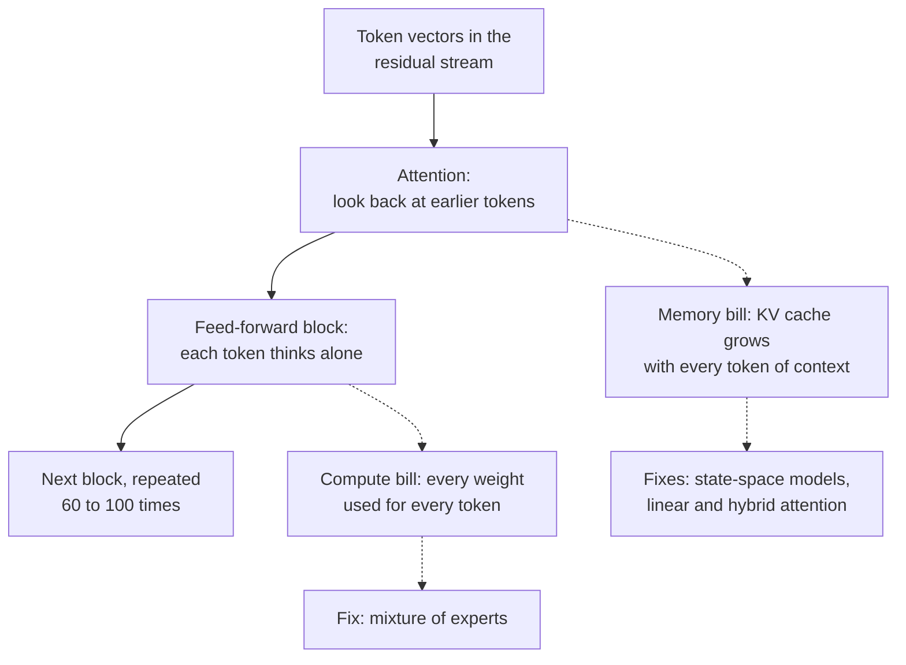
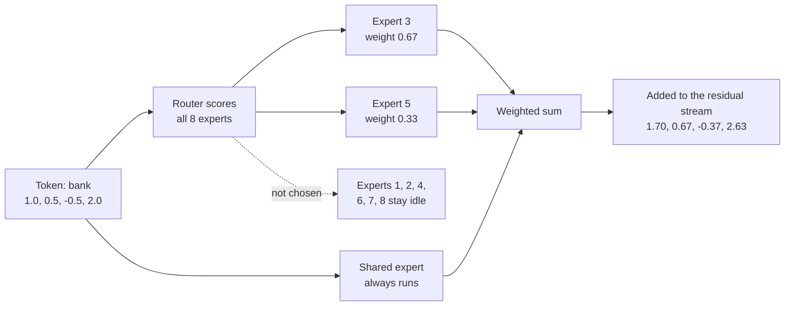
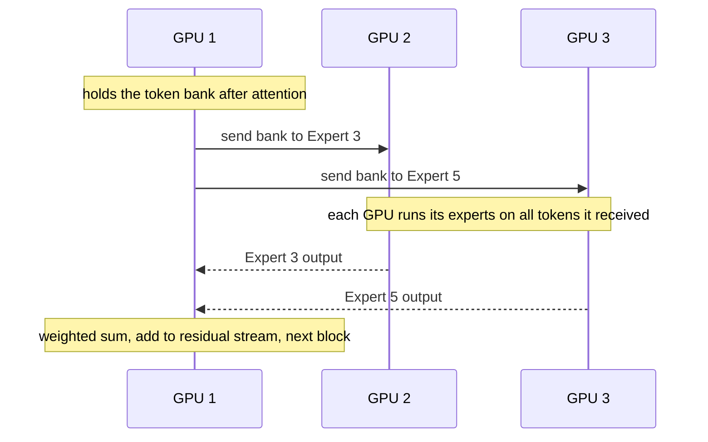

# Chapter 17: Beyond the Transformer: Mixture of Experts, State Space Models and New Architectures

*This chapter shows you what is inside 2026's frontier models: how a 1.6-trillion-parameter model uses only 49 billion parameters per word, how new layers remember a million tokens without a growing memory, and where the top labs agree and disagree about design.*

## What you'll learn
- The two "bills" every Transformer pays, compute per token and memory per token of context, and which new designs attack each.
- Mixture of experts in depth, with one token routed by hand: routers, top-k, gating weights, total versus active parameters, shared and fine-grained experts.
- Why load balancing is hard, how experts are spread across GPUs, and why nearly every open frontier model is now an MoE.
- How graph neural networks pass messages between connected things.
- How state-space models and linear attention (S4, Mamba, Mamba-3, RWKV, DeltaNet) keep a fixed-size memory, and what they lose.
- Hybrid architectures such as Qwen3.5, Kimi K3 and Nemotron 3, and the lab that went back to full attention.
- The "plumbing" that keeps trillion-parameter training stable (mHC, QK-norm, gated attention, DyT), plus recursion and memory research, the 2026 convergence and open questions.

## Before you start
You need Chapter 15 (The Transformer, Piece by Piece), especially attention, the feed-forward block, the residual stream and the KV cache. Chapter 13 (Training Deep Networks) introduced residual connections, normalization and the Muon optimizer, and Chapter 14 introduced RNNs and their hidden state. Chapter 5 gives the dot products, softmax-ready scores and the "2 × N operations per token" rule used here. Chapter 16 is helpful but not required.

## Two bills every Transformer pays

Every time your chatbot writes one token, each Transformer block does two things (Chapter 15). In attention, the new token looks back at all earlier tokens. In the feed-forward block, the token "thinks" alone through a large two-layer network. The residual stream carries the result to the next block, and the pattern repeats 60 to 100 or more times.

> **Definition — Feed-forward block (FFN):** The per-token neural network inside each Transformer block, usually two or three big matrices with an activation between them. In dense models it holds about two-thirds of the parameters.

> **Definition — Dense model:** A model that uses all of its weights for every token. A 70-billion-parameter dense model does about 70 billion multiply-adds for each token it reads or writes.

That design sends two bills.

**The compute bill.** In a dense model every weight is used for every token, so the work per token is about 2 × N operations, where N is the parameter count (Chapter 5). A dense 1.6-trillion-parameter model would need about 3.2 trillion operations per token. Make the model bigger to make it smarter, and every token gets proportionally more expensive.

**The memory bill.** Attention stores a key and a value for every earlier token in every layer, the KV cache (Chapter 15). It grows with every token in the conversation. When you paste a 300-page PDF into Claude, the cache for that one conversation can run to many gigabytes, and comparing each new token against all earlier ones means total attention work grows with the square of the length.

> **Definition — KV cache:** The stored keys and values for every earlier token in every attention layer, kept so the model does not recompute them. It grows with each token in the conversation.

> **Definition — Quadratic cost:** Cost that grows with the square of the input length. Doubling the text length roughly quadruples the total work of full attention, because every token is compared with every other.


*Figure 17.1: The two pressure points of a Transformer block and the families of fixes this chapter covers.*

> **Key idea:** Most architecture news of 2024–2026 attacks one of two costs: compute per token (answered by mixture of experts) or memory per token of context (answered by state-space models, linear attention and hybrids). Keep that map in mind and the jargon falls into place.

## Mixture of experts: a huge model that uses a sliver at a time

### The idea

Here is the trick in one sentence: replace the single feed-forward block with many smaller ones, called experts, and add a tiny router that sends each token to only a few of them.

The idea is older than you might think. Robert Jacobs, Michael Jordan, Steven Nowlan and Geoffrey Hinton proposed "adaptive mixtures of local experts" in 1991. Noam Shazeer and colleagues at Google made it work at scale in 2017 with the "sparsely-gated mixture-of-experts layer." Google's Switch Transformer (2021) sent each token to just one expert. Mistral's Mixtral 8x7B (December 2023) brought the design to a popular open model: 8 experts per layer, 2 used per token, about 47 billion parameters in total but only about 13 billion active for each token.

> **Definition — Mixture of experts (MoE):** A layer containing many expert sub-networks plus a router that activates only a few of them for each token, giving the model huge total capacity at modest compute per token.

> **Definition — Expert:** One of the sub-networks inside an MoE layer, usually a feed-forward block of its own. Experts specialize in statistical token patterns, not in neat human subjects.

> **Definition — Router (gating network):** The small network in an MoE layer that scores every expert for the current token and picks which ones will process it.

> **Definition — Conditional computation (sparse activation):** Running only part of a network for each input, chosen by the input itself. MoE is the main example: most experts sit idle for any given token.

> **Analogy:** An MoE layer is a hospital with a triage desk. The receptionist (router) sends each patient (token) to two relevant specialists instead of making every doctor see everyone. The hospital can employ hundreds of doctors while each patient's visit stays short.

### Worked example: routing one token

Take the sentence "She sat on the river bank and watched the boats." Follow the token "bank" as it reaches the MoE layer in, say, block 20. Real token vectors have thousands of numbers; ours has four: `[1.0, 0.5, −0.5, 2.0]`. The layer has 8 experts and uses top-2 routing.

> **Definition — Top-k routing:** The rule that each token is sent to the k experts with the highest router scores (top-1, top-2, top-8 and so on). The rest are skipped for that token.

**Step 1: score every expert.** The router holds one small vector per expert and takes a dot product (Chapter 5) with the token. For Expert 3 the router vector is `[0.5, 1.0, 0.0, 0.8]`:

`1.0 × 0.5 + 0.5 × 1.0 + (−0.5) × 0.0 + 2.0 × 0.8 = 0.5 + 0.5 + 0 + 1.6 = 2.6`

Doing the same for all eight gives these scores: E1 0.2, E2 −1.0, E3 2.6, E4 0.9, E5 1.9, E6 −0.3, E7 0.4, E8 1.1.

**Step 2: turn scores into percentages.** Softmax (Chapter 6) raises e to each score and divides by the total. e^2.6 ≈ 13.46, e^1.9 ≈ 6.69, and so on; the eight values add up to about 29.44. So Expert 3 gets 13.46 ÷ 29.44 ≈ 45.7%.

```
  Router probabilities for the token "bank" (8 experts, top-2)

  Expert 3  ######################  45.7%  <- chosen
  Expert 5  ###########             22.7%  <- chosen
  Expert 8  #####                   10.2%
  Expert 4  ####                     8.4%
  Expert 7  ##                       5.1%
  Expert 1  ##                       4.1%
  Expert 6  #                        2.5%
  Expert 2  #                        1.2%
```
*Figure 17.2: The router's softmax over eight experts for one token. Only the top two will run.*

**Step 3: pick the top 2 and renormalize.** Experts 3 and 5 win, with 45.7% and 22.7%. Rescale those two so they add to 1: 45.7 ÷ 68.4 ≈ 0.67 and 22.7 ÷ 68.4 ≈ 0.33. These are the gating weights.

> **Definition — Gating weight:** The share each chosen expert gets in the final mix for a token, computed from the router's scores. With top-2 routing the two gating weights add up to 1.

**Step 4: run only the chosen experts.** Each expert is its own small feed-forward network. Suppose Expert 3 outputs `[0.8, −0.2, 0.4, 1.0]` and Expert 5 outputs `[0.2, 0.6, −0.4, 0.5]`. The other six experts do nothing at all for this token.

**Step 5: blend.** `0.67 × Expert 3 + 0.33 × Expert 5`, number by number:
- first: 0.67 × 0.8 + 0.33 × 0.2 ≈ 0.60
- second: 0.67 × (−0.2) + 0.33 × 0.6 ≈ 0.07
- third: 0.67 × 0.4 + 0.33 × (−0.4) ≈ 0.13
- fourth: 0.67 × 1.0 + 0.33 × 0.5 ≈ 0.83

**Step 6: add a shared expert.** Many modern MoEs also have a shared expert that every token visits. Say it outputs `[0.1, 0.1, 0.0, −0.2]`. The layer's output becomes `[0.70, 0.17, 0.13, 0.63]`.

**Step 7: add back to the residual stream.** As in every Transformer block, the result is added to the token's running vector: `[1.0 + 0.70, 0.5 + 0.17, −0.5 + 0.13, 2.0 + 0.63] = [1.70, 0.67, −0.37, 2.63]`. The token moves on to the next block, which has its own router and its own experts.


*Figure 17.3: One token's trip through an MoE layer, with the numbers from the worked example.*

What did we save? Six of eight routed experts were skipped, so this layer's routed compute was a quarter of what running all eight would cost. The next token, "and," might go to Experts 1 and 8. With 8 experts and top-2 there are 28 possible pairs per layer; with 60 layers, each token takes its own path through an enormous number of combinations.

> **Watch out:** "Mixture of experts means a math expert, a history expert and a cooking expert." When researchers inspect trained routers, experts specialize in statistical token patterns (punctuation, certain grammar, code syntax, a particular language), not school subjects. Nobody designs the specialties; they emerge from training.

### Total versus active parameters

Because only a few experts run per token, an MoE model has two sizes. Total parameters is everything stored. Active parameters is what one token actually uses: attention, any shared experts, the router and the chosen routed experts. Compute per token follows the active count. Memory follows the total.

> **Definition — Total parameters:** Every learned number stored in a model, including all experts. It decides how much memory the model needs.

> **Definition — Active parameters:** The parameters actually used to process one token in an MoE model. It decides compute per token, and so speed and cost. "A17B" in a model name means about 17 billion active.

| Model (release) | Total | Active | Active share | Experts per MoE layer |
|---|---|---|---|---|
| Mixtral 8x7B (Dec 2023) | ~47B | ~13B | ~28% | 8, top-2 |
| DeepSeek-V3 (Dec 2024) | 671B | 37B | ~5.5% | 256 routed + 1 shared, 8 routed active |
| Llama 4 Maverick (Apr 2025) | 400B | 17B | ~4.3% | 128 routed + 1 shared |
| gpt-oss-120b (Aug 2025) | 116.8B | 5.1B | ~4.4% | not covered here |
| Kimi K2 (Jul 2025) | 1T | 32B | ~3.2% | not covered here |
| Qwen3.5 flagship (Feb 2026) | 397B | 17B | ~4.3% | not covered here |
| DeepSeek V4-Flash (2026) | 284B | 13B | ~4.6% | not covered here |
| DeepSeek V4-Pro (2026) | 1.6T | 49B | ~3.1% | not covered here |
| Qwen3.8 open flagship (Aug 2026) | 2.4T | 95B | ~4.0% | not covered here |
| Kimi K3 (Jul 2026) | 2.8T | 104B | ~3.7% | 896, 16 active + 2 shared |

*Table 17.1: Total and active parameters of well-known MoE models. Recent frontier MoEs activate roughly 3–5% of their weights per token.*

Work through DeepSeek V4-Pro, the largest open model from DeepSeek as of late 2026.
- **Compute per token:** 2 × 49 billion ≈ 98 billion operations. A dense 1.6T model would need 2 × 1.6 trillion = 3.2 trillion, about 33 times more.
- **Training compute:** with the 6 × N × D rule (Chapter 19), using active parameters for N and about 33 trillion training tokens for D: 6 × 49e9 × 33e12 ≈ 9.7 × 10^24 operations, matching Epoch AI's estimate. A dense 1.6T model trained on the same data would need about 3.2 × 10^26, again about 33 times more.
- **Memory:** all 1.6 trillion parameters must sit in fast memory. DeepSeek stores the expert weights in a 4-bit format (FP4) and most other weights in 8-bit (FP8). At half a byte per parameter, 1.6T is about 0.8 TB; at one byte, 1.6 TB. Either way, that is a multi-GPU server, not a laptop.

Precision matters for MoE because the expert weights are most of the memory. OpenAI's open gpt-oss-120b stores its MoE weights in MXFP4, about 4.25 bits per number, which is how a 116.8-billion-parameter model fits on a single 80 GB GPU: 116.8 billion × 4.25 bits ÷ 8 ≈ 62 GB (Chapter 23 covers quantization).

> **Definition — MXFP4 and NVFP4:** Four-bit number formats in which small blocks of numbers share a scale factor, so weights take about half a byte each. They are used to store and increasingly to train large MoE models.

> **Watch out:** "A one-trillion-parameter MoE uses a trillion parameters for every word." Only the active parameters compute each token (32 billion for Kimi K2, 49 billion for DeepSeek V4-Pro), though all of them must be stored. When comparing models, ask for both numbers.

### Shared experts and fine-grained experts

Two refinements, popularized by DeepSeek's DeepSeekMoE work in 2024, define modern MoE design.

**Shared experts.** Some knowledge is needed by nearly every token: grammar, common words, basic formatting. If every routed expert has to relearn it, capacity is wasted. A shared expert that every token visits holds the common knowledge, and the routed experts are free to specialize. Llama 4 Maverick has one shared expert beside 128 routed ones; Kimi K3 has two shared beside 896 routed.

> **Definition — Shared expert:** An expert in an MoE layer that processes every token, holding broadly useful knowledge so the routed experts can specialize.

**Fine-grained experts.** Instead of 8 big experts with top-2, use 64 experts each one-eighth the size with top-16. The compute per token is the same (16 small experts equal 2 big ones), but the number of possible combinations explodes: 28 pairs from 8, against about 4.9 × 10^14 ways to choose 16 from 64. More combinations let each token get a more precisely tailored mix. Frontier models have pushed this far: Kimi K3's 896 experts with 16 active means each token visits under 2% of the routed experts in a layer.

> **Definition — Fine-grained experts:** Splitting an MoE layer into many small experts and activating more of them per token, keeping compute the same while allowing far more combinations.

### Load balancing: keeping every expert busy

Routers have a rich-get-richer problem. Early in training, a few experts happen to score slightly higher. They get more tokens, so they learn faster, so they score even higher. Left alone, a handful of experts do all the work and the rest wither. This is routing collapse, and it wastes most of the model.

> **Definition — Routing collapse (expert collapse):** An MoE failure where the router sends most tokens to a few experts, which keep improving while the rest go unused.

> **Definition — Load balancing:** Techniques that keep tokens spread evenly across experts, so every expert learns and no GPU becomes a bottleneck.

There is a hardware problem too. Experts live on different chips (next section). If one expert receives far more tokens than average, its chip becomes the slowest worker, and everyone waits for it. Systems therefore set an expert capacity: the most tokens an expert will accept per batch, usually the fair share times a capacity factor such as 1.25. Tokens beyond capacity are dropped from that expert and simply pass through on the residual stream, unprocessed by that layer.

> **Definition — Expert capacity (capacity factor):** The maximum number of tokens an expert accepts per batch, set as the fair share times a factor such as 1.25. It keeps any one chip from being overloaded.

> **Definition — Token dropping:** What happens when an expert is over capacity: extra tokens skip that expert and carry on through the residual connection without its contribution.

A worked example: 16 tokens with top-2 routing make 32 expert slots. Spread evenly over 8 experts, that is 4 each; with a capacity factor of 1.25, each expert accepts at most 5.

```
  32 expert slots (16 tokens x top-2), 8 experts, capacity 5 each

  E1  ##              2
  E2  #               1
  E3  ###########    11   <- 6 over capacity, dropped
  E4  ###             3
  E5  #########       9   <- 4 over capacity, dropped
  E6  #               1
  E7  ##              2
  E8  ###             3
                     --
                     32   (fair share: 4 each)
```
*Figure 17.4: An unbalanced router. Ten of 32 slots are dropped, and five experts are underused.*

Three fixes are common:
1. **Auxiliary loss.** Add a penalty to the training loss that grows when some experts receive a bigger share of tokens and router probability than others. The Switch Transformer used this. It works, but the extra loss term pulls slightly against the main goal of predicting text.
2. **Auxiliary-loss-free balancing.** DeepSeek-V3 added a small bias to each expert's score that is used only for choosing experts, not for the gating weights. After each training step, overloaded experts get their bias lowered and underused ones get it raised. Example: a token scores E3 2.0, E5 1.3, E8 1.1. E3 is overloaded (bias −0.5) and E8 is underused (bias +0.5), so the selection scores become 1.5, 1.3 and 1.6, and the token goes to E8 and E3 instead of E3 and E5. The mixing still uses the original scores, giving E3 about 0.71 and E8 about 0.29.
3. **Routing limits.** Cap how many machines a single token's experts can be spread across, which caps communication.

> **Definition — Auxiliary loss (load-balancing loss):** An extra penalty added to the training loss that discourages the router from overusing some experts.

> **Definition — Auxiliary-loss-free balancing:** DeepSeek's method of balancing experts by nudging a per-expert bias used only for selection, raising it for underused experts and lowering it for overloaded ones, without adding a term to the loss.

### MoE on real hardware: expert parallelism

A 1.6-trillion-parameter model doesn't fit on one chip, so its experts are spread across many GPUs. This is expert parallelism. Each MoE layer then needs two rounds of communication: send each token's vector to the GPUs holding its chosen experts, and send the results back. Because every GPU may need to send something to every other GPU, this pattern is called all-to-all.

> **Definition — Expert parallelism:** Placing different experts on different chips and shipping each token to the chips that hold its chosen experts.

> **Definition — All-to-all communication:** A data exchange where every chip sends a different piece of data to every other chip. MoE layers do it twice: once to dispatch tokens to experts and once to bring results back.


*Figure 17.5: Expert parallelism. Experts 1–4 live on GPU 2 and Experts 5–8 on GPU 3; tokens travel to their experts and back in every MoE layer.*

This is why giant MoE models favor hardware with very fast chip-to-chip links, such as NVIDIA's 72-GPU NVL72 racks (Chapter 34), and why the "all-to-all" step is a favorite target for performance engineers (Chapter 37). It also explains a serving trade-off. In a data center that batches thousands of users, every expert stays busy and MoE is very cheap per token. On your own computer with one user, you still have to hold every expert in memory while using only a few, so a local MoE is limited by memory, not compute (Chapter 30).

### Why MoE won the frontier, and what it costs

By 2026 nearly every large open-weight model is an MoE: DeepSeek V4, Kimi K3, Qwen3.5 and Qwen3.8, Llama 4, Mistral Large 3 (675 billion total, 41 billion active), gpt-oss and NVIDIA's Nemotron 3. Google's Gemini 1.5 technical report (2024) described that model as a sparse MoE Transformer. OpenAI and Anthropic do not publish their flagship architectures, so their exact designs are not public.

Why the shift?
- **Capacity without compute.** Knowledge seems to scale with total parameters, while cost per token scales with active parameters. MoE decouples the two.
- **Better results per training dollar.** At a fixed training budget, well-tuned MoE models reach lower loss than dense models of the same active size.
- **Cheaper serving at scale.** A provider serving millions of chats pays for active compute per token; the memory is shared across all those users.

The costs are real:
- **Memory:** all experts must be stored, which raises hardware needs and rules out small devices.
- **Communication:** all-to-all traffic every MoE layer needs fast networks.
- **Training difficulty:** routers can collapse or become unstable, and balancing adds engineering.
- **Complexity for everyone downstream:** fine-tuning, quantizing and serving MoE models is harder than for dense ones.

So dense models still make sense at small sizes and on devices. Google's Gemma 4 family (April 2026), for example, includes both a 31-billion-parameter dense model and a 26B-A4B MoE.

> **At the frontier (2026):** The largest open models are trillion-scale MoEs with hundreds of fine-grained experts and roughly 3–5% of weights active per token. Kimi K3 (July 2026) has 2.8 trillion total and 104 billion active parameters, with 896 experts of which 16 routed plus 2 shared run per token. DeepSeek V4-Pro has 1.6 trillion total and 49 billion active, with 4-bit expert weights and a 1-million-token context, released under the permissive MIT license. NVIDIA's Nemotron 3 Super (March 2026) uses a variant it calls LatentMoE. The frontier question is no longer whether to use MoE but how fine-grained, how sparse and how to serve it.
