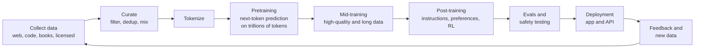
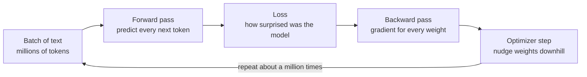
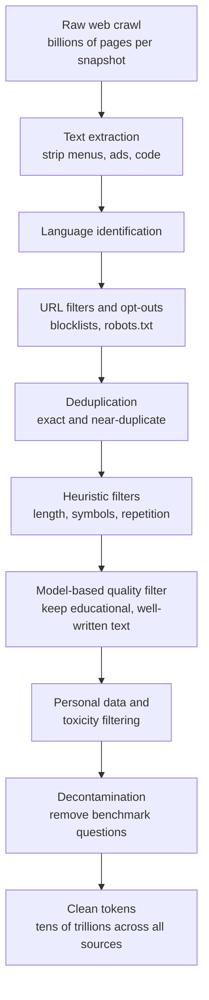
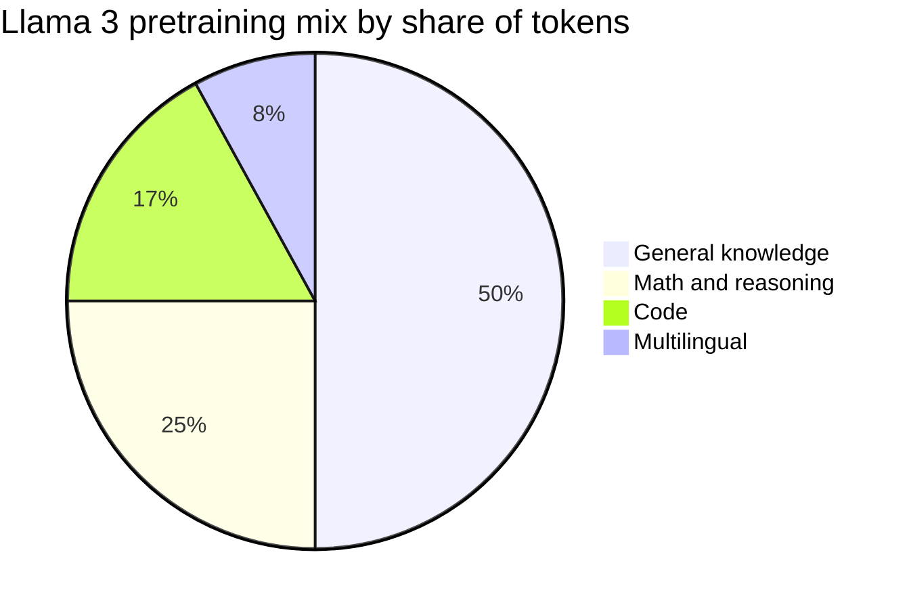
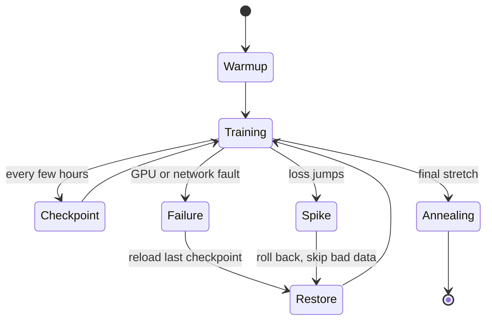
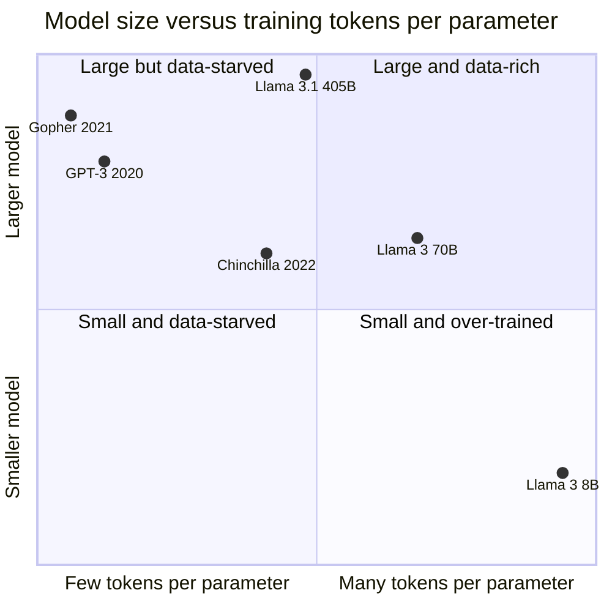
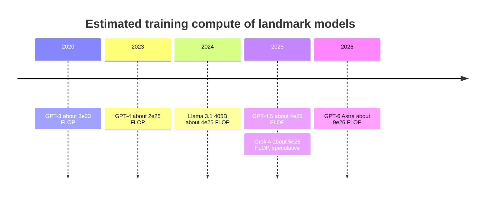

# Chapter 19: Pretraining: Data, Scale and Scaling Laws

*This chapter shows you how a frontier lab turns tens of trillions of words into a base model, why making models bigger works so predictably, and how to estimate in dollars what a training run costs.*

## What you'll learn

- Where pretraining fits in the life of a model, and how one training step teaches it.
- Where tens of trillions of training tokens come from, and how raw web pages are filtered down to clean data.
- How labs choose a data mixture and run a months-long training job on thousands to more than 100,000 chips.
- What a base model is like before it becomes an assistant.
- Scaling laws, the Chinchilla rule of about 20 tokens per parameter, and why labs now deliberately "over-train" small models.
- The 6 × N × D rule, worked all the way to a dollar cost, plus the real cost estimates for famous models.
- Both sides of the emergent-abilities debate and the data-wall debate, and what mid-training adds.

## Before you start

Chapter 18 (How a Large Language Model Works) explained tokens, next-token prediction and parameters, and you should read it first. Chapter 11 (Data: The Fuel of AI) covered where data comes from and the legal fights over it. Chapter 5 introduced the 2 × N and 6 × N × D rules of thumb, and Chapter 6 explained loss, cross-entropy and gradient descent. Chapter 13 covered optimizers and learning-rate schedules. Chapter 37 goes much deeper into the hardware side of training. Every term is defined again here, so you can follow along even if you skipped some of those.

## The big picture: where pretraining fits

Every chatbot you use went through a long assembly line. Pretraining is the first big station, and by far the most data-hungry: the model reads a large slice of everything humans have written that its makers could collect, and learns to predict it.

> **Definition — Pretraining:** The first and largest training stage of a language model, in which it learns to predict the next token across trillions of tokens of general text. The result is a base model.

> **Definition — Training run:** One large training job, from the first random weights to the final saved model, often lasting weeks or months on thousands of chips.

> **Definition — Corpus:** A large collection of text used for training. The plural is corpora.


*Figure 19.1: The life of a model. This chapter covers the first five boxes; Chapters 20 and 21 cover post-training and reasoning.*

> **Analogy:** Pretraining is like having someone read every book in a giant library, cover to cover, trying to guess each next word before turning the page. Post-training (Chapter 20) is the apprenticeship that follows, where they learn to be a useful assistant.

Historically pretraining used most of a model's training compute. That is changing: since 2024, labs have poured more and more compute into reinforcement learning after pretraining (Chapter 21). But pretraining still sets what the model knows and how capable it can become.

## How pretraining teaches: one step of learning

### Every token is a free lesson

The beauty of pretraining is that it needs no human labels. Take any sentence from the web: "The Eiffel Tower is in Paris." Hide the last word and ask the model to predict it; the answer is right there in the text. Every position in every document is a little quiz with a known answer. A corpus of 15 trillion tokens contains 15 trillion quizzes, and nobody had to write any of them.

> **Definition — Self-supervised learning:** Learning from data that supplies its own answers, such as predicting a hidden next word from the words before it, so no human labeling is needed.

### Measuring surprise: the loss

For each quiz, the model outputs a probability for every possible next token (Chapter 18). If the true next token was " Paris" and the model gave it probability 0.9, that is good. If it gave 0.01, that is bad. Training needs a single number that captures how bad, and the standard choice is the **cross-entropy loss**: the negative natural logarithm of the probability the model gave to the token that actually came next.

> **Definition — Loss:** A single number measuring how wrong a model's predictions are on some data. Training tries to make it smaller.

> **Definition — Cross-entropy loss:** The standard loss for next-token prediction: minus the natural logarithm of the probability the model assigned to the correct next token, averaged over all tokens. It is near 0 when the model was confident and right, and large when it was confident and wrong.

**Worked example.** Recall the coffee example from Chapter 18, where the model gave " coffee" 64.4% and " juice" 3.2%.

- If the real text continued with " coffee": loss = −ln(0.644) = 0.44. Mild surprise.
- If it continued with " juice": loss = −ln(0.032) = 3.44. Big surprise.
- If the model had been certain and right (probability 1): loss = −ln(1) = 0. No surprise.

Average this over millions of tokens and you get the number on every training dashboard. A related number is **perplexity**, e raised to the loss. A loss of 0.44 means a perplexity of about 1.55 (e^0.44, where e is Euler's number from Chapter 6; a spreadsheet computes it with =EXP(0.44)): on average the model is as uncertain as if it were choosing between about one and a half equally likely options. A loss of about 1.94 means a perplexity of about 7. Lower is better.

> **Definition — Perplexity:** e raised to the power of the average cross-entropy loss. It can be read as "the model is as uncertain as if choosing among this many equally likely tokens." Lower is better.

### Nudging billions of knobs

Once the loss is known, an algorithm called **backpropagation** works out, for every one of the model's billions of weights, which direction of nudge would have lowered it. An **optimizer** then nudges every weight a tiny step in that direction. The size of the step is set by the **learning rate**. This is gradient descent (Chapter 6): walking downhill in fog, one small step at a time.

> **Definition — Gradient descent:** The basic training method: compute which direction each weight should move to reduce the loss (the gradient), then move every weight a small step that way, and repeat.

> **Definition — Learning rate:** How large each weight update is during training. Too large and training becomes unstable; too small and it crawls.

> **Definition — Batch and step:** A batch is the group of training examples processed together before one update. A step is one such update. Large pretraining runs use batches of millions of tokens per step.


*Figure 19.2: One training step. Pretraining is this loop repeated for weeks or months.*

How many times? Suppose a run uses 15 trillion tokens with a batch of 8 million tokens per step. That is 15,000,000,000,000 ÷ 8,000,000 ≈ 1.9 million steps. Each one nudges every weight a little.

> **Key idea:** Pretraining is one simple loop repeated about a million times: predict every next token in a batch, measure the surprise, nudge every weight to be a bit less surprised. All the knowledge a base model has comes from this.

## Where the data comes from

### The sources

A frontier pretraining corpus is a blend of many kinds of text:

- **The public web.** The biggest source by far. Most labs start from **Common Crawl**, a nonprofit that has archived the web since 2008. Its August 2026 crawl alone captured 2.14 billion web pages, 360 TiB (about 400 terabytes) of uncompressed data, gathered over two weeks. Labs also run their own crawlers.
- **Code.** Public repositories, mostly from GitHub. Code teaches precise, logical structure, and many researchers believe it helps with step-by-step reasoning in general, not just programming.
- **Books and academic papers.** Long, carefully edited text. Also the most legally contested (Chapter 11).
- **Math.** Textbooks, worked solutions, competition problems and proofs.
- **Many languages.** Alibaba said its Qwen3 models were pretrained on about 36 trillion tokens across 119 languages.
- **Licensed data.** Labs pay publishers and platforms for access, such as the Reddit–Google deal (about $60 million per year, as reported in 2024) or Meta's March 2026 deal with News Corp, the publisher of The Wall Street Journal (up to $50 million per year for three years).
- **Transcribed and extracted text.** Speech from video transcribed to text, and text pulled out of PDFs. Qwen3 used a vision model to extract text from PDFs, for example.
- **Synthetic data.** Text written by other AI models, then filtered. Qwen3 used Alibaba's earlier Qwen2.5 math and code models to generate synthetic textbooks and question-answer pairs.

> **Definition — Common Crawl:** A nonprofit that regularly crawls the public web and publishes the archive for free. It is the raw material for most pretraining datasets.

> **Definition — Web crawler:** A program that automatically visits web pages, saves them and follows their links to find more pages.

> **Definition — Synthetic data:** Training data generated by AI models (often then checked or filtered) rather than written by people.

> **Definition — TiB (tebibyte):** A unit of data equal to 2^40 bytes, about 1.1 trillion bytes. Software often counts in these powers of 2, while disk makers use the round decimal terabyte (TB, exactly one trillion bytes), so 1 TiB is about 1.1 TB.

### How much?

| Model or dataset | Pretraining tokens | Source of the figure |
|---|---|---|
| GPT-3 (2020) | about 300 billion | OpenAI's paper |
| Llama 3 (2024) | about 15.6 trillion | Meta's paper |
| Llama 4 (2025) | more than 30 trillion | Meta |
| Qwen3 (2025) | about 36 trillion, 119 languages | Alibaba |
| DeepSeek-V4-Pro (2026) | about 33 trillion | Epoch AI's notes on DeepSeek's report |
| FineWeb, open dataset (2024) | about 15 trillion, from 96 Common Crawl snapshots | Hugging Face |

How big is 15 trillion tokens? At about 0.75 words per token, it is roughly 11 trillion words. A fast reader managing 250 words a minute, 8 hours a day, gets through 120,000 words a day. Reading 11.25 trillion words would take 11,250,000,000,000 ÷ 120,000 ≈ 94 million days, or about 257,000 years. Yet stored as plain text at about 4 bytes per token, it is only about 60 terabytes, which fits on a handful of large hard drives. Text is tiny; reading it is what takes the compute.

> **Try it:** Pick a few large websites you know and open their robots.txt files, for example nytimes.com/robots.txt or reddit.com/robots.txt. Search the page for the names of AI crawlers such as GPTBot (OpenAI), ClaudeBot (Anthropic), CCBot (Common Crawl) and Google-Extended (Google's AI-training opt-out). You are reading the web's "please don't" signs.

### Asking permission: opt-outs and the 2025–26 shift

The web's traditional way of saying "please don't crawl this" is a file called **robots.txt**. It is a polite sign, not a lock: well-behaved crawlers obey it, others can ignore it. Since 2025 the web has moved toward blocking AI crawlers by default and charging for access. Cloudflare, which sits in front of a large share of websites, began blocking known AI crawlers by default for new domains on July 1, 2025 and launched "Pay Per Crawl". In September 2025 a group backed by Reddit, Yahoo, Medium and others launched RSL (Really Simple Licensing), a machine-readable way for sites to state AI licensing terms.

> **Definition — robots.txt:** A text file at the root of a website that tells automated crawlers which pages they may visit. Compliance is voluntary.

Law is also moving. Since August 2, 2025, the EU AI Act (the European Union's main AI law, covered in Chapter 59) has required providers of general-purpose AI models to publish a summary of their training content using an official template. And courts are deciding what training on copyrighted text is allowed: in the largest case so far, Anthropic's $1.5 billion settlement with authors over books downloaded from pirate libraries received final approval in July 2026. Chapter 11 covers the data side of these fights and Chapters 58 and 59 cover the law.

## Cleaning the firehose: the curation pipeline

### Most of the web is not worth reading

Raw web pages are mostly not prose. They are menus, cookie banners, ads, product listings, login pages, spam, machine-generated junk, near-copies of other pages, and text in every language. Train on that unfiltered and you get a model that writes cookie banners. So every lab runs a **curation pipeline**, a series of filters, and most of the raw crawl is thrown away.

> **Definition — Data curation:** Cleaning, filtering, deduplicating and balancing raw data before training, so that the model learns from useful, varied, legal text.


*Figure 19.3: The curation funnel. Each stage throws away more of the raw crawl.*

Here is what each stage does.

**1. Text extraction.** A web page's file is mostly layout code. Extraction tools pull out the main body text and drop the navigation bars, footers and scripts.

> **Definition — Text extraction (boilerplate removal):** Pulling the main readable text out of a web page and discarding repeated page furniture such as menus, footers, ads and code.

**2. Language identification.** A small, fast classifier labels each page's language, so it can be routed to the right part of the mixture or dropped.

> **Definition — Language identification:** Automatically detecting which human language a piece of text is written in, usually with a small, fast classifier.

**3. URL filtering and opt-outs.** Blocklists remove known adult, spam and malware sites, and pages whose owners opted out are skipped.

**4. Deduplication.** The web repeats itself enormously: the same news story syndicated to hundreds of sites, the same license text on millions of pages. Repeated text wastes compute and makes the model memorize those passages word for word. Exact duplicates are easy to catch. Near-duplicates, the same article with a different header, need a cleverer trick.

> **Definition — Deduplication:** Removing documents that are identical or nearly identical to others in the dataset, so the model does not waste compute on repeats or memorize them.

**Worked example: catching near-duplicates.** Break each document into overlapping runs of words, called shingles. Take two short documents, using three-word shingles:

- Document A: "the cat sat on the mat today" gives: "the cat sat", "cat sat on", "sat on the", "on the mat", "the mat today" (5 shingles).
- Document B: "the cat sat on the mat yesterday" gives the same first four, plus "the mat yesterday" (5 shingles).

They share 4 shingles, and together they have 6 different ones. Their **Jaccard similarity** is 4 ÷ 6 = 0.67. Real pipelines use longer documents and longer shingles, and mark a pair as duplicates above a chosen threshold (often around 0.8). Comparing every pair among billions of pages directly would take forever, so a technique called MinHash compresses each document's shingles into a short "fingerprint" that lets similar documents be found quickly.

> **Definition — Jaccard similarity:** A measure of overlap between two sets: the number of items they share divided by the number of distinct items in either. Identical sets score 1; sets with nothing in common score 0.

> **Definition — Near-duplicate detection (MinHash):** Finding documents that are mostly the same by comparing compact fingerprints of their overlapping word sequences, instead of comparing every pair of documents in full.

**5. Heuristic filters.** Simple rules written by people catch a lot of junk. Typical rules (examples of the kind used, not any one lab's exact list): drop pages with very few words; drop pages where most lines do not end in punctuation, which signals lists and menus; drop pages with too many symbols or too much repeated text; drop pages containing placeholder text such as "lorem ipsum" or "enable JavaScript to view this page".

> **Definition — Heuristic filter:** A hand-written rule that keeps or drops a document based on simple measurable properties, such as word count, share of symbols or amount of repetition.

**6. Model-based quality filtering.** This is the step that changed the field around 2024. Hugging Face's FineWeb-Edu project had a large language model grade a sample of web pages for educational value, trained a small, cheap classifier to imitate those grades, and then ran the classifier over the whole 15-trillion-token FineWeb dataset. Keeping only the highest-scoring pages left subsets of about 1.3 trillion and 5.4 trillion tokens. In Hugging Face's experiments, small models trained on the educational subset did better on knowledge and reasoning tests than models trained on the same number of tokens of unfiltered web text.

> **Definition — Quality classifier:** A model trained to score documents for usefulness (for example, educational value) so that a pipeline can keep the best ones. Often trained on grades produced by a larger model.

**7. Personal data and toxicity filtering.** Pipelines remove or mask personal information such as email addresses, phone numbers and identification numbers, and filter hateful or sexual content. These filters are imperfect in both directions: they miss some harmful content and wrongly remove some harmless text, especially in dialects and minority languages.

> **Definition — PII (Personally Identifiable Information):** Information that can identify a specific person, such as a name with an address, an email address, a phone number or an ID number.

**8. Decontamination.** If the questions from a famous test end up in the training data, the model can memorize the answers, and its score on that test no longer means anything. Pipelines search for long overlapping word sequences between the training data and known benchmarks, and remove matches.

> **Definition — Decontamination:** Removing benchmark test questions (and close copies of them) from training data, so that evaluation scores reflect real ability rather than memory.

> **Definition — Benchmark contamination:** When test questions leak into a model's training data, inflating its scores without a real gain in ability.

> **Key idea:** A pretraining dataset is built more by subtraction than by addition. Start with billions of pages, then remove junk, duplicates, low-quality text, personal data and test questions. What survives, and in what proportions, shapes the model as much as its size does.

> **Watch out:** "More data is always better" is wrong at this scale. A smaller, carefully filtered dataset often trains a better model than a larger, dirtier one, because every token costs compute. Curation is one of the most closely guarded parts of a lab's recipe, and one of the main reasons two models of the same size can differ so much.

## Choosing the recipe: data mixtures

After cleaning, a lab has piles of web text, code, math, books, multilingual text and synthetic data. It still has to decide how much of each the model should see. That recipe is the **data mixture**.

> **Definition — Data mixture:** The share of training tokens drawn from each source, such as web text, code, math, books, each language and synthetic data.

Meta published the final mixture for Llama 3: roughly half general-knowledge text, a quarter math and reasoning, 17% code and 8% multilingual text.


*Figure 19.4: The Llama 3 data mixture as reported in Meta's 2024 paper. Most frontier labs do not publish theirs.*

A mixture is not just proportional to what exists. Labs **upsample** scarce, valuable sources, showing high-quality text such as encyclopedias or textbooks several times, and **downsample** abundant, low-value ones.

> **Definition — Upsampling:** Deliberately showing some data more often than its natural share, sometimes repeating it several times, because it is especially valuable.

> **Definition — Epoch (training pass):** One complete pass through a dataset. Frontier pretraining sees most data about once, but may repeat the best sources several times.

How do labs pick percentages without wasting a frontier run? They train dozens of small **proxy models** on different mixtures, compare the results, and assume the winning recipe will also work at full scale. Each such controlled comparison, changing one thing at a time, is called an **ablation**.

> **Definition — Proxy model:** A small, cheap model trained to test a choice (such as a data mixture) before committing to it in an expensive full-size run.

> **Definition — Ablation:** An experiment that changes or removes one ingredient while keeping everything else fixed, to measure that ingredient's effect.

A mixture also does not have to stay the same from the first step to the last. Planning the order in which data is shown, or changing the recipe as training goes on, is called a **curriculum**, after the way a school teaches arithmetic before algebra. The curriculum choice that open technical reports (such as those for the OLMo 2 models from the Allen Institute for AI, a nonprofit research lab) document most clearly is simple: save the best data for the end. Near the finish, labs switch to a smaller, cleaner mix of math, code, reasoning traces and long documents, and at the same time lower the learning rate toward zero, a step called annealing. Because the model is settling into its final state during that stretch, what it reads then has an outsized effect on how it behaves. So a data recipe is really two decisions: how much of each source, and when.

> **Definition — Curriculum (training curriculum):** A plan for the order in which training data is shown, or for how the data mixture changes during training, such as holding the highest-quality data back for the final stretch of a run.

> **At the frontier (2026):** Mixtures have shifted steadily toward code, math, multilingual text and filtered synthetic data. Alibaba described generating synthetic textbooks and question-answer pairs with its own specialist models for Qwen3, and labs increasingly hold their best reasoning-style data for a final, high-quality stage called mid-training, covered at the end of this chapter.

## The pretraining run

### The machine

A frontier pretraining run uses thousands to more than 100,000 GPUs or TPUs working as one machine for weeks to months. Two public reference points:

- **Llama 3 405B (Meta, 2024):** 16,384 NVIDIA H100 GPUs, about 15.6 trillion tokens, with a carefully documented 54-day stretch of training.
- **GPT-6 Astra (OpenAI, September 2026):** described as OpenAI's largest training run "by far" and OpenAI's first pretraining run on more than 100,000 GPUs, at the Stargate site in Abilene, Texas. Epoch AI estimates about 9.4 × 10^26 FLOP (with a wide uncertainty range of roughly 5 × 10^26 to 2 × 10^27), assuming about 100,000 GB200 GPUs for about 90 days at 25% utilization in 8-bit precision.

> **Definition — NVIDIA:** An American chip company whose GPUs, first built for video-game graphics, became the main chips used to train and run AI models. It dominates sales of AI accelerators (Chapter 35).

> **Definition — GB200:** NVIDIA's Blackwell-generation "superchip": one NVIDIA Grace CPU and two Blackwell GPUs on one board, usually installed 72 GPUs to a rack (the GB200 NVL72). When estimates count "GB200 GPUs", they count the Blackwell GPUs, the generation after the H100.

> **Definition — GPU-hour:** One GPU running for one hour. Training jobs and cloud rental prices are measured in GPU-hours.

No single GPU can hold a frontier model and its training state, and no single GPU is fast enough anyway. So the work is split across chips in several ways at once: each group of GPUs processes different data (**data parallelism**), each big matrix is split across several GPUs (**tensor parallelism**), the layers are split into stages like an assembly line (**pipeline parallelism**), and in mixture-of-experts models different experts live on different GPUs (**expert parallelism**). Chapter 37 explains each with diagrams.

> **Definition — Parallelism (distributed training):** Splitting one training job across many chips: by data, by pieces of each matrix, by groups of layers or by experts. The chips must constantly exchange results.

### The settings

A few settings shape the whole run:

- **Batch size.** Frontier runs use batches of millions of tokens per step, and some grow the batch partway through training.
- **Learning-rate schedule.** The learning rate starts tiny, rises during a **warmup** period so early chaos does not wreck the model, stays high for most of training, and then decays toward zero at the end. Older runs used a smooth "cosine" decay; many newer ones hold steady and then decay quickly in a final stretch.
- **Optimizer.** Usually AdamW or a newer method such as Muon (Chapter 13).
- **Precision.** How many bits each number uses, covered below.

> **Definition — Learning-rate schedule:** The planned change of the learning rate over a training run, typically a short warmup, a long high phase and a final decay.

> **Definition — Warmup:** The opening phase of training in which the learning rate rises gradually from near zero, preventing huge, destabilizing updates while the weights are still random.

How do teams choose these numbers for a run they can afford only once? Mostly the way they choose data mixtures: by experimenting on small proxy models. The catch is that the best learning rate usually shifts as a model gets wider, so a value tuned on a small model can be badly wrong for a big one. A 2022 method from Microsoft and OpenAI researchers, μP ("maximal update parametrization"), rescales each layer's starting weights and learning rate according to its width so that the best settings stay put as the model grows. In their demonstration, settings tuned on a model of about 40 million parameters transferred to a 6.7-billion-parameter model of GPT-3's design and beat the original hand-tuned version. Other labs, DeepSeek among them, have published scaling laws for the hyperparameters themselves: formulas for how the best batch size and learning rate change as the compute budget grows.

> **Definition — Hyperparameter transfer:** Choosing training settings such as the learning rate on small, cheap models and reusing them, unchanged or adjusted by formula, for a much larger model.

> **Definition — μP (maximal update parametrization):** A 2022 recipe for scaling each layer's initial weights and learning rate with the model's width, so that the best hyperparameters found on a small model also work on a large one.

### Watching the loss

The engineers' main window into a run is the loss curve. It falls steeply at first, as the model learns spelling, grammar and common facts, and then keeps falling more and more slowly for the rest of the run.

```
loss
 4.0 |*
     | *
 3.5 |  *
     |   **
 3.0 |     **
     |       ***                   *   <- loss spike: roll back
 2.5 |          ****              * *     to the last checkpoint
     |              *****        *   *
 2.2 |                   ********     ****
     |                                    *******
 2.0 |                                           **********
     +------------------------------------------------------> steps
      warmup   fast early learning         slow late gains
```
*Figure 19.5: An illustrative pretraining loss curve, with one loss spike. Real curves are noisier.*

Sometimes the loss suddenly shoots upward: a **loss spike**. Causes include a batch of strange data, numbers overflowing in low precision, or the optimizer taking too big a step. Small spikes recover on their own. Big ones can ruin the run, so teams roll back to an earlier saved copy of the model, skip the offending data, sometimes lower the learning rate, and continue.

> **Definition — Loss spike:** A sudden jump in training loss during a run, which may recover or may require rolling back to an earlier checkpoint.

> **Definition — Checkpoint:** A saved snapshot of a model's weights and optimizer state during training, so the run can resume from that point after a failure.

### Things break, constantly

With tens of thousands of chips, something is always failing. Meta's Llama 3 paper is the best public record. In a 54-day window of training the 405B model, there were 466 job interruptions, 419 of them unexpected. That is one unexpected stop roughly every three hours (54 days × 24 hours = 1,296 hours; 1,296 ÷ 419 ≈ 3.1). About 78% were blamed on hardware, with faulty GPUs the largest category and the GPUs' high-bandwidth memory alone causing 17.2%. Even so, the team kept effective training time above 90%. Because thousands of GPUs speed up and slow down together, the whole cluster's power draw swung by tens of megawatts, a problem for the local grid (Chapter 39).


*Figure 19.6: The states of a real pretraining run. A big run cycles through failures and restores many times.*

> **Analogy:** Checkpointing is saving your video game before the boss fight. With 100,000 players in the same game, someone's console crashes every few hours, so you save often and reload quickly.

Two numbers describe how well a run uses its machine. **MFU** is the share of the chips' theoretical maximum math that actually goes into the model's training; Llama 3 405B reached 38–43%, and 35–50% is typical for large runs. **Goodput** is the share of total time that produced useful progress after failures and restarts.

> **Definition — MFU (Model FLOPs Utilization):** The fraction of the hardware's peak arithmetic speed actually used for the model's necessary math during training. Large runs typically reach about 35–50%.

> **Definition — Goodput:** The share of a cluster's total time that produces useful training progress, after subtracting time lost to failures, restarts and waiting.

### Fewer bits, more speed

Training math does not need every decimal place. BF16, a 16-bit format, became the standard for large models. **FP8** (8-bit) training followed on NVIDIA's Hopper chips (the H100 generation); DeepSeek-V3, trained on 2,048 H800 GPUs (a version of the H100 with slower chip-to-chip links, made for sale in China under US export rules), was a prominent public example in late 2024. In 2026, 4-bit formats have arrived: Moonshot's Kimi K3 ships MXFP4 weights, using quantization-aware training (training while simulating the 4-bit rounding, so the model learns to cope with it; Chapter 23) from the fine-tuning stage onward (its pretraining was not in 4-bit), and DeepSeek-V4-Pro stores its expert weights in FP4 with FP8 elsewhere. NVIDIA went furthest with its open Nemotron 3 Super (March 2026), pretrained on 25 trillion tokens in its 4-bit NVFP4 format. Each halving of bits roughly doubles the math a chip can do and halves memory traffic, if the training stays stable.

> **Definition — FP8 and FP4:** 8-bit and 4-bit number formats. Newer AI chips do math in them much faster than in 16-bit, at the cost of more rounding, which careful scaling tricks keep under control.

> **Definition — Mixed precision:** Doing most of the math in a low-precision format while keeping a few sensitive values, such as a master copy of the weights, in higher precision.

## What comes out: meet the base model

At the end of pretraining you have a **base model**: an extraordinarily well-read text continuer with no particular personality and no idea that it is supposed to help anyone. It does not answer; it continues. The examples below are typical behavior, not transcripts of a specific model.

- Prompt: "What is the capital of Japan?" A base model may continue: "What is the capital of China? What is the capital of South Korea?" It has seen many quiz pages and guesses this is one.
- Prompt: "Dear hiring manager," It writes a whole cover letter for an imaginary applicant, in whatever style seemed most likely.
- Prompt: "Q: What is the capital of France? A: Paris. Q: What is the capital of Japan? A:" Now it answers " Tokyo", because the document format makes an answer the most likely continuation.

> **Definition — Few-shot prompting:** Putting a few worked examples in the prompt so the model continues the pattern. It was the main way to use base models before chat models existed.

A base model also knows a great deal, including things it should not repeat. It has absorbed the web's facts, styles and skills along with its errors, biases and nastiness, in roughly the proportions the curated data contained. It may write a helpful paragraph or a toxic rant, depending on which document it thinks it is in. Post-training (Chapter 20) is what gives it a stable, helpful character.

> **Analogy:** A base model is a brilliant improv actor who will play whatever scene you set up. A chat model is the same actor after training as a dependable customer-service representative: equally talented, but now reliably on task.

> **Try it:** If you want to meet a base model, Exercise 8 at the end of this chapter has copy-paste code that asks the same question to a small open base model and its chat version, side by side.

## Scaling laws: the recipe for a bigger loaf

### Kaplan 2020: loss falls on a straight line

Why do companies spend billions on ever-larger training runs? Because of a discovery that made AI progress unusually predictable. In 2020, a team at OpenAI led by Jared Kaplan trained many language models of different sizes on different amounts of data and plotted the final loss. The loss fell as a smooth **power law** in model size, data and compute, with some trends holding across more than seven orders of magnitude (a factor of more than ten million).

> **Definition — Scaling law:** An empirical formula showing how a model's loss falls predictably as training compute, data and parameters grow.

> **Definition — Power law:** A relationship where one quantity changes as a fixed power of another, such as "every 10 times more compute cuts the remaining error by the same fraction." On a log-log plot it appears as a straight line.

> **Definition — Log-log plot:** A chart in which both axes use logarithmic scales, so each step along an axis multiplies the value by the same factor (for example 10). Power laws appear as straight lines on it.

> **Definition — Training compute:** The total number of arithmetic operations (FLOPs) used to train a model, the main measure of how much effort went into it.

The practical meaning was enormous. You could train a series of small, cheap models, draw the line through their results, and extend it to predict how well a model 100 or 1,000 times bigger would do, before spending the money. OpenAI's GPT-4 technical report (2023) said it predicted GPT-4's final loss from models trained with at most one ten-thousandth of the compute.

### Chinchilla 2022: feed the model more data

Kaplan's fits suggested that when you get more compute, you should spend most of it on a bigger model and only a little on more data. GPT-3 (2020) reflected that thinking: 175 billion parameters but only about 300 billion training tokens, under 2 tokens per parameter. DeepMind's Gopher (2021) went further: 280 billion parameters on 300 billion tokens.

In 2022, a DeepMind team led by Jordan Hoffmann retested the question more carefully, training over 400 models from 70 million to over 16 billion parameters on 5 to 500 billion tokens. Their answer: for a fixed compute budget, grow parameters and data **together**, at roughly **20 training tokens per parameter**. To prove it, they trained **Chinchilla**: 70 billion parameters on 1.4 trillion tokens, about the same compute as Gopher. Chinchilla, four times smaller, beat Gopher on most tests, and its small size made it cheaper to run.

> **Definition — Compute-optimal (Chinchilla-optimal):** The split between model size and training data that gives the lowest loss for a given compute budget. Chinchilla found it at roughly 20 tokens per parameter.

**Worked example: Chinchilla versus Gopher.** The Chinchilla paper fitted a formula for loss (in its own units, for its own data):

loss ≈ 1.69 + 406.4 ÷ N^0.34 + 410.7 ÷ D^0.28

where N is parameters and D is training tokens. N^0.34 means N raised to the power 0.34, which is close to a cube root (the power 1/3): it grows far more slowly than N, so making N 1,000 times bigger makes N^0.34 only about 10 times bigger. The 1.69 is the floor that no model can beat on that data (natural randomness in text). The second term shrinks as the model grows; the third as the data grows.

- **Gopher** (N = 280 billion, D = 300 billion): 406.4 ÷ (280 × 10^9)^0.34 ≈ 0.052, and 410.7 ÷ (300 × 10^9)^0.28 ≈ 0.251. Loss ≈ 1.69 + 0.052 + 0.251 = 1.993.
- **Chinchilla** (N = 70 billion, D = 1.4 trillion): model term ≈ 0.084, data term ≈ 0.163. Loss ≈ 1.69 + 0.084 + 0.163 = 1.937.

(The powers need a calculator: in a spreadsheet cell, type =406.4/280e9^0.34 to get Gopher's model term, where 280e9 means 280 × 10^9.) Gopher's data term, 0.251, gives it away: it was starved of data. Chinchilla balanced the two terms and ended up lower. A 2024 replication by Epoch AI found problems with this particular fitted formula, but its reanalysis still supported a compute-optimal ratio of roughly 20 tokens per parameter.

**Worked example: sizing a compute-optimal model.** Training compute is about 6 × N × D (explained in the next section). If D = 20 × N, then compute C = 6 × N × 20 × N = 120 × N² (N² means N × N). To get N back, divide both sides by 120, giving N² = C ÷ 120, then take the square root (√), which undoes squaring. So the optimal size is N = √(C ÷ 120), and D = 20 × N. For a budget of 10^24 FLOP: 10^24 ÷ 120 = 8.3 × 10^21, whose square root is about 9.1 × 10^10, so N ≈ 91 billion parameters and D ≈ 1.8 trillion tokens.

| Compute budget (FLOP) | Compute-optimal parameters | Compute-optimal tokens | Chinchilla-formula loss above the 1.69 floor |
|---|---|---|---|
| 10^22 | 9.1 billion | 183 billion | 0.46 |
| 10^23 | 29 billion | 577 billion | 0.32 |
| 10^24 | 91 billion | 1.8 trillion | 0.23 |
| 10^25 | 289 billion | 5.8 trillion | 0.16 |
| 10^26 | 913 billion | 18 trillion | 0.11 |
| 10^27 | 2.9 trillion | 58 trillion | 0.08 |

Look at the last column. Every 10 times more compute removes about 30% of the remaining reducible loss. Progress never stops, but each step costs ten times as much as the last. That is the power law in action.

```
reducible loss
(log scale)
 0.64 |o
 0.46 |        o
 0.32 |                o
 0.23 |                        o
 0.16 |                                o
 0.11 |                                        o
 0.08 |                                                o
      +-------+-------+-------+-------+-------+-------+---> compute
     1e21    1e22    1e23    1e24    1e25    1e26    1e27  (FLOP)
```
*Figure 19.7: The loss that more compute can still remove, for compute-optimal models, from the Chinchilla formula. On log-log axes the power law is a straight line. (1e24 is shorthand for 10^24.)*

> **Try it:** Ask a chatbot: "Using C = 6ND and the Chinchilla rule of 20 tokens per parameter, what model size and number of tokens are compute-optimal for 10^25 FLOP? Show each step." Check its answer against the table above (about 289 billion parameters and 5.8 trillion tokens). If it slips, ask it to redo the square root with a calculator tool.

> **Analogy:** Scaling laws are a baker's recipe chart that tells you how much flour and water a bigger loaf needs. Chinchilla's discovery was that earlier bakers had been using too little water (data) for the amount of flour (parameters).

> **Key idea:** Loss falls smoothly and predictably as a power law in compute, as long as model size and data grow together. That predictability is why labs can justify billion-dollar runs, and why each further improvement costs about ten times more than the last.

## The 6ND rule and what a training run costs

### Where the 6 comes from

Chapter 5 gave a rule of thumb: training compute ≈ 6 × N × D FLOPs, where N is the number of parameters and D the number of training tokens. The 6 comes from counting arithmetic. For each token, the forward pass does about one multiply and one add per parameter: 2 FLOPs. The backward pass, which works out the gradients, costs about twice the forward pass: 4 more. Total: 6 FLOPs per parameter per token. For mixture-of-experts models, use the **active** parameters, since only those do work for each token. The rule ignores some extra costs (such as attention over very long sequences), but it is close enough for planning.

> **Definition — 6ND rule:** A rule of thumb that training a Transformer takes about 6 × N × D floating-point operations, where N is the number of (active) parameters and D is the number of training tokens.

**Worked examples, checked against published figures:**

- **GPT-3:** 6 × 175 × 10^9 × 300 × 10^9 = 3.15 × 10^23 FLOP.
- **Llama 3.1 405B:** 6 × 405 × 10^9 × 15.6 × 10^12 ≈ 3.8 × 10^25 FLOP, matching Meta's own figure.
- **DeepSeek-V4-Pro** (mixture of experts, 49 billion active parameters): 6 × 49 × 10^9 × 33 × 10^12 ≈ 9.7 × 10^24 FLOP, matching Epoch AI's estimate. Despite having 1.6 trillion total parameters, it took about a quarter of Llama 3.1 405B's compute.

### From FLOPs to dollars

Now turn FLOPs into time and money. Let's price a realistic mid-size run: a **70-billion-parameter dense model trained on 15 trillion tokens** (the scale of Meta's Llama 3 70B) on NVIDIA H100 GPUs.

1. **Total compute.** 6 × 70 × 10^9 × 15 × 10^12 = 6.3 × 10^24 FLOP.
2. **What one GPU really delivers.** An H100's peak dense BF16 speed is about 989 trillion FLOP per second (989 × 10^12). Real training achieves only part of that; assume a good MFU of 40%. Effective speed: 989 × 10^12 × 0.40 ≈ 3.96 × 10^14 FLOP per second per GPU.
3. **GPU-seconds.** 6.3 × 10^24 ÷ 3.96 × 10^14 ≈ 1.59 × 10^10 GPU-seconds.
4. **GPU-hours.** Divide by 3,600: about 4.4 million GPU-hours.
5. **Wall-clock time.** On 8,192 GPUs: 4.4 million ÷ 8,192 ≈ 540 hours ≈ 22.5 days. On 4,096 GPUs, about 45 days.
6. **Cost.** At $2.50 per GPU-hour (a plausible contract rate): 4.4 million × $2.50 ≈ $11 million. At an October 2026 on-demand list price of about $4 per H100-hour from a cloud such as Lambda: about $18 million.

> **Definition — H100:** NVIDIA's flagship data-center GPU of 2022–2024, with 80 GB of memory and about 989 trillion 16-bit operations per second at peak. It is the workhorse behind many 2023–2025 training runs.

> **Key idea:** Three lines of arithmetic turn any model's size and data into a cost: compute ≈ 6 × N × D; GPU-hours ≈ compute ÷ (peak speed × MFU × 3,600); dollars ≈ GPU-hours × hourly price. The answer is the final run's compute bill, not the full cost of building the model.

**Reality check with Llama 3.1 405B.** The same method gives 3.8 × 10^25 ÷ (989 × 10^12 × 0.40) ≈ 26.7 million GPU-hours, or about 68 days on 16,384 GPUs, and about $67 million at $2.50 per hour. Meta's model card reports about 30.8 million GPU-hours for the 405B model. The gap of about 15% is exactly what you would expect from failures, restarts and an achieved utilization a bit below 40%. Epoch AI's own estimate of the compute cost, in 2023 dollars, is about $53 million.

**The 2026 frontier.** Epoch AI's estimate for GPT-6 Astra assumes about 100,000 GB200 GPUs for about 90 days. That is 100,000 × 90 × 24 = 216 million GPU-hours. At $2 to $5 per GPU-hour, the final run alone would cost roughly $0.4 to $1.1 billion. That is a back-of-envelope estimate, not a published figure.

| Model | Estimated training compute | Estimated compute cost (Epoch AI, 2023 dollars) |
|---|---|---|
| GPT-4 (2023) | about 2.1 × 10^25 FLOP | about $37 million |
| Llama 3.1 405B (2024) | 3.8 × 10^25 FLOP | about $53 million |
| Grok 3 (2025) | about 3.5 × 10^26 FLOP | about $218 million |
| GPT-4.5 (2025) | about 3.8 × 10^26 FLOP | about $366 million |
| Grok 4 (2025) | about 5 × 10^26 FLOP (speculative) | about $388 million (speculative) |
| GPT-6 Astra (2026) | about 9.4 × 10^26 FLOP | no published estimate; about $0.4–1.1 billion by the back-of-envelope above |

*Table 19.1: Outside estimates of training compute and cost. Labs rarely disclose these numbers; Epoch AI has no public estimates for most 2026 Claude and Gemini models.*

> **Watch out:** "DeepSeek trained a frontier model for $5.6 million" is a misreading. DeepSeek's V3 paper reported 2.788 million H800 GPU-hours for the final training run and priced them at an assumed $2 per hour: 2.788 million × $2 ≈ $5.6 million. That covers only renting the GPUs for the final run. It excludes buying the cluster, research, earlier experiments, failed runs, data and salaries. The same caution applies to every number in Table 19.1: the final run's compute is usually a minority of what a model really costs. (DeepSeek separately reported that the reasoning-RL stage of R1 cost about $294,000.)

### Over-training: why labs train small models far past "optimal"

Chinchilla answers one question: what gives the lowest loss for a fixed **training** budget? But a model is trained once and then used billions of times. Every token it ever generates costs about 2 × N FLOPs. A smaller model is cheaper forever.

So labs now deliberately **over-train**: they take a model smaller than Chinchilla would suggest and train it on far more tokens. Meta trained Llama 3 8B on about 15 trillion tokens, roughly 1,900 tokens per parameter, almost 100 times the Chinchilla ratio. A 2023 analysis called "Beyond Chinchilla-Optimal" made the logic formal: once you count expected inference, the best model is smaller and trained longer.

> **Definition — Over-training:** Training a model on far more tokens than is compute-optimal, producing a smaller model that is cheaper to run for a given level of ability.

> **Definition — Inference-aware scaling:** Choosing model size and training data to minimize the total cost of training plus all expected future use, rather than training cost alone.

**Worked example: two ways to spend a budget.** Use the Chinchilla formula again (taking it at face value, which is a stretch far beyond the range it was fitted on):

| | Option A: Chinchilla-optimal | Option B: over-trained |
|---|---|---|
| Parameters, tokens | 70 billion, 1.4 trillion | 8 billion, 15 trillion |
| Training compute (6ND) | 5.9 × 10^23 FLOP | 7.2 × 10^23 FLOP |
| Predicted loss | 1.937 | 1.949 |
| Inference cost per token (2N) | 140 billion FLOP | 16 billion FLOP |

Option B costs about 22% more to train and lands at nearly the same predicted loss, but every token it generates is almost 9 times cheaper. If the model will serve 10 trillion tokens over its life, Option A spends 2 × 70 × 10^9 × 10^13 = 1.4 × 10^24 FLOP on inference, more than twice its training compute, while Option B spends only 2 × 8 × 10^9 × 10^13 = 1.6 × 10^23. For a model used by hundreds of millions of people, the over-trained option wins easily.


*Figure 19.8: Both axes use log scales. Models moved right over time: from GPT-3's under 2 tokens per parameter, to Chinchilla's 20, to Llama 3 8B's roughly 1,900.*

## Emergent abilities: sudden leaps or smooth progress?

### The case for emergence

In 2022, a team led by Jason Wei at Google described **emergent abilities**: skills such as multi-step arithmetic or certain reasoning tasks on which small models scored near zero, and then, past some scale, performance jumped sharply. Plotted against model size, the curve looked flat and then shot up. If true, that has big implications: new capabilities, including dangerous ones, might appear suddenly and unpredictably as models grow.

> **Definition — Emergent abilities:** Capabilities that appear to be absent in smaller models and present in larger ones, seemingly arriving suddenly as scale increases. Whether they are truly sudden is debated.

### The case against: the metric makes the cliff

In 2023, Rylan Schaeffer and colleagues at Stanford argued that many such jumps are artifacts of how the tasks were scored. Many emergence plots used all-or-nothing metrics such as **exact match**: the answer counts only if every token is right.

> **Definition — Exact match:** A scoring rule that gives credit only when the model's whole answer is exactly correct, with no partial credit.

**Worked example.** Suppose a task's answer is 10 tokens long, and a model gets each token right with probability p, independently. Its chance of getting all 10 right is p^10. Now let p improve smoothly as models grow:

```
Per-token accuracy p:  50%   60%   70%   80%   90%   95%   99%
Exact match (p^10):   0.1%  0.6%  2.8%  10.7% 34.9% 59.9% 90.4%

Exact match on a 10-token answer (each # = 4 points)
 p = 0.50  |                          0.1%
 p = 0.60  |                          0.6%
 p = 0.70  |#                         2.8%
 p = 0.80  |###                      10.7%
 p = 0.90  |#########                34.9%
 p = 0.95  |###############          59.9%
 p = 0.99  |#######################  90.4%
```
*Figure 19.9: A smoothly improving per-token accuracy looks like a sudden leap when scored all-or-nothing.*

Per-token accuracy rose steadily from 50% to 99%. But exact match sat near zero until p passed about 80%, then shot up. Nothing sudden happened inside the model; the cliff came from the ruler. Schaeffer's team showed that switching to smoother metrics made many "emergent" curves smooth.

> **Watch out:** "Emergence" does not mean abilities appear from nowhere or by magic. Even where real-world usefulness jumps, the underlying improvement in prediction usually builds up smoothly, which is why careful measurement can often see a jump coming.

### The strongest version of each side, and today's view

Defenders of emergence answer that not every jump disappears under a smoother metric, and, more importantly, that all-or-nothing is often what matters in the real world. A program that almost compiles does not run. An agent with 90% reliability per step completes a 20-step task only 0.9^20 ≈ 12% of the time; at 99% per step it succeeds 0.99^20 ≈ 82% of the time. For the person relying on it, that is a leap from useless to useful, even though the per-step improvement was smooth.

Skeptics answer that this is exactly why we should measure smoothly: if you track the underlying per-step reliability, you can forecast the jump instead of being surprised by it.

The modern view combines both: capabilities are mostly smooth and predictable in the loss and in well-chosen metrics, but practical usefulness can still arrive sharply, because many real tasks are long chains where one error ruins everything. For safety work this matters a lot. It is why evaluators track gradual trends, such as METR's measurements of how long a task AI agents can complete (Chapter 57), rather than waiting for a single dramatic jump.

## Compute and cost trends

Epoch AI, a research group that tracks AI progress, estimates that the training compute of frontier models has grown about **5 times per year** since 2020, doubling roughly every 5.2 months. The cost of those runs has grown more slowly, about **3.5 times per year**, because AI chips keep getting cheaper per FLOP (Epoch measures about 1.5 times per year). Check: 5 ÷ 3.5 ≈ 1.4, close to that chip improvement.

What does 5 times per year compound to? Over four years, 5 × 5 × 5 × 5 = 625 times. As of June 2025, Epoch counted more than 30 publicly known models trained with over 10^25 FLOP, from 12 different developers.


*Figure 19.10: Outside estimates of training compute, mostly from Epoch AI. 3e23 means 3 × 10^23. From GPT-3 to GPT-6 Astra is roughly a 3,000-fold increase in six years, about 3.8 times per year for these particular models.*

The hardware behind this is growing just as fast. Epoch lists xAI's Colossus 2 site in Memphis as the largest known AI data center, at about 1.1 million H100-equivalents (its total computing power expressed as a number of H100 chips), and estimates that a gigawatt-scale site costs about $38 billion up front per gigawatt. Part VII of this book covers the buildings and the power, and Chapter 43 the economics.

> **At the frontier (2026):** GPT-6 Astra, released in September 2026, was OpenAI's first pretraining run on more than 100,000 GPUs (xAI had already trained Grok 3 on a cluster of that size in 2025). Labs rarely disclose compute any more, so outside estimates like Epoch's are the main public window. Pretraining is now one of several large compute sinks: reinforcement learning keeps growing (Chapter 21), and serving models to users is a large share of the bill (Epoch estimates that about 30% of OpenAI's 2024 compute spending went to inference; see Chapter 23).

## The data wall and how labs climb it

### Will we run out of text?

Compute grows 5 times a year. Does the supply of good human-written text keep up? In 2024, Epoch AI estimated the stock of high-quality public human text at about **300 trillion tokens** (with a wide 90% range of 100 trillion to 1,000 trillion), and projected that it would be fully used sometime **between 2026 and 2032**: around 2028 under compute-optimal scaling, earlier with heavy over-training. In December 2024, Ilya Sutskever, OpenAI's former chief scientist, told the NeurIPS conference that pretraining "as we know it will end" because "we have but one internet", calling data the "fossil fuel of AI".

> **Analogy:** Sutskever's "fossil fuel" image fits: human writing accumulated over centuries, like oil, and AI training is burning through the reserve far faster than people produce more. The search is on for renewables, such as synthetic data and practice environments, that can be generated on demand.

> **Definition — Data wall:** The point at which the supply of new, high-quality human-written training text runs out relative to what ever-larger models would need.

**Worked example: when does the wall bite?** Use the compute-optimal formula from earlier, D = 20 × √(C ÷ 120):

- At 10^27 FLOP (roughly the 2026 frontier): about 58 trillion tokens. Fine.
- At 10^28 FLOP: about 183 trillion tokens. Most of the estimated stock.
- At 10^29 FLOP: about 577 trillion tokens. Nearly twice the central estimate.

At 5 times growth per year, going from 10^27 to 10^29 (a factor of 100) takes only about 2.9 years: two years multiply compute by 5 × 5 = 25 and three years by 125, so a factor of 100 arrives a little before the end of year three (5^2.9 ≈ 100). That is the arithmetic behind the worry.

### The escape routes

The strongest version of the optimist case is that labs have many ways around the wall:

- **Synthetic data.** Models generate text, and verifiers or filters keep the good parts: textbooks, worked problems, code that passes its tests. Qwen3 already used synthetic textbooks and question-answer pairs.
- **Reinforcement learning on verifiable tasks.** Instead of reading more text, models practice on problems with checkable answers: math, code with tests, simulated software environments. Industry commentary in 2025–26 calls RL environments "the new training data", and DeepSeek described large-scale synthetic task generation for its agent training. Chapter 21 covers this.
- **Other modalities.** Video, audio and images hold vast amounts of information about the world.
- **Private and licensed data.** Books, archives, company data and paid expert-written material (Chapter 11).
- **Repeating data.** A 2023 study of data-limited training found that repeating data for up to about four passes was almost as good as fresh data.
- **Better data efficiency.** Better filtering, mixtures and architectures squeeze more learning out of each token.

The strongest version of the pessimist case: synthetic data is only as good as the model that made it and the filter that checked it; text that no human wrote may lack the diversity and surprise of real writing; and a 2024 study in Nature showed that models trained recursively on their own unfiltered outputs degrade, losing the rare "tails" of the data first, a failure called **model collapse**. RL works best where answers can be checked automatically, which leaves out much of what people value.

> **Definition — Model collapse:** The degradation that occurs when models are trained, generation after generation, on data produced by earlier models without enough fresh human data, so that rare patterns vanish and errors compound.

As of late 2026 the debate is live, but the industry's direction is clear: labs still pretrain on tens of trillions of tokens, while shifting more of their effort and compute into curated synthetic data, expert-written data and reinforcement learning.

## Mid-training and annealing

The last stretch of pretraining has become a stage of its own. Late in the run, or just after it, labs switch to a smaller, higher-quality mix: carefully filtered math and code, reasoning traces, instruction-like data, and long documents to stretch the context window. At the same time they lower the learning rate toward zero, which "settles" the model into a good final state. This bridge stage is called **mid-training**. The Allen Institute for AI's open OLMo 2 models document their mid-training data and recipe publicly, which is one reason researchers study them.

> **Definition — Mid-training:** An intermediate stage between bulk pretraining and post-training that continues training on curated high-quality, long-context or reasoning-heavy data.

> **Definition — Annealing:** Lowering the learning rate toward zero near the end of training, often while switching to the best data, so the model settles into a good final state.

> **Definition — Context extension:** Training a model late in pretraining on longer documents, often with adjusted position encodings, so it can handle much longer inputs than it was mostly trained on.

Why save the best data for the end? Because what a model sees while its learning rate is falling has an outsized effect on its final behavior, a bit like a student's last weeks of revision before an exam. Mid-training is also where many models gain their long context: most of pretraining uses fairly short sequences because long ones are expensive, and only near the end does the model practice on long documents (Chapters 15 and 23 explain the position-encoding tricks involved).

> **At the frontier (2026):** The lines between pretraining, mid-training and post-training have blurred. Open-weight labs describe feeding reasoning traces, math, code and instruction-like data during mid-training, so that the model arrives at post-training already good at step-by-step work. Most closed labs say little about this stage, so the open technical reports are the best public window into it.

## In plain English

Before a chatbot can chat, it is pretrained. Engineers collect a huge pile of text: web pages from crawls like Common Crawl, code, books, papers, math and text in many languages, plus some text written by other models. They throw most of the raw web away: menus, spam, duplicates, junk, personal data and copies of test questions. What is left is tens of trillions of tokens. Llama 3 used about 15.6 trillion; DeepSeek-V4-Pro about 33 trillion.

Then the model reads it all, predicting each next token, measuring its surprise, and nudging its billions of weights to be a bit less surprised, about a million times, on thousands to more than 100,000 GPUs for weeks or months. Something breaks every few hours, so the run saves checkpoints and restarts. Out comes a base model: hugely knowledgeable, but it continues documents instead of answering you.

Scaling laws say the loss falls smoothly as compute grows, if model size and data grow together, about 20 tokens per parameter for the lowest training cost. Because a model is used billions of times, labs now train smaller models on far more data, which makes them cheaper to run.

Training compute is about 6 × parameters × tokens. Divide by what a GPU really delivers and you get GPU-hours; multiply by the hourly price and you get dollars: millions for mid-size models, hundreds of millions for 2025 frontier runs and, by rough estimates, up to about a billion for the largest 2026 run.

Abilities that seem to appear suddenly are often smooth improvements seen through all-or-nothing scoring, though real usefulness can still jump. And good human text is running out, so labs are turning to synthetic data, reinforcement learning and a final high-quality "mid-training" stage.

## Key terms

Pretraining, Training run, Corpus, Self-supervised learning, Loss, Cross-entropy loss, Perplexity, Gradient descent, Learning rate, Batch and step, Common Crawl, Web crawler, Synthetic data, TiB (tebibyte), robots.txt, Data curation, Text extraction (boilerplate removal), Language identification, Deduplication, Jaccard similarity, Near-duplicate detection (MinHash), Heuristic filter, Quality classifier, PII (Personally Identifiable Information), Decontamination, Benchmark contamination, Data mixture, Upsampling, Epoch (training pass), Proxy model, Ablation, Curriculum (training curriculum), NVIDIA, GB200, GPU-hour, Parallelism (distributed training), Learning-rate schedule, Warmup, Hyperparameter transfer, μP (maximal update parametrization), Loss spike, Checkpoint, MFU (Model FLOPs Utilization), Goodput, FP8 and FP4, Mixed precision, Few-shot prompting, Scaling law, Power law, Log-log plot, Training compute, Compute-optimal (Chinchilla-optimal), 6ND rule, H100, Over-training, Inference-aware scaling, Emergent abilities, Exact match, Data wall, Model collapse, Mid-training, Annealing, Context extension.

## Exercises

1. **[Easy] Read the web's "please don't" signs.** Choose five websites you use (a news site, a forum, a shop, an encyclopedia, a blog).
   1. Visit each one's robots.txt file by adding /robots.txt to the main address, for example nytimes.com/robots.txt.
   2. Search each file (Ctrl+F or Cmd+F) for GPTBot, ClaudeBot, CCBot and Google-Extended.
   3. Make a small table: which sites block which AI crawlers, and which block none.
   **What you'll learn:** how opt-outs work in practice, and how unevenly the web has responded to AI training.

2. **[Easy] Be the quality classifier.** Open ten web pages of very different kinds: a recipe blog, a forum thread, a news article, a product page, an encyclopedia article, a spammy "top 10" list, and four more.
   1. Score each from 0 to 5 for "how useful would this be for teaching a student about the world?"
   2. Paste the text of three of them into a chatbot with the same rubric and ask it to score them, explaining its reasoning.
   3. Compare your scores with the chatbot's and note where you disagree.
   **What you'll learn:** how model-based quality filters such as FineWeb-Edu work, and how a rubric's wording shapes what a model ends up learning.

3. **[Easy] Browse a real pretraining dataset.** On Hugging Face, open the dataset pages for FineWeb (huggingface.co/datasets/HuggingFaceFW/fineweb) and FineWeb-Edu (huggingface.co/datasets/HuggingFaceFW/fineweb-edu). Both have a "Dataset Viewer" that shows rows in your browser.
   1. Read 15 rows of each.
   2. Count how many rows you would call junk, average or genuinely educational.
   3. Note anything surprising: languages, topics, leftover menus or ads, personal information.
   **What you'll learn:** what web-scale training text actually looks like after cleaning, and what a quality filter changes.

4. **[Medium] Price a training run with 6ND.** In a spreadsheet, make columns for: parameters (N), tokens (D), FLOP (=6*N*D), GPU peak FLOP/s, MFU, effective FLOP/s per GPU (=peak*MFU), GPU-hours (=FLOP/effective/3600), number of GPUs, days (=GPU-hours/GPUs/24), price per GPU-hour, and cost (=GPU-hours*price).
   1. Reproduce the chapter's 70B-on-15T example (H100 peak 9.89E14, MFU 0.4, $2.50 per hour). You should get about 4.4 million GPU-hours and $11 million.
   2. Add rows for Llama 3.1 405B (405E9, 15.6E12, 16,384 GPUs) and DeepSeek-V4-Pro (49E9 active, 33E12), keeping the H100 peak, MFU and price from step 1. DeepSeek's GPU count is not public, so for its days column try any round number, such as 4,096.
   3. Try MFU of 0.3 and 0.5, and prices of $2 and $4. Which change matters most?
   **What you'll learn:** exactly where "hundred-million-dollar training run" headlines come from, and which assumptions drive them.

5. **[Medium] Build a Chinchilla calculator.** In a spreadsheet, put headers in row 1, then compute budgets of 1E21 through 1E28 in column A, one per row, starting in cell A2 (1E21, 1E22 and so on up to 1E28 in A9).
   1. In column B, compute the optimal parameters with =SQRT(A2/120) (SQRT is the spreadsheet's square-root function). In column C, tokens with =20*B2. Copy both formulas down to row 9.
   2. In column D, compute the Chinchilla-formula loss with =1.69+406.4/B2^0.34+410.7/C2^0.28, and copy it down too.
   3. Check your 1E24 row against the chapter: about 91 billion parameters, 1.8 trillion tokens.
   4. In rows 10 and 11, type the parameters and tokens by hand instead of using formulas: 8E9 and 15E12 for the over-trained model, and 70E9 and 1.4E12 for Chinchilla. Copy the column D formula into both rows (you should get about 1.949 and 1.937), and in column E compute each one's training compute with =6*B10*C10 (and the same for the next row). Compare the two.
   **What you'll learn:** how scaling laws turn a compute budget into a model design, and why over-training is attractive.

6. **[Medium] Is emergence a mirage?** In a spreadsheet, list per-token accuracies from 0.50 to 0.99 in steps of 0.01 in column A: type 0.50 in A2, type =A2+0.01 in A3, then copy A3 down to A51.
   1. In columns B, C and D compute =A2^1, =A2^10 and =A2^50 (answers of 1, 10 and 50 tokens).
   2. Chart all three columns against column A.
   3. Write two sentences: why does the 50-token curve look "emergent"? When would all-or-nothing scoring still be the right measure?
   **What you'll learn:** how the choice of metric can create or hide a sudden jump, and why both sides of the emergence debate have a point.

7. **[Medium] Watch the data wall approach.** In a spreadsheet, put compute in column A and the year in column B. Type 1E27 in A2 and 2026 in B2; then type =A2*5 in A3 and =B2+1 in B3, and copy row 3 down to row 8 (the year 2032).
   1. For each year, compute compute-optimal tokens in column C with =20*SQRT(A2/120), copied down.
   2. Mark the year each run would need more than 100 trillion, 300 trillion and 1,000 trillion tokens (Epoch's low, central and high estimates of the stock).
   3. Repeat in column D assuming labs over-train at 200 tokens per parameter instead of 20, with =200*SQRT(A2/1200). (Why 1200: with D = 200 × N, compute is 6 × N × 200 × N = 1,200 × N², so N = SQRT(C/1200).)
   **What you'll learn:** why the data wall is a live debate, and how sensitive its timing is to assumptions.

8. **[Challenge] Meet a base model.** Open Google Colab (colab.research.google.com), start a new notebook, choose Runtime, then Change runtime type, and pick a GPU if available (the code also runs, more slowly, without one). Paste this into a cell and run it. It downloads two small open models of about 1 GB each.

    ```python
    # Install the library that loads open models
    !pip -q install transformers torch
    from transformers import AutoTokenizer, AutoModelForCausalLM

    question = "What is the capital of Japan?"

    # 1. The BASE model: give it raw text and let it continue
    name = "Qwen/Qwen3-0.6B-Base"
    tok = AutoTokenizer.from_pretrained(name)
    model = AutoModelForCausalLM.from_pretrained(name)
    ids = tok(question, return_tensors="pt")
    out = model.generate(**ids, max_new_tokens=60, do_sample=False)
    print("BASE MODEL:\n", tok.decode(out[0]), "\n")

    # 2. The CHAT model: wrap the question in its chat template first
    name = "Qwen/Qwen3-0.6B"
    tok = AutoTokenizer.from_pretrained(name)
    model = AutoModelForCausalLM.from_pretrained(name)
    text = tok.apply_chat_template(
        [{"role": "user", "content": question}],
        tokenize=False, add_generation_prompt=True,
        enable_thinking=False)            # turn off this model's thinking mode
    print("THE HIDDEN TEMPLATE:\n", text)  # the special tokens from Chapter 18
    ids = tok(text, return_tensors="pt")
    out = model.generate(**ids, max_new_tokens=60, do_sample=False)
    print("CHAT MODEL:\n", tok.decode(out[0]))
    ```

    1. Compare the two outputs. Does the base model answer, or continue as if writing a quiz or a web page?
    2. Change the question to "Dear hiring manager," and run again.
    3. Give the base model a few-shot prompt: "Q: What is the capital of France? A: Paris. Q: What is the capital of Japan? A:" and see whether it now answers.
    **What you'll learn:** what pretraining alone produces, and what post-training and chat templates add.

9. **[Challenge] Pretrain a tiny language model yourself.** In a new Colab notebook with a GPU runtime, paste and run the code below. It downloads about 1 MB of Shakespeare, builds a character-level tokenizer, and trains a small Transformer for a few minutes, printing the loss and a sample every 500 steps.

    ```python
    import torch, torch.nn as nn, urllib.request

    # 1. Data: about 1 MB of Shakespeare, one token per character
    url = "https://raw.githubusercontent.com/karpathy/char-rnn/master/data/tinyshakespeare/input.txt"
    text = urllib.request.urlopen(url).read().decode("utf-8")
    chars = sorted(set(text))                     # the vocabulary: every character used
    stoi = {c: i for i, c in enumerate(chars)}    # character -> token ID
    itos = {i: c for c, i in stoi.items()}        # token ID -> character
    data = torch.tensor([stoi[c] for c in text])  # the whole text as token IDs
    device = "cuda" if torch.cuda.is_available() else "cpu"

    # 2. A tiny decoder-only Transformer
    V, T, D = len(chars), 64, 128                 # vocabulary, context length, vector size
    class TinyLM(nn.Module):
        def __init__(self):
            super().__init__()
            self.tok = nn.Embedding(V, D)         # token embeddings
            self.pos = nn.Embedding(T, D)         # position embeddings
            layer = nn.TransformerEncoderLayer(D, nhead=4, dim_feedforward=4 * D,
                                               batch_first=True)
            self.blocks = nn.TransformerEncoder(layer, num_layers=4)
            self.out = nn.Linear(D, V)            # unembedding: vector -> logits
        def forward(self, x):
            t = x.shape[1]
            h = self.tok(x) + self.pos(torch.arange(t, device=x.device))
            mask = nn.Transformer.generate_square_subsequent_mask(t).to(x.device)
            return self.out(self.blocks(h, mask=mask))   # mask = no peeking ahead

    model = TinyLM().to(device)
    opt = torch.optim.AdamW(model.parameters(), lr=1e-3)

    def get_batch(n=32):                          # n random snippets of T characters
        i = torch.randint(len(data) - T - 1, (n,))
        x = torch.stack([data[j:j + T] for j in i])
        y = torch.stack([data[j + 1:j + T + 1] for j in i])  # targets: shifted by one
        return x.to(device), y.to(device)

    @torch.no_grad()
    def sample(n=200, temperature=1.0):           # generate text, one token at a time
        model.eval()
        x = torch.tensor([[stoi["\n"]]], device=device)
        for _ in range(n):
            logits = model(x[:, -T:])[0, -1] / temperature
            nxt = torch.multinomial(torch.softmax(logits, -1), 1)
            x = torch.cat([x, nxt.view(1, 1)], dim=1)
        model.train()
        return "".join(itos[int(i)] for i in x[0])

    # 3. The pretraining loop: predict, measure surprise, nudge, repeat
    for step in range(3001):
        x, y = get_batch()
        logits = model(x)
        loss = nn.functional.cross_entropy(logits.reshape(-1, V), y.reshape(-1))
        opt.zero_grad(); loss.backward(); opt.step()
        if step % 500 == 0:
            print(f"step {step}  loss {loss.item():.2f}")
            print(sample(150), "\n----")
    ```

    1. Watch the loss: it starts near 4.2 (about −ln of 1 ÷ 65, a random guess among roughly 65 characters) and falls.
    2. Compare the samples at steps 0, 1,500 and 3,000: random letters, then word shapes, then Shakespeare-like lines.
    3. Use the 6ND rule: count parameters by pasting print(sum(p.numel() for p in model.parameters())) into a new cell and running it (you should see about 818,000), estimate tokens seen (3,000 steps × 32 snippets × 64 characters ≈ 6.1 million), and compute the training FLOPs (6 × 818,000 × 6.1 million ≈ 3 × 10^13). Compare with GPT-3's 3.15 × 10^23.
    **What you'll learn:** pretraining in miniature, with the same loop, loss and sampling as a frontier model, on roughly ten billion times less compute than GPT-3.

10. **[Challenge] Read a technical report like an analyst.** Open DeepSeek's V3 technical report (arxiv.org/abs/2412.19437) or Meta's "The Llama 3 Herd of Models" (arxiv.org/abs/2407.21783). You can paste sections into a chatbot and ask it to explain them, but check its claims against the text.
    1. Find the number of parameters (total and active), training tokens, number of GPUs and GPU-hours.
    2. Recompute the training FLOPs with 6ND and compare with any figure the report gives.
    3. Find the cost or GPU-hour figure and list what it includes and excludes.
    4. Find one passage about data curation or the data mixture and summarize it in three sentences.
    **What you'll learn:** how to extract and sanity-check the numbers behind AI headlines.

## Areas of opportunity

- **Pretraining data engineer.** Labs and open-model groups need people who build crawling, extraction, deduplication and filtering pipelines at petabyte scale (a petabyte is 1,000 terabytes). Curation quality is a main source of advantage, so this work is well paid and in demand.
- **Content licensing for AI.** With crawlers blocked by default on much of the web and standards such as RSL and Pay Per Crawl emerging, publishers, archives and platforms need people who can package, price and negotiate data licenses. Labs, in turn, need buyers who can judge what a dataset is worth.
- **Expert data and synthetic data with verifiers.** As the supply of public human text tightens, labs pay domain experts (doctors, lawyers, engineers, scientists) to write and check hard material, and pay engineers to build generators and verifiers that make synthetic data trustworthy. This is a realistic entry point for professionals without computer-science backgrounds.
- **Multilingual and low-resource language data.** Most of the web is in a handful of languages. Governments, regional AI efforts and labs need clean text, speech and evaluations in under-served languages, and local organizations are best placed to supply them.
- **Training reliability and efficiency engineering.** Every point of MFU or goodput on a 100,000-GPU run is worth millions of dollars. Engineers who understand failures, checkpointing, low-precision training and parallelism (Chapter 37) are among the most sought after in the industry.
- **Compute and cost analysis.** Investors, governments, journalists and companies need people who can turn announcements into FLOPs, GPU-hours, dollars and megawatts with the methods in this chapter, and spot claims like the "$5.6 million model" for what they are.
- **Evaluation integrity and decontamination.** As benchmarks leak into training data, companies need clean, private test sets and tools that detect contamination. Evaluation services that can show their tests were never trained on are increasingly valuable.
- **Training-data documentation and compliance.** The EU AI Act's training-content summaries, transparency laws and lawsuits create demand for people who can document data sources, licenses and opt-outs accurately for model providers.
- **Small, domain-specific pretrained models.** Open datasets such as FineWeb and Common Pile (an 8 TB collection of public-domain and openly licensed text) make it feasible for well-funded organizations to pretrain smaller models on clean, licensed data for specific industries, an option some regulated sectors prefer.

## Check your understanding

1. Why is pretraining called self-supervised, and how many "quizzes" does a 15-trillion-token corpus contain?
2. A model gave the correct next token a probability of 0.25. What is its cross-entropy loss for that token (use ln(0.25) ≈ −1.39), and what would the loss be if it had given probability 1?
3. Name five stages of a pretraining curation pipeline and explain why deduplication matters.
4. Using 6ND, estimate the training compute for a 10-billion-parameter dense model trained on 2 trillion tokens. Then estimate the GPU-hours on H100s at 40% MFU (about 3.96 × 10^14 effective FLOP per second per GPU) and the cost at $2.50 per GPU-hour.
5. What did Chinchilla show about Gopher, and what is the compute-optimal model size for a budget of 10^24 FLOP?
6. Why did Meta train Llama 3 8B on about 1,900 tokens per parameter instead of about 20?
7. A task needs a 10-token answer to be exactly right. If per-token accuracy rises from 0.9 to 0.95, what happens to the exact-match score? What does each side of the emergence debate conclude from this?
8. Why is the "DeepSeek trained a frontier model for $5.6 million" claim misleading?

<details><summary>Answers</summary>

1. The training text supplies its own answers: hide each next token and the model must predict it, so no human labels are needed. A 15-trillion-token corpus contains about 15 trillion such prediction quizzes.
2. Loss = −ln(0.25) ≈ 1.39. With probability 1 the loss would be −ln(1) = 0, meaning no surprise.
3. Any five of: text extraction, language identification, URL filtering and opt-outs, deduplication, heuristic filters, model-based quality filtering, personal-data and toxicity filtering, decontamination. Deduplication matters because repeated text wastes compute and makes the model memorize repeated passages word for word.
4. 6 × 10 × 10^9 × 2 × 10^12 = 1.2 × 10^23 FLOP. GPU-seconds ≈ 1.2 × 10^23 ÷ 3.96 × 10^14 ≈ 3.0 × 10^8; GPU-hours ≈ 84,000; cost ≈ 84,000 × $2.50 ≈ $210,000.
5. Gopher (280 billion parameters, 300 billion tokens) was too big and starved of data; Chinchilla (70 billion parameters, 1.4 trillion tokens), using about the same compute, did better. For 10^24 FLOP: N = √(10^24 ÷ 120) ≈ 91 billion parameters, trained on about 1.8 trillion tokens.
6. A model is trained once but used billions of times. A smaller model costs less for every token it ever generates (about 2 × N FLOPs per token), so training a small model far past the compute-optimal point gives a cheaper model to serve at similar quality.
7. Exact match rises from 0.9^10 ≈ 35% to 0.95^10 ≈ 60%. Skeptics say the "jump" is created by all-or-nothing scoring of a smoothly improving skill, so measure smoothly and the change becomes predictable. Defenders say all-or-nothing is often what matters in practice, so usefulness really can arrive suddenly.
8. The $5.6 million was DeepSeek-V3's final training run only: 2.788 million H800 GPU-hours priced at an assumed $2 per hour. It excludes buying the hardware, research, earlier experiments and failed runs, data, and staff, which together cost far more.

</details>

## Going deeper

- **Kaplan and colleagues, "Scaling Laws for Neural Language Models" (arXiv 2001.08361, 2020).** The paper that showed loss falling as a power law; its figures are readable even if the math is not.
- **Hoffmann and colleagues, "Training Compute-Optimal Large Language Models" (arXiv 2203.15556, 2022).** The Chinchilla paper and the source of the 20-tokens-per-parameter rule.
- **Penedo and colleagues, "The FineWeb Datasets" (arXiv 2406.17557, 2024), and Hugging Face's FineWeb blog post.** The clearest public walk-through of a modern web-data curation pipeline, with experiments for every filter.
- **Meta, "The Llama 3 Herd of Models" (arXiv 2407.21783, 2024).** The most detailed public account of a frontier-scale pretraining run, including the data mix and the failure statistics used in this chapter.
- **DeepSeek, "DeepSeek-V3 Technical Report" (arXiv 2412.19437, 2024).** A model of efficient training with FP8 and mixture of experts, and the real source of the "$5.6 million" figure.
- **Wei and colleagues, "Emergent Abilities of Large Language Models" (arXiv 2206.07682, 2022), and Schaeffer and colleagues, "Are Emergent Abilities of Large Language Models a Mirage?" (arXiv 2304.15004, 2023).** Read them as a pair for both sides of the debate.
- **Epoch AI's Trends page (epoch.ai/trends) and its essay "Will we run out of data?".** Regularly updated estimates of training compute, cost and data stocks.
- **Andrej Karpathy, "Let's build GPT: from scratch, in code, spelled out" (YouTube, 2023) and his nanoGPT code on GitHub.** The best hands-on companion to Exercise 9.
- **Ilya Sutskever's NeurIPS 2024 test-of-time talk (video).** A short, influential statement of the data-wall argument from one of the field's founders.
