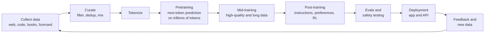
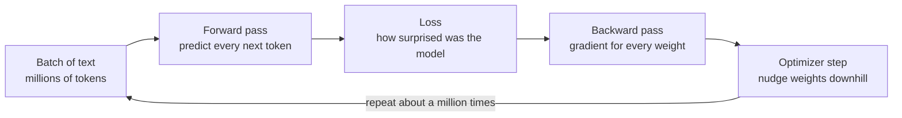
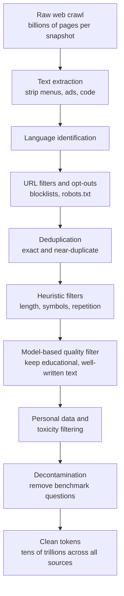
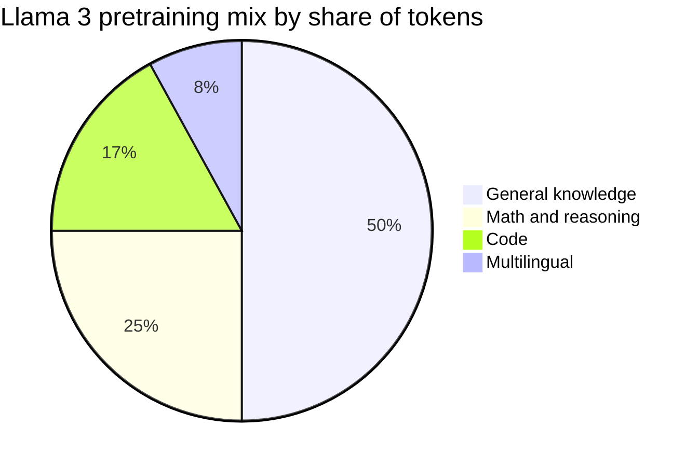
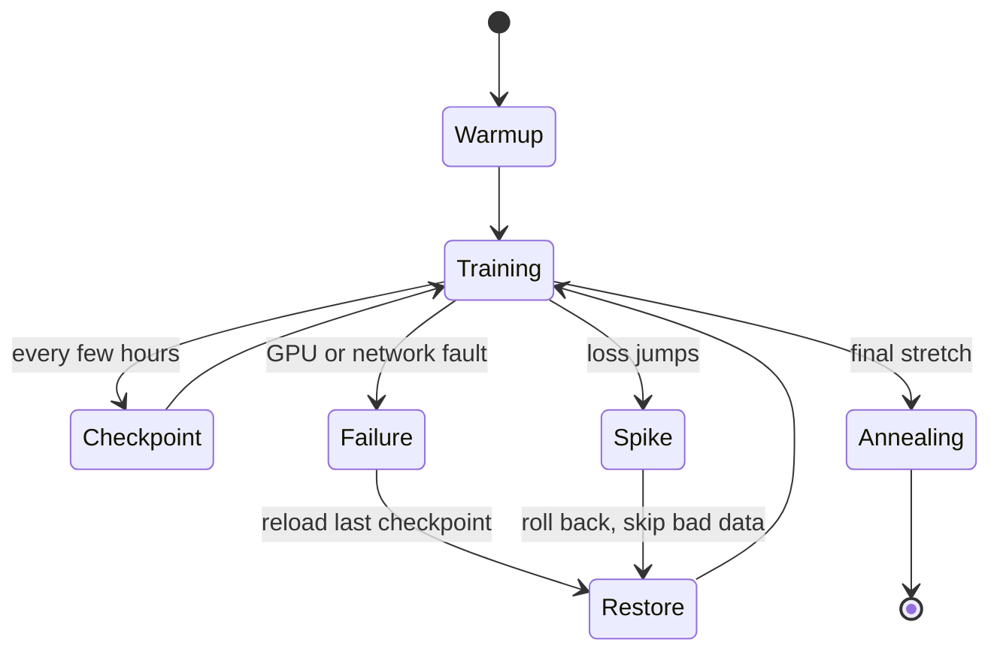

# Chapter 19: Pretraining: Data, Scale and Scaling Laws

*This chapter shows you how a frontier lab turns tens of trillions of words into a base model, why making models bigger works so predictably, and how to estimate in dollars what a training run costs.*

## What you'll learn

- Where pretraining fits in the life of a model, and how one training step teaches it.
- Where tens of trillions of training tokens come from, and how raw web pages are filtered down to clean data.
- How labs choose a data mixture and run a months-long training job on thousands to more than 100,000 chips.
- What a base model is like before it becomes an assistant.
- Scaling laws, the Chinchilla rule of about 20 tokens per parameter, and why labs now deliberately "over-train" small models.
- The 6 × N × D rule, worked all the way to a dollar cost, plus the real cost estimates for famous models.
- Both sides of the emergent-abilities debate and the data-wall debate, and what mid-training adds.

## Before you start

Chapter 18 (How a Large Language Model Works) explained tokens, next-token prediction and parameters, and you should read it first. Chapter 11 (Data: The Fuel of AI) covered where data comes from and the legal fights over it. Chapter 5 introduced the 2 × N and 6 × N × D rules of thumb, and Chapter 6 explained loss, cross-entropy and gradient descent. Chapter 13 covered optimizers and learning-rate schedules. Chapter 37 goes much deeper into the hardware side of training. Every term is defined again here, so you can follow along even if you skipped some of those.

## The big picture: where pretraining fits

Every chatbot you use went through a long assembly line. Pretraining is the first big station, and by far the most data-hungry: the model reads a large slice of everything humans have written that its makers could collect, and learns to predict it.

> **Definition — Pretraining:** The first and largest training stage of a language model, in which it learns to predict the next token across trillions of tokens of general text. The result is a base model.

> **Definition — Training run:** One large training job, from the first random weights to the final saved model, often lasting weeks or months on thousands of chips.

> **Definition — Corpus:** A large collection of text used for training. The plural is corpora.


*Figure 19.1: The life of a model. This chapter covers the first five boxes; Chapters 20 and 21 cover post-training and reasoning.*

> **Analogy:** Pretraining is like having someone read every book in a giant library, cover to cover, trying to guess each next word before turning the page. Post-training (Chapter 20) is the apprenticeship that follows, where they learn to be a useful assistant.

Historically pretraining used most of a model's training compute. That is changing: since 2024, labs have poured more and more compute into reinforcement learning after pretraining (Chapter 21). But pretraining still sets what the model knows and how capable it can become.

## How pretraining teaches: one step of learning

### Every token is a free lesson

The beauty of pretraining is that it needs no human labels. Take any sentence from the web: "The Eiffel Tower is in Paris." Hide the last word and ask the model to predict it; the answer is right there in the text. Every position in every document is a little quiz with a known answer. A corpus of 15 trillion tokens contains 15 trillion quizzes, and nobody had to write any of them.

> **Definition — Self-supervised learning:** Learning from data that supplies its own answers, such as predicting a hidden next word from the words before it, so no human labeling is needed.

### Measuring surprise: the loss

For each quiz, the model outputs a probability for every possible next token (Chapter 18). If the true next token was " Paris" and the model gave it probability 0.9, that is good. If it gave 0.01, that is bad. Training needs a single number that captures how bad, and the standard choice is the **cross-entropy loss**: the negative natural logarithm of the probability the model gave to the token that actually came next.

> **Definition — Loss:** A single number measuring how wrong a model's predictions are on some data. Training tries to make it smaller.

> **Definition — Cross-entropy loss:** The standard loss for next-token prediction: minus the natural logarithm of the probability the model assigned to the correct next token, averaged over all tokens. It is near 0 when the model was confident and right, and large when it was confident and wrong.

**Worked example.** Recall the coffee example from Chapter 18, where the model gave " coffee" 64.4% and " juice" 3.2%.

- If the real text continued with " coffee": loss = −ln(0.644) = 0.44. Mild surprise.
- If it continued with " juice": loss = −ln(0.032) = 3.44. Big surprise.
- If the model had been certain and right (probability 1): loss = −ln(1) = 0. No surprise.

Average this over millions of tokens and you get the number on every training dashboard. A related number is **perplexity**, e raised to the loss. A loss of 0.44 means a perplexity of about 1.55: on average the model is as uncertain as if it were choosing between about one and a half equally likely options. A loss of about 1.94 means a perplexity of about 7. Lower is better.

> **Definition — Perplexity:** e raised to the power of the average cross-entropy loss. It can be read as "the model is as uncertain as if choosing among this many equally likely tokens." Lower is better.

### Nudging billions of knobs

Once the loss is known, an algorithm called **backpropagation** works out, for every one of the model's billions of weights, which direction of nudge would have lowered it. An **optimizer** then nudges every weight a tiny step in that direction. The size of the step is set by the **learning rate**. This is gradient descent (Chapter 6): walking downhill in fog, one small step at a time.

> **Definition — Gradient descent:** The basic training method: compute which direction each weight should move to reduce the loss (the gradient), then move every weight a small step that way, and repeat.

> **Definition — Learning rate:** How large each weight update is during training. Too large and training becomes unstable; too small and it crawls.

> **Definition — Batch and step:** A batch is the group of training examples processed together before one update. A step is one such update. Large pretraining runs use batches of millions of tokens per step.


*Figure 19.2: One training step. Pretraining is this loop repeated for weeks or months.*

How many times? Suppose a run uses 15 trillion tokens with a batch of 8 million tokens per step. That is 15,000,000,000,000 ÷ 8,000,000 ≈ 1.9 million steps. Each one nudges every weight a little.

> **Key idea:** Pretraining is one simple loop repeated about a million times: predict every next token in a batch, measure the surprise, nudge every weight to be a bit less surprised. All the knowledge a base model has comes from this.

## Where the data comes from

### The sources

A frontier pretraining corpus is a blend of many kinds of text:

- **The public web.** The biggest source by far. Most labs start from **Common Crawl**, a nonprofit that has archived the web since 2008. Its August 2026 crawl alone captured 2.14 billion web pages, 360 TiB of data, gathered over two weeks. Labs also run their own crawlers.
- **Code.** Public repositories, mostly from GitHub. Code teaches precise, logical structure, and labs found it helps reasoning in general, not just programming.
- **Books and academic papers.** Long, carefully edited text. Also the most legally contested (Chapter 11).
- **Math.** Textbooks, worked solutions, competition problems and proofs.
- **Many languages.** Alibaba said its Qwen3 models were pretrained on about 36 trillion tokens across 119 languages.
- **Licensed data.** Labs pay publishers and platforms for access, such as the Reddit–Google deal (about $60 million per year, as reported in 2024) or Meta's March 2026 deal with News Corp (up to $50 million per year for three years).
- **Transcribed and extracted text.** Speech from video transcribed to text, and text pulled out of PDFs. Qwen3 used a vision model to extract text from PDFs, for example.
- **Synthetic data.** Text written by other AI models, then filtered. Qwen3 used its math and code models to generate synthetic textbooks and question-answer pairs.

> **Definition — Common Crawl:** A nonprofit that regularly crawls the public web and publishes the archive for free. It is the raw material for most pretraining datasets.

> **Definition — Web crawler:** A program that automatically visits web pages, saves them and follows their links to find more pages.

> **Definition — Synthetic data:** Training data generated by AI models (often then checked or filtered) rather than written by people.

### How much?

| Model or dataset | Pretraining tokens | Source of the figure |
|---|---|---|
| GPT-3 (2020) | about 300 billion | OpenAI's paper |
| Llama 3 (2024) | about 15.6 trillion | Meta's paper |
| Llama 4 (2025) | more than 30 trillion | Meta |
| Qwen3 (2025) | about 36 trillion, 119 languages | Alibaba |
| DeepSeek-V4-Pro (2026) | about 33 trillion | Epoch AI's notes on DeepSeek's report |
| FineWeb, open dataset (2024) | about 15 trillion, from 96 Common Crawl snapshots | Hugging Face |

How big is 15 trillion tokens? At about 0.75 words per token, it is roughly 11 trillion words. A fast reader managing 250 words a minute, 8 hours a day, gets through 120,000 words a day. Reading 11.25 trillion words would take 11,250,000,000,000 ÷ 120,000 ≈ 94 million days, or about 257,000 years. Yet stored as plain text at about 4 bytes per token, it is only about 60 terabytes, which fits on a handful of large hard drives. Text is tiny; reading it is what takes the compute.

> **Try it:** Pick a few large websites you know and open their robots.txt files, for example nytimes.com/robots.txt or reddit.com/robots.txt. Search the page for the names of AI crawlers such as GPTBot (OpenAI), ClaudeBot (Anthropic), CCBot (Common Crawl) and Google-Extended (Google's AI-training opt-out). You are reading the web's "please don't" signs.

### Asking permission: opt-outs and the 2025–26 shift

The web's traditional way of saying "please don't crawl this" is a file called **robots.txt**. It is a polite sign, not a lock: well-behaved crawlers obey it, others can ignore it. Since 2025 the web has moved toward blocking AI crawlers by default and charging for access. Cloudflare, which sits in front of a large share of websites, began blocking known AI crawlers by default for new domains on July 1, 2025 and launched "Pay Per Crawl". In September 2025 a group backed by Reddit, Yahoo, Medium and others launched RSL (Really Simple Licensing), a machine-readable way for sites to state AI licensing terms.

> **Definition — robots.txt:** A text file at the root of a website that tells automated crawlers which pages they may visit. Compliance is voluntary.

Law is also moving. Since August 2, 2025, the EU AI Act has required providers of general-purpose AI models to publish a summary of their training content using an official template. And courts are deciding what training on copyrighted text is allowed: in the largest case so far, Anthropic's $1.5 billion settlement with authors over books downloaded from pirate libraries received final approval in July 2026. Chapter 11 covers the data side of these fights and Chapters 58 and 59 cover the law.

## Cleaning the firehose: the curation pipeline

### Most of the web is not worth reading

Raw web pages are mostly not prose. They are menus, cookie banners, ads, product listings, login pages, spam, machine-generated junk, near-copies of other pages, and text in every language. Train on that unfiltered and you get a model that writes cookie banners. So every lab runs a **curation pipeline**, a series of filters, and most of the raw crawl is thrown away.

> **Definition — Data curation:** Cleaning, filtering, deduplicating and balancing raw data before training, so that the model learns from useful, varied, legal text.


*Figure 19.3: The curation funnel. Each stage throws away more of the raw crawl.*

Here is what each stage does.

**1. Text extraction.** A web page's file is mostly layout code. Extraction tools pull out the main body text and drop the navigation bars, footers and scripts.

> **Definition — Text extraction (boilerplate removal):** Pulling the main readable text out of a web page and discarding repeated page furniture such as menus, footers, ads and code.

**2. Language identification.** A small, fast classifier labels each page's language, so it can be routed to the right part of the mixture or dropped.

> **Definition — Language identification:** Automatically detecting which human language a piece of text is written in, usually with a small, fast classifier.

**3. URL filtering and opt-outs.** Blocklists remove known adult, spam and malware sites, and pages whose owners opted out are skipped.

**4. Deduplication.** The web repeats itself enormously: the same news story syndicated to hundreds of sites, the same license text on millions of pages. Repeated text wastes compute and makes the model memorize those passages word for word. Exact duplicates are easy to catch. Near-duplicates, the same article with a different header, need a cleverer trick.

> **Definition — Deduplication:** Removing documents that are identical or nearly identical to others in the dataset, so the model does not waste compute on repeats or memorize them.

**Worked example: catching near-duplicates.** Break each document into overlapping runs of words, called shingles. Take two short documents, using three-word shingles:

- Document A: "the cat sat on the mat today" gives: "the cat sat", "cat sat on", "sat on the", "on the mat", "the mat today" (5 shingles).
- Document B: "the cat sat on the mat yesterday" gives the same first four, plus "the mat yesterday" (5 shingles).

They share 4 shingles, and together they have 6 different ones. Their **Jaccard similarity** is 4 ÷ 6 = 0.67. Real pipelines use longer documents and longer shingles, and mark a pair as duplicates above a chosen threshold (often around 0.8). Comparing every pair among billions of pages directly would take forever, so a technique called MinHash compresses each document's shingles into a short "fingerprint" that lets similar documents be found quickly.

> **Definition — Near-duplicate detection (MinHash):** Finding documents that are mostly the same by comparing compact fingerprints of their overlapping word sequences, instead of comparing every pair of documents in full.

**5. Heuristic filters.** Simple rules written by people catch a lot of junk. Typical rules (examples of the kind used, not any one lab's exact list): drop pages with very few words; drop pages where most lines do not end in punctuation, which signals lists and menus; drop pages with too many symbols or too much repeated text; drop pages containing placeholder text such as "lorem ipsum" or "enable JavaScript to view this page".

> **Definition — Heuristic filter:** A hand-written rule that keeps or drops a document based on simple measurable properties, such as word count, share of symbols or amount of repetition.

**6. Model-based quality filtering.** This is the step that changed the field around 2024. Hugging Face's FineWeb-Edu project had a large language model grade a sample of web pages for educational value, trained a small, cheap classifier to imitate those grades, and then ran the classifier over the whole 15-trillion-token FineWeb dataset. Keeping only the highest-scoring pages left subsets of about 1.3 trillion and 5.4 trillion tokens. In Hugging Face's experiments, small models trained on the educational subset did better on knowledge and reasoning tests than models trained on the same number of tokens of unfiltered web text.

> **Definition — Quality classifier:** A model trained to score documents for usefulness (for example, educational value) so that a pipeline can keep the best ones. Often trained on grades produced by a larger model.

**7. Personal data and toxicity filtering.** Pipelines remove or mask personal information such as email addresses, phone numbers and identification numbers, and filter hateful or sexual content. These filters are imperfect in both directions: they miss some harmful content and wrongly remove some harmless text, especially in dialects and minority languages.

> **Definition — PII (Personally Identifiable Information):** Information that can identify a specific person, such as a name with an address, an email address, a phone number or an ID number.

**8. Decontamination.** If the questions from a famous test end up in the training data, the model can memorize the answers, and its score on that test no longer means anything. Pipelines search for long overlapping word sequences between the training data and known benchmarks, and remove matches.

> **Definition — Decontamination:** Removing benchmark test questions (and close copies of them) from training data, so that evaluation scores reflect real ability rather than memory.

> **Definition — Benchmark contamination:** When test questions leak into a model's training data, inflating its scores without a real gain in ability.

> **Watch out:** "More data is always better" is wrong at this scale. A smaller, carefully filtered dataset often trains a better model than a larger, dirtier one, because every token costs compute. Curation is one of the most closely guarded parts of a lab's recipe, and one of the main reasons two models of the same size can differ so much.

## Choosing the recipe: data mixtures

After cleaning, a lab has piles of web text, code, math, books, multilingual text and synthetic data. It still has to decide how much of each the model should see. That recipe is the **data mixture**.

> **Definition — Data mixture:** The share of training tokens drawn from each source, such as web text, code, math, books, each language and synthetic data.

Meta published the final mixture for Llama 3: roughly half general-knowledge text, a quarter math and reasoning, 17% code and 8% multilingual text.


*Figure 19.4: The Llama 3 data mixture as reported in Meta's 2024 paper. Most frontier labs do not publish theirs.*

A mixture is not just proportional to what exists. Labs **upsample** scarce, valuable sources, showing high-quality text such as encyclopedias or textbooks several times, and **downsample** abundant, low-value ones.

> **Definition — Upsampling:** Deliberately showing some data more often than its natural share, sometimes repeating it several times, because it is especially valuable.

> **Definition — Epoch (training pass):** One complete pass through a dataset. Frontier pretraining sees most data about once, but may repeat the best sources several times.

How do labs pick percentages without wasting a frontier run? They train dozens of small **proxy models** on different mixtures, compare the results, and assume the winning recipe will also work at full scale. Each such controlled comparison, changing one thing at a time, is called an **ablation**.

> **Definition — Proxy model:** A small, cheap model trained to test a choice (such as a data mixture) before committing to it in an expensive full-size run.

> **Definition — Ablation:** An experiment that changes or removes one ingredient while keeping everything else fixed, to measure that ingredient's effect.

> **At the frontier (2026):** Mixtures have shifted steadily toward code, math, multilingual text and filtered synthetic data. Alibaba described generating synthetic textbooks and question-answer pairs with its own specialist models for Qwen3, and labs increasingly hold their best reasoning-style data for a final, high-quality stage called mid-training, covered at the end of this chapter.

## The pretraining run

### The machine

A frontier pretraining run uses thousands to more than 100,000 GPUs or TPUs working as one machine for weeks to months. Two public reference points:

- **Llama 3 405B (Meta, 2024):** 16,384 NVIDIA H100 GPUs, about 15.6 trillion tokens, with a carefully documented 54-day stretch of training.
- **GPT-6 Astra (OpenAI, September 2026):** described as OpenAI's largest training run "by far" and the first pretraining run on more than 100,000 GPUs, at the Stargate site in Abilene, Texas. Epoch AI estimates about 9.4 × 10^26 FLOP (with a wide uncertainty range of roughly 5 × 10^26 to 2 × 10^27), assuming about 100,000 GB200 GPUs for about 90 days at 25% utilization in 8-bit precision.

> **Definition — GPU-hour:** One GPU running for one hour. Training jobs and cloud rental prices are measured in GPU-hours.

No single GPU can hold a frontier model and its training state, and no single GPU is fast enough anyway. So the work is split across chips in several ways at once: each group of GPUs processes different data (**data parallelism**), each big matrix is split across several GPUs (**tensor parallelism**), the layers are split into stages like an assembly line (**pipeline parallelism**), and in mixture-of-experts models different experts live on different GPUs (**expert parallelism**). Chapter 37 explains each with diagrams.

> **Definition — Parallelism (distributed training):** Splitting one training job across many chips: by data, by pieces of each matrix, by groups of layers or by experts. The chips must constantly exchange results.

### The settings

A few settings shape the whole run:

- **Batch size.** Frontier runs use batches of millions of tokens per step, and some grow the batch partway through training.
- **Learning-rate schedule.** The learning rate starts tiny, rises during a **warmup** period so early chaos does not wreck the model, stays high for most of training, and then decays toward zero at the end. Older runs used a smooth "cosine" decay; many newer ones hold steady and then decay quickly in a final stretch.
- **Optimizer.** Usually AdamW or a newer method such as Muon (Chapter 13).
- **Precision.** How many bits each number uses, covered below.

> **Definition — Learning-rate schedule:** The planned change of the learning rate over a training run, typically a short warmup, a long high phase and a final decay.

> **Definition — Warmup:** The opening phase of training in which the learning rate rises gradually from near zero, preventing huge, destabilizing updates while the weights are still random.

### Watching the loss

The engineers' main window into a run is the loss curve. It falls steeply at first, as the model learns spelling, grammar and common facts, and then keeps falling more and more slowly for the rest of the run.

```
loss
 4.0 |*
     | *
 3.5 |  *
     |   **
 3.0 |     **
     |       ***                   *   <- loss spike: roll back
 2.5 |          ****              * *     to the last checkpoint
     |              *****        *   *
 2.2 |                   ********     ****
     |                                    *******
 2.0 |                                           **********
     +------------------------------------------------------> steps
      warmup   fast early learning         slow late gains
```
*Figure 19.5: An illustrative pretraining loss curve, with one loss spike. Real curves are noisier.*

Sometimes the loss suddenly shoots upward: a **loss spike**. Causes include a batch of strange data, numbers overflowing in low precision, or the optimizer taking too big a step. Small spikes recover on their own. Big ones can ruin the run, so teams roll back to an earlier saved copy of the model, skip the offending data, sometimes lower the learning rate, and continue.

> **Definition — Loss spike:** A sudden jump in training loss during a run, which may recover or may require rolling back to an earlier checkpoint.

> **Definition — Checkpoint:** A saved snapshot of a model's weights and optimizer state during training, so the run can resume from that point after a failure.

### Things break, constantly

With tens of thousands of chips, something is always failing. Meta's Llama 3 paper is the best public record. In a 54-day window of training the 405B model, there were 466 job interruptions, 419 of them unexpected. That is one unexpected stop roughly every three hours (54 days × 24 hours = 1,296 hours; 1,296 ÷ 419 ≈ 3.1). About 78% were blamed on hardware, with faulty GPUs the largest category and the GPUs' high-bandwidth memory alone causing 17.2%. Even so, the team kept effective training time above 90%. Because thousands of GPUs speed up and slow down together, the whole cluster's power draw swung by tens of megawatts, a problem for the local grid (Chapter 39).


*Figure 19.6: The states of a real pretraining run. A big run cycles through failures and restores many times.*

Two numbers describe how well a run uses its machine. **MFU** is the share of the chips' theoretical maximum math that actually goes into the model's training; Llama 3 405B reached 38–43%, and 35–50% is typical for large runs. **Goodput** is the share of total time that produced useful progress after failures and restarts.

> **Definition — MFU (Model FLOPs Utilization):** The fraction of the hardware's peak arithmetic speed actually used for the model's necessary math during training. Large runs typically reach about 35–50%.

> **Definition — Goodput:** The share of a cluster's total time that produces useful training progress, after subtracting time lost to failures, restarts and waiting.

### Fewer bits, more speed

Training math does not need every decimal place. BF16, a 16-bit format, became the standard for large models. **FP8** (8-bit) training followed on NVIDIA's Hopper chips; DeepSeek-V3, trained on 2,048 H800 GPUs, was a prominent public example in late 2024. In 2026, 4-bit formats have arrived: Moonshot's Kimi K3 used MXFP4 weights with quantization-aware training, and DeepSeek-V4-Pro stores its expert weights in FP4 with FP8 elsewhere. Each halving of bits roughly doubles the math a chip can do and halves memory traffic, if the training stays stable.

> **Definition — FP8 and FP4:** 8-bit and 4-bit number formats. Newer AI chips do math in them much faster than in 16-bit, at the cost of more rounding, which careful scaling tricks keep under control.

> **Definition — Mixed precision:** Doing most of the math in a low-precision format while keeping a few sensitive values, such as a master copy of the weights, in higher precision.

## What comes out: meet the base model

At the end of pretraining you have a **base model**: an extraordinarily well-read text continuer with no particular personality and no idea that it is supposed to help anyone. It does not answer; it continues. The examples below are typical behavior, not transcripts of a specific model.

- Prompt: "What is the capital of Japan?" A base model may continue: "What is the capital of China? What is the capital of South Korea?" It has seen many quiz pages and guesses this is one.
- Prompt: "Dear hiring manager," It writes a whole cover letter for an imaginary applicant, in whatever style seemed most likely.
- Prompt: "Q: What is the capital of France? A: Paris. Q: What is the capital of Japan? A:" Now it answers " Tokyo", because the document format makes an answer the most likely continuation.

> **Definition — Few-shot prompting:** Putting a few worked examples in the prompt so the model continues the pattern. It was the main way to use base models before chat models existed.

A base model also knows a great deal, including things it should not repeat. It has absorbed the web's facts, styles and skills along with its errors, biases and nastiness, in roughly the proportions the curated data contained. It may write a helpful paragraph or a toxic rant, depending on which document it thinks it is in. Post-training (Chapter 20) is what gives it a stable, helpful character.

> **Analogy:** A base model is a brilliant improv actor who will play whatever scene you set up. A chat model is the same actor after training as a dependable customer-service representative: equally talented, but now reliably on task.

> **Try it:** If you want to meet a base model, Exercise 8 at the end of this chapter has copy-paste code that asks the same question to a small open base model and its chat version, side by side.
