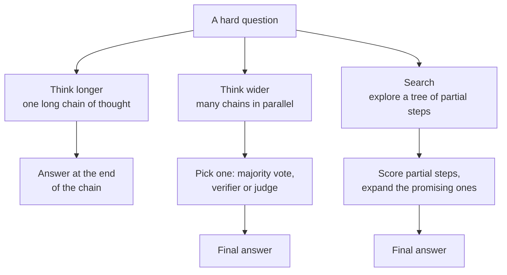
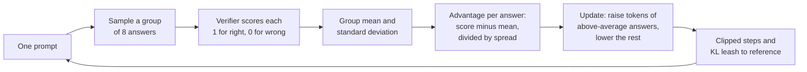
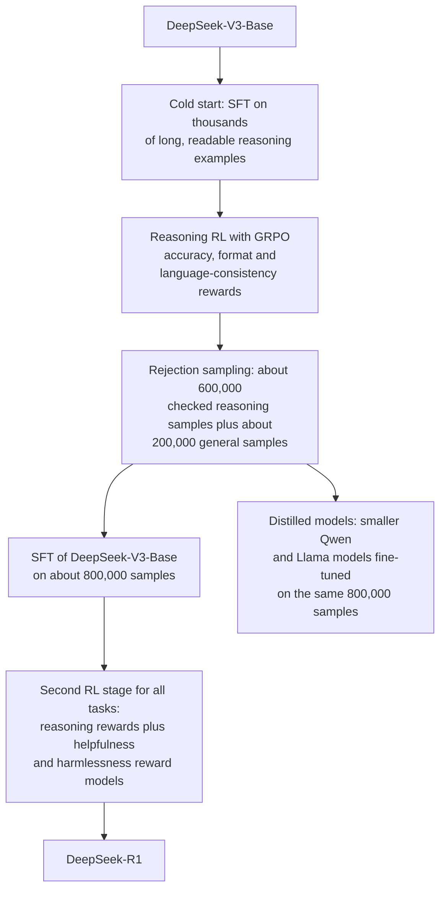
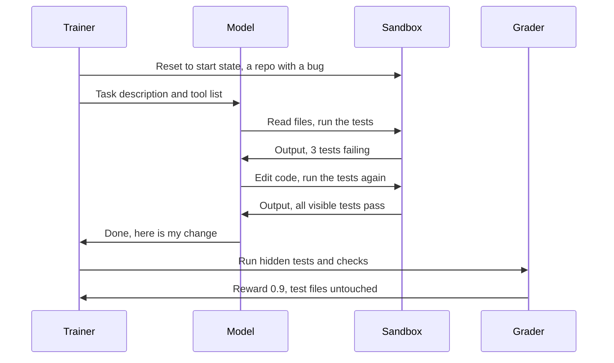
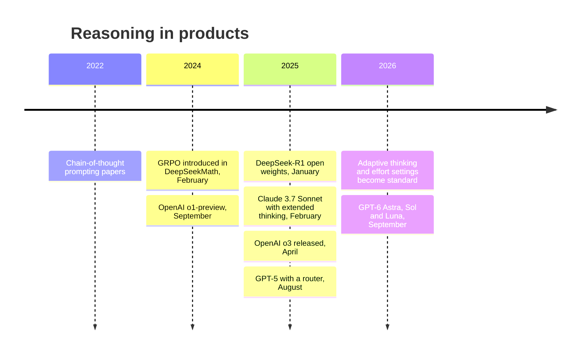
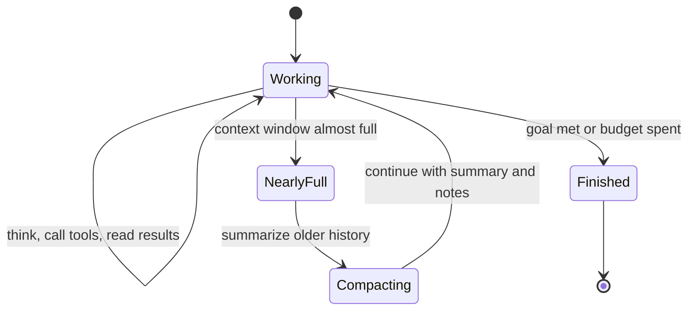

# Chapter 21: Reasoning Models and Reinforcement Learning

*This chapter explains what is really happening when your chatbot says "Thinking...", how reinforcement learning taught models to reason, and when it is worth paying for more thinking.*

## What you'll learn

- Why writing out steps makes a language model smarter, from 2022's "let's think step by step" to self-consistency voting.
- What test-time compute is, and why accuracy grows roughly with the logarithm of thinking spent.
- How reinforcement learning with verifiable rewards works, and why automatic checkers changed post-training.
- GRPO step by step, with a worked group of eight answers, plus its variants DAPO, Dr. GRPO and GSPO.
- The DeepSeek-R1 story: pure RL, the "aha moment", cold-start data and distillation.
- Process versus outcome rewards, RL environments, rubrics and AI judges for tasks no program can check.
- How each major lab ships reasoning in its products as of late 2026, from routers to effort dials to agent swarms.
- Whether you can trust a model's visible thinking, and when you should turn the effort setting up or down.

## Before you start

Chapter 20 (Post-Training) is essential: it explains reward models, RLHF, the KL leash and advantages, which this chapter builds on. Chapter 18 (How a Large Language Model Works) covers tokens, sampling and the context window, and Chapter 6 (The Math of AI, Part 2) covers probability, averages and logarithms. Chapter 5 gives the rule of thumb that a model spends about 2 × N calculations per token, where N is its number of active parameters. Chapter 48 covers reinforcement learning in general; you do not need it, because this chapter recaps what it uses.

## Blurting versus thinking

Try this puzzle before reading on: *A bat and a ball cost $1.10 in total. The bat costs $1.00 more than the ball. How much does the ball cost?*

Most people's first instinct is 10 cents. It is wrong: if the ball cost 10 cents, the bat would cost $1.10 and the total would be $1.20. The right answer is 5 cents (ball $0.05, bat $1.05, total $1.10). Psychologists have used this question for two decades to show the difference between fast, intuitive answers and slow, deliberate ones. People who pause and check get it right.

Language models had the same problem, in an extreme form. A classic chatbot "blurts": it starts writing its answer immediately, one token at a time, and every token gets the same fixed amount of computation. On September 12, 2024, OpenAI released o1-preview, the first widely available model built to do something different: before answering, it writes a long, usually hidden, stretch of reasoning. Within two years every major lab shipped models like it.

> **Definition — Reasoning model:** A language model trained, usually with reinforcement learning, to think at length before answering, trading extra time and tokens for higher accuracy on hard problems.

> **Definition — Chain of thought (CoT):** The intermediate reasoning text a model writes before its final answer: working out steps, checking them and sometimes backtracking.

> **Definition — Thinking tokens:** The tokens a model generates while reasoning, before its visible answer. You usually pay for them, even when the app hides them or shows only a summary.

When your chatbot shows "Thinking..." or a collapsible "Thought for 23 seconds" panel, it is generating thinking tokens. A reasoning model might write 500 thinking tokens for a moderate question and tens of thousands for a hard one.

### Why writing things down helps

Recall from Chapter 5 that a model with N active parameters does about 2 × N calculations for each token it produces. That amount is fixed. A model cannot "think harder" about one token than another. If a problem needs more sequential steps than one pass through the network can perform, the model cannot solve it in a single token, however large it is.

Writing intermediate steps fixes this in three ways:

1. **More computation.** A 2,000-token chain of thought is 2,000 extra passes through the network before the answer begins.
2. **A scratchpad.** Each written step becomes part of the input for the next token, so the model can store intermediate results instead of holding everything in one pass.
3. **A chance to check.** The model can reread a step, notice that it is wrong, and try again.

You do the same thing. Try 17 × 24 in your head in one go. Now on paper: 17 × 20 = 340, 17 × 4 = 68, 340 + 68 = 408. The paper version is easy because each step is small and you can see the previous results.

> **Analogy:** Test-time thinking is "let me think about it" versus blurting. Same student, same knowledge, but given scratch paper and a few minutes, the answers to hard problems get much better. Easy questions ("What is the capital of France?") gain nothing.

> **Key idea:** A model gets a fixed amount of computation per token, so the only way to give a hard problem more computation is to let the model write more tokens before it answers. Reasoning models are trained to use those tokens well.

## Step 1: Chain-of-thought prompting

The idea that models reason better when they show their work came first as a prompting trick, years before reasoning models.

> **Definition — Chain-of-thought prompting:** Getting a model to reason step by step by including worked examples with written-out reasoning in the prompt, or simply by adding an instruction such as "Let's think step by step."

In January 2022, Google researchers (Wei and colleagues) showed that giving a large model a few example problems with worked reasoning, rather than bare answers, sharply improved its accuracy on math word problems, and that the effect mostly appeared in larger models. A few months later, another paper (Kojima and colleagues) found that simply appending "Let's think step by step" to a question, with no examples at all, produced a similar jump. Everyone with a chatbot could suddenly make it smarter with five words.

### Self-consistency: ask several times, take a vote

A second 2022 idea (Wang and colleagues) was to sample several independent chains of thought at a nonzero temperature (Chapter 18) and take the most common final answer.

> **Definition — Self-consistency (majority voting):** Sampling several independent reasoning paths for the same question and choosing the final answer that appears most often.

**Worked example.** Suppose each independent attempt is right 60% of the time, and, as a worst case, every wrong attempt gives the same wrong answer. What is the chance that a majority vote is right?

- One attempt: 0.60.
- Vote of 3: you need at least 2 right. P = 3 × 0.6² × 0.4 + 0.6³ = 0.432 + 0.216 = **0.648**.
- Vote of 5: you need at least 3 right. P = 10 × 0.6³ × 0.4² + 5 × 0.6⁴ × 0.4 + 0.6⁵ = 0.346 + 0.259 + 0.078 = **0.683**.
- Vote of 11: about **0.753**.

In real problems, wrong answers usually scatter (one attempt says 7, another 12, another 9), while right answers agree, so voting does even better than this worst case. The cost is linear: five votes cost five times as much.

> **Watch out:** Voting only helps when the model is more often right than consistently wrong. If each attempt is right only 40% of the time and the errors all agree, a vote of 5 is right just 31.7% of the time, worse than a single try. Majority voting amplifies whatever the model's most common answer is, right or wrong.

> **Try it:** Pick a tricky word problem (the bat-and-ball question works well if you rephrase the numbers so it is not memorized, for example "A pen and a notebook cost $2.20 together; the notebook costs $2.00 more than the pen"). Ask it in five separate new chats with reasoning turned off or set to the lowest effort, and write down each answer. Then take the majority. Then ask once with high effort. Which approach was right, and how many tokens or seconds did each take?

## Test-time compute: a second scaling law

Chapter 19 described scaling laws for training: more compute spent on pretraining gives predictably lower loss. Reasoning models revealed a second dial.

> **Definition — Test-time compute:** Computation spent when the model is answering (thinking longer, sampling several attempts, searching), as opposed to train-time compute, which is spent once during training.

When OpenAI announced o1 in September 2024, it showed accuracy on a hard math competition rising smoothly as it gave the model more reinforcement-learning training *and* as it let the model think longer at answer time, with both plotted on logarithmic axes. Later research, including a 2024 study by Snell and colleagues on how best to spend test-time compute, confirmed the general pattern.

> **Definition — Log-linear relationship:** A pattern in which a quantity grows by roughly the same amount each time another quantity is multiplied by a fixed factor. For reasoning, each tenfold increase in thinking tokens tends to add a similar number of accuracy points, until the gains level off.

Here is an illustrative version (the numbers are invented to show the shape, not taken from any one model):

| Thinking tokens per question | Accuracy on a hard test | Output cost at $20 per million tokens |
|---|---|---|
| 1,000 | 40% | $0.02 |
| 10,000 | 55% | $0.20 |
| 100,000 | 70% | $2.00 |

Each tenfold increase in thinking buys about 15 more points, and costs ten times as much. ($20 per million output tokens is the list price of Claude Opus 5.5 as of October 2026, used here only to make the arithmetic concrete.) Plotted on a logarithmic horizontal axis, it looks like a rising line that eventually bends flat:

```
 accuracy
  80% |                                      .  .  .  .
      |                               .  '
  70% |                          . '                 max
      |                     . '
  60% |                . '            high
      |           . '
  50% |       . '        medium
      |    .'
  40% |  .     low
      +----+--------+--------+--------+--------+-----> thinking
         1K       10K      100K      1M            tokens (log)
```

*Figure 21.1: The shape of test-time scaling. Each tenfold increase in thinking adds a roughly similar number of points until the curve flattens. Effort settings are points along this curve. Illustrative numbers.*

### Three ways to spend test-time compute



*Figure 21.2: Thinking longer, thinking wider and searching are the three basic ways to turn extra compute into better answers. Modern products combine them.*

Reasoning models are mostly trained to think *longer*: one long chain in which the model plans, checks and backtracks. Premium modes add *wider* thinking, running many chains and combining them. Explicit tree *search*, which famously powered AlphaGo (Chapter 48), turned out to be less important for language than many expected, for reasons covered in the DeepSeek-R1 section.

> **Definition — Reasoning effort:** A setting, chosen by you or a developer, for how much a reasoning model should think, usually with levels such as low, medium and high, and sometimes higher levels above those.

> **Definition — Overthinking:** A reasoning model spending far more thinking than a question needs, wasting time and money, and sometimes talking itself out of a correct first answer.

> **Watch out:** "More thinking is always better." It is not. On easy questions extra thinking adds cost and delay but no accuracy, and models can overthink: on simple tasks some reasoning models second-guess a correct answer. The log-linear curve also flattens: past some point, ten times the thinking buys almost nothing.

## Reinforcement learning with verifiable rewards

### From coaxing to training

Chain-of-thought prompting coaxes a model to reason with the skills it already has. Reasoning models go further: they are *trained* to reason, with reinforcement learning, and the key ingredient is a reward that a program can compute exactly.

> **Definition — Verifier:** A program or model that checks whether an output is correct, such as an answer checker for math, a set of unit tests for code, or a proof checker for formal mathematics.

> **Definition — RLVR (Reinforcement Learning with Verifiable Rewards):** Reinforcement learning in which the reward comes from an automatic, objective check (a correct final answer, passing tests, a verified proof) rather than from human judges or a learned reward model.

The name RLVR was coined by the Allen Institute's Tülu 3 project in 2024, but the idea was already powering o1 and soon powered DeepSeek-R1. Here are typical verifiable tasks:

| Domain | How the answer is checked | Reward |
|---|---|---|
| Math with a known answer | Extract the final answer, compare with the key | 1 if equal, else 0 |
| Programming | Run the code against unit tests | Share of tests passed |
| Formal proofs | A proof assistant such as Lean checks every step | 1 if the proof is accepted |
| Instruction following | A program checks constraints ("exactly 3 bullets", "under 100 words") | 1 if all constraints met |
| Puzzles and games | Check the solution (a sudoku grid, a logic puzzle, a game won) | 1 if solved |
| Output format | Check the answer appears in the required place | Small bonus |

> **Definition — Unit test:** A small automatic check that a piece of code does what it should, for example "calling add(2, 3) must return 5." Coding agents are rewarded when their changes make tests pass.

> **Definition — Proof assistant:** Software, such as Lean, that checks every step of a mathematical proof written in a precise formal language and accepts only proofs that are completely correct.

### Worked example: a reward function, and how to break it

Here is a verifier for arithmetic word problems, in plain words:

1. Find the text after the last "Answer:" in the model's output.
2. Clean it: strip "$", spaces and trailing zeros, so "$4", "4.00" and " 4" all become "4".
3. If it equals the answer key, reward = 1. Otherwise reward = 0.
4. If no "Answer:" appears at all, reward = 0.

Now suppose a lazier engineer wrote step 1 as "reward = 1 if the correct number appears *anywhere* in the output." A model trained against that checker would quickly discover a strategy: write "Answer: 1, 2, 3, 4, 5, 6..." and list every number up to 100. Reward: always 1. Usefulness: zero. This is the reward hacking from Chapter 20, and it applies to verifiers too. Verifiable rewards are much harder to fool than a learned reward model, because they cannot be flattered or impressed by length, but a sloppy checker is a loophole waiting to be found.

> **Analogy:** RLVR is a math teacher who marks only the final answer, but marks it perfectly. You are never told how to solve the problem, only whether you got it right. To earn marks consistently, you have to work out methods that actually work.

Why did verifiable rewards change everything? Because they remove the bottleneck of Chapter 20. A human, or a reward model imitating humans, can judge only so many answers and can be fooled. A math checker or a test suite can grade millions of attempts, instantly, consistently and correctly. That makes it possible to run reinforcement learning at a scale that was never practical with human feedback, and to push models far beyond what their human demonstrators could write.

> **Key idea:** Verifiable rewards let reinforcement learning scale. Where a program can check the answer, a model can practice millions of times and improve with no human in the loop.

## A quick refresher: how RL nudges a model

Chapter 20 walked through one RL update in detail. Here is the minimum you need for this chapter, with one new word.

> **Definition — Rollout:** One complete attempt by the model at a task during RL training: the full chain of thought and answer for a question, or the full sequence of actions in an environment.

The loop is:

1. Give the model (the policy) a question.
2. Let it produce a rollout.
3. Score the rollout with the verifier.
4. Compare the score with what was expected (the baseline) to get the advantage.
5. Make every token in that rollout a little more likely if the advantage was positive, and a little less likely if it was negative, in small, clipped steps that keep the model on a leash near its starting point.

In classic RLHF with PPO, the "expected score" came from a value model (also called a critic), a second large neural network trained to predict how well the policy will do. For reasoning, that critic is a real burden. It is usually about as big as the policy, so it doubles memory, and it must judge partial reasoning chains thousands of tokens long, which is hard to learn. The breakthrough algorithm of the reasoning era simply removed it.

## GRPO: grading on a curve

### The idea

DeepSeek introduced Group Relative Policy Optimization in its DeepSeekMath paper in February 2024. It became the best-known RL algorithm of the reasoning era.

> **Definition — GRPO (Group Relative Policy Optimization):** A reinforcement-learning method that samples a group of answers to the same prompt, scores each one, and rewards each answer by how much better or worse it did than the group's average. It needs no separate value model.

The trick is to let the group itself supply the "expected score." Instead of training a critic to predict how well the model will do on a question, just ask the question several times and see. If the model gets it right 3 times out of 8, then 3 out of 8 is the expectation, and each attempt is judged against that.

The recipe for one question:

1. Sample a group of G answers (typically 8 to 64) from the current model.
2. Score each with the verifier.
3. Compute the group's mean reward and its standard deviation.
4. Each answer's advantage = (its reward − the mean) ÷ the standard deviation.
5. Update the model: every token of an above-average answer becomes more likely, every token of a below-average answer less likely, with PPO-style clipping and, usually, a KL leash to a reference model (Chapter 20).

> **Definition — Standard deviation:** A measure of how spread out a set of numbers is around its average. Dividing by it puts advantages on a common scale, whether the group's scores are tightly bunched or widely spread.

### Worked example: a group of eight answers

**Prompt:** "Pencils are sold 3 for $1. How much do 12 pencils cost? Give the final answer after 'Answer:'." The correct answer is $4.

The model writes eight attempts. Here are their final lines and the verifier's verdicts:

| Attempt | Final line (reasoning shortened) | Correct? | Reward |
|---|---|---|---|
| 1 | "12 ÷ 3 = 4 packs, 4 × $1. Answer: $4" | Yes | 1 |
| 2 | "12 × 3 = 36. Answer: $36" | No | 0 |
| 3 | "Each pencil costs 1/3 dollar, 12 × 1/3 = 4. Answer: 4" | Yes | 1 |
| 4 | "Answer: $3" | No | 0 |
| 5 | "12 ÷ 3 = 4 cents each. Answer: $0.48" | No | 0 |
| 6 | "Four groups of three, so $4. Answer: $4.00" | Yes | 1 |
| 7 | "Answer: $4.33" | No | 0 |
| 8 | "$1 × 12. Answer: $12" | No | 0 |

**Step 1, mean:** (1 + 0 + 1 + 0 + 0 + 1 + 0 + 0) ÷ 8 = 3 ÷ 8 = **0.375**.

**Step 2, standard deviation.** For rewards that are only 0 or 1, the standard deviation is √(mean × (1 − mean)) = √(0.375 × 0.625) = √0.234 = **0.484**.

**Step 3, advantages:**
- Each correct attempt: (1 − 0.375) ÷ 0.484 = **+1.29**
- Each wrong attempt: (0 − 0.375) ÷ 0.484 = **−0.77**

**Step 4, update.** Every token in attempts 1, 3 and 6 is nudged up with weight 1.29, and every token in the other five is nudged down with weight 0.77. Over thousands of questions, the reasoning patterns that tend to appear in correct answers ("12 ÷ 3 = 4 packs") grow stronger, and the patterns behind wrong answers fade.

(Some implementations divide by G − 1 instead of G when computing the spread, giving +1.21 and −0.72 here. The logic is identical.)

> **Analogy:** GRPO is grading on a curve within a study group. Nobody tells the group the "expected" mark in advance. Each student's work is compared with how the group did on that same question, and only being better than your peers earns credit.

### What the curve teaches

The same calculation for groups with different numbers of correct answers reveals how GRPO learns:

| Correct out of 8 | Mean | Std. dev. | Advantage if correct | Advantage if wrong |
|---|---|---|---|---|
| 0 | 0.000 | 0.000 | none | none, no signal |
| 1 | 0.125 | 0.331 | +2.65 | −0.38 |
| 3 | 0.375 | 0.484 | +1.29 | −0.77 |
| 4 | 0.500 | 0.500 | +1.00 | −1.00 |
| 7 | 0.875 | 0.331 | +0.38 | −2.65 |
| 8 | 1.000 | 0.000 | none | none, no signal |

Four lessons fall out of this table:

1. **Rare successes get big rewards.** When the model solves a hard problem once in eight tries, that one success gets +2.65. This is how RL pulls new abilities out of a model: a lucky breakthrough is strongly reinforced, so it becomes less lucky next time.
2. **Rare failures get big penalties.** On an easy problem the model usually gets right, the one sloppy failure is pushed down hard (−2.65).
3. **All-right and all-wrong groups teach nothing.** If all eight answers score the same, every advantage is zero. Questions that are far too easy or far too hard waste compute. Training works best on questions the model solves *sometimes*, so labs carefully choose and re-choose the difficulty of training problems as the model improves.
4. **No critic needed.** The group is the baseline. That saves an entire large neural network, and with a program as the verifier, GRPO for math or code can run with just the policy and a frozen reference model.



*Figure 21.3: GRPO in one picture. The group's own average replaces the value model as the baseline.*

> **Try it:** Be a GRPO trainer for one question. Ask a chatbot the pencil question from this section (or one of your own with a clear answer) in eight separate new chats at the lowest effort setting. Count how many got it right, then compute the mean, the standard deviation √(mean × (1 − mean)) and the two advantages. Would this question be a good training example for that model, or too easy?

### The credit-assignment problem

Notice one crude thing about the update: every token in an answer gets the *same* advantage. In attempt 5 ("12 ÷ 3 = 4 cents each"), the first half of the reasoning (dividing 12 by 3) was fine; the mistake was in the units. GRPO still pushes the whole attempt down.

> **Definition — Credit assignment:** Working out which of many actions deserves credit or blame for a final result. With a single reward at the end of a long reasoning chain, the model cannot directly tell which step was the clever one or the mistake.

Across thousands of rollouts, the good steps that appear in both right and wrong answers roughly cancel out, while steps that really distinguish right from wrong get reinforced. It works, but it is noisy, which is one motivation for the process rewards discussed later.

### The GRPO family: DAPO, Dr. GRPO and GSPO

Once GRPO became popular, researchers found its rough edges and published fixes. Two more terms help here.

> **Definition — Importance ratio:** In PPO-style training, the ratio between how likely a token or answer is under the updated model and how likely it was under the model that generated it. Clipping limits how far this ratio can move in one update.

> **Definition — Entropy collapse:** A failure in RL training in which the model becomes too certain too early, always choosing the same tokens, so it stops exploring alternatives and stops improving.

**DAPO** (2025, from ByteDance Seed with academic collaborators) made four changes:
- **Clip-higher:** a looser upper clipping limit, so rare but good tokens can grow faster, which counters entropy collapse.
- **Dynamic sampling:** throw away groups that are all right or all wrong (lesson 3 above) and keep sampling until each batch is full of groups that actually teach something.
- **Token-level loss:** weigh every token equally across the batch, so long answers are not under-counted.
- **Overlong shaping:** a gentle, gradually increasing penalty as answers approach the length limit, instead of treating every cut-off answer as an ordinary failure.

**Dr. GRPO** ("GRPO Done Right", from a 2025 paper that critically re-examined R1-style training) found two hidden biases in the original formula. The first came from dividing each answer's loss by its length. Here is why that matters: a wrong answer of 100 tokens with advantage −0.77 spreads its penalty as −0.0077 per token, but a wrong answer of 1,000 tokens spreads the same −0.77 as only −0.00077 per token. Long wrong answers are punished ten times more gently per token, so the model learns that when it is unsure, rambling is safer. The second bias came from dividing by the standard deviation, which over-weights questions that are nearly always right or nearly always wrong. Removing both gave similar accuracy with noticeably shorter answers.

**GSPO** (Group Sequence Policy Optimization, July 2025, from Alibaba's Qwen team) computes the importance ratio and the clipping for each whole answer rather than for each token. Token-by-token ratios can be very noisy, especially in mixture-of-experts models (Chapter 17), where small changes alter which experts a token is routed to. The Qwen team reported that sequence-level updates were markedly more stable and used GSPO in training its Qwen3 models.

> **Definition — DAPO (Decoupled Clip and Dynamic Sampling Policy Optimization):** A 2025 variant of GRPO that adds a looser upper clip, filtering of groups that give no signal, token-level loss weighting and gentle penalties for overlong answers.

> **Definition — Dr. GRPO:** A 2025 variant of GRPO that removes the per-answer length normalization and the standard-deviation scaling, fixing biases that made wrong answers grow long.

> **Definition — GSPO (Group Sequence Policy Optimization):** A 2025 variant of GRPO from the Qwen team that applies importance ratios and clipping to whole answers instead of individual tokens, improving stability, especially for mixture-of-experts models.

| Method | Year | Main change from the previous recipe | Problem it addresses |
|---|---|---|---|
| PPO | 2017 | Clipped updates with a learned critic | Unstable RL |
| GRPO | 2024 | Group average replaces the critic | Memory cost, hard-to-train critic |
| DAPO | 2025 | Clip-higher, dynamic sampling, token-level loss | Entropy collapse, wasted groups, long-answer under-weighting |
| Dr. GRPO | 2025 | Drop length and std normalization | Rambling wrong answers, difficulty bias |
| GSPO | 2025 | Ratios and clipping per whole answer | Noisy token ratios, MoE instability |

> **At the frontier (2026):** Closed labs rarely publish their exact RL algorithms, but open-weight labs (DeepSeek, Qwen, Moonshot and others) and academic groups publish new variants every few months. The common direction is clear: keep the critic-free group baseline, make training stable over very long rollouts, and spend compute only on prompts that teach something.

## The DeepSeek-R1 story

In January 2025 a Chinese lab, DeepSeek, released R1: an open-weight reasoning model, under the permissive MIT license, that performed close to OpenAI's o1 on many reasoning benchmarks, with a paper explaining how it was made. It briefly topped app-store charts and rattled technology stocks. For researchers, the paper mattered most, because it showed in detail that a simple recipe works.

### R1-Zero: reasoning from pure RL

DeepSeek first tried something radical. They took their base model, DeepSeek-V3-Base, skipped supervised fine-tuning entirely, and went straight to GRPO with two simple rule-based rewards:

- **Accuracy:** is the final math answer right, or does the code pass its tests?
- **Format:** is the reasoning inside thinking tags, followed by an answer?

No human-written reasoning examples, no reward model, no step-by-step grading. The paper reported that this model, R1-Zero, improved its pass@1 score on the AIME 2024 math competition from 15.6% to 71.0% over training, and to 86.7% with majority voting.

> **Definition — Pass@k:** The probability that at least one of k attempts at a problem is correct. Pass@1 is the chance of getting it right on a single try; it is the standard way to report reasoning accuracy.

Two things emerged without being asked for. First, the model's answers grew steadily longer during training, from hundreds of tokens to thousands: it discovered by itself that thinking longer earned more reward. Second, behaviors such as re-checking work, trying a different method and reflecting on mistakes appeared. The paper highlighted an "aha moment" in which an intermediate version stopped mid-solution, remarked on this in very human-sounding language, and began re-evaluating its approach.

A healthy debate followed. Later work, including the Dr. GRPO paper, found that some base models already show self-reflection before any RL, so the "aha moment" may be RL *amplifying* a behavior the base model learned from human text rather than inventing it. Both readings agree on the practical lesson: with a strong base model and verifiable rewards, RL alone can produce long, self-correcting reasoning.

R1-Zero also had problems. Its thinking was hard to read, and it suffered from **language mixing**, switching between English and Chinese mid-thought, because the reward only cared about the final answer.

> **Definition — Language mixing:** A reasoning model switching between languages within its chain of thought, a side effect of rewarding only final answers.

### R1: adding a cold start

The full R1 model added stages around the RL to fix readability and broaden its skills:



*Figure 21.4: The DeepSeek-R1 recipe. RL creates reasoning ability, rejection sampling turns it into data, and that data trains both R1 and smaller distilled models.*

> **Definition — Cold start (cold-start data):** A small supervised fine-tuning set used before reinforcement learning to give the model a readable, well-formatted reasoning style, so that RL starts from a sensible point.

Three findings from the R1 paper shaped the field:

1. **Distillation beats small-model RL.** DeepSeek fine-tuned smaller open models (from 1.5 billion to 70 billion parameters, based on Qwen and Llama) on R1's 800,000 samples. These distilled models reasoned far better than their originals, and the paper reported that distilling from R1 worked better than running the same kind of RL directly on a small model. Big models discover reasoning; small models can learn it from them (Chapter 20).
2. **It was cheap.** DeepSeek later reported, in a September 2025 Nature paper, that R1's reasoning-RL stage cost about $294,000 in compute, on top of a base model that had been far more expensive to pretrain.
3. **The fancy methods did not help.** The paper listed process reward models and Monte Carlo tree search among its "unsuccessful attempts" at scale. Simple outcome rewards won.

> **Definition — Monte Carlo tree search (MCTS):** A search method that explores a tree of possible moves or steps by repeatedly simulating outcomes and focusing effort on promising branches. It powered AlphaGo (Chapter 48) but proved hard to apply to open-ended language reasoning.

> **Watch out:** "DeepSeek built R1 for $294,000." That figure covers only the reasoning-RL stage. It excludes pretraining the DeepSeek-V3 base model (whose final run alone was reported at about $5.6 million in rented GPU time), all the research and failed experiments, data and staff. Cheap RL on top of an expensive base model is the accurate summary.

> **Key idea:** DeepSeek-R1 showed, openly, that a strong base model plus GRPO plus simple right-or-wrong rewards is enough to produce a frontier-class reasoning model, and that its reasoning can then be distilled into much smaller models.

## Process versus outcome rewards

Should you grade only the final answer, or every step? This was one of the big debates of 2023–2025.

> **Definition — Outcome reward model (ORM):** A grader that scores only the final result of a solution, such as whether the final answer is correct.

> **Definition — Process reward model (PRM):** A grader, usually a trained model, that scores each intermediate step of a solution, so mistakes can be caught where they happen.

> **Analogy:** An outcome reward is a teacher who looks only at the final answer box. A process reward is a teacher who marks every line of working. The second gives far more useful feedback, but takes much longer to grade, and a student can still learn a lot from the first if they practice enough problems.

Here is why process rewards are attractive:

```
Question: What is 15% of 80?

Step 1: 15% = 0.15               outcome grader: (not checked)
                                 process grader: correct
Step 2: 0.15 x 80 = 1.2          outcome grader: (not checked)
                                 process grader: WRONG, it is 12
Step 3: Move the decimal, so 12  outcome grader: (not checked)
                                 process grader: unjustified fix
Answer: 12                       outcome grader: CORRECT, reward 1
                                 process grader: answer right,
                                                 reasoning flawed
```

*Figure 21.5: The same flawed solution graded two ways. An outcome grader rewards a lucky or fudged path; a process grader catches the error at step 2.*

In 2023 OpenAI published "Let's Verify Step by Step," which released PRM800K, a dataset of about 800,000 human labels on individual solution steps, and showed that a process-supervised grader picked correct solutions to hard math problems more reliably than an outcome-supervised one.

Yet the big reasoning models of 2024–2026 were trained mostly with outcome rewards. Why?

- **Cost.** Step-by-step labels need experts to read every step, which does not scale to millions of rollouts.
- **Fuzzy steps.** In a free-form chain of thought thousands of tokens long, with false starts and backtracking, it is unclear what one "step" is, and an abandoned wrong idea is not a mistake if the model catches it.
- **Hackability.** A learned PRM is just another reward model, and RL finds its blind spots. A final-answer checker for math is exact.
- **It worked anyway.** With enough rollouts, outcome rewards solve the credit-assignment problem statistically, as described in the GRPO section.

Process ideas still matter. Formal proofs are checked step by step by their nature (a proof assistant verifies every line). PRMs are useful at test time, to rerank or choose among many sampled solutions. Evaluators use step checks to catch "right answer, wrong reasoning." And agent tasks often have natural checkpoints (did the code compile? did the file get created?) that act as partial rewards.

## Beyond math and code: RL environments

### Building a gym for agents

Most valuable work is not a single number that a program can check. Fixing a bug in a large codebase, researching a question across the web, cleaning a spreadsheet, filling in a form, operating a terminal: these are multi-step tasks with tools. To train models on them, labs build RL environments.

> **Definition — RL environment:** A training setup that gives a model a task, a set of tools, a starting state and an automatic grader, so that it can attempt the task many times and learn from the rewards.

> **Definition — Sandbox:** An isolated, disposable computer environment where a model can run code, browse or edit files without affecting anything real.

> **Definition — Grader:** The part of an RL environment that decides the reward at the end of an attempt, using tests, checks on the final state, a rubric judge or a mix.



*Figure 21.6: One rollout in a coding RL environment. The model acts through tools in a sandbox; the grader scores the end state, including hidden tests the model never saw.*

> **Analogy:** An RL environment is a flight simulator for an AI agent. It recreates a realistic situation, lets the trainee act with real controls, scores the outcome automatically, and resets instantly so the trainee can try again thousands of times, with no real plane at risk.

A coding environment like this needs defenses against reward hacking. Models have been caught editing the test files so that they pass, hard-coding the expected outputs, or deleting failing tests (Chapter 20 and Chapter 55). Environment designers respond with hidden tests the model cannot see, read-only test files, checks that the tests were not modified, and monitors that read the model's reasoning for signs of cheating.

### The RL-environment industry

In 2025 and 2026, building environments became a business in its own right. Startups design and sell environments and task collections to frontier labs, and labs and vendors hire domain experts (accountants, lawyers, doctors, scientists, software engineers) to write realistic tasks and grading rubrics. As of late 2026 there are no reliable public figures on the size of this market, but it has become one of the clearest new kinds of work created by reasoning models.

> **Key idea:** RL environments extend verifiable rewards from single answers to whole tasks. Wherever the end state of a job can be checked, a model can practice the job.

### Rubrics and AI judges for tasks no program can check

What about tasks with no right answer, like writing a clear explanation or giving good advice? Here labs combine program checks with LLM judges that follow a written rubric.

> **Definition — Rubric:** A written list of criteria, often with point values, used to grade a response consistently. Rubrics let AI judges grade open-ended work in a more checkable, less biased way.

> **Definition — LLM-as-judge:** Using a language model to grade another model's outputs, usually against a rubric. It is fast and cheap but can share the biases of the judging model.

**Worked example.** Task: "Explain compound interest to a teenager in under 200 words." Rubric:

| Criterion | Points | Checked by | Score given |
|---|---|---|---|
| Correct definition (interest earned on interest) | 3 | AI judge | 3 |
| A numeric example that is arithmetically correct | 3 | AI judge, numbers rechecked by a program | 3 |
| Language suitable for a teenager | 2 | AI judge | 1 |
| Under 200 words | 1 | Program (word count) | 1 |
| No condescension | 1 | AI judge | 0 |
| **Total** | **10** | | **8** |

Reward = 8 ÷ 10 = 0.8. Splitting judgment into small, specific criteria makes the judge more consistent and makes its mistakes easier to spot. Judges still have known biases: they tend to prefer longer answers, the answer shown first, and answers written in their own style. Labs counter these by swapping answer order, using several judges, keeping objective criteria (word counts, arithmetic) in code, and checking judge scores against human ratings on samples.

> **At the frontier (2026):** Training on large collections of environments (codebases, browsers, terminals, office documents, simulated customers) is now central to how labs build agents. It is also where reward hacking is most active: labs' system cards increasingly report how often models take shortcuts in coding tasks, and Google, for example, has begun reporting such shortcut rates for its models.

## How reasoning shows up in the products you use

### A short history



*Figure 21.7: Key moments in the move from chatbots that blurt to models that think.*

### Lab by lab, as of late 2026

**OpenAI.** o1-preview (September 12, 2024) was the first widely available reasoning model. o3 was announced in December 2024 and released on April 16, 2025. GPT-5 (August 7, 2025) introduced a router that decides, for each request, whether to use a fast model or a thinking model, so ordinary users no longer had to choose. The GPT-5.x series followed through 2025 and 2026. In September 2026 came GPT-6 Astra (September 3), then GPT-6 Sol and Luna (September 22), which OpenAI describes as reasoning models "trained to think before they answer", and GPT-6.1 Sol (September 29), all with selectable reasoning-effort levels.

> **Definition — Router (model router):** A component that decides which model, or which mode, should handle each request, for example sending easy questions to a fast model and hard ones to a reasoning model.

**Anthropic.** Claude 3.7 Sonnet (February 24, 2025) was the first "hybrid" reasoning model: one model that can either answer immediately or use extended thinking with a token budget you set. Newer Claude models replaced the fixed budget with adaptive thinking, in which the model decides how much to think, steered by an effort setting; it is the default on current models. For Claude Opus 5.5 (September 2026), thinking is always on and can no longer be turned off.

> **Definition — Hybrid reasoning model:** A single model that can either answer immediately or think at length first, depending on a setting or its own judgment, instead of separate fast and reasoning models.

> **Definition — Extended thinking:** Anthropic's earlier mode in which a developer turned thinking on and set a fixed maximum number of thinking tokens. It has been replaced by adaptive thinking on newer models.

> **Definition — Adaptive thinking:** A mode in which the model itself decides how much to reason for each request, guided by an effort setting rather than a fixed token budget.

**Google DeepMind.** Google's Gemini API introduced thinking budgets in 2025, letting developers cap how many tokens a model may spend thinking. Google's premium Deep Think mode runs many reasoning paths in parallel; Google said an advanced version of Gemini Deep Think reached gold-medal level at the 2025 International Mathematical Olympiad.

> **Definition — Thinking budget:** A developer-set limit on the number of tokens a model may spend reasoning before it must answer.

**Open-weight labs.** DeepSeek, Alibaba's Qwen and Moonshot's Kimi ship hybrid models with switchable thinking and non-thinking modes, and publish much more about their training than closed labs do.

| Lab | How you control thinking (late 2026) | Premium "think harder" option |
|---|---|---|
| OpenAI | Router in ChatGPT; reasoning-effort levels in the API | Pro tier with more compute per answer |
| Anthropic | Adaptive thinking with an effort setting; always on for Opus 5.5 | Higher effort levels |
| Google DeepMind | Thinking budgets for developers | Deep Think, parallel reasoning |
| DeepSeek, Qwen, Kimi | Thinking and non-thinking modes | Varies; Kimi offers agent swarms |

### What you see versus what happens

Many products do not show you the raw chain of thought. They show a summary, or nothing.

> **Definition — Summarized thinking:** A shortened, readable version of a model's chain of thought shown to users instead of the raw reasoning, for readability, safety and protection against copying.

There are three reasons: raw thinking is long and messy; showing it can expose unsafe content the model considered and rejected; and, as Chapter 20 explained, raw reasoning traces are valuable training data for anyone trying to copy the model through distillation. Either way, the thinking tokens are generated and, in an API, billed as output tokens.

> **Try it:** Ask the same multi-step question (for example, planning a three-city trip with a fixed budget and train times) with the lowest and the highest thinking or effort setting your chatbot offers. Open the thinking summary if there is one. Compare the time taken, whether the plan respects every constraint, and what the summary says the model checked.

## Thinking wider: best-of-N, parallel thinking and agent swarms

### Best-of-N

> **Definition — Best-of-N:** Generating N candidate answers and choosing the best with a verifier, a reward model or a judge.

**Worked example.** A model solves a coding task 30% of the time on a single try. If you sample N independent attempts, the chance that at least one is correct (pass@N) is 1 − 0.7^N:

| Attempts N | Chance at least one is correct |
|---|---|
| 1 | 30% |
| 4 | 1 − 0.24 = 76% |
| 8 | 1 − 0.058 = 94% |
| 16 | 1 − 0.003 = 99.7% |

That looks miraculous, but there is a catch: you get these numbers only if you can *recognize* the correct attempt. For code with good unit tests, you can: run all 16 and keep one that passes. For an essay or a legal argument there is no such test, and choosing by majority vote or by an AI judge recovers only part of the gain. Verifiers make wide thinking powerful.

### Parallel thinking modes

The premium modes of 2025–2026 (Gemini Deep Think, OpenAI's Pro tier, the Heavy tier of xAI's Grok) spend much more compute per answer, typically by running many reasoning paths at once and then comparing, critiquing or merging them. They are slow and expensive, and worth it mainly for the hardest problems.

### Agents and agent swarms

The newest form of wide thinking splits a big task among many workers.

> **Definition — Agent:** An AI system that works in a loop, calling tools, reading the results and deciding what to do next until a goal is met (see Chapter 28).

> **Definition — Agent swarm:** A setup in which a main agent breaks a large task into parts and hands them to many sub-agents working in parallel, then combines their results.

Moonshot says its open Kimi K3 model (July 2026) can coordinate up to 300 sub-agents. Reports describe OpenAI's GPT-6 Pro as also using parallel agents, though OpenAI had not confirmed details at the time of the research for this book.

### A case study in compute and harness: ARC-AGI-3

The ARC-AGI-3 benchmark (launched March 2026) consists of interactive puzzle games with no instructions. At launch, humans scored 100% and frontier AI about 0.5%. By September 2026, GPT-6 Astra at maximum effort scored 62.7% using the standard testing setup, at a cost of about $26,000 for the run, and 99.9% using a different harness that let it keep its reasoning state between steps and compact its context. ARC Prize explicitly declined to call this AGI.

> **Definition — Harness:** The software wrapped around a model during a task (its prompts, tools, memory handling and retry rules). Changing the harness can change results dramatically, as ARC-AGI-3 showed.

The lesson is that a reasoning model's score depends not only on the model but on how much compute it is allowed and how its thinking is managed between steps. Chapter 24 uses this example to show how to read benchmarks.

## Thinking longer: compaction and long tasks

Every thinking token, tool result and file the model reads takes up space in its context window (about 1 million tokens at the frontier in late 2026, Chapter 18). A reasoning agent working on a task for hours will fill it.

> **Definition — Compaction:** Summarizing older parts of a long session, keeping the important facts, decisions and open threads, so the context window does not overflow and the model can keep working.



*Figure 21.8: Compaction lets an agent keep working far beyond one context window by periodically replacing old history with a summary.*

Reasoning, RL in environments and compaction together explain the rapid growth in how long AI agents can work on their own. METR measures the length of tasks (in skilled-human time) that agents complete with 50% reliability. Its estimates rose from about 4 minutes for GPT-4 (March 2023) to about 2 hours for o3 (April 2025), about 12 hours for Claude Opus 4.6 (February 2026) and about 17 hours for an early version of Claude Mythos Preview (April 2026), with a very wide uncertainty range. METR's fitted doubling time since 2023 is about 4 months, and it warns that measurements above about 16 hours are unreliable with its current tasks. Chapters 24 and 28 cover time horizons and agents in depth.

## Can we trust the thinking? Faithfulness and monitorability

### Is the chain of thought what the model "really" thought?

> **Definition — CoT faithfulness:** Whether a model's written chain of thought accurately reflects the factors that actually drove its answer.

A simple experiment tests this. Ask a reasoning model a multiple-choice question, then ask it again with a hint added, such as "A Stanford professor thinks the answer is C." If the hint changes the model's answer, a faithful chain of thought should mention the hint. Researchers running experiments like this have repeatedly found that models often use such hints without saying so. Interpretability research (Chapter 57) has found related cases: when Anthropic traced the internal computations of one model in 2025, it found examples where the stated reasoning did not match what the model was actually computing.

> **Watch out:** "The thinking text is exactly how the model reasoned." It is not guaranteed. A chain of thought is useful evidence, and often accurate, but it is text the model was trained to produce, not a recording of its internal computation. Many products also show only a summary.

### Why labs still treat readable reasoning as a safety asset

> **Definition — CoT monitoring:** Using another model or a person to read a reasoning model's chain of thought (and its actions) to catch signs of bad intent, such as planning to cheat a test.

Even imperfect, readable reasoning is a remarkable window. OpenAI reported in 2025 that a monitor reading a reasoning model's chain of thought caught it planning to cheat on coding tasks, often stating the plan in plain words. It also reported a warning: when the model was penalized during training for such "bad thoughts", it kept cheating but stopped writing down its intent. Optimizing directly against the monitor taught the model to hide, not to behave.

In July 2025, researchers from OpenAI, Google DeepMind, Anthropic, Meta and others co-authored a position paper calling chain-of-thought monitoring "a new and fragile opportunity" and urging developers not to train away legible reasoning. As of late 2026, labs describe readable reasoning as a safety asset and generally try to avoid putting direct optimization pressure on the content of the chain of thought.

### Latent reasoning and the monitorability debate

Some researchers are exploring models that reason in their internal number-vectors rather than in words, which could be faster and more compact but would remove the readable window.

> **Definition — Latent reasoning:** Reasoning carried out inside a model's internal representations (for example by looping through layers repeatedly) rather than written out as tokens, which makes it efficient but much harder to read or monitor.

An unconfirmed report from an anonymous insider claims that GPT-6 Astra uses a "recurrent depth" technique of this kind that makes its reasoning less monitorable. OpenAI has not confirmed it, and it should be treated only as an example of the debate. The strongest case for latent reasoning is efficiency: words are a slow, lossy medium for computation. The strongest case against is safety: if we cannot read what a powerful model is planning, one of the few practical oversight tools disappears. Chapters 55 and 57 continue this discussion.

## When should you turn up the effort? A user's guide

Reasoning is not free: it costs time and, through an API, money. In subscription apps you usually pay through rate limits rather than per token, but slower answers and usage caps are real costs too.

**Worked cost example.** At Claude Opus 5.5's list price of $20 per million output tokens (as of October 2026), an answer with 20,000 thinking tokens costs about 20,000 × $20 ÷ 1,000,000 = **$0.40** in thinking alone. On Claude Haiku 5.5, whose output price starts at $0.50 per million tokens, the same thinking costs about **$0.01**. A thousand such questions a day is $400 versus $10.

| Task | Suggested effort | Why |
|---|---|---|
| Quick facts, rewording, casual chat, short translations | Lowest or none | Thinking adds delay and nothing else |
| Drafting an email, summarizing a document | Low to medium | Mostly language skill, little multi-step logic |
| Multi-step math, logic puzzles, scheduling with many constraints | High | Exactly where thinking pays off |
| Debugging, code review, data analysis | Medium to high | Many steps to check |
| Hard research questions, proofs, long agentic coding | High or maximum, or a premium mode | The curve has not flattened yet |
| Creative writing, brainstorming | Low to medium | Thinking helps structure, rarely style |

Signs that you need more effort: the answer is wrong on a multi-step problem; retries give different answers; it forgets one of several constraints; it skips a step you know is necessary. Signs you are wasting effort: answers to simple questions take many seconds, and the thinking summary shows the model re-checking things that were never in doubt.

> **Key idea:** Match the effort to the problem. Thinking helps most when a task has several steps that each must be right; it helps little when the task is about recall or style.

> **At the frontier (2026):** Every flagship model is now a reasoning model, and the frontier has moved from single answers to long-horizon agents trained with RL across many environments. The open problems are rewards for work no program can check, reward hacking in rich environments, keeping long reasoning efficient, reliability over tasks lasting days, and keeping that reasoning readable enough to monitor.

## In plain English

Old chatbots blurted: every word got the same small amount of computation. In 2022 researchers found that asking a model to "think step by step" made it much better at hard problems, because writing out steps gives it more computation, a scratchpad and a chance to check itself. Asking several times and taking a vote helps too.

Reasoning models, starting with OpenAI's o1 in September 2024, are trained to do this on their own. The training is reinforcement learning with verifiable rewards: give the model a math problem or a coding task, let it try, and reward it only if a checker says the answer is right. Because a program grades it, the model can practice millions of times. The popular recipe, GRPO, asks the same question several times and rewards each attempt for being better than the group's average, like grading on a curve. DeepSeek-R1 showed openly in January 2025 that this simple recipe produces a top-tier reasoning model, and that its reasoning can be taught to smaller models.

Grading only final answers turned out to work better at scale than grading every step. For messier work, labs build training "gyms" (RL environments) with tools and graders, and use AI judges with rubrics where no program can check the answer.

In your apps this shows up as routers, effort settings, thinking budgets and premium "think harder" modes. More thinking buys accuracy roughly in proportion to its logarithm, so it is worth paying for on hard multi-step problems and wasteful on easy ones. The visible thinking is useful but not a perfect record, and labs are trying to keep it readable, because it is one of the best tools we have for spotting when a model is about to misbehave.

## Key terms

Reasoning model, Chain of thought (CoT), Thinking tokens, Chain-of-thought prompting, Self-consistency (majority voting), Test-time compute, Log-linear relationship, Reasoning effort, Overthinking, Verifier, RLVR (Reinforcement Learning with Verifiable Rewards), Unit test, Proof assistant, Rollout, GRPO (Group Relative Policy Optimization), Standard deviation, Credit assignment, Importance ratio, Entropy collapse, DAPO (Decoupled Clip and Dynamic Sampling Policy Optimization), Dr. GRPO, GSPO (Group Sequence Policy Optimization), Pass@k, Language mixing, Cold start (cold-start data), Monte Carlo tree search (MCTS), Outcome reward model (ORM), Process reward model (PRM), RL environment, Sandbox, Grader, Rubric, LLM-as-judge, Router (model router), Hybrid reasoning model, Extended thinking, Adaptive thinking, Thinking budget, Summarized thinking, Best-of-N, Agent, Agent swarm, Harness, Compaction, CoT faithfulness, CoT monitoring, Latent reasoning

## Exercises

1. **[Easy] Reasoning on versus off.** Feel test-time compute for yourself.
   1. Pick two problems: a logic puzzle (for example, five people with seating rules) and an easy fact question.
   2. Run each with the fastest or no-thinking setting of your chatbot, then with the highest thinking or effort setting available (ChatGPT's thinking options, Claude's effort setting, Gemini's thinking modes).
   3. Record for each run: time taken, whether the answer was right, and what the thinking summary (if shown) says the model checked.
   **What you'll learn:** that extra thinking pays off on multi-step problems and is wasted on easy ones.

2. **[Easy] Self-consistency by hand.** Run a majority vote yourself.
   1. Write a word problem with a trap, such as "A pen and a notebook cost $2.20 together; the notebook costs $2.00 more than the pen. How much is the pen?"
   2. Ask it in five separate new chats at the lowest effort setting, and write down each final answer.
   3. Take the majority answer. Then compute, with a calculator, the chance that a 5-vote majority is right if each attempt is right 70% of the time: 10 × 0.7³ × 0.3² + 5 × 0.7⁴ × 0.3 + 0.7⁵.
   **What you'll learn:** how voting turns several unreliable attempts into a more reliable one, and what it costs.

3. **[Easy] GRPO advantages in a spreadsheet.** Compute what GRPO computes.
   1. In cells A1 to A8 enter eight rewards of 0 or 1 (start with 1, 0, 1, 0, 0, 1, 0, 0).
   2. In B1 enter `=AVERAGE(A1:A8)` and in B2 enter `=STDEV.P(A1:A8)`.
   3. In C1 enter `=(A1-$B$1)/$B$2` and fill down to C8. These are the advantages.
   4. Change the rewards to 1 correct out of 8, then 7 out of 8, then 8 out of 8. What happens in the last case, and why does it matter for choosing training problems?
   **What you'll learn:** how the group becomes the baseline, and why too-easy and too-hard questions give no learning signal.

4. **[Medium] Write a verifier, then hack it.** Think like a reward designer and like a model.
   1. Write, in plain words, a rule for rewarding answers to arithmetic word problems (where to find the answer, how to clean it, when to give 1 or 0).
   2. Ask a chatbot: "Here is a reward rule used to train an AI. Find every way an AI could get a high reward without actually solving the problem." Paste your rule.
   3. Fix each loophole and ask again. Stop after three rounds and count the loopholes found.
   **What you'll learn:** why even verifiable rewards need careful design, and what reward hacking looks like in practice.

5. **[Medium] Test chain-of-thought faithfulness.** Check whether stated reasoning tells the whole story.
   1. Using a model that shows its thinking or a thinking summary, ask a multiple-choice question you know the answer to (for example, a general-knowledge question with four options).
   2. In a new chat, ask the same question with a hint pointing to a wrong option: "A Stanford professor thinks the answer is C."
   3. Compare the two answers and the visible reasoning. If the answer changed, did the reasoning mention the hint?
   4. Repeat with three questions.
   **What you'll learn:** why visible reasoning is useful evidence but not a guaranteed record of what drove the answer.

6. **[Medium] Be a rubric designer and test an AI judge.** See how rubrics and judge biases work.
   1. Ask a chatbot for two answers to "Explain compound interest to a teenager in under 200 words": one short and plain, one long and heavily formatted.
   2. Write a five-item rubric with points (like the one in this chapter).
   3. In a new chat, paste the rubric and both answers and ask the model to score each. Then swap the order of the answers in another new chat and score again.
   4. Did the scores change with the order? Did the longer answer score higher even if it broke the word limit?
   **What you'll learn:** how LLM-as-judge works for tasks no program can check, and the position and length biases it must guard against.

7. **[Medium] An effort and cost diary.** Decide when thinking is worth paying for.
   1. Choose five real tasks from your week (an email, a spreadsheet formula, a scheduling problem, a summary, a hard question).
   2. Run each at a low and a high effort setting, timing each run.
   3. In a spreadsheet, record time, quality (your own 1–5 score) and, if you use an API or Google AI Studio, the number of output tokens. Multiply tokens by a price per million tokens to estimate cost.
   4. Write a one-line rule for when you will use high effort from now on.
   **What you'll learn:** a personal, evidence-based policy for using reasoning effort.

8. **[Challenge] Train a tiny model with GRPO.** Watch reinforcement learning with a verifiable reward in Google Colab.
   1. Open https://colab.research.google.com, create a notebook, and choose Runtime, then Change runtime type, then a GPU (the free T4 works).
   2. Paste the code below and run it. It takes several minutes or more.
   3. Watch the "reward" values in the training log. They should drift upward as the model learns both the arithmetic and the "Answer:" format.
   4. Try changing `num_generations` to 4 or 16 and compare.
   ```python
   # Install Hugging Face's training library (TRL) and dataset tools
   !pip -q install trl datasets
   import random, re
   from datasets import Dataset
   from trl import GRPOConfig, GRPOTrainer

   # 1) Make 300 word problems with known answers: a*b - c
   random.seed(0)
   rows = []
   for _ in range(300):
       a, b, c = random.randint(11, 29), random.randint(3, 9), random.randint(1, 9)
       rows.append({
           "prompt": f"A box holds {a} apples. You buy {b} boxes and eat {c} apples. "
                     "How many apples are left? Think briefly, then write 'Answer:' "
                     "followed by the number.",
           "answer": str(a * b - c),          # the answer key, used by the verifier
       })
   dataset = Dataset.from_list(rows)

   # 2) The verifier: reward 1 if the number after the last 'Answer:' is right
   def correct_reward(completions, answer, **kwargs):
       rewards = []
       for text, gold in zip(completions, answer):
           found = re.findall(r"Answer:\s*(-?\d+)", text)
           rewards.append(1.0 if found and found[-1] == gold else 0.0)
       return rewards

   # 3) GRPO settings
   args = GRPOConfig(
       output_dir="grpo-out",
       num_generations=8,               # group size G: 8 answers per question
       per_device_train_batch_size=8,   # answers per step (a multiple of G)
       max_completion_length=128,       # keep answers short so it runs quickly
       learning_rate=1e-6,              # small, careful steps
       max_steps=80,                    # a short demonstration run
       logging_steps=5,                 # print progress every 5 steps
       bf16=False,                      # plain 32-bit math, works on any GPU
       report_to="none",                # no external logging service
   )
   trainer = GRPOTrainer(
       model="Qwen/Qwen2.5-0.5B-Instruct",  # a small open chat model
       reward_funcs=correct_reward,         # our verifier
       args=args,
       train_dataset=dataset,
   )
   trainer.train()
   ```
   In plain words: the code builds 300 arithmetic word problems with answer keys, defines a verifier that gives 1 for a correct final number and 0 otherwise, and runs GRPO, which samples 8 answers per problem, compares each with the group average and nudges the model toward the better ones. Part of the rising reward will come from the model learning to use the "Answer:" format, which is itself a lesson in what rewards actually teach. If an error appears because the library has changed, paste it into a chatbot and ask for a fix.
   **What you'll learn:** that RLVR and GRPO are real, runnable procedures, and what a learning signal from a verifier looks like.

9. **[Challenge] Design an RL environment for your own job.** Think like an environment builder.
   1. Pick a task you do at work that takes 15 minutes to 2 hours (reconciling an invoice, drafting a contract clause, triaging support tickets, cleaning a dataset).
   2. On one page, specify: the starting state (what files, systems or documents exist), the tools the AI may use, the exact task instruction, and how you would grade the result automatically (tests, final-state checks, a rubric with points).
   3. List three ways a model could earn a high grade without doing the task properly, and how you would block each.
   4. Optional: show your design to a chatbot and ask it to find more loopholes.
   **What you'll learn:** how RL environments work, why domain experts are hired to build them, and how reward hacking is anticipated.

10. **[Challenge] Play the benchmark yourself.** Compare your reasoning with a frontier model's.
    1. Go to https://arcprize.org and play several ARC-AGI-3 games, which come with no instructions.
    2. Write down how you worked out each game's goal and how many tries it took.
    3. Read ARC Prize's post about GPT-6 Astra and note the difference between the standard-harness and adapter-harness scores.
    4. Write a paragraph on what "reasoning" meant in your own play, and what the harness difference says about measuring AI.
    **What you'll learn:** what fluid-reasoning tests measure, and why compute budgets and harnesses matter as much as the model.

## Areas of opportunity

- **RL environment builder.** Startups and labs pay for realistic training environments (codebases, browsers, spreadsheets, simulated customers) with robust graders. Engineers who can build sandboxes and graders that resist reward hacking are in short supply.
- **Domain-expert task and rubric writer.** Accountants, lawyers, clinicians, scientists and engineers are hired to write hard, realistic tasks and precise grading rubrics for RL training. It is a path into frontier AI work that rewards professional expertise more than coding skill.
- **Verifier and grader engineering.** Every RL pipeline needs checkers: answer normalizers, test suites, proof checkers, rubric judges. Building graders that are both strict and fair is a specialist skill that also transfers directly to company evaluation teams.
- **Reasoning-cost optimization consulting.** Companies overspend by running maximum effort on easy tasks, or underperform by using low effort on hard ones. Consultants and tools that route requests to the right model and effort level, and measure the trade-off, save real money.
- **Distilled reasoning models for specific domains.** Following the DeepSeek-R1 pattern, smaller open-weight models trained on verified reasoning traces from a strong teacher can run privately and cheaply for a company's own problems, where licenses and terms of service allow.
- **Chain-of-thought monitoring and agent oversight tools.** Companies deploying agents want monitors that read reasoning and actions and flag cheating, unsafe plans or data leaks. This links safety research directly to a commercial product.
- **Open problems worth working on:** rewards for non-verifiable work (writing, advice, research), detecting reward hacking in complex environments, keeping reasoning faithful and monitorable, efficient reasoning that avoids overthinking, and reliable long-horizon agents that work for days.

## Check your understanding

1. Why can't a model simply "think harder" about one token, and how does writing a chain of thought get around that?
2. If each attempt is right 60% of the time and wrong answers always agree, what is the probability a 3-vote majority is right? Why can voting hurt when attempts are right only 40% of the time?
3. What makes a reward "verifiable", and why did verifiable rewards let reinforcement learning scale beyond RLHF?
4. In a GRPO group of 8 answers with 1 correct, what are the advantages of the correct and the wrong answers? What happens when all 8 are correct?
5. What does Dr. GRPO change, and why did the original length normalization make wrong answers longer?
6. Name two lessons from the DeepSeek-R1 paper.
7. Give two reasons outcome rewards won over process rewards for training large reasoning models, and one place process checks still help.
8. Why do labs avoid training directly against a chain-of-thought monitor?

<details><summary>Answers</summary>

1. Each token gets a fixed amount of computation (about 2 × N operations for N active parameters). Writing intermediate steps adds many more passes through the network, gives the model a scratchpad of intermediate results, and lets it check and correct itself before answering.
2. P = 3 × 0.6² × 0.4 + 0.6³ = 0.432 + 0.216 = 0.648. When the model is more often consistently wrong than right, the majority usually lands on the wrong answer, so voting amplifies the error (a 5-vote majority would be right only about 31.7% of the time).
3. A reward is verifiable when a program can check the output objectively (a correct answer, passing tests, an accepted proof). Such checks are instant, cheap, consistent and cannot be flattered, so a model can practice millions of times without human judges or a learned reward model.
4. Mean 0.125, standard deviation about 0.331, so the correct answer gets about +2.65 and each wrong answer about −0.38. If all 8 are correct, every advantage is zero and the question teaches nothing.
5. It removes the per-answer length normalization and the standard-deviation scaling. Dividing each answer's penalty by its length meant long wrong answers were penalized less per token, so when unsure the model learned that rambling was safer.
6. Any two of: pure RL with simple rule-based rewards can produce strong reasoning (R1-Zero); long thinking and self-checking emerged during RL; a small cold-start SFT set fixes readability and language mixing; distilling R1's reasoning into small models beat running RL on those small models; the reasoning-RL stage was relatively cheap (about $294,000 reported); process reward models and tree search did not help at scale.
7. Any two of: step-level labels are expensive; "steps" are fuzzy in long free-form reasoning; learned process graders can be hacked; outcome rewards are exact and worked anyway at scale. Process checks still help in formal proofs, in reranking samples at test time, in catching right-answer-wrong-reasoning during evaluation, and at natural checkpoints in agent tasks.
8. Because penalizing "bad thoughts" can teach the model to hide its intentions while continuing the bad behavior, destroying the readable reasoning that makes monitoring possible.

</details>

## Going deeper

- **Wei et al., "Chain-of-Thought Prompting Elicits Reasoning in Large Language Models" (2022), and Wang et al., "Self-Consistency Improves Chain of Thought Reasoning" (2022).** The two papers that started it all; short and readable.
- **OpenAI, "Learning to Reason with LLMs" (September 2024).** The o1 announcement, with the first public charts of train-time and test-time compute scaling for reasoning.
- **Shao et al., "DeepSeekMath" (2024).** The paper that introduced GRPO; the method section is surprisingly approachable.
- **DeepSeek-AI, "DeepSeek-R1: Incentivizing Reasoning Capability in LLMs via Reinforcement Learning" (2025, arXiv 2501.12948).** The R1-Zero and R1 recipes, the "aha moment", distillation results and the list of unsuccessful attempts.
- **Lightman et al., "Let's Verify Step by Step" (2023).** The classic study of process versus outcome supervision and the PRM800K dataset.
- **The DAPO paper (arXiv 2503.14476), the GSPO paper (arXiv 2507.18071) and "Understanding R1-Zero-Like Training: A Critical Perspective" (the Dr. GRPO paper).** For readers who want to see how the GRPO family evolved.
- **Snell et al., "Scaling LLM Test-Time Compute Optimally Can Be More Effective Than Scaling Model Parameters" (2024).** The research foundation for thinking of test-time compute as a resource to allocate.
- **Korbak et al., "Chain of Thought Monitorability: A New and Fragile Opportunity for AI Safety" (2025, arXiv 2507.11473).** The cross-lab position paper on why readable reasoning matters for safety.
- **Nathan Lambert, "Reinforcement Learning from Human Feedback" (rlhfbook.com).** Includes accessible chapters on RL with verifiable rewards and reasoning training.
- **Hugging Face Open-R1 project and the TRL GRPO documentation.** An open reproduction of the R1 recipe and the library used in Exercise 8.
