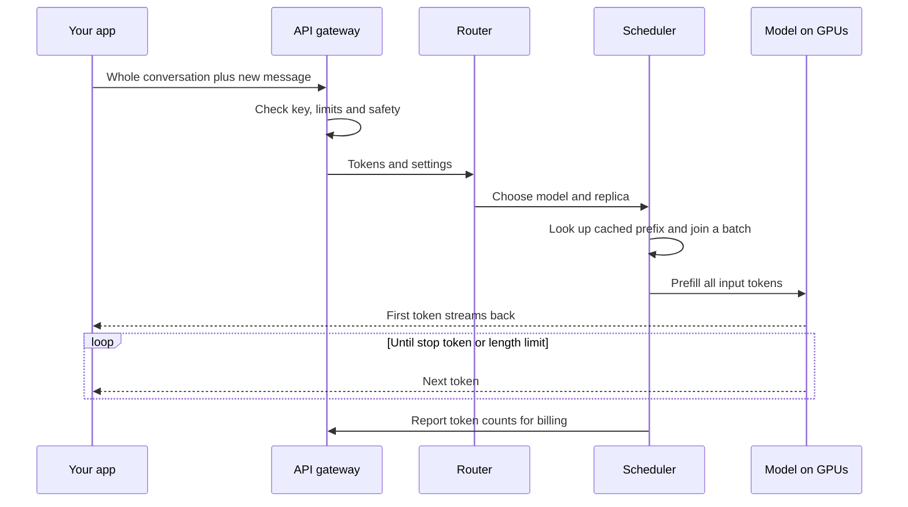
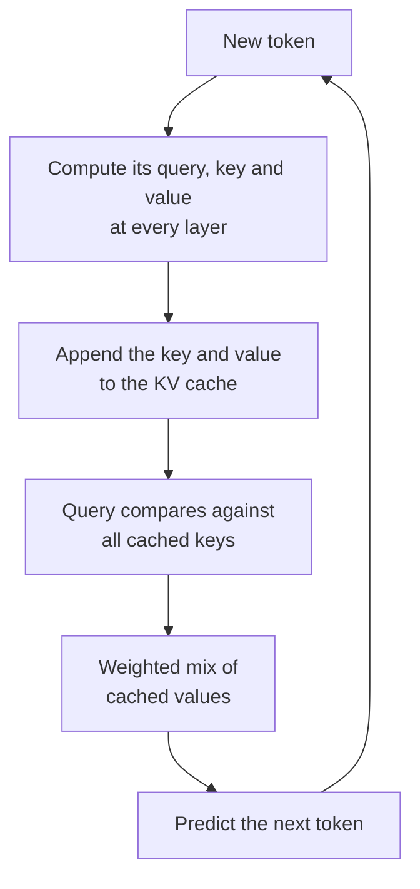
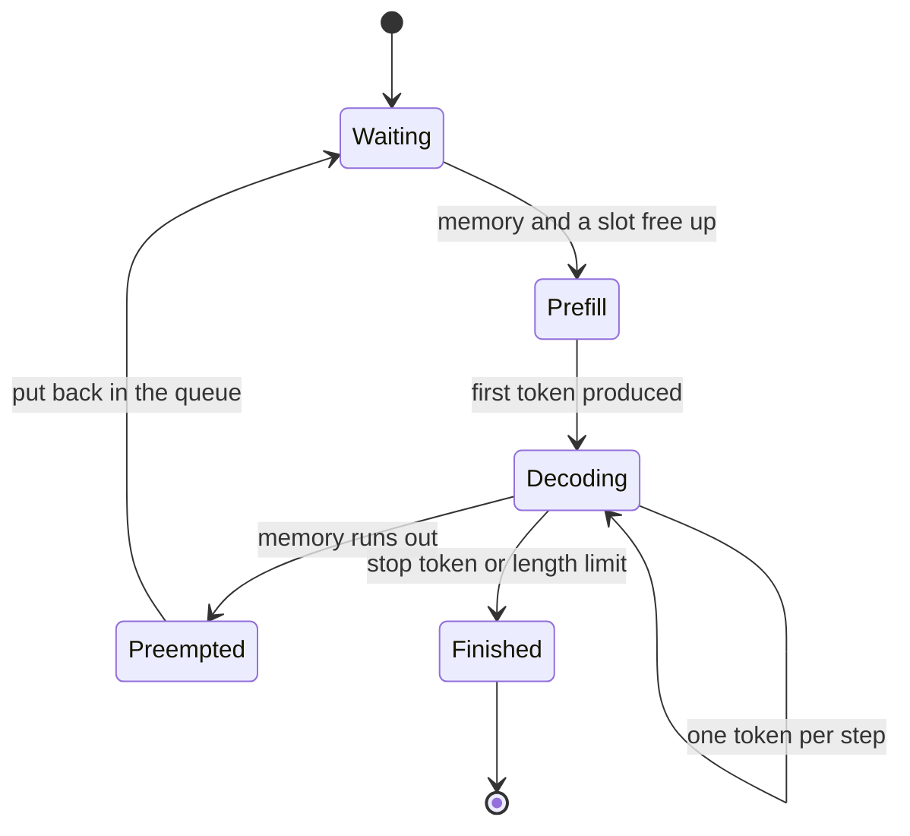
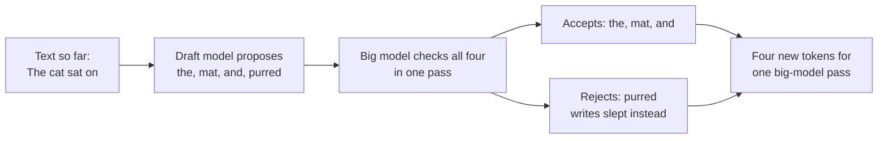
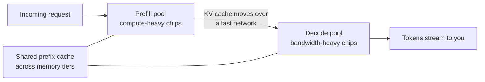
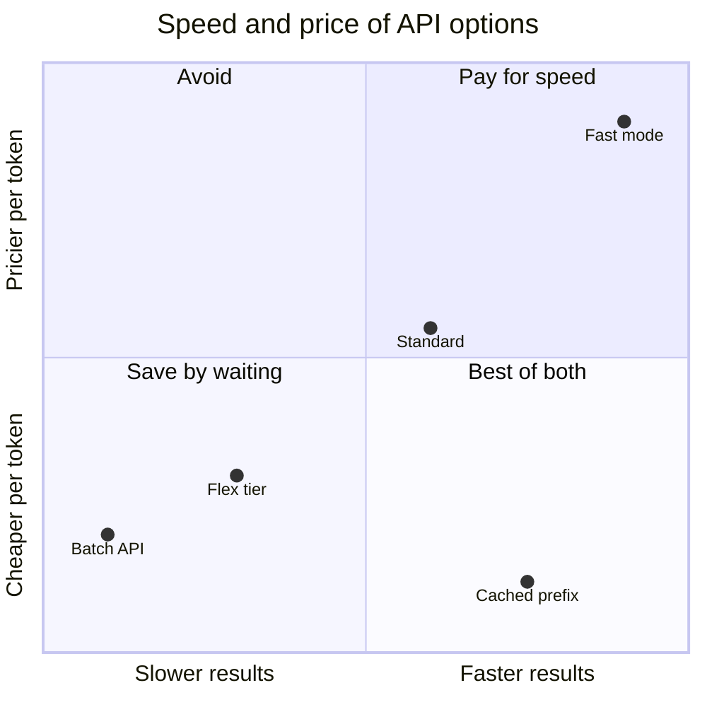
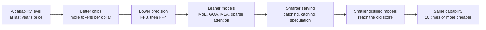

# Chapter 23: Inference: Making Models Fast and Cheap

*What happens on the server after you press Enter, why answers stream out at the speed they do, and the tricks that make the same intelligence ten or more times cheaper every year.*

## What you'll learn

- The journey of one request inside a provider's data center, from the front door to the GPU and back.
- Why reading your prompt (prefill) and writing the answer (decode) are completely different jobs, and how to estimate a model's writing speed from a chip's memory bandwidth.
- What the KV cache is, how to calculate its memory by hand, and how prompt caching turns it into a discount.
- How batching, continuous batching and PagedAttention let one GPU serve dozens of people at once.
- How speculative decoding and quantization speed things up, and what they cost in quality.
- How a one-million-token context is made affordable, and how long-context ability is tested.
- How disaggregated serving, routing, fast modes and batch APIs show up in the price list.
- How to read latency, throughput and cost numbers, which engines serve the world's chatbots, and why the price of a fixed level of capability falls so fast.

## Before you start

Chapter 5 (Functions, Vectors and Matrices) gave the rule of thumb that a model does about 2 × N calculations per token and showed how to compute memory from parameter counts. Chapter 15 (The Transformer, Piece by Piece) introduced attention, keys and values, and the KV cache. Chapter 17 (Beyond the Transformer) explained mixture-of-experts models and total versus active parameters. Chapter 18 (How a Large Language Model Works) covered tokens, sampling and the context window. This chapter is the software side of serving; Chapter 33 (Memory and the Memory Wall) and Chapter 37 (Training and Serving at Scale) cover the hardware and the economics at data-center scale.

## What happens on the server when you press Enter

You type "Explain my electricity bill" and attach a photo of it. Two seconds later, words start flowing onto your screen. In between, a lot happened.

> **Definition — Inference:** Running a trained model to produce outputs. Every chatbot reply, every image description and every agent step is inference. Training builds the model once; inference uses it billions of times.

> **Definition — Serving:** The engineering of running inference for many users at once: receiving requests, scheduling them onto chips, generating tokens and sending them back, reliably and cheaply.

Here is the journey, simplified.

1. **The front door.** Your app sends the *entire* conversation so far, not just your new message, because the model itself remembers nothing between requests (see Chapter 25). A load balancer and API gateway check your account, your rate limits and your tier.
2. **Screening.** Safety classifiers may scan the input.
3. **Tokenizing.** Your text becomes token IDs; your photo becomes visual tokens (see Chapter 22).
4. **Routing.** A router decides which model and which copy of it handles the request.
5. **Scheduling.** On a GPU server, a scheduler checks whether the beginning of your conversation is already cached, then slots your request into the batch of requests that server is working on.
6. **Prefill.** The model reads all your input tokens at once.
7. **Decode.** The model writes the answer one token at a time, and each token streams back to your screen as soon as it exists.
8. **Finish and bill.** Generation stops at an end token or a length limit, and your input, cached and output tokens are counted for the bill.

> **Definition — Replica:** One complete running copy of a model, spread over however many chips it needs. A popular model runs as thousands of replicas, and the router spreads requests among them.



*Figure 23.1: The life of one chat request inside a provider. Chapter 44 follows the same request all the way from your phone, with energy and cost at each step.*

> **Key idea:** Inference is not a side issue. Training happens once per model, but inference runs every time anyone uses it. In aggregate, serving models is a large and growing share of the major labs' computing bills (Chapter 19 gives Epoch AI's estimate for OpenAI), which is why so much engineering goes into making it faster and cheaper.

## Two different jobs: prefill and decode

> **Analogy:** Prefill is reading the exam question; decode is writing the answer. You can take in a whole page at a glance, but you must write your answer one word at a time, and each word depends on the ones before it.

> **Definition — Prefill:** The first phase of inference, in which the model processes every input token in parallel, building its internal notes about them before producing the first output token.

> **Definition — Decode:** The second phase, in which the model generates output one token at a time. Each new token requires a full pass through the model, and the next token cannot start until this one is chosen.

These phases stress a chip in opposite ways. To understand why, you need one fact about hardware: the chip's math units and its memory are separate, and the model's weights live in memory.

> **Definition — HBM (high-bandwidth memory):** Stacks of memory chips placed right beside an AI accelerator, holding the model's weights and working data. An NVIDIA H200 has 141 GB of it.

> **Definition — Memory bandwidth:** How many bytes per second can move between memory and the math units, for example 4.8 terabytes per second on an H200. For chatbots, this is often the true speed limit.

Every pass through the model needs every weight to travel from memory to the math units. During **prefill**, one trip of the weights serves all your input tokens at once: the weights are multiplied against a big block of thousands of token vectors. Lots of math per byte moved. During **decode**, each trip of the weights produces just one token for you. Very little math per byte moved.

> **Definition — Compute-bound:** A task whose speed is limited by how fast the chip can do arithmetic. Prefill and training are usually compute-bound.

> **Definition — Memory-bound:** A task whose speed is limited by how fast data can be fetched from memory, while the math units sit partly idle. Decode is usually memory-bound.

> **Definition — Arithmetic intensity:** The number of math operations performed for each byte moved from memory. High intensity keeps the math units busy; low intensity leaves them waiting.

Put numbers on it. An NVIDIA H100 can do about 989 trillion 16-bit operations per second (dense) and move 3.35 trillion bytes per second. Dividing, it needs about 989 ÷ 3.35 ≈ 295 operations per byte to keep its math units fully busy. Decoding one token for one user with 16-bit weights does 2 operations per parameter (a multiply and an add) and reads 2 bytes per parameter: 1 operation per byte. That is about 300 times too little. The math units are idle more than 99% of the time, waiting for weights to arrive. Chapter 33 draws this as a "roofline" chart.

### Worked example: how fast can one GPU write?

Because decode is memory-bound, a simple rule gives its speed limit:

`tokens per second (one user) ≈ memory bandwidth ÷ bytes read per token`

Take a 70-billion-parameter dense model stored at 8 bits (1 byte) per weight, so 70 GB.

1. On an H200 (4.8 TB/s): 4,800 GB/s ÷ 70 GB ≈ **69 tokens per second**.
2. On a Blackwell Ultra B300 (8 TB/s): 8,000 ÷ 70 ≈ **114 tokens per second**.
3. On a Vera Rubin GPU (about 19–22 TB/s, depending on which NVIDIA figure you use): about **275–315 tokens per second**.
4. On a laptop with 120 GB/s memory running a 4.7 GB quantized small model: 120 ÷ 4.7 ≈ **25 tokens per second**.

These are upper limits for a single user; real systems lose some speed to overheads. Providers also split big models across several GPUs (Chapter 37 explains how), which adds their bandwidths together: eight H200s together move 38.4 TB/s, which is part of how a large model can still stream quickly.

> **Definition — Output speed (tokens per second):** How fast text appears once generation has started, as experienced by one user. English readers skim at a few words per second, so anything above roughly 30–50 tokens per second feels instant for reading, while agents and code generation benefit from much more.

Mixture-of-experts models (see Chapter 17) change the arithmetic in their favor. Only the *active* parameters are read for each token. DeepSeek-V4-Flash has 284 billion parameters in total but only 13 billion active, so each token needs roughly 13 GB at one byte per weight. It can write about as fast as a 13-billion-parameter dense model while knowing far more, although all 284 billion parameters must still fit in memory somewhere.

### Worked example: how long does reading take?

Now prefill. Suppose you paste a 10,000-token document into the same 70-billion-parameter model.

1. Math needed: 2 × 70 billion × 10,000 tokens = 1.4 × 10^15 operations (1.4 quadrillion).
2. An H200 can do roughly 2 × 10^15 8-bit operations per second at peak; assume it achieves half of that in practice: 1 × 10^15 per second.
3. Time on one GPU: 1.4 × 10^15 ÷ 1 × 10^15 = **1.4 seconds**. Spread over eight GPUs, roughly 0.2 seconds.

Per token, that is 1.4 seconds ÷ 10,000 = 0.14 milliseconds. Decode on the same GPU took 1 ÷ 69 ≈ 14.5 milliseconds per token. Reading is about **100 times faster per token than writing**.

> **Definition — Time to first token (TTFT):** How long you wait between sending a request and seeing the first token of the reply. It is mostly queueing time plus prefill, so it grows with the length of your input.

There is a catch for very long inputs. Besides the 2 × N operations per token, attention compares every token with every earlier token, and that work grows with the *square* of the input length. For a model shaped like a 70-billion-parameter Llama, attention math roughly equals all the other math at about 100,000 input tokens, and is about ten times larger at one million. That is why pasting a whole book makes the first word slow to appear, and why the long-context tricks later in this chapter matter.

```
 time ->
 PREFILL: all input at once          DECODE: one token per step
 [############################]      [#] [#] [#] [#] [#] [#] ...
 compute-bound, parallel             memory-bound, sequential
 |<--------- TTFT --------->|        |<-->| inter-token latency
 KV cache: [==============]          [================] +1 per token
```

*Figure 23.2: The two phases of inference on a timeline. Prefill fills the KV cache in one burst; decode adds one entry per generated token.*

### What this means for your bill

Now the price list makes sense. Input tokens are processed in the fast, efficient prefill phase; output tokens each require their own slow decode step. So output costs more: Claude Opus 5.5 lists $4 per million input tokens and $20 per million output tokens, a 5× ratio, and 4–6× is typical across providers (as of October 2026). Reasoning models make this matter more, because their thinking tokens are decode tokens too and are billed as output (see Chapter 21).

> **Key idea:** Input is read in parallel and is cheap; output is written one token at a time and is expensive. If you want to cut cost and wait time, cut output length first: ask for concise answers and lower reasoning effort on easy tasks.

> **Try it:** In any chatbot, ask a one-line question and count how long until the first word appears. Then paste a very long article (10,000+ words) and ask for a one-sentence summary. The first word will take noticeably longer, even though the answer is short. You just measured prefill.

## The KV cache: the model's sticky notes

When the model writes token number 1,000 of a conversation, attention lets that token look back at all 999 earlier tokens (see Chapter 15). For each earlier token and each layer, attention needs two vectors: a **key** ("what I contain, as a label") and a **value** ("the information I hand over"). Computing those requires running every earlier token through every layer again. Doing that from scratch for every new token would make generation unbearably slow, because the total work would grow with the square of the answer length.

The fix is to compute each token's keys and values once and keep them.

> **Definition — KV cache:** The stored keys and values for every token processed so far, at every layer, kept in GPU memory so the model only has to compute keys and values for the one new token at each decode step.

> **Analogy:** The KV cache is a stack of sticky notes. Instead of rereading the whole conversation before every word, the model keeps a note about each earlier token and only writes a new note for the newest one. The longer the conversation, and the more people being served, the bigger the stack.



*Figure 23.3: One decode step with a KV cache. Only the newest token is computed fresh; everything earlier is read from the cache.*

The cache trades computation for memory, and the memory adds up fast.

### Worked example: KV-cache memory by hand

The formula is just counting:

`bytes per token = 2 (key and value) × layers × KV heads × head size × bytes per number`

Meta's Llama 3 70B has a public configuration: 80 layers, 64 attention heads for queries but only 8 heads for keys and values, a head size of 128 numbers, and 16-bit (2-byte) storage.

1. Bytes per token: 2 × 80 × 8 × 128 × 2 = **327,680 bytes**, about **0.33 MB**.
2. A 1,000-token chat: 1,000 × 0.33 MB ≈ 0.33 GB.
3. A 4,000-token chat: about 1.3 GB.
4. A 100,000-token document: about 32.8 GB.
5. One million tokens: about **328 GB**, more than twice an H200's entire 141 GB memory, and more than four times the 70 GB of 8-bit weights.

Now ask how many people one H200 can serve with that model. Memory: 141 GB. The 8-bit weights take 70 GB; leave about 10 GB for working space; about 60 GB remains for KV caches.

- At 4,000 tokens per conversation (1.3 GB each): about 45 conversations.
- At 32,000 tokens (about 10.5 GB each): about 5.
- At 100,000 tokens (32.8 GB each): just 1.

That is why long conversations cost providers so much more than short ones, and why some price lists step up above a length threshold. Claude Haiku 5.5, for example, costs $0.10/$0.50 per million tokens (input/output) for prompts up to 100,000 tokens and $0.50/$2.50 above that, and OpenAI applies long-context surcharges above 272,000 input tokens on many models (as of October 2026).

The "8 heads for keys and values" in that model was itself a memory-saving trick.

> **Definition — GQA (grouped-query attention):** An attention design in which several query heads share one set of keys and values. Llama 3 70B has 64 query heads sharing 8 key-value heads, which shrinks its KV cache eightfold compared with giving every head its own.

> **Definition — MQA (multi-query attention):** The extreme version of GQA, in which all query heads share a single set of keys and values. It saves the most memory but can cost some quality.

> **Definition — MLA (multi-head latent attention):** DeepSeek's design (2024) that stores a small compressed "latent" vector per token and layer instead of full keys and values, and reconstructs what attention needs on the fly. It cuts the cache dramatically with little quality loss.

| Attention design (example shape) | KV cache per token, 16-bit | 100,000-token conversation |
|---|---|---|
| Full multi-head (Llama 3 70B shape with 64 KV heads) | About 2.6 MB | About 262 GB |
| GQA with 8 KV heads (Llama 3 70B) | About 0.33 MB | About 33 GB |
| MLA (DeepSeek-V3: 61 layers, 576 numbers per layer) | About 0.07 MB | About 7 GB |

*Table 23.1: How attention design changes KV-cache size. The MLA row uses DeepSeek-V3's published shape (61 layers × 576 numbers × 2 bytes ≈ 70 KB per token).*

Other ways to shrink the cache include storing it in 8 bits instead of 16 (halving it), keeping only a sliding window of recent tokens in some layers, and moving cold parts of the cache to cheaper, slower memory.

> **At the frontier (2026):** DeepSeek-V4-Pro combines compressed sparse attention with heavily compressed attention; at a one-million-token context it needs, according to its model card, only 10% of the KV cache and 27% of the per-token computation of its predecessor V3.2. Moonshot's Kimi K3 mixes 69 linear-attention layers, which keep a fixed-size memory instead of a growing cache, with 24 MLA layers. On the hardware side, NVIDIA pitches its 2026 Groq-based LPX racks for fast token generation alongside Vera Rubin GPUs that hold the large KV caches.

### Prompt caching: keeping the notes between requests

Normally the KV cache is thrown away when your request finishes. But think about how a chat actually works. Every time you send a message, the app re-sends the system prompt, the tool definitions (descriptions of each tool the model may call, Chapter 28), any attached documents and the whole conversation so far. The first 95% of each request is identical to the previous one. Recomputing it every time is wasteful.

> **Definition — Prompt caching:** Keeping the KV cache for the beginning (prefix) of a prompt after a request finishes, so a later request that starts with exactly the same tokens can skip prefill for that part. Providers bill cached input tokens at a steep discount.

> **Definition — Cache hit:** A request whose prefix matches stored cache, so that part is read cheaply and quickly instead of being recomputed. A cache miss means it is processed at full price.

> **Definition — Cache lifetime (TTL):** How long a cached prefix is kept before being deleted ("time to live"), for example 5 minutes or 1 hour, often extended each time it is used.

The match must be exact and from the very first token. Change one character in the system prompt and everything after it is a miss. The practical rule: **stable content first, changing content last.**

**Worked example: ten questions about one report.** You put a 100,000-token report into Claude Opus 5.5 ($4 per million input tokens) and ask ten questions, each about 200 tokens, each answered in about 500 tokens ($20 per million output). Anthropic's published rates as of October 2026: writing to the 5-minute cache costs 1.25× the input price ($5 per million), and reading from it costs 0.05× on Opus 5.5 ($0.20 per million).

Without caching:
- Input: 10 × 100,200 tokens = 1,002,000 tokens × $4 per million ≈ $4.01.
- Output: 10 × 500 = 5,000 tokens × $20 per million = $0.10.
- Total ≈ **$4.11**.

With caching:
- First question writes the cache: 100,000 × $5 per million = $0.50, plus 200 question tokens ≈ $0.001.
- Nine later questions read it: 9 × 100,000 × $0.20 per million = $0.18, plus 9 × 200 question tokens ≈ $0.007.
- Output unchanged: $0.10.
- Total ≈ **$0.79**, about 81% less, and every answer after the first starts faster because prefill is skipped.

The discount is real because the provider genuinely saves work: it skips the prefill compute and only has to keep and fetch the stored cache. Other providers price it differently (OpenAI lists cached input for GPT-6 Astra at $1.00 against $10.00 standard; Google charges a storage fee per hour on some models), but the logic is the same. Chapter 26 shows how to turn caching on from code.

> **Watch out:** A timestamp, a random ID or "Today is Tuesday 14:03" at the top of a system prompt silently breaks caching, because the very first tokens change on every request. Put anything that changes at the end.

## Serving many people at once: batching

Recall that decode leaves the math units more than 99% idle while the weights stream in. The obvious fix: when the weights arrive, use them for many people at once.

> **Definition — Batching:** Processing many users' requests together in the same forward pass, so that one trip of the weights from memory produces the next token for every request in the batch.

### Worked example: batching on one GPU

Same H200 and 70-billion-parameter 8-bit model. Each user's conversation is 4,000 tokens long, so each has a 1.3 GB KV cache that must also be read at every step. Bytes read per step = 70 GB of weights + (number of users × 1.3 GB). Steps per second = 4,800 GB/s ÷ bytes per step. Each step gives every user one token. Assume renting the GPU costs $4 per hour (on-demand H200 prices listed at $3.59–5.29 per hour on one cloud marketplace in October 2026), and cost per million tokens = $4 ÷ (tokens per hour) × 1,000,000.

| Users in batch | Bytes per step | Speed per user | Total tokens per second | Cost per million tokens |
|---|---|---|---|---|
| 1 | 71 GB | 67 tok/s | 67 | $16.51 |
| 8 | 80 GB | 60 tok/s | 477 | $2.33 |
| 16 | 91 GB | 53 tok/s | 844 | $1.32 |
| 32 | 112 GB | 43 tok/s | 1,372 | $0.81 |
| 45 | 129 GB | 37 tok/s | 1,675 | $0.66 |
| 64 | 154 GB | does not fit in 141 GB | — | — |

*Table 23.2: The batching trade-off on one GPU, computed from bandwidth alone. Each user gets slower, but the GPU produces 25 times more text, and the cost per token falls 25-fold.*

Three lessons sit in that table.

1. **Batching is where the money is.** Going from 1 user to 45 cuts cost per token by about 25 times, while each user's speed drops by less than half.
2. **There is a trade-off between speed for one person and cost for everyone.** A provider can serve you faster by putting you in a smaller batch, but then the GPU produces fewer total tokens per hour, so somebody has to pay more.
3. **Memory caps the batch, and long contexts eat it.** At 64 users the KV caches no longer fit. And because every user's cache must be read separately, KV-cache reads do not get cheaper with batching. With 100,000-token conversations, a single user's cache alone adds 33 GB per step, and the GPU can hold only one or two of them.

> **Definition — Throughput:** The total number of tokens a system produces per second across all users. Providers maximize throughput to lower cost; users care about their own speed. The two pull in opposite directions.

### Continuous batching

The simple way to batch is to collect a group of requests, run them together, and start the next group when all are done. The problem: answers have different lengths. If one person asked for a haiku and another for a 2,000-word essay, the haiku's slot sits empty while the essay finishes.

> **Definition — Continuous batching:** Scheduling at the level of individual decode steps: after every step, finished requests leave the batch and waiting requests join immediately, so the GPU's slots stay full. It is standard in modern serving engines.



*Figure 23.4: The life of a request inside a continuous-batching scheduler. Requests join and leave the running batch at every step.*

One complication: a newcomer's prefill is a big burst of computation, and if it runs in one go it stalls everyone else's next token, producing a visible "hiccup" in their stream. Engines therefore cut long prompts into pieces.

> **Definition — Chunked prefill:** Splitting a long prompt's prefill into smaller chunks and mixing them into ordinary decode steps, so a new long request doesn't freeze the token streams of users already being served.

### PagedAttention: managing memory like an operating system

KV caches grow unpredictably, one token at a time, and nobody knows in advance how long an answer will be. Early serving systems reserved a block of memory big enough for the longest possible answer for every request. Most of that reserved space sat empty.

> **Definition — Memory fragmentation:** Wasted memory caused by reserving space that is never used, or by free space being scattered in gaps too small to use. In early LLM serving, fragmentation wasted a large share of KV-cache memory.

> **Definition — PagedAttention:** A technique introduced with the open-source vLLM engine in 2023 that stores each request's KV cache in small fixed-size blocks scattered anywhere in memory, tracked by a lookup table, the way an operating system manages computer memory in pages. Blocks are handed out only as needed.

```
 GPU memory as fixed-size KV blocks (16 tokens each)

 block:   0    1    2    3    4    5    6    7    8    9
        [A1] [B1] [A2] [C1] [B2] [A3] [  ] [C2] [  ] [B3]

 Block table:
   User A -> blocks 0, 2, 5    (up to 48 tokens)
   User B -> blocks 1, 4, 9
   User C -> blocks 3, 7
   Free   -> blocks 6, 8   given out the moment anyone needs one
```

*Figure 23.5: PagedAttention. Each user's cache is scattered across small blocks, so almost no memory is wasted and the batch can be larger.*

> **Analogy:** PagedAttention is a library that shelves each person's notes wherever there is space and keeps a catalog card saying where every page is, instead of reserving a whole empty bookcase for every visitor just in case.

Paging also makes sharing easy. If 1,000 requests begin with the same 3,000-token system prompt, their tables can all point to the same blocks for that prefix. The SGLang engine (2024) generalized this with "RadixAttention," which keeps a tree of cached prefixes so any request automatically reuses the longest prefix already in memory. Shared prefixes are the server-side machinery behind the prompt-caching discounts you saw earlier.

> **Watch out:** Batching explains a puzzle from Chapter 18: why "temperature 0" is not perfectly repeatable on shared servers. Your request is batched with different strangers each time, and the batch's size and makeup can change the order in which the GPU adds up numbers. Floating-point addition gives very slightly different results in different orders, and once in a while that flips which token wins, after which the text diverges.

## Speculative decoding: guess ahead, check in one pass

Here is a lovely consequence of decode being memory-bound. Checking several tokens costs about the same as generating one. If someone hands the big model five proposed next tokens, it can verify all five in a single pass, because one trip of the weights through memory serves all five positions at once, just as in prefill. The hard part is getting good guesses cheaply.

> **Definition — Speculative decoding:** A speed-up in which a fast "draft" proposes several next tokens and the large model verifies them all in one pass, keeping every proposed token up to the first one it disagrees with. With the right acceptance rule, the output follows exactly the same probabilities as the large model alone (Leviathan and colleagues, 2022).

> **Definition — Draft model:** The small, fast model (or set of extra prediction heads) that proposes tokens for speculative decoding. It only needs to guess well on easy, predictable tokens.



*Figure 23.6: Speculative decoding. Even with one rejection, the big model produced four tokens in one pass instead of one.*

> **Analogy:** An intern drafts the next few sentences; the boss reads them at a glance, keeps the good ones, and fixes the first bad one. The boss's signature costs the same whether there is one sentence or five.

> **Definition — Acceptance rate:** The share of draft tokens the large model accepts. High acceptance means large speed-ups; low acceptance means the draft is wasted work.

**Worked example.** The draft proposes 4 tokens per round, and each is accepted with probability 0.8 (assume independence). On average the round yields (1 − 0.8^5) ÷ (1 − 0.8) = (1 − 0.328) ÷ 0.2 ≈ 3.36 tokens, counting the token the big model always contributes itself. (Where the formula comes from: the big model always adds 1 token; the first draft token survives with probability 0.8, the first two with 0.8 × 0.8 = 0.64, the first three with 0.512 and all four with 0.41. Adding 1 + 0.8 + 0.64 + 0.512 + 0.41 also gives about 3.36; the formula is a shortcut for that sum.) Suppose each draft token costs a tenth of a big-model step: the round costs 1 + 4 × 0.1 = 1.4 big-model steps. Speed-up ≈ 3.36 ÷ 1.4 ≈ **2.4 times**. Drop acceptance to 0.5 and the round yields only about 1.94 tokens for the same cost: a speed-up of about 1.4 times. Predictable text (code, legal boilerplate, editing a document you supplied) speeds up most.

Drafts come in several forms: a small model from the same family; extra prediction heads bolted onto the big model (the Medusa and EAGLE methods, 2024); simply copying likely continuations from the prompt itself, which works well when editing a document; or heads trained into the model from the start.

> **Definition — Multi-token prediction (MTP):** Training a model to predict several future tokens at each position, not just the next one. It can improve learning, and the extra predictions make a built-in draft for speculative decoding. DeepSeek-V3 (2024) and NVIDIA's Nemotron 3 Super use it.

A more radical route to speed is to stop writing left to right at all. Diffusion language models refine many tokens in parallel over a few passes (see Chapter 16); Inception reports about 1,000 tokens per second for its Mercury diffusion models, including 1,068 tokens per second for Mercury 3 (October 2026), which it claims matches or beats GPT-6 Luna and Claude Haiku 5.5 on a range of benchmarks (company-reported).

> **Key idea:** Speculative decoding exploits idle math: the GPU is waiting for memory anyway, so it might as well check several guesses at once. Done properly, it changes speed, not answers.

## Quantization: fewer bits per number

Decode speed is bytes ÷ bandwidth, so the most direct speed-up is to make the weights smaller.

> **Definition — Quantization:** Storing a model's numbers (weights, and sometimes activations and the KV cache) with fewer bits, such as 8 or 4 instead of 16, to save memory and speed up inference, at some risk to accuracy.

For a 70-billion-parameter model: 16-bit weights take 140 GB, 8-bit take 70 GB, 4-bit take 35 GB. Halving the bytes roughly doubles the decode speed limit and doubles how many users' caches fit beside the weights. Newer chips also do low-precision math faster: NVIDIA rates each Vera Rubin GPU at about 35 petaFLOPS of dense math in its 4-bit NVFP4 format against 4 petaFLOPS in 16-bit BF16.

### Worked example: rounding four weights to 4 bits

A symmetric 4-bit integer format can hold whole numbers from −7 to +7. Take four weights: 0.12, −0.53, 0.97, −0.08.

1. Pick a scale so the largest weight lands on 7: scale = 0.97 ÷ 7 ≈ 0.139.
2. Divide each weight by the scale and round: 0.12 → 0.87 → **1**; −0.53 → −3.82 → **−4**; 0.97 → **7**; −0.08 → −0.58 → **−1**.
3. Store four 4-bit integers plus one scale.
4. To use them, multiply back: 0.139, −0.556, 0.97, −0.139.
5. Errors: +0.019, −0.026, 0, −0.059. Small, but not zero.

```
 INT4 grid, scale 0.139 (each tick = 0.139)
 -7  -6  -5  -4  -3  -2  -1   0   1   2   3   4   5   6   7
  |---|---|---|---|---|---|---|---|---|---|---|---|---|---|
              ^           ^       ^                       ^
            -0.53       -0.08   0.12                    0.97
            to -4       to -1   to 1                  exactly 7
```

*Figure 23.7: Quantization snaps each weight to the nearest tick of a coarse ruler. One scale number sets the spacing of the ticks.*

Now the danger. If one weight in the group were an outlier such as 5.0, the scale would become 5.0 ÷ 7 ≈ 0.71, and all the small weights (0.12, −0.08) would round to 0, erasing them. Real models have such outliers. The modern fix is to give each small block of numbers its own scale.

> **Definition — Block scaling (microscaling):** Giving each small block of numbers its own scale factor, so one outlier only distorts its own block. MXFP4, an open industry standard, shares one scale per 32 numbers; NVIDIA's NVFP4 uses blocks of 16 with a finer 8-bit scale.

There are two ways to arrive at a quantized model.

> **Definition — Post-training quantization (PTQ):** Rounding a finished model's weights to fewer bits after training, often using a small sample of data to choose good scales. Quick and cheap, with some quality loss at low bit widths.

> **Definition — Quantization-aware training (QAT):** Training (or fine-tuning) the model while simulating low-precision rounding, so it learns weights that survive being rounded. It loses much less quality at 4 bits than rounding afterwards.

| Format | Bits | Memory for 70B weights | Typical use in 2026 |
|---|---|---|---|
| BF16 | 16 | 140 GB | Training; high-quality serving |
| FP8 / INT8 | 8 | 70 GB | Mainstream serving; near-lossless with care |
| MXFP4 / NVFP4 / INT4 | About 4–4.5 | 35–40 GB | Frontier MoE serving; local models |
| 2–3 bit | 2–3 | 18–26 GB | Squeezing models onto small devices; visible quality loss |

*Table 23.3: The precision ladder for inference. Block formats add a small overhead for their scale factors (MXFP4 averages about 4.25 bits per weight).*

> **At the frontier (2026):** Four-bit is now mainstream at the top. OpenAI's open gpt-oss-120b stores its expert weights in MXFP4 so the whole 117-billion-parameter model fits on one 80 GB GPU. Moonshot applied MXFP4 quantization-aware training to Kimi K3 from the fine-tuning stage onward. Google released Gemma 4 QAT checkpoints. DeepSeek-V4 stores its expert weights in FP4 and the rest in FP8. NVIDIA's Nemotron 3 Super was even pretrained in NVFP4.

How much quality is lost? Good 8-bit quantization is usually close to lossless. Good 4-bit quantization, especially with QAT, typically loses a little, more on hard reasoning and rare knowledge than on everyday chat. Below about 4 bits, losses become noticeable; hobbyists running local models often find the "knee" around 4 bits. Quantizing the KV cache to 8 bits is also common, and activations (the numbers flowing between layers) are hardest because they contain the worst outliers.

> **Watch out:** "Quantized" does not mean "broken," but it doesn't mean "identical" either. Open-weight models are served by many third-party providers, and the same model can perform differently depending on how each one quantizes and configures it. If quality matters, test the exact provider and settings you will use. Chapter 30 shows how to compare 4-bit and 8-bit versions on your own computer.

## Long context: making a million tokens affordable

Several frontier models now accept about one million tokens, roughly 555,000 to 750,000 English words depending on the tokenizer (as of late 2026). Epoch AI estimates context windows have grown about 30 times per year since 2023. Three costs grow with length:

1. **Prefill attention**, which grows with the square of the input length.
2. **KV-cache memory**, which grows in proportion: 328 GB at one million tokens for a Llama-3-70B-shaped model.
3. **Decode slowdown**, because every new token must read the whole cache. With a 100,000-token cache (33 GB) on top of 70 GB of weights, our H200 drops from about 69 to 4,800 ÷ 103 ≈ 47 tokens per second for that single user.

Engineers attack each cost.

> **Definition — RoPE scaling:** Stretching the rotary position scheme that tells a model where each token sits (see Chapter 15), using methods such as YaRN, so a model trained mostly on shorter texts can handle much longer ones after brief extra training.

> **Definition — FlashAttention:** A way of computing exact attention (2022) in small tiles inside the GPU's fast on-chip memory, without ever writing the full table of token-to-token scores to slow memory. Same answer, far less memory traffic.

> **Definition — Sparse attention:** Attention in which each token looks at only a selected subset of earlier tokens (nearby ones, or the most relevant ones picked by a cheap scorer) instead of all of them.

> **Definition — Linear and hybrid attention:** Linear attention (and its relatives, state-space models) replaces the growing KV cache with a fixed-size memory updated at each token. Hybrid models use mostly such layers plus a few full-attention layers for exact recall.

> **Definition — Context parallelism (ring attention):** Splitting one very long sequence across many GPUs, each holding a chunk of tokens and its part of the KV cache, and passing keys and values around a ring so every chunk can attend to every other.

| Technique | What it saves | The catch |
|---|---|---|
| RoPE scaling (YaRN) | Lets a model reach longer lengths cheaply | Quality at the far end needs testing |
| FlashAttention | Memory traffic for exact attention | Still quadratic math |
| GQA, MQA, MLA | KV-cache size | Small quality trade-offs (MQA most) |
| Sliding windows, sparse attention | Attention math and cache reads | May miss rarely used distant facts |
| Linear / hybrid attention | Cache becomes fixed-size or much smaller | Exact recall can suffer |
| KV-cache quantization, offloading | Memory | Some accuracy or added delay |
| Context parallelism | Fits sequences no single GPU can hold | Network traffic between GPUs |

*Table 23.4: The long-context toolbox.*

The designs disagree, which tells you the problem is not solved. Qwen3.5 interleaves three cheap linear-attention layers with one full-attention layer; Moonshot's Kimi Linear (2025) claimed up to 75% less KV cache and up to 6 times faster decoding at one million tokens (company-reported); Kimi K3 uses 69 linear layers and 24 MLA layers. Yet MiniMax went back to plain full attention for its M2 model in October 2025, saying hybrids looked fine on benchmarks but degraded on multi-step reasoning at scale, and that full attention has far more mature software. Chapter 17 explains these architectures.

**How long context is tested.** A context window is only useful if the model actually uses what is in it.

> **Definition — Needle in a haystack:** A long-context test that hides one fact (the "needle") somewhere in a huge document and asks the model to retrieve it. Frontier models now pass simple versions easily, so harder tests are needed.

> **Definition — RULER:** A long-context benchmark from NVIDIA researchers (2024) that goes beyond one needle: multiple needles, tracing chains of variables, and aggregating information spread through the text, to measure a model's *effective* context length.

Harder still are tasks that require connecting many distant pieces. On GraphWalks, which asks models to follow paths through a graph described over 256,000 to one million tokens, Google's self-reported table for Gemini 4 Argon shows 84.2 against 71.8 for GPT-6 Astra, 65.0 for Claude Fable 5.1 and 66.8 for Claude Opus 5.5 (vendor-chosen benchmark, so read it with care; see Chapter 24). The older finding of "lost in the middle" (2023), where models use the start and end of a long context better than the middle, still shapes good practice: put the most important material where the model attends best and ask it to quote what it relies on (see Chapter 25).

> **Watch out:** The advertised context window is the maximum the system accepts, not the length over which the model reasons reliably. Retrieval of a single fact may work at one million tokens while multi-step reasoning across the same text degrades far earlier. Test with your own documents.

## Splitting the work: disaggregation, parallelism and routing

### Disaggregated prefill and decode

Prefill wants raw computing power. Decode wants memory bandwidth and lots of memory capacity for KV caches. Running both on the same GPUs means each phase uses hardware tuned for the other, and a burst of prefill can interrupt everyone's decode.

> **Definition — Disaggregated serving:** Running prefill and decode on separate pools of chips, each sized and tuned for its phase, and transferring each request's KV cache from the prefill pool to the decode pool over a fast network.



*Figure 23.8: Disaggregated serving. Each phase runs on hardware suited to it, and cached prefixes are shared across the fleet.*

NVIDIA's Dynamo software (2025) orchestrates this kind of serving across many GPUs. Hardware is splitting the same way: Google's TPU 8 generation (announced April 2026) has a separate inference chip, TPU 8i, with 288 GB of HBM at 8.6 TB/s and 384 MB of fast on-chip memory; NVIDIA announced Rubin CPX in 2025 as a prefill-oriented chip (its 2026 status was not confirmed in our research); and NVIDIA's Groq-based LPX racks (256 chips per rack, each with about 500 MB of very fast on-chip memory) are positioned for low-latency token generation beside Vera Rubin GPUs that hold the large KV caches. Chapter 35 covers these chips.

### Spreading one model across many chips

A model too big for one GPU is split across several.

> **Definition — Tensor parallelism:** Splitting each layer's weight matrices across several GPUs so they compute parts of every token together and combine results. It adds the GPUs' memory bandwidths but requires very fast links between them.

> **Definition — Expert parallelism:** For mixture-of-experts models, placing different experts on different GPUs and sending each token to whichever GPUs hold its chosen experts. Racks such as NVIDIA's 72-GPU NVL72 are well suited to this, because every GPU can talk to every other at high speed.

Chapter 37 explains these and the other parallelism strategies in detail.

### Routing

Not every request needs the biggest model or the longest thinking.

> **Definition — Model router:** A component that decides which model, mode or replica handles each request, based on its difficulty, the customer's settings, safety signals or which server already has the right prefix cached.

Routers appear at several levels. GPT-5 (August 2025) introduced a router across fast and thinking models inside ChatGPT. Developers build cascades that try a cheap model first and escalate hard cases. Reasoning-effort settings are a kind of self-routing (see Chapter 21). Safety routing exists too: when Anthropic's classifiers flag certain Claude Fable 5 requests, they are routed to Opus 4.8 instead (Anthropic says over 95% of Fable sessions see no fallback). And load balancers prefer replicas that already hold your conversation's prefix in cache.

## How it all shows up in your bill

Every pricing tier you see is one of the trade-offs in this chapter, sold to you as an option.

| Tier | What you get | Examples (as of October 2026) | Why the provider can offer it |
|---|---|---|---|
| Standard | Normal speed | Opus 5.5: $4 in / $20 out per million tokens | Balanced batching |
| Batch API | Results within hours, at about half price | 50% off at Anthropic, OpenAI and Google | Fills idle GPU time with big, flexible batches |
| Flex | Slower, may be delayed | Half price at OpenAI; on Gemini Flash models priced like batch | Runs when capacity is spare |
| Cached input | Repeated prefixes at a discount | Opus 5.5 cache reads 0.05× ($0.20 per million); GPT-6 Astra cached input $1.00 vs $10.00 | Skips prefill |
| Fast mode / priority | Faster output | Opus 5.5 fast mode $8 / $40 (2×); Gemini Priority about 1.8×; OpenAI renamed "priority processing" to "Fast mode" on July 30, 2026 | Smaller batches or faster hardware mean fewer tokens per GPU-hour |
| Long-context pricing | Higher rates past a threshold | Haiku 5.5 above 100,000 tokens; OpenAI surcharges above 272,000 input tokens | Big KV caches crowd out other users |
| Regional processing | Data kept in a region | OpenAI adds 10% for newer models | Less flexible placement of work |

*Table 23.5: API pricing tiers and the inference mechanics behind them. Providers do not disclose exactly how they implement fast modes; the right-hand column gives the economic logic.*

> **Definition — Batch API:** An API option where you submit many requests at once and receive results later, typically within 24 hours, usually at about half the standard price.

> **Definition — Fast mode (priority tier):** A premium option that delivers output faster for a higher per-token price, for example Claude Opus 5.5's fast mode at twice the standard rate.



*Figure 23.9: Where the common API options sit. Cached prefixes are the rare case that is both faster and cheaper, which is why structuring prompts for caching pays off.*

> **Key idea:** Price tiers are the batching trade-off made visible. Waiting lets the provider pack GPUs fuller, so you pay less. Wanting speed means fewer tokens per GPU-hour, so you pay more. Reusing a prefix saves the provider real work, so you pay much less.

## Measuring speed: latency, throughput and cost

When providers, benchmarks and engineers talk about inference performance, they use a handful of measures.

> **Definition — Inter-token latency (ITL):** The time between successive output tokens once streaming has started, also called time per output token. Its inverse is output speed: 20 milliseconds per token is 50 tokens per second.

> **Definition — Serving goodput:** The share of requests served within the promised speed targets, or the throughput counting only those requests. A system with high throughput but many slow, late answers has poor goodput.

> **Definition — Service-level objective (SLO):** A target a service commits to internally or to customers, such as "95% of requests get their first token within 1 second."

> **Definition — Cost per million tokens:** What it costs (to the provider) or what it is priced (to you) to process one million tokens. For providers, it is roughly the hourly cost of the hardware divided by millions of tokens produced per hour.

**Worked example: why reasoning answers feel slow.** Total wait ≈ TTFT + (output tokens × inter-token latency). A plain answer: 0.8 seconds + 600 tokens × 0.02 seconds = 12.8 seconds until it finishes, though you start reading after 0.8 seconds. A reasoning model that first thinks for 3,000 hidden tokens: 0.8 + 3,600 × 0.02 = 72.8 seconds, and if the thinking is hidden, you see nothing useful for the first minute. Effort settings are, in large part, a dial on this number.

**Energy per token.** A rough estimate: if one GPU plus its share of cooling and other overhead draws about 1.5 kilowatts while producing 2,000 tokens per second across its batch, each token uses 1,500 ÷ 2,000 = 0.75 joules (a watt is one joule per second, so 1,500 joules arrive each second and are shared among 2,000 tokens). A 500-token answer is then about 375 joules, roughly 0.1 watt-hours (375 ÷ 3,600 joules per watt-hour), about what a 10-watt LED bulb uses in 37 seconds. Small per answer, enormous in aggregate (Part VII covers the power side).

| Metric | What it measures | Who cares most |
|---|---|---|
| Time to first token | Wait before anything appears | Chat users, voice assistants |
| Inter-token latency / output speed | Smoothness and speed of streaming | Readers, coding agents |
| End-to-end latency | Time until the full answer is done | Agents and pipelines |
| Throughput | Total tokens per second per GPU | Providers' finance teams |
| Goodput under an SLO | Requests served fast enough | Operations teams |
| Cost per million tokens | Money per unit of output | Everyone paying the bill |
| Tokens per watt | Energy efficiency | Data-center planners |

*Table 23.6: The vocabulary of inference performance.*

> **Try it:** Open the Artificial Analysis leaderboard (artificialanalysis.ai) and pick three models: one frontier model, one open-weight model and one small "Flash" or "Haiku" class model. Note each one's output speed, time to first token and price. Use this chapter to explain the differences: model size and active parameters, reasoning tokens, and the provider's hardware.

## Serving engines: the software that runs it all

Every technique above lives inside a serving engine.

> **Definition — Serving engine:** The software that loads a model onto chips and serves requests efficiently, implementing batching, KV-cache management, caching, speculative decoding, quantized kernels and streaming.

> **Definition — Kernel:** A small, highly optimized program that runs one operation (such as attention or a quantized matrix multiply) on a GPU. A large part of inference engineering is writing faster kernels.

| Engine | Origin | Known for |
|---|---|---|
| vLLM | Open source, from UC Berkeley researchers (2023) | PagedAttention; broad model and hardware support; very widely used |
| SGLang | Open source (2024) | RadixAttention prefix sharing; fast structured outputs (answers forced into an exact data format, Chapter 26) |
| TensorRT-LLM | NVIDIA | Heavily optimized kernels for NVIDIA GPUs |
| NVIDIA Dynamo | NVIDIA (2025) | Orchestrating disaggregated serving across many GPUs |
| llama.cpp, Ollama, LM Studio, MLX | Open source and Apple | Running quantized models on laptops and desktops (see Chapter 30) |

*Table 23.7: Common serving engines in 2026. The big closed labs also run their own in-house stacks, which they do not publish.*

## Why prices fall ten times or more per year

Here is perhaps the most important economic fact in AI. Epoch AI found in March 2025 that the price of reaching a fixed level of capability had been falling between 9 and 900 times per year, depending on the benchmark. GPT-4-level performance on the MMLU knowledge test cost $37.50 per million tokens in March 2023 and $0.18 per million in February 2025 (Gemini 2.0 Flash), a drop of about 200 times in under two years. Reaching GPT-4's level on the harder GPQA science test fell about 40 times per year.

No single breakthrough explains this. Many multipliers stack:



*Figure 23.10: Why the price of a fixed capability keeps falling: several independent improvements multiply together.*

- **Hardware.** Epoch estimates AI-chip performance per dollar improves about 1.5 times per year and energy efficiency about 1.3 times per year.
- **Precision.** Each step from 16 to 8 to 4 bits roughly halves the bytes per token.
- **Architecture.** Mixture-of-experts reads only active parameters; GQA, MLA and sparse attention shrink caches.
- **Serving software.** Continuous batching, paging, prefix caching and speculative decoding raise tokens per GPU-hour.
- **Smaller models.** Distillation (see Chapter 20) and training small models on far more data (see Chapter 19) let a model a fraction of the size match last year's flagship.
- **Competition.** Open-weight models and many providers push margins down.

**Illustration (not a measurement).** If hardware gives 1.5 times, a precision step 2 times, serving software 2 times, and a distilled model one-fifth the size reaches the same score (5 times), together they give 1.5 × 2 × 2 × 5 = 30 times cheaper in a year.

Two cautions. First, the price of the *best* model does not fall like this. Top-tier prices stay high (Claude Fable 5.1 and GPT-6 Astra both list $10 per million input and $50 per million output in October 2026), while yesterday's frontier gets cheaper beneath them. Labs also compete on this curve directly: Anthropic says Opus 5.5 performs roughly at Fable 5.1's level on most work at 40% lower cost than Opus 5, and OpenAI describes GPT-6.1 Sol as near Astra's level at about one-fifth of Astra's price (company claims).

> **Definition — Jevons paradox:** The observation, first made about coal in the 1860s, that making a resource cheaper to use can increase total consumption, because people find many more uses for it.

Second, cheaper tokens do not mean less total spending. As tokens get cheaper, people use far more of them: reasoning models think for thousands of tokens, agents run for hours, and multi-agent systems multiply everything. Total inference demand, and the data centers being built to meet it (see Part VII), keep growing.

> **At the frontier (2026):** The labs' inference teams now treat "cost per token" and "tokens per watt" as headline metrics, and chipmakers market them directly. The newest frontier comes from long-running agents and reasoning: huge KV caches, many parallel agents, and contexts near a million tokens. This is pushing disaggregated serving, new memory tiers for caches, and inference-specific chips, and it is why inference engineers are among the scarcest specialists in AI.

## In plain English

When you hit Enter, your whole conversation goes to a provider's servers, gets turned into tokens, and is placed on a GPU alongside many other people's requests. The model first reads everything you sent in one fast, parallel burst (prefill), then writes its answer one token at a time (decode). Reading is limited by how fast the chip can do math; writing is limited by how fast it can pull the model's weights out of memory. That is why answers stream out word by word, why long pastes make the first word slow to appear, and why output tokens cost several times more than input tokens.

To avoid redoing work, the model keeps notes on every earlier token: the KV cache. Those notes take a lot of memory, so long conversations are expensive, and providers use clever attention designs to shrink them. When many requests start the same way, providers keep the notes and charge you much less to reuse them: prompt caching.

The biggest money-saver is batching: serving dozens of people with each trip of the weights through memory. Waiting (batch APIs) makes it cheaper; demanding speed (fast modes) makes it pricier. Other tricks include letting a small model guess ahead while the big one checks (speculative decoding), storing numbers with fewer bits (quantization), and running the reading and writing phases on different machines.

Together with better chips and smaller, smarter models, these tricks make the same level of intelligence ten or more times cheaper every year, even as people use far more of it.

## Key terms

Inference, Serving, Replica, Prefill, Decode, HBM (high-bandwidth memory), Memory bandwidth, Compute-bound, Memory-bound, Arithmetic intensity, Output speed (tokens per second), Time to first token (TTFT), KV cache, GQA (grouped-query attention), MQA (multi-query attention), MLA (multi-head latent attention), Prompt caching, Cache hit, Cache lifetime (TTL), Batching, Throughput, Continuous batching, Chunked prefill, Memory fragmentation, PagedAttention, Speculative decoding, Draft model, Acceptance rate, Multi-token prediction (MTP), Quantization, Block scaling (microscaling), Post-training quantization (PTQ), Quantization-aware training (QAT), RoPE scaling, FlashAttention, Sparse attention, Linear and hybrid attention, Context parallelism (ring attention), Needle in a haystack, RULER, Disaggregated serving, Tensor parallelism, Expert parallelism, Model router, Batch API, Fast mode (priority tier), Inter-token latency (ITL), Serving goodput, Service-level objective (SLO), Cost per million tokens, Serving engine, Kernel, Jevons paradox

## Exercises

1. **[Easy] Time the two phases yourself.** (1) In your usual chatbot, with reasoning or thinking set to the lowest option, ask "What is the capital of Peru? One word." Time how long until the first character appears. (2) Paste a long article (at least 8,000 words) and ask "Summarize this in one sentence." Time the first character again. (3) Ask for "a 400-word story about a lighthouse" and time from the first word to the last; divide 400 words × 1.3 tokens per word by that time to estimate tokens per second. **What you'll learn:** TTFT grows with input length (prefill), while writing speed is a separate, steady rate (decode).

2. **[Easy] Predict your computer's AI speed.** (1) Find your computer's memory bandwidth by searching its model name plus "memory bandwidth" (Apple M-series chips list it on Apple's site; a typical DDR5 laptop is around 60–120 GB/s). (2) Take a model file size, for example 4.7 GB for an 8-billion-parameter model at 4 bits. (3) Divide: bandwidth in GB/s ÷ file size in GB = maximum tokens per second. (4) If you have LM Studio or Ollama installed, compare with the speed it reports. **What you'll learn:** the speed of writing is set by memory bandwidth, not by how many calculations the chip can do.

3. **[Medium] Build a KV-cache calculator in a spreadsheet.** (1) Make columns for layers, KV heads, head size, bytes per number, and context length. (2) Bytes per token = 2 × layers × KV heads × head size × bytes. (3) Enter Llama 3 70B (80, 8, 128, 2) and Llama 3 8B (32, 8, 128, 2). (4) Compute total cache in GB at 8,000, 128,000 and 1,000,000 tokens. (5) Assuming 60 GB of free memory, compute how many simultaneous conversations fit at each length. (6) Change bytes to 1 (an 8-bit cache) and see what changes. **What you'll learn:** why long contexts are expensive and why attention designs that shrink the cache matter so much.

4. **[Medium] When does prompt caching pay off?** (1) In a spreadsheet, set the input price to $4 per million, the cache-write price to 1.25 × input, and the cache-read price to 0.05 × input. (2) For a 50,000-token document, compute the input cost of asking 1, 2, 5, 10 and 50 questions with and without caching (ignore the short questions themselves). Without caching, every question pays for the whole document: questions × 50,000 × input price ÷ 1,000,000. With caching, the first question pays the write price for 50,000 tokens and each later question pays the read price for 50,000 tokens. (3) Find the number of questions at which caching becomes cheaper. (4) Repeat with the cache-read price at 0.1 × input. **What you'll learn:** caching costs slightly more for a single use and pays off as soon as the prefix is reused once, so stable, reused prefixes should always come first.

5. **[Medium] Recreate the batching table.** (1) In a spreadsheet, set bandwidth = 4,800 GB/s, weights = 70 GB, KV per user = 1.31 GB, and GPU cost = $4 per hour. (2) For batch sizes 1, 2, 4, 8, 16, 32 and 45, compute bytes per step, steps per second (bandwidth ÷ bytes), total tokens per second (steps × batch size) and cost per million tokens ($4 ÷ (tokens per second × 3,600) × 1,000,000). (3) Now set KV per user to 10.5 GB (32,000-token conversations) and redo it, noting the largest batch that fits in 141 GB. (4) Chart speed per user against cost per million tokens. **What you'll learn:** the speed-versus-cost trade-off behind every price tier, and how long contexts limit batching.

6. **[Medium] Prefill versus decode on your own computer.** (1) Install LM Studio (lmstudio.ai) and download a small model (3–8 billion parameters, 4-bit). (2) Ask a short question and note the time to first token and tokens per second that LM Studio displays. (3) Paste a 5,000-word article and ask for a one-sentence summary; note time to first token again. (4) Ask for a 500-word essay and note tokens per second. **What you'll learn:** you can see the two phases directly, and why APIs price input and output differently.

7. **[Medium] Quantization taste test.** (1) In LM Studio, download the same model in two quantizations, such as Q4 and Q8 (the file sizes will differ by about two times). (2) Ask both the same five questions: one arithmetic word problem, one fact, one piece of writing, one logic puzzle and one translation. (3) Record file size, memory used, tokens per second and your quality score for each. **What you'll learn:** fewer bits means smaller and faster, usually with a modest quality cost that shows up first on harder tasks.

8. **[Challenge] Speculative decoding calculator in Colab.** (1) Open colab.research.google.com, create a notebook and paste the code below. (2) Run it and read the table: for each acceptance rate, it shows the speed-up for different numbers of drafted tokens. (3) Change `draft_cost` to 0.02 (a very cheap draft) and 0.3 (an expensive one) and see how the best number of drafted tokens changes.

   ```python
   # Expected speed-up from speculative decoding (simple model).
   # alpha: chance each drafted token is accepted (assumed independent)
   # k: how many tokens the draft proposes per round
   # draft_cost: cost of one draft token, as a fraction of one big-model step
   draft_cost = 0.1

   def tokens_per_round(alpha, k):
       # Accepted tokens plus the one token the big model always adds:
       # 1 + alpha + alpha^2 + ... + alpha^k
       return (1 - alpha ** (k + 1)) / (1 - alpha)

   def speedup(alpha, k):
       cost = 1 + k * draft_cost   # one big-model pass plus k draft tokens
       return tokens_per_round(alpha, k) / cost

   print("alpha   k=2    k=4    k=6    k=8")
   for alpha in [0.5, 0.6, 0.7, 0.8, 0.9]:
       row = [f"{speedup(alpha, k):5.2f}" for k in [2, 4, 6, 8]]
       print(f"{alpha:4.1f}  " + "  ".join(row))
   ```

   **What you'll learn:** speculative decoding helps most when the draft is cheap and usually right, and drafting too far ahead wastes work.

9. **[Challenge] Needle in a haystack, by hand.** (1) Download a long public-domain novel from Project Gutenberg (gutenberg.org) as plain text. (2) Insert the sentence "The secret ingredient in Grandma's soup is cardamom." near the middle. (3) Paste it into a long-context chatbot and ask what the secret ingredient is. (4) Repeat with the sentence near the start and near the end. (5) Then insert two related facts far apart (for example, "Grandma's soup is only made in March" early and "The festival soup is Grandma's soup" late) and ask "In which month is the festival soup made?" **What you'll learn:** single-fact retrieval is easy for frontier models, but connecting distant facts is harder, which is why benchmarks like RULER exist.

10. **[Challenge] Read a leaderboard like an inference engineer.** (1) Open artificialanalysis.ai and find the pages comparing output speed, time to first token and price. (2) Pick five models, including at least one reasoning model, one mixture-of-experts open-weight model and one small model. (3) For each, write one sentence explaining its speed using this chapter's ideas: active parameters, reasoning tokens, provider hardware, quantization. (4) Note any model served by several providers at different speeds and prices, and suggest why. **What you'll learn:** to interpret real-world speed and price data with the mechanics behind them.

## Areas of opportunity

- **Inference and performance engineering.** Engineers who can make models run faster (kernels in CUDA or Triton, quantization, speculative decoding, KV-cache management, serving with vLLM, SGLang or TensorRT-LLM) are among the scarcest and best-paid people in AI, because every percentage point of efficiency is money at the scale of millions of users.
- **AI cost-optimization consulting.** Many companies overspend by sending everything to the biggest model, ignoring caching and batch APIs, and letting prompts bloat. A consultant who restructures prompts for caching, moves overnight work to batch, adds routing to smaller models and measures the result can show savings in weeks. Finance teams pay for that.
- **Token spend monitoring (LLM FinOps).** Dashboards that attribute token costs to teams, features and customers, flag runaway agents and forecast bills are in demand as AI spending moves from experiments to large line items.
- **Routing and model-selection products.** Services that send each request to the cheapest model that can handle it, with evaluation to prove quality holds, sit on a real need now that every lab offers several tiers and dozens of providers serve open models.
- **Private and local deployment.** Clinics, law firms and manufacturers that cannot send data to the cloud need quantized open-weight models running on their own hardware, sized correctly using exactly the memory math in this chapter.
- **Inference on alternative hardware.** Neoclouds and startups that serve models on TPUs, Trainium, AMD chips or specialized inference silicon can compete on price for specific workloads.
- **Long-context and agent evaluation.** Companies relying on million-token contexts or long-running agents need tests of whether the model actually uses what is in its window. Building those evaluations needs domain knowledge more than coding.
- **Open problems.** Long context without losing recall; memory hierarchies for enormous KV caches; efficient serving of many parallel agents; deterministic results despite batching; and lowering energy per token as total demand climbs.

## Check your understanding

1. Why is prefill usually compute-bound while decode is usually memory-bound?
2. Estimate the maximum single-user decode speed of a 30-billion-parameter dense model stored at 8 bits on a chip with 3.35 TB/s of memory bandwidth.
3. A model has 32 layers, 8 key-value heads, head size 128 and a 16-bit cache. How large is its KV cache per token, and for a 128,000-token conversation?
4. Why must stable content come first in a prompt for prompt caching to work?
5. In the batching table, why does each user get slower as the batch grows, and why does the cost per token fall?
6. Why does correctly implemented speculative decoding not change the model's output, and why does the acceptance rate matter so much?
7. Give the economic reason a "fast mode" costs more than standard pricing.
8. Name three reasons the price of a fixed capability falls quickly, and explain why total spending on inference still rises.

<details><summary>Answers</summary>

1. In prefill, one trip of the weights from memory is used for thousands of input tokens at once, so there is plenty of math per byte and the arithmetic units are the bottleneck. In decode, each trip of the weights produces just one token per user, so there is very little math per byte and the chip spends most of its time waiting for memory.
2. 30 billion parameters × 1 byte = 30 GB. 3,350 GB/s ÷ 30 GB ≈ 112 tokens per second as an upper bound.
3. 2 × 32 × 8 × 128 × 2 = 131,072 bytes, about 0.13 MB per token. For 128,000 tokens: 131,072 × 128,000 ≈ 16.8 GB.
4. A cache hit requires an exact match from the very first token. Any change early in the prompt (a timestamp, a reordered instruction) makes everything after it different, so nothing can be reused. Putting stable content first and changing content last maximizes the reusable prefix.
5. Each decode step must read the weights plus every user's KV cache; adding users adds cache bytes, so each step takes longer and each user's speed falls. But each step now produces a token for every user, so total tokens per second rise much faster than the step time grows, and the GPU's hourly cost is spread over many more tokens.
6. The big model checks every drafted token against its own probabilities and only keeps those it would have produced under the acceptance rule, correcting the first disagreement itself, so the final text follows the big model's distribution exactly. Acceptance rate matters because rejected draft tokens are wasted work; with low acceptance, each round yields few tokens and the draft's cost eats the gain.
7. Faster output per user means smaller batches or premium hardware, so the GPU produces fewer total tokens per hour. The hardware's hourly cost is spread over fewer tokens, so each token must be priced higher.
8. Any three of: cheaper and more efficient chips; lower precision (8-bit, 4-bit); leaner architectures such as mixture of experts, GQA and MLA; better serving software (continuous batching, paging, caching, speculative decoding); smaller distilled models matching last year's frontier; competition from open-weight models and many providers. Total spending rises because cheaper tokens lead people to use far more of them (the Jevons paradox): reasoning models, long contexts, agents and multi-agent systems consume huge numbers of tokens.

</details>

## Going deeper

- **Kwon et al., "Efficient Memory Management for Large Language Model Serving with PagedAttention" (2023)** — the vLLM paper; the clearest explanation of why KV-cache memory management matters.
- **Leviathan, Kalman and Matias, "Fast Inference from Transformers via Speculative Decoding" (2022)** — the original proof that drafting and verifying keeps outputs exactly the same.
- **Dao et al., "FlashAttention: Fast and Memory-Efficient Exact Attention with IO-Awareness" (2022)** — a model of how thinking about memory traffic, not math, speeds things up.
- **Pope et al., "Efficiently Scaling Transformer Inference" (Google, 2022)** — the classic analysis of prefill, decode, batching and multi-chip serving trade-offs.
- **"How to Scale Your Model" (Google DeepMind's JAX team, online book, 2025)** — free chapters on rooflines and inference that turn this chapter's estimates into full engineering practice.
- **Liu et al., "Lost in the Middle: How Language Models Use Long Contexts" (2023)** — why a big context window is not the same as reliable use of it.
- **Hsieh et al., "RULER: What's the Real Context Size of Your Long-Context Language Models?" (2024)** — the benchmark that measures effective context length.
- **Epoch AI, "LLM inference price trends" (epoch.ai)** — the data behind the 9× to 900× per year price declines.
- **Artificial Analysis (artificialanalysis.ai)** — live measurements of speed, latency and price across models and providers.
- **vLLM documentation (docs.vllm.ai)** — practical, readable explanations of continuous batching, prefix caching, quantization and speculative decoding in a real engine.
