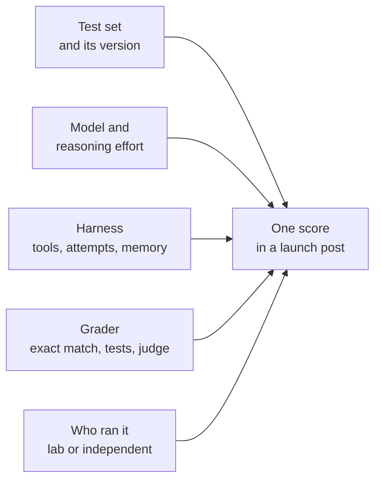
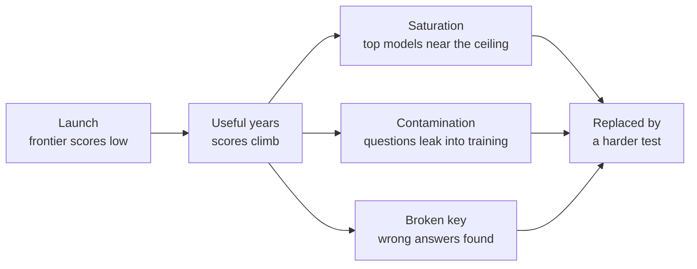
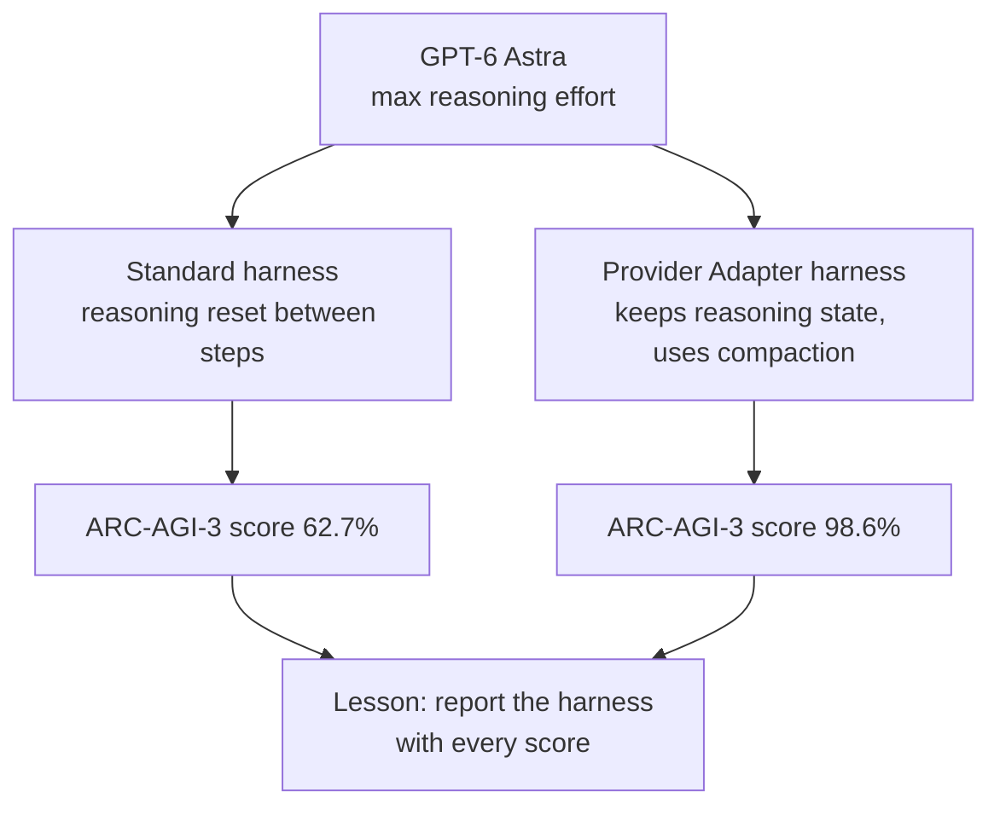
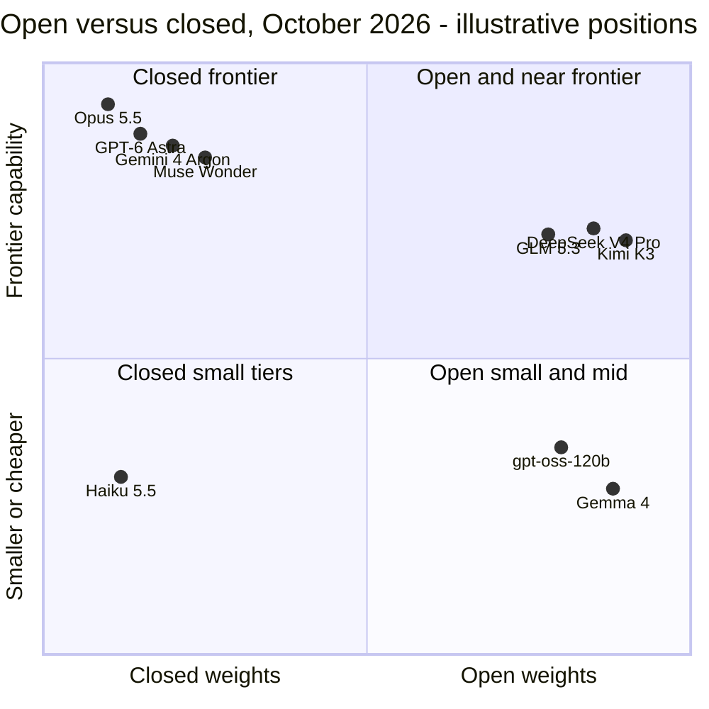
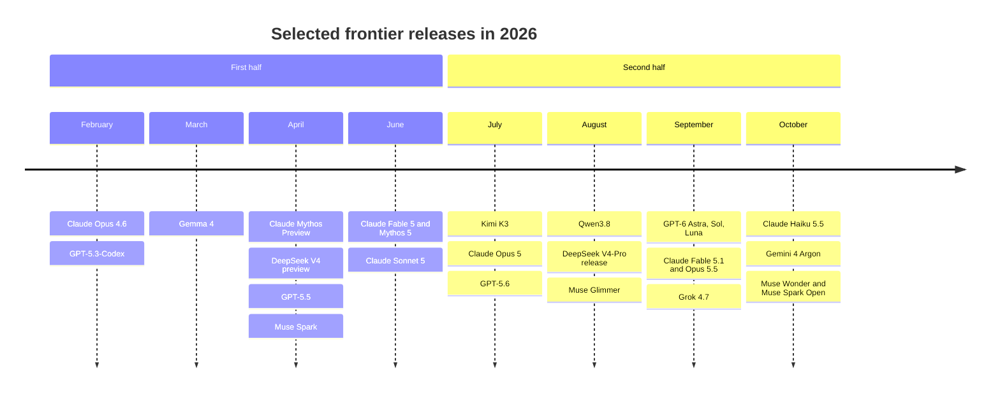
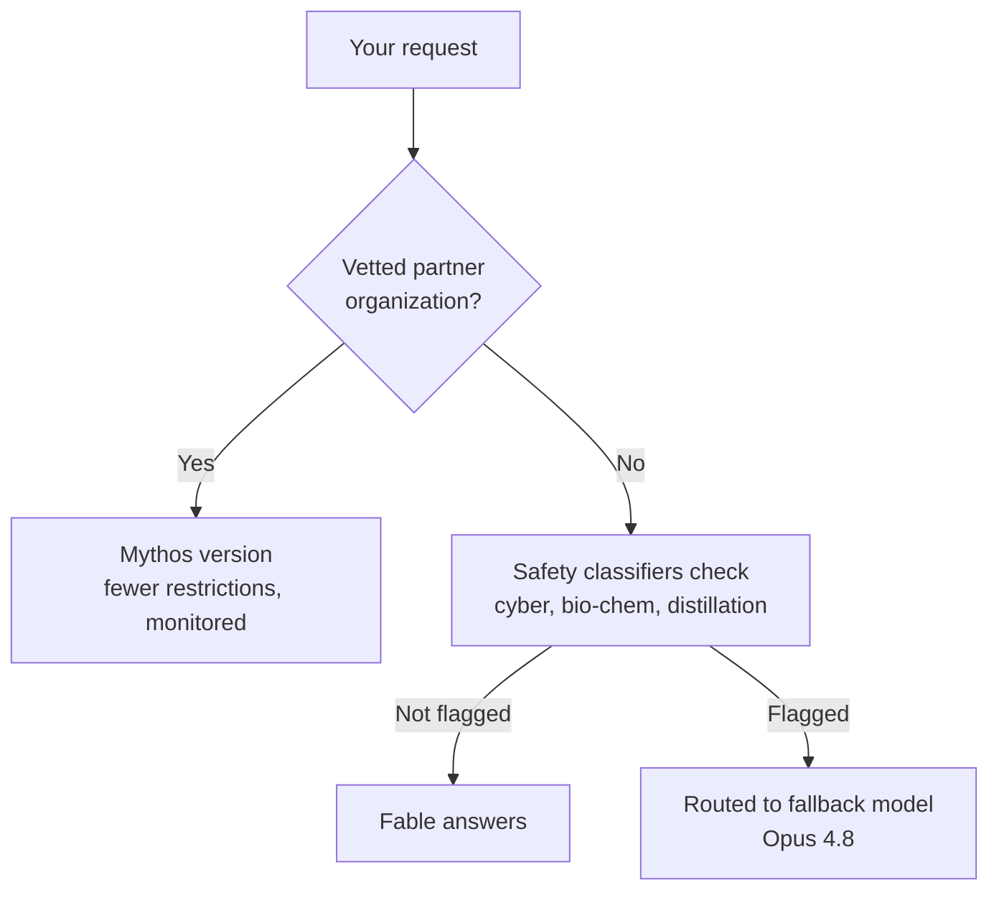
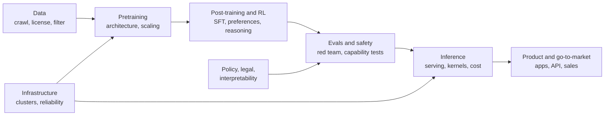
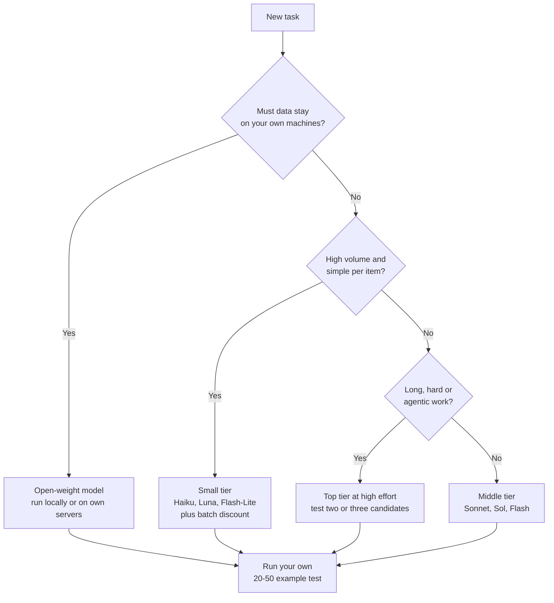

# Chapter 24: The 2026 Model Landscape and How to Read Benchmarks

*This chapter gives you a map of who makes which AI models in late 2026, and the skills to judge any "our model is the best" claim for yourself.*

## What you'll learn

- Why benchmarks exist, what one score really contains, and how to put error bars on it with school arithmetic.
- The ways benchmarks die (saturation, contamination, broken answer keys, Goodhart's law and harness dependence), with ARC-AGI-3 as the case study.
- The benchmark zoo: what MMLU, GPQA, Humanity's Last Exam, FrontierMath, SWE-bench, Terminal-Bench, OSWorld, ARC-AGI, GDPval, METR time horizons, Arena (formerly LMArena) and the big indices each measure, and where each one fails.
- How to read a model card or system card like a skeptical analyst.
- Open weights versus closed models, what licenses allow, and how big the gap between them is in late 2026.
- Who's who in late 2026: the labs, their flagship models, their tiers, and how to decode model names.
- Tiered and trusted access, how labs are organized, and roughly what a frontier model costs to train.
- A practical method for choosing a model for any task, including cost-per-task math.

## Before you start

Chapter 9 (Is the Model Any Good? Evaluation, Overfitting and Metrics) introduced test sets, overfitting and Goodhart's law; this chapter applies them to frontier models. Chapter 18 (How a Large Language Model Works) explains tokens and context windows, Chapter 19 (Pretraining: Data, Scale and Scaling Laws) explains the 6 × N × D compute rule, Chapter 21 (Reasoning Models and Reinforcement Learning) explains reasoning effort, and Chapter 23 (Inference: Making Models Fast and Cheap) explains why prices are quoted per million tokens. You can read this chapter without them, but they make the numbers here easier to trust.

## The problem: you cannot open the box

Every few weeks a lab publishes a launch post with a table of numbers in bold. A friend tells you the new model "feels smarter." Someone online says it got worse. Who is right?

Start simple. Imagine two students. You want to know which one is better at math. You cannot look inside their heads, so you give them the same test, under the same rules, and compare the scores. That is all a benchmark is.

> **Definition — Benchmark:** A fixed set of test questions or tasks plus a scoring rule, used to compare AI models on the same footing. Examples include MMLU (multiple-choice knowledge questions) and SWE-bench (real software bugs to fix).

> **Definition — Evaluation (eval):** Any systematic test of a model's behavior, from a public benchmark to a company's private test set, human ratings or a red-team exercise. "Running evals" means measuring before you trust.

Your own chatbot shows why this matters. When you ask Claude, ChatGPT or Gemini a question, you see one answer, not the thousand you did not ask for. One impressive answer, or one silly mistake, tells you little about the average. A benchmark asks hundreds or thousands of questions and reports the average.

> **Definition — Leaderboard:** A public ranking of models by their scores on one or more benchmarks, updated as new models appear. Artificial Analysis, Epoch AI and Arena (formerly LMArena) run widely cited leaderboards.

> **Definition — Frontier model:** One of the most capable AI models in existence at a given time. As of October 2026 that group includes Anthropic's Claude Opus 5.5 and Fable 5.1, OpenAI's GPT-6 Astra and Google's Gemini 4 Argon.

> **Analogy:** Benchmarks are standardized tests, like a national school exam. They are useful because everyone takes the same test. They are flawed in exactly the ways standardized tests are flawed: students (and labs) learn to teach to the test, old papers leak, and a high score does not prove you can do the job.

### What is actually inside one number

A launch post might say "Model X scores 66.4% on Terminal-Bench 4.0." That single number hides at least five choices.

1. **The test set** and its version. Terminal-Bench 2.0 and 4.0 are different tests, so their scores cannot be compared.
2. **The model and its settings**, such as reasoning effort and how many thinking tokens are allowed.
3. **The harness**: the prompt, tools, number of attempts and memory handling wrapped around the model.
4. **The grader**: an exact-match check, unit tests, a human expert, or another AI acting as judge.
5. **Who ran it**: the lab that built the model, or an independent group.

> **Definition — Harness (scaffold):** The software around a model during a task: the instructions, tools, memory handling, retry rules and time limits. Changing the harness can change a benchmark score dramatically without changing the model at all.

> **Definition — Reasoning effort:** A setting (often low, medium, high, xhigh or max) that controls how much a reasoning model thinks before answering. Leaderboards often label scores with the effort used, as in "Opus 5.5 (max)."

> **Definition — Self-reported score:** A benchmark result published by the company that built the model, rather than measured by an independent group. Self-reported scores are not lies, but the company chose the settings, the harness and which benchmarks to show.


*Figure 24.1: Five hidden choices sit behind every benchmark score. Change any one of them and the number moves.*

> **Key idea:** A benchmark score is not a property of a model alone. It belongs to a model, plus a test version, plus settings, plus a harness, plus a grader. Before you compare two numbers, check that all five match.

### How precise is a score? Error bars by hand

Suppose a model answers 400 of 500 questions correctly. Its accuracy is 400 ÷ 500 = 80%. If you gave it a different random 500 questions of the same kind, would it score exactly 80% again? Almost certainly not. It might get 78% or 82%. The useful question is how much a score wobbles by pure chance.

Statisticians answer this with a short formula. For an accuracy p measured on n questions, the standard error is the square root of p × (1 − p) ÷ n. A 95% confidence interval stretches about 2 standard errors (1.96, to be exact) either side of the score.

Work it through for our model:

- p = 0.80 and n = 500.
- p × (1 − p) = 0.80 × 0.20 = 0.16.
- 0.16 ÷ 500 = 0.00032.
- The square root of 0.00032 is about 0.0179, or 1.79 percentage points.
- 1.96 × 1.79 is about 3.5 percentage points.

So the honest statement is "80%, give or take about 3.5 points." Now suppose a rival scores 82% on the same 500 questions. Its interval is roughly 78.6% to 85.4%, and ours is 76.5% to 83.5%. The intervals overlap heavily. The 2-point "win" printed in bold might be luck.

> **Definition — Confidence interval:** A range that probably contains the true value of a measurement, allowing for the random wobble that comes from testing only a sample. A 95% interval is built so that, over many repeats, it would contain the true value 95% of the time.

The same formula shows why small benchmarks are risky. With 100 questions the interval is about ±7.8 points; with 2,500 (the size of Humanity's Last Exam) it shrinks to about ±1.6 points.

> **Try it:** Open a spreadsheet. In cell A1 type 0.8 (the accuracy) and in B1 type 500 (the number of questions). In C1 type =1.96*SQRT(A1*(1-A1)/B1) (SQRT is the spreadsheet's square-root function). You get about 0.035, or 3.5 points. Change B1 to 100 and then to 2500 and watch the interval shrink. Keep this sheet; the exercises use it.

> **Watch out:** Some headline numbers come with very wide intervals that launch posts and social media leave out. METR's estimate for an early version of Claude Mythos Preview is a time horizon of about 17.4 hours, but its confidence interval runs from about 8.5 to 55 hours. The single number is the middle of a very wide range.

## How benchmarks die

Every benchmark is born hard, gets climbed, and eventually stops telling models apart. Knowing how benchmarks die tells you which numbers still mean something.


*Figure 24.2: The life cycle of a benchmark. Most die of saturation, but contamination and broken answer keys kill some of them early.*

### Death by saturation

> **Definition — Benchmark saturation:** The point at which the best models all score near the maximum, so the test can no longer tell them apart. A saturated benchmark is a ruler too short for what you are trying to measure.

MMLU, a 2020 test covering 57 school and professional subjects in multiple-choice format, was the headline benchmark of the GPT-4 era. It is now saturated for frontier models. GPQA Diamond, a 2023 set of graduate-level science questions written to be "Google-proof," was considered brutally hard when it launched. By late 2026 it is near-saturated: the open-weight Kimi K3 self-reports 93.5%.

The clearest recent story is Humanity's Last Exam (HLE), released in January 2025 by the Center for AI Safety (a US nonprofit research group) and the data company Scale AI with 2,500 expert-level questions. At launch, frontier models scored under 10%. On October 20, 2026, Artificial Analysis measured Claude Opus 5.5 at 61.4% on its text-only questions. In under two years, a test designed to be the "last exam" went from nearly impossible to more than half solved.

Saturation also shows in what labs brag about. The Opus 5.5 and Gemini 4 Argon launch tables did not headline SWE-bench Verified, the coding benchmark of 2024 and 2025; they used harder tests such as Terminal-Bench 4.0, DeepSWE, FrontierSWE and CursorBench. When labs stop mentioning a benchmark, everyone usually scores well on it.

### Death by contamination

> **Definition — Benchmark contamination:** When test questions or their answers leak into a model's training data, so the model can recall answers instead of working them out. Contamination inflates scores without any real gain in ability.

Pretraining data is scraped from the public web (see Chapter 19), and benchmarks are published, discussed and copied all over that same web. Unless a lab carefully removes them, they end up in the training data.

> **Definition — Decontamination:** Searching training data for benchmark questions and close paraphrases and removing them before training, so test scores reflect ability rather than memory.

Paraphrases and translations slip through filters, so benchmark makers also keep part of the test private, refresh questions, or use problems newer than the model's knowledge cutoff.

> **Definition — Held-out set:** Test questions kept private and never published, so they cannot leak into training data. Scores on a held-out set are more trustworthy than scores on a public one.

> **Analogy:** Contamination is a student who found last year's exam with the answer key attached. A perfect score proves they had the key, not that they understand the subject.

### Death by a broken answer key

A benchmark is only as good as its answer key. Very hard questions are hard for the people writing them too. In 2025, an audit by the research group FutureHouse suggested that about 30% of HLE's text-only chemistry and biology answers might be wrong. That finding prompted a refreshed version called "HLE-Rolling."

> **Definition — Label noise:** Errors in a dataset's "correct" answers. On a benchmark, label noise caps the best achievable honest score below 100% and can punish a model for being right when the key is wrong.

Follow the logic. If 30% of a section's official answers are wrong, a model scoring above 70% on that section must be agreeing with some of the wrong answers. Very high scores on a noisy test deserve suspicion, not applause.

### Death by Goodhart's law

Chapter 9 introduced Goodhart's law. It applies to whole industries, not just single models.

> **Definition — Goodhart's law:** "When a measure becomes a target, it ceases to be a good measure." Once people are rewarded for raising a number, they find ways to raise it that do not improve the thing it was supposed to track.

Labs are judged by the bold numbers, so there is constant pressure, often unconscious, to steer data, prompts and settings toward the tests everyone watches. No cheating is required: a famous benchmark simply drifts toward measuring how well models were prepared for it. Chapter 55 shows the same force inside training, where models learn to game their reward signals.

### Death by harness: the ARC-AGI-3 case study

The most striking 2026 example of how much the harness matters comes from ARC-AGI-3.

> **Definition — ARC-AGI:** A family of puzzle benchmarks from François Chollet's ARC Prize Foundation, designed to test whether a system can learn a new skill from a few examples rather than recall knowledge. ARC-AGI-3 (2026) uses interactive game-like environments with no instructions.

ARC-AGI-3 launched on March 25, 2026. Each task is a small interactive game with no stated rules or goal: you poke at the world, form a theory and try to win. At launch, humans scored 100% and frontier AI 0.51%.

By September 2026, ARC Prize reported these results for OpenAI's GPT-6 Astra:

- **62.7%** at maximum reasoning effort under the standard harness, at a cost of about $26,000 for the run.
- **98.6%** at the same maximum effort under a "Provider Adapter" harness that let the model keep its reasoning state between steps and use compaction. Its best adapter score, **99.9%**, came at high effort, two settings below maximum.
- With the adapter harness at maximum effort, Astra used fewer actions than the median human on 96% of levels.

> **Definition — Compaction:** Summarizing older parts of a long task so it fits in the model's context window and the model can keep working without losing the thread.

Same model, same effort, same test: a 36-point difference (62.7% versus 98.6%) caused entirely by the software around the model. ARC Prize also explicitly declined to call the result AGI.


*Figure 24.3: At the same maximum effort, the same model scored 62.7% or 98.6% on ARC-AGI-3 depending on the harness (99.9% at high effort with the adapter), as reported by ARC Prize in September 2026.*

ARC-AGI-3 teaches three lessons at once. First, saturation can be fast: from 0.51% to 99.9% in about six months. Second, the harness is part of the result. Third, cost matters: a score that took $26,000 of compute is a different achievement from one that took $26.

> **Definition — Cost per task:** The money (usually compute cost) a model spends to complete one benchmark task or one real job. Two models with similar scores can differ in cost per task by 100× or more.

> **At the frontier (2026):** Serious leaderboards now plot score against cost instead of listing scores alone. ARC Prize reports dollars per task next to its results, and Artificial Analysis publishes prices and speeds alongside its intelligence index. A model that is slightly worse but 20× cheaper is often the better choice for real work.

### Death by cherry-picking

Labs choose which benchmarks appear in their launch tables. Google's self-reported comparison for Gemini 4 Argon is a clean example. Here are five of its rows, comparing Argon with GPT-6 Astra, Claude Fable 5.1 and Claude Opus 5.5:

| Benchmark (as reported by Google) | Gemini 4 Argon | GPT-6 Astra | Fable 5.1 | Opus 5.5 |
|---|---|---|---|---|
| Vals Index | **68.9** | 63.1 | 65.8 | 67.0 |
| DeepSWE v1.1 | **77.9** | 74.1 | 67.4 | 74.2 |
| FrontierSWE v2 | 55.0 | **65.5** | 56.3 | 62.3 |
| Terminal-Bench 4.0 | 57.4 | 58.2 | 57.9 | **66.4** |
| GraphWalks 256K–1M (long-context F1) | **84.2** | 71.8 | 65.0 | 66.8 |

*Table 24.1: Five rows from Google's self-reported Gemini 4 Argon comparison table (October 2026). Across all 19 rows of the full table, Argon leads 13.*

(The Vals Index is a combined score from the independent evaluation company Vals AI. DeepSWE, FrontierSWE and Terminal-Bench are agentic coding tests, described in the benchmark zoo below. GraphWalks tests very long inputs, from 256,000 to 1 million tokens, scored with the F1 measure from Chapter 9.) Argon wins three of these five rows, Astra wins FrontierSWE and Opus 5.5 wins Terminal-Bench 4.0. Google picked a reasonable set of tests, but every lab's launch table shows its own model winning most rows, because every lab picks the rows. Read only launch posts and every model is the best model.

> **Key idea:** Trust independent measurements over launch tables, specific benchmark versions over brand names, and your own private tests over both.

## The benchmark zoo

Of hundreds of benchmarks, about a dozen families matter for following the frontier in late 2026. Read the "weakness" column as carefully as the "measures" column.

| Category | Benchmark | What it measures | State in late 2026 | Main weakness |
|---|---|---|---|---|
| Broad knowledge | MMLU, MMLU-Pro | Multiple-choice questions across 57 school and professional subjects (2020); MMLU-Pro is a harder 2024 version with 10 answer options | Saturated at the frontier | Recall-heavy; widely leaked online |
| Expert science | GPQA Diamond | Graduate-level "Google-proof" biology, chemistry and physics questions (2023) | Near-saturated; Kimi K3 self-reports 93.5% | Small question set, so wide error bars |
| Frontier knowledge | Humanity's Last Exam (HLE) | 2,500 expert-level questions across many fields (January 2025) | Under 10% at launch; Opus 5.5 61.4% text-only (Artificial Analysis, Oct 2026) | An audit suggested about 30% of chemistry and biology answers may be wrong |
| Competition math | AIME | A US high-school math olympiad qualifying exam with whole-number answers | Top reasoning models score above 90% | Only 30 new questions a year; old exams are online |
| Research math | FrontierMath, FrontierMath Erdős | Unpublished, expert-written problems from Epoch AI; the Erdős set includes previously unsolved problems | GPT-5.5 reported 35.4% on the hardest tier; GPT-6 Astra solved 2 of 68 open Erdős problems | Small sets; access is restricted, so few can check results |
| Software engineering | SWE-bench Verified, SWE-bench Pro | Fix real GitHub issues so the project's own tests pass; Verified is a 500-task human-checked subset | Verified is saturating; labs moved to harder tests | Tests can be gamed; public code leaks into training |
| Agentic coding | Terminal-Bench, DeepSWE, FrontierSWE | Multi-step jobs in a real terminal or codebase | Opus 5.5 reports 66.4% on Terminal-Bench 4.0 | Many versions; scores depend heavily on the harness |
| Computer use | OSWorld | Doing tasks by operating real desktop apps through screenshots, mouse and keyboard | Opus 5.5 reports 81.8% on OSWorld 2.1; Kimi K3 reports 84.8% on OSWorld-Verified | Different versions; setups vary between labs |
| Fluid reasoning | ARC-AGI-1, 2 and 3 | Learning a new rule or game from scratch | ARC-AGI-3 went from 0.51% (March 2026) to 62.7% or 98.6% at the same maximum effort, depending on the harness, and 99.9% at high effort (September) | Harness and cost dominate the result |
| Economic value | GDPval | Realistic work products from many occupations, judged by professionals against expert human work | Opus 5.5 reports a GDPval-AA rating of 1846 (AA: Artificial Analysis's version) | Preference grading; tasks are short snapshots of real jobs |
| Agent stamina | METR time horizon | Length of task, in skilled-human time, an agent completes with 50% success | About 17.4 hours for an early Mythos Preview, with a wide interval | Task suite too short above about 16 hours |
| Human preference | Arena (formerly LMArena) | Crowd votes in blind head-to-head chats | Updated continuously | Rewards style, length and formatting; voters are not experts |
| Long context | Needle in a haystack, RULER, GraphWalks | Finding and combining facts across very long inputs | Argon reports 84.2 on GraphWalks 256K–1M | Simple needle tests are saturated; multi-step versions vary |
| Aggregate indices | Artificial Analysis Intelligence Index, Epoch Capabilities Index | Many benchmarks combined into one number | Opus 5.5 leads both as of October 2026 | One number hides an uneven profile |

*Table 24.2: The benchmark zoo, as of October 2026. Scores marked "reports" are self-reported by the model's maker.*

### Knowledge tests: MMLU, MMLU-Pro and GPQA

> **Definition — MMLU (Massive Multitask Language Understanding):** A 2020 benchmark of multiple-choice questions across 57 school and professional subjects, from law to medicine to mathematics. It was the standard knowledge test of the early chatbot era and is now saturated for frontier models.

MMLU is plain: a question, four options, one correct letter. Random guessing already scores 25%, and the questions have been online since 2020, so contamination is almost certain. MMLU-Pro bought a few more years with 10 options and harder reasoning questions.

> **Definition — GPQA Diamond:** The hardest subset of a 2023 benchmark of graduate-level science multiple-choice questions written so that skilled non-experts cannot answer them even with web search ("Google-proof"). It is near-saturated in late 2026.

GPQA's lesson: "hard for humans" does not mean "hard for models for long." Three years after launch, an open-weight model self-reports 93.5%.

### The "last exam": Humanity's Last Exam

> **Definition — Humanity's Last Exam (HLE):** A public benchmark of 2,500 expert-level questions across many fields, released in January 2025 by the Center for AI Safety and Scale AI. Questions were crowdsourced from experts and kept only if frontier models of the time failed them.

Because only questions that early-2025 models failed were kept, low starting scores were guaranteed, and the test was tuned against those older models. Here is the best-scoring model from each of the top five labs on the text-only questions (2,158 of the 2,500), as Artificial Analysis measured them in October 2026. (Showing one model per lab leaves out Anthropic's Fable 5.1, which scored 59.1%, still above every other lab's best.)

| Model (maker) | HLE text-only score |
|---|---|
| Claude Opus 5.5 (Anthropic) | 61.4% |
| Gemini 4 Argon (Google DeepMind) | 57.1% |
| GPT-6 Astra (OpenAI) | 54.7% |
| Muse Wonder (Meta) | 50.1% |
| MiMo-V2.6-Pro (Xiaomi, open weights) | 49.4% |

*Table 24.3: Humanity's Last Exam, text-only questions, best model per lab, as measured by Artificial Analysis on October 20, 2026.*

Notice the last row: an open-weight model, from the Chinese phone and electronics maker Xiaomi, trails the leader by only 12 points.

### Math: AIME and FrontierMath

AIME (the American Invitational Mathematics Examination) is a real high-school competition whose answers are whole numbers from 0 to 999, so a checker can grade it with no human judge (see Chapter 21). Top reasoning models have scored above 90% since 2025.

> **Definition — FrontierMath:** A benchmark from Epoch AI of unpublished, expert-written mathematics problems, ranging from hard to research-level, with answers that can be checked automatically. Its Erdős extension contains problems no one had solved before.

FrontierMath beats contamination by never publishing its problems. GPT-5.5 was reported at 35.4% on its hardest tier (Tier 4), and GPT-6 Astra became the first model to solve any FrontierMath Erdős problems (named after the mathematician Paul Erdős, who left behind hundreds of open problems): 2 of 68 previously unsolved ones, according to Epoch. That is new mathematics, if only a little of it.

### Coding and computer use: SWE-bench, Terminal-Bench and OSWorld

> **Definition — SWE-bench:** A benchmark of real GitHub issues from open-source Python projects; the model must change the code so that the project's own tests pass. "Verified" is a 500-task subset checked by humans; harder successors include SWE-bench Pro. SWE stands for software engineering.

SWE-bench used real work graded by real tests. But tests can be gamed (making a test pass without fixing the bug is a form of reward hacking; see Chapter 20), and its repositories are public.

> **Definition — Terminal-Bench:** A benchmark of tasks an AI agent must complete inside a computer terminal, such as installing software, debugging a program or processing data. It has several versions, and scores on different versions cannot be compared.

> **Definition — OSWorld:** A benchmark in which an AI agent operates real desktop software (browsers, office apps, file managers) through screenshots, mouse clicks and typing to complete everyday computer tasks.

> **Watch out:** GPT-5.5 (April 2026) was reported at 82.7% on Terminal-Bench 2.0; Opus 5.5 (September 2026) reports 66.4% on Terminal-Bench 4.0. The lower number does not mean the later model is worse: they are different tests. The same trap appears with OSWorld 2.1 versus OSWorld-Verified. Always read the version number.

### Work that pays: GDPval

> **Definition — GDPval:** An OpenAI benchmark (2025) of realistic work products, such as reports, plans and spreadsheets, drawn from many occupations; expert professionals compare the model's work with work by experienced humans. Artificial Analysis runs a version called GDPval-AA (AA for Artificial Analysis) that reports a rating.

GDPval asks "could this model do a piece of a real job?" But each task is a snapshot, not a week of shifting requirements, and preference grading lets presentation sway judges.

> **Definition — Elo rating:** A scoring system, borrowed from chess, that rates competitors by who beats whom in head-to-head comparisons. A higher Elo means the model's outputs win more often; differences between ratings matter more than the absolute numbers.

So Opus 5.5's reported GDPval-AA Elo of 1846 means something only next to other ratings on the same leaderboard.

### Agent stamina: the METR time horizon

> **Definition — METR time horizon:** A measure, from the evaluation nonprofit METR, of how long a task (measured by how long it takes a skilled human) an AI agent can complete with a given success rate, usually 50%. A "2-hour horizon" means the agent succeeds about half the time on tasks that take a skilled person about two hours.

It converts many different tasks into one everyday unit, human working time. Here is METR's data for selected models.

| Model (release) | 50% time horizon |
|---|---|
| GPT-4 (March 2023) | about 4 minutes |
| Claude 3.5 Sonnet (June 2024) | about 11 minutes |
| o1 (December 2024) | about 39 minutes |
| o3 (April 2025) | about 2.0 hours |
| GPT-5 (August 2025) | about 3.4 hours |
| Claude Opus 4.5 (November 2025) | about 4.9 hours |
| GPT-5.2 (December 2025) | about 5.9 hours |
| Claude Opus 4.6 (February 2026) | about 12 hours (interval 5 to 60 hours) |
| Claude Mythos Preview, early version (April 2026) | about 17.4 hours (interval about 8.5 to 55 hours) |

*Table 24.4: METR 50% time horizons from METR's version 1.1 data. Intervals are shown where they are especially wide.*

On a log scale, where each step up means "twice as long," the trend looks like a staircase climbing steadily:

```
50% time horizon (log scale: each row is about 2x the one below)

32 h |
16 h |                                     * *  Opus 4.6, Mythos
 8 h |                                   *  GPT-5.2
 4 h |                               *  *  GPT-5, Opus 4.5
 2 h |                           *  o3
 1 h |
30 m |                       *  o1
15 m |
 8 m |                 *  Claude 3.5 Sonnet
 4 m |  *  GPT-4
     +-----------+-----------+-----------+-------
      2023        2024        2025        2026
```
*Figure 24.4: METR time horizons on a doubling scale, one column per month from January 2023. Each point sits on the nearest row; a steady climb on this kind of chart means steady exponential growth.*

METR's fitted doubling time since 2023 is about 129 days (roughly 4.2 months); across its whole data set, about 188 days. Check the faster number by hand, starting from o3's 2 hours in April 2025:

- After one doubling (about 4.2 months, around August 2025): 4 hours.
- After two doublings (about 8.4 months, around December 2025): 8 hours.
- After three doublings (about 12.6 months, around May 2026): 16 hours.

The early Mythos Preview measurement in April 2026 was about 17.4 hours, close to the trend.

> **Watch out:** METR itself warns that measurements above about 16 hours are unreliable with its current task suite, because it has too few tasks that long. Its time-horizon page stopped being updated as of September 8, 2026. Also, horizons at 80% reliability are about 4 to 10 times shorter than at 50%. "Succeeds half the time on a 17-hour task" is very different from "can be trusted with a 17-hour task."

### The crowd: Arena (formerly LMArena)

> **Definition — LMArena:** A public website where people chat with two anonymous models side by side and vote for the better answer; the votes are turned into Elo-style ratings. It measures what ordinary users prefer, not what is correct. It was renamed Arena in January 2026 and now lives at arena.ai.

Its fresh prompts make it hard to contaminate, but voters reward style: longer, confident, well-formatted answers tend to win even when a shorter one is more accurate, so a lab can raise its rating without making the model smarter.

### Indices: Artificial Analysis and Epoch

> **Definition — Aggregate index:** A single score that combines many benchmarks, such as the Artificial Analysis Intelligence Index or the Epoch Capabilities Index. It is convenient for ranking but hides where a model is strong or weak.

Independent indices run every test themselves with consistent settings, which makes them the best quick summary. Here is the Artificial Analysis Intelligence Index on October 21, 2026:

| Model (setting) | AA Intelligence Index |
|---|---|
| Claude Opus 5.5 (max) | 58 |
| Claude Sonnet 5.5 | 56 |
| Muse Wonder Full (Meta) | 56 |
| Claude Fable 5.1 | 53 |
| GPT-6 Astra (max) | 53 |
| Gemini 4 Argon (high) | 53 |
| Muse Wonder (Meta) | 52 |
| GPT-6.1 Sol | 52 |

*Table 24.5: Top of the Artificial Analysis Intelligence Index, October 21, 2026. Settings in brackets are the reasoning effort used.*

Epoch AI's Capabilities Index, which stitches many benchmarks onto one scale, put Opus 5.5 at 167 in its October 1, 2026 update, narrowly ahead of GPT-6 Astra.

Two things should make you curious. Sonnet 5.5, a mid-priced model, scores above Fable 5.1, Anthropic's most expensive one, which Anthropic aims at "demanding reasoning and long-horizon agentic work" that a general index may not weight heavily. And the top eight span only 6 points, so task, price and speed should drive your choice, not rank alone.

> **Definition — Jagged frontier:** The uneven shape of AI ability: superhuman at some tasks and surprisingly weak at nearby ones. One model can solve open math problems yet stumble on a simple visual puzzle.

> **Key idea:** No single benchmark, and no single index, tells you which model is best. Use indices to build a shortlist, specific benchmarks to understand strengths, and your own tests to decide.

## How to read a model card or system card

Open-weight models come with a model card, usually on Hugging Face. Frontier closed models come with a longer system card focused on safety testing.

> **Definition — Model card:** A document published with a model describing what it is for, how it was trained, how it scores on evaluations, and its known limitations. The idea was proposed by researchers in 2019 as a "nutrition label" for models.

> **Definition — System card:** A longer document a lab publishes with a frontier model, covering safety evaluations, red-teaming results, dangerous-capability tests and the safeguards applied. It describes the whole deployed system, not just the raw model.

> **Definition — Knowledge cutoff:** The date after which a model has little or no training data. As of October 2026, Claude's current models have a June 2026 cutoff and GPT-6 Astra an April 30, 2026 cutoff.

> **Definition — Safety framework:** A lab's published policy that defines dangerous capability levels and the safeguards required at each level, such as Anthropic's Responsible Scaling Policy, OpenAI's Preparedness Framework and Google DeepMind's Frontier Safety Framework. Chapter 56 compares them.

> **Definition — Dangerous-capability evaluation:** A test of whether a model could meaningfully help someone cause serious harm, for example in cyberattacks or biological weapons, or act dangerously on its own. Results decide which safeguards a model needs before release (see Chapter 57).

Here is what a good card contains and what to look for.

| Section | What it tells you | Questions to ask |
|---|---|---|
| Basics | Size (total and active parameters), context window, maximum output, knowledge cutoff, price | Is the size disclosed? Is the context window the same for input and output? |
| Training data | Sources, languages, cutoff, filtering, decontamination | How vague is it? Is decontamination described? |
| Benchmarks | A table of scores | Who ran them? Which effort and harness? Which versions? Against which rivals? |
| Safety evaluations | Results of bio, cyber, autonomy and AI R&D tests | Which threshold was reached? Who tested independently? |
| Red teaming | What attackers tried and found | Were outside experts involved? |
| Safeguards | Classifiers, refusals, access limits | What happens when a request is flagged? |
| Limitations | Known failure modes | Is this section honest and specific, or a few generic lines? |
| License (open weights) | What you may do with the weights | Are there revenue thresholds or use restrictions? |

*Table 24.6: A checklist for reading a model card or system card.*

### A worked reading: Claude Opus 5.5

Anthropic's launch page for Opus 5.5 (September 22, 2026) makes several headline claims: roughly Fable 5.1-level performance on most work at 40% lower cost than Opus 5, output over 30% faster, Terminal-Bench 4.0 at 66.4%, HLE with tools at 67.7%, OSWorld 2.1 at 81.8%, and a GDPval-AA rating of 1846. It notes that thinking can no longer be turned off, and that a "preserved thinking" anti-distillation safeguard applies to new API accounts.

How would a skeptic read this?

1. **Which numbers are independent?** The HLE score of 67.7% is "with tools." Artificial Analysis's independent text-only figure is 61.4%. Both can be true, because they are different setups.
2. **What does "Fable-level on most work" mean?** It is a summary judgment by the maker. Check it against independent indices (Table 24.5 puts Opus 5.5 above Fable 5.1 on the AA index) and against your own tasks.
3. **What did outsiders find?** METR evaluated Opus 5.5 with a focus on AI research tasks. It called the model an incremental improvement over Fable 5.1 and "unlikely to be able to fully automate AI R&D," and cited its own preliminary estimate that AI was speeding up progress inside Anthropic by about 1.5× overall (1.5 years of progress in one year), with perhaps a 30% chance of 2×.
4. **What is missing?** Launch tables rarely show the benchmarks a model does poorly on. Look for independent leaderboards that test everything with the same settings.

OpenAI's October 2026 deployment note for GPT-6 Sol and Luna is similar reading. It treats them as High capability in cybersecurity and in biological and chemical risk, but not in AI self-improvement, which tells you which safeguards its Preparedness Framework triggered. No benchmark table gives you that.

> **Try it:** Open the Hugging Face page for DeepSeek-V4-Pro (huggingface.co/deepseek-ai/DeepSeek-V4-Pro) and find four things in under five minutes: total parameters, active parameters, context length and license. Then open any closed model's system card from Anthropic or OpenAI and find the section on dangerous-capability testing. Notice how differently open and closed labs disclose.

## Open weights, closed weights and licenses

Chapter 18 explained that a model is, in the end, a very large file of numbers called weights. The biggest strategic split in the industry is whether a lab lets you download that file.

> **Definition — Closed (proprietary) model:** A model whose weights are not released; you can use it only through the maker's app or API, under the maker's rules and prices. GPT-6 Astra, Claude Opus 5.5 and Gemini 4 Argon are closed.

> **Definition — Open-weight model:** A model whose trained weights anyone can download and run on their own hardware, under a license. DeepSeek V4, Kimi K3, Qwen3.8 and Gemma 4 are open-weight models.

> **Definition — Open-source model:** Strictly, a model released with its weights, training code and training data, so others can fully rebuild it. The term is often used loosely to mean open-weight, which is not the same thing.

> **Definition — API (Application Programming Interface):** A way for programs to send requests to a model over the internet and receive answers, usually paid per token. Closed models are reached through APIs; Chapter 26 shows how.

> **Analogy:** A closed model is a dish at a restaurant: it may be excellent, but you cannot see the kitchen or take the recipe home. An open-weight model is a recipe you can cook at home, change and serve to others, though you still need your own kitchen (computer hardware) to cook it.

### Licenses: what you are allowed to do

Downloading weights does not mean you can do anything with them. A license sets the rules.

> **Definition — License (software license):** The legal terms that say what you may do with code or model weights: use, modify, share, sell products built on them, and under what conditions.

> **Definition — Permissive license:** A license, such as MIT or Apache-2.0, that lets almost anyone use, modify and sell products built on the work, with few conditions beyond keeping the copyright notice.

Licenses in late 2026 fall into three rough groups:

- **Permissive.** DeepSeek V4 uses the MIT license. Qwen3.8-27B, Google's Gemma 4, Meta's Muse Glimmer, Mistral Large 3 and OpenAI's gpt-oss models use Apache-2.0.
- **Permissive with a size limit.** Alibaba's largest open model, Qwen3.8-2.4T-A95B, requires a separate commercial license for providers with more than US$50 million in revenue. Small companies can use it freely; giant competitors must negotiate.
- **Custom terms.** Some labs publish their own licenses with use restrictions; Meta's Muse Spark Open, for example, comes under a Muse Model License with limited commercial terms. Always read the model card's license section before building a product.

| Open-weight model | Maker | Size (total / active parameters) | License | Released |
|---|---|---|---|---|
| DeepSeek-V4-Pro | DeepSeek | 1.6T / 49B | MIT | Preview April 24, general release August 13, 2026 |
| DeepSeek-V4-Flash | DeepSeek | 284B / 13B | MIT | April 2026 |
| Kimi K3 | Moonshot AI | 2.8T / 104B | See model card | July 16, 2026 |
| Qwen3.8-2.4T-A95B | Alibaba | 2.4T / 95B | Commercial license above US$50M revenue | August 2026 |
| Qwen3.8-27B | Alibaba | 27B | Apache-2.0 | August 2026 |
| Mistral Large 3 | Mistral AI | 675B / 41B | Apache-2.0 | December 2025 |
| Mistral Medium 3.5 | Mistral AI | 128B | Open weights | April 2026 |
| Gemma 4 | Google DeepMind | Several sizes, from small on-device models to 31B | Apache-2.0 | March 31, 2026 |
| Muse Glimmer | Meta | 30B | Apache-2.0 | August 10, 2026 |
| Muse Spark Open | Meta | 816B / 42B | Muse Model License | October 15, 2026 |
| gpt-oss-120b and gpt-oss-20b | OpenAI | 120B and 20B class | Apache-2.0 | August 2025 |

*Table 24.7: Notable open-weight models as of October 2026.*

> **Definition — Mixture of experts (MoE):** A model design in which a router sends each token to only a few of many expert sub-networks, so the model can be huge in total but cheap to run per token (see Chapter 17).

> **Definition — Active parameters:** In a mixture-of-experts model, the parameters actually used to process each token. Speed and running cost depend mainly on active parameters, while memory needs depend on total parameters.

The size column shows why MoE took over. Kimi K3 has 2.8 trillion parameters, but each token uses only 104 billion: 16 of its 896 experts plus 2 shared ones. DeepSeek-V4-Pro uses 49 billion of its 1.6 trillion.

### How big is the gap?

On the Artificial Analysis index in October 2026, the top open-weight models were Xiaomi's MiMo-V2.6-Pro at 46, DeepSeek V4.1 Flash 1017 at 45, GLM-5.3 from the Chinese lab Z.ai (formerly Zhipu AI) at 45 and Kimi K3 at 44. The top closed model, Opus 5.5 at max effort, scored 58. On HLE text-only, MiMo-V2.6-Pro is 12 points behind the leader. The usual summary is that the best open models trail the best closed models by months, not years.


*Figure 24.5: Where major models sit on the open-closed and capability axes in October 2026. Positions are approximate and for illustration only.*

### The open-versus-closed debate

Both sides have strong arguments, and Chapter 60 returns to them.

The case for open weights: data never has to leave your building, which matters for hospitals, law firms and governments; researchers can study the internals; businesses and countries avoid depending on one foreign supplier; and prices fall because anyone can host the same model. Products get built on open models too: Composer 2.5, the coding model of the popular AI code editor Cursor, was built on Moonshot's open Kimi K2.5.

The case for keeping the frontier closed: once weights are published, every safeguard can be removed, and nobody can recall them if a dangerous capability is later discovered. Closed labs can monitor misuse, ban accounts and add classifiers. Closed models also fund the enormous training costs that keep the frontier moving.

A related fight is over distillation.

> **Definition — Distillation:** Training a smaller or cheaper "student" model to imitate a stronger "teacher" model's outputs. It is a normal technique inside labs, but using a rival's outputs to train a competing model usually breaks the rival's terms of service (see Chapter 20).

In February 2026, Anthropic reported that about 24,000 fraudulent accounts had generated over 16 million exchanges with Claude in what it called distillation attacks, and it named DeepSeek, Moonshot and MiniMax. Labs now ship anti-distillation safeguards, such as Anthropic's "preserved thinking" for new API accounts, which make a model's raw reasoning less useful for copying.

> **Watch out:** "Open source" and "open weights" are not the same. Most "open" models release weights only, not training data or full training code. And many licenses restrict large commercial users. Read the license before you build.

## Who's who in late 2026

Model names change every few weeks, so treat this section as a dated snapshot and learn the patterns behind it. Everything below is as of October 2026.

| Lab (country) | Flagship models, as of October 2026 | Weights | Notable facts |
|---|---|---|---|
| Anthropic (US) | Claude Opus 5.5, Sonnet 5.5, Haiku 5.5; Fable 5.1 and Mythos 5.1 | Closed | All four API models: 1M-token context, 128K output, June 2026 knowledge cutoff |
| OpenAI (US) | GPT-6 Astra; GPT-6 Sol and Luna; GPT-6.1 Sol | Closed (plus gpt-oss open models) | Astra: 1,050,000-token context; GPT-6 reached all ChatGPT users, including free, October 7–8 |
| Google DeepMind (UK and US) | Gemini 4 Argon; Gemini 3.8 Flash | Closed (plus Gemma 4 open models) | Argon generally available in the API from October 13, 2026 |
| Meta Superintelligence Labs (US) | Muse Wonder and Wonder Full; Muse Spark; Muse Glimmer | Mixed (Glimmer and Muse Spark Open are open) | No new Llama since Llama 4 (2025); Muse is its new family |
| SpaceXSI, formerly xAI (US) | Grok 4.7 | Closed | SpaceX acquired xAI on February 2, 2026 |
| DeepSeek (China) | DeepSeek V4-Pro, V4-Flash, V4.1-Flash | Open (MIT) | 1M context; compressed sparse attention |
| Alibaba Qwen (China) | Qwen3.8-Max; Qwen3.8-2.4T-A95B; Qwen3.8-27B | Mixed (Max is the hosted version of the open 2.4T-A95B) | Largest Qwen open model, August 2026 |
| Moonshot AI (China) | Kimi K3 | Open | 2.8T total parameters; Moonshot's Agent Swarm mode, running on K3, coordinates up to 300 sub-agents |
| Mistral AI (France) | Mistral Large 4 (preview); Medium 3.5 | Mostly open | Large 4 open weights promised for the end of October |
| Others | Xiaomi MiMo-V2.6-Pro; Z.ai GLM-5.3; StepFun Step 5; NVIDIA Nemotron 3.5; Thinking Machines Inkling; Reflection Beam 1.0 | Mixed | MiMo-V2.6-Pro and GLM-5.3 are among the top open-weight models |

*Table 24.8: The frontier landscape at a glance, as of October 2026.*

### Anthropic

Anthropic's current API lineup has four models. **Claude Fable 5.1** ($10 per million input tokens and $50 per million output tokens) is the top tier. **Opus 5.5** ($4/$20) is the recommended default for most work. **Sonnet 5.5** ($2/$10) is the mid tier, and **Haiku 5.5** (from $0.10/$0.50) is the small, cheap tier. All four share a 1M-token context window, 128K maximum output, adaptive thinking steered by an effort setting, and a June 2026 knowledge cutoff. As of October 2026, Opus 5.5 led both the Artificial Analysis index and the Epoch Capabilities Index.

Its 2026 pace shows how fast the frontier moves: Opus 4.6 (February 5), Mythos Preview (April 7), Opus 4.7 (April 16), Opus 4.8 (May 28), Fable 5 and Mythos 5 (June 9), Opus 5 (July 24), Fable 5.1 (September), Opus 5.5 (September 22), Sonnet 5.5 (September 28) and Haiku 5.5 (October 7), with Sonnet releases in between: roughly one significant release a month.

> **At the frontier (2026):** Release cycles have shrunk to weeks. Between September 1 and October 13, 2026, Anthropic, OpenAI, Google and SpaceXSI all shipped new flagships or tiers. Any table of model names, including the ones in this chapter, dates within months; the method for judging them does not.

### OpenAI

OpenAI reached GPT-6 through the reasoning models of Chapter 21: o1 (2024), o3 and GPT-5 with its router (2025), then GPT-5.1 to GPT-5.6 (November 2025 to July 2026; GPT-5.6 had a limited preview on June 26 and a public release on July 9). **GPT-6 Astra** arrived on September 3, 2026: OpenAI's largest training run "by far," and OpenAI's first pretraining run on more than 100,000 GPUs, at the Stargate site in Abilene, Texas (see Chapter 42). Astra offers a 1,050,000-token context, 128K output and an April 30, 2026 knowledge cutoff, at $10/$50. **GPT-6 Sol and Luna** (September 22) are cheaper tiers priced 50% below GPT-5.6's promotional API prices, and **GPT-6.1 Sol** (September 29) offers near-Astra intelligence at about one-fifth of Astra's price, per OpenAI's summaries. ChatGPT had 900 million weekly active users in February 2026.

Two Astra claims need care. The first is now confirmed: OpenAI's own deployment-safety page calls Astra its first model to reach the "Critical" level of cybersecurity capability under its Preparedness Framework. A related detail is not: press reports say the version paid users received refuses some cybersecurity requests, while OpenAI's system card says only that it "significantly strengthened" its protections against the model taking harmful cyber actions. The second claim is not confirmed either: an anonymous insider's claim that Astra uses a "recurrent depth" technique, making its reasoning harder to monitor, is unconfirmed. OpenAI's newest open-weight models are still gpt-oss-120b and gpt-oss-20b (August 2025).

### Google DeepMind

Google runs two lines on separate schedules. The Flash line shipped five releases between May and September 2026 (Gemini 3.5 Flash through 3.8 Flash, plus 3.5 Flash-Lite), along with Omni Flash for video (June 30) and 3.8 Live for real-time voice (September 15). The Pro line stalled: Gemini 3.5 Pro never got a general release, and Bloomberg reported it struggled to hit performance goals. **Gemini 4 Argon** became generally available in the API on October 13, 2026 (Epoch dates its announcement to September 30), with a 1M-token combined limit and an introductory price of $2/$10 through November 30, 2026, then $4/$20. The open **Gemma 4** family (March 31, under Apache-2.0) runs from on-device sizes to 31B, and the **Genie 3** world model generates interactive 720p worlds (see Chapter 47).

### Meta

Meta reorganized its AI work into Meta Superintelligence Labs (MSL) in mid-2025. It has released no new Llama model since Llama 4 (April 2025); its new models form the **Muse** family: Muse Spark (April 8, 2026), the open 30B Muse Glimmer (August 10), and Muse Wonder and Wonder Full (October 12, per Meta's newsroom), its first push into the frontier. On October 15 Meta also released Muse Spark Open, open weights for an 816-billion-parameter Muse Spark model (42 billion active) under a license with limited commercial terms. One report puts Wonder's price at $4/$20 through a Meta Model API; that figure comes from a single source.

### SpaceXSI (formerly xAI)

SpaceX acquired xAI on February 2, 2026 (SpaceX's own filings confirm the date). The AI unit was rebranded SpaceXAI by July (reported), and in October 2026 it began calling itself SpaceXSI, short for SpaceX Super Intelligence: its website now uses that name, and SpaceX's October quarterly report renamed its AI business the "Super Intelligence" segment. The legal company name is still SpaceXAI. Its current flagship is **Grok 4.7** (September 21, 2026); Grok 5 had not been released as of mid-October. Its Colossus 2 site in Memphis is the largest known AI data center by compute, at about 1.1 million H100-equivalents according to Epoch (see Chapter 42).

### The Chinese open-weight labs

**DeepSeek** previewed V4 on April 24, 2026, made V4-Pro generally available on August 13, and followed with V4.1-Flash (September 10) and an updated V4.1 Flash 1017 (October 17). V4-Pro has 1.6 trillion total and 49 billion active parameters, a 1M-token context and an MIT license. Its compressed attention needs, at 1M tokens, only 27% of the per-token computation and 10% of the KV cache memory of its predecessor V3.2 (see Chapter 23).

**Alibaba's Qwen** team released the Qwen3.8 family in August 2026: the open-weight Qwen3.8-2.4T-A95B (August 12); Qwen3.8-Max, the hosted version of that model with image input and other extras (August 3); the cheaper Qwen3.8-Flash (August 26); and the small Qwen3.8-27B under Apache-2.0 (August 14).

**Moonshot AI** released **Kimi K3** on July 16, 2026: 2.8 trillion parameters (104 billion active), a 1M-token context, a hybrid of linear and full attention layers, 4-bit (MXFP4) weights from quantization-aware training applied from the fine-tuning stage onward, and, in Moonshot's apps, an Agent Swarm mode that Moonshot says can split work across up to 300 sub-agents.

Other notable labs include **Z.ai** (GLM-5.3), **Xiaomi** (MiMo-V2.6-Pro, the top open-weight model on the Artificial Analysis index at 46), **StepFun** (Step 5) and **MiniMax**.

### Mistral and the rest

**Mistral AI** in Paris is Europe's leading model lab: Large 3 (December 2025, Apache-2.0), the open 128B Medium 3.5 (April 2026), and Large 4 in preview in October 2026 with open weights promised for the end of that month. Beyond the big labs, **NVIDIA** publishes open Nemotron models (3.5 in 2026), **Thinking Machines** released Inkling and **Reflection** released Beam 1.0.


*Figure 24.6: Selected model releases in 2026. Several labs shipped something significant nearly every month.*

### Decoding model names

> **Definition — Model tier:** One size or price level within a lab's model family, such as Anthropic's Haiku, Sonnet and Opus, or OpenAI's Luna, Sol and Astra. Bigger tiers are usually smarter, slower and more expensive.

> **Definition — General availability (GA):** The point at which a model is officially released to all paying customers with normal support, as opposed to a "preview" that may change or be limited to some users.

| Lab | Top tier | Middle | Small and cheap | Other naming clues |
|---|---|---|---|---|
| Anthropic | Fable 5.1 (Mythos 5.1 is the same model with fewer restrictions) | Opus 5.5, Sonnet 5.5 | Haiku 5.5 | Version numbers are shared across tiers but released on different days |
| OpenAI | GPT-6 Astra | Sol | Luna | ".1" marks an update; "Pro" variants spend more compute; "Codex" variants are tuned for coding |
| Google | Gemini 4 Argon (Pro line) | Flash | Flash-Lite | "Live" means real-time voice; "Omni" generates video; "Gemma" means open weights |
| Meta | Muse Wonder Full, Wonder | Muse Spark (open weights as Muse Spark Open) | Muse Glimmer (open) | Muse is Meta's model family from 2026 |
| DeepSeek | V4-Pro | | V4-Flash | Suffixes like "1017" are date stamps (October 17) |
| Alibaba Qwen | Qwen3.8-Max (hosted) and its open weights, Qwen3.8-2.4T-A95B | Qwen3.8-Flash | Qwen3.8-27B | "2.4T-A95B" means 2.4 trillion total, 95 billion active |

*Table 24.9: How to decode model names in late 2026.*

> **Watch out:** Model names are marketing, not measurements. Fable and Mythos are the same model with different safeguards. A bigger version number from one lab says nothing about a smaller number from another. And "Flash" models can be newer than "Pro" models from the same company, because the lines ship on separate schedules.

> **Watch out:** "Bigger parameter count means smarter" is a myth. Data quality, training compute, post-training and reasoning effort matter as much. A 2026 open model of about 30 billion parameters beats 2023's GPT-4 on many tasks.

## Tiered and trusted access

In 2026, labs started shipping the same model in more than one version, with different safeguards for different users.

> **Definition — Dual-use capability:** An ability that can serve both good and harmful ends. A model that finds software vulnerabilities helps defenders patch them and could help attackers exploit them.

> **Definition — Trusted access program:** Gated access to a more capable or less restricted model version for vetted organizations, such as cybersecurity defenders, while the public gets a version with more safeguards.

> **Definition — Safety classifier:** A separate, smaller model that checks requests or responses for risky content and blocks them, flags them or routes them elsewhere. It works around the main model rather than inside it.

The story of Claude Mythos is the clearest example. On April 7, 2026, Anthropic announced Claude Mythos Preview and restricted it to partners in "Project Glasswing" for cyber defense; Mozilla reportedly found 271 vulnerabilities in Firefox 150 with its help. On June 9, Anthropic released **Fable 5** and **Mythos 5**, which are the same underlying model. Fable is public: classifiers watch for cyber, biological and chemical, and distillation misuse, and route flagged requests to the older Opus 4.8. Mythos is for vetted partners. On June 12, Mythos-class access was suspended under a US Commerce Department directive and later restored, and Fable was redeployed on July 1, according to Wikipedia and Anthropic's update notes.


*Figure 24.7: How tiered access worked for Claude Fable 5 and Mythos 5 at their June 2026 launch. Anthropic says over 95% of Fable sessions never hit the fallback.*

A bit of arithmetic makes the trade-off concrete. If over 95% of Fable sessions see no fallback, then out of 1,000,000 sessions, fewer than 50,000 are routed to the older model at least once. Some of those are real misuse attempts. Some are innocent security researchers or chemistry students caught by an imperfect filter. Every classifier trades missed attacks against frustrated legitimate users.

Other labs do the same: OpenAI offers GPT-5.5-Cyber and GPT-5.6-Cyber to vetted security teams, and Google's trusted "Fairwind" program gives cybersecurity defenders Gemini 4 Argon without its cyber guardrails (Argon itself was first released through Fairwind on September 30, before its general release). Google also builds cyber-tuned versions of its Flash models: Gemini 3.5 Flash Cyber (July 21, 2026), fine-tuned to find and fix security flaws, went only to governments and trusted partners in a limited pilot through CodeMender, Google DeepMind's AI agent for fixing insecure code, and Google's Argon announcement compares Argon with a later Gemini 3.8 Flash Cyber.

> **Key idea:** In 2026 "which model?" often has two answers: the public version and the trusted version. The capability you can buy depends on who you are, not only on what you pay.

Supporters argue that defenders should get powerful tools before attackers do, and that classifiers let millions use a strong model safely. Critics ask who decides who is "trusted," note that governments can switch access off (as the June suspension showed), and worry about concentrating the strongest tools in a few organizations. Chapters 56, 58 and 59 cover these sides.

## How frontier labs are organized

From outside, a lab looks like one company releasing one model. Inside, a frontier model is a relay race between many teams (Chapter 61 goes deeper).


*Figure 24.8: The main teams inside a frontier lab and how a model passes between them.*

Safety work cuts across the figure: alignment research, safeguards, red teaming and dangerous-capability testing. A few specifics are public. Meta's MSL has four groups: TBD Lab (language models, under Alexandr Wang; TBD is the usual abbreviation for "to be determined"), FAIR (Fundamental AI Research, Meta's long-standing research lab), Products and Applied Research, and MSL Infra. OpenAI's chief scientist is Jakub Pachocki. And job boards show that research is a small slice of hiring: on October 21, 2026, research was roughly 5–10% of open roles at both Anthropic (675 open roles) and OpenAI (809), with far more in sales, deployment, scaling and security.

## What a frontier model costs to train

> **Definition — FLOP (floating-point operation):** One basic arithmetic operation, such as a multiplication, on decimal numbers. Training compute is counted in total FLOPs; 10^26 means a 1 followed by 26 zeros.

> **Definition — Training compute:** The total number of FLOPs used to train a model. It is one of the best predictors of a model's capability and of its compute cost, and labs rarely disclose it.

> **Definition — GPU-hour:** One graphics processor running for one hour, the basic unit for renting AI compute. In October 2026, on-demand list prices ran from roughly $3–4 for an H100 to $7–9 for a B300, and large long-term contracts pay less.

Labs almost never publish training costs, so the best public numbers are estimates from Epoch AI.

| Model | Estimated training compute (FLOP) | Estimated compute cost (2023 US dollars) |
|---|---|---|
| GPT-4 (2023) | about 2.1 × 10^25 | about $37M |
| Llama 3.1 405B (2024) | 3.8 × 10^25 | about $53M |
| Grok 3 (2025) | about 3.5 × 10^26 | about $218M |
| GPT-4.5 (2025) | about 3.8 × 10^26 | about $366M |
| Grok 4 (2025) | about 5 × 10^26 (speculative) | about $388M (speculative) |
| GPT-6 Astra (2026) | about 9.4 × 10^26 (interval about 5 × 10^26 to 2 × 10^27) | not estimated |

*Table 24.10: Epoch AI estimates of training compute and cost (October 2026 database). Epoch has no public estimates for most 2026 Claude and Gemini models.*

### Worked example 1: the 6 × N × D rule

Chapter 19 introduced the rule of thumb that training compute ≈ 6 × N × D, where N is the number of parameters used per token and D is the number of training tokens. For a mixture-of-experts model, N is the active parameter count. DeepSeek-V4-Pro has 49 billion active parameters and was trained on about 33 trillion tokens:

- 6 × 49 × 10^9 = 294 × 10^9.
- 294 × 10^9 × 33 × 10^12 = 9,702 × 10^21.
- That is about 9.7 × 10^24 FLOP, matching Epoch's estimate.

So the open DeepSeek-V4-Pro used roughly one hundredth of the compute Epoch estimates for GPT-6 Astra (9.7 × 10^24 versus 9.4 × 10^26).

### Worked example 2: from GPUs to dollars

Epoch's Astra estimate assumes about 100,000 GB200 GPUs for about 90 days at 25% utilization in 8-bit (FP8) math. Turn that into GPU-hours and dollars:

- 90 days × 24 hours = 2,160 hours.
- 100,000 GPUs × 2,160 hours = 216 million GPU-hours.
- At an assumed $2 per GPU-hour: 216M × $2 ≈ $0.43 billion.
- At an assumed $5 per GPU-hour: 216M × $5 ≈ $1.08 billion.

So one final training run of a 2026 flagship plausibly costs roughly $0.4–1.1 billion of compute. This range is this book's own back-of-envelope estimate built from Epoch's assumptions, not a disclosed figure. You can also run Epoch's numbers backward to see what each chip was doing. 90 days is 7.776 million seconds, so 9.4 × 10^26 FLOP ÷ (100,000 GPUs × 7.776 × 10^6 seconds) ≈ 1.2 × 10^15 FLOP per second per GPU. At 25% utilization, that implies a peak of about 4.8 × 10^15 FLOP per second, roughly 5 petaFLOPS of FP8 per chip (see Chapter 37 for how utilization works).

### Worked example 3: the "$5.6 million" myth

DeepSeek-V3's widely quoted "$5.6 million" training cost covered only the final run's GPU rental: 2.788 million H800 GPU-hours at $2 per hour, which is 2.788M × $2 ≈ $5.58 million, as stated in its own paper. It excluded research, failed experiments, ablations and staff. Similarly, DeepSeek reported that the reasoning-RL stage of R1 cost about $294,000. Those are real numbers about one stage, not the price of building a frontier lab.

> **Watch out:** The final training run is only part of what a model costs. Experiments, failed runs, reinforcement learning, data and people typically add several times the final run's compute bill. When someone says "Model X cost $Y to train," ask: which stage, and which costs were counted?

### The trend

Epoch estimates that frontier training compute has grown about 5× per year since 2020, and training cost about 3.5× per year. A quick check with the table: GPT-4 (2023) at about $37M to GPT-4.5 (early 2025) at about $366M is a 10× rise in about two years, close to 3.5 × 3.5 ≈ 12. If that rate simply continued, a $1 billion run in 2026 would become about $3.5 billion in 2027 and about $12 billion in 2028. That is an extrapolation, not a forecast; power, chips and money all impose limits (see Chapters 42 and 43).

> **At the frontier (2026):** Epoch estimates that a gigawatt-scale AI data center costs about $38 billion up front and takes about two years to build. A frontier lab therefore needs a pipeline of buildings, power and chips planned years ahead, not just one training budget, which is why only a handful of companies compete at the very top.

## Looking inside: a pointer to interpretability

Benchmarks test what a model does from the outside. Interpretability tries to see how it does it from the inside.

> **Definition — Interpretability:** Research into what is happening inside a neural network, aiming to explain a model's behavior in terms of human-understandable concepts and steps.

In brief (Chapter 57 goes deep): models pack more concepts than they have neurons by overlapping them, and sparse autoencoders unpack these blends into readable "features," famously shown in 2024 when Anthropic turned up a Golden Gate Bridge feature until Claude talked about the bridge constantly. Attribution graphs trace how features connect, showing for example that a model plans a rhyme before writing the line. In 2026 Anthropic published work on emotion concepts and on natural-language autoencoders that translate a model's internal state into text, and labs now use interpretability in pre-deployment audits. Still, most of a frontier model's behavior is not mechanistically understood.

## Open frontiers

The landscape keeps changing because several hard problems remain open. These are the ones to watch.

> **Definition — Continual learning:** A model's ability to keep learning from experience after deployment, updating what it knows instead of being frozen at its training cutoff. Today's models mostly learn only within their context window.

- **Continual learning and memory.** Your chatbot's weights do not change when you talk to it; "memory" features just add notes to the context. A model that safely learned on the job would change how AI is built and sold.
- **Reliability over very long tasks.** METR's horizons double roughly every four months, but horizons at 80% reliability are about 4 to 10 times shorter than at 50%, and measurement itself breaks down above about 16 hours.
- **AI-accelerated AI research.** If models speed up the research that produces the next models, progress could compound.

> **Definition — AI R&D automation:** AI systems doing the work of AI researchers and engineers, which could speed up AI progress itself. Labs and evaluators now measure it directly.

As noted earlier, METR judged Opus 5.5 "unlikely to be able to fully automate AI R&D," citing its own preliminary estimate that AI was speeding up progress inside Anthropic by about 1.5×: significant, but far from the runaway loop some forecasts imagine (Chapter 60 presents that debate).

- **Monitoring how models reason.** Labs treat readable chains of thought as a safety asset. Any shift toward hidden or internal reasoning (such as the unconfirmed "recurrent depth" report about Astra) would make monitoring harder.

> **Definition — Chain-of-thought monitorability:** How well people or automated monitors can read a model's visible reasoning to catch mistakes or bad intent. It depends on the reasoning being written out and faithful to what the model actually computed.

- **World models.** Systems that simulate how an environment responds to actions, such as Genie 3 (interactive 720p worlds at 20–24 frames per second, consistent for several minutes). Yann LeCun left Meta in November 2025 to found Advanced Machine Intelligence Labs to pursue non-LLM world models.

> **Definition — World model:** A model that predicts how an environment will change in response to actions, which an AI can use to simulate, plan or practice before acting in the real world.

- **Evaluation science itself.** Standard harnesses, contamination-resistant tests and better ways to measure real economic value are open problems, and the people who solve them shape which models win.
- **Safety cases for the most capable models.** As models reach "High" or "Critical" capability levels, labs must argue in writing why deployment is acceptably safe.

> **Definition — Safety case:** A structured, evidence-based argument that a specific AI system is acceptably safe to deploy in a specific setting, open to review by others.

## How to choose a model for a task

Everything in this chapter comes together in one practical question: which model should you use? This method works for a personal chatbot or a company product.

1. **Define the task and what "good" means.** "Summarize support tickets into one of 12 categories, correct at least 95% of the time" is a usable target. "Be smart" is not.
2. **List your constraints.** Privacy and data location, budget, speed, context length, and inputs such as images or audio. If data cannot leave your building, you need open weights you can run yourself (Chapter 30).
3. **Make a shortlist from independent sources.** Use an index for a first cut, then the benchmark closest to your task: agentic coding benchmarks for coding agents, OSWorld for computer use, long-context tests for huge documents.
4. **Test on your own examples.** Write 20 to 50 real examples with known good answers. This private test cannot be contaminated, and it measures what you care about.
5. **Compute the cost per successful task, not the price per token.**
6. **Consider routing.** Send easy requests to a cheap tier and hard ones to a strong tier.
7. **Re-test every few months.** The landscape in Table 24.8 will be out of date within a year.

> **Definition — Model routing:** Automatically sending each request to the most suitable model, for example a cheap small model for easy questions and an expensive one for hard ones, to balance quality and cost.

> **Definition — Batch API:** An option to submit many requests to be processed within hours instead of seconds, usually at about half the normal price. It suits jobs that are not urgent, such as overnight document processing.


*Figure 24.9: A first-pass decision tree for choosing a model. Your own test always has the final word.*

### Worked example: classifying a million support tickets

A company wants to sort 1,000,000 support tickets into categories. Each ticket averages 300 input tokens and the answer is about 20 output tokens. Total: 300 million input tokens and 20 million output tokens. Using October 2026 list prices per million tokens:

| Model | Input cost | Output cost | Total | With 50% batch discount |
|---|---|---|---|---|
| Claude Haiku 5.5 ($0.10/$0.50) | 300 × $0.10 = $30 | 20 × $0.50 = $10 | $40 | $20 |
| Claude Sonnet 5.5 ($2/$10) | 300 × $2 = $600 | 20 × $10 = $200 | $800 | $400 |
| Claude Opus 5.5 ($4/$20) | 300 × $4 = $1,200 | 20 × $20 = $400 | $1,600 | $800 |
| Claude Fable 5.1 ($10/$50) | 300 × $10 = $3,000 | 20 × $50 = $1,000 | $4,000 | $2,000 |

*Table 24.11: The same job costs 100× more on the top tier than on the small tier. Prices as of October 2026.*

If, say, Haiku sorts tickets correctly 96% of the time on your test and Fable 97%, the extra point is almost never worth $3,960. Start small and move up only if your test demands it.

### Worked example: a coding agent, where failures cost human time

Now a harder job: a coding agent that fixes one bug, using about 2 million input tokens (it re-reads files many times) and 100,000 output tokens. With Opus 5.5 that is 2 × $4 + 0.1 × $20 = $10 per attempt. With Sonnet 5.5 it is 2 × $2 + 0.1 × $10 = $5. Suppose, as illustrative numbers from your own test, Opus succeeds 80% of the time and Sonnet 60%, and each failure costs an engineer 30 minutes at $100 per hour, or $50.

- Opus: $10 + 0.20 × $50 = $20 expected cost per bug.
- Sonnet: $5 + 0.40 × $50 = $25 expected cost per bug.

The model that costs twice as much per attempt is cheaper per bug once human time is counted. This is why "cheapest per token" and "cheapest per result" are different questions.

> **Watch out:** Per-token prices are not directly comparable across labs, because tokenizers differ. On the tokenizer Anthropic introduced with Claude Opus 4.7, 1 million tokens is about 555,000 English words, compared with about 750,000 words before. Anthropic says the same text produces roughly 1.0 to 1.35 times as many tokens, depending on the content. Compare cost per task, measured on your own examples, not price per token.

> **Try it:** Pick a real task you do every week. Give the identical prompt to three chatbots, or to three tiers from one lab (for example a fast mode and a thinking mode). Score each answer from 1 to 5 before you look at which model wrote it. You have just run a tiny blind evaluation.

## In plain English

A benchmark is a standardized test for AI. It is useful because every model takes the same test, but a single score hides a lot: which version of the test, how hard the model was allowed to think, what software was wrapped around it, who graded it, and who ran it. Scores also wobble by chance, so a two-point win on a few hundred questions may mean nothing.

Benchmarks die. Models get so good that everyone scores near the top (saturation), questions leak into training data (contamination), answer keys turn out to be wrong, or labs tune toward the tests everyone watches. In 2026, the same model at the same effort scored 62.7% or 98.6% on the ARC-AGI-3 puzzle test depending only on the software around it.

So read launch tables with care: every lab picks the tests that flatter it. Independent groups such as Artificial Analysis, Epoch AI, METR and ARC Prize compare more fairly, and your own small test on your own tasks is better still.

In late 2026, the closed frontier is led by Anthropic (Claude Opus 5.5 and Fable 5.1), OpenAI (GPT-6 Astra) and Google (Gemini 4 Argon), with Meta's Muse Wonder and SpaceXSI's Grok close behind. Open-weight models from DeepSeek, Moonshot, Alibaba, Xiaomi and Z.ai trail by months, not years, and you can download and run them yourself. Some powerful models now come in a public version and a restricted version for vetted users.

Training a flagship costs on the order of a billion dollars of compute for the final run alone. To choose a model, define the task, test a shortlist on your own examples, and compare the cost per successful result, not the price per token.

## Key terms

Benchmark, Evaluation (eval), Leaderboard, Frontier model, Harness (scaffold), Reasoning effort, Self-reported score, Confidence interval, Benchmark saturation, Benchmark contamination, Decontamination, Held-out set, Label noise, Goodhart's law, ARC-AGI, Compaction, Cost per task, MMLU (Massive Multitask Language Understanding), GPQA Diamond, Humanity's Last Exam (HLE), FrontierMath, SWE-bench, Terminal-Bench, OSWorld, GDPval, Elo rating, METR time horizon, LMArena, Aggregate index, Jagged frontier, Model card, System card, Knowledge cutoff, Safety framework, Dangerous-capability evaluation, Closed (proprietary) model, Open-weight model, Open-source model, API (Application Programming Interface), License (software license), Permissive license, Mixture of experts (MoE), Active parameters, Distillation, Model tier, General availability (GA), Dual-use capability, Trusted access program, Safety classifier, FLOP (floating-point operation), Training compute, GPU-hour, Interpretability, Continual learning, AI R&D automation, Chain-of-thought monitorability, World model, Safety case, Model routing, Batch API, HAI (Stanford Institute for Human-Centered Artificial Intelligence).

## Exercises

1. **[Easy] Blind taste test.** Compare models the way Arena (formerly LMArena) does. (1) Go to arena.ai (LMArena's new name and address since January 2026) and open the battle mode, where two anonymous models answer the same prompt. (2) Enter five prompts from your real life: an email you need to write, a question from your work, a recipe adaptation, a tricky fact and a short explanation for a child. (3) Vote for the better answer each time before the names are revealed. (4) Afterwards, note whether you tended to prefer the longer or more formatted answer. **What you'll learn:** how human-preference leaderboards work, and how style sways votes even when accuracy does not differ.

2. **[Easy] Error bars in a spreadsheet.** (1) Build the sheet from the Try it box, with headings in row 1 and numbers starting in row 2: accuracy in column A, number of questions in column B, and in column C the formula =1.96*SQRT(A2*(1-A2)/B2), copied down. (2) Fill five rows: 0.80 with 100, 500 and 2,500 questions; 0.95 with 200 questions; 0.50 with 500 questions. (3) For two models scoring 0.82 and 0.80 on 500 questions, write down both intervals (each score minus and plus its column C value) and decide whether the difference is meaningful. **What you'll learn:** why small benchmarks and small score gaps deserve skepticism.

3. **[Easy] Play ARC-AGI-3 yourself.** (1) Go to arcprize.org and play several ARC-AGI-3 games, which come with no instructions. (2) For each, write one sentence on how you worked out the goal. (3) Read ARC Prize's post on GPT-6 Astra and compare the standard-harness and Provider Adapter scores. **What you'll learn:** what fluid-reasoning tests measure, and why the harness belongs in every reported score.

4. **[Medium] Read a leaderboard like an analyst.** (1) Open the Artificial Analysis models leaderboard (artificialanalysis.ai/leaderboards/models). (2) Pick three models: one top closed model, one open-weight model and one cheap small model. (3) Record each one's intelligence index, input and output price per million tokens, and output speed. (4) Estimate how many 1,000-word conversations each would handle for $10, assuming about 1,500 input tokens and 1,500 output tokens per conversation: cost of one conversation = 1,500 × input price ÷ 1,000,000 + 1,500 × output price ÷ 1,000,000, then divide $10 by that cost. **What you'll learn:** the price-performance frontier, and why "best" depends on the job.

5. **[Medium] Spot the cherry-pick.** (1) Using Table 24.1, count how many of the five rows each model wins. (2) Imagine you are OpenAI's marketing team: which two rows would you put first? Do the same as Anthropic. (3) Write two sentences on what a fair comparison table would need. (4) Optional: find a current launch post from any lab and count the rows where the launching model is not the winner. **What you'll learn:** how row selection shapes the story a table tells.

6. **[Medium] Dissect a model card.** (1) Open the Hugging Face card for Kimi K3 (huggingface.co/moonshotai/Kimi-K3) or DeepSeek-V4-Pro (huggingface.co/deepseek-ai/DeepSeek-V4-Pro). (2) Fill in a checklist: total parameters, active parameters, context length, license, description of training data, benchmarks and who ran them, safety evaluations, and known limitations. (3) Open a closed model's system card from Anthropic or OpenAI and fill in the same checklist. (4) Note which items each kind of lab leaves out. **What you'll learn:** how to read claims critically and what open and closed labs disclose differently.

7. **[Medium] Build your own private benchmark.** (1) Write 20 questions from your own work or hobby with answers you can verify, mixing easy and hard. Include two questions with no correct answer, to test whether a model will say "I don't know." (2) Run all 20 on three chatbots or three tiers. (3) Score each answer as right, partly right or wrong in a spreadsheet, and compute each model's accuracy and its error bar using your sheet from Exercise 2. (4) Save the file and repeat in three months. **What you'll learn:** evaluation design that cannot be contaminated, which is also a skill employers pay for.

8. **[Medium] Cost per successful task.** (1) In a spreadsheet, list three models with their input and output prices from Table 24.11. (2) For a task of 50,000 input tokens and 5,000 output tokens, compute the cost per attempt for each: 50,000 × input price ÷ 1,000,000 + 5,000 × output price ÷ 1,000,000 (for Opus 5.5 that is $0.20 + $0.10 = $0.30). (3) Add a column for success rate (make up plausible values like 90%, 80% and 60%) and a column for the cost of a failure in human time ($30). (4) Compute expected cost per task = cost per attempt + (1 − success rate) × failure cost, and see which model wins. Change the failure cost to $1 and to $200. **What you'll learn:** why the cheapest model per token is not always the cheapest per result.

9. **[Challenge] Estimate a training run.** (1) In a spreadsheet, set up cells for active parameters N, training tokens D, number of GPUs, peak FLOP per second per GPU (use 5 × 10^15, typed as 5E15) and utilization (use 0.25). (2) Compute total compute = 6 × N × D (in a spreadsheet, * for × and / for ÷). (3) Compute training seconds = compute ÷ (GPUs × peak × utilization), then convert to days by dividing by 86,400 (the seconds in a day). (4) Compute GPU-hours = GPUs × seconds ÷ 3,600, and cost at $2 and $5 per GPU-hour. (5) Check your sheet with DeepSeek-V4-Pro (N = 49E9, D = 33E12): total compute should come out near the chapter's 9.7 × 10^24 (DeepSeek's GPU count is not public, so try any round number, such as 10,000, for the time and cost cells). Then try a hypothetical model with N = 200 billion and D = 60 trillion on 100,000 GPUs. **What you'll learn:** how compute, chips, time and money connect, and why only a few organizations can train frontier models.

10. **[Challenge] Open versus closed on your own test.** (1) Install Ollama (ollama.com) or LM Studio (lmstudio.ai). (2) Run a small open model, for example by typing `ollama run gemma4:e2b` in a terminal (Google's smallest Gemma 4 model; a download of about 5 to 7.5 GB), or by downloading a small Gemma 4 or Qwen model in LM Studio. (3) Run your 20-question private benchmark from Exercise 7 on the local model with Wi-Fi turned off. (4) Compare its accuracy and speed with a closed frontier model. **What you'll learn:** what open weights mean in practice, how big the gap is for your own tasks, and when a private local model is good enough.

## Areas of opportunity

- **Evaluation engineer or eval designer.** Every company deploying AI needs private test sets, grading rubrics and regression suites to decide which model to use and to catch quality drops after updates. Domain experts who can write good test questions are hired even without programming skills.
- **Model selection and routing services.** With more than ten serious model vendors and prices differing by 100× between tiers, companies pay consultants and startups to pick models and route requests to cut costs without losing quality.
- **Vertical benchmarks.** Industries like law, insurance and medicine need benchmarks for their own tasks; Harvey's legal-agent benchmark, on which frontier models scored only about 4–20%, shows how much headroom remains. Firms and associations will pay for trustworthy, private, domain-specific tests.
- **Expert data contributor or AI trainer.** Labs and data vendors pay professionals to write hard questions in the style of Humanity's Last Exam, grade model outputs and build test tasks. It is a realistic on-ramp for doctors, lawyers, engineers and scientists.
- **RL environment builder.** Post-training needs sandboxes with tasks and automatic graders; this became an industry in 2025–26, and domain experts are hired to design tasks and rubrics.
- **AI governance and compliance analyst.** Reading system cards, safety frameworks and dangerous-capability results for procurement, risk and regulatory teams is a growing job, especially as laws require documentation of frontier models (see Chapter 59).
- **Private and local deployment.** Fine-tuned open-weight models such as Gemma 4, Qwen3.8-27B, Muse Glimmer or Mistral models, run on-premises, suit hospitals, law firms and governments that cannot send data to an API.
- **Cost optimization consulting.** Prompt caching, batch processing, smaller-model distillation and routing can cut AI bills by large factors; many companies overpay by defaulting to the top tier.
- **Benchmark-literate analysis and journalism.** Investors, journalists and executives need people who can explain what a launch table does and does not show. Newsletters and research firms that do this well build loyal audiences.

## Check your understanding

1. A launch post says Model A scored 82% and Model B 80% on a 500-question benchmark. Can you conclude Model A is better? Why or why not?
2. Name four ways a benchmark can stop being useful, with one real example for at least two of them.
3. Why did GPT-6 Astra, at the same maximum effort, score 62.7% and 98.6% on ARC-AGI-3, and what does that teach about reading scores?
4. GPT-5.5 scored 82.7% on Terminal-Bench 2.0 and Opus 5.5 scored 66.4% on Terminal-Bench 4.0. A friend says GPT-5.5 is clearly better at coding. What is wrong with the comparison?
5. What is the difference between an open-weight model and an open-source model, and why does the license matter?
6. Claude Fable 5.1 and Claude Mythos 5.1 share the same underlying model. What differs between them, and why do labs ship models this way?
7. Use the 6 × N × D rule to estimate the training compute of a model with 50 billion active parameters trained on 20 trillion tokens.
8. A model costs $1 per attempt and succeeds 50% of the time; another costs $4 and succeeds 95% of the time. If each failure costs $20 of human time, which is cheaper per task?

<details><summary>Answers</summary>

1. No. With 500 questions, each score has a 95% confidence interval of roughly ±3.5 points, so the intervals (about 76.5–83.5% and 78.6–85.4%) overlap heavily. You would also need to check that both were run with the same benchmark version, effort, harness and grader.
2. Saturation (MMLU and GPQA Diamond, where top models score near the ceiling), contamination (questions leak into training data), a broken answer key (an audit suggested about 30% of HLE's chemistry and biology answers may be wrong) and harness dependence or Goodhart's law (labs tune toward watched benchmarks; ARC-AGI-3 scores swung with the harness). Cherry-picking of which benchmarks to show also distorts the picture.
3. The only difference was the harness. Under the standard harness the model's reasoning was reset between steps; under the Provider Adapter harness it kept its reasoning state and used compaction. A score belongs to a model plus its harness and settings, so the harness must be reported with the score.
4. Terminal-Bench 2.0 and 4.0 are different tests. Scores on different versions cannot be compared, and the later version is presumably harder. You would need both models tested on the same version with the same harness.
5. An open-weight model releases its trained weights for download; an open-source model, strictly, also releases its training code and data so it can be rebuilt. The license decides what you may legally do: for example, DeepSeek V4 uses the permissive MIT license, while Qwen3.8-2.4T-A95B requires a commercial license for providers above US$50 million in revenue.
6. The safeguards and the audience. Fable is public, with classifiers that route flagged cyber, bio-chemical and distillation requests to the older Opus 4.8; Mythos is for vetted partners with fewer restrictions. Labs do this because some capabilities are dual-use: they help defenders but could help attackers, so they give fuller access only to trusted users.
7. 6 × 50 × 10^9 × 20 × 10^12 = 6,000 × 10^21 = 6 × 10^24 FLOP.
8. Model 1: $1 + 0.5 × $20 = $11 per task. Model 2: $4 + 0.05 × $20 = $5 per task. The more expensive model is cheaper per task.

</details>

## Going deeper

- **Artificial Analysis (artificialanalysis.ai).** Independent leaderboards that test models with consistent settings and show intelligence, price and speed side by side; the best single place to start a shortlist.
- **Epoch AI (epoch.ai): Benchmarks, Trends and the AI Models database.** Training-compute and cost estimates, the Epoch Capabilities Index, FrontierMath, and long-run trend charts, all with stated methods and uncertainty.
- **METR, "Time Horizons" (metr.org/time-horizons) and its model evaluation reports.** The clearest public measure of how long a task AI agents can handle, with honest discussion of its limits.
- **ARC Prize (arcprize.org).** Play ARC-AGI-3 yourself and read the analysis of the GPT-6 Astra results and harness dependence.
- **Arena, formerly LMArena (arena.ai).** Try blind head-to-head comparisons and see how human-preference ratings are built.
- **Hugging Face model cards for DeepSeek-V4-Pro and Kimi K3.** Real examples of what open-weight labs disclose about size, architecture, licenses and benchmarks.
- **"Why Language Models Hallucinate" by Kalai and colleagues (2025, arXiv 2509.04664).** Shows how benchmarks that reward guessing over admitting uncertainty shape model behavior; a deep lesson about what we measure.
- **The original benchmark papers: MMLU (arXiv 2009.03300), GPQA (arXiv 2311.12022) and SWE-bench (arXiv 2310.06770).** Short, readable introductions that show how benchmark designers think about difficulty and contamination.
- **Stanford HAI, AI Index Report (hai.stanford.edu/ai-index).** An annual, well-sourced overview of models, benchmarks, investment and policy, useful for staying current once this chapter's snapshot ages.

> **Definition — HAI (Stanford Institute for Human-Centered Artificial Intelligence):** A research institute at Stanford University that studies AI and its effects on people and society. It publishes the AI Index, a widely cited annual report of data on AI models, benchmarks, investment and policy.
