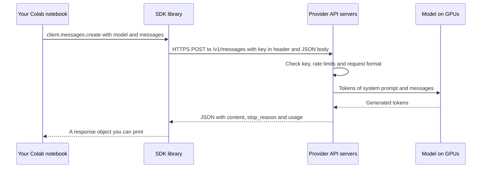
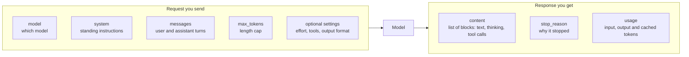
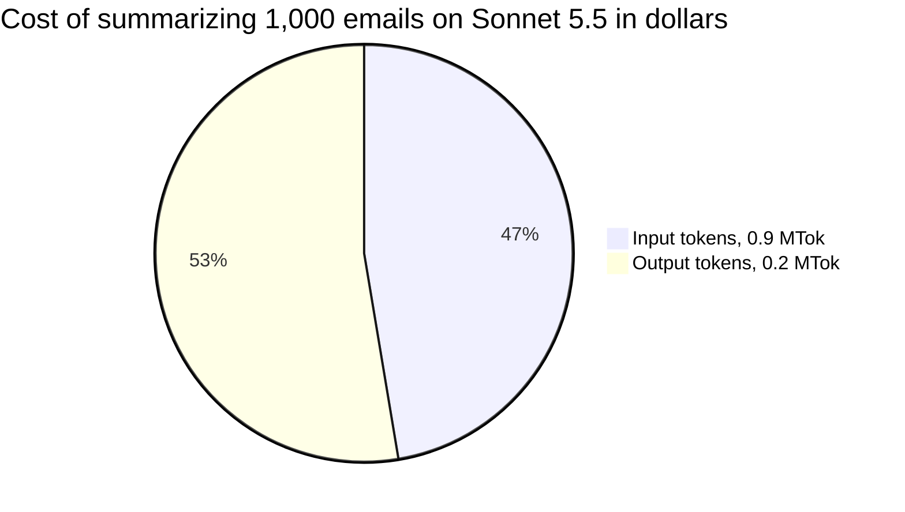
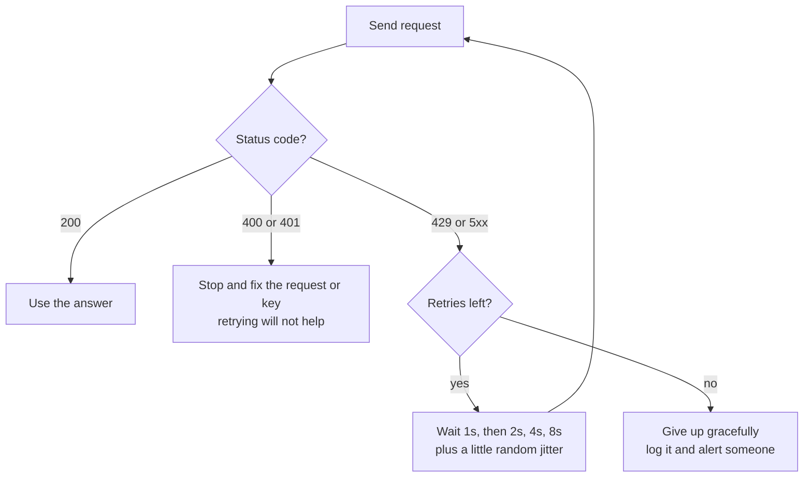
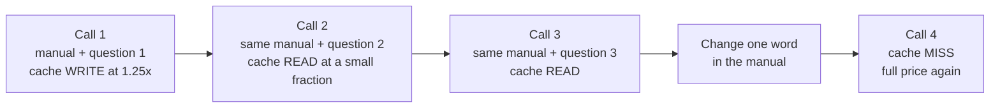
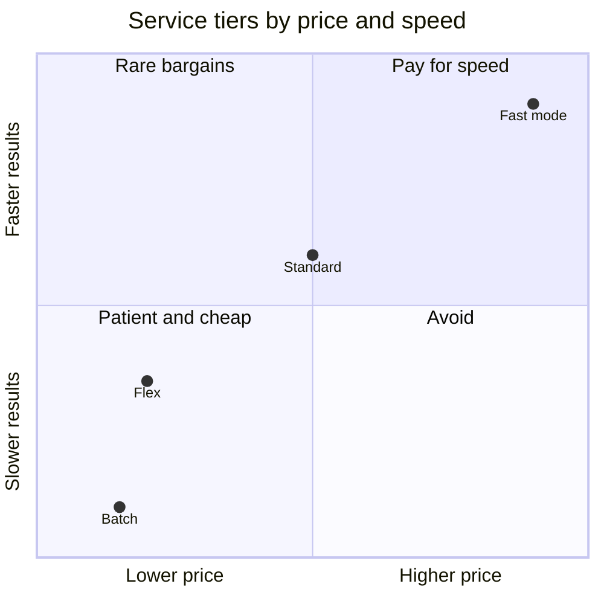
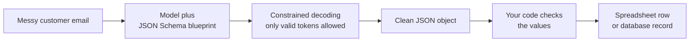
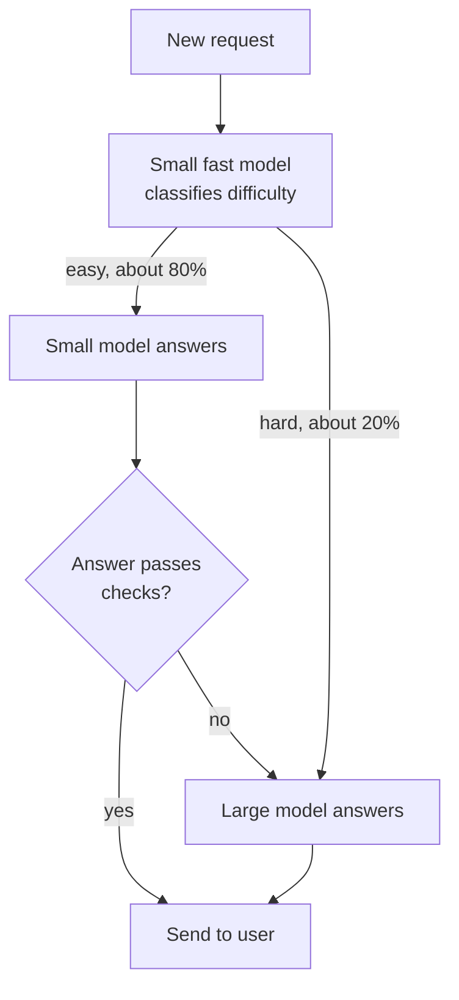

# Chapter 26: APIs: Talking to Models With Code

*This chapter takes you from the chat box to the engine room: you will make your first real API call to a frontier model from a free Google Colab notebook, read every line of what comes back, work out exactly what it cost, and learn the levers (model choice, streaming, batching, caching, structured outputs) that professionals use to build with AI.*

## What you'll learn

- What an API is, and how a request travels from your code to a model and back, in plain words.
- Just enough HTTP, JSON and Python to read API code with confidence, even if you never write much of it yourself.
- How to get an API key, store it safely in Colab's Secrets panel, and avoid the mistakes that cost people money.
- A complete, commented first API call to Claude in Google Colab, plus the OpenAI equivalent.
- How API pricing works, with worked cost calculations you can redo in a spreadsheet.
- How rate limits, streaming, batch processing, prompt caching and service tiers change speed and cost.
- How structured outputs turn messy text into clean data a spreadsheet can use.
- How to choose a model: tiers, open versus closed, routing, and why your own tests beat leaderboards.

## Before you start

Chapter 3 (Software, Code and Data) introduced Python, JSON and your first Colab notebook, and Chapter 4 (The Internet and the Cloud) explained clients, servers and HTTP; this chapter recaps both briefly. Chapter 18 (How a Large Language Model Works) explains tokens and sampling, Chapter 23 (Inference: Making Models Fast and Cheap) explains why prices and speeds look the way they do, and Chapter 25 (Mastering the Chat Interface) covers prompting and statelessness from the user's side. You will need a Google account for Colab and, for the hands-on parts, either a few dollars of prepaid API credit or a free-tier API key.

## Why talk to a model with code at all?

The chat app is wonderful for one person doing one task at a time. It stops being enough the moment you want any of these:

- **Scale.** Summarize 1,000 customer emails, tag 20,000 product reviews, or translate a whole website. Nobody wants to paste 1,000 times.
- **Automation.** Every morning, read new support tickets, sort them by urgency, and draft replies, without anyone pressing Enter.
- **Building a product.** Put AI inside your own app, website, spreadsheet or company tool, with your own instructions and your own interface.
- **Control.** Choose the exact model, set your own system prompt, fix the output format, see exactly how many tokens you used and what they cost.

All of these go through the same door: an API.

> **Watch out:** The chat app and the API are not the same thing. Chat apps add hidden system prompts, memory, tools and extra safety layers, so the same model can behave differently through the raw API. Data policies differ too: API terms for business customers are usually stricter about retention and training than consumer chat plans. Do not assume what you saw in the app is what your code will get.

## Just enough software literacy

You do not need to become a programmer to use APIs well. The goal of this section is reading, not writing: when an AI assistant writes API code for you (and it will), you should be able to follow what it does. Chapter 3 and Chapter 4 cover these ideas in more depth.

### Clients and servers

> **Definition — Client:** The program that asks for something over a network: your browser, your phone app, or your code in a notebook.

> **Definition — Server:** A computer, usually in a data center, that waits for requests and sends back responses. An AI provider's servers run the models on GPUs.

> **Analogy:** An API works like a restaurant. The menu is the documentation, listing what you can order. Your order is the request. Your membership card is the API key, which says who is ordering and who pays. The kitchen (the data center full of GPUs) is hidden from you. The dish is the response, and the bill itemizes the input and output tokens.

### The web request

Every API call is an ordinary web request, the same kind your browser makes when it loads a page.

> **Definition — HTTP (HyperText Transfer Protocol):** The standard set of rules that clients and servers use to exchange requests and responses on the web. HTTPS is the encrypted version, which all AI APIs require.

> **Definition — URL:** A web address, such as `https://api.anthropic.com/v1/messages`, naming the server and the specific resource you want.

> **Definition — Endpoint:** One specific URL on an API that performs one kind of task. For example, `/v1/messages` is the endpoint for sending messages to Claude.

> **Definition — HTTP method:** The verb of a request. GET means "give me something" (like loading a page); POST means "here is some data, please process it" (like submitting a form). Sending a prompt to a model is a POST.

> **Definition — Header:** A labeled line of extra information sent with a request, such as your API key or the format of the data. Headers are like the writing on the outside of an envelope.

> **Definition — Request body:** The main content of a request, the letter inside the envelope. For an AI API, it is the model name, your messages and your settings, written in JSON.

> **Definition — Status code:** A three-digit number the server sends back to summarize what happened, such as 200 for success or 429 for "too many requests".

You will meet a handful of status codes over and over:

| Code | Meaning | What to do |
|---|---|---|
| 200 | OK, here is your answer | Nothing; read the response |
| 400 | Bad request: something in your request is malformed | Read the error message; fix the request |
| 401 | Unauthorized: the API key is missing or wrong | Check that the key is loaded and correct |
| 429 | Too many requests: you hit a rate limit | Wait and retry with backoff (see below) |
| 500-599 | Server-side trouble | Wait and retry; check the provider's status page |

### JSON, read line by line

> **Definition — JSON (JavaScript Object Notation):** A plain-text format for structured data, built from labeled values in curly braces `{ }` and ordered lists in square brackets `[ ]`. It is the common language of web APIs.

> **Definition — Key-value pair:** A label and its value, written `"key": value` in JSON, such as `"model": "claude-opus-5-5"`. Keys are always text in quotes; values can be text, numbers, true/false, lists or more nested objects.

Here is the body of a real request to Anthropic's API. Read it slowly; it is less scary than it looks.

```json
{
  "model": "claude-opus-5-5",
  "max_tokens": 2000,
  "system": "You are a friendly tutor. Answer in plain English.",
  "messages": [
    {"role": "user", "content": "In two sentences, what is an API?"}
  ]
}
```

Line by line:

1. `{` opens a JSON object, a bundle of labeled values.
2. `"model": "claude-opus-5-5"` says which model should answer. The value is text, so it is in quotes.
3. `"max_tokens": 2000` caps the length of the reply at 2,000 tokens. The value is a number, so no quotes.
4. `"system": "..."` is the system prompt: standing instructions for this conversation.
5. `"messages": [` opens a list (square bracket) of conversation turns.
6. `{"role": "user", "content": "..."}` is one turn: who said it, and what they said.
7. `]` closes the list, and `}` closes the object.

That is the whole request. Everything else in this chapter is variations on it.

### Notebooks and Python, in five minutes

> **Definition — Python:** The most popular programming language for AI work, known for being readable. Lines of Python often read almost like English.

> **Definition — Notebook:** A document that mixes text with runnable blocks of code, showing each block's output right underneath it.

> **Definition — Google Colab:** Google's free notebook service at colab.research.google.com. It runs Python on Google's computers, in your browser, with nothing to install. Think of it as a Word document that can run code.

> **Definition — Cell:** One block in a notebook, either text or code. You run a code cell by clicking its play button or pressing Shift+Enter, and its output appears below it.

> **Definition — Variable:** A name that holds a value so you can use it later, such as `price = 4.00`. The `=` sign means "store this value under this name", not "is equal to".

> **Definition — Library (package):** Reusable code that someone else wrote and published, which you install and then use, so you do not have to write everything yourself. The Anthropic and OpenAI SDKs are libraries.

> **Definition — pip:** Python's standard tool for installing libraries, as in `pip install anthropic`. In Colab you type `!pip install ...`, where the `!` means "run this as a command, not as Python".

Here is almost all the Python you need to read this chapter:

```python
name = "Sam"                    # a variable holding text (a "string")
hives = 3                       # a variable holding a number
print("Hello,", name)           # print() shows something on screen
fruits = ["apple", "pear"]      # a list: items in order, in square brackets
order = {"item": "tea", "size": "large"}   # a dictionary: labeled values
print(order["size"])            # look up a value by its label: prints large
for f in fruits:                # a loop: do the indented lines once per item
    print(f)                    # Python ignores everything after a # sign
```

Notice that a Python dictionary looks almost exactly like a JSON object. That is not a coincidence, and it is why Python is so convenient for APIs: the request you build in Python turns into JSON almost word for word.

> **Try it:** Open colab.research.google.com, create a new notebook, paste the block above into a code cell and run it. Then change `"large"` to `"small"` and run it again. You have just written and edited a program.

## What an API is

> **Definition — API (application programming interface):** A defined way for one program to ask another program to do something, with fixed rules for what to send and what comes back. An LLM API is "the chat box, but for programs".

> **Definition — SDK (software development kit):** An official library that wraps an API so you can call it with a few lines of code in a given language, instead of building raw web requests by hand. Anthropic, OpenAI and Google all publish SDKs for Python, TypeScript and other languages.

Figure 26.1 shows one complete round trip, from a Colab cell to a model and back.


*Figure 26.1: The API round trip. The SDK turns your Python into an HTTPS request and turns the JSON reply back into a Python object.*

Under the hood, the SDK sends exactly the kind of request you read above. You never need to type this yourself, but seeing it once removes the mystery:

```text
POST https://api.anthropic.com/v1/messages
x-api-key: sk-ant-...               (your secret key)
anthropic-version: 2023-06-01       (which version of the API rules)
content-type: application/json      (the body is JSON)

{ "model": "claude-opus-5-5", "max_tokens": 2000, "messages": [ ... ] }
```

### API keys and how not to lose money

> **Definition — API key:** A long secret string that identifies you to an API and is used to bill you. Anyone who has it can spend your money, so treat it like a credit card number.

> **Definition — Secret (environment variable):** A place to store a key outside your code, such as Colab's Secrets panel or a system setting, so the key never appears in a file, notebook or screenshot you might share.

> **Definition — Spending limit:** A cap you set in a provider's billing settings so that usage stops (or you are alerted) once you have spent a chosen amount in a month.

The rules are short and worth memorizing:

1. **Never paste a key into a chat, an email, a screenshot, a shared document or a code cell.** Automated bots scan public code sites and shared notebooks for leaked keys and start using them quickly.
2. **Store keys as secrets.** In Colab, use the Secrets panel. On your own computer, use an environment variable or a password manager.
3. **Set a spending limit before you write any code.** Buy a small amount of prepaid credit (say $5) and set a monthly limit. A bug in a loop can send thousands of requests in minutes.
4. **Use separate keys for separate projects,** so you can switch one off without breaking everything.
5. **Rotate keys:** if you suspect a key has leaked, delete it in the provider's console and create a new one. Deleting it is instant and free.

> **Watch out:** "API pricing is basically free" is a dangerous belief. A single call usually costs a fraction of a cent, but costs add up fast with long documents, big models, agents that make dozens of calls per task, and loops that run longer than you meant. Set budgets and alerts first.

## Anatomy of a request and a response

Every major LLM API follows the same basic shape, even though field names differ between providers. Figure 26.2 shows the pieces.


*Figure 26.2: The parts of an LLM API request and response. Learn these once and you can read any provider's documentation.*

> **Definition — User and assistant messages:** The turns of a conversation in an API request. "User" is what the human or program sends; "assistant" is what the model replied earlier. Because the API is stateless, you send the whole list of turns every time.

> **Definition — Max tokens:** The cap you set on how long the model's response may be. It is a ceiling, not a target. If the model hits it, the answer is cut off mid-thought, and on reasoning models the hidden thinking counts toward the cap too.

> **Definition — Content block:** One piece of a response or message. A response is a list of blocks, which can include text, thinking (the model's reasoning, often hidden or summarized), and tool-use requests. Messages you send can include text, image and document blocks.

> **Definition — Stop reason:** The API's note on why generation ended: it finished naturally (`end_turn`), hit your `max_tokens` cap, wants to call a tool (`tool_use`), or declined the request (`refusal`).

> **Definition — Refusal:** When a model declines a request, usually for safety or policy reasons. Over the API it shows up as a stop reason, which your code should check before trusting the content.

> **Definition — Usage:** The part of every response that reports how many tokens you were billed for: input tokens, output tokens, and tokens written to or read from the cache. Usage is your receipt.

The statelessness you met in Chapter 25 is now in your hands. The model remembers nothing, so to continue a conversation, your code must send all the earlier turns again, including the model's own previous replies as `assistant` messages. Every chat app on Earth is, at its core, a loop that keeps appending turns to this list and re-sending it.

## Your first API call in Google Colab

This is the centerpiece of the chapter. It takes about 20 minutes the first time and costs well under one cent.

### Step 1: Get a key and set a limit

1. Go to Anthropic's developer platform at platform.claude.com and create an account (this is separate from a Claude chat subscription).
2. In the billing settings, add a small amount of prepaid credit, such as $5, and set a monthly spending limit.
3. In the API keys section, create a key and give it a name such as "colab-learning". Copy it once; you will not be shown it again.

If you would rather spend nothing, Google's Gemini API offers a free tier for its Flash-class models through Google AI Studio (aistudio.google.com). The ideas in this chapter carry over directly; only the library and field names differ.

### Step 2: Store the key in Colab's Secrets panel

1. Open colab.research.google.com and create a new notebook.
2. In the left sidebar, click the key icon labeled "Secrets".
3. Click "Add new secret". Name it exactly `ANTHROPIC_API_KEY` and paste your key as the value.
4. Switch on "Notebook access" for this notebook.

The key now lives in your Google account, not in the notebook. If you share the notebook, the key does not go with it.

### Step 3: Install the library

In the first code cell, install (or update) Anthropic's official Python library. The `!` tells Colab to run the line as a command rather than as Python, and `-q` means "quiet": print less installation chatter.

```python
!pip install -q --upgrade anthropic
```

### Step 4: Make the call

In a second code cell, paste the whole program below and run it. The numbers in the comments match the explanation after it.

```python
import anthropic                       # 1. Anthropic's official SDK
from google.colab import userdata      #    reads keys from Colab's Secrets panel

client = anthropic.Anthropic(          # 2. the client: the object that talks to the API
    api_key=userdata.get("ANTHROPIC_API_KEY")   # the key comes from Secrets
)

response = client.messages.create(     # 3. send a request
    model="claude-opus-5-5",           # which model (current as of late 2026)
    max_tokens=2000,                   # ceiling on reply length, in tokens
    output_config={"effort": "low"},   # think briefly: faster and cheaper
    system="You are a friendly tutor. Answer in plain English for a beginner.",
    messages=[
        {"role": "user", "content": "In two sentences, what is an API?"}
    ],
)

for block in response.content:         # 4. the reply is a list of content blocks;
    if block.type == "text":           #    some may be thinking blocks, so print
        print(block.text)              #    only the text ones

print("Stop reason:  ", response.stop_reason)       # 5. the receipt
print("Input tokens: ", response.usage.input_tokens)
print("Output tokens:", response.usage.output_tokens)
```

Here is what each part does, in plain words:

- **Part 1** loads two libraries: Anthropic's SDK, and Colab's helper for reading secrets.
- **Part 2** creates a `client`, an object that knows your key and the API's address. `userdata.get()` fetches the secret named `ANTHROPIC_API_KEY`, so the key itself never appears in your notebook. You create the client once and reuse it for every call.
- **Part 3** is the request from the JSON walkthrough, written in Python. `model` picks Claude Opus 5.5, which Anthropic describes as its recommended default for most workloads as of late 2026. `max_tokens` is a safety ceiling. `output_config={"effort": "low"}` tells this reasoning model to think only briefly, since the question is easy; Claude Opus 5.5 always decides for itself how much to think (adaptive thinking), and effort is how you steer it. `system` and `messages` are your instructions and question.
- **Part 4** walks through the blocks in the reply and prints the text ones. Reasoning models can also return thinking blocks, which is why the code checks each block's type.
- **Part 5** prints why the model stopped and how many tokens you were billed for.

When you run it, you should see a two-sentence answer followed by something like `Stop reason: end_turn` and two token counts. If you get an authentication error, check that the secret's name is spelled exactly right and that notebook access is switched on.

> **Try it:** Change the `system` line to "You are a pirate. Answer in pirate speak." and rerun. Then change `effort` from `"low"` to `"high"` and ask a harder question, such as "Pens come only in packs of 3 for $2. How much do 20 pens cost?". Compare the output token counts. Higher effort means more thinking, and thinking is billed as output.

### Step 5: Read the whole response

Add one more cell to see everything the API sent back:

```python
print(response.to_json())    # the full response, exactly as the API returned it
```

You will see something like this (abridged; your IDs, text and numbers will differ):

```json
{
  "id": "msg_01AbCdEf...",
  "type": "message",
  "role": "assistant",
  "model": "claude-opus-5-5",
  "content": [
    {"type": "text", "text": "An API is a set of rules that lets one program ask another..."}
  ],
  "stop_reason": "end_turn",
  "usage": {
    "input_tokens": 41,
    "output_tokens": 88,
    "cache_creation_input_tokens": 0,
    "cache_read_input_tokens": 0
  }
}
```

Find the three things that matter most: `content` (the answer, as a list of blocks; you may also see a `thinking` block, which by default carries no visible text on current Claude models), `stop_reason` (why it stopped), and `usage` (your receipt). The two `cache_` fields will become interesting later in this chapter.

### Step 6: Work out what it cost

```python
INPUT_PRICE = 4.00     # Opus 5.5, dollars per million input tokens (October 2026)
OUTPUT_PRICE = 20.00   # dollars per million output tokens; check the current price page

cost = (response.usage.input_tokens * INPUT_PRICE
        + response.usage.output_tokens * OUTPUT_PRICE) / 1_000_000
print(f"This call cost about ${cost:.5f}")
```

With the illustrative numbers above: (41 × $4 + 88 × $20) ÷ 1,000,000 = ($164 + $1,760) ÷ 1,000,000 ≈ $0.0019, about a fifth of a cent. Notice that the short reply cost ten times more than the question. Output tokens are the expensive part.

### Step 7: Continue the conversation

Because the API is stateless, a follow-up question must carry the history with it:

```python
history = [    # ALL earlier turns, including the model's own reply as "assistant"
    {"role": "user", "content": "My name is Sam and I keep bees."},
    {"role": "assistant", "content": "Nice to meet you, Sam! How many hives do you have?"},
    {"role": "user", "content": "Three. What should I check before winter?"},
]

response = client.messages.create(
    model="claude-opus-5-5",
    max_tokens=2000,
    output_config={"effort": "low"},
    messages=history,
)

for block in response.content:
    if block.type == "text":
        print(block.text)
```

The model will answer as if it remembered Sam's three hives, because you just told it. Delete the first two entries from `history` and run again, and "Sam" and his bees vanish. This is exactly what chat apps do behind the scenes on every turn (Chapter 25).

### The same call with OpenAI

Other providers work the same way with different names. Here is the equivalent call using OpenAI's Python SDK and its Responses API. Store your OpenAI key as a Colab secret named `OPENAI_API_KEY` first.

```python
!pip install -q --upgrade openai         # install OpenAI's library (run once)

from google.colab import userdata
from openai import OpenAI

client_oa = OpenAI(api_key=userdata.get("OPENAI_API_KEY"))   # key from Secrets

response_oa = client_oa.responses.create(
    model="gpt-6.1-sol",                 # an OpenAI model (as of late 2026)
    instructions="You are a friendly tutor. Answer in plain English.",  # system prompt
    input="In two sentences, what is an API?",                          # your message
    max_output_tokens=2000,              # ceiling on reply length
)

print(response_oa.output_text)           # the answer as plain text
print(response_oa.usage)                 # the receipt: input and output tokens
```

The vocabulary shifts (`instructions` instead of `system`, `input` instead of `messages`, `output_text` as a shortcut), but the shape is identical: a model, instructions, input, a length cap, an answer and a usage receipt.

> **Key idea:** Every LLM API is the same five things: which model, what instructions, what conversation, how long, and which special settings. Every response is the same three things: the content, why it stopped, and how many tokens it used. Once you can read one, you can read them all.

## Sampling settings: the creativity dials

> **Definition — Temperature:** A setting that controls randomness when the model picks each next token. Low values give consistent, predictable output; high values give varied, surprising output (Chapter 18 shows the math).

> **Definition — Top-p (nucleus sampling):** A second randomness control that limits the model's choices to the most likely tokens whose probabilities add up to p, such as the top 90%.

For years, temperature was the first setting every tutorial taught: low for factual extraction, high for brainstorming. In 2026 the picture has changed. Many reasoning models fix or restrict these dials, because their training assumes a particular sampling setup. As of late 2026, Anthropic's current Claude models reject custom temperature and top-p values, and steer behavior through the effort setting and the prompt instead. Older and open-weight models, and some other providers' models, still accept them.

> **Watch out:** "Temperature 0 means the output is always identical" is false. Even at the lowest setting, outputs can differ slightly between runs because of how servers batch and compute requests (Chapter 18). If you are testing a prompt, run it several times and look at the spread, not one lucky answer.

## Tokens, money and speed

### How API pricing works

> **Definition — MTok:** One million tokens, the standard unit in API price lists. "$2 / MTok" means two dollars per million tokens.

> **Definition — Input tokens and output tokens:** Input tokens are everything you send (system prompt, history, documents, question); output tokens are everything the model writes. Output tokens usually cost four to six times more per token, because generating text one token at a time is the slow, expensive part of inference (Chapter 23).

> **Definition — Thinking tokens:** The tokens a reasoning model generates while thinking before its visible answer. They are billed as output tokens even when you never see them, which is why effort settings affect cost.

Here are standard per-million-token prices for current models, as published on the providers' pricing pages in October 2026. They change often, so treat them as a snapshot.

| Provider | Model | Input $/MTok | Output $/MTok | Notes |
|---|---|---|---|---|
| Anthropic | Claude Haiku 5.5 | 0.10 | 0.50 | Prompts up to 100k tokens; $0.50 / $2.50 above |
| Anthropic | Claude Sonnet 5.5 | 2.00 | 10.00 | |
| Anthropic | Claude Opus 5.5 | 4.00 | 20.00 | Recommended default "for most workloads" |
| Anthropic | Claude Fable 5.1 | 10.00 | 50.00 | For demanding reasoning and long agentic work |
| OpenAI | gpt-6-luna | 0.10 | 0.50 | Cached input $0.01 |
| OpenAI | gpt-6.1-sol | 2.00 | 10.00 | Cached input $0.10 |
| OpenAI | gpt-6-astra | 10.00 | 50.00 | Cached input $1.00 |
| Google | Gemini 3.8 Flash | 0.75 | 3.75 | Free tier available; price rises January 1, 2027 |
| Google | Gemini 4 Argon | 2.00 | 10.00 | Rises to $4 / $20 from December 1, 2026 |

Two patterns jump out. First, the three labs' tiers line up closely: a small tier around $0.10 / $0.50, a middle tier around $2 / $10, and a top tier around $10 / $50. Second, output costs five times input on most of these models. Prices for a given level of capability have generally fallen fast (Chapter 23 explains why), but not always: Google's announced increases for Gemini 4 Argon and Gemini 3.8 Flash are a reminder to re-check prices before you commit to a budget.

### A worked cost example: 1,000 customer emails

Suppose you want to summarize 1,000 customer emails of about 500 words each, producing a 200-token summary of each, using Claude Sonnet 5.5 at $2 input and $10 output per million tokens.

**Step 1: count input tokens.** On Anthropic's newer tokenizer, one million tokens is about 555,000 English words, so one word is about 1,000,000 ÷ 555,000 ≈ 1.8 tokens. A 500-word email is about 500 × 1.8 = 900 tokens. For 1,000 emails: 1,000 × 900 = 900,000 tokens = 0.9 MTok.

**Step 2: count output tokens.** 1,000 summaries × 200 tokens = 200,000 tokens = 0.2 MTok.

**Step 3: multiply by prices.**

```text
Input:   0.9 MTok × $2.00  = $1.80
Output:  0.2 MTok × $10.00 = $2.00
Total                      = $3.80
```

Even though there is four and a half times more input than output, output is more than half the bill.


*Figure 26.3: Output is the smaller number of tokens but the larger share of the bill.*

**Step 4: pull the levers.** The same job priced four other ways:

| Option | Input cost | Output cost | Total |
|---|---|---|---|
| Sonnet 5.5, standard | $1.80 | $2.00 | $3.80 |
| Sonnet 5.5, Batch API (50% off) | $0.90 | $1.00 | $1.90 |
| Haiku 5.5, standard | 0.9 × $0.10 = $0.09 | 0.2 × $0.50 = $0.10 | $0.19 |
| Opus 5.5, standard | 0.9 × $4 = $3.60 | 0.2 × $20 = $4.00 | $7.60 |
| Fable 5.1, standard | 0.9 × $10 = $9.00 | 0.2 × $50 = $10.00 | $19.00 |

The spread from Haiku to Fable is 100×. Choosing a model is by far the biggest cost lever; batching is next. And one hidden factor: if the model also thinks for, say, 300 tokens per email before summarizing, that is another 0.3 MTok of output, which on Sonnet 5.5 adds 0.3 × $10 = $3.00, nearly doubling the bill. For simple summarization, low effort is the right setting.

> **Key idea:** API cost = (input tokens × input price + output tokens × output price) ÷ 1,000,000, with thinking counted as output. Estimate tokens, multiply, and then compare model choices, batch and caching before you run anything big.

How does this compare to a chat subscription? Imagine a heavy user who sends 50 messages a day, each carrying about 3,000 input tokens (the growing history) and getting 500 output tokens back, on Sonnet 5.5. Per message: 3,000 × $2 ÷ 1,000,000 = $0.006 plus 500 × $10 ÷ 1,000,000 = $0.005, so $0.011. Over a 30-day month: 50 × 30 × $0.011 = $16.50, in the same range as a $20 monthly plan. For light users the API is far cheaper; for very heavy users of top models, a subscription can be a bargain. Agents change the math entirely: an agent may make dozens of calls per task and burn 10 to 100 times the tokens of a chat.

### Tokenizers differ: compare cost per task, not per token

> **Definition — Tokenizer:** The component that chops text into tokens. Different models chop differently, so the same text can be a different number of tokens, and cost a different amount, on different models.

Anthropic notes that its newer tokenizer, used by Claude 4.7 and later, produces about 30% more tokens for the same text than its previous one (roughly 555,000 versus 750,000 English words per million tokens). That means per-token prices are not directly comparable across tokenizers.

A worked comparison with a hypothetical second model: a 10,000-word report is about 10,000 × 1.8 = 18,000 tokens on the newer Claude tokenizer, and about 10,000 × 1.33 ≈ 13,300 tokens on a tokenizer like the older one. Model A charges $2.00 per MTok and uses the newer tokenizer: 18,000 × $2 ÷ 1,000,000 = $0.036. Hypothetical model B charges $2.50 per MTok but uses the more compact tokenizer: 13,300 × $2.50 ÷ 1,000,000 ≈ $0.033. The model with the higher price per token is cheaper for this task. The only fair comparison is to run your real task on both and compare the bills.

> **Try it:** After your first call works, run this in a new cell to count tokens without generating anything (counting is free): `print(client.messages.count_tokens(model="claude-opus-5-5", messages=[{"role": "user", "content": "The quick brown fox jumps over the lazy dog."}]).input_tokens)`. Then try a sentence in another language, a line of code and a row of emoji.

### Rate limits and backoff

> **Definition — Rate limit:** The maximum number of requests or tokens you may send per minute (or per day). Exceed it and the API answers with status code 429 instead of a response.

> **Definition — RPM and TPM:** Requests per minute and tokens per minute, the usual units of rate limits. Providers usually raise your limits as you spend more and build a track record, through what they call usage tiers.

> **Analogy:** A rate limit is a nightclub bouncer who lets in only so many people per minute. Shoving harder does not help; coming back a little later does.

> **Definition — Exponential backoff:** A retry strategy in which you wait longer after each failed attempt (1 second, then 2, then 4, then 8), so a busy server gets breathing room instead of a flood of instant retries.

> **Definition — Jitter:** A small random amount added to each backoff wait, so that thousands of clients that failed at the same moment do not all retry at exactly the same moment.


*Figure 26.4: Retry with exponential backoff. Only retry errors that can fix themselves.*

A worked example: with waits of 1, 2, 4, 8 and 16 seconds, five retries add up to 1 + 2 + 4 + 8 + 16 = 31 seconds of waiting before you give up, which is enough to ride out most brief overloads without hammering the server. The good news for beginners: the official SDKs already retry 429 and server errors automatically with exponential backoff (twice by default, in Anthropic's Python SDK). You can raise that with one setting: `anthropic.Anthropic(api_key=..., max_retries=5)`. Errors like 400 and 401 are never worth retrying, because the request itself is wrong.

> **Try it:** Open the limits or usage page in your provider's developer console and find your current requests-per-minute and tokens-per-minute limits, and your spending limit. Write them down; they tell you how big a job you can run at once.

### Streaming and time to first token

> **Definition — Latency:** How long you wait for a response.

> **Definition — Time to first token (TTFT):** How long until the first piece of the answer appears. It dominates how fast an app feels.

> **Definition — Throughput (tokens per second):** How fast the model produces text once it has started.

> **Definition — Streaming:** Receiving the response token by token as it is generated, instead of waiting for the whole thing to finish.

> **Definition — Server-sent events (SSE):** The web technique most LLM APIs use for streaming: the server keeps the connection open and pushes small chunks of the answer as they are ready.

Some illustrative numbers show why streaming matters. Say a reply is 600 tokens long, the model generates 75 tokens per second, and the time to first token is 0.6 seconds. Without streaming, you stare at a spinner for 0.6 + 600 ÷ 75 = 0.6 + 8 = 8.6 seconds, then the whole answer appears. With streaming, words start appearing after 0.6 seconds and keep flowing; reading speed is slower than 75 tokens per second anyway, so the wait effectively disappears. Total time is the same; perceived speed is completely different. One subtlety: on reasoning models, the visible text starts only after the thinking is done, so a higher effort setting means a longer pause before the first visible word.

```python
import time                                         # for the stopwatch

start = time.time()
first_text_at = None

with client.messages.stream(
    model="claude-opus-5-5",
    max_tokens=4000,
    output_config={"effort": "low"},
    messages=[{"role": "user", "content": "Write a 150-word story about a lighthouse keeper."}],
) as stream:
    for text in stream.text_stream:                 # each small chunk as it arrives
        if first_text_at is None:
            first_text_at = time.time() - start     # record the time to first text
        print(text, end="", flush=True)             # print without a line break

total = time.time() - start
print(f"\n\nFirst text after {first_text_at:.2f} s, finished after {total:.2f} s")
```

> **Analogy:** Streaming is watching someone type a letter to you, instead of waiting by the mailbox for the finished letter.

### Batch APIs: half price if you can wait

> **Definition — Batch API:** A way to submit many requests at once (thousands, even tens of thousands) and collect the results later, within 24 hours and often much sooner, at about half the normal price.

Anthropic, OpenAI and Google all offer batch processing at 50% off standard prices as of late 2026. Providers can afford the discount because batch jobs fill in the quiet gaps between urgent requests, which keeps their GPUs busy (Chapter 23). If nobody is waiting for the answer in real time, such as overnight report generation, tagging a backlog of documents or running a test suite of prompts, batch should be your default.

> **Analogy:** The Batch API is an overnight laundry service. Drop everything off in one bag, pay less, and pick it up tomorrow.

In code, a batch is a list of ordinary requests, each with your own label (a `custom_id`) so you can match answers to questions, because results can come back in any order. Exercise 9 at the end of this chapter walks through a complete example.

### Prompt caching: pay once for the part that never changes

Many applications send the same long beginning over and over: a 30-page manual, a long system prompt, a big set of examples, followed by a short question that changes each time. Because the API is stateless, the model would normally have to process that whole manual from scratch on every call.

> **Definition — Prompt caching:** Storing the processed form of a repeated prompt prefix (the unchanging beginning of a request) on the provider's servers, so later requests that start with exactly the same prefix reuse it more cheaply and quickly.

> **Definition — Cache hit and cache miss:** A cache hit is a request that reuses a stored prefix and pays the low "cache read" price. A cache miss is a request whose prefix was not stored (or had expired, or changed by even one character) and pays full price, plus a small surcharge to write the cache.

On Anthropic's API as of late 2026, writing a prefix to the cache for the default five minutes costs 1.25 times the normal input price (2 times for a one-hour cache), and reading it back costs a small fraction: 0.1 times the base input price on most models, 0.05 times on Opus 5.5 and Sonnet 5.5, and 0.025 times on Fable 5.1. Each cache hit refreshes the five-minute timer. OpenAI's price list shows a similar idea as a separate "cached input" price, such as $0.10 instead of $2.00 per MTok for gpt-6.1-sol.

A worked example. You have a 50,000-token product manual and want to ask 10 questions about it, using Claude Sonnet 5.5 ($2.00 per MTok input; cache writes $2.50; cache reads 0.05 × $2.00 = $0.10).

```text
Without caching:
  10 calls × 50,000 tokens = 500,000 tokens × $2.00/MTok  = $1.000

With caching:
  Call 1 writes the cache: 50,000 × $2.50/MTok            = $0.125
  Calls 2-10 read it:  9 × 50,000 × $0.10/MTok            = $0.045
  Total                                                   = $0.170
```

That is 83% cheaper for the manual's tokens (the short questions and the answers cost the same either way), and the cached calls also start answering faster, because the model skips re-reading the manual.


*Figure 26.5: Prompt caching rewards a stable prefix. Any change to the beginning of the prompt breaks the match from that point on.*

The rule that follows is simple and important: **stable stuff first, changing stuff last.** Put the system prompt, the documents and the examples at the start, in exactly the same form every time, and the user's question at the end. A timestamp or a user's name at the top of the system prompt silently breaks caching on every call.

```python
manual = "..."   # imagine a long document here (caching needs a long prefix)

response = client.messages.create(
    model="claude-sonnet-5-5",
    max_tokens=2000,
    output_config={"effort": "low"},
    system=[
        {
            "type": "text",
            "text": "Answer questions using only this manual.\n<manual>\n" + manual + "\n</manual>",
            "cache_control": {"type": "ephemeral"},   # cache everything up to here
        }
    ],
    messages=[{"role": "user", "content": "How do I reset the device?"}],
)

print("Written to cache:", response.usage.cache_creation_input_tokens)
print("Read from cache: ", response.usage.cache_read_input_tokens)
print("Uncached input:  ", response.usage.input_tokens)
```

Run the same cell twice within five minutes. The first time, the manual's tokens appear under "written to cache"; the second time, under "read from cache". Very short prompts are not cached at all (each model has a minimum length), which is why this only pays off for long, repeated prefixes. Exercise 8 is a complete caching lab.

> **Analogy:** Prompt caching is a chef's mise en place. The onions every dish needs are chopped once at the start of service, not again for each plate.

> **Key idea:** The three biggest cost levers, in order, are usually model choice (up to 100x), batching (2x) and caching (up to about 10x or more on the repeated part of the prompt). Check all three before you optimize anything else.

### Service tiers: paying for speed, or waiting for savings

> **Definition — Service tier:** A pricing option that trades speed or priority for cost on the same model: for example a cheaper tier that may queue your request, or a premium tier that answers faster.

> **Definition — Fast mode:** A premium tier that runs a model with faster output for a higher price. As of late 2026, Anthropic offers fast mode on Claude Opus 5.5 at $8 / $40 per MTok (twice the standard price), and OpenAI renamed its "priority processing" tier to Fast mode on July 30, 2026.

> **Definition — Data residency:** A guarantee that your requests are processed in a particular region, such as the US or the EU, often required by law or company policy and sometimes sold at a premium.

> **Definition — Zero data retention (ZDR):** An arrangement, usually for business customers, under which the provider does not store your prompts and outputs after processing them.

| Tier | What you get | Price versus standard (as of late 2026) |
|---|---|---|
| Batch | Results within 24 hours | About 50% off at Anthropic, OpenAI and Google |
| Flex | Slower, may be queued | Half price at OpenAI; matches batch for Gemini Flash models |
| Standard | Normal speed | 1x |
| Priority or Fast | Faster output or guaranteed capacity | Anthropic Opus 5.5 fast mode 2x; Gemini Priority about 1.8x |
| Regional processing | Data stays in a chosen region | OpenAI adds 10% for models released on or after March 5, 2026 |


*Figure 26.6: Service tiers trade price for speed. Pick the cheapest tier whose speed your users actually need.*

> **At the frontier (2026):** The cost-and-speed controls on frontier APIs have multiplied. On top of model tiers, you can now tune effort (how much a reasoning model thinks), choose fast or flex tiers, batch, cache with very cheap reads (down to 0.025 times the input price on Anthropic's top model), and let the server compact long conversations automatically. Current Claude models have one-million-token context windows and can write up to 128,000 tokens in one reply. Two practical consequences: the same model can cost ten times more or less depending on how you call it, and teams that measure cost per completed task, not per request, make better choices.

## Structured outputs: getting forms, not prose

A person can read a paragraph. A program needs fields: a name here, a date there, a yes-or-no flag. If you ask a model for "JSON" in plain words, it usually complies, but "usually" breaks programs. A missing comma or an extra sentence before the opening brace crashes the code that tries to read it.

> **Definition — Structured outputs:** An API feature that forces the model's answer to match an exact data shape you specify, so programs can read it reliably.

> **Definition — JSON Schema:** A standard way of describing what a JSON object must look like: which fields it has, what type each one is (text, number, true/false, list), which are required, and which values are allowed.

> **Definition — Constrained decoding:** The technique behind structured outputs. At each step of generation, the model is only allowed to choose tokens that keep the output valid according to the schema, so invalid JSON becomes impossible rather than merely unlikely.

> **Definition — Pydantic:** A popular Python library for defining data shapes as simple classes and checking that data matches them. AI SDKs can turn a Pydantic class into a JSON Schema for you.


*Figure 26.7: Structured outputs turn prose into data. The schema guarantees the shape; your code still checks the content.*

Here is a complete example that pulls fields out of a customer email:

```python
import json

schema = {                              # 1. the blueprint every answer must match
    "type": "object",
    "properties": {
        "customer_name": {"type": "string"},
        "order_number": {"type": "string"},
        "category": {"type": "string",
                     "enum": ["refund", "delivery", "product question", "other"]},
        "urgent": {"type": "boolean"},
        "summary": {"type": "string"},
    },
    "required": ["customer_name", "order_number", "category", "urgent", "summary"],
    "additionalProperties": False,      # no extra, unexpected fields allowed
}

email = """Hi, this is Maria Lopez. My order 88-2041 still hasn't arrived and
it's been three weeks. It's a birthday present for Saturday! Please help."""

response = client.messages.create(     # 2. ask, passing the schema in output_config
    model="claude-opus-5-5",
    max_tokens=2000,
    output_config={
        "effort": "low",
        "format": {"type": "json_schema", "schema": schema},
    },
    messages=[{
        "role": "user",
        "content": "Extract the fields from this customer email. "
                   "Use an empty string if there is no order number.\n\n"
                   "<email>\n" + email + "\n</email>",
    }],
)

if response.stop_reason in ("refusal", "max_tokens"):   # 3. did it finish normally?
    print("No usable result. Stop reason:", response.stop_reason)
else:
    text = next(b.text for b in response.content if b.type == "text")
    data = json.loads(text)             # turn the JSON text into a Python dictionary
    print(data["customer_name"], "|", data["category"], "| urgent:", data["urgent"])
```

You should get something like `Maria Lopez | delivery | urgent: True`. Each part, in plain words: the schema lists five fields, their types and, for `category`, the only four values allowed; `output_config` hands the schema to the API along with the effort setting; the stop-reason check catches the two cases where the guarantee cannot hold (a refusal, or an answer cut off by the token cap); and `json.loads` turns the text into a Python dictionary your code can use. Loop this over a list of emails, collect the dictionaries, and the `pandas` library turns them into a table in one line (Exercise 7).

> **Watch out:** Structured outputs guarantee the shape of the answer, not the truth of the values. The schema can force `urgent` to be true or false; it cannot force the model to judge urgency correctly, and it cannot stop it from misreading "88-2041" as "88-2014". Always spot-check values, and add code checks where you can (dates are real dates, totals add up).

Typical uses: extracting fields from invoices, receipts, contracts and emails; classifying and routing messages; filling in forms; turning survey answers into categories; and producing data for charts. There is one more reason to care: a tool definition, which lets a model ask your code to do things, is essentially a JSON Schema plus a description, and a tool call is a structured output. Chapter 28 builds directly on this section.

> **Try it:** In an ordinary chat app, ask for "the three largest planets as JSON with name and diameter in kilometers" five times in fresh chats. Compare the five answers: field names, number formats and extra sentences around the JSON will vary. That variation is exactly what structured outputs remove.

## Multimodal input and output

The messages you send can contain more than text.

> **Definition — Files API:** An API feature that lets you upload a file (such as a PDF or image) once and then refer to it by an ID in many later requests, instead of re-sending the whole file each time.

Images, PDFs and, on some models, audio go into the same `content` list as text, as their own content blocks. Here is an image example; replace the placeholder with any public link to a JPG or PNG file.

```python
response = client.messages.create(
    model="claude-opus-5-5",
    max_tokens=2000,
    output_config={"effort": "low"},
    messages=[{
        "role": "user",
        "content": [
            # An image block: the picture to look at, given by its web address.
            {"type": "image", "source": {"type": "url", "url": "PASTE_AN_IMAGE_URL_HERE"}},
            # A text block: what you want to know about it.
            {"type": "text", "text": "Describe this image in three sentences."},
        ],
    }],
)

for block in response.content:
    if block.type == "text":
        print(block.text)
```

Images and documents are turned into tokens and billed like text, so a large image or a long PDF can cost as much as many pages of writing (Chapter 22 shows how images become tokens and works through the arithmetic). On the output side, generating images, speech and video usually uses separate specialized models and endpoints, such as OpenAI's image models or Google's Nano Banana for images, priced per image, per second or per character rather than per text token (Chapter 47).

## Choosing a model

With dozens of models on offer, choosing one is a real skill. The good news: the structure of the market is simple.

> **Definition — Model tier:** A size-and-price class within a lab's lineup. Every major lab offers a large flagship (smartest, slowest, priciest), a mid-size model (balanced) and a small, fast model (cheap and quick).

| Tier | Anthropic | OpenAI | Google | Use it for |
|---|---|---|---|---|
| Top | Fable 5.1 | gpt-6-astra | Gemini 4 Argon | Hardest reasoning, long agentic work |
| Default | Opus 5.5 | | | Most workloads, per Anthropic's guidance |
| Middle | Sonnet 5.5 | gpt-6.1-sol | | High-volume work that still needs judgment |
| Small and fast | Haiku 5.5 | gpt-6-luna | Gemini 3.8 Flash, Flash-Lite | Classification, extraction, routing, simple Q&A |

(As of late 2026; the blank cells mean that lab's lineup is not split at that point, not that it lacks capable models. Chapter 24 covers the full landscape.)

> **Definition — Open-weight model:** A model whose weight files are published so anyone can download, run and modify it, such as Llama, Qwen, DeepSeek, Mistral, Gemma or gpt-oss. You can run it on your own hardware or rent it from many hosting companies (Chapter 30).

> **Definition — Closed model:** A model you can only use through its maker's app or API (or approved cloud partners). You rent access; you never hold the weights.

The criteria that matter, roughly in order:

1. **Quality on your task,** measured by your own tests, not a leaderboard.
2. **Cost per completed task,** including thinking tokens, retries and tokenizer differences.
3. **Latency:** time to first token and total time, if a person is waiting.
4. **Context length and modality:** does it take your 400-page document, your images, your audio?
5. **Data and compliance:** retention terms, data residency, zero data retention, industry rules.
6. **Vendor risk:** price changes, model retirements, and whether you could switch providers easily.

> **Watch out:** "A bigger model is always the better choice" is a costly misconception. For classification, extraction and short summaries, small models are often good enough at 20 to 40 times lower cost and much lower latency. The only way to know is to test both on your task.

### Routing and cascades

> **Definition — Routing:** Classifying each incoming request and sending it to the most suitable prompt, model or specialist, such as easy questions to a small model and hard ones to a large one.

> **Definition — Model cascade:** Trying a cheap model first and escalating to an expensive one only when needed, for example when the cheap model reports low confidence or its answer fails a check.

> **Analogy:** Model tiers are like a firm with a senior partner, an associate and an intern. Good managers route each task to the cheapest person who can do it well, and escalate only when needed.

A worked example. An app handles 10,000 requests a day, each with about 1,500 input tokens and 300 output tokens.

```text
Everything on Opus 5.5 ($4 / $20):
  Input  10,000 × 1,500 = 15 MTok × $4   = $60.00
  Output 10,000 × 300   =  3 MTok × $20  = $60.00
  Total per day                          = $120.00

Router on Haiku 5.5 sends 80% to Haiku, 20% to Opus:
  Router: 15 MTok input × $0.10 (tiny outputs ignored) =  $1.50
  Haiku:  12 MTok × $0.10 + 2.4 MTok × $0.50          =  $2.40
  Opus:    3 MTok × $4    + 0.6 MTok × $20            = $24.00
  Total per day                                       = $27.90
```

That is about 77% cheaper, roughly $33,000 a year saved on this one feature, provided the router and Haiku really do handle that 80% well. Which is exactly the thing you must test.


*Figure 26.8: A routing cascade. Most traffic goes to the cheap model; hard or failed cases escalate.*

### Benchmarks versus your own evals

> **Definition — Eval (evaluation):** A systematic test of how well an AI system performs on your tasks: a set of realistic inputs, a definition of a good answer, and a way of scoring outputs. Chapter 31 covers evals in depth.

> **Definition — Model snapshot (pinning):** Using a fixed model version ID in your code so the model's behavior does not change under you without warning when the provider releases an update.

> **Definition — Deprecation:** A provider announcing, then carrying out, the retirement of an older model. Code that names a retired model stops working, so production systems track deprecation notices and re-test before switching.

Public benchmarks (Chapter 24) are a useful first filter, but they measure someone else's tasks, can be saturated or contaminated, and depend on how the test was run. A 20-question test built from your own real inputs, scored against answers you trust, tells you more about your use case than any leaderboard. Start with a small one: run your 20 questions through two or three candidate models, score them blind, and compare quality against cost per task. Re-run the same test whenever you change the prompt or the model.

> **Watch out:** "Benchmarks tell me which model is best for me" is a trap. Leaderboards are proxies. Your own small eval, run on your real task, beats any leaderboard for your decision.

> **Key idea:** Start with the cheapest model that might work, measure it on 20 real examples, and move up a tier only where the results show you need to. Routing lets you use both.

## Errors and good habits

A few habits separate a weekend experiment from something you can rely on:

- **Check `stop_reason` before trusting `content`.** `max_tokens` means the answer is cut off; `refusal` means there is no real answer; `tool_use` means the model is asking your code to do something (Chapter 28).
- **Catch errors by type.** The SDK raises specific errors you can handle differently: an authentication error means fix the key, a rate-limit error means wait, a bad-request error means fix the request.
- **Log the `usage` of every call.** Add up tokens and cost per day; set alerts. Most surprise bills come from code nobody was watching.
- **Pin model versions and read deprecation emails.** Plan migrations; do not discover them when your app breaks.
- **Keep prompts in one place,** under version control if you can, and re-run your eval when you change them.
- **Never put secrets in code,** even "just for a minute".

```python
import anthropic

try:
    response = client.messages.create(
        model="claude-opus-5-5",
        max_tokens=2000,
        output_config={"effort": "low"},
        messages=[{"role": "user", "content": "Hello!"}],
    )
except anthropic.AuthenticationError:
    print("The API key is missing or wrong. Check the Secrets panel.")
except anthropic.RateLimitError:
    print("Rate limited even after automatic retries. Wait a minute and try again.")
except anthropic.BadRequestError as e:
    print("Something in the request is malformed:", e.message)
except anthropic.APIConnectionError:
    print("Network problem. Check your internet connection.")
```

> **At the frontier (2026):** The API layer is converging across labs. Structured outputs with constrained decoding, batch discounts of about 50%, prompt caching, fast and flex tiers, effort settings for reasoning models, one-million-token context windows and MCP connectors are now offered in some form by all of the largest providers. The differentiators have moved up the stack: hosted agent harnesses that run the tool loop for you, server-side tools such as web search (Anthropic charges $10 per 1,000 searches plus tokens), and enterprise controls such as data residency and zero data retention. Chapter 28 picks up from here with tools and agents.

## In plain English

An API is the chat box for programs. Your code (the client) sends a request over the internet to the provider's servers: which model, what instructions, the whole conversation so far (because the model remembers nothing), how long the answer may be, and any special settings. The server sends back JSON with the answer as a list of blocks, the reason it stopped, and a usage receipt counting input and output tokens. An SDK, a ready-made library, does the web plumbing for you, so a first call in Google Colab is a dozen lines: install the library, read your key from Colab's Secrets panel, create a client, send a message, print the text.

Your key is a credit card: keep it in a secrets store, set a spending limit, and never paste it anywhere. Pricing is per million tokens, with output costing about five times input and thinking counted as output. Summarizing 1,000 emails costs about $3.80 on a mid-tier model, half that in batch, and about 19 cents on a small model, so model choice is the biggest lever. Rate limits return error 429; retry with growing waits. Streaming makes apps feel fast by showing words as they arrive. Batch halves the price if you can wait. Caching makes a repeated long beginning cheap, so put stable material first. Service tiers trade price for speed.

Structured outputs force answers into an exact JSON shape so programs can use them, though the values still need checking. Images and PDFs go into messages as extra blocks. To choose a model, test small and large tiers on your own task, route easy work to cheap models, and trust your own evals over leaderboards.

## Key terms

Client, Server, HTTP (HyperText Transfer Protocol), URL, Endpoint, HTTP method, Header, Request body, Status code, JSON (JavaScript Object Notation), Key-value pair, Python, Notebook, Google Colab, Cell, Variable, Library (package), pip, API (application programming interface), SDK (software development kit), API key, Secret (environment variable), Spending limit, User and assistant messages, Max tokens, Content block, Stop reason, Refusal, Usage, Temperature, Top-p (nucleus sampling), MTok, Input tokens and output tokens, Thinking tokens, Tokenizer, Rate limit, RPM and TPM, Exponential backoff, Jitter, Latency, Time to first token (TTFT), Throughput (tokens per second), Streaming, Server-sent events (SSE), Batch API, Prompt caching, Cache hit and cache miss, Service tier, Fast mode, Data residency, Zero data retention (ZDR), Structured outputs, JSON Schema, Constrained decoding, Pydantic, Files API, Model tier, Open-weight model, Closed model, Routing, Model cascade, Eval (evaluation), Model snapshot (pinning), Deprecation

## Exercises

All Colab exercises assume you have stored your key as a secret named `ANTHROPIC_API_KEY` (see "Your first API call in Google Colab") and installed the library with `!pip install -q --upgrade anthropic`. To keep costs tiny, most exercises use Claude Haiku 5.5 (`claude-haiku-5-5`), which is 40 times cheaper than Opus 5.5; each one should cost well under 10 cents.

1. **[Easy] Read a receipt by hand.** Using only pencil and paper, look at this response: `{"content": [{"type": "text", "text": "Paris."}], "stop_reason": "end_turn", "usage": {"input_tokens": 1200, "output_tokens": 350}}`. (1) Name the three parts of the response and what each tells you. (2) Compute the cost on Opus 5.5 ($4 / $20 per MTok) and on Haiku 5.5 ($0.10 / $0.50). (3) Explain why 350 output tokens could appear for a one-word answer on a reasoning model. **What you'll learn:** How to read any API response and turn usage into dollars.

2. **[Easy] A cost calculator spreadsheet.** In Google Sheets or Excel: (1) Make columns A: model, B: input price per MTok, C: output price per MTok, D: input tokens per job, E: output tokens per job, F: cost. (2) In F2 type `=(B2*D2 + C2*E2)/1000000`. (3) Fill rows for Haiku 5.5, Sonnet 5.5, Opus 5.5 and Fable 5.1 using the price table in this chapter, with 900,000 input and 200,000 output tokens. (4) Add column G for the batch price, `=F2*0.5`. Check that you reproduce the $3.80, $1.90 and $0.19 figures from the worked example. **What you'll learn:** Cost estimation, and how large the model-choice and batch levers are.

3. **[Easy] Your first call, then three changes.** (1) Run the first-call cells from this chapter. (2) Change the system prompt to make the model answer as a sports commentator. (3) Change `effort` from `"low"` to `"high"` and ask the packs-of-pens question. (4) Change the model to `claude-haiku-5-5`. Record input tokens, output tokens and cost for each run in a small table. **What you'll learn:** How system prompts, effort and model choice change behavior and cost.

4. **[Medium] Prove the model is stateless.** Run this complete cell and compare the two answers:

    ```python
    import anthropic
    from google.colab import userdata
    client = anthropic.Anthropic(api_key=userdata.get("ANTHROPIC_API_KEY"))

    def ask(messages):
        # Send a list of turns and return only the text of the reply.
        r = client.messages.create(model="claude-haiku-5-5", max_tokens=1000,
                                   output_config={"effort": "low"}, messages=messages)
        return "".join(b.text for b in r.content if b.type == "text")

    first = [{"role": "user", "content": "My favorite color is teal. Just say OK."}]
    reply = ask(first)
    print("Reply 1:", reply)

    # A: we send the history, so the model "remembers".
    with_history = first + [{"role": "assistant", "content": reply},
                            {"role": "user", "content": "What is my favorite color?"}]
    print("With history:   ", ask(with_history))

    # B: we send only the new question, so the model cannot know.
    print("Without history:", ask([{"role": "user", "content": "What is my favorite color?"}]))
    ```

    **What you'll learn:** Memory in chat apps is the app re-sending history; the model itself remembers nothing.

5. **[Medium] Count tokens across languages.** Run this complete cell (token counting is free), then add three sentences of your own:

    ```python
    import anthropic
    from google.colab import userdata
    client = anthropic.Anthropic(api_key=userdata.get("ANTHROPIC_API_KEY"))

    samples = {
        "English": "The weather is lovely today, so let's eat lunch outside.",
        "Spanish": "Hoy hace un tiempo precioso, así que comamos afuera.",
        "Python":  "for i in range(10): print(i * i)",
        "Japanese": "今日は天気がいいので、外で昼ご飯を食べましょう。",
    }
    for name, text in samples.items():
        n = client.messages.count_tokens(
            model="claude-haiku-5-5",
            messages=[{"role": "user", "content": text}],
        ).input_tokens
        words = len(text.split())                 # rough word count (spaces)
        print(f"{name:9} {words:3} words, {len(text):3} characters -> {n:3} tokens")
    ```

    (The count includes a few tokens of message formatting, so compare the samples to each other rather than to zero. Japanese does not put spaces between words, so its "word" count is meaningless; compare characters instead.) **What you'll learn:** Tokens are not words, and language and content type change the bill.

6. **[Medium] A streaming stopwatch.** Run the streaming cell from this chapter three times: with `effort` set to `"low"`, then `"medium"`, then `"high"`, keeping the same prompt. Record time to first text and total time each run, and the output tokens (add `print(stream.get_final_message().usage)` inside the `with` block, after the loop). **What you'll learn:** How streaming hides latency, and how thinking delays the first visible word.

7. **[Medium] Structured extraction into a table.** Run this complete cell, then check every row by hand:

    ```python
    import json
    import anthropic
    import pandas as pd
    from google.colab import userdata
    client = anthropic.Anthropic(api_key=userdata.get("ANTHROPIC_API_KEY"))

    emails = [
        "Hi, Tom Reyes here. Order 5531 arrived broken. I want my money back.",
        "Do you sell replacement filters for the AquaPure 200? - Lena",
        "This is Priya. Package 7720 says delivered but it's not here. Urgent!",
        "Love the new mugs! Any plans for a larger size? Cheers, Ben",
        "Order 6012: wrong color sent (blue, not green). Please swap. - Ana Silva",
        "Hello, can I change the delivery address for order 4410? Thanks, Omar",
    ]

    schema = {
        "type": "object",
        "properties": {
            "customer_name": {"type": "string"},
            "order_number": {"type": "string"},
            "category": {"type": "string",
                         "enum": ["refund", "delivery", "product question", "exchange", "other"]},
            "urgent": {"type": "boolean"},
        },
        "required": ["customer_name", "order_number", "category", "urgent"],
        "additionalProperties": False,
    }

    rows = []
    for email in emails:
        r = client.messages.create(
            model="claude-haiku-5-5",
            max_tokens=1000,
            output_config={"effort": "low",
                           "format": {"type": "json_schema", "schema": schema}},
            messages=[{"role": "user", "content":
                       "Extract the fields. Use an empty string if a field is missing.\n"
                       "<email>\n" + email + "\n</email>"}],
        )
        if r.stop_reason in ("refusal", "max_tokens"):
            print("Skipped one email; stop reason:", r.stop_reason)
            continue
        text = next(b.text for b in r.content if b.type == "text")
        rows.append(json.loads(text))     # one dictionary per email

    table = pd.DataFrame(rows)            # turn the list of dictionaries into a table
    print(table)
    table.to_csv("emails.csv", index=False)   # saved in Colab's Files panel
    ```

    Then add four tricky emails of your own (no name, two order numbers, sarcasm) and see what happens. **What you'll learn:** Structured outputs, schemas, and why you validate content even when the format is guaranteed.

8. **[Medium] Prompt caching lab.** Run this complete cell. It downloads a public-domain novel from Project Gutenberg and asks three questions about it:

    ```python
    import urllib.request
    import anthropic
    from google.colab import userdata
    client = anthropic.Anthropic(api_key=userdata.get("ANTHROPIC_API_KEY"))

    url = "https://www.gutenberg.org/cache/epub/1342/pg1342.txt"   # Pride and Prejudice
    book = urllib.request.urlopen(url).read().decode("utf-8")[:150_000]  # first part only

    questions = ["Who is Mr. Bingley?", "Where does the Bennet family live?",
                 "How many Bennet daughters are there?"]

    for q in questions:
        r = client.messages.create(
            model="claude-haiku-5-5",
            max_tokens=1000,
            output_config={"effort": "low"},
            system=[{"type": "text",
                     "text": "Answer briefly, using only this book.\n<book>\n" + book + "\n</book>",
                     "cache_control": {"type": "ephemeral"}}],   # cache the book
            messages=[{"role": "user", "content": q}],
        )
        u = r.usage
        print(q)
        print("   cache write:", u.cache_creation_input_tokens,
              "| cache read:", u.cache_read_input_tokens,
              "| uncached:", u.input_tokens)
    ```

    (If the download fails, paste any long text of your own into `book` instead.) Using Haiku 5.5's $0.10 per MTok input price, a cache write at 1.25 times and cache reads at 0.1 times, compute the cost of the three calls with caching and what they would have cost without it. **What you'll learn:** How caching works in practice, and why stable content belongs at the start.

9. **[Challenge] Run a batch job.** Run this complete cell, then come back later to collect the results:

    ```python
    import anthropic
    from google.colab import userdata
    from anthropic.types.message_create_params import MessageCreateParamsNonStreaming
    from anthropic.types.messages.batch_create_params import Request
    client = anthropic.Anthropic(api_key=userdata.get("ANTHROPIC_API_KEY"))

    reviews = ["Arrived fast, works great.", "Broke after two days.",
               "Okay for the price, a bit noisy.", "Best purchase this year!"]

    batch = client.messages.batches.create(requests=[
        Request(custom_id=f"review-{i}",          # your label, to match answers later
                params=MessageCreateParamsNonStreaming(
                    model="claude-haiku-5-5", max_tokens=500,
                    messages=[{"role": "user", "content":
                               "Label this review Positive, Negative or Mixed. "
                               "Reply with one word.\n\n" + text}]))
        for i, text in enumerate(reviews)
    ])
    print("Batch ID:", batch.id, "| status:", batch.processing_status)
    ```

    In a new cell, check on it (re-run until the status is `ended`) and print the results:

    ```python
    status = client.messages.batches.retrieve(batch.id).processing_status
    print("Status:", status)
    if status == "ended":
        for result in client.messages.batches.results(batch.id):
            if result.result.type == "succeeded":
                msg = result.result.message
                label = "".join(b.text for b in msg.content if b.type == "text")
                print(result.custom_id, "->", label.strip())
            else:
                print(result.custom_id, "->", result.result.type)
    ```

    **What you'll learn:** Batch processing, why results are matched by label rather than order, and the 50% discount for patience.

10. **[Challenge] Small model versus big model, judged blind.** (1) Write five prompts typical of a task you care about (summaries of articles you choose, email replies, explanations). (2) Run this cell to get answers from two models with costs:

    ```python
    import random
    import anthropic
    from google.colab import userdata
    client = anthropic.Anthropic(api_key=userdata.get("ANTHROPIC_API_KEY"))

    prompts = ["PROMPT 1", "PROMPT 2", "PROMPT 3", "PROMPT 4", "PROMPT 5"]
    models = {"claude-haiku-5-5": (0.10, 0.50), "claude-opus-5-5": (4.00, 20.00)}

    key = []   # records which model wrote which answer, for after you score
    for p_i, p in enumerate(prompts):
        order = list(models.items())
        random.shuffle(order)                 # hide which model is which
        for label, (model, (pin, pout)) in zip("AB", order):
            r = client.messages.create(model=model, max_tokens=2000,
                                       output_config={"effort": "low"},
                                       messages=[{"role": "user", "content": p}])
            text = "".join(b.text for b in r.content if b.type == "text")
            cost = (r.usage.input_tokens * pin + r.usage.output_tokens * pout) / 1e6
            print(f"--- Prompt {p_i + 1}, answer {label} ---\n{text}\n")
            key.append((p_i + 1, label, model, round(cost, 5)))
    ```

    (3) Score every answer from 1 to 5 before looking at the key. (4) Then run `print(key)` and compare quality with cost. **What you'll learn:** Blind evaluation on your own task, and whether the cheaper model is good enough for it.

## Areas of opportunity

- **AI engineer or applied AI engineer.** Companies need people who can wire model APIs into real products: prompts, structured outputs, caching, batching, error handling and cost tracking. It is among the fastest-growing software roles, and it rewards product sense as much as machine-learning theory.
- **Cost and performance optimization for AI products.** Many teams overspend by sending everything to the largest model without caching or batching. Consultants and in-house specialists who can cut a bill by half or more, using the levers in this chapter, pay for themselves quickly.
- **Document-processing automation for small businesses.** Accountants, property managers, clinics and logistics firms drown in invoices, forms and emails. Structured-output pipelines that turn these into spreadsheet rows, with human review of uncertain cases, are a concrete, sellable service.
- **LLMOps and platform engineering.** Larger organizations need gateways that route across providers, track spending per team, handle model deprecations and keep audit logs. This blends classic infrastructure skills with the API concepts here.
- **Evaluation and model-selection services.** Every company choosing between models needs a small, honest eval on its own data. People who can build golden test sets and compare models on cost per task are in demand, especially with domain expertise in law, medicine or finance.
- **Internal tools and "AI in the spreadsheet".** Operations, finance and marketing teams want small scripts and notebook tools that call a model for their specific chores. A non-engineer who can read API code and direct an AI coding assistant can deliver a great deal of value here.
- **Teaching and documentation.** Clear tutorials, notebooks and courses that take beginners from zero to a first useful API project remain scarce relative to demand, and providers' fast-changing APIs keep creating new material to explain.
- **Open problems.** Fair price comparison across tokenizers and reasoning settings; predicting the cost of agentic tasks before running them; reliable structured extraction from messy scans; and keeping applications working through constant model updates and retirements.

## Check your understanding

1. In the restaurant analogy, what corresponds to the menu, the order, the membership card, the kitchen and the bill?
2. Why must your code send the earlier turns of a conversation with every new request?
3. A request uses 3,000 input tokens and 1,000 output tokens on Claude Sonnet 5.5 ($2 / $10 per MTok). What does it cost, and what would it cost through the Batch API?
4. Your code gets status code 401. Should it retry with exponential backoff? What about 429?
5. Explain "stable stuff first, changing stuff last" in terms of prompt caching.
6. What does a structured output guarantee, and what does it not guarantee?
7. Model A is cheaper per token than model B. Give two reasons model A might still cost more for your task.
8. Why might a team use a small model as a router in front of a large one, and what must they test before relying on it?

<details><summary>Answers</summary>

1. The menu is the API documentation; the order is the request (JSON); the membership card is the API key; the kitchen is the provider's data center with GPUs; the bill is the usage receipt listing input and output tokens.
2. The model is stateless: it keeps nothing between requests. The only way it can "know" the earlier conversation is if your code includes those turns, including the model's own earlier replies as assistant messages, in the new request.
3. Input: 3,000 × $2 ÷ 1,000,000 = $0.006. Output: 1,000 × $10 ÷ 1,000,000 = $0.010. Total $0.016. Through the Batch API at 50% off: $0.008.
4. No for 401: the key is missing or wrong, so retrying will fail the same way; fix the key. Yes for 429: it is a rate limit, which clears with time, so wait and retry with growing delays (the SDK does this automatically a couple of times).
5. Caching reuses a stored prefix only if the beginning of the request is exactly the same. Put unchanging material (system prompt, documents, examples) first and the varying part (the user's question) last, so every call shares the longest possible identical prefix. Anything that changes near the top, such as a timestamp, breaks the cache for everything after it.
6. It guarantees the shape: valid JSON with the required fields, types and allowed values from the schema (unless the model refuses or is cut off by the token cap). It does not guarantee the values are correct, so you still check content.
7. Its tokenizer may split the same text into more tokens; it may produce longer answers or more thinking tokens (billed as output); it may need more retries or follow-up calls to finish the task; or it may fail more often, requiring a fallback to a pricier model.
8. Because most requests are often easy, sending them to a small model can cut costs dramatically (77% in the chapter's example) and reduce latency. They must test that the router classifies difficulty accurately and that the small model's answers are good enough on the "easy" share, using an eval on real requests.

</details>

## Going deeper

- **Anthropic API documentation (platform.claude.com/docs).** The official guides to messages, streaming, prompt caching, batch processing, structured outputs and pricing, kept current as models change.
- **OpenAI API documentation (platform.openai.com/docs) and Google's Gemini API documentation (ai.google.dev).** The equivalent guides for the other two major providers; comparing them side by side shows how similar the core concepts are.
- **The official SDK repositories on GitHub (anthropics/anthropic-sdk-python, openai/openai-python).** Short, runnable examples for every feature, plus changelogs that show how APIs evolve.
- **Anthropic's courses on GitHub (github.com/anthropics/courses).** Free notebooks covering API fundamentals, prompt engineering and tool use, designed for beginners.
- **DeepLearning.AI short courses (deeplearning.ai).** Free one- to two-hour courses, many co-taught with the AI labs, on building with LLM APIs.
- **Google Colab's welcome notebook and documentation (colab.research.google.com).** The quickest way to get comfortable with cells, files and the Secrets panel.
- **The JSON Schema website (json-schema.org).** A clear, beginner-friendly introduction to describing data shapes, which underpins structured outputs and tool definitions.
- **Artificial Analysis (artificialanalysis.ai).** Independent, regularly updated comparisons of model price, speed and quality across providers, useful as a starting point before your own tests.
- **Chip Huyen, *AI Engineering* (O'Reilly).** A thorough book on building applications on top of foundation models, from prompting and evaluation to cost and latency.
