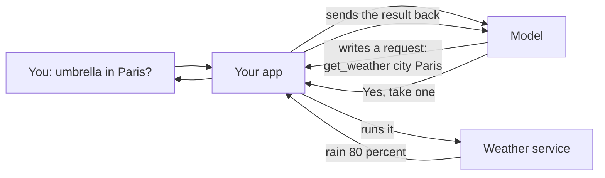
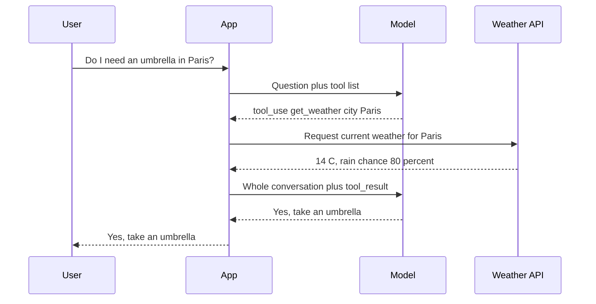
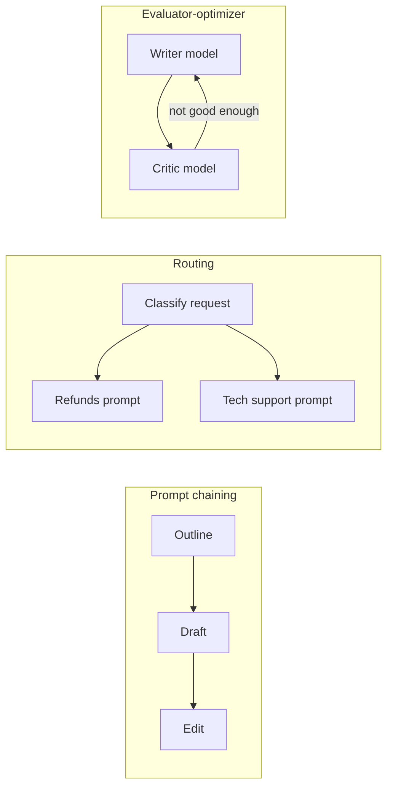
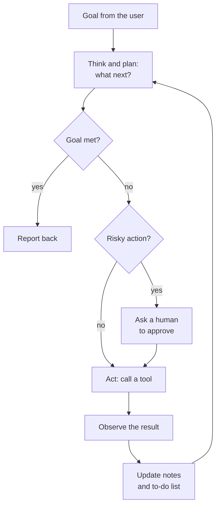
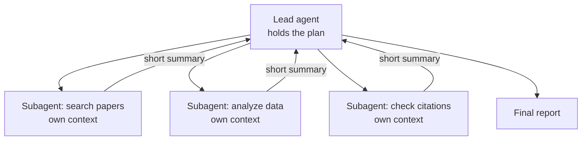

# Chapter 28: Tools and Agents: From Function Calling to MCP

*How a chatbot goes from talking to doing: what tool calls, agents and the Model Context Protocol really are, how they work step by step, and how to connect one to your own chat app safely.*

## What you'll learn
- Why a model can never act by itself, and how function calling lets it ask your software to act for it.
- How to read and write a tool definition, and what separates a good tool from a bad one.
- The difference between a workflow and an agent, the five classic workflow patterns, and the agent loop (ReAct).
- How agents plan, remember, stop, split work among sub-agents, and why the "harness" around a model matters as much as the model.
- What METR's time-horizon measurements say about how long agents can work on their own, and why reliability compounds.
- The Model Context Protocol (MCP) in depth: hosts, clients, servers, tools, resources, prompts, transports, OAuth, registries, MCP Apps and the 2026 specification.
- Where A2A, Agent Skills, AGENTS.md files and plugins fit, and who governs these standards.
- How computer-use and browser agents work, why they are a security risk, and how to choose an agent SDK or framework.

## Before you start
You will get the most from this chapter if you have read Chapter 18 (How a Large Language Model Works), Chapter 21 (Reasoning Models), Chapter 25 (prompting, chat-app features and context engineering) and Chapter 26 (APIs, JSON, JSON Schema and structured outputs). Chapter 27 introduced agentic RAG, which is one kind of agent. Coding agents get their own treatment in Chapter 29, and the security side of agents is covered in depth in Chapter 31 and Chapter 58.

## From talking to doing

Ask your chatbot, "Do I need an umbrella in Paris today?" A bare language model cannot know. Its training stopped months ago, and it has no window to look out of. Yet ChatGPT, Claude and Gemini answer this question correctly every day. Somewhere between your question and the answer, something checked a weather service.

Here is the single most important fact in this chapter: **a language model can only produce text.** It cannot open a web page, send an email, read your calendar or run a calculation. Everything it "does" happens because it writes a structured request and some other piece of software, written by people, reads that request and carries it out.

> **Definition — Function:** A named piece of code that takes inputs and returns an output, such as `get_weather(city)` returning today's forecast. Programs are built from many functions.

> **Definition — Tool:** A function that an AI model is allowed to ask for, described to the model by a name, a plain-language description and a list of inputs. Web search, a calculator, a database lookup and "send email" can all be tools.

> **Definition — Tool use (function calling):** A model's ability to respond with a structured request to run a named tool with specific inputs, instead of (or before) answering in prose. The application runs the tool and sends the result back to the model.

> **Analogy:** The model is a brilliant colleague sitting in a sealed office with no phone. It can pass notes under the door. A receptionist (your app) reads each note ("please call the weather service and ask about Paris"), decides whether to do it, makes the call and slides the answer back. The colleague never touches the phone. The receptionist decides which calls are allowed.


*Figure 28.1: The model only asks. Your app does the work, and your app decides what is allowed.*

This one idea explains a lot. It is why the app, not the model, controls permissions. It is why "Searching the web..." appears as a separate step. And it is why the same model can be harmless in one app and dangerous in another: what matters is which tools the app wires up and what it lets them do.

## How function calling works, step by step

### The tool definition

Before the model can ask for a tool, it has to know the tool exists. Your app sends a short description of each available tool with every request.

> **Definition — Tool definition:** The description an application gives a model for each tool: a name, a plain-language description of what the tool does and when to use it, and an input schema listing the inputs it needs and their types.

> **Definition — JSON Schema:** A standard way to describe what a piece of JSON data must look like: which fields it has, what type each field is (text, number, true/false, list), and which fields are required. Chapter 26 introduced it for structured outputs.

Here is a tool definition in the format Anthropic's API uses (OpenAI's and Google's are very similar):

```json
{
  "name": "get_weather",
  "description": "Get the current weather for one city. Use it whenever the user asks about weather now or today.",
  "input_schema": {
    "type": "object",
    "properties": {
      "city": {"type": "string", "description": "City name, for example Paris"}
    },
    "required": ["city"]
  }
}
```

Read it line by line. The name is what the model will write when it wants this tool. The description is a little prompt: it tells the model what the tool does and *when* to reach for it. The input schema says the tool takes one input, `city`, which must be text and is required.

### The round trip

**Step 1.** Your app sends the model your question plus the list of tool definitions.

**Step 2.** The model decides it needs the weather. Instead of answering, it replies with a tool call, and the API marks the reply with a stop reason saying "I want a tool".

```json
{
  "stop_reason": "tool_use",
  "content": [
    {"type": "tool_use", "id": "toolu_01", "name": "get_weather",
     "input": {"city": "Paris"}}
  ]
}
```

> **Definition — Tool call:** The structured request a model writes when it wants a tool run: the tool's name, an ID, and the inputs as JSON, such as `get_weather` with `{"city": "Paris"}`.

> **Definition — Stop reason:** A field in an API response that says why the model stopped writing: it finished naturally, it hit the length limit, it wants a tool run, or it declined the request.

**Step 3.** Your code sees the tool call, runs its real `get_weather` function (which calls an actual weather service over the internet), and gets back, say, 14 °C with an 80% chance of rain.

**Step 4.** Your app sends the whole conversation back to the model, with the result attached and labeled with the same ID:

```json
{"role": "user", "content": [
  {"type": "tool_result", "tool_use_id": "toolu_01",
   "content": "{\"temperature_c\": 14, \"chance_of_rain\": 80}"}
]}
```

> **Definition — Tool result:** The output of a tool, sent back to the model by the application and linked to the tool call it answers by a matching ID.

**Step 5.** The model reads the result and writes its final answer: "Yes. There is an 80% chance of rain in Paris today, so take an umbrella." The stop reason is now "finished".


*Figure 28.2: One tool call from start to finish. Notice the model is called twice, and only the app ever talks to the weather service.*

> **Key idea:** A tool call is just structured output (Chapter 26) with a name attached. The model writes JSON; your code decides whether and how to act on it.

### What a tool call costs

Because the API is stateless (Chapter 25), the second call re-sends everything: the question, the tool definitions, the model's tool call and the result. Suppose the first request is 1,200 tokens (instructions, tool definition and question) and the model writes 60 tokens of tool call. The second request is then about 1,360 tokens in and 80 tokens out. At Claude Opus 5.5's list prices as of late 2026 ($4 per million input tokens, $20 per million output tokens):

- Input: (1,200 + 1,360) × $4 ÷ 1,000,000 = about $0.010
- Output: (60 + 80) × $20 ÷ 1,000,000 = about $0.003
- Total: about 1.3 cents, plus any thinking tokens, which are billed as output.

Trivial for one question. But notice the pattern: every tool call adds a full extra round trip, and each round trip re-sends a growing conversation. We will see what that does to a 30-step agent shortly.

### Choosing, combining and failing

Three more details matter in practice.

**Tool choice.** By default the model decides whether to use a tool ("auto"). APIs have also let developers forbid tools ("none") or force a tool call. As of late 2026, some of the newest Claude models no longer accept the forcing options, and developers steer them with the prompt instead.

> **Definition — Tool choice:** An API setting that controls whether the model may decide for itself to call tools, must not call any, or (on models that allow it) must call a particular tool.

**Parallel calls.** If you ask "Is it warmer in Lisbon or Oslo?", the model can request both weather lookups in one reply. Your app runs them at the same time and returns both results together.

> **Definition — Parallel tool calls:** Several tool calls requested in a single model reply, so the application can run them at the same time and return all the results together, saving round trips.

**Errors are information.** If a tool fails ("no city called Pariss"), you do not crash. You send the error back as the tool result, marked as an error. A good model reads "No place called Pariss was found. Check the spelling." and tries again with "Paris". Clear error messages are part of a tool's design.

## Client-side and server-side tools

Who runs the tool? There are two answers.

> **Definition — Client-side tool:** A tool that your own application runs when the model asks for it, such as a function that queries your company database. You write it, you host it, and you control exactly what it can do.

> **Definition — Server-side tool:** A tool that the AI provider runs on its own servers, such as web search, web fetch or code execution. You switch it on in your request; the provider runs it and feeds the result to the model without your code doing anything.

One server-side tool deserves its own definition, because it turns a language model into something that can calculate, analyze files and draw charts reliably.

> **Definition — Code execution (code interpreter):** A tool that lets a model write a program, usually in Python, and run it in an isolated environment, then read the output. It is how chat apps analyze spreadsheets and make charts.

> **Definition — Sandbox:** An isolated computing environment, such as a container or virtual machine, where code or an agent can run without being able to touch your real files, accounts or network beyond what is explicitly allowed.

| | Client-side tools | Server-side tools |
|---|---|---|
| Who runs it | Your code | The AI provider |
| Examples | Look up an order, book a meeting, query your database | Web search, web fetch, code execution |
| Setup | You write the function and the loop | One line in the request |
| Control | Total: you decide every permission | Limited to the provider's options |
| Cost (Anthropic, as of late 2026) | Your own hosting | Web search $10 per 1,000 searches plus tokens; web fetch no extra charge; code execution free with search or fetch, otherwise 1,550 free container-hours a month, then $0.05 per hour |

## Designing good tools

A tool's definition is a prompt the model reads every time. Badly designed tools are one of the most common reasons agents fail. A few rules have held up:

- **Few, well-named tools beat many overlapping ones.** If you offer `search_orders`, `find_order`, `lookup_order` and `get_order_status`, the model will pick the wrong one some of the time. Every definition also uses up context.
- **The description is the most important part.** Say what the tool does, when to use it, when *not* to use it, and what the inputs mean, the way you would brief a new employee.
- **Return what the model needs, sized for the context window.** A tool that dumps 5,000 rows of raw data will crowd out everything else. Filter, summarize, paginate. Prefer readable names over internal ID codes.
- **Make errors helpful.** "Error 500" teaches nothing. "No order with that number. Order numbers look like NW-12345." lets the model recover.
- **Match permissions to the job.** A tool that only needs to read should not be able to delete.

| Bad tool definition | Better tool definition |
|---|---|
| name: `query`, description: "Runs a query." | name: `search_orders`, description: "Find a customer's orders by email or order number. Use before answering any question about delivery or refunds. Returns at most 10 orders, newest first." |
| input: `q` (string) | inputs: `email` (string, optional), `order_number` (string like NW-12345, optional) |
| returns the full database row with 60 fields | returns order number, date, items, status and delivery date |

> **Watch out:** More tools do not make a smarter agent. Each extra tool costs context, and similar tools confuse the model. When an agent needs access to hundreds of tools, current systems load only short summaries at first and fetch the full definitions on demand, the same "progressive disclosure" idea behind Agent Skills later in this chapter.

## Workflows and agents

### Who decides the next step?

Once a model can call tools, you face a design choice: who decides the sequence of steps? In December 2024 Anthropic published an influential guide, "Building effective agents", that drew the line clearly.

> **Definition — Workflow:** A system in which language models and tools are orchestrated through steps fixed in advance by code. The developer decides the sequence; the model fills in each step.

> **Definition — Agent:** A system in which a language model directs its own process: it decides which tools to use and in what order, observes the results and keeps going until it judges the goal is met, with little step-by-step human direction.

> **Analogy:** A workflow is a train on fixed tracks: reliable, predictable, and it only goes where the tracks go. An agent is a taxi driver choosing the route: flexible enough to handle roadworks and detours, but you are trusting the driver's judgment, and the fare is less predictable.

The guide's main advice is to use the simplest thing that works. Many problems that sound like they need an "agent" are solved better by a single well-prompted model call, or by a fixed workflow.

### Five workflow patterns

The same guide named five workflow patterns that cover most real systems.

> **Definition — Prompt chaining:** A workflow that splits a task into a fixed sequence of model calls, each taking the previous output as input, often with checks between steps, such as outline, then draft, then edit.

> **Definition — Routing:** A workflow step that classifies an incoming request and sends it to the right prompt, tool or model, such as sending refund questions to one specialist and technical questions to another.

> **Definition — Parallelization:** A workflow that runs several model calls at the same time, either on different parts of a task or on the same task several times so the results can be compared or voted on.

> **Definition — Orchestrator-workers:** A pattern in which a lead model breaks a task into pieces at run time, hands each piece to a worker model, and combines their results.

> **Definition — Evaluator-optimizer:** A loop in which one model produces work and another critiques it against criteria, repeating until the work passes or a limit is reached.


*Figure 28.3: Three of the five workflow patterns. In each, code fixes the shape of the process; the model does the work inside each box.*

| Pattern | Example | Who decides the steps? |
|---|---|---|
| Prompt chaining | Outline, then draft, then edit a newsletter | Code |
| Routing | Send each support email to the right department's prompt | Code, using a model's classification |
| Parallelization | Three models check a contract for different risks at once | Code |
| Orchestrator-workers | A lead model splits "update the docs" into one job per file | Mostly the model |
| Evaluator-optimizer | Writer and critic loop on a translation until it passes | Code sets the loop; models decide when it passes |
| Agent | "Find out why sales dropped in March and draft a memo" | The model |

## The agent loop

### Think, act, observe, repeat

Every agent, from a coding assistant to a deep-research mode, runs the same basic cycle.

> **Definition — Agent loop:** The cycle at the heart of every agent: the model looks at the goal and what it knows so far, decides on an action (usually a tool call), the application runs it, the result is added to the context, and the model decides again, until it decides it is done or a limit stops it.


*Figure 28.4: The agent loop. Real agents also wrap the loop in limits on steps, money and time.*

The pattern got its best-known name from a 2022 paper by Shunyu Yao and colleagues called ReAct, short for "reason and act".

> **Definition — ReAct:** An agent pattern, from a 2022 paper, in which the model alternates between writing a short piece of reasoning ("thought"), taking an action such as a tool call, and reading the result ("observation"), repeating until it can answer.

### A worked trace

Here is what a ReAct-style trace looks like for "Is it warmer in Lisbon or Oslo right now, and by how many degrees?" The numbers are illustrative.

```text
Thought:  I need the current temperature in both cities. I can ask for both at once.
Action:   get_weather(city="Lisbon")   and   get_weather(city="Oslo")
Observation: Lisbon 18.4 C, no rain.   Oslo 6.9 C, light rain.
Thought:  Lisbon is warmer. I should compute the difference exactly.
Action:   calculator(expression="18.4 - 6.9")
Observation: 11.5
Thought:  I have everything I need.
Answer:   Lisbon is warmer, by about 11.5 degrees Celsius (18.4 C versus 6.9 C).
```

Three model calls, three tool runs, one answer. Exercise 8 lets you run exactly this agent in Google Colab with free weather data.

### The whole agent is a loop

Stripped of everything else, the code of an agent is a short loop. In plain-English pseudocode:

```text
messages = [the user's goal]
repeat up to 20 times:
    reply = ask the model (messages, tool definitions)
    add reply to messages
    if reply contains no tool calls: show the answer and stop
    for each tool call in reply:
        result = run that tool (or return a helpful error)
    add all results to messages
if we got here: stop and report "step limit reached"
```

Everything that makes production agents better (planning, memory, permissions, compaction, sub-agents) is built around this loop.

> **Key idea:** An agent is a model calling tools in a loop, deciding its own next step. The model supplies judgment; the loop, the tools and the limits around it are ordinary software that people write.

## Planning, memory and knowing when to stop

### Planning

For short tasks, deciding one step at a time works. For longer ones, agents do better when they plan.

> **Definition — Planning (agents):** An agent breaking a goal into smaller steps, often written down as a to-do list, then working through them and revising the plan when results are surprising.

A coding agent asked to "add a dark mode to this website" might first write: 1. find where colors are defined; 2. add a dark color set; 3. add a toggle button; 4. test both modes; 5. summarize the changes. When step 1 reveals colors are scattered across 40 files, it re-plans: add a step to centralize them first. Reasoning models (Chapter 21) are much better at this than earlier models, and many products now show you the agent's plan, or ask you to approve it, before it starts.

### Memory

A model remembers nothing between calls (Chapter 25). Agents fake memory in layers.

> **Definition — Short-term memory (agents):** Whatever is in the agent's context window right now: the goal, recent tool calls and results, and its own notes. It disappears when the context is cleared.

> **Definition — Long-term memory (agents):** Information an agent stores outside its context window, in files or databases, and retrieves when needed, so that it persists across sessions.

> **Definition — Episodic, semantic and procedural memory:** Three kinds of agent memory borrowed from psychology: episodic is what happened (a log of past sessions), semantic is facts (the user's preferences, a customer's history), and procedural is how to do things (instructions and skills).

| Memory layer | Where it lives | Example |
|---|---|---|
| Short-term | The context window | The last ten tool results |
| Working notes | A file the agent writes and rereads | `progress.md`: "Steps 1 to 3 done; step 4 blocked on login" |
| Long-term facts | A database or vector store (Chapter 27) | "This user prefers metric units" |
| Procedures | Instruction files and skills | "How we format a quarterly report" |

Long tasks generate far more text than any context window can hold, and models get worse as the window fills (context rot, Chapter 25). So agents periodically compress their history.

> **Definition — Compaction:** Summarizing the older part of a long agent session or conversation into a short note, then continuing in a fresh, smaller context that contains the summary instead of the full history.

### Stop conditions, budgets and humans in the loop

An agent that decides its own next step also has to decide when to stop, and it is not always good at it. Every serious harness adds hard limits.

> **Definition — Stop condition:** A rule that ends an agent's loop: the model declares the goal met, or a limit is hit, such as a maximum number of steps, a spending cap, a time limit, or a checkpoint that requires a person's approval.

> **Definition — Human-in-the-loop:** A design in which a person must review or approve certain steps before an agent continues, typically anything irreversible such as sending a message, spending money or deleting data.

**Worked example: what a 30-step agent run costs.** Suppose an agent starts with 5,000 tokens of instructions and tools, and each step adds about 2,000 tokens (its own reasoning, a tool call and the result). Because the whole history is re-sent every step:

- Step 1 sends 5,000 tokens, step 2 sends 7,000, and step 30 sends 63,000.
- Total input across 30 steps: 30 × 5,000 + 2,000 × (0 + 1 + ... + 29) = 150,000 + 870,000 = 1,020,000 tokens.
- At $4 per million (Opus 5.5, as of late 2026): about $4.08 of input, plus about 9,000 output tokens at $20 per million, about $0.18. Total: about $4.26.
- With prompt caching, the repeated prefix is billed at $0.20 per million instead of $4. Roughly 955,000 of those tokens are cache reads (about $0.19) and 65,000 are new tokens written to the cache at 1.25× (about $0.33). The total falls to roughly $0.70.

Compare a ten-turn chat that sends perhaps 20,000 tokens in total: the agent run uses about 50 times as many. That fits the general rule of thumb that agentic tasks can burn 10 to 100 times the tokens of a chat, and it is why caching, compaction and step limits are not optional extras.

> **Watch out:** "The agent will stop when it's done" is not a plan. Agents loop on errors, retry the same failing action, or wander off-task. Always set a step limit and a budget, and require approval for anything you cannot undo.

## Multi-agent systems

Sometimes one agent is not the best shape for a job. A lead agent can spin up helpers, each with its own clean context.

> **Definition — Multi-agent system:** A system in which several agents, often with different instructions, tools or models, work on parts of a task and pass results between them.

> **Definition — Subagent:** A helper agent started by a main agent to handle a focused subtask in its own fresh context window. It does its work and returns only a short summary, which keeps the main agent's context clean.

> **Definition — Handoff:** Passing a conversation or task from one agent to another, more specialized agent, for example from a general support agent to a billing agent.


*Figure 28.5: Orchestrator and subagents. Each helper reads widely in its own context and sends back only what the lead needs.*

The benefits are real: subagents can work in parallel, and each sees only what is relevant, so none of them drowns in a giant context. The costs are also real: every subagent re-reads instructions and documents, so total token use multiplies, and information gets lost or garbled at each handoff. At the extreme, Moonshot's open-weight Kimi K3 model is described in its model card as supporting "agent swarms" of up to 300 sub-agents.

> **Watch out:** More agents do not automatically mean better results. Start with one agent, or a simple workflow, and add agents only when you can show they help on your task.

## Harnesses: the software around the model

> **Definition — Harness (scaffold):** All the software wrapped around a model to turn it into an agent: the loop, the system prompt, the tools, memory and note files, permission rules, compaction, sub-agent management and the limits on steps and spending.

The harness matters enormously. The same model can look mediocre in a clumsy harness and brilliant in a good one. The clearest public example comes from ARC Prize, which runs the ARC-AGI-3 benchmark of interactive puzzle games (Chapter 24). According to ARC Prize, in September 2026 OpenAI's GPT-6 Astra scored 62.7% with the standard testing harness and 99.9% with a harness that let it keep its reasoning state between turns and use compaction. Same model, different scaffolding, a very different score.

This is why Claude Code, Codex, Cursor and other agent products compete partly on harness design, and why "which model?" is only half the question when you compare agents.

> **At the frontier (2026):** Labs now ship their harnesses as products. Anthropic's Claude Agent SDK packages the loop, tools and context management behind Claude Code as a library, and OpenAI's Agents SDK and hosted agent services do the same for OpenAI models. Chat apps have absorbed agents too: ChatGPT agent and ChatGPT Work, Claude Cowork and Gemini Agent all carry out multi-step tasks in a virtual computer or in your files, asking for approval before significant actions.
