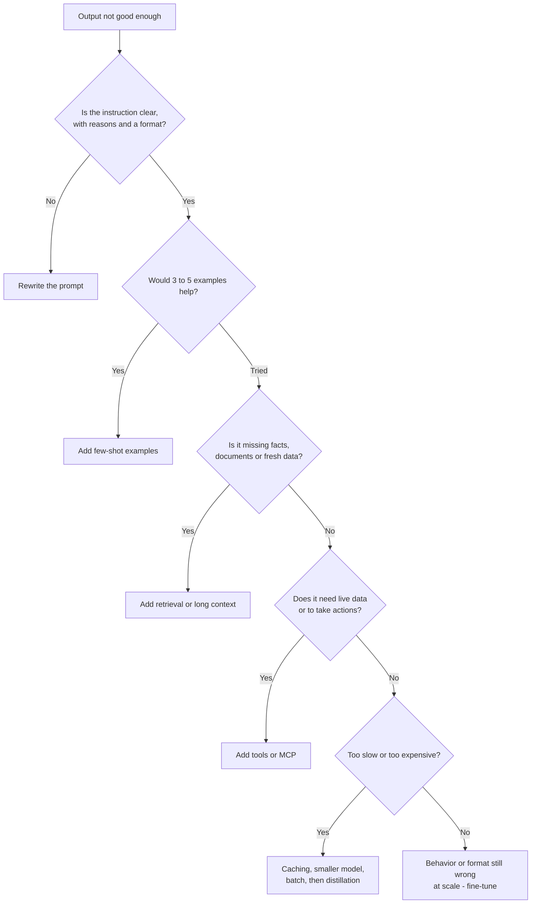
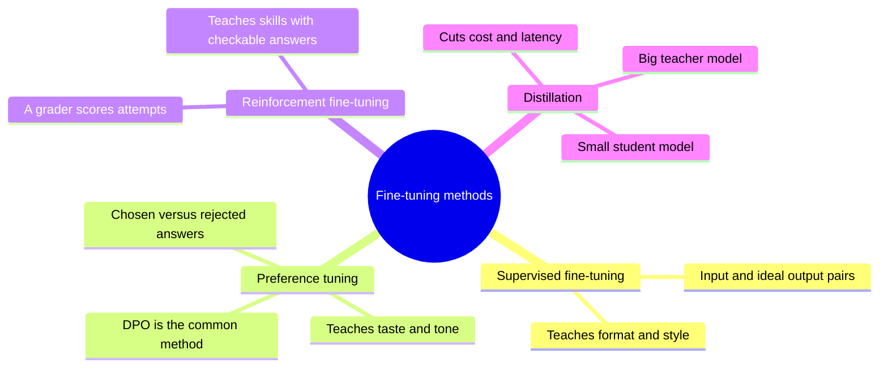
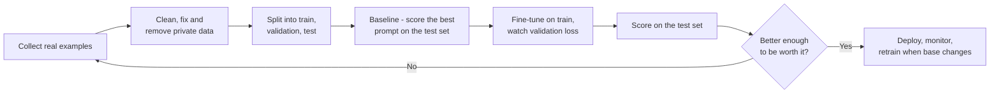

# Chapter 30: Customizing Models: Fine-Tuning, Open Weights and Running AI Locally

*This chapter shows you how to make a model your own: when to fine-tune it and when not to, how LoRA and QLoRA make fine-tuning cheap enough for a free GPU, and how to download open-weight models and run them privately on your own computer.*

## What you'll learn

- What fine-tuning really changes (behavior, format and style, not reliable new facts), and the decision ladder that tells you when it is worth it.
- The four main kinds of fine-tuning: supervised fine-tuning, preference tuning (DPO), reinforcement fine-tuning and distillation.
- How LoRA and QLoRA let you fine-tune a billion-parameter model on a single free GPU, with the arithmetic worked out.
- Why training data quality decides the result, and the real risks of fine-tuning.
- What "open weights" means, how licenses differ, and how to find your way around Hugging Face.
- The memory rule of thumb that tells you whether a model fits on your machine, and how quantization and GGUF files shrink models.
- The local toolkit (Ollama, LM Studio, llama.cpp, MLX, vLLM), and honest reasons to run AI locally or not.

## Before you start

Chapter 5 (The Math of AI, Part 1) covered number precision and memory math (70B × 2 bytes = 140 GB), which you will use constantly here. Chapter 20 (Post-Training) explained how labs use supervised fine-tuning, DPO and reinforcement learning to turn base models into assistants; this chapter uses the same tools at small scale. Chapter 23 (Inference) explained quantization and the KV cache from the server's side, and Chapter 17 explained mixture-of-experts models. Chapters 25 to 27 (prompting, APIs and retrieval) are the steps you should try before fine-tuning, and Chapter 24 surveys the whole model landscape.

## Three ways to make a model yours

When you chat with ChatGPT, Claude or Gemini, you are using the same model as hundreds of millions of other people. There are three different ways to make an AI behave like *your* model:

1. **Change what it sees.** Write better instructions, add examples, attach your documents, connect tools. This is everything in Chapters 25 to 28. It is cheap, instant and reversible.
2. **Change what it is.** Train it further on your own examples so its internal numbers shift. This is fine-tuning.
3. **Change where it runs.** Download a model's files and run it on your own computer or server, where nobody else sees your data.

The second and third often go together, because the models you can fine-tune most freely are the ones whose files you can download.

> **Definition — Weights (parameters):** The billions of numbers inside a model that were set during training and that determine everything it does. Downloading a model means downloading its weights.

> **Definition — Fine-tuning:** Continuing to train an already-trained model on a smaller, targeted set of examples so that its weights shift and its behavior changes in a specific direction.

### What fine-tuning changes, and what it does not

Fine-tuning is excellent at changing **behavior**: the format of answers, a writing style or brand voice, a fixed procedure, which of twenty labels to assign a support ticket, how to call a particular set of tools, when to say "I can't help with that". These are patterns, and patterns are what training is good at teaching.

Fine-tuning is poor at adding **facts**. That surprises most people, so here is why:

- A model absorbs facts slowly, from seeing them many times in many phrasings during pretraining (Chapter 19). A few hundred examples mentioning your new return policy will teach the *style* of answering about returns far more reliably than the policy's details.
- Pushing a model to state things it did not already know can make it more confident across the board, including when it is wrong. One 2024 study found that models learn genuinely new facts from fine-tuning slowly, and that doing so made them more prone to hallucinate.
- Facts change. If your prices change next week, a fine-tuned model is stuck with the old ones until you train it again. A retrieval system (Chapter 27) picks up the new document instantly and can cite it.

> **Analogy:** Fine-tuning is sending an employee on a training course: it changes their habits, tone and way of working. Retrieval is handing them the manual: it gives them facts they can look up and quote. You would not send someone on a two-day course to memorize this month's price list.

> **Key idea:** Fine-tune for *how* the model behaves. Use prompts, retrieval and tools for *what* it knows.

## The decision ladder

Because fine-tuning is slower, costlier and harder to undo than the alternatives, practitioners climb a ladder and only go to the top rung if the lower ones fail to reach their quality, cost or speed target.



*Figure 30.1: The customization decision ladder. Fine-tuning is the last rung, not the first.*

| Symptom | First thing to try | Fine-tune only if |
|---|---|---|
| Wrong format or inconsistent structure | Clear format instructions, examples, structured outputs (Chapter 26) | The format is unusual and must hold across millions of calls |
| Does not know your products or policies | Retrieval or pasting the documents (Chapter 27) | Never for the facts themselves |
| Wrong tone or brand voice | Style guide in the system prompt, 3 to 5 examples | Examples are too long to send every time, or the voice is subtle |
| Too slow or costly for a simple task | Smaller model, prompt caching, batch API | A small fine-tuned model can match a big one on this narrow task |
| Must run privately or offline | An open-weight model run locally (later in this chapter) | The local model is not good enough out of the box |
| Classifies into your own categories | Few-shot examples with category definitions | You have thousands of labeled examples and need high accuracy cheaply |

### Worked example: is fine-tuning worth it for cost?

A company sends 100,000 support replies a month through a model. Each request carries a 2,000-token block of example replies (to set the house style), a 300-token customer email, and gets a 250-token reply. Using late-2026 API prices:

- **Mid-tier model, no caching** (Claude Sonnet 5.5 at $2 per million input tokens, $10 per million output): input is 100,000 × 2,300 = 230 million tokens, costing $460. Output is 100,000 × 250 = 25 million tokens, costing $250. Total: **$710 a month**.
- **Same model, with prompt caching.** The 2,000-token example block never changes, so it is cached. Cache reads on Sonnet 5.5 cost 0.05× the input price, or $0.10 per million. Cached input: 200 million × $0.10 = $20. Uncached input: 30 million × $2 = $60. Output is unchanged at $250. Total: **about $330 a month**.
- **Small model, no caching** (Claude Haiku 5.5 at $0.10 input, $0.50 output): 230 million × $0.10 = $23, plus 25 million × $0.50 = $12.50. Total: **about $36 a month**, if the small model's quality is good enough with the examples.

The cheapest step on this ladder cut the bill by 95% with no training at all. A fine-tuned small model might save a little more by dropping the 2,000-token examples, but it would add training work, evaluation and maintenance every time the base model changes. Fine-tuning for cost makes sense mainly at very large scale or when you need a small model to run on your own hardware.

### When fine-tuning genuinely wins

- **Consistent, unusual behavior at huge volume,** where even small prompt savings add up and examples are long.
- **Speed.** A small fine-tuned model can be much faster than a large general one.
- **Privacy and control.** You need a model on your own hardware, and the open model needs a nudge to be good enough at your task.
- **Narrow tasks** such as classification or extraction, where a fine-tuned small model can match a large model at a fraction of the cost.
- **Distillation** of a big model's skill on one task into a small, cheap model (with permission; see below).

## The fine-tuning menu

Chapter 20 showed how frontier labs use these methods on a giant scale. The same four ideas are available to you through fine-tuning services and open-source tools.



*Figure 30.2: The four main ways to fine-tune a model.*

**Supervised fine-tuning** is the workhorse. You show the model pairs of input and the exact output you want, and it learns to produce outputs like yours.

> **Definition — Supervised fine-tuning (SFT):** Fine-tuning on example pairs of an input and the ideal output, so the model learns to imitate those outputs.

> **Definition — Training example:** One unit of training data, such as a single question paired with its ideal answer, or a full conversation.

Training data is usually stored one example per line in a text file.

> **Definition — JSONL (JSON Lines):** A file format where every line is one complete JSON object (Chapter 26). Most fine-tuning services and tools expect training data in this format.

A typical SFT example in the common "messages" format looks like this (shown on several lines for readability; in the file it is one line):

```json
{"messages": [
  {"role": "system", "content": "You write replies for Kettle Co. customer support."},
  {"role": "user", "content": "My kettle won't switch off when it boils."},
  {"role": "assistant", "content": "Sorry about that! Please unplug it now. Then check whether the lid is fully closed, because the switch relies on steam reaching the sensor. If it still won't switch off, reply with your order number and we'll send a replacement."}
]}
```

**Preference tuning** teaches taste rather than exact wording. You give the model two answers to the same prompt and say which one is better.

> **Definition — Preference tuning:** Fine-tuning on pairs of a better ("chosen") and worse ("rejected") answer to the same prompt, so the model learns which kind of answer you prefer.

> **Definition — DPO (direct preference optimization):** A popular preference-tuning method that adjusts the model directly to make chosen answers more likely than rejected ones, without training a separate reward model (Chapter 20 explains the difference from RLHF).

```json
{"prompt": "Customer: Where is my order?",
 "chosen": "Sorry for the wait! Could you share your order number so I can check it right away?",
 "rejected": "Orders ship within 5-7 business days. Please be patient."}
```

**Reinforcement fine-tuning** lets the model try, scores each attempt, and nudges it toward higher scores. It is the same idea behind reasoning models (Chapter 21), offered as a product for tasks with checkable answers.

> **Definition — Reinforcement fine-tuning (RFT):** Fine-tuning in which the model generates its own answers, a grader scores them, and training pushes the model toward higher-scoring answers. Useful when you can check correctness but cannot easily write the ideal answer.

> **Definition — Grader:** The program or model that scores an answer during reinforcement fine-tuning or evaluation: for example an exact-match check, a test suite, or a model applying a rubric.

**Distillation** uses a big, expensive model as a teacher to produce training data or probabilities, and trains a small model to imitate it on your task.

> **Definition — Distillation:** Training a smaller "student" model to imitate a larger "teacher" model's outputs on a task, so you get much of the big model's quality at the small model's cost and speed.

| Method | Data you need | Good for | Example |
|---|---|---|---|
| SFT | Hundreds to thousands of input and ideal-output pairs | Format, style, procedures, classification | Support replies in your house style |
| Preference tuning (DPO) | Pairs of better and worse answers | Tone, helpfulness, avoiding unwanted habits | Friendlier, less defensive replies |
| Reinforcement fine-tuning | Prompts plus a grader | Skills with checkable answers | Extracting the right fields from contracts, scored automatically |
| Distillation | A strong teacher model and many prompts | Cutting cost and latency | Teaching a small model to tag tickets like a frontier model |

> **Watch out:** Most AI providers' terms of service forbid using their model's outputs to train a competing model. Anthropic reported in February 2026 that about 24,000 fraudulent accounts had generated over 16 million exchanges in attempts to distill its models, and labs now actively detect and block this. Distilling for your own narrow internal task may be allowed, but read the terms first, and prefer open-weight teachers whose licenses permit it.

## Under the hood: why full fine-tuning is expensive

Fine-tuning uses the same training loop you met in Chapter 6 and Chapter 12: show examples, measure the error (the loss), compute how each weight should move (gradients), and nudge every weight a little. Repeat.

> **Definition — Full fine-tuning:** Fine-tuning that updates every weight in the model. It is the most flexible kind but needs far more memory and compute than adapter methods like LoRA.

A few training settings come up every time.

> **Definition — Epoch:** One complete pass through the training data. Fine-tuning usually runs for one to a few epochs; more risks memorizing the examples.

> **Definition — Learning rate:** How big a step each weight takes per update. Too high and training becomes unstable or wipes out existing skills; too low and nothing changes.

> **Definition — Validation set:** A slice of your examples held back from training and used to check, during training, whether the model is improving on examples it has not seen.

If the loss on training examples keeps falling while the loss on the validation set starts rising, the model is memorizing rather than learning: overfitting (Chapter 9). Fine-tuning has a second, special failure.

> **Definition — Catastrophic forgetting:** When training a model on a narrow new task makes it noticeably worse at things it used to do well, because the shared weights were pushed too far.

Why is full fine-tuning so memory-hungry? With the usual Adam optimizer and mixed precision, training needs about **16 bytes per parameter**: 2 for the weight itself, 2 for its gradient, and about 12 for the optimizer's bookkeeping, including a full-precision master copy (Chapter 33 breaks this down).

> **Definition — Optimizer:** The algorithm that decides exactly how to update the weights from the gradients. Adam and AdamW, the most common ones, keep two running averages for every weight, which costs extra memory.

For an 8-billion-parameter model: 8 billion × 16 bytes = **128 GB**, before counting the working memory for the training examples themselves. That is more than the largest single data-center GPUs of 2024 held, and about eight times the memory of the free GPU in Google Colab. Full fine-tuning of even a modest model is a multi-GPU job. Something cleverer was needed.

## LoRA: the clip-on lens

In 2021, a team at Microsoft (Hu and colleagues) published LoRA, short for low-rank adaptation. The insight: the *change* that fine-tuning makes to a big weight matrix can usually be captured by a much smaller set of numbers.

> **Definition — LoRA (low-rank adaptation):** A fine-tuning method that freezes the original weights and trains small add-on matrices whose product is added to each chosen weight matrix. It trains well under 1% of the parameters while matching full fine-tuning on many tasks.

### The idea in a 3 × 3 example

A weight matrix is a table of numbers (Chapter 5). Suppose fine-tuning wants to add this change to a 3 × 3 matrix:

```
change = | 1  0  2 |
         | 2  0  4 |
         | 3  0  6 |
```

Look closely: every row is a multiple of the row (1, 0, 2). So the whole change can be written as a column times a row:

```
| 1 |                    | 1  0  2 |
| 2 |  x  | 1  0  2 |  = | 2  0  4 |
| 3 |                    | 3  0  6 |
```

Six numbers (three in the column, three in the row) produce a nine-number change. A change that can be built from a few such column-times-row pieces is called "low-rank".

> **Definition — Low-rank matrix:** A matrix that can be written as the product of two much thinner matrices. Its "rank" is, roughly, how many independent column-times-row pieces it takes to build it.

> **Definition — Rank (r):** In LoRA, the width of the thin adapter matrices. Typical values are 8 to 64. Higher rank means more capacity to learn and more trainable numbers.

### The idea at real scale

Now take a real weight matrix of size 4,096 × 4,096, the shape of an attention layer in an 8-billion-parameter model. It holds 4,096 × 4,096 = **16,777,216** numbers. LoRA freezes it and adds two thin matrices: B, which is 4,096 × 16, and A, which is 16 × 4,096. Together they hold 2 × 4,096 × 16 = **131,072** numbers, which is 0.78% of the original. Their product B × A is a full 4,096 × 4,096 change.

```
   Frozen weight matrix W          LoRA adapter (trainable)
   4,096 x 4,096                   B (4,096 x 16) times A (16 x 4,096)
  +----------------------+         +--+   +----------------------+
  |                      |         |  |   |          A           |
  |   16.8 million       |    +    |B |   +----------------------+
  |   numbers, locked    |         |  |
  |                      |         |  |   131,072 numbers in total
  +----------------------+         +--+
  New behavior:  W + (alpha / r) x (B x A)
```

*Figure 30.3: LoRA in one picture. The big matrix stays frozen; only the thin matrices B and A are trained, and their product is added on.*

Apply this to every main matrix in a model shaped like Llama 3 8B (32 layers, each with seven large matrices) at rank 16, and the adapter totals about **42 million** trainable numbers, roughly **0.5%** of 8 billion. Stored at 16 bits, the adapter file is about 84 MB, while the base model is about 16 GB. You can keep dozens of adapters for different jobs and swap them like lenses on a camera.

> **Definition — Adapter:** The small set of trained add-on weights produced by LoRA, saved as its own file. It only works together with the exact base model it was trained on.

> **Definition — Target modules:** The specific weight matrices in a model that receive LoRA adapters, typically the attention matrices and often the feed-forward ones too. More targets usually means better results and a bigger adapter.

Two more settings appear in every LoRA recipe. **Alpha** scales how strongly the adapter's change is applied (a common choice is twice the rank). **Dropout** randomly ignores a small fraction of the adapter's signals during training, which reduces overfitting. And when you are done, you can either keep the adapter separate or fold it permanently into the weights.

> **Definition — Merging an adapter:** Adding the adapter's change (B × A, scaled) into the base model's weights to produce a single standalone model, which is simpler to deploy but no longer swappable.

> **Analogy:** LoRA is a clip-on lens. The camera (the base model) stays exactly as it was; the lens changes what you see. Clip on the "legal summaries" lens or the "pirate voice" lens as needed, and take it off to get the original camera back.

## QLoRA: fine-tuning on one GPU

LoRA shrank the trainable part, but the frozen base model still has to sit in GPU memory at 16 bits: 16 GB for an 8B model. In 2023, Tim Dettmers and colleagues combined LoRA with aggressive compression of the frozen base.

> **Definition — QLoRA:** LoRA performed on a base model whose frozen weights are compressed to 4 bits, while the small adapters train in higher precision. It cuts memory roughly fourfold, so large models can be fine-tuned on a single GPU.

QLoRA's paper introduced three tricks that all appear in the walkthrough at the end of this chapter:

> **Definition — NF4 (NormalFloat 4):** A 4-bit number format designed for neural-network weights, whose 16 possible values are spaced to match the bell-shaped way weights are usually distributed, so less information is lost than with evenly spaced levels.

- **Double quantization:** the small scaling numbers used to decode the 4-bit weights are themselves compressed, saving a little more memory.
- **Paged optimizers:** when memory briefly runs short, optimizer data is moved out to ordinary computer memory and back, instead of crashing.

The paper's headline: a 65-billion-parameter model fine-tuned on a single 48 GB GPU, which had previously needed a whole server.

> **Definition — VRAM (video memory):** The memory built into a GPU. A model and its training data must fit in VRAM to run fast; the free Colab T4 GPU has 16 GB.

> **Definition — Gradient checkpointing:** A memory-saving training trick that throws away some intermediate results during the forward pass and recomputes them when needed, trading extra compute (roughly a third more) for much less memory.

```
Memory to fine-tune an 8B model (approximate)

Full fine-tuning   |######################################| ~130 GB
LoRA, 16-bit base  |######                                | ~18-20 GB
QLoRA, 4-bit base  |##                                    | ~6-10 GB
                   0        32        64        96     128 GB

Free Colab T4 GPU: 16 GB      Typical high-end gaming GPU: 24 GB
```

*Figure 30.4: Why QLoRA matters. Only QLoRA brings an 8B model within reach of a free cloud GPU or a gaming card.*

Where do those numbers come from? QLoRA's frozen base is about 8 billion × 0.5 bytes (4 bits) plus scaling numbers, so roughly 4.5 to 5 GB. The 42 million adapter parameters need about 16 bytes each while training, about 0.7 GB. The rest is working memory for the examples in each batch, which gradient checkpointing keeps to a few gigabytes. The walkthrough in Exercise 8 fine-tunes a smaller 1.7-billion-parameter model, which fits comfortably and trains in minutes.

> **At the frontier (2026):** The same ideas run at the top end. Labs now train with low-precision numbers from the start: Moonshot's open Kimi K3 (July 2026) was trained with 4-bit (MXFP4) quantization-aware training, and Google ships Gemma 4 checkpoints prepared the same way, so their 4-bit versions lose very little quality. LoRA-style adapters are also used inside labs and by fine-tuning services to serve thousands of customer customizations on top of one shared base model.

## Data: the part that decides the result

Every practitioner learns the same lesson: the training data matters more than the method, the rank or the learning rate. A fine-tuned model is a mirror of its examples, flaws included.

- **Quality beats quantity.** A few hundred clean, consistent, correct examples beat ten thousand messy ones. For many narrow tasks, hundreds to a few thousand examples are enough.
- **Consistency.** If half your examples sign off "Best wishes" and half "Cheers", the model will learn to be inconsistent.
- **Coverage.** Include the hard and weird cases: angry customers, missing information, requests to refuse. The model will only handle what it has seen something like.
- **No private data you would not want repeated.** Models can memorize and regurgitate training examples. Remove names, emails and account numbers unless they are essential.
- **A baseline first.** Before training anything, measure how well a good prompt does on your test set. Otherwise you cannot tell whether fine-tuning helped.

> **Definition — Held-out test set:** Examples set aside before any training or prompt tuning and used only for the final, honest measurement of quality. If you peek at it while tuning, it stops being honest.

> **Definition — Synthetic data:** Training examples generated by a model rather than written by people, usually filtered or checked before use. It is a fast way to build a dataset, with the risk of copying the generator's mistakes and quirks.

A worked split: you collect 300 examples. Keep 30 as the held-out test set, 30 as the validation set, and train on the remaining 240. Score the base model with your best prompt on the 30 test examples first (say 19 of 30 correct). Fine-tune. Score again (say 26 of 30). Now you know what fine-tuning bought you, and you can weigh it against the work.



*Figure 30.5: The fine-tuning pipeline. Most of the effort sits in the first three boxes.*

> **Try it:** Ask your chatbot: "I want to fine-tune a small model to turn messy meeting notes into a fixed action-item format. Generate 10 diverse example pairs in JSONL, including 3 tricky cases (no deadline, two owners, a cancelled task)." Read them critically: would you be happy if a model copied every quirk of these examples? That question is the heart of dataset building.

## Where to fine-tune

| Route | What it is | Good for | Things to know |
|---|---|---|---|
| Hosted fine-tuning by a model maker | Upload JSONL to the provider's service; it trains and hosts your custom version of their model | Teams already using that provider; no hardware | Only some models are offered; OpenAI has offered supervised, preference and reinforcement fine-tuning for some models, and Google offers tuning for some Gemini models through Vertex AI; options change often |
| Hosted fine-tuning of open models | Services such as Together AI and Fireworks AI fine-tune and serve open-weight models | Open models without managing GPUs | You can usually download the resulting weights or adapter |
| Do it yourself with open-source tools | Hugging Face TRL and PEFT, Unsloth, Axolotl, LLaMA-Factory on Colab or rented GPUs | Learning, full control, privacy | You handle setup, evaluation and serving |

> **Definition — Hugging Face TRL and PEFT:** Two free Python libraries from Hugging Face. PEFT ("parameter-efficient fine-tuning") adds adapters such as LoRA to a model; TRL ("transformer reinforcement learning") provides ready-made trainers for SFT, DPO and RL-style fine-tuning.

Unsloth is popular with beginners because its free Colab notebooks fine-tune common open models quickly with little memory. The walkthrough in Exercise 8 uses plain Hugging Face libraries so you can see every step.

## The risks of fine-tuning

- **Overfitting and narrowness.** The model nails your examples and stumbles on anything slightly different.
- **Catastrophic forgetting.** General skills such as reasoning, other languages or following unrelated instructions can degrade.
- **Weakened safety training.** Researchers showed in 2023 that fine-tuning, even on a small number of examples and sometimes on harmless-looking data, can erode a model's refusal behavior. If your model will face the public, re-test its safety after fine-tuning.
- **Maintenance.** An adapter only works with its exact base model. When the provider retires that model, or a much better base comes out, you must rebuild the dataset pipeline, retrain and re-evaluate.
- **Data leakage.** Private details in training data can come back out in answers.
- **License and terms.** The base model's license, and the terms of any model used to generate your data, still apply to your fine-tuned model.
- **The fine-tuning trap.** Teams sometimes spend weeks fine-tuning when an hour of prompt work, or a newer base model, would have fixed the problem. Climb the ladder.

> **Watch out:** "We fine-tuned it on our documents, so it knows our business" is the most common misconception in this area. It learned your documents' style. For your documents' contents, use retrieval (Chapter 27), and measure both.
