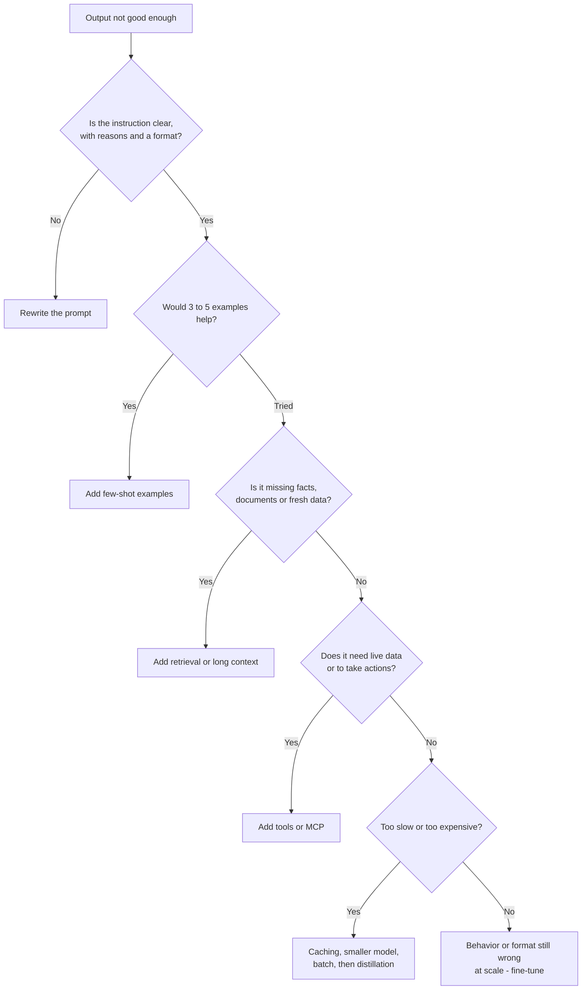
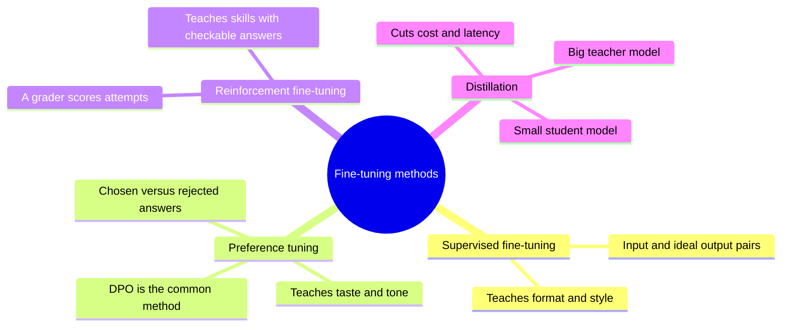
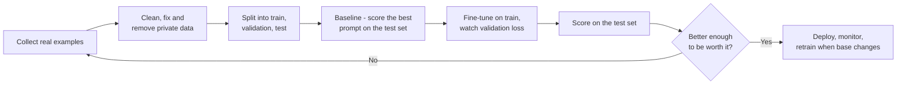
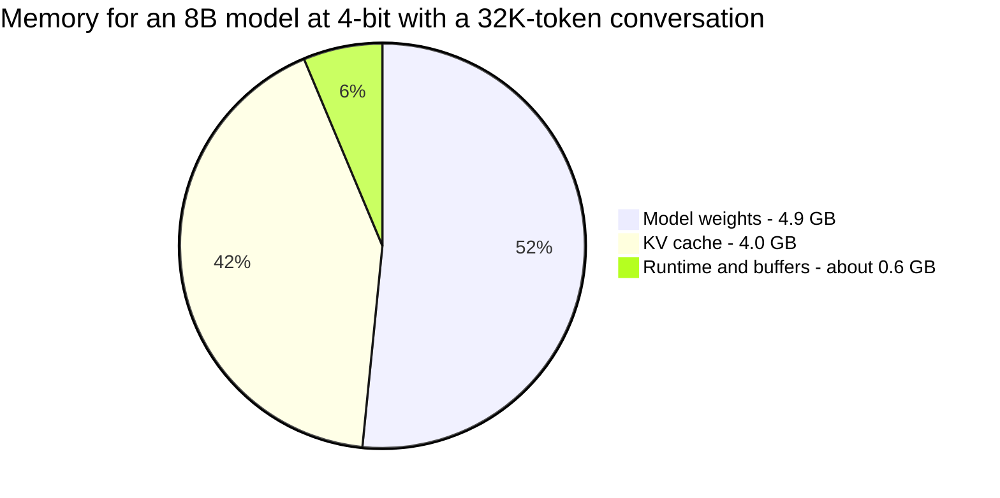
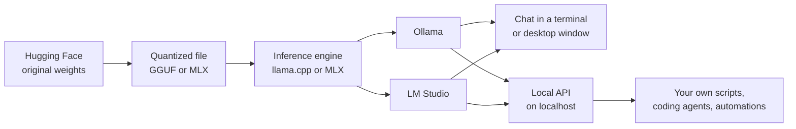
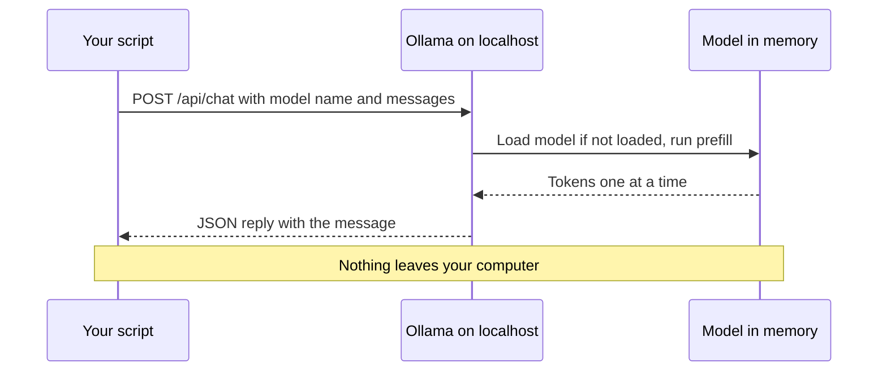
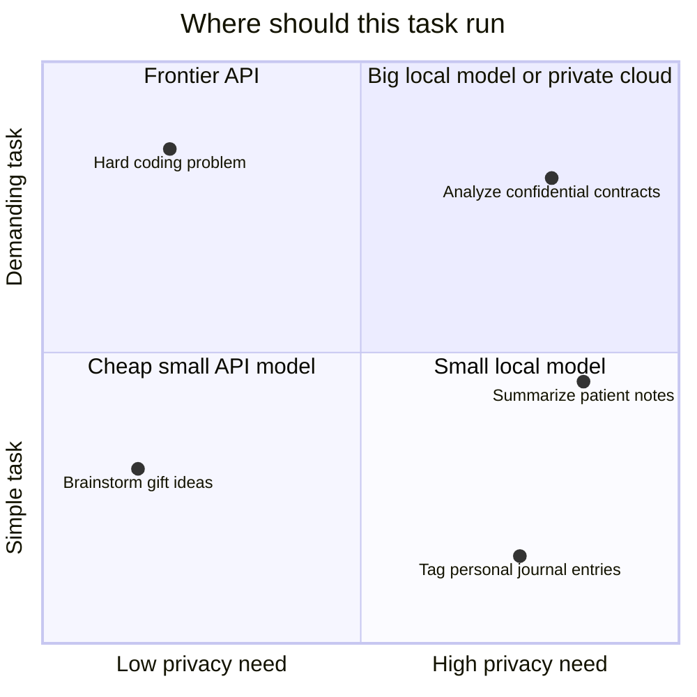

# Chapter 30: Customizing Models: Fine-Tuning, Open Weights and Running AI Locally

*This chapter shows you how to make a model your own: when to fine-tune it and when not to, how LoRA and QLoRA make fine-tuning cheap enough for a free GPU, and how to download open-weight models and run them privately on your own computer.*

## What you'll learn

- What fine-tuning really changes (behavior, format and style, not reliable new facts), and the decision ladder that tells you when it is worth it.
- The four main kinds of fine-tuning: supervised fine-tuning, preference tuning (DPO), reinforcement fine-tuning and distillation.
- How LoRA and QLoRA let you fine-tune a billion-parameter model on a single free GPU, with the arithmetic worked out.
- Why training data quality decides the result, and the real risks of fine-tuning.
- What "open weights" means, how licenses differ, and how to find your way around Hugging Face.
- The memory rule of thumb that tells you whether a model fits on your machine, and how quantization and GGUF files shrink models.
- The local toolkit (Ollama, LM Studio, llama.cpp, MLX, vLLM), and honest reasons to run AI locally or not.

## Before you start

Chapter 5 (The Math of AI, Part 1) covered number precision and memory math (70B × 2 bytes = 140 GB), which you will use constantly here. Chapter 20 (Post-Training) explained how labs use supervised fine-tuning, DPO and reinforcement learning to turn base models into assistants; this chapter uses the same tools at small scale. Chapter 23 (Inference) explained quantization and the KV cache from the server's side, and Chapter 17 explained mixture-of-experts models. Chapters 25 to 27 (prompting, APIs and retrieval) are the steps you should try before fine-tuning, and Chapter 24 surveys the whole model landscape.

## Three ways to make a model yours

When you chat with ChatGPT, Claude or Gemini, you are using the same model as hundreds of millions of other people. There are three different ways to make an AI behave like *your* model:

1. **Change what it sees.** Write better instructions, add examples, attach your documents, connect tools. This is everything in Chapters 25 to 28. It is cheap, instant and reversible.
2. **Change what it is.** Train it further on your own examples so its internal numbers shift. This is fine-tuning.
3. **Change where it runs.** Download a model's files and run it on your own computer or server, where nobody else sees your data.

The second and third often go together, because the models you can fine-tune most freely are the ones whose files you can download.

> **Definition — Weights (parameters):** The billions of numbers inside a model that were set during training and that determine everything it does. Downloading a model means downloading its weights.

> **Definition — Fine-tuning:** Continuing to train an already-trained model on a smaller, targeted set of examples so that its weights shift and its behavior changes in a specific direction.

### What fine-tuning changes, and what it does not

Fine-tuning is excellent at changing **behavior**: the format of answers, a writing style or brand voice, a fixed procedure, which of twenty labels to assign a support ticket, how to call a particular set of tools, when to say "I can't help with that". These are patterns, and patterns are what training is good at teaching.

Fine-tuning is poor at adding **facts**. That surprises most people, so here is why:

- A model absorbs facts slowly, from seeing them many times in many phrasings during pretraining (Chapter 19). A few hundred examples mentioning your new return policy will teach the *style* of answering about returns far more reliably than the policy's details.
- Pushing a model to state things it did not already know can make it more confident across the board, including when it is wrong. One 2024 study found that models learn genuinely new facts from fine-tuning slowly, and that doing so made them more prone to hallucinate.
- Facts change. If your prices change next week, a fine-tuned model is stuck with the old ones until you train it again. A retrieval system (Chapter 27) picks up the new document instantly and can cite it.

> **Analogy:** Fine-tuning is sending an employee on a training course: it changes their habits, tone and way of working. Retrieval is handing them the manual: it gives them facts they can look up and quote. You would not send someone on a two-day course to memorize this month's price list.

> **Key idea:** Fine-tune for *how* the model behaves. Use prompts, retrieval and tools for *what* it knows.

## The decision ladder

Because fine-tuning is slower, costlier and harder to undo than the alternatives, practitioners climb a ladder and only go to the top rung if the lower ones fail to reach their quality, cost or speed target.



*Figure 30.1: The customization decision ladder. Fine-tuning is the last rung, not the first.*

| Symptom | First thing to try | Fine-tune only if |
|---|---|---|
| Wrong format or inconsistent structure | Clear format instructions, examples, structured outputs (Chapter 26) | The format is unusual and must hold across millions of calls |
| Does not know your products or policies | Retrieval or pasting the documents (Chapter 27) | Never for the facts themselves |
| Wrong tone or brand voice | Style guide in the system prompt, 3 to 5 examples | Examples are too long to send every time, or the voice is subtle |
| Too slow or costly for a simple task | Smaller model, prompt caching, batch API | A small fine-tuned model can match a big one on this narrow task |
| Must run privately or offline | An open-weight model run locally (later in this chapter) | The local model is not good enough out of the box |
| Classifies into your own categories | Few-shot examples with category definitions | You have thousands of labeled examples and need high accuracy cheaply |

### Worked example: is fine-tuning worth it for cost?

A company sends 100,000 support replies a month through a model. Each request carries a 2,000-token block of example replies (to set the house style), a 300-token customer email, and gets a 250-token reply. Using late-2026 API prices:

- **Mid-tier model, no caching** (Claude Sonnet 5.5 at $2 per million input tokens, $10 per million output): input is 100,000 × 2,300 = 230 million tokens, costing $460. Output is 100,000 × 250 = 25 million tokens, costing $250. Total: **$710 a month**.
- **Same model, with prompt caching.** The 2,000-token example block never changes, so it is cached. Cache reads on Sonnet 5.5 cost 0.05× the input price, or $0.10 per million. Cached input: 200 million × $0.10 = $20. Uncached input: 30 million × $2 = $60. Output is unchanged at $250. Total: **about $330 a month**.
- **Small model, no caching** (Claude Haiku 5.5 at $0.10 input, $0.50 output): 230 million × $0.10 = $23, plus 25 million × $0.50 = $12.50. Total: **about $36 a month**, if the small model's quality is good enough with the examples.

The cheapest step on this ladder cut the bill by 95% with no training at all. A fine-tuned small model might save a little more by dropping the 2,000-token examples, but it would add training work, evaluation and maintenance every time the base model changes. Fine-tuning for cost makes sense mainly at very large scale or when you need a small model to run on your own hardware.

### When fine-tuning genuinely wins

- **Consistent, unusual behavior at huge volume,** where even small prompt savings add up and examples are long.
- **Speed.** A small fine-tuned model can be much faster than a large general one.
- **Privacy and control.** You need a model on your own hardware, and the open model needs a nudge to be good enough at your task.
- **Narrow tasks** such as classification or extraction, where a fine-tuned small model can match a large model at a fraction of the cost.
- **Distillation** of a big model's skill on one task into a small, cheap model (with permission; see below).

## The fine-tuning menu

Chapter 20 showed how frontier labs use these methods on a giant scale. The same four ideas are available to you through fine-tuning services and open-source tools.



*Figure 30.2: The four main ways to fine-tune a model.*

**Supervised fine-tuning** is the workhorse. You show the model pairs of input and the exact output you want, and it learns to produce outputs like yours.

> **Definition — Supervised fine-tuning (SFT):** Fine-tuning on example pairs of an input and the ideal output, so the model learns to imitate those outputs.

> **Definition — Training example:** One unit of training data, such as a single question paired with its ideal answer, or a full conversation.

Training data is usually stored one example per line in a text file.

> **Definition — JSONL (JSON Lines):** A file format where every line is one complete JSON object (Chapter 26). Most fine-tuning services and tools expect training data in this format.

A typical SFT example in the common "messages" format looks like this (shown on several lines for readability; in the file it is one line):

```json
{"messages": [
  {"role": "system", "content": "You write replies for Kettle Co. customer support."},
  {"role": "user", "content": "My kettle won't switch off when it boils."},
  {"role": "assistant", "content": "Sorry about that! Please unplug it now. Then check whether the lid is fully closed, because the switch relies on steam reaching the sensor. If it still won't switch off, reply with your order number and we'll send a replacement."}
]}
```

**Preference tuning** teaches taste rather than exact wording. You give the model two answers to the same prompt and say which one is better.

> **Definition — Preference tuning:** Fine-tuning on pairs of a better ("chosen") and worse ("rejected") answer to the same prompt, so the model learns which kind of answer you prefer.

> **Definition — DPO (direct preference optimization):** A popular preference-tuning method that adjusts the model directly to make chosen answers more likely than rejected ones, without training a separate reward model (Chapter 20 explains the difference from RLHF).

```json
{"prompt": "Customer: Where is my order?",
 "chosen": "Sorry for the wait! Could you share your order number so I can check it right away?",
 "rejected": "Orders ship within 5-7 business days. Please be patient."}
```

**Reinforcement fine-tuning** lets the model try, scores each attempt, and nudges it toward higher scores. It is the same idea behind reasoning models (Chapter 21), offered as a product for tasks with checkable answers.

> **Definition — Reinforcement fine-tuning (RFT):** Fine-tuning in which the model generates its own answers, a grader scores them, and training pushes the model toward higher-scoring answers. Useful when you can check correctness but cannot easily write the ideal answer.

> **Definition — Grader:** The program or model that scores an answer during reinforcement fine-tuning or evaluation: for example an exact-match check, a test suite, or a model applying a rubric.

**Distillation** uses a big, expensive model as a teacher to produce training data or probabilities, and trains a small model to imitate it on your task.

> **Definition — Distillation:** Training a smaller "student" model to imitate a larger "teacher" model's outputs on a task, so you get much of the big model's quality at the small model's cost and speed.

| Method | Data you need | Good for | Example |
|---|---|---|---|
| SFT | Hundreds to thousands of input and ideal-output pairs | Format, style, procedures, classification | Support replies in your house style |
| Preference tuning (DPO) | Pairs of better and worse answers | Tone, helpfulness, avoiding unwanted habits | Friendlier, less defensive replies |
| Reinforcement fine-tuning | Prompts plus a grader | Skills with checkable answers | Extracting the right fields from contracts, scored automatically |
| Distillation | A strong teacher model and many prompts | Cutting cost and latency | Teaching a small model to tag tickets like a frontier model |

> **Watch out:** Most AI providers' terms of service forbid using their model's outputs to train a competing model. Anthropic reported in February 2026 that about 24,000 fraudulent accounts had generated over 16 million exchanges in attempts to distill its models, and labs now actively detect and block this. Distilling for your own narrow internal task may be allowed, but read the terms first, and prefer open-weight teachers whose licenses permit it.

## Under the hood: why full fine-tuning is expensive

Fine-tuning uses the same training loop you met in Chapter 6 and Chapter 12: show examples, measure the error (the loss), compute how each weight should move (gradients), and nudge every weight a little. Repeat.

> **Definition — Full fine-tuning:** Fine-tuning that updates every weight in the model. It is the most flexible kind but needs far more memory and compute than adapter methods like LoRA.

A few training settings come up every time.

> **Definition — Epoch:** One complete pass through the training data. Fine-tuning usually runs for one to a few epochs; more risks memorizing the examples.

> **Definition — Learning rate:** How big a step each weight takes per update. Too high and training becomes unstable or wipes out existing skills; too low and nothing changes.

> **Definition — Validation set:** A slice of your examples held back from training and used to check, during training, whether the model is improving on examples it has not seen.

If the loss on training examples keeps falling while the loss on the validation set starts rising, the model is memorizing rather than learning: overfitting (Chapter 9). Fine-tuning has a second, special failure.

> **Definition — Catastrophic forgetting:** When training a model on a narrow new task makes it noticeably worse at things it used to do well, because the shared weights were pushed too far.

Why is full fine-tuning so memory-hungry? With the usual Adam optimizer and mixed precision, training needs about **16 bytes per parameter**: 2 for the weight itself, 2 for its gradient, and about 12 for the optimizer's bookkeeping, including a full-precision master copy (Chapter 33 breaks this down).

> **Definition — Optimizer:** The algorithm that decides exactly how to update the weights from the gradients. Adam and AdamW, the most common ones, keep two running averages for every weight, which costs extra memory.

For an 8-billion-parameter model: 8 billion × 16 bytes = **128 GB**, before counting the working memory for the training examples themselves. That is more than the largest single data-center GPUs of 2024 held, and about eight times the memory of the free GPU in Google Colab. Full fine-tuning of even a modest model is a multi-GPU job. Something cleverer was needed.

## LoRA: the clip-on lens

In 2021, a team at Microsoft (Hu and colleagues) published LoRA, short for low-rank adaptation. The insight: the *change* that fine-tuning makes to a big weight matrix can usually be captured by a much smaller set of numbers.

> **Definition — LoRA (low-rank adaptation):** A fine-tuning method that freezes the original weights and trains small add-on matrices whose product is added to each chosen weight matrix. It trains well under 1% of the parameters while matching full fine-tuning on many tasks.

### The idea in a 3 × 3 example

A weight matrix is a table of numbers (Chapter 5). Suppose fine-tuning wants to add this change to a 3 × 3 matrix:

```
change = | 1  0  2 |
         | 2  0  4 |
         | 3  0  6 |
```

Look closely: every row is a multiple of the row (1, 0, 2). So the whole change can be written as a column times a row:

```
| 1 |                    | 1  0  2 |
| 2 |  x  | 1  0  2 |  = | 2  0  4 |
| 3 |                    | 3  0  6 |
```

Six numbers (three in the column, three in the row) produce a nine-number change. A change that can be built from a few such column-times-row pieces is called "low-rank".

> **Definition — Low-rank matrix:** A matrix that can be written as the product of two much thinner matrices. Its "rank" is, roughly, how many independent column-times-row pieces it takes to build it.

> **Definition — Rank (r):** In LoRA, the width of the thin adapter matrices. Typical values are 8 to 64. Higher rank means more capacity to learn and more trainable numbers.

### The idea at real scale

Now take a real weight matrix of size 4,096 × 4,096, the shape of an attention layer in an 8-billion-parameter model. It holds 4,096 × 4,096 = **16,777,216** numbers. LoRA freezes it and adds two thin matrices: B, which is 4,096 × 16, and A, which is 16 × 4,096. Together they hold 2 × 4,096 × 16 = **131,072** numbers, which is 0.78% of the original. Their product B × A is a full 4,096 × 4,096 change.

```
   Frozen weight matrix W          LoRA adapter (trainable)
   4,096 x 4,096                   B (4,096 x 16) times A (16 x 4,096)
  +----------------------+         +--+   +----------------------+
  |                      |         |  |   |          A           |
  |   16.8 million       |    +    |B |   +----------------------+
  |   numbers, locked    |         |  |
  |                      |         |  |   131,072 numbers in total
  +----------------------+         +--+
  New behavior:  W + (alpha / r) x (B x A)
```

*Figure 30.3: LoRA in one picture. The big matrix stays frozen; only the thin matrices B and A are trained, and their product is added on.*

Apply this to every main matrix in a model shaped like Llama 3 8B (32 layers, each with seven large matrices) at rank 16, and the adapter totals about **42 million** trainable numbers, roughly **0.5%** of 8 billion. Stored at 16 bits, the adapter file is about 84 MB, while the base model is about 16 GB. You can keep dozens of adapters for different jobs and swap them like lenses on a camera.

> **Definition — Adapter:** The small set of trained add-on weights produced by LoRA, saved as its own file. It only works together with the exact base model it was trained on.

> **Definition — Target modules:** The specific weight matrices in a model that receive LoRA adapters, typically the attention matrices and often the feed-forward ones too. More targets usually means better results and a bigger adapter.

Two more settings appear in every LoRA recipe. **Alpha** scales how strongly the adapter's change is applied (a common choice is twice the rank). **Dropout** randomly ignores a small fraction of the adapter's signals during training, which reduces overfitting. And when you are done, you can either keep the adapter separate or fold it permanently into the weights.

> **Definition — Merging an adapter:** Adding the adapter's change (B × A, scaled) into the base model's weights to produce a single standalone model, which is simpler to deploy but no longer swappable.

> **Analogy:** LoRA is a clip-on lens. The camera (the base model) stays exactly as it was; the lens changes what you see. Clip on the "legal summaries" lens or the "pirate voice" lens as needed, and take it off to get the original camera back.

## QLoRA: fine-tuning on one GPU

LoRA shrank the trainable part, but the frozen base model still has to sit in GPU memory at 16 bits: 16 GB for an 8B model. In 2023, Tim Dettmers and colleagues combined LoRA with aggressive compression of the frozen base.

> **Definition — QLoRA:** LoRA performed on a base model whose frozen weights are compressed to 4 bits, while the small adapters train in higher precision. It cuts memory roughly fourfold, so large models can be fine-tuned on a single GPU.

QLoRA's paper introduced three tricks that all appear in the walkthrough at the end of this chapter:

> **Definition — NF4 (NormalFloat 4):** A 4-bit number format designed for neural-network weights, whose 16 possible values are spaced to match the bell-shaped way weights are usually distributed, so less information is lost than with evenly spaced levels.

- **Double quantization:** the small scaling numbers used to decode the 4-bit weights are themselves compressed, saving a little more memory.
- **Paged optimizers:** when memory briefly runs short, optimizer data is moved out to ordinary computer memory and back, instead of crashing.

The paper's headline: a 65-billion-parameter model fine-tuned on a single 48 GB GPU, which had previously needed a whole server.

> **Definition — VRAM (video memory):** The memory built into a GPU. A model and its training data must fit in VRAM to run fast; the free Colab T4 GPU has 16 GB.

> **Definition — Gradient checkpointing:** A memory-saving training trick that throws away some intermediate results during the forward pass and recomputes them when needed, trading extra compute (roughly a third more) for much less memory.

```
Memory to fine-tune an 8B model (approximate)

Full fine-tuning   |######################################| ~130 GB
LoRA, 16-bit base  |######                                | ~18-20 GB
QLoRA, 4-bit base  |##                                    | ~6-10 GB
                   0        32        64        96     128 GB

Free Colab T4 GPU: 16 GB      Typical high-end gaming GPU: 24 GB
```

*Figure 30.4: Why QLoRA matters. Only QLoRA brings an 8B model within reach of a free cloud GPU or a gaming card.*

Where do those numbers come from? QLoRA's frozen base is about 8 billion × 0.5 bytes (4 bits) plus scaling numbers, so roughly 4.5 to 5 GB. The 42 million adapter parameters need about 16 bytes each while training, about 0.7 GB. The rest is working memory for the examples in each batch, which gradient checkpointing keeps to a few gigabytes. The walkthrough in Exercise 8 fine-tunes a smaller 1.7-billion-parameter model, which fits comfortably and trains in minutes.

> **At the frontier (2026):** The same ideas run at the top end. Labs now train with low-precision numbers from the start: Moonshot's open Kimi K3 (July 2026) was trained with 4-bit (MXFP4) quantization-aware training, and Google ships Gemma 4 checkpoints prepared the same way, so their 4-bit versions lose very little quality. LoRA-style adapters are also used inside labs and by fine-tuning services to serve thousands of customer customizations on top of one shared base model.

## Data: the part that decides the result

Every practitioner learns the same lesson: the training data matters more than the method, the rank or the learning rate. A fine-tuned model is a mirror of its examples, flaws included.

- **Quality beats quantity.** A few hundred clean, consistent, correct examples beat ten thousand messy ones. For many narrow tasks, hundreds to a few thousand examples are enough.
- **Consistency.** If half your examples sign off "Best wishes" and half "Cheers", the model will learn to be inconsistent.
- **Coverage.** Include the hard and weird cases: angry customers, missing information, requests to refuse. The model will only handle what it has seen something like.
- **No private data you would not want repeated.** Models can memorize and regurgitate training examples. Remove names, emails and account numbers unless they are essential.
- **A baseline first.** Before training anything, measure how well a good prompt does on your test set. Otherwise you cannot tell whether fine-tuning helped.

> **Definition — Held-out test set:** Examples set aside before any training or prompt tuning and used only for the final, honest measurement of quality. If you peek at it while tuning, it stops being honest.

> **Definition — Synthetic data:** Training examples generated by a model rather than written by people, usually filtered or checked before use. It is a fast way to build a dataset, with the risk of copying the generator's mistakes and quirks.

A worked split: you collect 300 examples. Keep 30 as the held-out test set, 30 as the validation set, and train on the remaining 240. Score the base model with your best prompt on the 30 test examples first (say 19 of 30 correct). Fine-tune. Score again (say 26 of 30). Now you know what fine-tuning bought you, and you can weigh it against the work.



*Figure 30.5: The fine-tuning pipeline. Most of the effort sits in the first three boxes.*

> **Try it:** Ask your chatbot: "I want to fine-tune a small model to turn messy meeting notes into a fixed action-item format. Generate 10 diverse example pairs in JSONL, including 3 tricky cases (no deadline, two owners, a cancelled task)." Read them critically: would you be happy if a model copied every quirk of these examples? That question is the heart of dataset building.

## Where to fine-tune

| Route | What it is | Good for | Things to know |
|---|---|---|---|
| Hosted fine-tuning by a model maker | Upload JSONL to the provider's service; it trains and hosts your custom version of their model | Teams already using that provider; no hardware | Only some models are offered; OpenAI has offered supervised, preference and reinforcement fine-tuning for some models, and Google offers tuning for some Gemini models through Vertex AI; options change often |
| Hosted fine-tuning of open models | Services such as Together AI and Fireworks AI fine-tune and serve open-weight models | Open models without managing GPUs | You can usually download the resulting weights or adapter |
| Do it yourself with open-source tools | Hugging Face TRL and PEFT, Unsloth, Axolotl, LLaMA-Factory on Colab or rented GPUs | Learning, full control, privacy | You handle setup, evaluation and serving |

> **Definition — Hugging Face TRL and PEFT:** Two free Python libraries from Hugging Face. PEFT ("parameter-efficient fine-tuning") adds adapters such as LoRA to a model; TRL ("transformer reinforcement learning") provides ready-made trainers for SFT, DPO and RL-style fine-tuning.

Unsloth is popular with beginners because its free Colab notebooks fine-tune common open models quickly with little memory. The walkthrough in Exercise 8 uses plain Hugging Face libraries so you can see every step.

## The risks of fine-tuning

- **Overfitting and narrowness.** The model nails your examples and stumbles on anything slightly different.
- **Catastrophic forgetting.** General skills such as reasoning, other languages or following unrelated instructions can degrade.
- **Weakened safety training.** Researchers showed in 2023 that fine-tuning, even on a small number of examples and sometimes on harmless-looking data, can erode a model's refusal behavior. If your model will face the public, re-test its safety after fine-tuning.
- **Maintenance.** An adapter only works with its exact base model. When the provider retires that model, or a much better base comes out, you must rebuild the dataset pipeline, retrain and re-evaluate.
- **Data leakage.** Private details in training data can come back out in answers.
- **License and terms.** The base model's license, and the terms of any model used to generate your data, still apply to your fine-tuned model.
- **The fine-tuning trap.** Teams sometimes spend weeks fine-tuning when an hour of prompt work, or a newer base model, would have fixed the problem. Climb the ladder.

> **Watch out:** "We fine-tuned it on our documents, so it knows our business" is the most common misconception in this area. It learned your documents' style. For your documents' contents, use retrieval (Chapter 27), and measure both.

## Open-weight models: what you can download

Everything so far works best with models whose files you can download. Here is what "open" means in late 2026, and what is on offer.

> **Definition — Open-weight model:** A model whose trained weights are published so anyone can download, run and usually fine-tune it, under the terms of a license. The training data and full training code are often not released.

> **Definition — Open-source AI:** In the strict sense defined by the Open Source Initiative's Open Source AI Definition 1.0 (October 2024), a model released with its weights, its code, and enough information about its training data for others to study and rebuild it. Most "open" models are open-weight but not open source in this sense.

> **Analogy:** Closed models are restaurant dishes: possibly excellent, but you cannot see the kitchen or take the dish home. Open-weight models are a finished, frozen cake you can take home, slice and decorate however you like, without the recipe. Truly open-source models come with the recipe and the ingredient list too.

### Who releases open weights (as of late 2026)

| Family (maker) | Recent open releases | Sizes | License notes |
|---|---|---|---|
| DeepSeek V4 (DeepSeek, China) | V4-Pro, general release August 2026; V4-Flash; V4.1-Flash | 1.6T total and 49B active; 284B total and 13B active | MIT license; 1M-token context |
| Qwen3.8 (Alibaba, China) | August 2026 | 27B dense; 2.4T total and 95B active | 27B under Apache 2.0; the 2.4T model needs a commercial license for providers above US$50 million in revenue |
| Kimi K3 (Moonshot AI, China) | July 2026 | 2.8T total and 104B active | See the model card |
| GLM-5.3 (Z.ai) and MiMo-V2.6-Pro (Xiaomi) | 2026 | Large models | Among the top open models on independent indexes |
| gpt-oss (OpenAI) | August 2025 | 120B and 20B | Apache 2.0 |
| Gemma 4 (Google DeepMind) | April 2026 | E2B, E4B, 12B, 31B dense, 26B-A4B mixture-of-experts | See the model card |
| Mistral (Mistral AI, France) | Medium 3.5 (128B, April 2026); Large 3 (December 2025) | Large 3: 675B total and 41B active | Large 3 under Apache 2.0 |
| Meta | Llama 4 (April 2025) was the last Llama; Meta's newer Muse family is mostly closed, with one open 30B model (Muse Glimmer, August 2026) according to public reports | Various | Llama community license for Llama models |
| NVIDIA | Nemotron 3.5 | Various | See the model card |

How far behind are they? On Artificial Analysis's Intelligence Index on October 21, 2026, the best open-weight model (Xiaomi's MiMo-V2.6-Pro) scored 46, with DeepSeek, Z.ai and Moonshot models close behind, against 58 for the best closed model (Claude Opus 5.5). The usual summary is that the top open models trail the top closed ones by months, not years. Notice also that most of the strongest open models now come from Chinese labs, a point Chapter 24 and Chapter 59 discuss.

> **Watch out:** "Open" does not mean "runs on my laptop". DeepSeek V4-Pro has 1.6 trillion parameters; even compressed to 4 bits that is about 800 GB of weights, which needs a server full of data-center GPUs. Open weights give you the *right* to run a model anywhere; your hardware decides whether you *can*.

### Licenses in plain words

> **Definition — License (model license):** The legal terms that come with a model's weights, saying what you may do with them: use, modify, fine-tune, redistribute or sell products built on them, and under what conditions.

> **Definition — Permissive license:** A license with very few conditions, such as MIT or Apache 2.0, which allow commercial use, modification and redistribution as long as you keep the copyright notice (Apache 2.0 also includes a patent grant).

Many models use custom licenses instead. Meta's Llama licenses, for example, required companies with more than 700 million monthly active users to request a separate license, and the large Qwen3.8 model has its revenue threshold. Many custom licenses also attach a list of forbidden uses.

> **Definition — Acceptable use policy:** A list of prohibited uses attached to a model license or service (for example weapons development or harassment), which you agree to follow when you download or use the model.

Before building a product on an open model, check four things on its card: may I use it commercially, are there size or revenue thresholds, may I share fine-tuned versions, and what uses are forbidden.

### Decoding model names

Open-model names pack in a lot of information. Take a few real examples:

- **Qwen3.8-27B**: family Qwen, version 3.8, 27 billion parameters.
- **Gemma 4 26B-A4B**: 26 billion total parameters, about 4 billion **a**ctive per token. It is a mixture-of-experts model (Chapter 17).
- **Gemma 4 E2B**: Google's label for "effective 2 billion" parameters, used for small on-device models designed to keep only part of their weights in fast memory.
- **Base** versus **Instruct** (or **it**): the raw pretrained model versus the chat-trained one.
- **Q4_K_M**, **Q8_0**, **GGUF**, **MLX**: quantization level and file format, explained below.

> **Definition — Mixture of experts (MoE):** A model design in which each token is sent to only a few of many "expert" sub-networks, so the model can have a huge total parameter count while using only a fraction (the active parameters) for each token.

> **Definition — Instruct model:** A version of a model that has been post-trained to follow instructions and chat (Chapter 20), as opposed to the raw base model, which only continues text. For chatting you almost always want the instruct version; for fine-tuning a new format, either can work.

## A tour of Hugging Face

If GitHub is where code lives, Hugging Face is where models live.

> **Definition — Hugging Face Hub:** The main website for sharing open AI models, datasets and demos, at huggingface.co. In October 2026 its counter showed about 3.17 million models.

Every model has a page. The parts that matter:

> **Definition — Model card:** The documentation page for a model: what it is for, how it was trained, benchmark results, limitations, license and example code. Read it critically; benchmark numbers on a card are usually self-reported.

- **Files and versions** shows the actual files: `config.json` (the model's shape), tokenizer files, and the weights, often split into several large files.
- A **"Use this model"** button lists local apps (such as LM Studio, Ollama and llama.cpp) that can open the model directly.
- **Community** shows discussions, including bug reports about the model.
- **Quantized versions** are usually uploaded by others, often in separate repositories with "GGUF" in the name.

> **Definition — Safetensors:** A file format for model weights that stores only numbers and cannot contain hidden code. Older formats based on Python's "pickle" could run code when loaded, so prefer safetensors (or GGUF) files from trustworthy uploaders.

> **Definition — Gated model:** A model on Hugging Face that you can only download after signing in and accepting its license terms on the model page.

> **Definition — Space:** A small hosted demo app on Hugging Face where you can try a model in the browser without downloading it.

> **Try it:** Go to huggingface.co/models. Filter by a task such as "Text Generation", sort by "Trending", and open the top model. Find its parameter count, license and context length on the card, then click "Files and versions" and add up the sizes of the weight files. Divide the total gigabytes by the billions of parameters: about 2 means 16-bit weights; about 1 means 8-bit; about 0.5 to 0.6 means 4-bit.

## Will it fit? The memory rule of thumb

The single most useful number in local AI is this one:

**memory for the weights ≈ number of parameters × bytes per parameter**

At 16 bits each parameter takes 2 bytes; at 8 bits, 1 byte; at 4 bits, half a byte (slightly more in practice, because each small block of weights also stores a scaling number). You met this rule in Chapter 5. Here it is applied to common sizes:

| Model size | 16-bit (2 bytes) | 8-bit (about 1 byte) | 4-bit (about 0.6 bytes) | Comfortable home |
|---|---|---|---|---|
| 1B | 2 GB | 1 GB | 0.6 GB | Phone |
| 3 to 4B | 6 to 8 GB | 3 to 4 GB | 2 to 2.5 GB | Phone or any laptop |
| 8B | 16 GB | 8 GB | about 5 GB | 16 GB laptop |
| 14B | 28 GB | 14 GB | about 8.5 GB | 16 to 32 GB laptop |
| 27 to 32B | 54 to 64 GB | 27 to 32 GB | 16 to 19 GB | 32 GB+ machine or 24 GB GPU |
| 70B | 140 GB | 70 GB | about 42 GB | 64 GB+ unified memory or several GPUs |
| 1.6T (MoE) | 3,200 GB | 1,600 GB | about 960 GB | A rack of data-center GPUs |

But the weights are not all. Running a model also needs space for its working memory of the conversation, the KV cache (Chapter 23).

> **Definition — KV cache:** Stored intermediate results (keys and values) for every token already processed, kept so the model does not recompute them for each new token. It grows with the length of the conversation.

For a model shaped like Llama 3 8B (32 layers, 8 key-value heads of 128 numbers each, stored at 16 bits), the cache costs 2 (keys and values) × 32 × 8 × 128 × 2 bytes = 131,072 bytes, or about **0.125 MB per token**. A 8,000-token conversation needs about 1 GB; 32,000 tokens need about 4 GB; 128,000 tokens need about 16 GB, three times the size of the 4-bit weights. That is why local apps let you set the context length, and why a long context can make a model that "fits" suddenly run out of memory.



*Figure 30.6: Where the memory goes. At long context lengths, the conversation's KV cache can rival the model itself.*

### Where the memory lives

On a typical PC, a model runs fast only if it fits in the graphics card's VRAM; spilling into ordinary memory slows it down a lot. Apple Silicon Macs (and some newer PC chips) are different.

> **Definition — Unified memory:** A design in which the CPU and GPU share one pool of memory, as on Apple Silicon Macs. It lets a laptop with 32 to 128 GB of memory load models far larger than a typical graphics card could hold.

### How fast will it be?

Once it fits, speed depends mostly on how quickly the computer can read the weights. To write each new token, the model must read essentially all of its active weights from memory once (Chapter 33 explains why this "decode" phase is limited by memory, not math).

> **Definition — Memory bandwidth:** How many gigabytes per second a chip can read from its memory. For running language models locally, it is usually the number that best predicts speed.

> **Definition — Tokens per second:** How many tokens a model writes per second once it has started. Reading speed is about 5 to 10 tokens per second; comfortable chat feels like 20 or more.

So: **tokens per second ≤ memory bandwidth ÷ bytes read per token**. Worked examples:

- A laptop with about 100 GB/s of bandwidth running an 8B model at 4-bit (about 4.9 GB): 100 ÷ 4.9 ≈ **20 tokens per second** at best. The same model at 16-bit (16 GB): 100 ÷ 16 ≈ **6 tokens per second**. Quantization made it both fit and run three times faster.
- A gaming GPU with roughly 1,000 GB/s running the same 4.9 GB model: about **200 tokens per second** at best.
- A mixture-of-experts model such as Gemma 4 26B-A4B at 4-bit: all 26 billion parameters must fit in memory (about 16 GB), but each token reads only the roughly 4 billion active ones (about 2.4 GB). On the 100 GB/s laptop: about **40 tokens per second**, the speed of a small model with the knowledge of a bigger one.

Real speeds come in somewhat below these ceilings, but the rule is reliable enough to choose hardware and models with.

## Quantization and GGUF

Quantization, storing each weight with fewer bits, is what makes local AI practical. Chapter 23 explained it from the data-center side; here is what you need to choose a download.

> **Definition — Quantization:** Storing a model's weights (and sometimes its working numbers) with fewer bits, for example 4 instead of 16, to cut memory and speed up inference at a small cost in quality.

Think of a ruler. A 16-bit number can take about 65,000 different values, so a weight such as 0.37 is stored almost exactly. An 8-bit number has 256 possible values; a 4-bit number has only 16.

```
A weight of 0.37, stored on rulers with fewer and fewer marks

16-bit: ~65,000 marks   0.37 stored almost exactly
 8-bit:     256 marks   nearest mark 0.373 (error about 0.003)
 4-bit:      16 marks
 -1.0                    0                            +1.0
  |---|---|---|---|---|---|---|---|---|---|---|---|---|---|---|
                                          ^
                          0.37 snaps to 0.333 (error about 0.04)
```

*Figure 30.7: Quantization as rounding to the nearest mark. Fewer bits means fewer marks and bigger rounding errors.*

With 16 evenly spaced levels between −1 and +1, the gap between marks is 2 ÷ 15 ≈ 0.133, so 0.37 rounds to 0.333, an error of about 0.04. With 256 levels the gap is about 0.008 and the error is ten times smaller. Real schemes are cleverer: they quantize small blocks of weights (say 32 at a time), each with its own scale, and some keep the most sensitive weights at higher precision. That is why 4-bit models work far better than this crude ruler suggests.

> **Definition — Bits per weight:** The average number of bits used to store each parameter in a quantized model, including the scaling numbers. A "4-bit" file often averages about 4.5 to 5 bits per weight.

> **Definition — GGUF:** A single-file format for (usually quantized) models, created in 2023 by the llama.cpp project and used by llama.cpp, Ollama, LM Studio and many other local tools. One GGUF file holds the weights, the tokenizer and settings.

GGUF files come in named quantization levels. For an 8B model, approximate sizes are:

| Level | Approx. bits per weight | 8B file size | Quality in practice |
|---|---|---|---|
| F16 | 16 | 16 GB | Original quality; rarely needed locally |
| Q8_0 | 8.5 | 8.5 GB | Practically indistinguishable from the original |
| Q6_K | 6.6 | 6.6 GB | Excellent |
| Q5_K_M | 5.7 | 5.7 GB | Very good |
| Q4_K_M | 4.8 | 4.9 GB | The popular sweet spot: small loss, big savings |
| Q3_K_M | 3.9 | 4.0 GB | Noticeable loss, especially on small models |
| Q2_K | about 3 | 3.2 GB | Large loss; a last resort |

> **Definition — Quantization level (quant):** A named recipe for how a model was compressed, such as Q4_K_M or Q8_0 in GGUF files. The number is roughly the bits per weight; "K" marks the newer block-wise methods, and S, M and L mean small, medium and large variants of the recipe.

Three rules of thumb: Q8 is nearly lossless; Q4_K_M is the usual best trade-off; and small models suffer more from heavy quantization than big ones, so a big model at Q4 usually beats a smaller one at Q8 of the same file size.

> **Definition — Quantization-aware training (QAT):** Training a model while simulating low-precision numbers, so that its final low-bit version loses very little quality. Models released with QAT checkpoints are the best ones to run at 4 bits.

Other formats you will meet: **MLX** files for Apple Silicon, **AWQ** and **GPTQ** files for GPU servers, and plain **safetensors** for full-precision weights used in fine-tuning.

> **Analogy:** Quantization is saving a photo as a JPEG. At high quality you cannot tell the difference and the file is a fraction of the size; crank the compression too far and blocky artifacts appear. Q4_K_M is the "good quality JPEG" setting most people choose.

> **Watch out:** "Quantized models are broken models" is wrong, and "quantization is free" is also wrong. Good 8-bit and 4-bit models often lose little on everyday tasks, but losses can show up first in exact recall, arithmetic, long reasoning chains and less common languages. Test the specific quant on your own tasks.

## The local toolkit

Running a model locally needs two layers: an engine that does the math efficiently on your hardware, and an app that gives you a chat window or an API.

> **Definition — Inference engine:** The program that actually loads a model's weights and runs the calculations to generate tokens, optimized for particular hardware. Apps such as Ollama and LM Studio are built on top of engines.

> **Definition — llama.cpp:** A free, open-source engine written in C and C++ that runs language models efficiently on ordinary computers, using CPUs and many kinds of GPUs, with quantization from 1.5 to 8 bits. Started in 2023, it powers many local AI apps.

> **Definition — Ollama:** A free tool for downloading and running open models with one command (for example `ollama run gemma4:e2b`), available as a command-line program and desktop app, with a built-in local API for other programs.

> **Definition — LM Studio:** A free desktop app for searching, downloading and chatting with local models through a graphical interface, with a local server mode. Its engines include llama.cpp and Apple's MLX.

> **Definition — MLX:** Apple's open-source machine-learning framework for Apple Silicon Macs, used to run and fine-tune models efficiently with the Mac's unified memory.

> **Definition — vLLM:** A high-performance open-source server for running models for many users at once, using techniques such as PagedAttention (Chapter 23). It is what companies use to serve open models in production, not a laptop chat app.

| Tool | Best for | Interface | Notes (as of late 2026) |
|---|---|---|---|
| LM Studio | Beginners, trying many models | Desktop app with search, chat and settings | Shows memory estimates before download; local server mode |
| Ollama | Quick setup, developers, local APIs | Terminal plus desktop app | Reports 9M+ monthly installs and 1B+ model downloads (company figures) |
| llama.cpp | Maximum control, unusual hardware | Command line | The engine under many other tools; about 132k GitHub stars |
| MLX | Apple Silicon Macs | Python library and command line | Also used for local fine-tuning on Macs |
| vLLM (and SGLang) | Serving many users from GPU servers | Server software | Production serving; Chapter 23 |



*Figure 30.8: The local AI stack, from downloaded weights to your own apps.*

The local API is the quietly powerful part. Both Ollama and LM Studio can act as a server on your own machine that speaks the same request format as the big cloud APIs.

> **Definition — Local server (localhost API):** A model served by an app on your own computer at an address such as `http://localhost:11434` (Ollama's default) or `http://localhost:1234` (LM Studio's default), so other programs on the machine can send it requests without anything leaving the computer.

> **Definition — OpenAI-compatible API:** An API that accepts requests in the same format as OpenAI's, so code, coding agents and apps written for the cloud can be pointed at a local model just by changing the address.



*Figure 30.9: A program talking to a local model. It is the same request-and-response pattern as Chapter 26, with the data center replaced by your laptop.*

## Why go local, and why not

| Reasons to run locally | Reasons not to |
|---|---|
| **Privacy:** with Wi-Fi off, nothing you type leaves the machine | **Quality:** local models trail the frontier, especially at small sizes |
| **No per-token cost** once you own the hardware | **Hardware:** big models need expensive memory or GPUs |
| **Works offline:** planes, field sites, secure rooms | **Speed:** often slower than cloud APIs, especially on long prompts |
| **Control:** the model never changes or gets retired under you | **Maintenance:** updates, settings and troubleshooting are yours |
| **Customization:** your own fine-tunes and adapters | **Missing features:** no built-in web search, memory or polished apps unless you add them |
| **Learning:** you see how models really behave | **Security of files:** download only from trustworthy sources |

### Worked example: does local save money?

Suppose you buy a $2,000 computer mainly to run models locally. How much cloud usage would $2,000 buy at late-2026 prices?

- On a small model like Claude Haiku 5.5 ($0.50 per million output tokens): about **4 billion** output tokens.
- On a mid model like Sonnet 5.5 ($10 per million output tokens): about **200 million** output tokens.
- A heavy personal user might generate 20,000 output tokens a day (about 20 long answers), or about 7.3 million a year. Even with input tokens added, that is roughly $100 to $150 a year on the mid model.

At that rate the computer takes well over a decade to pay for itself through token savings alone. For individuals, the real reasons to go local are privacy, offline use, control and learning, not cost. For a business running millions of requests a day on a steady, narrow task, self-hosting a fine-tuned open model on servers (with vLLM, not a laptop) can be much cheaper than an API, which is why the decision depends on volume.



*Figure 30.10: Matching tasks to where they run. Privacy pushes work local; difficulty pushes it toward bigger models.*

> **At the frontier (2026):** Local AI is moving into devices you already own. Phones and laptops now ship with small built-in models and chips designed to run them (Chapter 53 covers edge AI and NPUs), and an open model of around 30 billion parameters, small enough for a well-equipped laptop, now beats 2023's GPT-4 on many tasks. At the other end, the largest open models (DeepSeek V4, Kimi K3, Qwen3.8) need data-center hardware; some desktop apps, LM Studio among them, now also offer access to such models alongside truly local ones.

## A customization playbook

Putting the chapter together, here is the order a careful builder follows:

1. **Write down the target.** What exactly is wrong today, and how will you measure "fixed"? Build a test set of 20 to 50 real cases first.
2. **Climb the ladder.** Better prompt, then examples, then retrieval, then tools, then cheaper models and caching. Measure after each step.
3. **Decide where it must run.** If data cannot leave your building, pick an open-weight model whose license fits, and check it fits your hardware with the memory rule.
4. **Try the model as it comes.** Run it locally at Q4_K_M or Q8_0 and score it on your test set with your best prompt.
5. **Fine-tune only for behavior.** If the gap is format, style or a narrow skill, build a clean dataset and try LoRA or QLoRA. Keep a held-out test set.
6. **Compare honestly.** Fine-tuned small model versus prompted big model, on quality, cost, speed and maintenance.
7. **Plan for change.** Base models improve every few months. Keep your data and evaluation scripts so you can retrain or switch quickly.

> **Key idea:** Your data and your evaluation set are the durable assets. Models, adapters and tools will be replaced many times; a clean dataset and an honest test let you move to each new model in days instead of months.

## In plain English

There are three ways to make an AI model your own: change what it sees (prompts, examples, documents, tools), change what it is (fine-tuning), or change where it runs (downloading open weights). Fine-tuning means training a model a little more on your own examples. It is great for teaching behavior, such as a format, a tone or a narrow skill, and bad at teaching facts, which belong in retrieval. Because it is slower and harder to maintain, it is the last rung of a ladder that starts with better prompts, examples, retrieval, tools and cheaper models.

LoRA made fine-tuning cheap by freezing the model and training tiny add-on matrices, often well under 1% of the parameters. QLoRA went further by compressing the frozen model to 4 bits, so an 8-billion-parameter model can be fine-tuned on a single 16 GB GPU, and a small one on Google Colab's free GPU in minutes. The data decides the result: clean, consistent examples and an honest held-out test matter more than any setting.

Open-weight models from DeepSeek, Alibaba, Moonshot, Google, OpenAI, Mistral and others can be downloaded from Hugging Face under licenses that range from very permissive to restrictive. They trail the best closed models by months. Whether one fits your computer follows a simple rule: parameters times bytes per parameter, plus room for the conversation. Quantization shrinks models to 8 or 4 bits with modest quality loss, usually as GGUF files. Tools like LM Studio and Ollama make running them a few clicks or one command. Run locally for privacy, offline use, control and learning; use cloud models when you need the very best quality.

## Key terms

Weights (parameters), fine-tuning, supervised fine-tuning (SFT), training example, JSONL, preference tuning, DPO, reinforcement fine-tuning (RFT), grader, distillation, full fine-tuning, epoch, learning rate, validation set, catastrophic forgetting, optimizer, LoRA, low-rank matrix, rank, adapter, target modules, merging an adapter, QLoRA, NF4, VRAM, gradient checkpointing, held-out test set, synthetic data, Hugging Face TRL and PEFT, open-weight model, open-source AI, license, permissive license, acceptable use policy, mixture of experts, instruct model, Hugging Face Hub, model card, safetensors, gated model, Space, KV cache, unified memory, memory bandwidth, tokens per second, quantization, bits per weight, GGUF, quantization level, quantization-aware training, inference engine, llama.cpp, Ollama, LM Studio, MLX, vLLM, local server, OpenAI-compatible API.

## Exercises

1. **[Easy] Run a small model in LM Studio, offline.**
   1. Download LM Studio from lmstudio.ai and install it.
   2. Open its model search and look for a small instruct model of about 2 to 4 billion parameters (for example a Gemma 4 E2B or E4B, or a small Qwen model). Choose a Q4_K_M version. LM Studio shows whether it is likely to fit your machine.
   3. Load it and chat. Then turn off Wi-Fi and keep chatting, to prove nothing is going to the cloud.
   4. Ask it five questions you know the answers to (one fact, one arithmetic problem, one writing task, one about a recent event, one trick question). Note the tokens-per-second figure the app shows, and which answers were wrong.
   **What you'll learn:** open weights are just files that run on your own machine, privately, and small models have real limits, especially on facts and recent events.

2. **[Easy] Run a model with Ollama and measure its speed.**
   1. Install Ollama from ollama.com. Open a terminal (Terminal on Mac, PowerShell on Windows).
   2. Type `ollama run gemma4:e2b --verbose` and wait for the download. (Model names change; if this one is missing, pick a small model from ollama.com/library.)
   3. Ask a question. After the answer, read the "eval rate" line: that is tokens per second.
   4. Type `/set system "You are a patient tutor who answers in two sentences."` and ask again. Type `/bye` to leave.
   5. Run `ollama ps` to see how much memory the model uses and whether it runs on the GPU or the CPU. Run `ollama list` to see downloaded models and their sizes.
   **What you'll learn:** how system prompts, memory use and decode speed look on your own hardware, and how the memory rule predicts file sizes.

3. **[Medium] Compare 4-bit and 8-bit versions of the same model.**
   1. In LM Studio, download the same small model twice: once as Q4_K_M and once as Q8_0. (In Ollama, look on the model's "Tags" page for versions ending in q4_K_M and q8_0, where offered.)
   2. Record each file's size, the memory used while loaded and the tokens per second.
   3. Give both the same five prompts, including one arithmetic problem, one exact-recall question (for example "list the first ten elements of the periodic table") and one writing task. Hide the labels and rate each answer from 1 to 5.
   4. Check your measurements against the rules in this chapter: is the Q8 file about 1.8 times bigger, and is it slower by a similar factor?
   **What you'll learn:** quantization trades a little quality for a lot of memory and speed, and where (if anywhere) you can see the difference.

4. **[Easy] Build a "Will it fit?" spreadsheet.** In Google Sheets or Excel, make columns for model name, billions of parameters (total), billions active, bits per weight, context length, and layers, KV heads and head size (from the model's `config.json`; use 32, 8 and 128 for an 8B-class model if unsure). Add formulas: weights in GB = total billions × bits ÷ 8; KV cache in GB = 2 × layers × KV heads × head size × 2 bytes × context ÷ 1,000,000,000; total = weights + KV cache + 0.5 GB. Add a speed column: your machine's memory bandwidth in GB/s ÷ (active billions × bits ÷ 8). Fill in five models from this chapter, including one MoE model, and colour rows green if the total fits in about 70% of your computer's memory.
   **What you'll learn:** the memory and speed rules well enough to choose models and hardware yourself.

5. **[Easy] Read a model card and license like a lawyer.** On huggingface.co, open the pages for two open models from different labs (for example gpt-oss-20b and a Qwen or DeepSeek model). For each, fill in: total and active parameters, context length, license name, whether commercial use is allowed, any user or revenue thresholds, whether you may share fine-tuned versions, any acceptable use policy, who ran the benchmarks on the card, and the file format and total size of the weights.
   **What you'll learn:** how open-weight releases differ in what they disclose and permit, and how to spot self-reported claims.

6. **[Medium] Climb the decision ladder on three scenarios.** For each scenario, write which rung of the ladder you would try first, second and last, and why. (a) A law firm wants a model to answer questions about its 5,000 internal memos, which change weekly. (b) A shop wants every product description in the same quirky brand voice, about 50,000 per month. (c) A hospital wants to sort incoming patient messages into 12 categories without sending data to any cloud provider. Then paste your answers into a chatbot and ask it to argue against each choice. Revise if it makes a good point.
   **What you'll learn:** to match the problem (knowledge, behavior, privacy, cost) to the right tool before reaching for fine-tuning.

7. **[Medium] Build a small fine-tuning dataset.**
   1. Pick a narrow task you do often (for example turning messy notes into a fixed summary format, or rewriting emails in your organization's style).
   2. In a spreadsheet, write 40 rows with two columns, "input" and "ideal output", by hand or by editing chatbot drafts. Include at least 8 tricky cases.
   3. Mark 8 rows as the held-out test set and do not use them for anything else.
   4. Ask a chatbot: "Convert these rows into JSONL in the messages format with a system message, user message and assistant message per line." Check two lines by eye.
   5. As a baseline, give a chatbot your best prompt plus 3 examples and run it on the 8 test inputs. Score how many outputs you would accept unchanged.
   **What you'll learn:** what training data really looks like, why consistency matters, and why you measure a prompt baseline before training anything.

8. **[Challenge] A QLoRA fine-tuning walkthrough in Google Colab.** You will teach a small open model (Qwen3-1.7B-Base, Apache 2.0 license) to turn messy one-line notes into a fixed action-item card, using QLoRA on Colab's free GPU. It takes about 15 to 20 minutes, most of it downloading.

   **Before you begin:** go to colab.research.google.com, create a new notebook, then choose Runtime, Change runtime type, and select the T4 GPU. Paste each cell below into its own code cell and run them in order with Shift+Enter.

   **Cell 1: install the libraries (1 to 2 minutes).**

   ```python
   !pip -q install -U transformers peft bitsandbytes accelerate datasets
   ```

   This installs Hugging Face's model library (transformers), the LoRA library (peft), the 4-bit compression library (bitsandbytes), a helper for using the GPU (accelerate) and a data library (datasets).

   **Cell 2: check the GPU and build a training set.**

   ```python
   import random
   import torch

   assert torch.cuda.is_available(), "No GPU found. Use Runtime > Change runtime type > T4 GPU, then run again."
   random.seed(42)  # makes the "random" examples the same every time you run this

   names = ["priya", "tom", "ana", "kenji", "fatima", "luca",
            "grace", "omar", "sofia", "david", "mei", "jonas"]
   tasks = ["book the venue", "email the client", "fix the printer",
            "order more coffee", "update the website", "call the plumber",
            "draft the newsletter", "check the invoices", "renew the domain",
            "clean the fridge", "print the posters", "reply to the landlord"]
   whens = [("friday", "Friday"), ("monday", "Monday"),
            ("next tuesday", "Next Tuesday"), ("tomorrow", "Tomorrow"),
            ("end of the month", "End of the month"), ("the 15th", "The 15th"),
            ("noon today", "Today at noon"), ("next week", "Next week")]
   templates = ["hey so {n} will {t} before {w}, ok?",
                "{n} said they'd {t} by {w}",
                "reminder - {t} is on {n}, due {w}",
                "can {n} {t}? needs doing by {w}",
                "{w} deadline: {n} to {t}",
                "fyi {n} is going to {t} ({w})"]

   def make_pair(name_list, task_list):
       n, t = random.choice(name_list), random.choice(task_list)
       w_casual, w_tidy = random.choice(whens)
       note = random.choice(templates).format(n=n, t=t, w=w_casual)
       card = f"WHO: {n.capitalize()}\nWHAT: {t[0].upper() + t[1:]}\nWHEN: {w_tidy}"
       return note, card

   pairs = [make_pair(names, tasks) for _ in range(240)]

   def prompt(note):
       return f"### Note:\n{note}\n### Card:\n"

   print(prompt(pairs[0][0]) + pairs[0][1])
   ```

   In plain words: the lists hold names, tasks, deadlines and six sentence patterns. `make_pair` builds one messy note (the input) and its tidy card (the ideal output). We make 240 such pairs, and `prompt` wraps each note in a fixed layout so the model knows where the card should start. The printout shows one training example. In real projects you would load your own examples instead.

   **Cell 3: load the model, compressed to 4 bits.**

   ```python
   from transformers import AutoTokenizer, AutoModelForCausalLM, BitsAndBytesConfig

   model_name = "Qwen/Qwen3-1.7B-Base"
   bnb = BitsAndBytesConfig(
       load_in_4bit=True,                      # store the frozen weights in 4 bits
       bnb_4bit_quant_type="nf4",              # the NormalFloat-4 format from the QLoRA paper
       bnb_4bit_use_double_quant=True,         # also compress the scaling numbers
       bnb_4bit_compute_dtype=torch.float16,   # do the arithmetic in 16-bit
   )
   tok = AutoTokenizer.from_pretrained(model_name)
   if tok.pad_token is None:
       tok.pad_token = tok.eos_token
   model = AutoModelForCausalLM.from_pretrained(model_name, quantization_config=bnb,
                                                device_map="auto")
   print(f"Model memory: {model.get_memory_footprint() / 1e9:.2f} GB")
   ```

   This downloads the base model (a few gigabytes) and loads it with QLoRA's 4-bit settings. The tokenizer turns text into tokens. The printed memory should be roughly 1.3 GB, against about 3.4 GB for the same model at 16 bits: the memory rule in action.

   **Cell 4: test the model before fine-tuning.**

   ```python
   test_notes = ["fyi marco is going to repaint the shed (sunday)",
                 "can amir bake the cake? needs doing by saturday",
                 "pls ask lena to cancel the gym membership by the 3rd"]

   def card_for(note):
       inputs = tok(prompt(note), return_tensors="pt").to(model.device)
       with torch.no_grad():
           out = model.generate(**inputs, max_new_tokens=40, do_sample=False,
                                pad_token_id=tok.pad_token_id)
       new_tokens = out[0][inputs["input_ids"].shape[1]:]   # keep only the new text
       text = tok.decode(new_tokens, skip_special_tokens=True)
       return text.split("###")[0].strip()                  # stop if it rambles on

   for note in test_notes:
       print("NOTE:", note)
       print(card_for(note))
       print("-" * 40)
   ```

   The three test notes use names and tasks the model will never see in training, and the last one uses a new sentence pattern. `card_for` asks the model to continue the prompt, always picking the most likely token (`do_sample=False`). Expect nonsense: a base model has never seen this card format, so it may produce a string of digits or an invented profile.

   **Cell 5: attach the LoRA adapters.**

   ```python
   from peft import LoraConfig, get_peft_model, prepare_model_for_kbit_training

   model = prepare_model_for_kbit_training(model)   # gets the 4-bit model ready to train
   lora = LoraConfig(
       r=16,                 # the rank: how thin the adapter matrices are
       lora_alpha=32,        # how strongly the adapter's changes are applied
       lora_dropout=0.05,    # randomly ignore 5% of adapter signals while training
       target_modules=["q_proj", "k_proj", "v_proj", "o_proj",
                       "gate_proj", "up_proj", "down_proj"],   # layers that get adapters
       task_type="CAUSAL_LM",
   )
   model = get_peft_model(model, lora)
   model.print_trainable_parameters()
   ```

   This freezes the 4-bit model, switches on gradient checkpointing, and adds rank-16 adapters to the seven main matrices in every layer. The printout should show about 17.4 million trainable parameters, roughly 1% of the model, exactly the LoRA arithmetic from this chapter.

   **Cell 6: turn the examples into tokens.**

   ```python
   from datasets import Dataset

   MAX_LEN = 64
   def tokenize(example):
       text = prompt(example["note"]) + example["card"] + tok.eos_token
       enc = tok(text, max_length=MAX_LEN, truncation=True, padding="max_length")
       # labels = what the model should learn to predict; -100 means "ignore" (padding)
       enc["labels"] = [t if m == 1 else -100
                        for t, m in zip(enc["input_ids"], enc["attention_mask"])]
       return enc

   data = Dataset.from_list([{"note": n, "card": c} for n, c in pairs])
   data = data.map(tokenize, remove_columns=["note", "card"])
   print(data)
   ```

   Each example becomes the prompt, the card and an end-of-text token, padded to 64 tokens. The labels tell the trainer which tokens to learn; padding is marked with -100 so it is ignored, while the end-of-text token is kept so the model learns when to stop.

   **Cell 7: train (a few minutes on a T4).**

   ```python
   from transformers import Trainer, TrainingArguments, default_data_collator

   args = TrainingArguments(
       output_dir="qlora-notes",
       per_device_train_batch_size=8,   # 8 examples per step
       num_train_epochs=2,              # read the whole set twice (60 steps)
       learning_rate=2e-4,              # step size for the adapter weights
       fp16=True,                       # 16-bit math, which the T4 GPU supports
       logging_steps=5,                 # print the loss every 5 steps
       optim="paged_adamw_8bit",        # memory-saving optimizer from the QLoRA paper
       report_to="none",                # do not send logs to outside services
       remove_unused_columns=False,
   )
   model.config.use_cache = False       # not needed while training
   trainer = Trainer(model=model, args=args, train_dataset=data,
                     data_collator=default_data_collator)
   trainer.train()
   ```

   Watch the "loss" column: it should fall steeply from around 3 toward a small fraction of that as the model learns the pattern. If it does not fall, check that the runtime is a GPU and that every earlier cell ran without errors.

   **Cell 8: test again after fine-tuning.**

   ```python
   model.config.use_cache = True
   model.eval()
   for note in test_notes:
       print("NOTE:", note)
       print(card_for(note))
       print("-" * 40)
   ```

   Now the same model should answer in the WHO / WHAT / WHEN format, with capitalized names. Look closely at the third note, whose sentence pattern never appeared in training: does it still get "Lena", the task and "The 3rd"? Errors there show the limits of a narrow dataset.

   **Cell 9: save the adapter and see how small it is.**

   ```python
   model.save_pretrained("my-notes-adapter")
   import os
   size_mb = sum(os.path.getsize(os.path.join("my-notes-adapter", f))
                 for f in os.listdir("my-notes-adapter")) / 1e6
   print(f"Adapter folder: {size_mb:.0f} MB")
   ```

   The adapter (around 70 MB) is all you need to keep: anyone with the same base model can load it with the peft library. To use it in Ollama or LM Studio you would merge it into the base model and convert the result to GGUF, which tools such as llama.cpp's conversion scripts and Unsloth can do.
   **What you'll learn:** the full QLoRA workflow (4-bit base, LoRA adapters, training, before-and-after testing, a tiny saved adapter) and that fine-tuning changes behavior and format quickly.

9. **[Challenge] Fine-tuned versus few-shot: a fair test.** Continue in the same Colab notebook after Exercise 8. Add this cell and run it:

   ```python
   random.seed(7)
   new_names = ["marco", "zoe", "amir", "lena", "noah", "ines"]
   new_tasks = ["repaint the shed", "bake the cake", "water the plants",
                "book the flights", "return the library books", "cancel the gym membership"]
   held_out = [make_pair(new_names, new_tasks) for _ in range(30)]   # 30 unseen notes

   few_shot = "".join(prompt(n) + c + "\n\n" for n, c in pairs[:5])   # 5 worked examples

   def card_few_shot(note):
       inputs = tok(few_shot + prompt(note), return_tensors="pt").to(model.device)
       with torch.no_grad(), model.disable_adapter():   # base model, adapter switched off
           out = model.generate(**inputs, max_new_tokens=40, do_sample=False,
                                pad_token_id=tok.pad_token_id)
       text = tok.decode(out[0][inputs["input_ids"].shape[1]:], skip_special_tokens=True)
       return text.split("###")[0].strip()

   ft_right = sum(card_for(n) == c for n, c in held_out)
   fs_right = sum(card_few_shot(n) == c for n, c in held_out)
   print(f"Fine-tuned, no examples: {ft_right}/30 exactly right")
   print(f"Base model, 5 examples:  {fs_right}/30 exactly right")
   for n, c in held_out[:3]:
       print("NOTE:", n, "| FINE-TUNED:", card_for(n).replace("\n", " / "),
             "| FEW-SHOT:", card_few_shot(n).replace("\n", " / "))
   ```

   This builds 30 new notes with names and tasks the model never trained on, then scores two approaches by exact match: the fine-tuned model with no examples, and the original base model (adapter switched off) given five worked examples in the prompt. Record both scores, then try three variations: change `pairs[:5]` to `pairs[:2]`, rerun Cell 7 with `num_train_epochs=1`, and add a new sentence pattern to `templates` used only for the held-out set. Write two sentences on when fine-tuning was worth it here.
   **What you'll learn:** a proper comparison against a strong prompting baseline, and why few-shot prompting often gets surprisingly close to fine-tuning on simple format tasks, while fine-tuning saves prompt tokens on every call.

10. **[Medium] Call your local model from code, privately.** With Ollama running (Exercise 2), turn off Wi-Fi. On Mac or Linux, paste this into a terminal:

    ```
    curl http://localhost:11434/api/chat -d '{"model": "gemma4:e2b", "messages": [{"role": "user", "content": "Give me three names for a book club."}], "stream": false}'
    ```

    You get back JSON (Chapter 26) with the answer inside `message` and `content`. On any computer with Python installed, this script does the same using only Python's built-in libraries:

    ```python
    import json, urllib.request

    body = {"model": "gemma4:e2b",                     # the local model to use
            "messages": [{"role": "user", "content": "Give me three names for a book club."}],
            "stream": False}                            # wait for the whole answer
    req = urllib.request.Request("http://localhost:11434/api/chat",
                                 data=json.dumps(body).encode(),
                                 headers={"Content-Type": "application/json"})
    with urllib.request.urlopen(req) as resp:           # send it to Ollama on this machine
        reply = json.loads(resp.read())
    print(reply["message"]["content"])                  # print just the answer text
    ```

    Then point a tool you already use at your local model: many coding agents, chat front ends and automation platforms accept an "OpenAI-compatible" address such as `http://localhost:11434/v1` (Ollama) or `http://localhost:1234/v1` (LM Studio).
    **What you'll learn:** a local model is just another API, one where your data never leaves the machine.

## Areas of opportunity

- **Private AI for regulated small businesses.** Clinics, law firms, accountants and financial advisers often cannot send client data to cloud models. Setting up open-weight models on local hardware or a private cloud, with retrieval over their documents and clear security, is a service they will pay for.
- **Cost-cutting through distillation and small models.** Companies spending heavily on frontier APIs for narrow, high-volume tasks (tagging, extraction, routing) pay specialists to measure whether a fine-tuned small model or a cheaper tier can do the job, then build and maintain it.
- **Dataset and evaluation building.** Domain experts who can write clean training examples, preference pairs and honest test sets are the bottleneck in most fine-tuning projects; data vendors and enterprises hire them, often without requiring programming.
- **On-device AI apps.** Apps that run small quantized models on phones and laptops serve users who need offline or private help: field technicians, travellers, journalists, people in low-connectivity regions.
- **Inference and quantization engineering.** Engineers who can make models smaller and faster (quantization, serving with vLLM, kernels) are scarce and well paid at labs, clouds and any company serving open models at scale.
- **Local-AI setup and training.** Individuals and small teams pay for workshops, configured machines and support to get started with LM Studio, Ollama and private assistants.
- **Models for under-served languages and domains.** Fine-tuning open models for languages and specialties that big labs serve poorly (where users also pay more tokens per word) is valued by governments, NGOs, universities and local businesses.
- **License and compliance advice for open models.** Companies need help reading model licenses, acceptable use policies and data terms before building products on open weights.
- **Open problems.** Continual learning without catastrophic forgetting, cheap per-user personalization, keeping safety training intact through fine-tuning, and the policy debate over releasing powerful open weights are active areas for researchers and startups.

## Check your understanding

1. Why is fine-tuning a poor way to teach a model your company's latest prices, and what should you use instead?
2. List the rungs of the decision ladder in order.
3. In LoRA, how many trainable numbers does a rank-16 adapter add to a 4,096 × 4,096 matrix, and what fraction of the matrix is that?
4. What three ideas did QLoRA combine to fit large-model fine-tuning on a single GPU?
5. Roughly how much memory do the weights of a 14B model need at 16-bit and at 4-bit?
6. Why can a 26B-A4B mixture-of-experts model run about as fast as a 4B model, yet still need much more memory?
7. What does "Q4_K_M" tell you about a GGUF file, and why is it a popular choice?
8. Give two good reasons and two bad reasons for running a model locally.

<details><summary>Answers</summary>

1. Fine-tuning teaches patterns and behavior far more reliably than specific facts, pushing new facts in can increase hallucination, and the model is frozen until retrained, so prices go stale. Use retrieval or paste the current documents into the prompt, which updates instantly and can cite sources.
2. Better prompt; add few-shot examples; add retrieval or long context for knowledge; add tools for live data and actions; use cheaper levers such as caching, smaller models, batch and distillation for cost and speed; and only then fine-tune for behavior or format that still falls short.
3. 2 × 4,096 × 16 = 131,072 numbers, which is about 0.78% of the matrix's 16,777,216 numbers.
4. A frozen base model compressed to 4 bits (in the NF4 format, with double quantization of the scaling numbers), small LoRA adapters trained in higher precision, and paged optimizers that avoid crashes when memory briefly runs short.
5. About 28 GB at 16-bit (14 billion × 2 bytes) and about 8 to 8.5 GB at 4-bit (14 billion × about 0.6 bytes), plus room for the KV cache.
6. All 26 billion parameters must be held in memory, because any expert might be needed for the next token, but each token reads only about 4 billion active parameters. Decode speed depends on the bytes read per token, so it runs at small-model speed while needing big-model memory.
7. It is a 4-bit quantization (about 4.8 bits per weight on average) using the newer block-wise "K" method, medium variant. It keeps most of the original quality while cutting size to roughly 30% of 16-bit, making it the usual best trade-off.
8. Good reasons: privacy (nothing leaves the machine), offline use, control over a model that never changes, customization with your own adapters, and learning. Bad reasons: expecting frontier quality, expecting to save money on light personal use, or assuming that "open" means it will fit on any laptop.

</details>

## Going deeper

- **Hu et al., "LoRA: Low-Rank Adaptation of Large Language Models" (2021, arXiv 2106.09685).** The original LoRA paper; the first few pages explain the idea clearly.
- **Dettmers et al., "QLoRA: Efficient Finetuning of Quantized LLMs" (2023, arXiv 2305.14314).** Introduces NF4, double quantization and paged optimizers, with the 65B-on-one-GPU result.
- **Hugging Face PEFT and TRL documentation (huggingface.co/docs/peft and huggingface.co/docs/trl).** The official guides to the libraries used in the walkthrough, with recipes for SFT, DPO and more.
- **Hugging Face Learn (huggingface.co/learn), especially the LLM course and "a smol course" on post-training.** Free, hands-on courses that go from using models to fine-tuning them.
- **Unsloth documentation and notebooks (docs.unsloth.ai).** Beginner-friendly Colab notebooks for fast, low-memory fine-tuning of popular open models, including export to GGUF.
- **llama.cpp on GitHub (github.com/ggml-org/llama.cpp).** The engine behind most local AI; its documentation explains quantization types and hardware support.
- **Ollama and LM Studio documentation (ollama.com and lmstudio.ai).** Model libraries, local API references and setup guides for running models on your own machine.
- **Sebastian Raschka, *Build a Large Language Model (From Scratch)* (Manning, 2024).** A clear, code-along book whose later chapters and appendices cover fine-tuning, instruction tuning and LoRA.
- **Open Source Initiative, Open Source AI Definition 1.0 (opensource.org/ai).** The reference for what "open source" means for AI models, and why most open-weight models do not meet it.
