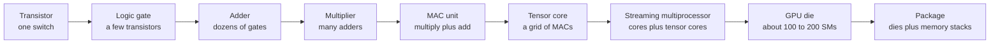
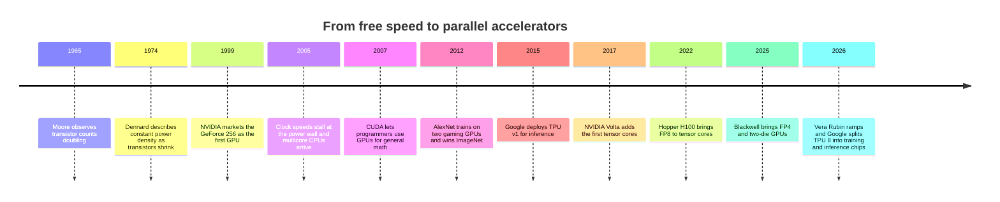
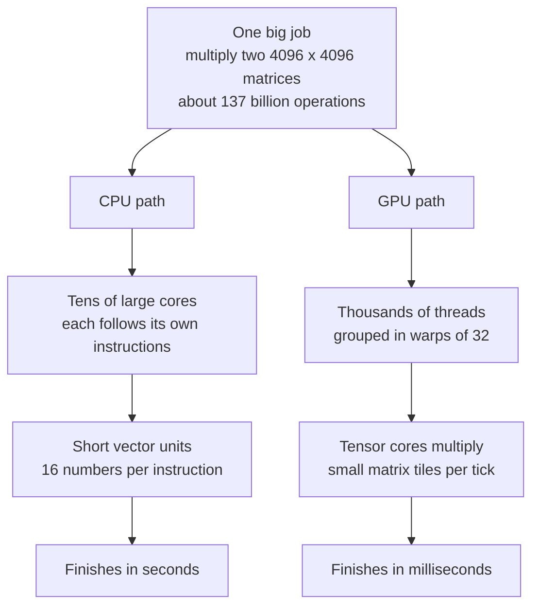
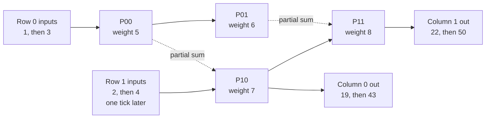
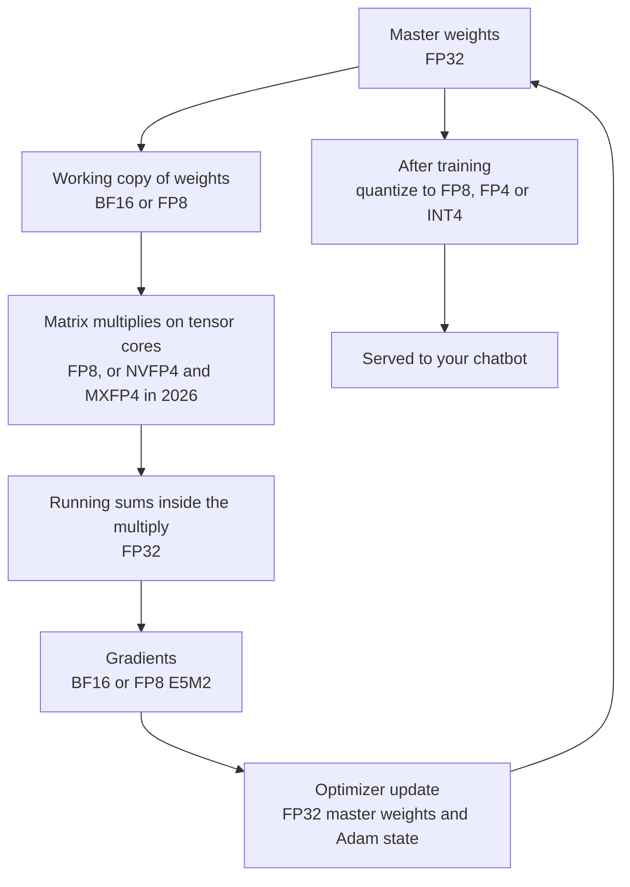
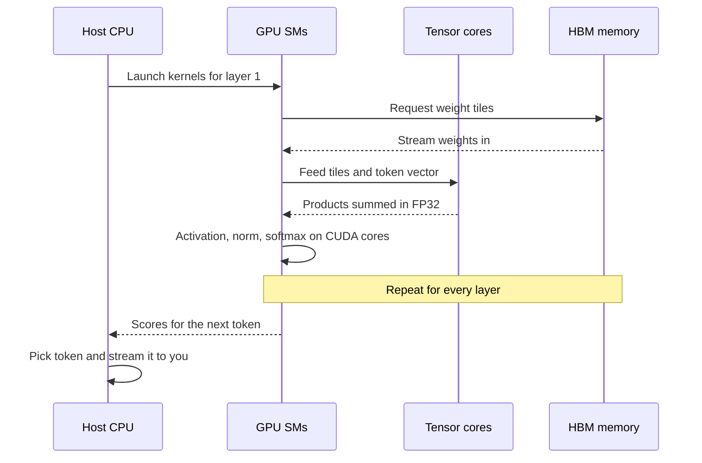

# Chapter 32: From Transistor to Accelerator: CPUs, GPUs, TPUs and FLOPs

*This chapter shows you, step by step and with real numbers, how billions of tiny switches become the specialized chips that run your chatbot, and how to read their spec sheets without being fooled.*

## What you'll learn

- Why almost all of AI is one operation (multiply two numbers, add the result to a running total) repeated trillions of times, and how to count that work in FLOPs.
- How a CPU works, and why clock speeds stopped rising around 2005 when Dennard scaling ended, even though Moore's law kept going.
- How GPUs went from video games to AI, and what SIMT parallelism, CUDA, streaming multiprocessors and tensor cores are.
- How a systolic array, the heart of Google's TPU, multiplies matrices. You will work one by hand, tick by tick.
- The precision ladder from FP32 down to FP4, why fewer bits mean more speed, and how block scaling rescues 4-bit numbers.
- How CPUs, GPUs, TPUs, NPUs and other accelerators compare, using real 2025–2026 specifications.
- How to read a chip spec sheet: peak versus achieved, dense versus sparse, per chip versus per rack.

## Before you start

Chapter 2 (How Computers Work: Bits, Transistors and Processors) introduced bits, transistors, logic gates and the CPU. This chapter recaps them in a few paragraphs and then goes much deeper. Chapter 5 (The Math of AI, Part 1: Functions, Vectors and Matrices) showed matrix multiplication by hand and the "2 × N FLOPs per token" rule, and Chapter 12 (Neural Networks From Scratch) explained why a neural-network layer is a matrix multiplication. If those ideas feel familiar, you are ready. Chapter 33 continues the story with memory, which turns out to matter as much as the math.

## When you press Enter: trillions of multiplications

Suppose you paste a 2,000-token document into a chatbot and ask for a 500-token summary. To keep the arithmetic simple, imagine the model is a "dense" 70-billion-parameter model, meaning every one of its 70 billion numbers is used for every token. (Frontier models in 2026 are larger and use a trick called mixture of experts, covered in Chapter 17, but the arithmetic works the same way.)

Chapter 5 gave you the rule of thumb: running a model costs about 2 × N floating-point operations per token, where N is the number of parameters. So:

- Per token: 2 × 70,000,000,000 = 140 billion operations.
- For 2,500 tokens (2,000 read plus 500 written): 140 billion × 2,500 = 350 trillion operations, or 3.5 × 10^14.

If you did one multiplication per second with a pencil, without sleeping, that would take 3.5 × 10^14 seconds. A year has about 31.5 million seconds, so that is roughly 11 million years. A modern AI chip does it in well under a second of pure arithmetic.

This chapter is about the machine that makes that possible. We will build it up from the smallest part, a switch, to the giant accelerators that fill 2026 data centers. Along the way you will learn to count work, read spec sheets and see why the industry stopped making chips "faster" and started making them "wider."

> **Key idea:** AI hardware is the art of doing one simple thing, multiply two numbers and add the result to a running total, as many times per second as physics allows, while moving as little data as possible.

> **Definition — Accelerator:** A chip specialized to do one kind of work, here the math of AI, much faster and more efficiently than a general-purpose processor. GPUs, TPUs and NPUs are all accelerators.

## A quick recap: switches, gates, adders and the clock

Everything in this chapter is built from one part.

> **Definition — Transistor:** A microscopic switch made of silicon that lets electric current flow or blocks it, depending on a small voltage applied to its "gate." It has no moving parts and can flip billions of times per second. NVIDIA's Vera Rubin GPU contains about 336 billion of them.

Picture a garden hose with a pinch valve. Squeeze the valve (apply voltage to the gate) and water stops; release it and water flows. A transistor is that valve for electricity, and "flowing" or "not flowing" is a 1 or a 0.

Wire a few transistors together and you get a circuit that makes a tiny decision.

> **Definition — Logic gate:** A small circuit, built from a few transistors, that combines yes/no inputs into a yes/no output. AND outputs 1 only if both inputs are 1; OR outputs 1 if either is; NOT flips its input.

Chapter 2 showed how a handful of gates make an adder, a circuit that adds two binary numbers. A multiplier is built from adders, using the same "shift and add" method you learned for long multiplication at school. Here is 6 × 5 in binary, where 6 is `110` and 5 is `101`:

```
      110      (6)
    x 101      (5)
    -----
      110      (6 x 1, the rightmost bit of 5)
     000       (6 x 0, shifted one place left)
    110        (6 x 1, shifted two places left)
    -----
    11110      (16 + 8 + 4 + 2 = 30)
```
*Figure 32.1: Binary multiplication is just shifting and adding, so a multiplier can be built entirely from adders, which are built from gates, which are built from transistors.*

Put a multiplier and an adder side by side and you get the single most important circuit in AI.

> **Definition — Multiply-accumulate (MAC):** One multiplication followed by adding the result to a running total, as in `total = total + a × b`. A dot product is a chain of MACs. One MAC counts as 2 floating-point operations (one multiply, one add).

The last ingredient is time. Every part of a chip moves in lockstep with a metronome.

> **Definition — Clock speed (GHz):** How many times per second a chip's internal metronome ticks. 2 GHz means 2 billion ticks per second. Simple operations like a MAC take about one tick.

> **Definition — Die:** A single rectangular piece of silicon cut from a wafer, holding one chip's circuits. A product can combine several dies in one package; NVIDIA's Blackwell GPU, for example, is two dies acting as one.

Now we can see the whole ladder from switch to accelerator.


*Figure 32.2: The ladder from a single switch to a GPU package. Each step is built entirely from copies of the step before it.*

## The CPU: a few brilliant workers

The chip at the center of your laptop is a CPU.

> **Definition — CPU (Central Processing Unit):** The general-purpose processor of a computer. It is designed to run any kind of step-by-step task quickly, especially tasks full of decisions ("if this, then that"). In AI servers it manages the work but does little of the heavy math.

A CPU runs a loop that never stops: fetch the next instruction from memory, decode what it means, execute it, and repeat. Modern CPUs are astonishingly clever at this loop. They guess which way an "if" will go before they know (branch prediction), run later instructions early when they don't depend on earlier ones (out-of-order execution), and keep recently used data close by.

> **Definition — Core:** An independent processing unit inside a chip, with its own machinery to fetch and execute instructions. A laptop CPU has around 8–16 large cores; a server CPU can have well over 100.

> **Definition — Thread:** A single sequence of instructions being executed. One core can run one or more threads, switching between them.

> **Definition — Cache:** A small, very fast memory built into the chip that keeps recently used data close at hand, so the processor does not have to make slow trips to main memory. CPUs have several levels, called L1, L2 and L3.

Each family of processors speaks its own "vocabulary" of instructions.

> **Definition — Instruction set architecture (ISA):** The list of commands a processor understands, like a vocabulary. Software compiled for one ISA will not run on another without translation.

> **Definition — x86:** The instruction set used by Intel and AMD processors in most PCs and many servers since the 1980s.

> **Definition — Arm:** A company, and the instruction set it licenses, whose energy-efficient designs power nearly all phones, Apple's Macs and a growing share of data-center CPUs such as NVIDIA Grace and Vera and Google Axion.

> **Definition — RISC-V:** A free, open instruction set that anyone can use without paying license fees. It is popular with startups and appears in some AI chips, such as Meta's MTIA and Tenstorrent's processors.

CPUs also have a small taste of parallel math. Each core contains vector units that apply one instruction to a short row of numbers at once.

> **Definition — SIMD (Single Instruction, Multiple Data):** A way of computing where one instruction acts on many numbers at once, for example adding two rows of 16 numbers in a single step. CPUs have SIMD units; GPUs take the idea much further.

### How fast is a CPU at AI math?

You can estimate any chip's peak speed with one formula:

`peak operations per second = (number of units) × (operations per unit per tick) × (ticks per second)`

Take an illustrative server CPU with 64 cores at 3 GHz, where each core's vector units can do 16 multiply-adds per tick (32 operations):

`64 × 32 × 3,000,000,000 ≈ 6.1 × 10^12`, about 6 trillion operations per second.

That sounds like a lot until you compare it with the 3.5 × 10^14 operations of our summary example: almost a minute of perfect, uninterrupted math, for one person's request. Real CPUs rarely sustain their peak, so in practice it would be slower. That is why AI moved to other chips.

In an AI server, the CPU still matters. It is the "host": it loads data, turns text into tokens, schedules work, talks to the network and tells the accelerators what to do. NVIDIA's Grace CPU has 72 Arm cores; its 2026 successor, Vera, has 88 custom Arm "Olympus" cores; AMD's "Venice" EPYC CPU, used in its Helios rack, offers up to 256 cores. These CPUs are paired with GPUs, which do the arithmetic.

> **Analogy:** A CPU is a few master chefs. Each can cook any dish, improvise, and handle a complicated recipe with many decisions. A GPU is a stadium of line cooks who can each only chop, but there are tens of thousands of them, all chopping at once. Training and running an AI model is a mountain of chopping.

> **Watch out:** "A GPU is always faster than a CPU" is false. A GPU wins when there is a mountain of identical math to share out. For a tiny model, a small batch of data, or code full of decisions, the time spent copying data to the GPU and launching work on it can cost more than the math saves, and many classic machine-learning methods (Chapter 10) run happily on CPUs. Running a trained model follows the same rule: a small quantized model can run on an ordinary computer's CPU, just more slowly (Chapter 30), while large models need a GPU's memory bandwidth to answer at a usable speed (Chapter 33).

## Moore's law, Dennard scaling and the end of free speed

Why did the industry need a new kind of chip at all? For decades, CPUs simply got faster every year. Two trends made that happen, and the end of one of them is the reason GPUs and TPUs exist.

> **Definition — Moore's law:** Gordon Moore's observation (1965, revised in 1975) that the number of transistors on a chip doubles about every two years. It is an industry trend driven by engineering and investment, not a law of physics.

You can check Moore's law yourself. Intel's first microprocessor, the 4004 of 1971, had about 2,300 transistors. NVIDIA's Rubin GPU of 2026 has about 336 billion. Divide: 336,000,000,000 ÷ 2,300 ≈ 146 million. How many doublings is that? 2^27 is about 134 million, so roughly 27 doublings. Over 55 years, that is one doubling every 55 ÷ 27 ≈ 2 years. Moore's rule held remarkably well.

The second trend was quieter but just as important.

> **Definition — Dennard scaling:** The historical rule, described by Robert Dennard and colleagues in 1974, that as transistors shrink, their voltage and current shrink too, so the power used per square millimeter of chip stays roughly constant. It meant each new generation could run faster without getting hotter. It broke down in the mid-2000s.

Together these gave the industry a "free lunch." Every two years, chips got twice as many transistors, and those transistors could switch faster without melting the chip. Software got faster without anyone rewriting it.

### Why the free lunch ended

The power a chip burns is roughly:

`power ≈ C × V² × f`

Here C is how much electrical "capacity" is being charged and discharged (it grows with the number of transistors switching), V is the voltage and f is the clock frequency. Dennard scaling worked because each shrink let V fall, and V is squared, so power dropped a lot.

Around 2005, voltage hit a floor. Below roughly a volt, transistors stop switching cleanly, and tiny transistors also leak: electricity trickles through them even when they are switched "off." As transistors shrank, this leakage grew into a large share of a chip's power, so designers could not lower the voltage any further.

With voltage stuck, raising the clock became brutally expensive. A worked example: suppose you want to raise a chip's clock by 1.5×. To switch reliably at the higher speed, the transistors typically need a bit more voltage, say 1.2×. Power then rises by 1.5 × 1.2² = 1.5 × 1.44 ≈ 2.2×. You get 50% more speed for more than double the heat. Near the top of a chip's range, power climbs roughly with the cube of clock speed.

> **Definition — Power wall:** The limit, reached in the mid-2000s, where making a single processor core faster would make it too hot to cool. It ended the era of rapidly rising clock speeds.

So clock speeds stalled. Intel's Pentium 4 reached about 3.8 GHz in the mid-2000s, and today's CPUs mostly run between 2 and 5 GHz, while GPUs run around 1 to 2 GHz. Two decades later, the speed of a single tick has barely moved.

Transistor counts, however, kept doubling. The question became: what do you do with billions of extra transistors if you cannot make them tick faster? The answer was to use them side by side.

> **Definition — Multicore processor:** A chip with several complete cores that work at the same time. Multicore CPUs appeared in the mid-2000s as the industry's first answer to the power wall.

Multicore was the first step: "more workers instead of faster workers." The GPU took the idea to its extreme, with thousands of simpler workers. The TPU and similar chips went further still, removing almost everything that is not multiply-and-add. A second response was precision: if each number uses fewer bits, each multiplier is smaller and cheaper, so you can fit more of them. We will come back to that.


*Figure 32.3: When single-core speed stopped rising, the industry turned to parallelism, specialization and lower precision.*

> **Watch out:** "A higher GHz number means faster AI" is a myth. Clock speeds have hovered between about 1 and 5 GHz for twenty years. AI speed comes from parallelism, tensor cores, lower precision and, above all, memory bandwidth (Chapter 33).

> **Watch out:** "Moore's law is dead, so hardware progress has stopped" is also wrong. Single-core speed has slowed, but AI performance per chip and per dollar keeps rising fast. Epoch AI measures AI-chip price-performance improving about 1.5× per year and GPU energy efficiency about 1.34× per year, thanks to specialization, lower precision, multi-die packages and better networking.

## What a neural network actually computes

To design a chip for AI, you first need to know exactly what AI asks the chip to do. The answer is surprisingly narrow.

Chapter 12 showed that a neural-network layer does three things: multiply the input by a table of weights, add a bias, and pass the result through a simple "squashing" function. The squashing is cheap. The multiplication is where almost all the work is.

> **Definition — Matrix multiplication (GEMM):** Combining two grids of numbers by taking dot products of rows from the first with columns from the second. It is the core operation of neural networks. GEMM ("general matrix multiply") is the engineers' name for it.

Here is the 2 × 2 example from Chapter 5 again, because we will reuse it later when we build a systolic array:

```
  A = | 1  2 |     B = | 5  6 |
      | 3  4 |         | 7  8 |

  C = A x B:
  C[0][0] = 1x5 + 2x7 = 5 + 14 = 19
  C[0][1] = 1x6 + 2x8 = 6 + 16 = 22
  C[1][0] = 3x5 + 4x7 = 15 + 28 = 43
  C[1][1] = 3x6 + 4x8 = 18 + 32 = 50

  C = | 19  22 |
      | 43  50 |
```
*Figure 32.4: A 2 × 2 matrix multiply takes 8 multiply-accumulates. Remember the answer: 19, 22, 43, 50.*

Every output cell needed 2 MACs, and there are 4 cells, so 8 MACs. In general, multiplying an m × n matrix by an n × p matrix takes m × n × p MACs, which is 2 × m × n × p operations.

> **Definition — Tensor:** A grid of numbers with any number of dimensions: a list (1-D), a table (2-D), a cube (3-D) and beyond. It is the basic data object in AI software, which is why Google named its chip the Tensor Processing Unit.

### Why matrix multiplication is a chip designer's dream

Matrix multiplication has three properties that make it perfect for specialized hardware.

1. **It is perfectly predictable.** There are no "if" statements. You know in advance exactly which numbers will be multiplied with which, so the chip does not need any of the CPU's guessing machinery.
2. **It is massively parallel.** Every output cell can be computed independently. In an 8,192 × 8,192 multiply, all 67 million output cells could in principle be worked on at the same moment.
3. **It reuses data heavily.** In an n × n multiply, each input number is used n times (once for every output cell in its row or column). If the chip can keep a number nearby and reuse it, it avoids fetching it again from memory. This property is the secret behind tensor cores, systolic arrays and the whole of Chapter 33.

Real models are just this, at enormous scale. One weight matrix in a 70-billion-parameter model might be 8,192 × 8,192. Pushing one token's vector through it takes 8,192 × 8,192 ≈ 67 million MACs, and a model has hundreds of such matrices. That is how you arrive at 140 billion operations per token.

> **Key idea:** A chatbot reply is trillions of multiply-adds arranged as matrix multiplications. A chip that does matrix multiplication well, and almost nothing else, can beat a general-purpose chip by a factor of hundreds.

## Counting the work: FLOP, FLOPS and spec-sheet literacy

To compare chips you need a unit of work and a unit of speed. They differ by one letter, which causes endless confusion.

> **Definition — FLOP (floating-point operation):** One arithmetic operation, such as a multiply or an add, on a number stored in floating-point (decimal-style) format. It is a count of work, as in "this model was trained with 3.8 × 10^25 FLOP."

> **Definition — FLOPS (FLOP/s):** Floating-point operations per second, a measure of speed. An H100 GPU can do about 10^15 FLOP/s (one petaFLOPS) in 16-bit math.

The numbers in AI are so large that we use prefixes. Here is the ladder, with a real example on each rung:

| Prefix | Power of ten | Example from AI hardware |
|---|---|---|
| tera (T) | 10^12 | A phone's neural engine: roughly 10^13 operations per second |
| peta (P) | 10^15 | One H100 GPU: about 989 TFLOPS (≈ 1 PFLOPS) dense BF16 |
| exa (E) | 10^18 | One GB300 NVL72 rack: about 1.1 EFLOPS dense FP4 |
| zetta (Z) | 10^21 | About a thousand such racks working together, at FP4 |
| (count, not speed) | 3.8 × 10^25 | Total FLOP to train Llama 3.1 405B |
| (count, not speed) | 10^26–10^27 | Believed range for 2026 frontier training runs (labs rarely disclose) |

*Table 32.1: The powers of ten of AI compute.*

### The peak-speed formula, checked on real chips

Earlier you estimated a CPU's peak with units × operations per tick × ticks per second. The same formula reproduces famous accelerator numbers.

**NVIDIA V100 (2017).** It had 640 tensor cores. Each one did a 4 × 4 × 4 matrix multiply-accumulate per tick, which is 64 MACs or 128 FLOPs, and the chip ran at about 1.53 GHz:

`640 × 128 × 1,530,000,000 ≈ 1.25 × 10^14 = 125 TFLOPS`

That is exactly the 125 TFLOPS NVIDIA advertised.

**Google TPU v1 (2015).** It had a 256 × 256 grid of multiply-add cells (65,536 of them), each doing one MAC (2 operations) per tick, at 700 MHz:

`65,536 × 2 × 700,000,000 ≈ 9.2 × 10^13 = 92 TOPS`

Again, exactly the published figure. Spec sheets are not magic. They are this multiplication.

### Peak versus achieved

> **Definition — Peak performance:** The theoretical maximum operations per second on a spec sheet, reached only if every unit does useful work on every tick. Real software almost never gets there.

Real workloads fall short because units wait for data, for other chips, or for the slowest member of a group. For big training runs, the industry measures the gap like this.

> **Definition — MFU (Model FLOPs Utilization):** The fraction of a chip's peak FLOPS that goes into the model's necessary math. For large training runs, 35–50% is typical.

A worked example with public numbers: Meta trained Llama 3.1 405B on 16,384 H100 GPUs at an MFU of 38–43%. Take 40%:

- Achieved per GPU: 0.40 × 989 TFLOPS ≈ 396 TFLOPS.
- Achieved for the cluster: 16,384 × 396 × 10^12 ≈ 6.5 × 10^18 FLOP/s, or 6.5 exaFLOPS.
- Training needed about 3.8 × 10^25 FLOP, so time = 3.8 × 10^25 ÷ 6.5 × 10^18 ≈ 5.9 million seconds ≈ 68 days.

That is why big training runs take months, and why every percentage point of MFU is worth millions of dollars. Chapter 37 goes much deeper into training at scale.

### Dense versus sparse

Some spec-sheet numbers include a trick.

> **Definition — Structured sparsity (2:4):** A hardware feature, introduced with NVIDIA's A100, that skips multiplications when a weight matrix is pruned so that in every group of four numbers, two are zero. Chips quote a "sparse" speed that assumes this pattern, which can be up to double the "dense" speed. Most real models do not use it.

On the A100 and H100, the sparse figure is exactly twice the dense one. On newer products the ratio varies: NVIDIA's GB300 NVL72 rack is quoted at 1,440 petaFLOPS FP4 "sparse" and 1,080 petaFLOPS dense. Dense numbers are the honest baseline.

> **Definition — TOPS (Tera Operations Per Second):** Trillions of operations per second, usually integer operations (like INT8) on phone and laptop neural processors. A TOPS figure is not directly comparable to a FLOPS figure, because the precision and kind of operation differ.

### Three questions for every spec sheet

Whenever you see a big compute number, ask:

1. **Which precision?** Each halving of bits roughly doubles the number (FP8 is about twice BF16, FP4 about twice FP8).
2. **Dense or sparse?** Sparse can be up to double dense.
3. **Per chip, per package, or per rack?** A rack holds 72 GPUs, so its number is 72 times bigger.

Here is NVIDIA's own spec page for the Vera Rubin NVL72 rack (as of October 2026), translated:

| Headline figure | Precision and type | Per rack | Per GPU (÷ 72) |
|---|---|---|---|
| "Inference" | NVFP4, leans on sparsity | 3,600 PF | 50 PF |
| "Training" | NVFP4, dense | 2,520 PF | 35 PF |
| FP8 | dense | 1,260 PF | 17.5 PF |
| BF16 | dense | 288 PF | 4 PF |

*Table 32.2: One product, four very different numbers. The largest headline figure is 900 times the per-GPU BF16 figure.*

All four numbers are true. They answer different questions. If you are training in BF16 on one GPU, the number that matters to you is 4 PF, not 3,600.

> **Watch out:** "The headline petaFLOPS is what you'll get" is wrong three times over. Headline numbers are often sparse, at the lowest precision, and per rack. Real training workloads then achieve maybe 30–60% of the dense peak at the precision they actually use.

> **Try it:** Ask your chatbot: "My GPU spec sheet says 20 petaFLOPS FP4 sparse. Roughly how many dense BF16 TFLOPS is that, assuming each precision halving doubles throughput and sparse is 2× dense?" Check its working: 20 → 10 dense FP4 → 5 FP8 → 2.5 PF BF16, so about 2,500 TFLOPS. Then ask it what could make the real number lower.

## Parallelism: SIMD, SIMT and armies of simple workers

We have established that AI is a mountain of independent multiply-adds. The way to climb it is to do many at once.

> **Definition — Parallelism:** Doing many operations at the same time instead of one after another. It is the central idea behind GPUs and every AI accelerator.

GPUs organize their parallelism in a particular way.

> **Definition — SIMT (Single Instruction, Multiple Threads):** NVIDIA's way of running parallel code: thousands of threads each work on their own piece of data, but they are grouped so that one instruction drives a whole group at once. It feels like writing code for one worker that is magically run by thousands.

> **Definition — Warp:** On NVIDIA GPUs, a group of 32 threads that execute the same instruction together, in lockstep. It is the basic unit the GPU schedules.

> **Analogy:** SIMT is a drill sergeant shouting "step forward!" to a platoon of 32 soldiers. One order, 32 steps. Now picture a parade ground with thousands of platoons, and sergeants who switch instantly to whichever platoon is ready.

That last part, switching between platoons, is the GPU's secret for dealing with slow memory. When one warp is waiting for data, the GPU simply runs another warp that is ready. With thousands of warps in flight, there is almost always something to do. A CPU, with only a few threads per core, cannot hide waiting this way, so it spends huge effort on caches and prediction instead.

This reveals a deep difference in what each chip is optimized for.

> **Definition — Latency:** How long one piece of work takes from start to finish, such as fetching one number from memory or getting the first word of a chatbot answer.

> **Definition — Throughput:** How much total work gets done per unit of time, such as operations per second or tokens per second across all users.

A CPU is a latency machine: it tries to finish each task as quickly as possible. A GPU is a throughput machine: individual tasks may be slow, but the total output is enormous. AI training and serving care mostly about throughput, which is why they moved to GPUs.

SIMT has a weakness. If the 32 threads of a warp hit an "if" and half go one way and half the other, the warp must run both paths, one after the other, with half its soldiers standing idle each time. This "branch divergence" is why GPUs are poor at code with lots of unpredictable decisions, and why the CPU is still in the server.

There is also a hard ceiling on how much parallelism can help.

> **Definition — Amdahl's law:** The rule that the speedup from parallel hardware is limited by the part of a job that cannot be parallelized. If 5% of a task must run one step at a time, no number of processors can make the whole task more than 20 times faster.

Here is the arithmetic behind that 20×: with infinitely many workers, the parallel 95% takes zero time, but the serial 5% still takes 5% of the original time, so the best possible speedup is 1 ÷ 0.05 = 20. Matrix multiplication is so close to 100% parallel that GPUs and TPUs can use tens of thousands of workers on it effectively.


*Figure 32.5: The same matrix multiplication on a CPU and a GPU. Both get the same answer; the GPU applies far more workers to it at once.*

## The GPU story: from video games to AI

### Pixels first

A screen is a grid of pixels. A 1920 × 1080 display has about 2 million of them, and a game redraws the screen 60 times per second or more: over 120 million pixel calculations per second, each involving lighting, textures and geometry. Crucially, each pixel's color can be computed independently of its neighbors. That is exactly the kind of work SIMT was built for.

> **Definition — GPU (Graphics Processing Unit):** A chip with thousands of simple arithmetic units, originally built to compute the colors of millions of screen pixels in parallel. Its massive parallelism made it the workhorse of AI.

NVIDIA marketed its GeForce 256 (1999) as the first GPU. In the early 2000s, GPUs became programmable, and researchers began disguising scientific calculations as graphics problems to borrow their speed. It was awkward: you had to pretend your numbers were pixel colors.

### CUDA changes the game

In 2006–07, NVIDIA released a way to program its GPUs directly.

> **Definition — CUDA:** NVIDIA's programming platform, available since 2006–07, for running general calculations on its GPUs. Around it grew nearly two decades of libraries, tools and developer habits, which together form NVIDIA's biggest competitive advantage.

> **Definition — Kernel (GPU kernel):** A small program that runs on the GPU to perform one operation, such as a matrix multiply or the attention step of a Transformer. Thousands of copies run at once, one per thread. Writing fast kernels is one of the most prized skills in AI.

For years, CUDA was used mainly for physics simulations, oil exploration and finance. Then in 2012 a neural network called AlexNet, trained by Alex Krizhevsky, Ilya Sutskever and Geoffrey Hinton on two NVIDIA GTX 580 gaming cards, won the ImageNet image-recognition competition by a wide margin (Chapter 14 tells that story). Deep learning and GPUs have been inseparable ever since. NVIDIA reshaped itself around AI: Volta (2017) added tensor cores, Ampere's A100 (2020) added new number formats and sparsity, Hopper's H100 (2022) added 8-bit floating point, Blackwell (2024–25) joined two dies into one GPU with 4-bit support, and Vera Rubin (2026) moved to HBM4 memory with 336 billion transistors, reportedly on TSMC's 3-nanometer-class process. Chapter 35 covers the industry side of that story.

> **Definition — HBM (High Bandwidth Memory):** Memory chips stacked vertically and placed right beside an AI processor in the same package, joined to it by thousands of short wires so they can deliver terabytes of data per second. HBM3, HBM3E and HBM4 are successive generations; Chapter 33 covers HBM in depth.

### Inside a GPU

Let us open up an H100, the workhorse of 2023–2025 AI, using numbers from NVIDIA's architecture documentation. It has about 80 billion transistors, draws up to 700 W, and is organized as 132 identical blocks.

> **Definition — Streaming multiprocessor (SM):** The repeated building block of an NVIDIA GPU. Each SM contains many simple arithmetic cores, several tensor cores, its own fast local memory and schedulers that juggle warps. AMD's equivalent is called a Compute Unit (CU).

> **Definition — CUDA core:** NVIDIA's name for a GPU's basic arithmetic unit, which handles ordinary (non-matrix) math one number at a time per thread.

```
  HBM   HBM   HBM          memory stacks sit beside the die
 +------------------------------------------------------+
 | [SM][SM][SM][SM][SM][SM][SM][SM][SM][SM][SM][SM]     |
 | [SM][SM][SM][SM][SM][SM][SM][SM][SM][SM][SM][SM]     |
 |   ... 132 SMs in an H100 ...                         |
 | +--------------------------------------------------+ |
 | |   L2 cache, about 50 MB, shared by all SMs       | |
 | +--------------------------------------------------+ |
 | [SM][SM][SM][SM][SM][SM][SM][SM][SM][SM][SM][SM]     |
 +------------------------------------------------------+
  HBM   HBM   HBM

  One SM, zoomed in (H100):
 +------------------------------------------------------+
 | 4 x [ 32 FP32 CUDA cores | 1 tensor core | scheduler ]|
 | register file 256 KB     | L1 / shared memory 256 KB |
 +------------------------------------------------------+
```
*Figure 32.6: Floor plan of an H100-class GPU. 132 SMs, each with 128 ordinary cores and 4 tensor cores, share a 50 MB L2 cache and are fed by HBM memory stacks at 3.35 TB/s.*

Count the workers: 132 SMs × 128 CUDA cores = 16,896 ordinary cores, plus 132 × 4 = 528 tensor cores. The tensor cores do almost all the AI math. The ordinary cores handle everything else: the squashing functions, the softmax in attention, small bookkeeping. The memory around them (registers, shared memory, L2, HBM) is the subject of Chapter 33.

> **At the frontier (2026):** NVIDIA's Rubin platform is six new chips designed together: the Vera CPU, the Rubin GPU, an NVLink 6 switch, a ConnectX-9 network card, a BlueField-4 data processor and a Spectrum-6 Ethernet switch. In its results for the quarter ending July 26, 2026, NVIDIA said Vera Rubin was "ramping into full production," with racks running at CoreWeave, Google Cloud, Microsoft Azure, Oracle Cloud Infrastructure and Nebius; its quarterly filing adds that Vera Rubin production shipments began in the quarter that started on July 27, 2026. NVIDIA has previewed Feynman for 2028, reportedly with 3D-stacked dies on TSMC's A16 process. The unit of design is no longer the chip but the whole rack (Chapter 34).

> **Watch out:** "A GPU is just a faster CPU" is wrong. It is a different design with different strengths: thousands of simple workers doing the same thing to lots of data, rather than a few clever workers doing varied things. A GPU would be terrible at running your web browser.

> **Watch out:** "CUDA is just a programming language" undersells it. CUDA is an ecosystem of compilers, math libraries (cuBLAS, cuDNN), communication libraries (NCCL), inference engines (TensorRT-LLM, Dynamo), debugging tools and millions of trained developers. That ecosystem, more than any single chip, is why rivals with competitive hardware still struggle (Chapter 35).

## Tensor cores: a muffin tin for matrix math

Ordinary CUDA cores do one multiply-add per thread per instruction. That wastes effort: every instruction must be fetched, decoded and scheduled, and its inputs read from the register file, just to do 2 operations. In 2017, NVIDIA's Volta generation added a circuit that does far more per instruction.

> **Definition — Tensor core:** A specialized circuit inside NVIDIA GPUs (since Volta, 2017) that multiplies two small matrices and adds the result to a third in a single step. AMD's equivalent is the "Matrix Core"; Google's is the MXU.

Volta's tensor core did a 4 × 4 × 4 operation each tick: multiply a 4 × 4 matrix by another 4 × 4 matrix and add a third 4 × 4 matrix. That is 4 × 4 × 4 = 64 fused multiply-adds, or FMAs (the hardware name for a MAC done as one step, `a × b + c`, with a single rounding).

Count the data each way:

- **With ordinary cores:** 64 separate FMA instructions, each reading 3 numbers from registers: 192 register reads, 64 instructions.
- **With one tensor core operation:** read the three 4 × 4 matrices once (16 + 16 + 16 = 48 numbers), do 64 FMAs inside, write 16 results. One instruction, 4 times fewer reads per FMA.

Each number read is reused 4 times inside the tensor core. Later generations made the tiles bigger and the numbers smaller (fewer bits), so each tensor core does more work per tick. This is the same principle as the reuse property of matrix multiplication, applied in silicon.

> **Analogy:** A tensor core is a muffin tin. Instead of filling, baking and emptying one muffin pan at a time, you fill a tray of 64 cups in one motion and bake them all together. The oven (instruction) and the trip to the pantry (memory read) are shared across the whole tray.

## Systolic arrays: the bucket brigade, worked by hand

Google took the muffin tin idea to its logical end. If AI is mostly matrix multiplication, why not build a chip that is mostly one giant grid of multiply-add cells, with numbers flowing through it?

> **Definition — Systolic array:** A grid of simple multiply-add cells where data pulses from each cell to its neighbors on every clock tick, like blood pumped by a heart (the name comes from "systole," the heart's pumping beat). Each number is reused by many cells without going back to memory. It is the heart of Google's TPU.

The idea dates to H. T. Kung and Charles Leiserson in 1978. Google's first TPU, deployed in its data centers in 2015, put a 256 × 256 systolic array (65,536 MAC cells) at its center, running 8-bit integer math at 700 MHz for 92 TOPS, as you calculated earlier.

Google calls each systolic-array block inside a TPU an MXU, for Matrix Multiply Unit.

### How the bucket brigade works

The most common design is called "weight-stationary": each cell is loaded with one weight that stays put while input numbers flow through the array. It suits neural networks, where the same weights are applied to input after input.

Each cell follows the same rule on every tick:

1. Receive an input number `x` from the cell on its left, and a partial sum from the cell above.
2. Compute `partial sum + x × (my weight)`.
3. Pass `x` to the right and the new partial sum down.

Partial sums enter the top of each column as zero. When a partial sum falls out the bottom of a column, it has picked up one product from every row, so it is a finished dot product.

### Worked example: our 2 × 2 multiply, tick by tick

Let us compute C = A × B from Figure 32.4, where A = [[1, 2], [3, 4]] and B = [[5, 6], [7, 8]], on a 2 × 2 systolic array. We load B's numbers into the cells as weights:

```
                    column 0              column 1
                 +------------+        +------------+
  row 0  x  -->  |    P00     |  x --> |    P01     |  x --> (done)
                 |  weight 5  |        |  weight 6  |
                 +------------+        +------------+
                       | sum                 | sum
                       v                     v
                 +------------+        +------------+
  row 1  x  -->  |    P10     |  x --> |    P11     |  x --> (done)
                 |  weight 7  |        |  weight 8  |
                 +------------+        +------------+
                       |                     |
                       v                     v
                 column 0 results      column 1 results

  Every tick, every cell:  sum_out = sum_in + x * weight
                           pass x right, pass sum_out down
```
*Figure 32.7: A 2 × 2 weight-stationary systolic array loaded with B = [[5, 6], [7, 8]]. Inputs move right; partial sums move down.*

The rows of A are fed in from the left. Row 0 of the array receives the first column of A (1, then 3), and row 1 receives the second column (2, then 4). Row 1's inputs are delayed by one tick, so they arrive just as the matching partial sums come down from above. This deliberate "skew" is the trick that makes the timing work.

| Tick | P00 (weight 5) | P01 (weight 6) | P10 (weight 7) | P11 (weight 8) | Leaves the bottom |
|---|---|---|---|---|---|
| 0 | x = 1: 0 + 1×5 = **5** | idle | idle | idle | nothing yet |
| 1 | x = 3: 0 + 3×5 = **15** | x = 1: 0 + 1×6 = **6** | x = 2: 5 + 2×7 = **19** | idle | C[0][0] = 19 |
| 2 | idle | x = 3: 0 + 3×6 = **18** | x = 4: 15 + 4×7 = **43** | x = 2: 6 + 2×8 = **22** | C[1][0] = 43, C[0][1] = 22 |
| 3 | idle | idle | idle | x = 4: 18 + 4×8 = **50** | C[1][1] = 50 |

*Table 32.3: The 2 × 2 multiply flowing through the array. Follow one number: the 5 computed by P00 at tick 0 drops into P10 at tick 1, where 2 × 7 is added to make 19.*

The array produced 19, 22, 43 and 50, the same answer you got by hand. Notice three things:

- **Each weight was loaded once** and then used for every input that flowed past it.
- **Each input number was read from memory once** and then used by every cell in its row (here 2 cells; in a 256-wide array, 256 cells).
- **The array fills and drains.** At ticks 0 and 3 only one cell is busy. If you stream in many rows of A, one after another, all four cells are busy on every tick in between, and the array does 4 MACs per tick.


*Figure 32.8: Data flow in the 2 × 2 systolic array. Solid arrows carry inputs to the right; dotted arrows carry partial sums down; finished results leave the bottom of each column.*

### Why this scales so well

Now scale up to TPU v1's 256 × 256 array. On every tick:

- 65,536 cells each do one MAC.
- Only 256 new input numbers enter from the left edge, and 256 finished sums leave from the bottom.

So each input number that enters is used 256 times before it leaves. The chip does 65,536 multiply-adds while touching only a few hundred numbers at its edges. That ratio of work to data moved is exactly what Chapter 33 calls arithmetic intensity, and it is why systolic arrays are so efficient. There is almost no instruction overhead either: the cells do not need to fetch or decode anything, they just pulse.

What if a matrix is bigger than the array? It is cut into 256 × 256 tiles, which are fed through one after another, with the results added up. Software called a compiler (for TPUs, Google's XLA) plans this tiling automatically.

> **Analogy:** A systolic array is a bucket brigade at a fire. Nobody runs back and forth to the well. Each person takes a bucket from the neighbor on one side, does their bit, and passes it on. The well (memory) is visited once per bucket, no matter how long the line is.

A GPU tensor core is, in effect, a small systolic-style unit, and a TPU is a few very large ones. The two approaches have converged: both are grids of multipliers that reuse each number many times.

## The precision ladder: rulers with fewer tick marks

We have made the multipliers parallel and arranged them to reuse data. The third big lever is to make each multiplication cheaper by using fewer bits per number. To see why that works, we need to know how computers store numbers like 0.0731 or 6.5.

### How a computer stores a decimal number

You already know scientific notation: Avogadro's number is written 6.02 × 10^23. It has two parts. The 6.02 holds the significant digits (the detail). The 23 says how big the number is (the range). Computers do the same thing in binary.

> **Definition — Floating point:** A way of storing numbers as a sign, an exponent (which sets how big or small the number is, its range) and a mantissa (the significant digits, its detail), like scientific notation in binary. It lets one format hold both tiny and huge values.

For example, 6.5 in binary is 110.1, which is 1.101 × 2^2. A computer stores the sign (positive), the exponent (2) and the digits after the leading 1 (".101"). More exponent bits mean a wider range of sizes; more mantissa bits mean finer detail.

> **Definition — Precision:** How many bits a format uses per number, and therefore how finely it can tell nearby values apart. Higher precision means more detail; lower precision means faster, cheaper math with more rounding error.

> **Try it:** Ask your chatbot: "Show step by step how the decimal number 0.1 is stored in FP32, BF16 and FP8 E4M3, and what value each format actually holds." You will see that none of them can store 0.1 exactly, and that the error grows as the bits shrink. Then ask why that rarely matters for a neural network.

### The ladder

Here is every format you will meet on a 2026 spec sheet, drawn as bit layouts (S = sign, E = exponent, M = mantissa):

```
 FP32  S EEEEEEEE MMMMMMMMMMMMMMMMMMMMMMM  1+8+23 = 32 bits
 TF32  S EEEEEEEE MMMMMMMMMM               1+8+10 = 19 bits
 BF16  S EEEEEEEE MMMMMMM                  1+8+7  = 16 bits
 FP16  S EEEEE MMMMMMMMMM                  1+5+10 = 16 bits
 FP8   S EEEE MMM        (E4M3)            1+4+3  = 8 bits
 FP8   S EEEEE MM        (E5M2)            1+5+2  = 8 bits
 FP4   S EE M            (E2M1)            1+2+1  = 4 bits
 INT8  SNNNNNNN          whole numbers -128 to 127
 INT4  SNNN              whole numbers -8 to 7
```
*Figure 32.9: The precision ladder. Notice that BF16 keeps all 8 exponent bits of FP32 (same range) and sacrifices mantissa (detail), while FP16 does the opposite.*

> **Definition — FP32:** 32-bit "single precision" floating point, with about 7 significant decimal digits. It was the original standard for training neural networks and is now used mainly for sensitive values such as master weights and optimizer state.

> **Definition — TF32 (TensorFloat-32):** NVIDIA's 19-bit format, introduced with the A100, that keeps FP32's range but only FP16's detail. It lets tensor cores speed up code written for FP32.

> **Definition — FP16 (half precision):** 16-bit floating point with 5 exponent bits and 10 mantissa bits. It is detailed but has a small range (the largest value is 65,504), so training with it needs tricks like "loss scaling" to stop small numbers from vanishing.

> **Definition — BF16 (bfloat16):** Google Brain's 16-bit "brain float," with the same 8 exponent bits as FP32 but only 7 mantissa bits. Because it rarely overflows or underflows, it became the default format for training large models.

> **Definition — FP8:** 8-bit floating point, introduced in hardware with NVIDIA's Hopper generation. It comes in two flavors: E4M3 (more detail, largest value 448), usually for weights and activations, and E5M2 (more range, largest value 57,344), often for gradients.

> **Definition — FP4:** 4-bit floating point (E2M1). Its 16 bit patterns represent only 15 distinct numbers: 0, 0.5, 1, 1.5, 2, 3, 4, 6 and their negatives (plus a negative zero). It works only with scaling tricks.

> **Definition — INT8 / INT4:** 8-bit and 4-bit whole-number formats (256 and 16 possible values). They are used mainly to run already-trained models cheaply, after conversion.

### Why fewer bits mean more speed

Cutting bits pays off three ways at once.

1. **Smaller multipliers.** The size of a multiplier circuit grows roughly with the square of the number of digits it multiplies (think of long multiplication: a 3-digit by 3-digit problem has 9 small products; 6 by 6 has 36). An FP8 multiplier is several times smaller and cheaper in power than a BF16 one, so the same silicon holds many more of them.
2. **Less data to move.** Half the bits means half the bytes flowing from memory and between chips. As Chapter 33 shows, moving data is often the real bottleneck.
3. **Less memory to hold.** Half the bits means a model takes half the space.

The rule of thumb is that each halving of bits roughly doubles peak throughput. Real chips confirm it, and NVIDIA's newest designs lean even harder toward low precision:

| Chip | BF16 dense | FP8 dense | FP4 dense |
|---|---|---|---|
| NVIDIA H100 (2022) | ~989 TFLOPS | ~1,979 TFLOPS | not supported |
| NVIDIA Rubin (2026) | 4 PFLOPS | 17.5 PFLOPS | 35 PFLOPS (NVFP4) |

*Table 32.4: Vendor peak figures. On H100, FP8 is exactly twice BF16. On Rubin, FP8 is more than four times BF16: NVIDIA spent its transistors on low precision because that is where AI workloads were going.*

And here is the memory side, for one billion parameters and for a 70-billion-parameter model:

| Format | Bytes per number | 1B parameters | 70B parameters |
|---|---|---|---|
| FP32 | 4 | 4 GB | 280 GB |
| BF16 / FP16 | 2 | 2 GB | 140 GB |
| FP8 / INT8 | 1 | 1 GB | 70 GB |
| FP4 / INT4 | 0.5 | 0.5 GB | 35 GB |

*Table 32.5: Memory needed just to store a model's weights. A 70B model in BF16 does not fit on one 80 GB H100; in FP8 it fits comfortably on one 141 GB H200.*

### Worked example: rounding to FP4, and how block scaling saves it

Suppose a small block of four weights from a trained model is:

`0.02, -0.11, 0.07, 0.30`

Neural-network weights are usually small numbers like these. Now round each to the nearest FP4 value (0, 0.5, 1, 1.5, 2, 3, 4, 6 and negatives):

- 0.02 → 0
- −0.11 → 0
- 0.07 → 0
- 0.30 → 0.5 (0.30 is 0.20 away from 0.5 but 0.30 away from 0)

Result: `0, 0, 0, 0.5`. The information is destroyed. FP4's few tick marks are all in the wrong place for these numbers.

The fix is to zoom the ruler. Give the block its own scale factor, chosen so the largest value lands on FP4's largest tick (6):

- Largest magnitude in the block: 0.30. Scale = 0.30 ÷ 6 = 0.05.
- Divide each weight by the scale: 0.4, −2.2, 1.4, 6.0.
- Round to FP4: 0.5, −2, 1.5, 6.
- Store those four 4-bit values plus the one scale factor.
- To use them, multiply back by 0.05: **0.025, −0.10, 0.075, 0.30**.

Compare with the originals (0.02, −0.11, 0.07, 0.30). The biggest error is now 0.01. Four numbers cost 4 × 4 = 16 bits plus a shared scale, instead of 4 × 16 = 64 bits in BF16.

> **Definition — Microscaling (MX) formats:** An open industry standard from the Open Compute Project (MXFP8, MXFP6, MXFP4) in which each block of 32 low-bit numbers shares one scale factor, a power of two. It lets very small formats cover a wide range of values.

> **Definition — NVFP4:** NVIDIA's 4-bit format for Blackwell and later chips. It uses smaller blocks of 16 values, each with a finer 8-bit (FP8) scale, plus one scale for the whole tensor, which makes it more accurate than plain FP4.

Why do the details matter? Under MXFP4, the scale must be a power of two. For our block that would be 0.0625 instead of 0.05, and the same weights come back as 0.031, −0.125, 0.0625 and 0.25: still usable, but the largest value has lost 0.05. NVFP4's finer scale and smaller blocks keep more detail, which is one reason NVIDIA introduced it.

> **Analogy:** Precision is a ruler with fewer tick marks. FP32 marks every millimeter, FP8 every centimeter, and FP4 has just a handful of marks. Measuring is faster with fewer marks, and the ruler is lighter to carry. Block scaling is a zoom lens: before you measure each small group of objects, you zoom so they fill the ruler.

### Mixed precision and quantization

No serious system uses one format for everything.

> **Definition — Mixed precision:** Doing most of the math in a low-precision format while keeping a few sensitive values, such as a master copy of the weights and running sums, in higher precision. It gets most of the speed of low precision with most of the accuracy of high precision.

Inside a tensor core, for example, the multiplications may be FP8 while the running sums are kept in FP32, because adding thousands of small products in a low-precision total would lose them to rounding. Hopper added a "Transformer Engine" that chooses between FP8 and 16-bit formats layer by layer.

> **Definition — Quantization:** Converting a trained model's numbers to fewer bits (for example, from BF16 to 4-bit) to save memory and speed up inference, ideally with little loss in quality. Chapter 23 and Chapter 30 cover how it is done.


*Figure 32.10: Where each precision lives in a typical 2026 training and serving pipeline. Low precision for bulk math, high precision for the few numbers that must not drift.*

> **At the frontier (2026):** BF16 mixed precision became the training standard in the late 2010s. FP8 training arrived with Hopper; DeepSeek-V3 (December 2024) was a prominent public example, trained in FP8 on 2,048 H800 GPUs for about 2.8 million GPU-hours. FP4 is the 2026 frontier: Blackwell and Rubin support NVFP4 training, Moonshot's Kimi K3 ships MXFP4 weights after quantization-aware training that starts at its fine-tuning stage, and DeepSeek-V4 ships its expert weights in FP4 with FP8 elsewhere. Making FP4 pre-training robust at frontier scale is an active research problem.

> **Watch out:** "Lower precision means worse AI" is mostly wrong. With careful scaling, models train and run at nearly the same quality in BF16, FP8 and block-scaled FP4. Precision is a tool. The real risk is careless quantization of a model that was never designed for it, which can quietly hurt accuracy on hard tasks.

How low can it go? In February 2024 researchers at Microsoft Research and the University of Chinese Academy of Sciences described BitNet b1.58, a language model trained from the start with every weight equal to −1, 0 or +1. Three possible values need about 1.58 bits each (2 to the power 1.58 is about 3). The paper reported that, at the sizes it tested (quality compared up to 3.9 billion parameters), it matched full-precision models trained on the same data while using less memory, time and energy. In April 2025 the team released open weights for a 2-billion-parameter version trained on 4 trillion tokens.

> **Definition — Ternary weights:** Weights restricted to three values, −1, 0 and +1, which need about 1.58 bits each. Multiplying by them is just subtracting, skipping or adding, so most of the multiplications in a layer disappear.

That is why 1-bit and 1.58-bit models prompt the question of whether future chips will need today's multiplier-heavy designs. So far, though, the published BitNet models are small, and frontier models use FP8 and FP4 (see the box above), so the idea has not changed what the big labs buy.

## The accelerator zoo: CPU, GPU, TPU, NPU and friends

We now have all the pieces: parallel workers, matrix units, data reuse and low precision. Different companies combine them differently. Here is the zoo.

### Fixed-function chips

> **Definition — ASIC (Application-Specific Integrated Circuit):** A chip designed for one job. AI ASICs such as Google's TPU, Amazon's Trainium, Microsoft's Maia and Meta's MTIA trade the flexibility of a GPU for better efficiency on AI math.

> **Definition — TPU (Tensor Processing Unit):** Google's family of AI ASICs, built around large systolic arrays and linked by Google's own chip-to-chip network. First deployed in 2015, it reached its eighth generation (TPU 8t and TPU 8i) in 2026.

The TPU's history shows how AI hardware evolved:

- **v1 (2015):** inference only, 8-bit integers, one 256 × 256 systolic array, 28 nm.
- **v2 (2017):** added BF16 and HBM memory, so it could train.
- **v4 (2021):** pods of 4,096 chips connected through optical circuit switches.
- **Trillium / v6e (2024):** 918 TFLOPS BF16, 32 GB HBM, 256-chip pods.
- **Ironwood / v7 (announced April 2025, generally available late 2025):** 4,614 TFLOPS FP8, 192 GB HBM3E at 7.37 TB/s, pods of up to 9,216 chips.
- **TPU 8t and 8i (announced April 2026):** separate chips for training and inference (details in the tables below).

Amazon's Trainium, Microsoft's Maia and Meta's MTIA follow the same logic. A cloud company builds its own chip to lower cost, secure supply and gain bargaining power with NVIDIA. Chapter 35 tells that story.

### Inference specialists

> **Definition — LPU (Language Processing Unit):** Groq's inference chip, which keeps model weights in very fast on-chip memory (SRAM) instead of external memory and runs on a fixed schedule planned in advance by a compiler. It is very fast for one user but needs hundreds of chips to hold a large model.

In late December 2025, NVIDIA paid a reported ~$20 billion for a non-exclusive license to Groq's technology and hired its leadership. At GTC 2026 NVIDIA introduced the Groq 3 LPU, sold in racks of 256 chips, to sit beside Vera Rubin GPUs and generate tokens quickly.

> **Definition — Wafer-scale engine:** Cerebras's approach of using an entire silicon wafer as one giant chip instead of cutting it into many small chips. Its WSE-3 covers 46,225 mm², about 54 times the largest single die a normal lithography machine can print.

### Chips in your pocket

> **Definition — NPU (Neural Processing Unit):** A small, power-efficient AI accelerator inside phones and laptops, such as Apple's Neural Engine or Qualcomm's Hexagon. It is usually rated in TOPS and runs small models on the device itself.

Apple has included a Neural Engine in its phone chips since the A11 (2017). Microsoft requires a 40+ TOPS NPU for a laptop to be sold as a "Copilot+ PC." These NPUs run small models (a few billion parameters, usually quantized to 4 bits) for features like live captions, photo search and on-device assistants. Their limits are memory and battery, not math (Chapter 33 and Chapter 53).

> **Definition — FPGA (Field-Programmable Gate Array):** A chip whose circuitry can be rewired after manufacturing. It is slower than an ASIC but flexible, and is used for prototyping new designs and for niche, low-latency AI tasks.

> **Definition — Superchip:** NVIDIA's term for a CPU and one or more GPUs tightly linked on one board with a fast chip-to-chip connection, such as Grace plus two Blackwell GPUs (GB200) or Vera plus two Rubin GPUs.

### The families compared

| | CPU | GPU | TPU and other AI ASICs | NPU |
|---|---|---|---|---|
| **Workers** | Tens to ~256 large, clever cores | Thousands of simple cores plus hundreds of tensor cores | A few huge systolic arrays | A small matrix engine |
| **Best at** | Branchy, varied, step-by-step tasks; running the server | Any parallel math; training and serving all kinds of models | Large matrix multiplies at the best cost and power per operation | Small models on a battery |
| **Weak at** | Bulk matrix math | Branchy code; it still needs a CPU host | Anything that is not tensor math; less flexible software | Big models (too little memory and bandwidth) |
| **Programmed with** | Almost anything | CUDA (NVIDIA), ROCm (AMD), Triton, PyTorch | JAX and XLA (TPU), Neuron (Trainium), PyTorch via compilers | Vendor toolkits inside phone and PC operating systems |
| **Where you meet it** | Every computer, and as the host in AI servers | Rented in the cloud, in labs, in gaming PCs | Google Cloud, AWS, Microsoft and Meta data centers | Your phone and laptop |

*Table 32.6: The four main families of chips that run AI, by design philosophy.*

Now the real numbers. These are vendor peak figures as of late 2026, which you should read with the three spec-sheet questions in mind. "Dense" unless marked otherwise.

| Chip (year) | Type | Peak compute | Memory | Memory bandwidth | Notes |
|---|---|---|---|---|---|
| NVIDIA H100 SXM (2022) | GPU | ~989 TFLOPS BF16; ~1,979 TFLOPS FP8 | 80 GB HBM3 | 3.35 TB/s | 700 W; 80B transistors |
| NVIDIA H200 (2024) | GPU | same as H100 | 141 GB HBM3E | 4.8 TB/s | More and faster memory |
| NVIDIA B300 (2H 2025) | GPU | ~15 PFLOPS FP4 | 288 GB HBM3E | 8 TB/s | Blackwell Ultra; two dies |
| NVIDIA Rubin (2026) | GPU | 4 PF BF16; 17.5 PF FP8; 35 PF NVFP4 | 288 GB HBM4 | 19.2–22 TB/s (see note) | 336B transistors, TSMC N3 (reported) |
| AMD MI355X (2H 2025) | GPU | 10.1 PFLOPS MXFP4 | 288 GB HBM3E | 8 TB/s | 1,400 W, liquid-cooled |
| AMD MI455X (2026) | GPU | ~40 PF FP4; ~20 PF FP8 | 432 GB HBM4 | 19.6 TB/s (later briefing: up to 23.3) | Ships in AMD's Helios rack |
| Google Ironwood TPU v7 (2025) | TPU | 4,614 TFLOPS FP8 | 192 GB HBM3E | 7.37 TB/s | Pods of 9,216 chips |
| Google TPU 8t (2026) | TPU | 12.6 PFLOPS FP4 | 216 GB HBM | 6.5 TB/s | Training; 128 MB on-chip SRAM |
| Google TPU 8i (2026) | TPU | 10.1 PFLOPS FP4 | 288 GB HBM | 8.6 TB/s | Inference; 384 MB on-chip SRAM |
| AWS Trainium3 (2025) | ASIC | ~2.5 PFLOPS FP8 (MXFP8) | 144 GB HBM3E | 4.9 TB/s | AWS's first 3 nm chip |
| Microsoft Maia 200 (2026) | ASIC | over 10 PF FP4; over 5 PF FP8 | 216 GB HBM3E | 7 TB/s | 272 MB on-die SRAM; 750 W |
| Groq 3 LPU (2026) | LPU | ~1.2 PFLOPS FP8 (reported) | ~500 MB SRAM, no HBM | ~150 TB/s (SRAM) | 256 per LPX rack |
| Cerebras WSE-3 | Wafer-scale | ~125 PF sparse FP16 (vendor) | 44 GB on-wafer SRAM | very high (on-wafer) | 4 trillion transistors, 900,000 cores |
| NVIDIA Vera (2026) | CPU | not quoted in FLOPS | LPDDR5X, up to 54 TB per 36-CPU rack | (CPU-class) | 88 Arm cores; Rubin's host |
| Copilot+ PC NPU | NPU | 40+ TOPS (usually INT8) | Shares the laptop's memory | Typical laptop: about 60–120 GB/s | Runs on a few watts |

*Table 32.7: Real accelerator specifications (vendor peak figures, late 2026). Rubin's bandwidth is an example of spec drift: launch coverage at CES 2026 cited 22 TB/s per GPU, while NVIDIA's current product page lists 19.2 TB/s. Maia 200 figures come from Microsoft's January 2026 announcement. NVIDIA's LPX page gives the Groq 3 LPU's SRAM figures but not its FP8 rate, which comes from press reports.*

Three lessons jump out of this table. First, compute numbers differ by precision so much that you must compare like with like. Second, memory capacity and bandwidth vary as much as compute does, and Chapter 33 shows they often matter more. Third, the inference-oriented chips (TPU 8i, Maia 200, Groq) carry unusually large amounts of on-chip SRAM. That is a bet about memory, which is the next chapter's subject.


*Figure 32.11: A rough map of the accelerator zoo. Positions are qualitative. GPUs sit in the sweet spot of flexible and efficient, which is a big part of why they dominate.*

> **At the frontier (2026):** The big trend of 2026 is splitting chips into training and inference variants. Google announced TPU 8t for training (up to 9,600 chips per superpod, with Google saying a training cluster can scale past one million TPU chips) and TPU 8i for inference (288 GB of HBM and 384 MB of SRAM, three times the previous generation). NVIDIA pairs Vera Rubin GPUs with Groq 3 LPX racks for fast token generation. Prefill (reading your prompt) and decode (writing the answer) stress hardware so differently that one chip no longer fits both perfectly (Chapter 33 explains why).

> **Watch out:** "Google's and Amazon's chips will make NVIDIA irrelevant soon" overstates it. Custom ASICs are growing fast (TPUs for Anthropic, Trainium, Maia, MTIA), but NVIDIA reported $89.0 billion of data-center revenue in a single quarter (the one ending July 26, 2026) and remained supply-constrained. The market is growing fast enough for several winners.

### The recipe behind the zoo: five rules for domain-specific chips

Every chip in the zoo except the CPU follows the same basic recipe. John Hennessy and David Patterson, the Turing Award winners who wrote the standard computer-architecture textbook, boiled it down to five guidelines for what they call domain-specific architectures.

> **Definition — Domain-specific architecture (DSA):** A processor designed to run one family of tasks, such as neural networks, very efficiently, instead of running every kind of program reasonably well. TPUs, NPUs and most AI ASICs are DSAs, and GPUs with tensor cores have become partly one.

Why did this become the path forward? Once Dennard scaling ended (earlier in this chapter), a chip could no longer run all of its transistors at full speed at once without overheating.

> **Definition — Dark silicon:** The part of a chip that must sit idle or run slowly at any moment because the chip's power and cooling budget cannot feed every transistor at full speed. It became a design problem after Dennard scaling ended in the mid-2000s.

If many transistors must rest anyway, the best use for them is specialized circuits that do one job with far less energy per operation. Here are the five rules, checked against Google's first TPU, the chip the textbook uses as its main example.

| Rule | What TPU v1 (2015) did | The same rule in 2026 |
|---|---|---|
| 1. Keep dedicated memory right next to the math | 28 MiB of on-chip memory, managed by software rather than by caches | TPU 8i's 384 MB and Groq's ~500 MB of on-chip SRAM |
| 2. Spend the transistors you save on more math or more memory | No caches, branch prediction or out-of-order tricks; instead 65,536 multiply-add units | Groq's LPU drops runtime scheduling entirely; its compiler plans every step in advance |
| 3. Use the simplest kind of parallelism that fits | One instruction drives the whole 256 × 256 systolic array in lockstep | MXUs and tensor cores still march in lockstep |
| 4. Use the smallest number format that works | 8-bit integers for inference | FP8 and block-scaled FP4 (NVFP4, MXFP4) |
| 5. Program it through a domain-specific language | TensorFlow models compiled for the chip | JAX and PyTorch, compiled by XLA, Triton or torch.compile |

*Table 32.8: Hennessy and Patterson's five guidelines for domain-specific architectures, applied to Google's first TPU and to 2026 chips.*

**What the recipe bought.** In Google's 2017 paper, TPU v1 ran Google's own inference workloads about 15 to 30 times faster than the server CPU and GPU of its day, with 30 to 80 times better performance per watt. It had about 25 times as many multiply-add units as the GPU it was compared with, and it went from first design to running in data centers in about 15 months. Latency taught a further lesson. Google's services had to answer within a deadline measured at the 99th percentile (the slowest 1% of requests; Chapter 6 explains percentiles), about 7 milliseconds for one key workload. Caches and the other clever features of CPUs and GPUs make timing unpredictable, so those chips had to shrink their batches to stay inside the deadline and lost much of their throughput. The TPU's simple, predictable timing let it keep large batches under the same deadline. Chapter 37 shows why the slowest requests matter so much at scale.

The textbook's other examples show how far the recipe stretches. Microsoft's **Project Catapult** put an FPGA into servers across large parts of its data centers from the mid-2010s, first to speed up Bing's search ranking and later for networking and neural-network inference: less efficient than an ASIC, but reprogrammable as the algorithms changed. Google's **Pixel Visual Core** (2017) was a small programmable DSA inside Pixel phones for camera processing, such as building HDR+ photos from several exposures, programmed in an image-processing language called Halide and using far less power than the phone's main processor.

> **Definition — Image signal processor (ISP):** A specialized circuit in every camera phone that turns the raw readings from the camera sensor into a finished photo (adjusting color, removing noise, combining exposures) far more efficiently than the main processor could.

The recipe is not only for AI. After the TPU, Google applied it to video, the largest source of internet traffic. Every video uploaded to YouTube is re-encoded into many formats and resolutions so it plays well on every phone, TV and connection.

> **Definition — Transcoding:** Converting a video from one compressed format, resolution or quality level into another, for example turning one uploaded 4K file into a dozen versions for different screens and network speeds. It is one of the heaviest computing jobs in a video service.

Google's answer was the VCU (Video Coding Unit), a chip full of video encoder and decoder cores, with two chips per board and ten boards per server. Google reports that VCUs gave about 8 to 20 times the throughput of software encoding on CPUs for its main video formats, an order-of-magnitude gain in efficiency, and that they have been used for years by YouTube, Google Meet and Google Photos. The fourth edition of Barroso, Hölzle and Ranganathan's *The Data Center as a Computer* (December 2025) presents video and networking chips as the next wave of accelerators beyond machine learning.

> **Key idea:** A domain-specific chip wins by doing less: it drops general-purpose machinery, keeps data close, uses small numbers and lets a compiler plan the work. The price is flexibility, so the bet pays only when the domain, like neural networks, is huge and stable.

> **Watch out:** "Chip A does more inferences per second than chip B, so it is faster" can mislead. Hennessy and Patterson list "inferences per second is a fair summary metric" as a fallacy: a chip can post a huge number with batches so large that real users would wait too long. Always ask what response time the number was measured at (Chapter 37 draws this trade-off as a curve).

## Putting it together: one token's journey through the silicon

Let us follow one token of your chatbot's reply through an H100-class GPU, using everything in this chapter.

1. The host CPU has turned your text into tokens and handed the GPU a batch of work.
2. For each of the model's dozens of layers, the GPU launches kernels. Thousands of warps spread across the 132 SMs.
3. Each SM pulls tiles of the layer's weight matrices from HBM memory into its shared memory and registers.
4. The tensor cores multiply those tiles by the token's vector, in FP8 or BF16, keeping running sums in FP32.
5. The CUDA cores apply the cheap steps: the squashing function, normalization, the softmax inside attention.
6. The result becomes the input to the next layer, and the process repeats down the whole stack.
7. At the end, the last layer produces a score for every possible next token, one is chosen, and it streams back to your screen.


*Figure 32.12: One decode step on a GPU. Notice how often the SMs wait on HBM; Chapter 33 is about that wait.*

Now a puzzle to carry into the next chapter. One token of our 70B model needs 140 billion operations. At the H100's ~989 TFLOPS, that is 140 × 10^9 ÷ 989 × 10^12 ≈ 0.14 milliseconds of math. But real chatbots running such a model on one GPU produce something like tens of tokens per second for a single user, which is tens of milliseconds per token, a hundred times slower than the math alone. Where does the time go?

The answer is step 3. To produce each token, the GPU must read every one of the model's weights from memory, and memory is far slower than the tensor cores. That is the memory wall, and it is the subject of Chapter 33.

> **Key idea:** Compute chips are now so fast that the hard part is feeding them. The next frontier of AI hardware is less about multiplying and more about moving numbers.

## In plain English

Every answer from your chatbot is built out of one tiny operation, "multiply two numbers and add the result to a running total," done trillions of times. Chips are made of billions of switches called transistors, grouped into gates, adders and multipliers. For decades, chips got faster mainly by ticking faster, but around 2005 that stopped: running the clock faster made chips too hot. So the industry switched strategy from faster workers to more workers.

A CPU is a handful of brilliant, flexible workers, great at tasks full of decisions. A GPU is an army of simple workers, originally built to color millions of screen pixels at once, which turned out to be perfect for the matrix multiplications at the heart of neural networks. NVIDIA's CUDA software made GPUs programmable in 2006–07, and AlexNet proved their value for AI in 2012. Tensor cores, added in 2017, multiply whole small blocks of numbers in one step. Google's TPU goes further, with a giant grid of multipliers called a systolic array that passes numbers between neighbors like a bucket brigade, so each number fetched from memory gets reused hundreds of times.

The third trick is using fewer bits per number: 32, then 16, then 8, now 4. Each halving roughly doubles speed and halves memory, and clever scaling keeps accuracy. When you read a spec sheet, always ask which precision, dense or sparse, and per chip or per rack, because the same product can be described with numbers that differ by a factor of 900.

Finally, the chips have become so fast at math that they spend most of their time waiting for data from memory. That is the next chapter.

## Key terms

Accelerator, Transistor, Logic gate, Multiply-accumulate (MAC), Clock speed (GHz), Die, CPU (Central Processing Unit), Core, Thread, Cache, Instruction set architecture (ISA), x86, Arm, RISC-V, SIMD (Single Instruction, Multiple Data), Moore's law, Dennard scaling, Power wall, Multicore processor, Matrix multiplication (GEMM), Tensor, FLOP (floating-point operation), FLOPS (FLOP/s), Peak performance, MFU (Model FLOPs Utilization), Structured sparsity (2:4), TOPS (Tera Operations Per Second), Parallelism, SIMT (Single Instruction, Multiple Threads), Warp, Latency, Throughput, Amdahl's law, GPU (Graphics Processing Unit), CUDA, Kernel (GPU kernel), HBM (High Bandwidth Memory), Streaming multiprocessor (SM), CUDA core, Tensor core, Systolic array, Floating point, Precision, FP32, TF32 (TensorFloat-32), FP16 (half precision), BF16 (bfloat16), FP8, FP4, INT8 / INT4, Microscaling (MX) formats, NVFP4, Mixed precision, Quantization, Ternary weights, ASIC (Application-Specific Integrated Circuit), TPU (Tensor Processing Unit), LPU (Language Processing Unit), Wafer-scale engine, NPU (Neural Processing Unit), FPGA (Field-Programmable Gate Array), Superchip, Domain-specific architecture (DSA), Dark silicon, Image signal processor (ISP), Transcoding

## Exercises

1. **[Easy] Meet a real GPU in Google Colab.** Google Colab lends you a real data-center GPU for free, usually an NVIDIA T4 (a 2018 inference card). You will look at it, then make it work hard.
   1. Go to colab.research.google.com, sign in with a Google account and click **New notebook**.
   2. Click **Runtime → Change runtime type**, choose **T4 GPU** under Hardware accelerator, and click **Save**.
   3. In the first code cell, type the line below and press the play button (or Shift+Enter). The `!` tells Colab to run a system command instead of Python.

      ```python
      !nvidia-smi
      ```

   4. Find and write down: the GPU name (top left of the table); the memory line, such as `0MiB / 15360MiB` (used out of total, in mebibytes, so about 15 GB); the power line, such as `9W / 70W` (drawing now out of its limit); the temperature; the `CUDA Version`; and `GPU-Util` (percent of time it is busy).
   5. In a new cell, paste this to get the same facts as a tidy table:

      ```python
      # Ask the GPU driver for specific facts, printed as a small table
      !nvidia-smi --query-gpu=name,memory.total,memory.used,power.draw,power.limit,clocks.max.sm,temperature.gpu,utilization.gpu --format=csv
      ```

   6. Now make it work. Paste and run this cell. It queues 200 big matrix multiplications, peeks at the GPU's gauges while they run, then reports how many trillions of operations per second it achieved.

      ```python
      import time, subprocess   # time: a stopwatch; subprocess: lets Python run nvidia-smi
      import torch              # PyTorch, the AI library that talks to the GPU

      n = 8192                  # matrix size: 8,192 x 8,192 numbers
      a = torch.randn(n, n, device="cuda", dtype=torch.float16)  # random matrix on the GPU, 16-bit
      b = torch.randn(n, n, device="cuda", dtype=torch.float16)  # a second one
      c = a @ b                 # one warm-up multiply so start-up costs don't count
      torch.cuda.synchronize()  # wait until the GPU has really finished

      reps = 200                # how many multiplies to queue up
      start = time.time()       # start the stopwatch
      for _ in range(reps):
          c = a @ b             # queue a multiply; Python moves on without waiting
      time.sleep(2)             # let the GPU get busy for two seconds
      gauges = subprocess.run(  # read the GPU's gauges while it is still working
          ["nvidia-smi", "--query-gpu=power.draw,utilization.gpu,memory.used,temperature.gpu",
           "--format=csv"], capture_output=True, text=True).stdout
      torch.cuda.synchronize()  # now wait for all 200 multiplies to finish
      seconds = time.time() - start   # stop the stopwatch

      flop = reps * 2 * n**3    # each n x n multiply is about 2 x n cubed operations
      print(gauges)
      print(f"{flop:.2e} operations in {seconds:.1f} s = {flop / seconds / 1e12:.1f} TFLOPS achieved")
      ```

   7. Compare the power, utilization and memory with your idle readings. Then compare your achieved TFLOPS with the T4's spec-sheet peak of about 65 TFLOPS for 16-bit math on its tensor cores. (If Colab gave you a different GPU, look up its peak, and if the run finishes in under 2 seconds, raise `reps` to 1000.)
   8. When finished, click **Runtime → Disconnect and delete runtime** to hand the GPU back.

   **What you'll learn:** A GPU is a physical device with finite memory, a power limit and a temperature, and real code reaches only part of its peak speed.

2. **[Easy] Read a spec sheet like a detective.** Open NVIDIA's GB300 NVL72 page (nvidia.com/en-us/data-center/gb300-nvl72) and its Vera Rubin NVL72 page (nvidia.com/en-us/data-center/vera-rubin-nvl72).
   1. For every compute number, write down its precision (FP4, FP8, BF16...), whether it is dense or sparse (check the footnotes), and whether it is per rack or per GPU.
   2. Divide the rack numbers by 72 to get per-GPU figures.
   3. Find the largest and smallest compute numbers on each page and compute their ratio.

   **What you'll learn:** Headline numbers can differ by about 2× for sparsity, 2–4× per precision step and 72× for rack versus chip, so you must always ask what is being counted.

3. **[Easy] Draw the FP4 ruler.** On paper, draw a number line from −6 to 6 and mark the 15 FP4 values: 0, ±0.5, ±1, ±1.5, ±2, ±3, ±4, ±6. Then round these numbers to the nearest mark: 0.8, 2.4, 5.1, −3.6, 0.2. Next, imagine you could "zoom" by multiplying every number by 2 before rounding and dividing by 2 afterwards. Redo the rounding for 0.8 and 0.2. Which got more accurate?
   **What you'll learn:** Why 4-bit numbers have so few tick marks, why the marks are crowded near zero, and why scaling before rounding helps.

4. **[Medium] Run a systolic array by hand.** Use the 2 × 2 weight-stationary array from Figure 32.7, but load it with B = [[4, 1], [2, 5]] (so P00 = 4, P01 = 1, P10 = 2, P11 = 5) and stream in A = [[2, 1], [0, 3]].
   1. Row 0 of the array receives A's first column (2, then 0) at ticks 0 and 1. Row 1 receives A's second column (1, then 3) at ticks 1 and 2.
   2. Copy the empty layout of Table 32.3 and fill in every cell, tick by tick, using the rule `sum_out = sum_in + x × weight`.
   3. Check your result against a direct calculation of A × B. You should get C = [[10, 7], [6, 15]].
   4. Count how many times each weight was loaded and how many MACs were done in total.

   **What you'll learn:** How data pulses through a TPU-style array and why each number fetched from memory gets reused.

5. **[Medium] CPU versus GPU, and FP32 versus FP16, in Colab.** In a Colab notebook with a T4 GPU (see Exercise 1), paste and run:

   ```python
   import time, numpy as np, torch      # stopwatch, CPU math library, GPU library

   def tflops(fn, n, reps):            # time a function, return trillions of ops per second
       fn()                            # one warm-up run
       torch.cuda.synchronize()        # make sure the GPU is idle before timing
       t = time.time()
       for _ in range(reps):
           fn()
       torch.cuda.synchronize()        # wait for the GPU to finish everything
       return reps * 2 * n**3 / (time.time() - t) / 1e12

   n = 4096                            # 4,096 x 4,096 matrices
   A = np.random.rand(n, n).astype(np.float32)   # two matrices on the CPU
   B = np.random.rand(n, n).astype(np.float32)
   print("CPU, FP32:", round(tflops(lambda: A @ B, n, 3), 3), "TFLOPS")

   a32 = torch.rand(n, n, device="cuda")         # the same size on the GPU, 32-bit
   b32 = torch.rand(n, n, device="cuda")
   print("GPU, FP32:", round(tflops(lambda: a32 @ b32, n, 20), 1), "TFLOPS")

   a16, b16 = a32.half(), b32.half()             # convert to 16-bit, which uses tensor cores
   print("GPU, FP16:", round(tflops(lambda: a16 @ b16, n, 50), 1), "TFLOPS")
   ```

   Record the three numbers. Compute the ratio GPU FP16 ÷ CPU FP32 and GPU FP16 ÷ GPU FP32. For reference, the T4's spec sheet lists about 8.1 TFLOPS for FP32 and about 65 TFLOPS for FP16 on tensor cores.
   **What you'll learn:** The size of the gap between CPU and GPU, and that halving precision and switching to tensor cores multiplies speed on the very same chip.

6. **[Medium] Block-scale a row of weights.** Take these eight weights: 0.012, −0.034, 0.051, 0.008, −0.090, 0.027, 0.060, −0.015.
   1. Round each straight to the FP4 values from Exercise 3. How many survive as non-zero?
   2. Now split them into two blocks of four. For each block, compute scale = (largest magnitude) ÷ 6, divide each weight by its block's scale, round to FP4, and multiply back.
   3. Compute the largest error in each method. Optionally, ask a chatbot to check your arithmetic, or build it in a spreadsheet.

   **What you'll learn:** Why plain 4-bit numbers fail for small weights and how per-block scales (the idea behind MXFP4 and NVFP4) fix it.

7. **[Medium] The FLOP budget of your own chat.** Take a recent long conversation with your chatbot.
   1. Estimate its tokens: English words × about 1.3, or paste the text into a tokenizer page such as platform.openai.com/tokenizer.
   2. Using 2 × N FLOPs per token, compute the operations for a dense 70B model and for a model with 1 trillion parameters used per token.
   3. Convert to time at three speeds: a CPU at 6 TFLOPS, one H100 at 989 TFLOPS, and one GB300 NVL72 rack at 1,080 PFLOPS (dense FP4). Assume perfect efficiency.

   **What you'll learn:** How to turn "a chat" into a number of operations and a number of chip-seconds, the starting point of all AI cost estimates.

8. **[Challenge] Rebuild spec sheets from first principles.** Use `peak = units × operations per unit per tick × ticks per second`.
   1. NVIDIA T4: 320 tensor cores, each doing 64 FMAs (128 operations) per tick in FP16, at a boost clock of 1.59 GHz. What peak do you get? Compare with the 65 TFLOPS on the spec sheet.
   2. The T4's 2,560 CUDA cores each do one FMA (2 operations) per tick in FP32 at the same clock. What is the FP32 peak? Compare with 8.1 TFLOPS.
   3. Design an imaginary systolic-array chip: choose an array size (for example 128 × 128), a number of arrays per chip, and a clock. What is its peak in TOPS? How many arrays would you need to match a 4,614 TFLOPS Ironwood TPU at 1 GHz?

   **What you'll learn:** Spec-sheet numbers are simple multiplications, so you can sanity-check any claim you read.

9. **[Challenge] Which chip is the best deal?** Build a spreadsheet with one row per GPU: A100 (80 GB, ~2 TB/s), H100 SXM (80 GB, 3.35 TB/s, 989 TFLOPS BF16), H200 (141 GB, 4.8 TB/s, 989 TFLOPS BF16), B200 (192 GB, 8 TB/s) and B300 (288 GB, 8 TB/s). Add the October 2026 on-demand rental price ranges from runpod.io/pricing or lambda.ai (for example, RunPod listed H100 SXM at $2.69–3.99 per hour and B300 at $6.94–8.99). Compute gigabytes of memory per dollar-hour and TB/s of bandwidth per dollar-hour. Where you have a BF16 figure, add TFLOPS per dollar-hour too. Which chip wins on each measure?
   **What you'll learn:** There is no single "best" chip: the answer depends on whether your work is limited by compute, memory capacity or memory bandwidth.

## Areas of opportunity

- **GPU kernel and performance engineer.** These engineers write and tune the small programs (kernels) that run on GPUs and TPUs, using CUDA, Triton, CUTLASS or Pallas, for example for attention, mixture-of-experts routing or FP4 matrix multiplies. It is among the scarcest and best-paid skills in AI, because a 10% speedup is worth millions of dollars on a large cluster. A common path is Python, then PyTorch, then Triton, then CUDA and profiling tools.
- **ML compiler engineer.** Every new chip needs software (MLIR, XLA, Triton, TVM back-ends) that turns model code into efficient instructions, including tiling for systolic arrays. Chip startups, hyperscalers and NVIDIA's rivals all hire for this.
- **Chip design and verification.** Front-end design, physical design and verification engineers build the next tensor cores and systolic arrays at NVIDIA, AMD, Google, Amazon, Microsoft, Meta, Broadcom and startups. AI tools are also starting to help design chips.
- **Low-precision numerics research.** Making FP4 training stable at frontier scale, and quantizing models to 4 bits or below without losing quality, is an open problem that labs and chip companies actively fund.
- **Spec-sheet literacy as a job skill.** Procurement teams, investors, analysts, policy staff and journalists all need people who can turn a "3.6 exaFLOPS" headline into an honest per-chip, dense, same-precision comparison. This chapter's skills are directly marketable in those roles.
- **Inference on alternative or older silicon.** Businesses can serve smaller models more cheaply on TPUs, Trainium, AMD MI355X or depreciated A100/H100s. The opportunity is knowing which workloads fit which chip.
- **Software portability.** Buyers want to mix NVIDIA, AMD, TPU and Trainium hardware in one fleet. Tools that make models run well everywhere (through PyTorch, Triton or JAX back-ends) chip away at CUDA lock-in, and companies will pay for that freedom.
- **Edge AI products.** Phone and laptop NPUs with 40+ TOPS create room for private, offline assistants and specialized on-device apps, especially in healthcare, law and industry, where data cannot leave the device.

## Check your understanding

1. Why did clock speeds stop rising around 2005 even though transistor counts kept doubling?
2. A chip has 1,000 multiply-add units running at 2 GHz. What is its peak FLOPS?
3. A spec sheet says "40 petaFLOPS FP4 sparse, per rack of 8 chips." Roughly what is the dense FP4 figure per chip, if sparse is double dense?
4. In a 256 × 256 weight-stationary systolic array, how many times is each input number used, and why does that matter?
5. Why does BF16 rarely overflow while FP16 sometimes does, even though both use 16 bits?
6. Give three separate reasons why halving the number of bits per number speeds up AI.
7. Why is a GPU a "throughput machine" and a CPU a "latency machine"?
8. Our 70B model needs about 0.14 ms of math per token on an H100, yet real generation is far slower. What is the GPU waiting for?

<details><summary>Answers</summary>

1. Power is roughly C × V² × f. Dennard scaling let voltage fall with each shrink, which kept power in check. Around 2005 voltage hit a floor because of leakage, so raising the clock made chips far too hot (about 2.2× the power for 1.5× the speed in our example). The extra transistors were used for more cores and, later, massively parallel accelerators instead.
2. Each unit does 2 operations per tick: 1,000 × 2 × 2 × 10^9 = 4 × 10^12, or 4 TFLOPS.
3. Dense per rack is 40 ÷ 2 = 20 PF; per chip, 20 ÷ 8 = 2.5 PF dense FP4.
4. Each input that enters the left edge passes through all 256 cells in its row, so it is used 256 times. That means the chip does 65,536 MACs per tick while fetching only about 256 new numbers, so it is rarely starved by memory and wastes almost no energy on data movement.
5. BF16 keeps FP32's 8 exponent bits (the same range, up to about 10^38) and gives up mantissa detail. FP16 has only 5 exponent bits, so its largest value is 65,504 and very small values can underflow to zero.
6. Smaller multipliers (so more fit on the chip for the same power), less data to move from memory and between chips, and less memory needed to hold the model.
7. A GPU hides the waiting time of individual tasks by switching between thousands of warps, so total output is huge even though any single task may be slow. A CPU tries to finish each task as fast as possible, using big caches and prediction, with only a few threads per core.
8. It is waiting for the model's weights to stream in from memory. Every token requires reading all 70 billion weights from HBM, and memory bandwidth is far lower than the tensor cores' appetite. This is the memory wall (Chapter 33).

</details>

## Going deeper

- **Charles Petzold, *Code: The Hidden Language of Computer Hardware and Software* (2nd edition, 2022).** The gentlest complete path from switches and gates to a working computer, for readers with no background.
- **John Hennessy and David Patterson, *Computer Architecture: A Quantitative Approach*.** The standard textbook on processor design by two Turing Award winners; recent editions include a chapter on domain-specific accelerators such as the TPU.
- **Norman Jouppi et al., "In-Datacenter Performance Analysis of a Tensor Processing Unit" (2017).** Google's paper describing TPU v1 and its 256 × 256 systolic array, very readable for a technical paper.
- **Wen-mei Hwu, David Kirk and Izzat El Hajj, *Programming Massively Parallel Processors*.** The classic introduction to how GPUs and CUDA work, for when you want to write your first kernel.
- **Horace He, "Making Deep Learning Go Brrrr From First Principles" (blog post, 2022).** A short, clear explanation of where time goes on a GPU: compute, memory and overhead.
- **Google DeepMind, "How to Scale Your Model" (online book, 2025, jax-ml.github.io/scaling-book).** A free, rigorous guide to TPUs, GPUs, rooflines and parallelism, written by engineers who train frontier models.
- **Paulius Micikevicius et al., "Mixed Precision Training" (2017) and "FP8 Formats for Deep Learning" (2022).** The papers that introduced the precision tricks used in every modern training run.
- **Chris Miller, *Chip War* (2022).** The history and geopolitics of the semiconductor industry, a good companion to Chapters 35 and 36.
- **Epoch AI's trends page (epoch.ai/trends).** Regularly updated data on training compute, chip price-performance and energy efficiency.
