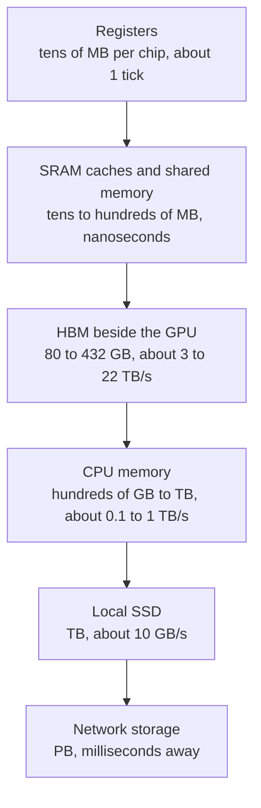
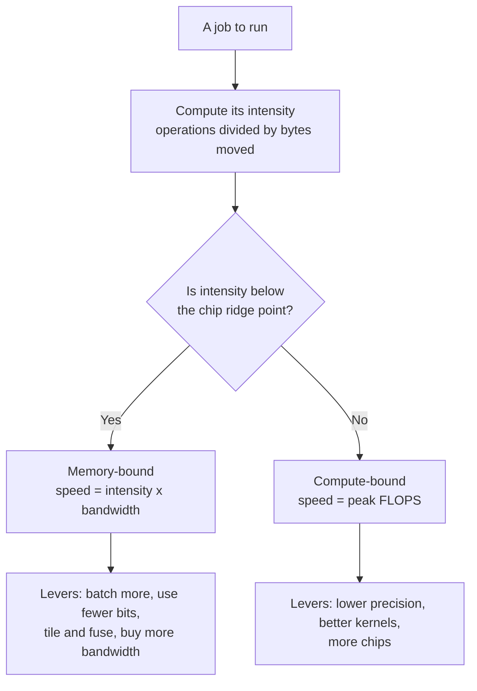
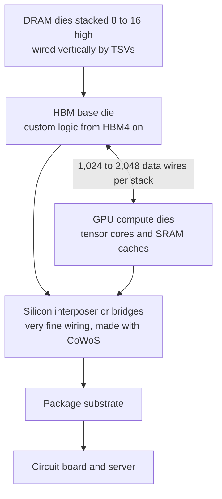
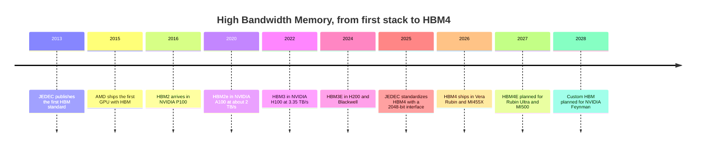
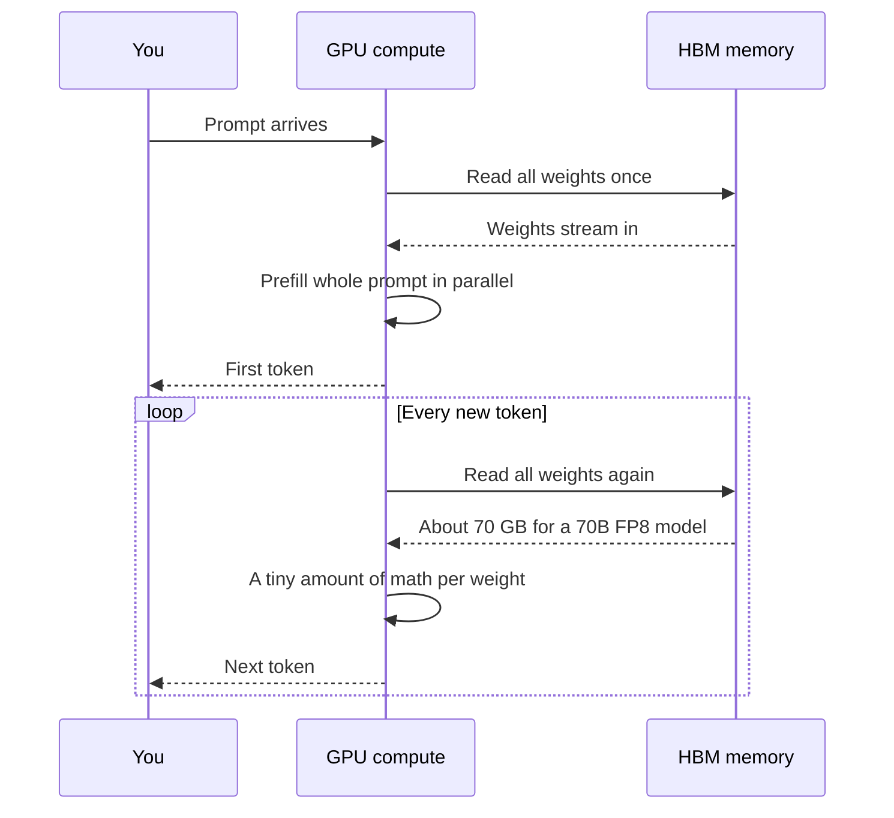
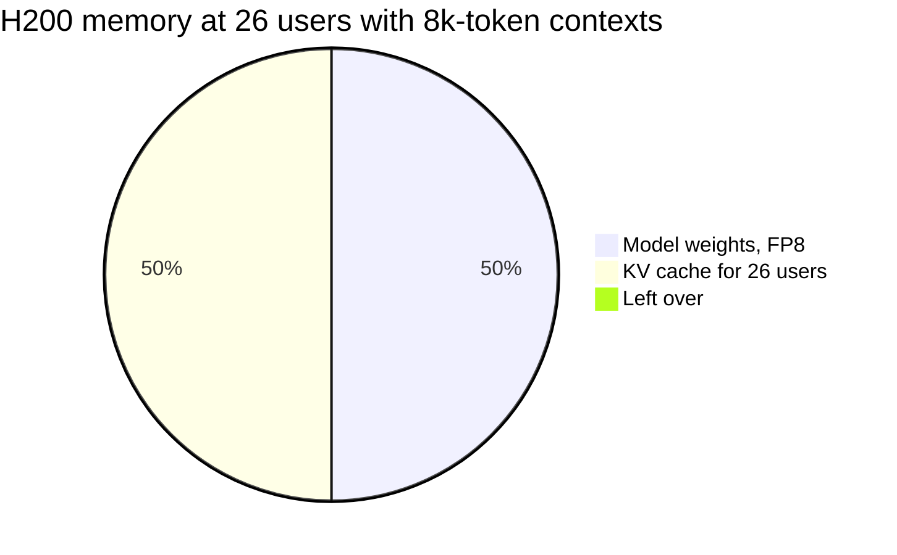
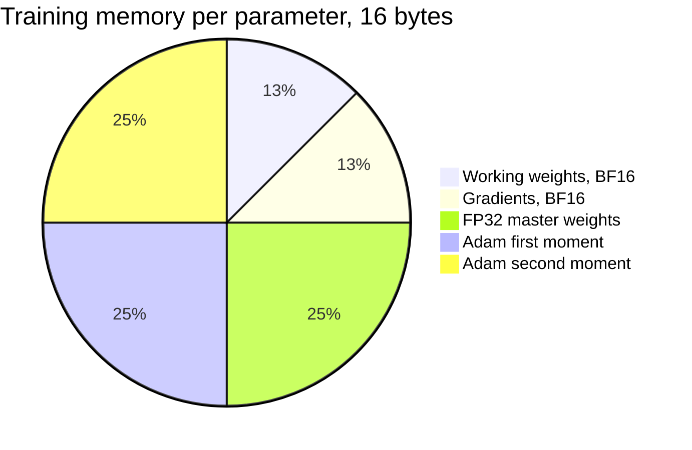
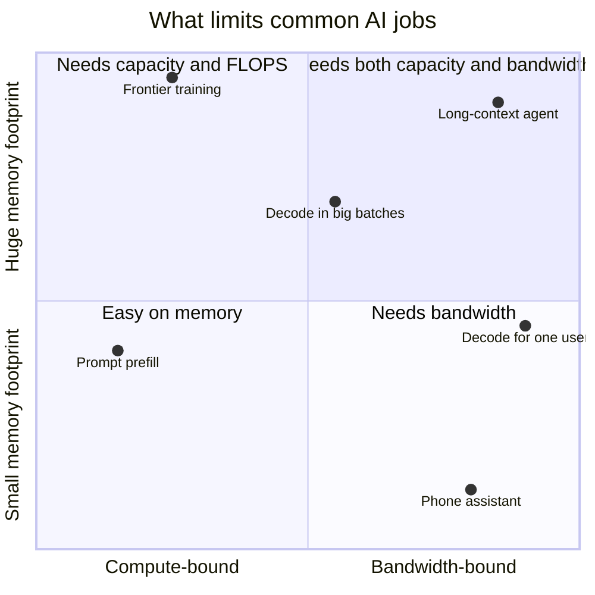

# Chapter 33: Memory and the Memory Wall

*This chapter explains why the speed of memory, not the speed of math, decides how fast your chatbot types, and teaches you to predict that speed yourself with a few lines of arithmetic.*

## What you'll learn

- The three numbers that describe any memory (capacity, bandwidth, latency) and the memory hierarchy from registers to network storage, with real sizes and speeds.
- Why moving a number costs far more energy and time than multiplying it.
- What the memory wall is, and why it has been getting worse for decades.
- How to compute arithmetic intensity and use the roofline model to tell whether a job is limited by compute or by memory, worked with real chip numbers.
- How HBM (High Bandwidth Memory) is built, its generations from HBM3E to HBM4 and HBM4E, who makes it, and why it is a bottleneck for the whole industry.
- Why generating text is memory-bound, and how to estimate tokens per second from bandwidth.
- How big the KV cache gets as you chat, and why training needs about 16 bytes of memory per parameter.

## Before you start

Chapter 32 (From Transistor to Accelerator: CPUs, GPUs, TPUs and FLOPs) is essential: it introduced FLOPs, tensor cores, systolic arrays and number precision, and it ended with the puzzle this chapter solves. Chapter 5 (The Math of AI, Part 1) gave the memory math "parameters × bytes per parameter." Chapter 15 (The Transformer, Piece by Piece) introduced the KV cache, and Chapter 23 (Inference: Making Models Fast and Cheap) covers the software tricks built on top of the hardware facts here. You can read this chapter without Chapters 15 and 23; we recap what we need.

## The waiting chef

At the end of Chapter 32 we found a puzzle. One token from a 70-billion-parameter model needs about 140 billion operations. An H100 GPU does about 989 trillion operations per second in 16-bit math, so the arithmetic for one token takes about 0.14 milliseconds. Yet a single user chatting with such a model on one GPU (on an 80 GB H100 that means 8-bit or 4-bit weights, since the 140 GB of 16-bit weights do not fit) sees tens of tokens per second, which is tens of milliseconds per token. The GPU spends more than 99% of its time not doing math.

What is it doing? Waiting. To produce each token, the model must use every one of its 70 billion weights, and those weights live in memory, not inside the tensor cores. Each token requires streaming the whole model from memory to the compute units. The math is fast; the delivery is slow.

> **Analogy:** Picture a chef who can chop ten times faster every few years while the pantry door only gets about a third wider. Eventually the chef spends most of the evening standing at the pantry door, waiting for ingredients. AI chips are that chef.

This is not a new problem. It is built into the basic design of nearly every computer since 1945.

> **Definition — Von Neumann architecture:** The basic design of almost every computer since John von Neumann described it in 1945: a processor that computes, a separate memory that stores both data and instructions, and a connection between them that everything must pass through.

> **Definition — Von Neumann bottleneck:** The slowdown caused by having to shuttle data back and forth between a separate processor and memory through a limited connection. It is the root of today's memory wall.

## Three numbers that describe any memory

Every kind of memory can be described with three numbers. Confusing them is the most common mistake in AI hardware discussions.

> **Definition — Memory capacity:** How many bytes a memory can hold, such as 80 GB on an H100 or 288 GB on a Rubin GPU. It decides which models and how much conversation fit.

> **Definition — Memory bandwidth:** How many bytes per second can move between memory and the processor, such as 3.35 TB/s on an H100. It is often the true limit on AI speed.

> **Definition — Memory latency:** How long it takes from asking for one piece of data until it arrives, measured in nanoseconds (billionths of a second). It matters most when you need one small item at a time.

> **Analogy:** Think of memory as a highway to a warehouse. Capacity is the size of the warehouse. Bandwidth is the number of lanes: how many trucks per hour can arrive. Latency is the length of the road: how long the first truck takes. A ten-lane highway that is a hundred kilometers long has huge bandwidth and terrible latency.

A worked example connects capacity and bandwidth. An H100 holds 80 GB and reads at 3.35 TB/s. Reading the whole memory once takes 80 GB ÷ 3,350 GB/s ≈ 0.024 seconds, or 24 milliseconds. So an H100 can sweep through its entire memory about 42 times per second, and no faster. Hold that number in mind: if a model fills the memory and every token needs the whole model, about 42 tokens per second is the speed limit, no matter how fast the tensor cores are.

## The memory hierarchy: desk, shelf, library, warehouse

No single kind of memory is big, fast and cheap all at once. So computers stack several kinds in layers.

> **Definition — Memory hierarchy:** The layered set of storage in a computer, from tiny and instant (registers) to huge and slow (disks and network storage). Each layer down is bigger, slower and cheaper per byte.

Here are the layers, from the top.

> **Definition — Register:** One of the small storage slots inside a processor core where numbers sit while being computed on. It is the fastest memory there is, readable in about one clock tick.

> **Definition — SRAM (static RAM):** Very fast memory built directly into the chip, using about six transistors per bit. It is used for caches and registers, and in some AI chips (Groq, Cerebras) as the main memory. It is expensive in chip area, so there is never much of it.

> **Definition — Cache:** A small SRAM store near the processing cores that automatically keeps recently used data close at hand. Chips have several levels: L1 (smallest, fastest, private to a core or SM) and L2 or L3 (larger, shared).

> **Definition — Shared memory:** On NVIDIA GPUs, a block of SRAM inside each streaming multiprocessor that the programmer controls directly. Fast kernels load tiles of matrices into it and reuse them many times before going back to main memory.

> **Definition — DRAM (dynamic RAM):** Dense, cheaper memory that stores each bit as a tiny electric charge in a capacitor guarded by one transistor. The charge leaks, so it must be refreshed many times per second. It is the main memory of computers and the material HBM is made from.

> **Definition — HBM (High Bandwidth Memory):** DRAM chips stacked vertically, 8 to 16 high, and placed right beside the processor with a very wide connection. It delivers terabytes per second and is the critical memory of AI accelerators.

> **Definition — LPDDR and GDDR:** Other kinds of DRAM. LPDDR is low-power memory used in phones, laptops and server CPUs like NVIDIA's Grace and Vera; GDDR is fast graphics memory used on gaming cards and some inference cards.

> **Definition — Unified memory:** A design, used in Apple silicon and NVIDIA's DGX Spark desktop, where the CPU and GPU share one pool of memory. It lets large models fit without copying data between separate memories.

> **Definition — SSD (solid-state drive):** Storage built from flash memory that keeps data when the power is off. It holds datasets and saved checkpoints and is far slower than DRAM.

Now the hierarchy for an H100-class AI server, with real numbers. Exact latencies vary by chip, so treat the latency column as orders of magnitude.

| Level | Typical size | Latency | Bandwidth | Everyday analogy |
|---|---|---|---|---|
| Registers | 256 KB per SM (about 33 MB across an H100's 132 SMs) | about one tick (under 1 ns) | the highest of all | the pencil in your hand |
| L1 cache and shared memory (SRAM) | 256 KB per SM | nanoseconds | tens of TB/s in total | your desk |
| L2 cache (SRAM) | about 50 MB on an H100 | tens of ns | very high | the shelf above your desk |
| HBM | 80 GB (H100) to 432 GB (MI455X) | hundreds of ns | 3.35 TB/s (H100) to about 20 TB/s (Rubin) | the bookshelf in your room |
| CPU memory (DDR5 or LPDDR5X) | hundreds of GB to over 1 TB per CPU | about 100 ns, plus the hop to the GPU | about 0.1–1 TB/s | the library downstairs |
| Local NVMe SSD | several TB | tens to about 100 µs | about 10 GB/s | a warehouse across town |
| Network storage | petabytes | milliseconds | varies | a warehouse in another city |

*Table 33.1: The memory hierarchy of an AI server. Each step down holds more but delivers it more slowly.*


*Figure 33.1: The memory hierarchy, fastest and smallest at the top. AI chips work hard to keep data as high up this ladder as possible.*

Bandwidth falls by orders of magnitude as you go down. On a log scale (each `########` block below is a factor of 10):

```
On-chip SRAM (~30 TB/s)  |####################################
HBM4, Rubin (~20 TB/s)   |##################################
HBM3, H100 (3.35 TB/s)   |############################
NVLink 5 (1.8 TB/s)      |##########################
CPU DRAM (~0.5 TB/s)     |######################
Laptop DDR5 (~100 GB/s)  |################
PCIe 5.0 x16 (64 GB/s)   |##############
NVMe SSD (~10 GB/s)      |########
                         +-------+-------+-------+-------+-------
                         1 GB/s  10      100     1 TB/s  10 TB/s
```
*Figure 33.2: Bandwidth of each level on a log scale. NVLink (the link to another GPU's memory, Chapter 34) and PCIe (the link from the CPU to the GPU) are included because data often has to cross them; NVIDIA's NVLink figure counts both directions together, while the PCIe figure is for one direction. The on-chip SRAM figure is a rough "tens of TB/s" order of magnitude.*

### Latency at human scale

Nanoseconds are hard to feel. Scale them up so that one nanosecond becomes one second. These are typical figures for a CPU system, widely used by engineers as rules of thumb:

| Event | Real time (roughly) | If 1 ns were 1 second |
|---|---|---|
| Read a register or L1 cache | about 1 ns | 1 second, a heartbeat |
| Read L2 cache | a few ns | a few seconds |
| Read main memory (DRAM) | about 100 ns | almost 2 minutes |
| Read from a fast SSD | about 100 µs | about 28 hours |
| Round trip to another server in the same data center | about 0.5 ms | almost 6 days |
| A packet across the Atlantic and back | about 150 ms | almost 5 years |

*Table 33.2: Latency at human scale. A trip to main memory is a coffee break; a trip to disk is a long weekend.*

GPUs have somewhat longer memory latencies than CPUs, but they hide them the way Chapter 32 described: while one warp waits for data, thousands of others work. That trick hides latency. It cannot create bandwidth. If every warp needs data and the pipe is full, everyone waits.

### Why not make all memory fast?

Because fast memory is big. An SRAM bit needs about six transistors; a DRAM bit needs one transistor and a capacitor, and DRAM is made on specialized processes that pack bits far more densely. That is why even giant chips carry only tens to hundreds of megabytes of SRAM, while HBM holds hundreds of gigabytes.

The extreme cases prove the point. Cerebras built a chip from an entire silicon wafer, 46,225 mm², and got 44 GB of on-wafer SRAM. Groq's 2026 LPU carries about 500 MB of SRAM per chip, so holding a 70-billion-parameter model at one byte per parameter takes about 70 GB ÷ 0.5 GB = 140 chips just for the weights. SRAM-only designs are blazingly fast but need many chips for big models.

> **Key idea:** Every AI chip is a trade between a little very fast memory and a lot of slower memory. Most of the art of AI performance is keeping the numbers you need in the small fast memory, and reusing them as many times as possible before fetching more.

## Moving data costs more than math

Time is one cost of moving data. Energy is the other, and it is even more lopsided.

> **Definition — Picojoule (pJ):** A trillionth of a joule, a unit of energy. A joule is roughly the energy to lift an apple one meter; chip operations are measured in picojoules.

Widely cited estimates from Stanford's Mark Horowitz (2014), for an older 45-nanometer chip process, put numbers on each operation:

| Operation (32-bit numbers) | Energy | Compared with a float multiply |
|---|---|---|
| Integer add | 0.1 pJ | 0.03× |
| Floating-point add | 0.9 pJ | 0.24× |
| Floating-point multiply | 3.7 pJ | 1× |
| Read from the register file | about 1 pJ | 0.27× |
| Read from a small on-chip SRAM cache | about 5 pJ | 1.4× |
| Read from off-chip DRAM | about 640 pJ | about 173× |

*Table 33.3: Energy per operation on a 45 nm chip (Horowitz, 2014). Modern chips use far less energy for everything, but the ratios still hold: fetching a number from off-chip memory costs on the order of a hundred times more than multiplying it.*

A worked example shows what this means. Imagine a chip doing 10^15 operations per second (about an H100's BF16 speed) where every operation needed one fresh 32-bit number:

- Fetched from off-chip DRAM at 640 pJ each: 10^15 × 640 × 10^-12 J = 640,000 watts. That is 640 kW, the power of a few hundred homes, for one chip.
- Fetched from on-chip SRAM at 5 pJ: 5,000 W.
- Fetched from registers at 1 pJ: 1,000 W.

An actual H100 draws at most 700 W for everything. Even with modern, more efficient circuits, the conclusion is unavoidable: almost every operand must come from registers or tiny local buffers and be reused many times. Only a small fraction of the data can make the long trip from HBM. That is exactly what tensor cores and systolic arrays (Chapter 32) are designed to achieve.

### Tiling: how software reuses data

The software half of the solution is called tiling.

> **Definition — Tiling:** Breaking a large matrix calculation into small blocks ("tiles") that fit in fast on-chip memory, and doing all the work on each tile before loading the next. It cuts the traffic to slow memory by roughly the tile size.

Take an 8,192 × 8,192 matrix multiply in 16-bit numbers on an H100:

- **The math:** 2 × 8,192³ ≈ 1.1 × 10^12 operations (8,192³ means 8,192 × 8,192 × 8,192). At 989 TFLOPS that takes about 1.1 ms.
- **A naive version** that fetched both inputs from HBM for every multiply-add would read 2 × 8,192³ numbers × 2 bytes ≈ 2.2 TB. At 3.35 TB/s that takes 0.66 seconds, 600 times longer than the math.
- **The ideal version** reads each of the three matrices from HBM exactly once: 3 × 8,192² × 2 bytes ≈ 403 MB, which takes 0.12 ms, less than the math. Now the chip is limited by compute, as it should be.

Tiling closes the gap between naive and ideal. With tiles of size T, each number is fetched from slow memory about T times less often. Real kernels tile at several levels at once (registers, shared memory, L2 cache), so the reuse factors multiply. The famous FlashAttention technique (Chapter 15) is tiling applied cleverly to the attention step, and its main benefit is fewer trips to HBM, not fewer operations.

## The memory wall

> **Definition — Memory wall:** The long-running trend in which processors' math speed grows much faster than memory's ability to feed them, so chips spend more and more of their time waiting on data. The term was coined by William Wulf and Sally McKee in 1995.

The numbers are stark. A 2024 study, "AI and Memory Wall" by Amir Gholami and colleagues, estimated that over about 20 years, peak compute per chip grew about 3.0× every two years, DRAM bandwidth about 1.6× every two years, and the links between chips about 1.4× every two years. Epoch AI separately measures GPU memory bandwidth growing about 28% per year since 2008.

Compound those rates over 20 years (ten two-year periods):

- Compute: 3.0^10 ≈ 59,000×
- Memory bandwidth: 1.6^10 ≈ 110×
- Interconnect: 1.4^10 ≈ 29×

Compute pulled ahead of memory bandwidth by a factor of about 500. Each new chip generation can do far more math per byte it can fetch. If the work does not reuse data heavily, the extra compute just sits idle.

> **Watch out:** "More memory means a faster chip" mixes up capacity and bandwidth. A GPU with twice the gigabytes but the same TB/s can hold a bigger model or more users, but it does not stream any single model faster. Always check both numbers.

> **Watch out:** "FLOPS is the number that matters" is the most common mistake in reading AI hardware news. For chatbot generation, memory bandwidth and capacity usually matter more. For big training runs, networking and reliability matter as much as raw FLOPS.

## Arithmetic intensity: how much math per byte

To decide whether a job will hit the memory wall, you need one number about the job.

> **Definition — Arithmetic intensity:** How many operations a calculation performs for each byte it moves from memory, measured in FLOP per byte. High intensity keeps the compute units busy; low intensity leaves them waiting.

Let us compute it for four jobs, all in 16-bit numbers (2 bytes each).

**1. Adding two long lists of numbers (`c = a + b`).** Each element needs 1 operation, and moves 6 bytes (read a, read b, write c). Intensity = 1 ÷ 6 ≈ 0.17 FLOP/byte. Hopeless: this job will always wait on memory.

**2. Generating one token for one user (matrix times vector).** Every weight is read once (2 bytes) and used for one multiply-add (2 operations). Intensity = 2 ÷ 2 = 1 FLOP/byte. Also memory-starved.

**3. Generating one token each for B users at once (batching).** The same weights are read once but used for B different users' vectors. Intensity ≈ 2B ÷ 2 = B FLOP/byte. With 64 users, about 64 FLOP/byte.

> **Definition — Batching:** Processing many requests together so that each read of the model's weights from memory is shared across all of them. It raises arithmetic intensity and total throughput.

**4. A big square matrix multiply (training, or reading a long prompt).** For two n × n matrices: 2n³ operations and, ideally, 3n² numbers moved (6n² bytes). Intensity = 2n³ ÷ 6n² = n ÷ 3 (n³ ÷ n² leaves a single n, because n × n × n divided by n × n is n, and 2 ÷ 6 is one-third). For n = 8,192 that is about 2,731 FLOP/byte. Plenty of math per byte.

Lower precision changes the bytes. With weights stored in FP8 (1 byte), job 2 becomes 2 FLOP/byte; in FP4 (half a byte), 4 FLOP/byte. Fewer bytes per weight means more math per byte moved.

## The roofline model, worked with numbers

Now combine the job's intensity with the chip's two limits. In 2009, Samuel Williams, Andrew Waterman and David Patterson at Berkeley published a simple picture for this that every performance engineer now uses.

> **Definition — Roofline model:** A chart that shows the highest speed a job can reach on a given chip, based on the job's arithmetic intensity. Speed is capped by memory bandwidth for low-intensity jobs (a sloped roof) and by peak compute for high-intensity jobs (a flat roof).

The whole model is one line:

`attainable FLOPS = the smaller of (peak FLOPS) and (arithmetic intensity × memory bandwidth)`

> **Definition — Ridge point:** The arithmetic intensity at which a chip's memory-bandwidth limit meets its compute limit: peak FLOPS divided by bandwidth. Jobs below it are memory-bound; jobs above it are compute-bound.

> **Definition — Memory-bound:** Limited mainly by how fast data can be fetched from memory. Making the math units faster does not help.

> **Definition — Compute-bound:** Limited mainly by how fast the chip can do arithmetic. Faster memory does not help.

### Worked example: the H100

The H100's ridge point is 989 × 10^12 FLOP/s ÷ 3.35 × 10^12 bytes/s ≈ 295 FLOP/byte. A job must do about 295 operations for every byte it fetches to keep the tensor cores fully busy. Now place our jobs on the roofline:

| Job | Intensity (FLOP/byte) | Memory limit (intensity × 3.35 TB/s) | Attainable | Share of peak |
|---|---|---|---|---|
| V: Add two lists | 0.17 | 0.56 TFLOPS | 0.56 TFLOPS | 0.06% |
| A: Decode, batch 1 (BF16 weights) | 1 | 3.35 TFLOPS | 3.35 TFLOPS | 0.3% |
| B: Decode, batch 32 | 32 | 107 TFLOPS | 107 TFLOPS | 11% |
| C: Decode, batch 256 | 256 | 858 TFLOPS | 858 TFLOPS | 87% |
| D: 8,192 × 8,192 matrix multiply | 2,731 | 9,149 TFLOPS | 989 TFLOPS (roof) | 100% |

*Table 33.4: Roofline arithmetic on an H100 (BF16). These are ceilings; real code lands below them.*

```
TFLOPS (log scale)
 1000 |                                  C=========D======
      |                              ....
      |                           ...
  100 |                        .B.
      |                    ....
      |                 ...
   10 |              ...
      |          A...
      |       ...
    1 |    ...
      |..V.
      |
  0.1 |
       +---------------------------------------------------
      0.1        1        10        100       1k        10k
        arithmetic intensity (FLOP per byte, log scale)
```
*Figure 33.3: The H100 roofline (BF16). The dotted slope is the memory limit (3.35 TB/s); the flat roof is the compute limit (989 TFLOPS); they meet at the ridge point, about 295 FLOP/byte. V = adding lists, A = decode for one user, B = decode for 32 users, C = decode for 256 users, D = a large matrix multiply.*

Three lessons come straight off the chart:

1. **Decode for one user uses about 0.3% of the chip.** That is the puzzle from Chapter 32, solved.
2. **Batching is the cure.** Serving 256 users at once moves almost the same bytes as serving one, but does 256 times the useful work. This is why AI providers batch requests aggressively, and why your chatbot's speed depends on how busy the service is.
3. **Training and prompt reading are compute-bound.** Big matrix multiplies sit on the flat roof. Faster memory helps them little; more FLOPS help a lot.

### Newer chips are even hungrier

Now repeat the exercise for NVIDIA's 2026 Rubin GPU at its 35 PFLOPS of dense NVFP4 and 19.2 TB/s: the ridge point is 35,000 ÷ 19.2 ≈ 1,823 FLOP/byte. With FP4 weights, decode for one user has intensity 4, so it reaches 4 × 19.2 = 77 TFLOPS out of 35,000: about 0.2%. To reach the ridge you would need a batch of about 1,823 ÷ 4 ≈ 456 users, since each extra user adds another 4 FLOP per byte. Lower precision gave the chip enormous compute, but bandwidth grew less, so the ridge moved right and even more batching is needed to use it.

Here are ridge points for real chips, using the vendor figures from Chapter 32:

| Chip | Peak compute (dense) | Bandwidth | Ridge point (FLOP/byte) |
|---|---|---|---|
| NVIDIA T4 (Colab's free GPU) | 65 TFLOPS FP16 | 0.32 TB/s | about 203 |
| NVIDIA H100 SXM | 989 TFLOPS BF16 | 3.35 TB/s | about 295 |
| NVIDIA H200 | 989 TFLOPS BF16 | 4.8 TB/s | about 206 |
| NVIDIA B300 | 15 PFLOPS FP4 | 8 TB/s | about 1,875 |
| NVIDIA Rubin | 4 PF BF16 / 35 PF NVFP4 | 19.2 TB/s | about 208 / 1,823 |
| AMD MI355X | 10.1 PFLOPS MXFP4 | 8 TB/s | about 1,263 |
| AMD MI455X | about 40 PFLOPS FP4 | 19.6–23.3 TB/s (AMD has cited both) | about 1,717–2,041 |
| Google Ironwood (TPU v7) | 4,614 TFLOPS FP8 | 7.37 TB/s | about 626 |
| Google TPU 8t (training) | 12.6 PFLOPS FP4 | 6.5 TB/s | about 1,938 |
| Google TPU 8i (inference) | 10.1 PFLOPS FP4 | 8.6 TB/s | about 1,174 |
| AWS Trainium3 | about 2.5 PFLOPS FP8 | 4.9 TB/s | about 510 |

*Table 33.5: Ridge points of real accelerators. Compare like with like: a ridge computed at FP4 should be compared with a job whose weights are also FP4.*

Look at two pairs. The H200 has exactly the H100's compute but 43% more bandwidth, so its ridge is lower: it is a better decode chip, which is why it was marketed for inference. Google's TPU 8i (inference) has less compute but more bandwidth than TPU 8t (training), so its ridge sits well to the left. Chip designers now tune the ridge point to the job.


*Figure 33.4: Using the roofline to decide what will make a job faster. The same job can be memory-bound on one chip and compute-bound on another.*

> **Try it:** Ask your chatbot: "An accelerator has 2,000 TFLOPS and 5 TB/s of bandwidth. A job does 50 FLOP per byte. Use the roofline model to find its attainable speed, and tell me how big a batch would make LLM decoding compute-bound if weights are FP8." Check the answer: 50 × 5 = 250 TFLOPS; the ridge is 400 FLOP/byte; FP8 decode does 2 FLOP per byte per user, so about 200 users.

## HBM: a skyscraper of memory next door

If bandwidth is the bottleneck, why not just add more memory chips? Because of wires.

### Why ordinary memory is not enough

A standard DDR5 memory module, the kind in a desktop PC, talks to the processor over a channel 64 bits wide. At 6.4 billion bits per second on each wire, that is 64 × 6.4 ÷ 8 = 51.2 GB/s per module. To match an H100's 3.35 TB/s you would need about 65 such modules, all crammed around one chip, each with its own set of wires across the circuit board. There is no room, the wires would be too long, and long wires burn energy and limit speed.

The answer is to go very wide and very short: thousands of wires, a few millimeters long, running to memory stacked right beside the processor.

### How HBM is built

An HBM stack is a small tower of DRAM dies, each thinned to a fraction of a millimeter, piled 8, 12 or 16 high.

> **Definition — TSV (through-silicon via):** A vertical wire drilled straight through a silicon die and filled with metal, connecting it to the dies above and below. Thousands of TSVs wire an HBM stack together like elevator shafts in a skyscraper.

> **Definition — Base die (logic die):** The bottom die of an HBM stack, which manages the stack and talks to the processor. From HBM4 onward it can be custom logic made at a chip foundry such as TSMC rather than at the memory maker.

The dies are joined by tiny solder bumps (microbumps) and the TSVs. The finished stack sits beside the GPU on a shared slab of silicon.

> **Definition — Interposer:** A thin slab of silicon (or organic material with small silicon bridges) with very fine wiring, on which the GPU dies and HBM stacks sit side by side. It carries thousands of connections between them over a few millimeters.

> **Definition — CoWoS (Chip-on-Wafer-on-Substrate):** TSMC's family of advanced packaging technologies that place GPU dies and HBM stacks side by side on an interposer, a thin slab with dense wiring. Its limited capacity has been a key bottleneck for AI chip supply since 2023.


*Figure 33.5: Inside an HBM-equipped GPU package. The memory stacks sit millimeters from the compute dies, connected by thousands of wires through the interposer.*

The magic number is the width of the connection. An HBM3 stack has a 1,024-bit interface, sixteen times a DDR5 module's 64 bits. HBM4, standardized by the industry body JEDEC in April 2025, doubles it to 2,048 bits.

> **Definition — JEDEC:** The industry standards organization that defines memory technologies such as DDR, LPDDR, GDDR and HBM, so that chips from different makers work together.

> **Analogy:** HBM is a skyscraper of memory built right next door to the office, joined by a 2,048-lane footbridge. Ordinary memory is a suburb across town reached by a two-lane road.

### The arithmetic of a stack

Bandwidth per stack is simply wires × speed per wire ÷ 8 bits per byte:

- **HBM3:** 1,024 wires × 6.4 Gb/s ÷ 8 = 819 GB/s per stack.
- **HBM4, as standardized:** 2,048 wires × 8 Gb/s ÷ 8 = 2,048 GB/s, about 2 TB/s per stack.
- **HBM4 as shipped in Rubin:** NVIDIA's 8 stacks deliver about 19–22 TB/s in total, which is about 2.4–2.75 TB/s per stack. Work backwards: 2.4 TB/s × 8 ÷ 2,048 wires ≈ 9.4 Gb/s per wire. Shipping parts run faster than the base standard.

Capacity works the same way. A B300 has 288 GB of HBM3E in 8 stacks, so 36 GB per stack; each stack is 12 dies high, so each DRAM die holds 3 GB. HBM4 allows up to 64 GB per stack (16 high), so 8 stacks could in principle carry 512 GB.

Short wires also save energy. Moving a bit a few millimeters across an interposer costs far less than driving it across a circuit board, which matters given Table 33.3.

### The beachfront problem

There is a geometric limit too.

> **Definition — Beachfront (shoreline):** The length of a chip's edge available for connections to memory and other chips. HBM stacks must sit along the edges of the compute die, so the perimeter limits how many stacks, and how much bandwidth, a package can have.

A single die cannot be larger than about 858 mm², the most a lithography machine can print in one exposure (the "reticle limit," Chapter 36). Its edge is therefore limited, and so is the number of HBM stacks that can touch it. NVIDIA's Blackwell and Rubin join two large dies and surround them with 8 stacks. To get more bandwidth, designers can make each wire faster, make the interface wider (HBM4's doubling), build bigger packages from several chiplets (smaller dies designed to be combined in one package, Chapter 34), or eventually stack memory directly on top of logic. NVIDIA has previewed "custom HBM" and reportedly 3D die stacking for its 2028 Feynman generation.

### The generations

| Generation | Interface width | Bandwidth per stack | Stack and capacity | Used in (examples) |
|---|---|---|---|---|
| HBM2e | 1,024-bit | (lower) | | NVIDIA A100 (40/80 GB, about 2 TB/s total) |
| HBM3 | 1,024-bit | 819 GB/s at 6.4 Gb/s per wire | | NVIDIA H100 (80 GB, 3.35 TB/s total) |
| HBM3E | 1,024-bit | about 1–1.2 TB/s | 8, 12 or 16 high; 24–48 GB per stack | H200, B200, B300, AMD MI355X, Google Ironwood, AWS Trainium3, Microsoft Maia 200 |
| HBM4 (JEDEC, April 2025) | 2,048-bit | up to 2 TB/s in the standard; about 2.4–2.75 TB/s as shipped in Rubin | 4 to 16 high; up to 64 GB per stack | NVIDIA Rubin (288 GB), AMD MI455X (432 GB) |
| HBM4E | | | | Samples reported in 2026; planned for Rubin Ultra and AMD MI500 in 2027 |

*Table 33.6: HBM generations and the accelerators that use them (late 2026). Blank cells are figures not covered in this book's sources.*


*Figure 33.6: HBM history. Bandwidth per GPU has grown from about 2 TB/s (A100) to about 20 TB/s (Rubin) in six years.*

> **Definition — HBM3E / HBM4 / HBM4E:** Successive generations of High Bandwidth Memory. HBM3E (about 1–1.2 TB/s per stack) powers most 2024–25 accelerators; HBM4 doubles the interface to 2,048 bits and powers 2026 chips such as NVIDIA Rubin and AMD MI455X; HBM4E is the planned 2027 follow-on.

### Who makes HBM, and why it is scarce

Only three companies make HBM in volume: **SK hynix** of South Korea, **Samsung**, also of South Korea, and **Micron** of the United States. SK hynix has been the market leader and NVIDIA's primary HBM supplier since HBM3; industry trackers put its share of 2025 shipments at roughly half or more, though estimates vary. With its results for the quarter ending July 2026, NVIDIA announced a multiyear memory alliance with SK hynix.

HBM is hard to make in quantity for several reasons:

- **It uses more silicon per bit.** HBM reportedly takes around three times the wafer area per bit of ordinary DRAM, because of the TSVs, the base die and lower density.
- **Stacking multiplies risk.** A stack is only good if every die in it is good. As an illustration, if each die has a 99% chance of being perfect, a 12-high stack has a 0.99^12 ≈ 89% chance, and a 16-high stack 0.99^16 ≈ 85%. Testing each die before stacking is essential and expensive.
- **It needs advanced packaging.** HBM is useless until it is mounted next to the GPU on an interposer, and TSMC's CoWoS capacity has itself been a bottleneck (Chapter 36).
- **It competes with ordinary memory.** Reports in 2025–26 described memory makers shifting capacity toward HBM, which tightened supply of ordinary DRAM, a so-called "memory supercycle." This is why the AI boom reached shoppers who never touch a data center: in December 2025 Micron, one of the three HBM makers, announced it would stop selling its Crucial-brand memory and storage to consumers after February 2026, saying that "the AI-driven growth in the data center has led to a surge in demand for memory and storage." The squeeze on PC memory is not a secret plot; it is factories steering limited capacity toward their biggest, most profitable customers, and relief depends on new memory factories coming online.

The result is that HBM is far more expensive per gigabyte than ordinary DRAM, ranks among the costliest parts of an AI accelerator, and the amount a chipmaker can secure caps how many accelerators it can ship. Memory has become geopolitical too: the United States restricted HBM exports to China in December 2024, and Huawei's Ascend 950 chips use HBM that Huawei developed itself.

> **At the frontier (2026):** HBM4 is the memory of 2026. NVIDIA's Rubin carries 288 GB of HBM4 per GPU at roughly 19–22 TB/s (NVIDIA's own figure moved from 22 TB/s at its CES 2026 launch to 19.2 TB/s on its current product page), and AMD's MI455X carries 432 GB at 19.6 TB/s or more (AMD's current product pages say up to 23.3 TB/s). The bigger shift is in the base die: with HBM4 it can be custom logic built at TSMC, so the bottom of the memory stack becomes part of the processor's design. NVIDIA says its 2028 Feynman generation will use "custom HBM."

## Why decode is memory-bound: predicting your chatbot's speed

Now we can explain, and predict, the speed you see when a chatbot types.

### Two phases of every answer

> **Definition — Prefill:** The first phase of answering a request, in which the model reads your entire prompt at once. Because all the prompt's tokens share each read of the weights, it is compute-heavy and highly parallel.

> **Definition — Decode:** The second phase, in which the model generates its answer one token at a time. Each step must read the model's weights from memory to produce just one token per user, so it is usually limited by memory bandwidth.

> **Definition — Time to first token (TTFT):** How long you wait before the first word of a response appears. It is set mainly by prefill, so it grows with the length of your prompt.

> **Definition — Tokens per second:** The speed of generation. "Per user" measures how fast one person sees text appear; "per GPU" measures the total output across everyone the chip is serving.

**Prefill, worked.** A 2,000-token prompt on a 70B model needs 2 × 70 × 10^9 × 2,000 = 2.8 × 10^14 operations. All 2,000 tokens share every weight read, so the intensity is high (around 2,000 FLOP/byte in BF16), well above the H100's ridge: compute-bound. At an H100's FP8 peak of about 1,979 TFLOPS it would take 0.14 seconds; at a realistic fraction of peak, a few tenths of a second. That is your time to first token, and why pasting a huge document makes the first word slower.

**Decode, worked.** For one user, each new token needs every weight once. So the ceiling is:

`tokens per second (one user) ≈ memory bandwidth ÷ bytes of weights read per token`

| Setup | Weight bytes per token | Bandwidth | Ceiling, one user |
|---|---|---|---|
| 70B model in FP8 on one H200 | 70 GB | 4.8 TB/s | 4,800 ÷ 70 ≈ 69 tokens/s |
| 70B in FP8 on one B300 | 70 GB | 8 TB/s | 8,000 ÷ 70 ≈ 114 tokens/s |
| 70B in FP8 on one Rubin | 70 GB | 19.2–22 TB/s | about 274–314 tokens/s |
| 70B in BF16 on two H100s, half the weights each | 70 GB per GPU | 3.35 TB/s each | 3,350 ÷ 70 ≈ 48 tokens/s |
| 8B model in 4-bit (about 4.7 GB file) on a typical laptop | 4.7 GB | about 120 GB/s | about 25 tokens/s |
| The same 8B model on Colab's free T4 GPU | 4.7 GB | 320 GB/s | about 68 tokens/s |

*Table 33.7: Upper bounds on single-user generation speed, from bandwidth alone. Real systems land noticeably below these ceilings because of the KV cache, communication between GPUs and other overheads.*

Notice what does not appear in this calculation: FLOPS. Doubling a chip's tensor-core speed would not change any row. Only more bandwidth, or fewer bytes per token, makes a single user's text appear faster.

> **Key idea:** For one user, tokens per second ≈ memory bandwidth ÷ bytes read per token. Memory speed is typing speed.


*Figure 33.7: Prefill reads the weights once for the whole prompt; decode reads them again for every single token. The loop is why memory bandwidth sets your chatbot's typing speed.*

> **Analogy:** Decode is like reading an entire encyclopedia to write one word, then reading it again for the next word. Batching is reading it once and writing the next word for 50 different people while you have it open.

### Three twists: experts, teams of GPUs and SRAM chips

**Mixture of experts.** Many 2026 frontier models only use a fraction of their parameters for each token (Chapter 17).

> **Definition — Mixture of experts (MoE):** A model design in which only a few of many sub-networks ("experts") are used for each token, so the total number of parameters can be huge while the work per token stays modest.

DeepSeek-V4-Pro, for example, has 1.6 trillion parameters in total but about 49 billion active per token. For decode bandwidth, what matters is the active weights: at one byte each, about 49 GB per token instead of 1.6 TB. But the whole model must still fit in memory: 1.6 trillion parameters at half a byte to one byte each is 0.8–1.6 TB, several 288 GB Rubin GPUs' worth before any KV cache. And in a batch, different users' tokens pick different experts, so a single step touches far more than 49 GB. MoE turns a bandwidth problem into a capacity problem, which is why such models are served across whole racks (Chapter 34 and Chapter 37).

**Teams of GPUs.** If a model's weights are split across 8 GPUs (tensor parallelism, Chapter 37), each GPU reads only its eighth per token, and their bandwidths add up. A 70 GB FP8 model on 8 H200s reads 8.75 GB per GPU per token, for a ceiling of 4,800 ÷ 8.75 ≈ 549 tokens/s, minus the time the GPUs spend exchanging results over NVLink.

**SRAM chips.** Groq's LPU and Cerebras's wafer-scale engine keep the weights in on-chip SRAM. Groq's 2026 LPU has about 150 TB/s of SRAM bandwidth per chip, nearly eight times Rubin's HBM, which is why these systems can generate thousands of tokens per second for a single user. The catch is capacity: hundreds of chips for a large model.

> **Watch out:** "A chip with twice the FLOPS will make my chatbot answer twice as fast" is usually false. For one user, generation speed is set by memory bandwidth and the number of bytes per token. More FLOPS shorten the wait for the first word (prefill), not the typing speed.

> **Try it:** Ask your chatbot for a 400-word answer and time, with your phone's stopwatch, how long the text takes to stream (not counting the pause before the first word). Tokens ≈ words × 1.3, so divide about 520 by the seconds. Then paste a long document before the same question and notice that the pause before the first word grows (prefill) while the streaming speed changes much less (decode).

## The KV cache: memory that grows while you talk

There is one more thing decode must read for every token: the conversation itself.

> **Definition — KV cache:** Memory that stores the "keys" and "values" the model computed for every earlier token in a conversation, so they need not be recomputed for each new token. It grows with the length of the conversation and with the number of users being served.

Chapter 15 explained where keys and values come from. Here is the hardware view. For every token in the context, every layer stores one key vector and one value vector for each of its key-value heads. So:

`KV bytes per token = 2 (keys and values) × layers × key-value heads × head size × bytes per number`

> **Definition — Grouped-query attention (GQA):** An attention design in which many query heads share a smaller number of key-value heads. It shrinks the KV cache by the sharing factor with little loss in quality.

### Worked example: a Llama-3-70B-style model

Meta's Llama 3 70B has 80 layers, 64 query heads but only 8 key-value heads (GQA), and a head size of 128. With 16-bit numbers:

`2 × 80 × 8 × 128 × 2 bytes = 327,680 bytes ≈ 0.33 MB per token`

| Conversation length | KV cache for one user |
|---|---|
| 1,000 tokens (a short chat) | 0.33 GB |
| 8,192 tokens (a long chat) | 2.7 GB |
| 128,000 tokens (a book-length document) | 42 GB |
| 1,000,000 tokens (a frontier-size context window) | 328 GB, more than one Rubin GPU's 288 GB |

*Table 33.8: KV cache size grows linearly with context. Without GQA (64 key-value heads instead of 8), every number would be 8 times bigger.*

> **Definition — Context window:** The maximum amount of text, measured in tokens, that a model can consider at once, including your prompt, the conversation, attached files and its own answer. Frontier models in late 2026 offer about 1 million tokens.

### Worked example: how many users fit on one GPU?

Take one H200 (141 GB, 4.8 TB/s) serving our 70B model in FP8 (70 GB), with every user at an 8,192-token context (2.7 GB of KV cache each, more precisely 2.68 GB).

1. **Capacity.** Memory left after the weights: 141 − 70 = 71 GB (in practice a few GB go to other buffers). Users that fit: 71 ÷ 2.68 ≈ 26.
2. **Bytes per decode step.** Weights once, plus every user's KV cache: 70 + 26 × 2.68 ≈ 140 GB.
3. **Step time.** 140 GB ÷ 4,800 GB/s ≈ 29 ms, so about 34 tokens/s per user.
4. **Total throughput.** 26 users × 34 tokens/s ≈ 890 tokens/s for the GPU.

Compare with one user alone: 70 + 2.68 ≈ 73 GB per step, about 15 ms, so about 66 tokens/s. Batching 26 users cut each person's speed roughly in half but multiplied the GPU's total output by about 13.

Now translate to money with the standard formula `$ per million tokens = $ per GPU-hour ÷ tokens per hour × 1,000,000`. RunPod listed the H200 at $3.59–5.29 per hour in October 2026. At 890 tokens/s (3.2 million tokens per hour), the GPU costs about $1.10–1.65 per million tokens generated. At 66 tokens/s (about 238,000 per hour), it costs about $15–22 per million. Same chip, same model, more than ten times the cost per token. This is why providers love big batches while users want speed, and why "fast modes" cost more (Chapter 23 and Chapter 43).


*Figure 33.8: The H200's 141 GB at full batch. At long contexts, the KV cache weighs as much as the model itself.*

Now give each user a 128,000-token document instead. Each needs 42 GB of KV cache, so only one such user fits beside the weights. Long contexts eat the memory that would otherwise serve dozens of people, which is why long-context requests are slower and pricier, and why so much research goes into shrinking the KV cache.

> **Watch out:** Your chatbot's "memory" feature, which remembers your name and preferences across chats, is not this. Those saved facts are ordinary text stored in a database and pasted into your next conversation. The KV cache is short-lived working memory on the GPU that exists only while a conversation is being processed (or briefly cached to save cost).

> **Definition — KV cache offloading:** Moving parts of the KV cache out of scarce HBM into larger, slower memory such as the CPU's DRAM or local SSDs, and bringing them back when needed. It trades some speed for much larger capacity.

Serving software also stores the KV cache in small pages so memory is not wasted (vLLM's PagedAttention), reuses the cache for repeated prompts (prompt caching), and quantizes it to FP8 to halve its size. Chapter 23 covers those techniques. On the hardware side, NVIDIA's Vera Rubin NVL72 rack carries up to 54 TB of LPDDR5X memory on its CPUs, a large and cheaper tier sitting just behind the HBM.

> **At the frontier (2026):** Labs are attacking the KV cache from every side. DeepSeek-V4 uses compressed and sparse attention that, according to its model card, needs only about 10% of the KV cache of its predecessor V3.2 at 1 million tokens. Moonshot's Kimi K3 makes 69 of its 93 layers "linear attention," which keeps a fixed-size memory instead of a cache that grows with every token. On the hardware side, NVIDIA positions its Groq 3 LPX racks to generate tokens at high speed while Vera Rubin GPUs hold the KV cache, and Google's TPU 8i triples on-chip SRAM to 384 MB.

## Training memory: about 16 bytes per parameter

Serving needs the weights plus the KV cache. Training needs much more, because the model must also remember how to improve itself.

> **Definition — Gradient:** For each parameter, the direction and size of the adjustment computed during training to reduce the error. There is one gradient number per parameter.

> **Definition — Optimizer state:** Extra numbers per parameter that the training algorithm keeps between steps. The popular Adam optimizer keeps two running averages per parameter, so its state is often larger than the model itself.

In standard mixed-precision training with Adam, each parameter needs:

| What is stored | Format | Bytes per parameter |
|---|---|---|
| Working weights | BF16 | 2 |
| Gradients | BF16 | 2 |
| Master copy of weights | FP32 | 4 |
| Adam first moment (running average of gradients) | FP32 | 4 |
| Adam second moment (running average of squared gradients) | FP32 | 4 |
| **Total, before activations** | | **16** |

*Table 33.9: Why training needs about 16 bytes per parameter.*


*Figure 33.9: Only an eighth of training memory is the model's working weights. Three quarters is FP32 bookkeeping.*

Worked examples:

- **70B parameters:** 70 × 10^9 × 16 bytes = 1.12 TB. That is at least 14 H100s (80 GB each), or 4 B300s (288 GB each), just to hold the state, before any data.
- **405B parameters (Llama 3.1 405B scale):** 6.48 TB, at least 81 H100s.
- **1 trillion parameters:** 16 TB. A whole GB300 NVL72 rack has 20 TB of HBM, and a Vera Rubin NVL72 rack 20.7 TB.

Then come the activations.

> **Definition — Activations:** The intermediate results computed at every layer during the forward pass, which training must keep until the backward pass uses them to compute gradients. Their size grows with batch size and sequence length and can rival everything else combined.

> **Definition — Activation checkpointing:** Saving only some activations and recomputing the rest during the backward pass. It trades extra compute (up to about one extra forward pass, roughly a third more work, since the forward pass is 2 of the 6 FLOPs per parameter per token) for much less memory.

No single GPU holds a frontier model's training state, so it is sharded across many.

> **Definition — ZeRO / FSDP:** Techniques (Microsoft DeepSpeed's ZeRO and PyTorch's Fully Sharded Data Parallel) that split ("shard") the weights, gradients and optimizer state across many GPUs so each holds only a slice, gathering pieces over the network when needed.

That is why training memory pulls in networking, the subject of Chapter 34, and parallelism strategies, the subject of Chapter 37. It is also why memory reliability matters: in Meta's published account of training Llama 3 405B on 16,384 H100s, HBM3 problems caused 17.2% of the 419 unexpected interruptions over 54 days.

> **Key idea:** Memory, not only speed, forces AI onto many chips. A model has to fit before it can run, and in training it has to fit about eight times over.

## Fighting the memory wall: the 2026 toolbox

Everything in AI hardware and systems software can be read as a response to this chapter. Here are the main levers.

| Lever | What it does | Examples (late 2026) |
|---|---|---|
| Faster, wider HBM | More bytes per second from main memory | HBM4 in Rubin and MI455X; HBM4E planned for 2027 |
| More on-chip SRAM | Keeps more data in the fastest memory | TPU 8i (384 MB), Maia 200 (272 MB), Groq LPU, Cerebras |
| Fewer bits per number | Fewer bytes to move for the same work | FP8 and FP4 weights; FP8 KV caches |
| Batching | Shares each weight read across many users | Continuous batching in vLLM and SGLang (Chapter 23) |
| Tiling and kernel fusion | Reuses data on-chip, skips round trips to HBM | FlashAttention; fused kernels from compilers |
| Smaller KV caches | Less to store and read per token | GQA, DeepSeek's MLA, compressed and sparse attention, linear-attention hybrids |
| Disaggregated serving | Puts prefill and decode on hardware suited to each | NVIDIA Dynamo; Vera Rubin with Groq 3 LPX |
| Memory tiers and offload | Adds cheaper capacity behind HBM | CPU LPDDR5X, local SSDs, CXL memory pools |
| Compute in or near memory | Moves the math to the data | d-Matrix's digital in-memory compute |
| 3D stacking | Puts memory directly on top of logic | Reported for NVIDIA Feynman (2028) |

*Table 33.10: How the industry fights the memory wall.*

> **Definition — Disaggregated serving:** Running the prefill and decode phases of inference on different machines, sometimes different kinds of chips, each tuned for its phase: high compute for prefill, high bandwidth for decode.

> **Definition — CXL (Compute Express Link):** An open standard, built on the PCIe connector, that lets processors attach and share extra memory. It allows servers to pool memory beyond what sits on their own boards.

> **Definition — Processing-in-memory:** Chip designs that place simple compute units inside or right next to memory arrays, so data does not have to travel to a distant processor. It is promising for memory-bound work but not yet mainstream for frontier AI.


*Figure 33.10: A rough map of AI workloads. Positions are qualitative. Chips are increasingly designed for one corner rather than all four, which is why 2026 brought separate training and inference chips.*

> **At the frontier (2026):** The memory wall is now shaping the whole industry's product lines. Google split TPU 8 into a training chip (8t: 12.6 PFLOPS FP4, 216 GB HBM, 6.5 TB/s) and an inference chip (8i: 10.1 PFLOPS FP4, 288 GB HBM, 8.6 TB/s, 384 MB SRAM). NVIDIA licensed Groq's SRAM-based technology and pairs Groq 3 LPX racks with Vera Rubin, claiming up to 35 times more throughput per megawatt at high interactivity, meaning a fast stream of tokens for each user (a vendor claim; Chapter 37). Open research problems include HBM beyond HBM4E, custom base dies, processing near memory, CXL memory pooling and better KV-cache compression.

## In plain English

An AI chip can now do math so fast that the hard part is getting numbers to it. Memory comes in layers: a tiny amount of very fast memory on the chip itself, a few hundred gigabytes of HBM stacked right next to it, and much larger but slower memory further away. Fetching a number from far away costs a hundred times more energy than multiplying it, so chips and software work hard to reuse every number many times once it arrives.

For decades, chips' math speed has grown much faster than memory speed. That gap is the memory wall. To see whether a job hits it, divide the math it does by the bytes it moves (its arithmetic intensity) and compare that with the chip's ridge point, its peak math speed divided by its memory bandwidth. Training and reading your prompt do lots of math per byte, so they run at full speed. Writing an answer one token at a time does almost no math per byte, because the whole model must be read from memory for every token. That is why your chatbot's typing speed is roughly the GPU's memory bandwidth divided by the size of the model: 4.8 TB/s ÷ 70 GB ≈ 69 tokens per second.

Providers fight back by serving many users at once, which shares each read of the model, but every user also needs a growing KV cache that can take as much memory as the model itself. Training is even hungrier, at about 16 bytes per parameter. HBM, made by only three companies and hard to manufacture, has become one of the tightest bottlenecks in the whole AI supply chain.

## Key terms

Von Neumann architecture, Von Neumann bottleneck, Memory capacity, Memory bandwidth, Memory latency, Memory hierarchy, Register, SRAM (static RAM), Cache, Shared memory, DRAM (dynamic RAM), HBM (High Bandwidth Memory), LPDDR and GDDR, Unified memory, SSD (solid-state drive), Picojoule (pJ), Tiling, Memory wall, Arithmetic intensity, Batching, Roofline model, Ridge point, Memory-bound, Compute-bound, TSV (through-silicon via), Base die (logic die), Interposer, CoWoS (Chip-on-Wafer-on-Substrate), JEDEC, Beachfront (shoreline), HBM3E / HBM4 / HBM4E, Prefill, Decode, Time to first token (TTFT), Tokens per second, Mixture of experts (MoE), KV cache, Grouped-query attention (GQA), Context window, KV cache offloading, Gradient, Optimizer state, Activations, Activation checkpointing, ZeRO / FSDP, Disaggregated serving, CXL (Compute Express Link), Processing-in-memory

## Exercises

1. **[Easy] The memory hierarchy at human scale.** Using Table 33.2's rule (1 nanosecond becomes 1 second), make your own version for an AI GPU. Use these rough figures: a register read about 0.5 ns, an HBM read about 500 ns, a hop to another GPU over NVLink about 1 µs, a read from a local SSD about 100 µs, a request to another building about 1 ms. Convert each to human time (seconds, minutes, hours, days) and write one sentence about what you could do in that time.
   **What you'll learn:** An intuitive feel for why chips go to such lengths to avoid leaving the chip.

2. **[Easy] Clock your chatbot.** Pick a chatbot you use daily.
   1. Ask for a 400-word essay on any topic. With a stopwatch, measure the seconds from the first word appearing to the last. Estimate tokens as words × 1.3 and compute tokens per second.
   2. Note the pause before the first word appeared (your time to first token).
   3. Now paste a long document (several thousand words) and ask a short question about it. Measure the pause before the first word again.
   4. If your chatbot offers a "fast" and a regular model, repeat with both.

   **What you'll learn:** How prefill (the pause) and decode (the streaming speed) show up in your own daily use, and that they respond differently to a long prompt.

3. **[Medium] Predict, then measure, your own computer's speed.** Install LM Studio (lmstudio.ai) or Ollama (ollama.com), both free and point-and-click.
   1. Download a model of about 8 billion parameters in 4-bit quantization and note its file size (around 4–5 GB).
   2. Look up your computer's memory bandwidth (Apple lists it on M-series spec pages, roughly 100–550 GB/s; typical DDR5 laptops have about 60–120 GB/s). If unsure, ask a chatbot with your exact model name.
   3. Predict: tokens/s ≈ bandwidth ÷ file size. For example, 120 GB/s ÷ 4.7 GB ≈ 25 tokens/s.
   4. Ask the model a question and read the tokens/s it reports. Then try a 1–3 billion parameter model and compare.

   **What you'll learn:** Generation speed is set by how fast weights stream from memory. You have just measured the memory wall on your own machine.

4. **[Medium] Draw two rooflines by hand.** On log-log graph paper (or a spreadsheet with log axes), draw the roofline for an H100 (989 TFLOPS BF16, 3.35 TB/s) and for a Rubin GPU (4 PFLOPS BF16 and 35 PFLOPS NVFP4, 19.2 TB/s).
   1. Compute each ridge point (peak ÷ bandwidth).
   2. Plot these jobs on both: decode at batch 1, 16 and 256 with BF16 weights (intensity = batch size); the same with FP4 weights on Rubin's FP4 roofline (intensity = 4 × batch size); and a 4,096 × 4,096 matrix multiply (intensity = 4,096 ÷ 3).
   3. For each, write "memory-bound" or "compute-bound" and the attainable TFLOPS.

   **What you'll learn:** How to read any chip against any job, and why newer, low-precision chips need ever larger batches to stay busy.

5. **[Medium] Watch a roofline appear on a real GPU (Colab).** Open colab.research.google.com, start a new notebook, and choose **Runtime → Change runtime type → T4 GPU**. Paste and run this code. It imitates decoding: a fixed "weight matrix" multiplied by a growing batch of users' vectors.

   ```python
   import time, torch                     # a stopwatch, and the GPU library

   N = 8192                               # the weight matrix is N x N
   W = torch.randn(N, N, device="cuda", dtype=torch.float16)  # 134 MB of 16-bit "weights" on the GPU

   print("batch  intensity  TFLOPS   GB/s")
   for B in [1, 2, 4, 8, 16, 32, 64, 128, 256, 512, 1024]:
       X = torch.randn(N, B, device="cuda", dtype=torch.float16)  # B users, one vector each
       for _ in range(3):
           Y = W @ X                      # warm-up runs, not timed
       torch.cuda.synchronize()           # make sure the GPU is idle
       t = time.time()
       for _ in range(100):
           Y = W @ X                      # 100 batched "decode steps"
       torch.cuda.synchronize()           # wait until all 100 have finished
       dt = (time.time() - t) / 100       # seconds per step
       flop = 2 * N * N * B               # one multiply-add per weight per user
       moved = 2 * (N * N + 2 * N * B)    # bytes: read W once, read X, write Y
       print(f"{B:5d}  {flop / moved:9.1f}  {flop / dt / 1e12:6.2f}  {moved / dt / 1e9:6.0f}")
   ```

   1. Look at the GB/s column for small batches. Compare it with the T4's spec-sheet bandwidth of about 320 GB/s. That is the sloped part of the roof.
   2. Look at the TFLOPS column. It should rise roughly in proportion to the batch at first, then level off. Where does it level off, and how does that compare with the T4's spec-sheet peak of about 65 TFLOPS (16-bit, tensor cores) and its ridge point of about 203 FLOP/byte?
   3. Plot TFLOPS against intensity on log-log axes in a spreadsheet. You have drawn a real roofline.

   **What you'll learn:** Batching turns a memory-bound job into a compute-bound one, and you can see the switch happen on real hardware.

6. **[Medium] Build a KV cache calculator.** In a spreadsheet, make columns for layers, key-value heads, head size, bytes per number and tokens, and a result column with the formula `= 2 × layers × kv_heads × head_size × bytes × tokens ÷ 1,000,000,000` (in GB). In the spreadsheet itself, use * for × and / for ÷ and point at the cells, for example `=2*A2*B2*C2*D2*E2/1000000000` if the five inputs are in columns A to E.
   1. Llama-3-70B-style: 80 layers, 8 key-value heads, head size 128, 2 bytes. Fill in 1,000, 8,192, 32,768, 128,000 and 1,000,000 tokens.
   2. Llama-3-8B-style: 32 layers, 8 key-value heads, head size 128, 2 bytes.
   3. Repeat the 70B case without GQA (64 key-value heads), and with an FP8 cache (1 byte).
   4. For each model, how many 8,192-token users fit in 100 GB of spare memory?

   **What you'll learn:** Why long contexts and many users eat GPU memory, and how much GQA and cache quantization save.

7. **[Medium] HBM arithmetic.** Use `bandwidth per stack = wires × gigabits per second per wire ÷ 8`.
   1. An HBM3E stack with 1,024 wires at 9.6 Gb/s per wire: what is its bandwidth? How many such stacks give 8 TB/s?
   2. An HBM4 stack with 2,048 wires at 10 Gb/s: what is its bandwidth? What do 8 stacks deliver?
   3. A 16-high HBM4 stack of 4 GB dies: what capacity per stack, and for 8 stacks?
   4. If each DRAM die is perfect with 98% probability, what fraction of 8-high, 12-high and 16-high stacks are perfect?

   **What you'll learn:** Where HBM's headline numbers come from, and why taller stacks are harder to manufacture.

8. **[Challenge] Plan a serving deployment.** You must serve a 70B model in FP8 (70 GB) to users with 8,192-token contexts (2.68 GB of BF16 KV cache each).
   1. On one H200 (141 GB, 4.8 TB/s): how many users fit, what is the per-user speed, and what is total throughput? (Check: about 26 users, 34 tokens/s each, about 890 tokens/s.)
   2. Repeat on one Rubin GPU (288 GB, 19.2 TB/s). (Check: about 81 users, about 67 tokens/s each, about 5,400 tokens/s.)
   3. Repeat the H200 case with an FP8 KV cache (1.34 GB per user).
   4. Using RunPod's October 2026 H200 price of $3.59–5.29 per hour, compute the cost per million tokens for each H200 case.

   **What you'll learn:** How memory capacity, bandwidth and batch size together set both the speed you feel and the price you pay.

9. **[Challenge] The training memory budget.** Using 16 bytes per parameter:
   1. Compute the training state for 8B, 70B, 405B and 1-trillion-parameter models.
   2. For each, find the minimum number of H100s (80 GB), B300s (288 GB) and Rubin GPUs (288 GB) just to hold that state.
   3. Now suppose activations add 50% on top. Redo step 2.
   4. Explain in two sentences why ZeRO/FSDP sharding is not optional for frontier models.

   **What you'll learn:** Memory, not just speed, forces training onto many GPUs, and that is the doorway to Chapter 37.

## Areas of opportunity

- **Inference optimization engineer.** Companies serving models at scale need people who manage KV caches, batching, quantization, speculative decoding and disaggregated serving with engines such as vLLM, SGLang, TensorRT-LLM and NVIDIA Dynamo. Because decode is memory-bound, each improvement shows up directly in cost per token, so the value is easy to prove, and demand is growing as inference outgrows training.
- **Kernel and performance engineering for memory-bound code.** Engineers who can profile where bytes go and write tiled, fused kernels (the FlashAttention style of thinking) save labs and clouds millions of dollars. Profilers (tools that record which operations run, for how long and when the chips sit idle), such as NVIDIA Nsight, and an understanding of rooflines are the core skills.
- **Memory-system research.** The memory wall is one of the field's central open problems: HBM beyond HBM4E, custom HBM base dies, processing near memory, CXL memory pooling, SRAM-heavy designs and better KV-cache compression all need researchers and engineers, at memory makers, chip companies, hyperscalers and startups.
- **Memory and packaging manufacturing.** SK hynix, Samsung and Micron, plus packaging houses, need process, test, TSV and stacking engineers and technicians. HBM supply directly caps how many AI accelerators the world can build, so these roles sit at a choke point of the industry.
- **Optimization consultancies.** Many organizations run GPUs at low utilization or serve models at batch size one. A consultant who can apply batching, quantization, caching and the right GPU choice can often cut bills dramatically, and clients can measure the savings.
- **KV-cache and long-context infrastructure.** Agents that work for hours with huge contexts need tiered KV storage, cache-aware routing and prompt-caching layers. Products that make long contexts cheaper have a large and growing market.
- **Edge and on-device AI.** Phones and laptops are bandwidth-limited. Specialists who choose model sizes, quantization levels and memory layouts so that a model runs well on a given device are needed by app makers and device makers alike.
- **Hardware market analysis and procurement.** Investors, cloud buyers and policy teams need people who understand that memory supply, not just chip design, determines who can ship accelerators, and who can read HBM and packaging news critically.

## Check your understanding

1. Explain the difference between memory capacity, bandwidth and latency. Which one mainly limits how fast one user's answer streams?
2. Why can't a chip simply use SRAM for all of its memory?
3. What is the arithmetic intensity of single-user decode with FP8 weights? Is it memory-bound on a chip whose ridge point is 600 FLOP/byte?
4. A GPU has 10 TB/s of bandwidth and runs a 50 GB model for one user. What is the ceiling on tokens per second? What happens to that ceiling if the chip's FLOPS double?
5. Why does batching raise a GPU's total throughput but lower each user's speed?
6. A model has 40 layers, 8 key-value heads and a head size of 128, with a 16-bit KV cache. How big is the KV cache for one user at 32,000 tokens?
7. Why are HBM stacks placed millimeters from the GPU on an interposer instead of on the circuit board like ordinary memory?
8. Why does training with Adam need about 16 bytes per parameter, and how many 80 GB GPUs are needed just to hold the training state of a 30-billion-parameter model?

<details><summary>Answers</summary>

1. Capacity is how much the memory holds, bandwidth is how many bytes per second it delivers, and latency is how long one request takes to come back. For one user's streaming speed, bandwidth is the main limit, because every token needs all the weights read again.
2. SRAM needs about six transistors per bit, so it takes far more chip area per byte than DRAM. Even a whole-wafer chip like Cerebras's WSE-3 holds only 44 GB of SRAM, while one GPU package carries hundreds of gigabytes of HBM.
3. Each weight is 1 byte and is used for 2 operations, so intensity is about 2 FLOP/byte. That is far below 600, so the job is heavily memory-bound.
4. 10,000 GB/s ÷ 50 GB = 200 tokens per second. Doubling the FLOPS does not change it, because single-user decode is limited by bandwidth, not math.
5. With a batch, each read of the weights serves many users, so the GPU produces far more tokens per second in total. But each step also has to read every user's KV cache, so steps take longer and each user's tokens arrive more slowly.
6. Per token: 2 × 40 × 8 × 128 × 2 = 163,840 bytes. Times 32,000 tokens ≈ 5.2 GB.
7. To get terabytes per second you need thousands of wires per stack (1,024 or 2,048). Thousands of long wires cannot be routed across a circuit board, and long wires waste energy and limit speed, so the memory sits beside the processor on a silicon interposer with very fine, very short wiring.
8. Two bytes each for BF16 weights and gradients, plus four bytes each for the FP32 master weights and Adam's two running averages: 2 + 2 + 4 + 4 + 4 = 16. For 30 billion parameters that is 480 GB, so at least 6 GPUs of 80 GB each, before activations.

</details>

## Going deeper

- **Samuel Williams, Andrew Waterman and David Patterson, "Roofline: An Insightful Visual Performance Model for Multicore Architectures" (Communications of the ACM, 2009).** The original roofline paper, short and clear.
- **Amir Gholami et al., "AI and Memory Wall" (2024, arxiv.org/abs/2403.14123).** The data on how compute outgrew memory and interconnect bandwidth, and what it means for AI models.
- **William Wulf and Sally McKee, "Hitting the Memory Wall: Implications of the Obvious" (1995).** The two-page paper that named the memory wall.
- **Mark Horowitz, "Computing's Energy Problem (and What We Can Do About It)" (ISSCC keynote, 2014).** The source of the famous energy-per-operation numbers showing that data movement dominates.
- **Google DeepMind, "How to Scale Your Model" (online book, 2025, jax-ml.github.io/scaling-book).** Its chapters on rooflines and Transformer inference work through exactly the arithmetic of this chapter on real TPUs and GPUs.
- **Reiner Pope et al., "Efficiently Scaling Transformer Inference" (2022).** Google's detailed analysis of memory, batching and latency trade-offs when serving large models.
- **Tri Dao et al., "FlashAttention: Fast and Memory-Efficient Exact Attention with IO-Awareness" (2022).** A landmark example of beating the memory wall with tiling.
- **Woosuk Kwon et al., "Efficient Memory Management for Large Language Model Serving with PagedAttention" (2023).** The vLLM paper on managing KV-cache memory.
- **Samyam Rajbhandari et al., "ZeRO: Memory Optimizations Toward Training Trillion Parameter Models" (2020).** How training state is sharded across GPUs.
- **Wikipedia, "High Bandwidth Memory."** A well-maintained summary of HBM generations, standards and specifications.
