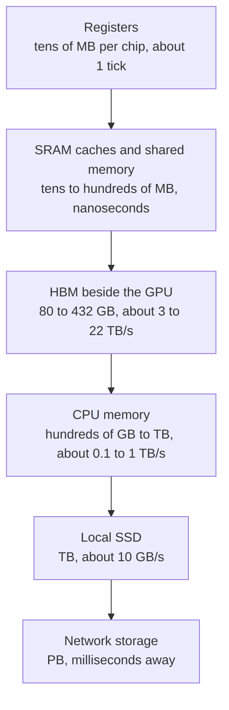
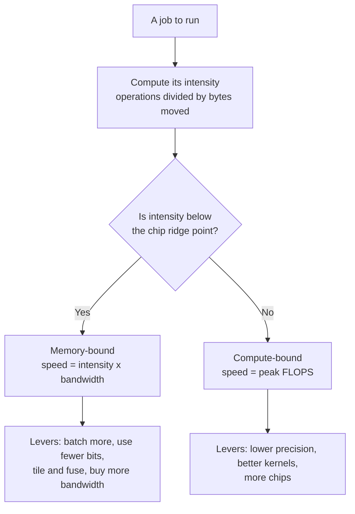

# Chapter 33: Memory and the Memory Wall

*This chapter explains why the speed of memory, not the speed of math, decides how fast your chatbot types, and teaches you to predict that speed yourself with a few lines of arithmetic.*

## What you'll learn

- The three numbers that describe any memory (capacity, bandwidth, latency) and the memory hierarchy from registers to network storage, with real sizes and speeds.
- Why moving a number costs far more energy and time than multiplying it.
- What the memory wall is, and why it has been getting worse for decades.
- How to compute arithmetic intensity and use the roofline model to tell whether a job is limited by compute or by memory, worked with real chip numbers.
- How HBM (High Bandwidth Memory) is built, its generations from HBM3E to HBM4 and HBM4E, who makes it, and why it is a bottleneck for the whole industry.
- Why generating text is memory-bound, and how to estimate tokens per second from bandwidth.
- How big the KV cache gets as you chat, and why training needs about 16 bytes of memory per parameter.

## Before you start

Chapter 32 (From Transistor to Accelerator: CPUs, GPUs, TPUs and FLOPs) is essential: it introduced FLOPs, tensor cores, systolic arrays and number precision, and it ended with the puzzle this chapter solves. Chapter 5 (The Math of AI, Part 1) gave the memory math "parameters × bytes per parameter." Chapter 15 (The Transformer, Piece by Piece) introduced the KV cache, and Chapter 23 (Inference: Making Models Fast and Cheap) covers the software tricks built on top of the hardware facts here. You can read this chapter without Chapters 15 and 23; we recap what we need.

## The waiting chef

At the end of Chapter 32 we found a puzzle. One token from a 70-billion-parameter model needs about 140 billion operations. An H100 GPU does about 989 trillion operations per second in 16-bit math, so the arithmetic for one token takes about 0.14 milliseconds. Yet a single user chatting with such a model on one GPU sees tens of tokens per second, which is tens of milliseconds per token. The GPU spends more than 99% of its time not doing math.

What is it doing? Waiting. To produce each token, the model must use every one of its 70 billion weights, and those weights live in memory, not inside the tensor cores. Each token requires streaming the whole model from memory to the compute units. The math is fast; the delivery is slow.

> **Analogy:** Picture a chef who can chop ten times faster every few years while the pantry door only gets about a third wider. Eventually the chef spends most of the evening standing at the pantry door, waiting for ingredients. AI chips are that chef.

This is not a new problem. It is built into the basic design of nearly every computer since 1945.

> **Definition — Von Neumann architecture:** The basic design of almost every computer since John von Neumann described it in 1945: a processor that computes, a separate memory that stores both data and instructions, and a connection between them that everything must pass through.

> **Definition — Von Neumann bottleneck:** The slowdown caused by having to shuttle data back and forth between a separate processor and memory through a limited connection. It is the root of today's memory wall.

## Three numbers that describe any memory

Every kind of memory can be described with three numbers. Confusing them is the most common mistake in AI hardware discussions.

> **Definition — Memory capacity:** How many bytes a memory can hold, such as 80 GB on an H100 or 288 GB on a Rubin GPU. It decides which models and how much conversation fit.

> **Definition — Memory bandwidth:** How many bytes per second can move between memory and the processor, such as 3.35 TB/s on an H100. It is often the true limit on AI speed.

> **Definition — Memory latency:** How long it takes from asking for one piece of data until it arrives, measured in nanoseconds (billionths of a second). It matters most when you need one small item at a time.

> **Analogy:** Think of memory as a highway to a warehouse. Capacity is the size of the warehouse. Bandwidth is the number of lanes: how many trucks per hour can arrive. Latency is the length of the road: how long the first truck takes. A ten-lane highway that is a hundred kilometers long has huge bandwidth and terrible latency.

A worked example connects capacity and bandwidth. An H100 holds 80 GB and reads at 3.35 TB/s. Reading the whole memory once takes 80 GB ÷ 3,350 GB/s ≈ 0.024 seconds, or 24 milliseconds. So an H100 can sweep through its entire memory about 42 times per second, and no faster. Hold that number in mind: if a model fills the memory and every token needs the whole model, about 42 tokens per second is the speed limit, no matter how fast the tensor cores are.

## The memory hierarchy: desk, shelf, library, warehouse

No single kind of memory is big, fast and cheap all at once. So computers stack several kinds in layers.

> **Definition — Memory hierarchy:** The layered set of storage in a computer, from tiny and instant (registers) to huge and slow (disks and network storage). Each layer down is bigger, slower and cheaper per byte.

Here are the layers, from the top.

> **Definition — Register:** One of the small storage slots inside a processor core where numbers sit while being computed on. It is the fastest memory there is, readable in about one clock tick.

> **Definition — SRAM (static RAM):** Very fast memory built directly into the chip, using about six transistors per bit. It is used for caches and registers, and in some AI chips (Groq, Cerebras) as the main memory. It is expensive in chip area, so there is never much of it.

> **Definition — Cache:** A small SRAM store near the processing cores that automatically keeps recently used data close at hand. Chips have several levels: L1 (smallest, fastest, private to a core or SM) and L2 or L3 (larger, shared).

> **Definition — Shared memory:** On NVIDIA GPUs, a block of SRAM inside each streaming multiprocessor that the programmer controls directly. Fast kernels load tiles of matrices into it and reuse them many times before going back to main memory.

> **Definition — DRAM (dynamic RAM):** Dense, cheaper memory that stores each bit as a tiny electric charge in a capacitor guarded by one transistor. The charge leaks, so it must be refreshed many times per second. It is the main memory of computers and the material HBM is made from.

> **Definition — HBM (High Bandwidth Memory):** DRAM chips stacked vertically, 8 to 16 high, and placed right beside the processor with a very wide connection. It delivers terabytes per second and is the critical memory of AI accelerators.

> **Definition — LPDDR and GDDR:** Other kinds of DRAM. LPDDR is low-power memory used in phones, laptops and server CPUs like NVIDIA's Grace and Vera; GDDR is fast graphics memory used on gaming cards and some inference cards.

> **Definition — Unified memory:** A design, used in Apple silicon and NVIDIA's DGX Spark desktop, where the CPU and GPU share one pool of memory. It lets large models fit without copying data between separate memories.

> **Definition — SSD (solid-state drive):** Storage built from flash memory that keeps data when the power is off. It holds datasets and saved checkpoints and is far slower than DRAM.

Now the hierarchy for an H100-class AI server, with real numbers. Exact latencies vary by chip, so treat the latency column as orders of magnitude.

| Level | Typical size | Latency | Bandwidth | Everyday analogy |
|---|---|---|---|---|
| Registers | 256 KB per SM (about 33 MB across an H100's 132 SMs) | about one tick (under 1 ns) | the highest of all | the pencil in your hand |
| L1 cache and shared memory (SRAM) | 256 KB per SM | nanoseconds | tens of TB/s in total | your desk |
| L2 cache (SRAM) | about 50 MB on an H100 | tens of ns | very high | the shelf above your desk |
| HBM | 80 GB (H100) to 432 GB (MI455X) | hundreds of ns | 3.35 TB/s (H100) to about 20 TB/s (Rubin) | the bookshelf in your room |
| CPU memory (DDR5 or LPDDR5X) | hundreds of GB to over 1 TB per CPU | about 100 ns, plus the hop to the GPU | about 0.1–1 TB/s | the library downstairs |
| Local NVMe SSD | several TB | tens to about 100 µs | about 10 GB/s | a warehouse across town |
| Network storage | petabytes | milliseconds | varies | a warehouse in another city |

*Table 33.1: The memory hierarchy of an AI server. Each step down holds more but delivers it more slowly.*


*Figure 33.1: The memory hierarchy, fastest and smallest at the top. AI chips work hard to keep data as high up this ladder as possible.*

Bandwidth falls by orders of magnitude as you go down. On a log scale (each `########` block below is a factor of 10):

```
On-chip SRAM (~30 TB/s)  |####################################
HBM4, Rubin (~20 TB/s)   |##################################
HBM3, H100 (3.35 TB/s)   |############################
NVLink 5 (1.8 TB/s)      |##########################
CPU DRAM (~0.5 TB/s)     |######################
Laptop DDR5 (~100 GB/s)  |################
PCIe 5.0 x16 (64 GB/s)   |##############
NVMe SSD (~10 GB/s)      |########
                         +-------+-------+-------+-------+-------
                         1 GB/s  10      100     1 TB/s  10 TB/s
```
*Figure 33.2: Bandwidth of each level on a log scale. NVLink (the link to another GPU's memory, Chapter 34) and PCIe (the link from the CPU to the GPU) are included because data often has to cross them. The on-chip SRAM figure is a rough "tens of TB/s" order of magnitude.*

### Latency at human scale

Nanoseconds are hard to feel. Scale them up so that one nanosecond becomes one second. These are typical figures for a CPU system, widely used by engineers as rules of thumb:

| Event | Real time (roughly) | If 1 ns were 1 second |
|---|---|---|
| Read a register or L1 cache | about 1 ns | 1 second, a heartbeat |
| Read L2 cache | a few ns | a few seconds |
| Read main memory (DRAM) | about 100 ns | almost 2 minutes |
| Read from a fast SSD | about 100 µs | about 28 hours |
| Round trip to another server in the same data center | about 0.5 ms | almost 6 days |
| A packet across the Atlantic and back | about 150 ms | almost 5 years |

*Table 33.2: Latency at human scale. A trip to main memory is a coffee break; a trip to disk is a long weekend.*

GPUs have somewhat longer memory latencies than CPUs, but they hide them the way Chapter 32 described: while one warp waits for data, thousands of others work. That trick hides latency. It cannot create bandwidth. If every warp needs data and the pipe is full, everyone waits.

### Why not make all memory fast?

Because fast memory is big. An SRAM bit needs about six transistors; a DRAM bit needs one transistor and a capacitor, and DRAM is made on specialized processes that pack bits far more densely. That is why even giant chips carry only tens to hundreds of megabytes of SRAM, while HBM holds hundreds of gigabytes.

The extreme cases prove the point. Cerebras built a chip from an entire silicon wafer, 46,225 mm², and got 44 GB of on-wafer SRAM. Groq's 2026 LPU carries about 500 MB of SRAM per chip, so holding a 70-billion-parameter model at one byte per parameter takes about 70 GB ÷ 0.5 GB = 140 chips just for the weights. SRAM-only designs are blazingly fast but need many chips for big models.

> **Key idea:** Every AI chip is a trade between a little very fast memory and a lot of slower memory. Most of the art of AI performance is keeping the numbers you need in the small fast memory, and reusing them as many times as possible before fetching more.

## Moving data costs more than math

Time is one cost of moving data. Energy is the other, and it is even more lopsided.

> **Definition — Picojoule (pJ):** A trillionth of a joule, a unit of energy. A joule is roughly the energy to lift an apple one meter; chip operations are measured in picojoules.

Widely cited estimates from Stanford's Mark Horowitz (2014), for an older 45-nanometer chip process, put numbers on each operation:

| Operation (32-bit numbers) | Energy | Compared with a float multiply |
|---|---|---|
| Integer add | 0.1 pJ | 0.03× |
| Floating-point add | 0.9 pJ | 0.24× |
| Floating-point multiply | 3.7 pJ | 1× |
| Read from the register file | about 1 pJ | 0.27× |
| Read from a small on-chip SRAM cache | about 5 pJ | 1.4× |
| Read from off-chip DRAM | about 640 pJ | about 173× |

*Table 33.3: Energy per operation on a 45 nm chip (Horowitz, 2014). Modern chips use far less energy for everything, but the ratios still hold: fetching a number from off-chip memory costs on the order of a hundred times more than multiplying it.*

A worked example shows what this means. Imagine a chip doing 10^15 operations per second (about an H100's BF16 speed) where every operation needed one fresh 32-bit number:

- Fetched from off-chip DRAM at 640 pJ each: 10^15 × 640 × 10^-12 J = 640,000 watts. That is 640 kW, the power of a few hundred homes, for one chip.
- Fetched from on-chip SRAM at 5 pJ: 5,000 W.
- Fetched from registers at 1 pJ: 1,000 W.

An actual H100 draws at most 700 W for everything. Even with modern, more efficient circuits, the conclusion is unavoidable: almost every operand must come from registers or tiny local buffers and be reused many times. Only a small fraction of the data can make the long trip from HBM. That is exactly what tensor cores and systolic arrays (Chapter 32) are designed to achieve.

### Tiling: how software reuses data

The software half of the solution is called tiling.

> **Definition — Tiling:** Breaking a large matrix calculation into small blocks ("tiles") that fit in fast on-chip memory, and doing all the work on each tile before loading the next. It cuts the traffic to slow memory by roughly the tile size.

Take an 8,192 × 8,192 matrix multiply in 16-bit numbers on an H100:

- **The math:** 2 × 8,192³ ≈ 1.1 × 10^12 operations. At 989 TFLOPS that takes about 1.1 ms.
- **A naive version** that fetched both inputs from HBM for every multiply-add would read 2 × 8,192³ numbers × 2 bytes ≈ 2.2 TB. At 3.35 TB/s that takes 0.66 seconds, 600 times longer than the math.
- **The ideal version** reads each of the three matrices from HBM exactly once: 3 × 8,192² × 2 bytes ≈ 403 MB, which takes 0.12 ms, less than the math. Now the chip is limited by compute, as it should be.

Tiling closes the gap between naive and ideal. With tiles of size T, each number is fetched from slow memory about T times less often. Real kernels tile at several levels at once (registers, shared memory, L2 cache), so the reuse factors multiply. The famous FlashAttention technique (Chapter 15) is tiling applied cleverly to the attention step, and its main benefit is fewer trips to HBM, not fewer operations.

## The memory wall

> **Definition — Memory wall:** The long-running trend in which processors' math speed grows much faster than memory's ability to feed them, so chips spend more and more of their time waiting on data. The term was coined by William Wulf and Sally McKee in 1995.

The numbers are stark. A 2024 study, "AI and Memory Wall" by Amir Gholami and colleagues, estimated that over about 20 years, peak compute per chip grew about 3.0× every two years, DRAM bandwidth about 1.6× every two years, and the links between chips about 1.4× every two years. Epoch AI separately measures GPU memory bandwidth growing about 28% per year since 2008.

Compound those rates over 20 years (ten two-year periods):

- Compute: 3.0^10 ≈ 59,000×
- Memory bandwidth: 1.6^10 ≈ 110×
- Interconnect: 1.4^10 ≈ 29×

Compute pulled ahead of memory bandwidth by a factor of about 500. Each new chip generation can do far more math per byte it can fetch. If the work does not reuse data heavily, the extra compute just sits idle.

> **Watch out:** "FLOPS is the number that matters" is the most common mistake in reading AI hardware news. For chatbot generation, memory bandwidth and capacity usually matter more. For big training runs, networking and reliability matter as much as raw FLOPS.

## Arithmetic intensity: how much math per byte

To decide whether a job will hit the memory wall, you need one number about the job.

> **Definition — Arithmetic intensity:** How many operations a calculation performs for each byte it moves from memory, measured in FLOP per byte. High intensity keeps the compute units busy; low intensity leaves them waiting.

Let us compute it for four jobs, all in 16-bit numbers (2 bytes each).

**1. Adding two long lists of numbers (`c = a + b`).** Each element needs 1 operation, and moves 6 bytes (read a, read b, write c). Intensity = 1 ÷ 6 ≈ 0.17 FLOP/byte. Hopeless: this job will always wait on memory.

**2. Generating one token for one user (matrix times vector).** Every weight is read once (2 bytes) and used for one multiply-add (2 operations). Intensity = 2 ÷ 2 = 1 FLOP/byte. Also memory-starved.

**3. Generating one token each for B users at once (batching).** The same weights are read once but used for B different users' vectors. Intensity ≈ 2B ÷ 2 = B FLOP/byte. With 64 users, about 64 FLOP/byte.

> **Definition — Batching:** Processing many requests together so that each read of the model's weights from memory is shared across all of them. It raises arithmetic intensity and total throughput.

**4. A big square matrix multiply (training, or reading a long prompt).** For two n × n matrices: 2n³ operations and, ideally, 3n² numbers moved (6n² bytes). Intensity = 2n³ ÷ 6n² = n ÷ 3. For n = 8,192 that is about 2,731 FLOP/byte. Plenty of math per byte.

Lower precision changes the bytes. With weights stored in FP8 (1 byte), job 2 becomes 2 FLOP/byte; in FP4 (half a byte), 4 FLOP/byte. Fewer bytes per weight means more math per byte moved.

## The roofline model, worked with numbers

Now combine the job's intensity with the chip's two limits. In 2009, Samuel Williams, Andrew Waterman and David Patterson at Berkeley published a simple picture for this that every performance engineer now uses.

> **Definition — Roofline model:** A chart that shows the highest speed a job can reach on a given chip, based on the job's arithmetic intensity. Speed is capped by memory bandwidth for low-intensity jobs (a sloped roof) and by peak compute for high-intensity jobs (a flat roof).

The whole model is one line:

`attainable FLOPS = the smaller of (peak FLOPS) and (arithmetic intensity × memory bandwidth)`

> **Definition — Ridge point:** The arithmetic intensity at which a chip's memory-bandwidth limit meets its compute limit: peak FLOPS divided by bandwidth. Jobs below it are memory-bound; jobs above it are compute-bound.

> **Definition — Memory-bound:** Limited mainly by how fast data can be fetched from memory. Making the math units faster does not help.

> **Definition — Compute-bound:** Limited mainly by how fast the chip can do arithmetic. Faster memory does not help.

### Worked example: the H100

The H100's ridge point is 989 × 10^12 FLOP/s ÷ 3.35 × 10^12 bytes/s ≈ 295 FLOP/byte. A job must do about 295 operations for every byte it fetches to keep the tensor cores fully busy. Now place our jobs on the roofline:

| Job | Intensity (FLOP/byte) | Memory limit (intensity × 3.35 TB/s) | Attainable | Share of peak |
|---|---|---|---|---|
| V: Add two lists | 0.17 | 0.56 TFLOPS | 0.56 TFLOPS | 0.06% |
| A: Decode, batch 1 (BF16 weights) | 1 | 3.35 TFLOPS | 3.35 TFLOPS | 0.3% |
| B: Decode, batch 32 | 32 | 107 TFLOPS | 107 TFLOPS | 11% |
| C: Decode, batch 256 | 256 | 858 TFLOPS | 858 TFLOPS | 87% |
| D: 8,192 × 8,192 matrix multiply | 2,731 | 9,149 TFLOPS | 989 TFLOPS (roof) | 100% |

*Table 33.4: Roofline arithmetic on an H100 (BF16). These are ceilings; real code lands below them.*

```
TFLOPS (log scale)
 1000 |                                  C=========D======
      |                              ....
      |                           ...
  100 |                        .B.
      |                    ....
      |                 ...
   10 |              ...
      |          A...
      |       ...
    1 |    ...
      |..V.
      |
  0.1 |
       +---------------------------------------------------
      0.1        1        10        100       1k        10k
        arithmetic intensity (FLOP per byte, log scale)
```
*Figure 33.3: The H100 roofline (BF16). The dotted slope is the memory limit (3.35 TB/s); the flat roof is the compute limit (989 TFLOPS); they meet at the ridge point, about 295 FLOP/byte. V = adding lists, A = decode for one user, B = decode for 32 users, C = decode for 256 users, D = a large matrix multiply.*

Three lessons come straight off the chart:

1. **Decode for one user uses about 0.3% of the chip.** That is the puzzle from Chapter 32, solved.
2. **Batching is the cure.** Serving 256 users at once moves almost the same bytes as serving one, but does 256 times the useful work. This is why AI providers batch requests aggressively, and why your chatbot's speed depends on how busy the service is.
3. **Training and prompt reading are compute-bound.** Big matrix multiplies sit on the flat roof. Faster memory helps them little; more FLOPS help a lot.

### Newer chips are even hungrier

Now repeat the exercise for NVIDIA's 2026 Rubin GPU at its 35 PFLOPS of dense NVFP4 and 19.2 TB/s: the ridge point is 35,000 ÷ 19.2 ≈ 1,823 FLOP/byte. With FP4 weights, decode for one user has intensity 4, so it reaches 4 × 19.2 = 77 TFLOPS out of 35,000: about 0.2%. To reach the ridge you would need a batch of about 456 users. Lower precision gave the chip enormous compute, but bandwidth grew less, so the ridge moved right and even more batching is needed to use it.

Here are ridge points for real chips, using the vendor figures from Chapter 32:

| Chip | Peak compute (dense) | Bandwidth | Ridge point (FLOP/byte) |
|---|---|---|---|
| NVIDIA T4 (Colab's free GPU) | 65 TFLOPS FP16 | 0.32 TB/s | about 203 |
| NVIDIA H100 SXM | 989 TFLOPS BF16 | 3.35 TB/s | about 295 |
| NVIDIA H200 | 989 TFLOPS BF16 | 4.8 TB/s | about 206 |
| NVIDIA B300 | 15 PFLOPS FP4 | 8 TB/s | about 1,875 |
| NVIDIA Rubin | 4 PF BF16 / 35 PF NVFP4 | 19.2 TB/s | about 208 / 1,823 |
| AMD MI355X | 10.1 PFLOPS MXFP4 | 8 TB/s | about 1,263 |
| AMD MI455X | about 40 PFLOPS FP4 | 19.6 TB/s | about 2,041 |
| Google Ironwood (TPU v7) | 4,614 TFLOPS FP8 | 7.37 TB/s | about 626 |
| Google TPU 8t (training) | 12.6 PFLOPS FP4 | 6.5 TB/s | about 1,938 |
| Google TPU 8i (inference) | 10.1 PFLOPS FP4 | 8.6 TB/s | about 1,174 |
| AWS Trainium3 | about 2.5 PFLOPS FP8 | 4.9 TB/s | about 510 |

*Table 33.5: Ridge points of real accelerators. Compare like with like: a ridge computed at FP4 should be compared with a job whose weights are also FP4.*

Look at two pairs. The H200 has exactly the H100's compute but 43% more bandwidth, so its ridge is lower: it is a better decode chip, which is why it was marketed for inference. Google's TPU 8i (inference) has less compute but more bandwidth than TPU 8t (training), so its ridge sits well to the left. Chip designers now tune the ridge point to the job.


*Figure 33.4: Using the roofline to decide what will make a job faster. The same job can be memory-bound on one chip and compute-bound on another.*

> **Try it:** Ask your chatbot: "An accelerator has 2,000 TFLOPS and 5 TB/s of bandwidth. A job does 50 FLOP per byte. Use the roofline model to find its attainable speed, and tell me how big a batch would make LLM decoding compute-bound if weights are FP8." Check the answer: 50 × 5 = 250 TFLOPS; the ridge is 400 FLOP/byte; FP8 decode does 2 FLOP per byte per user, so about 200 users.
