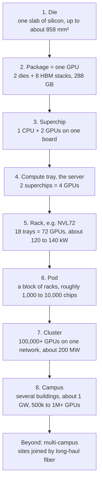
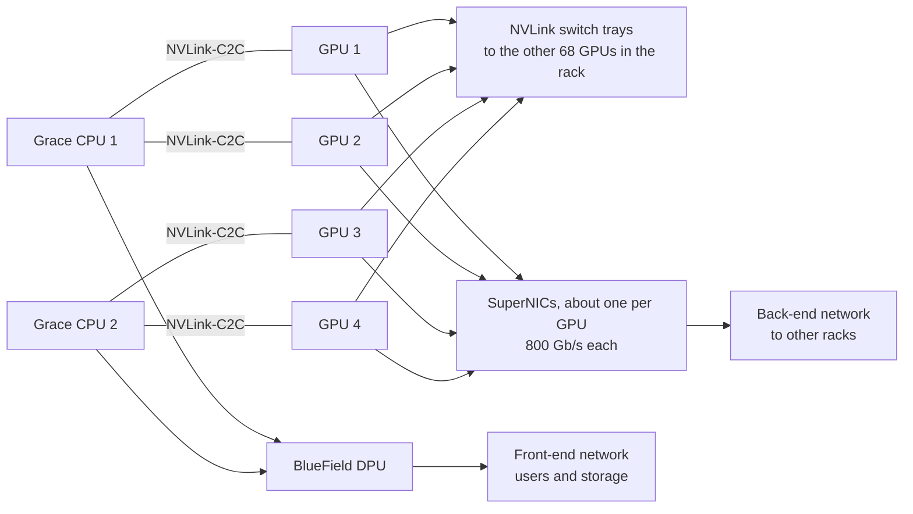
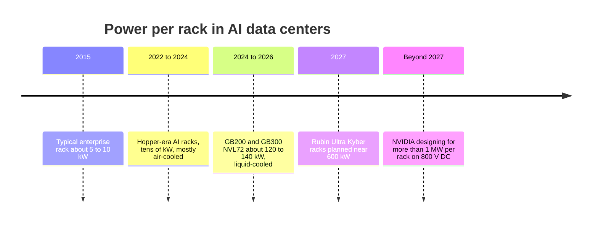
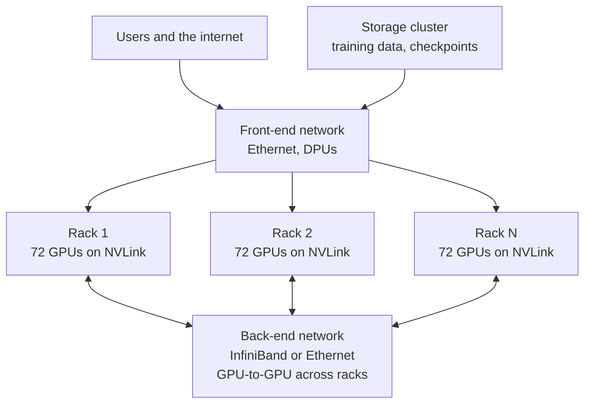
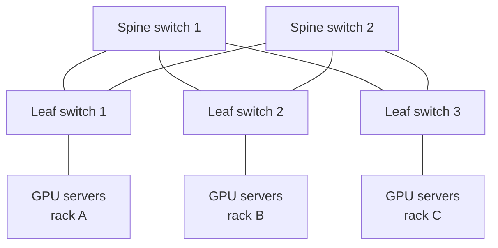
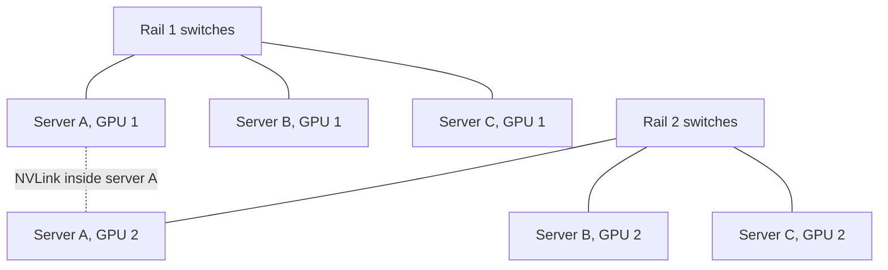
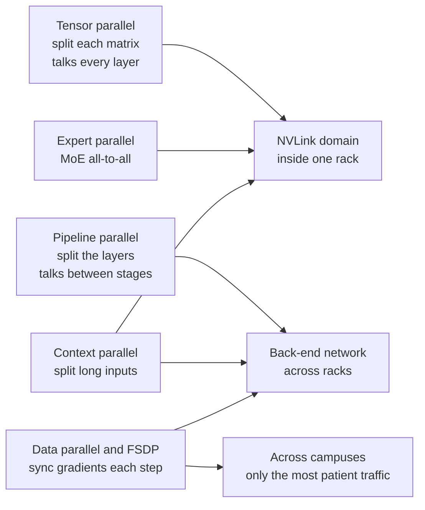
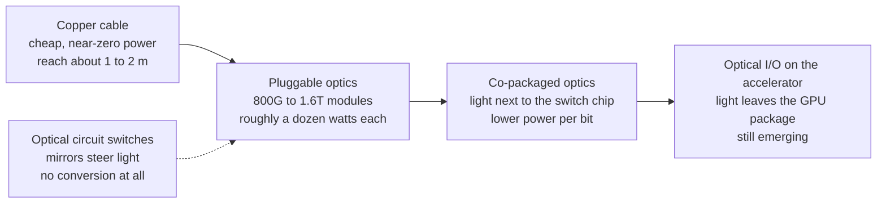

# Chapter 34: Wiring Thousands of Chips Together: Servers, Racks, Networks and Clusters

*This chapter climbs the ladder from a single slab of silicon to a gigawatt campus, so you can see how a hundred thousand chips are packaged, wired, powered and cooled to act like one machine.*

## What you'll learn

- Why no single chip can train, or even serve, a frontier model, with the numbers that prove it
- The eight levels of AI hardware (die, package, superchip, server, rack, pod, cluster, campus) with real sizes, memory and power at each level
- What is physically inside an AI chip package: dies, HBM stacks, the interposer and TSMC's CoWoS, and why the reticle limit forced chips to split into pieces
- How servers and superchips are built, and what NICs, DPUs, voltage regulators and cold plates do
- Scale-up networking (NVLink, NVSwitch, Google's ICI, UALink) and why NVIDIA calls a 72-GPU rack "one giant GPU"
- Scale-out networking (InfiniBand, Ethernet, RoCE, Ultra Ethernet) and the main wiring patterns: fat trees, rails, tori and dragonflies
- Why optics, power and heat are becoming the real limits, and what co-packaged optics, optical circuit switches and 800-volt DC change
- How to read a rack spec sheet without being fooled by precision, sparsity and "per rack" numbers

## Before you start

Chapter 2 (How Computers Work) gave you bits, transistors and the idea that moving data costs more than doing math on it. Chapter 4 (The Internet and the Cloud) explained packets, bandwidth and latency; here we apply the same ideas inside a single building. Chapter 32 (From Transistor to Accelerator) introduced GPUs, TPUs, FLOPS and number precision, and Chapter 33 (Memory and the Memory Wall) explained HBM and why memory bandwidth often matters more than math. Chapter 37 later does the math of splitting a training run across GPUs; this chapter builds the machine that math runs on. The building around it (power, cooling, floors) is Chapters 38 to 40.

## Why one chip is not enough

When you press Enter in ChatGPT, Claude or Gemini, it is natural to picture your message landing on "a GPU" somewhere. That picture is wrong in an interesting way. Your request lands on a *group* of chips, often 8, sometimes 72 or more, that each hold a slice of the model and pass numbers back and forth thousands of times while writing your answer. And the model you are talking to was trained on tens of thousands to hundreds of thousands of chips that behaved, for weeks or months, like one computer.

Three numbers explain why.

**Memory.** Frontier models have hundreds of billions to trillions of parameters. Take a round trillion. Stored at 8 bits (1 byte) each, the weights alone take 1 TB. The largest single NVIDIA GPU shipping in volume in late 2025, the B300, holds 288 GB of fast memory. So you need at least four of them (1,000 ÷ 288 ≈ 3.5, rounded up) just to hold the weights, before you leave any room for the KV cache that stores everyone's conversations (Chapter 33). Training needs far more: roughly 16 bytes per parameter once you count the weights, gradients and optimizer state, so about 16 TB for a trillion-parameter model. That is at least 56 B300s just to *hold* the numbers, before doing any math.

**Time.** Frontier training runs in 2025–26 are believed to use around `10^26` FLOP or more. An H100 GPU does about 989 trillion floating-point operations per second in dense BF16, and real training software gets roughly 40% of that. One H100 would therefore need:

`10^26 ÷ (989 × 10^12 × 0.4) ≈ 2.5 × 10^11 seconds ≈ 8,000 years`

Spread the same work across 100,000 H100s and it drops to about 2.5 million seconds, roughly 29 days. That division is the entire reason AI clusters exist.

**Users.** Serving is a crowd problem. Millions of people send messages at the same moment, and each answer needs the whole model to be read from memory for every token. Microsoft says a single 72-GPU rack in its Fairwater AI data center can produce about 865,000 tokens per second. Large services run thousands of such racks.

> **Key idea:** The unit of AI computing is no longer the chip. It is the rack, the cluster and, in 2026, the whole campus. How chips are connected matters as much as how fast each chip is.

> **Analogy:** One chip is a brilliant worker. Training a frontier model is building a city. You do not win by hiring a slightly faster worker; you win by organizing a hundred thousand workers so they never wait for each other, never lose their notes and never run out of materials. This chapter is about the organization chart, the hallways and the phone lines.

## The ladder: eight levels from silicon to campus

Here is the whole hierarchy on one page. Each level packs several of the level below into a bigger unit, adds the wiring that lets them cooperate, and adds the power and cooling that keep them alive. The rest of the chapter climbs it one rung at a time.



*Figure 34.1: The AI hardware ladder, using NVIDIA's GB300 NVL72 generation as the example. Each rung multiplies the count and adds wiring, power and cooling.*

The table puts real numbers on each rung. The example is the GB300 NVL72, NVIDIA's flagship rack from late 2025 until Vera Rubin began ramping in 2026. The pod row is illustrative because pod sizes vary by company. Compute is in dense FP4, the lowest-precision headline number, so treat it as an upper bound on what any real job achieves.

| Level | Real example (2025–26) | GPUs | Fast memory (HBM) | Peak compute (dense FP4) | Power |
|---|---|---|---|---|---|
| Die | One Blackwell die, close to the reticle limit | half of one | on-chip caches only | about half a GPU | part of the package |
| Package ("one GPU") | B300: 2 dies + 8 HBM3E stacks | 1 | 288 GB at 8 TB/s | about 15 PF | about 1.8 kW per GPU slot, all-in (rack ÷ 72) |
| Superchip | GB300: 1 Grace CPU + 2 B300 | 2 | 576 GB, plus CPU memory | about 30 PF | — |
| Compute tray (server) | 2 superchips, NICs, cold plates | 4 | about 1.15 TB | about 60 PF | several kW |
| Rack | GB300 NVL72: 18 compute trays + 9 NVLink switch trays | 72 | 20 TB | 1,080 PF (1.08 EF) | about 120–140 kW |
| Pod | A block of racks sharing a network spine and cooling; Google's Ironwood pod is 9,216 chips | ~1,000–10,000 | ~0.3–3 PB | ~15–150 EF | ~2–20 MW |
| Cluster | 100,000 GPUs on one back-end network (xAI's Colossus 1 reached about 100,000 H100s in 2024) | 100,000 | about 29 PB if B300 | about 1.5 ZF | about 180 MW of IT load |
| Campus | xAI's Colossus 2, about 946 MW of IT power, ~1.1 million H100-equivalents (Epoch AI estimate) | 500,000–1,000,000+ | tens of PB | — | about 1 GW |
| Multi-campus | Microsoft's Fairwater sites in Wisconsin and Atlanta, linked by an "AI WAN" | — | — | — | several GW |

*Table 34.1: Numbers at each rung of the ladder. Per-rung power and pod figures are rounded estimates from the rack totals; cluster and campus examples are from public reporting and Epoch AI's data center tracker as of October 2026.*

A few of these numbers are worth checking with your own arithmetic, because that is how you learn to trust (or distrust) spec sheets:

- **Rack memory:** 72 GPUs × 288 GB = 20,736 GB ≈ 20 TB. NVIDIA's page says 20 TB. It matches.
- **Rack compute:** 72 × 15 PF = 1,080 PF. NVIDIA's page lists 1,080 PF dense FP4. It matches.
- **Power per GPU slot:** 130 kW ÷ 72 ≈ 1.8 kW. That includes the GPU's share of CPUs, switches, NICs and pumps, which is why it is much more than any single chip's rating.
- **Cluster power:** 100,000 ÷ 72 ≈ 1,389 racks. 1,389 × 130 kW ≈ 180 MW of IT load. Add cooling and power losses at a PUE of 1.2 (Chapter 40) and the building draws about 217 MW.

There is a second pattern hiding in the ladder. Every rung outward, the links get longer, slower and more expensive per bit.

| Link | Typical distance | Bandwidth per GPU | Typical latency |
|---|---|---|---|
| Wires on the die | millimeters | far higher than anything off-chip | around a nanosecond |
| HBM to GPU, through the interposer | millimeters | 8 TB/s (B300); about 19–22 TB/s (Rubin) | hundreds of nanoseconds |
| NVLink inside the rack (copper) | 1–2 meters | 1.8 TB/s (Blackwell); 3–3.6 TB/s (Rubin) | nanoseconds to about a microsecond |
| Back-end network (fiber) | tens to hundreds of meters | 0.4–1.6 Tb/s, which is 50–200 GB/s | microseconds |
| Between campuses (long-haul fiber) | hundreds of kilometers | a small, shared slice | about 5 µs per km, so milliseconds |

*Table 34.2: Bandwidth falls and latency rises at every step outward from the chip.*

> **Key idea:** Bandwidth drops roughly tenfold, and latency rises, at each step away from the chip. The whole art of building AI clusters is putting the chattiest work on the fastest, shortest links and the patient work on the long ones.

## Rungs 1 and 2: the die and the package

### The die and the reticle limit

A chip starts as one rectangle cut from a round silicon wafer (Chapter 36 tells that story).

> **Definition — Die:** A single rectangular piece of silicon cut from a wafer, carrying one chip's circuits. A finished AI "GPU" may contain one, two or more dies in one package.

The machines that print circuits onto wafers expose one rectangle at a time, and that rectangle has a maximum size: about 26 mm × 33 mm, or roughly 858 mm². No single die can be bigger than this window.

> **Definition — Reticle limit:** The largest area (about 26 × 33 mm, roughly 858 mm²) that a lithography machine can print in one exposure, which caps the size of a single die.

AI chip designers hit this wall years ago. NVIDIA's H100 die is about 814 mm², already about 95% of the limit, with 80 billion transistors on TSMC's 4N process. Making dies even bigger has a second problem: yield. Every wafer has a few random defects, and one defect can ruin a whole die. A huge die is like one giant cookie on a tray with a few burnt spots: it is almost certain to include one. Chapter 36 works through the yield math.

### Chiplets: when one die is not enough

So the industry split chips into pieces.

> **Definition — Chiplet:** A smaller die designed to be combined with other dies inside one package, instead of building one huge die. Chiplets raise yield and let companies mix different manufacturing processes.

NVIDIA's Blackwell GPU is two reticle-sized dies, joined by an extremely fast die-to-die link, that present themselves to software as one GPU with 208 billion transistors. Vera Rubin, shipping in 2026, has 336 billion transistors on TSMC's N3 process, again with two GPU dies per package. That is why NVIDIA once planned to call its Rubin rack "NVL144" (counting dies) before branding it "NVL72" (counting packages). AMD went further, earlier: the MI300X (2023) is built from many chiplets stacked and tiled together, 153 billion transistors in all, and the 2026 MI455X uses chiplets made on TSMC's 2 nm and 3 nm processes.

Splitting a chip only works if the pieces can talk to each other almost as fast as wires inside one die. That link has to carry terabytes per second while using very little energy per bit, which is a hard engineering problem in its own right. To let chiplets from different companies work together, the industry created an open standard.

> **Definition — UCIe (Universal Chiplet Interconnect Express):** An open industry standard for connecting chiplets from different designers inside one package, so they can be mixed like standard parts.

### HBM: memory moved next door

Chapter 33 explained that AI chips are usually starved for memory bandwidth, not math. The answer was to move memory right next to the processor.

> **Definition — HBM (High Bandwidth Memory):** DRAM memory chips stacked 8 to 16 high and placed millimeters from the processor with an extremely wide connection, delivering terabytes per second. It is the main working memory of AI accelerators.

A B300 package has eight HBM3E stacks, each twelve DRAM layers high, holding 36 GB per stack: 8 × 36 GB = 288 GB. The newer HBM4 standard (used by NVIDIA's Rubin and AMD's MI400 family) doubles each stack's interface to 2,048 bits. Multiply that out for a Rubin package: 8 stacks × 2,048 = 16,384 separate data connections between memory and GPU. You cannot route sixteen thousand wires through an ordinary circuit board. You need something much finer.

### The interposer and CoWoS

That something is a slab of silicon under the chips, patterned with wiring almost as fine as the chips themselves.

> **Definition — Interposer:** A thin slab of silicon (or organic material with embedded silicon bridges) carrying dense wiring that connects the dies sitting on top of it, such as a GPU and its HBM stacks.

> **Definition — CoWoS (Chip-on-Wafer-on-Substrate):** TSMC's family of advanced packaging methods that place GPU dies and HBM stacks side by side on an interposer. Its limited capacity has been a key bottleneck for AI chip supply since 2023.

CoWoS comes in flavors. CoWoS-S uses one continuous silicon interposer. CoWoS-L, used for Blackwell and Rubin, embeds small "local" silicon bridges in a larger base, so the package can be much bigger than a single reticle while still giving the dense wiring exactly where dies meet. Below the interposer sits the package substrate.

> **Definition — Package substrate:** The layered base of a chip package, with coarser wiring than the interposer, that spreads power and signals from the chips out to hundreds or thousands of solder balls connecting to the circuit board.

> **Definition — Package:** The finished assembly of one or more dies, any memory stacks, the interposer and substrate, sealed together as one component that mounts on a board. When people say "a GPU" they usually mean one package.

```
   Side view of an AI GPU package (simplified, not to scale)

   HBM stack     GPU die A         GPU die B      HBM stack
  +---------+  +------------+  +------------+  +---------+
  | DRAM x12|  |            |==|            |  | DRAM x12|
  |   ...   |  |  compute   |  |  compute   |  |   ...   |
  |base die |  |            |  |            |  |base die |
  +---------+  +------------+  +------------+  +---------+
  ==========================================================
    interposer or silicon bridges: thousands of fine wires
  ==========================================================
  ##########################################################
     package substrate: spreads power and coarser signals
  ##########################################################
    o  o  o  o  o  o  o  o  o  o  o  o  o  o  o  o  o  o
            solder balls down to the circuit board

   Top view: two dies in the middle, joined by a fast
   die-to-die link (==), with four HBM stacks on each side.
```

*Figure 34.2: Cross-section of a two-die AI GPU package. Real HBM stacks sit along both long edges of the dies, eight in all.*

> **Analogy:** Advanced packaging is like building a downtown block where the GPU office towers and the HBM apartment towers share a network of underground tunnels (the interposer), instead of being separate cities joined by a two-lane highway (an ordinary circuit board).

### A kilowatt in your palm

A modern AI package is about the size of your palm and draws as much power as a space heater. NVIDIA's H100 (SXM version) is rated at 700 W; AMD's liquid-cooled MI355X is rated at 1,400 W. Here is the surprising part. The transistors run at around 1 volt or less. Power equals voltage times current (Chapter 39 covers this in depth), so:

`current = power ÷ voltage = 1,000 W ÷ 1 V ≈ 1,000 amps`

That is five to ten times what the main electrical panel of a typical house is rated for (usually 100–200 amps), flowing continuously into a palm-sized part. It cannot travel far at that voltage without melting wires and wasting energy, so the board brings power in at around 50 volts and converts it down right next to the package.

> **Definition — Voltage regulator (VRM):** Small power circuits placed right beside a chip that convert board power (around 48–54 V DC) down to the roughly 1 V the chip's transistors need, delivering very large currents over a very short distance.

> **Watch out:** "GPU" is a slippery word. It can mean one die, one package (two dies plus memory), one card or module, or even a superchip. NVIDIA's own Rubin rack was announced as NVL144 (counting dies) and shipped as NVL72 (counting packages); the 2027 Rubin Ultra rack was announced as "NVL576" counting dies. Always ask what is being counted.

> **At the frontier (2026):** The next steps stack silicon vertically instead of only side by side. NVIDIA's 2028 Feynman generation is reported to use 3D die stacking, and HBM4's bottom "base die" can now be a custom logic chip made at TSMC, letting GPU makers put some of their own circuitry inside the memory stack. Chapter 36 covers how these packages are built.

## Rung 3: boards, superchips and servers

### Modules and form factors

A package must be mounted on something that feeds it power, carries away its heat and connects it to the world.

> **Definition — Form factor (SXM, OAM, PCIe card):** The physical shape and connector of an accelerator module. SXM (NVIDIA) and OAM (an open standard) are flat, high-power modules that bolt onto a server board; PCIe cards plug into the standard slots found in ordinary computers.

The big training and serving machines use SXM- or OAM-style modules, which can take more power and more high-speed links than a card.

> **Definition — PCIe (PCI Express):** The standard connector and protocol inside computers that links CPUs to GPUs, network cards and SSDs. A 16-lane PCIe 5.0 slot moves about 64 GB/s in each direction; PCIe 6.0 doubles that.

### The classic 8-GPU server

From about 2017 to 2024, the standard AI building block was a single server holding eight GPUs. NVIDIA sold the GPU board design to server makers as "HGX" and sold complete machines under its own brand as "DGX."

> **Definition — HGX and DGX:** NVIDIA's 8-GPU baseboard design, which server makers build into their own machines (HGX), and NVIDIA's own branded complete AI servers and systems (DGX).

A typical 8-GPU server contains:

- **Eight GPUs** on one baseboard, wired to each other by NVLink through switch chips on the board.
- **Two host CPUs** that run the operating system, load data and launch work on the GPUs. They do little of the AI math.
- **PCIe switches** that connect the CPUs, GPUs, network cards and drives.
- **Network cards**, typically one high-speed card per GPU for GPU-to-GPU traffic, plus separate cards for storage and the outside world.
- **Local SSDs** for caching data and checkpoints, **power supplies**, and **fans or liquid cold plates**.

Meta's Llama 3 405B model was trained on 16,384 H100s; at eight per server, that is 16,384 ÷ 8 = 2,048 servers working as one. These servers are usually assembled not by NVIDIA but by contract manufacturers such as Foxconn, Quanta, Wistron and Wiwynn, or by server brands such as Supermicro and Dell.

> **Definition — NIC (Network Interface Card):** The card that connects a server to a network. AI servers use very fast NICs, such as NVIDIA's ConnectX-8 at 800 Gb/s, usually one per GPU.

> **Definition — DPU (Data Processing Unit) and SuperNIC:** Network cards with their own processors that take over networking, storage and security chores from the main CPU (examples: NVIDIA BlueField, AMD Pensando). NVIDIA uses "SuperNIC" for its fastest GPU-facing network cards.

Why so many network cards? Because PCIe is slow compared with what the GPUs need. NVLink on the Hopper generation moved 900 GB/s per GPU. A PCIe 5.0 slot moves about 64 GB/s per direction. That is a 14× gap, and it is why GPU-to-GPU traffic avoids PCIe whenever it can.

### Superchips and compute trays

Starting with Grace Hopper and then Grace Blackwell, NVIDIA changed the building block. Instead of two generic CPUs serving eight GPUs over PCIe, it pairs its own Arm CPU directly with GPUs on one board.

> **Definition — Superchip:** NVIDIA's term for a CPU and one or two GPUs tightly linked on one board, such as GB200 or GB300 (one Grace CPU plus two Blackwell GPUs) and Vera Rubin (one Vera CPU plus two Rubin GPUs).

> **Definition — NVLink-C2C:** NVIDIA's chip-to-chip link that joins the CPU and GPUs inside a superchip so they can share memory coherently, far faster than PCIe.

Why bother putting a CPU so close? Because the CPU's memory becomes a useful extra tier. The GB300 NVL72 rack has 36 Grace CPUs with 2,592 Arm cores in total, which works out to 2,592 ÷ 36 = 72 cores per CPU, and NVIDIA counts 37 TB of "fast memory" per rack: the 20 TB of HBM plus the CPUs' LPDDR5X memory. The Vera Rubin NVL72 rack carries up to 54 TB of LPDDR5X, or 54 ÷ 36 = 1.5 TB per Vera CPU. That CPU memory is slower than HBM but much larger, which helps with things like spilling an oversized KV cache from long conversations (Chapter 33) or staging training data.

Two superchips go into one **compute tray**: a flat, removable server sled about the size of a large pizza box, holding four GPUs and two CPUs. Each tray also carries network cards (ConnectX-8 at 800 Gb/s in the GB300 generation; ConnectX-9 in the 1.6 Tb/s class for Rubin), a BlueField DPU for the outside network, and cold plates instead of most of the fans.

> **Definition — Compute tray:** A removable server sled in a rack-scale AI system. In NVIDIA's NVL72 racks, each compute tray holds two superchips, which means four GPUs and two CPUs, plus their network cards and liquid cooling.



*Figure 34.3: Inside one compute tray of a GB300 NVL72 rack. Each GPU has three kinds of connection: NVLink to its rack-mates, a SuperNIC to the rest of the cluster, and its CPU partner.*

### Cooling at the board: cold plates

Essentially all the electricity a chip uses turns into heat. Air can carry away only so much: an air-cooled rack tops out at roughly 30–50 kW before fans and air conditioning cannot keep up. A rack of Blackwell-class GPUs draws roughly three times that or more. So the cooling moved onto the chip itself.

> **Definition — Cold plate (direct-to-chip liquid cooling):** A metal block with tiny internal channels, clamped onto a chip, through which liquid coolant is pumped to carry heat away. It is standard on Blackwell-class AI racks.

Each tray has coolant pipes running to cold plates on every GPU and CPU, joined to the rack's manifold by dripless quick-disconnect fittings so a technician can pull a tray without spilling. Water carries roughly 3,500 times more heat per unit volume than air, which is why liquid cooling made 100+ kW racks possible. Chapter 40 follows the heat all the way from the cold plate to the sky.

### Power at the board

Power arrives at the rack as alternating current, gets converted by **power shelves** in the rack into direct current at about 50 volts, travels down a thick copper bar along the back of the rack, enters each tray, and is converted again by voltage regulators to the roughly 1 volt the chips use.

> **Definition — Busbar:** A thick, rigid bar of copper (or aluminum) that carries large electrical currents, used along the back of AI racks to feed every tray, instead of many separate cables.

> **Try it:** Open Google Colab (colab.research.google.com), choose Runtime, then Change runtime type, and pick a GPU. In a code cell, type `!nvidia-smi` and press the play button. You will see the GPU's name, memory and current power draw. Then run `!nvidia-smi topo -m`. On a single free GPU it shows little, but on a multi-GPU server this command prints a grid showing which GPUs are joined by NVLink and which only by PCIe, the exact distinction this chapter is about.

## Rung 4: the rack and scale-up networking

### What a rack is

> **Definition — Rack:** A standardized metal cabinet, 19 inches wide inside and about 2 meters tall, that holds servers, switches, power equipment and cooling hardware. Its height is measured in rack units (U), each 1.75 inches; most racks are 42–52U.

For decades a rack was just furniture: a shelf for independent servers that happened to sit next to each other. A 2015 enterprise rack drew about 5–10 kW, roughly what four to eight homes use on average. An NVIDIA GB200 or GB300 NVL72 rack draws about 120–140 kW, roughly the average draw of 100 homes, and weighs around 1.5 tonnes or more, which is why new AI halls put racks on concrete slabs instead of raised floors (Chapter 38). More important than its weight, the NVL72 is not furniture holding separate computers. It is one computer that happens to be the size of a refrigerator.

### Scale-up: making one unit bigger

There are two ways to grow a computer, and the whole networking story turns on the difference.

> **Definition — Scale-up vs. scale-out:** Scale-up means making one tightly coupled unit bigger, such as putting more GPUs into one ultra-fast NVLink domain. Scale-out means connecting many such units over a conventional network.

Scale-up links are short, extremely fast and let chips treat each other's memory almost like their own. Scale-out links are longer, slower and work by sending messages. NVIDIA's scale-up technology is NVLink.

> **Definition — NVLink:** NVIDIA's high-speed GPU-to-GPU connection, far faster than PCIe: about 900 GB/s per GPU on Hopper (NVLink 4), 1.8 TB/s on Blackwell (NVLink 5), and 3–3.6 TB/s on Rubin (NVLink 6).

A link between two GPUs is nice; what you really want is for *every* GPU to talk to *every* other GPU at full speed at the same time. Wiring every pair directly does not scale (72 GPUs would need 2,556 separate pairwise links), so NVIDIA built a switch chip for NVLink.

> **Definition — NVSwitch:** A switch chip that connects many GPUs' NVLinks so that every GPU in the group can talk to every other at full NVLink speed simultaneously.

> **Definition — NVLink domain (scale-up domain):** The group of accelerators joined by an ultra-fast, memory-like fabric, such as the 72 GPUs in an NVL72 rack. Inside the domain, any GPU can directly read and write the others' memory.

That last property, reading and writing another GPU's memory directly, is called *memory semantics*, and it is the deep reason scale-up feels different from networking. On a normal network, GPU A wraps data in a message, hands it to a network card, and GPU B's network card unwraps it. Inside an NVLink domain, GPU A can simply load a number from GPU B's memory, almost as if it were its own, with nanosecond-to-microsecond delays.

### The NVL72: "one giant GPU"

The GB200 NVL72 (2024–25) and GB300 NVL72 (from the second half of 2025) put 72 GPUs and 36 CPUs into one rack and connect all 72 GPUs into a single NVLink domain. The layout:

```
   NVL72-style rack, front view (simplified)
   +----------------------------------------------+
   | power shelves      AC in, about 50 V DC out  |
   | compute tray     [CPU GPU GPU] [CPU GPU GPU] |
   | compute tray     [CPU GPU GPU] [CPU GPU GPU] |
   |   ... more compute trays above ...           |
   | NVLink switch tray    (9 switch trays in     |
   | NVLink switch tray     the middle)           |
   |   ...                                        |
   |   ... more compute trays below ...           |
   | compute tray      18 trays x 4 GPUs = 72     |
   | power shelves                                |
   +----------------------------------------------+
   Behind the trays: a copper NVLink "spine" of
   roughly 5,000 cables, coolant manifolds with
   quick-disconnects, and the DC busbar.
```

*Figure 34.4: The physical layout of an NVL72 rack. Eighteen compute trays sandwich nine NVLink switch trays, all joined at the back by a copper cable spine.*

Why copper inside the rack and not fiber? Over a meter or two, copper cable is cheaper, uses almost no power and almost never fails. Fiber needs lasers at each end, which cost money, burn power and wear out. Copper's weakness is reach: at these speeds a signal fades after a few meters. That physical fact is one reason the NVLink domain stops at roughly one rack.

Here are the published rack-level specs for NVIDIA's two current designs, straight from NVIDIA's product pages as of October 2026:

| Spec (whole rack) | GB300 NVL72 (Blackwell Ultra) | Vera Rubin NVL72 |
|---|---|---|
| GPUs + CPUs | 72 B300 + 36 Grace | 72 Rubin + 36 Vera |
| FP4 compute | 1,080 PF dense (1,440 PF sparse) | 2,520 PF NVFP4 dense for training; 3,600 PF NVFP4 sparse for inference |
| FP8 compute | 720 PF (as listed) | 1,260 PF dense |
| BF16 compute | 360 PF (as listed) | 288 PF dense |
| HBM | 20 TB HBM3E, up to 576 TB/s | 20.7 TB HBM4, about 1,400 TB/s |
| NVLink | 130 TB/s total (1.8 TB/s per GPU) | 216 TB/s total (3 TB/s per GPU) on the current page; 260 TB/s (3.6 TB/s per GPU) at launch |
| CPU cores | 2,592 Grace Arm cores | 36 × 88 custom Arm "Olympus" cores |
| Power | about 120–140 kW | not given in this book's sources |

*Table 34.3: NVIDIA's two NVL72 rack generations. Note the different precisions, the dense/sparse labels and the changed Rubin numbers.*

Two traps hide in this table. The Rubin numbers changed after launch: CES 2026 coverage quoted 22 TB/s of HBM and 3.6 TB/s of NVLink per GPU, while the current page lists 19.2 TB/s and 3 TB/s. And the GB300's FP8 and BF16 lines are not labeled dense: 360 PF ÷ 72 = 5 PF of BF16 per GPU, about double the roughly 2.5 PF dense usually assumed for a Blackwell GPU, which suggests sparse figures (Exercise 1 asks you to check the footnotes).

Now the payoff. Why does it matter that 72 GPUs act as one?

**Worked example: moving 1 GB.** Suppose a step of a training run or a big inference job needs to move 1 GB of numbers from one GPU to another.

- Over NVLink 5 at 1.8 TB/s: 1 GB ÷ 1,800 GB/s ≈ 0.56 milliseconds.
- Over an 800 Gb/s network card (which is 100 GB/s, see the Watch out below): 1 GB ÷ 100 GB/s = 10 milliseconds.
- Over a PCIe 5.0 slot at about 64 GB/s: about 16 milliseconds.

The NVLink path is about 18 times faster than the network. Some kinds of work need such exchanges every single layer of the model, dozens of times per token. In particular, *tensor parallelism* (splitting each matrix multiplication across GPUs) and *expert parallelism* (spreading the experts of a mixture-of-experts model across GPUs, Chapter 17) generate constant, all-to-all traffic. Inside an NVL72, a giant mixture-of-experts model can spread its experts across 72 GPUs and route each token to the right expert at NVLink speed. Outside the rack, the same traffic would choke the network. NVIDIA's projected claims for Vera Rubin, such as training large mixture-of-experts models with a quarter of the GPUs needed on GB200, rest heavily on this.

> **Key idea:** An NVL72 rack is valuable not because it has 72 GPUs (you could buy 72 GPUs in nine ordinary servers) but because all 72 share one memory-like fabric. To the software it looks like one GPU with 20 TB of memory.

> **Analogy:** Scale-up versus scale-out is a team in one room versus teams in different buildings. In the room (the NVLink domain), anyone can lean over and read a colleague's notes instantly. Between buildings (the network), you have to write an email, wait for it to arrive and wait for a reply.

### Other ways to scale up

NVIDIA is not the only company building big scale-up domains, and the designs differ in revealing ways.

**Google's TPUs** link chips directly to each other with their own Inter-Chip Interconnect, without a central switch, in a grid that wraps around at the edges (a torus, explained later in this chapter).

> **Definition — ICI (Inter-Chip Interconnect):** Google's direct chip-to-chip links between TPUs, wired so that thousands of TPUs form one tightly connected pod without central switches.

The 2025 Ironwood TPU comes in pods of 256 or 9,216 chips. The TPU 8t training chip announced in April 2026 forms superpods of up to 9,600 chips with 2 PB of HBM. The TPU 8i inference chip uses a different topology Google calls "Boardfly," connecting 1,152 chips.

**Amazon's Trainium** uses NeuronLink links and, for Trainium3, a NeuronSwitch fabric. A Trainium3 "UltraServer" joins 144 chips with 20.7 TB of HBM3E and 362 PF of MXFP8 compute.

**AMD's Helios rack** (shipping from the second half of 2026) joins 72 MI455X GPUs, each with 3.6 TB/s of scale-up bandwidth, using an open protocol called UALink carried ("tunneled") over Ethernet hardware, in a wide rack format designed by Meta.

> **Definition — UALink (Ultra Accelerator Link):** An open scale-up interconnect standard (version 1.0 in April 2025) backed by AMD, Intel, Google, Meta, Microsoft and others as an alternative to NVLink. It supports up to 1,024 accelerators in one domain using 200 Gb/s lanes.

**Microsoft's Maia 200** (January 2026) reportedly uses an Ethernet-based scale-up design that can link up to 6,144 accelerators.

And NVIDIA, seeing customers build their own chips, opened its fabric a little.

> **Definition — NVLink Fusion:** NVIDIA's program that lets other companies' CPUs or accelerators connect into NVLink fabrics. AWS has said its future Trainium4 chip will support it.

| Scale-up design | Chips in one domain | How it is wired |
|---|---|---|
| NVIDIA GB300 / Vera Rubin NVL72 | 72 GPUs | NVLink through NVSwitch trays, copper spine |
| NVIDIA Rubin Ultra "Kyber" (planned, 2H 2027) | 144 GPU packages | NVLink, much denser rack |
| Google Ironwood pod | 256 or 9,216 TPUs | ICI in a 3D torus, optical circuit switches |
| Google TPU 8t superpod (2026) | up to 9,600 TPUs | ICI in a 3D torus |
| Google TPU 8i (2026) | 1,152 TPUs | "Boardfly" topology |
| AWS Trainium3 UltraServer | 144 chips | NeuronLink and NeuronSwitch |
| AMD Helios (2H 2026) | 72 GPUs | UALink tunneled over Ethernet |
| Microsoft Maia 200 (reported) | up to 6,144 | Ethernet-based |

*Table 34.4: Scale-up domains compared, as of late 2026. Bigger domains are not automatically better: per-chip bandwidth and latency inside the domain matter as much as the count.*

> **Watch out:** "9,216 TPUs in one pod" and "72 GPUs in one rack" are not directly comparable. NVLink gives every GPU a full-speed path to every other through switches; a torus gives each chip fast links to its neighbors, and distant chips reach each other in several hops. Each design wins on different traffic patterns.

### Rack power: from 10 kW toward a megawatt

Packing more GPUs into one scale-up domain means packing more power into one cabinet, and that is changing data center buildings.



*Figure 34.5: Rack power over a decade. NVIDIA says the jump from Hopper to Blackwell alone raised rack density about 3.4 times.*

At 1 MW per rack, even the 50-volt busbar runs into physics. Do the arithmetic with power = voltage × current:

- At 54 V: current = 1,000,000 W ÷ 54 V ≈ 18,500 amps.
- At 800 V: current = 1,000,000 W ÷ 800 V = 1,250 amps.

Fifteen times less current means far thinner copper and far less heat lost in the wires. NVIDIA says a 1 MW rack fed at 54 V could need about 200 kg of copper busbar, which is why it is moving to a new design.

> **Definition — 800 V DC distribution:** NVIDIA's announced power architecture, planned for production alongside its Kyber racks in 2027, that delivers 800-volt direct current to racks. NVIDIA says it carries 85% more power through the same conductor than 415 V AC, cuts copper use by about 45% and improves end-to-end efficiency by up to 5%.

There is one more power problem unique to AI. In a training run, thousands of GPUs compute, then all pause to exchange numbers, then compute again, in lockstep. The whole site's power draw can swing by tens of megawatts within seconds; Meta reported exactly this during Llama 3 training. Designers now add capacitors near racks to absorb millisecond spikes and batteries at the facility to handle swings of seconds to minutes. Chapter 39 covers the full power chain and Chapter 40 the cooling.

## Rung 5 and up: scale-out networking

### Why a second network

No rack is big enough. A 100,000-GPU cluster made of NVL72 racks is about 1,389 racks, and those racks must cooperate on one training run. They are joined by a conventional, if extremely fast, network. Each GPU typically gets 400 Gb/s to 1.6 Tb/s of scale-out bandwidth, which is 50–200 GB/s, roughly ten to twenty times less than its NVLink bandwidth.

> **Watch out:** Networking speeds are quoted in **bits** per second (Gb/s, lowercase b) while memory and NVLink speeds are quoted in **bytes** per second (GB/s, uppercase B). One byte is 8 bits, so an "800G" network card moves 100 GB/s, not 800 GB/s. Mixing them up makes networks look eight times faster than they are.

A large AI site actually runs several separate networks, each with a different job.

> **Definition — Back-end vs. front-end network:** The back-end (or compute fabric) carries GPU-to-GPU traffic for training and large inference jobs and is built for maximum speed. The front-end connects servers to users, the internet and storage, like an ordinary data center network.



*Figure 34.6: Three layers of networking in an AI cluster: NVLink inside each rack (scale-up), the back-end between racks (scale-out), and the front-end to users and storage. Sites also run a small separate management network.*

When your chat message arrives, it comes in through the front-end. When a training run saves a checkpoint, that also flows over the front-end or a dedicated storage network. The back-end exists for one purpose: letting accelerators exchange numbers as fast as physics allows.

### InfiniBand and Ethernet

Two families of technology compete for the back-end.

> **Definition — InfiniBand:** A networking technology designed for supercomputers, with very low latency and built-in guarantees that data is not dropped. NVIDIA owns the leading supplier (it acquired Mellanox in 2020) and sells it as Quantum switches, such as the 800 Gb/s Quantum-X800.

> **Definition — Ethernet:** The world's standard networking technology, used in nearly every office, home and data center. Many companies make Ethernet switches, and newer versions are tuned for AI back-ends (for example NVIDIA Spectrum-X and Broadcom's Tomahawk switch chips).

Both rely on one trick that matters enormously for AI.

> **Definition — RDMA and RoCE:** Remote Direct Memory Access lets one machine read or write another machine's memory without involving either machine's CPU. RoCE ("rocky") is RDMA carried over Ethernet. AI networks use it so network cards can move data straight between GPU memories.

InfiniBand was born lossless: a sender only transmits when the receiver has room. Classic Ethernet was designed to drop packets when a switch is congested and let software resend them. For ordinary web traffic that is fine. For an AI job where 100,000 GPUs wait on the slowest message, a dropped packet is a disaster, so Ethernet AI networks are carefully tuned to avoid drops. Ethernet's advantages are many competing vendors, huge volumes, familiar tools and lower cost at scale, and much of the industry's new effort in 2025–26 went into making Ethernet AI-ready.

> **Definition — Ultra Ethernet (UEC):** An industry consortium and specification (version 1.0 released June 2025) that adapts Ethernet for AI and supercomputing traffic, for example by spreading one flow's packets across many paths and handling congestion better.

### Switches and the fat tree

> **Definition — Network switch and radix:** A switch is a box that forwards data between the many devices plugged into it. Its radix is how many ports it has; higher radix means fewer layers of switches are needed to connect a big cluster.

Here is a real number to work with. Broadcom's Tomahawk 6 switch chip (2025) handles 102.4 Tb/s in total. Divide by 800 Gb/s per port: 102.4 ÷ 0.8 = 128 ports. So one switch chip can connect 128 GPUs at 800G.

The question is how to wire tens of thousands of GPUs together through 128-port switches. The answer used almost everywhere is a layered design.

> **Definition — Topology:** The wiring pattern of a network: which devices connect to which. Common AI topologies include the fat tree, the rail-optimized design, the torus and the dragonfly.

> **Definition — Fat tree (Clos or leaf-spine network):** A layered network in which "leaf" switches connect to servers and every leaf connects to every "spine" switch above it, often with a third layer on top. Any two servers are only a few hops apart, and links get "fatter" (more total capacity) toward the top.



*Figure 34.7: A two-layer leaf-spine (fat tree) network. Every leaf connects to every spine, so any rack reaches any other in at most three switch hops.*

**Worked example: how big can a fat tree get?** Use 128-port switches.

- **Two layers.** Each leaf uses half its ports (64) for GPUs and half (64) for links up to spines. Each spine has 128 ports, so there can be at most 128 leaves. Maximum GPUs = 128 leaves × 64 = **8,192**.
- **Three layers.** The standard formula for a three-layer fat tree built from k-port switches is k³ ÷ 4. With k = 128: 128 × 128 × 128 ÷ 4 = **524,288** GPUs.

That is why 100,000-GPU clusters typically need three layers of switching, and why the industry cares so much about higher-radix switch chips: each doubling of ports multiplies the maximum size of a three-layer network by eight.

Two properties describe how good such a network is.

> **Definition — Non-blocking network:** A network with enough capacity in its upper layers that every device can send at full speed at the same time without slowing others down. AI back-ends are usually built non-blocking; front-end networks usually are not.

> **Definition — Bisection bandwidth:** The total bandwidth crossing an imaginary cut that splits a network into two equal halves. It measures how well the whole cluster can communicate at once.

### Rail-optimized designs

GPU clusters add a twist to the fat tree. In a training job, GPU number 3 in one server mostly talks to GPU number 3 in other servers, because they hold the same slice of the model. So designers wire them that way.

> **Definition — Rail-optimized network:** A cluster wiring scheme in which GPU 1 of every server connects to one group of switches (rail 1), GPU 2 of every server to another (rail 2), and so on, so the most common GPU-to-GPU exchanges take the fewest hops.



*Figure 34.8: A rail-optimized network. Same-numbered GPUs share a rail; traffic between different GPUs inside one server rides NVLink instead of the network.*

### Tori, dragonflies and Google's approach

Google took a different road with TPUs: connect each chip directly to its neighbors.

> **Definition — Torus:** A grid-shaped network in which each chip links directly to its neighbors and the edges wrap around to the opposite side, like a video game map where walking off the right edge brings you back on the left. In a 3D torus each chip has six neighbors.

```
   A 4 x 4 slice of a 2D torus (each letter is one chip)

     A ---- B ---- C ---- D  -- wraps back to A
     |      |      |      |
     E ---- F ---- G ---- H  -- wraps back to E
     |      |      |      |
     I ---- J ---- K ---- L  -- wraps back to I
     |      |      |      |
     M ---- N ---- O ---- P  -- wraps back to M
     |      |      |      |
   each column also wraps: M back to A, N to B, and so on.
   A 3D torus stacks such layers and links them vertically.
```

*Figure 34.9: A torus has no central switches. Neighbors are one hop apart; A to K takes four hops.*

A torus needs no big switches and its short neighbor links are cheap, and many AI computations (passing partial results around a ring, for example) map neatly onto it. The cost is that distant chips are many hops apart. Google softens that with optical circuit switches (described below) that can rewire which blocks of chips are neighbors, and it has used them since its TPU v4 pods of 4,096 chips in 2021.

> **Definition — Dragonfly:** A topology in which chips or switches are organized into groups that are densely connected inside, and every group has direct links to every other group, keeping the number of hops between any two points small.

Google's TPU 8i "Boardfly" layout is a dragonfly-style design. For TPU 8t, Google built a datacenter-scale fabric it calls Virgo that links more than 134,000 chips with 47 Pb/s of bisection bandwidth. Divide that by 134,000 chips and you get roughly 350 Gb/s of cross-network capacity per chip, an enormous total. Google says its software (JAX and Pathways) can scale one training job past one million TPU chips.

### Collectives: why the slowest link sets the pace

Most cluster traffic comes from a handful of group operations.

> **Definition — Collective communication:** A coordinated exchange of data among many chips at once, such as all-reduce (everyone contributes numbers, they are summed, and everyone gets the total) and all-to-all (everyone sends a different piece to everyone else). Libraries such as NVIDIA's NCCL perform them.

In an all-reduce across 100,000 GPUs, nobody can continue until the total is known. One flaky cable, one congested switch or one slow GPU holds up everyone. That is why AI networks are judged not by their average speed but by their worst moments ("tail latency"), and why so much engineering goes into routing around trouble. Chapter 37 works through an all-reduce by hand.

### Matching work to wires

All of this leads to one design principle: put each kind of communication on the tier that can handle it.



*Figure 34.10: Each parallelism strategy is placed on the network tier that matches how often and how much it communicates. Chapter 37 explains each strategy.*

> **Key idea:** A cluster is not just a pile of GPUs. It is a carefully layered set of networks, and the way a model is split across chips is designed around those layers.

## Optics: turning bits into light

### Copper's reach problem

Every high-speed link is built from fast serial channels.

> **Definition — SerDes (serializer/deserializer):** Circuits that turn many slow parallel signals into one very fast stream of bits for transmission, and back again at the other end. They are the basic building blocks of every high-speed link.

> **Definition — Lane:** One serial channel in a link. An 800 Gb/s port is usually 4 lanes of 200 Gb/s (or 8 lanes of 100 Gb/s); a 1.6 Tb/s port is 8 lanes of 200 Gb/s.

As lane speeds climb to 200 Gb/s and beyond, an electrical signal in copper fades within a few meters. Beyond that you need light.

> **Definition — Optical fiber:** A strand of very pure glass that carries data as pulses of laser light over hundreds of meters to many kilometers with little loss. It needs power-hungry converters at both ends, unlike passive copper cable.

### Pluggable transceivers

> **Definition — Optical transceiver:** A plug-in module, about the size of a pack of gum, that converts electrical signals to laser light and back, letting a switch or network card drive a fiber. 800G and 1.6T modules are standard in 2026 AI clusters.

**Worked example: counting transceivers.** In a three-layer, non-blocking fat tree, every GPU's port feeds one link to a leaf, the leaves need an equal number of links up to the middle layer, and the middle layer needs an equal number up to the top. That is about 3 links per GPU. If every link is optical, each needs a transceiver at both ends: about 6 transceivers per GPU.

- 100,000 GPUs × 6 ≈ 600,000 transceivers for the back-end alone.
- Switch count, using 128-port switches: about 100,000 ÷ 64 ≈ 1,560 leaf switches, about 1,560 middle-layer switches and about 780 top-layer switches, roughly 3,900 switches.
- Add the front-end and storage networks and the largest sites use millions of optical modules.

How much power is that? Huawei claims its "Hi-ONE" optical design for the Atlas 960E SuperPoD (4,096 chips) replaces about 48,000 800G modules with about 5,500 units and saves over 550 kW. That company claim implies roughly 550,000 W ÷ 48,000 ≈ 11–12 W per module. At that rate, 600,000 transceivers would draw about 7 MW, a small power plant's worth, just to turn electricity into light and back. And every one contains a laser that can fail; at hundreds of thousands of modules, failures are a daily maintenance task.

### Co-packaged optics and optical circuit switches

Two technologies attack this.

> **Definition — Co-packaged optics (CPO):** Placing the optical converters right next to the switch chip (or eventually the GPU) inside the same package, instead of in pluggable modules at the front panel. It shortens the power-hungry electrical path and cuts energy per bit.

NVIDIA's Spectrum-6 Ethernet switches with co-packaged optics began arriving at customer sites in mid-2026. The trade-off is serviceability: a pluggable module can be swapped in seconds, while optics built into a package are harder to replace. Startups such as Ayar Labs, Lightmatter and Celestial AI are working on optical input/output chiplets that would put light directly on accelerators (Chapter 35).

> **Definition — Optical circuit switch (OCS):** A switch that steers beams of light with tiny movable mirrors, connecting fibers to each other without converting the signal to electricity. It can rewire a network's topology in software and uses very little power.

Google uses optical circuit switches to reconfigure TPU pods: carving them into slices for different jobs and routing around failed chips without anyone touching a cable.



*Figure 34.11: The march of optics toward the chip. Each step trades some serviceability or maturity for lower power and longer reach.*

> **Try it:** Search the web for images of an "800G OSFP transceiver" and of the back of an "NVL72 rack." Notice how small and finned the optical module is (it has a laser and a heat sink inside), and how dense the copper cabling is behind the rack. Seeing them makes the counts in this section feel real.

> **At the frontier (2026):** Optics have become a strategic component. NVIDIA's Rubin platform is six new chips, and only two of them (the Vera CPU and the Rubin GPU) compute; the other four (the NVLink 6 switch, the ConnectX-9 SuperNIC, the BlueField-4 DPU and the Spectrum-6 Ethernet switch) exist to move data. Huawei's strategy for its SuperPoDs is explicitly many weaker chips bound together with lots of optics and power, a direct consequence of export controls (Chapter 36).

## Rungs 6 to 8: pods, clusters, campuses and AI factories

### Pods and SuperPODs

> **Definition — Pod (SuperPOD):** A pre-designed block of racks wired together as one unit, with its own network layer and shared cooling, that can be replicated to build a cluster. Google's TPU pods and NVIDIA's SuperPODs are examples.

Google's Ironwood pod is a clean example to check by hand. NVIDIA-style pods are built from NVL72 racks, and their size varies by customer.

- 9,216 chips × 4,614 TFLOPS of FP8 each = about 42.5 million TFLOPS = **42.5 exaFLOPS** of FP8 per pod.
- 9,216 chips × 192 GB of HBM each = about 1,770,000 GB = **1.77 PB** of HBM per pod.

Both match Google's published figures.

### Clusters

> **Definition — Cluster:** A large collection of accelerators networked together to work on shared jobs, often a single training run. Frontier AI clusters in 2026 range from about 100,000 to over 1,000,000 accelerators.

Because clusters mix chip types, analysts convert them into a common unit.

> **Definition — H100-equivalent (H100e):** A unit, used by analysts such as Epoch AI, that expresses a cluster's computing power as the number of NVIDIA H100 GPUs that would match it, so clusters built from different chips can be compared.

Some reference points, from the research files behind this book:

- **Meta Llama 3 405B (2024):** 16,384 H100s, reaching 38–43% model FLOPs utilization.
- **xAI Colossus 1 (Memphis, 2024):** about 100,000 H100s, built in 122 days in a former factory.
- **AWS Project Rainier (Indiana, October 2025):** Amazon said about half a million Trainium2 chips at launch, for Anthropic.
- **Google TPU 8t (2026):** the Virgo fabric links more than 134,000 chips, and Google says one training job can span more than a million.
- **The whole tracked frontier:** Epoch AI's data center hub (October 2026) tracks 95 large AI data centers with about 14.2 GW of IT power and about 14.8 million H100-equivalents.

**Worked example: a 100,000-GPU GB300 cluster on a napkin.**

| Quantity | Calculation | Result |
|---|---|---|
| Racks | 100,000 ÷ 72 | about 1,389 |
| IT power | 1,389 × 130 kW | about 180 MW |
| Facility power (PUE 1.2) | 180 MW × 1.2 | about 217 MW |
| HBM | 100,000 × 288 GB | about 28.8 PB |
| Peak dense FP4 | 100,000 × 15 PF | 1.5 million PF = 1.5 zettaFLOPS |
| Back-end switches (128-port, 3 layers) | from the transceiver example | about 3,900 |
| Back-end optical modules | about 6 per GPU | about 600,000 |

*Table 34.5: A rough bill of materials for a 100,000-GPU cluster. Every line is an estimate built from the per-rack numbers.*

> **At the frontier (2026):** The race is now to make a million chips behave like one. Google says JAX and Pathways can run one training job across more than a million TPU 8t chips; AWS has cited Trainium UltraClusters of up to a million chips; and Huawei describes SuperClusters of up to 512,000 Ascend chips (a million with extra network "rails"). At that scale the hard problems are less about chips and more about networks, failures and power.

### Campuses and "AI factories"

> **Definition — Campus:** A site with several data center buildings sharing one substation, one fiber entrance and support infrastructure. The largest AI campuses in 2026 are measured in gigawatts.

> **Definition — AI factory:** NVIDIA's marketing term for a data center whose product is tokens (AI outputs), stressing throughput, tokens per watt and cost per token rather than general-purpose computing.

How many GPUs fit in a gigawatt? Assume about 1.8 kW per GPU slot (the rack-level share from Table 34.1) and a PUE of 1.2:

`GPUs per GW ≈ 1,000,000,000 W ÷ (1,800 W × 1.2) ≈ 460,000 GPUs`

Real campuses line up with that order of magnitude. Epoch AI lists xAI's Colossus 2 at about 946 MW of IT power and roughly 1.1 million H100-equivalents (newer chips count as several H100s each), and the Anthropic–Amazon site at New Carlisle, Indiana at about 1,037 MW of IT power, the largest tracked site by power as of October 2026. Epoch estimates a gigawatt-scale site takes about two years to build and roughly $38 billion of up-front spending per gigawatt of IT power. Chapter 42 tells the stories of these megaprojects, and Chapter 43 the money.

> **Try it:** Ask your chatbot: "Roughly how many GPUs fit in a 1 GW data center, if each GPU slot uses 1.8 kW and the building's PUE is 1.2? Show your arithmetic." Check its answer against the 460,000 above. Then ask it what PUE means and compare with Chapter 40.

### Training across campuses

Even a gigawatt campus is limited by how much power one place can get. So in 2025–26 the frontier labs started joining sites.

> **Definition — Scale-across (multi-site training):** Linking several data center campuses, often hundreds of kilometers apart, with high-capacity fiber so they can work on one training job. Microsoft calls its version an "AI WAN."

Microsoft's second Fairwater site, in Atlanta, has run since October 2025 linked to the first, in Wisconsin, so the two act as one system. The obstacle is the speed of light. Light in glass fiber travels about 1 km every 5 microseconds. The two Fairwater sites are about 700 miles apart; a fiber route of roughly 1,200 km means:

`1,200 km × 5 µs per km = 6,000 µs = 6 milliseconds, one way`

Compare that with sub-microsecond NVLink hops: a thousand to ten thousand times longer. Tensor-parallel traffic, which talks every layer, could never cross that gap. What can cross it is the most patient traffic: separate copies of the model (data parallelism) that train on different data and only occasionally synchronize what they have learned. The research problem of 2026 is making those synchronizations rare and small enough that a model can effectively train in several states at once.

### Failures at scale

More parts means more breakdowns. If one GPU fails on average once every five years (about 43,800 hours), a 100,000-GPU cluster sees a failure roughly every 43,800 ÷ 100,000 ≈ 0.44 hours, about 26 minutes. Real experience is in that range: during 54 days of Llama 3 training on 16,384 H100s, Meta recorded 419 unexpected interruptions, about one every three hours, mostly hardware, and still achieved more than 90% effective training time. Chapter 37 covers checkpoints, spares and goodput.

> **Analogy:** Running a 100,000-GPU training job is like a 100,000-player online game where the match pauses whenever any one player's console crashes. You save the game often (checkpoints), keep spare consoles ready (hot spares), and build the network so one bad cable does not freeze everyone.

## Reading a rack spec sheet like a detective

Everything in this chapter comes together when you read an announcement. Run every number through these questions:

1. **Which precision?** An FP4 number is roughly 2× an FP8 number and 4× a BF16 number for the same hardware.
2. **Dense or sparse?** Sparse figures assume half the multiplications can be skipped and double the headline. Dense is the realistic baseline.
3. **Per what?** Per die, per package, per superchip, per rack or per pod? The rack figure is 72× the GPU figure.
4. **Which date?** Specs drift between announcement and shipping (Rubin's HBM bandwidth went from 22 TB/s per GPU in launch coverage to 19.2 TB/s on NVIDIA's current product page).
5. **Bits or bytes?** 800 Gb/s is 100 GB/s.
6. **Peak or achieved?** Large training runs achieve roughly 35–50% of dense peak.

**Worked example.** Vera Rubin NVL72 lists 1,260 PF of FP8 and 288 PF of BF16, both dense. Divide by 72: 17.5 PF FP8 and 4 PF BF16 per GPU, exactly matching NVIDIA's per-GPU figures. Now take the "3,600 PF" in NVIDIA's Rubin headline: it is NVFP4, sparse, for inference, per rack. Per GPU, dense, it is 2,520 ÷ 72 = 35 PF. In BF16 it is 4 PF. The same chip can honestly be described as "4 petaFLOPS" or "3.6 exaFLOPS", a 900× spread, depending on which four choices you make.

> **Watch out:** Never compare two chips or racks until you have converted both to the same precision, the same dense/sparse basis and the same unit of hardware. Vendor comparison charts often compare one company's sparse FP4 with another's dense FP8.

## In plain English

When you chat with an AI, your message is not answered by one chip. It is answered by a team of chips, and the model was trained by an army of them. The reason is simple arithmetic: a frontier model's numbers do not fit in one chip's memory, and training one on a single chip would take thousands of years.

So engineers build a ladder. At the bottom is a die, a slab of silicon no bigger than a printing machine can print in one shot. Two dies plus eight stacks of memory sit on a silicon "interposer" to make one GPU package. A CPU and two GPUs make a superchip; two superchips make a server tray; 18 trays plus 9 switch trays make an NVL72 rack, 72 GPUs that share memory so closely that software treats them like one giant GPU. Racks join into pods, pods into clusters of 100,000 or more, and clusters fill gigawatt campuses that draw as much power as a small city.

Each step out, connections get slower: NVLink inside a rack moves terabytes per second over copper, the cluster network moves a tenth of that over fiber, and links between campuses take milliseconds because even light needs time. So the work is split carefully: the chattiest parts stay inside a rack, and only patient traffic crosses buildings.

Along the way, three physical limits keep showing up: power (racks heading from 130 kW toward a megawatt, pushing 800-volt DC), heat (now carried by liquid straight off the chips) and optics (hundreds of thousands of lasers that cost power and fail). And when you read a spec sheet, always ask: which precision, dense or sparse, and per chip or per rack?

## Key terms

Die, Reticle limit, Chiplet, UCIe (Universal Chiplet Interconnect Express), HBM (High Bandwidth Memory), Interposer, CoWoS (Chip-on-Wafer-on-Substrate), Package substrate, Package, Voltage regulator (VRM), Form factor (SXM, OAM, PCIe card), PCIe (PCI Express), HGX and DGX, NIC (Network Interface Card), DPU (Data Processing Unit) and SuperNIC, Superchip, NVLink-C2C, Compute tray, Cold plate (direct-to-chip liquid cooling), Busbar, Rack, Scale-up vs. scale-out, NVLink, NVSwitch, NVLink domain (scale-up domain), ICI (Inter-Chip Interconnect), UALink (Ultra Accelerator Link), NVLink Fusion, 800 V DC distribution, Back-end vs. front-end network, InfiniBand, Ethernet, RDMA and RoCE, Ultra Ethernet (UEC), Network switch and radix, Topology, Fat tree (Clos or leaf-spine network), Non-blocking network, Bisection bandwidth, Rail-optimized network, Torus, Dragonfly, Collective communication, SerDes (serializer/deserializer), Lane, Optical fiber, Optical transceiver, Co-packaged optics (CPO), Optical circuit switch (OCS), Pod (SuperPOD), Cluster, H100-equivalent (H100e), Campus, AI factory, Scale-across (multi-site training)

## Exercises

1. **[Easy] Read a rack spec sheet like a detective.** (1) Open NVIDIA's GB300 NVL72 page (nvidia.com/en-us/data-center/gb300-nvl72/) and its Vera Rubin NVL72 page. (2) For every FLOPS number, write down the precision (FP4, FP8, BF16), whether it is dense or sparse (read the footnotes), and whether it is per GPU or per rack. (3) Divide each rack number by 72 to get a per-GPU figure. (4) Decide whether the GB300's 360 PF BF16 figure is dense or sparse, and say what evidence you used. **What you'll learn:** headline numbers can differ by 2× (sparsity), 4× (precision) and 72× (rack vs. chip), and only careful reading tells you which.

2. **[Easy] See real GPU wiring in Google Colab.** (1) In Colab, choose Runtime, Change runtime type, and pick a GPU. (2) In a cell, run `!nvidia-smi` and note the GPU name, memory and power draw. (3) Run `!nvidia-smi topo -m` and read the grid (on one GPU it is tiny; note the legend explaining NV#, PIX and SYS links). (4) Run `!nvidia-smi -q | grep -i -A3 "link"` to see the PCIe generation and link width. (5) Write two sentences on what would change on an 8-GPU NVLink server. **What you'll learn:** GPUs are physical devices with specific links, and tools exist to inspect exactly how they are wired.

3. **[Easy] Bits, bytes and transfer times (spreadsheet).** (1) Make rows for: PCIe 5.0 x16 (64 GB/s), NVLink 5 (1,800 GB/s), NVLink 6 (3,600 GB/s), an 800 Gb/s NIC, a 1.6 Tb/s NIC and a 1 Gb/s home internet line. (2) Convert every bit rate to GB/s by dividing by 8. (3) Compute the time to move 1 GB, 100 GB and 1 TB over each. (4) Highlight the fastest and slowest in each column. **What you'll learn:** the bits-versus-bytes trap, and why a 20 TB NVL72 behaves so differently from 72 GPUs on a network.

4. **[Medium] Build the ladder in a spreadsheet.** (1) Create rows for package, superchip, compute tray, rack, a 16-rack pod, a 100,000-GPU cluster and a 1 GW campus. (2) Columns: GPUs, HBM (288 GB per GPU), dense FP4 (15 PF per GPU) and IT power (130 kW per 72-GPU rack). (3) For the campus, work backwards: 1 GW ÷ 1.2 (PUE) ÷ 130 kW per rack = how many racks and GPUs? (4) Compare your GPU count with Epoch AI's figure of about 1.1 million H100-equivalents for Colossus 2 and explain why the units differ. **What you'll learn:** how chips, racks and power scale together, and how to sanity-check claims about gigawatt sites.

5. **[Medium] Size a fat-tree network.** (1) With 128-port switches, compute the maximum GPUs in a two-layer leaf-spine (leaves use 64 ports down, 64 up) and in a three-layer fat tree (k³ ÷ 4). (2) Repeat with 64-port switches. (3) For a 32,768-GPU cluster on 128-port switches, estimate the number of leaf, middle and top switches and the number of optical transceivers (about 6 per GPU). (4) At roughly 12 W per transceiver, estimate the optics power. **What you'll learn:** why switch radix and optics dominate the cost and power of scale-out networks.

6. **[Medium] Why 800 volts?** (1) Using current = power ÷ voltage, compute the current for a 130 kW rack and a 1 MW rack at 54 V, 415 V and 800 V. (2) Wire losses grow with the square of current. For the same wire, how many times larger are losses at 54 V than at 800 V? (Hint: square the ratio of the currents.) (3) In two sentences, explain why NVIDIA is moving racks to 800 V DC. **What you'll learn:** the physics that is reshaping the power design of AI racks (and the bridge to Chapter 39).

7. **[Medium] The speed-of-light budget.** (1) Using 5 µs per km of fiber (5 ns per meter), compute one-way delay for 2 m (inside a rack), 200 m (across a hall), 1,200 km (Wisconsin to Atlanta by fiber) and 6,000 km (roughly across the Atlantic). (2) If a training step must exchange data 1,000 times per second, which distances are affordable? (3) Ask a chatbot to explain "local SGD" or "infrequent synchronization" in multi-site training and summarize the idea in three sentences. **What you'll learn:** why tensor parallelism stays inside a rack and only patient traffic crosses campuses.

8. **[Challenge] Map a model onto a cluster.** You have a 400-billion-parameter mixture-of-experts model, 8,064 GPUs in 112 NVL72 racks, and 128,000-token training sequences. (1) Decide which parallelism goes inside each rack (tensor and expert parallelism), which across racks (pipeline parallelism), where context parallelism goes, and use data parallelism for the rest. (2) Draw it, labeling which network tier each uses (copy Figure 34.10's logic). (3) Check: does your plan put any every-layer communication on the back-end network? If so, fix it. **What you'll learn:** the logic of matching communication-heavy work to the fastest links, the core skill of ML systems engineers (Chapter 37 goes deeper).

9. **[Challenge] Audit an AI cluster architect.** (1) Ask a chatbot: "Design a 16,384-GPU cluster from GB300 NVL72 racks: number of racks, IT power, total HBM, number of 128-port switches in a three-layer fat tree, and number of optical transceivers. Show all arithmetic." (2) Check every number with this chapter's rules of thumb. (3) Look specifically for bits-versus-bytes mistakes, dense-versus-sparse confusion and rack-versus-GPU confusion. (4) Write a short correction memo. **What you'll learn:** to use AI as a fast first draft for technical estimates while keeping your own judgment as the final check.

## Areas of opportunity

- **AI network engineers.** People who can design and debug InfiniBand and RDMA-over-Ethernet fabrics, tune congestion control and diagnose stuck collective operations are scarce. Hyperscalers and neoclouds pay well because one misbehaving switch can idle thousands of GPUs worth tens of thousands of dollars per hour.
- **Cluster bring-up and reliability engineering.** Turning on a new 100,000-GPU cluster means validating hundreds of thousands of links, finding bad cables and slow GPUs, and keeping goodput high. Companies building or renting clusters pay for tools and people that shorten bring-up from months to weeks.
- **Liquid-cooled rack technicians.** Data center technicians who can service cold plates, quick-disconnects, busbars and dense fiber are in short supply, and many roles need a two-year technical degree or trade background rather than a university degree.
- **Optical interconnect.** Co-packaged optics, 1.6T and faster transceivers, optical circuit switches and optical input/output chiplets are a fast-growing supply chain, with demand for photonics engineers, test engineers and manufacturing technicians.
- **Power electronics for racks.** The move to 800 V DC, solid-state transformers and capacitor or battery smoothing of GPU power swings creates work for power engineers and component makers selling to rack builders.
- **Cluster observability and GPU FinOps software.** Tools that spot stragglers and flaky links, attribute cost per job and raise utilization sell to every company running more than a few racks, because idle GPUs are expensive.
- **Rack integration and testing services.** Rack-scale systems are built, burned in and tested before shipping; contract manufacturers and independent test and logistics firms in this chain are growing quickly.
- **Open problems worth working on.** Training across distant campuses with rare synchronization, fault-tolerant training at a million chips, reducing interconnect energy per bit, and scale-up fabrics based on open standards (UALink, Ultra Ethernet) are active research and startup areas.

## Check your understanding

1. Give two separate reasons why a frontier model cannot be trained on one GPU, with a number for each.
2. What is the reticle limit, and how do Blackwell and AMD's MI300 family work around it?
3. Explain the difference between scale-up and scale-out networking, with one technology example of each.
4. A network card is rated at 800 Gb/s. How many gigabytes per second is that, and roughly how long does it take to send 10 GB?
5. Why is tensor parallelism kept inside an NVLink domain while data parallelism can stretch across campuses?
6. With 128-port switches, what is the largest two-layer leaf-spine network you can build, and why does going to three layers help so much?
7. Why is NVIDIA moving future racks to 800 V DC power?
8. NVIDIA's GB300 NVL72 page lists 360 PF of BF16. Why might you suspect this is a sparse figure?

<details><summary>Answers</summary>

1. Memory: a trillion-parameter model needs about 1 TB just for 8-bit weights and about 16 TB for training state, while a B300 holds 288 GB. Time: a `10^26` FLOP run on one H100 at 40% utilization would take about 8,000 years.
2. It is the largest area a lithography machine can print in one exposure, about 858 mm². Blackwell joins two reticle-sized dies with a very fast die-to-die link so software sees one GPU; AMD builds its MI300-family chips from many smaller chiplets in one package.
3. Scale-up makes one tightly coupled unit bigger, with memory-like links (NVLink and NVSwitch in an NVL72 rack, Google's ICI, UALink). Scale-out connects many such units with a message-based network (InfiniBand, or Ethernet with RoCE).
4. 800 ÷ 8 = 100 GB/s, so 10 GB takes about 0.1 seconds (100 milliseconds), ignoring overheads.
5. Tensor parallelism exchanges data in every layer, many times per step, so it needs the highest bandwidth and lowest latency, which only exist inside the NVLink domain. Data-parallel copies only need to synchronize gradients once per step (or less often with special methods), so they can tolerate slower, longer links.
6. Each leaf uses 64 ports for GPUs and 64 for spines, and each spine can connect 128 leaves, so 128 × 64 = 8,192 GPUs. A three-layer fat tree supports k³ ÷ 4 = 524,288 GPUs, because each extra layer multiplies the reachable size.
7. At 1 MW, a 54 V feed would need about 18,500 amps and huge copper busbars (around 200 kg); 800 V needs about 1,250 amps. Lower current means less copper, less heat lost in wires and fewer conversion steps; NVIDIA cites about 45% less copper and up to 5% better efficiency.
8. 360 ÷ 72 = 5 PF per GPU, about double the roughly 2.5 PF of dense BF16 usually assumed per Blackwell GPU, and sparse figures are exactly double dense ones. The footnotes are where to confirm it.

</details>

## Going deeper

- **NVIDIA GB300 NVL72 and Vera Rubin NVL72 product pages (nvidia.com).** The primary source for rack-scale specs; read the footnotes to practice the detective questions from this chapter.
- **Google Cloud blog, "TPU 8t and TPU 8i technical deep dive" (2026).** A clear first-party description of superpods, the Virgo fabric, Boardfly and the training/inference split.
- **Meta, "The Llama 3 Herd of Models" (2024, arXiv 2407.21783), infrastructure sections.** The best public account of running a 16,384-GPU training job: network design, parallelism, failures and power swings.
- **Barroso, Hölzle and Ranganathan, *The Datacenter as a Computer* (Morgan & Claypool, free online).** The classic book on treating a whole building as one machine, written by Google engineers.
- **Jouppi et al., "TPU v4: An Optically Reconfigurable Supercomputer for Machine Learning" (ISCA 2023).** How Google uses tori and optical circuit switches to build pods of thousands of chips.
- **Al-Fares, Loukissas and Vahdat, "A Scalable, Commodity Data Center Network Architecture" (SIGCOMM 2008).** The paper that popularized fat-tree networks built from identical switches, including the k³ ÷ 4 formula.
- **NVIDIA developer blog posts on the 800 V HVDC architecture (2025).** Where the copper, current and efficiency numbers for megawatt racks come from.
- **Microsoft, "Inside the world's most powerful AI datacenter" (September 2025).** A readable tour of the Fairwater design, from rack layout to closed-loop cooling.
- **Epoch AI data center hub (epoch.ai/data/data-centers).** Live estimates of the largest AI sites by power and H100-equivalents, with methodology notes.
