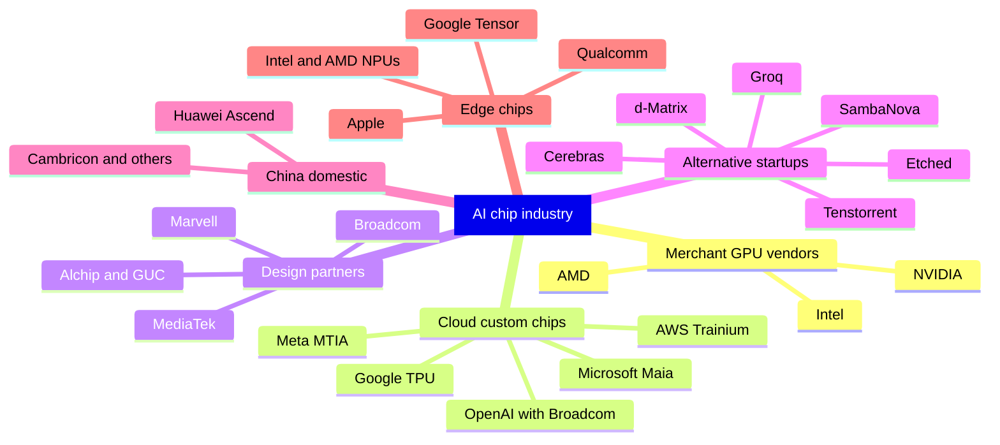
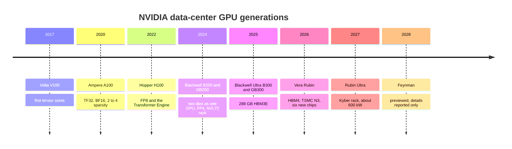
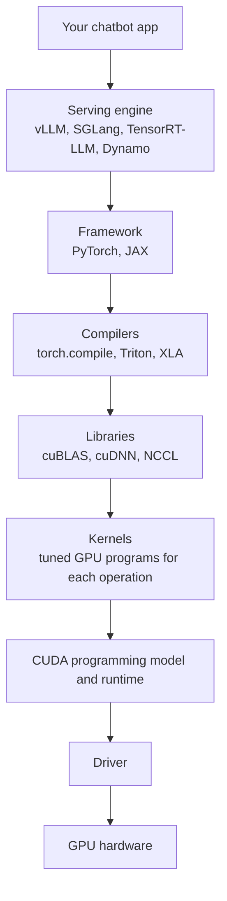

# Chapter 35: The AI Chip Industry: NVIDIA, AMD, Google, Custom Silicon and Startups

*This chapter maps the companies that make AI chips, explains why one of them earns most of the money, and gives you the tools to judge every new chip announcement, roadmap and mega-deal on your own.*

## What you'll learn

- Who makes AI chips: merchant GPU vendors, cloud companies' custom chips and their design partners, alternative-architecture startups, and phone and laptop chipmakers
- NVIDIA's generations from Volta to Feynman, with spec tables, and why NVIDIA now sells whole racks
- What the "CUDA moat" really is, layer by layer, and how ROCm, JAX and XLA, Triton and others are chipping at it
- AMD's Instinct line and Helios rack, Google's TPUs through Ironwood and TPU 8, Amazon's Trainium, and the custom chips of Microsoft, Meta and OpenAI
- The alternative architectures (Cerebras, Groq, SambaNova, Etched, Tenstorrent, d-Matrix) with an honest look at what each gives up
- Phone and laptop NPUs, what TOPS means, and why on-device AI is limited by memory
- The 2025–26 mega-deals, how to read "up to 10 gigawatts," and the roadmaps through 2028
- The physics limits ahead, and which long bets (3D stacking, photonics, in-memory compute) are real

## Before you start

Chapter 32 (From Transistor to Accelerator) explained GPUs, TPUs, tensor cores, systolic arrays and number precision. Chapter 33 (Memory and the Memory Wall) explained HBM and why memory bandwidth limits chatbot speed. Chapter 34 (Wiring Thousands of Chips Together) built the package, rack and network that every chip in this chapter lives inside. Manufacturing, TSMC and export controls are Chapter 36; the math of training and serving is Chapter 37; the money and financing behind the deals is Chapter 43.

## The map: who makes AI chips

Start with a question about your own chatbot: *which chips answer your messages?* No company publishes a full list, but the public deals give a good picture as of late 2026.

- **ChatGPT (OpenAI)** runs mostly on NVIDIA GPUs rented from Microsoft, Oracle, CoreWeave and others. OpenAI has also signed for AMD GPUs (starting with 1 GW in the second half of 2026), its own custom chips built with Broadcom (planned from the second half of 2026), and, reportedly, capacity from Cerebras. Microsoft says its own Maia 200 chip serves some OpenAI models.
- **Claude (Anthropic)** runs on three chip families: Google TPUs (a deal for up to a million TPUs), Amazon's Trainium (the Project Rainier cluster and a 2026 deal for up to 5 GW), and NVIDIA GPUs through Microsoft Azure.
- **Gemini (Google)** runs on Google's own TPUs.

So your daily chatbot use already touches at least four different chip designs. Here is the cast.

*Figure 35.1: The AI chip industry in six groups. Nearly all of them depend on the same few manufacturers: TSMC for chips and packaging, and SK hynix, Samsung and Micron for HBM memory.*

A few terms organize this map.

> **Definition — Merchant silicon:** Chips designed by one company and sold to anyone who wants to buy them, as NVIDIA and AMD sell GPUs. The opposite is in-house silicon that a company builds for its own use.

> **Definition — Fabless:** A chip company that designs chips but pays a foundry to manufacture them. NVIDIA, AMD, Broadcom, Qualcomm and Apple are all fabless.

> **Definition — ASIC (Application-Specific Integrated Circuit):** A chip designed for one job. AI ASICs such as Google's TPU, Amazon's Trainium and Microsoft's Maia give up a GPU's flexibility to do neural-network math more cheaply and efficiently.

> **Definition — Hyperscaler:** One of the giant cloud and internet companies that operate data centers at enormous scale, chiefly Amazon, Microsoft, Google, Meta and Oracle. They buy most of the world's AI hardware.

> **Key idea:** The AI chip industry looks competitive at the design level (dozens of chips) but is extremely concentrated at the manufacturing level. Almost every accelerator in this chapter, from NVIDIA, AMD, Google, Amazon and Microsoft, is made and packaged by TSMC in Taiwan, with HBM from three companies. Chapter 36 explains why that matters.

## NVIDIA: from graphics cards to AI racks

### The size of the business

NVIDIA began in 1993 making graphics chips for video games. In the quarter that ended on July 26, 2026 (the second quarter of its fiscal year 2027), it reported:

- Total revenue of **$96.2 billion**, up 106% from a year earlier.
- **Data center revenue of $89.0 billion**, up 117%.
- A GAAP gross margin of **75.0%** and net income of $59.7 billion.
- An outlook for the next quarter of $108 billion, plus or minus 2%, assuming *no* data-center compute revenue from China.

At its March 2026 GTC conference, NVIDIA said combined purchase orders for Blackwell and Vera Rubin systems were aimed at about $1 trillion through 2027.

> **Definition — Gross margin:** The share of revenue left after paying the direct cost of making the product. A 75% gross margin means that out of every $100 of sales, about $25 went to manufacturing (chips, memory, packaging, assembly) and $75 is left for research, other costs and profit.

**Worked example: what $89 billion a quarter means.** $89.0 billion ÷ 91 days ≈ $980 million of data-center sales *per day*. Multiply the quarter by four and you get an annualized pace of about $356 billion. With a 75% gross margin, roughly three-quarters of every dollar a cloud company pays NVIDIA is NVIDIA's gross profit. Keep that number in mind: it is the main reason every large cloud company is building its own chip.

### The generations

NVIDIA has shipped a new data-center architecture roughly every two years, and since 2024 it has moved to a yearly rhythm.

*Figure 35.2: NVIDIA's data-center generations. Each one added a new lower-precision number format or a bigger scale-up domain, not just more transistors.*

| Generation (year) | Key part | Memory | What was new |
|---|---|---|---|
| Volta (2017) | V100 | 16/32 GB HBM2 | First tensor cores |
| Ampere (2020) | A100 | 40/80 GB HBM2e, about 2 TB/s | TF32, BF16, 2:4 sparsity |
| Hopper (2022) | H100 SXM | 80 GB HBM3, 3.35 TB/s | FP8 and the Transformer Engine; about 989 TFLOPS dense BF16; 700 W; 80 billion transistors (TSMC 4N) |
| Hopper refresh (2024) | H200 | 141 GB HBM3E, 4.8 TB/s | Same compute, more and faster memory |
| Blackwell (2024–25) | B200 / GB200 | 192 GB HBM3E, 8 TB/s | Two reticle-size dies acting as one GPU; 208 billion transistors; FP4; NVLink 5 at 1.8 TB/s; the GB200 NVL72 rack |
| Blackwell Ultra (2H 2025) | B300 / GB300 | 288 GB HBM3E (12-high), 8 TB/s | About 15 PF dense FP4 per GPU; GB300 NVL72 rack |
| Vera Rubin (2026) | Rubin GPU + Vera CPU | 288 GB HBM4 | 336 billion transistors on TSMC N3; per GPU: 35 PF NVFP4 dense (training), 50 PF NVFP4 sparse (inference), 17.5 PF FP8 dense, 4 PF BF16 dense |
| Rubin Ultra (2H 2027) | Kyber rack | HBM4E | Plan from GTC 2025: 15 EF FP4 inference and 5 EF FP8 per rack, about 600 kW |
| Feynman (2028) | — | "Custom HBM" | Previewed at GTC 2026; reported to use 3D die stacking, TSMC's A16 process, a new "Rosa" CPU and a new LPU |

*Table 35.1: NVIDIA's data-center generations, using vendor peak figures. Rubin Ultra and Feynman are plans, and the Feynman details are press reports.*

Two number-format terms keep appearing in that table, so pin them down.

> **Definition — Dense vs. sparse FLOPS:** A dense figure counts every multiplication. A sparse figure assumes a special pattern in which half the numbers are zero and can be skipped, which doubles the headline. Dense is the realistic baseline; most real workloads do not get the sparse speed-up.

> **Definition — NVFP4 and MX formats:** Four-bit (and six- and eight-bit) number formats that attach a shared scale factor to each small block of values so that very few bits can still cover a wide range. MXFP4 is an open industry standard using blocks of 32 values; NVFP4 is NVIDIA's version using blocks of 16.

**Worked example: how much better is each generation?** Compare an H100 (2022) with a Rubin GPU (2026), always at the same precision:

| Measure | H100 | Rubin | Ratio |
|---|---|---|---|
| Dense BF16 compute | about 0.99 PF | 4 PF | about 4× |
| Dense FP8 compute | about 1.98 PF | 17.5 PF | about 9× |
| HBM capacity | 80 GB | 288 GB | 3.6× |
| HBM bandwidth | 3.35 TB/s | 19.2 TB/s (product page) | 5.7× |

*Table 35.2: Four years of NVIDIA progress at matched precision. The H100's FP8 figure is its dense rating of about 1,979 TFLOPS.*

Notice three things. Low-precision math grew fastest, because each generation added hardware tuned for smaller numbers. Memory bandwidth grew more slowly than compute, which is the memory wall from Chapter 33 in action. And if you compared the H100's dense BF16 (about 1 PF) with Rubin's sparse NVFP4 inference figure (50 PF), you would get a meaningless "50×." Marketing slides do exactly that.

> **Watch out:** Vendors revise specs between announcement and shipping. At the January 2026 CES launch, coverage quoted Rubin at 22 TB/s of HBM bandwidth and 3.6 TB/s of NVLink per GPU; NVIDIA's current product page lists 19.2 TB/s and 3 TB/s. Always use the latest official spec sheet and note its date.

### Why NVIDIA sells racks, not chips

Ten years ago NVIDIA sold graphics cards that went into other companies' servers. In 2026 its flagship product is the Vera Rubin NVL72, a complete rack. The Rubin platform consists of six new chips that NVIDIA designed together: the Vera CPU, the Rubin GPU, the NVLink 6 switch, the ConnectX-9 SuperNIC, the BlueField-4 DPU and the Spectrum-6 Ethernet switch. Add NVIDIA's software, its reference rack designs (built by manufacturers such as Foxconn and Quanta), and, since 2026, its Groq-based inference racks, and NVIDIA supplies nearly everything except the building.

Why go to all that trouble?

1. **Performance comes from the system.** As Chapter 34 showed, an NVL72 is valuable because 72 GPUs share one memory-like fabric. That requires the GPU, switch and cables to be designed together.
2. **Speed of deployment.** Customers want working capacity in weeks, not a year of integration. A pre-tested rack design gets there faster.
3. **More of each dollar.** A data center buyer spends money on GPUs, CPUs, networking and software. Selling all of them captures more revenue per gigawatt.
4. **Stickiness.** When the GPU, network, NIC and software all come from one vendor and are tuned together, swapping out any single piece is harder.

Prices are not published. Industry reports put a GB200 or GB300 NVL72 rack at roughly $3–4 million, and an H100 reportedly sold for around $25,000–40,000; treat both as unconfirmed estimates.

The flip side of this strategy is that customers feel locked in, and that pushes the biggest buyers toward their own chips. NVIDIA has partly answered with NVLink Fusion (Chapter 34), which lets other companies' CPUs and accelerators plug into NVLink fabrics; AWS says its future Trainium4 will use it.

> **Watch out:** "The chip is the product" is an outdated idea. In 2026 the unit of design and sale is the rack (NVL72, Helios, a TPU pod), and increasingly the whole data center. When comparing vendors, compare racks or pods, including networking and software, not just one chip.

### The Groq deal and the split between training and inference

Chapter 23 explained that answering a prompt has two phases: *prefill* (reading your whole prompt at once, which is compute-heavy) and *decode* (writing the answer one token at a time, which is limited by memory bandwidth). In 2025–26 the industry started building different chips for each.

> **Definition — Disaggregated serving:** Running the prefill and decode phases of AI inference on different chips (sometimes different kinds of chips), each tuned for its phase, and passing the conversation's KV cache between them.

In late December 2025, NVIDIA reportedly paid around $20 billion for a non-exclusive license to the inference technology of Groq, a startup, and hired its leadership, including CEO Jonathan Ross. Groq stayed an independent company and kept running its GroqCloud service. At GTC 2026 NVIDIA introduced the **Groq 3 LPU** and the **LPX rack**: 256 LPUs per rack, each chip with about 500 MB of on-chip SRAM, about 150 TB/s of SRAM bandwidth and about 1.2 PF of FP8 compute. The LPX is meant to generate tokens at very low latency alongside Vera Rubin racks, which hold the large KV caches. NVIDIA claims up to 35 times more throughput per megawatt at high interactivity; that is a vendor claim. By NVIDIA's August 2026 earnings report, the LPX was in full production.

NVIDIA also announced, in September 2025, the **Rubin CPX**, a GPU using cheaper GDDR7 memory meant for the prefill phase of very long prompts. Its 2026 shipping status was not confirmed in this book's sources.

> **At the frontier (2026):** The biggest shift in AI chips this year is specialization. NVIDIA pairs Rubin GPUs with Groq-based LPUs; Google split its eighth-generation TPU into a training chip (8t) and an inference chip (8i); Microsoft's Maia 200 and AWS's Inferentia target inference. Inference spending at major labs now rivals or exceeds training, so it pays to build chips just for it.

### Beyond the data center

NVIDIA also sells smaller machines. The **DGX Spark**, a desktop computer built on a GB10 chip with 128 GB of memory shared by CPU and GPU, reportedly began shipping in October 2025. **RTX Spark**, a roughly 1-petaflop Windows PC chip made with Microsoft, launched in 2026 according to NVIDIA's earnings release. In September 2025 NVIDIA invested $5 billion in Intel to co-develop x86 CPUs that connect over NVLink, along with PC chips. And in the MLPerf Training 6.0 results (2026), NVIDIA says Blackwell systems led every category.

> **Definition — MLPerf:** A set of standardized AI training and inference benchmarks run by the MLCommons industry group, where vendors submit results under shared rules. It is the closest thing to an independent, apples-to-apples comparison of AI hardware, though not every vendor participates.

## The CUDA moat: why software is NVIDIA's real fortress

### A chip is useless without its software

A chip only understands its own low-level instructions. Between the line of Python an AI researcher writes and the electrical signals in a GPU sit about seven layers of software. Each layer must exist, be fast and be correct for every new chip.

*Figure 35.3: The software stack between a chatbot and a GPU. NVIDIA owns or leads most of the lower layers; that is the moat.*

> **Definition — CUDA:** NVIDIA's programming platform, available since 2006–07, for running general computations on its GPUs. It includes a programming language extension, compilers, libraries, tools and documentation, and only runs on NVIDIA hardware.

> **Definition — Kernel (GPU kernel):** A small program that runs on the GPU to perform one operation, such as a matrix multiplication or an attention step. Writing fast kernels is one of the most prized skills in AI engineering.

> **Definition — GPU library:** A collection of pre-written, heavily tuned kernels for common operations. NVIDIA's cuBLAS handles matrix math and cuDNN handles neural-network layers, so most programmers never write those kernels themselves.

> **Definition — NCCL and RCCL:** NVIDIA's (NCCL, "nickel") and AMD's (RCCL) libraries for collective communication, the coordinated data exchanges such as all-reduce that let thousands of GPUs train one model together.

> **Definition — Framework (PyTorch, JAX):** The software toolkit researchers use to build and train models in Python. PyTorch (from Meta) dominates; JAX (from Google) is used heavily with TPUs. The framework calls libraries and kernels underneath.

> **Definition — ML compiler (XLA, Triton, torch.compile):** Software that translates a model written in a framework into efficient instructions for a specific chip, often fusing several operations into one kernel. XLA powers TPUs; Triton (created at OpenAI) lets engineers write GPU kernels in Python-like code.

> **Definition — Serving engine:** Software that runs a trained model for many users at once, handling batching, the KV cache and scheduling. Examples are vLLM, SGLang, NVIDIA's TensorRT-LLM and NVIDIA's Dynamo.

### Why twenty years of software is so hard to copy

> **Definition — Software moat (lock-in):** An advantage that comes from customers' investment in a vendor's software ecosystem, which makes switching to a rival costly even when the rival's hardware is competitive.

The moat is not one thing. It is many small advantages that compound:

- **Time.** CUDA has had nearly two decades of fixes, features and tuning. AlexNet, the 2012 result that started the deep-learning boom, was trained on NVIDIA GPUs with CUDA, and the habit never broke.
- **New ideas arrive on CUDA first.** When researchers invent a faster attention method or a new number format, the first working code is almost always CUDA kernels. Rivals have to port it later.
- **Day-one libraries.** Each new NVIDIA generation ships with cuBLAS, cuDNN, NCCL and TensorRT-LLM already tuned for it.
- **People.** Millions of developers, university courses, tutorials and forum answers assume CUDA.
- **Reliability at scale.** NCCL has been tested on clusters of tens of thousands of GPUs. A buyer spending billions values "it works" over "it might be cheaper."
- **Tools.** Profilers, debuggers and monitoring tools that show where time goes.

> **Analogy:** CUDA is like English for GPU programming. You can do science in other languages, and some people do it very well, but most of the textbooks, journals, job ads and hallway conversations are in English. Switching is possible; it is just expensive and slow.

> **Watch out:** "CUDA is just a programming language" misses the point. The language is the smallest part. The moat is the ecosystem of libraries, compilers, tools, documentation and trained people built up over about twenty years.

### How the moat is being crossed

Several forces are wearing it down:

1. **Most model code is written in PyTorch or JAX, not CUDA.** If the framework runs well on another chip, most of a lab's code moves with it. That shifts the battle to the libraries and kernels underneath.
2. **Triton and other compilers.** Triton lets engineers write fast kernels once in Python-like code and compile them for different vendors' GPUs, including AMD's.
3. **XLA and JAX.** Google's compiler stack makes TPUs usable without CUDA at all; Gemini is built on it.
4. **Vendor stacks.** AMD's ROCm (next section) and AWS's Neuron SDK for Trainium provide their own libraries and compilers.
5. **Multi-vendor serving engines.** vLLM and SGLang support several chip families, so an inference team can switch hardware without rewriting its serving system.
6. **The biggest buyers can afford to cross.** Anthropic trains and serves Claude across Google TPUs, Amazon Trainium and NVIDIA GPUs. That proves the moat can be crossed, but only with large, specialized engineering teams.

The honest summary for late 2026: for the largest labs, the moat is now a cost rather than a wall. For smaller companies and researchers trying new ideas, NVIDIA plus CUDA is still the path of least resistance.

> **Try it:** Ask a chatbot: "Show me a tiny GPU kernel that adds two vectors, first in CUDA C++ and then in Triton, and explain each line for someone who has never programmed." Compare how much each version asks the programmer to manage by hand. That difference is part of why compilers like Triton matter for breaking lock-in.

## AMD: the main merchant alternative

AMD is the only other company selling high-end AI GPUs to all comers at large scale. Its Instinct line has followed a consistent strategy: offer more memory per GPU than NVIDIA, embrace open standards, and compete on price.

| Chip (year) | Memory | Bandwidth | Headline compute | Notes |
|---|---|---|---|---|
| MI300X (Dec 2023) | 192 GB HBM3 | 5.3 TB/s | — | 153 billion transistors in a chiplet design |
| MI325X (late 2024) | 256 GB HBM3E | 6 TB/s | — | Memory upgrade |
| MI355X (2H 2025, CDNA 4) | 288 GB HBM3E | 8 TB/s | 10.1 PF dense MXFP4 (20.1 sparse) | 1,400 W, liquid-cooled |
| MI455X (2026, CDNA 5) | 432 GB HBM4 | 19.6 TB/s (a later AMD briefing cited up to 23.3) | about 40 PF dense FP4; about 20 PF FP8 | 3.6 TB/s scale-up; TSMC 2 nm and 3 nm chiplets |
| MI430X (2026) | — | — | — | Aimed at mixed scientific (FP64) and AI work |
| MI440X (2026) | — | — | — | Sold in an 8-GPU server |
| MI500 (2027, CDNA 6) | HBM4E | — | — | TSMC 2 nm |

*Table 35.3: AMD Instinct accelerators, vendor figures. Dashes mean the figure is not in this book's sources.*

AMD's 2026 flagship is not a chip but a rack. **Helios** combines 72 MI455X GPUs with AMD's EPYC "Venice" CPUs (2 nm, up to 256 Zen 6 cores) and Pensando "Vulcano" network cards, in Meta's Open Rack Wide format, with the GPUs joined by UALink carried over Ethernet (Chapter 34). Rack totals: 2.9 EF dense FP4, 1.4 EF FP8, 31 TB of HBM4 and about 1.4 PB/s of memory bandwidth. Shipments begin in the second half of 2026 and ramp through 2027. AMD claims up to 30% more tokens per dollar than a Vera Rubin NVL72; that is AMD's own claim, not an independent test.

**Worked example: Helios versus Vera Rubin NVL72.**

| Rack | HBM | Dense FP4 | FP8 | HBM bandwidth |
|---|---|---|---|---|
| AMD Helios | 31 TB | 2.9 EF | 1.4 EF | about 1.4 PB/s |
| NVIDIA Vera Rubin NVL72 | 20.7 TB | 2.52 EF (NVFP4) | 1.26 EF | about 1.4 PB/s |
| Ratio | about 1.5× | about 1.15× | about 1.1× | about equal |

*Table 35.4: Two 72-GPU racks of 2026 compared using vendor figures. Formats differ slightly (AMD's FP4 versus NVIDIA's NVFP4).*

On paper the racks are close on compute and bandwidth, and AMD has about 50% more memory. That matters for serving huge mixture-of-experts models and long conversations, where the KV cache eats memory (Chapter 33). What the table cannot show is software maturity, real-world utilization and shipping dates, which is where AMD has historically lagged.

> **Definition — ROCm:** AMD's open-source software platform for programming its GPUs, its answer to CUDA. It includes compilers, math libraries and the RCCL communication library.

> **Definition — HIP:** AMD's programming interface, which closely mirrors CUDA so that CUDA code can be translated to run on AMD GPUs with relatively few changes.

ROCm has historically trailed CUDA in maturity, polish and day-one support for new techniques. It improved through 2025–26, helped by better AMD support in PyTorch, Triton and vLLM and by the arrival of very large customers willing to invest engineering time. The decisive vote of confidence came on October 6, 2025, when OpenAI and AMD announced a multi-generation agreement for **6 GW** of AMD GPUs, starting with **1 GW of MI450-series chips in the second half of 2026**. The deal reportedly included a warrant letting OpenAI buy up to 160 million AMD shares, roughly 10% of the company, as deployment milestones are met.

> **Definition — Warrant:** A contract giving its holder the right to buy a company's shares at a set price, often only after conditions are met. Chip vendors have used warrants to tie big customers' purchases to a stake in the vendor's success.

## Google TPUs: the original AI ASIC

### Why Google built its own chip

Around 2013, Google engineers estimated that if users talked to voice search for a few minutes a day, running the neural networks on CPUs would require doubling Google's data centers. That fear produced the first Tensor Processing Unit, deployed in 2015. It was built for inference only, using 8-bit integers, and its heart was a 256 × 256 grid of multiply-accumulate units: 65,536 multipliers working in lockstep.

> **Definition — Systolic array:** A grid of multiply-add units through which numbers flow from neighbor to neighbor, like a bucket brigade, so each number fetched from memory is reused many times. It is the core of Google's TPU (see Chapter 32).

> **Definition — TPU (Tensor Processing Unit):** Google's family of AI ASICs, first deployed in 2015 and in its eighth generation in 2026, built around systolic arrays and linked into large pods by Google's own interconnect.

| Generation | Year | Key facts |
|---|---|---|
| TPU v1 | 2015 | 28 nm, INT8 inference only, one 256 × 256 systolic array |
| TPU v2 | 2017 | Added training, BF16 and HBM |
| TPU v3 | 2018 | Faster, larger pods |
| TPU v4 | 2021 | 4,096-chip pods linked with optical circuit switches |
| TPU v5e / v5p | 2023 | Cost-optimized (e) and performance (p) versions |
| Trillium (v6e) | 2024 | 918 TFLOPS BF16, 32 GB HBM, 256-chip pods |
| Ironwood (v7) | 2025 | 4,614 TFLOPS FP8, 192 GB HBM3E at 7.37 TB/s, pods of 256 or 9,216 chips (42.5 EF FP8 and 1.77 PB HBM per pod) |
| TPU 8t (training) | 2026 | 12.6 PF FP4, 216 GB HBM at 6.5 TB/s, 128 MB SRAM, 3D torus, up to 9,600 chips and 2 PB HBM per superpod |
| TPU 8i (inference) | 2026 | 10.1 PF FP4, 288 GB HBM at 8.6 TB/s, 384 MB SRAM, "Boardfly" topology of 1,152 chips |

*Table 35.5: Google TPU generations. Ironwood was announced in April 2025 and generally available by Cloud Next 2026; TPU 8 was announced on April 22, 2026.*

The 2026 split is the most revealing part of the table. The training chip (8t) has *less* memory than the inference chip (8i), 216 GB versus 288 GB, but is built to join huge superpods: Google says it delivers about 3 times Ironwood's processing power per pod, up to 2.7 times better training price-performance, and, through the Virgo fabric, more than 134,000 chips in one network and over a million in one training job. The inference chip has more HBM, more bandwidth and three times the on-chip SRAM of its predecessor, plus a dedicated engine for collective communication. Google claims up to 80% better inference price-performance. Both use Google's own Arm-based Axion CPUs as hosts; Google did not disclose their process node or power.

> **Key idea:** Training wants raw compute and enormous, tightly connected pods. Inference, especially decode, wants memory capacity, memory bandwidth and fast on-chip storage. Once a company spends tens of billions a year on each, building separate chips pays off.

### Who uses TPUs

Google's own products (Gemini, Search, YouTube) run on TPUs, and Google Cloud rents them to customers. The largest outside customer is Anthropic. In October 2025 Anthropic announced access to **up to one million TPUs**, worth tens of billions of dollars, bringing well over a gigawatt online in 2026. In April 2026 it announced a further agreement with Google and Broadcom for "multiple gigawatts" of next-generation TPUs starting in 2027; a Broadcom filing reportedly implies about 3.5 GW. Google designs TPUs with Broadcom as its main design partner, and MediaTek has been reported as a partner for TPU 8i. Google also rents NVIDIA systems and said it would be among the first clouds to offer Vera Rubin NVL72.

## Amazon: Trainium and Inferentia

Amazon's chips come from Annapurna Labs, a chip company it bought in 2015.

> **Definition — Trainium and Inferentia:** Amazon Web Services' in-house AI chips. Trainium is built mainly for training (and increasingly for inference); Inferentia is built for inference. Both are programmed through AWS's Neuron software kit.

- **Trainium2** comes in "UltraServers" of 64 chips. **Project Rainier**, a cluster in Indiana built for Anthropic, was switched on in October 2025 with about half a million Trainium2 chips, according to Amazon.
- **Trainium3**, generally available in December 2025, is AWS's first 3 nm AI chip: 144 GB of HBM3E at 4.9 TB/s per chip. A Trn3 UltraServer joins **144 chips** for **362 PF of MXFP8**, 20.7 TB of HBM3E and 706 TB/s of aggregate bandwidth, through AWS's NeuronSwitch fabric. AWS claims up to 4.4 times the compute and 4 times the energy efficiency of Trn2 UltraServers, and has cited "UltraClusters" of up to a million chips.
- **Trainium4** will support NVIDIA's NVLink Fusion, a notable sign that even rivals want to plug into NVIDIA's fabric.

Check the per-chip numbers yourself: 362 PF ÷ 144 ≈ 2.5 PF of FP8 per chip, and 20.7 TB ÷ 144 ≈ 144 GB per chip. They match.

In April 2026, Anthropic and Amazon announced an agreement for **up to 5 GW**, with nearly 1 GW of Trainium2 and Trainium3 capacity online by the end of 2026; reports put Anthropic's commitment at more than $100 billion over ten years.

## Microsoft, Meta, OpenAI and Intel

**Microsoft Maia 200** (January 2026) is made on TSMC's 3 nm process. Reported specs: 216 GB of HBM3E at 7 TB/s, 272 MB of on-die SRAM, about 10 PF of FP4 and about 5 PF of FP8, with an Ethernet-based scale-up network reaching up to 6,144 accelerators. Microsoft deployed it first in Iowa, then Arizona, to run Microsoft 365 Copilot and OpenAI models, and claims 30% better performance per dollar than its existing fleet. A successor has been reported but not confirmed.

**Meta's MTIA** chips are RISC-V-based inference accelerators, built first for the recommendation and ranking models behind Facebook and Instagram feeds (Chapter 51). A 2025 paper at ISCA, a top computer-architecture conference, reported 44% lower total cost of ownership than GPUs on specific inference tasks. In fall 2025 Meta announced it was acquiring Rivos, a RISC-V chip startup reportedly valued around $2 billion, to speed up MTIA, including a push toward training.

> **Definition — RISC-V:** A free, open instruction set (the basic vocabulary of commands a processor understands) that anyone can use without license fees. It is popular with startups and appears in AI chips such as Meta's MTIA and Tenstorrent's designs.

**OpenAI and Broadcom** announced on October 13, 2025 that OpenAI would design custom AI accelerators, with Broadcom developing them and supplying Ethernet networking, for **10 GW** deployed from the second half of 2026 through 2029. Whether the first chips had been deployed by October 2026 was not confirmed in this book's sources. OpenAI has said it used its own AI models to help with parts of the chip design.

**Intel** has struggled in AI accelerators. Its Gaudi 3 (2024, 128 GB of HBM2e) saw limited adoption, and it has announced an inference GPU called Crescent Island, with 160 GB of LPDDR5X memory, reportedly sampling in the second half of 2026. Intel's bigger AI story in 2025–26 was financial: the US government took a 9.9% stake in August 2025, NVIDIA invested $5 billion in September 2025, and Intel itself invested in SambaNova (cleared in May 2026).

### Why build your own chip?

Every hyperscaler now designs AI chips. The reasons:

1. **Cost.** At a 75% gross margin, most of what a cloud pays NVIDIA is NVIDIA's profit. A chip you design yourself can, if it works, cost much less per unit of useful work.
2. **Supply security.** NVIDIA's best chips have been sold out for years. Your own chip gives you a second line in the queue at TSMC (though you still compete for the same factories and HBM).
3. **Bargaining power.** A credible alternative improves the price you get from NVIDIA.
4. **Fit.** You can tune the chip to your own models: Google's TPUs for its models, Meta's MTIA for recommendation, Maia for Copilot.

And the reasons it is hard: a leading-edge chip design costs several hundred million dollars, takes two to three years, needs a full software stack, and bets that today's model architectures will still matter when the chip ships.

**Worked example (illustrative).** Suppose a cloud company plans to spend $20 billion a year on AI accelerators. If its supplier's gross margin is 75%, about $15 billion of that is the supplier's gross profit. A custom-chip program costing, say, $1 billion a year in design, partner fees and software would pay for itself if it replaced even a modest fraction of those purchases at much lower unit cost. That logic, not technical pride, is why Google, Amazon, Microsoft, Meta and OpenAI all have chip programs. The numbers here are made up to show the shape of the decision; real figures are private.

Most hyperscalers do not design every part of the chip themselves. They hire specialists.

> **Definition — Design partner (custom silicon partner):** A company such as Broadcom, Marvell, MediaTek or Alchip that turns a customer's chip architecture into a manufacturable product, supplying high-speed I/O circuits, physical design, packaging and the relationship with the foundry.

> **Definition — Tape-out:** The moment a chip design is finished and sent to the foundry to be manufactured. It marks the end of design and the start of a months-long wait for first silicon.

| Company | Chip family | Design partner(s) | Status, late 2026 | Main use |
|---|---|---|---|---|
| Google | TPU Ironwood, TPU 8t and 8i | Broadcom; MediaTek reported for 8i | Ironwood generally available; TPU 8 announced April 2026 | Gemini, Google Cloud, Anthropic |
| Amazon | Trainium2/3, Inferentia | In-house Annapurna Labs, with Marvell | Trainium3 generally available since Dec 2025 | Anthropic, AWS customers |
| Microsoft | Maia 200 | Marvell (per industry reports) | Deployed in 2026 | Copilot, OpenAI models |
| Meta | MTIA | Broadcom | In production for inference; Rivos acquired | Feed ranking and recommendations |
| OpenAI | Custom accelerator | Broadcom | Deployment planned 2H 2026 to 2029 | OpenAI's own models |

*Table 35.6: Hyperscaler custom silicon as of October 2026.*

## The 2026 lineup side by side

Here are the flagship accelerators of 2026 in one table. Read it with the warning that follows.

| Chip | Company | Memory per chip | Bandwidth | Headline compute (precision) | Largest tight domain |
|---|---|---|---|---|---|
| Rubin | NVIDIA | 288 GB HBM4 | 19.2 TB/s | 35 PF NVFP4 dense; 17.5 PF FP8 | 72 per NVL72 |
| B300 | NVIDIA | 288 GB HBM3E | 8 TB/s | about 15 PF FP4 dense | 72 per NVL72 |
| MI455X | AMD | 432 GB HBM4 | 19.6 TB/s | about 40 PF FP4 dense; about 20 PF FP8 | 72 per Helios |
| MI355X | AMD | 288 GB HBM3E | 8 TB/s | 10.1 PF MXFP4 dense | 8-GPU servers |
| TPU 8t | Google | 216 GB HBM | 6.5 TB/s | 12.6 PF FP4 | 9,600 per superpod |
| TPU 8i | Google | 288 GB HBM | 8.6 TB/s | 10.1 PF FP4 | 1,152 |
| Ironwood | Google | 192 GB HBM3E | 7.37 TB/s | 4.6 PF FP8 | 9,216 per pod |
| Trainium3 | AWS | 144 GB HBM3E | 4.9 TB/s | about 2.5 PF MXFP8 | 144 per UltraServer |
| Maia 200 (reported) | Microsoft | 216 GB HBM3E | 7 TB/s | about 10 PF FP4; about 5 PF FP8 | up to 6,144 |
| Groq 3 LPU | NVIDIA (Groq license) | about 0.5 GB SRAM | about 150 TB/s | about 1.2 PF FP8 | 256 per LPX rack |
| WSE-3 | Cerebras | 44 GB SRAM | (on-wafer) | about 125 PF peak (sparse FP16, vendor) | one wafer per system |

*Table 35.7: 2026 flagship accelerators, using vendor peak figures. The precisions, sparsity assumptions and domain types differ, so this table is a map, not a ranking.*

> **Watch out:** You cannot rank these chips from this table. A "PF" in FP4 is not a "PF" in FP8; a 9,600-chip torus is not a 72-GPU NVLink domain; and peak numbers say nothing about how well software uses them. The only fair comparisons are the same model, the same precision and the same metric (cost per million tokens, or time to train) on real systems, which is what MLPerf and careful customers try to measure.

