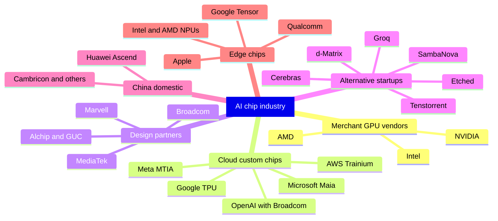
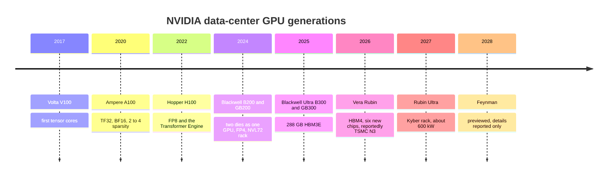
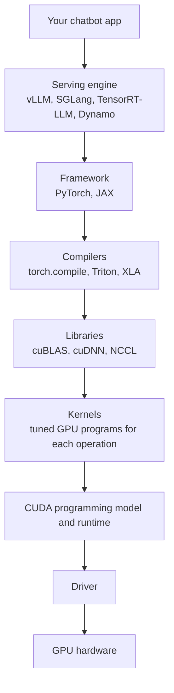
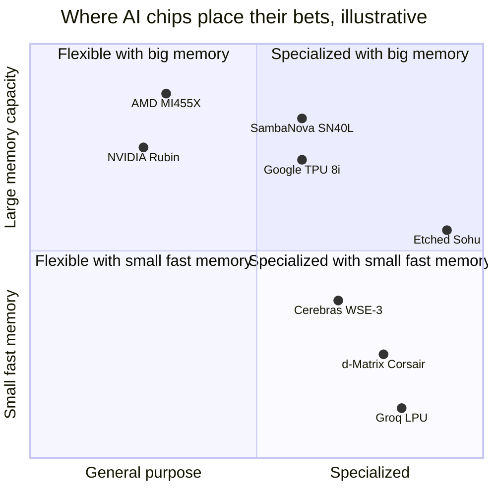
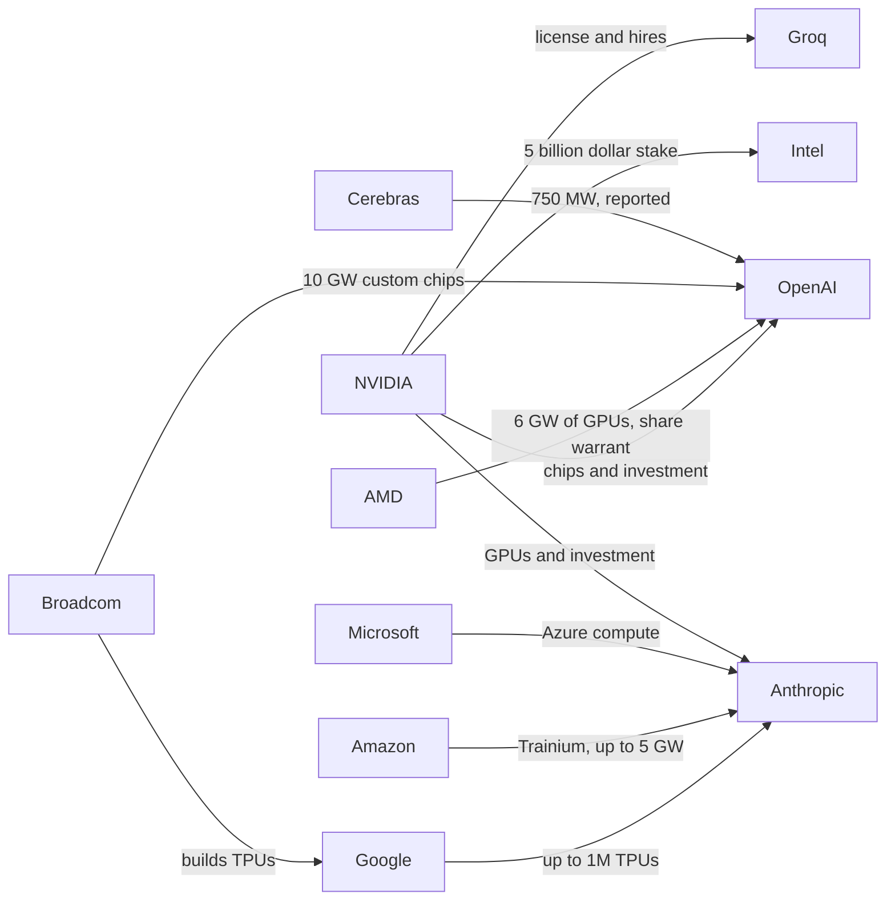
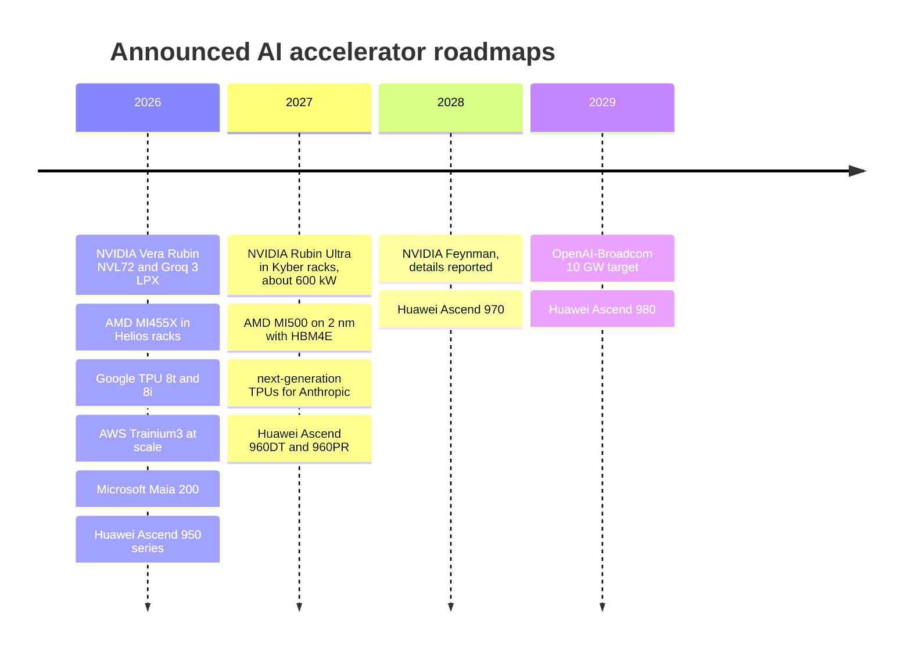

# Chapter 35: The AI Chip Industry: NVIDIA, AMD, Google, Custom Silicon and Startups

*This chapter maps the companies that make AI chips, explains why one of them earns most of the money, and gives you the tools to judge every new chip announcement, roadmap and mega-deal on your own.*

## What you'll learn

- Who makes AI chips: merchant GPU vendors, cloud companies' custom chips and their design partners, alternative-architecture startups, and phone and laptop chipmakers
- NVIDIA's generations from Volta to Feynman, with spec tables, and why NVIDIA now sells whole racks
- What the "CUDA moat" really is, layer by layer, and how ROCm, JAX and XLA, Triton and others are chipping at it
- AMD's Instinct line and Helios rack, Google's TPUs through Ironwood and TPU 8, Amazon's Trainium, and the custom chips of Microsoft, Meta and OpenAI
- The alternative architectures (Cerebras, Groq, SambaNova, Etched, Tenstorrent, d-Matrix) with an honest look at what each gives up
- Phone and laptop NPUs, what TOPS means, and why on-device AI is limited by memory
- The 2025–26 mega-deals, how to read "up to 10 gigawatts," and the roadmaps through 2028
- The physics limits ahead, and which long bets (3D stacking, photonics, in-memory compute) are real

## Before you start

Chapter 32 (From Transistor to Accelerator) explained GPUs, TPUs, tensor cores, systolic arrays and number precision. Chapter 33 (Memory and the Memory Wall) explained HBM and why memory bandwidth limits chatbot speed. Chapter 34 (Wiring Thousands of Chips Together) built the package, rack and network that every chip in this chapter lives inside. Manufacturing, TSMC and export controls are Chapter 36; the math of training and serving is Chapter 37; the money and financing behind the deals is Chapter 43.

## The map: who makes AI chips

Start with a question about your own chatbot: *which chips answer your messages?* No company publishes a full list, but the public deals give a good picture as of late 2026.

- **ChatGPT (OpenAI)** runs mostly on NVIDIA GPUs rented from Microsoft, Oracle, CoreWeave and others. OpenAI has also signed for AMD GPUs (starting with 1 GW in the second half of 2026), its own custom chips built with Broadcom (planned from the second half of 2026), and, reportedly, capacity from Cerebras. Microsoft says its own Maia 200 chip serves some OpenAI models.
- **Claude (Anthropic)** runs on three chip families: Google TPUs (a deal for up to a million TPUs), Amazon's Trainium (the Project Rainier cluster and a 2026 deal for up to 5 GW), and NVIDIA GPUs through Microsoft Azure.
- **Gemini (Google)** runs on Google's own TPUs.

So your daily chatbot use already touches at least four different chip designs. Here is the cast.



*Figure 35.1: The AI chip industry in six groups. Nearly all of them depend on the same few manufacturers: TSMC for chips and packaging, and SK hynix, Samsung and Micron for HBM memory.*

> **Definition — SK hynix:** A South Korean memory-chip maker, part of the SK business group, that leads the market for the high-bandwidth memory (HBM) stacked beside AI chips and has been NVIDIA's main HBM supplier since HBM3. Samsung (also South Korean) and Micron (American) are the other two HBM makers (Chapter 33).

A few terms organize this map.

> **Definition — Merchant silicon:** Chips designed by one company and sold to anyone who wants to buy them, as NVIDIA and AMD sell GPUs. The opposite is in-house silicon that a company builds for its own use.

> **Definition — Fabless:** A chip company that designs chips but pays a foundry (a contract chip factory, such as TSMC) to manufacture them. NVIDIA, AMD, Broadcom, Qualcomm and Apple are all fabless.

> **Analogy:** Fabless design is like being a book author who uses someone else's printing press. NVIDIA writes the book, TSMC prints it, and ASML builds the most advanced printing presses, which only ASML can make. Chapter 36 visits the print shop.

> **Definition — ASML:** A Dutch company that is the only maker of the EUV (extreme ultraviolet) lithography machines needed to print the finest patterns on today's most advanced chips (Chapter 36). Every leading-edge chip factory depends on its tools.

> **Definition — ASIC (Application-Specific Integrated Circuit):** A chip designed for one job. AI ASICs such as Google's TPU, Amazon's Trainium and Microsoft's Maia give up a GPU's flexibility to do neural-network math more cheaply and efficiently.

> **Definition — Hyperscaler:** One of the giant cloud and internet companies that operate data centers at enormous scale, chiefly Amazon, Microsoft, Google, Meta and Oracle. They buy most of the world's AI hardware.

> **Key idea:** The AI chip industry looks competitive at the design level (dozens of chips) but is extremely concentrated at the manufacturing level. Almost every accelerator in this chapter, from NVIDIA, AMD, Google, Amazon and Microsoft, is made and packaged by TSMC in Taiwan, with HBM from three companies. Chapter 36 explains why that matters.

## NVIDIA: from graphics cards to AI racks

### The size of the business

NVIDIA began in 1993 making graphics chips for video games. In the quarter that ended on July 26, 2026 (the second quarter of its fiscal year 2027; NVIDIA's accounting year runs from February to January, so fiscal 2027 is mostly calendar 2026), it reported:

- Total revenue of **$96.2 billion**, up 106% from a year earlier.
- **Data center revenue of $89.0 billion**, up 117%.
- A GAAP gross margin (measured under standard US accounting rules) of **75.0%** and net income of $59.7 billion.
- An outlook for the next quarter of $108 billion, plus or minus 2%, assuming *no* data-center compute revenue from China.

At its March 2026 GTC conference, NVIDIA said combined purchase orders for Blackwell and Vera Rubin systems were aimed at about $1 trillion through 2027.

> **Definition — GTC (GPU Technology Conference):** NVIDIA's main yearly conference, held each spring in San Jose, California, where the company announces new chips, racks and roadmaps.

> **Definition — Gross margin:** The share of revenue left after paying the direct cost of making the product. A 75% gross margin means that out of every $100 of sales, about $25 went to manufacturing (chips, memory, packaging, assembly) and $75 is left for research, other costs and profit.

**Worked example: what $89 billion a quarter means.** $89.0 billion ÷ 91 days ≈ $980 million of data-center sales *per day*. Multiply the quarter by four and you get an annualized pace of about $356 billion. With a 75% gross margin, roughly three-quarters of every dollar a cloud company pays NVIDIA is NVIDIA's gross profit. Keep that number in mind: it is the main reason every large cloud company is building its own chip.

### The generations

NVIDIA has shipped a new data-center architecture roughly every two years, and since 2024 it has moved to a yearly rhythm.



*Figure 35.2: NVIDIA's data-center generations. Each one added a new lower-precision number format or a bigger scale-up domain, not just more transistors.*

| Generation (year) | Key part | Memory | What was new |
|---|---|---|---|
| Volta (2017) | V100 | 16/32 GB HBM2 | First tensor cores |
| Ampere (2020) | A100 | 40/80 GB HBM2e, about 2 TB/s | TF32, BF16, 2:4 sparsity |
| Hopper (2022) | H100 SXM | 80 GB HBM3, 3.35 TB/s | FP8 and the Transformer Engine; about 989 TFLOPS dense BF16; 700 W; 80 billion transistors (TSMC 4N) |
| Hopper refresh (2024) | H200 | 141 GB HBM3E, 4.8 TB/s | Same compute, more and faster memory |
| Blackwell (2024–25) | B200 / GB200 | 192 GB HBM3E, 8 TB/s | Two reticle-size dies acting as one GPU; 208 billion transistors; FP4; NVLink 5 at 1.8 TB/s; the GB200 NVL72 rack |
| Blackwell Ultra (2H 2025) | B300 / GB300 | 288 GB HBM3E (12-high), 8 TB/s | About 15 PF dense FP4 per GPU; GB300 NVL72 rack |
| Vera Rubin (2026) | Rubin GPU + Vera CPU | 288 GB HBM4 | 336 billion transistors on TSMC N3 (reported); per GPU: 35 PF NVFP4 dense (training), 50 PF NVFP4 sparse (inference), 17.5 PF FP8 dense, 4 PF BF16 dense |
| Rubin Ultra (2H 2027) | Kyber rack | HBM4E | Plan from GTC 2025: 15 EF FP4 inference and 5 EF FP8 per rack, about 600 kW. GTC 2026 update, as reported: 144 GPU packages per rack ("NVL144"), each with four compute dies and about 1 TB of HBM4E |
| Feynman (2028) | — | "Custom HBM" | Previewed at GTC 2026; reported to use 3D die stacking, TSMC's A16 process, a new "Rosa" CPU and a new LPU |

*Table 35.1: NVIDIA's data-center generations, using vendor peak figures. Rubin Ultra and Feynman are plans, and the Feynman details are press reports.*

Two number-format terms keep appearing in that table, so pin them down.

> **Definition — Dense vs. sparse FLOPS:** A dense figure counts every multiplication. A sparse figure assumes a special pattern in which half the numbers are zero and can be skipped, which doubles the headline. Dense is the realistic baseline; most real workloads do not get the sparse speed-up.

> **Definition — NVFP4 and MX formats:** Four-bit (and six- and eight-bit) number formats that attach a shared scale factor to each small block of values so that very few bits can still cover a wide range. MXFP4 is an open industry standard using blocks of 32 values; NVFP4 is NVIDIA's version using blocks of 16.

The memory column also uses the names of older HBM generations.

> **Definition — HBM2, HBM2e and HBM3:** Earlier generations of High Bandwidth Memory (Chapter 33), each faster per stack than the one before: HBM2 in NVIDIA's 2017 V100, HBM2e in the 2020 A100, and HBM3 in the 2022 H100 and AMD's MI300X. HBM3E and HBM4 came next.

**Worked example: how much better is each generation?** Compare an H100 (2022) with a Rubin GPU (2026), always at the same precision:

| Measure | H100 | Rubin | Ratio |
|---|---|---|---|
| Dense BF16 compute | about 0.99 PF | 4 PF | about 4× |
| Dense FP8 compute | about 1.98 PF | 17.5 PF | about 9× |
| HBM capacity | 80 GB | 288 GB | 3.6× |
| HBM bandwidth | 3.35 TB/s | 19.2 TB/s (product page) | 5.7× |

*Table 35.2: Four years of NVIDIA progress at matched precision. The H100's FP8 figure is its dense rating of about 1,979 TFLOPS.*

Notice three things. Low-precision math grew fastest, because each generation added hardware tuned for smaller numbers. Memory bandwidth grew more slowly than compute, which is the memory wall from Chapter 33 in action. And if you compared the H100's dense BF16 (about 1 PF) with Rubin's sparse NVFP4 inference figure (50 PF), you would get a meaningless "50×." Marketing slides do exactly that.

> **Watch out:** Vendors revise specs between announcement and shipping. At the January 2026 CES launch, coverage quoted Rubin at 22 TB/s of HBM bandwidth and 3.6 TB/s of NVLink per GPU; NVIDIA's current product page lists 19.2 TB/s and 3 TB/s. Always use the latest official spec sheet and note its date.

### Why NVIDIA sells racks, not chips

Ten years ago NVIDIA sold graphics cards that went into other companies' servers. In 2026 its flagship product is the Vera Rubin NVL72, a complete rack. The Rubin platform consists of six new chips that NVIDIA designed together: the Vera CPU, the Rubin GPU, the NVLink 6 switch, the ConnectX-9 SuperNIC, the BlueField-4 DPU and the Spectrum-6 Ethernet switch. Add NVIDIA's software, its reference rack designs (built by manufacturers such as Foxconn and Quanta), and, since 2026, its Groq-based inference racks, and NVIDIA supplies nearly everything except the building.

Why go to all that trouble?

1. **Performance comes from the system.** As Chapter 34 showed, an NVL72 is valuable because 72 GPUs share one memory-like fabric. That requires the GPU, switch and cables to be designed together.
2. **Speed of deployment.** Customers want working capacity in weeks, not a year of integration. A pre-tested rack design gets there faster.
3. **More of each dollar.** A data center buyer spends money on GPUs, CPUs, networking and software. Selling all of them captures more revenue per gigawatt.
4. **Stickiness.** When the GPU, network, NIC and software all come from one vendor and are tuned together, swapping out any single piece is harder.

Prices are not published. Industry reports put a GB200 or GB300 NVL72 rack at roughly $3–4 million, and an H100 reportedly sold for around $25,000–40,000; treat both as unconfirmed estimates. Why so much? Chapter 36 works through it: the processed silicon is only a few percent of the price, and the rest pays for HBM, advanced packaging, years of design and software, and NVIDIA's margin (about 75%, above).

The flip side of this strategy is that customers feel locked in, and that pushes the biggest buyers toward their own chips. NVIDIA has partly answered with NVLink Fusion (Chapter 34), which lets other companies' CPUs and accelerators plug into NVLink fabrics; AWS says its future Trainium4 will use it.

> **Watch out:** "The chip is the product" is an outdated idea. In 2026 the unit of design and sale is the rack (NVL72, Helios, a TPU pod), and increasingly the whole data center. When comparing vendors, compare racks or pods, including networking and software, not just one chip.

### The Groq deal and the split between training and inference

Chapter 23 explained that answering a prompt has two phases: *prefill* (reading your whole prompt at once, which is compute-heavy) and *decode* (writing the answer one token at a time, which is limited by memory bandwidth). In 2025–26 the industry started building different chips for each.

> **Definition — Disaggregated serving:** Running the prefill and decode phases of AI inference on different chips (sometimes different kinds of chips), each tuned for its phase, and passing the conversation's KV cache between them.

In late December 2025, NVIDIA reportedly paid around $20 billion for a non-exclusive license to the inference technology of Groq, a startup, and hired its leadership, including CEO Jonathan Ross. Groq stayed an independent company and kept running its GroqCloud service. At GTC 2026 NVIDIA introduced the **Groq 3 LPU** and the **LPX rack**: 256 LPUs per rack, each chip with about 500 MB of on-chip SRAM, about 150 TB/s of SRAM bandwidth and about 1.2 PF of FP8 compute. The LPX is meant to generate tokens at very low latency alongside Vera Rubin racks, which hold the large KV caches. NVIDIA claims up to 35 times more throughput per megawatt at high interactivity; that is a vendor claim. By NVIDIA's August 2026 earnings report, the LPX was in full production.

> **Definition — LPX (Groq 3 LPX rack):** NVIDIA's inference rack, introduced at GTC 2026, holding 256 Groq 3 LPUs (Language Processing Units: Groq-designed chips that keep a model's weights in fast on-chip SRAM, explained later in this chapter). It generates tokens at very low latency beside Vera Rubin racks that hold the large KV caches.

NVIDIA also announced, in September 2025, the **Rubin CPX**, a GPU using cheaper GDDR7 memory meant for the prefill phase of very long prompts. Its 2026 shipping status was not confirmed in this book's sources.

> **Definition — Rubin CPX:** A GPU that NVIDIA announced in September 2025 for the compute-heavy prefill phase of very long prompts. It uses GDDR7, the cheaper graphics memory found on gaming cards (Chapter 33), instead of HBM, because prefill needs arithmetic more than memory bandwidth.

> **At the frontier (2026):** The biggest shift in AI chips this year is specialization. NVIDIA pairs Rubin GPUs with Groq-based LPUs; Google split its eighth-generation TPU into a training chip (8t) and an inference chip (8i); Microsoft's Maia 200 and AWS's Inferentia target inference. Inference spending at major labs now rivals or exceeds training, so it pays to build chips just for it.

### Beyond the data center

NVIDIA also sells smaller machines. The **DGX Spark**, a desktop computer built on a GB10 chip (a small Grace Blackwell chip that pairs Arm CPU cores with a Blackwell GPU) with 128 GB of memory shared by CPU and GPU, reportedly began shipping in October 2025; a 64 GB version, sold only through partner PC makers, followed in October 2026. **RTX Spark** (RTX is NVIDIA's brand for its gaming and workstation graphics), a roughly 1-petaflop Windows PC chip made with Microsoft, was announced in 2026, according to NVIDIA's earnings release. In September 2025 NVIDIA invested $5 billion in Intel to co-develop x86 CPUs that connect over NVLink, along with PC chips. And in the MLPerf Training 6.0 results (2026), NVIDIA says Blackwell systems led every category.

> **Definition — MLPerf:** A set of standardized AI training and inference benchmarks run by the MLCommons industry group, where vendors submit results under shared rules. It is the closest thing to an independent, apples-to-apples comparison of AI hardware, though not every vendor participates.

## The CUDA moat: why software is NVIDIA's real fortress

### A chip is useless without its software

A chip only understands its own low-level instructions. Between the line of Python an AI researcher writes and the electrical signals in a GPU sit about seven layers of software. Each layer must exist, be fast and be correct for every new chip.



*Figure 35.3: The software stack between a chatbot and a GPU. NVIDIA owns or leads most of the lower layers; that is the moat.*

> **Definition — CUDA:** NVIDIA's software platform, released in 2007, that lets programmers run general calculations on its GPUs. It includes a programming language extension, compilers, libraries, tools and documentation, and only runs on NVIDIA hardware.

> **Definition — Kernel (GPU kernel):** A small program that runs on the GPU to perform one operation, such as a matrix multiplication or an attention step. Writing fast kernels is one of the most prized skills in AI engineering.

> **Definition — GPU library:** A collection of pre-written, heavily tuned kernels for common operations. NVIDIA's cuBLAS handles matrix math and cuDNN handles neural-network layers, so most programmers never write those kernels themselves.

> **Definition — NCCL and RCCL:** NVIDIA's (NCCL, "nickel") and AMD's (RCCL) libraries for collective communication, the coordinated data exchanges such as all-reduce that let thousands of GPUs train one model together.

> **Definition — Framework (PyTorch, JAX):** The software toolkit researchers use to build and train models in Python. PyTorch (from Meta) dominates; JAX (from Google) is used heavily with TPUs. The framework calls libraries and kernels underneath.

> **Definition — ML compiler (XLA, Triton, torch.compile):** Software that translates a model written in a framework into efficient instructions for a specific chip, often fusing several operations into one kernel. XLA powers TPUs; Triton (created at OpenAI) lets engineers write GPU kernels in Python-like code.

> **Definition — Serving engine:** Software that runs a trained model for many users at once, handling batching, the KV cache and scheduling. Examples are vLLM, SGLang, NVIDIA's TensorRT-LLM and NVIDIA's Dynamo.

### Why twenty years of software is so hard to copy

> **Definition — Software moat (lock-in):** An advantage that comes from customers' investment in a vendor's software ecosystem, which makes switching to a rival costly even when the rival's hardware is competitive.

The moat is not one thing. It is many small advantages that compound:

- **Time.** CUDA has had nearly two decades of fixes, features and tuning. AlexNet, the 2012 result that started the deep-learning boom, was trained on NVIDIA GPUs with CUDA, and the habit never broke.
- **New ideas arrive on CUDA first.** When researchers invent a faster attention method or a new number format, the first working code is almost always CUDA kernels. Rivals have to port it later.
- **Day-one libraries.** Each new NVIDIA generation ships with cuBLAS, cuDNN, NCCL and TensorRT-LLM already tuned for it.
- **People.** Millions of developers, university courses, tutorials and forum answers assume CUDA.
- **Reliability at scale.** NCCL has been tested on clusters of tens of thousands of GPUs. A buyer spending billions values "it works" over "it might be cheaper."
- **Tools.** Profilers, debuggers and monitoring tools that show where time goes.

> **Analogy:** CUDA is like English for GPU programming. You can do science in other languages, and some people do it very well, but most of the textbooks, journals, job ads and hallway conversations are in English. Switching is possible; it is just expensive and slow.

> **Watch out:** "CUDA is just a programming language" misses the point. The language is the smallest part. The moat is the ecosystem of libraries, compilers, tools, documentation and trained people built up over about twenty years.

### How the moat is being crossed

Several forces are wearing it down:

1. **Most model code is written in PyTorch or JAX, not CUDA.** If the framework runs well on another chip, most of a lab's code moves with it. That shifts the battle to the libraries and kernels underneath.
2. **Triton and other compilers.** Triton lets engineers write fast kernels once in Python-like code and compile them for different vendors' GPUs, including AMD's.
3. **XLA and JAX.** Google's compiler stack makes TPUs usable without CUDA at all; Gemini is built on it.
4. **Vendor stacks.** AMD's ROCm (next section) and AWS's Neuron SDK for Trainium provide their own libraries and compilers.
5. **Multi-vendor serving engines.** vLLM and SGLang support several chip families, so an inference team can switch hardware without rewriting its serving system.
6. **The biggest buyers can afford to cross.** Anthropic trains and serves Claude across Google TPUs, Amazon Trainium and NVIDIA GPUs. That proves the moat can be crossed, but only with large, specialized engineering teams.

The honest summary for late 2026: for the largest labs, the moat is now a cost rather than a wall. For smaller companies and researchers trying new ideas, NVIDIA plus CUDA is still the path of least resistance.

> **Try it:** Ask a chatbot: "Show me a tiny GPU kernel that adds two vectors, first in CUDA C++ and then in Triton, and explain each line for someone who has never programmed." Compare how much each version asks the programmer to manage by hand. That difference is part of why compilers like Triton matter for breaking lock-in.

## AMD: the main merchant alternative

AMD is the only other company selling high-end AI GPUs to all comers at large scale. Its Instinct line has followed a consistent strategy: offer more memory per GPU than NVIDIA, embrace open standards, and compete on price.

| Chip (year) | Memory | Bandwidth | Headline compute | Notes |
|---|---|---|---|---|
| MI300X (Dec 2023) | 192 GB HBM3 | 5.3 TB/s | — | 153 billion transistors in a chiplet design |
| MI325X (late 2024) | 256 GB HBM3E | 6 TB/s | — | Memory upgrade |
| MI355X (2H 2025, CDNA 4) | 288 GB HBM3E | 8 TB/s | 10.1 PF dense MXFP4 (AMD lists no sparse FP4 figure) | 1,400 W, liquid-cooled; 185 billion transistors |
| MI455X (2026, CDNA 5) | 432 GB HBM4 | 19.6 TB/s (a later AMD briefing cited up to 23.3) | about 40 PF dense FP4; about 20 PF FP8 | 3.6 TB/s scale-up; TSMC 2 nm and 3 nm chiplets |
| MI430X (AMD expects 2027) | 432 GB HBM4 | — | 288 TFLOPS FP64 | Aimed at mixed scientific (FP64) and AI work |
| MI440X (2026) | — | — | — | Sold in an 8-GPU server |
| MI500 (2027, CDNA 6) | HBM4E | — | — | TSMC 2 nm |

*Table 35.3: AMD Instinct accelerators, vendor figures. Dashes mean the figure is not in this book's sources.*

> **Definition — MI500:** AMD's next Instinct GPU generation after the MI400 family (which includes the MI455X), planned for 2027 on TSMC's 2 nm process with HBM4E memory. It uses CDNA 6; CDNA is AMD's name for each design generation of its data-center GPUs (CDNA 4 in the MI355X, CDNA 5 in the MI455X).

AMD's 2026 flagship is not a chip but a rack. **Helios** combines 72 MI455X GPUs with AMD's EPYC "Venice" CPUs (2 nm, up to 256 Zen 6 cores) and Pensando "Vulcano" network cards, in Meta's Open Rack Wide format, with the GPUs joined by UALink carried over Ethernet (Chapter 34). Rack totals: 2.9 EF dense FP4, 1.4 EF FP8, 31 TB of HBM4 and about 1.4–1.7 PB/s of memory bandwidth (AMD's pages give both 19.6 and up to 23.3 TB/s per GPU). Shipments begin in the second half of 2026 and ramp through 2027. AMD claims up to 30% more tokens per dollar than a Vera Rubin NVL72; that is AMD's own claim, not an independent test.

**Worked example: Helios versus Vera Rubin NVL72.**

| Rack | HBM | Dense FP4 | FP8 | HBM bandwidth |
|---|---|---|---|---|
| AMD Helios | 31 TB | 2.9 EF | 1.4 EF | about 1.4–1.7 PB/s |
| NVIDIA Vera Rubin NVL72 | 20.7 TB | 2.52 EF (NVFP4) | 1.26 EF | about 1.4 PB/s |
| Ratio | about 1.5× | about 1.15× | about 1.1× | about equal to 1.2× |

*Table 35.4: Two 72-GPU racks of 2026 compared using vendor figures. Formats differ slightly (AMD's FP4 versus NVIDIA's NVFP4).*

> **Try it:** Open AMD's Instinct MI355X product page and NVIDIA's GB300 NVL72 page side by side. Write down memory per GPU, memory bandwidth and the FP4 figure for each, marking dense or sparse. You will see why AMD leads its marketing with memory, and how hard it is to line up two vendors' numbers.

On paper the racks are close on compute and bandwidth, and AMD has about 50% more memory. That matters for serving huge mixture-of-experts models and long conversations, where the KV cache eats memory (Chapter 33). What the table cannot show is software maturity, real-world utilization and shipping dates, which is where AMD has historically lagged.

> **Definition — ROCm:** AMD's open-source software platform for programming its GPUs, its answer to CUDA. It includes compilers, math libraries and the RCCL communication library.

> **Definition — HIP:** AMD's programming interface, which closely mirrors CUDA so that CUDA code can be translated to run on AMD GPUs with relatively few changes.

ROCm has historically trailed CUDA in maturity, polish and day-one support for new techniques. It improved through 2025–26, helped by better AMD support in PyTorch, Triton and vLLM and by the arrival of very large customers willing to invest engineering time. The decisive vote of confidence came on October 6, 2025, when OpenAI and AMD announced a multi-generation agreement for **6 GW** of AMD GPUs, starting with **1 GW of MI450-series chips (the family that includes the MI455X) in the second half of 2026**. The deal reportedly included a warrant letting OpenAI buy up to 160 million AMD shares, roughly 10% of the company, as deployment milestones are met.

> **Definition — Warrant:** A contract giving its holder the right to buy a company's shares at a set price, often only after conditions are met. Chip vendors have used warrants to tie big customers' purchases to a stake in the vendor's success.

## Google TPUs: the original AI ASIC

### Why Google built its own chip

Around 2013, Google engineers estimated that if users talked to voice search for a few minutes a day, running the neural networks on CPUs would require doubling Google's data centers. That fear produced the first Tensor Processing Unit, deployed in 2015. It was built for inference only, using 8-bit integers, and its heart was a 256 × 256 grid of multiply-accumulate units: 65,536 multipliers working in lockstep.

> **Definition — Systolic array:** A grid of multiply-add units through which numbers flow from neighbor to neighbor, like a bucket brigade, so each number fetched from memory is reused many times. It is the core of Google's TPU (see Chapter 32).

> **Definition — TPU (Tensor Processing Unit):** Google's family of chips designed specifically for neural-network math, first deployed in Google's data centers in 2015. They are AI ASICs built around systolic arrays and linked into large pods by Google's own interconnect, and reached their eighth generation in 2026.

| Generation | Year | Key facts |
|---|---|---|
| TPU v1 | 2015 | 28 nm, INT8 inference only, one 256 × 256 systolic array |
| TPU v2 | 2017 | Added training, BF16 and HBM |
| TPU v3 | 2018 | Faster, larger pods |
| TPU v4 | 2021 | 4,096-chip pods linked with optical circuit switches |
| TPU v5e / v5p | 2023 | Cost-optimized (e) and performance (p) versions |
| Trillium (v6e) | 2024 | 918 TFLOPS BF16, 32 GB HBM, 256-chip pods |
| Ironwood (v7) | 2025 | 4,614 TFLOPS FP8, 192 GB HBM3E at 7.37 TB/s, pods of 256 or 9,216 chips (42.5 EF FP8 and 1.77 PB HBM per pod) |
| TPU 8t (training) | 2026 | 12.6 PF FP4, 216 GB HBM at 6.5 TB/s, 128 MB SRAM, 3D torus, up to 9,600 chips and 2 PB HBM per superpod |
| TPU 8i (inference) | 2026 | 10.1 PF FP4, 288 GB HBM at 8.6 TB/s, 384 MB SRAM, "Boardfly" topology of 1,152 chips |

*Table 35.5: Google TPU generations. Ironwood was announced in April 2025 and generally available by Cloud Next 2026; TPU 8 was announced on April 22, 2026.*

The 2026 split is the most revealing part of the table. The training chip (8t) has *less* memory than the inference chip (8i), 216 GB versus 288 GB, but is built to join huge superpods: Google says it delivers about 3 times Ironwood's processing power per pod, up to 2.7 times better training price-performance, and, through the Virgo fabric, more than 134,000 chips in one network and over a million in one training job. The inference chip has more HBM, more bandwidth and three times the on-chip SRAM of its predecessor, plus a dedicated engine for collective communication. Google claims up to 80% better inference price-performance. Both use Google's own Arm-based Axion CPUs as hosts; Google did not disclose their process node (the chip-manufacturing generation, such as TSMC N3; Chapter 36) or power.

> **Key idea:** Training wants raw compute and enormous, tightly connected pods. Inference, especially decode, wants memory capacity, memory bandwidth and fast on-chip storage. Once a company spends tens of billions a year on each, building separate chips pays off.

### Who uses TPUs

Google's own products (Gemini, Search, YouTube) run on TPUs, and Google Cloud rents them to customers. The largest outside customer is Anthropic. In October 2025 Anthropic announced access to **up to one million TPUs**, worth tens of billions of dollars, bringing well over a gigawatt online in 2026. In April 2026 it announced a further agreement with Google and Broadcom for "multiple gigawatts" of next-generation TPUs starting in 2027; a Broadcom filing reportedly implies about 3.5 GW. Google designs TPUs with Broadcom as its main design partner, and MediaTek has been reported as a partner for TPU 8i. Google also rents NVIDIA systems and said it would be among the first clouds to offer Vera Rubin NVL72.

## Amazon: Trainium and Inferentia

Amazon's chips come from Annapurna Labs, a chip company it bought in 2015.

> **Definition — Trainium and Inferentia:** Amazon Web Services' in-house AI chips. Trainium is built mainly for training (and increasingly for inference); Inferentia is built for inference. Both are programmed through AWS's Neuron software kit.

- **Trainium2** comes in "UltraServers" of 64 chips. **Project Rainier**, a cluster in Indiana built for Anthropic, was switched on in October 2025 with about half a million Trainium2 chips, according to Amazon.
- **Trainium3**, generally available in December 2025, is AWS's first 3 nm AI chip: 144 GB of HBM3E at 4.9 TB/s per chip. A Trn3 UltraServer joins **144 chips** for **362 PF of MXFP8**, 20.7 TB of HBM3E and 706 TB/s of aggregate bandwidth, through AWS's NeuronSwitch fabric. AWS claims up to 4.4 times the compute and 4 times the energy efficiency of Trn2 UltraServers, and has said thousands of UltraServers can be linked into clusters of up to a million Trainium3 chips.
- **Trainium4** will support NVIDIA's NVLink Fusion, a notable sign that even rivals want to plug into NVIDIA's fabric.

Check the per-chip numbers yourself: 362 PF ÷ 144 ≈ 2.5 PF of FP8 per chip, and 20.7 TB ÷ 144 ≈ 144 GB per chip. They match.

In April 2026, Anthropic and Amazon announced an agreement for **up to 5 GW**, with nearly 1 GW of Trainium2 and Trainium3 capacity online by the end of 2026; Anthropic said it would commit more than $100 billion to AWS over ten years.

## Microsoft, Meta, OpenAI and Intel

**Microsoft Maia 200** (January 2026) is made on TSMC's 3 nm process. Microsoft's published specs: more than 140 billion transistors, 216 GB of HBM3E at 7 TB/s, 272 MB of on-die SRAM, more than 10 PF of FP4 and more than 5 PF of FP8 within 750 W, with an Ethernet-based scale-up network reaching up to 6,144 accelerators. Microsoft deployed it first in Iowa, with Arizona next, to run Microsoft 365 Copilot and OpenAI models, and claims 30% better performance per dollar than its existing fleet. A successor has been reported but not confirmed.

**Meta's MTIA** chips are RISC-V-based inference accelerators, built first for the recommendation and ranking models behind Facebook and Instagram feeds (Chapter 51). A 2025 paper at ISCA, a top computer-architecture conference, reported 44% lower total cost of ownership (the full cost of buying, powering and running hardware over its life) than GPUs on specific inference tasks. In fall 2025 Meta announced it was acquiring Rivos, a RISC-V chip startup reportedly valued around $2 billion, to speed up MTIA, including a push toward training.

> **Definition — RISC-V:** A free, open instruction set (the basic vocabulary of commands a processor understands) that anyone can use without license fees. It is popular with startups and appears in AI chips such as Meta's MTIA and Tenstorrent's designs.

> **Definition — MTIA (Meta Training and Inference Accelerator):** Meta's own family of custom AI chips, built first to run the recommendation and ranking models behind Facebook and Instagram feeds. They are based on RISC-V and designed with Broadcom.

**OpenAI and Broadcom** announced on October 13, 2025 that OpenAI would design custom AI accelerators, with Broadcom developing them and supplying Ethernet networking, for **10 GW** deployed from the second half of 2026 through 2029. Whether the first chips had been deployed by October 2026 was not confirmed in this book's sources. OpenAI has said it used its own AI models to help with parts of the chip design.

**Intel** has struggled in AI accelerators. Its Gaudi 3 (2024, 128 GB of HBM2e) saw limited adoption, and it has announced an inference GPU called Crescent Island, with 160 GB of LPDDR5X memory, reportedly sampling in the second half of 2026. Intel's bigger AI story in 2025–26 was financial: the US government took a 9.9% stake in August 2025, NVIDIA invested $5 billion in September 2025, and Intel itself invested in SambaNova (cleared in May 2026).

### Why build your own chip?

Every hyperscaler now designs AI chips. The reasons:

1. **Cost.** At a 75% gross margin, most of what a cloud pays NVIDIA is NVIDIA's profit. A chip you design yourself can, if it works, cost much less per unit of useful work.
2. **Supply security.** NVIDIA's best chips have been sold out for years. Your own chip gives you a second line in the queue at TSMC (though you still compete for the same factories and HBM).
3. **Bargaining power.** A credible alternative improves the price you get from NVIDIA.
4. **Fit.** You can tune the chip to your own models: Google's TPUs for its models, Meta's MTIA for recommendation, Maia for Copilot.

And the reasons it is hard: a leading-edge chip design costs several hundred million dollars, takes two to three years, needs a full software stack, and bets that today's model architectures will still matter when the chip ships.

> **Analogy:** A restaurant chain that buys all its bread from one bakery charging a 75% markup eventually builds its own bakery. Not because it bakes better bread, but because it buys so much bread that even a decent bakery of its own saves a fortune, and because the outside bakery keeps selling out.

**Worked example (illustrative).** Suppose a cloud company plans to spend $20 billion a year on AI accelerators. If its supplier's gross margin is 75%, about $15 billion of that is the supplier's gross profit. A custom-chip program costing, say, $1 billion a year in design, partner fees and software would pay for itself if it replaced even a modest fraction of those purchases at much lower unit cost. That logic, not technical pride, is why Google, Amazon, Microsoft, Meta and OpenAI all have chip programs. The numbers here are made up to show the shape of the decision; real figures are private.

Most hyperscalers do not design every part of the chip themselves. They hire specialists.

> **Definition — Design partner (custom silicon partner):** A company such as Broadcom, Marvell, MediaTek or Alchip that turns a customer's chip architecture into a manufacturable product, supplying high-speed I/O circuits, physical design, packaging and the relationship with the foundry.

> **Definition — Tape-out:** The moment a chip design is finished and sent to the foundry to be manufactured. It marks the end of design and the start of a months-long wait for first silicon.

| Company | Chip family | Design partner(s) | Status, late 2026 | Main use |
|---|---|---|---|---|
| Google | TPU Ironwood, TPU 8t and 8i | Broadcom; MediaTek reported for 8i | Ironwood generally available; TPU 8 announced April 2026 | Gemini, Google Cloud, Anthropic |
| Amazon | Trainium2/3, Inferentia | In-house Annapurna Labs, with Marvell | Trainium3 generally available since Dec 2025 | Anthropic, AWS customers |
| Microsoft | Maia 200 | Marvell (per industry reports) | Deployed in 2026 | Copilot, OpenAI models |
| Meta | MTIA | Broadcom | In production for inference; Rivos acquired | Feed ranking and recommendations |
| OpenAI | Custom accelerator | Broadcom | Deployment planned 2H 2026 to 2029 | OpenAI's own models |

*Table 35.6: Hyperscaler custom silicon as of October 2026.*

## The 2026 lineup side by side

Here are the flagship accelerators of 2026 in one table. Read it with the warning that follows.

| Chip | Company | Memory per chip | Bandwidth | Headline compute (precision) | Largest tight domain |
|---|---|---|---|---|---|
| Rubin | NVIDIA | 288 GB HBM4 | 19.2 TB/s | 35 PF NVFP4 dense; 17.5 PF FP8 | 72 per NVL72 |
| B300 | NVIDIA | 288 GB HBM3E | 8 TB/s | about 15 PF FP4 dense | 72 per NVL72 |
| MI455X | AMD | 432 GB HBM4 | 19.6–23.3 TB/s | about 40 PF FP4 dense; about 20 PF FP8 | 72 per Helios |
| MI355X | AMD | 288 GB HBM3E | 8 TB/s | 10.1 PF MXFP4 dense | 8-GPU servers |
| TPU 8t | Google | 216 GB HBM | 6.5 TB/s | 12.6 PF FP4 | 9,600 per superpod |
| TPU 8i | Google | 288 GB HBM | 8.6 TB/s | 10.1 PF FP4 | 1,152 |
| Ironwood | Google | 192 GB HBM3E | 7.37 TB/s | 4.6 PF FP8 | 9,216 per pod |
| Trainium3 | AWS | 144 GB HBM3E | 4.9 TB/s | about 2.5 PF MXFP8 | 144 per UltraServer |
| Maia 200 | Microsoft | 216 GB HBM3E | 7 TB/s | more than 10 PF FP4; more than 5 PF FP8 | up to 6,144 |
| Groq 3 LPU | NVIDIA (Groq license) | about 0.5 GB SRAM | about 150 TB/s | about 1.2 PF FP8 (reported) | 256 per LPX rack |
| WSE-3 | Cerebras | 44 GB SRAM | (on-wafer) | about 125 PF peak (sparse FP16, vendor) | one wafer per system |

*Table 35.7: 2026 flagship accelerators, using vendor peak figures. The precisions, sparsity assumptions and domain types differ, so this table is a map, not a ranking.*

> **Watch out:** You cannot rank these chips from this table. A "PF" in FP4 is not a "PF" in FP8; a 9,600-chip torus is not a 72-GPU NVLink domain; and peak numbers say nothing about how well software uses them. The only fair comparisons are the same model, the same precision and the same metric (cost per million tokens, or time to train) on real systems, which is what MLPerf and careful customers try to measure.

## Alternative architectures: the honest trade-offs

### The common enemy is memory

Every chip so far follows the same basic recipe: a big compute die (or two) surrounded by HBM stacks. Chapter 33 showed the weakness of that recipe: during decode, the chip must stream all of the model's weights from HBM for every token, so speed is capped at roughly memory bandwidth ÷ model size. The startups below each attack that limit, or the cost of generality, in a different way.

> **Definition — SRAM (static RAM):** Very fast memory built from transistors on the chip itself. It is far faster than HBM but holds much less per square millimeter and costs much more per byte, so ordinary chips use it only for small caches.

> **Definition — LPU (Language Processing Unit):** Groq's inference chip design, which keeps model weights in on-chip SRAM instead of HBM and runs on a fixed schedule planned in advance by a compiler, so every step takes a predictable time.

> **Definition — Wafer-scale engine (WSE):** Cerebras's approach of using nearly an entire silicon wafer as one giant chip, instead of cutting it into hundreds of small chips, so that huge amounts of SRAM and compute sit on one piece of silicon.

**Worked example: holding and running a 70-billion-parameter model at 8 bits (70 GB of weights).**

- **One NVIDIA B300** (288 GB HBM, 8 TB/s): the whole model fits on one chip with room left for the KV cache. The best possible single-user decode speed is about 8,000 GB/s ÷ 70 GB ≈ **114 tokens per second**.
- **First-generation Groq chips** (about 230 MB SRAM each): 70,000 MB ÷ 230 MB ≈ **305 chips** just to hold the weights.
- **Groq 3 LPUs** (about 500 MB SRAM, about 150 TB/s each): 70,000 ÷ 500 = **140 chips**. Each chip holds a slice of the layers, and a token passes through them like an assembly line. Each chip reads its 0.5 GB slice in 0.5 GB ÷ 150,000 GB/s ≈ 3.3 µs, so the whole model takes about 140 × 3.3 µs ≈ 0.47 ms per token: an upper bound of roughly **2,100 tokens per second** for one user, ignoring chip-to-chip hops and compute time.
- **Cerebras WSE-3** (44 GB SRAM): 70 ÷ 44 ≈ 1.6, so **2 wafers**.

```
   Chips needed to hold a 70B model at 8 bits (70 GB)

   NVIDIA B300, 288 GB HBM   | 1
   Cerebras WSE-3, 44 GB     | 2   (wafers)
   Groq 3 LPU, ~0.5 GB       |##############  140
   Groq gen-1, ~0.23 GB      |##############################  305
                               (each # = 10 chips)
```

*Figure 35.4: SRAM-based designs trade capacity for speed. They need many chips (or wafers) to hold a big model, but each byte can be read much faster.*

> **Analogy:** An HBM-based GPU is a chef with a big pantry next door: everything fits, but every trip to the pantry takes time. An SRAM-based chip is a chef with every ingredient already on the counter: instant, but the counter is tiny, so you need a line of 140 chefs, each holding part of the recipe and passing the dish along.

This is the whole trade-off in one picture. SRAM designs can deliver thousands of tokens per second to a single user, which is why Cerebras is known for very fast inference. But they need many chips per model, leave little room for the KV cache of long conversations, and cost more per user served when demand is about cheap bulk throughput rather than speed. That is exactly why NVIDIA pairs its Groq-based LPX racks (fast weights) with Vera Rubin racks (big memory for the KV cache) instead of replacing one with the other.

### The startups, one by one

> **Definition — Dataflow architecture:** A chip design in which the hardware is configured so data streams through a fixed arrangement of compute units for a given model, rather than fetching instructions one at a time. SambaNova calls its version a Reconfigurable Dataflow Unit (RDU).

> **Definition — In-memory computing:** Doing arithmetic inside or right next to the memory cells that store the numbers, so weights barely move. Digital versions (like d-Matrix's) use ordinary logic; analog versions use electrical currents and are noisier.

> **Definition — Photonic interconnect:** Moving data between chips with light instead of electrical signals, using optical components built into or beside the chip package, to get more bandwidth per watt over longer distances.

| Company | Core bet | Where it shines | What it gives up | Status, late 2026 |
|---|---|---|---|---|
| Cerebras | Wafer-scale chip: 46,225 mm², 4 trillion transistors, 900,000 cores, 44 GB SRAM (WSE-3) | Very fast single-user inference, thousands of tokens per second | Capacity per wafer is small for the largest models; specialized systems and a smaller software ecosystem | In August 2026 Cerebras announced the CS-4, a rack of three WSE-3T wafers that it rates at 750 PF in total (a vendor figure); OpenAI reportedly signed for 750 MW of Cerebras capacity in January 2026 |
| Groq | SRAM-only, compiler-scheduled LPU | Low, predictable latency for decode | Hundreds of chips per large model; little memory for long contexts | Technology licensed to NVIDIA (about $20B reported) and sold as Groq 3 LPX; GroqCloud still runs |
| SambaNova | Reconfigurable dataflow (SN40L) with three memory tiers: SRAM, HBM and DDR (ordinary DRAM) | Hosting many models at once and switching between them quickly | Competes with GPUs on general workloads with a far smaller ecosystem | Intel invested in 2026 |
| Etched | Sohu, an ASIC hard-wired for transformer inference | Potentially high efficiency if transformers stay dominant | Useless for architectures that are not transformers (state-space models, new hybrids; see Chapter 17) | Little independent public performance data in this book's sources |
| Tenstorrent | RISC-V cores and an open-source software stack, led by veteran chip designer Jim Keller; also licenses its designs | Openness, licensable IP (chip designs other companies pay to use), lower cost | Unproven at frontier-cluster scale | Sells chips (Blackhole) and licenses IP |
| d-Matrix | Corsair: digital in-memory compute for inference | Energy efficiency by not moving weights | Limited memory capacity and maturity | Inference-focused products |
| Lightmatter, Ayar Labs, Celestial AI | Optical input/output for chips | Bandwidth per watt and reach | Manufacturing maturity and reliability at scale | Developing optical I/O; not yet mainstream in AI clusters |

*Table 35.8: Alternative AI chip architectures and what they trade away. Performance claims in this space are mostly vendor claims.*

> **Definition — Transformer-specific ASIC:** A chip whose circuits are hard-wired for the operations of transformer models. It can be very efficient but becomes obsolete if the dominant model architecture changes.



*Figure 35.5: A rough map of design bets. Positions are judgments for teaching, not measurements.*

> **Key idea:** Every alternative architecture buys something (speed for one user, efficiency, openness, flexibility) by giving something up (memory capacity, generality, ecosystem). When a startup claims a big win, find the trade it made and ask whether your workload cares.

### Why startups struggle, and where the openings are

The history of AI chip startups is full of good hardware that never found enough customers. The obstacles are the ones you have already met: the CUDA ecosystem; NVIDIA's yearly cadence, which moves the target before a startup's two-to-three-year design cycle finishes; competition for TSMC capacity, CoWoS packaging and HBM; and buyers' fear of betting billions on a small supplier. Then there is the specific risk of over-specializing: a chip tuned for 2024's models may arrive in a 2027 world of different architectures.

But 2025–26 also opened doors. Inference is now a huge market, it splits into phases with different needs, and some customers will pay a premium for speed (an agent that thinks ten times faster finishes tasks ten times sooner). NVIDIA's decision to license Groq's technology rather than ignore it is the clearest signal that the alternative ideas have real value.

> **At the frontier (2026):** China has its own crowded field of AI chipmakers (Huawei's Ascend line plus Cambricon, Hygon, Moore Threads, MetaX, Biren, Alibaba's T-Head and Baidu's Kunlunxin), shaped by US export controls that block access to NVIDIA's best chips and to advanced manufacturing tools. Huawei's strategy is many weaker chips joined by lots of optics and power into "SuperPoDs." Chapter 36 covers this in depth.

## Edge NPUs and TOPS: AI in your pocket

Your phone and laptop also contain AI accelerators, much smaller ones.

> **Definition — NPU (Neural Processing Unit):** A small AI accelerator built into a phone, tablet or laptop processor (for example Apple's Neural Engine or Qualcomm's Hexagon) to run AI features efficiently on the device's battery.

> **Definition — TOPS (trillions of operations per second):** The speed rating usually quoted for NPUs, typically counting 8-bit integer operations. It is not directly comparable to the FLOPS figures of data-center chips, which count floating-point operations at a stated precision.

| Device or chip | What it does | Notes |
|---|---|---|
| Apple Neural Engine | On-device AI in iPhones, iPads and Macs | Present since the A11 chip (2017); the M5 (October 2025) also added a "Neural Accelerator" inside each GPU core |
| Microsoft "Copilot+ PC" standard | Windows AI features run locally | Requires an NPU of 40+ TOPS (Qualcomm Snapdragon X, Intel Lunar Lake and Panther Lake, AMD Ryzen AI) |
| Google Tensor G5 (Pixel 10, 2025) | Runs Gemini Nano on the phone | Made by TSMC |
| NVIDIA DGX Spark | Desktop AI computer | GB10 chip with 128 GB of unified memory (64 GB in partner-built versions from October 2026); reportedly shipped October 2025 |
| NVIDIA Jetson Thor (2025) | Computer for robots | See Chapter 49 |

*Table 35.9: Edge AI chips. Specific specs for several of these devices were flagged for verification in this book's research, so only basic facts are listed.*

> **Definition — Unified memory:** A design (Apple silicon, NVIDIA's GB10) in which the CPU and GPU share one pool of memory, so a large model can fit without being copied between separate memories.

The limit on the edge is the same as in the data center, only tighter: memory. An 8-billion-parameter model at 4 bits needs about 4–5 GB. A typical laptop's memory moves about 60–120 GB/s, so the best-case speed is about 120 ÷ 4.7 ≈ 25 tokens per second. A 70-billion-parameter model at 4 bits needs about 35 GB, which only fits on machines with large unified memory, such as high-end Macs or a DGX Spark. Apple's own on-device foundation model is reportedly around 3 billion parameters. That is why your phone app usually sends your request to a data center, and only small tasks run fully on the device. Chapter 30 shows how to run models locally, and Chapter 53 covers edge AI applications.

> **Analogy:** Edge versus cloud AI is a pocket calculator versus a phone call to a university math department. The calculator is private, instant and works offline, but it can only do so much; the department can answer almost anything, but you need a connection and you share your question.

> **Try it:** Find out how much memory your own phone or laptop has (on a Mac, Apple menu, About This Mac; on Windows, Settings, System, About; on a phone, the settings' About screen). Halve it to leave room for everything else, then divide by about 0.5 GB per billion parameters at 4 bits. That is roughly the largest model your device could run locally.

> **Watch out:** "My phone runs ChatGPT" is almost never true. The app sends your words to data-center GPUs. On-device models are a few billion parameters at most, limited by memory and battery.

## Market structure and the mega-deals of 2025–26

### Who holds what

NVIDIA dominates sales of AI accelerators, with $89 billion of data-center revenue in a single quarter and demand that has outrun supply. AMD is the main merchant alternative. Custom ASICs, mostly designed with help from Broadcom and Marvell, are growing fast from a smaller base. Buyers are concentrated too: a handful of hyperscalers, the frontier labs, and GPU-rental "neoclouds" such as CoreWeave, Nebius, Lambda and Crusoe.

> **Definition — Neocloud:** A newer cloud company specializing in renting AI accelerators, such as CoreWeave, Nebius, Lambda or Crusoe, as opposed to the general-purpose hyperscalers.

The market is growing fast enough for several winners: custom chips are growing quickly, yet NVIDIA's own sales are still climbing steeply.

### The deals

From September 2025 onward, AI labs signed chip deals measured not in chips but in gigawatts.

| Date | Deal | What was announced | Confidence |
|---|---|---|---|
| Sept 2025 | OpenAI–NVIDIA | Letter of intent for at least 10 GW of NVIDIA systems, with NVIDIA intending to invest up to $100B progressively; first gigawatt on Vera Rubin in 2H 2026 | Later reports (February 2026) said the plan was shelved in favor of a $30B NVIDIA equity investment in OpenAI; in August 2026 NVIDIA agreed to back SB Energy's planned 8 GW PORTS-Pike campus, on the site of a former uranium-enrichment plant in Pike County, Ohio, leased to OpenAI (Chapter 42) |
| Sept 2025 | NVIDIA–Intel | $5B investment; joint x86 CPUs with NVLink and PC chips | Announced |
| Oct 6, 2025 | OpenAI–AMD | 6 GW over several generations; 1 GW of MI450 from 2H 2026; warrant for AMD shares | Announced; warrant details reported |
| Oct 13, 2025 | OpenAI–Broadcom | 10 GW of OpenAI-designed accelerators plus Ethernet, 2H 2026 to 2029 | Announced; first deployment unconfirmed |
| Oct 2025 | Anthropic–Google | Up to 1 million TPUs, well over 1 GW in 2026 | Announced |
| Oct 2025 | Amazon–Anthropic | Project Rainier switched on with about 500,000 Trainium2 chips | Announced by Amazon |
| Fall 2025 | Meta–Rivos | Acquisition of a RISC-V chip startup to accelerate MTIA | Valuation (about $2B) reported |
| Nov 2025 | Anthropic–Microsoft–NVIDIA | About $30B of Azure compute, up to 1 GW of NVIDIA systems; NVIDIA and Microsoft to invest up to $10B and $5B | Figures reported |
| Dec 2025 | NVIDIA–Groq | Non-exclusive license of Groq's inference technology and hiring of its leaders | Price (about $20B) reported |
| Jan 2026 | OpenAI–Cerebras | 750 MW plus an option on 1.25 GW, 2026–2028 | Reported |
| Feb 2026 | Meta–AMD | Up to 6 GW of AMD Instinct GPUs over several generations; the first gigawatt, a custom MI450-based GPU in Helios racks, ships from 2H 2026 | Announced |
| Apr 2026 | Anthropic–Google–Broadcom | "Multiple gigawatts" of next-generation TPUs from 2027 | Announced; about 3.5 GW implied by a filing (reported) |
| Apr 2026 | Anthropic–Amazon | Up to 5 GW; nearly 1 GW of Trainium online by end of 2026 | Announced; Anthropic says more than $100B to AWS over ten years |
| Jul 2026 | Anthropic–AMD | Up to 2 GW of MI450-series GPUs in Helios racks, first gigawatt from 1H 2027; AMD to invest up to $5B in Anthropic | Announced |

*Table 35.10: Major AI chip and compute deals, September 2025 to July 2026, with how firm each detail is.*

> **Definition — Letter of intent:** A document stating that two parties plan to make a deal on certain terms, which is not yet a binding contract. Several headline AI compute "deals" began as letters of intent.

> **Definition — SB Energy:** A US developer of solar farms, battery storage and AI data center campuses, backed by Japan's SoftBank Group (a technology investment company and a lead partner in OpenAI's Stargate project, Chapter 42).

**Worked example: translating a gigawatt deal.** A deal in gigawatts describes *power*, not chips. Using Chapter 34's rule of thumb (about 1.8 kW per GPU slot and a PUE of 1.2, meaning the building uses 20% extra power for cooling and power conversion), one gigawatt holds roughly 460,000 accelerators.

- OpenAI–Broadcom, 10 GW: about 10 × 460,000 ≈ **4.6 million** accelerator slots (fewer if each chip draws more power).
- Cost: Epoch AI estimates about $38 billion of up-front spending per gigawatt of IT power for a whole site, and NVIDIA's CEO has reportedly cited roughly $50–60 billion per gigawatt including chips. Either way, 10 GW is on the order of **several hundred billion dollars** spread over years.
- Add up the gigawatts in Table 35.10 (roughly 43–45 GW, counting the reshaped OpenAI–NVIDIA plan as its 8 GW Ohio campus) and multiply by $38–60 billion: well over a trillion dollars, several years of NVIDIA's current data-center sales of about $356 billion a year.

> **Watch out:** Read the verbs. "Up to," "intends to," "letter of intent" and "multiple gigawatts" are not purchase orders. Deals are staged, depend on financing and power, and sometimes change shape (the OpenAI–NVIDIA plan reportedly did). Many also involve the chip seller investing in the buyer, a "circular" pattern Chapter 43 examines.

> **Try it:** Search the news for any AI chip or compute deal announced this month. Copy the headline and first paragraph into a chatbot and ask it to list every hedge word ("up to," "plans," "intends," "could," "multi-year") and to say what is firmly committed. Then judge for yourself how big the deal really is.



*Figure 35.6: The web of 2025–26 chip deals. Arrows point from supplier to customer; several suppliers also invest in their customers.*

### China and export controls, briefly

US export controls bar NVIDIA's most advanced chips from China. A January 2026 rule allowed case-by-case licenses for H200-class chips, but, according to NVIDIA's filings, the Chinese government restricted those sales; in NVIDIA's quarter ending July 2026, H200 sales to China were under 1% of data-center revenue, and its outlook assumes none. Chinese labs therefore rely increasingly on Huawei's Ascend chips (the 950 series in 2026, with the 960DT pulled forward to early 2027) and other domestic suppliers. Chapter 36 tells the full story.

## Roadmaps 2026–2028



*Figure 35.7: Announced roadmaps as of October 2026. Dates beyond 2026 are plans and often slip.*

Read across the lanes and five patterns stand out:

1. **A yearly cadence.** NVIDIA, AMD and Huawei now announce new data-center chips about every year, which squeezes rivals' design cycles and shortens how long any chip stays state of the art.
2. **The rack is the product.** NVL72, Kyber, Helios, TPU superpods and Trainium UltraServers are all sold as systems.
3. **Training and inference split.** TPU 8t/8i, Rubin plus LPX, and inference-only chips from Microsoft, AWS and startups.
4. **Memory first.** HBM4 in 2026 and HBM4E in 2027, custom HBM base dies (Feynman's "custom HBM"), and much more on-chip SRAM (TPU 8i's 384 MB, Maia's 272 MB).
5. **Power and open interconnects.** Racks heading toward 600 kW and beyond on 800 V DC, and open standards (UALink, Ultra Ethernet) competing with NVLink, even as NVIDIA opens NVLink through Fusion.

## Physics limits and the long bets

### The trends

Epoch AI's trend data (updated February 2026) gives the big picture:

- AI chip performance per dollar improves about **1.49× per year** (since 2023).
- GPU energy efficiency improves about **1.34× per year**.
- Frontier training compute grows about **5× per year**, and total installed AI compute about **3.4× per year**.

Divide the last by the second: if frontier training compute grows 5× a year and efficiency only 1.34×, the energy behind a frontier run grows roughly 5 ÷ 1.34 ≈ 3.7× a year. Efficiency gains are real but are swamped by demand.

> **Definition — Jevons paradox:** The observation (from 1860s coal use) that making a resource more efficient to use can increase total consumption, because cheaper use invites much more of it. AI compute is a textbook case: cheaper tokens lead to far more tokens.

### The walls

- **The reticle limit.** Dies cannot grow past about 858 mm², so chips grow sideways (multi-die, chiplets) and now upward.
- **Power density.** Racks moving from 130 kW toward 600 kW and 1 MW push liquid cooling and 800 V DC (Chapters 34, 39 and 40).
- **The memory wall.** Over about twenty years, peak compute grew roughly 3× every two years while DRAM bandwidth grew about 1.6× and interconnect about 1.4× (Gholami and colleagues, 2024). GPU memory bandwidth has grown about 28% a year since 2008.
- **Interconnect energy.** Moving a bit across a board or a building costs far more energy than computing with it, which drives co-packaged optics and optical I/O.
- **The precision floor.** FP4 has only 16 possible bit patterns (15 distinct numbers, since +0 and −0 are equal). Going lower than 4 bits for general training is an open research question.

### The bets

> **Definition — 3D stacking (hybrid bonding):** Building chips upward by bonding dies directly on top of each other, copper pad to copper pad, so logic and memory can sit microns apart. NVIDIA's 2028 Feynman is reported to use 3D die stacking.

> **Definition — Analog computing:** Doing math with continuous electrical quantities (such as currents adding up in a wire) rather than 0s and 1s. It can be very energy-efficient but is noisy and imprecise, which is hard for large neural networks.

> **Definition — Photonic computing:** Performing calculations such as matrix multiplications with light passing through optical components. Converting between electrical and optical signals adds overhead, and it is not yet competitive for frontier AI.

> **Definition — Neuromorphic chip:** A chip designed to mimic the brain's spiking neurons, computing only when signals arrive. It is promising for very low-power sensing, but it does not run today's large language models (see Chapter 54).

> **Definition — Quantum computer:** A machine that computes with quantum bits that can hold combinations of 0 and 1. It may one day solve certain chemistry and math problems, but it is not an AI accelerator today and has no near-term path to training frontier models.

Ranked by how soon they matter: 3D stacking and co-packaged optics are arriving now, on vendor roadmaps. In-memory compute is shipping in niche inference products. Photonic computing and analog AI remain research bets. Quantum computing is not part of the AI hardware story for the foreseeable future, whatever headlines suggest.

> **Watch out:** "Quantum computers will soon replace GPUs for AI" is a common misconception. Neural-network training and inference run on classical chips, and nothing on any announced roadmap changes that this decade.

## How to read a chip announcement

Run every announcement through this checklist:

1. **Precision, dense or sparse, per what?** (Chapter 34's detective questions.)
2. **Memory:** capacity and bandwidth per chip. For inference these often matter more than FLOPS.
3. **Scale-up:** how many chips share the fast fabric, and at what bandwidth?
4. **Availability:** announced, sampling, generally available or shipping in volume? Roadmap dates slip.
5. **Software:** which frameworks and serving engines support it today, and who runs production work on it?
6. **Power and cooling:** watts per chip and kilowatts per rack, and whether liquid cooling is required.
7. **Cost:** performance per dollar and per watt over the hardware's life (total cost of ownership), not list price alone.
8. **Who measured it?** Vendor claim, MLPerf result or independent customer?
9. **Deal language:** gigawatts or chips, "up to" or firm, letter of intent or contract?

> **Key idea:** Hardware specs are the beginning of the story, not the end. Software, memory, networking, supply and price decide who wins, which is why a company with competitive chips can still struggle and why NVIDIA's lead has lasted so long.

## In plain English

AI chips come from a surprisingly small club. NVIDIA designs the GPUs that most AI runs on and earns about $89 billion a quarter from data centers, at a 75% gross margin. Its real advantage is not just fast chips but twenty years of CUDA software and the fact that it now sells whole racks (CPUs, GPUs, switches, network cards and software designed together). AMD sells similar GPUs with more memory and a push for open standards, but has lagged on software.

Because NVIDIA's margins are so high, every big cloud company builds its own chip: Google's TPUs (now split into a training chip and an inference chip), Amazon's Trainium, Microsoft's Maia, Meta's MTIA, and OpenAI's chip with Broadcom. Specialist firms like Broadcom and Marvell help them build these. Startups such as Cerebras and Groq bet on keeping the whole model in super-fast on-chip memory, which makes answers very fast for one user but needs many chips; NVIDIA liked Groq's idea enough to license it.

Your phone and laptop have tiny AI chips called NPUs, but memory limits them to small models, so most chatbot requests still go to a data center.

In 2025–26 the labs signed deals measured in gigawatts, worth hundreds of billions of dollars, though many are "up to" promises. Roadmaps show a new generation every year, racks heading toward a megawatt, and memory as the main battleground. And whenever you see a chip headline, ask: which precision, dense or sparse, per chip or per rack, shipping or just announced, and who measured it?

## Key terms

SK hynix, Merchant silicon, Fabless, ASML, ASIC (Application-Specific Integrated Circuit), Hyperscaler, GTC (GPU Technology Conference), Gross margin, Dense vs. sparse FLOPS, NVFP4 and MX formats, HBM2, HBM2e and HBM3, Disaggregated serving, LPX (Groq 3 LPX rack), Rubin CPX, MLPerf, CUDA, Kernel (GPU kernel), GPU library, NCCL and RCCL, Framework (PyTorch, JAX), ML compiler (XLA, Triton, torch.compile), Serving engine, Software moat (lock-in), MI500, ROCm, HIP, Warrant, Systolic array, TPU (Tensor Processing Unit), Trainium and Inferentia, RISC-V, MTIA (Meta Training and Inference Accelerator), Design partner (custom silicon partner), Tape-out, SRAM (static RAM), LPU (Language Processing Unit), Wafer-scale engine (WSE), Dataflow architecture, In-memory computing, Photonic interconnect, Transformer-specific ASIC, NPU (Neural Processing Unit), TOPS (trillions of operations per second), Unified memory, Neocloud, Letter of intent, SB Energy, Jevons paradox, 3D stacking (hybrid bonding), Analog computing, Photonic computing, Neuromorphic chip, Quantum computer

## Exercises

1. **[Easy] Decode a chip announcement.** (1) Pick one primary source: NVIDIA's Vera Rubin NVL72 page, AMD's Instinct MI355X page, or Google Cloud's "TPU 8t and TPU 8i technical deep dive" blog post. (2) Fill in the nine-question checklist from the end of this chapter, writing "not stated" where the source is silent. (3) Circle the single most impressive-sounding number and rewrite it as dense, per-chip and at BF16 or FP8 if you can. **What you'll learn:** to separate engineering facts from marketing framing in under 20 minutes.

2. **[Easy] Which chips answer your chats?** (1) Ask two different chatbots: "What hardware do you run on, and how confident are you?" (2) Compare their answers with this chapter's list of public deals. (3) Note where the chatbots hedge, guess or are out of date, and write two sentences on why AI companies rarely disclose their exact hardware. **What you'll learn:** your chatbot's answers about itself are not authoritative, and public deal announcements are often the best evidence.

3. **[Easy] Run your first GPU matrix multiply (Google Colab).** (1) Open colab.research.google.com, create a new notebook, choose Runtime, Change runtime type, and pick a GPU. (2) Paste the code below into a cell and press play. (3) Change `a_gpu @ b_gpu` to `a_gpu.half() @ b_gpu.half()` (16-bit numbers) in the timed loop and run again. **What you'll learn:** one line of PyTorch quietly calls NVIDIA's cuBLAS library through CUDA, which is the software stack of Figure 35.3 in action, and lower precision runs faster on tensor cores.

```python
import torch, time                      # PyTorch (the framework) and a timer

n = 4096                                # size of each square matrix
a = torch.randn(n, n)                   # random matrix in CPU memory
b = torch.randn(n, n)

start = time.time()
c = a @ b                               # matrix multiply on the CPU
cpu_s = time.time() - start
print("CPU seconds:", round(cpu_s, 3))

a_gpu, b_gpu = a.cuda(), b.cuda()       # copy both matrices to the GPU
c = a_gpu @ b_gpu                       # warm-up run (loads cuBLAS)
torch.cuda.synchronize()                # wait until the GPU has finished

start = time.time()
for _ in range(10):
    c = a_gpu @ b_gpu                   # ten multiplies on the GPU
torch.cuda.synchronize()
gpu_s = (time.time() - start) / 10      # average seconds per multiply
print("GPU seconds per multiply:", round(gpu_s, 4))

flop = 2 * n ** 3                       # one multiply plus one add per step
print("GPU TFLOPS achieved:", round(flop / gpu_s / 1e12, 1))
print("Speed-up over CPU:", round(cpu_s / gpu_s), "times")
```

4. **[Medium] Four years of NVIDIA in a spreadsheet.** (1) Make rows for H100, H200, B200, B300 and Rubin using Tables 35.1 and 35.2. (2) Columns: HBM GB, HBM TB/s, dense BF16 or FP8 PF (where given), year. (3) Compute each column's growth from H100 to Rubin (divide Rubin's value by the H100's). (4) Compute the "ridge point" (dense FLOPS ÷ bytes per second of bandwidth) for H100 and Rubin, as in Chapter 33. Put both in the same scale first: PF × 1,000 gives TFLOPS, so the ridge point in operations per byte is TFLOPS ÷ TB/s (for the H100, 989 ÷ 3.35 ≈ 295). **What you'll learn:** compute has grown faster than memory, which is why memory now decides so much of AI performance.

5. **[Medium] Price-performance from rental prices.** (1) Open RunPod's and Lambda's GPU pricing pages. (2) Record on-demand $/GPU-hour for A100, H100, H200, B200 and B300. (3) For each, compute GB of HBM per dollar-hour and TB/s per dollar-hour, using this chapter's specs (divide the GPU's HBM in GB, and then its bandwidth in TB/s, by its hourly price; the A100 has 80 GB at about 2 TB/s). (4) Decide which GPU you would rent for (a) serving a 70B model to many users and (b) a quick fine-tuning job, and say why. **What you'll learn:** there is no single best chip; the right one depends on whether your work is limited by memory capacity, bandwidth or compute.

6. **[Medium] SRAM versus HBM, by the numbers.** (1) For models of 8B, 70B and 400B parameters at 8 bits, compute how many chips are needed just to hold the weights on a Groq 3 LPU (0.5 GB), a Cerebras WSE-3 (44 GB), a B300 (288 GB) and an MI455X (432 GB). At 8 bits each billion parameters takes 1 GB, so chips needed = model size in GB ÷ memory per chip, rounded up to a whole chip. (2) For the 70B model, compute the single-user decode upper bound on a B300 (bandwidth ÷ model size) and on Groq 3 chips (as in the worked example). (3) Explain in three sentences what the KV cache does to this picture for long conversations. **What you'll learn:** the real trade-off behind "fastest inference" claims.

7. **[Medium] Translate a gigawatt deal.** (1) Choose OpenAI–AMD (6 GW) or Anthropic–Amazon (up to 5 GW). (2) Estimate accelerator slots per gigawatt using 1.8 kW per slot and a PUE of 1.2, then try 2.5 kW per slot (slots = 1,000,000 kW ÷ (kW per slot × 1.2); multiply by the deal's gigawatts). (3) Estimate total cost at $38 billion and at $60 billion per gigawatt. (4) Compare with NVIDIA's quarterly data-center revenue. (5) List three ways the deal could end up smaller than the headline. **What you'll learn:** to turn power-denominated headlines into chips and dollars, and to read "up to" critically.

8. **[Challenge] Build-or-buy memo.** You advise a cloud company spending $20 billion a year on AI accelerators. (1) List the benefits of a custom chip (cost, supply, bargaining power, fit) and the risks (design cost, two-to-three-year delay, software, manufacturing capacity, architecture change). (2) Make a simple spreadsheet: assume a custom chip delivers equal work at 40% lower unit cost after a $1 billion per year program cost, and find the share of purchases it must replace to break even. (Yearly saving = share replaced × $20 billion × 0.4; break-even is the share at which that saving equals the $1 billion program cost.) (3) Write a one-page recommendation. **What you'll learn:** the economic logic driving Google, Amazon, Microsoft, Meta and OpenAI into chip design.

9. **[Challenge] Track a roadmap against reality.** (1) Build a table of every chip on Figure 35.7 with its announced date and headline specs. (2) Each month for six months, record whether it was sampled, generally available or shipping in volume, and whether specs changed. (3) Summarize which vendors hit their dates and how much specs drifted. **What you'll learn:** the habit professional analysts use to discount roadmaps and spot real progress.

10. **[Easy] What can your own device run?** (1) Look up your phone's or laptop's chip, its NPU TOPS rating (if any), its memory size and, for laptops, its memory bandwidth. (2) Using about 0.5 GB per billion parameters at 4 bits, estimate the largest model that would fit while leaving half the memory for everything else. (3) Estimate tokens per second as bandwidth ÷ model size. **What you'll learn:** why on-device AI is limited to small models and why memory, not TOPS, is usually the binding limit.

## Areas of opportunity

- **GPU kernel and performance engineers.** People who write and tune kernels (attention, mixture-of-experts routing, FP4 matrix math) in CUDA, Triton or Google's Pallas, a JAX add-on for writing custom kernels, are among the scarcest and best-paid in AI, because a 10% speed-up is worth millions of dollars a year at cluster scale. The path runs from Python to PyTorch to Triton to CUDA and profiling tools.
- **Compiler and porting engineers for new chips.** Every new accelerator (TPU 8, Trainium3, MI455X, Maia 200, startups' chips) needs compilers (built with MLIR, a shared open toolkit for building compilers, or with XLA and Triton back-ends) and engineers who can move models off CUDA. Hyperscalers and labs pay well because portability is how they capture the savings from custom silicon.
- **Multi-vendor inference specialists.** Companies that can serve open-weight models cost-effectively on AMD, TPUs or Trainium can undercut GPU-only providers; the customers are businesses with large, steady inference bills.
- **Chip design and verification.** RTL design (RTL, register-transfer level, is the code engineers write to describe a chip's circuits), physical design, verification and test roles are expanding at hyperscalers, design partners and startups, and AI-assisted chip design tools are an emerging niche.
- **Spec-sheet literacy as a job skill.** Equity analysts, procurement and capacity planners, policy staff working on export controls, and technical salespeople who can read accelerator specs critically (precision, sparsity, rack versus chip) are in demand well beyond engineering.
- **Independent benchmarking and advisory.** Buyers spending millions need neutral answers to "which chip for my workload at what cost per token." Testing services, consultancies and software that run a customer's own model across vendors fill a real gap left by vendor claims.
- **Edge AI products.** On-device assistants, private local AI appliances built on large-unified-memory machines, and NPU-powered features in medical, industrial and automotive devices, sold to customers who need privacy, low latency or offline use.
- **Secondary markets.** Refurbishing, reselling and financing previous-generation GPUs (A100, H100) as yearly cadences push them down-market, for startups, universities and smaller clouds.
- **Open problems.** Software portability across vendors, robust FP4 training at frontier scale, memory-wall solutions (near-memory compute, better KV-cache compression), and hardware for very long-context agents are active areas for researchers and startups.

## Check your understanding

1. NVIDIA's gross margin was 75.0% in mid-2026. What does that mean, and why does it motivate custom chips?
2. Give three reasons NVIDIA sells whole racks rather than just GPUs.
3. What is the "CUDA moat," and name two forces that are wearing it down.
4. Why did Google split its eighth-generation TPU into 8t and 8i, and what differs between them?
5. AMD's Helios and NVIDIA's Vera Rubin NVL72 are close on compute. Where does Helios lead on paper, and why might that matter?
6. Why can a Groq-style SRAM chip be faster for one user but need over a hundred chips to hold a 70B model?
7. What is the difference between TOPS and FLOPS, and why is memory usually the real limit for on-device AI?
8. A headline says "Lab X signs 10 GW chip deal." List three questions you should ask before believing it means 10 GW of chips will be installed.

<details><summary>Answers</summary>

1. About $25 of every $100 of sales goes to making the product, leaving $75 of gross profit. For a cloud company buying tens of billions of dollars of GPUs, most of that spend is NVIDIA's profit, so designing a cheaper chip of its own can save a great deal if it works.
2. Any three of: performance comes from the tightly coupled system (NVLink domain); pre-tested racks deploy faster; selling CPUs, networking and software captures more revenue per data center; and integrated systems make it harder for customers to swap out pieces.
3. It is the advantage NVIDIA gets from about twenty years of CUDA software: libraries, compilers, tools, documentation and trained developers, which make switching costly. Forces wearing it down include PyTorch and JAX abstracting the hardware, Triton and XLA compilers, AMD's ROCm and AWS's Neuron stacks, multi-vendor serving engines, and big labs like Anthropic proving they can run on several chip families.
4. Training and inference have different needs and are each large enough to justify their own chip. TPU 8t (12.6 PF FP4, 216 GB HBM) is built for huge superpods of up to 9,600 chips; TPU 8i has more memory and bandwidth (288 GB, 8.6 TB/s) and three times the SRAM (384 MB), for fast, cheap inference.
5. Helios has about 31 TB of HBM4 versus 20.7 TB, about 50% more. More memory lets a rack hold bigger models and larger KV caches for long conversations and many users, which matters for serving mixture-of-experts models.
6. On-chip SRAM is extremely fast (about 150 TB/s per Groq 3 chip) but small (about 0.5 GB), so a 70 GB model needs about 140 chips. Because each chip reads only its small slice very quickly, one token can pass through all of them in well under a millisecond, giving thousands of tokens per second for one user.
7. TOPS usually counts 8-bit integer operations per second on an NPU, while FLOPS counts floating-point operations at a stated precision, so the numbers are not comparable. On a phone or laptop, the model must fit in limited memory and its speed is roughly memory bandwidth divided by model size, so memory sets the limits more than TOPS.
8. Examples: Is it a firm contract or a letter of intent or "up to"? Over what years, and in what stages? Is the gigawatt figure power or chips, and what chip generation? Is the seller also investing in the buyer? Is the power and financing actually secured?

</details>

## Going deeper

- **NVIDIA's quarterly earnings releases and GTC keynotes (nvidianews.nvidia.com).** The primary source for NVIDIA's revenue, roadmap and product claims; read them alongside the footnotes.
- **Google Cloud blog, "TPU 8t and TPU 8i technical deep dive" (2026).** A first-party explanation of why Google split training and inference chips.
- **Jouppi et al., "In-Datacenter Performance Analysis of a Tensor Processing Unit" (ISCA 2017).** The paper that introduced the first TPU and explained why Google built it; readable even for non-specialists in its opening sections.
- **Hennessy and Patterson, "A New Golden Age for Computer Architecture" (Communications of the ACM, the magazine of the Association for Computing Machinery, the main professional society for computer scientists, 2019).** Two Turing Award winners explain why domain-specific chips like TPUs are the future of computing.
- **Chris Miller, *Chip War* (2022).** The best popular history of the semiconductor industry and its geopolitics, and the natural bridge to Chapter 36.
- **Epoch AI, "Trends in Machine Learning" (epoch.ai/trends).** Regularly updated data on compute growth, chip price-performance and energy efficiency.
- **MLCommons MLPerf results (mlcommons.org).** Standardized training and inference benchmark results across vendors; useful for seeing who participates as well as who wins.
- **Gholami et al., "AI and Memory Wall" (2024, arXiv 2403.14123).** The data behind the claim that memory bandwidth has fallen behind compute.
- **Triton documentation and tutorials (triton-lang.org).** The easiest way to see how GPU kernels are written without CUDA, with step-by-step examples.
- **AMD Instinct product pages and the Helios announcements (amd.com).** AMD's own specifications, useful for practicing apples-to-apples comparisons with NVIDIA's pages.
