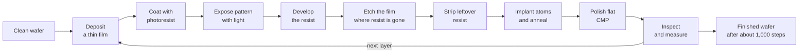
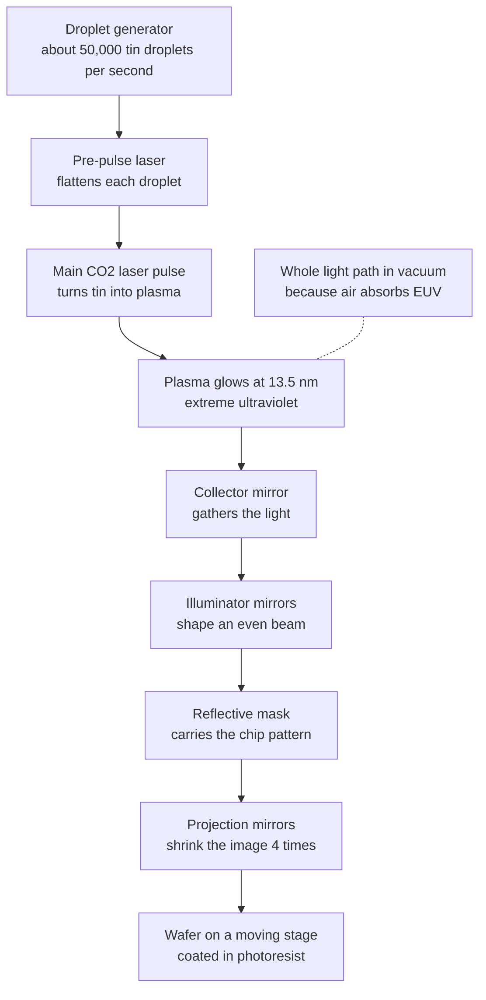
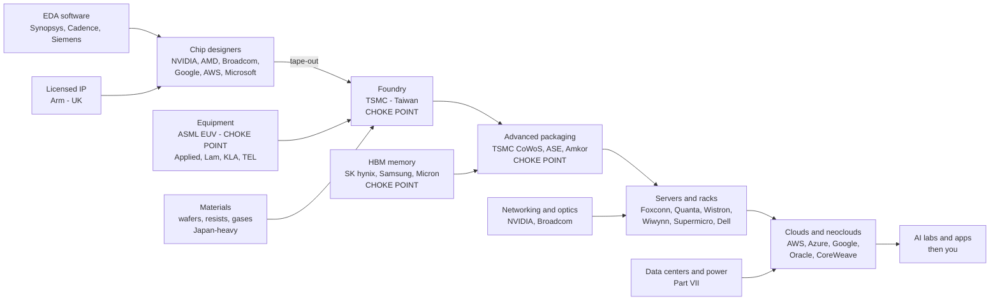
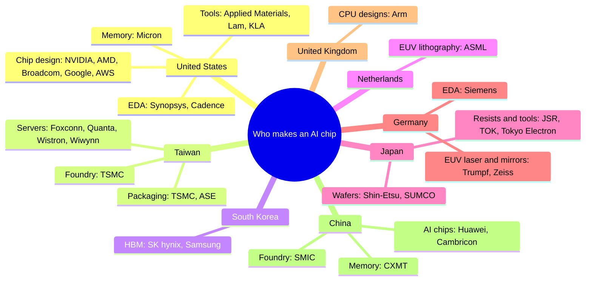
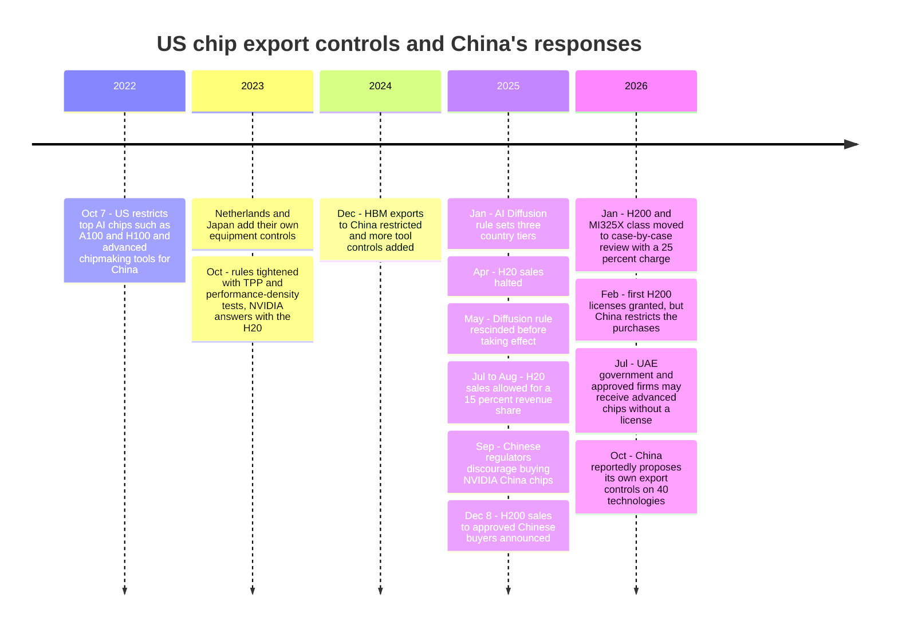

# Chapter 36: How Chips Are Made: Fabs, Lithography, Packaging and Geopolitics

*Follow an AI chip from a pile of sand to a finished GPU, and see why only a handful of companies on Earth can make one and why governments now fight over the factories.*

## What you'll learn

- How ordinary sand becomes a mirror-smooth 300 mm silicon wafer, and why chips are made in rooms far cleaner than a hospital operating theater.
- The repeating loop of deposit, print, etch and polish that builds a chip in dozens of layers, and why each of the 1,000 or so steps has to be close to perfect.
- How transistor shapes evolved from flat switches to fins to "gate-all-around" sheets, and why "3 nm" is a brand name, not a measurement.
- How lithography prints patterns with light, why the most advanced machines fire lasers at flying droplets of molten tin, and why one Dutch company builds all of them.
- Why giant AI chips have low yields, what the reticle limit is, and how chiplets, advanced packaging and HBM stacking became the real bottleneck of the AI boom.
- The whole AI-chip supply chain, company by company and country by country, with its choke points and its costs.
- The export-control story from 2022 to October 2026, China's home-grown chip stack, and the debate over Taiwan, the CHIPS Act and bringing factories home.

## Before you start

Chapter 2 (How Computers Work: Bits, Transistors and Processors) explains what a transistor is and why a chip needs billions of them. Chapter 32 (From Transistor to Accelerator: CPUs, GPUs, TPUs and FLOPs) explains GPUs, TPUs and FLOPs. Chapter 33 (Memory and the Memory Wall) explains why HBM memory matters so much. Chapter 34 (Wiring Thousands of Chips Together) shows where a finished chip package goes inside a server and rack, and Chapter 35 (The AI Chip Industry) covers who *designs* the chips. This chapter is about who *makes* them, and how. You can read it on its own, but those chapters will make the "why does this matter" parts land harder.

## The most complicated thing people mass-produce

When you press Enter in Claude, ChatGPT or Gemini, your message travels to a data center (Chapter 4 traced that trip) and lands on an accelerator chip. That chip is a slab of silicon about the size of a large postage stamp. NVIDIA's Vera Rubin GPU, which is ramping into full production in 2026, carries about 336 billion transistors. That is roughly as many switches as there are stars in our galaxy, packed onto two thumbnail-sized pieces of silicon. The thinnest parts of each switch are only a few nanometers thick, a few dozen atoms.

Almost every one of these chips, whether NVIDIA, AMD, Google, Amazon or Microsoft designed it, was manufactured by the same company: TSMC, mostly in Taiwan. The machines that printed its finest patterns came from one Dutch company, ASML. Its memory came from one of three companies. Its packaging, the step that joins the processor to its memory, was for several years the single tightest bottleneck in the AI industry. If you understand how chips are made, you understand why AI chips are scarce, why they cost what they cost, and why the United States and China treat chip factories as matters of national security.

> **Definition — Semiconductor:** A material, such as silicon, that conducts electricity better than an insulator but worse than a metal, and whose conductivity can be switched on and off. "Semiconductor" is also the everyday name for the chip industry as a whole.

> **Definition — Integrated circuit (IC) / chip:** Many transistors and the wires between them, manufactured together on a single piece of silicon. "Chip" and "IC" mean the same thing.

> **Definition — Die:** One rectangular piece of silicon cut from a wafer, carrying one chip's circuits. A finished product can hold several dies in one package; a Blackwell GPU, for example, uses two.

Chip companies split the work in three different ways. Some only design chips and pay someone else to build them. Some only build chips that other people design. A few do both.

> **Definition — Fabless company:** A chip company that designs chips but outsources the manufacturing. NVIDIA, AMD, Broadcom, Qualcomm and Apple are all fabless.

> **Definition — Foundry:** A company that manufactures chips designed by other companies. TSMC is by far the largest; Samsung Foundry, Intel Foundry and China's SMIC are others.

> **Definition — SMIC (Semiconductor Manufacturing International Corporation):** China's largest foundry (contract chipmaker). Export controls keep the most advanced chipmaking machines (EUV, explained later in this chapter) out of its reach, so it makes its most advanced chips (7 nm-class, and reportedly 5 nm-class) with older equipment and extra steps. Teardown reports say these include Huawei's Ascend AI chips.

> **Definition — IDM (integrated device manufacturer):** A company that both designs and manufactures its own chips. Intel, Samsung and the memory makers SK hynix and Micron are IDMs.

> **Analogy:** A fabless chip company is an author, and a foundry is a printing press. NVIDIA writes the book; TSMC prints it. ASML builds the printing presses, and only ASML can build the most advanced ones. If the press is busy, it does not matter how good your manuscript is.

> **Watch out:** "NVIDIA makes its chips" is wrong in a way that matters. NVIDIA *designs* them. TSMC manufactures the silicon and does the advanced packaging, SK hynix, Samsung and Micron make the memory, and Taiwanese contract manufacturers build the servers. When people say "NVIDIA can't make enough chips," the real limits are usually at TSMC, in packaging or in memory.

Here is the whole journey on one page. The rest of the chapter walks through it box by box.


*Figure 36.1: The life of an AI chip, from sand to the data center that answers your prompt.*

> **Key idea:** Making an AI chip is a relay race with a dozen legs, and several legs are run by only one or two companies in the world. The whole race goes only as fast as its slowest runner, which is why "AI supply" is really a story about a few narrow choke points.

## From sand to wafer

Silicon is the second most common element in Earth's crust, after oxygen. Ordinary quartz sand is mostly silicon dioxide, silicon bonded to oxygen. The raw material is cheap. What is expensive is purity.

The first step heats quartz with carbon in an electric furnace. That pulls the oxygen away and leaves "metallurgical-grade" silicon, about 98 to 99 percent pure, which is far too dirty for chips. So the silicon is turned into a gas, distilled again and again, and deposited back as solid **polysilicon** that is at least 99.9999999 percent pure, which the industry calls "nine nines." The best grades go to eleven nines. At that level, there is roughly one stray atom for every hundred billion silicon atoms.

> **Definition — Silicon:** A chemical element (symbol Si) found in sand and rock. Its crystal structure and its ability to be made more or less conductive by adding tiny amounts of other elements make it the base material of almost every chip.

> **Definition — Polysilicon:** Ultra-pure silicon made of many small crystals stuck together. It is the raw feedstock that gets melted and regrown into a single perfect crystal for chipmaking.

Purity is only half the problem. A chip also needs a *single crystal*: every silicon atom lined up in the same repeating pattern across the whole wafer, with no grain boundaries for electrons to trip over. The standard method is more than a century old in principle. Polysilicon is melted in a quartz crucible at a little over 1,414 °C, silicon's melting point. A small "seed" crystal is dipped into the melt and pulled upward very slowly while it rotates. Atoms freeze onto the seed in the same orientation, and the result is a gleaming cylinder of perfect crystal taller than a person.

> **Definition — Ingot:** A large cylinder of single-crystal silicon grown from molten silicon around a seed crystal, usually by the Czochralski method. Wafers are sliced from it like bread from a loaf.

The ingot is ground to an exact diameter, sliced with wire saws into thin discs, and then lapped, etched and polished until the surface is flat to within a few nanometers. A standard 300 mm wafer is 775 micrometers thick, about three-quarters of a millimeter, roughly the thickness of seven or eight sheets of paper.

> **Definition — Wafer:** A thin, round, polished slice of single-crystal silicon on which hundreds of chips are built at once. Leading-edge factories use wafers 300 mm (about 12 inches) across.

Why 300 mm? Every processing step treats the whole wafer at once, so a bigger wafer means more chips per step. A 300 mm wafer has an area of π × 150 mm × 150 mm ≈ 70,686 square millimeters (a circle's area is π times its radius times itself, and the radius is half the 300 mm width), about 2.25 times the older 200 mm size (the width is 1.5 times larger, and area grows with the square of width: 1.5 × 1.5 = 2.25). (A move to 450 mm was attempted in the 2010s and abandoned as too costly.)

Wafer-making is itself a concentrated business. Japanese firms led by Shin-Etsu and SUMCO supply a large share of the world's 300 mm wafers, with GlobalWafers (Taiwan), Siltronic (Germany) and SK Siltron (South Korea) making most of the rest. This is the first, quiet choke point in the chain.

> **Try it:** Ask your chatbot, "What chip is in my phone, who designed it, which company manufactured it, and at what process node?" (A process node is a generation of manufacturing technology, explained later in this chapter.) Name your phone model. Then ask it to name the country where that chip was most likely fabricated. Notice how often the answer is "TSMC, in Taiwan," even for companies you think of as American.

## Inside the cleanroom

A modern transistor has features a few nanometers across, and the copper wires connecting transistors at the lowest levels sit only tens of nanometers apart. A single particle of dust 100 nanometers wide landing on the wrong spot can bridge two wires and kill the chip. On the scale of the circuit, a speck of dust is a boulder dropped on a city map.

Ordinary room air holds tens of millions of particles larger than half a micrometer in every cubic meter. A chip factory cannot tolerate that. So chips are made in cleanrooms. Filtered air pours down from the ceiling in a steady stream and is pulled out through the floor, sweeping particles away before they can settle. The room is kept at slightly higher pressure than the outside, so air leaks out, never in. Temperature and humidity are held almost constant, because a wafer expands when it warms, and even a fraction of a degree can shift a new pattern out of line with the layer below. Floors are isolated from vibration, because the printing machines must place patterns to within a nanometer or two.

> **Definition — Cleanroom:** A room where the air is continuously filtered and controlled so that it holds only a tiny number of particles, plus stable temperature, humidity and pressure. Chip fabs are built around enormous cleanrooms.

> **Definition — Fab (fabrication plant):** A chip factory: a cleanroom building full of manufacturing tools that turn blank wafers into finished chips. A leading-edge fab costs on the order of $20 billion or more.

The workers in white "bunny suits" you see in photos are actually the biggest source of contamination, since every human sheds skin flakes and breath droplets constantly. Modern fabs solve this by keeping people away from wafers. Wafers travel in sealed plastic pods called FOUPs (front-opening unified pods, each holding up to 25 wafers), and robots running on tracks in the ceiling carry those pods from tool to tool. Inside each tool, the pod docks and opens into a tiny, ultra-clean enclosure. The air immediately around the wafer is far cleaner than the room the humans walk in.

Fabs also consume vast amounts of exotic inputs: specialty gases, acids, and "ultrapure" water, purified until almost nothing but water molecules remains, used to rinse wafers between steps.

> **Analogy:** A hospital operating room is clean enough to keep germs out of a wound. A fab is clean enough to keep dust off a drawing whose finest lines are about a hundred times thinner than a bacterium. Surgeons scrub in; in a modern fab, the wafers barely see a human at all.

## Front-end fabrication: building a city in layers

Think of a finished chip as a tiny three-dimensional city. At ground level sit the buildings: billions of transistors carved into the silicon itself. Above them rise a dozen or more levels of roads: copper wires, separated by insulating layers and connected by vertical shafts, that carry signals and power between the transistors. The bottom part is built first, then the wiring is stacked on top.

> **Definition — Front-end-of-line (FEOL):** The first part of chip manufacturing, which builds the transistors themselves in and on the silicon surface.

> **Definition — Back-end-of-line (BEOL):** The later part of chip manufacturing, which builds the many layers of metal wiring that connect the transistors to each other and to the outside world.

Every layer of the city is built with the same basic loop, repeated over and over:

1. **Deposit** a thin film of material over the whole wafer: an insulator, a metal, or more silicon.
2. **Coat** the wafer with photoresist, a light-sensitive liquid that hardens into a film.
3. **Expose** the resist to light shone through a stencil carrying that layer's pattern. This is lithography, the step everything else depends on.
4. **Develop** the resist, washing away the parts that were (or were not) hit by light, so the pattern now sits on the wafer as a resist stencil.
5. **Etch** away the film wherever the resist is gone, usually with a reactive plasma, carving the pattern into the material.
6. **Strip** off the leftover resist.
7. **Implant** atoms of other elements where needed to tune how the silicon conducts, then heat the wafer to settle them in (this heating step is called annealing).
8. **Polish** the surface flat so the next layer starts level (CMP, defined below).
9. **Inspect and measure** to catch mistakes before more money is spent on a bad wafer.



*Figure 36.2: The fab loop. Each layer of the chip goes through some version of this cycle, and a leading-edge chip repeats it dozens of times.*

Each step has its own technical vocabulary and its own specialist toolmakers.

> **Definition — Deposition:** Adding a thin layer of material across a wafer, for example by letting gases react on its surface. The most precise form, atomic layer deposition (ALD), grows a film one layer of atoms at a time.

> **Definition — Photoresist:** A light-sensitive coating spread on a wafer. Light changes its chemistry so that exposed (or unexposed) areas can be washed away, leaving a stencil for the next step.

> **Definition — Photolithography:** Printing a circuit pattern onto a wafer by shining light through a patterned stencil onto a photoresist coating. Often shortened to "lithography."

> **Definition — Photomask (reticle):** A plate carrying the pattern for one layer of a chip, usually drawn four times larger than it will appear on the wafer. Light passes through it (or, in EUV, bounces off it) to print the pattern.

> **Definition — Etching:** Removing material from a wafer where it is not protected by resist, using reactive gases, plasma or liquid chemicals, so that the pattern is carved into the layer below.

> **Definition — Doping:** Adding tiny, controlled amounts of other elements (such as boron or phosphorus) to silicon to change how easily it conducts, usually by firing a beam of charged atoms into the wafer ("ion implantation") and then heating it. It creates the "switch" regions of a transistor.

> **Definition — CMP (chemical mechanical planarization):** Polishing a wafer flat with a rotating pad and a chemical slurry, so each new layer is built on a perfectly level surface.

Different companies dominate different steps. ASML makes the lithography scanners (Nikon and Canon make older types). Applied Materials, Lam Research and Tokyo Electron make most deposition and etch tools, Tokyo Electron dominates resist coating, and KLA leads in inspection and measurement ("metrology"). Every leading-edge fab is filled with tools from these few companies, which is why governments can steer chipmaking by controlling tool exports.

How long does all this take? A leading-edge logic chip needs dozens of patterned layers. Industry sources commonly cite 60 to 100 or more for the most advanced nodes, and well over a thousand individual process steps in all. A wafer typically spends a few months inside the fab, often quoted as around three, from blank wafer to finished circuits.

### Why every step must be nearly perfect

A thousand steps in a row creates a brutal math problem. Suppose each step has a small chance of ruining a given chip. The chance that a chip survives every step is the per-step success rate multiplied by itself a thousand times. In the table, the ^ sign means "to the power of": 0.999^1000 is 0.999 multiplied by itself 1,000 times (type `=0.999^1000` into any spreadsheet to check it).

| Success rate per step | Chance a chip survives 1,000 steps |
|---|---|
| 99.9% | 0.999^1000 ≈ 37% |
| 99.99% | 0.9999^1000 ≈ 90% |
| 99.999% | 0.99999^1000 ≈ 99% |

A step that works "only" 99.9 percent of the time sounds excellent. Chain a thousand of them and you throw away almost two chips in three. This is why fabs obsess over every step, why inspection tools are a multi-billion-dollar business, and why a new process node takes years to bring up to good yields.

> **Try it:** Open your phone's calculator and compute 0.999 to the power of 1,000 (use the x^y key). Then try 0.9999. That one extra 9 is the difference between a factory that loses money and one that prints it.

> **Key idea:** A chip is built by repeating one loop (deposit, coat, expose, develop, etch, strip, implant, polish, inspect) for dozens of layers and about a thousand steps. Because errors compound across steps, chipmaking is less about any single brilliant trick and more about relentless, near-perfect repetition.

## Transistor shapes and the naming game

Chapter 2 introduced the transistor as a switch with a **source**, a **drain**, a **channel** between them and a **gate** that turns the channel on or off. Making transistors smaller lets you pack more of them on a chip and makes each one switch faster and with less energy. That was the engine of Moore's Law (see Chapter 32).

But shrinking created a problem. When the channel gets very short, the gate starts losing control of it. Current leaks through even when the switch is supposed to be off. This "leakage current" wastes power and turns into heat, and an AI chip already draws 700 to 1,400 watts. The fix, over and over, has been to wrap the gate around more of the channel, so it can squeeze the current off from more sides.

> **Definition — Transistor gate:** The control terminal of a transistor. A voltage on the gate switches the channel beneath it between conducting (on) and blocking (off), like a hand squeezing a garden hose.

```
PLANAR             FINFET             GATE-ALL-AROUND
gate: 1 side       gate: 3 sides      gate: 4 sides
until ~2011        2011 onward        2022 onward

 GGGGGGGGG           GGGGGGG            GGGGGGGGG
 ---------           G+---+G            G=======G
 ccccccccc           G|ccc|G            GGGGGGGGG
 silicon             G|ccc|G            G=======G
 silicon             G|ccc|G            GGGGGGGGG
 silicon          ---+ccc+---           G=======G
                     silicon            GGGGGGGGG

G = gate   c = channel   === = thin silicon sheet
```

*Figure 36.3: Three generations of transistor shape, seen end-on. Each new shape lets the gate grip the channel from more sides.*

> **Definition — Planar transistor:** The original flat transistor, with the gate lying on top of a flat channel. It was the standard from the 1960s until about 2011.

> **Definition — FinFET:** A 3D transistor in which the channel is a thin vertical "fin" of silicon and the gate wraps over it on three sides. Intel introduced it in 2011, and it powered essentially every AI chip through NVIDIA's Vera Rubin.

> **Definition — Gate-all-around (GAA) / nanosheet transistor:** A transistor in which the channel is a stack of thin horizontal silicon sheets and the gate completely surrounds each one. Samsung shipped it first at its 3 nm node in 2022; TSMC's N2 and Intel's 18A ("RibbonFET") use it too.

TSMC's N2 node, its first gate-all-around process, entered volume production in the fourth quarter of 2025. Rubin is reportedly built on TSMC N3, which still uses FinFETs (NVIDIA's own spec pages do not name the node). AMD's MI455X mixes 2 nm- and 3 nm-class chiplets, so AI accelerators are now crossing over to the new shape.

The next big change moves the power wires. In a traditional chip, the wires that deliver power and the wires that carry signals all sit in the stack of layers above the transistors, competing for space like power lines and phone lines strung along the same poles. **Backside power delivery** flips the wafer and builds the power network underneath the transistors instead. That frees room on top for signal wiring and cuts the voltage lost on the way to each transistor. Intel calls its version PowerVia (part of its 18A process); TSMC's A16 node adds a "Super Power Rail."

> **Definition — Backside power delivery:** Building a chip's power-supply wiring on the back of the wafer, under the transistors, instead of mixing it in with the signal wiring on top. It frees space and delivers power more efficiently.

Further out, research labs are stacking the two kinds of transistors that every logic gate pairs together directly on top of each other (a design called CFET, for "complementary field-effect transistor"; field-effect transistor, or FET, is the technical name for the kind of transistor in every chip). It is not yet in production.

### "3 nm" is a brand, not a ruler

Decades ago, a node name like "350 nanometers" described a real dimension: the length of the transistor's gate. Around the late 1990s the names and the physical sizes drifted apart, and today they are generation labels. TSMC's "N3" and "N2," Intel's "18A" and TSMC's "A16" do not mean anything on the chip is 3, 2, 1.8 or 1.6 nanometers wide. The actual spacing between neighboring gates on a leading-edge chip is still tens of nanometers. The "A" names use the angstrom, 0.1 nanometers, because nanometer numbers were running out.

> **Definition — Process node:** A named generation of chip-manufacturing technology, such as TSMC N3 or Intel 18A. Each new node packs transistors more densely and usually improves speed or power, but the number in the name is a marketing label, not a measurement.

A better way to compare nodes is **transistor density**: how many transistors fit on each square millimeter of silicon. NVIDIA's H100 packs 80 billion transistors onto an 814 mm² die on TSMC's 4N process. That is 80,000,000,000 ÷ 814 ≈ 98 million transistors per square millimeter. A square millimeter is about the size of the tip of a ballpoint pen.

| AI chip | Foundry and process | Transistors | Transistor shape |
|---|---|---|---|
| NVIDIA H100 (2022) | TSMC 4N | 80 billion | FinFET |
| NVIDIA Vera Rubin GPU (2026) | TSMC N3, per reports | 336 billion (two dies) | FinFET |
| AMD MI455X (2026) | TSMC 2 nm and 3 nm chiplets | not given here | mixed |
| AWS Trainium3 (2025) | 3 nm-class (AWS's first) | not disclosed | not disclosed |
| Microsoft Maia 200 (2026) | TSMC 3 nm | more than 140 billion | FinFET |
| NVIDIA Feynman (2028) | reportedly TSMC A16 | not disclosed | GAA with backside power |
| Huawei Ascend (2025–26) | SMIC 7 nm-class, per reports | not disclosed | FinFET |

*Table 36.1: Where some AI accelerators are made, as of late 2026. Google has not disclosed the process node for TPU 8.*

> **Watch out:** "3 nm means something on the chip is 3 nanometers wide" is the most common misunderstanding in chip news. Node names are labels, like model years on a car. Compare transistor density, power and performance instead, and be skeptical when two companies' node numbers are compared as if they used the same ruler.

## Lithography: printing with light

Lithography is the heart of chipmaking and the most expensive single step. The idea is the same as an old slide projector. Light shines through a stencil (the photomask), passes through a lens that shrinks the image four times, and lands on the wafer's photoresist coating, printing the pattern. The wafer then moves, and the next copy of the chip is printed beside it, field after field, until the whole wafer is covered. This happens for every patterned layer.

> **Definition — Lithography scanner:** The machine that performs photolithography. It moves the mask and the wafer in perfect sync while a slit of light sweeps across, printing one chip-sized field at a time with nanometer accuracy.

The key limit is the **wavelength** of the light. You cannot draw lines much thinner than your pen allows, and light behaves like a pen whose tip is set by its wavelength. Engineers summarize this with a formula, the Rayleigh criterion:

`smallest printable feature ≈ k1 × wavelength ÷ NA`

Here *wavelength* is the color of the light, *NA* (numerical aperture) is how wide a cone of light the optics can collect and focus, and *k1* is a factor that captures every clever trick in the process. Practical k1 values sit around 0.25 to 0.4.

> **Definition — Wavelength:** The distance between successive peaks of a light wave. Shorter wavelengths can draw finer details, the way a fine pen draws thinner lines than a marker.

> **Definition — Lithography resolution:** The smallest feature, or the tightest spacing of lines, that a lithography tool can print in a single exposure.

> **Definition — Numerical aperture (NA):** A measure of how wide a cone of light a lens or mirror system can gather and focus. Higher NA means finer detail, but it requires larger and more precise optics.

Now we can work three real examples. The k1 values below are typical aggressive values, chosen to match the resolutions ASML quotes for its machines. In the table, λ (the Greek letter lambda) is the standard symbol for wavelength.

| Tool | Wavelength | NA | k1 | Resolution ≈ k1 × λ ÷ NA |
|---|---|---|---|---|
| DUV immersion | 193 nm | 1.35 | 0.27 | 0.27 × 193 ÷ 1.35 ≈ 38 nm |
| EUV (standard) | 13.5 nm | 0.33 | 0.32 | 0.32 × 13.5 ÷ 0.33 ≈ 13 nm |
| High-NA EUV | 13.5 nm | 0.55 | 0.33 | 0.33 × 13.5 ÷ 0.55 ≈ 8 nm |

*Table 36.2: The Rayleigh formula worked for three generations of lithography.*

Notice two things. First, EUV gets most of its gain from a wavelength that is 14 times shorter. Second, High-NA EUV keeps the same light and gets its gain from bigger optics.

### The road to EUV

For decades, the industry shrank features by moving to shorter wavelengths, from mercury-lamp light at 436 nanometers down to lasers at 193 nanometers, called **deep ultraviolet (DUV)**. In the mid-2000s, engineers put a thin layer of water between the final lens and the wafer, which bends light more sharply and lifts NA above 1. This **immersion lithography** is still the workhorse for most layers of most chips.

> **Definition — DUV (deep ultraviolet) lithography:** Lithography using 193 nm (or older 248 nm) ultraviolet laser light. It prints features down to about 38 nm in one exposure and can reach 7 nm-class chips with multiple exposures.

> **Definition — Immersion lithography:** DUV lithography with a thin film of ultrapure water between the lens and the wafer, which raises the numerical aperture and lets the tool print finer features.

To print features finer than 38 nm with DUV, fabs use **multi-patterning**: they split one layer's pattern into two, three or four interleaved patterns and print them in separate passes, or use clever spacer tricks to double and quadruple line density. TSMC's first 7 nm process was made this way, without EUV. It works, but every extra pass adds masks, steps, cost and chances that layers misalign (engineers call alignment "overlay," and it must be right to within a couple of nanometers), so yields fall.

> **Definition — Multi-patterning:** Printing one layer in several exposures (or using spacer tricks) to create features finer than the light could print in one pass. It costs more and lowers yield; China relies on it because it cannot buy EUV tools.

**Extreme ultraviolet (EUV)** lithography jumps from 193 nm all the way to 13.5 nm light. After decades of research it entered high-volume manufacturing around 2019, and today it prints the finest layers of every leading-edge logic chip and of advanced DRAM. ASML is the only company in the world that sells EUV tools. A typical EUV machine costs around $180 million and weighs nearly 200 tons.

> **Definition — EUV (extreme ultraviolet) lithography:** Lithography using light with a 13.5 nm wavelength, created by blasting droplets of molten tin with a laser. It prints features around 13 nm in one exposure. ASML is the only supplier.

> **Try it:** Get a ruler and look at one millimeter. EUV light has a wavelength of 13.5 nanometers, so about 74,000 EUV waves fit across that single millimeter (1,000,000 nm ÷ 13.5 nm ≈ 74,000). Now remember that the chip in your phone was printed with that light.

### How an EUV machine works

EUV light is strange stuff. It is absorbed by almost everything, including glass, and even air. That rules out lenses, and it means the entire light path must sit in a vacuum. You cannot even buy a lamp that makes it. So ASML's machines manufacture their light from scratch, about 50,000 times a second.

Here is the sequence, step by step:

1. **Droplet generator.** A nozzle fires a stream of tiny droplets of molten tin, each smaller than the width of a human hair, at about 50,000 droplets per second.
2. **Pre-pulse.** A weaker laser pulse hits each flying droplet and flattens it into a thin pancake, a better target.
3. **Main pulse.** A powerful carbon-dioxide laser (built by the German company Trumpf) hits the pancake and turns it into a plasma tens of times hotter than the surface of the Sun.
4. **EUV glow.** Tin plasma happens to emit strongly at 13.5 nanometers. A curved **collector mirror** gathers that light.
5. **Illuminator.** A set of mirrors shapes the light into an even, carefully angled beam.
6. **Reflective mask.** Because EUV passes through nothing, the photomask is a mirror too, with the chip pattern written in an absorbing layer on its surface. Light bounces off the bare parts and not the patterned parts.
7. **Projection optics.** More mirrors shrink the pattern four times and focus it onto the wafer.
8. **Wafer stage.** The wafer, coated in EUV-sensitive photoresist, races back and forth under the beam, positioned to within about a nanometer, while the mask moves in sync above.



*Figure 36.4: How EUV lithography works. Light is made by vaporizing tin, steered entirely by mirrors in vacuum, bounced off a mirror-mask and focused onto the wafer.*

The mirrors are a marvel in their own right. Each is built by Carl Zeiss from dozens of alternating, atom-smooth layers of molybdenum and silicon, tuned so that the reflections from every layer add up at exactly 13.5 nm. Even so, each mirror reflects only about 70 percent of the light that hits it. That loss compounds:

`light reaching the wafer after 10 mirrors ≈ 0.7^10 ≈ 0.028, or under 3%`

So more than 97 percent of the hard-won light is lost on the way, mostly as heat. This is why the light source needs such brute force, why the tools draw enormous amounts of electricity, and why the speed of an EUV scanner (wafers per hour) depends so heavily on source power.

> **Analogy:** Standard DUV lithography is like drawing a city map with a fine-tipped marker. EUV is switching to a technical pen with a tip 14 times finer, except the "ink" can only be made by vaporizing flying droplets of tin with a laser, inside a vacuum, and every reflection on the way to the paper loses almost a third of it.

### High-NA EUV

ASML's next generation keeps the 13.5 nm light but uses much larger mirrors to raise the numerical aperture from 0.33 to 0.55. These **High-NA EUV** machines (the EXE:5000 and EXE:5200B) reach about 8 nm resolution. ASML says they print features about 1.7 times smaller and give about 2.9 times higher density than standard EUV. Intel took delivery of the first High-NA tools at the end of 2023. They are aimed at nodes below 2 nm and at leading-edge DRAM, and they reportedly cost roughly twice as much as a standard EUV tool.

> **Definition — High-NA EUV:** The newest generation of EUV lithography, with a numerical aperture of 0.55 instead of 0.33. It prints features about 1.7 times smaller in one exposure, at a much higher tool price.

High-NA has a catch that matters for AI chips: each exposure covers only half the usual field (26 mm by 16.5 mm instead of 26 mm by 33 mm). A giant AI die could not be printed in one High-NA shot, which is one more push toward the chiplets described below.

> **At the frontier (2026):** EUV is no longer just ASML's crown jewel; it is a geopolitical object. ASML remains the only EUV supplier, and the Netherlands has never licensed EUV exports to China. Reuters reported in December 2025 that a Chinese prototype EUV system exists, but a prototype is a long way from a production tool that runs reliably around the clock. Meanwhile, chipmakers are working out when High-NA becomes cheaper per layer than standard EUV with multi-patterning.

| | DUV immersion | EUV | High-NA EUV |
|---|---|---|---|
| Light source | 193 nm laser | 13.5 nm tin plasma | 13.5 nm tin plasma |
| Optics | Lenses, water film | Mirrors, vacuum | Bigger mirrors, vacuum |
| Single-exposure resolution | about 38 nm | about 13 nm | about 8 nm |
| Field size | 26 × 33 mm | 26 × 33 mm | 26 × 16.5 mm |
| Typical use in 2026 | Most layers of every chip; China's leading edge via multi-patterning | Finest layers of 3 nm and 2 nm logic, advanced DRAM | First uses below 2 nm and in DRAM |
| Suppliers | ASML, Nikon, Canon | ASML only | ASML only |

*Table 36.3: The three lithography generations side by side.*

> **Key idea:** Lithography sets how small a chip's features can be. EUV made today's 3 nm and 2 nm chips practical, and because one company builds every EUV machine, lithography is also the single most powerful choke point in the global chip supply chain.

## Yield, the reticle limit and chiplets

### The reticle limit

A lithography scanner prints one rectangular field at a time, and that field has a maximum size: about 26 mm × 33 mm, or roughly 858 square millimeters. This is the **reticle limit**. A single die cannot be bigger than one exposure field without special stitching tricks.

> **Definition — Reticle limit:** The largest area (about 26 mm × 33 mm ≈ 858 mm²) that a lithography machine can print in a single exposure. It caps the size of one die.

AI chip designers live at this limit, because a bigger die means more compute and more memory connections. The H100 die is 814 mm², about 95 percent of the maximum. NVIDIA's Blackwell went further by joining two reticle-size dies with a very fast die-to-die link so that software sees them as one GPU. Vera Rubin's 336 billion transistors also sit on two dies.

Cerebras is the famous exception: its WSE-3 uses an entire wafer (46,225 mm², 4 trillion transistors), wiring across many printed fields and routing around defective cores using spares.

### Yield: why giant dies are expensive

No wafer is perfect. A few random defects (a particle, a bubble in the resist, a misprinted line) land somewhere on every wafer. If a defect lands on a die, that die is usually dead. The fraction of dies that work is the **yield**.

> **Definition — Yield:** The percentage of chips on a wafer that work correctly. It falls as dies get bigger, because a bigger die is more likely to contain at least one defect.

> **Definition — Defect density (D0):** The average number of fatal defects per square centimeter of wafer. Mature processes reach around 0.1 or lower; new processes start higher and improve over time.

A simple, widely used model says that if defects are scattered at random:

`yield ≈ e^(−die area in cm² × defect density)`

Here *e* is the mathematical constant 2.718 (see Chapter 6 on exponentials). To use the formula, first turn the die area into square centimeters (1 cm² is 100 mm², so divide by 100), multiply by the defect density, and raise e to minus that number: the e^x key on a phone calculator, or `=EXP(-0.814)` in a spreadsheet for the H100 row below. Let's work it with a defect density of 0.1 per cm²:

| Die area | Area in cm² | Yield at D0 = 0.1 | Yield at D0 = 0.05 |
|---|---|---|---|
| 100 mm² (small chiplet) | 1.0 | e^(−0.1) ≈ 90% | e^(−0.05) ≈ 95% |
| 400 mm² (big phone or PC chip) | 4.0 | e^(−0.4) ≈ 67% | e^(−0.2) ≈ 82% |
| 814 mm² (H100) | 8.14 | e^(−0.814) ≈ 44% | e^(−0.407) ≈ 67% |

*Table 36.4: Yield falls quickly as dies grow.*

The picture below shows why. Both wafers have the same six defects in the same places. Cut into small dies, six dies die and thirty survive. Cut into big dies, nearly every die catches a defect.

```
 36 small dies, 6 defects     4 big dies, same 6 defects
 +--+--+--+--+--+--+          +--------+--------+
 |  |  |X |  |  |  |          |      X |        |
 +--+--+--+--+--+--+          |        |        |
 |  |  |  |  |  |  |          |        |        |
 +--+--+--+--+--+--+          |        |        |
 |X |  |X |  |  |  |          |X     X |        |
 +--+--+--+--+--+--+          +--------+--------+
 |  |  |  |  |  |X |          |        |      X |
 +--+--+--+--+--+--+          |        |        |
 |  |X |  |  |  |  |          |   X    |        |
 +--+--+--+--+--+--+          |        |        |
 |  |  |  |X |  |  |          |        |X       |
 +--+--+--+--+--+--+          +--------+--------+
 30 of 36 good = 83%          1 of 4 good = 25%
```

*Figure 36.5: The same defects ruin a far larger share of big dies than small ones. X marks a defect.*

### Worked example: what does the silicon in an H100 cost?

Let's estimate how many H100 dies a wafer yields and what the silicon costs.

1. **Wafer area:** π × 150² ≈ 70,686 mm².
2. **Dies per wafer.** You can't just divide, because rectangles don't tile a circle and the edge is wasted. A standard approximation is: dies ≈ wafer area ÷ die area − (π × wafer diameter) ÷ √(2 × die area). For the H100: 70,686 ÷ 814 − (π × 300) ÷ √1,628 ≈ 86.8 − 23.4 ≈ 63 dies.
3. **Good dies:** 63 × 44% ≈ 28 working dies per wafer (at D0 = 0.1).
4. **Silicon cost per good die:** leading-edge wafers are reported to cost very roughly $17,000 to $20,000 at this generation (wafer prices are not public, so treat this as an estimate). $17,000 ÷ 28 ≈ $607, and $20,000 ÷ 28 ≈ $714. Call it $600 to $700.

An H100 reportedly sold for roughly $25,000 to $40,000. So the processed silicon is only a few percent of the price. The rest goes to HBM memory, advanced packaging, testing, years of design work and software, and NVIDIA's profit margin (its gross margin was 75 percent in the quarter that ended July 2026).

Now repeat the exercise for a 100 mm² chiplet. Dies per wafer ≈ 706.9 − 66.6 ≈ 640, and at 90 percent yield about 579 are good. That is 579 × 100 ≈ 57,900 mm² of working silicon per wafer, compared with 28 × 814 ≈ 22,800 mm² for the H100-size die. The same wafer yields about two and a half times as much good silicon when it is cut into small pieces.

### Binning and spare parts

Chip designers fight yield in two more ways. First, they include spare copies of repeated blocks. The full H100 design has 144 of its main compute units (streaming multiprocessors), but the H100 SXM ships with 132 switched on. A die with a defect in one or two units can still be sold, with the damaged units disabled. Second, finished chips are sorted by how fast they run and how much power they need, and sold as different products.

> **Definition — Binning:** Sorting finished chips by how well they perform, and selling partly defective or slower ones as lower-tier products with some parts disabled.

### Chiplets

The yield math leads straight to **chiplets**: build one big product out of several smaller dies, then join them inside one package. Smaller dies yield better, different dies can use different processes (expensive leading-edge silicon for compute, cheaper older silicon for input/output), and the same chiplet can be reused across products. AMD pioneered this in data-center processors; its MI300X accelerator (153 billion transistors) is a chiplet design, and the MI455X mixes 2 nm- and 3 nm-class chiplets.

> **Definition — Chiplet:** A smaller die designed to be combined with other dies in one package, rather than building one huge die. Chiplets improve yield and let a product mix different manufacturing processes.

The price of chiplets is that the dies must be reconnected almost as densely as wires on a single die, and these "die-to-die" links cost some power and delay. That is the job of advanced packaging.

> **Key idea:** Defects are random, so big dies fail more often. The reticle limit caps die size at about 858 mm². Together they push AI chips toward multiple dies in one package, which moves the hardest engineering, and the tightest bottleneck, from the wafer to the package.

## Advanced packaging: the hidden bottleneck

For most of computing history, "packaging" was the boring last step: put the finished die in a plastic or ceramic case, connect it to pins with fine wires, and ship it. For AI chips, packaging became one of the hardest and scarcest steps in the whole chain.

The reason is memory. An AI accelerator needs enormous memory bandwidth, so its HBM stacks must sit within a few millimeters of the processor and talk to it over thousands of wires at once. Each HBM4 stack alone has a 2,048-bit-wide interface, and a Vera Rubin GPU uses eight stacks. An ordinary circuit board cannot carry that many wires that close together; its traces are far too coarse. So the GPU dies and the HBM stacks are mounted side by side on a thin slab of silicon, the interposer, whose wiring is made with chip-style lithography and is fine enough to connect them all. The whole assembly then sits on a package substrate, which fans the connections out to the much coarser circuit board below.

> **Definition — Advanced packaging:** Techniques for combining several dies (for example GPU dies and HBM memory stacks) in one package with very dense, very short connections between them, so they behave almost like one chip.

> **Definition — Interposer:** A thin slab of silicon (or organic material with small silicon bridges) carrying very fine wiring, on which several dies sit side by side and talk to each other. Placing dies next to each other on an interposer is often called "2.5D" packaging.

```
      Side view of an AI accelerator package (not to scale)

  +-----+ +-----+ +---------+---------+ +-----+ +-----+
  | HBM | | HBM | |  GPU    |  GPU    | | HBM | | HBM |
  |stack| |stack| |  die 1  |  die 2  | |stack| |stack|
  +-----+ +-----+ +---------+---------+ +-----+ +-----+
  oooooooooooooooooooooooooooooooooooooooooooooooooooo  microbumps
  ====================================================  interposer
  o   o   o   o   o   o   o   o   o   o   o   o   o     bumps
  ----------------------------------------------------  substrate
  O     O     O     O     O     O     O     O     O     solder balls
  ////////////////////////////////////////////////////  circuit board
```

*Figure 36.6: A cross-section of a 2.5D package. GPU dies and HBM stacks sit side by side on an interposer that wires them together; each layer below spreads the connections out to coarser spacing.*

### TSMC's CoWoS family

TSMC's version of this is called CoWoS, short for chip-on-wafer-on-substrate. It comes in three flavors:

- **CoWoS-S** uses one large, solid silicon interposer. It carried the A100 and H100 generations.
- **CoWoS-L** uses small "local silicon interconnect" bridges embedded in a larger organic interposer. The bridges provide dense wiring only where dies meet, which allows much bigger packages than one slab of silicon would. Blackwell and Rubin use it.
- **CoWoS-R** uses an organic interposer with fine redistribution wiring and no silicon at all, trading some density for cost.

> **Definition — CoWoS (Chip-on-Wafer-on-Substrate):** TSMC's family of advanced (2.5D) packaging technologies that place processor dies and HBM stacks side by side on an interposer, a thin slab with dense wiring. Its limited capacity has been a key bottleneck for AI chip supply since 2023.

The next step is to stack dies directly on top of each other. TSMC's SoIC technology does this with **hybrid bonding**: the copper pads on two polished dies are pressed together and fused directly, with no solder bumps in between. That allows many times more connections per square millimeter than solder bumps. AMD already stacks dies this way, for example placing extra cache memory on top of processor dies, and stacking compute dies on top of input/output dies in its MI300 family.

> **Definition — Hybrid bonding:** Joining two stacked dies by fusing their copper pads and surrounding insulator directly, without solder bumps. It allows extremely dense vertical connections and is the basis of true 3D chip stacking.

Intel offers rivals through Intel Foundry: **EMIB** (small silicon bridges embedded in the package substrate) and **Foveros** (3D die stacking).

To let chiplets from different companies talk to each other, the industry created an open standard.

> **Definition — UCIe (Universal Chiplet Interconnect Express):** An open industry standard for the physical connections and signaling between chiplets inside one package, so chiplets from different designers and foundries can be combined.

Packaging used to be outsourced to specialist companies, mostly in Asia. For ordinary chips it still is. For the most advanced AI packaging, TSMC does most of the work itself.

> **Definition — OSAT (outsourced semiconductor assembly and test):** Companies that package and test chips for others, such as ASE (Taiwan) and Amkor (US-headquartered, with plants mainly in Asia).

### Why packaging became the bottleneck

From 2023 onward, the gating factor for how many AI accelerators the world could ship was often not wafers but CoWoS capacity. Several things make it hard to scale:

- **Size.** A Blackwell- or Rubin-class package is several times larger than a reticle-size die, so few of them fit on each interposer wafer.
- **Everything must arrive at once.** A package needs good GPU dies *and* eight good HBM stacks at the same moment, so a shortage of either stalls both.
- **Yields compound again.** If you attach ten parts (two GPU dies and eight HBM stacks) and each attachment succeeds 99 percent of the time, the package survives only 0.99^10 ≈ 90 percent of the time, and a failure can scrap thousands of dollars of good silicon. This is why every die is tested before it goes in, to make sure it is a "known-good die."
- **New factories take years.** Packaging lines need their own cleanrooms, tools and trained staff.

> **Analogy:** Advanced packaging is like building a city block where the GPU "office towers" and the HBM "apartment towers" share underground tunnels (the interposer), instead of being separate cities linked by a highway (the circuit board). The tunnels are what make the block fast, and they are also very hard to dig.

> **Key idea:** An AI accelerator is not one chip but a package of chips. The step that joins GPU dies and HBM memory on an interposer (TSMC's CoWoS) became the AI industry's tightest bottleneck, because it needs big, perfect parts from several suppliers all at once.

> **At the frontier (2026):** Packaging is where much of the hardware innovation now happens. Hybrid bonding is moving from cache stacks toward memory and logic stacks, NVIDIA's 2028 Feynman generation is reported to use 3D die stacking, and co-packaged optics (lasers and optical converters sitting right next to switch chips) began arriving at customer sites in mid-2026 with NVIDIA's Spectrum-6 switches. Chapter 34 covers how these packages are wired into racks.

## How HBM is made

Chapter 33 explained what HBM (high-bandwidth memory) does: it is a skyscraper of memory chips built right next to the processor, connected by a very wide highway. Here is how that skyscraper is built.

> **Definition — HBM (High Bandwidth Memory):** DRAM memory dies stacked vertically (8 to 16 high) and placed beside the processor on an interposer with a very wide connection, delivering terabytes per second. It is the critical memory of AI accelerators.

1. **Make DRAM wafers.** Memory makers build DRAM on their own specialized processes, which create billions of tiny capacitors that store bits as electric charge. Leading-edge DRAM now also uses EUV for its finest layers.
2. **Drill through the silicon.** Thousands of vertical holes are etched straight through each die and filled with copper. These **through-silicon vias** let signals and power travel straight up and down the stack.
3. **Thin the dies.** Each die is ground down to a few tens of micrometers, thinner than a human hair, so that 12 or 16 of them can fit in a stack that is still less than a millimeter tall.
4. **Test.** Every die is tested before stacking; one bad layer can ruin the whole stack.
5. **Stack and bond.** Dies are stacked 8, 12 or 16 high on top of a **base die** and bonded together. SK hynix fills the gaps with a molded underfill that it reflows in one go; Samsung and Micron use a thin film between layers that is pressed and heated die by die. Hybrid bonding is expected for the tallest future stacks.
6. **Test the stack and ship it** to TSMC (or another packager) to be mounted next to the GPU.

> **Definition — TSV (through-silicon via):** A vertical wire running straight through a silicon die, made by etching a hole and filling it with copper. TSVs connect the stacked dies in an HBM stack.

> **Definition — Base die (logic die):** The bottom die of an HBM stack, which manages communication between the memory layers and the processor. Starting with HBM4, it can be a custom logic chip made at a foundry such as TSMC.

```
   +------------------------------+
   | DRAM die 12                  |
   +---|------|------|------|-----+
   | DRAM die 11                  |
   +---|------|------|------|-----+
   |             ...              |
   +---|------|------|------|-----+
   | DRAM die 1                   |
   +---|------|------|------|-----+
   | Base (logic) die             |
   +---o------o------o------o-----+
       microbumps to the interposer

   | = through-silicon vias (TSVs) carrying
       signals and power straight down the stack
```

*Figure 36.7: A 12-high HBM stack. Thinned DRAM dies are stacked on a base die and wired vertically with TSVs.*

That base die is a quiet revolution. For HBM4 (standardized in April 2025 with a 2,048-bit interface, up to 16 layers and up to 64 GB per stack), the base die can be custom logic designed with the GPU maker and manufactured at TSMC. Memory makers and foundries, once separate worlds, now co-design one product.

HBM is expensive to make. It reportedly uses around three times as much wafer area per bit as ordinary DRAM, plus TSV drilling, thinning, stacking and extra testing. When memory makers shifted capacity toward HBM in 2025–26, supplies of ordinary DRAM for PCs and phones tightened, a squeeze that analysts reportedly dubbed a "memory supercycle."

Only three companies make HBM at scale: **SK hynix** (the market leader and NVIDIA's primary HBM supplier since HBM3, with industry trackers putting it at roughly half or more of shipments), **Samsung** and **Micron**. NVIDIA announced a multiyear memory alliance with SK hynix in its August 2026 earnings release. In China, CXMT is the main DRAM maker and Huawei says its new Ascend chips use HBM it developed itself.

> **Watch out:** "Memory is a commodity, so it can't be a bottleneck" was true for ordinary DRAM for decades. HBM is different. It needs special processes, must be qualified with each new GPU, and comes from just three suppliers. In 2025–26, HBM supply was one of the main limits on AI accelerator output, alongside packaging.

## The full supply chain map

Now you have every piece. Here is the whole chain, step by step. It starts with software: no modern chip can be designed by hand. Engineers describe the chip in code, and design software turns it into billions of placed and wired transistors, then checks it obsessively.

> **Definition — EDA (electronic design automation):** The software used to design and verify chips. Three companies dominate: Synopsys and Cadence (US) and Siemens EDA (owned by Germany's Siemens). No leading-edge chip can be designed without their tools.

Designers also license proven building blocks, which the industry calls IP (short for intellectual property, not the internet's IP addresses); Arm (UK) licenses ready-made CPU designs, used in NVIDIA's Grace, Google's Axion and most phones, and also licenses its instruction set to companies that design their own Arm-compatible cores, such as NVIDIA for its Vera CPU and Apple for the iPhone. The designers themselves are NVIDIA, AMD, Broadcom (which co-designs Google's TPUs and chips for Meta and OpenAI), Marvell (AWS and Microsoft work) and the cloud giants' own teams. When a design is finished, it is "taped out."

> **Definition — Tape-out:** The moment a chip design is finalized and sent to the foundry to make photomasks and start manufacturing. The name comes from the days when designs were shipped on magnetic tape.

The foundry (overwhelmingly TSMC for AI accelerators) runs the fab with tools from ASML, Applied Materials, Lam Research, Tokyo Electron (TEL) and KLA, and materials such as wafers, photoresists and specialty gases, many from Japan (photoresists come largely from Japanese firms such as JSR and TOK). HBM arrives from SK hynix, Samsung or Micron, and TSMC (or an OSAT) assembles and tests the package. Finished accelerators then go to contract manufacturers who build boards, servers and entire racks.

> **Definition — ODM (original design manufacturer):** A company that designs and builds servers and racks for others to sell or use. Foxconn, Quanta, Wistron and Wiwynn (all Taiwanese) build most AI servers, alongside brands like Supermicro and Dell.

Racks go to hyperscalers and neoclouds (Chapter 42), whose data centers (Part VII) rent compute to AI labs, which serve your chatbot.



*Figure 36.8: The AI chip supply chain from design software to your chatbot, with the main choke points marked.*

The same chain looks very different when you sort it by country.



*Figure 36.9: The AI chip supply chain by country. No single country can build a leading-edge AI chip alone.*

> **Definition — Choke point:** A step in a supply chain that only one or a few companies (or countries) can perform, so that a disruption or a government restriction there stops the whole chain.

| Choke point | Who controls it | Why it is hard to replace |
|---|---|---|
| EUV lithography | ASML (Netherlands), with Zeiss and Trumpf as key suppliers | Decades of R&D; no rival sells EUV tools |
| Leading-edge logic manufacturing | TSMC (Taiwan); Samsung and Intel trail | Yield know-how built over many nodes and customers |
| Advanced packaging (CoWoS-class) | Mostly TSMC | Huge interposers, new factories take years |
| HBM | SK hynix, Samsung, Micron | Special processes, long qualification with each GPU |
| Chip design software | Synopsys, Cadence, Siemens | Every engineer and design flow is built around them |
| Wafers and photoresists | Japanese firms lead | Purity and consistency that took decades to perfect |

*Table 36.5: The choke points of the AI chip supply chain.*

### Trace one GPU

Put it together for a single Vera Rubin GPU. It was designed by NVIDIA in California using EDA tools from Synopsys and Cadence. Its companion Vera CPU uses custom Arm-based cores. Its two GPU dies were fabricated by TSMC on the N3 process in Taiwan, with the finest layers printed by ASML EUV scanners whose mirrors came from Zeiss and whose lasers came from Trumpf in Germany, on wafers likely from Japan. Its eight HBM4 stacks came from SK hynix, Samsung or Micron. TSMC joined everything with CoWoS-L packaging. Taiwanese ODMs built it into a Vera Rubin NVL72 rack, and by mid-2026 such racks were running at CoreWeave, Google Cloud, Microsoft Azure, Oracle Cloud and Nebius. At least six countries touched it before it ever answered a prompt.

> **Key idea:** The AI chip supply chain is global and deeply specialized. A handful of firms (ASML, TSMC, SK hynix and a few others) each hold a step nobody else can do at scale. That makes the chain efficient in calm times and fragile, and politically powerful, in rough ones.

## What it all costs

Chips are among the most capital-hungry products in the world. Here are the orders of magnitude, with honest labels for how solid each number is.

| Item | Rough cost | How solid |
|---|---|---|
| Designing one leading-edge chip | several hundred million dollars | widely cited estimate |
| Building one leading-edge fab | $20 billion or more | widely cited estimate |
| One EUV scanner | about $180 million | well documented |
| One High-NA EUV scanner | reportedly about twice a standard EUV tool | reported |
| One 3 nm-class wafer | reportedly about $20,000 | reported, not public |
| One 2 nm-class wafer | reportedly about $30,000 | reported, not public |
| One H100 GPU | reportedly $25,000 to $40,000 | reported street prices |
| One GB200/GB300 NVL72 rack | reportedly $3 to $4 million | reported |
| One gigawatt AI campus | about $38 billion up-front capex (capital spending on buildings and equipment) per GW of IT power | Epoch AI estimate |

*Table 36.6: The costs of the AI chip pipeline, as of late 2026.*

### Worked example: why fabs must run flat out

Suppose a $20 billion fab is written off evenly over five years (real accounting schedules vary). That is $20,000,000,000 ÷ 5 ÷ 365 ≈ $11 million of cost every single day, before paying for electricity, materials or staff. An idle fab burns money at a frightening rate, so foundries need a deep queue of customers to keep every tool busy. This is a big reason only TSMC, Samsung and Intel still try to compete at the leading edge: you need enormous, reliable demand to justify the bet.

Design costs work the same way. A few hundred million dollars to design one leading-edge chip only pays off if you sell millions of units, or, for a cloud giant building its own accelerator, save billions on chips you would otherwise buy. That is the economic logic behind Google's TPUs, AWS's Trainium and Microsoft's Maia (Chapter 35).

> **Watch out:** "Chips are expensive because silicon is expensive" gets it backwards. Sand is nearly free, and even the processed die is a small share of an AI accelerator's price. You are mostly paying for scarce memory, scarce packaging, years of design and software, and the market power that comes with being one of very few suppliers.

## Geopolitics, part 1: export controls

Because a few countries hold every choke point, governments realized they could use the supply chain as a lever. The United States, home to the leading chip designers, EDA companies and several toolmakers, and allied with the Netherlands, Japan, Korea and Taiwan, has used **export controls** since 2022 to limit China's access to advanced AI chips and the tools to make them.

> **Definition — Export controls:** Government rules that limit which products, tools or technologies may be sold to which countries or companies. The US uses them to restrict China's access to advanced AI chips and chipmaking equipment.

> **Definition — Entity List:** A US government list of foreign companies that need a special license before receiving US technology. Huawei and SMIC are on it.

The rules are run by the US Commerce Department's Bureau of Industry and Security (BIS). To decide which chips are restricted, they use a hardware yardstick.

> **Definition — TPP (Total Processing Performance):** The US export-control measure of a chip's computing power, roughly its peak operations per second (in trillions) multiplied by the number of bits per operation. The January 2026 H200 policy covers chips with a TPP below 21,000.

Here is the story as of October 2026.



*Figure 36.10: Export controls on AI chips, 2022 to October 2026.*

A few details show how policy is written in hardware terms:

- **October 7, 2022.** The first rules blocked the most advanced AI chips and restricted equipment for Chinese fabs making logic at 16/14 nm or below, DRAM at 18 nm or below, or NAND flash with 128 or more layers.
- **October 2023.** The rules were rewritten around TPP and "performance density" (TPP divided by die area), closing the loophole NVIDIA had used with its China-specific A800 and H800; NVIDIA answered with the cut-down H20.
- **2025.** The "AI Diffusion" rule would have sorted the world into three tiers of access but was rescinded before taking effect. H20 sales were halted, then allowed again for a 15 percent revenue share. In September, Chinese regulators discouraged purchases of NVIDIA's China-specific chips, and China's market regulator reportedly found NVIDIA had violated anti-monopoly law.
- **January 13–15, 2026.** A BIS rule moved the H200, AMD's MI325X and equivalent chips (defined by a TPP below 21,000 and memory bandwidth below 6,500 GB/s; published summaries differ on whether a chip must meet one limit or both) from "presumed denial" to case-by-case review for China. The conditions: exports of each model capped at 50 percent of its US sales; certification that US supply is unaffected; know-your-customer checks, physical security and no remote access for restricted parties; and a 25 percent charge collected through mandatory US lab testing plus a Section 232 tariff (an import tax on national-security grounds, defined later in this chapter). Blackwell and newer chips were not covered.
- **The 2026 outcome.** According to NVIDIA's filings, the US began granting licenses in February 2026 for small amounts of H200s to specific Chinese customers, but the Chinese government restricted those sales. In NVIDIA's quarter ending July 2026, H200 sales to China were under 1 percent of data-center revenue, and its guidance assumes zero data-center compute revenue from China. A draft *global* licensing framework for AI chips was reported in March 2026; as of mid-October 2026, no replacement rule had been announced. Controls loosened for close partners instead: on July 10, 2026, BIS moved the United Arab Emirates into a more trusted country group and allowed its government and certain approved companies to receive advanced computing items, including chips and servers, without a license. On October 16, 2026, China reportedly proposed export controls of its own on 40 technologies, including AI.

### Worked example: reading a TPP threshold

TPP is roughly "dense peak trillions of operations per second × bits per operation." Using the most favorable precision for each chip:

- **H100:** about 1,979 trillion dense FP8 operations per second × 8 bits ≈ 15,800. That is under 21,000. The H200 has the same compute (it differs in memory), so it falls under the January 2026 policy too.
- **Vera Rubin GPU:** 17.5 PFLOPS dense FP8 = 17,500 trillion × 8 bits = 140,000, nearly seven times the threshold.

That gap is the whole policy in one number: the 2026 rule allowed case-by-case sales of a 2022-generation chip while keeping the newest generations off the table. It also explains why chipmakers design "cut-down" versions for particular markets: they tune compute and bandwidth to land just under a line drawn in TPP.

### The debate

There are serious arguments on both sides, and you should know the strongest version of each.

**The case for controls.** Compute is the scarcest input to frontier AI, and the US and its allies hold the choke points. Slowing a strategic rival's access to the best chips and tools buys time and a security margin, especially for military and intelligence uses. Controls on *tools* (EUV, advanced deposition and etch) slow a rival's ability to make its own chips for years, since a fab can't be built without them.

**The case against, or for a different design.** Controls push China to build its own complete supply chain, which it is doing, and cost US companies revenue that would fund their research (NVIDIA now guides to zero China data-center revenue). They are hard to enforce: chips can be smuggled through third countries or accessed remotely through foreign clouds. Algorithmic efficiency erodes them, as DeepSeek showed by training competitive models on export-compliant H800s. And frequent reversals (the H20 and H200 swings) weaken credibility with allies and companies alike; one think-tank critique called the 2026 policy "strategically incoherent and unenforceable." Chapter 59 covers export controls as part of AI law and policy.

> **Analogy:** Export controls are like controlling who can buy the best ovens and, more importantly, the machines that make ovens. China's response has been to build many more ordinary ovens and wire them together, while racing to build its own oven-making machines.

## Geopolitics, part 2: China's domestic chip stack

China has responded by trying to build every layer of the stack at home.

**Manufacturing.** SMIC, China's leading foundry, makes 7 nm-class chips using DUV lithography and multi-patterning, without EUV, and reportedly has a 5 nm-class process too. Without EUV, every fine layer takes several exposures, which raises cost and lowers yield, but it works. Chinese fabs reportedly bought large numbers of DUV tools before the restrictions tightened.

**Memory.** CXMT is China's main DRAM maker, and Huawei says its new Ascend chips use HBM it developed itself, a direct answer to the December 2024 HBM restrictions.

**AI chips.** Huawei's Ascend line leads, with many other designers including Cambricon, Hygon, Moore Threads, MetaX, Biren, Alibaba's T-Head and Baidu's Kunlunxin.

**Lithography.** The Reuters report of a prototype Chinese EUV system (December 2025) shows where the effort is aimed, though turning a prototype into reliable production tools is a long road.

Huawei's roadmap, as it presented it at Huawei Connect 2025 and 2026:

| Product | Huawei's stated timing | Notes |
|---|---|---|
| Ascend 950PR | Q1 2026 | Uses Huawei's self-developed HBM |
| Ascend 950DT | Q4 2026 | |
| Atlas 950 SuperPoD | In commercial use | A 256,000-card SuperCluster is being deployed |
| Ascend 960DT | Pulled forward to Q1 2027 | |
| Ascend 960PR | Q3 2027 | |
| Atlas 960E SuperPoD | Announced 2026 | 4,096 NPUs, 8 exaFLOPS FP8, 1 PB of HBM |
| Ascend 970 / 980 | 2028 / 2029 | |

*Table 36.7: Huawei's Ascend roadmap, as announced by Huawei. SuperClusters are planned to reach up to 512,000 NPUs, or about 1 million with multiple network rails.*

Huawei calls its Ascend chips NPUs (neural processing units). Unlike the small NPUs inside phones and laptops in Chapter 35, these are full-size data-center accelerators, comparable in role to NVIDIA's GPUs.

### Worked example: many weaker chips

Huawei's strategy is to bind together many individually weaker chips with lots of optics and power. You can see it in the numbers. The Atlas 960E SuperPoD offers 8 exaFLOPS (8,000 PFLOPS) of FP8 from 4,096 NPUs, about 8,000 ÷ 4,096 ≈ 2 PFLOPS per chip by Huawei's figures. A Vera Rubin GPU offers 17.5 PFLOPS of dense FP8, and a Vera Rubin NVL72 rack 1,260 PFLOPS. Matching 8,000 PFLOPS takes about 8,000 ÷ 1,260 ≈ 6.3 NVL72 racks, roughly 450 Rubin GPUs, against 4,096 Huawei chips. Vendors count differently (dense versus sparse, peak versus achieved), so treat this as rough, but the shape is clear: Huawei needs many times more chips for the same paper compute. More chips mean more networking, more power and more failures, but they are chips China can actually build.

> **At the frontier (2026):** The chip race has become a contest of systems, not single chips. Huawei answers NVIDIA's NVL72 with SuperPoDs of thousands of NPUs and claims SuperClusters of hundreds of thousands. China's government has reportedly discouraged purchases of NVIDIA's China-market chips to support domestic suppliers, and in October 2026 it reportedly proposed export controls of its own. Meanwhile Chinese labs keep showing that efficient algorithms and low-precision training can stretch limited compute further.

## Geopolitics, part 3: Taiwan, the CHIPS Act and reshoring

### The Taiwan concentration

Most of the world's leading-edge logic, and nearly every AI accelerator mentioned in this book (every NVIDIA, AMD, Google and AWS AI chip), is fabricated and CoWoS-packaged by TSMC in Taiwan, with its Arizona sites ramping up. Industry trackers put TSMC at roughly two-thirds or more of global foundry revenue in 2025. This concentration is the single biggest physical risk in the AI economy.

Why did one company pull so far ahead? TSMC, founded by Morris Chang in 1987, pioneered the "pure-play" foundry: it focuses exclusively on manufacturing its customers' designs and sells no chips of its own, so designers such as NVIDIA and AMD can hand it their crown jewels without feeding a competitor. Samsung and Intel, by contrast, also sell their own chips. Every customer's volume then feeds the same factories, which pays for each new process generation and builds the yield know-how listed in Table 36.5, and fabs this expensive reward whoever already runs the most wafers (see "Why fabs must run flat out" above). Rivals have to match decades of accumulated learning, not just buy the same machines.

The risks range from the mundane to the catastrophic. Taiwan sits in an active earthquake zone (the April 2024 Hualien earthquake briefly interrupted some fab operations). It depends on imported energy. And it sits at the center of tension between the US and China. Some argue that the world's dependence on Taiwan's chips acts as a "silicon shield" that deters conflict; others worry that the same dependence makes Taiwan a target and leaves the AI industry with no backup.

> **Definition — Reshoring:** Moving manufacturing back to a company's home country (or to allied countries, sometimes called "friend-shoring") to reduce supply-chain risk, usually with government subsidies.

### The response: subsidies, stakes and tariffs

- **United States.** The CHIPS and Science Act (2022) provides about $52.7 billion, including about $39 billion in manufacturing incentives, plus a tax credit for building fabs, reportedly raised from 25 to 35 percent in 2025. In August 2025 the US government took a 9.9 percent stake in Intel (433.3 million shares at $20.47 each), and in September 2025 NVIDIA invested $5 billion in Intel to co-develop chips. TSMC reportedly announced a total Arizona investment of about $165 billion in March 2025, and Samsung is building in Texas. In 2026 the US added Section 232 tariffs on semiconductors.
- **Japan** backs Rapidus, a new foundry that aims to produce 2 nm-class chips in Hokkaido, and subsidized a TSMC fab in Kumamoto.
- **Europe** passed its own Chips Act in 2023 and hosts a TSMC joint-venture fab under construction in Dresden.

> **Definition — CHIPS and Science Act:** A 2022 US law providing about $52.7 billion (including about $39 billion in manufacturing incentives) plus tax credits to bring chip manufacturing back to the United States.

> **Definition — Section 232 tariff:** A US import tax imposed on national-security grounds under Section 232 of a 1962 trade law. It was applied to semiconductors in 2026 and used to collect the 25 percent charge on H200 exports to China.

The debate over reshoring also has two strong sides. **For:** a supply chain with one critical node on an island just across a narrow strait from a rival power is a single point of failure for the entire digital economy, and subsidies are cheap insurance compared with the cost of disruption. **Against or skeptical:** building leading-edge fabs elsewhere is widely reported to cost more and take longer, skilled technicians and engineers are scarce, TSMC keeps its newest process at home first, and tariffs raise the price of the very chips the US wants to deploy. Even a successful reshoring program takes the better part of a decade, and packaging, materials and equipment must move too, not just wafers.

> **Key idea:** The AI boom runs through a few buildings, mostly in Taiwan. Governments are spending tens of billions of dollars to spread that risk, while using the same concentration as a weapon through export controls. Chip manufacturing is now industrial policy, trade policy and security policy all at once.

> **At the frontier (2026):** The leading edge is moving on three fronts at once: gate-all-around transistors (TSMC N2 in volume since late 2025, Intel 18A), backside power (Intel PowerVia, TSMC A16, reportedly the target node for NVIDIA's 2028 Feynman), and High-NA EUV. At the same time, the bottleneck keeps migrating, from wafers to CoWoS packaging to HBM, and increasingly to the power and buildings needed to run the finished chips (Part VII).

## In plain English

An AI chip starts as sand. The sand is purified into silicon that is almost perfectly pure, grown into one giant crystal, and sliced into shiny discs called wafers. Inside a factory cleaner than any hospital, machines build the chip on the wafer layer by layer: lay down a thin film, coat it with light-sensitive goo, shine a pattern of light on it, wash and etch the pattern in, polish, and repeat, about a thousand steps over a few months. The tiny switches, transistors, have changed shape over the years from flat to fins to stacked sheets wrapped on all sides, and names like "3 nm" are labels, not measurements.

The hardest step is printing the pattern with light. The finest layers use extreme ultraviolet light made by zapping flying drops of tin with a laser, bounced off ultra-smooth mirrors in a vacuum. Only one company, ASML in the Netherlands, makes those machines. Big chips often fail because of random defects, so designers split them into smaller pieces and join them with memory stacks in a package; that packaging step, mostly done by TSMC, became the tightest bottleneck of the AI boom, along with the special stacked memory (HBM) from just three companies.

Because a few companies in a few countries control these steps, chips are now geopolitics. The US limits what chips and tools China can buy; China is building its own chips, memory and tools; and governments everywhere are paying to build factories outside Taiwan. When your chatbot answers you, it is running on one of the most complicated, most concentrated and most fought-over supply chains on Earth.

## Key terms

Semiconductor, Integrated circuit (IC) / chip, Die, Fabless company, Foundry, SMIC (Semiconductor Manufacturing International Corporation), IDM (integrated device manufacturer), Silicon, Polysilicon, Ingot, Wafer, Cleanroom, Fab (fabrication plant), Front-end-of-line (FEOL), Back-end-of-line (BEOL), Deposition, Photoresist, Photolithography, Photomask (reticle), Etching, Doping, CMP (chemical mechanical planarization), Transistor gate, Planar transistor, FinFET, Gate-all-around (GAA) / nanosheet transistor, Backside power delivery, Process node, Lithography scanner, Wavelength, Lithography resolution, Numerical aperture (NA), DUV (deep ultraviolet) lithography, Immersion lithography, Multi-patterning, EUV (extreme ultraviolet) lithography, High-NA EUV, Reticle limit, Yield, Defect density (D0), Binning, Chiplet, Advanced packaging, Interposer, CoWoS (Chip-on-Wafer-on-Substrate), Hybrid bonding, UCIe (Universal Chiplet Interconnect Express), OSAT (outsourced semiconductor assembly and test), HBM (High Bandwidth Memory), TSV (through-silicon via), Base die (logic die), EDA (electronic design automation), Tape-out, ODM (original design manufacturer), Choke point, Export controls, Entity List, TPP (Total Processing Performance), Reshoring, CHIPS and Science Act, Section 232 tariff

## Exercises

1. **[Easy] Trace the chip in your pocket.** Find out which chip powers your phone or laptop and where it was made.
   1. Look up your device's processor name in its settings ("About phone" or "About this Mac") or on the maker's spec page.
   2. Ask a chatbot: "Who designed the [chip name], which foundry manufactured it, on which process node, and in which country?"
   3. Check at least two of the answers against the chip maker's or foundry's own website or a reputable news story, and note anything the chatbot got wrong.
   4. Place your chip on Figure 36.8: which boxes did it pass through?
   **What you'll learn:** that even consumer chips flow through the same few foundries and choke points as AI accelerators, and how to verify a chatbot's hardware claims.

2. **[Easy] Watch the fab loop.** Search YouTube for "how are microchips made" and pick a video from a chipmaker or a well-established education channel (15–25 minutes).
   1. As you watch, write down each process step shown.
   2. Match every step to a box in Figure 36.2 (deposit, coat, expose, develop, etch, strip, implant, polish, inspect).
   3. Note one step the video showed that this chapter only mentioned briefly.
   **What you'll learn:** to recognize the repeating loop that builds every chip, and to connect real factory footage to the vocabulary.

3. **[Easy] The thousand-step yield calculator.** In Google Sheets or Excel:
   1. Put per-step success rates in row 1 (B1 to E1): 0.99, 0.999, 0.9999, 0.99999.
   2. Put step counts in column A (A2 to A5): 100, 300, 600, 1000.
   3. In B2 type `=B$1^$A2` and copy it across the whole grid (B2 to E5). The $ signs keep every copy pointing at row 1 for the success rate and column A for the step count.
   4. Format the grid as percentages and find the per-step success rate you need for at least 90 percent of chips to survive 1,000 steps.
   **What you'll learn:** why tiny per-step error rates compound into large losses, and why fabs obsess over every step.

4. **[Easy] Lithography resolution by hand.** Use the formula resolution ≈ k1 × wavelength ÷ NA with a calculator.
   1. Compute the resolution for: dry DUV (193 nm, NA 0.93, k1 0.3), immersion DUV (193 nm, NA 1.35, k1 0.27), EUV (13.5 nm, NA 0.33, k1 0.32) and High-NA EUV (13.5 nm, NA 0.55, k1 0.33).
   2. Rearrange the formula to find what NA you would need to print 5 nm features with 13.5 nm light at k1 = 0.3. (Swap NA and the resolution: NA ≈ k1 × wavelength ÷ resolution.)
   3. Explain in two sentences why that answer pushes the industry toward new tricks rather than just bigger mirrors.
   **What you'll learn:** how wavelength and optics set the limits of chipmaking, and why each generation of lithography is so hard.

5. **[Medium] Dies per wafer and the cost of a giant chip.** Build a small spreadsheet.
   1. Put labels in column A and enter: in B1 the wafer diameter (300), in B2 the die area in mm² (814), in B3 the defect density per cm² (0.1), and in B4 the wafer price (17000).
   2. Dies per wafer, in B5: `=PI()*(B1/2)^2/B2 - PI()*B1/SQRT(2*B2)`.
   3. Yield, in B6: `=EXP(-(B2/100)*B3)` (the B2/100 turns mm² into cm²). Good dies, in B7: `=B5*B6`. Cost per good die, in B8: `=B4/B7`.
   4. Repeat for 100 mm², 400 mm² and 858 mm² dies, and for defect densities of 0.05 and 0.2, by changing B2 and B3 and noting the results.
   5. Compute "good silicon per wafer" (good dies × die area) for each case and compare.
   **What you'll learn:** why big dies are expensive, why chiplets help, and that silicon is a small part of an AI accelerator's price.

6. **[Medium] Map the supply chain of one AI chip.** Pick one accelerator: an NVIDIA B300 or Rubin, an AMD MI455X, a Google TPU, or an AWS Trainium3.
   1. Make a table with columns: step, company, country, choke point (yes/no), source.
   2. Fill in designer, EDA tools, foundry and process, HBM supplier(s), packaging technology, server maker, and two cloud customers, using company pages and news stories (a chatbot with web search can help, but cite the sources it finds).
   3. Draw your own version of Figure 36.8 for that chip and mark the two steps you think are most fragile.
   **What you'll learn:** why geopolitics and export controls focus on a handful of companies such as ASML, TSMC and SK hynix.

7. **[Medium] Read an export-control threshold.** Use TPP ≈ dense peak trillions of operations per second × bit length.
   1. Compute TPP for the H100 (about 1,979 dense FP8 TFLOPS), the Vera Rubin GPU (17.5 dense FP8 PFLOPS) and the AMD MI355X (10.1 dense MXFP4 PFLOPS, at 4 bits). TFLOPS are already trillions of operations per second; turn PFLOPS into TFLOPS by multiplying by 1,000.
   2. Compare each with the January 2026 threshold of 21,000.
   3. Suppose a chipmaker wanted a new chip just under the line at FP8. What is the maximum dense FP8 TFLOPS it could offer?
   4. Write three sentences on why a regulator might also care about memory bandwidth, not just FLOPS.
   **What you'll learn:** how policy is written in hardware terms and why chips get "cut down" for particular markets.

8. **[Medium] Steelman both sides of the export-control debate.** Ask a chatbot for the strongest possible case *for* US AI-chip export controls, then, in a new chat, the strongest case *against*.
   1. List the three best arguments from each side in your own words.
   2. For each argument, note which facts in this chapter support or weaken it.
   3. Write a 200-word verdict, and state what new evidence would change your mind.
   **What you'll learn:** to reason about a live policy fight with evidence instead of slogans.

9. **[Challenge] A six-month disruption memo.** Write a one-page memo titled "What happens to AI if leading-edge production in Taiwan stopped for six months?"
   1. Use Figure 36.8 and Table 36.5 to list every step that would be affected (fabrication, CoWoS packaging, ODM assembly).
   2. For each, list possible substitutes (Samsung, Intel, TSMC Arizona, other packagers) and how long they would plausibly take to ramp, citing at least one source per claim.
   3. Estimate which AI products would be hit first (new training clusters, inference capacity, consumer devices) and why.
   4. End with three policy or business actions that would reduce the damage, and their costs.
   **What you'll learn:** to think in supply-chain terms about concentration risk, the core worry behind the CHIPS Act and reshoring.

10. **[Challenge] Many weak chips versus few strong ones.** Compare Huawei's and NVIDIA's approaches with numbers.
    1. Using Huawei's Atlas 960E figures (4,096 NPUs, 8 exaFLOPS FP8) and the Vera Rubin NVL72 (72 GPUs, 1,260 PFLOPS FP8), compute FP8 PFLOPS per chip for each and how many chips each needs for 100 exaFLOPS (1 exaFLOPS = 1,000 PFLOPS, so 100 exaFLOPS is 100,000 PFLOPS).
    2. Put the power per chip in a cell as an assumption you can change (for example 1 kW, 1.5 kW, 2 kW) and estimate the total power of each 100-exaFLOPS system.
    3. List three costs of using more chips besides power (networking, failures, floor space) and one advantage.
    **What you'll learn:** why export controls shape system design, and how "many weaker chips" trades efficiency for availability.

## Areas of opportunity

- **Semiconductor technicians and equipment engineers.** New fabs and packaging plants in the US, Japan and Europe need thousands of technicians, many of them with two-year degrees rather than PhDs. Foundries, toolmakers like ASML, Applied Materials and Lam, and their service arms pay well because a single idle tool can cost tens of thousands of dollars an hour.
- **Packaging and HBM engineering.** CoWoS-class packaging, hybrid bonding and HBM stacking are the bottleneck skills of the AI era. TSMC, Intel Foundry, Amkor, ASE and the three memory makers are all hiring process, yield and reliability engineers for these lines.
- **Yield and defect analytics.** Fabs generate enormous inspection and measurement data. Engineers and startups that use machine learning to classify defects or predict yield problems earlier sell directly to foundries and memory makers, where each point of yield is worth a fortune.
- **AI-assisted chip design.** EDA companies and chip designers are adding AI to layout, verification and testing, and OpenAI has said it used AI in designing its custom chip with Broadcom. Verification engineers who also know machine learning are in demand.
- **Export-control compliance.** The January 2026 rules require know-your-customer checks, end-use certification and security controls. Chipmakers, cloud providers, server vendors and distributors pay compliance specialists, lawyers and software vendors to manage licenses and screen customers.
- **Supply-chain and procurement analysis.** Clouds, labs and investors pay analysts who can read spec sheets, track CoWoS and HBM capacity, and forecast which bottleneck binds next. This is a strong path for non-engineers who learn this chapter's vocabulary.
- **Compute-governance and policy research.** Think tanks, governments and labs need people who understand both TPP thresholds and diplomacy, including work on proposed chip location verification and usage tracking.
- **Materials and specialty chemicals.** Photoresists, ultrapure gases, high-purity quartz and substrates are concentrated in a few suppliers. New capacity outside the current hubs, backed by reshoring subsidies, is a real (if capital-intensive) business opportunity.
- **Training and workforce programs.** Community colleges, universities and companies near new fabs need cleanroom training programs and curricula; educators who can teach semiconductor basics to career-changers are scarce.

## Check your understanding

1. Why do chip factories need such extreme cleanliness, and how do modern fabs keep wafers clean without relying on humans being perfectly clean?
2. A process has 1,000 steps. Explain why 99.9 percent success per step is not good enough.
3. Why is "3 nm" a misleading name, and what is a better way to compare manufacturing processes?
4. Explain, step by step, how an EUV machine produces and delivers its light, and why it uses mirrors instead of lenses.
5. Using the yield formula, explain why a 100 mm² chiplet yields much better than an 814 mm² die, and why that leads to advanced packaging.
6. Why did CoWoS packaging, rather than wafer production, become a bottleneck for AI accelerators?
7. What is TPP, and why does the Vera Rubin GPU fall far outside the January 2026 export policy while the H200 falls inside it?
8. Give the strongest argument for and the strongest argument against US export controls on AI chips.

<details><summary>Answers</summary>

1. Features on a modern chip are only nanometers across, so a single dust particle can bridge two wires and ruin a die. Fabs filter air continuously, keep positive pressure, and control temperature and humidity, but mainly they keep wafers sealed in FOUPs moved by ceiling robots, so the air right around a wafer is far cleaner than the room people stand in.
2. Survival chance is the per-step success rate multiplied across all steps: 0.999^1000 ≈ 37 percent, so nearly two of every three chips would be lost. You need about 99.99 percent per step to keep around 90 percent.
3. Node names stopped matching any physical dimension decades ago; they are generation labels, and real gate spacing is still tens of nanometers. Transistor density (transistors per mm²), along with power and performance, is a better comparison.
4. A generator fires about 50,000 tin droplets per second; a pre-pulse flattens each one and a powerful CO2 (carbon-dioxide) laser turns it into plasma that glows at 13.5 nm. A collector mirror gathers the light, illuminator mirrors shape it, a reflective mask adds the pattern, and projection mirrors shrink it four times onto the moving wafer. EUV light is absorbed by glass and air, so the path must be in vacuum and use multilayer mirrors, each reflecting only about 70 percent.
5. Yield ≈ e^(−area × defect density). At 0.1 defects per cm², a 1 cm² chiplet yields about 90 percent, but an 8.14 cm² die yields about 44 percent, because a bigger die is more likely to catch a defect. Splitting a design into chiplets gives more good silicon per wafer, but the chiplets must be rejoined with dense connections, which is what advanced packaging provides.
6. AI accelerators need GPU dies and several HBM stacks joined on a large interposer. The packages are huge, need perfect parts from several suppliers at once, compound yield losses, and depend on specialized lines that take years to build. Demand for AI chips outran that capacity from 2023 onward.
7. TPP is roughly dense peak trillions of operations per second times bits per operation. The H100/H200 is about 1,979 × 8 ≈ 15,800, below the 21,000 threshold. Rubin is about 17,500 × 8 = 140,000, roughly seven times over, so it is not eligible.
8. For: compute is the key input to frontier AI and the US and allies hold the choke points, so controlling chips and especially tools slows a rival's military and AI progress for years. Against: controls accelerate China's self-sufficiency, cost US firms revenue that funds their research, are hard to enforce (smuggling, remote access), are eroded by algorithmic efficiency, and lose credibility through frequent reversals.

</details>

## Going deeper

- **Chris Miller, *Chip War: The Fight for the World's Most Critical Technology* (2022).** The best single book on how the chip industry and its geopolitics came to be, from the transistor to TSMC and export controls.
- **ASML's website (asml.com), EUV and High-NA pages.** Clear official explanations and animations of how EUV machines work, from the company that builds all of them.
- **Asianometry (YouTube channel).** Hundreds of well-researched videos on semiconductor history, lithography, packaging, memory and the Asian chip industry.
- **Wikipedia, "Semiconductor device fabrication" and "Extreme ultraviolet lithography."** Solid, well-referenced starting points with links to the underlying technical sources.
- **TSMC's technology pages (tsmc.com).** The foundry's own descriptions of N2, A16 and its CoWoS and SoIC packaging families.
- **CSET (Center for Security and Emerging Technology, a research center at Georgetown University in Washington, D.C., that studies AI, chips and national security), "AI Chips: What They Are and Why They Matter" (2020) and later reports.** Accessible policy-oriented analysis of AI chips, supply chains and export controls.
- **SemiAnalysis (newsletter).** Detailed, industry-focused analysis of packaging, HBM and fab capacity; some articles are paywalled, but free posts are useful.
- **Epoch AI, "Trends" (epoch.ai/trends).** Data on compute growth, chip price-performance and data-center costs that connects manufacturing to the AI boom.
- **T. R. Reid, *The Chip* (revised 2001).** A readable history of the invention of the integrated circuit, for readers who want the origin story.
