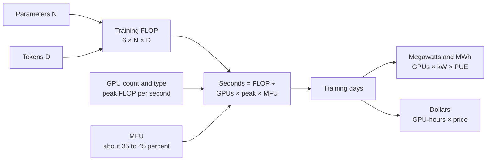
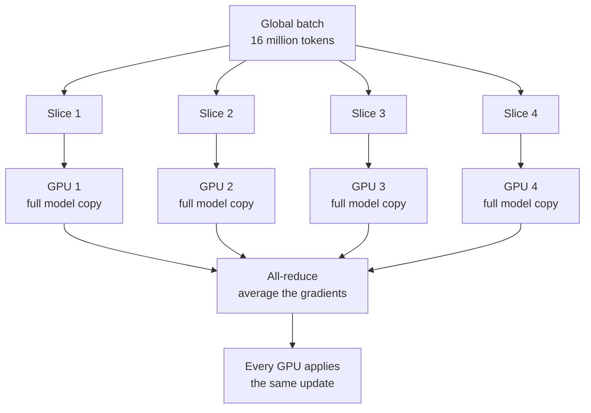
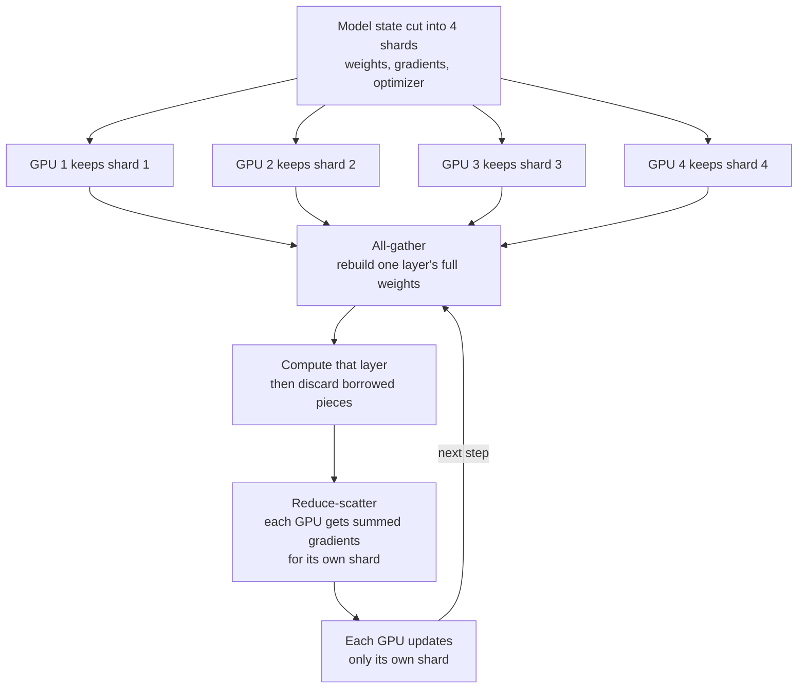
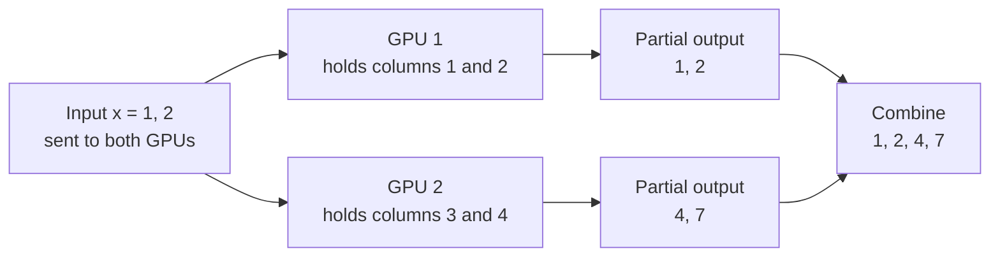
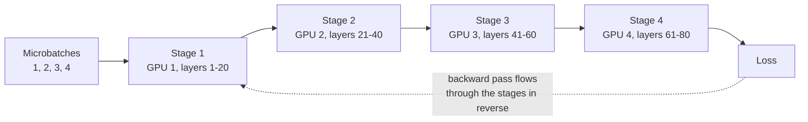
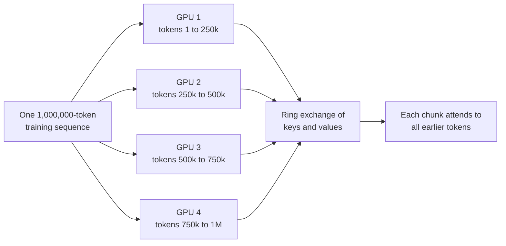
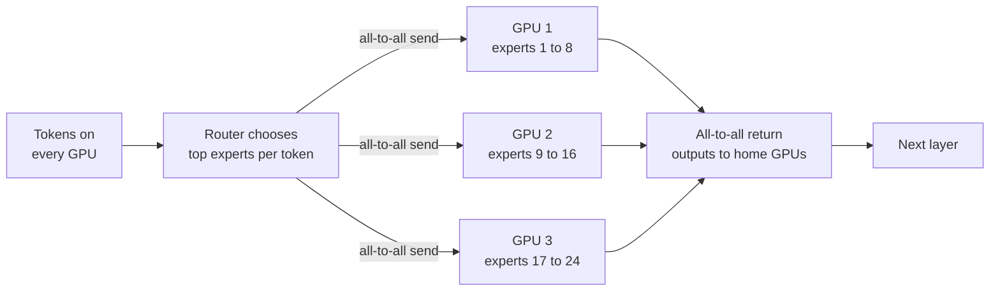
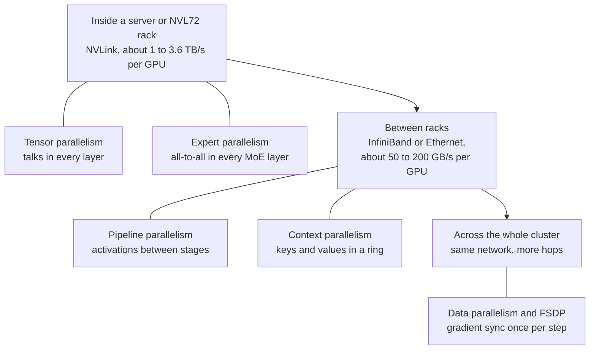

# Chapter 37: Training and Serving at Scale: The Math of Compute

*Learn to estimate, with a pencil and a spreadsheet, how many chips, days, megawatts and dollars it takes to train a frontier model and to serve it to millions of people, and understand every trick labs use to split one model across 100,000 chips.*

## What you'll learn

- How to count the work of training with the 6 × N × D rule, and turn that count into GPUs, days, megawatts and dollars, using real runs from GPT-3 to 2026's largest models.
- Why training needs about 16 bytes of memory per parameter, so even a mid-sized model must be spread across many chips.
- Every major way to split a model across chips (data, ZeRO/FSDP, tensor, pipeline, sequence/context and expert parallelism) and which network tier each one uses.
- How thousands of GPUs add up their numbers together, with a ring all-reduce worked by hand.
- What MFU means, where the rest of the time goes, and how labs survive hundreds of failures during one training run.
- Why low-precision formats (FP8, FP4) matter so much for training cost.
- The economics of serving: prefill versus decode, batching, disaggregated serving, inference chips, and how to work out a cost per million tokens from a GPU's hourly price.
- Why chips keep getting more efficient while total AI power use keeps rising.

## Before you start

This chapter pulls together several earlier ones. Chapter 5 (The Math of AI, Part 1) introduced the 6 × N × D rule, number precision and memory math. Chapters 12 and 13 explained the training loop, gradients and the Adam optimizer. Chapter 15 (The Transformer, Piece by Piece) explained attention and the KV cache, and Chapter 17 explained mixture-of-experts models. Chapter 19 (Pretraining) described a training run from the lab's side, and Chapter 23 (Inference) covered the software tricks for serving. On the hardware side, Chapter 32 covers GPUs and FLOPS, Chapter 33 covers memory and the memory wall, and Chapter 34 covers NVLink, InfiniBand and racks. You don't need to remember every detail; each idea gets a short recap here.

## Why one chip is never enough

The model behind your chatbot was not trained on one computer. It was trained on tens of thousands of accelerator chips, working together for weeks or months as if they were one machine, inside a building that drew as much electricity as a small city. When you chat with it, your request lands on a group of chips that are simultaneously serving many other people.

There are two reasons a single chip can't do the job, and they shape everything in this chapter.

1. **Time.** Training a frontier model takes around `10^25` to `10^27` arithmetic operations. A top GPU does roughly `10^15` to `10^16` per second. Even at full speed, one chip would need decades to millennia.
2. **Memory.** Training needs to hold the model's weights plus several extra numbers for every weight. For a model with hundreds of billions of parameters, that is terabytes of memory, while the biggest single GPU in 2026 holds a few hundred gigabytes.

So the model must be split across many chips that constantly exchange numbers. The art of training and serving at scale is splitting the work so that chips spend their time doing math, not waiting for each other.

> **Definition — Distributed training:** Training one model on many accelerators at once, with the work and the memory split among them and the chips coordinating constantly over fast networks.

> **Definition — Accelerator:** A chip specialized for the math of AI (mostly multiplying matrices), such as an NVIDIA or AMD GPU, a Google TPU or an AWS Trainium. "GPU" is often used loosely for all of them.

> **Definition — Cluster:** A large group of servers full of accelerators, networked together to work on shared jobs. Frontier AI clusters in 2026 hold 100,000 to over 1,000,000 accelerators.

## Counting the work: the 6 × N × D rule

### FLOPs, briefly

Chapter 32 introduced the unit of AI work.

> **Definition — FLOP (floating-point operation):** One arithmetic operation, such as a multiplication or an addition, on numbers stored in floating-point format. Used as a *count* of total work: "this model took `3.8 × 10^25` FLOP to train."

> **Definition — FLOP/s (FLOPS):** Floating-point operations *per second*, a measure of speed. An NVIDIA H100 does about 989 trillion (`9.89 × 10^14`) dense BF16 FLOP/s at peak.

> **Definition — Parameter:** One adjustable number (a weight) inside a neural network. "A 405B model" has 405 billion of them.

> **Definition — Token:** A chunk of text, roughly three-quarters of an English word on average, that a language model reads and writes. Training data is measured in tokens.

### Where the 6 comes from

To train on one token, a model does a **forward pass** (compute the prediction) and a **backward pass** (compute how every weight should change). In the forward pass, each parameter is used in one multiply and one add for each token: 2 FLOP per parameter per token. The backward pass costs about twice as much, roughly 4 FLOP per parameter per token, because it must compute gradients both for the weights and for the activations flowing backward. Add them up: about 6 FLOP per parameter per token.

`training compute ≈ 6 × N × D`

where N is the number of parameters and D is the number of training tokens. Running the finished model (inference) needs only the forward pass: about `2 × N` FLOP per token generated.

> **Definition — 6ND rule:** The rule of thumb that training a transformer takes about 6 × (number of parameters) × (number of training tokens) floating-point operations: 2 for the forward pass and 4 for the backward pass, per parameter per token.

For a mixture-of-experts (MoE) model, only some of the weights are used for each token, so N is the number of *active* parameters (Chapter 17).

> **Definition — Active parameters:** In a mixture-of-experts model, the parameters actually used to process each token, as opposed to the total stored. DeepSeek-V4-Pro has 1.6 trillion total but only 49 billion active parameters.

### Worked examples

| Model | N (active params) | D (tokens) | 6 × N × D | Published estimate |
|---|---|---|---|---|
| GPT-3 (2020) | 175 billion | 300 billion | `3.2 × 10^23` | about `3 × 10^23` |
| Chinchilla (2022) | 70 billion | 1.4 trillion | `5.9 × 10^23` | |
| Llama 3.1 405B (2024) | 405 billion | 15.6 trillion | `3.8 × 10^25` | `3.8 × 10^25` (Meta, Epoch AI) |
| DeepSeek-V4-Pro (2026) | 49 billion | about 33 trillion | `9.7 × 10^24` | about `9.7 × 10^24` (Epoch AI) |
| Hypothetical 1T dense, 20 tokens per parameter | 1 trillion | 20 trillion | `1.2 × 10^26` | |

*Table 37.1: The 6ND rule applied to real and hypothetical models.*

Let's do Llama 3.1 405B slowly. 6 × 405,000,000,000 × 15,600,000,000,000 = 6 × 405 × 15.6 × `10^9` × `10^12` ≈ 37,908 × `10^21` ≈ `3.8 × 10^25` FLOP. That matches Meta's own figure.

For the largest models, labs rarely publish N and D. Epoch AI, a research group that tracks AI compute, estimates them from public clues. As of its October 2026 database, its largest estimates include:

| Model | Epoch AI's estimated training compute | Notes |
|---|---|---|
| GPT-4 (2023) | about `2.1 × 10^25` | |
| Grok 3 (2025) | about `3.5 × 10^26` | |
| GPT-4.5 (2025) | about `3.8 × 10^26` | |
| Grok 4 (2025) | about `5 × 10^26` | marked speculative |
| GPT-6 Astra (Sep 2026) | about `9.4 × 10^26` | confidence range about `5 × 10^26` to `2 × 10^27` |

*Table 37.2: The largest publicly estimated training runs, as of October 2026. Epoch has no public estimates for most 2026 Claude or Gemini models.*

> **Watch out:** Training-compute figures for frontier models are almost always outside estimates, not disclosures. Treat them as "probably within a factor of two or three," and look for the confidence range when one is given.

### From FLOP to days

Now turn work into time. If you have G chips, each with a peak speed P (FLOP per second), and they achieve a fraction U of that peak on real work, then:

`training time in seconds = total FLOP ÷ (G × P × U)`

U is called the MFU, and we'll dig into it later. For now, know that 35 to 50 percent is typical for big runs.

**Worked example: Llama 3.1 405B.** Meta used 16,384 H100s at 989 trillion FLOP/s (BF16 dense), and achieved MFU of 38 to 43 percent. Take 40 percent:

1. Cluster speed: 16,384 × `9.89 × 10^14` × 0.40 ≈ `6.5 × 10^18` FLOP/s.
2. Time: `3.8 × 10^25` ÷ `6.5 × 10^18` ≈ `5.9 × 10^6` seconds.
3. Days: 5,860,000 ÷ 86,400 ≈ 68 days of pure computing.
4. GPU-hours: 16,384 GPUs × 1,630 hours ≈ 26.7 million GPU-hours.

Meta's model card lists about 31 million H100 GPU-hours for the 405B model, a bit more than our ideal estimate. The gap is what restarts, slower phases and imperfect utilization cost in real life, which this chapter will explain.

**Worked example: a 2026 frontier run.** Epoch's estimate for GPT-6 Astra assumes about 100,000 GB200 GPUs for about 90 days at 25 percent utilization in FP8. A Blackwell GPU does roughly 5 × `10^15` dense FP8 FLOP/s. So: `9.4 × 10^26` ÷ (100,000 × `5 × 10^15` × 0.25) ≈ `7.5 × 10^6` seconds ≈ 87 days. The numbers hang together. That is about 216 million GPU-hours (100,000 × 90 × 24).

> **Definition — GPU-hour:** One accelerator used for one hour. It is the basic unit of compute rental and of training-run cost estimates.



*Figure 37.1: The estimation pipeline. With five inputs you can sketch any training run: parameters, tokens, chip speed, chip count and utilization.*

### From days to megawatts and dollars

**Power.** Each GPU draws power itself, and the CPUs, network switches, fans and pumps around it draw more. A useful rule of thumb for 2025–26 rack-scale systems (GB300 or Vera Rubin class) is about 1.8 kW per GPU all-in at the IT level. The building then adds overhead for cooling and power conversion, measured by PUE (see Chapter 40); 1.2 is a good modern value.

> **Definition — PUE (power usage effectiveness):** A data center's total power divided by the power used by its computing equipment. A PUE of 1.2 means 20 percent extra for cooling, power conversion and lighting.

For the Astra-scale run: 100,000 GPUs × 1.8 kW = 180 MW of IT load; × 1.2 PUE = 216 MW for the facility. Over 90 days: 216 MW × 2,160 hours ≈ 467,000 MWh, or about 0.47 terawatt-hours. At an illustrative electricity price of $70 per MWh (7 cents per kWh, an assumption you can change), that is about $33 million of electricity.

For Llama 3.1 405B: an H100 server draws roughly 1.3 to 1.4 kW per GPU including its share of the server, so 16,384 GPUs × 1.4 kW ≈ 23 MW of IT load, or about 28 MW with cooling. Meta reported that synchronized GPU activity caused power swings of tens of megawatts during the run, a real challenge for the local grid (Chapter 39).

**Dollars.** Multiply GPU-hours by an hourly price. Llama-3-scale at a rental rate of $2.50 per H100-hour: 26.7 million × $2.50 ≈ $67 million. Epoch AI's estimate of Llama 3.1 405B's compute cost is about $53 million (in 2023 dollars). For the Astra-scale run, 216 million GPU-hours at $2 to $5 per GPU-hour gives roughly $0.4 to $1.1 billion for one final training run. That last figure is a back-of-envelope estimate, not a disclosed number, and the full program (experiments, failed runs, post-training, data and people) costs several times more.

> **Watch out:** "DeepSeek trained a frontier model for $5.6 million" compares the wrong things. That figure covered only the final run's GPU rental for DeepSeek-V3 (about 2.8 million H800-hours at $2 per hour, per its paper), not the research, failed experiments, earlier models or staff. Always ask what a training-cost number includes.

> **Key idea:** Five numbers let you sketch any training run: parameters, tokens, chip speed, chip count and utilization. Multiply out 6 × N × D, divide by the cluster's real speed, and you have days; multiply by power and price and you have megawatts and dollars.

> **At the frontier (2026):** Epoch AI estimates that frontier training compute has grown about 5× per year since 2020 and training cost about 3.5× per year. GPT-6 Astra (September 2026) was described as OpenAI's first pretraining run on more than 100,000 GPUs, at the Stargate site in Abilene, Texas. Epoch counts xAI's Colossus 2 in Memphis at about 1.1 million H100-equivalents, and Google says its TPU 8t training software can span more than a million chips.

> **Definition — H100-equivalent (H100e):** A unit analysts use to compare clusters built from different chips, by converting their total compute into the number of H100 GPUs that would match it.

## The memory wall of training

Speed is only half the problem. Before a chip can do any training math, everything it needs must fit in its memory. For each parameter, standard mixed-precision training with the Adam optimizer keeps:

| What is stored | Format | Bytes per parameter |
|---|---|---|
| Weights used in the math | BF16 | 2 |
| Gradients | BF16 | 2 |
| Master copy of the weights | FP32 | 4 |
| Adam's first moment (running average of gradients) | FP32 | 4 |
| Adam's second moment (running average of squared gradients) | FP32 | 4 |
| **Total** | | **16** |

*Table 37.3: The memory budget of mixed-precision training with Adam.*

> **Definition — Gradient:** For each parameter, the direction and size of the change that would reduce the training loss, computed in the backward pass.

> **Definition — Optimizer state:** Extra numbers per parameter that the optimizer keeps between steps. Adam keeps two running averages per parameter, which together are often larger than the model itself.

> **Definition — Mixed precision:** Doing most of the math in a low-precision format (such as BF16 or FP8) while keeping a few sensitive values, like a master copy of the weights, in higher precision (FP32).

So training needs about 16 bytes per parameter before counting anything else:

- **7B model:** 7 billion × 16 = 112 GB. Already more than one 80 GB H100.
- **70B model:** 70 billion × 16 = 1,120 GB, about 1.1 TB. At least 14 H100s just to *hold* it.
- **405B model:** 405 billion × 16 = 6,480 GB, about 6.5 TB. At least 81 H100s, or 23 of the 288 GB Rubin GPUs.

Then come the **activations**: the intermediate results of the forward pass, which must be kept until the backward pass uses them. Their size grows with batch size, sequence length and model width, and for long sequences they can exceed everything else.

> **Definition — Activations:** The intermediate numbers computed by each layer during the forward pass. Training keeps them until the backward pass, so they take a lot of memory, especially for long inputs.

The standard trick is **activation checkpointing**: throw most activations away during the forward pass and recompute them when the backward pass needs them. It trades extra computation (roughly one more forward pass) for a large memory saving.

> **Definition — Activation checkpointing (recomputation):** Saving memory during training by discarding some intermediate results in the forward pass and recomputing them later during the backward pass.

```
Memory to train a 70B model (mixed precision, Adam)

weights   BF16  ##                          140 GB
gradients BF16  ##                          140 GB
master+Adam FP32 ############               840 GB
activations     ####...  (depends on batch and length)
                |----|----|----|----|----|
                0   250  500  750 1000 1250 GB

one H100 = 80 GB   one B300 or Rubin = 288 GB
```

*Figure 37.2: The training memory budget of a 70B model is roughly 1.1 TB before activations, far more than any single chip holds.*

> **Key idea:** Training needs about 16 bytes per parameter (weights, gradients, master weights and two optimizer averages) plus activations. Memory, not just speed, forces models to be split across many chips.

## Splitting the work: the parallelism strategies

There are several ways to split a training job across chips, and big runs use several at once. Each one splits something different (the data, the optimizer state, the matrices, the layers, the sequence or the experts), and each one creates a different pattern of communication.

> **Analogy:** Imagine translating an enormous book with hundreds of translators. **Data parallel:** each team translates different chapters with its own copy of the dictionary, and the teams meet to reconcile dictionary updates. **Tensor parallel:** each sentence is split among four translators sitting at one desk. **Pipeline parallel:** an assembly line where one team drafts, the next edits and the next proofreads. **Expert parallel:** passages are routed to specialists in law, medicine or poetry. **Context parallel:** one gigantic chapter is split into sections, and translators pass notes so each knows what came before.

### Data parallelism

The simplest strategy. Every GPU holds a complete copy of the model. The **global batch** (all the training examples used in one step) is cut into slices, and each GPU processes a different slice. Each GPU computes gradients for its own slice. Then all GPUs **average their gradients** with a collective operation called all-reduce, so every GPU applies exactly the same update and the copies stay identical.

> **Definition — Data parallelism (DP):** Splitting the training data across GPUs that each hold a full copy of the model, then averaging their gradients after every step so all copies stay in sync.

> **Definition — Global batch size:** The total number of training examples (or tokens) processed in one optimizer step, summed across all GPUs. Llama 3 used batches of about 16 million tokens.



*Figure 37.3: Data parallelism. Same model, different data, then the gradients are averaged.*

Data parallelism scales easily, but it has two limits. Every GPU must hold the whole model (impossible past a few billion parameters, as we just saw). And the global batch can't grow forever: past a certain size, bigger batches stop speeding up learning, so you can't just add more data-parallel copies indefinitely.

### ZeRO and FSDP: sharding the memory

Holding a full copy of the optimizer state on every data-parallel GPU is wasteful: 64 GPUs keep 64 identical copies. ZeRO (from Microsoft's DeepSpeed) and PyTorch's FSDP fix this by **sharding**, giving each GPU only a slice of the state. ZeRO comes in three stages: stage 1 shards the optimizer state, stage 2 also shards the gradients, and stage 3 also shards the weights themselves. FSDP is equivalent to stage 3.

> **Definition — Sharding:** Splitting a large set of numbers into pieces ("shards") stored on different GPUs, so each GPU holds only its own piece.

> **Definition — ZeRO / FSDP:** Techniques (Microsoft's ZeRO, the Zero Redundancy Optimizer, and PyTorch's Fully Sharded Data Parallel) that shard optimizer state, gradients and weights across data-parallel GPUs instead of copying them, cutting memory per GPU.

With full sharding, a GPU doesn't have a layer's complete weights until it needs them. Just before computing a layer, the GPUs perform an **all-gather** to temporarily reassemble that layer's weights, compute, and throw the borrowed pieces away. After the backward pass, a **reduce-scatter** sums the gradients and leaves each GPU with just the summed gradients for its own shard, which it uses to update its own slice of the weights.



*Figure 37.4: Fully sharded data parallelism (ZeRO stage 3 / FSDP). Each GPU stores a quarter of everything and borrows the rest just in time.*

**Worked example: a 70B model on 64 GPUs.** Using the 16-byte budget (2 for weights, 2 for gradients, 12 for master weights plus Adam):

| Strategy | Memory per GPU (before activations) | Fits on an 80 GB H100? |
|---|---|---|
| Plain data parallel | 140 + 140 + 840 = 1,120 GB | No |
| ZeRO-1 (shard optimizer) | 140 + 140 + 840 ÷ 64 ≈ 293 GB | No |
| ZeRO-2 (also shard gradients) | 140 + (140 + 840) ÷ 64 ≈ 155 GB | No |
| ZeRO-3 / FSDP (shard everything) | 1,120 ÷ 64 = 17.5 GB | Yes, with room for activations |

*Table 37.4: Sharding turns an impossible memory budget into a comfortable one, at the cost of more communication.*

The catch is communication: FSDP moves the weights around every step. That works well over fast links and gets slow over slow ones, which is why it is usually combined with the strategies below.

### Tensor parallelism: splitting each matrix

Instead of splitting the data, you can split the math of each layer. A layer's main work is multiplying the input by a big weight matrix. **Tensor parallelism** cuts that matrix into strips and gives each GPU one strip.

**Worked example.** Input x = [1, 2]. Weight matrix W has 2 rows and 4 columns:

```
        col1 col2 col3 col4
W =   [  1    0    2    1  ]   row 1
      [  0    1    1    3  ]   row 2

x · W = [1×1+2×0, 1×0+2×1, 1×2+2×1, 1×1+2×3]
      = [   1,       2,       4,       7   ]
```

Split W by columns: GPU 1 gets columns 1–2, GPU 2 gets columns 3–4. Both receive the same input [1, 2]. GPU 1 computes [1, 2]; GPU 2 computes [4, 7]. Each did half the multiplications and stored half the weights. Joining the pieces gives the full answer [1, 2, 4, 7].



*Figure 37.5: Tensor parallelism on a tiny matrix. Each GPU holds and multiplies one strip of the weight matrix.*

In a real transformer, the Megatron-LM approach splits one matrix by columns and the next by rows, so each block needs only one summing step (an all-reduce) in the forward pass and one in the backward pass. But that happens in *every layer*, on large tensors, so tensor parallelism needs the fastest links available. It is usually kept inside one server or one NVLink domain, typically 8 GPUs (or up to the 72 of an NVL72 rack).

> **Definition — Tensor parallelism (TP):** Splitting the individual weight matrices of each layer across several GPUs, so each GPU stores and multiplies only part of every matrix. It requires very fast links and is usually kept inside one NVLink domain.

### Pipeline parallelism: an assembly line of layers

A model is a stack of layers. **Pipeline parallelism** gives each GPU (or group of GPUs) a consecutive block of layers, called a stage. GPU 1 computes layers 1–20 and passes the result to GPU 2, which computes layers 21–40, and so on. Only the activations at stage boundaries travel between GPUs, which is relatively little data, so pipeline stages can sit in different racks.

> **Definition — Pipeline parallelism (PP):** Splitting a model's layers into consecutive stages on different GPUs, like an assembly line, with each stage passing its outputs to the next.



*Figure 37.6: Pipeline parallelism splits the layers into stages, each on its own GPU.*

The problem is idle time. If one batch went through the pipeline, GPU 4 would wait while GPUs 1–3 worked, and then GPU 1 would wait during the backward pass. The fix is to cut the batch into small **microbatches** that follow each other through the pipeline. Even so, there are idle gaps while the pipeline fills and drains, called **bubbles**.

> **Definition — Microbatch:** A small slice of a training batch that is sent through a pipeline on its own, so different stages can work on different microbatches at the same time.

> **Definition — Pipeline bubble:** Idle time in pipeline parallelism while the pipeline fills at the start of a step and drains at the end, when some stages have nothing to do.

Here is a schedule with 4 stages and 4 microbatches. F means forward pass, B means backward pass, the number is the microbatch, and a dot is an idle slot (to keep it simple, the backward pass is drawn the same length as the forward pass).

```
time ->  1  2  3  4  5  6  7  8  9 10 11 12 13 14
GPU 1   F1 F2 F3 F4  .  .  .  .  .  . B4 B3 B2 B1
GPU 2    . F1 F2 F3 F4  .  .  .  . B4 B3 B2 B1  .
GPU 3    .  . F1 F2 F3 F4  .  . B4 B3 B2 B1  .  .
GPU 4    .  .  . F1 F2 F3 F4 B4 B3 B2 B1  .  .  .

each GPU: 8 busy slots out of 14  ->  6 / 14 = 43% idle
```

*Figure 37.7: A pipeline schedule with 4 stages and 4 microbatches. The dots are the bubble.*

For this simple schedule, the idle fraction is:

`bubble fraction = (stages − 1) ÷ (microbatches + stages − 1)`

| Stages | Microbatches | Bubble fraction |
|---|---|---|
| 4 | 4 | 3 ÷ 7 ≈ 43% |
| 4 | 16 | 3 ÷ 19 ≈ 16% |
| 4 | 32 | 3 ÷ 35 ≈ 9% |
| 16 | 128 | 15 ÷ 143 ≈ 10% |

*Table 37.5: More microbatches shrink the bubble.*

More microbatches help, but each one must be big enough to keep a GPU busy, and they all need memory for activations. Real systems use cleverer schedules (such as "1F1B," which alternates forward and backward passes, and interleaved stages) to shrink bubbles further.

### Sequence and context parallelism: splitting long inputs

Frontier models in 2026 read up to about a million tokens of context. Activations grow with sequence length, and attention lets every token look at every earlier token, so a single long sequence can overflow one GPU. **Context parallelism** cuts the sequence itself into chunks on different GPUs. Because each token's attention needs the keys and values of earlier tokens held on other GPUs, the GPUs pass those around, often in a ring ("ring attention"), overlapping the passing with computation.

> **Definition — Context parallelism (CP):** Splitting one very long input sequence into chunks on different GPUs, which exchange attention keys and values so every token can still attend to the tokens before it. It makes long-context training fit in memory.

A related, lighter technique called **sequence parallelism** splits the activations of the simpler per-token operations (like normalization) along the sequence inside a tensor-parallel group, saving memory.



*Figure 37.8: Context parallelism splits one long sequence across GPUs that share attention keys and values.*

### Expert parallelism: spreading out the specialists

Most frontier models in 2026 are mixture-of-experts models (Chapter 17). Each MoE layer contains many "expert" sub-networks and a small router that sends each token to a few of them. Kimi K3, for example, has 896 experts per MoE layer, with 16 active per token plus 2 shared experts. **Expert parallelism** places different experts on different GPUs.

> **Definition — Mixture of experts (MoE):** A model design in which each layer has many sub-networks ("experts") and a router sends each token to only a few, so the total parameter count can be huge while the compute per token stays modest.

> **Definition — Expert parallelism (EP):** Placing different experts of an MoE model on different GPUs and sending each token to the GPUs holding its chosen experts.

Every MoE layer then needs an **all-to-all** exchange: each GPU sends each of its tokens to whichever GPUs hold that token's chosen experts, and the results come back the same way. All-to-all traffic is heavy and irregular, so expert parallelism wants the fastest, flattest network available, which is one reason NVIDIA built the 72-GPU NVL72 rack as one NVLink domain.

> **Definition — All-to-all:** A collective operation in which every GPU sends a different chunk of data to every other GPU. It is the main communication pattern of expert parallelism.



*Figure 37.9: Expert parallelism. Tokens travel to the GPUs holding their chosen experts and back again, in every MoE layer.*

A tricky part of expert parallelism is balance. If the router sends too many tokens to one popular expert, that GPU becomes the bottleneck while others wait, so training adds incentives (or bias adjustments) that keep experts evenly loaded.

### Putting it together: 3D, 4D and 5D parallelism

Real training runs combine these strategies, and the key design rule is: **put the chattiest communication on the fastest links.**

- **Tensor and expert parallelism** exchange large amounts of data in every layer, so they live inside a server or an NVLink domain, where links run at about 1 to 3.6 terabytes per second per GPU.
- **Pipeline and context parallelism** send less, at stage boundaries or in overlappable rings, so they can cross between racks over InfiniBand or Ethernet, at roughly 50 to 200 gigabytes per second per GPU.
- **Data parallelism and FSDP** synchronize once per step and can overlap with computation, so they span the whole cluster.

> **Definition — Scale-up vs. scale-out network:** The scale-up network (such as NVLink) tightly links a small group of accelerators with very high bandwidth; the scale-out network (InfiniBand or Ethernet) connects many such groups across the cluster at lower bandwidth per chip.



*Figure 37.10: Each parallelism strategy is matched to the network tier that can carry its traffic.*

Using two or three of these at once is called 3D parallelism (data, tensor, pipeline); adding context parallelism makes 4D, and adding expert parallelism makes 5D. The total number of GPUs is the product of the degrees.

**Worked example: Llama 3.** Meta's paper describes training the 405B model on 16,384 H100s with tensor parallelism of 8 (the 8 GPUs inside one server, linked by NVLink), pipeline parallelism of 16 and data parallelism (FSDP-style) of 128: 8 × 16 × 128 = 16,384. For the long-context stage it added context parallelism of 16 and reduced data parallelism to keep the total the same. MFU ranged from 38 to 43 percent across these layouts.

| Strategy | What it splits | Main communication | Typical network tier |
|---|---|---|---|
| Data parallel | Training examples | All-reduce of gradients, once per step | Whole cluster |
| ZeRO / FSDP | Optimizer state, gradients, weights | All-gather and reduce-scatter, every layer | Cluster, best within fast groups |
| Tensor parallel | Each weight matrix | All-reduce inside every layer | NVLink domain |
| Pipeline parallel | Layers into stages | Activations at stage boundaries | Between racks |
| Context parallel | One long sequence | Keys and values in a ring | Within or between racks |
| Expert parallel | MoE experts | All-to-all in every MoE layer | NVLink domain |

*Table 37.6: The parallelism strategies at a glance.*

> **Key idea:** No single strategy is enough. Labs combine data, sharding, tensor, pipeline, context and expert parallelism, placing each where the network can carry its traffic: the chattiest inside the NVLink domain, the quietest across the whole cluster.

> **At the frontier (2026):** Hardware is being designed around these patterns. NVIDIA's NVL72 racks give 72 GPUs one NVLink domain, big enough for tensor and expert parallelism of large MoE models, and NVIDIA claims Vera Rubin can train MoE models with a quarter of the GPUs needed on Blackwell (a vendor claim). Google's TPU 8t superpods link up to 9,600 chips, and its Virgo fabric connects more than 134,000 TPU 8t chips. Some 2026 runs span more than one data center, which pushes data parallelism onto long-distance links.

