# Chapter 37: Training and Serving at Scale: The Math of Compute

*Learn to estimate, with a pencil and a spreadsheet, how many chips, days, megawatts and dollars it takes to train a frontier model and to serve it to millions of people, and understand every trick labs use to split one model across 100,000 chips.*

## What you'll learn

- How to count the work of training with the 6 × N × D rule, and turn that count into GPUs, days, megawatts and dollars, using real runs from GPT-3 to 2026's largest models.
- Why training needs about 16 bytes of memory per parameter, so even a mid-sized model must be spread across many chips.
- Every major way to split a model across chips (data, ZeRO/FSDP, tensor, pipeline, sequence/context and expert parallelism) and which network tier each one uses.
- How thousands of GPUs add up their numbers together, with a ring all-reduce worked by hand.
- What MFU means, where the rest of the time goes, and how labs survive hundreds of failures during one training run.
- Why low-precision formats (FP8, FP4) matter so much for training cost.
- The economics of serving: prefill versus decode, batching, disaggregated serving, inference chips, and how to work out a cost per million tokens from a GPU's hourly price.
- Why chips keep getting more efficient while total AI power use keeps rising.

## Before you start

This chapter pulls together several earlier ones. Chapter 5 (The Math of AI, Part 1) introduced the 6 × N × D rule, number precision and memory math. Chapters 12 and 13 explained the training loop, gradients and the Adam optimizer. Chapter 15 (The Transformer, Piece by Piece) explained attention and the KV cache, and Chapter 17 explained mixture-of-experts models. Chapter 19 (Pretraining) described a training run from the lab's side, and Chapter 23 (Inference) covered the software tricks for serving. On the hardware side, Chapter 32 covers GPUs and FLOPS, Chapter 33 covers memory and the memory wall, and Chapter 34 covers NVLink, InfiniBand and racks. You don't need to remember every detail; each idea gets a short recap here.

## Why one chip is never enough

The model behind your chatbot was not trained on one computer. It was trained on tens of thousands of accelerator chips, working together for weeks or months as if they were one machine, inside a building that drew as much electricity as a small city. When you chat with it, your request lands on a group of chips that are simultaneously serving many other people.

There are two reasons a single chip can't do the job, and they shape everything in this chapter.

1. **Time.** Training a frontier model takes around `10^25` to `10^27` arithmetic operations. A top GPU does roughly `10^15` to `10^16` per second. Even at full speed, one chip would need decades to millennia.
2. **Memory.** Training needs to hold the model's weights plus several extra numbers for every weight. For a model with hundreds of billions of parameters, that is terabytes of memory, while the biggest single GPU in 2026 holds a few hundred gigabytes.

So the model must be split across many chips that constantly exchange numbers. The art of training and serving at scale is splitting the work so that chips spend their time doing math, not waiting for each other.

> **Definition — Distributed training:** Training one model on many accelerators at once, with the work and the memory split among them and the chips coordinating constantly over fast networks.

> **Definition — Accelerator:** A chip specialized for the math of AI (mostly multiplying matrices), such as an NVIDIA or AMD GPU, a Google TPU or an AWS Trainium. "GPU" is often used loosely for all of them.

> **Definition — Cluster:** A large group of servers full of accelerators, networked together to work on shared jobs. Frontier AI clusters in 2026 hold 100,000 to over 1,000,000 accelerators.

## Counting the work: the 6 × N × D rule

### FLOPs, briefly

Chapter 32 introduced the unit of AI work.

> **Definition — FLOP (floating-point operation):** One arithmetic operation, such as a multiplication or an addition, on numbers stored in floating-point format. Used as a *count* of total work: "this model took `3.8 × 10^25` FLOP to train."

> **Definition — FLOP/s (FLOPS):** Floating-point operations *per second*, a measure of speed. An NVIDIA H100 does about 989 trillion (`9.89 × 10^14`) dense BF16 FLOP/s at peak.

> **Definition — Parameter:** One adjustable number (a weight) inside a neural network. "A 405B model" has 405 billion of them.

> **Definition — Token:** A chunk of text, roughly three-quarters of an English word on average, that a language model reads and writes. Training data is measured in tokens.

### Where the 6 comes from

To train on one token, a model does a **forward pass** (compute the prediction) and a **backward pass** (compute how every weight should change). In the forward pass, each parameter is used in one multiply and one add for each token: 2 FLOP per parameter per token. The backward pass costs about twice as much, roughly 4 FLOP per parameter per token, because it must compute gradients both for the weights and for the activations flowing backward. Add them up: about 6 FLOP per parameter per token.

`training compute ≈ 6 × N × D`

where N is the number of parameters and D is the number of training tokens. Running the finished model (inference) needs only the forward pass: about `2 × N` FLOP per token generated.

> **Definition — 6ND rule:** The rule of thumb that training a transformer takes about 6 × (number of parameters) × (number of training tokens) floating-point operations: 2 for the forward pass and 4 for the backward pass, per parameter per token.

For a mixture-of-experts (MoE) model, only some of the weights are used for each token, so N is the number of *active* parameters (Chapter 17).

> **Definition — Active parameters:** In a mixture-of-experts model, the parameters actually used to process each token, as opposed to the total stored. DeepSeek-V4-Pro has 1.6 trillion total but only 49 billion active parameters.

The rule also leaves out attention's own arithmetic, the step in which each token is compared with every earlier token (Chapter 15). That work grows with the length of the training sequences, not with the parameter count. For a large model it adds only a few percent when sequences are a few thousand tokens long, but at around 100,000 tokens it can rival all the rest, which is one reason long-context training costs more than 6 × N × D suggests.

### Worked examples

| Model | N (active params) | D (tokens) | 6 × N × D | Published estimate |
|---|---|---|---|---|
| GPT-3 (2020) | 175 billion | 300 billion | `3.2 × 10^23` | about `3 × 10^23` |
| Chinchilla (2022) | 70 billion | 1.4 trillion | `5.9 × 10^23` | |
| Llama 3.1 405B (2024) | 405 billion | 15.6 trillion | `3.8 × 10^25` | `3.8 × 10^25` (Meta, Epoch AI) |
| DeepSeek-V4-Pro (2026) | 49 billion | about 33 trillion | `9.7 × 10^24` | about `9.7 × 10^24` (Epoch AI) |
| Hypothetical 1T dense, 20 tokens per parameter | 1 trillion | 20 trillion | `1.2 × 10^26` | |

*Table 37.1: The 6ND rule applied to real and hypothetical models.*

Let's do Llama 3.1 405B slowly. 6 × 405,000,000,000 × 15,600,000,000,000 = 6 × 405 × 15.6 × `10^9` × `10^12` ≈ 37,908 × `10^21` ≈ `3.8 × 10^25` FLOP. (Multiplying powers of ten adds their exponents, so `10^9` × `10^12` = `10^21`; and 37,908 is about 3.8 × `10^4`, which moves the exponent from 21 to 25.) That matches Meta's own figure.

For the largest models, labs rarely publish N and D. Epoch AI, a research group that tracks AI compute, estimates them from public clues. As of its October 2026 database, its largest estimates include:

| Model | Epoch AI's estimated training compute | Notes |
|---|---|---|
| GPT-4 (2023) | about `2.1 × 10^25` | |
| Grok 3 (2025) | about `3.5 × 10^26` | |
| GPT-4.5 (2025) | about `3.8 × 10^26` | |
| Grok 4 (2025) | about `5 × 10^26` | marked speculative |
| GPT-6 Astra (Sep 2026) | about `9.4 × 10^26` | confidence range about `5 × 10^26` to `2 × 10^27` |

*Table 37.2: The largest publicly estimated training runs, as of October 2026. Epoch has no public estimates for most 2026 Claude or Gemini models.*

> **Watch out:** Training-compute figures for frontier models are almost always outside estimates, not disclosures. Treat them as "probably within a factor of two or three," and look for the confidence range when one is given.

> **Try it:** Ask your chatbot: "Using the 6 × N × D rule, estimate the training compute of a 70-billion-parameter model trained on 15 trillion tokens, then estimate how many days it would take on 4,096 H100 GPUs at 40% MFU. Show every step." Check its arithmetic against the method in this section (you should get about `6.3 × 10^24` FLOP and about 45 days).

### From FLOP to days

Now turn work into time. If you have G chips, each with a peak speed P (FLOP per second), and they achieve a fraction U of that peak on real work, then:

`training time in seconds = total FLOP ÷ (G × P × U)`

U is called the MFU, and we'll dig into it later. For now, know that 35 to 50 percent is typical for big runs.

**Worked example: Llama 3.1 405B.** Meta used 16,384 H100s at 989 trillion FLOP/s (BF16 dense), and achieved MFU of 38 to 43 percent. Take 40 percent:

1. Cluster speed: 16,384 × `9.89 × 10^14` × 0.40 ≈ `6.5 × 10^18` FLOP/s.
2. Time: `3.8 × 10^25` ÷ `6.5 × 10^18` ≈ `5.9 × 10^6` seconds.
3. Days: 5,860,000 ÷ 86,400 ≈ 68 days of pure computing.
4. GPU-hours: 5,860,000 seconds ÷ 3,600 seconds per hour ≈ 1,630 hours, so 16,384 GPUs × 1,630 hours ≈ 26.7 million GPU-hours.

Meta's model card lists about 31 million H100 GPU-hours for the 405B model, a bit more than our ideal estimate. The gap is what restarts, slower phases and imperfect utilization cost in real life, which this chapter will explain.

**Worked example: a 2026 frontier run.** Epoch's estimate for GPT-6 Astra assumes about 100,000 GB200 GPUs for about 90 days at 25 percent utilization in FP8. A Blackwell GPU does roughly 5 × `10^15` dense FP8 FLOP/s. So: `9.4 × 10^26` ÷ (100,000 × `5 × 10^15` × 0.25) ≈ `7.5 × 10^6` seconds ≈ 87 days. The numbers hang together. That is about 216 million GPU-hours (100,000 × 90 × 24).

> **Definition — GPU-hour:** One accelerator used for one hour. It is the basic unit of compute rental and of training-run cost estimates.

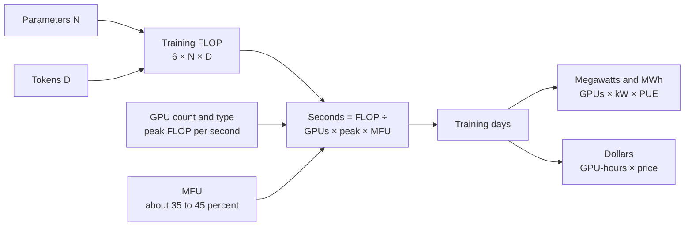

*Figure 37.1: The estimation pipeline. With five inputs you can sketch any training run: parameters, tokens, chip speed, chip count and utilization.*

### From days to megawatts and dollars

**Power.** Each GPU draws power itself, and the CPUs, network switches, fans and pumps around it draw more. A useful rule of thumb for 2025–26 rack-scale systems (GB300 or Vera Rubin class) is about 1.8 kW per GPU all-in at the IT level. The building then adds overhead for cooling and power conversion, measured by PUE (see Chapter 40); 1.2 is a good modern value.

> **Definition — PUE (power usage effectiveness):** A data center's total power divided by the power used by its computing equipment. A PUE of 1.2 means 20 percent extra for cooling, power conversion and lighting.

For the Astra-scale run: 100,000 GPUs × 1.8 kW = 180 MW of IT load; × 1.2 PUE = 216 MW for the facility. Over 90 days: 216 MW × 2,160 hours ≈ 467,000 MWh, or about 0.47 terawatt-hours. At an illustrative electricity price of $70 per MWh (7 cents per kWh, an assumption you can change), that is about $33 million of electricity.

For Llama 3.1 405B: an H100 server draws roughly 1.3 to 1.4 kW per GPU including its share of the server, so 16,384 GPUs × 1.4 kW ≈ 23 MW of IT load, or about 28 MW with cooling. Meta reported that synchronized GPU activity caused power swings of tens of megawatts during the run, a real challenge for the local grid (Chapter 39).

**Dollars.** Multiply GPU-hours by an hourly price. Llama-3-scale at a rental rate of $2.50 per H100-hour: 26.7 million × $2.50 ≈ $67 million. Epoch AI's estimate of Llama 3.1 405B's compute cost is about $53 million (in 2023 dollars). For the Astra-scale run, 216 million GPU-hours at $2 to $5 per GPU-hour gives roughly $0.4 to $1.1 billion for one final training run. That last figure is a back-of-envelope estimate, not a disclosed number, and the full program (experiments, failed runs, post-training, data and people) costs several times more.

> **Watch out:** "DeepSeek trained a frontier model for $5.6 million" compares the wrong things. That figure covered only the final run's GPU rental for DeepSeek-V3 (about 2.8 million H800-hours at $2 per hour, per its paper), not the research, failed experiments, earlier models or staff. Always ask what a training-cost number includes.

> **Key idea:** Five numbers let you sketch any training run: parameters, tokens, chip speed, chip count and utilization. Multiply out 6 × N × D, divide by the cluster's real speed, and you have days; multiply by power and price and you have megawatts and dollars.

> **At the frontier (2026):** Epoch AI estimates that frontier training compute has grown about 5× per year since 2020 and training cost about 3.5× per year. GPT-6 Astra (September 2026) was described as OpenAI's first pretraining run on more than 100,000 GPUs, at the Stargate site in Abilene, Texas. Epoch counts xAI's Colossus 2 in Memphis at about 1.1 million H100-equivalents, and Google says its TPU 8t training software can span more than a million chips.

> **Definition — H100-equivalent (H100e):** A unit analysts use to compare clusters built from different chips, by converting their total compute into the number of H100 GPUs that would match it.

## The memory wall of training

Speed is only half the problem. Before a chip can do any training math, everything it needs must fit in its memory. For each parameter, standard mixed-precision training with the Adam optimizer keeps:

| What is stored | Format | Bytes per parameter |
|---|---|---|
| Weights used in the math | BF16 | 2 |
| Gradients | BF16 | 2 |
| Master copy of the weights | FP32 | 4 |
| Adam's first moment (running average of gradients) | FP32 | 4 |
| Adam's second moment (running average of squared gradients) | FP32 | 4 |
| **Total** | | **16** |

*Table 37.3: The memory budget of mixed-precision training with Adam.*

> **Definition — Gradient:** For each parameter, the direction and size of the change that would reduce the training loss, computed in the backward pass.

> **Definition — Optimizer state:** Extra numbers per parameter that the optimizer keeps between steps. Adam keeps two running averages per parameter, which together are often larger than the model itself.

> **Definition — Mixed precision:** Doing most of the math in a low-precision format (such as BF16 or FP8) while keeping a few sensitive values, like a master copy of the weights, in higher precision (FP32).

So training needs about 16 bytes per parameter before counting anything else:

- **7B model:** 7 billion × 16 = 112 GB. Already more than one 80 GB H100.
- **70B model:** 70 billion × 16 = 1,120 GB, about 1.1 TB. At least 14 H100s just to *hold* it.
- **405B model:** 405 billion × 16 = 6,480 GB, about 6.5 TB. At least 81 H100s, or 23 of the 288 GB Rubin GPUs.

Then come the **activations**: the intermediate results of the forward pass, which must be kept until the backward pass uses them. Their size grows with batch size, sequence length and model width, and for long sequences they can exceed everything else.

> **Definition — Activations:** The intermediate numbers computed by each layer during the forward pass. Training keeps them until the backward pass, so they take a lot of memory, especially for long inputs.

The standard trick is **activation checkpointing**: throw most activations away during the forward pass and recompute them when the backward pass needs them. It trades extra computation (roughly one more forward pass) for a large memory saving.

> **Definition — Activation checkpointing (recomputation):** Saving memory during training by discarding some intermediate results in the forward pass and recomputing them later during the backward pass.

```
Memory to train a 70B model (mixed precision, Adam)

weights      BF16  ###                       140 GB
gradients    BF16  ###                       140 GB
master+Adam  FP32  #################         840 GB
activations        ####...  (depends on batch and length)
                   |----|----|----|----|----|
                   0   250  500  750 1000 1250 GB
                   (each # is about 50 GB)

one H100 = 80 GB   one B300 or Rubin = 288 GB
```

*Figure 37.2: The training memory budget of a 70B model is roughly 1.1 TB before activations, far more than any single chip holds.*

> **Key idea:** Training needs about 16 bytes per parameter (weights, gradients, master weights and two optimizer averages) plus activations. Memory, not just speed, forces models to be split across many chips.

## Splitting the work: the parallelism strategies

There are several ways to split a training job across chips, and big runs use several at once. Each one splits something different (the data, the optimizer state, the matrices, the layers, the sequence or the experts), and each one creates a different pattern of communication.

> **Analogy:** Imagine translating an enormous book with hundreds of translators. **Data parallel:** each team translates different chapters with its own copy of the dictionary, and the teams meet to reconcile dictionary updates. **Tensor parallel:** each sentence is split among four translators sitting at one desk. **Pipeline parallel:** an assembly line where one team drafts, the next edits and the next proofreads. **Expert parallel:** passages are routed to specialists in law, medicine or poetry. **Context parallel:** one gigantic chapter is split into sections, and translators pass notes so each knows what came before.

### Data parallelism

The simplest strategy. Every GPU holds a complete copy of the model. The **global batch** (all the training examples used in one step) is cut into slices, and each GPU processes a different slice. Each GPU computes gradients for its own slice. Then all GPUs **average their gradients** with a collective operation called all-reduce, so every GPU applies exactly the same update and the copies stay identical.

> **Definition — Data parallelism (DP):** Splitting the training data across GPUs that each hold a full copy of the model, then averaging their gradients after every step so all copies stay in sync.

> **Definition — Global batch size:** The total number of training examples (or tokens) processed in one optimizer step, summed across all GPUs. Llama 3 used batches of about 16 million tokens.

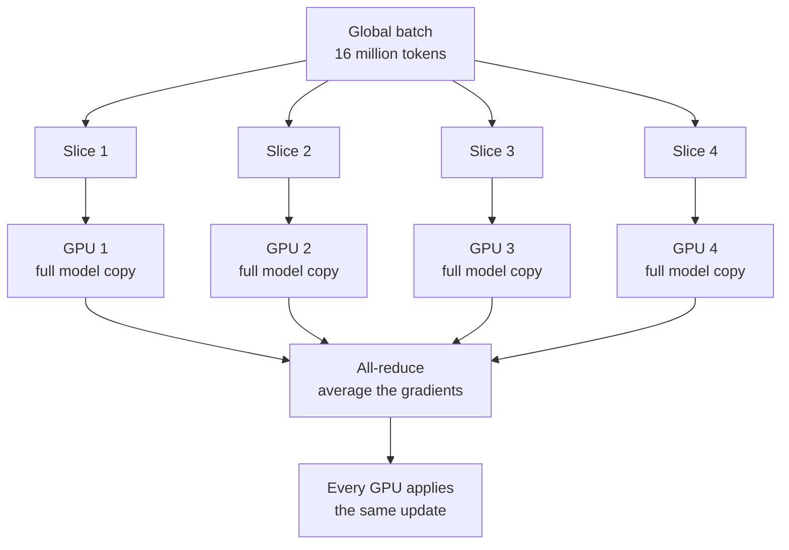

*Figure 37.3: Data parallelism. Same model, different data, then the gradients are averaged.*

Data parallelism scales easily, but it has two limits. Every GPU must hold the whole model (impossible past a few billion parameters, as we just saw). And the global batch can't grow forever: past a certain size, bigger batches stop speeding up learning, so you can't just add more data-parallel copies indefinitely.

The opposite problem, too few GPUs for the batch you want, has a simple fix. Each GPU processes several slices one after another, adds up their gradients, and only then joins the all-reduce and updates the weights. The result is mathematically the same step, just slower.

> **Definition — Gradient accumulation:** Processing several small slices of a batch one after another and adding up their gradients before making a single weight update, so a few GPUs can train with the same large batch as many.

### ZeRO and FSDP: sharding the memory

Holding a full copy of the optimizer state on every data-parallel GPU is wasteful: 64 GPUs keep 64 identical copies. ZeRO (from Microsoft's DeepSpeed) and PyTorch's FSDP fix this by **sharding**, giving each GPU only a slice of the state. ZeRO comes in three stages: stage 1 shards the optimizer state, stage 2 also shards the gradients, and stage 3 also shards the weights themselves. FSDP is equivalent to stage 3.

> **Definition — Sharding:** Splitting a large set of numbers into pieces ("shards") stored on different GPUs, so each GPU holds only its own piece.

> **Definition — ZeRO / FSDP:** Techniques (Microsoft's ZeRO, the Zero Redundancy Optimizer, and PyTorch's Fully Sharded Data Parallel) that shard optimizer state, gradients and weights across data-parallel GPUs instead of copying them, cutting memory per GPU.

With full sharding, a GPU doesn't have a layer's complete weights until it needs them. Just before computing a layer, the GPUs perform an **all-gather** to temporarily reassemble that layer's weights, compute, and throw the borrowed pieces away. After the backward pass, a **reduce-scatter** sums the gradients and leaves each GPU with just the summed gradients for its own shard, which it uses to update its own slice of the weights.

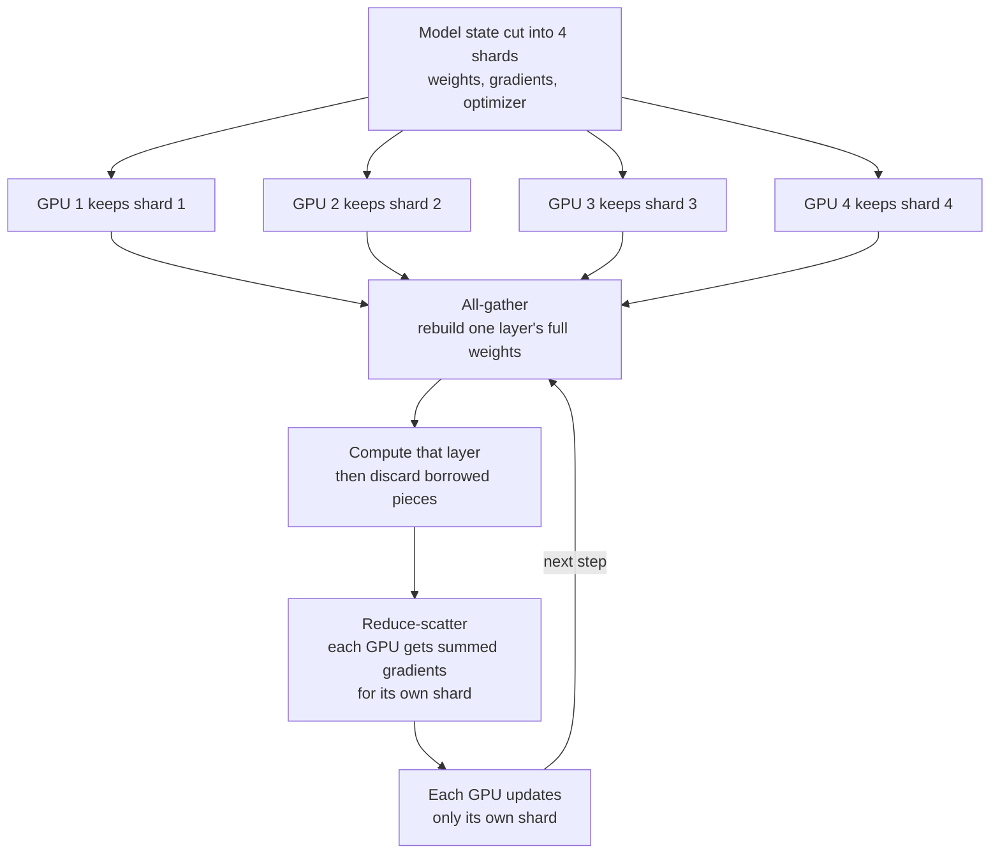

*Figure 37.4: Fully sharded data parallelism (ZeRO stage 3 / FSDP). Each GPU stores a quarter of everything and borrows the rest just in time.*

**Worked example: a 70B model on 64 GPUs.** Using the 16-byte budget (2 for weights, 2 for gradients, 12 for master weights plus Adam):

| Strategy | Memory per GPU (before activations) | Fits on an 80 GB H100? |
|---|---|---|
| Plain data parallel | 140 + 140 + 840 = 1,120 GB | No |
| ZeRO-1 (shard optimizer) | 140 + 140 + 840 ÷ 64 ≈ 293 GB | No |
| ZeRO-2 (also shard gradients) | 140 + (140 + 840) ÷ 64 ≈ 155 GB | No |
| ZeRO-3 / FSDP (shard everything) | 1,120 ÷ 64 = 17.5 GB | Yes, with room for activations |

*Table 37.4: Sharding turns an impossible memory budget into a comfortable one, at the cost of more communication.*

The catch is communication: FSDP moves the weights around every step. That works well over fast links and gets slow over slow ones, which is why it is usually combined with the strategies below.

### Tensor parallelism: splitting each matrix

Instead of splitting the data, you can split the math of each layer. A layer's main work is multiplying the input by a big weight matrix. **Tensor parallelism** cuts that matrix into strips and gives each GPU one strip.

**Worked example.** Input x = [1, 2]. Weight matrix W has 2 rows and 4 columns:

```
        col1 col2 col3 col4
W =   [  1    0    2    1  ]   row 1
      [  0    1    1    3  ]   row 2

x · W = [1×1+2×0, 1×0+2×1, 1×2+2×1, 1×1+2×3]
      = [   1,       2,       4,       7   ]
```

Split W by columns: GPU 1 gets columns 1–2, GPU 2 gets columns 3–4. Both receive the same input [1, 2]. GPU 1 computes [1, 2]; GPU 2 computes [4, 7]. Each did half the multiplications and stored half the weights. Joining the pieces gives the full answer [1, 2, 4, 7].

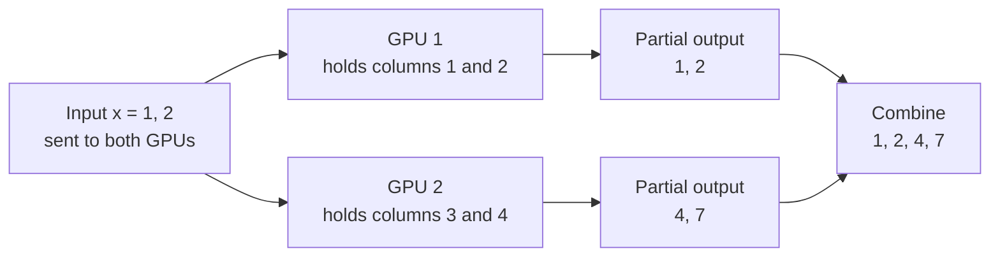

*Figure 37.5: Tensor parallelism on a tiny matrix. Each GPU holds and multiplies one strip of the weight matrix.*

In a real transformer, the Megatron-LM approach (named after NVIDIA's training software that introduced it) splits one matrix by columns and the next by rows, so each block needs only one summing step (an all-reduce) in the forward pass and one in the backward pass. But that happens in *every layer*, on large tensors, so tensor parallelism needs the fastest links available. It is usually kept inside one server or one NVLink domain, typically 8 GPUs (or up to the 72 of an NVL72 rack).

> **Definition — Tensor parallelism (TP):** Splitting the individual weight matrices of each layer across several GPUs, so each GPU stores and multiplies only part of every matrix. It requires very fast links and is usually kept inside one NVLink domain.

### Pipeline parallelism: an assembly line of layers

A model is a stack of layers. **Pipeline parallelism** gives each GPU (or group of GPUs) a consecutive block of layers, called a stage. GPU 1 computes layers 1–20 and passes the result to GPU 2, which computes layers 21–40, and so on. Only the activations at stage boundaries travel between GPUs, which is relatively little data, so pipeline stages can sit in different racks.

> **Definition — Pipeline parallelism (PP):** Splitting a model's layers into consecutive stages on different GPUs, like an assembly line, with each stage passing its outputs to the next.

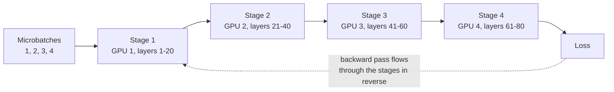

*Figure 37.6: Pipeline parallelism splits the layers into stages, each on its own GPU.*

The problem is idle time. If one batch went through the pipeline, GPU 4 would wait while GPUs 1–3 worked, and then GPU 1 would wait during the backward pass. The fix is to cut the batch into small **microbatches** that follow each other through the pipeline. Even so, there are idle gaps while the pipeline fills and drains, called **bubbles**.

> **Definition — Microbatch:** A small slice of a training batch that is sent through a pipeline on its own, so different stages can work on different microbatches at the same time.

> **Definition — Pipeline bubble:** Idle time in pipeline parallelism while the pipeline fills at the start of a step and drains at the end, when some stages have nothing to do.

Here is a schedule with 4 stages and 4 microbatches. F means forward pass, B means backward pass, the number is the microbatch, and a dot is an idle slot (to keep it simple, the backward pass is drawn the same length as the forward pass).

```
time ->  1  2  3  4  5  6  7  8  9 10 11 12 13 14
GPU 1   F1 F2 F3 F4  .  .  .  .  .  . B4 B3 B2 B1
GPU 2    . F1 F2 F3 F4  .  .  .  . B4 B3 B2 B1  .
GPU 3    .  . F1 F2 F3 F4  .  . B4 B3 B2 B1  .  .
GPU 4    .  .  . F1 F2 F3 F4 B4 B3 B2 B1  .  .  .

each GPU: 8 busy slots out of 14  ->  6 / 14 = 43% idle
```

*Figure 37.7: A pipeline schedule with 4 stages and 4 microbatches. The dots are the bubble.*

For this simple schedule, the idle fraction is:

`bubble fraction = (stages − 1) ÷ (microbatches + stages − 1)`

| Stages | Microbatches | Bubble fraction |
|---|---|---|
| 4 | 4 | 3 ÷ 7 ≈ 43% |
| 4 | 16 | 3 ÷ 19 ≈ 16% |
| 4 | 32 | 3 ÷ 35 ≈ 9% |
| 16 | 128 | 15 ÷ 143 ≈ 10% |

*Table 37.5: More microbatches shrink the bubble.*

More microbatches help, but each one must be big enough to keep a GPU busy, and they all need memory for activations. Real systems use cleverer schedules (such as "1F1B," which alternates forward and backward passes, and interleaved stages) to shrink bubbles further.

### Sequence and context parallelism: splitting long inputs

Frontier models in 2026 read up to about a million tokens of context. Activations grow with sequence length, and attention lets every token look at every earlier token, so a single long sequence can overflow one GPU. **Context parallelism** cuts the sequence itself into chunks on different GPUs. Because each token's attention needs the keys and values of earlier tokens held on other GPUs, the GPUs pass those around, often in a ring ("ring attention"), overlapping the passing with computation.

> **Definition — Context parallelism (CP):** Splitting one very long input sequence into chunks on different GPUs, which exchange attention keys and values so every token can still attend to the tokens before it. It makes long-context training fit in memory.

A related, lighter technique called **sequence parallelism** splits the activations of the simpler per-token operations (like normalization) along the sequence inside a tensor-parallel group, saving memory.

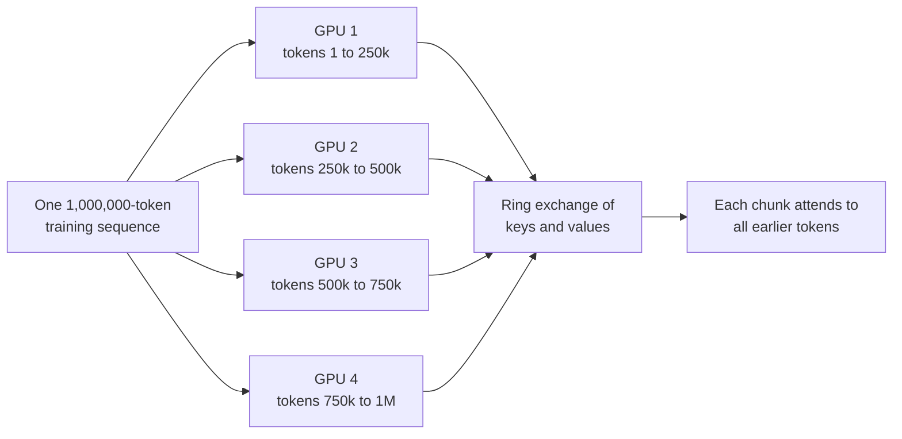

*Figure 37.8: Context parallelism splits one long sequence across GPUs that share attention keys and values.*

### Expert parallelism: spreading out the specialists

Most frontier models in 2026 are mixture-of-experts models (Chapter 17). Each MoE layer contains many "expert" sub-networks and a small router that sends each token to a few of them. For example, Kimi K3, from the Chinese lab Moonshot AI, has 896 experts per MoE layer, with 16 active per token plus 2 shared experts (experts that every token always uses, Chapter 17). **Expert parallelism** places different experts on different GPUs.

> **Definition — Mixture of experts (MoE):** A model design in which each layer has many sub-networks ("experts") and a router sends each token to only a few, so the total parameter count can be huge while the compute per token stays modest.

> **Definition — Expert parallelism (EP):** Placing different experts of an MoE model on different GPUs and sending each token to the GPUs holding its chosen experts.

Every MoE layer then needs an **all-to-all** exchange: each GPU sends each of its tokens to whichever GPUs hold that token's chosen experts, and the results come back the same way. All-to-all traffic is heavy and irregular, so expert parallelism wants the fastest, flattest network available, which is one reason NVIDIA built the 72-GPU NVL72 rack as one NVLink domain.

> **Definition — All-to-all:** A collective operation in which every GPU sends a different chunk of data to every other GPU. It is the main communication pattern of expert parallelism.

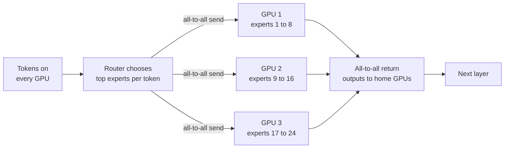

*Figure 37.9: Expert parallelism. Tokens travel to the GPUs holding their chosen experts and back again, in every MoE layer.*

A tricky part of expert parallelism is balance. If the router sends too many tokens to one popular expert, that GPU becomes the bottleneck while others wait, so training adds incentives (or bias adjustments) that keep experts evenly loaded.

### Putting it together: 3D, 4D and 5D parallelism

Real training runs combine these strategies, and the key design rule is: **put the chattiest communication on the fastest links.**

- **Tensor and expert parallelism** exchange large amounts of data in every layer, so they live inside a server or an NVLink domain, where links run at about 1 to 3.6 terabytes per second per GPU (NVIDIA's figures, which count both directions together).
- **Pipeline and context parallelism** send less, at stage boundaries or in overlappable rings, so they can cross between racks over InfiniBand or Ethernet, at roughly 50 to 200 gigabytes per second per GPU in each direction.
- **Data parallelism and FSDP** synchronize once per step and can overlap with computation, so they span the whole cluster.

> **Definition — Scale-up vs. scale-out network:** The scale-up network (such as NVLink) tightly links a small group of accelerators with very high bandwidth; the scale-out network (InfiniBand or Ethernet) connects many such groups across the cluster at lower bandwidth per chip.

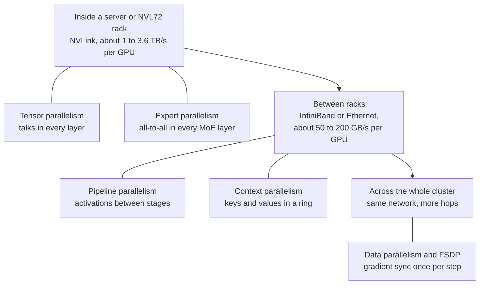

*Figure 37.10: Each parallelism strategy is matched to the network tier that can carry its traffic.*

Using two or three of these at once is called 3D parallelism (data, tensor, pipeline); adding context parallelism makes 4D, and adding expert parallelism makes 5D. The total number of GPUs is the product of the degrees (a strategy's degree is how many GPUs it splits the work across).

**Worked example: Llama 3.** Meta's paper describes training the 405B model on 16,384 H100s with tensor parallelism of 8 (the 8 GPUs inside one server, linked by NVLink), pipeline parallelism of 16 and data parallelism (FSDP-style) of 128: 8 × 16 × 128 = 16,384. For the long-context stage it added context parallelism of 16 and reduced data parallelism to keep the total the same. MFU ranged from 38 to 43 percent across these layouts.

| Strategy | What it splits | Main communication | Typical network tier |
|---|---|---|---|
| Data parallel | Training examples | All-reduce of gradients, once per step | Whole cluster |
| ZeRO / FSDP | Optimizer state, gradients, weights | All-gather and reduce-scatter, every layer | Cluster, best within fast groups |
| Tensor parallel | Each weight matrix | All-reduce inside every layer | NVLink domain |
| Pipeline parallel | Layers into stages | Activations at stage boundaries | Between racks |
| Context parallel | One long sequence | Keys and values in a ring | Within or between racks |
| Expert parallel | MoE experts | All-to-all in every MoE layer | NVLink domain |

*Table 37.6: The parallelism strategies at a glance.*

> **Key idea:** No single strategy is enough. Labs combine data, sharding, tensor, pipeline, context and expert parallelism, placing each where the network can carry its traffic: the chattiest inside the NVLink domain, the quietest across the whole cluster.

> **At the frontier (2026):** Hardware is being designed around these patterns. NVIDIA's NVL72 racks give 72 GPUs one NVLink domain, big enough for tensor and expert parallelism of large MoE models, and NVIDIA claims Vera Rubin can train MoE models with a quarter of the GPUs needed on Blackwell (a vendor claim). Google's TPU 8t superpods link up to 9,600 chips, and its Virgo fabric connects more than 134,000 TPU 8t chips. Some 2026 runs span more than one data center, which pushes data parallelism onto long-distance links.

## Collective communication: how thousands of GPUs agree

Every strategy above depends on groups of GPUs exchanging numbers in coordinated patterns. These patterns are called **collectives**, and a whole software layer exists to run them fast.

> **Definition — Collective communication:** A coordinated data exchange in which a whole group of GPUs takes part at once, such as summing everyone's numbers (all-reduce) or giving everyone a copy of everyone's data (all-gather).

| Collective | What happens | Used by |
|---|---|---|
| Broadcast | One GPU sends the same data to all others | Starting a job, sharing settings |
| All-reduce | Everyone's numbers are summed; everyone gets the total | Data parallelism, tensor parallelism |
| Reduce-scatter | Numbers are summed; each GPU gets one slice of the total | FSDP gradients |
| All-gather | Each GPU contributes a slice; everyone gets all slices | FSDP weights |
| All-to-all | Every GPU sends a different chunk to every other GPU | Expert parallelism |

*Table 37.7: The main collective operations.*

> **Definition — All-reduce:** A collective in which every GPU contributes numbers (for example its gradients), they are summed, and every GPU receives the full sum. It is the backbone of data-parallel training.

> **Definition — Reduce-scatter:** A collective that sums numbers across GPUs but leaves each GPU holding only one slice of the result.

> **Definition — All-gather:** A collective in which each GPU contributes one slice and every GPU ends up with all the slices joined together.

> **Analogy:** An all-reduce is a group of friends splitting a restaurant bill. Everybody shares their numbers until each person knows the total, and one slow friend holds up the whole table.

> **Try it:** Before reading the worked example below, take four sheets of paper, write four numbers on each, and try to get the column totals onto every sheet by passing only one number at a time to the sheet on your right. Count how many passes it takes; the ring algorithm below does it in six rounds.

### Ring all-reduce, worked by hand

The naive way to sum gradients would be for everyone to send everything to one GPU, which adds it all up and sends the result back. That GPU's link would be swamped. The **ring all-reduce** spreads the load evenly: arrange the GPUs in a circle, cut each GPU's data into as many chunks as there are GPUs, and pass chunks around the ring.

> **Definition — Ring all-reduce:** An all-reduce in which GPUs are arranged in a circle and pass chunks of data to their neighbor step by step, first adding (reduce-scatter) and then sharing the finished sums (all-gather), so every link carries an equal share of the traffic.

Let's do it with four GPUs, A, B, C and D, in a ring A → B → C → D → A. Each holds a "gradient" of four numbers, cut into four chunks c1 to c4. The numbers are chosen so you can see the sums form: the final answer should be [1111, 2222, 3333, 4444].

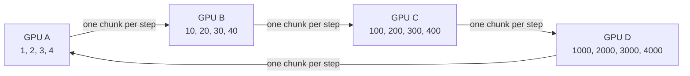

*Figure 37.11: Four GPUs in a ring. In every step, each GPU sends one chunk to its right-hand neighbor at the same time.*

**Phase 1, reduce-scatter (3 steps).** In each step, every GPU sends one chunk to its neighbor, which *adds* it to its own copy of that chunk. A star marks the cell that just changed.

```
              c1    c2    c3    c4
start  A       1     2     3     4
       B      10    20    30    40
       C     100   200   300   400
       D    1000  2000  3000  4000

step 1 sends: A->B c1=1, B->C c2=20, C->D c3=300, D->A c4=4000
       A       1     2     3  4004*
       B      11*   20    30    40
       C     100   220*  300   400
       D    1000  2000  3300* 4000

step 2 sends: A->B c4=4004, B->C c1=11, C->D c2=220, D->A c3=3300
       A       1     2  3303* 4004
       B      11    20    30  4044*
       C     111*  220   300   400
       D    1000  2220* 3300  4000

step 3 sends: A->B c3=3303, B->C c4=4044, C->D c1=111, D->A c2=2220
       A       1  2222* 3303  4004
       B      11    20  3333* 4044
       C     111   220   300  4444*
       D    1111* 2220  3300  4000
```

After three steps, each GPU owns one *complete* sum: A has c2 = 2222, B has c3 = 3333, C has c4 = 4444 and D has c1 = 1111.

**Phase 2, all-gather (3 steps).** Now each GPU passes its finished chunk around the ring, and receivers simply *copy* it.

```
step 4 sends: A->B c2=2222, B->C c3=3333, C->D c4=4444, D->A c1=1111
       A    1111* 2222  3303  4004
       B      11  2222* 3333  4044
       C     111   220  3333* 4444
       D    1111  2220  3300  4444*

step 5 sends: A->B c1=1111, B->C c2=2222, C->D c3=3333, D->A c4=4444
       A    1111  2222  3303  4444*
       B    1111* 2222  3333  4044
       C     111  2222* 3333  4444
       D    1111  2220  3333* 4444

step 6 sends: A->B c4=4444, B->C c1=1111, C->D c2=2222, D->A c3=3333
       A    1111  2222  3333* 4444
       B    1111  2222  3333  4444*
       C    1111* 2222  3333  4444
       D    1111  2222* 3333  4444
```

*Figure 37.12: A complete ring all-reduce with 4 GPUs. Three reduce-scatter steps build the sums; three all-gather steps share them. Every GPU ends with [1111, 2222, 3333, 4444].*

Notice the beautiful property. Each GPU sent one chunk per step for 6 steps, so it sent 6 quarter-size chunks, which is 1.5 times its own data. In general, with N GPUs each GPU sends `2 × (N − 1) ÷ N` times its data. For 4 GPUs that is 1.5; for 1,024 GPUs it is about 1.998. **The traffic per GPU barely grows as the ring grows,** which is why this algorithm made large-scale data parallelism practical.

**Worked example: how long does an all-reduce take?** Take a 70B model's BF16 gradients: 70 billion × 2 bytes = 140 GB. Each GPU must send about 2 × 140 GB = 280 GB.

- Over a scale-out network at about 50 GB/s per GPU (400 Gb/s InfiniBand): 280 ÷ 50 ≈ 5.6 seconds.
- Over Hopper's NVLink, rated 900 GB/s counting both directions, so about 450 GB/s each way: 280 ÷ 450 ≈ 0.62 seconds.

A training step might take only a few seconds, so a 5.6-second sync would be a disaster unless it is hidden. That is why labs shard the model (so each data-parallel group syncs less), overlap gradient communication with the backward pass (sending each layer's gradients while the next layer is still computing), and keep the heaviest traffic on NVLink.

**Worked example: when does the network become the bottleneck?** The roofline idea from Chapter 33 works for networks too. Instead of counting FLOP per byte read from memory, count FLOP per byte a GPU must send, and compare one training step's compute time with its communication time.

- **Compute.** A GPU that handles B tokens per step does 6 × N × B FLOP. At about 400 trillion FLOP/s achieved on an H100 (roughly 40% of peak), that takes 6 × N × B ÷ (400 × `10^12`) seconds.
- **Communication.** With BF16 gradients, the ring all-reduce sends about 2 × 2 × N = 4 × N bytes per GPU. At 50 GB/s that takes 4 × N ÷ (50 × `10^9`) seconds.
- **The ratio.** Divide the second by the first and the model size N cancels: communication ÷ compute ≈ (4 ÷ 6) × ((400 × `10^12`) ÷ (50 × `10^9`)) ÷ B = (2 ÷ 3) × 8,000 ÷ B ≈ 5,300 ÷ B. (N appears in both times, so it divides out; 400 trillion ÷ 50 billion = 8,000.)

So each GPU must process at least about 5,300 tokens per step, or it spends longer talking than computing. Now check Llama 3. Its batch of about 16 million tokens spread over 16,384 GPUs is only about 1,000 tokens per GPU. With plain data parallelism over InfiniBand (even if the model fit), each GPU would spend about five times longer communicating than computing. The layout described earlier fixes this. With tensor parallelism of 8 and pipeline parallelism of 16, groups of 128 GPUs share one copy of the model, so each copy processes 16 million ÷ 128 = 125,000 tokens per step, and each GPU syncs only its 1/128 slice of the gradients. Communication drops to about 5,300 ÷ 125,000 ≈ 4% of compute time, easy to hide behind the backward pass.

> **Definition — Communication-bound:** Limited mainly by how fast chips can exchange data rather than by how fast they compute. A training step is communication-bound when its collectives take longer than its math and cannot be hidden behind it.

This is the arithmetic behind every parallelism layout: give each chip enough math for every byte it must send, and keep the chattiest exchanges on the fastest links.

Rings have one weakness: the number of steps grows with the number of GPUs, and every step pays a fixed startup delay (latency). For thousands of GPUs and small messages, **tree** algorithms, which add numbers up a branching tree, finish in far fewer steps. Real libraries choose between rings, trees and hierarchical combinations automatically, for example summing within each NVLink group first and then across groups.

> **Definition — NCCL / RCCL:** NVIDIA's Collective Communications Library (and AMD's version, RCCL), the software that runs all-reduce, all-gather and other collectives efficiently over NVLink and networks. Most training frameworks call it under the hood.

> **Definition — Straggler:** A GPU or server that runs slower than the rest, for example because of a failing part or overheating, and holds up thousands of others at every synchronization point.

Because every collective waits for its slowest member, one sick GPU can slow 100,000 healthy ones. Finding and replacing stragglers quickly is a major part of running a big cluster.

> **Key idea:** Collectives are how a cluster acts as one machine. The ring all-reduce keeps traffic per GPU nearly constant no matter how many GPUs join, but every collective is only as fast as its slowest link and slowest GPU.

## Utilization: MFU, HFU and where the time goes

A cluster's peak FLOP/s is a ceiling it never reaches. The standard way to measure how close a run gets is MFU.

> **Definition — MFU (model FLOPs utilization):** The FLOPs a training run *needs* (from 6 × N × D) per second, divided by the hardware's peak FLOPs per second. 35 to 50 percent is typical for large runs.

> **Definition — HFU (hardware FLOPs utilization):** Like MFU, but counting all FLOPs the hardware actually performs, including extra work such as recomputing activations. HFU is always at least as high as MFU, so MFU is the more honest number.

**Worked example.** Llama 3.1 405B reported MFU of about 41 percent on 16,384 H100s. That means each GPU delivered about 0.41 × 989 ≈ 400 trillion useful FLOP per second, out of a 989 trillion peak. Now check the whole run: the model card's 31 million GPU-hours × 3,600 seconds × 989 trillion FLOP/s = about `1.1 × 10^26` FLOP of peak capacity, of which the model needed `3.8 × 10^25`. That is about 35 percent averaged over the whole run, a few points below the in-step MFU, because restarts, slower phases and lost work also count against the total.

Epoch's estimate for GPT-6 Astra assumes just 25 percent utilization at FP8. Lower precision doubles the peak, and it is harder to keep the faster math units fed, so MFU measured against an FP8 peak tends to be lower even when the run is faster.

Where does the rest go? A rough, illustrative breakdown:

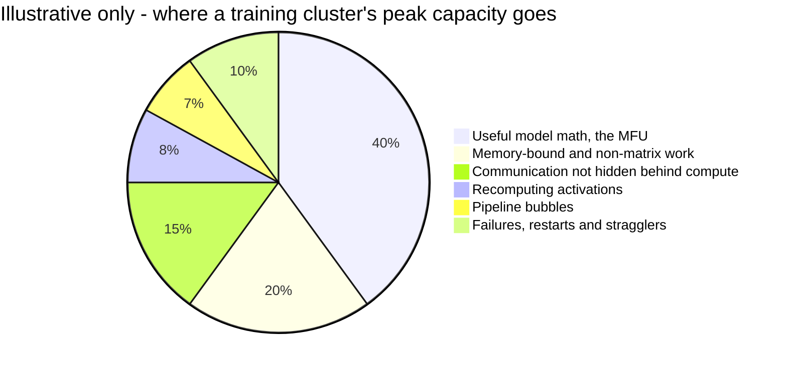

*Figure 37.13: An illustrative split of a big run's peak capacity. Real shares vary widely by model, cluster and software; only the first slice counts as MFU.*

- **Memory-bound work.** Operations like normalization, activation functions and parts of attention move lots of data and do little math, so tensor cores sit idle while memory catches up (the memory wall from Chapter 33).
- **Exposed communication.** Collectives that can't be overlapped with computation leave GPUs waiting.
- **Recomputation.** Activation checkpointing repeats forward-pass work. It counts toward HFU, not MFU.
- **Pipeline bubbles.** The idle slots from Figure 37.7.
- **Load imbalance.** In MoE models, popular experts make some GPUs wait for others.
- **Failures and stragglers.** The next section.

### Finding the lost time: profiling

How do engineers know where the time goes? They run a profiler on a few training steps. It records what every GPU was doing, microsecond by microsecond, and draws the result as a timeline. Common tools include NVIDIA's Nsight Systems, the profiler built into PyTorch, and Google's profiler for JAX programs on TPUs, viewed in TensorBoard. Reading these timelines is the daily work of performance engineers.

> **Definition — Profiler:** A tool that records what a program and its hardware are doing over time (which operations run, for how long, and when the chips sit idle) so engineers can see what to speed up.

> **Definition — Trace (profile timeline):** The recording a profiler produces: one row per GPU or activity, with each operation drawn as a bar along a time axis, so gaps and overlaps are visible at a glance.

```
One training step on one GPU, illustrative

ms    0         200       400       600       800       1000
      |---------|---------|---------|---------|---------|
math  FFFFFFFFFFFFFFFBBBBBBBBBBBBBBBBBBBBBBBBBBBB.....OO
net   ..aa....aa........rrr.....rrr.....rrr...rrrrrrrr..

F = forward pass   B = backward pass   O = optimizer update
a = all-gather of weights   r = reduce-scatter of gradients
. = nothing running         each character = 20 ms
```

*Figure 37.14: An illustrative profiler trace of one training step. Most network transfers hide under the math, but the last gradient sync runs 100 ms past the end of the backward pass and leaves the GPU idle.*

Read it like an engineer. The math row is busy for 900 of the 1,000 ms. Most of the network transfers run underneath the math, which is the overlap this chapter keeps mentioning. But the last reduce-scatter runs on after the backward pass has finished, and the GPU sits idle for 100 ms waiting for it: exposed communication, a 10% loss you can spot at a glance. The fix might be to start that transfer earlier, split it into smaller pieces or move it onto faster links. A second kind of loss hides inside the bars. A busy bar can still run far below peak speed if its operation is memory-bound, so profilers also report each kernel's FLOP/s and bytes moved, which lets engineers place it on the roofline from Chapter 33.

> **Analogy:** A trace is a time-lapse video of a restaurant kitchen during dinner service. Watching it, you can see which cook was chopping, who stood waiting for the oven, and the moment every order stalled because one pan was not ready.

> **Watch out:** "Twice the GPUs means twice as fast" is wrong at scale. Communication grows, stragglers multiply, failures become more frequent and batch sizes hit their limits. Scaling is sub-linear, which is why MFU and goodput are tracked as closely as raw chip counts.

## When things break: failures, checkpointing and goodput

At 100,000 GPUs, things break all the time. The best public record comes from Meta's Llama 3 paper. During a 54-day window of training the 405B model on 16,384 H100s, the job was interrupted 466 times, 419 of them unexpectedly. About 78 percent of unexpected interruptions were traced to hardware, with faulty GPUs the largest category and HBM3 memory failures causing 17.2 percent. Even so, effective training time stayed above 90 percent.

**Worked example: how often does something break?**

1. Llama 3: 54 days × 24 hours ÷ 419 ≈ one unexpected interruption every 3.1 hours.
2. Spread over 16,384 GPUs, that is like each GPU causing an interruption about once every 3.1 × 16,384 ≈ 50,700 hours, nearly six years. Each individual GPU is quite reliable.
3. Now scale to 100,000 GPUs with the same per-GPU reliability: 50,700 ÷ 100,000 ≈ 0.5 hours. Something breaks about every 30 minutes.

> **Definition — MTBF (mean time between failures):** The average time between failures of a system. For a cluster, it shrinks as the cluster grows, because each added part brings its own chance of failing.

The defense is the **checkpoint**: a saved snapshot of the weights and optimizer state, written to storage periodically. When something fails, the job reloads the last checkpoint (usually on a spare server) and continues. Everything computed since that checkpoint is lost.

> **Definition — Checkpoint:** A saved snapshot of a model's weights and optimizer state during training, so the run can resume from that point after a failure instead of starting over.

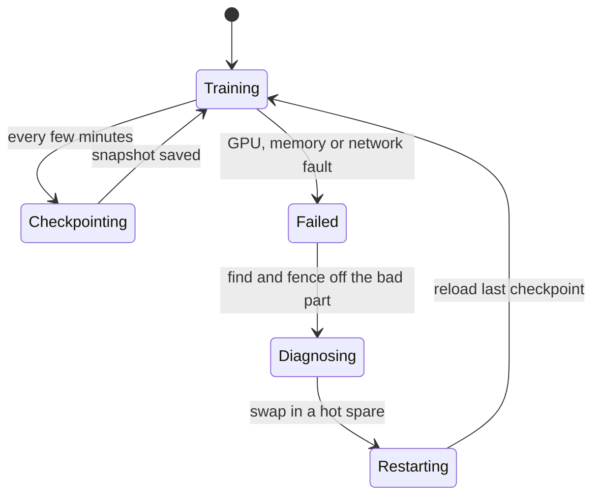

*Figure 37.15: The life cycle of a large training job. Failures are normal; what matters is how little work is lost and how fast the job restarts.*

How often should you checkpoint? Too rarely, and each failure throws away a lot of work. Too often, and you waste time writing snapshots. Suppose a failure every 180 minutes, 10 minutes to restart, and 1 minute to write each checkpoint while training pauses. On average a failure strikes halfway between two checkpoints, so it throws away half an interval of work, plus the restart time:

| Checkpoint every | Time spent saving | Work lost per failure (half an interval + restart) | Lost to failures | Goodput |
|---|---|---|---|---|
| 60 min | 1/60 ≈ 1.7% | 30 + 10 = 40 min | 40/180 ≈ 22% | about 76% |
| 20 min | 1/20 = 5% | 10 + 10 = 20 min | 20/180 ≈ 11% | about 84% |
| 10 min | 1/10 = 10% | 5 + 10 = 15 min | 15/180 ≈ 8% | about 82% |
| 5 min, saved in the background | about 0% | 2.5 + 10 = 12.5 min | 12.5/180 ≈ 7% | about 93% |

*Table 37.8: Checkpoint frequency trades saving time against lost work. The numbers are illustrative.*

A classic rule of thumb (Young's formula) puts the best interval at about √(2 × checkpoint time × MTBF) = √(2 × 1 × 180) ≈ 19 minutes, matching the table. The last row shows why labs invest in **asynchronous checkpointing** (copying the state to memory in seconds and writing it to storage in the background) and fast restarts: with a 2-minute restart, the lost fraction drops to (2.5 + 2) ÷ 180 ≈ 2.5 percent.

> **Definition — Goodput:** The share of a cluster's time that produces useful training progress, after subtracting failures, restarts, lost work and checkpoint overhead. It is the real measure of a big run's efficiency.

Big operators also keep **hot spares** (idle servers ready to replace a failed one in minutes), run health checks to catch failing parts before they crash a job, and watch for **silent data corruption**: a chip that keeps running but returns subtly wrong numbers, which can poison a run without any error message. Power is another hazard. When tens of thousands of GPUs pause for a checkpoint or a collective at the same instant, the site's power draw can swing by tens of megawatts in seconds, as Meta reported, which stresses the electrical grid (Chapter 39).

> **Definition — Silent data corruption:** A hardware fault in which a chip produces wrong results without crashing or reporting an error. At large scale it is rare per chip but common in total, and hard to detect.

Memory has a built-in defense against the simplest faults. A bit stored in memory can occasionally flip, from electrical noise or even a cosmic-ray particle, and at fleet scale this is routine: a 2009 study of Google's servers found that more than 8 percent of memory modules saw errors in a year. Data center memory, including the HBM on AI chips, therefore stores extra check bits that correct such flips on the fly and raise an alarm when a module starts failing. Without them, many of those flips would become silent data corruption.

> **Definition — ECC (error-correcting code) memory:** Memory that stores a few extra check bits alongside the data, so it can detect a flipped bit and fix it automatically. Data center servers and AI accelerators use it because rare errors become daily events across thousands of chips.

> **Analogy:** Checkpointing is saving your video game before the boss fight. With 100,000 players in one shared game, somebody's console crashes every half hour, so the game had better save often, save quickly and reload fast.

> **At the frontier (2026):** Reliability at a million chips is an open engineering problem. Labs are building fault-tolerant training that keeps going when a few servers drop out, elastic jobs that shrink and grow, better detection of silent data corruption, and power-smoothing so that synchronized GPUs don't jolt the grid. Multi-data-center training adds long-distance links that can fail too.

## Fewer bits: low-precision training

Chapter 32 introduced number formats as rulers with fewer tick marks. Fewer bits per number means more math per second, less memory and less data movement, at the cost of precision that software must manage carefully.

- **BF16** (16-bit) became the standard for training large models around 2020, with FP32 kept for master weights and optimizer state.
- **FP8** (8-bit) arrived in hardware with NVIDIA's Hopper (2022). DeepSeek-V3 (December 2024) is the best-documented large FP8 training run: 2,048 H800 GPUs and about 2.8 million GPU-hours.
- **FP4** (4-bit) is emerging with Blackwell and Rubin. Plain FP4 has only 16 possible bit patterns (15 distinct numbers), so it relies on **block scaling**: each small block of numbers shares its own scale factor. NVIDIA's NVFP4 uses blocks of 16 values with an FP8 scale; the open MXFP4 standard uses blocks of 32.

> **Definition — FP8:** An 8-bit floating-point number format (variants E4M3 and E5M2) supported in hardware since NVIDIA's Hopper. It doubles math speed and halves memory compared with BF16.

> **Definition — Block-scaled 4-bit formats (NVFP4, MXFP4):** 4-bit number formats in which each small block of values (16 for NVFP4, 32 for MXFP4) shares a scale factor, letting very coarse numbers still cover a wide range. They roughly double speed again over FP8.

Why does this matter so much? Look at one Vera Rubin GPU's dense peaks: about 4 PFLOPS in BF16, 17.5 PFLOPS in FP8 and 35 PFLOPS in NVFP4 for training. Moving a run from BF16 to NVFP4 offers, on paper, almost 9 times more math per second from the same chip and the same power. Even partial adoption changes the 6ND arithmetic: the same `10^27` FLOP run needs far fewer GPU-days.

In 2026 practice, frontier labs mix precisions. Moonshot's Kimi K3 ships MXFP4 weights after quantization-aware training applied from its fine-tuning stage onward, and DeepSeek-V4-Pro stores its expert weights in FP4 and uses FP8 elsewhere. The risk is numerical instability: low precision can let errors build up until the loss suddenly jumps, a **loss spike**, which may force a rollback to an earlier checkpoint. Making FP4 pretraining robust at frontier scale is an active research problem.

> **Definition — Loss spike:** A sudden jump in training loss during a run, often caused by numerical instability. Labs respond by skipping data, lowering the learning rate or rolling back to a checkpoint.

> **Key idea:** Precision is one of the biggest levers in training cost. Each halving of bits roughly doubles the math per second, so BF16 to FP8 to FP4 can multiply a cluster's useful output several times, provided the numerics are handled carefully.

## Serving at scale: the economics of inference

Training happens once per model. Inference happens every time anyone uses it, which is why many in the industry say inference spending at major labs now rivals or exceeds training, and why 2026 chips are splitting into training and inference versions. This section explains the hardware economics; Chapter 23 covers the software techniques in more depth.

### Prefill and decode

When you send a prompt, the server works in two phases.

> **Definition — Prefill:** The first phase of inference, in which the model reads your entire prompt in one parallel pass and builds its KV cache. It is compute-bound and sets the time to the first token.

> **Definition — Decode:** The second phase of inference, in which the model generates the answer one token at a time. Each step re-reads the model's weights from memory, so decode is usually limited by memory bandwidth.

> **Definition — KV cache:** Stored keys and values for every earlier token in a conversation, kept in GPU memory so the model doesn't recompute them for each new token. It grows with context length and with the number of users.

> **Definition — TTFT (time to first token):** How long you wait before the first word of a response appears. It is set mostly by queueing and prefill.

> **Try it:** Paste a long document (several thousand words) into your chatbot and ask for a one-line summary, then ask a short question with no attachment. Notice that the long prompt takes noticeably longer before the first word appears (prefill), while the speed of the words once they start streaming (decode) is about the same.

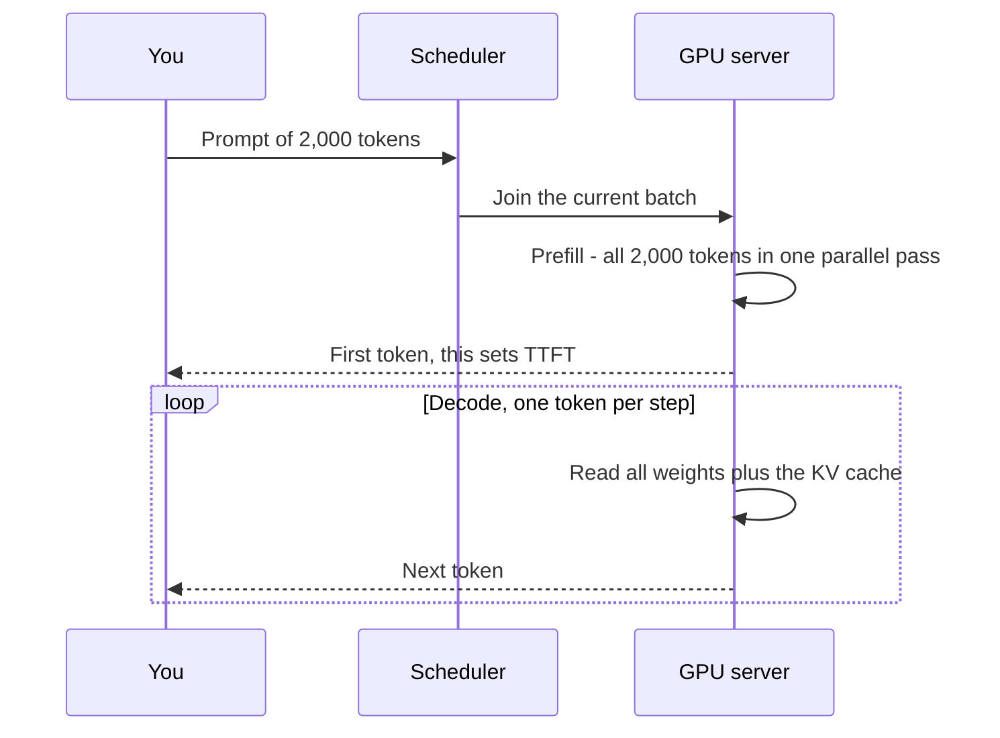

*Figure 37.16: Prefill reads the whole prompt at once; decode then produces one token per step, re-reading the weights every time.*

**Worked example: why the two phases cost so differently.** Take a 70B dense model stored in FP8 (1 byte per parameter, 70 GB) on an H200 (141 GB of HBM at 4.8 TB/s; about 1,979 dense FP8 TFLOPS).

- **Prefill:** each token needs about 2 × 70 billion = 140 billion FLOP. At half of peak, the GPU processes about (0.5 × 1,979 × `10^12`) ÷ (140 × `10^9`) ≈ 7,000 prompt tokens per second.
- **Decode for one user:** every new token requires streaming all 70 GB of weights from memory. 4,800 GB/s ÷ 70 GB ≈ 69 tokens per second at most, while the math units sit more than 99 percent idle. On a B300 (8 TB/s) the ceiling is about 114 tokens per second; on a Rubin GPU (19 to 22 TB/s), about 275 to 315.

That gap is one reason API prices charge several times more for output tokens than input tokens. Claude Opus 5.5, for example, is priced at $4 per million input tokens and $20 per million output tokens as of late 2026.

### Batching: the single biggest lever

If reading the weights is the expensive part, serve many users with each read. In each decode step, the GPU reads the weights once and computes the next token for every request in the batch. Modern servers use **continuous batching**, adding and removing requests from the batch at every step as conversations start and finish.

> **Definition — Batching (continuous batching):** Processing many users' requests together so each read of the model's weights is shared. Continuous batching lets requests join and leave the batch at every step instead of waiting for a whole batch to finish.

**Worked example: the batching table.** Same 70B FP8 model on one H200, rented at $4 per hour (H200 list prices ran about $3.59 to $5.29 per hour on the RunPod marketplace in October 2026). Each user has 2,048 tokens of context; for a Llama-3-70B-style model (80 layers, 8 key-value heads of 128 numbers each) the FP8 KV cache is 2 × 80 × 8 × 128 = 163,840 bytes per token (the 2 is one key and one value, each number taking 1 byte in FP8), and 163,840 × 2,048 tokens ≈ 0.34 GB per user. Each decode step takes as long as the slower of (a) reading the weights plus every user's KV cache from memory and (b) doing the math, which is the roofline idea from Chapter 33. Here memory is always the slower side, so the step time is the memory read ÷ 4,800 GB/s. With one user: 70.3 GB ÷ 4,800 GB/s ≈ 0.0147 seconds (14.7 ms), so the GPU produces 1 ÷ 0.0147 ≈ 68 tokens per second; multiply by the number of users for the GPU's total. The cost column uses the cost-per-million-tokens formula given later in this chapter, under "From dollars per GPU-hour to dollars per million tokens": for one user, $4 ÷ (68 × 3,600) × 1,000,000 ≈ $16.

| Users in batch | Memory read per step | Step time | Tokens/s per user | Tokens/s per GPU | Cost per million output tokens |
|---|---|---|---|---|---|
| 1 | 70.3 GB | 14.7 ms | 68 | 68 | $16.28 |
| 8 | 72.7 GB | 15.1 ms | 66 | 528 | $2.10 |
| 32 | 80.7 GB | 16.8 ms | 59 | 1,902 | $0.58 |
| 64 | 91.5 GB | 19.1 ms | 52 | 3,358 | $0.33 |
| 128 | 113 GB | 23.5 ms | 43 | 5,440 | $0.20 |
| 256 | 156 GB | does not fit in 141 GB | | | |

*Table 37.9: A simplified decode model for a 70B FP8 model on one H200. These are ideal ceilings; real systems land noticeably lower.*

Read the table slowly. Going from 1 user to 128 multiplies throughput 80 times and cuts the cost per token 80 times, while each user's speed falls only from 68 to 43 tokens per second. The math stays below the memory time at every row, so the step is still memory-bound, but now one weight read serves 128 people. The batch stops growing when the KV caches fill the remaining memory: 256 users would need 156 GB. That is why KV-cache size, long contexts and memory capacity matter so much to inference economics (Chapter 23 covers PagedAttention and KV compression).

> **Definition — Throughput:** The total amount of work done per unit of time, such as tokens per second across all users on a GPU. It determines cost per token.

> **Definition — Interactivity (tokens per second per user):** How fast the answer streams for one person. Raising the batch size raises throughput but lowers interactivity, so providers must choose a point on the trade-off.

Engineers draw this trade-off as a curve. Put tokens per second per user (interactivity) on the horizontal axis and tokens per second per GPU (throughput, which sets the cost) on the vertical axis, and plot one point for each batch size. Table 37.9 gives three such points: 1 user streams at 68 tokens per second and the GPU produces 68 in total; 32 users stream at 59 each for 1,902 in total; 128 users stream at 43 each for 5,440 in total. Join the best points a given chip and software setup can reach and you have its frontier. You can slide along it, buying faster streaming for each user with lost throughput or the reverse, but you cannot get above it without better hardware or serving software. Chipmakers now compare generations on exactly this kind of chart. NVIDIA's claim that its Groq-based LPX racks deliver up to 35 times more throughput per megawatt "at high interactivity" (a vendor claim) is a statement about the far right of the curve, where every user gets very fast streaming. When you see a headline throughput number, ask which point on the curve it comes from.

> **Definition — Pareto frontier (throughput versus interactivity):** The curve of the best possible trade-offs between two goals, here tokens per second per GPU and tokens per second per user. On the curve, you can gain on one goal only by giving up some of the other; a better chip or serving engine pushes the whole curve outward.

This trade-off shows up directly in prices. Providers sell "fast" tiers at a premium (Anthropic's fast mode for Claude costs twice the normal price) and batch APIs at a discount (typically 50 percent off for jobs that can wait), because a patient customer lets them run bigger, cheaper batches.

> **Key idea:** In decode, reading the weights is the expensive part, so sharing each read across many users is the biggest cost lever. Throughput and per-user speed trade off against each other, and memory capacity for the KV cache sets the limit.

### Disaggregated serving and inference chips

Prefill wants lots of compute; decode wants lots of memory bandwidth. Running both on the same GPU means each phase wastes the resource it doesn't need, and long prefills stall other users' decodes. **Disaggregated serving** splits them onto separate pools of chips and hands the KV cache from one to the other. NVIDIA's Dynamo software orchestrates this.

> **Definition — Disaggregated serving:** Running the prefill and decode phases of inference on separate groups of chips, each tuned for its phase, and transferring the KV cache between them.

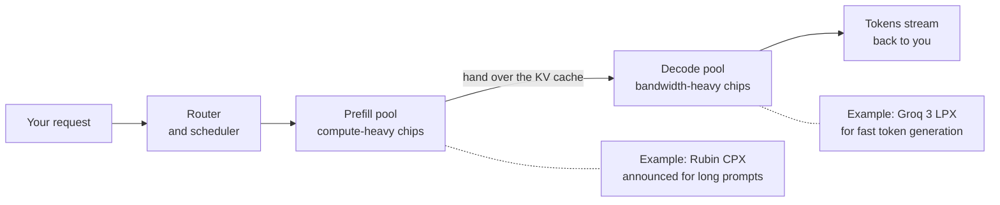

*Figure 37.17: Disaggregated serving gives prefill and decode their own hardware.*

That split is now shaping chip design. As of late 2026:

| Chip | Built for | Key published figures |
|---|---|---|
| Groq 3 LPU, in NVIDIA's LPX rack | Fast decode | 256 LPUs per rack; per chip about 500 MB SRAM at about 150 TB/s and, as reported, about 1.2 PFLOPS FP8. NVIDIA claims up to 35× throughput per megawatt at high interactivity (vendor claim) |
| Google TPU 8i | Inference | 10.1 PFLOPS FP4, 288 GB HBM at 8.6 TB/s, 384 MB on-chip SRAM; Google claims up to 80% better inference price-performance |
| Microsoft Maia 200 | Inference for Copilot and OpenAI models | More than 10 PFLOPS FP4, 216 GB HBM3E at 7 TB/s, 272 MB SRAM (Microsoft's figures) |
| NVIDIA Rubin CPX | Long-context prefill | GPU announced in 2025 that uses GDDR7, cheaper graphics memory, instead of HBM; its 2026 deployment status was not confirmed |
| Cerebras WSE-3 | Very fast inference | Weights stream from on-chip SRAM across a whole wafer, giving thousands of tokens per second per user |
| AWS Inferentia | Inference on AWS | Amazon's inference line alongside Trainium |

*Table 37.10: Specialized inference silicon in 2026. Vendor claims are marked as such.*

Notice the theme: big on-chip SRAM (hundreds of megabytes) and extreme bandwidth, aimed at the decode bottleneck. Google even split its eighth-generation TPU into a training chip (8t) and an inference chip (8i). In late December 2025, NVIDIA reportedly paid about $20 billion for a non-exclusive license to Groq's inference technology, a sign of how much the decode problem is worth.

### Tail latency: why the slowest server sets your wait

Averages hide the experience people remember. Engineers track response times by percentile (Chapter 6): p50 is the typical request, p99 the slowest 1 percent. Chapter 32 showed how a 99th-percentile deadline shaped Google's first TPU.

> **Definition — Tail latency:** The response time of the slowest requests, usually measured at the 99th percentile (p99) or the 99.9th. At scale it matters more than the average, because each user request touches many servers.

The trouble is fan-out. In a 2013 paper called "The Tail at Scale," Google's Jeffrey Dean and Luiz André Barroso showed that a request needing answers from many servers is only as fast as the slowest of them.

> **Definition — Fan-out:** Splitting one request into many sub-requests sent to different servers or chips in parallel, so the answer must wait for all of them.

**Worked example.** Suppose each server is slow (a second instead of a few milliseconds) on 1 request in 100. A request that touches one server is slow 1% of the time. A request that must wait for 100 servers is fast only if all 100 are fast: 0.99^100 ≈ 0.37, so it is slow 63% of the time. One machine's rare hiccup becomes the user's normal experience.

AI fans out everywhere. Each decode step of a large mixture-of-experts model waits for the slowest GPU holding its experts; each training step waits for the slowest of thousands (the stragglers from earlier in this chapter); and an agent that makes 30 model and tool calls in a row hits at least one p99 delay with probability 1 − 0.99^30 ≈ 26%.

There are two classic defenses. The first is to hedge.

> **Definition — Hedged request:** A backup copy of a slow request, sent to a second server after a short wait; whichever answer arrives first is used. A few percent of extra work can cut the slowest response times sharply.

In one Google benchmark from that paper, sending a hedged request after 10 milliseconds cut the 99.9th-percentile time to fetch 1,000 stored values from 1,800 ms to 74 ms, while adding only 2% more requests. The second defense is headroom: never run servers close to full. Queueing theory gives a simple rule of thumb. If requests arrive at random, the average time spent waiting in line grows like busy ÷ (1 − busy), measured in units of the time one request takes to serve.

> **Definition — Queueing delay:** The time a request spends waiting in line before a server starts working on it. It grows sharply as the server's utilization approaches 100 percent.

| How busy the server is | Average wait in line, in service times |
|---|---|
| 50% | 0.5 ÷ 0.5 = 1 |
| 80% | 0.8 ÷ 0.2 = 4 |
| 90% | 0.9 ÷ 0.1 = 9 |
| 95% | 0.95 ÷ 0.05 = 19 |
| 99% | 0.99 ÷ 0.01 = 99 |

*Table 37.11: Waiting time explodes as a server approaches full load, in the simplest queueing model with random arrivals. Real serving systems are more complicated, but the shape holds.*

That is why a chatbot slows down at peak hours well before its provider runs out of GPUs, and why operators keep spare capacity for live traffic while filling the gaps with batch jobs that don't mind waiting (Chapter 43).

> **Key idea:** At scale, the slowest 1 percent of anything becomes everybody's problem. Large systems are built to tolerate the tail, with backup requests, spare machines and headroom, because they cannot eliminate it.

### From dollars per GPU-hour to dollars per million tokens

Everything comes together in one formula:

`cost per million tokens = (cost per GPU-hour) ÷ (tokens per second × 3,600) × 1,000,000`

> **Definition — Cost per million tokens:** The cost (or price) of generating one million tokens, the core unit of AI inference economics. It is the hourly cost of the hardware divided by how many tokens it produces per hour.

> **Definition — TCO (total cost of ownership):** All the costs of running hardware over its life, including purchase, power, cooling, building space, networking, staff and depreciation, often expressed per GPU-hour.

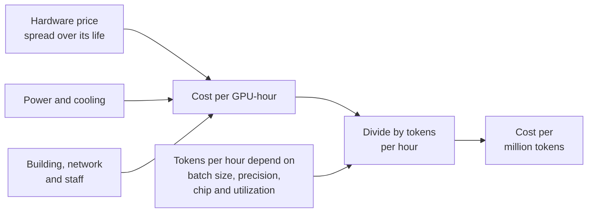

*Figure 37.18: How a cost per million tokens is built up from the cost of a GPU-hour.*

**Worked examples.**

- A GPU costing $3 per hour that produces 1,000 tokens per second (batched): $3 ÷ 3,600,000 tokens × 1,000,000 ≈ $0.83 per million tokens.
- The same GPU at 5,000 tokens per second: about $0.17 per million tokens.
- Energy: suppose one GPU plus its share of the building draws 1.5 kW while producing 2,000 tokens per second. That is 1,500 joules per second ÷ 2,000 tokens = 0.75 joules per token. A 500-token answer uses about 375 joules, roughly 0.1 watt-hours, about what a 10-watt LED bulb uses in 37 seconds.

> **Definition — LED (light-emitting diode):** A small semiconductor device that glows when current flows through it. An LED bulb gives as much light as an old incandescent bulb for a small fraction of the power, which makes it a handy everyday yardstick for small amounts of energy.

Per-answer energy is small, but billions of answers a day add up (Part VII covers the totals). And because the costs are dominated by how many tokens each GPU-hour produces, every improvement in batching, precision, speculative decoding (Chapter 23) or chip generation flows straight into lower prices. Epoch AI found that the price of reaching a fixed capability level fell between 9 and 900 times per year depending on the benchmark: GPT-4-level performance on one knowledge test went from $37.50 per million tokens in March 2023 to $0.18 by February 2025.

> **Watch out:** "Inference is cheap; training is the expensive part" is only true per query. Across billions of queries, and with reasoning models and agents producing far more tokens per task, inference has become a huge share of AI compute spending, which is why so much 2026 hardware is built just for it.

## Efficiency and the Jevons paradox

Chips keep getting more efficient. Epoch AI estimates that GPU energy efficiency (FLOPs per watt) improves about 1.34× per year and AI-chip performance per dollar about 1.49× per year; at the chip level, FLOPs per watt has been improving roughly 30 to 40 percent per year. You might expect AI's power use to fall. It doesn't, because demand grows faster.

**Worked example.** Suppose both trends held for five years. Efficiency would improve 1.34^5 ≈ 4.3 times. Frontier training compute, growing about 5× per year, would grow 5^5 = 3,125 times. The energy for a frontier run would then rise by about 3,125 ÷ 4.3 ≈ 700 times. Real trends will bend (power, chips and money all have limits), but the arithmetic shows why efficiency alone doesn't reduce total demand.

> **Definition — Jevons paradox:** The observation, first made by economist William Stanley Jevons about coal in 1865, that making a resource more efficient to use can increase total consumption, because cheaper use unlocks more uses.

The same thing happens with inference. When the cost per token falls tenfold, people and companies don't just save money; they ask longer questions, use reasoning modes that think for thousands of tokens, run agents for hours, and build products that were too expensive before. Total token volume, and the electricity behind it, keeps rising.

There is a fair counter-argument. Demand for any particular use eventually saturates, efficiency gains compound, and some AI work replaces more energy-hungry activity. Whether AI's total power demand keeps climbing steeply, levels off, or overshoots and falls back is one of the most debated questions in energy forecasting, and Chapter 41 explains why the forecasts disagree. What is certain is that tokens per watt and cost per token are now headline metrics for every chipmaker and lab.

> **Key idea:** Efficiency improves fast, but demand for compute has grown faster. Cheaper tokens lead to more tokens, so power and capital needs keep rising even as each operation gets cheaper.

> **At the frontier (2026):** The scale is still climbing. Anthropic agreed in October 2025 to access up to a million Google TPUs, bringing well over a gigawatt online in 2026, alongside AWS's Project Rainier (nearly half a million Trainium2 chips at launch, according to Amazon). Epoch projects Meta's Hyperion site at about 3.7 million H100-equivalents by January 2028, and estimates a gigawatt-scale site at about $38 billion of up-front capital per gigawatt. The math in this chapter is how planners turn those gigawatts into training runs and token prices.

## In plain English

Training a big AI model is an enormous amount of arithmetic. A handy rule says the number of operations is about 6 times the number of parameters times the number of training tokens. Divide that by how fast your chips really run (usually 35 to 50 percent of their advertised top speed) and you get the training time; multiply by power and price and you get megawatts and dollars. A model like Llama 3.1 405B needed about 68 days on 16,000 GPUs; 2026's biggest runs used around 100,000 GPUs for about three months, likely costing hundreds of millions of dollars for the final run alone.

No single chip has enough speed or memory, so the model is split up. Data parallelism gives each chip different examples; sharding spreads the memory; tensor parallelism splits each matrix; pipeline parallelism splits the layers; context parallelism splits long documents; expert parallelism spreads out the specialists in mixture-of-experts models. The chattiest splits stay on the fastest links inside a rack. Chips constantly add up their numbers together with "collectives" like the ring all-reduce, and the slowest chip sets the pace. With so many parts, something breaks every half hour or so, so training saves checkpoints and restarts quickly.

Serving you is a different game. Reading your prompt is fast and parallel; writing the answer goes one token at a time and is limited by memory speed. Serving many people at once in a batch spreads the cost of each memory read, which is why prices can fall so low. Chips keep getting more efficient, but cheaper AI gets used more, so total demand for power keeps rising.

## Key terms

Distributed training, Accelerator, Cluster, FLOP (floating-point operation), FLOP/s (FLOPS), Parameter, Token, 6ND rule, Active parameters, GPU-hour, PUE (power usage effectiveness), H100-equivalent (H100e), Gradient, Optimizer state, Mixed precision, Activations, Activation checkpointing (recomputation), Data parallelism (DP), Global batch size, Sharding, ZeRO / FSDP, Tensor parallelism (TP), Pipeline parallelism (PP), Microbatch, Pipeline bubble, Context parallelism (CP), Mixture of experts (MoE), Expert parallelism (EP), All-to-all, Scale-up vs. scale-out network, Collective communication, All-reduce, Reduce-scatter, All-gather, Ring all-reduce, NCCL / RCCL, Straggler, MFU (model FLOPs utilization), HFU (hardware FLOPs utilization), MTBF (mean time between failures), Checkpoint, Goodput, Silent data corruption, FP8, Block-scaled 4-bit formats (NVFP4, MXFP4), Loss spike, Prefill, Decode, KV cache, TTFT (time to first token), Batching (continuous batching), Throughput, Interactivity (tokens per second per user), Pareto frontier (throughput versus interactivity), Disaggregated serving, Cost per million tokens, TCO (total cost of ownership), LED (light-emitting diode), Jevons paradox, Gradient accumulation, Communication-bound, Profiler, Trace (profile timeline), ECC (error-correcting code) memory, Tail latency, Fan-out, Hedged request, Queueing delay

## Exercises

1. **[Easy] Count the work with 6 × N × D.** With a calculator or spreadsheet:
   1. Compute training FLOP for GPT-3 (175 billion parameters, 300 billion tokens), Llama 3.1 405B (405 billion, 15.6 trillion) and a hypothetical 1-trillion-parameter model trained on 20 tokens per parameter.
   2. Write each answer in scientific notation (for example `3.8 × 10^25`) and compare it with Table 37.1.
   3. DeepSeek-V4-Pro has 1.6 trillion total but 49 billion active parameters and about 33 trillion tokens. Compute 6ND with total parameters, then with active parameters, and explain which one is right and why.
   **What you'll learn:** to estimate the size of any training run, and why mixture-of-experts models use active parameters.

2. **[Easy] Run a ring all-reduce with four people (or four piles of paper).** 
   1. Give four people (A, B, C, D, sitting in a circle) four index cards each, labeled c1 to c4, with the starting numbers from Figure 37.12.
   2. In each round, everyone passes one card to the right at the same time; in rounds 1–3 the receiver adds the number to their own card of the same label, and in rounds 4–6 the receiver replaces it. Use the "sends" lines in the figure to know which card to pass.
   3. Check that everyone ends with 1111, 2222, 3333, 4444. Then repeat with one person deliberately slow and time the whole round.
   **What you'll learn:** how collective communication works and why one straggler slows everyone.

3. **[Easy] Training memory budget.** In a spreadsheet, make rows for 8B, 70B and 405B models.
   1. Compute training memory at 16 bytes per parameter (in GB: parameters × 16 ÷ 10^9).
   2. Divide by 80 (H100) and by 288 (B300 or Rubin), rounding up to a whole GPU (in a spreadsheet, if B2 holds the memory in GB, `=ROUNDUP(B2/80, 0)`), to get the minimum number of GPUs just to hold the state.
   3. Add columns for ZeRO-1, ZeRO-2 and ZeRO-3 on 64 GPUs using the formulas in Table 37.4 (weights 2 bytes, gradients 2 bytes, optimizer 12 bytes per parameter).
   **What you'll learn:** why memory, not just speed, forces multi-GPU training, and how sharding solves it.

4. **[Medium] The training-run estimator: GPUs, days, megawatts and dollars.** Build this in Google Sheets or Excel, one value per cell in column B, with labels in column A:
   1. B1 parameters N (try 405e9); B2 tokens D (15.6e12); B3 training FLOP `=6*B1*B2`.
   2. B4 GPU peak FLOP/s (989e12 for H100 BF16); B5 MFU (0.40); B6 number of GPUs (16384).
   3. B7 seconds `=B3/(B6*B4*B5)`; B8 days `=B7/86400`; B9 GPU-hours `=B6*B7/3600`.
   4. B10 price per GPU-hour (2.50); B11 compute cost `=B9*B10`.
   5. B12 all-in kW per GPU (1.4 for H100-era servers, 1.8 for GB300 or Rubin-class racks); B13 PUE (1.2); B14 facility megawatts `=B6*B12*B13/1000`; B15 energy in MWh `=B14*B8*24`; B16 electricity price per MWh (an assumption, say 70); B17 electricity cost `=B15*B16`.
   6. Check that the Llama 3.1 405B case gives about 68 days, 26.7 million GPU-hours, about $67 million and about 28 MW.
   7. Now model a `10^27` FLOP run (set B1 and B2 so 6 × N × D = 1e27, or simply type 1e27 over the formula in B3) on 100,000 Blackwell GPUs at 2.5e15 FLOP/s (BF16) and 40 percent MFU, then switch to FP8 (5e15). How many days, MW and dollars at $5 per GPU-hour?
   8. Finally, add B18 target days and B19 GPUs needed `=B3/(B18*86400*B4*B5)`. How many Rubin GPUs (17.5e15 FP8, 35 percent MFU) would finish `10^27` FLOP in 90 days, and how many megawatts would they need? (Put 17.5e15 in B4, 0.35 in B5 and 90 in B18 first; then type the GPU count from B19 into B6 and read the megawatts in B14.)
   **What you'll learn:** how parameters, data, chips, utilization, power and price combine into the cost of a frontier run, and which inputs matter most.

5. **[Medium] Pipeline bubble calculator.** In a spreadsheet, put the number of stages (2, 4, 8, 16) down column A and microbatches (4, 8, 16, 32, 64, 128) across row 1.
   1. With stages in A2 to A5 and microbatches in B1 to G1, type `=($A2-1)/(B$1+$A2-1)` in B2, copy it across the grid (the $ signs keep it reading the stages from column A and the microbatches from row 1), and format as percentages.
   2. Find the smallest number of microbatches that keeps the bubble under 10 percent for 16 stages. None of the columns quite does it (128 gives about 10.5 percent), so add columns with larger values, such as 130, 135, 136 and 140, until you find it (a result of exactly 10 percent is not under 10 percent).
   3. Draw your own version of Figure 37.7 on paper for 3 stages and 6 microbatches, and count the idle slots to check your formula.
   **What you'll learn:** why pipeline parallelism needs many microbatches and where its idle time comes from.

6. **[Medium] Failures and checkpoints.** In a spreadsheet:
   1. Compute the time between failures for clusters of 10,000, 50,000, 100,000 and 1,000,000 GPUs, assuming each GPU causes an interruption once every 50,000 hours (close to Llama 3's experience). Time between failures in hours = 50,000 ÷ number of GPUs; multiply by 60 for minutes.
   2. For a 100,000-GPU cluster, rebuild Table 37.8 with your own checkpoint time and restart time. For each checkpoint interval, goodput ≈ 1 − (checkpoint time ÷ interval) − ((interval ÷ 2 + restart time) ÷ minutes between failures), with every time in minutes. Add a row using Young's formula for the best interval: `=SQRT(2*B2*B3)`, where B2 holds the checkpoint time and B3 the minutes between failures (use your own cells).
   3. Estimate goodput if restarts take 10 minutes versus 2 minutes.
   **What you'll learn:** why reliability engineering, fast checkpointing and goodput are frontier skills.

7. **[Medium] Price your own tokens.** Using Table 37.9's approach:
   1. Set up cells, with labels in column A: B1 model size in GB (70), B2 memory bandwidth in GB/s (4800), B3 KV cache per user in GB (0.34), B4 batch size (1), and B5 dollars per GPU-hour (4).
   2. Step time in seconds, in B6: `=(B1+B4*B3)/B2`; tokens per second per GPU, in B7: `=B4/B6`; cost per million tokens, in B8: `=B5/(B7*3600)*1000000`.
   3. Recreate the H200 rows by changing B4 (1, 8, 32, 64, 128), then try a Rubin GPU (288 GB, about 19,200 GB/s) at $7 per hour. Where does the batch stop fitting in memory (when B1 + B4 × B3 exceeds the GPU's memory)?
   4. Compare your cost per million tokens with a real API price list for a model of similar size, and list three reasons the prices differ.
   **What you'll learn:** how batching, bandwidth and memory capacity set the cost of the tokens you use every day.

8. **[Medium] Pick the right parallelism.** On paper, plan a training layout for a 400-billion-parameter MoE model on 8,192 GPUs housed in NVL72 racks (72 GPUs each), with training sequences of 128,000 tokens.
   1. Decide which strategies go inside the rack (tensor? expert?), which cross racks (pipeline? context?) and which span the cluster (data/FSDP).
   2. Choose degrees whose product is close to 8,192, and explain each choice using Figure 37.10 and Table 37.6.
   3. Ask a chatbot to critique your plan, and decide which of its suggestions you agree with.
   **What you'll learn:** the logic of matching communication-heavy work to the fastest links.

9. **[Challenge] Reverse-engineer a frontier run.** Use Epoch AI's stated assumptions for GPT-6 Astra (about 100,000 GB200 GPUs, about 90 days, 25 percent utilization at FP8).
   1. Recompute the training FLOP and compare with Epoch's estimate of `9.4 × 10^26` and its range of `5 × 10^26` to `2 × 10^27`. Use FLOP = GPUs × peak FLOP/s × utilization × seconds, with about 5 × `10^15` dense FP8 FLOP/s per Blackwell GPU (as in this chapter's worked example) and 90 days × 86,400 seconds.
   2. Vary each assumption by plus or minus 30 percent and see how much the answer moves.
   3. Estimate the facility power, energy and electricity cost with your Exercise 4 spreadsheet.
   4. Write a half-page note on which assumption is most uncertain and what public evidence could narrow it.
   **What you'll learn:** how analysts estimate undisclosed training runs, and how to state uncertainty honestly.

10. **[Challenge] Model the Jevons paradox.** In a spreadsheet, model five years of AI inference.
    1. Start with 1 trillion tokens per day at $1 per million tokens and 0.75 joules per token.
    2. Each year, let the price per token fall 10× and energy per token fall 1.34×. Try three demand scenarios: tokens per day grow 5×, 10× and 20× per year.
    3. For each scenario, chart total yearly spending (tokens per day × 365 ÷ 1,000,000 × price per million) and total yearly energy in GWh (tokens per day × 365 × joules per token ÷ 3.6 trillion, because one GWh is 3.6 trillion joules; type 3.6 trillion as 3.6E12 in a spreadsheet).
    4. Write a paragraph on which scenario you find most plausible and why, presenting the strongest argument for the opposite view.
    **What you'll learn:** how efficiency and demand interact, and why total AI power use can rise even as every token gets cheaper.

## Areas of opportunity

- **ML systems and distributed-training engineers.** Labs and clouds pay top salaries for people who can design parallelism layouts, debug hung collectives, raise MFU by a few points and keep 100,000-GPU jobs alive. Each percentage point of MFU on a large cluster is worth millions of dollars. Tools to learn: PyTorch FSDP and TorchTitan, Megatron-LM, DeepSpeed, JAX.
- **GPU kernel and performance engineers.** Writing fast attention, MoE routing and FP4 matrix kernels in CUDA, Triton or Pallas is among the scarcest skills in AI, because a 10 percent speedup in a core kernel saves real money on every training run and every token served.
- **Inference optimization engineers.** Demand is growing as inference outgrows training. The work: batching, quantization, speculative decoding, KV-cache management and disaggregated serving with vLLM, SGLang, TensorRT-LLM and Dynamo, for AI labs, clouds and companies serving their own models.
- **Cluster reliability engineering.** Failure detection, straggler hunting, silent-data-corruption screening, fast checkpoint and restart systems, and power smoothing are a distinct specialty that every frontier cluster operator needs.
- **Optimization consultancies.** Many companies run GPUs at low utilization or overpay for tokens. Consultants who cut inference bills with batching, routing, caching and quantization can prove their value in a single invoice.
- **GPU FinOps and observability products.** Dashboards that show utilization, cost per team and cost per token across mixed fleets are needed by enterprises, neoclouds and labs alike.
- **Compute planning and procurement analysts.** Someone has to turn "we want a `10^27` FLOP model next year" into chips, megawatts, contracts and budgets. People fluent in this chapter's spreadsheet math are valuable at labs, clouds, investors and energy developers, without needing to write code.
- **Energy-aware training and serving.** Software that shifts flexible work to times of cheap or clean power, smooths power swings, or improves tokens per watt sits at the meeting point of AI and the grid, an open area for startups and utilities.
- **Open research problems.** Robust FP4 pretraining, fault-tolerant training at a million chips, efficient multi-data-center training, and serving very long contexts for agents are all unsolved and actively funded.

## Check your understanding

1. Where does the 6 in 6 × N × D come from, and what changes for a mixture-of-experts model?
2. Llama 3.1 405B needed about `3.8 × 10^25` FLOP. Show how 16,384 H100s at 40 percent MFU lead to about 68 days.
3. Why does training a 70B model need about 1.1 TB of memory before activations, and how does ZeRO-3/FSDP make it fit on 80 GB GPUs?
4. Explain tensor parallelism and pipeline parallelism in one sentence each, and say which network tier each one usually uses and why.
5. In a ring all-reduce with N GPUs, roughly how much data does each GPU send, and why is that good news for large clusters?
6. What is the difference between MFU and goodput, and why can a run have high MFU but disappointing goodput?
7. Why is decode memory-bound, and how does batching lower the cost per token? What eventually limits the batch size?
8. Explain the Jevons paradox in the context of AI, and give the strongest counter-argument.

<details><summary>Answers</summary>

1. The forward pass costs about 2 FLOP per parameter per token (one multiply and one add) and the backward pass about 4 (gradients for both weights and activations), for about 6 in total. For a mixture-of-experts model, N is the number of active parameters per token, not the total.
2. Cluster speed is 16,384 × `9.89 × 10^14` × 0.40 ≈ `6.5 × 10^18` FLOP/s. Dividing `3.8 × 10^25` by that gives about `5.9 × 10^6` seconds, and dividing by 86,400 seconds per day gives about 68 days.
3. Mixed-precision Adam keeps about 16 bytes per parameter: 2 for BF16 weights, 2 for gradients and 12 for the FP32 master weights and two Adam moments, so 70 billion × 16 ≈ 1,120 GB. ZeRO-3/FSDP shards all of it across the data-parallel GPUs (1,120 ÷ 64 ≈ 17.5 GB each on 64 GPUs), and gathers each layer's weights only when needed.
4. Tensor parallelism splits each weight matrix across GPUs and needs communication inside every layer, so it stays on NVLink inside a server or rack. Pipeline parallelism gives consecutive layers to different GPUs and only passes activations at stage boundaries, so it can cross between racks over InfiniBand or Ethernet.
5. Each GPU sends about 2 × (N − 1) ÷ N times its own data, which approaches 2 times no matter how large N gets. The traffic per GPU stays nearly constant as the cluster grows, so adding GPUs doesn't overload any single link (though the number of steps, and therefore latency, does grow).
6. MFU measures how much of the hardware's peak goes into useful model math while the job is running. Goodput measures how much of total cluster time produces useful progress after failures, restarts, lost work and checkpoint overhead. A run can have good MFU between failures but poor goodput if it fails often, checkpoints rarely or restarts slowly.
7. Each decode step must read all the model's weights from memory to produce one token per user, so memory bandwidth, not math, sets the speed. Batching serves many users with each read of the weights, multiplying tokens per GPU and dividing cost per token. The batch is limited by memory capacity for the users' KV caches (and by how slow each user's stream may become).
8. Making AI cheaper per token leads people to use far more tokens (longer prompts, reasoning, agents, new products), so total compute and energy rise even as efficiency improves. The counter-argument: demand for any use eventually saturates, efficiency gains compound, and AI may replace some energy-intensive activities, so total demand could level off.

</details>

## Going deeper

- **Meta, "The Llama 3 Herd of Models" (2024, arXiv 2407.21783).** The most detailed public account of a frontier-scale training run: 4D parallelism, MFU, the 419 unexpected interruptions and power swings.
- **Google DeepMind, "How to Scale Your Model" (2025, jax-ml.github.io/scaling-book).** A free online book that works through the math of parallelism, rooflines and inference on TPUs and GPUs.
- **Hugging Face, "The Ultra-Scale Playbook" (2025).** A free, illustrated guide to training on large GPU clusters, from data parallelism to 5D parallelism, with measured results.
- **Rajbhandari et al., "ZeRO: Memory Optimizations Toward Training Trillion Parameter Models" (arXiv 1910.02054).** The paper behind optimizer, gradient and weight sharding.
- **Shoeybi et al., "Megatron-LM" (arXiv 1909.08053) and Narayanan et al. (arXiv 2104.04473).** The original tensor-parallelism paper and its follow-up combining tensor, pipeline and data parallelism at scale.
- **Huang et al., "GPipe" (arXiv 1811.06965).** The paper that introduced microbatched pipeline parallelism and its bubble analysis.
- **DeepSeek-AI, "DeepSeek-V3 Technical Report" (arXiv 2412.19437).** A clear public example of FP8 training and expert parallelism on a constrained cluster.
- **Kwon et al., "Efficient Memory Management for Large Language Model Serving with PagedAttention" (arXiv 2309.06180).** The vLLM paper, essential for understanding batching and KV-cache memory in serving.
- **Epoch AI, "Trends" and model database (epoch.ai).** Up-to-date estimates of training compute, cost, cluster size and hardware efficiency.
- **Stas Bekman, "Machine Learning Engineering Open Book" (GitHub).** A practical, frequently updated handbook on training and serving large models on real clusters.
