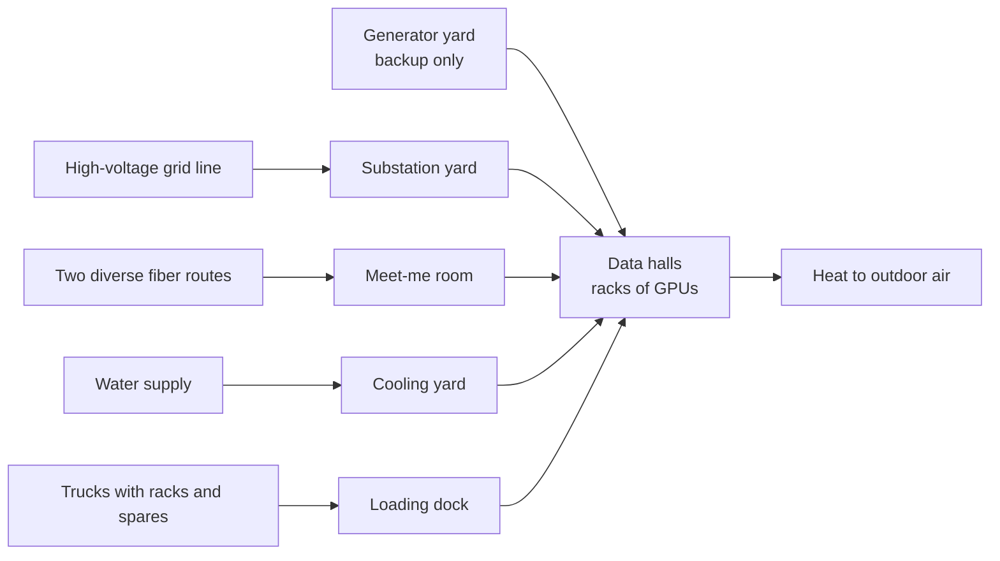
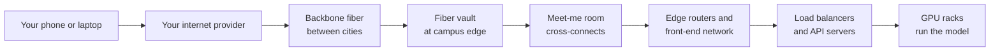
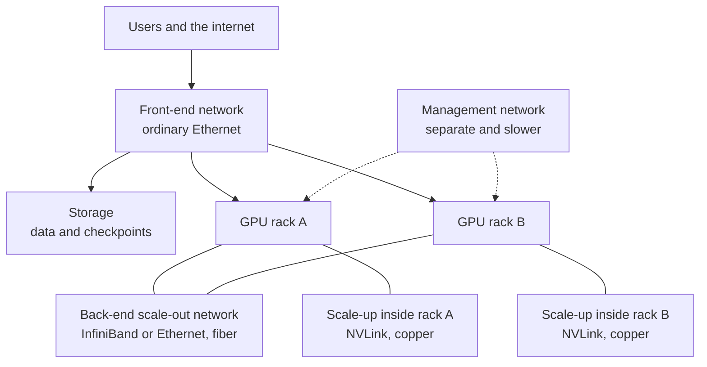
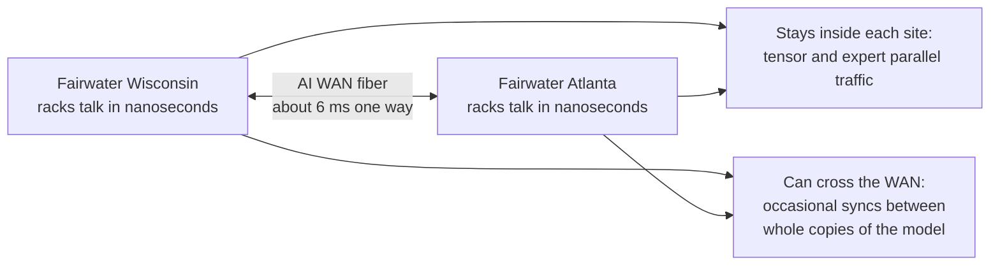
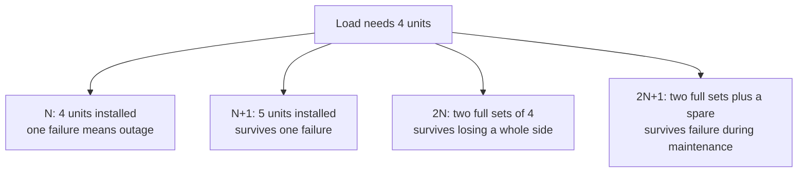
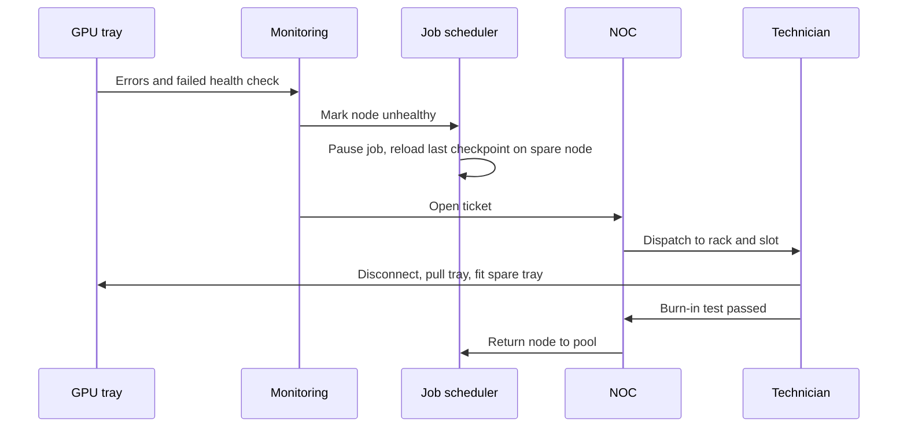
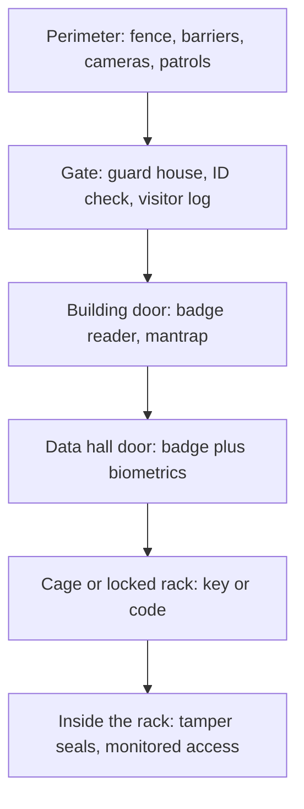
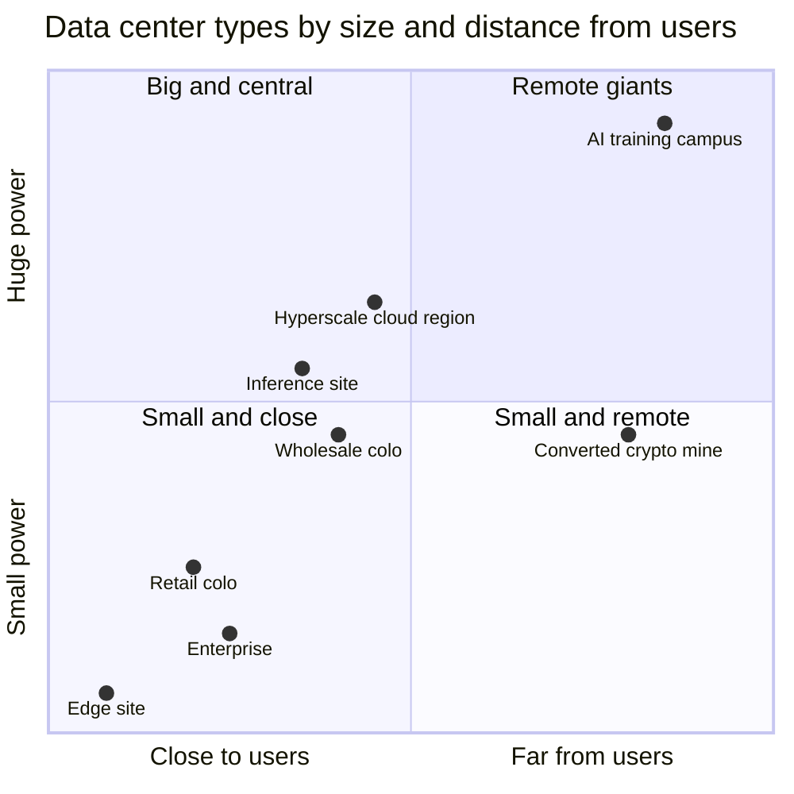

# Chapter 38: Inside a Data Center

*A walking tour of a 2026 AI campus, from the security fence to the inside of a 140-kilowatt rack, so you can recognize every yard, room and box, explain why it is there, and see where the business opportunities hide.*

## What you'll learn

- What a modern AI campus looks like from above, stop by stop: fence, substation yard, generator yard, cooling yard, fiber entrances and the buildings themselves
- The difference between white space and gray space, and why AI is shifting floor area from computers to electrical and mechanical gear
- Why heavy AI racks killed the classic raised floor, and how racks, rows, hot and cold aisles and containment are laid out
- What runs overhead (cable trays, busways, structured cabling) and what happens in the meet-me room where the building joins the internet
- How a 2015 rack, a 2026 NVL72 rack and the coming 600 kW to 1 MW racks compare
- The networks inside a data center and between data centers, and how the speed of light limits joining campuses into one machine
- Redundancy (N, N+1, 2N), Uptime Tiers and "the nines", and why AI training halls accept less redundancy than a bank
- Who runs, guards, owns and rents these buildings, and the business models that tie them together

## Before you start

Chapter 4 (The Internet and the Cloud) followed your message to the door of a data center and introduced servers, racks and meet-me rooms in a few sentences. Chapter 32 (From Transistor to Accelerator) explained what a GPU is, and Chapter 34 (Wiring Thousands of Chips Together) climbed from a single chip to a rack and a cluster, including NVLink, InfiniBand and fat-tree networks. This chapter zooms out to the building around all that hardware. It touches power and cooling only as far as you need to recognize the equipment: Chapter 39 follows the electricity from the grid to the chip, and Chapter 40 follows the heat from the chip to the sky. Chapters 41 to 43 cover where the energy comes from, how these campuses get built and what they cost.

## Your chatbot lives in a building

Every time you press Enter in ChatGPT, Claude or Gemini, your words travel as light through glass fiber to a specific building in a specific town. There, chips in a metal cabinet do trillions of multiplications, draw electricity from a high-voltage line, turn nearly all of it into heat, and hand that heat to water or air that carries it outdoors. The answer streams back the way your question came.

It is easy to forget this. "The cloud" sounds weightless. In reality the cloud is concrete, steel, copper, water pipes, diesel tanks and sometimes gas turbines, sitting behind fences in places like Loudoun County in Virginia, Abilene in Texas, Mount Pleasant in Wisconsin and New Carlisle in Indiana.

> **Definition — Data center:** A building, or group of buildings, packed with computers (servers), network equipment, power systems and cooling, designed to keep that equipment running around the clock. Your chatbot's model runs in one.

Data centers are not new; banks and airlines have run them since the mainframe era. What changed after 2022 is the *intensity*. An AI data center packs ten to twenty times more power into each cabinet than the enterprise data centers of 2015, and that one fact reshapes almost everything on this tour: floors, pipes, electrical rooms, backup plans and business deals.

It also changed how people measure them. Data centers are described not by floor area but by *power*: a "100 MW data center", a "1 GW campus". Power, not space, is the scarce ingredient. Every GPU needs a fixed amount of electricity and cooling, so once you know the power, you roughly know how many chips fit.

> **Definition — Campus:** A site with several data center buildings sharing one substation, fiber entrances, cooling plant and other support infrastructure. The largest AI campuses in 2026 are planned at one to five gigawatts.

> **Definition — Megawatt (MW) and gigawatt (GW):** A megawatt is a million watts, enough for very roughly 800 average US homes; a gigawatt is a thousand megawatts, about the output of one large nuclear reactor. Data centers are sized by how many of these they can draw (Chapter 39 explains watts properly).

How many chips is that? Start from one GPU. NVIDIA's H100 is rated at 700 watts; Blackwell-class chips are rated around 1,000 watts or more. Once you add the CPUs, memory, network cards and fans in the server, plus the GPU's share of the cooling and power losses in the building, an H100 costs roughly 1.2 to 1.5 kilowatts "all-in". Epoch AI, the research group that tracks AI data centers, uses about 1,500 watts per H100 including overhead. So:

`100 MW ÷ 1.5 kW per GPU ≈ 67,000 H100-class GPUs`

That simple division is why the industry talks in megawatts: the power budget sets the chip count.

> **Key idea:** A data center is a machine for turning electricity into computation and then getting rid of the heat. Nearly every structure you will see on this tour exists either to deliver power, to remove heat, to move data, or to protect the first three.

> **Analogy:** Think of a data center as a giant restaurant kitchen. The stoves are the GPUs, the only things doing the "cooking". Everything else, the gas line and electrical panel (power), the ventilation hoods and air conditioning (cooling), the delivery door (network) and the locked back entrance (security), exists so the stoves can run all day without a break.

As of October 20, 2026, Epoch AI tracked 95 large AI data centers with about 14.2 GW of IT power between them (about 18.5 GW including cooling and other overhead). The property firm JLL expects total global data center capacity to roughly double from about 103 GW in 2025 to about 200 GW by 2030.

> **Watch out:** "Data centers are all AI now" is not true. By JLL's estimate AI was about a quarter of data center workloads in 2025; email, streaming, banking and ordinary business software fill most of the rest. What is true is that AI drives most of the *new* giant buildings, and they look different from the old ones.

## The walking tour: an annotated site plan

Let's walk onto a typical 2026 AI campus. There is no single standard design, but most large sites share the same zones. Picture several hundred acres of flat land at the edge of a town, near a high-voltage transmission line. Microsoft's first Fairwater AI campus in Mount Pleasant, Wisconsin covers 315 acres with three buildings and about 1.2 million square feet of floor space. Meta's Hyperion site in Louisiana covers about 2,250 acres.

Here is the site from above.

```
 N^         AI CAMPUS SITE PLAN (not to scale)
 +-----------------------------------------------------------+
 | ROAD->[1] GATE + GUARD HOUSE           345 kV LINE ====  |
 |            |                                    ||       |
 |   [8] ADMIN, NOC,                      [2] SUBSTATION    |
 |   LOADING DOCK                         transformers,     |
 |            |                           breakers          |
 |  +------------------------+                 ||           |
 |  | [4] BUILDING A         |   [3] GENERATOR YARD         |
 |  | data halls + electrical|   [G][G][G][G][G][G][G][G]   |
 |  | rooms (gray space)     |   [G][G][G][G][G][G][G][G]   |
 |  +------------------------+   fuel tanks                 |
 |  [5] COOLING YARD: chillers, dry coolers, towers, fans   |
 |  +------------------------+                              |
 |  | [4] BUILDING B         |   [6] WATER TANKS            |
 |  +------------------------+                              |
 | [7] FIBER PATH A (west)          [7] FIBER PATH B (east) |
 +-----------------------------------------------------------+
```

*Figure 38.1: An annotated site plan of a generic AI campus. Numbers match the tour stops below. Real sites vary, but almost all have these zones.*

Before we walk through each stop, here is what flows across the fence. Every campus is fed by four streams and must get rid of one.



*Figure 38.2: What crosses the fence. Power, data, water and equipment come in; heat (and answers to your prompts) go out.*

### Stop 1: the fence and the guard house

You cannot just walk in. A tall anti-climb fence surrounds the site, and concrete posts or steel barriers stop a vehicle from ramming the gate. At the guard house you show identification for a visit booked in advance, and you may be escorted the whole time. We return to security near the end of the tour.

### Stop 2: the substation yard

Next to the transmission line sits a gravel yard full of large gray transformers, tall circuit breakers and steel frames holding insulators and wires. This is the substation, where the grid's very high voltage (for example 345,000 volts) is stepped down to a medium voltage (for example 34,500 volts) that can be distributed around the campus.

> **Definition — Substation:** A fenced yard of transformers, breakers and switches that steps transmission-line voltage down to a lower voltage and routes it onward. Big AI campuses usually build their own substation on site.

> **Definition — Transformer:** A device with no moving parts that uses coils of wire around an iron core to raise or lower the voltage of alternating-current electricity. Large power transformers take years to deliver and are a key bottleneck of the AI build-out.

A gigawatt campus may have several substations, each fed by more than one line, so losing a single line does not black out the site. From there, medium-voltage cables run underground to the buildings; Microsoft says its Wisconsin Fairwater site used 120 miles of them. Chapter 39 follows this electricity all the way to the chip.

### Stop 3: the generator yard

Beside the buildings you see rows of what look like shipping containers. Each is a diesel (sometimes natural gas) engine coupled to a generator, typically 2 to 3 megawatts or more apiece. A large site has dozens to hundreds of them, plus fuel tanks that often hold 24 to 48 hours of fuel. They exist for one moment: when the grid fails.

> **Definition — Backup generator:** An engine-driven generator, usually diesel and sometimes natural gas, that powers a site during a grid outage. Typical data center units are 2 to 3 megawatts or more each.

They sit idle except for tests, because air-quality permits usually limit how many hours a year they may run. Chapter 39 explains the handoff from grid to battery to generator.

### Stop 4: the buildings

The buildings are big, windowless, usually one or two stories tall, and clad in plain metal or concrete panels. Inside, they split into data halls where the computers live and rooms full of equipment that keep them alive.

AI buildings are getting taller and heavier. Microsoft describes its Fairwater buildings as using a two-story rack layout, which lets more racks sit within short cable reach of each other. Its published construction numbers for the Wisconsin site give a sense of scale: 46.6 miles of deep foundation piles, 26.5 million pounds of structural steel and 72.6 miles of mechanical piping.

### Stop 5: the cooling yard

Behind or on top of the buildings sits the equipment that throws heat into the sky. Depending on the climate and design, you will see chillers (big refrigeration machines that make cold water), dry coolers (giant car radiators with fans), cooling towers (structures that cool water by evaporating some of it) and fields of large fans. Microsoft says its Wisconsin site has the second-largest water-cooled chiller plant on the planet and 172 fans that are 20 feet across. Chapter 40 explains each of these machines.

### Stop 6: water tanks and pipes

Many sites store water for cooling, fire protection or both. How much a site *consumes* depends heavily on its cooling design, a topic Chapter 40 handles carefully because it is often misreported.

### Stop 7: fiber entrances

Somewhere along the edges, usually at two or more widely separated points, fiber-optic cables enter the site underground through concrete vaults and conduits. Two separate routes ("diverse paths") mean that a single backhoe digging in the wrong place cannot cut the campus off from the internet. These cables lead to the meet-me room, our stop later in this chapter.

### Stop 8: the admin block, network operations center and loading dock

Near the entrance is the human side: offices, a security control room, the network operations center and a large loading dock. The dock matters more than you might think. A modern AI rack arrives fully built from the factory, weighs well over a tonne, and needs wide doors and strong floors all the way to its final spot. Next to the dock, staging rooms are where new racks are inspected and "burned in" (run at full load for a while to catch early failures) before they join the cluster.

> **Try it:** Open Google Maps in satellite view and search for "Mount Pleasant, Wisconsin Microsoft data center" or "Abilene Texas Stargate". Zoom in and find the substation (gravel yard with gray boxes), the generator rows, the cooling equipment and the fiber vaults if you can. Then ask your chatbot to describe what each of those things looks like from above and check its answer against what you see.

## White space and gray space

Step inside one of the buildings. The industry splits a data center's floor area into two kinds.

> **Definition — White space:** The floor area where the IT equipment (racks of servers, storage and network gear) actually sits. The name comes from the clean, brightly lit look of classic computer rooms.

> **Definition — Gray space:** The rooms that hold support equipment: electrical rooms with switchgear and UPS systems, battery rooms, mechanical rooms with pumps and heat exchangers, and fire-suppression gear.

> **Definition — Data hall:** One large room of white space inside a data center building, often designed for 5 to 30 or more megawatts of IT equipment in AI designs.

Here is something counterintuitive. As AI racks got denser, the white space needed for a given amount of computing *shrank*, while the gray space barely changed. The electrical and mechanical gear is sized by power, not by how tightly you pack the racks.

**Worked example: the shrinking white space.** Imagine a data hall with 30 MW of IT power. Assume each rack plus its share of the aisles takes about 3 square meters of floor (a rough illustrative figure; real layouts vary).

- At 8 kW per rack (a typical 2015 enterprise rack): 30,000 kW ÷ 8 kW = 3,750 racks, needing about 3,750 × 3 = 11,250 m² of white space.
- At 130 kW per rack (a 2026 NVL72-class rack): 30,000 ÷ 130 ≈ 231 racks, needing about 231 × 3 ≈ 690 m².
- At 600 kW per rack (the 2027 roadmap): 30,000 ÷ 600 = 50 racks, about 150 m².

The switchgear, transformers, UPS systems, pumps and heat exchangers needed to deliver 30 MW and remove 30 MW of heat are roughly the same in all three cases. So in an AI building, the white space has gone from the biggest room to a relatively small one, surrounded by a much larger ring of electrical and mechanical rooms.

> **Key idea:** In an AI data center, the computers take up surprisingly little room. Most of the building, and most of the construction work, is the plumbing and wiring that feed power in and carry heat out.

> **Definition — Stranded capacity:** Power or cooling that was built but cannot be used because some other limit runs out first, such as floor space, weight capacity or cooling for a particular row. Designers try to keep power, cooling and space in balance so none is wasted.

## Floors: raised floor versus slab

Walk into a classic data center of the 1990s to 2010s and the floor sounds hollow: it is a grid of removable tiles, about 60 cm (2 feet) square, on metal pedestals above the real concrete. The gap underneath, often half a meter or more, was a giant duct. Air conditioners blew cold air into it, perforated tiles let it rise into the servers, and cables ran there too.

> **Definition — Raised floor:** A floor made of removable tiles on pedestals, with an open space beneath it. Historically, data centers pushed cold air through that space and up through perforated tiles in front of the racks.

> **Definition — Slab-on-grade:** A design where racks sit directly on a solid concrete floor, with power, network cables and coolant pipes running overhead or in trenches. It is now common for heavy AI racks.

Two things killed the raised floor for AI halls: weight and water.

**Weight.** AI racks weigh roughly 1.5 to 3 tonnes. An NVL72 rack is around 1.5 tonnes or more. Spread over a footprint of, say, 0.6 m by 1.2 m (about 0.72 m², an illustrative size), 3 tonnes presses down at about:

`3,000 kg ÷ 0.72 m² ≈ 4,200 kg per square meter`

For comparison, building codes typically design office floors for a live load of about 2.4 kN/m² (50 pounds per square foot), which is roughly 245 kg per square meter. A heavy AI rack loads its own footprint more than fifteen times harder than an office floor is designed for. Tiles on pedestals can be built that strong, but a thick concrete slab is simpler, cheaper and safer, especially when the rack has to roll in on wheels.

**Water.** Liquid-cooled racks need coolant pipes. Running water pipes under a floor full of power cables is risky and makes leaks hard to see. Overhead pipes and trenches are easier to inspect and service.

So the modern AI hall looks like this in cross-section:

```
  CLASSIC RAISED FLOOR (2010s)       AI SLAB HALL (2026)

  ceiling return air                ==== busway ==== (power)
                                    ---- cable trays (fiber)
   +----+    +----+                 ~~~~ coolant pipes ~~~~
   |RACK|    |RACK|                   +----+    +----+
   |    |    |    |                   |RACK|    |RACK|
   +----+    +----+                   |    |    |    |
  _[tile]_[perf tile]_[tile]_         +----+    +----+
  |  cold air + cables under  |      racks of 1.5 to 3 t
  |_____ floor plenum ________|     =====================
  ======= concrete ===========         concrete slab
```

*Figure 38.3: Left, a raised floor used as an air duct with cables underneath. Right, an AI hall with racks on the slab and power, fiber and coolant running overhead.*

> **Watch out:** The raised floor has not disappeared. Many older and air-cooled data centers still use it; the trend toward slabs is for dense, liquid-cooled AI halls.

## Racks, rows and aisles

Now look at the racks themselves, and how they are arranged.

> **Definition — Rack:** A standard metal cabinet, 19 inches (about 48 cm) wide inside its mounting rails and about 2 meters tall, that holds servers, switches, power equipment and cooling hardware. Most racks offer 42 to 52 rack units of mounting space.

> **Definition — Rack unit (U):** The standard unit of height inside a rack: 1.75 inches (4.445 cm). A "1U server" is one unit tall, like a thick pizza box; a 42U rack has 73.5 inches of mounting space.

> **Definition — Row, pod and cluster (data center layout):** A row is a line of racks standing side by side. A pod is a repeatable block of rows with its own network layer and shared power and cooling. A cluster is a set of pods networked together to work on shared jobs.

### Hot aisles and cold aisles

Even in a liquid-cooled AI hall, some heat leaves the racks as warm air, and older halls rely on air entirely. Servers pull cool air in at the front and push hot air out the back. If every row faced the same way, each would breathe the hot exhaust of the row in front, so racks are placed face to face and back to back.

> **Definition — Hot aisle and cold aisle:** A layout in which rows of racks face each other so that their fronts share an aisle of cool supply air (the cold aisle) and their backs share an aisle of hot exhaust air (the hot aisle).

> **Definition — Containment:** Doors at the ends of an aisle and panels over its top that enclose either the hot or the cold aisle, so that hot and cold air cannot mix and cooling energy is not wasted.

Industry guidance from ASHRAE recommends server inlet air of roughly 18 to 27 °C; hot aisles run much warmer.

> **Analogy:** Containment is keeping the fridge door closed. If you leave it open, the fridge works twice as hard and your kitchen gets warm. Doors and lids on an aisle stop the cold air from leaking out before it reaches the servers.

### The floor plan of an AI data hall

Here is a simplified floor plan of one block of an AI data hall, as if you were looking down from the ceiling. Real halls repeat this block many times.

```
  AI DATA HALL, ONE BLOCK (top view, simplified)
  +------------+-------------------------------------------+
  | ELECTRICAL | equipment corridor (from loading dock)    |
  | ROOM       +-------------------------------------------+
  | switchgear |  overhead: busway A, fiber tray, pipes    |
  | UPS        |  [R][R][R][R][R][R][R][R][R][R]  [CDU]    |
  | batteries  |  ######## HOT AISLE (contained) ########  |
  |            |  [R][R][R][R][R][R][R][R][R][R]  [CDU]    |
  +------------+  . . . . . . COLD AISLE . . . . . . . .   |
  | MECHANICAL |  [R][R][R][R][R][R][R][R][R][R]  [CDU]    |
  | ROOM       |  ######## HOT AISLE (contained) ########  |
  | pumps,     |  [R][R][R][R][R][R][R][R][R][R]  [CDU]    |
  | heat       |  . . . . . . COLD AISLE . . . . . . . .   |
  | exchangers |  [N][N][N][N]  network row: leaf and      |
  |            |               spine switches              |
  +------------+-------------------------------------------+
  | to MEET-ME ROOM (fiber)  | to COOLING YARD (pipes)    |
  +--------------------------+----------------------------+
  [R] = GPU rack, about 130 kW   [N] = network switch rack
  [CDU] = coolant distribution unit   ### = contained aisle
```

*Figure 38.4: A floor plan of one block of an AI data hall. Forty GPU racks at about 130 kW each make roughly 5 MW of IT load, fed by the electrical room on the left and cooled through the CDUs and mechanical room.*

Forty racks at 130 kW is 5.2 MW, the average electricity use of about 4,300 American homes, in a space the size of a large classroom. The coolant distribution units at the row ends pass heat from the racks' liquid loop to the building's water loop (Chapter 40).

> **Definition — CDU (coolant distribution unit):** A cabinet of pumps and a heat exchanger that circulates clean coolant through the racks' cold plates and hands the heat to the building's facility water loop, while controlling flow, pressure and temperature.

## Overhead: cable trays, busways and structured cabling

Look up. Above every row runs a layered highway of metal.

> **Definition — Cable tray (ladder rack):** An open metal channel or ladder-shaped frame, hung from the ceiling or mounted above racks, that carries bundles of power or network cables along rows.

> **Definition — Busway (busbar trunking):** A rigid overhead rail of copper or aluminum conductors running along a row, into which each rack plugs through a "tap-off box" with its own breaker. It is faster to install and change than individual cables.

Power and data are kept apart on separate levels, both for safety and because power cables can interfere with copper data cables. In many halls you will see, from top to bottom: lighting and fire-detection pipes, the busway, fiber trays (often bright yellow or orange plastic channels), and coolant pipes with valves and leak sensors.

> **Definition — Structured cabling:** An organized system of permanent cables, labeled pathways and patch panels (rows of ports where those cables end), so that technicians make changes by moving short patch cords rather than pulling new long cables.

The amount of cable is staggering. Inside an NVL72 rack, a copper "spine" of roughly 5,000 cables links the 72 GPUs (Chapter 34). Between racks, a rough rule of thumb is about six optical transceivers per GPU in a large three-layer network, so a 100,000-GPU cluster needs on the order of 600,000 transceivers and hundreds of thousands of fiber links, each installed, labeled, tested and occasionally replaced.

What is actually in those trays? Two kinds of cable, chosen by distance. Over a meter or two, inside a rack, plain copper cable is cheapest and uses almost no power. Beyond that, signals travel as pulses of laser light in glass fiber, and every fiber link has a small converter at each end that turns electrical signals into light and back. The fiber itself also comes in two kinds, again chosen by distance: one for short runs between racks in the same hall, and one for long runs between halls, buildings and campuses. Those converters draw power and occasionally fail, which is why the industry is starting to move them onto the switch chip itself (co-packaged optics, Chapter 34).

> **Definition — Optical transceiver:** A plug-in module, about the size of a pack of gum, at each end of a fiber link that converts electrical signals into laser light and back. 800G and 1.6T modules (800 and 1,600 gigabits per second) are standard in 2026 AI clusters.

> **Definition — Single-mode and multimode fiber:** The two main kinds of optical fiber. Multimode fiber has a wider glass core in which light bounces along many slightly different paths that blur the signal over distance, so it is used for short links. Single-mode fiber has a very thin core that carries light along essentially one path, so it is used for long distances, from across a campus to between cities.

> **Watch out:** Cable management is not a cosmetic issue. A badly routed bundle blocks airflow, a mislabeled fiber can take hours to trace, and in AI clusters one flaky link can slow down a training job running on thousands of GPUs. Good cabling crews are prized for exactly this reason.

## The meet-me room: where the building joins the internet

Follow the fiber trays out of the hall and you reach a locked room full of racks and yellow fiber cables, usually near the fiber entrance points. This is where your message from Chapter 4 actually walks in the door.

> **Definition — Meet-me room (MMR):** A secure room in a data center where the fiber cables of outside network carriers (telecom and fiber companies) meet the building's own network and its tenants' equipment, and are connected together.

> **Definition — Cross-connect:** A physical cable, usually fiber, run inside the meet-me room to link one party's equipment directly to another's, for example a tenant to a carrier, or two tenants to each other. Colocation operators charge a monthly fee per cross-connect.

A "carrier-neutral" data center welcomes many competing carriers, so tenants can pick the cheapest or fastest, and two companies in the same building can connect with a short cable instead of crossing the internet.



*Figure 38.5: The last few hops of your chatbot message, from the street into the building and onto the GPUs. Chapter 4 covers the trip to the campus; Chapter 44 follows the whole journey with timings.*

> **Definition — Carrier hotel:** A building, often in a big city, whose main job is to host the meeting points of many networks, full of meet-me rooms and cross-connects. One Wilshire in Los Angeles and 60 Hudson Street in New York are classic examples.

> **Definition — Internet exchange point (IXP):** A place, usually inside a carrier hotel or large data center, where many networks connect to a shared switch to hand traffic directly to each other instead of paying a third party to carry it.

AI training campuses usually sit far from these city hubs, because they need land and power more than closeness to users; inference data centers, which answer your prompts, care more about being near users and exchange points.

## Inside the rack: 2015 versus 2026 versus the megawatt rack

Walk down a row and look into a rack. What you find depends enormously on when it was built. Chapter 34 took an NVL72 rack apart piece by piece; here we compare it with what came before and what comes next.

> **Definition — Rack density:** The electrical power drawn by one rack, in kilowatts. It is the single number that best predicts how a data hall must be designed, from floor strength to cooling method.

```
  2015 ENTERPRISE RACK          2026 NVL72-CLASS AI RACK
  +---------------------+       +------------------------+
  | patch panel         |       | power shelves          |
  | top-of-rack switch  |       | compute trays          |
  | 1U server           |       |  (each: 4 GPUs, 2 CPUs)|
  | 1U server           |       | NVLink switch trays x9 |
  | 2U server           |       | compute trays          |
  | ... 20 or so ...    |       |  (18 trays, 72 GPUs)   |
  | storage shelf       |       | power shelves          |
  | power strips (PDUs) |       | rear: copper spine,    |
  | blanking panels     |       | DC busbar, manifolds   |
  +---------------------+       +------------------------+
  about 5-10 kW                 about 120-140 kW
  air-cooled, many fans         liquid-cooled cold plates
  mixed jobs, many owners       one job, one giant GPU
```

*Figure 38.6: Two racks of the same size, a decade apart. The AI rack draws more than ten times the power and is designed as a single machine.*

> **Definition — PDU (power distribution unit):** Equipment that distributes power to racks. It can be a large floor-standing cabinet with a transformer and breakers, or a rack-mounted power strip with many outlets.

> **Definition — Rack power shelf:** A tray of power supply units inside an AI rack that converts the building's alternating current into roughly 50 volts of direct current for the servers, which is then carried to every tray by a busbar.

> **Definition — Manifold and quick disconnect:** A manifold is a set of pipes running up the back of a liquid-cooled rack that distributes coolant to each tray. Quick disconnects are dripless connectors that let a technician pull out a tray without draining the system.

Here is the same comparison as numbers.

| Feature | 2015 enterprise rack | 2026 NVL72-class AI rack | 2027 and beyond roadmap |
|---|---|---|---|
| Power | about 5–10 kW | about 120–140 kW | about 600 kW (Kyber), designs for 1 MW+ |
| Homes' worth of average power | about 4–8 | about 100–115 | about 500 to 800+ |
| Cooling | air, fans, room AC | direct-to-chip liquid, some air | liquid, with new designs |
| Power to rack | AC power strips | AC to power shelves, about 50 V DC busbar | 800 V DC planned for 2027 |
| Weight | far lighter | about 1.5 tonnes or more | heavier still |
| What it is | many separate servers | 72 GPUs acting as one | 144 GPU packages per NVLink domain (Kyber, as described in GTC 2026 coverage) |

*Table 38.1: Rack generations. "Homes" uses an average US home drawing about 1.2 kW averaged over a year.*

NVIDIA says the jump from its Hopper generation to Blackwell alone raised rack density about 3.4 times, "from tens of kilowatts to well over 100". It is now designing for more than 1 MW per rack, with 800-volt DC power distribution entering production alongside its next-generation Kyber racks (NVIDIA's rack design for its Rubin Ultra chips, around 600 kW each) in 2027. Chapter 39 explains why the voltage has to rise.

What does such a rack produce? Microsoft says each 72-GPU rack in its Fairwater design can generate about 865,000 tokens per second: at roughly 0.75 words per token, several long novels' worth of text every second from one cabinet.

> **Analogy:** Fitting 130 kW into one rack is like fitting a whole suburban street's electricity into a refrigerator-sized cabinet, and then removing all of that energy again as heat through pipes the width of a garden hose.

> **At the frontier (2026):** NVIDIA says Vera Rubin NVL72 racks were ramping into production in 2026, and AMD's competing Helios rack (72 MI455X GPUs in Meta's wider Open Rack Wide form factor) begins shipping in the second half of 2026. Rack designs are now negotiated between chipmakers, clouds and building designers years ahead, because a new rack can force changes to floors, pipes and power rooms.

## The networks inside the building

Walk to the end of a row and you reach the network racks. An AI data hall does not have one network; it has several, each built for a different job. Chapter 34 explained how they work; here is where they live and why there are so many.

> **Definition — NIC (network interface card):** The card that connects a server to a network. AI servers usually have one very fast NIC per GPU (for example 800 Gb/s) plus slower ones for ordinary traffic.

> **Definition — Leaf-spine network (Clos network):** A layered network design in which "leaf" switches connect to servers and every leaf connects to every "spine" switch above it, so that any two servers are only a few hops apart. Big clusters add a third layer on top.

> **Definition — Non-blocking network:** A network with enough capacity in its upper layers that every connected device can send at full speed at the same time. AI training back-ends are built this way because thousands of GPUs exchange data all at once.

The four networks of a typical AI hall:

1. **The scale-up network** lives *inside* the rack: in an NVL72, NVLink over copper joins 72 GPUs so tightly that software treats them as one giant GPU.
2. **The scale-out or back-end network** links racks so thousands of GPUs can work on one job, using InfiniBand or high-speed Ethernet over fiber through leaf and spine switches in the network rows.
3. **The front-end network** connects servers to users, to the internet through the meet-me room, and to storage, where training data and checkpoints (saved copies of a model mid-training) live.
4. **The management network** is a separate, slower network that lets operators reach every server's control chip even when the server has crashed.

> **Definition — Scale-up, scale-out and front-end networks:** Scale-up joins GPUs inside a rack or domain with ultra-fast links such as NVLink. Scale-out (the back-end) joins many racks for shared jobs using InfiniBand or Ethernet. The front-end carries user traffic, internet traffic and storage.

> **Definition — Out-of-band management network:** A separate, independent network used only to monitor and control equipment, so technicians can reach a machine's baseboard management controller (a small built-in control chip) even when the machine's main system or main network has failed.



*Figure 38.7: The four networks of an AI data hall. Each rack plugs into all of them, through different cards and cables.*

> **Analogy:** Scale-up is a team in one room shouting across the table. Scale-out is teams in different rooms of the same building on phone calls. The front-end is the reception desk where visitors and deliveries arrive. The management network is the building's intercom, which still works when the phones are down.

Why does a training hall need a non-blocking back-end when an ordinary cloud building does not? In a cloud building, unrelated customers send traffic at random times, so the network can be smaller than the sum of its ports, betting that not everyone talks at once. A training job is the opposite: every GPU finishes its share of the math and then exchanges results with others *at the same moment*. If the network is undersized, every GPU waits, and the slowest link sets the pace (Chapter 37).

## Between data centers: fiber, exchanges and the speed of light

Data centers do not live alone. They are joined to each other and to the rest of the internet by fiber, and the giant AI labs are now joining whole campuses into single machines.

> **Definition — Dark fiber:** Optical fiber that has been laid but is not "lit" by any equipment. A company can lease it and attach its own lasers and receivers, gaining a private, very high-capacity link it controls completely.

> **Definition — DCI (data center interconnect):** High-capacity links between data centers, usually over leased dark fiber or leased "wavelengths" (separate colors of laser light sharing one fiber, a technique that lets one strand of glass carry many terabits per second).

Between continents, the same job is done by subsea cables on the ocean floor (Chapter 4).

### The speed of light sets the rules

Light in glass fiber travels at about two-thirds of its speed in vacuum, roughly 200,000 km per second. That works out to about **5 microseconds per kilometer**. Inside a computer that is a long time.

| Distance | Example | One-way delay in fiber |
|---|---|---|
| 2 m | across one rack | about 10 nanoseconds |
| 200 m | across a large data hall | about 1 microsecond |
| 2 km | across a large campus | about 10 microseconds |
| 100 km | a metro-area pair of sites | about 0.5 milliseconds |
| 1,200 km | Wisconsin to Atlanta by fiber, roughly | about 6 milliseconds |
| 6,000 km | across the Atlantic, roughly | about 30 milliseconds |

*Table 38.2: Delay from the speed of light alone, at about 5 microseconds per kilometer of fiber. Real links add switching and routing delays on top.*

For your chatbot, a few milliseconds hardly matter; you wait far longer for the model to think. For a training job, whose GPUs exchange data over links measured in nanoseconds, several milliseconds is an eternity.

### AI WANs: one model, several states

Even a gigawatt campus is limited by how much power one location can get. So in 2025–26 the frontier labs began joining campuses hundreds of kilometers apart into a single training system.

> **Definition — Scale-across (AI WAN):** Linking several data center campuses, often hundreds of kilometers apart, with high-capacity fiber so they can work on one training job. Microsoft calls its version an "AI WAN" (wide area network).

Microsoft's second Fairwater site, in Atlanta, has been operating since October 2025 and is linked to the Wisconsin site over an AI WAN so that the two act as one system. As of October 2026, Epoch AI listed the Atlanta site at about 636 MW of IT power. The trick is deciding what traffic can cross that long, slow link.



*Figure 38.8: Multi-site training. Chatty, every-layer traffic stays inside each campus; only patient, occasional synchronization crosses the long link.*

> **Analogy:** Scale-up is a team in one room, scale-out is teams in one building on phone calls, and scale-across is offices in different cities on video calls. You would never ask two cities to co-write every sentence together, but they can each write chapters and compare notes once a day.

> **Watch out:** You may read that "70% of the world's internet traffic flows through Northern Virginia." It is a popular claim but not well sourced. Northern Virginia is the world's largest data center market, which is impressive enough without the made-up statistic.

## Reliability and redundancy

Now the question every data center designer lives with: what happens when something breaks? Everything breaks eventually: a breaker trips, a pump seizes, a utility line is hit by lightning, a fiber is cut. The answer is redundancy.

> **Definition — Redundancy:** Having extra equipment beyond what is strictly needed, so that the failure or maintenance of one piece does not cause an outage.

Engineers describe redundancy with a compact shorthand.

> **Definition — N and N+1:** N is the amount of equipment needed to carry the full load with nothing spare (if a hall needs five chillers running, N = 5). N+1 adds one spare unit, so any one can fail or be serviced without trouble.

> **Definition — 2N:** Two complete, independent systems, each able to carry the full load alone, for example two separate power paths through two sets of UPS and switchgear to every rack. Variants include 2N+1 (plus a spare) and "distributed redundancy", where spare capacity is shared across several blocks.



*Figure 38.9: The redundancy ladder. Each step up costs more equipment and space but survives more kinds of failure.*

> **Analogy:** N+1 is carrying a spare tire. 2N is owning two complete cars. A fault-tolerant site is two cars with two drivers, each able to finish the trip alone if the other breaks down.

Two more terms separate good designs from great ones.

> **Definition — Concurrently maintainable:** A design in which any single component can be taken out of service for planned maintenance without shutting down the IT equipment.

> **Definition — Fault tolerant:** A design that survives any single unplanned failure, anywhere in the power or cooling system, without affecting the IT equipment.

### Tiers and the nines

The most widely used rating system comes from the Uptime Institute.

> **Definition — Uptime Institute Tiers (I to IV):** A rating system for data center infrastructure. Tier I is basic capacity with no redundancy, Tier II adds redundant components, Tier III is concurrently maintainable, and Tier IV is fault tolerant.

> **Definition — Availability ("the nines"):** The fraction of time a system is up, often written as a number of nines: 99.9% ("three nines") allows about 8.8 hours of downtime per year, 99.99% about 53 minutes, and 99.999% about 5 minutes.

The commonly quoted rule-of-thumb availabilities for the four Tiers convert into downtime like this (a year has 8,760 hours):

| Tier | What it means | Rule-of-thumb availability | Downtime per year |
|---|---|---|---|
| I | basic, no redundancy | 99.671% | (1 − 0.99671) × 8,760 ≈ 28.8 hours |
| II | redundant components | 99.741% | about 22.7 hours |
| III | concurrently maintainable | 99.982% | about 1.6 hours (95 minutes) |
| IV | fault tolerant | 99.995% | about 0.44 hours (26 minutes) |

*Table 38.3: Uptime Tiers and the downtime their rule-of-thumb availabilities imply. Each step up costs substantially more to build.*

> **Definition — SLA (service-level agreement):** A contract that promises a level of uptime or performance, such as 99.99% availability, with refunds or penalties if the provider misses it.

### Why AI training halls accept less redundancy

A bank's data center is usually built to Tier III or IV, because a few minutes of downtime can stop payments for millions of people. You might expect AI data centers, which cost tens of billions of dollars, to be even more paranoid. For *training* halls, the industry often goes the other way. Here is the reasoning.

1. **Training jobs crash anyway.** During a 54-day stretch of Llama 3 training on 16,384 GPUs, Meta recorded 419 unexpected interruptions, mostly hardware. Training software is therefore built to save checkpoints often and restart quickly (Chapter 37).
2. **Grid outages are rare by comparison.** Losing a few minutes of training and rolling back to the last checkpoint costs far less than doubling every transformer, UPS and switchboard.
3. **Redundant gear competes for scarce equipment.** Every megawatt of spare electrical capacity is transformers and switchgear that could have fed more GPUs, and those parts are among the hardest to buy in 2026.

So training halls often use leaner designs, for example N+1 rather than 2N in places, and accept occasional pauses. *Inference* halls, which answer your prompts live, need more: users notice outages at once and enterprise customers have SLAs. Even there, big AI providers lean on *geographic* redundancy, sending traffic to another site when one fails, rather than making any single building perfect.

> **Key idea:** Redundancy is a business decision, not a moral one. The right level depends on what an outage costs. A training run can restart from a checkpoint; a payment network cannot un-drop a payment.

> **Try it:** Ask your chatbot: "If a 100,000-GPU training cluster loses power for 10 minutes and its last checkpoint was 20 minutes earlier, roughly how many GPU-hours of work are lost?" Check its arithmetic: 100,000 GPUs × (30 minutes ÷ 60) = 50,000 GPU-hours, plus restart time. Then ask what the same outage would cost a payment processor, and compare the reasoning.

### What actually takes services down

Redundant power and cooling protect against the failures you can see in the building. They are not where most service outages come from. In *The Datacenter as a Computer*, Google's engineers reported that at their scale hardware breaks constantly but is mostly hidden by software that routes around broken machines. The disruptions that users actually noticed came far more often from software bugs, mistaken configuration changes and human error; hardware was a small minority of the causes. The same logic applies to an AI service: a faulty software release can take a chatbot down inside a perfectly healthy building.

That is why operators release changes gradually (a staged rollout, Chapter 44), watch closely and roll back fast, and why they design services to bend rather than break.

> **Definition — Graceful degradation:** Designing a service so that when parts fail or are overloaded, it keeps working with reduced quality or fewer features instead of failing completely, for example by switching to a smaller model or pausing non-essential features.

> **Watch out:** "A Tier IV building means a service that never goes down." The Tier rating covers the building's power and cooling only. Software, configuration, networks and the model itself can fail too, and a service that needs all of its parts is only as available as their product: three parts at 99.9% each give 0.999 × 0.999 × 0.999 ≈ 99.7%.

## Running the place: operations

A finished data center is not a building you lock and walk away from. It is a living machine watched every second.

> **Definition — BMS and DCIM:** A building management system (BMS) monitors and controls the mechanical and electrical plant (pumps, fans, chillers, breakers, alarms). Data center infrastructure management (DCIM) software tracks assets, space, power and cooling capacity rack by rack.

> **Definition — NOC and SOC:** A network operations center (NOC) is the room or team that monitors systems and networks around the clock; a security operations center (SOC) does the same for physical and cyber security.

A large AI hall has tens of thousands of sensors: temperatures at chip, rack and room level, coolant flow and pressure, leak detectors under every manifold, power readings at every breaker and power shelf, door alarms, cameras. Software watches them all and raises alerts. People in the NOC triage those alerts and dispatch technicians.

> **Definition — Remote hands:** A data center service in which on-site technicians perform physical tasks, such as rebooting a server, swapping a part or checking a cable, on behalf of a customer who is not there.

> **Definition — Rack and stack:** The work of physically installing IT equipment: unpacking racks or servers, placing them, connecting power, cooling and network, and testing them.

Here is what happens when a GPU fails in the middle of a training run, a scene that plays out many times a day across a large cluster.



*Figure 38.10: The life of a GPU failure. Software routes around the broken tray in minutes; a technician swaps it later, and the bad tray goes back to the manufacturer under warranty.*

Some of this physical work is starting to be done by machines. A large campus is a real warehouse as well as a computer: trucks deliver new racks every day, old ones leave, and memory sticks, drives and trays move between the loading dock and the floor. Google describes a rack-moving robot that picks up, carries and sets down fully loaded racks, which it says is about five times faster than moving them by hand, lowers the risk of injury and shakes the equipment less. Automation also scans and tracks every part it handles, which matters most for drives that hold user data and must never go missing.

Before a hall goes live, it is also tested more thoroughly than almost any other building.

> **Definition — Commissioning (Cx):** Systematic testing that every system works as designed before go-live, from Level 1 (factory tests of each piece of equipment) to Level 5 (integrated tests, such as cutting the utility feed while "load banks", big resistor boxes that turn electricity into heat, simulate a full hall of computers).

How many people does it take? Building a large campus employs thousands of construction workers. Running it takes far fewer: a finished hyperscale campus may employ only hundreds of people, including critical facilities engineers, electricians, mechanical technicians, data center technicians, security staff and NOC operators. Chapter 42 describes the build, and Chapter 41 the debates over local jobs and taxes.

> **Watch out:** "Data centers bring lots of permanent jobs" is mostly a construction-phase story. A finished campus employs hundreds, not thousands. The main local benefit after construction is usually property tax revenue, which incentive deals sometimes reduce.

## Physical security

You met the fence at Stop 1. Security in a data center is built as layers, like the skins of an onion, so that getting through one layer only brings an intruder to the next.

> **Definition — Mantrap:** A small room with two interlocking doors, only one of which can open at a time, used at data center entrances so that only one authorized person passes through per badge and fingerprint check.



*Figure 38.11: Layers of physical security, from the road to the rack. Each layer logs who passed and when.*

Other habits complete the picture: addresses are often not publicized, buildings carry no logo, biometric readers (fingerprint or palm scans) back up badges, failed storage drives are commonly destroyed on site, and in shared buildings each customer's racks sit inside a locked wire-mesh cage. AI adds a new reason for all this: a frontier model's weights, the file of numbers that *is* the model, are among the most valuable digital assets in the world (Chapter 56 covers weight security).

Walls and guards cannot protect against everything, so the last layers of security are built into the chips themselves. The first question is whether a server is running the software it should be running: if its lowest-level startup code (the firmware) has been tampered with, everything above it can be fooled.

> **Definition — Root of trust (silicon root of trust):** A small, tamper-resistant security chip on a server board that starts before everything else, checks the digital signature of each piece of startup code before letting it run, and holds the machine's secret keys. Google's version is called Titan.

The second question is who can see data while it is being processed. Encryption normally protects data on disks and on networks, but not while a processor is working on it in memory.

> **Definition — Confidential computing:** Hardware that keeps data encrypted even while it is being processed, in a sealed-off area of the chip called a trusted execution environment, so that not even the cloud operator's own software or a person with physical access to the server can read it. "Attestation" lets the customer check remotely that the protected area is genuine and untampered.

Recent CPUs from AMD, Intel and Arm support it, and NVIDIA says its Hopper, Blackwell and Rubin GPUs can protect model weights and data while inference runs. That lets a lab put its weights, or a hospital its patient records, on hardware it does not own with less need to trust everyone who runs the building.

## Types of data centers

Not every data center is a gigawatt AI campus. Here are the main types you will meet in the news.

> **Definition — Enterprise data center:** A data center owned and operated by an ordinary company (a bank, a hospital, a retailer) for its own use, often on its own premises ("on-prem").

> **Definition — Colocation (colo):** Renting space, power and cooling in someone else's data center and bringing your own equipment. Retail colocation means renting a few racks or a cage; wholesale colocation means renting whole halls or buildings.

> **Definition — Hyperscaler:** A giant cloud and internet company operating data centers at massive scale: in AI, mainly Amazon (AWS), Microsoft, Google, Meta and Oracle.

> **Definition — AI training campus ("AI factory"):** A data center, often hundreds of megawatts to gigawatts in size, built mainly to train or serve AI models on tightly networked accelerators. "AI factory" is NVIDIA's marketing term, stressing that the product is tokens.

> **Definition — Edge data center:** A small data center placed close to users, for example in a city or at a cell tower site, to cut delay for applications that need fast responses.

| Type | Typical size | Who uses it | Where it sits |
|---|---|---|---|
| Enterprise (on-prem) | under 1 MW to a few MW | one company | at or near offices |
| Retail colocation | a few racks per customer | many small tenants | cities, near carrier hotels |
| Wholesale colocation | whole halls, tens of MW | a few large tenants | data center parks |
| Hyperscale cloud | tens to hundreds of MW per building | cloud customers | regions near users and power |
| AI training campus | hundreds of MW to GW | one or two AI labs | where land and power are |
| Inference data center | tens to hundreds of MW | AI services | nearer users and networks |
| Edge site | kilowatts to a few MW | latency-sensitive apps | cities, cell sites |
| Modular (prefabricated) | container-sized blocks | fast deployments | anywhere with power |
| Converted crypto mine | tens to hundreds of MW | neoclouds and labs | wherever miners found cheap power |

*Table 38.4: The main types of data centers. Sizes are rough ranges.*



*Figure 38.12: Where each type sits. Training campuses chase power and land far from cities; edge and inference sites chase users.*

> **Watch out:** "Colocation" and "co-location" sound alike but mean different things. Colocation is renting space in a data center. Co-location in the power world means building a data center right next to a power plant and connecting it directly, a separate debate covered in Chapter 41.

Converted crypto-mining sites deserve a note. Bitcoin miners such as IREN, Cipher, TeraWulf and Core Scientific had already secured power, substations and land, and several have turned parts of their sites into AI data centers. Their biggest asset is the power connection, which can take years to get from scratch.

## The players

Who builds, owns and fills all these buildings? Think of it as a stack of companies.

- **Hyperscalers** (AWS, Microsoft Azure, Google Cloud, Meta, Oracle) build their own campuses, lease more, and rent capacity to AI labs and others.
- **Neoclouds** rent GPUs: CoreWeave, Nebius, Lambda, Crusoe, Together AI, Nscale, Fluidstack, IREN and others. CoreWeave reportedly ran around 51 AI data centers in 2026.
- **Colocation developers and landlords** (Equinix, Digital Realty, QTS, Vantage, Aligned, STACK, CyrusOne, Related Digital and others) build and lease everything from cages to campuses.
- **Equipment makers** supply chips and networking (NVIDIA, AMD, Broadcom) and power and cooling gear (Vertiv, Schneider Electric, Eaton, ABB, Siemens, GE Vernova, Hitachi Energy).
- **Utilities and grid operators** deliver the power (Chapter 41), and **financiers** (private equity, infrastructure funds, private credit, sovereign wealth funds) pay for much of it (Chapter 43).

> **Definition — Neocloud:** A newer cloud company that specializes in renting AI accelerators, such as CoreWeave, Nebius, Lambda or Crusoe, as opposed to a general-purpose hyperscale cloud.

> **Analogy:** A hyperscaler is a city that owns its own buildings. A neocloud is a hotel chain renting rooms (GPUs) by the night or by the year. Colocation is self-storage: you rent the unit and bring your own stuff.

One megaproject shows how the layers stack. At OpenAI's flagship Stargate site in Abilene, Texas, Crusoe builds the campus, Oracle operates it, and OpenAI uses the computing. Three companies, three layers, one building.

## Business models: who owns what, who rents what

The money side gets its own chapter (Chapter 43), but you cannot understand a data center without knowing who owns which layer. A company can build and own (self-build) or rent from a developer under a long lease, and most hyperscalers do both. A data center can be sold or rented at almost any stage of completion.

> **Definition — Powered land and powered shell:** Powered land is a site that already has a secured grid connection but no building. A powered shell is a building with utility power and basic structure delivered, but without the tenant's power distribution, cooling and IT fit-out.

> **Definition — Build-to-suit and turnkey:** In build-to-suit, a developer builds a data center to one tenant's design under a long lease. Turnkey means the developer delivers a finished, ready-to-use hall with power and cooling installed, so the tenant only adds IT equipment.

> **Definition — GPU-as-a-service:** Renting GPUs by the hour (on-demand) or under multi-month or multi-year contracts (reserved), from a hyperscaler or neocloud, instead of buying them.

> **Definition — Take-or-pay contract:** A contract in which the customer pays for reserved capacity whether or not it uses it. Such contracts give lenders the predictable income that data center loans depend on.

| Model | Landlord provides | Tenant provides | Who carries the most risk |
|---|---|---|---|
| Powered land | land plus a grid connection | everything else | tenant (build risk) |
| Powered shell | building plus utility power | electrical, cooling, IT | shared |
| Build-to-suit or turnkey | finished hall to tenant's design | IT equipment | landlord during build, tenant via long lease |
| Wholesale colocation | space, power, cooling, security | IT equipment | landlord (must keep it full) |
| GPU-as-a-service | the whole stack up to the GPU | software and workloads | provider (must keep GPUs rented) |

*Table 38.5: How the layers of a data center are owned and rented. Lease terms and risk sharing vary deal by deal.*

What do GPUs rent for? As of October 2026, on-demand list prices at Lambda were about $3.99–4.29 per hour for an H100 and about $6.69–6.99 for a B200; RunPod listed H100s at $3.99 (with a cheaper community tier around $2.69) and B200s at $7.99. In 2025, H100s had been widely available at roughly $2–3 per hour, so list prices at several providers rose, consistent with reports of tight supply and higher memory costs. Big customers sign reserved contracts at much lower rates that are not public.

**Worked example: renting a small cluster.** Renting 1,000 H100s on demand for a 30-day month at $3.99 per GPU-hour costs:

`1,000 GPUs × 24 hours × 30 days × $3.99 ≈ $2.87 million`

That is why AI labs sign multi-year, take-or-pay contracts instead: they get lower prices, and the provider gets guaranteed income it can borrow against to build the next hall.

> **Analogy:** Utilization is hotel occupancy. An empty hotel room still costs the owner money, and an idle GPU still loses value every day. Neoclouds live or die by keeping their GPUs rented.

> **At the frontier (2026):** Meta's Hyperion campus is reportedly owned through a joint venture in which an investment group holds the majority and Meta is a minority partner and tenant, keeping the debt off Meta's balance sheet. Microsoft extended the accounting life of its data center buildings from 15 to 25 years in July 2026, while servers and GPUs are depreciated over roughly five to six years. Chapter 43 explains why that gap matters.

## At the frontier: what a 2026 AI campus really looks like

Put the tour together and the frontier campus of 2026 is:

- **Built fast.** xAI's first Colossus site in Memphis, a former Electrolux factory, reportedly reached about 100,000 H100s in 122 days in 2024. Amazon's Project Rainier site in Indiana came online in under a year with about 500,000 Trainium2 chips for Anthropic.
- **Built huge.** Epoch AI lists the Anthropic–Amazon site at New Carlisle, Indiana at about 1,037 MW of IT power, the largest tracked site by power as of October 2026, and xAI's Colossus 2 at about 946 MW, the largest by compute (roughly 1.1 million H100-equivalents, a unit that counts computing power in multiples of one NVIDIA H100 GPU, so a newer chip that does three times the math counts as about three).
- **Dense and joined up.** Microsoft's Wisconsin Fairwater site holds hundreds of thousands of GB200 GPUs, cools more than 90% of its capacity with a closed liquid loop filled once, and acts as one system with its Atlanta sibling.

> **Key idea:** The unit of AI infrastructure has grown from the server to the rack to the building to the campus, and now to groups of campuses joined by fiber. The physical constraints at each level (weight, heat, power, distance) shape what AI companies can build and how fast.

Chapter 42 tells the full stories of these megaprojects, including what went wrong.

## In plain English

Your chatbot lives in a real building, usually on a fenced campus near a big power line. If you walked onto one, you would pass a guard house, then see a substation yard where the grid's high voltage is stepped down, rows of container-sized backup generators, a cooling yard full of chillers, radiators and fans, water tanks, and two separate fiber entrances so one backhoe cannot cut the site off.

Inside the windowless buildings, the computers sit in data halls called white space, surrounded by a larger ring of gray space full of electrical and mechanical equipment. Because AI racks are so powerful, the computers take up surprisingly little floor; the wiring and plumbing take most of it. Heavy AI racks, 1.5 tonnes or more, now sit on concrete slabs with power busways, fiber trays and coolant pipes running overhead, instead of on hollow raised floors.

Racks stand in rows with hot and cold aisles, closed off by doors and lids. A 2015 rack drew about 5 to 10 kW; a 2026 NVL72 rack draws 120 to 140 kW, as much as about 100 homes, and racks of 600 kW to 1 MW are planned. Each rack plugs into several networks: NVLink inside, a fast back-end between racks, a front-end to users and storage, and a management network. Your message enters through the meet-me room, where carriers' fibers are cross-connected to the building.

Data centers are joined by fiber, and light needs about 5 microseconds per kilometer, so linking campuses works only for patient traffic. Redundancy (N+1, 2N, Tiers I to IV) is matched to what an outage costs: training halls accept more risk because jobs restart from checkpoints. Hyperscalers, neoclouds, developers and financiers each own different layers, and rent them to each other.

## Key terms

Data center, Campus, Megawatt (MW) and gigawatt (GW), Substation, Transformer, Backup generator, White space, Gray space, Data hall, Stranded capacity, Raised floor, Slab-on-grade, Rack, Rack unit (U), Row, pod and cluster (data center layout), Hot aisle and cold aisle, Containment, CDU (coolant distribution unit), Cable tray (ladder rack), Busway (busbar trunking), Structured cabling, Optical transceiver, Single-mode and multimode fiber, Meet-me room (MMR), Cross-connect, Carrier hotel, Internet exchange point (IXP), Rack density, PDU (power distribution unit), Rack power shelf, Manifold and quick disconnect, NIC (network interface card), Leaf-spine network (Clos network), Non-blocking network, Scale-up, scale-out and front-end networks, Out-of-band management network, Dark fiber, DCI (data center interconnect), Scale-across (AI WAN), Redundancy, N and N+1, 2N, Concurrently maintainable, Fault tolerant, Uptime Institute Tiers (I to IV), Availability ("the nines"), SLA (service-level agreement), BMS and DCIM, NOC and SOC, Remote hands, Rack and stack, Commissioning (Cx), Mantrap, Root of trust (silicon root of trust), Confidential computing, Enterprise data center, Colocation (colo), Hyperscaler, AI training campus ("AI factory"), Edge data center, Neocloud, Powered land and powered shell, Build-to-suit and turnkey, GPU-as-a-service, Take-or-pay contract, Graceful degradation

## Exercises

1. **[Easy] Find a data center from space.** (1) Go to a public map such as datacentermap.com and find the data center nearest to you, or use a famous one: Microsoft in Mount Pleasant, Wisconsin, or the Stargate site in Abilene, Texas. (2) Open Google Maps in satellite view at that location. (3) Identify and sketch the substation, the generator rows, the cooling equipment, the buildings and the parking lot. (4) Estimate the building footprint with the map's measure-distance tool (right-click, "Measure distance"). **What you'll learn:** to recognize the physical anatomy of a data center from above.

2. **[Easy] The nines calculator.** (1) In a spreadsheet, list availabilities 99%, 99.9%, 99.99%, 99.999% and the four Tier figures (99.671%, 99.741%, 99.982%, 99.995%). (2) In the next column compute downtime per year in hours: `=(1-A2)*8760`. (3) Add a column in minutes. (4) Mark which of these you would want for a hospital records system, a training cluster and a chatbot service, and write one sentence on why. **What you'll learn:** how small-looking percentages turn into very different amounts of downtime.

3. **[Easy] The speed-of-light budget.** (1) Using 5 microseconds per kilometer of fiber, compute the one-way delay for 2 m, 200 m, 2 km, 100 km, 1,200 km and 6,000 km. (2) Double each to get a round trip. (3) Find out roughly how far you live from the nearest big cloud region (ask a chatbot "Where are the major AWS, Azure and Google Cloud regions?") and compute your own minimum round-trip time. **What you'll learn:** why distance matters for training clusters but barely matters for your chat.

4. **[Medium] Floor-loading check.** (1) Take a 3,000 kg AI rack with a 0.6 m × 1.2 m footprint and compute kilograms per square meter. (2) Repeat for a 1,500 kg rack. (3) Compare both with an office floor designed for about 245 kg per square meter. (4) Write two sentences explaining why AI halls moved to concrete slabs. **What you'll learn:** how a single physical number (weight) reshapes building design.

5. **[Medium] The shrinking white space.** (1) For a 30 MW hall, compute the number of racks at 8 kW, 40 kW, 130 kW, 600 kW and 1,000 kW per rack. (2) Assume 3 m² per rack including aisles and compute the white space for each. (3) Plot rack density against white-space area on a chart (use log scales if your spreadsheet allows). (4) Explain in a few sentences why the gray space does not shrink in the same way. **What you'll learn:** why AI buildings are mostly electrical and mechanical rooms.

6. **[Medium] Watch a megaproject grow.** (1) Install Google Earth Pro (free) on a computer, or use the free Sentinel Hub EO Browser. (2) Go to Abilene, Texas (the Stargate site) or Richland Parish, Louisiana (Meta Hyperion) and use the historical imagery slider to step from 2023 to the latest image. (3) Count buildings, cooling units and any turbines at each date. (4) Compare your count with published descriptions (Abilene was planned with eight buildings). **What you'll learn:** open-source intelligence, the method analysts such as Epoch AI use to track the AI build-out.

7. **[Medium] Rent a cluster on paper.** (1) Open the public pricing pages of two GPU clouds (for example lambda.ai/pricing and runpod.io/pricing). (2) Make a table of on-demand $/GPU-hour for A100, H100, H200, B200 and B300 where listed. (3) Compute the cost of 8 H100s for one week and 1,000 H100s for one month at each provider. (4) Ask a chatbot why reserved multi-year contracts are cheaper per hour and why they matter to lenders. **What you'll learn:** how GPU-as-a-service is priced and why take-or-pay contracts exist.

8. **[Challenge] Design a 50 MW AI hall.** (1) Choose a rack density (for example 130 kW) and compute the number of GPU racks. (2) Sketch a floor plan like Figure 38.4: rows, hot and cold aisles, CDUs, network rows, electrical and mechanical rooms, and the route from the loading dock. (3) Choose a redundancy level for power and cooling (N+1 or 2N) and defend it in three sentences for a training customer and three for an inference customer. (4) List the four networks and where each physically runs. (5) Ask a chatbot to critique your design and note which criticisms you accept. **What you'll learn:** how every part of this chapter fits together in one design.

9. **[Challenge] The redundancy debate.** (1) Write down the cost of an outage for three users: a 100,000-GPU training run (lost GPU-hours, at an assumed $2 per GPU-hour), a chatbot service with millions of users, and a payment network. (2) Ask a chatbot to argue for 2N power in a training hall, then ask it to argue against. (3) Decide which redundancy level you would pick for each of the three users, and explain what new information would change your mind. **What you'll learn:** that reliability engineering is a trade-off between the cost of equipment and the cost of failure.

## Areas of opportunity

- **Data center technicians.** Racking, cabling, swapping GPU trays and servicing liquid-cooled racks is in high demand; many roles need a two-year technical degree, military technical experience or a trade background rather than a university degree, and community colleges now run data center technician programs.
- **Critical facilities engineers and electricians.** People who operate and maintain switchgear, UPS systems, generators, chillers and CDUs keep billion-dollar halls alive; electricians are reported to be one of the biggest constraints at many construction sites.
- **Fiber and low-voltage technicians.** Splicing, testing and labeling hundreds of thousands of fiber links per cluster is skilled, steady work, and errors are expensive, so accurate crews command premiums.
- **Commissioning agents.** Testing every system from factory to integrated load-bank tests is a specialized profession; delays in commissioning delay revenue, so owners pay for experienced firms.
- **DCIM, digital twin and monitoring software.** Tools that model power and cooling capacity rack by rack, predict hot spots, spot failing parts early and raise GPU utilization sell to every operator, because idle or stranded capacity is very expensive.
- **Physical and model-weight security.** As frontier model weights become strategic assets, demand grows for security designers, guards, access-control integrators and auditors who understand both buildings and AI.
- **Site selection and OSINT analysis.** Analysts who can read satellite imagery, permits and utility filings to estimate who is building what (the Epoch AI style of work) are valued by investors, journalists and policymakers.
- **Neocloud and colocation operations.** Smaller operators need people who can run GPU fleets efficiently, sign customers on reserved contracts and keep utilization high; converted crypto-mining sites need staff who can retrofit them for AI.
- **Open problems.** Serviceable 600 kW to 1 MW racks, fast and reliable multi-site training, leak-proof liquid cooling at scale, and simple standards for measuring and reporting data center efficiency are all unsolved and attract startups and research funding.

## Check your understanding

1. Why are data centers described in megawatts rather than square meters?
2. What is the difference between white space and gray space, and why does AI shift the balance toward gray space?
3. Give two reasons AI halls moved from raised floors to concrete slabs.
4. What happens in a meet-me room, and what is a cross-connect?
5. Name the four networks in a typical AI data hall and say what each carries.
6. Roughly how long does light take to travel 1,200 km of fiber, and why does that limit what traffic can cross between campuses?
7. What is the difference between N+1 and 2N, and what downtime per year does Tier III's 99.982% availability imply?
8. Why do AI training halls often accept less redundancy than a bank's data center?

<details><summary>Answers</summary>

1. Power, not space, is the scarce ingredient and the thing that sets how many chips fit. Every GPU needs a fixed amount of power and cooling (roughly 1.2–1.5 kW all-in for an H100), so the power budget determines the chip count.
2. White space is the floor where IT racks sit; gray space holds electrical and mechanical support equipment. Denser racks pack the same computing into far less floor, but the switchgear, UPS, pumps and heat exchangers are sized by power and stay about the same, so gray space becomes most of the building.
3. Weight: AI racks weigh about 1.5–3 tonnes, loading their footprint far more than tiles on pedestals are comfortable with. Water: liquid-cooled racks need coolant pipes, which are safer and easier to service overhead or in trenches than under a floor full of cables. (Also, cold air from under the floor cannot cool 130 kW racks.)
4. Outside carriers' fiber cables meet the building's network and its tenants there. A cross-connect is a physical cable in that room linking one party's equipment directly to another's, for example a tenant to a carrier.
5. Scale-up (NVLink inside the rack), scale-out or back-end (InfiniBand or Ethernet between racks for shared jobs), front-end (users, internet and storage), and the management network (monitoring and controlling equipment even when it has crashed).
6. About 1,200 × 5 µs = 6 milliseconds one way. That is thousands of times longer than links inside a rack, so only patient traffic, such as occasional synchronization between whole copies of a model, can cross; every-layer traffic must stay inside a campus.
7. N+1 is the needed equipment plus one spare unit; 2N is two complete independent systems, each able to carry the full load. 99.982% availability allows (1 − 0.99982) × 8,760 ≈ 1.6 hours, about 95 minutes, of downtime per year.
8. Training jobs already fail and restart from checkpoints many times a day because of GPU and network failures, so occasional power interruptions cost relatively little, while extra redundant gear is expensive and competes for scarce power equipment. Inference and banking cannot pause without users noticing.

</details>

## Going deeper

- **Barroso, Hölzle and Ranganathan, *The Data Center as a Computer* (4th edition, Springer, December 2025; free open-access download).** The classic Google engineers' book on designing a whole building as one machine, from power and cooling to reliability and security.
- **Microsoft, "Inside the world's most powerful AI datacenter" (September 2025).** A readable first-party tour of the Fairwater design, with construction numbers, cooling and rack layout.
- **Epoch AI data center hub (epoch.ai/data/data-centers).** Live estimates of the largest AI sites by power and compute, with satellite-based methodology you can learn from.
- **Uptime Institute (uptimeinstitute.com).** The source of the Tier standard, plus annual surveys on outages and industry practice.
- **Open Compute Project (opencompute.org).** The open hardware community, started by Meta (then Facebook), that publishes rack, power and cooling designs used across the industry.
- **Google, "Discover our data centers" (google.com/about/datacenters).** Photo and video tours of real hyperscale sites, including security and operations.
- **Andrew Blum, *Tubes: A Journey to the Center of the Internet* (2012).** A vivid, non-technical tour of carrier hotels, exchange points and cable landings.
- **TeleGeography Submarine Cable Map (submarinecablemap.com).** An interactive map of every major subsea cable, useful for seeing how continents are wired together.
- **Data Center Map (datacentermap.com).** A searchable public map of data centers worldwide, the starting point for Exercise 1.
