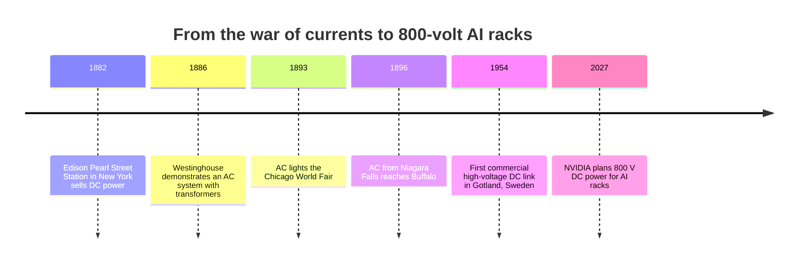
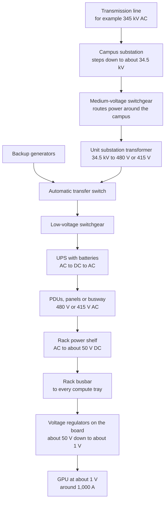
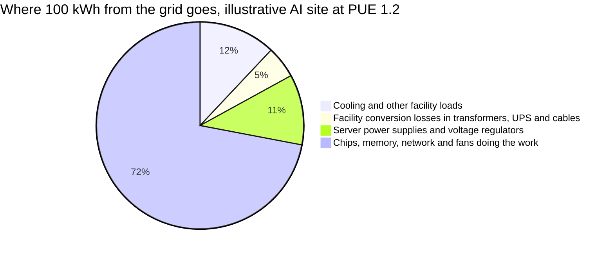
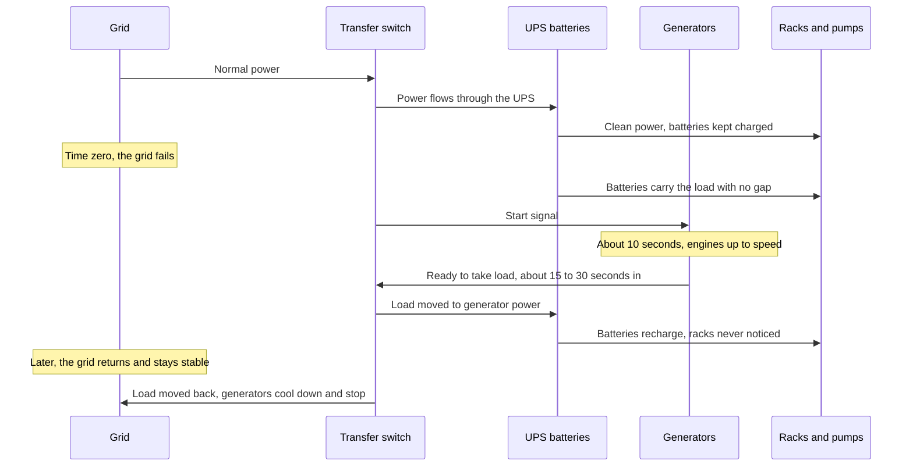
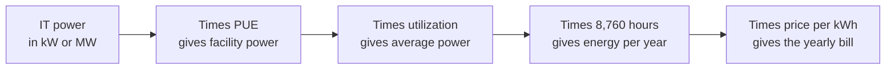

# Chapter 39: Power: From the Grid to the GPU

*How electricity travels from a 345,000-volt transmission line to the roughly one volt a GPU runs on, what is lost along the way, what keeps the lights on when the grid fails, and how to calculate the power and electricity bill of anything from one GPU to a 100 MW campus.*

## What you'll learn

- The difference between power (watts) and energy (watt-hours), and how to move up and down the ladder of scale from a phone charger to a 5 GW campus
- Why a "1 GW data center" does not use 1 GW all the time, and how to turn capacity into yearly energy and homes' worth of electricity
- Electricity basics at the level you need: voltage, current, resistance, P = V × I, why wires waste power as heat, AC versus DC, transformers and three-phase power
- The full power chain inside an AI campus, step by step, from transmission line to substation, switchgear, UPS, busway, rack power shelf and voltage regulators to the chip
- Where energy is lost at each step, and what PUE does and does not tell you
- How backup power works (UPS, batteries, generators, transfer switches, fuel and air permits) and why synchronized GPUs make the power draw jump
- Why NVIDIA and partners are moving to 800-volt DC and solid-state transformers
- Worked calculations for one GPU, one rack, one 100,000-GPU cluster and the yearly electricity bill of a 100 MW site

## Before you start

Chapter 2 (How Computers Work) introduced the idea that chips turn electricity into heat, and Chapter 6 (The Math of AI, Part 2) explained logarithmic scales, which we use to compare things a billion times apart. Chapter 34 (Wiring Thousands of Chips Together) showed why a 1,000-watt GPU needs about 1,000 amps at its pins and previewed 800-volt DC racks. Chapter 38 (Inside a Data Center) walked you past the substation yard, the generator yard and the electrical rooms; this chapter goes inside them. Heat and cooling, including the full story of PUE, are Chapter 40. Where the electricity comes from (grids, gas, nuclear, renewables) and who pays for it are Chapter 41.

## Why power comes first

Ask anyone building AI data centers in 2026 what limits them, and the most common answer is not chips or money. It is power: how many megawatts they can get, where, and how soon. The industry even has a slogan for it, "speed to power". The property firm JLL says the average wait for a new grid connection in primary US data center markets now exceeds four years, which is why operators are turning to on-site gas, batteries and other workarounds (Chapter 41). When Microsoft reported its results for the quarter ending June 2026, its CEO highlighted that the company had "added another gigawatt of capacity this quarter", a sentence that would have sounded like science fiction for a software company a few years ago.

So to understand AI infrastructure you need to be fluent in power. The good news: the physics you need fits in one chapter, and the arithmetic is multiplication and division.

> **Key idea:** In AI, electricity is the master constraint. The number of GPUs a company can run is set by the megawatts it can deliver to them and the heat it can carry away, and every step from the grid to the chip is engineered around that.

## Power versus energy

The single most common mistake in news stories about AI and electricity is mixing up power and energy. They are as different as speed and distance.

> **Definition — Watt (W):** The unit of power, meaning the *rate* at which energy is used or delivered. One watt is one joule of energy per second. A phone charger uses about 20 W while charging; an LED bulb about 10 W.

> **Definition — Kilowatt (kW):** 1,000 watts. A microwave oven uses about 1 kW while running; an average US home draws about 1.2 kW averaged over a year.

> **Definition — Megawatt (MW) and gigawatt (GW):** A megawatt is 1,000 kW (a million watts), very roughly the average draw of 800 US homes. A gigawatt is 1,000 MW, about the output of one large nuclear reactor. AI campuses in 2026 are measured in gigawatts.

Power tells you how hard something is working *right now*. Energy tells you how much work was done over time. You get energy by multiplying power by time.

> **Definition — Watt-hour (Wh):** A unit of energy: the amount used by something drawing one watt for one hour. A 10 W LED bulb left on for 10 hours uses 100 Wh.

> **Definition — Kilowatt-hour (kWh):** 1,000 watt-hours, the unit on your electricity bill. US households paid on average about 17.3 cents per kWh in 2025 and about 18.2 cents in 2026, according to the US Energy Information Administration.

> **Definition — MWh, GWh and TWh:** A megawatt-hour is 1,000 kWh, the unit wholesale electricity is priced in. A gigawatt-hour is a million kWh, and a terawatt-hour is a billion kWh, the unit used for whole countries and for global data center consumption.

> **Analogy:** Watts are like the speedometer of a car; watt-hours are like the odometer. "1 GW for a year" is like "60 miles per hour for an hour": a rate multiplied by a time gives an amount.

**Worked example: the light bulb and your chatbot.** A 10 W LED bulb on for 10 hours uses 10 × 10 = 100 Wh, or 0.1 kWh, which costs under 2 cents at household prices. Now your chatbot. Google reported that the median text prompt to its Gemini apps (May 2025) used about 0.24 Wh. OpenAI's CEO wrote in June 2025 that an average ChatGPT query uses about 0.34 Wh, and Epoch AI independently estimated about 0.3 Wh for a typical GPT-4o query. How long would the 10 W bulb take to use 0.3 Wh?

`time = energy ÷ power = 0.3 Wh ÷ 10 W = 0.03 hours ≈ 108 seconds`

So a typical text prompt uses about as much energy as an LED bulb left on for a minute or two. That is small. But Epoch also estimated that a query with a 100,000-token input (for example, pasting a long book) could take around 40 Wh, more than a hundred times as much, and reasoning models and agents that run for hours use far more. Totals matter too: billions of queries a day add up.

| Unit | Equals | Everyday example |
|---|---|---|
| 1 Wh | one watt for one hour | about three typical chatbot prompts |
| 1 kWh | 1,000 Wh | running a 1 kW microwave for an hour |
| 1 MWh | 1,000 kWh | about five weeks of an average US home's electricity |
| 1 GWh | 1,000 MWh | one 130 kW AI rack running for most of a year at full power, including cooling |
| 1 TWh | 1,000 GWh | a 1 GW campus running flat out for about 42 days |

*Table 39.1: Energy units from watt-hours to terawatt-hours. Each step is 1,000 times the one before.*

> **Try it:** Find the label on three devices at home (a phone charger, a microwave, a TV). Write down the watts. Multiply each by the hours you use it per day to get watt-hours, divide by 1,000 for kWh, and multiply by your electricity price. Then ask your chatbot to check your arithmetic and to tell you which device dominates your bill.

## The ladder of scale

AI infrastructure spans an enormous range, from a 10-watt bulb to a 5-gigawatt campus: a factor of 500 million. A normal ruler cannot show both ends, so engineers use a logarithmic scale, where each step up is ten times the one below.

> **Definition — Logarithmic scale:** A scale where equal steps represent equal *multiplications* (for example ×10) rather than equal additions. It lets one picture show things that differ by factors of millions (see Chapter 6).

```
 POWER RANGE    WHAT LIVES THERE (each row is 10x the row below)
 1-10 GW      | large nuclear reactor ~1 GW, Abilene 1.2 GW,
              | Ireland's average demand roughly 3-4 GW,
              | Meta Hyperion target 5 GW
 100-1000 MW  | Colossus 1 ~150 MW, 100,000-GPU cluster ~200 MW
 10-100 MW    | one large AI data hall, 30-50 MW
 1-10 MW      | small enterprise data center, 1 MW rack designs
 100-1000 kW  | NVL72 rack ~130 kW, Kyber rack ~600 kW (2027)
 10-100 kW    | Hopper-era AI racks, tens of kW
 1-10 kW      | home average 1.2 kW, hair dryer 1.5 kW,
              | H100 all-in ~1.4 kW, Blackwell chip ~1 kW+,
              | 2015 enterprise rack 5-10 kW
 100-1000 W   | H100 chip 700 W
 10-100 W     | LED bulb 10 W, phone charger 20 W, laptop 60 W
```

*Figure 39.1: The ladder of power on a logarithmic scale. Nine rows cover a factor of a billion, from a light bulb to a gigawatt campus.*

Three comparisons from this ladder are worth memorizing:

- **One AI GPU with its share of the building (about 1.5–2 kW) draws more than an average US home (about 1.2 kW).**
- **One NVL72 rack (about 130 kW) draws as much as about 100 homes.**
- **One gigawatt campus draws as much as a city of roughly 800,000 homes.**

## Capacity versus consumption

When you read "a 1 GW data center", that number is a *maximum*, not what it uses every hour.

> **Definition — Nameplate capacity:** The maximum power a power plant can produce, or a facility can draw, as designed. It is a ceiling, not an average.

> **Definition — Capacity factor (utilization, load factor):** Actual average output or use divided by the maximum. A data center that averages 70% of its capacity has a load factor of 70%.

> **Definition — Load:** Anything that consumes electricity, from a light bulb to a data center. Data centers are called "large loads" by utilities.

> **Definition — Peak demand:** The highest power draw over a period, such as a year. Grids and data centers must be built for the peak, not the average.

Data center people add two more terms, because a building uses power for things other than computers.

> **Definition — IT load:** The power used by the computing equipment itself (servers, storage and network gear), as opposed to cooling, lighting and losses in the building's electrical system.

> **Definition — Critical IT capacity:** The amount of IT load a facility is designed to support with full backup power. Data centers are usually quoted this way, for example "100 MW critical", which means the whole site draws more than 100 MW once cooling and losses are added.

**Worked example: a gigawatt for a year.** A year has 365 × 24 = 8,760 hours. If a 1 GW campus ran flat out all year:

`1 GW × 8,760 h = 8,760 GWh = 8.76 TWh`

An average US home uses about 10,500 kWh per year (about 1.2 kW on average). So:

`8,760,000,000 kWh ÷ 10,500 kWh per home ≈ 834,000 homes`

Real sites do not run flat out. Epoch AI notes that large AI sites typically consume 60–80% of their capacity on average. At 70%, the same campus uses about 6.1 TWh a year, the annual electricity of about 580,000 homes.

For perspective on the totals: the International Energy Agency estimated that all the world's data centers (AI and non-AI) used about 415 TWh in 2024, roughly 1.5% of global electricity, and projected about 945 TWh by 2030 in its base case. Lawrence Berkeley National Laboratory estimated US data centers used about 176 TWh in 2023, about 4.4% of US electricity. The concern is less the global share than local concentration: in Ireland, data centres used 22% of all metered electricity in 2024, up from 5% in 2015. Chapter 41 covers these forecasts and why they disagree.

> **Watch out:** "A 1 GW data center uses 1 GW all the time" is wrong. Gigawatts are a capacity, a rate ceiling. Energy per year is capacity × hours × load factor. When you see a claim that compares a data center's gigawatts with a country's terawatt-hours, check that the units match before you believe the comparison.

> **Key idea:** Power (W) tells you what equipment you must build; energy (Wh) tells you what you pay for and what the grid must generate. Builders worry about peak power; accountants and climate analysts worry about energy.

## Electricity in ten minutes

To follow electricity through a data center you need only a handful of ideas. The classic picture is water in pipes.

### Voltage, current and resistance

> **Definition — Voltage (V):** Electrical "pressure" that pushes charge through a circuit, measured in volts. US homes use 120 V and 240 V; transmission lines run at 69,000 to 765,000 V; a GPU's transistors run at about 1 V.

> **Definition — Current (A):** The flow of electric charge, measured in amperes (amps). More current needs thicker copper and wastes more energy as heat in the wires.

> **Definition — Resistance (Ω):** How strongly a material opposes the flow of current, measured in ohms. Copper has low resistance, which is why wires are made of it, but even copper has some.

> **Definition — Ohm's law:** The rule that voltage equals current times resistance (V = I × R). For a fixed resistance, pushing harder (more volts) makes more current flow.

> **Analogy:** Voltage is water pressure, current is the flow rate, a wire is a pipe, and resistance is friction in the pipe. A thin pipe (high resistance) needs more pressure to push the same flow. Power is pressure times flow: a fire hose at high pressure delivers far more than a garden hose at low pressure.

### Power equals voltage times current

The most useful formula in this chapter is:

`power (watts) = voltage (volts) × current (amps)`, written P = V × I

A US toaster on a 120 V outlet drawing 10 A uses 120 × 10 = 1,200 W. The same formula run backwards tells you how much current something needs: current = power ÷ voltage. A 1,000 W GPU running at about 1 V needs about 1,000 ÷ 1 = 1,000 amps, five to ten times what an entire house's main breaker is rated for.

### Why wires get hot

Current flowing through resistance turns some energy into heat. The loss grows with the *square* of the current:

> **Definition — Resistive loss (I²R loss):** The power wasted as heat when current flows through a conductor, equal to current squared times resistance (P = I² × R). Doubling the current quadruples the loss.

That square is why the whole grid, and the whole power chain in a data center, is designed around one trick: **to move a lot of power, raise the voltage so you can lower the current.** The power is the same (P = V × I), but the losses fall with the square of the current.

**Worked example: sending 100 MW down a line.** Suppose a line has a total resistance of 5 ohms (an illustrative number) and you want to deliver 100 MW. Using a simplified single-circuit picture:

- At 345,000 V: current = 100,000,000 ÷ 345,000 ≈ 290 A. Loss = 290² × 5 ≈ 420,000 W, about 0.4% of the power.
- At 34,500 V: current ≈ 2,900 A. Loss = 2,900² × 5 ≈ 42,000,000 W, about 42% of the power.

Ten times the voltage means one-tenth the current and one-hundredth the loss. This is why power travels long distances at hundreds of thousands of volts and is stepped down only near where it is used.

> **Key idea:** High voltage is for moving power; low voltage is for using it. Every step of the power chain is a trade between the two, and each conversion is placed as close to the load as possible.

### AC, DC and the war of currents

> **Definition — Direct current (DC):** Electricity that flows steadily in one direction. Batteries, solar panels and the inside of every chip use DC.

> **Definition — Alternating current (AC):** Electricity that reverses direction many times a second, following a smooth wave. The grid uses AC because transformers can change its voltage easily.

> **Definition — Frequency (Hz):** How many times per second alternating current completes a full cycle: 60 hertz in North America, 50 hertz in Europe and most of the world. Every generator on a grid must spin in step at that frequency.

In the 1880s Thomas Edison built city power systems on DC. George Westinghouse, using transformer technology and Nikola Tesla's AC motor patents, backed AC. AC won the "war of currents" for one reason: transformers. With AC you could raise the voltage for long-distance transmission and lower it again for homes, cutting losses exactly as in the worked example above. With 1880s technology, DC could not be stepped up or down efficiently, so DC plants had to sit within a mile or two of their customers.



*Figure 39.2: AC won the grid because of transformers. Modern power electronics have brought DC back for special jobs, from undersea links to the inside of AI racks.*

> **Definition — Transformer:** A device with two or more coils of wire wound around an iron core that changes the voltage of AC electricity with no moving parts. The ratio of turns in the coils sets the ratio of voltages: a 10-to-1 transformer turns 345,000 V into 34,500 V.

> **Analogy:** A transformer is a gearbox for electricity. A bicycle's gears trade pedal speed for force; a transformer trades voltage for current, keeping the power (minus a little loss) the same.

### Three-phase power

Big electrical equipment does not use one AC wave but three, timed a third of a cycle apart.

> **Definition — Three-phase power:** A way of delivering AC on three wires whose waves are offset by a third of a cycle each, so that the total power flow never dips to zero. It delivers more power per wire and runs motors smoothly, so grids and data centers use it for anything large.

> **Analogy:** Three-phase power is like three people pedaling a bicycle in turn, each pushing at a different moment, so the wheel always gets a push. Single-phase is one person pedaling with pauses at the top and bottom of each stroke.

For three-phase circuits the current formula gains a factor of about 1.73 (the square root of 3): current per wire = power ÷ (1.73 × voltage). You do not need to know why to use it.

### Converting between AC and DC

Because the grid is AC and chips are DC, every data center is full of conversion equipment.

> **Definition — Rectifier, inverter and PSU:** A rectifier converts AC into DC; an inverter converts DC into AC. A power supply unit (PSU) is the box in a server or rack that converts the building's AC into the low-voltage DC that electronics use.

> **Definition — Power factor and harmonics:** Measures of how cleanly a load draws AC power. Large banks of power electronics can draw current in distorted pulses (harmonics) or out of step with the voltage (poor power factor), which wastes capacity and can disturb the grid, so data center equipment includes correction circuits.

> **Definition — High, medium and low voltage (HV, MV, LV):** Rough bands used by power engineers. High voltage is above about 69 kV (transmission lines); medium voltage is about 1 to 35 kV (campus distribution); low voltage is below 1 kV (inside buildings, for example 480 V or 415 V).

## The power chain, step by step

Now follow the electricity. This is the core of the chapter: the path from a transmission line on a steel tower to a transistor a few nanometers wide. Here it is in one picture; the subsections walk through each box.



*Figure 39.3: The power chain of a 2026 AI data center, from the grid to the chip. Voltages are typical examples; exact values differ by country and design. On big campuses, generators often connect at medium voltage instead.*

> **Analogy:** The power chain is a river delta. A mighty river (the transmission line) splits into canals (medium-voltage cables), then streets (low-voltage feeders), then garden hoses (rack power), and finally a drip line to each plant (each chip). At every split the flow gets smaller and gentler.

> **Definition — Single-line diagram (one-line):** The engineering map of how power flows through a site, drawn with a single line for each circuit and standard symbols for transformers, breakers and switches. It is the first drawing an electrical engineer asks for.

### Step 1: the transmission line and the interconnection

Electricity arrives on a high-voltage transmission line, typically somewhere between 69,000 and 765,000 volts; 345 kV is a common value for large loads. The physical and legal link between the campus and the grid is a project in itself.

> **Definition — Utility interconnection:** The physical connection between a site and the grid, plus the contracts and engineering studies that allow it. For large data centers, getting one can take years (Chapter 41).

### Step 2: the substation

In the substation yard you saw in Chapter 38, large power transformers step the voltage down, for example from 345 kV to 34.5 kV. A big campus builds its own substation, often with several transformers and two or more incoming lines, so that losing one does not cut power.

> **Definition — Substation:** A fenced yard of transformers, breakers and switches that steps transmission voltage down to medium voltage and routes it onward. Large AI campuses build their own.

These transformers are among the hardest things to buy in the AI build-out. They are large, custom-built, made by a limited number of factories, and lead times of two to four years are often quoted. Chapter 42 covers the supply crunch.

### Step 3: medium-voltage switchgear and campus distribution

From the substation, power enters medium-voltage switchgear: rows of steel cabinets holding breakers that can route power to different buildings or cut it off instantly if something goes wrong. Underground medium-voltage cables then carry it across the campus. Microsoft says its first Fairwater site used 120 miles of such cable.

> **Definition — Switchgear:** Rows of cabinets containing circuit breakers, switches and protective relays that route power and disconnect it safely during faults or maintenance. It comes in medium- and low-voltage versions and is a long-lead item.

> **Definition — Circuit breaker:** An automatic switch that opens a circuit when the current becomes dangerously high, for example during a short circuit, and can be reset afterwards.

### Step 4: the unit substation

Next to each building or electrical room, smaller transformers step medium voltage down to low voltage, typically 480 V in the United States or 415 V in many other places and newer designs.

> **Definition — Unit substation:** A compact package of a medium-voltage switch, a transformer and low-voltage switchgear, placed next to or inside a building to convert campus medium voltage (for example 34.5 kV or 13.8 kV) into low voltage (480 V or 415 V).

### Step 5: low-voltage switchgear and the transfer switch

Low-voltage switchgear divides the power into feeders. This is also a common place where backup generators join the system, through automatic transfer switches that choose between utility and generator power. We will come back to them in the backup section.

### Step 6: the UPS

Before power reaches the computers it usually passes through an uninterruptible power supply. The classic "double-conversion" UPS turns AC into DC (charging its batteries along the way), then turns DC back into perfectly clean AC. If the grid flickers, the batteries keep feeding the inverter without a gap.

> **Definition — UPS (uninterruptible power supply):** Equipment with batteries (or a spinning flywheel) that keeps IT equipment running for seconds to minutes when grid power fails or flickers, until generators take over. A double-conversion UPS also cleans up the power by converting AC to DC and back.

### Step 7: PDUs, panels and busways

From the UPS, power is distributed to rows of racks, either through power distribution units and breaker panels with cables, or through overhead busways that racks plug into (Chapter 38).

> **Definition — PDU (power distribution unit):** Equipment that splits power into many circuits for racks. It can be a large floor cabinet, sometimes with its own transformer, or a power strip inside a rack.

> **Definition — RPP (remote power panel):** A cabinet of circuit breakers placed near the racks and fed by a PDU, giving each rack its own protected circuit.

### Step 8: the rack power shelf

Inside an AI rack, power shelves full of power supply units convert 415 V or 480 V AC into DC at roughly 50 volts (48–54 V designs are common).

> **Definition — Rack power shelf:** A tray of power supply units in an AI rack that converts the building's AC power into about 50 V DC for the servers, sometimes with small batteries or capacitors built in to ride through brief glitches.

> **Definition — Busbar:** A thick, rigid bar of copper or aluminum that carries large currents. In an AI rack, a DC busbar runs down the back and feeds every compute tray.

### Step 9: voltage regulators and the chip

The last step happens on the circuit board, millimeters from the chip. Voltage regulator modules convert about 50 V DC to the roughly 1 V (often less) that the transistors run on, sometimes in two stages with an intermediate voltage.

> **Definition — Voltage regulator module (VRM):** Small power converters placed right beside a chip that turn board power (about 48–54 V DC) into the roughly 1 V the transistors need, delivering hundreds to over a thousand amps over a very short distance.

Why do chips run at such a low voltage? A chip's power use rises with the *square* of its voltage, so every tenth of a volt saved cuts power and heat sharply. Modern transistors are designed to switch reliably at around 1 V or below. The price is enormous current, which is why that final conversion must happen right next to the chip.

### The current ladder

Watch what happens to current as voltage falls. Take a facility drawing 120 MW (100 MW of IT plus cooling and losses) and one 130 kW rack inside it.

| Point in the chain | Voltage | Current (approximate) |
|---|---|---|
| Transmission line, whole site | 345 kV three-phase | 120 MW ÷ (1.73 × 345,000) ≈ 200 A per wire |
| Campus distribution, whole site | 34.5 kV three-phase | about 2,000 A in total, split among many feeders |
| Low-voltage, whole site | 480 V three-phase | about 144,000 A in total, split among hundreds of feeders |
| One rack's AC feed | 415 V three-phase | 130 kW ÷ (1.73 × 415) ≈ 180 A |
| One rack's DC busbar | 54 V DC | 130,000 ÷ 54 ≈ 2,400 A |
| One GPU | about 1 V DC | about 1,000 A |

*Table 39.2: The current ladder. As voltage steps down, current steps up, so conductors get thicker and shorter at every stage.*

A single GPU at the bottom of the chain carries five times as much current as the transmission line that feeds the entire 120 MW site. The difference is that the GPU's current travels a few millimeters through massive copper planes, while the line's current travels kilometers.

## What gets lost along the way

Each conversion wastes a little energy as heat. No single step is very wasteful, but they multiply.

> **Definition — Conversion efficiency:** The share of the power going into a piece of equipment that comes out as useful power, the rest becoming heat. A 97% efficient power supply turns 100 W in into 97 W out and 3 W of heat.

The table below gives typical efficiency ranges from general engineering practice. Real equipment varies with model, age and how heavily it is loaded, so use these to reason, not to quote.

| Step | Typical efficiency (illustrative range) | Mid value used below |
|---|---|---|
| Substation transformer (HV to MV) | 99–99.7% | 99.5% |
| MV switchgear and campus cables | 99–99.8% | 99.5% |
| Unit substation transformer (MV to LV) | 98.5–99.3% | 99% |
| Double-conversion UPS | 94–97.5% (higher in "eco" bypass modes) | 96% |
| PDUs, panels or busway | 99–99.8% | 99.5% |
| Rack power shelf (AC to about 50 V DC) | 95–97.5% | 96% |
| Rack busbar and tray wiring | 99–99.8% | 99.5% |
| Voltage regulators (about 50 V to about 1 V) | 85–93% | 90% |

*Table 39.3: Typical efficiencies along the power chain. The two biggest losses are the double conversion in the UPS and the final step down to 1 V.*

**Worked example: how much reaches the chip?** Multiply the mid values:

`0.995 × 0.995 × 0.99 × 0.96 × 0.995 × 0.96 × 0.995 × 0.90 ≈ 0.80`

Roughly 80% of the electricity entering the site's power chain reaches the chips, memory and other components as useful power; using the low and high ends of the ranges gives roughly 72% to 87%. The rest becomes heat in transformers, UPS systems, power supplies and regulators, and that heat must be removed by the cooling system too. This is why NVIDIA's claim that 800 V DC can improve end-to-end efficiency by up to 5% (later in this chapter) is a big deal: at gigawatt scale, 5% is tens of megawatts.

### PUE: the building's overhead in one number

The power chain is only part of the overhead. The cooling system uses a lot of electricity too. The industry sums up a building's overhead in one ratio.

> **Definition — PUE (power usage effectiveness):** Total facility energy divided by the energy delivered to IT equipment. A PUE of 1.0 would mean zero overhead; 1.2 means 20% extra for cooling, power losses and lighting. The industry average has hovered around 1.5–1.6, and leading hyperscale sites run about 1.1.

Google reports a fleet-wide PUE of about 1.09 against an industry average around 1.56. Chapter 40 explains how cooling choices drive PUE and what it hides; for this chapter you need only the multiplication: **facility power = IT power × PUE.**

Here is where 100 kWh drawn from the grid goes in an illustrative AI site with a PUE of 1.2, combining the PUE with the losses inside the servers.



*Figure 39.4: An illustrative split of 100 kWh. PUE 1.2 means about 100 ÷ 1.2 ≈ 83 kWh reaches the IT equipment, but losses inside the servers' own power supplies and regulators still count as "IT".*

> **Watch out:** PUE does not count losses inside the servers. The power supplies in the rack and the voltage regulators beside each chip are classed as IT equipment, so their roughly 10–15% of losses look like "useful IT load". Two sites with the same PUE can deliver quite different amounts of power to the actual silicon.

> **Key idea:** In the end, essentially every watt-hour that enters a data center leaves it as heat: the conversion losses immediately, and the chips' work a moment later. Power and cooling are two halves of the same problem, which is why Chapter 40 follows this one.

## Keeping the power on: backup systems

Grids fail. Lightning strikes a line, a storm downs a pole, a breaker trips somewhere upstream. For most buildings a blackout is an inconvenience. For a data center, even a 20-millisecond flicker can crash thousands of servers. So every serious data center has layers of backup, each covering a different stretch of time.

> **Definition — Battery energy storage system (BESS):** A large bank of batteries, usually lithium-ion, with its own power electronics, used for backup, to smooth sudden swings in power use, or to store cheap energy for later.

> **Definition — Backup generator:** An engine-driven generator, usually diesel and sometimes natural gas, that powers a site during a grid outage. Data center units are typically 2 to 3 megawatts or more each, and a large site has dozens to hundreds.

> **Definition — Automatic transfer switch (ATS):** A switch that senses when utility power fails, signals the generators to start, moves the load onto generator power once they are ready, and moves it back when the grid returns, all without human action.

Here is what happens, second by second, when the grid fails.



*Figure 39.5: The outage timeline. The UPS bridges the 10 to 30 seconds it takes generators to start and take the load; the transfer switch does the handoffs automatically.*

> **Analogy:** A car's battery starts the engine, and then the engine runs the car. In a data center, the UPS batteries keep the lights on for the seconds it takes the generator "engine" to start, and then the generators run the site until the grid comes back.

A few practical details matter:

- **Batteries.** UPS batteries used to be lead-acid; lithium-ion has largely taken over in new builds because it is smaller, lighter and lasts longer. Typical UPS runtime is a few minutes at full load, far more than the 10–30 seconds needed, as a safety margin. Some designs use spinning flywheels instead of batteries, giving tens of seconds of ride-through.
- **Generators.** Each unit is a large engine, often in its own container with a fuel tank, sound-proofing and exhaust stack. Big sites keep 24 to 48 hours of fuel on site and contracts for fuel trucks beyond that. Generators are started regularly for tests and run against load banks during commissioning.
- **Cooling must ride through too.** In an air-cooled hall, rooms warm slowly. In a liquid-cooled AI hall, a 1,000 W chip with no coolant flowing overheats very quickly, so coolant pumps and CDUs are put on UPS power alongside the racks.
- **Air permits.** Diesel generators emit nitrogen oxides and particulates, so air-quality permits usually cap how many hours per year they may run. That is why backup generators cannot simply run the site whenever the grid is short.

> **Watch out:** "Data centers can just switch to their generators when the grid is stressed" is mostly wrong. Air permits limit generator hours, and big diesel fleets are meant for emergencies. Some grid rules are changing: Texas's 2025 law SB 6 lets the grid operator require very large loads to cut back or switch to backup power during grid emergencies (Chapter 41).

**Worked example: backing up a 100 MW site.** Take a site with 100 MW of IT load and a PUE of 1.2, so about 120 MW at peak.

- **Generators:** with 3 MW units, carrying 120 MW needs 120 ÷ 3 = 40 generators (N). Real designs split the site into blocks, each with its own spare, so a design of eight 15 MW blocks with five generators plus one spare each needs 48 units.
- **UPS batteries:** to carry the 100 MW IT load (plus, say, 20 MW of critical pumps) for 5 minutes: 120 MW × 5/60 hour = 10 MWh of battery.
- **Fuel:** large diesel generators burn very roughly a quarter of a liter of diesel per kWh produced (about 0.27 L/kWh). For 48 hours at 120 MW: 120,000 kW × 48 h × 0.27 L/kWh ≈ 1.6 million liters, about 410,000 US gallons, on the order of 50 tanker-truck loads.

> **At the frontier (2026):** Backup and primary power are starting to blur. While waiting for grid power at its first Colossus site, xAI reportedly ran temporary gas turbines alongside Tesla Megapack batteries, and several 2026 megaprojects plan on-site gas "microgrids" that act as the main supply rather than an emergency spare. Chapter 41 covers these behind-the-meter designs and the permitting fights they have caused.

> **Key idea:** Backup power is layered by time: capacitors and batteries for milliseconds to minutes, generators for hours to days, and the grid (or a second grid feed) for everything else. Each layer only has to last long enough for the next to take over.

## Power that jumps: GPU spikes and smoothing

Ordinary data centers draw power fairly steadily: thousands of unrelated customers' jobs average out. AI training does not average out. In a large training run, thousands of GPUs compute together, then pause together to exchange results, then compute again, in lockstep. Their power draw rises and falls together.

> **Definition — Load oscillation (power swing):** A repeated rise and fall in a site's power draw, caused here by thousands of GPUs speeding up and slowing down in step. At large AI sites the swing can reach tens of megawatts within seconds.

> **Definition — Ramp rate:** How fast a load or generator changes its power, for example megawatts per second. Grids are designed for loads that ramp slowly; very fast ramps are harder to follow.

```
 site power (MW), illustrative training cluster
 100 |  ____      ____      ____      ____
     | |    |    |    |    |    |    |    |
  90 | |    |    |    |    |    |    |    |
     | |    |    |    |    |    |    |    |
  80 | |    |    |    |    |    |    |    |
     | |    |____|    |____|    |____|    |____
  70 |_|
     +-------------------------------------------> time
       compute sync compute sync compute sync
```

*Figure 39.6: An illustrative training cluster's power over a few seconds. When every GPU computes, power is high; when they all pause to synchronize, it drops; then it jumps back.*

This is not hypothetical. In its paper on training Llama 3 on 16,384 H100s, Meta reported that synchronized GPU activity caused power swings of tens of megawatts across the data center, stretching the limits of the power grid. Scale it up: if each of 100,000 GPUs swings by roughly 600 W between computing and waiting, that is 100,000 × 0.6 kW = 60 MW appearing and disappearing in a fraction of a second, again and again.

Why does the grid care? Large power plants are spinning machines. A sudden 60 MW change pushes against them, nudging the grid's frequency and, if the swings repeat at the wrong rhythm, setting up vibrations in generators and stresses in equipment. Grid operators prefer loads that change slowly.

Engineers attack the problem at several levels at once:

> **Definition — Capacitor and supercapacitor:** Components that store a small amount of electrical energy and can release or absorb it extremely fast. Placed near AI racks, they soak up millisecond-scale spikes so the building does not see them.

- **Capacitors near the racks** absorb the fastest, millisecond-scale spikes.
- **Facility batteries** handle swings lasting seconds to minutes, and also provide the generator ride-through described earlier. NVIDIA describes exactly this two-level storage approach for its future racks.
- **Software** can make the GPUs themselves gentler: ramping power up and down gradually rather than instantly, or keeping a floor under the power draw so it never collapses all at once during synchronization pauses.

The goal of all three is the same: whatever the GPUs do inside, the grid should see a steady, predictable load. Standards for how much a data center may swing are still being written, and this is one of the open problems of 2026.

## New power architectures: 800 V DC and solid-state transformers

Look back at the current ladder (Table 39.2). A 130 kW rack fed at 54 V DC already needs about 2,400 A. Now apply the roadmap from Chapter 38: NVIDIA's Kyber racks planned for 2027 at around 600 kW, and designs for more than 1 MW per rack.

- At 54 V, a 1 MW rack needs 1,000,000 ÷ 54 ≈ 18,500 A. NVIDIA says the copper busbar for such a rack could weigh about 200 kg.
- At 800 V, the same rack needs 1,000,000 ÷ 800 = 1,250 A.

That is the logic of the war of currents again, inside a single cabinet: raise the voltage, cut the current, save copper and losses. NVIDIA and its partners have announced an 800-volt DC architecture, to enter production alongside the Kyber racks in 2027.

> **Definition — 800 V DC distribution:** NVIDIA's announced power architecture for 2027-era AI racks, which sends 800-volt direct current to the rack instead of AC. NVIDIA says it carries 85% more power through the same conductor than 415 V AC, cuts copper use by about 45%, improves end-to-end efficiency by up to 5% and allows racks of around 1 MW.

It also removes conversion steps. Today, power is converted from AC to DC and back in the UPS, then from AC to DC again in the rack power shelf, then down to 1 V. In the 800 V design, medium-voltage AC is converted to 800 V DC once, at the edge of the facility; storage can sit directly on the DC bus; and compact converters in the rack step 800 V down toward the chip.

```mermaid
flowchart TD
  subgraph TODAY["Today: AC all the way to the rack"]
    T1["Medium-voltage AC"] --> T2["Transformer to 415 V or 480 V AC"]
    T2 --> T3["UPS: AC to DC and back to AC"]
    T3 --> T4["PDU or busway, still AC"]
    T4 --> T5["Rack power shelf: AC to 54 V DC"]
    T5 --> T6["Voltage regulators to about 1 V"]
  end
  subgraph FUTURE["2027 plan: 800 V DC to the rack"]
    F1["Medium-voltage AC"] --> F2["Solid-state transformer or rectifier<br/>straight to 800 V DC"]
    F2 --> F3["800 V DC distribution<br/>batteries on the DC bus"]
    F3 --> F4["DC-to-DC converters in the rack"]
    F4 --> F5["Voltage regulators to about 1 V"]
  end
```



*Figure 39.7: Today's AC chain compared with NVIDIA's planned 800 V DC chain. Fewer conversions mean fewer losses and less copper.*

> **Definition — Solid-state transformer (SST):** A transformer built from power electronics (fast semiconductor switches and a small high-frequency transformer) instead of a large iron core and copper coils. It can be smaller, controllable by software, and able to output DC directly. NVIDIA and partners are evaluating SSTs for AI data centers.

There are real challenges. DC at 800 V is dangerous in a specific way: AC current passes through zero a hundred or more times a second, which helps a breaker extinguish the arc when it opens a circuit, while DC never passes through zero, so DC breakers and connectors must be designed differently. Technicians need new training and safety rules. Equipment makers need new product lines. That is why the transition is planned years ahead and involves a whole ecosystem of partners.

> **At the frontier (2026):** NVIDIA says it is designing for racks of more than 1 MW, with 800 V DC distribution in production alongside its Kyber racks in 2027, and is working with power-equipment partners on the ecosystem: 800 V power shelves, DC busways, solid-state transformers, and energy storage placed at two levels (capacitors near racks for millisecond spikes, facility batteries for seconds-to-minutes swings and generator ride-through). After more than a century of AC dominance, the inside of the AI data center is turning back to DC.

## Worked examples: from one GPU to a 100 MW campus

Now put it all together. Every calculation below uses the same four assumptions, which you can change in the exercises.

| Assumption | Value used | Why |
|---|---|---|
| Hours per year | 8,760 | 365 × 24 |
| PUE | 1.2 | a modern liquid-cooled AI site; leading sites are about 1.1, the industry average about 1.5–1.6 |
| Electricity price | 7 cents per kWh | an illustrative large-customer price; real contracts vary widely by region and deal |
| Average US home | 10,500 kWh per year (about 1.2 kW) | for "homes' worth" comparisons |

*Table 39.4: Assumptions for the worked examples. Big industrial customers usually pay much less per kWh than households (about 18.2 cents in 2026, per the EIA), because they buy at high voltage, in huge and steady amounts.*

The recipe is always the same chain of multiplications:



*Figure 39.8: The electricity-bill recipe. Power becomes energy when you multiply by time, and energy becomes money when you multiply by price.*

### Example 1: one GPU

**An H100.** The chip is rated at 700 W. With its share of the server (CPUs, memory, network cards, fans), the network and the building's cooling and losses, Epoch AI uses about 1,500 W per H100. Running all year:

- Energy: 1.5 kW × 8,760 h = 13,140 kWh ≈ 13.1 MWh
- Cost: 13,140 × $0.07 ≈ $920 per year
- Homes' worth: 13,140 ÷ 10,500 ≈ 1.25 homes

**A Blackwell GPU in an NVL72 rack.** The rack draws about 130 kW for 72 GPUs, so each GPU "slot" (including its share of the CPUs, NVLink switches, fans and power shelves in the rack) is about 130 ÷ 72 ≈ 1.8 kW of IT power. With PUE 1.2: 1.8 × 1.2 ≈ 2.16 kW at the meter.

- Energy: 2.16 kW × 8,760 h ≈ 18,900 kWh ≈ 18.9 MWh
- Cost: 18,900 × $0.07 ≈ $1,320 per year
- Homes' worth: about 1.8 homes
- Current at the chip: about 1,000 A at roughly 1 V

Compare that with what it costs to *rent* such a GPU. On-demand list prices in October 2026 were about $3.99 per hour for an H100 at Lambda and RunPod, which is $3.99 × 8,760 ≈ $35,000 per year, and about $6.69–6.99 per hour for a B200 at Lambda, roughly $59,000–61,000 per year. Electricity is only a few percent of the rental price. Most of what you pay for is the hardware, its rapid depreciation, the building and the provider's margin (Chapter 43).

**A sanity check with your chatbot.** At 2.16 kWh per GPU-hour, and Google's figure of about 0.24 Wh for a median Gemini text prompt (which includes idle machines and overhead), one GPU-hour of energy corresponds to roughly 2,160 ÷ 0.24 ≈ 9,000 median prompts, about 2.5 per second. That is plausible because each GPU group serves many users at once through batching (Chapter 23). Treat this as an order-of-magnitude check, not a measurement: real prompts, models and hardware vary enormously.

### Example 2: one rack

An NVL72-class rack at 130 kW of IT power, running flat out:

- Facility power: 130 × 1.2 = 156 kW
- Energy: 156 kW × 8,760 h ≈ 1,367,000 kWh ≈ 1.37 GWh per year
- Cost: 1,367,000 × $0.07 ≈ $96,000 per year
- Homes' worth: 1,367,000 ÷ 10,500 ≈ 130 homes (about 108 counting only the rack's own 130 kW, without cooling)
- Current: about 180 A per wire on a 415 V three-phase feed, about 2,400 A on the 54 V DC busbar

Such a rack reportedly sells for about $3–4 million. Five years of electricity at this price comes to about $480,000, a meaningful sum, but still well under the cost of the equipment it powers.

### Example 3: a 100,000-GPU cluster

This is roughly the scale of xAI's first Colossus or a large 2025–26 training cluster.

- Racks: 100,000 ÷ 72 ≈ 1,390 NVL72-class racks
- IT power: 1,390 × 130 kW ≈ 180 MW (separate network switch racks and storage would add a few percent more)
- Facility power at PUE 1.2: 180 × 1.2 ≈ 217 MW
- Energy if run flat out for a year: 217 MW × 8,760 h ≈ 1.9 TWh, costing about $133 million
- At a more realistic 80% average load: about 1.52 TWh and $106 million per year, the annual electricity of about 145,000 US homes
- Backup: at 3 MW per generator, about 73 generators just to carry the load, before spares

Two real-world cross-checks show the arithmetic is in the right range. Colossus 1 was reportedly built with about 100,000 H100s and a grid supply upgraded toward about 150 MW, which matches Epoch's 1.5 kW per H100 (100,000 × 1.5 kW = 150 MW). And the first cluster of about 110,000 GB200s at Colossus 2 was reported at about 210 MW, close to 1.9 kW per GPU all-in.

**What does one training run cost in electricity?** Suppose a frontier model trains on this cluster for 90 days at 80% average load:

`217 MW × 0.8 × (90 × 24 h) ≈ 375 GWh, costing about $26 million at 7 cents per kWh`

That is a lot of money, but it is small next to the hardware: 100,000 Blackwell-class GPUs represent billions of dollars of equipment (Chapter 43). Electricity matters most not as a cost but as a *constraint*: you cannot run the cluster at all unless someone delivers 217 MW to one site.

### Example 4: the electricity bill of a 100 MW site for a year

Finally, the calculation everyone in the industry does on the back of an envelope. A site with 100 MW of critical IT capacity:

1. **Facility peak:** 100 MW × PUE 1.2 = 120 MW.
2. **Maximum energy:** 120 MW × 8,760 h = 1,051 GWh, about 1.05 TWh per year.
3. **Realistic energy:** at a 75% average load, within Epoch's typical 60–80% range: 1,051 × 0.75 ≈ 788 GWh per year.
4. **Bill:** 788,000,000 kWh × $0.07 ≈ **$55 million per year**.
5. **Homes' worth:** 788,000,000 ÷ 10,500 ≈ 75,000 US homes' annual electricity.

Because both the price and the load are uncertain, professionals always show a sensitivity table:

| Average load | Energy per year | Bill at 5 cents | Bill at 7 cents | Bill at 10 cents |
|---|---|---|---|---|
| 60% | 631 GWh | $32M | $44M | $63M |
| 75% | 788 GWh | $39M | $55M | $79M |
| 90% | 946 GWh | $47M | $66M | $95M |
| 100% | 1,051 GWh | $53M | $74M | $105M |

*Table 39.5: The yearly electricity bill of a 100 MW (IT) site at PUE 1.2, for different average loads and prices. The same energy billed at the 2026 US household average of 18.2 cents would cost about $143M at 75% load.*

Three lessons hide in that table.

**PUE is worth fighting over.** The same 100 MW of IT at PUE 1.5 instead of 1.1 uses an extra 0.4 × 100 MW × 8,760 h ≈ 350 GWh per year at full load, about $25 million a year at 7 cents. That is why operators fight over decimal points (Chapter 40).

**Energy charges are not the whole bill.** Large customers also pay for delivery and transmission and for their share of the grid's *capacity*, the promise that power will be there at peak. In the PJM grid region (run by the operator PJM across 13 states from New Jersey to Illinois, plus Washington, DC), capacity prices reportedly hit a cap of about $329 per megawatt-day for 2026/27 (a capacity price is charged for each megawatt of peak demand, for every day of the year, whether or not the power is used). If a 120 MW peak were charged at that price in full, it would add roughly 120 × $329 × 365 ≈ $14 million a year; how such costs reach a data center depends on its utility's tariff (Chapter 41).

**Scale it up.** A 1 GW campus is ten of these sites: roughly 7.9 TWh and $550 million a year at the same assumptions.

> **Try it:** Ask your chatbot: "A data center has 50 MW of IT load, a PUE of 1.3, runs at 70% average load and pays 6 cents per kWh. What is its yearly electricity bill? Show each step." Check it with the recipe in Figure 39.8: 50 × 1.3 × 0.7 × 8,760 ≈ 398,600 MWh, and at $60 per MWh (6 cents per kWh × 1,000 kWh in a MWh) that is about $23.9 million. If the chatbot's answer differs, find the step where it went wrong (a missing PUE or a kWh-versus-MWh slip is the usual culprit).

> **Key idea:** For a single GPU, electricity is a small cost next to the hardware. For a campus, it is hundreds of millions of dollars a year, and the real bottleneck is not the bill but getting the megawatts delivered at all.

## In plain English

Power is a rate, like speed; energy is an amount, like distance. Watts measure power, watt-hours measure energy, and multiplying power by time turns one into the other. A chatbot prompt uses about a third of a watt-hour, an LED bulb's worth for a minute or two, but AI campuses are built in gigawatts, each the average draw of roughly 800,000 American homes. A "1 GW" site is a ceiling; real sites average perhaps 60–80% of it.

Electricity is like water in pipes: voltage is pressure, current is flow, and power is the two multiplied. Wires waste energy as heat in proportion to the current squared, so power is moved at very high voltage and stepped down only near where it is used. That is why AC won the grid: transformers can change its voltage.

Inside an AI campus, electricity flows down a chain: transmission line, substation, medium-voltage switchgear, a building transformer, low-voltage switchgear, a UPS with batteries, busways, a rack power shelf that makes about 50 volts DC, and finally voltage regulators beside each chip that make about 1 volt at around 1,000 amps. Each step loses a little; roughly 80% reaches the silicon, and all of it ends up as heat.

When the grid fails, batteries carry the load instantly and generators take over within about 30 seconds. Training clusters make power jump by tens of megawatts as GPUs compute and pause together, so sites add capacitors, batteries and software smoothing. Racks heading toward 1 MW are pushing the industry to 800-volt DC.

The math is simple: IT power × PUE × utilization × hours × price. A Blackwell GPU costs about $1,300 a year in electricity, a rack about $96,000, a 100,000-GPU cluster about $100 million, and a 100 MW site about $55 million.

## Key terms

Watt (W), Kilowatt (kW), Megawatt (MW) and gigawatt (GW), Watt-hour (Wh), Kilowatt-hour (kWh), MWh, GWh and TWh, Logarithmic scale, Nameplate capacity, Capacity factor (utilization, load factor), Load, Peak demand, IT load, Critical IT capacity, Voltage (V), Current (A), Resistance (Ω), Ohm's law, Resistive loss (I²R loss), Direct current (DC), Alternating current (AC), Frequency (Hz), Transformer, Three-phase power, Rectifier, inverter and PSU, Power factor and harmonics, High, medium and low voltage (HV, MV, LV), Single-line diagram (one-line), Utility interconnection, Substation, Switchgear, Circuit breaker, Unit substation, UPS (uninterruptible power supply), PDU (power distribution unit), RPP (remote power panel), Rack power shelf, Busbar, Voltage regulator module (VRM), Conversion efficiency, PUE (power usage effectiveness), Battery energy storage system (BESS), Backup generator, Automatic transfer switch (ATS), Load oscillation (power swing), Ramp rate, Capacitor and supercapacitor, 800 V DC distribution, Solid-state transformer (SST)

## Exercises

1. **[Easy] Read the labels.** (1) Find the wattage on three devices at home (a phone charger, a microwave, a TV or laptop). (2) Estimate the hours each is used per day. (3) Compute daily energy in Wh and kWh for each. (4) Multiply by your electricity price (it is on your bill; the 2026 US average is about 18.2 cents per kWh) to get a daily and yearly cost. **What you'll learn:** the difference between power and energy, and how a bill is built from them.

2. **[Easy] How many homes is a gigawatt?** (1) Find your household's yearly electricity use on a bill (or use the US average of 10,500 kWh). (2) Divide by 8,760 to get your average draw in kW. (3) Compute how many homes like yours 1 GW could supply on average. (4) Repeat for Meta's 5 GW Hyperion target and for a 130 kW AI rack. **What you'll learn:** to translate data center capacity into terms you can feel.

3. **[Easy] The energy of your chats.** (1) Estimate how many chatbot messages you send per day. (2) Multiply by 0.3 Wh (recent estimates) and by 3 Wh (an older, pessimistic estimate). (3) Compare your daily total with boiling a kettle (about 0.1 kWh). (4) Recompute for one long-document query at about 40 Wh. **What you'll learn:** that your personal footprint is small, that long contexts cost much more, and that totals across billions of users are what matter.

4. **[Medium] Why high voltage?** (1) In a spreadsheet, set power = 100 MW and resistance = 5 ohms. (2) For voltages of 765 kV, 345 kV, 138 kV, 34.5 kV and 13.8 kV compute current = power ÷ voltage and loss = current² × resistance. (3) Add a column for loss as a percentage of the 100 MW. (4) Chart loss against voltage. **What you'll learn:** why the grid and the data center power chain step voltage down only near the load.

5. **[Medium] Follow the losses.** (1) Copy Table 39.3 into a spreadsheet. (2) Multiply the efficiencies to get the share reaching the chips using the low, mid and high values. (3) Change the UPS to 99% (an "eco" mode) and see how much the total changes. (4) Add 5 percentage points of end-to-end improvement for 800 V DC and compute how many megawatts that saves at a 1 GW campus. **What you'll learn:** how small per-step losses multiply, and why a few percent matters at gigawatt scale.

6. **[Medium] Racks to megawatts to generators.** (1) A hall has 200 racks at 132 kW each; compute the IT load. (2) With PUE 1.25, compute the facility load. (3) How many 2.5 MW generators are needed for N, and for N+1? (4) How much battery energy (MWh) carries the IT load for 5 minutes? (5) How much diesel (at 0.27 L per kWh) runs the whole facility for 24 hours? **What you'll learn:** how designers size the backup power of a real hall.

7. **[Medium] GPUs per gigawatt.** (1) Assume about 1.5 kW per H100 all-in and about 2.2 kW per Blackwell GPU all-in. (2) Compute how many of each fit in 1 GW of facility power. (3) Compare with Epoch AI's estimate of about 1.1 million H100-equivalents for Colossus 2 at roughly 946 MW of IT power, and explain why "H100-equivalents" can exceed the actual number of GPUs. **What you'll learn:** the direct link between chips and power, and how analysts count compute.

8. **[Challenge] Build the 100 MW electricity-bill model.** (1) In a spreadsheet, make input cells for IT capacity (100 MW), PUE (1.2), average load (75%) and price (7 cents per kWh). (2) Compute facility peak, yearly energy, yearly bill and homes' worth, following Figure 39.8. (3) Build a sensitivity table of the bill for loads of 60–100% and prices of 5–10 cents, and check it against Table 39.5. (4) Add a PUE column for 2.0, 1.5, 1.2 and 1.1 and compute the yearly cost difference between each. (5) Add a capacity charge at $329 per MW-day of peak and see how much it adds. **What you'll learn:** to build the standard financial model every data center developer uses.

9. **[Challenge] Design the backup for a 50 MW hall.** (1) Decide the IT load and PUE, and list which loads must be on UPS (racks, coolant pumps, CDUs, controls). (2) Size the UPS batteries for 5 minutes. (3) Choose a generator size and design for N+1 in blocks. (4) Size fuel for 48 hours and count tanker trucks at about 33,000 liters each. (5) Ask a chatbot to review your design for missing pieces and explain which of its suggestions you accept. **What you'll learn:** how the layers of backup power fit together, and how much physical equipment "reliability" really means.

10. **[Challenge] Smooth the spikes.** (1) In a spreadsheet, model a cluster whose power alternates every second between 100 MW (compute) and 70 MW (synchronize) for 20 seconds. (2) Suppose a battery keeps the grid draw at a constant 85 MW: compute how many MW it must deliver or absorb each second. (3) Compute the energy it moves in one second (MW × seconds ÷ 3,600 = MWh) and convert to kWh. (4) Explain why this job needs a device that can deliver large *power* quickly but only a little *energy*, and why capacitors and fast batteries suit it. **What you'll learn:** the difference between power capacity and energy capacity in storage, and why GPU power smoothing is a power problem.

## Areas of opportunity

- **Electricians and high-voltage lineworkers.** Inside wiremen who install switchgear, busways and rack power are reported to be one of the biggest constraints at AI construction sites, and megaprojects often pay large premiums, per diem and overtime; lineworkers build the substations and transmission connections.
- **Power systems engineers.** Engineers who design medium- and high-voltage systems, protection schemes and single-line diagrams, using tools such as ETAP and PSS/E, are needed by developers, utilities and consulting firms on every project.
- **Power electronics engineers.** The move to 800 V DC, solid-state transformers, DC breakers and in-rack converters is creating demand for engineers and startups, with NVIDIA's partner ecosystem as an early buyer.
- **Energy storage for smoothing and backup.** Companies that integrate batteries and supercapacitors to absorb GPU power swings, replace diesel ride-through or help sites connect sooner sell to operators who face grid limits on how much their load may swing.
- **Electrical equipment manufacturing.** Transformers and switchgear have multi-year lead times and limited domestic production in the US, so new factories, refurbishers and suppliers of components such as transformer steel have a long runway.
- **Generator, UPS and battery service technicians.** Every site needs people to maintain and test its backup fleet; this is skilled trade work with steady demand once a site is running.
- **Commissioning and electrical testing firms.** Integrated load-bank tests of a gigawatt campus are huge projects, and experienced commissioning agents shorten the time to first revenue.
- **Energy procurement and power analysts.** Data center owners need people who understand tariffs, capacity charges, PPAs and wholesale prices; the difference between a 5-cent and a 10-cent contract on a 100 MW site is tens of millions of dollars a year.
- **Software for power-aware computing.** Tools that cap GPU power, smooth training load, shift work to cheaper or cleaner hours, or participate in demand response sell to operators and are a live research area.
- **Safety training.** High-voltage and arc-flash safety (for example NFPA 70E training) and new DC safety practices for 800 V systems are needed by every contractor and operator.

## Check your understanding

1. What is the difference between a watt and a watt-hour? Give an example of each.
2. A 1 GW data center averages 70% of its capacity. How much energy does it use in a year, in TWh?
3. Why does the grid transmit power at hundreds of thousands of volts? Use P = V × I and the I²R loss in your answer.
4. List the main steps of the power chain from the transmission line to the GPU, with a typical voltage at three of them.
5. Roughly what share of grid electricity reaches the chips in a typical AI site, and where are the two biggest conversion losses?
6. What does a UPS do during the first 30 seconds of a grid outage, and why can a data center not simply run on its generators whenever the grid is short?
7. Why do AI training clusters cause power swings, and name two ways engineers smooth them.
8. Estimate the yearly electricity bill of a 100 MW (IT) site at PUE 1.2, 75% average load and 7 cents per kWh.

<details><summary>Answers</summary>

1. A watt measures power, a rate (a 10 W LED bulb uses energy at 10 W). A watt-hour measures energy, an amount (that bulb left on for 10 hours uses 100 Wh). Energy = power × time.
2. 1 GW × 8,760 h × 0.7 = 6,132 GWh ≈ 6.1 TWh.
3. For a fixed amount of power, higher voltage means lower current (I = P ÷ V). Losses in the wire equal I² × R, so ten times the voltage gives one-tenth the current and one-hundredth of the loss. In the chapter's example, 100 MW over a 5-ohm line loses about 0.4% at 345 kV but about 42% at 34.5 kV.
4. Transmission line (for example 345 kV) → substation transformer → medium-voltage switchgear and campus cables (for example 34.5 kV) → unit substation transformer → low-voltage switchgear (480 V or 415 V), with the transfer switch and generators → UPS with batteries → PDUs or busway → rack power shelf (about 50 V DC) → busbar → voltage regulators → chip (about 1 V).
5. Roughly 80% (about 72–87% depending on equipment). The biggest losses are usually the double-conversion UPS (a few percent) and the voltage regulators that step about 50 V down to about 1 V (around 10%).
6. The UPS batteries carry the full load instantly and without a gap while the generators start (about 10 seconds) and take the load (about 15–30 seconds), after which the transfer switch moves the load to generator power. Generators are limited by air-quality permits on how many hours they may run, and they are meant for emergencies.
7. In training, thousands of GPUs compute together and then pause together to exchange results, so the whole site's power rises and falls in step, by tens of megawatts. Engineers use capacitors near racks for millisecond spikes, facility batteries for seconds-to-minutes swings, and software that ramps GPU power gradually or keeps a floor under it.
8. 100 MW × 1.2 = 120 MW; × 0.75 × 8,760 h ≈ 788 GWh; × $0.07 per kWh ≈ $55 million per year.

</details>

## Going deeper

- **David MacKay, *Sustainable Energy – Without the Hot Air* (free at withouthotair.com).** The best book ever written for thinking clearly about power and energy with simple arithmetic; read the early chapters on units.
- **US Energy Information Administration, "Electricity Explained" (eia.gov/energyexplained).** Clear, free primers on how electricity is generated, transmitted and priced, plus the price data used in this chapter.
- **NVIDIA developer blog, "NVIDIA 800 V HVDC architecture will power the next generation of AI factories" and "Building the 800 VDC ecosystem" (2025).** The primary source for the 800 V DC numbers and the two-level storage plan.
- **Meta, "The Llama 3 Herd of Models" (2024, arXiv 2407.21783).** The infrastructure sections describe the tens-of-megawatt power swings of a real training run.
- **Lawrence Berkeley National Laboratory, *2024 United States Data Center Energy Usage Report*.** The standard reference on how much electricity US data centers use and may use by 2028.
- **International Energy Agency, *Energy and AI* (April 2025).** The global picture of data center electricity use with scenarios to 2030 and beyond.
- **Epoch AI, "How much energy does ChatGPT use?" (2025) and Google Cloud, "Measuring the environmental impact of AI inference" (2025).** Two careful, transparent attempts to estimate the energy of a single prompt.
- **Khan Academy, circuits and Ohm's law units (khanacademy.org).** Free short lessons on voltage, current, resistance and power if you want the physics with practice problems.
- **Uptime Institute and Schneider Electric white-paper libraries.** Free industry papers on power chain design, UPS topologies and backup systems, written for practitioners.
