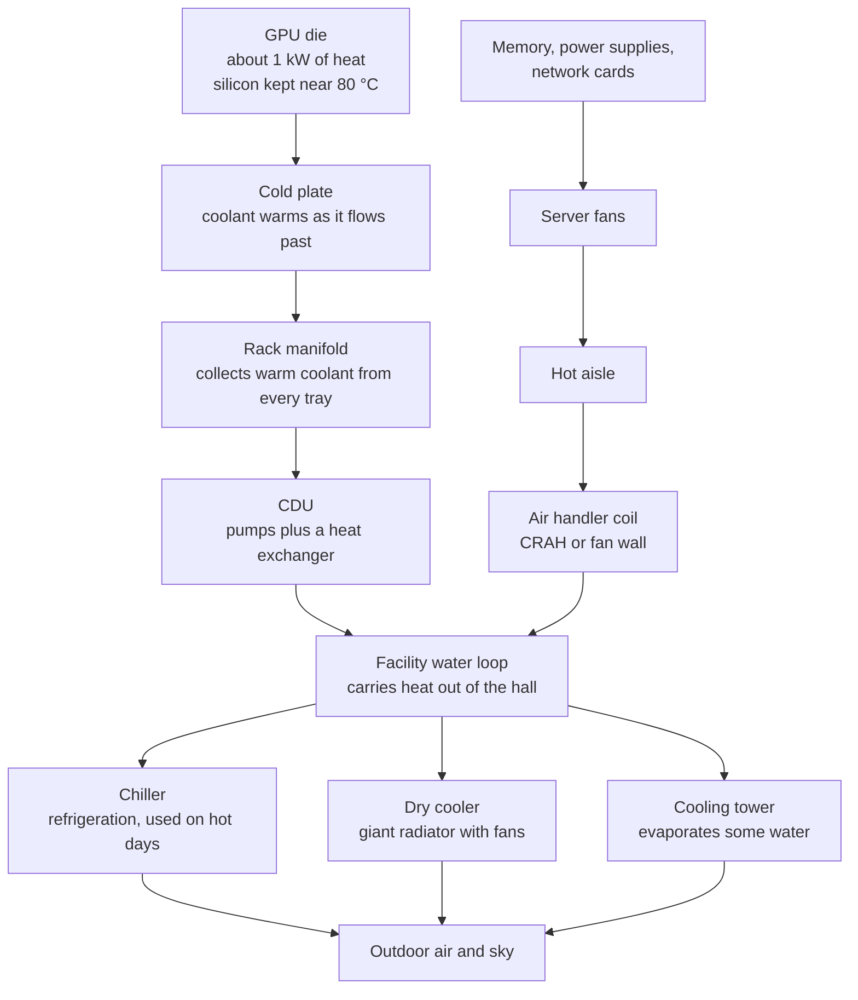
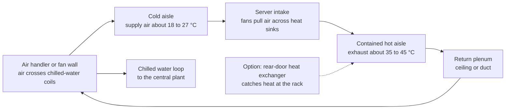
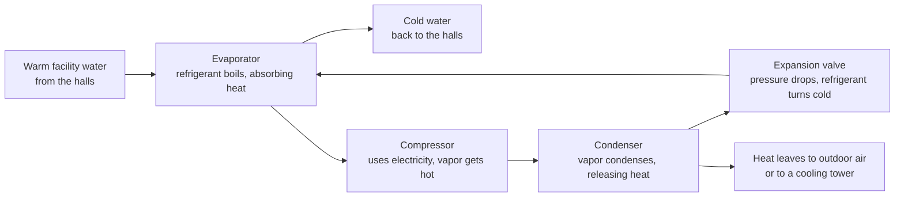
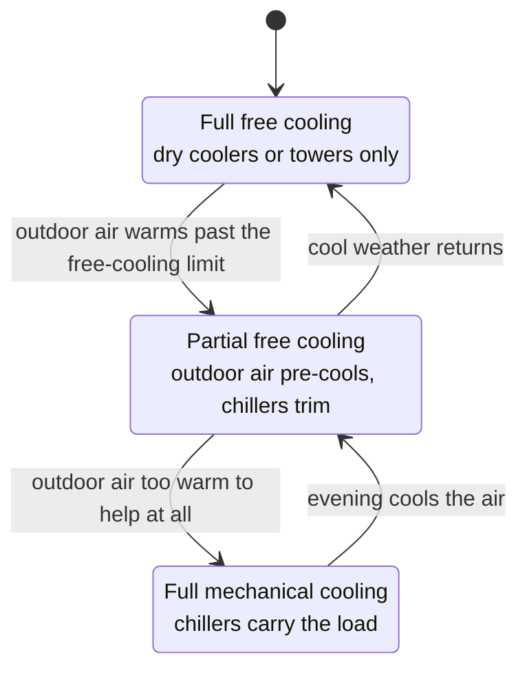
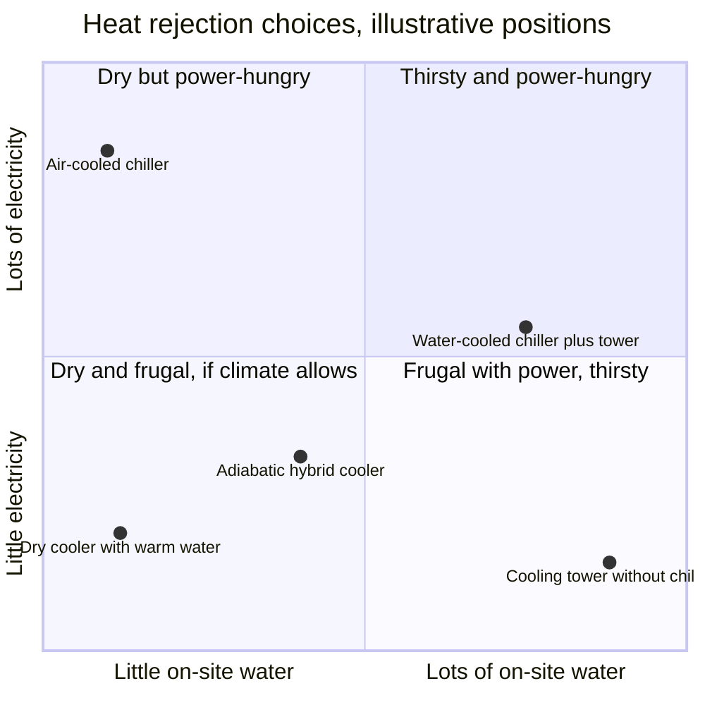
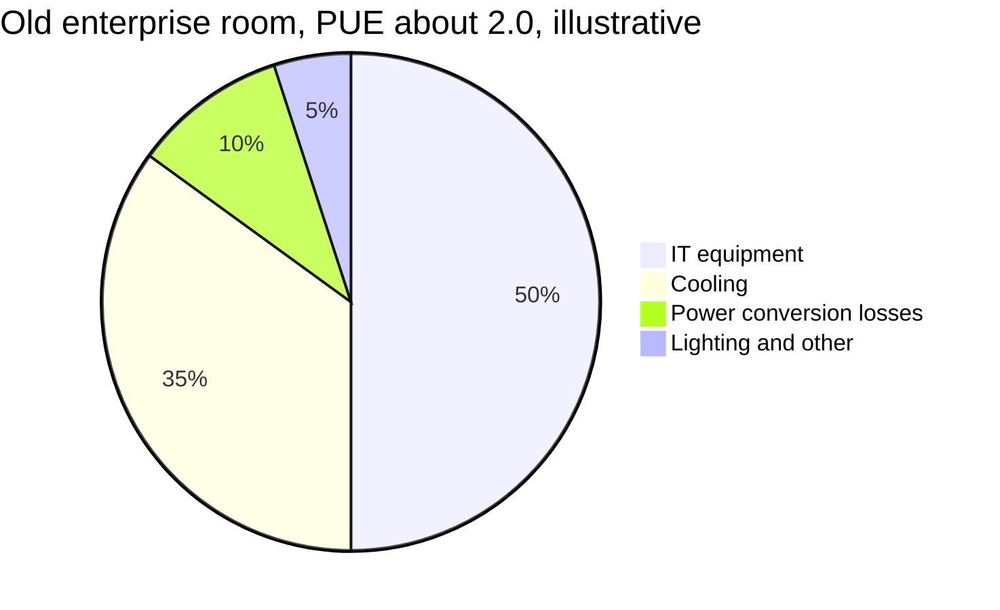
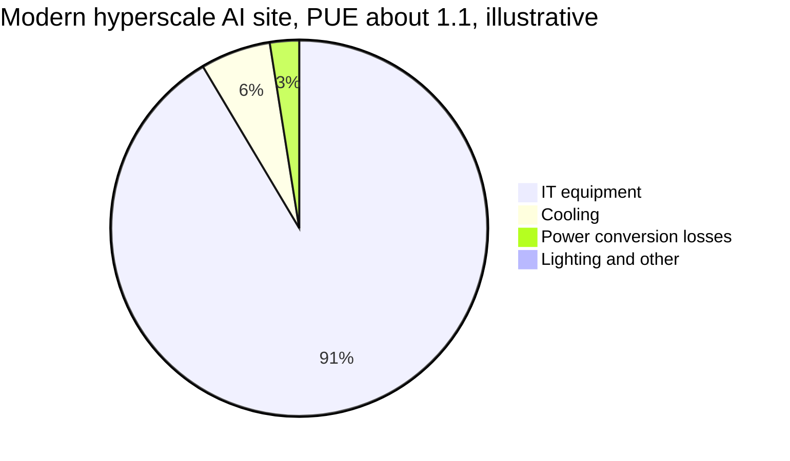
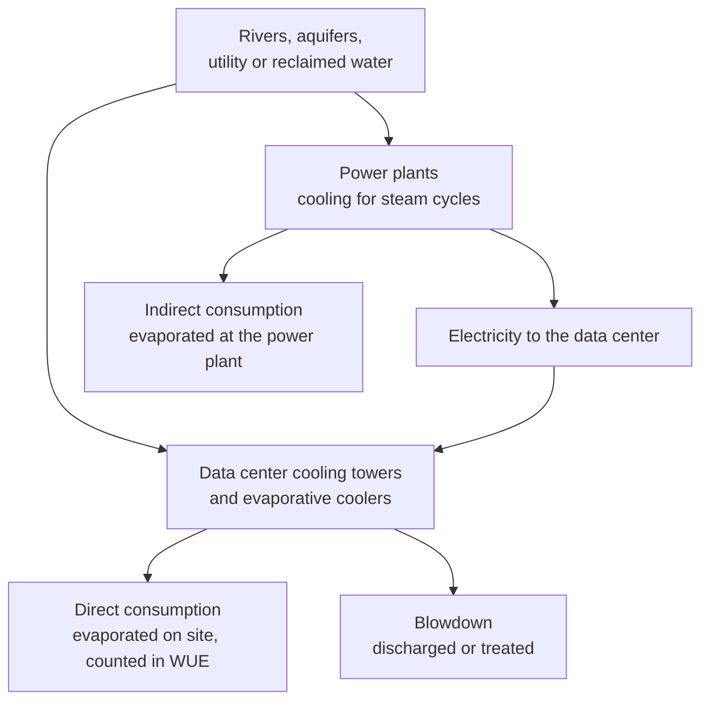

# Chapter 40: Cooling: Where the Heat Goes

*This chapter follows the heat from a single GPU all the way to the sky, so you can explain why AI data centers switched from air to liquid, what PUE and WUE really measure, and how much water your chatbot actually uses.*

## What you'll learn

- Why essentially every watt a data center draws turns into heat, and how engineers measure heat in watts, BTUs and "tons"
- Why water carries about 3,500 times more heat per unit volume than air, worked out from two numbers you can check yourself
- The complete heat path from chip to sky: cold plate, coolant loop, CDU, facility water, and then a chiller, dry cooler or cooling tower
- Every cooling technology from room air conditioning to two-phase immersion, and roughly how much rack power each can handle
- Free cooling, economizers and evaporative cooling, and why saving water usually costs electricity (and the other way round)
- How to calculate PUE, WUE, CUE and ERE with real numbers, and what each metric leaves out
- How to think clearly about water: withdrawal versus consumption, direct versus indirect, one prompt versus the whole industry
- What the frontier AI sites use in 2026, and where heat reuse and next-generation cooling are heading

## Before you start

Chapter 2 (How Computers Work) introduced the idea that every computation uses energy and makes heat. Chapter 34 (Wiring Thousands of Chips Together) showed AI racks climbing from about 10 kW to around 130 kW and introduced the cold plate. Chapter 38 (Inside a Data Center) walked you past the cooling yard and through the hot and cold aisles; this chapter opens up those machines. Chapter 39 (Power: From the Grid to the GPU) explained watts versus watt-hours and followed electricity down to the chip. We pick up at the exact moment that electricity has done its work and become heat. Chapter 41 (Energy for AI) takes the water and energy questions out to the grid and the community.

## Every watt becomes heat

Put your hand on a laptop that has been exporting a video for ten minutes, or hold your phone after a long voice conversation with a chatbot. Both are warm. That warmth is not a side effect of a badly designed device. It is where the electricity went.

A chip works by switching billions of tiny transistors on and off and pushing electric current through microscopic wires. Every switch and every wire has a little resistance, and resistance turns electrical energy into heat. The arithmetic itself does not store energy anywhere. When the calculation is finished, the energy that powered it is sitting in the chip as heat. A tiny fraction escapes as light from status LEDs (light-emitting diodes, the small indicator lights on equipment), sound from fans, or pulses of light in a fiber cable, and even most of that ends up as heat somewhere else.

For engineering purposes, the rule is simple: **power in equals heat out.** A server drawing 10 kW is a 10 kW heater. A data hall drawing 30 MW is a 30 MW heater. Cooling is the job of carrying that heat somewhere it can be thrown away, continuously, without letting the chips get too hot.

> **Definition — Heat:** Energy that flows from a hotter thing to a colder thing because of their difference in temperature (heat always flows from hotter to colder, never the other way on its own). Data center engineers measure the rate of heat flow in the same units as electrical power: watts, kilowatts and megawatts.

> **Key idea:** Physically, a data center is an enormous electric heater that does useful arithmetic along the way. A 100 MW facility must get rid of about 100 MW of heat for every second it runs, forever.

### Your chatbot reply as a cup of warm water

Let's make this concrete with your own chatbot. Independent and company estimates put a typical text reply at roughly 0.24–0.34 watt-hours of electricity: Epoch AI estimated about 0.3 Wh for a typical GPT-4o query in early 2025, OpenAI's CEO said about 0.34 Wh for an average ChatGPT query in June 2025, and Google reported 0.24 Wh for its median Gemini Apps text prompt in May 2025 (Chapter 39 explains where those numbers come from). Scientists measure energy in joules: one watt is one joule per second, so one watt-hour is 3,600 joules. Take 0.3 Wh:

- 0.3 Wh × 3,600 joules per Wh = 1,080 joules of heat.
- Warming 1 gram of water by 1 °C takes about 4.2 joules.
- 1,080 ÷ 4.2 ≈ 257 grams of water warmed by 1 °C.

So one chatbot reply turns into enough heat to warm a mug of water by about one degree. That is tiny. Now scale up. A GB200 or GB300 NVL72 rack, the workhorse AI rack of 2025–26, draws roughly 120–140 kW. Call it 130 kW. A portable space heater on full blast is about 1.5 kW. So one AI rack, the size of a large refrigerator, releases as much heat as about 87 space heaters running at once (130 ÷ 1.5 ≈ 87). A 1 GW campus releases as much heat as about 670,000 of them.

### Measuring heat: BTUs and tons

Cooling equipment, especially in the United States, is often rated in older units, so you need to recognize them.

> **Definition — BTU (British thermal unit):** An old unit of heat energy, about 1,055 joules: the heat needed to warm one pound of water by one degree Fahrenheit. Cooling gear is often rated in BTU per hour; 1 kW of heat equals about 3,412 BTU per hour.

> **Definition — Ton of cooling (refrigeration ton):** A cooling rate of 12,000 BTU per hour, about 3.5 kW. The name comes from the cooling delivered by melting one ton of ice over a day.

Worked example: one 130 kW rack needs 130 ÷ 3.5 ≈ 37 tons of cooling. A typical central air conditioner for a house is around 3 tons. So a single AI rack needs the cooling capacity of roughly a dozen homes' air conditioners, running flat out all year. A 100 MW hall needs about 100,000 ÷ 3.5 ≈ 28,600 tons.

> **Try it:** Find the label on a window air conditioner or your home's outdoor AC unit (or search your model number). Window units are often rated 8,000–12,000 BTU per hour. Divide by 3,412 to get kilowatts of cooling, then work out how many of your units it would take to cool one 130 kW AI rack.

### Why chips need to stay cool

A chip does not care about heat in the abstract. It cares about its own temperature. Inside each chip there is a hottest point, where the transistors are densest and busiest.

> **Definition — Junction temperature:** The temperature at the hottest point inside a chip, where the transistors are. Chips are designed to stay below a limit, typically somewhere around 85–105 °C depending on the product.

> **Definition — Thermal throttling:** A chip's self-protection: when it gets too hot, it automatically slows its clock and draws less power, so it does less work. A throttled GPU is an expensive GPU doing less.

> **Definition — TDP (thermal design power):** The heat a chip is designed to produce, and that its cooling must remove, under sustained heavy load. An H100 is rated at 700 W; Blackwell-class GPUs are around 1,000 W or more.

Heat also shortens the life of electronics. Hot chips age faster, solder joints crack from repeated heating and cooling, and memory makes more errors. So operators want chips cool, steady and evenly cooled, not just "below the limit".

Here is the core difficulty in one calculation. An H100's main silicon die is about 814 square millimeters, roughly 8.1 square centimeters, about the size of a postage stamp. It produces up to 700 W.

- 700 W ÷ 8.1 cm² ≈ 86 watts per square centimeter.
- A 2 kW electric stove burner about 20 cm across has an area of roughly 314 cm², so about 6 W per square centimeter.

Per square centimeter, the GPU pours out more than ten times the heat of a stove burner on high. Yet a burner glows at hundreds of degrees, while the GPU must stay below about 85–90 °C. A lot of heat, from a small area, held at a low temperature: that is the whole cooling problem in one sentence.

> **Definition — Heat flux:** The amount of heat flowing through a given area, usually in watts per square centimeter. AI chips have very high heat flux because so much power is concentrated on a small piece of silicon.

> **Watch out:** "The GPU runs hot, so the room must be freezing" is a myth. Modern AI halls are not cold. The goal is to move heat away from the silicon quickly, and liquid-cooled designs deliberately use warm water, often 30 °C or more, because warm water is easier to cool using outdoor air.

### How heat moves

Heat only moves when there is a temperature difference, and it moves in a few distinct ways. Engineers combine them along the heat path.

> **Definition — Conduction:** Heat moving through a solid, or a still liquid, by direct contact, the way a metal spoon warms up in hot soup.

> **Definition — Convection:** Heat carried away by a moving fluid, such as air pushed by a fan or water pumped through a pipe. Almost all data center cooling is forced convection.

> **Definition — Thermal radiation:** Heat given off as invisible infrared light. It is a minor effect inside a data center, but it is the only way to shed heat in the vacuum of space.

> **Definition — ΔT (delta T):** The temperature difference between two points, for example between water entering a rack and water leaving it. Heat only flows when there is a ΔT, and for a given flow of fluid, a bigger ΔT means more heat carried.

There is one more way to move heat, and it turns out to be the most powerful: making a liquid boil or evaporate. We will meet it when we get to cooling towers and two-phase cooling.

## Why water beats air: the master equation

Everything in cooling comes back to one equation. It says how much heat a moving fluid carries away:

`heat carried = flow × heat capacity × ΔT`

In words: the more fluid you move, the more heat each unit of it can soak up per degree, and the more degrees you let it warm up, the more heat it carries.

> **Definition — Specific heat capacity:** How much energy it takes to warm one kilogram of a substance by 1 °C. Water needs about 4,186 joules; air needs about 1,005 joules.

Specific heat is per kilogram, but pipes and ducts are sized by volume, so what really matters is heat capacity per cubic meter. Air is light, about 1.2 kg per cubic meter at room conditions. Water is about 1,000 kg per cubic meter.

| | Density (kg per m³) | Specific heat (J per kg per °C) | Heat per m³ per °C |
|---|---|---|---|
| Air | about 1.2 | about 1,005 | about 1,206 J |
| Water | about 1,000 | about 4,186 | about 4,186,000 J |

Divide: 4,186,000 ÷ 1,206 ≈ 3,470. **A cubic meter of water carries about 3,500 times more heat per degree than a cubic meter of air.** That is the single most important number in this chapter.

> **Analogy:** Air cooling is standing in front of a fan on a hot day. Liquid cooling is jumping into a swimming pool. The fan helps, but the pool pulls heat out of you thousands of times faster.

### Worked example: cooling one rack with air, then with water

Take one 130 kW rack.

**With air.** Suppose cool air enters at 25 °C and leaves at 40 °C, a ΔT of 15 °C (typical for servers).

- Air needed = 130,000 W ÷ (1,206 J per m³ per °C × 15 °C) ≈ 7.2 cubic meters per second.
- In the usual US unit for airflow, cubic feet per minute (CFM), that is about 15,200 CFM (one cubic meter per second is about 2,119 CFM).
- The front of a rack is about 0.6 m wide and 2.2 m tall, about 1.3 m². To push 7.2 m³ per second through it, the air must move at about 5.5 m per second, roughly 20 km per hour, a steady stiff breeze through the whole face of the cabinet, made by fans packed inside it.

**With water.** Suppose water enters at 35 °C and leaves at 45 °C, a ΔT of 10 °C.

- Water needed = 130,000 W ÷ (4,186,000 J per m³ per °C × 10 °C) ≈ 0.0031 cubic meters per second.
- That is about 3.1 liters per second, or 186 liters per minute, flowing through pipes a few centimeters across.

A gale of air through the whole cabinet, or a few garden hoses' worth of water. That comparison is why the AI industry moved to liquid.

### Why air hits a wall

You might think: just add more fans. The trouble is a law of fan physics.

> **Definition — Fan affinity laws:** Rules of thumb for fans and pumps: airflow rises in proportion to fan speed, but the power the fan uses rises with the cube of speed, so doubling the airflow takes roughly eight times the fan power.

Doubling the heat a rack makes means doubling the airflow, which means spinning fans about twice as fast, which costs about eight times the fan energy and makes far more noise. Fans in a densely packed server can already consume a noticeable share of server power. Past a certain point you are spending more and more energy just to push air, and the air still cannot carry enough heat out of the narrow spaces around hot chips. In practice, air cooling, even with the best containment, tops out somewhere around 30–50 kW per rack. Blackwell-class AI racks draw roughly three times that or more. Something had to change.

## The heat path from chip to sky

The heat a GPU makes does not leave the building in one step. It takes a journey of several hops. At each hop, heat passes from one material or fluid to another, usually through a heat exchanger, and each hop costs a few degrees of temperature.

> **Definition — Heat exchanger:** A device that moves heat from one fluid to another without letting them mix, usually through thin metal plates or tubes. A car radiator is a heat exchanger between engine coolant and outside air.

> **Definition — Heat rejection:** The final step of cooling: getting the heat out of the building and into the outdoor air (or, occasionally, a river, lake or sea).

Here is the whole journey for a modern liquid-cooled AI rack, with the smaller air-cooled path running alongside it.



*Figure 40.1: The heat path from chip to sky. Most of an AI rack's heat goes through the liquid path on the left; the remaining air-cooled heat is caught by air handlers and joins the same facility water loop.*

Every hop needs a temperature difference to push heat across it. So temperatures fall step by step from the chip to the outdoors, like water flowing down a staircase. The figure below shows illustrative values for a warm-water design on a mild day. Real designs vary, but the shape is always the same.

```
 deg C   Where the heat is
  85  |  GPU silicon, kept below its limit
      |     v  through the lid, paste and copper
  60  |  surface of the cold plate channels
      |     v  into the coolant
  45  |  coolant leaving the rack (warm return)
  35  |  coolant entering the rack (supply)
      |     v  across the CDU heat exchanger
  32  |  facility water leaving the hall
  30  |  facility water returning, cooled
      |     v  across a dry cooler or tower
  25  |  outdoor air on a mild day
```

*Figure 40.2: The temperature staircase (illustrative values). Each hop needs a few degrees to push heat across, so the warmer the chips let the coolant run, the more often plain outdoor air is cold enough to finish the job.*

Now let's walk the path one hop at a time.

### Hop 1: from silicon to cold plate

Heat starts in the transistors and conducts upward through the silicon. On top of the chip sits a heat spreader, a flat metal lid (often copper) that spreads heat from small hot spots over a wider area, and between every layer is a thin paste or pad that fills microscopic air gaps.

> **Definition — Thermal interface material (TIM):** A thin paste, pad or soft metal layer squeezed between a chip and its cooler to fill microscopic gaps, because even tiny pockets of trapped air block heat badly.

On an air-cooled server, the next stop is a heat sink, a block of thin metal fins that conducts heat away from the chip and gives air blown across the fins a large surface to carry it off. On a liquid-cooled AI server, the next stop is a cold plate.

> **Definition — Cold plate:** A metal block, usually copper, with tiny internal channels, clamped onto a chip. Coolant pumped through the channels carries the heat away. Cold plates on every GPU and CPU are standard on Blackwell-class AI racks.

The channels inside a cold plate are very fine, often fractions of a millimeter wide, to give the coolant as much metal surface to touch as possible. That is great for heat transfer and bad for dirt: a few particles or a bit of corrosion can clog them. That is why the coolant in the rack is kept extremely clean.

### Hop 2: the technology cooling loop

The coolant that touches the cold plates runs in its own closed loop, separate from the building's water.

> **Definition — Technology cooling system (TCS):** The closed, carefully filtered liquid loop that runs through the servers' cold plates. It is kept separate from the building's larger, dirtier water loop.

The coolant is usually treated water, often mixed with glycol (an antifreeze) and corrosion inhibitors. In the rack, pipes called manifolds run up the back, feed every compute tray and collect the warm coolant coming back. Each tray connects through special fittings so a technician can pull a server out for repair without draining the rack or spraying water on the electronics.

> **Definition — Quick disconnect:** A dripless pipe connector that seals both sides automatically when unplugged, so a liquid-cooled server can be removed while the rest of the rack keeps running.

### Hop 3: the CDU

Warm coolant from the racks flows to a coolant distribution unit. This is the hinge of the whole system.

> **Definition — CDU (coolant distribution unit):** A cabinet of pumps, filters, sensors and a heat exchanger that circulates the clean coolant through the racks and hands its heat to the building's facility water loop, while controlling flow, pressure and temperature.

A CDU does three jobs. It pumps the rack coolant around its loop. It keeps that loop clean and at the right pressure. And inside it, a plate heat exchanger lets the warm rack coolant pass its heat to the facility water without the two ever mixing. CDUs come in different sizes: small ones inside a single rack, larger ones at the end of a row serving many racks, and big ones in a mechanical room serving a whole hall.

Some buildings were never built with water pipes near the racks. For them there is a stopgap. A liquid-to-air CDU, sometimes called a sidecar, sits next to a liquid-cooled rack, takes the warm coolant and dumps its heat into the room's air through a radiator and fans. It lets an air-cooled building host a few liquid-cooled racks, but only as many as the room's air system can absorb.

> **Analogy:** The cold plate and CDU work like a car's cooling system. Coolant flows past the hot engine (the chip), carries heat to the radiator (the CDU's heat exchanger), and something else (the building's water and, finally, outdoor air) carries it away. Just as you would not pour muddy lake water into your engine block, the rack loop is kept clean and separate.

### Hop 4: the facility water loop

On the other side of the CDU flows the facility water system: big pipes, big pumps and a lot of water, carrying heat from every hall to the outdoor equipment. Microsoft's Fairwater AI data center in Wisconsin, described in September 2025, used 72.6 miles of mechanical piping during construction. That is the facility water system made visible.

> **Definition — Facility water system (FWS):** The building's main water loop that collects heat from CDUs and air handlers across the data halls and carries it to chillers, dry coolers or cooling towers outside.

### Hop 5: out to the sky

Finally the heat reaches the cooling yard, the rows of large boxes and fans you see beside a data center on satellite images. There are three main ways to finish the job: a refrigeration machine (chiller), a giant radiator (dry cooler), or evaporation (cooling tower). Most big sites combine them and switch between them depending on the weather. We will look at each in detail later in the chapter, because they decide how much electricity and water a data center uses.

One idea threads through every hop. Each heat exchanger has an **approach**: how close it can bring one fluid to the temperature of the other.

> **Definition — Approach temperature:** How close a heat exchanger or cooler can bring a fluid to the temperature of the thing cooling it. A dry cooler with a 5 °C approach can, at best, cool water to 5 °C above the outdoor air temperature.

Add up the approaches along the staircase, and you get the key design question: **how warm can the coolant entering the chips be?** If the chips are happy with 35–40 °C coolant, then outdoor air up to about 25–30 °C can cool it directly with no refrigeration at all. If the chips need 18 °C water, you need a refrigeration machine for much of the year almost everywhere.

> **Key idea:** Warmer is better. The warmer the coolant the chips can accept, the more hours per year the building can dump heat straight into outdoor air and skip the energy-hungry chiller. This is why AI liquid cooling is designed around warm water, often 30–45 °C.

## The air path: fifty years of cooling with air

Before liquid cooling went mainstream, essentially all data center cooling used air, and most of the world's data centers, the ones running email, banking and video streaming, still do. Even in a liquid-cooled AI hall, some heat from memory, power supplies, storage and network cards still goes into the air. So you need to understand the air path too.

### Room air conditioning

The oldest design treats the whole room like a refrigerator. Big air-conditioning cabinets around the edge of the room blow cold air into a space under a raised floor; perforated floor tiles in front of the racks let it rise; the servers' fans pull it through; and the warm air drifts back to the air conditioners.

> **Definition — CRAC (computer room air conditioner):** A room air-conditioning unit with its own built-in refrigeration compressor that cools and circulates the air in a data hall.

> **Definition — CRAH (computer room air handler):** A fan-and-coil unit that cools a data hall's air by blowing it across coils filled with chilled water from a central plant. It has no compressor of its own.

Any enclosed space used as an air duct, like the gap under a raised floor or above a ceiling, is called a plenum.

Chapter 38 describes the raised floor and why heavy AI racks moved to concrete slabs. For cooling, the raised floor's problem is simple: it is a leaky, crowded duct, full of cables that block airflow, and it can only push so much cold air through a few tiles.

### Hot aisles, cold aisles and containment

The biggest early improvement was organizing the racks. Servers pull air in at the front and blow it out at the back. If every rack faced the same way, each row would breathe the hot exhaust of the row in front. So racks are arranged in pairs of rows facing each other.

> **Definition — Hot aisle / cold aisle:** A layout in which rows of racks face each other in pairs, so cold air is supplied to the shared aisle between their fronts (cold aisle) and hot exhaust collects in the shared aisle between their backs (hot aisle).

Even with aisles, air misbehaves. Hot exhaust curls over the tops of racks and gets sucked back into the fronts. Cold air escapes past the ends of rows and goes straight back to the air conditioner without cooling anything.

Engineers call the first problem recirculation (hot exhaust sneaking back into server intakes) and the second bypass (cold air returning to the coolers without passing through any server). Both waste cooling.

The fix is to put walls around the aisles.

> **Definition — Containment:** Doors at the ends of an aisle plus a roof or ceiling panels over it, enclosing either the cold aisle or the hot aisle so the two air streams cannot mix.

Hot aisle containment traps the exhaust and ducts it straight back to the coolers, so the rest of the room stays at the comfortable supply temperature. Cold aisle containment does the reverse: it encloses the cold supply, and the rest of the room runs hot. Either way, containment lets the cooling units supply warmer air and use less fan energy, because nothing is wasted.

How warm should the supply air be? The industry reference is a set of guidelines from ASHRAE, the American engineering society for heating and cooling.

> **Definition — ASHRAE thermal guidelines:** Widely used recommendations from ASHRAE's data center technical committee for the temperature and humidity of air entering IT equipment (a recommended range of about 18–27 °C), plus classes for liquid-cooling water temperatures.

For decades, many operators kept rooms near the bottom of that range, around 18–20 °C, out of caution. Raising supply temperatures toward 27 °C was one of the cheapest efficiency wins of the 2010s, because it let free cooling (later in this chapter) run for more of the year.

> **Analogy:** Containment is keeping the fridge door closed. You can make the fridge's compressor stronger, or you can just stop letting the warm kitchen air mix with the cold air inside. The second option is cheaper.

### Bringing the cooling closer

As racks got hotter, cooling moved closer to the heat, because air loses its usefulness the farther it has to travel.

> **Definition — In-row cooler:** A cooling unit the size of a narrow rack, placed between racks in a row, that pulls hot air from the hot aisle and pushes cooled air into the cold aisle a short distance away.

In bigger halls, a fan wall does a similar job at room scale: a wall of large fans and cooling coils along the edge of the hall that moves enormous volumes of air at low speed, replacing many separate air conditioners.

> **Definition — Rear-door heat exchanger (RDHx):** A radiator filled with cool water, mounted as the back door of a rack, that absorbs heat from the server exhaust as it leaves. Passive versions rely on the servers' own fans; active versions add fans to the door.

A rear-door heat exchanger is a clever halfway house: the servers are still air-cooled, but the heat is caught by water right at the back of the rack, before it ever enters the room. Here is the air path in a contained, air-cooled hall.



*Figure 40.3: The air path in a contained, air-cooled hall. Air circulates in a loop between the coils and the servers; the heat leaves the loop through the chilled-water coils. A rear-door heat exchanger catches heat before it reaches the hot aisle.*

> **Key idea:** In air cooling, the air is only a delivery truck. The heat is always handed to water at some coil and leaves the building through the water system. Liquid cooling simply removes the truck and plugs the water straight into the chip.

## Going liquid: direct-to-chip, two-phase and immersion

The switch from air to liquid is the biggest change in data center design in decades, and AI forced it. NVIDIA says the move from its Hopper generation to Blackwell raised rack density about 3.4 times, "from tens of kilowatts to well over 100". No reasonable amount of air could carry that heat out of a cabinet, so the GB200 and GB300 NVL72 racks were designed from the start for liquid.

### Single-phase direct-to-chip cooling

This is the mainstream AI design in 2026, the one described in the heat path above.

> **Definition — Direct-to-chip (DTC) liquid cooling:** Cooling in which coolant is pumped through cold plates sitting directly on GPUs and CPUs. It is the standard approach for Blackwell-class AI racks.

Because the coolant stays liquid the whole time and carries heat simply by warming up, like water in a car radiator, this is called single-phase cooling.

Direct-to-chip does not catch every watt. The cold plates sit on the hottest parts (GPUs, CPUs and often switch chips), but some heat from other components still goes into the air, so most AI halls in 2026 are hybrids: liquid for the large majority of the heat, plus air handlers for the rest. Microsoft, for example, says its Fairwater Wisconsin site uses closed-loop liquid cooling for more than 90% of its capacity.

Direct-to-chip brings new problems that air never had:

- **Leaks.** Water and electronics do not mix. Racks have leak-detection cables along the floor and in the trays, dripless quick disconnects, and pressure sensors that shut valves if anything looks wrong. Some designs run the loop slightly below atmospheric pressure, so a crack sucks air in instead of spraying coolant out.
- **Water quality.** Microscopic channels clog easily, so the loop needs fine filters, corrosion inhibitors, and regular chemical testing, much like a swimming pool.
- **New skills.** A data center technician used to swap servers and cables. Now they also need plumbing and fluid-chemistry skills. Chapter 63 covers these careers.

> **Watch out:** "Liquid cooling" does not tell you whether the building consumes water. The rack loop is sealed and holds the same coolant for years. Whether the site evaporates water depends entirely on the heat-rejection equipment outside: a cooling tower does, a dry cooler does not.

### Two-phase cooling: using boiling

The most powerful way to absorb heat is not to warm a liquid but to boil it. When a liquid turns into vapor, it soaks up a large amount of energy without getting any hotter.

> **Definition — Latent heat:** The energy a substance absorbs when it changes state, such as liquid to vapor, without changing temperature. Boiling or evaporating a liquid absorbs far more heat per kilogram than warming it a few degrees.

Water shows the scale. Warming 1 kg of water by 1 °C takes about 4.2 kJ (kilojoules, thousands of joules). Evaporating that same kilogram takes about 2,260 kJ at its boiling point. So boiling 1 kg of water absorbs as much heat as warming it by about 540 °C (2,260 ÷ 4.2 ≈ 540), if that were possible.

> **Definition — Two-phase cooling:** Cooling in which a specially chosen fluid boils on or near the hot chip, absorbing heat as it turns to vapor; the vapor is then condensed back to liquid elsewhere and returned.

You cannot boil water on a chip at 100 °C, because the chip must stay cooler than that, and water conducts electricity. So two-phase systems use engineered fluids that boil at chosen lower temperatures (for example, around 30–60 °C) and do not conduct electricity.

> **Definition — Dielectric fluid:** A liquid that does not conduct electricity, so it can touch powered electronics without causing short circuits. Mineral oils, synthetic oils and certain engineered fluorinated fluids are examples.

Two-phase cooling has real advantages. A boiling fluid stays at its boiling temperature, so the whole chip is held at an even temperature with no hot spots. Because each kilogram absorbs so much heat, far less fluid needs to be pumped. And it can handle higher heat flux than single-phase cold plates, which matters as chips head toward 2 kW and beyond.

It also has real drawbacks. The fluids are expensive, the loops run under pressure, and the supply chain is young. Some of the classic engineered fluids belong to the PFAS (per- and polyfluoroalkyl substances) family of "forever chemicals" (so called because they barely break down in nature) that regulators in Europe and the US are restricting; 3M, a major maker, announced in 2022 that it would stop making PFAS by the end of 2025. Fluid makers are developing replacements, but this has slowed adoption.

### Immersion cooling

The most radical approach drops the whole server into liquid.

> **Definition — Immersion cooling:** Submerging entire servers in a tank of dielectric fluid, which absorbs heat from every component at once. In single-phase immersion the fluid stays liquid and is pumped to a heat exchanger; in two-phase immersion it boils and condenses on a cold coil above the tank.

Immersion removes every fan, captures essentially all of the heat in liquid, runs silently, and protects electronics from dust and humidity. It grew up in cryptocurrency mining, where operators packed cheap, hot mining machines densely and did not need to service them often.

For AI, immersion has stayed a niche as of 2026. The reasons are practical: servicing a server means lifting it, dripping, out of a tank; tanks full of fluid are very heavy; some cables, plastics and labels degrade in the fluids; hardware makers have been slow to warranty immersed equipment; and the fluid itself is costly. Direct-to-chip cold plates captured most of immersion's benefit with far less disruption, so the industry standardized on them.

### The cooling spectrum

Here is the whole range on one table. The rack-power figures are rules of thumb, not hard limits: they vary with vendor, room design and how much effort an operator puts in.

| Technology | Comfortable rack power (rule of thumb) | How heat leaves the rack | Water on site | Where you see it in 2026 |
|---|---|---|---|---|
| Room air, no containment | up to about 5–10 kW | air to room coolers | depends on plant | older enterprise rooms |
| Hot/cold aisle containment | about 10–30 kW, best designs up to about 40–50 | air to coolers or fan walls | depends on plant | most cloud and colocation halls |
| In-row coolers | about 20–40 kW | air to nearby water coil | depends on plant | retrofits, mid-density rows |
| Rear-door heat exchanger | about 20–50+ kW | air to water at the rack door | depends on plant | retrofits, transitional AI racks |
| Direct-to-chip, single-phase | about 100–200+ kW | liquid from cold plates, some air | depends on plant | standard for GB200/GB300 NVL72 |
| Direct-to-chip, two-phase | aimed at the highest heat flux | boiling fluid from cold plates | depends on plant | early deployments and pilots |
| Immersion (single or two-phase) | 100+ kW per tank | liquid surrounds everything | depends on plant | niche, crypto heritage |

*Table 40.1: The cooling technology spectrum. "Depends on plant" is deliberate: water consumption is decided by the heat-rejection equipment outside, not by what happens inside the rack.*

> **At the frontier (2026):** NVIDIA's roadmap points to Kyber racks of roughly 600 kW in 2027 and designs for more than 1 MW per rack after that, on 800 V DC power (Chapter 39). At those densities even today's cold plates strain. Researchers and chipmakers are experimenting with two-phase cold plates and with coolant channels etched directly into the silicon or the chip package (often called microfluidic cooling), so the liquid gets even closer to where the heat is made.

## Throwing the heat away: chillers, towers and dry coolers

Every watt that entered the building must eventually leave through the cooling yard. There are three basic machines for this last step, and the choice between them decides most of a data center's cooling electricity and nearly all of its on-site water use.

### Chillers: refrigerators for water

A chiller does for water what your kitchen fridge does for food: it uses electricity to pump heat "uphill", from something cool to somewhere warmer. The trick is a refrigerant, a fluid chosen to boil at a low temperature, so that it soaks up heat as it evaporates and gives heat off as it condenses.

> **Definition — Chiller:** A large machine that uses a refrigeration cycle to make cold water for a building. Chillers can cool water below the outdoor temperature, which nothing else can do, but they are among a data center's biggest electricity users.

> **Definition — Vapor-compression refrigeration cycle:** The loop inside every fridge and chiller: a cold refrigerant evaporates while absorbing heat, a compressor squeezes the vapor so it gets hot, the hot vapor condenses while releasing heat outdoors, and an expansion valve drops its pressure so it is cold again.



*Figure 40.4: Inside a chiller. The compressor spends electricity to lift heat from cool facility water to a temperature hot enough to dump outdoors.*

The efficiency of a chiller is measured by how much heat it moves per unit of electricity.

> **Definition — COP (coefficient of performance):** Heat moved divided by electricity used. A chiller with a COP of 5 removes 5 kW of heat for every 1 kW of electricity. Large water-cooled chillers often reach around 5–7; air-cooled ones are lower, often around 3.

Worked example: a hall sends 20 MW of heat to chillers with a COP of 5.

- Electricity for the chillers = 20 MW ÷ 5 = 4 MW.
- Heat the chillers must dump outdoors = 20 MW from the hall + 4 MW from their own compressors = 24 MW.

Notice the trap: the chiller's own electricity also becomes heat, which must also be rejected. Refrigeration is expensive twice over. This is why modern designs try to run chillers as few hours as possible, and why "free cooling" (below) is such a big deal.

### Cooling towers: cooling by evaporation

A cooling tower is the most energy-efficient way to dump heat, and the thirstiest.

> **Definition — Cooling tower:** An outdoor structure in which warm water trickles over packing material while fans pull air through it; a small part of the water evaporates, and that evaporation cools the rest. Very energy-efficient, but it consumes water.

Evaporation is the latent-heat trick from two-phase cooling, working outdoors. At ordinary outdoor temperatures, evaporating 1 kg (1 liter) of water absorbs about 2,400 kJ of heat. One kilowatt-hour is 3,600 kJ. So:

- Water evaporated per kWh of heat ≈ 3,600 ÷ 2,400 ≈ 1.5 liters.
- A site rejecting 100 MW of heat entirely through towers evaporates about 100,000 kWh × 1.5 L = 150,000 liters every hour, or about 3.6 million liters a day.

That is not the whole bill. As water evaporates, the minerals it carried stay behind and concentrate. Operators must keep draining some water and replacing it with fresh water.

> **Definition — Blowdown:** Water deliberately drained from a cooling tower to stop dissolved minerals from building up as the rest evaporates. It is replaced with fresh "makeup" water, adding to total water use.

Evaporation plus blowdown plus a little spray carried off by the wind is why an evaporatively cooled data center might use somewhere around 1.5–2 liters of water per kWh of heat rejected. The ordinary air temperature, the one a normal thermometer shows, is called the dry-bulb temperature. A cooling tower's power is that it can cool water below it, down toward a lower number called the wet-bulb temperature.

> **Definition — Wet-bulb temperature:** The lowest temperature you can reach by evaporating water into the air. It depends on humidity: in dry air it can be far below the dry-bulb temperature; in very humid air it is close to it. Evaporative coolers can approach the wet bulb.

In Phoenix on a summer afternoon, the dry bulb might be over 40 °C but the wet bulb in the low 20s. A cooling tower can still make usefully cool water there; a plain radiator cannot.

### Dry coolers and adiabatic coolers

The water-free alternative is a giant radiator.

> **Definition — Dry cooler:** A large radiator with fans that cools liquid using outside air, without evaporating any water. It saves water but cannot cool the liquid below the outdoor air temperature, so it struggles on hot days.

A dry cooler can only get the water to a few degrees above the dry-bulb temperature. If your chips need 30 °C water and it is 38 °C outside, a dry cooler alone cannot do it. Engineers have two answers. One is to add a chiller that runs only on the hottest days. The other is to add a little evaporation, only when needed.

> **Definition — Adiabatic (evaporative) cooling:** Spraying or wicking a little water into the air entering a cooler so that evaporation lowers the air's temperature before it reaches the coils. It uses some water, but only on hot days, and much less than a cooling tower.

Hybrid "adiabatic" coolers run dry most of the year and wet only during heat waves. They are a common compromise at sites trying to cut water use without paying for chillers all summer.

### Free cooling and economizers

The cheapest cooling is the kind where you do not run a refrigeration machine at all.

> **Definition — Free cooling:** Cooling a data center using cold outdoor air or water directly, with chillers switched off. It is not literally free, since fans and pumps still run, but it avoids the large electricity cost of refrigeration.

> **Definition — Economizer:** Equipment that enables free cooling. An air-side economizer brings filtered outdoor air into the hall when it is cool enough; a water-side economizer lets dry coolers or towers cool the facility water directly, bypassing the chillers.

> **Definition — Warm-water cooling:** Liquid cooling designed to work with relatively warm supply water, often 30–45 °C, so that outdoor air can cool it through dry coolers for most or all of the year without chillers.

Here is why warm water changes everything. Suppose there are two approaches to cross: about 3 °C at the CDU and about 5 °C at the dry cooler.

- An older design that needs 15 °C water can free-cool only when outdoor air is below 15 − 3 − 5 = **7 °C**. That is a cold day.
- A warm-water AI design that accepts 35 °C water can free-cool whenever outdoor air is below 35 − 3 − 5 = **27 °C**. In cool and temperate climates, that is most hours of the year; in hot deserts, far fewer.

A real plant switches modes automatically as the weather changes.



*Figure 40.5: The operating modes of a cooling plant. Raising the coolant temperature pushes the free-cooling limit higher, so the plant spends more of the year in the left-hand state.*

### The water–electricity trade-off

Put the three machines side by side and a pattern appears: **saving water usually costs electricity, and saving electricity usually costs water.** A cooling tower uses little electricity but evaporates a lot of water. An air-cooled chiller uses no water but a lot of electricity. A dry cooler uses neither much water nor much electricity, but only works when the weather and the coolant temperature allow it.



*Figure 40.6: The water–electricity trade-off. The bottom-left corner is only reachable with warm-water liquid cooling in a suitable climate; elsewhere, designers trade one resource for the other.*

There is a further twist. The electricity a chiller uses comes from power plants, and many power plants (gas, coal and nuclear) themselves use large amounts of water for their own cooling. So a "zero-water" data center in a region powered by thermal plants may cause more total water use than a site with an efficient cooling tower. That is why the next section separates direct from indirect water.

> **Key idea:** Climate decides the trade-off. In a cool, damp place like Ireland or Scandinavia, dry coolers do almost everything. In a hot, dry place like Arizona, the choice is between evaporating water and burning extra electricity, and there is no free lunch.

## Measuring efficiency: PUE, WUE, CUE and ERE

How do you compare the efficiency of two data centers? The industry uses a family of simple ratios. They are useful, widely quoted, and easy to misread. In this section you will calculate each one.

### PUE: how much overhead?

> **Definition — PUE (power usage effectiveness):** Total facility energy divided by the energy used by the IT equipment. A PUE of 1.0 would mean zero overhead; a PUE of 1.5 means that for every 1 kWh reaching the servers, another 0.5 kWh goes to cooling, power losses and everything else.

> **Definition — IT load:** The power used by the computing equipment itself (servers, storage and network gear), as opposed to cooling, lighting and power-conversion losses in the building.

PUE was introduced in 2007 by The Green Grid, an industry consortium, and was later turned into an international standard. It became the most quoted number in data center engineering because it is so simple.

**Worked example 1: computing a PUE.** A site measures, averaged over a year:

| Load | Average power |
|---|---|
| IT equipment | 10.0 MW |
| Cooling (chillers, pumps, fans, CDUs) | 2.0 MW |
| Power losses (transformers, UPS) | 0.6 MW |
| Lighting, offices, security | 0.1 MW |
| **Total facility** | **12.7 MW** |

PUE = 12.7 ÷ 10.0 = **1.27**.

**Worked example 2: why operators fight over decimal points.** Take a 100 MW IT load running flat out for a year: 100 MW × 8,760 hours = 876,000 MWh, or 876 GWh, of IT energy.

- At PUE 1.5, overhead = 0.5 × 876 = 438 GWh.
- At PUE 1.1, overhead = 0.1 × 876 = 87.6 GWh.
- Difference = 350.4 GWh per year, at $0.07 per kWh about **$24.5 million a year**.

Real sites do not run flat out. Epoch AI notes that sites typically consume 60–80% of their capacity on average. At 70%, the gap is still about 245 GWh and $17 million a year, for one 100 MW site.

The two pies below show where energy goes in an old enterprise server room and in a modern hyperscale AI site. The splits are illustrative, not measurements of a particular site.



*Figure 40.7: At PUE 2.0, half of all energy is overhead, mostly cooling.*



*Figure 40.8: At PUE 1.1, about 91% of energy reaches the IT equipment (1 ÷ 1.1 ≈ 0.91).*

What are typical values? Industry surveys have put the average PUE at roughly 1.5–1.6 for years, while leading hyperscale sites run around 1.1. Google, for example, reports a fleet-wide PUE of 1.09 for 2025 in its 2026 environmental report, against an industry average of about 1.54 from the Uptime Institute's 2025 survey. The progress since PUE 2.0 came from containment, warmer supply temperatures, economizers, efficient UPS systems and, now, liquid cooling.

A newer lever is letting AI run the cooling plant itself. A plant has many knobs, and the best setting is hard to guess: with ten cooling towers and the building at 40% load, should all ten run at 40% speed, or four flat out and six off? The answer depends on the weather, the load and which machines are where, and all of those change daily. In 2016 DeepMind reported a system trained on data from thousands of sensors in a Google data center (temperatures, power, pump speeds, settings), with neural networks that predicted PUE and, as a safety check, temperatures and pressures over the next hour. In tests it cut the energy used for cooling by 40%, which shrank the total PUE overhead by about 15%. On a site at PUE 1.12, a 15% smaller overhead is 0.12 × 0.85 ≈ 0.10, a PUE of about 1.10. The 2025 edition of *The Data Center as a Computer* notes that AI-controlled cooling is still not common, despite those early results.

### What PUE hides

PUE is a good thermometer for building overhead, but it is easy to misuse.

1. **It says nothing about useful work.** PUE compares the building with the servers, not the servers with the work they do. A site full of idle or outdated GPUs can have a beautiful PUE.
2. **The fan trick.** Server fans are counted as IT load. Move cooling energy into the servers and PUE improves; take it out of the servers and PUE can look worse even when the total falls. Liquid cooling does exactly that. Suppose an air-cooled hall uses 92 MW for computing plus 8 MW for server fans (IT = 100 MW) and 20 MW of facility overhead, for 120 MW total: PUE = 1.20. Convert it to liquid: server fans drop to 1 MW (IT = 93 MW) and overhead drops to 19 MW for pumps and CDUs, for 112 MW total. PUE = 112 ÷ 93 ≈ 1.204. The PUE got slightly *worse*, while total energy fell by about 7%.
3. **Climate.** The same design will post a better PUE in Finland than in Arizona. A low PUE may reflect geography as much as skill.
4. **Partial load.** A half-empty building usually has a worse PUE, because fixed overheads are spread over less IT load. New sites often look bad in their first year.
5. **Design versus measured, annual versus snapshot.** A "design PUE" on a brochure is a promise; an annual measured PUE is a result. A PUE taken on a cold winter night is meaningless.
6. **Water and carbon are invisible.** A site can lower its PUE by switching from dry coolers to evaporative cooling and using more water. PUE rewards that.

> **Watch out:** "PUE 1.1 means this data center is efficient at AI." PUE only measures building overhead. It says nothing about how efficiently the chips turn electricity into useful answers, nothing about water and nothing about carbon.

### Idle power and energy proportionality

PUE's first blind spot deserves numbers. Inside the IT load, how much useful work does each watt buy? A machine that draws plenty of power while doing little is wasteful, however good its building.

In 2007, Google's Luiz André Barroso and Urs Hölzle pointed out two facts about their servers. They spent most of their time between about 10 and 50% of their maximum load, rarely idle and rarely flat out. And even an energy-efficient server drew about half of its full power while doing almost nothing. They called on the industry to build energy-proportional computers.

> **Definition — Energy proportionality:** The goal that a computer's power draw should rise and fall in step with the work it does, so that a machine at 10% load uses about 10% of its peak power. Real machines fall short because some power is drawn just for being switched on.

> **Definition — Idle power:** The power a server or chip draws while switched on but doing no useful work, from memory, fans, power supplies and leaking transistors. It is pure overhead.

**Worked example.** A server draws 1,000 W at full load and 500 W when idle, rising in a straight line in between. At 30% load it draws 500 + 0.3 × 500 = 650 W. It does 30% of its maximum work for 65% of its maximum power, so each unit of work costs 0.65 ÷ 0.3 ≈ 2.2 times as much energy as at full load. A perfectly proportional server would draw 300 W.

Hardware has narrowed the gap since 2007, but the idea still shapes AI operations. Training clusters run near full load, so idle power matters little there, except in the moments when every GPU waits on the network (Chapter 37). Inference fleets are sized for peak demand and follow the daily rhythm of their users, so in the small hours many chips are partly idle yet still drawing power. That is one more reason providers fill quiet hours with discounted batch work (Chapter 43): much of the power is being drawn anyway.

Why not simply switch idle machines off? Hennessy and Patterson's architecture textbook lists "turning off hardware during periods of low activity improves the cost-performance of a WSC" (a warehouse-scale computer, the whole data center run as one machine, Chapter 34) as a fallacy. A machine in deep sleep takes time and energy to wake, so a fleet that powers down cannot absorb a sudden rush of users, and most of a server's lifetime cost is its purchase price (Chapter 43), paid whether it is on or off. Modes that keep a chip working, only slower (DVFS, Chapter 39), suit data centers better than deep sleep, and so does filling the quiet hours with useful work.

> **Watch out:** "Low utilization only wastes money, not energy." Because of idle power, a half-busy fleet uses far more energy per answer than a busy one. Keeping chips busy is an energy decision as well as a financial one.

### WUE: how much water?

> **Definition — WUE (water usage effectiveness):** Liters of water consumed on site per kWh of IT energy. It usually counts only the site's own water (mostly cooling-tower evaporation), not the water used by power plants to make its electricity.

**Worked example: water for a 100 MW IT site, flat out for a year (876 GWh of IT energy).**

| Design | WUE (L per kWh) | Liters per year | Olympic pools (2.5 million L each) |
|---|---|---|---|
| Evaporative cooling towers | 1.8 | about 1.58 billion | about 630 |
| "Industry average" as quoted by AWS | 0.375 | about 329 million | about 130 |
| AWS's quoted fleet figure | 0.15 | about 131 million | about 53 |
| Closed loop with dry coolers | 0.1 | about 88 million | about 35 |

*Table 40.2: Annual on-site water for the same 100 MW IT site under different cooling designs. The AWS figures are Amazon's own quoted numbers (from its Project Rainier announcement, 2025).*

Now add the water behind the electricity. Assume a thermal-heavy grid uses about 2 liters of water per kWh generated (an assumption for illustration; real values vary enormously by plant type and region). At PUE 1.2, the site draws 876 × 1.2 ≈ 1,051 GWh, so its power plants consume about 1,051 million kWh × 2 L ≈ 2.1 billion liters, about 840 Olympic pools. For many sites, **indirect water is larger than direct water**, yet WUE leaves it out. A variant sometimes called source WUE adds it back in.

### CUE: how much carbon?

> **Definition — CUE (carbon usage effectiveness):** Kilograms of carbon dioxide emitted per kWh of IT energy. It equals PUE multiplied by the carbon intensity of the electricity the site uses.

> **Definition — Carbon intensity (of electricity):** How much carbon dioxide is emitted to generate one kWh, in grams or kilograms. It ranges from very low on grids dominated by hydro, nuclear, wind or solar to high on coal-heavy grids.

**Worked example.** Assume a gas-heavy grid at about 0.4 kg of CO₂ (carbon dioxide) per kWh (an illustrative figure) and PUE 1.2.

- CUE = 1.2 × 0.4 = 0.48 kg CO₂ per kWh of IT energy.
- For 876 GWh of IT energy: 876,000,000 kWh × 0.48 kg ≈ 420,000 tonnes of CO₂ per year.
- On a grid at 0.05 kg per kWh, the same site would emit about 53,000 tonnes.

The location of the site and the source of its power change its carbon footprint about eightfold, while its PUE stays the same. Chapter 41 looks at where that power comes from and at how companies account for clean energy.

CUE also leaves something out: the carbon released making the building and the chips.

> **Definition — Embodied carbon:** The emissions released in manufacturing and constructing something, such as the concrete, steel, copper and chips in a data center, as opposed to the emissions from running it.

### ERE: credit for reusing heat

> **Definition — ERE (energy reuse effectiveness):** Total facility energy minus the energy reused elsewhere (usually as heat), divided by IT energy. Unlike PUE, it can drop below 1.0 if a site exports enough useful heat.

**Worked example.** The 100 MW site at PUE 1.2 uses 1,051 GWh a year. If it sells 200 GWh of heat to a district heating network:

- ERE = (1,051 − 200) ÷ 876 ≈ **0.97**.

| Metric | Formula | Good value | Main blind spot |
|---|---|---|---|
| PUE | total facility energy ÷ IT energy | about 1.1 | useful work, water, carbon |
| WUE | on-site liters ÷ IT kWh | near 0 (dry) | water used by power plants |
| CUE | CO₂ ÷ IT kWh = PUE × grid intensity | near 0 | embodied carbon |
| ERE | (facility energy − reused energy) ÷ IT energy | below PUE | whether the heat really displaced fuel |

*Table 40.3: The four efficiency metrics at a glance.*

These metrics are mostly self-reported. That is changing: since 2024 the European Union has required larger data centers (from roughly 500 kW of IT power) to report energy, efficiency and water figures to a central database. Independent, audited reporting is still one of the field's open problems.

> **Try it:** Ask a chatbot: "What PUE and WUE did Google, Microsoft and Meta report in their most recent environmental reports, and how does each company define the boundary of the measurement?" Then open one report yourself and check one number. Notice how often the answer hinges on definitions.

## Water, done carefully

Few AI topics produce as much confusion as water. Headlines range from "each chatbot answer drinks a bottle of water" to "AI uses almost no water". Both can be true or false depending on four distinctions. Learn them and you can read any water claim.

### Distinction 1: withdrawal versus consumption

> **Definition — Water withdrawal:** Water taken from a river, lake, aquifer or utility. Some or all of it may be returned afterward.

> **Definition — Water consumption:** The part of withdrawn water that is not returned to its source, mostly because it evaporated. Consumption is usually the number that matters for local water stress.

A power plant that pulls river water through its condensers and returns it a little warmer withdraws a lot but consumes little. A cooling tower consumes most of what it uses, because evaporation is the point.

### Distinction 2: direct versus indirect

> **Definition — Direct water:** Water used on the data center site itself, mainly for cooling towers and evaporative coolers.

> **Definition — Indirect water:** Water used elsewhere because of the data center, mainly by the power plants that generate its electricity (and, further back, by chip factories and other suppliers).



*Figure 40.9: Two streams of water. WUE counts only the direct stream on the right; the indirect stream through the power plants is often larger.*

### Distinction 3: what kind of water, and where

> **Definition — Reclaimed water:** Treated wastewater reused for non-drinking purposes such as cooling, instead of drawing on drinking-water supplies.

> **Definition — Water stress:** How much of an area's available water is already being used. A liter evaporated in a water-stressed desert basin matters far more than a liter evaporated in a wet region.

A liter of reclaimed wastewater evaporated in rainy Ireland is not the same as a liter of drinking water evaporated in drought-stricken Arizona in July. Good analysis always asks where and when.

### Distinction 4: per prompt versus in total

Now the numbers for your own chatbot use:

- **Google (May 2025 data, published August 2025):** the median Gemini Apps text prompt used about 0.26 mL of water, about five drops. Google notes its figure has not been verified by an independent third party.
- **OpenAI (Sam Altman, June 2025):** an average ChatGPT query uses "about 0.000085 gallons of water", which works out to about 0.32 mL.
- **An academic estimate (researchers at UC Riverside, the University of California's Riverside campus, 2023):** a widely shared study estimated that GPT-3 used roughly a 500 mL bottle of water for every 10 to 50 responses, depending on where and when it ran, counting the water used by power plants as well as on-site cooling.

Why do the numbers differ by a factor of 30 or more? The 2023 estimate included indirect water at power plants, modeled older hardware and an older model, and assumed particular data center locations; the 2025 company figures describe their own newer fleets and methods and have not been independently audited. None of them is "the" answer. Each is an answer to a slightly different question.

**Worked example: your month of chatting.** Suppose you send 30 prompts a day for 30 days: 900 prompts.

- At Google's 0.26 mL each: 900 × 0.26 = 234 mL, less than one cup of water a month, on site.
- Even if indirect water multiplied that tenfold, it would be about 2.3 liters, a couple of bottles a month.

Per prompt, text chat is a small water user. The concern is the total and the location:

- US data centers' direct water use has been estimated at about 17 billion gallons a year (Lawrence Berkeley National Laboratory), with much more used indirectly by power plants.
- Virginia's data centers reportedly used about 2.1 billion gallons in 2023, about a third of it reclaimed water.
- Google's reported water consumption rose to about 10.9 billion gallons in 2025, and the company says it replenished about 78% of its freshwater use through watershed projects elsewhere.

> **Definition — LBNL (Lawrence Berkeley National Laboratory):** A US government research laboratory in California, run for the Department of Energy, whose reports on data center electricity and water use are among the most cited public estimates.

Companies call this water replenishment: funding projects that restore or save water elsewhere (wetland restoration, leak repairs, irrigation efficiency) to offset their own consumption. Critics point out that the restored water is often not in the same basin as the data center.

How much a particular data center uses is often not public, because in the United States reporting is mostly voluntary. In October 2025 California's governor vetoed a bill (AB 93, Assembly Bill 93) that would have required data centers to estimate their water use before getting a business license and report actual use each year, writing that he was "reluctant to impose rigid reporting requirements about operational details on this sector" (as reported). The European Union has gone the other way: under its Energy Efficiency Directive, data centres with significant energy use must report their energy performance and water footprint to a European database, with the indicators set by a 2024 regulation.

Companies respond by choosing designs to fit the place. Google reports using air-cooled designs at water-scarce sites such as Mesa, Arizona; Microsoft's Fairwater design uses a closed liquid loop filled once at construction. Both choices save water at the cost of some extra electricity on hot days, which is the trade-off from earlier in the chapter.

> **Watch out:** "Closed-loop cooling means zero water." The rack loop is sealed, and on-site evaporation can be near zero, but the power plants generating the electricity still use water, and dry cooling uses more electricity on hot days. "Zero water" claims usually mean zero direct water.

> **Watch out:** "Each chatbot answer uses a bottle of water." Current company and independent estimates put a typical text query at well under 1 mL of on-site water. Long documents, reasoning, images and especially video cost much more per request, and the real debates are about totals and about specific water-stressed places.

## Heat reuse: turning waste into warmth

A data center turns almost all its electricity into heat and throws it away. Could someone use it instead? In cold places, yes.

> **Definition — District heating:** A network of insulated underground pipes that delivers hot water from central sources to heat many buildings in a town, common in Scandinavia, Germany and other cold regions.

> **Definition — Heat pump:** A machine that uses electricity to move heat from a cooler place to a warmer one, the same cycle as a chiller run "the other way". It can boost lukewarm data center water to temperatures hot enough for heating homes.

The catch is that data center heat is low-grade, typically 30–60 °C. District heating networks usually want hotter water, so a heat pump lifts the temperature. A heat pump with a COP of 4 takes in three units of data center heat plus one unit of electricity and delivers four units of useful hot water.

**Worked example.** A 100 MW IT site running at 70% of capacity produces about 100 MW × 8,760 h × 0.7 ≈ 613 GWh of heat a year. Assume a home in a cold climate needs about 15 MWh of heat a year (an illustrative assumption), and that only about half the data center heat is usable, because homes need heat in winter, not summer. Then 613 ÷ 2 ÷ 0.015 ≈ 20,000 homes could be heated, in principle.

So why is heat reuse still rare outside the Nordics?

- **Location.** Big AI campuses are built where land and power are cheap, often far from towns that need heat.
- **Seasons.** The data center makes heat all year; homes want it mostly in winter.
- **Temperature.** Lukewarm water needs heat pumps, which cost money and electricity.
- **Contracts.** A data center's lifetime, ownership and reliability guarantees do not match those of a city heating utility.

Where the conditions line up, it works. Meta's data center in Odense, Denmark, is a well-known example that feeds heat into the town's district heating network, and Germany's 2023 Energy Efficiency Act phases in requirements for new data centers to reuse part of their waste heat. Warm-water liquid cooling helps, because it delivers hotter, more concentrated heat than air cooling.

> **Analogy:** Heat reuse is like composting. A data center produces a constant stream of something useful (warm water), but it is only worth collecting if someone nearby has a garden that needs it, at the right time of year, and the trip to deliver it is short.

## What the frontier sites use in 2026

Put it all together and the 2026 frontier AI site looks like this: direct-to-chip liquid cooling on every GPU rack, a hybrid of liquid and air in the halls, warm-water loops, and a heat-rejection plant chosen for the climate, with chillers kept for the hottest days.

| Site or company | Cooling approach | Notable figures (with source) |
|---|---|---|
| Microsoft Fairwater, Wisconsin | Closed-loop liquid cooling for more than 90% of capacity, filled once at construction | "Second-largest water-cooled chiller plant on the planet"; 172 twenty-foot fans; 72.6 miles of mechanical piping (Microsoft, September 2025) |
| Microsoft Fairwater, Atlanta | Liquid-cooled GB200 and GB300 NVL72 racks | about 140 kW per rack (Microsoft, November 2025) |
| AWS, including Project Rainier, Indiana | Mix of designs tuned for water efficiency | water efficiency 0.15 L per kWh versus a quoted 0.375 industry average (Amazon, 2025) |
| Google | Fleet tuned for low PUE; air-cooled designs at water-scarce sites | fleet PUE 1.09 in 2025 (Google, 2026); air-cooled sites at Mesa, Arizona and Canelones, Uruguay (reported) |
| NVIDIA reference designs | Direct-to-chip liquid, moving toward 600 kW and 1 MW racks | Kyber racks around 600 kW planned for 2027; designs for more than 1 MW per rack (NVIDIA) |

*Table 40.4: Cooling at frontier AI sites, as of late 2026. "Reported" figures come from secondary sources rather than the companies' own documents.*

> **At the frontier (2026):** Artificial intelligence is now used to run cooling plants. In 2016 Google DeepMind reported that a machine-learning system cut the energy used for cooling in Google data centers by up to 40%, by learning how to set pumps, fans and chillers better than fixed rules. AI-driven "digital twins" that simulate airflow and coolant flow before a hall is built are now a standard design tool (Chapter 48 explains the reinforcement learning behind this kind of control).

> **At the frontier (2026):** The wildest cooling problem belongs to data centers in space. Google's Project Suncatcher (announced November 2025) studies solar-powered TPU satellites. Space is cold, but vacuum is an insulator: with no air or water, heat can leave only by thermal radiation, which needs large radiator panels. Google lists thermal management among the unsolved problems, and Chapter 42 covers the feasibility debate.

> **Watch out:** "Space is cold, so space data centers cool themselves." A satellite is more like a laptop in a thermos than a laptop in a freezer. Plenty of sunlight for power, but nowhere to dump heat except by glowing it away as infrared.

## In plain English

Every bit of electricity a data center uses turns into heat. A single chatbot answer makes only enough heat to warm a mug of water by about a degree, but one AI rack throws off as much heat as 87 space heaters, and a gigawatt campus as much as a city's worth.

For decades, data centers moved that heat with air: fans pulled cool air through servers, hot exhaust was walled off in "hot aisles", and air conditioners chilled it again. But air is thin. Water carries about 3,500 times more heat in the same volume, and air cooling runs out of steam at roughly 30–50 kW per rack. Today's AI racks draw 120–140 kW, so they are cooled by liquid flowing through copper "cold plates" pressed onto every chip.

The heat then takes a relay: chip to cold plate, cold plate to a clean coolant loop, through a CDU's heat exchanger to the building's water loop, and finally outdoors through a chiller (a giant fridge that uses lots of electricity), a dry cooler (a giant radiator that uses no water but struggles on hot days) or a cooling tower (which evaporates water and uses little electricity). Saving water usually costs electricity, and the other way round. Running the coolant warm lets plain outdoor air do the job most of the year.

PUE measures building overhead (1.1 is excellent), WUE measures on-site water, CUE measures carbon, and ERE gives credit for reusing heat. Each hides something, especially the water and carbon at the power plants. Your own chats use well under a milliliter of on-site water each; the real issues are the totals, and where the data centers are built.

## Key terms

Heat, BTU (British thermal unit), Ton of cooling (refrigeration ton), Junction temperature, Thermal throttling, TDP (thermal design power), Heat flux, Conduction, Convection, Thermal radiation, ΔT (delta T), Specific heat capacity, Fan affinity laws, Heat exchanger, Heat rejection, Thermal interface material (TIM), Cold plate, Technology cooling system (TCS), Quick disconnect, CDU (coolant distribution unit), Facility water system (FWS), Approach temperature, CRAC (computer room air conditioner), CRAH (computer room air handler), Hot aisle / cold aisle, Containment, ASHRAE thermal guidelines, In-row cooler, Rear-door heat exchanger (RDHx), Direct-to-chip (DTC) liquid cooling, Latent heat, Two-phase cooling, Dielectric fluid, Immersion cooling, Chiller, Vapor-compression refrigeration cycle, COP (coefficient of performance), Cooling tower, Blowdown, Wet-bulb temperature, Dry cooler, Adiabatic (evaporative) cooling, Free cooling, Economizer, Warm-water cooling, PUE (power usage effectiveness), IT load, WUE (water usage effectiveness), CUE (carbon usage effectiveness), Carbon intensity (of electricity), Embodied carbon, ERE (energy reuse effectiveness), Water withdrawal, Water consumption, Direct water, Indirect water, Reclaimed water, Water stress, LBNL (Lawrence Berkeley National Laboratory), District heating, Heat pump, Energy proportionality, Idle power

## Exercises

1. **[Easy] Find the heat path in your own devices.** (1) Run something demanding on your laptop for five minutes, such as a long video call or a video export. (2) Feel where it gets warm and where the warm air comes out. (3) Look up your laptop model's teardown photos (search "model name teardown") and find the heat pipe, fan and fins. (4) Draw the heat path from chip to room as a five-box diagram like Figure 40.1. **What you'll learn:** your laptop uses the same chain as a data center, conduction, then a fluid, then heat rejection, just smaller.

2. **[Easy] Prove the 3,500× number.** (1) In a spreadsheet, enter the density and specific heat of air (1.2 and 1,005) and of water (1,000 and 4,186). (2) Multiply each pair to get heat per cubic meter per degree. (3) Divide water's result by air's. (4) Change air's density to 1.0 (hot, high-altitude air) and see how the ratio moves. **What you'll learn:** where the industry's favorite number comes from, and that it rests on two simple physical facts.

3. **[Easy] Tons, BTUs and racks.** (1) Find the BTU-per-hour or tonnage rating of an air conditioner you know (home unit, office or a product page). (2) Convert to kW (divide BTU per hour by 3,412, or multiply tons by 3.5). (3) Work out how many of those units one 130 kW AI rack would need, and how many a 100 MW hall would need. **What you'll learn:** to translate between cooling units and get a gut feel for how much heat AI makes.

4. **[Medium] Air versus water for one rack.** (1) Using heat = flow × heat capacity × ΔT, compute the airflow (m³ per second and CFM) needed to cool racks of 10 kW, 40 kW, 130 kW and 600 kW with a 15 °C air ΔT: divide the rack's watts by (1,206 × 15), as in the worked example, then multiply by 2,119 for CFM. (2) Compute the water flow (liters per minute) for the same racks with a 10 °C water ΔT: divide the watts by (4,186,000 × 10) to get cubic meters per second, then multiply by 60,000 (1,000 liters per cubic meter × 60 seconds). (3) Using the fan affinity law, estimate how much more fan power the 130 kW rack would need than the 40 kW rack if the same fans had to spin faster: the airflow, and so the fan speed, must rise 130 ÷ 40 = 3.25 times, so the fan power rises about 3.25 × 3.25 × 3.25 times. **What you'll learn:** exactly why air cooling hits a wall and liquid cooling took over.

5. **[Medium] PUE calculator.** (1) In a spreadsheet, set IT load = 100 MW. (2) Compute total facility load at PUE 2.0, 1.5, 1.2 and 1.1. (3) Compute annual energy at 100% and at 70% utilization. (4) Price the overhead at $0.07 per kWh and find the yearly savings of going from 1.5 to 1.1. (5) Add the "fan trick" from this chapter as a second scenario and show that PUE can rise while total energy falls. **What you'll learn:** why operators fight over decimal points, and why PUE alone can mislead.

6. **[Medium] Water math for one site.** (1) For a 100 MW IT site running flat out, compute annual on-site water at WUE 1.8, 0.375, 0.15 and 0.1 L per kWh. (2) Convert each to Olympic pools (2.5 million liters each). (3) Add indirect water assuming 2 L per kWh at the power plants and PUE 1.2. (4) Write two sentences on which number a local water board should care about most, and why. **What you'll learn:** the difference between direct and indirect water and the water–electricity trade-off.

7. **[Medium] How much water do your chats use?** (1) Estimate how many prompts you send per day across all chatbots. (2) Multiply by 0.26 mL (Google's figure) and by 0.32 mL (OpenAI's figure) for a month. (3) Recompute using the 2023 academic estimate (500 mL per 10 to 50 responses, which is 500 ÷ 50 = 10 mL to 500 ÷ 10 = 50 mL per response), giving a low and a high figure. (4) Write a short paragraph explaining why the estimates differ, using the four distinctions from this chapter. **What you'll learn:** to read water claims critically and to separate per-prompt from aggregate impacts.

8. **[Medium] Free-cooling hours by climate.** (1) Pick three cities with very different climates (for example Dublin, Dallas and Phoenix). (2) Use a free climate site such as weatherspark.com to find how many months have average daily highs below 27 °C and below 7 °C. (3) Using this chapter's example, decide for which cities a warm-water design (free cooling below about 27 °C) and an old chilled-water design (below about 7 °C) could free-cool most of the year. **What you'll learn:** why climate and coolant temperature together decide a site's cooling energy.

9. **[Challenge] Design the cooling for a 50 MW AI hall.** (1) Choose a rack density (for example 130 kW) and compute the number of racks. (2) Choose a cooling technology from Table 40.1 and justify it. (3) Compute the total coolant flow in liters per minute with a 10 °C ΔT. (4) Choose a heat-rejection method for a city of your choice, estimate the PUE and WUE, and size the chillers for N+1 redundancy (one spare) if each chiller handles 5 MW of heat. (5) Draw your own version of Figure 40.1 with your numbers. (6) Ask a chatbot to critique the design, then check its arithmetic. **What you'll learn:** how the pieces of this chapter combine into a real engineering design.

10. **[Challenge] Audit a sustainability report.** (1) Download the most recent environmental report from Google, Microsoft, Amazon or Meta. (2) Find the reported PUE, WUE or water consumption figures and the exact definitions used. (3) Note whether the figures are fleet averages or per site, design or measured, and whether indirect water is included. (4) Write a half-page "what this number does and does not tell you" memo. **What you'll learn:** to read primary disclosures like an analyst and to spot where definitions do the heavy lifting.

## Areas of opportunity

- **Liquid-cooling technicians and pipefitters.** Every direct-to-chip rack needs people who can install, pressure-test and service manifolds, quick disconnects and CDUs, and who understand coolant chemistry. HVAC (heating, ventilation and air conditioning) technicians and pipefitters who add these skills are in short supply on AI campuses, which pay premiums to keep expensive GPUs running.
- **Mechanical and thermal engineers.** Designers who can model heat paths, size CDUs and chiller plants, and run airflow and coolant simulations are needed by data center developers, cooling equipment makers and consulting engineering firms.
- **Cooling hardware supply chain.** CDUs, cold plates, quick disconnects, leak-detection systems, dry coolers, two-phase fluids and rear-door heat exchangers are all fast-growing product categories, with room for component makers, distributors and installers.
- **PFAS-free and next-generation fluids.** As regulators restrict "forever chemical" fluids, chemists and companies that can supply safe, effective dielectric fluids for two-phase and immersion cooling have an opening.
- **Water treatment and monitoring.** Liquid loops and cooling towers both depend on careful water chemistry. Water-treatment services, sensors and software that predict clogging or corrosion sell to every liquid-cooled site.
- **Cooling-control software.** AI-based control of pumps, fans and chillers, digital twins for thermal design, and dashboards that report PUE, WUE and carbon honestly are valuable to operators who pay millions per year for cooling energy.
- **Heat-reuse projects.** Developers who can match data centers with district heating, greenhouses, fish farms or industrial users, and arrange the heat pumps and contracts, are building a new niche, especially in Europe where rules push for reuse.
- **Measurement and auditing.** Independent, audited per-site and per-query energy and water reporting barely exists. Auditors, standards bodies and researchers who make these numbers trustworthy will be in demand as regulation tightens.
- **Open problems.** Zero-water cooling in hot, dry places without big electricity penalties; cooling 1 MW racks safely and serviceably; making low-temperature waste heat economically useful; and shedding heat in space are all unsolved engineering challenges.

## Check your understanding

1. Why can a data center engineer treat a server's electrical power and its heat output as the same number?
2. Using the numbers in this chapter, explain in two sentences why water carries about 3,500 times more heat per unit volume than air.
3. Name the main hops of the heat path for a liquid-cooled AI rack, from the chip to the outdoors.
4. Why does running the coolant warmer (for example 35 °C instead of 15 °C) reduce a data center's electricity use?
5. A site has 20 MW of IT load and 5 MW of overhead. What is its PUE? Name two things that PUE does not tell you.
6. Explain the difference between water withdrawal and consumption, and between direct and indirect water.
7. Why might switching a hall from air cooling to direct-to-chip liquid cooling make its PUE look slightly worse even though it saves energy?
8. Why is data center heat reuse common in Denmark but rare in West Texas?

<details><summary>Answers</summary>

1. Because essentially all the electrical energy a chip uses is converted to heat; computing stores no energy, and the tiny amounts that leave as light, sound or signals are negligible. So a 10 kW server is a 10 kW heater.
2. Water is about 830 times denser than air (1,000 versus 1.2 kg per cubic meter) and needs about four times as much energy per kilogram to warm by a degree (4,186 versus 1,005 joules). Multiplying those gives about 4,186,000 versus 1,206 joules per cubic meter per degree, a ratio of roughly 3,500.
3. GPU die, through thermal paste and a lid, to the cold plate; coolant in the technology cooling loop via the rack manifold; the CDU's heat exchanger; the facility water loop; and finally a chiller, dry cooler or cooling tower that releases the heat to outdoor air.
4. Each hop needs a temperature difference, so the outdoor air must be cooler than the coolant by the sum of the approaches. With 35 °C coolant, outdoor air up to about 27 °C can do the job through dry coolers with no refrigeration; with 15 °C coolant, chillers must run whenever it is warmer than about 7 °C. Fewer chiller hours means much less electricity.
5. PUE = (20 + 5) ÷ 20 = 1.25. It does not tell you how much useful work the IT equipment does, how much water the site uses, or how much carbon its electricity emits (also: climate effects, partial-load effects and the IT boundary).
6. Withdrawal is water taken in; consumption is the part not returned, mostly evaporated. Direct water is used on site (cooling towers); indirect water is used elsewhere because of the site, mainly by the power plants that make its electricity.
7. Server fans are counted as IT load. Liquid cooling removes most server fans, shrinking the IT denominator, while adding pumps and CDUs on the facility side. Total energy falls, but the ratio of total to IT can rise slightly.
8. Heat reuse needs nearby buyers of low-grade heat. Denmark has cold winters and district heating networks that can take warm water, often with heat pumps; a remote West Texas campus has a hot climate, little winter heating demand and no heating network nearby.

</details>

## Going deeper

- **ASHRAE TC 9.9, *Thermal Guidelines for Data Processing Environments*.** The industry reference for allowable air temperatures and liquid-cooling water classes; summaries are widely available online.
- **The Green Grid's white papers on PUE, WUE, CUE and ERE (thegreengrid.org).** The original definitions of the metrics, including the fine print on boundaries and measurement.
- **Barroso, Hölzle and Ranganathan, *The Data Center as a Computer* (4th edition, Springer, December 2025; free open-access download).** Google engineers' classic book; its chapters on power, cooling and sustainability explain the economics behind PUE.
- **Microsoft, "Inside the world's most powerful AI datacenter" (September 2025).** A readable tour of the Fairwater site's closed-loop liquid cooling and chiller plant.
- **Google Cloud blog, "Measuring the environmental impact of AI inference" (August 2025).** How Google measured energy, water and carbon per Gemini prompt, with its methodology and caveats.
- **Epoch AI, "How much energy does ChatGPT use?" (February 2025).** A transparent, back-of-the-envelope estimate that shows how assumptions drive per-query numbers.
- **Li, Yang, Islam and Ren, "Making AI Less 'Thirsty'" (2023, arXiv).** The academic study behind the "bottle of water" headlines; read it to see how including indirect water changes the answer.
- **Lawrence Berkeley National Laboratory, *2024 United States Data Center Energy Usage Report*.** The most detailed public analysis of US data center energy and water, with clear scenarios.
- **Open Compute Project, Advanced Cooling Solutions (opencompute.org).** Open specifications and white papers on cold plates, CDUs and immersion from the companies that build hyperscale hardware.
