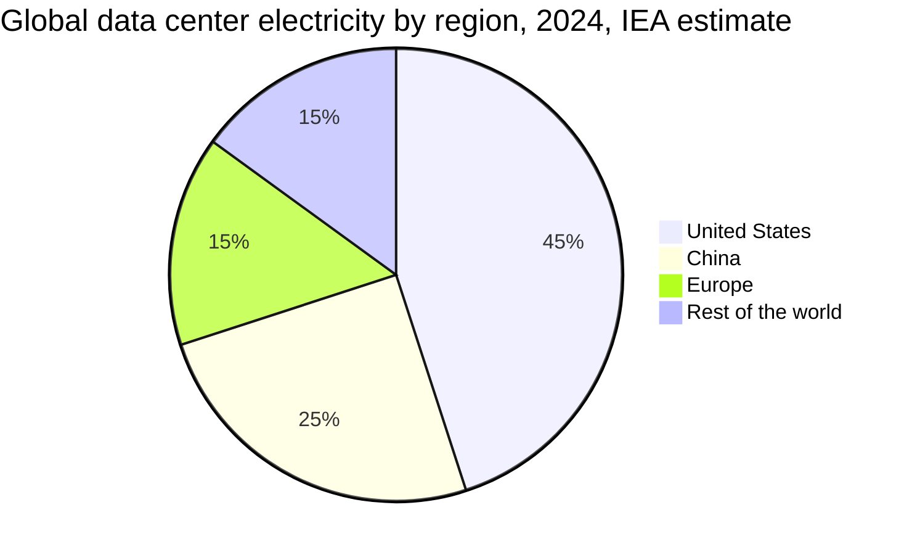
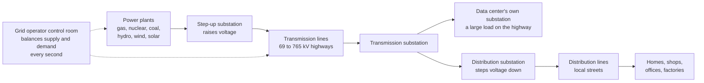
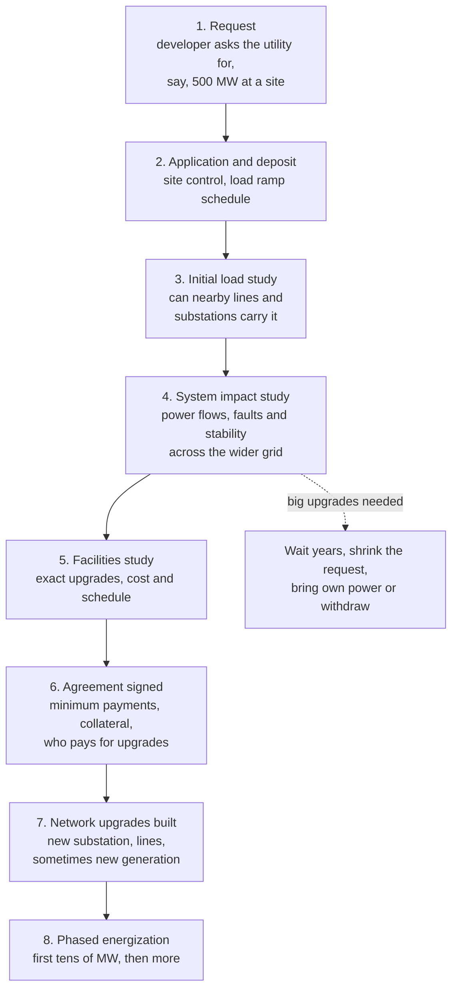
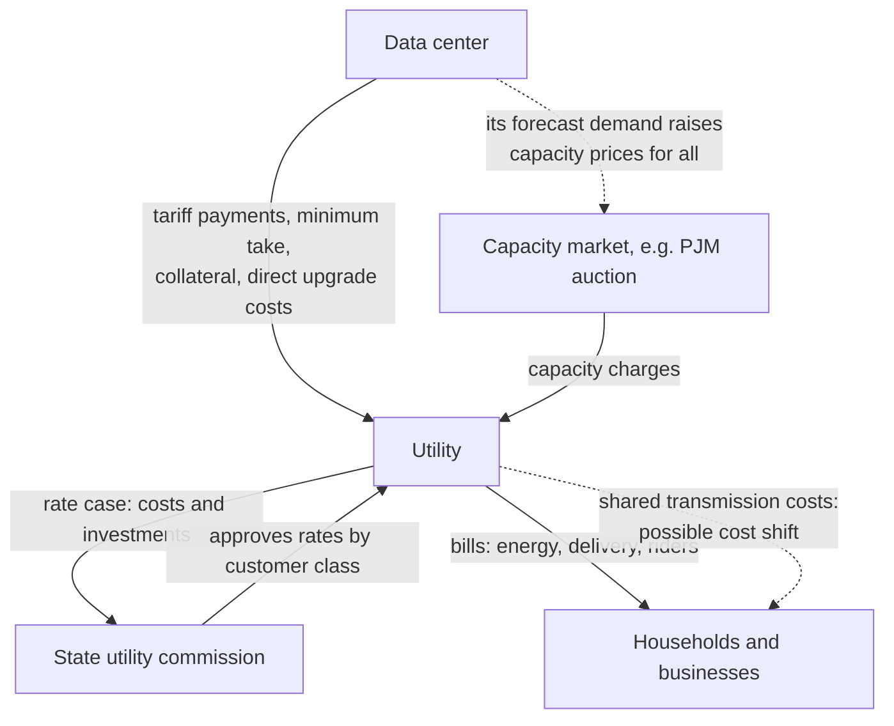
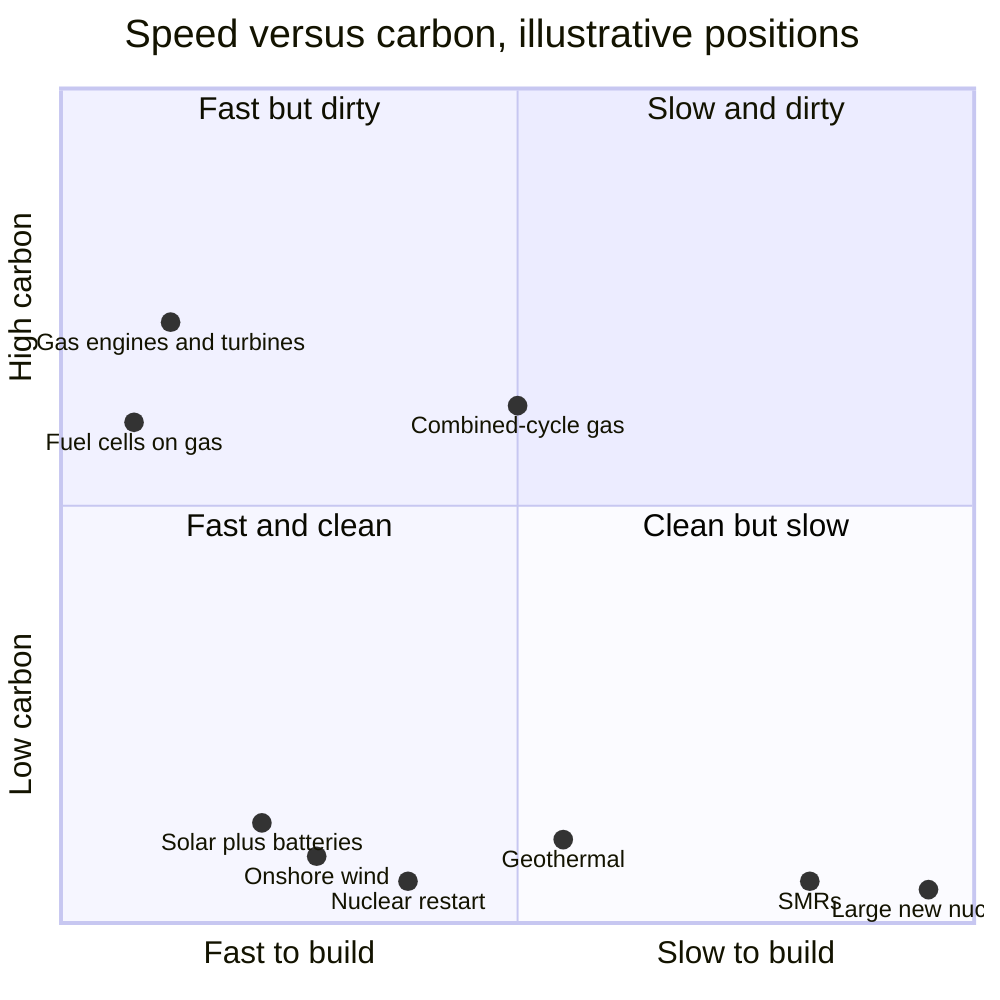
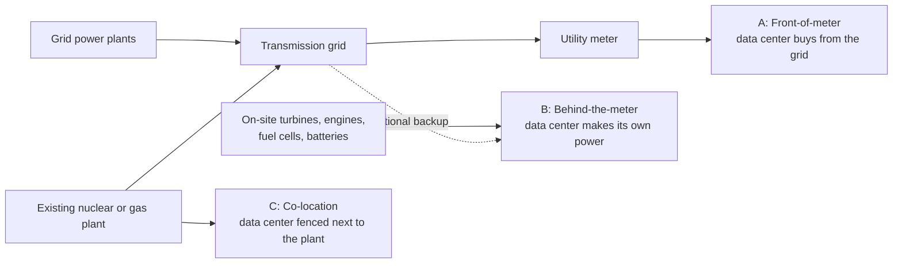
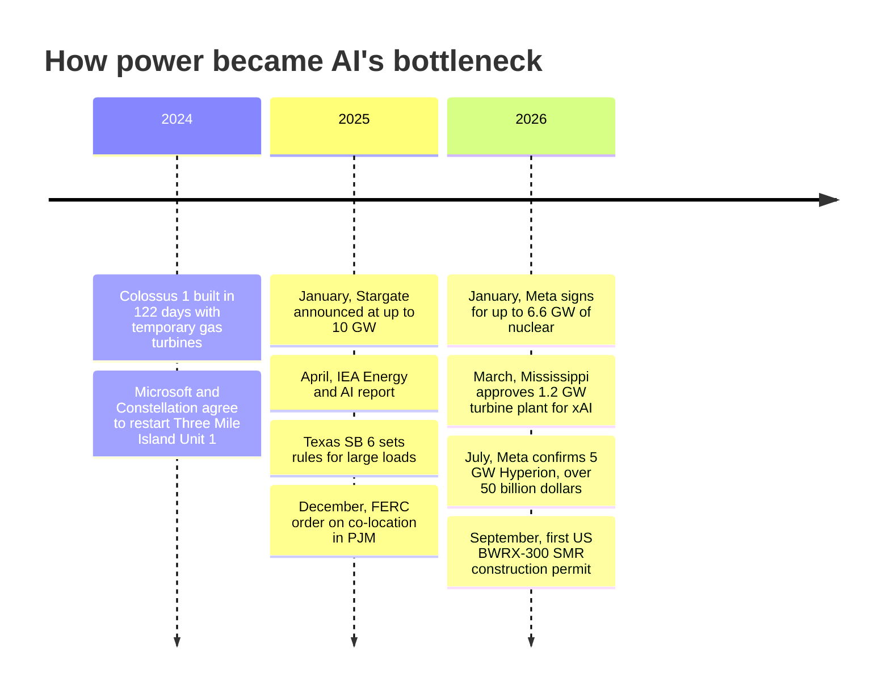
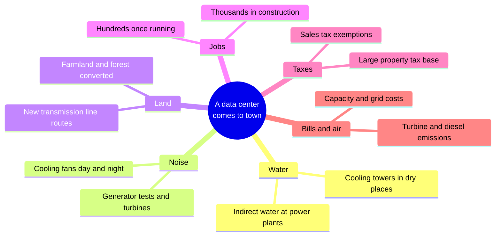

# Chapter 41: Energy for AI: Grids, Gas, Nuclear and Renewables

*This chapter explains where the electricity for AI comes from, why getting it became the industry's hardest problem, and who pays for it, so you can judge every power deal, price rise and data center fight in the news.*

## What you'll learn

- How much electricity data centers and AI really use in 2026, globally, nationally and locally, and why local concentration matters more than global share
- How the electric grid works: generation, transmission, distribution, the second-by-second balancing act, and who runs each piece
- Why connecting a large data center to the grid now takes years, step by step, and what "speed to power" means
- Who pays for new power lines and power plants, how capacity markets work, and the PJM price spike as a case study
- Every energy source compared on cost, speed, carbon, firmness and land: gas, nuclear (restarts, uprates, SMRs, fusion), solar, batteries, wind, geothermal, hydro, fuel cells and coal
- Front-of-meter versus behind-the-meter power, bridge power and co-location, and the fights over each
- How "100% renewable" claims work (PPAs, RECs, 24/7 carbon-free energy, additionality), with a worked example
- Data centers as flexible loads, why demand forecasts disagree, and the effects on bills, reliability, emissions and communities

## Before you start

Chapter 39 (Power: From the Grid to the GPU) is the most important background: it explained watts versus watt-hours, voltage and current, transformers and the power chain inside the fence. This chapter starts outside that fence. Chapter 40 (Cooling: Where the Heat Goes) covered PUE and water, which come back here in the environmental debate. Chapter 38 (Inside a Data Center) showed the substation yard where the grid arrives. Chapter 42 (The Great Buildout) tells the megaproject stories in detail, and Chapter 43 (The Economics of AI Compute) does the full money math; here we focus on the electricity itself.

## Why power became AI's bottleneck

In 2023, the question every AI company asked was "Can we get enough GPUs?" By 2025 and 2026, the question had changed to "Can we get enough power, soon enough?" Chips can be ordered, and factories can make more of them in a year or two. A new power plant, a new high-voltage line or even a large grid connection can take four to ten years. Executives began talking about "speed to power" as the single most important factor in where and how fast AI gets built.

> **Definition — Speed to power:** How quickly a data center project can actually get electricity delivered at the scale it needs. By 2025–26 it had become the industry's top site-selection priority, ahead of land, tax breaks and even electricity price.

To see why, start with what a "gigawatt data center" means.

> **Definition — Gigawatt (GW):** One billion watts, or 1,000 megawatts: about the output of one large nuclear reactor. Frontier AI campuses in 2026 are measured in gigawatts.

> **Definition — Nameplate capacity:** The maximum power a power plant can produce, or a facility can draw. It is a ceiling, not what the plant or facility uses on average.

> **Definition — Capacity factor:** Actual output (or use) over a period divided by the maximum possible. A data center that draws 70% of its capacity on average has a 70% capacity factor, also called its load factor.

**Worked example: a 1 GW campus for a year.** One terawatt-hour (TWh) is a billion kilowatt-hours.

- Flat out: 1 GW × 8,760 hours = 8,760 GWh = 8.76 TWh per year.
- Epoch AI notes that sites typically use 60–80% of capacity on average. At 70%: about 6.1 TWh per year.
- An average US home uses about 10,500 kWh a year, which works out to an average draw of about 1.2 kW (10,500 ÷ 8,760).
- So 1 GW of capacity equals the average draw of roughly 830,000 homes (1,000,000 kW ÷ 1.2 kW). Meta's planned 5 GW Hyperion campus in Louisiana would match the average draw of over 4 million homes.

> **Analogy:** A gigawatt campus is a city's worth of electricity, delivered to one fenced site. Imagine a new city of a million people appearing in a few years, but the city never sleeps, never goes on vacation and wants the same power at 3 a.m. as at 3 p.m.

### How much electricity, really? (as of October 2026)

The numbers below come from the most widely cited sources. Several are forecasts, and forecasts disagree, a topic we return to later.

- **The world.** The International Energy Agency (IEA) estimated in April 2025 that data centers used about **415 TWh in 2024, around 1.5% of global electricity**, and projected about **945 TWh by 2030** in its base case, slightly more than Japan uses today. The US accounted for about 45% of 2024 consumption, China about 25% and Europe about 15%.
- **The United States.** Lawrence Berkeley National Laboratory (LBNL) estimated in December 2024 that US data centers used **176 TWh in 2023, about 4.4% of US electricity**, up from 76 TWh in 2018, and projected **325–580 TWh by 2028, or 6.7–12%**.
- **Hot spots.** In Ireland, data centres used **23% of all metered electricity in 2025**, up from 22% in 2024 and 5% in 2015 (Irish Central Statistics Office, July 2026). In Virginia, data centers were already about a quarter of the state's electricity use in 2023 (EPRI, the Electric Power Research Institute, a research group funded by US utilities).
- **AI specifically.** Epoch AI's tracker (data updated October 20, 2026) lists **95 large AI data centers with about 14.2 GW of IT power, about 18.5 GW including cooling and overhead**. Epoch estimates these cover about 44% of the world's AI compute.
- **Capacity growth.** The property firm JLL (January 2026) expects global data center capacity to roughly **double from about 103 GW to about 200 GW between 2025 and 2030**.

> **Definition — IEA (International Energy Agency):** A Paris-based organization, set up by governments in 1974, that publishes widely used data and forecasts on world energy, including the most cited global estimates of data center electricity use.



*Figure 41.1: Where the world's data center electricity was used in 2024, according to the IEA's April 2025 Energy and AI report. The US alone accounted for almost half.*

> **Key idea:** The global share is modest, about 1.5%. The problems come from concentration and speed: a few regions (Northern Virginia, Ireland, parts of Texas, Ohio and Georgia) are absorbing gigawatts of new demand in a few years, on grids that were planned for slow, steady growth.

> **Watch out:** "AI already uses more electricity than most countries." All data centers together, not just AI, were about 1.5% of world electricity in 2024, and AI was only part of that (JLL estimates about a quarter of data center workloads in 2025). The real concern is local concentration and the speed of growth, not the global total today.

> **Definition — Large load:** A single customer that draws a very large amount of power, often defined by utilities and grid operators as tens of megawatts or more. Big data centers are the archetypal large loads.

> **Definition — Peak demand:** The highest power draw on a grid over a period, usually on the hottest or coldest days. Grids must be built to meet the peak, not the average, which is why new loads that run flat out during peaks are so expensive to serve.

## How the grid works

To understand why connecting a data center is hard, you need a mental model of the grid. Here is the simplest true version.

> **Definition — Grid:** The interconnected network of power plants, high-voltage lines, substations and local wires that delivers electricity from where it is made to where it is used.

Electricity takes three steps. Power plants make it (generation). High-voltage lines carry it long distances (transmission), because high voltage means lower current and lower losses (Chapter 39 explains why). Substations step the voltage down, and lower-voltage local lines carry it to homes and businesses (distribution).

> **Definition — Transmission and distribution:** Transmission lines are the high-voltage "highways" (typically 69,000 to 765,000 volts in the US) that carry power long distances. Distribution lines are the lower-voltage "local streets" that deliver it to homes and businesses.

A large data center does not plug into the streets. It connects to the highways, with its own substation, which is why it competes with whole towns for the same transmission capacity.



*Figure 41.2: The grid in one picture. A data center connects at transmission voltage with its own substation, beside the substations that feed whole towns. The control room (dotted lines) keeps supply and demand matched at every moment.*

### Balancing every second

The grid has almost no storage of its own. At every instant, the power going in must equal the power coming out. If demand rises and nobody produces more, the generators slow very slightly, and the grid's frequency drops.

> **Definition — Grid frequency:** How many times per second the grid's alternating current flips direction: 60 times (60 Hz) in North America, 50 Hz in Europe. Frequency is the grid's pulse: it falls when demand exceeds supply and rises when supply exceeds demand, so operators watch it constantly.

Operators keep plants ready to ramp up or down within seconds or minutes (called reserves), and they forecast demand days ahead to schedule which plants will run. If they run out of options, the last resort is deliberately cutting power to some customers (rolling blackouts) so the whole grid does not collapse. In February 2021, during Winter Storm Uri, Texas's grid came close to a total collapse, and rolling blackouts left millions of people without power for days. Every grid planner in the country remembers that week when a developer asks to add a gigawatt of new demand.

> **Definition — Balancing authority:** The organization responsible for keeping supply and demand matched, second by second, in a defined area of the grid, by dispatching power plants, buying reserves and, if necessary, cutting load.

> **Definition — Firm power:** Electricity that is available whenever it is needed, regardless of weather, such as nuclear, gas, geothermal or hydro with water in the reservoir. Firm sources are also called dispatchable when operators can turn them up or down on command.

> **Definition — Variable (intermittent) power:** Electricity whose output depends on the weather, mainly solar and wind. It is often the cheapest energy available, but it needs storage, backup or flexible demand to provide round-the-clock supply.

### Who runs the grid

The US grid is run by a patchwork of organizations. You will see these names in every data center story.

> **Definition — Utility:** A company that delivers electricity to customers. A vertically integrated utility owns power plants, transmission and distribution in its territory; in restructured states, the local utility mostly owns the wires and buys power on a wholesale market.

> **Definition — ISO / RTO (independent system operator / regional transmission organization):** A non-profit organization that runs the high-voltage grid and wholesale power markets for a region, balancing supply and demand and planning transmission, without owning the power plants or lines.

> **Definition — FERC (Federal Energy Regulatory Commission):** The US federal regulator of interstate transmission and wholesale electricity markets. It approves the rules ISOs use, including rules for connecting power plants and large loads.

> **Definition — PUC (public utility commission):** A state agency (sometimes called a public service commission) that sets the retail electricity rates utilities may charge and approves their investments. Data center tariffs are usually fought out here.

A separate non-profit, the North American Electric Reliability Corporation (NERC), sets and enforces reliability standards across the continent and regularly warns when regions risk shortfalls.

| Grid operator | Region | Why it matters for AI |
|---|---|---|
| PJM | All or parts of 13 states plus Washington, DC, from New Jersey to Illinois, including Virginia and Ohio | Home to Northern Virginia, the world's largest data center market; its capacity prices spiked (case study below) |
| ERCOT (Electric Reliability Council of Texas) | Most of Texas, on a largely separate grid | Cheap land, abundant wind, solar and gas, and a large-load boom drew Stargate Abilene and other megaprojects; Texas wrote special large-load rules in 2025 |
| MISO (Midcontinent Independent System Operator) | Central US from Louisiana to Minnesota and Michigan | Includes Louisiana (Meta's Hyperion) and Wisconsin (Microsoft's Fairwater) |
| SPP (Southwest Power Pool) | Great Plains, including Oklahoma and Kansas | Strong wind resources and growing data center interest |
| CAISO, NYISO, ISO-NE (the California, New York and New England ISOs) | California, New York, New England | Expensive power and tight land; less megaproject activity |
| No ISO | Much of the Southeast (for example TVA, the federally owned Tennessee Valley Authority, and Georgia utilities) and much of the West | Vertically integrated utilities plan and build for data centers directly; Memphis (xAI's Colossus) is in TVA's region |

*Table 41.1: The main US grid operators and their role in the AI buildout, as of late 2026.*

> **Definition — PJM (PJM Interconnection):** The largest US grid operator (an ISO/RTO), running the grid and wholesale markets for all or parts of 13 states plus Washington, DC. The letters come from its founding states: Pennsylvania, New Jersey and Maryland.

> **Try it:** Ask a chatbot: "Which utility and which grid operator serve my town of [your town, state]? Roughly what share of my state's electricity came from gas, nuclear, coal, wind and solar last year?" Then check the answer against the US Energy Information Administration's free state profile for your state (eia.gov/state). Note anything the chatbot got wrong or out of date.

> **Definition — EIA (US Energy Information Administration):** The statistics agency of the US Department of Energy. It publishes free official data and short-term forecasts on electricity prices, generation by source and new power plants.

### How wholesale prices are set

In most ISO regions, power plants bid into a market every few minutes, and the operator uses the cheapest plants first.

> **Definition — Wholesale electricity market:** The market in which power plants sell electricity to utilities and large buyers, usually run by an ISO, with prices set for every few minutes or hour at each location on the grid.

> **Definition — Merit order:** The ranking of power plants from cheapest to most expensive to run. The operator switches them on in that order until supply meets demand, and the last plant needed (the marginal plant) sets the price that every plant running in that hour receives.

Here is a toy example with four plants and their running costs per megawatt-hour (illustrative numbers):

```
 $/MWh
  90 |                                                ########
  75 |                                                ########
  60 |                                                ########
  45 |                                                ########
  35 |                                ########################
  25 |                                ########################
  10 |            ############################################
   0 |____________############################################
     +--------------------------------------------------------
      0           300                 800             1200 1400 MW
         solar          nuclear            gas CC       peaker
                                              ^           ^
                                      1,000 MW: $35   1,300 MW: $90
```

*Figure 41.3: A toy merit order. Solar (300 MW, near-zero running cost), nuclear (500 MW, $10), a gas combined-cycle plant (400 MW, $35) and a gas peaker (200 MW, $90) are stacked from cheapest to most expensive.*

- When demand is 1,000 MW, the operator runs solar, nuclear and half the gas plant. The marginal plant is the gas plant, so the price is **$35/MWh**.
- Now a new 300 MW data center connects, and demand becomes 1,300 MW. The operator must also run part of the peaker, and the price jumps to **$90/MWh**, for every megawatt-hour sold in that hour, not just the data center's.

This toy model shows why large new loads can raise prices for everyone, at least until new, cheap supply gets built. It also shows why cheap supply that can be built fast is so valuable.

## Getting connected: queues measured in years

Every new power plant and every new large load must ask permission to connect, and the grid operator or utility must check that the grid can handle it.

> **Definition — Interconnection:** The physical and contractual connection between a power plant or a large customer and the grid, including the engineering studies, equipment and agreements needed to make it safe.

> **Definition — Interconnection queue:** The waiting line of projects asking to connect to the grid. Each must be studied in turn, and in many US regions the wait now runs several years.

There are really two queues. Power plants wait in the generator queue; large customers wait in a load queue run by their utility. Both have exploded. Lawrence Berkeley National Laboratory's "Queued Up" tracking has found roughly two thousand gigawatts or more of proposed generation and storage waiting in US queues in recent years, more than the entire existing US power fleet, and historically only a minority of queued projects ever get built.

Here is the typical process for a large data center load.



*Figure 41.4: The large-load interconnection process. Each study can take months; the network upgrades in step 7 can take years, especially when new high-voltage lines or power plants are needed.*

> **Definition — System impact study:** An engineering study of how a proposed power plant or large load would affect the wider grid: whether lines would overload, how faults would behave and whether the grid would stay stable.

> **Definition — Network upgrade:** New or reinforced grid equipment, such as substations, transformers or transmission lines, needed before a new plant or load can safely connect. Who pays for it is one of the most contested questions in the industry.

How long does it take? JLL reported in January 2026 that the average wait for a grid connection in primary data center markets exceeds **four years**. A single new high-voltage transmission line can take seven to ten years once routing fights and permits are counted. Meanwhile, large power transformers and switchgear have multi-year order backlogs (Chapter 42 covers these bottlenecks).

> **Analogy:** The interconnection queue is a waiting list at a popular restaurant where each party must also pay to expand the kitchen before being seated, and nobody knows how many of the names on the list are real.

That last point is serious. Developers often file requests with several utilities at once and drop all but the best.

> **Definition — Phantom load (speculative load):** Data center power requests filed in many places at once by developers shopping for the best site. They inflate utilities' demand forecasts and clog queues, because many will never be built.

### "Speed to power": how the industry responds

Faced with four-year waits, AI companies and developers have developed a playbook:

- **Go where the power is.** Texas, the Midwest, the Gulf Coast and the Nordics, where land is cheap and power can come sooner, have won megaprojects that might once have gone to Northern Virginia.
- **Build your own power.** On-site gas turbines, engines or fuel cells can arrive faster than the grid (the next sections cover this "behind-the-meter" option).
- **Sit next to an existing power plant.** Connecting directly to a nuclear or gas plant, called co-location, skips some of the transmission bottleneck.
- **Accept interruptible service.** Agreeing to cut demand during grid emergencies can let a site connect before the grid is fully upgraded.
- **Bring batteries.** Large batteries can smooth demand and cover short peaks.
- **Bring your own power by rule.** In Ireland and Texas, regulators have moved toward "bring your own power" style requirements for large new loads, according to JLL.

> **Key idea:** For an AI data center, the critical path runs through the power connection, not the building. A building can go up in 18–36 months; new power can take 3–7 years or more. That gap explains most of the unusual energy deals in this chapter.

## Who pays: rates, tariffs and capacity markets

Someone has to pay for the new substations, lines and power plants. The fight over who has become one of the hottest political issues around AI.

### How utilities get paid

Most US utilities are regulated monopolies. They are allowed to recover their costs plus a set profit on what they invest.

> **Definition — Rate case:** A formal proceeding before a state utility commission in which a utility asks to change the prices it charges, showing its costs and investments; the commission decides how much may be passed on to customers, and to which customer classes.

> **Definition — Tariff:** The official, regulator-approved price list and rules for a type of electricity customer, such as residential, small business or large industrial.

When a utility builds a new substation for a data center, the question is whether the data center pays for it directly, or whether the cost goes into the shared pool that all customers (called ratepayers) pay for through their bills. The risk that worries regulators most is stranded cost.

> **Definition — Stranded cost:** Money spent on power plants or grid equipment that is no longer needed or paid for, for example because the data center it was built for shrinks, leaves or never arrives. If not contractually assigned to the data center, stranded costs end up on everyone else's bills.

To prevent it, utilities and commissions have created special rules.

> **Definition — Large-load tariff:** Special utility rules for very large customers such as data centers, typically including long minimum contract terms, minimum monthly payments for most of the requested capacity even if unused, collateral, and exit fees, so other customers are not left with stranded costs.

### Capacity markets and the PJM case study

Some regions also pay power plants simply to exist and be available at peak times.

> **Definition — Capacity market:** A market, run by some grid operators such as PJM, that pays power plants years in advance to be available during peak demand. Its cost is spread across every customer's bill.

> **Definition — Base Residual Auction (BRA):** PJM's main capacity auction, held about three years ahead of each delivery year, in which the price per megawatt per day of available capacity is set for the whole region.

PJM's auctions became the clearest example of data center demand reaching household bills. The figures below are as reported from PJM's auction results; check PJM's official auction reports for the exact final numbers before you rely on them:

| Delivery year | Capacity price (approximate, $ per MW-day) |
|---|---|
| 2024/25 | about $29 |
| 2025/26 | $269.92 |
| 2026/27 | about $329 (the auction's price cap) |
| 2027/28 | about $333 (at the cap) |

*Table 41.2: PJM capacity auction clearing prices. PJM's own report on the 2027/28 auction says it cleared about 6.6 GW short of the region's reliability requirement, at a total cost of about $16.4 billion. Data center load growth is the main driver of PJM's forecast demand growth.*

**Worked example: from auction to household bill.** Prices are quoted per megawatt per day. Convert to per kilowatt per year:

- $329 per MW-day × 365 days ÷ 1,000 kW per MW ≈ **$120 per kW-year**.
- $29 per MW-day × 365 ÷ 1,000 ≈ **$10.60 per kW-year**.
- Suppose, as an illustration, that a household's share of the grid's peak demand is about 2 kW. Its capacity cost would rise from about $21 a year to about $240 a year.

That is a rough upper-bound illustration, not a bill forecast. Real bills lag and blend these costs, utilities hedge, and each household's share of the peak differs. But it shows the mechanism: a market that buys capacity three years ahead turns forecast data center growth into higher bills today.

### Are households subsidizing data centers?

This is a genuine debate. Here are the strongest versions of each side.

**The case that households pay for data centers:**

- New transmission and capacity costs are often spread across all customers, while the demand that caused them comes from a few large users.
- Utilities can build for forecast loads that never fully arrive (phantom load), leaving stranded costs.
- Special discounted contracts and generous tax incentives can mean data centers pay less than their share.
- In PJM, capacity prices rose roughly tenfold in two auctions, largely because of forecast data center growth.

**The case that data centers pay their way, or even lower costs:**

- Data centers pay very large electricity bills. Where the grid has spare capacity, spreading fixed costs over more kilowatt-hours can lower rates for everyone.
- New large-load tariffs increasingly require minimum payments, collateral and direct payment for upgrades; Meta, for example, is funding new transmission for its Hyperion campus in Louisiana.
- Many other forces push bills up: fuel prices, replacing aging equipment, wildfire costs in the West, and new transmission for other reasons.

What the data show so far is mixed. The US Energy Information Administration's October 2026 outlook puts average US residential electricity at **17.3¢/kWh in 2025, 18.2¢ in 2026 and a forecast 18.7¢ in 2027**, a rise driven by many factors. Data centers are clearly a major driver in some markets, PJM above all, and a minor one in others.

Politics has moved fast. A White House framework released in March 2026 called for protecting residential ratepayers from data-center-driven cost increases, Texas wrote cost-sharing rules into law in 2025, and in 2026 Virginia's Senate reportedly voted to phase out the state's sales-tax exemption for data centers.



*Figure 41.5: Who pays for a new data center's power. Solid arrows are payments and approvals; dotted arrows mark where costs caused by a data center can spread to everyone else.*

> **Watch out:** "Electricity prices are rising only because of data centers." Data centers are a big driver in some markets, especially PJM's capacity prices, but fuel prices, transmission and distribution spending, wildfire costs, aging plants and retirements also push bills up. Good analysis separates these.

## Every energy source, compared

Now the central question: where should the electricity come from? Every source involves trade-offs on five dimensions, and AI companies care about all five at once.

1. **Cost.** How much each megawatt-hour costs over the plant's life.
2. **Speed.** How many years until first power.
3. **Carbon.** How much CO₂ (carbon dioxide) is emitted per kilowatt-hour, counting construction and fuel.
4. **Firmness.** Whether it is available 24/7, which matters because AI data centers run around the clock.
5. **Land.** How much space it needs, which matters for permitting and community acceptance.

Two more definitions make the comparison fair.

> **Definition — LCOE (levelized cost of energy):** The average cost of each megawatt-hour a plant will produce over its life, counting construction, financing, fuel, operations and maintenance. It is useful for comparing plants but ignores the extra cost of making variable power available around the clock.

> **Definition — Lifecycle emissions:** The greenhouse gases emitted per kilowatt-hour over a power source's whole life, including building the plant, mining and transporting fuel, operating and dismantling it, measured in grams of CO₂-equivalent per kWh. "CO₂-equivalent" (CO₂e) counts other greenhouse gases, such as methane, as the amount of CO₂ that would cause the same warming.

### Natural gas: the near-term winner

Natural gas is the largest single source of US electricity, a bit over 40% in 2024, and in 2025–26 it became the default answer for AI power that is needed fast and around the clock. It comes in four main machines.

> **Definition — Combined-cycle gas turbine (CCGT):** A gas turbine whose hot exhaust also makes steam to spin a second turbine. It is the most efficient fossil plant (around 60% of the fuel's energy becomes electricity) but large and slow to build, about 4–6+ years including equipment lead times.

> **Definition — Simple-cycle (peaker) turbine:** A gas turbine without the steam stage. It is less efficient than combined cycle but cheaper, faster to build and quick to start, so it traditionally runs only at peak times.

> **Definition — Aeroderivative turbine:** A compact gas turbine adapted from a jet engine. It starts quickly and fits on trailers or small pads, which makes it popular for on-site AI power.

> **Definition — Reciprocating engine:** A large piston engine driving a generator, like an enormous car engine. Engines come in modular units of a few megawatts each, so many can be installed side by side quickly.

What the AI industry did with gas, as of October 2026:

- **xAI's Colossus in Memphis** started with an initial grid supply of only about 8 MW in 2024 and filled the gap with temporary gas turbines and Tesla Megapack batteries (reported). For Colossus 2 next door, Mississippi approved a permanent **plant of about 1.2 GW with 41 turbines in Southaven (March 2026)**, and the NAACP (a long-established US civil rights organization), represented by the environmental law groups Southern Environmental Law Center and Earthjustice, sued in April 2026 under the Clean Air Act, the main US air-pollution law (reported).
- **Stargate's Shackelford County, Texas, site** plans an on-site gas microgrid, and the **Doña Ana County, New Mexico** site plans two gas microgrids (Epoch AI, April 2026). Reports put the Shackelford microgrid at about **700 MW of VoltaGrid gas engines behind the meter**.
- **Meta's Hyperion** in Louisiana is served by new combined-cycle gas plants that the utility Entergy is building, and Meta's Prometheus campus in Ohio uses on-site gas plants to supplement the grid (reported).
- **Turbine makers** (GE Vernova, Siemens Energy, Mitsubishi Power) report multi-year backlogs. Large turbines ordered in 2025–26 are often reported to arrive around 2029–2030, an estimate the makers' late-October 2026 results may update.

Why gas? It is firm, it uses an existing pipeline network, engines and small turbines can arrive in months to a couple of years, and its fuel has been relatively cheap in the US. The downsides are carbon (a combined-cycle plant emits roughly half as much CO₂ per kWh as coal, but far more than nuclear or renewables), methane leaks from wells and pipelines, local air pollution from turbines and engines, air permits, and exposure to future fuel prices.

> **Watch out:** Gas is fast only if you can get the machines. By 2026, the big turbines had become a bottleneck themselves, which is one reason developers turned to smaller engines, aeroderivatives and fuel cells.

### Nuclear: existing plants now, new reactors later

Nuclear power is firm, nearly carbon-free and runs about 90% or more of the hours in a year, which makes it a near-perfect match for a data center's flat, round-the-clock demand. It supplies about a fifth of US electricity and around half of the country's carbon-free electricity. Tech companies have pursued it in four ways.

**1. Buying output from existing plants.** Talen Energy agreed to supply Amazon from the Susquehanna plant in Pennsylvania (reportedly about 1.9 GW); Constellation agreed to supply Meta from its Clinton plant in Illinois (2025); and in January 2026, Vistra agreed to supply Meta with 2.1 GW or more from its Perry and Davis-Besse plants in Ohio.

**2. Uprates.** The same Vistra deal includes 433 MW of uprates.

> **Definition — Uprate:** Increasing an existing power plant's output through equipment upgrades, such as new turbines or more efficient fuel. For nuclear plants, uprates add carbon-free power at existing sites without building a new reactor.

**3. Restarts.** A handful of recently closed plants are coming back.

> **Definition — Nuclear restart:** Returning a shut-down nuclear plant to service by repairing, relicensing and refueling it. It is far faster and cheaper than building a new reactor but only possible at a few recently closed plants.

- **Three Mile Island Unit 1** (TMI-1), renamed the Crane Clean Energy Center, will sell its output to Microsoft under a 20-year agreement announced in 2024 (about 835 MW according to Constellation). A $1 billion Department of Energy loan was announced in November 2025, and the restart was reportedly targeted for 2027 (originally 2028), a date that could still move.
- **Duane Arnold** in Iowa is reportedly being restarted for Google by 2029, and Holtec has been restarting **Palisades** in Michigan.

**4. New reactors.** This is where the long-term bets are.

> **Definition — SMR (small modular reactor):** A nuclear reactor of up to about 300 MW designed to be built largely in factories, in standardized modules, to cut cost and construction time compared with today's large reactors.

> **Definition — Advanced reactor:** A reactor using a non-traditional design, such as sodium cooling (TerraPower's Natrium, Oklo's Aurora), molten-salt cooling (Kairos) or high-temperature gas (X-energy), aiming for better safety, efficiency or cost.

- **In late September 2026, the US Nuclear Regulatory Commission approved the first US construction permit for a BWRX-300 SMR** (a 300 MW GE Vernova Hitachi design), at the Tennessee Valley Authority's Clinch River site in Oak Ridge, Tennessee; the NRC announced it on September 29.
- **Earlier, on March 4, 2026,** the NRC approved construction of TerraPower's first Natrium plant in Wyoming, its first approval to build a commercial reactor in about ten years.
- As of 2026, only China and Russia operate SMRs (reported).
- **Google–Kairos:** 500 MW of SMRs for 2030–35 (reported). **Amazon–X-energy:** an SMR partnership.
- **Meta (January 9, 2026):** up to 6.6 GW of nuclear by 2035, including up to 1.2 GW from Oklo in Pike County, Ohio, as early as 2030, and two TerraPower Natrium units (690 MW) as early as 2032, with rights to six more.

> **Definition — NRC (Nuclear Regulatory Commission):** The independent US federal agency that licenses and inspects nuclear power plants. Every new reactor, restart and uprate in the US needs its approval.

> **Definition — BWRX-300:** A 300 MW small modular reactor designed by GE Vernova Hitachi, a simplified boiling-water reactor (one that boils water directly in the reactor to drive a steam turbine). Its first US construction permit, for the Tennessee Valley Authority's Clinch River site, came in September 2026.

Large conventional reactors are a cautionary tale. The two new reactors at Plant Vogtle in Georgia, the only ones completed in the US in decades, entered service in 2023 and 2024, years late and many billions of dollars over budget. That history is why companies are betting on smaller, factory-built designs, and why skeptics want to see SMRs delivered on time before believing their cost promises.

> **Definition — Fusion power:** Electricity from fusing light atoms together, the process that powers the Sun. As of late 2026, no fusion plant has delivered electricity to a grid; a few tech companies have nevertheless signed early power agreements with fusion startups, such as Microsoft's 2023 deal with Helion.

> **Watch out:** "Nuclear will power AI soon." Existing plants, uprates and restarts help this decade, but they are few. New SMRs mostly arrive in the 2030s: the first US construction permit for a BWRX-300 came only in September 2026. Gas is filling the gap in the meantime.

### Solar, batteries and wind: cheapest energy, not yet 24/7

> **Definition — Solar photovoltaics (PV):** Panels that turn sunlight directly into electricity. Utility-scale solar farms produce some of the cheapest electricity available, but only when the sun shines, averaging about a quarter of their maximum output over a year in the US.

> **Definition — Battery energy storage system (BESS):** Large banks of batteries, usually lithium-ion, that store electricity and release it later. Grid batteries commonly hold about four hours of their rated output, enough to shift solar power into the evening but not through a long night or a cloudy week.

Solar plus batteries and wind remain the largest sources of new US generating capacity. The EIA expects US solar capacity to grow from **152 GW in 2025 to 182 GW in 2026 and 223 GW in 2027** (October 2026 outlook). Developers pair them with data centers: at Stargate's Milam County, Texas, site, SB Energy (a solar and storage developer) plans to build new generation and storage for most of the campus's power; the Port Washington, Wisconsin, site claims about 70% of its power from solar, wind and batteries; and Entergy has proposed 1.5 GW of new solar and solar-plus-storage for Meta's Hyperion on top of 3 GW previously approved. Google says in its 2026 environmental report that it signed contracts for over 12 GW of new clean energy in 2025, a record.

Wind complements solar because it often blows at night and in winter. Onshore wind farms produce on average about a third of their maximum output and spread over large areas, though farming continues between the turbines. In 2025, Congress voted to phase out federal tax credits for new wind and solar over the following few years, and the federal government halted several offshore wind projects, which raised costs and uncertainty for developers.

**Worked example: running a 100 MW data center on solar and batteries alone.** Assume a sunny site where the panels produce for about 10 hours a day and average 25% of nameplate over the year.

- Daily energy needed: 100 MW × 24 hours = 2,400 MWh.
- Solar nameplate needed on an average day: 100 MW ÷ 0.25 = **400 MW**.
- Night-time energy to store: 14 hours × 100 MW = **1,400 MWh**, roughly 350 MW of four-hour batteries (more after battery losses).
- Land: at a rule of thumb of about 5–7 acres per MW of solar, 400 MW needs roughly 2,000–2,800 acres, three to four square miles.
- And that only covers an average day. Cloudy weeks and short winter days need several times more storage, or backup from the grid or gas.

That is why solar-heavy AI sites in 2026 pair renewables with batteries and with grid or gas backup, rather than running on sunshine alone.

### Geothermal, hydro and fuel cells

> **Definition — Enhanced geothermal system (EGS):** Drilling deep into hot rock and fracturing it so water can circulate and bring up heat to make electricity, using techniques borrowed from oil and gas drilling. It aims to make firm geothermal power possible in many more places, as the startup Fervo is attempting.

Geothermal power is firm, low-carbon and compact, but conventional geothermal works only where hot water or steam sits close to the surface, mostly in the western US. Enhanced geothermal could change that; Google has a deal with Fervo. It is promising but still small in 2026.

Hydropower, from water flowing through dams, is firm, cheap once built and very low-carbon, which is why data centers clustered for years in the Pacific Northwest, Quebec and the Nordic countries. But almost all good US sites are already dammed, reservoirs flood large areas, and droughts cut output. Existing hydro is fully spoken for; new hydro is not a near-term AI answer.

> **Definition — Fuel cell:** A device that turns a fuel such as natural gas or hydrogen into electricity through a chemical reaction rather than burning it. Solid-oxide fuel cells like Bloom Energy's can be installed on site quickly and emit fewer local air pollutants than engines, though running on natural gas they still emit CO₂.

Bloom Energy has signed fuel-cell supply deals for fast on-site power with the utility AEP (American Electric Power), with Oracle and with Brookfield. Fuel cells cost more per megawatt-hour than large gas plants, but their speed and lower local pollution make them attractive as bridge or permanent on-site power.

### Coal: retirements delayed

No new coal plants are being built in the US, but demand growth has slowed the closing of old ones. Utilities facing data center load have postponed planned coal retirements, and in 2025 the federal government used emergency orders to keep some retiring coal plants running. Coal is firm but is the highest-carbon source and a major local air polluter, so delayed retirements are one of the clearest ways AI growth raises emissions.

### The big comparison table

Here is every option on one page. Cost tiers are relative. As a rough guide, widely cited levelized-cost studies such as the investment bank Lazard's 2024–2025 editions put unsubsidized new utility-scale solar and onshore wind at very roughly $30–90 per MWh, new combined-cycle gas at roughly $45–110, gas peakers well above $100, and new nuclear roughly $140–220. Those bands move every year with interest rates, fuel prices, equipment shortages and subsidies, and they do not include the cost of making variable power firm. Lifecycle carbon values are the median estimates from the 2014 review by the Intergovernmental Panel on Climate Change (IPCC, the United Nations body that assesses climate science); newer studies differ in detail but not in ranking.

| Source | Cost tier (new build) | Typical time to first power (2026) | Lifecycle carbon (g CO₂e per kWh) | Firmness | Land | AI examples (dated) |
|---|---|---|---|---|---|---|
| Gas, combined cycle | Medium | about 4–6+ years; big turbines ordered 2025–26 often quoted for about 2029–30 (reported) | about 490 | Firm | Small plant, plus pipelines and gas fields | Entergy plants for Meta Hyperion (2026) |
| Gas, simple-cycle and aeroderivative turbines | Medium-high | months (rented mobile units) to about 3 years | higher than combined cycle | Firm | Small | xAI Colossus turbines (2024–26); 1.2 GW Southaven plant approved March 2026 |
| Gas reciprocating engines | Medium-high | months to about 2 years | higher than combined cycle | Firm | Small | About 700 MW of VoltaGrid engines reported for Stargate Shackelford (2026) |
| Fuel cells on natural gas | High | months | roughly gas-plant level | Firm, if gas flows | Very small | Bloom deals with AEP, Oracle, Brookfield |
| Coal, delayed retirement | Low to run (old plants) | already built | about 820 | Firm | Plant plus mines | Retirements postponed (2025–26) |
| Existing nuclear, bought by contract | Medium | immediate, but moves existing clean power | about 12 | Firm, about 90%+ of hours | Very small | Talen–Amazon (about 1.9 GW); Vistra–Meta (2.1 GW+, January 2026) |
| Nuclear uprate | Medium | a few years | about 12 | Firm | None extra | Vistra–Meta 433 MW (January 2026) |
| Nuclear restart | Medium | about 3–4 years | about 12 | Firm | None extra | Crane/TMI-1 for Microsoft, reportedly 2027 (date may move) |
| New large nuclear | Very high | 10+ years | about 12 | Firm | Small | Vogtle 3 and 4 (2023–24), the cautionary tale |
| SMR / advanced reactor | Unknown, hoped to fall | first US units around 2030 at the earliest | about 12 (expected) | Firm | Small | First US BWRX-300 permit, late September 2026; TerraPower Natrium approval, March 2026; Kairos, Oklo, X-energy deals |
| Fusion | Unknown | unproven; no grid power yet | very low (expected) | Firm (expected) | Small | Microsoft–Helion (2023) |
| Utility solar | Low | about 1–2 years to build, plus queue time | about 48 | Variable, about 25% average output | Large, about 5–7 acres per MW | Port Washington Stargate site, about 70% solar, wind and batteries (planned) |
| Solar plus 4-hour batteries | Low-medium | about 1–2 years, plus queue time | low | Covers evenings, not nights or cloudy weeks | Large | Hyperion solar-plus-storage proposals (2026) |
| Onshore wind | Low | about 1–3 years, plus permits | about 11 | Variable, about a third average output | Very large spread, small footprint | Corporate PPAs, often in Texas and the Plains |
| Geothermal (conventional and enhanced) | Medium | several years | about 38 | Firm | Small | Google–Fervo |
| Hydro (existing) | Low to run | already built; new dams take a decade or more | about 24 | Firm-ish, droughts cut output | Very large reservoirs | Historic draw to the Pacific Northwest and Nordics |

*Table 41.3: Every energy source compared, as of October 2026. Cost tiers are relative; carbon figures are IPCC 2014 lifecycle medians where available; dates marked "reported" or "may move" come from news reports and are the most likely to change.*

The same story in one picture: the sources you can get fastest are mostly fossil, and the cleanest firm sources are mostly slow.



*Figure 41.6: The core dilemma. Firm power that is both fast and clean is scarce; solar, batteries and wind are fast and clean but variable.*

> **Key idea:** No single source wins on all five dimensions. Gas is fast and firm but emits carbon. Nuclear is firm and clean but slow (except restarts). Solar and wind are cheap and clean but variable. That is why the biggest AI campuses of 2026 stitch together several sources at once.

## Front-of-meter, behind-the-meter and co-location

There are three basic ways to physically power a data center, and each comes with its own fights.

> **Definition — Front-of-meter:** A data center that buys its electricity from the grid through a normal utility connection; the power plants are on the grid's side of the meter.

> **Definition — Behind-the-meter (BTM):** Generation located on the customer's side of the utility meter, usually on site, so the data center makes some or all of its own power.

> **Definition — Co-location (power):** Placing a data center right next to a power plant and connecting it directly, for example beside a nuclear station. Not to be confused with "colocation" data centers, which rent space to many tenants.

> **Definition — Bridge power:** Temporary on-site generation, often gas turbines, engines or fuel cells, that powers a data center until its permanent grid connection is ready.

> **Definition — Microgrid:** A self-contained local power system, with its own generation and often batteries, that can run connected to the main grid or entirely on its own.



*Figure 41.7: Three ways to power a data center. A is the classic grid connection. B makes its own power on site, sometimes with a grid connection as backup. C takes power straight from an adjacent plant that also feeds the grid.*

**The trade-offs:**

- **Front-of-meter** is the simplest and most reliable, because the grid has many plants behind it, but it is also the slowest to get in congested regions.
- **Behind-the-meter** is fast and gives control, but the data center must handle its own reliability (an island with no grid needs lots of spare generators), its own fuel supply and its own air permits. Local pollution concentrates next to the site, as Memphis residents argued about xAI's turbines.
- **Co-location** skips some transmission bottlenecks and buys firm clean power. But regulators ask whether the data center still relies on the grid for backup and should pay for it, and whether taking an existing clean plant's output away from everyone else just forces the grid to replace it with gas. In December 2025, FERC issued a unanimous order on how data centers may connect directly to power plants in PJM (reported).

> **Analogy:** Behind-the-meter power is like digging your own well instead of using city water. It is faster if the city has a waiting list, but you maintain the pump, you answer for what it does to the neighbors, and if it breaks you have no backup unless you kept the city connection too.

## Clean-energy accounting: what "100% renewable" really means

Most big tech companies have climate goals, and many say they buy enough clean electricity to match their use. How does that work when the actual electrons come from whatever plants are running on the local grid?

> **Definition — PPA (power purchase agreement):** A long-term contract, often 10–20 years, to buy electricity from a specific power plant at an agreed price. In a virtual PPA, the buyer and plant settle only the price difference financially, and the buyer receives the plant's renewable certificates without physically taking the power.

> **Definition — REC (renewable energy certificate):** A tradeable certificate proving that one megawatt-hour of renewable electricity was generated. Buying RECs lets a company claim that clean power, even if its own electricity came from other plants.

> **Definition — Annual matching:** Buying as many clean megawatt-hours (or RECs) over a year as you consume over that year, regardless of when or where the clean power was made. Most "100% renewable" claims are annual matching.

> **Definition — 24/7 carbon-free energy (CFE):** Matching consumption with carbon-free power every hour of every day, on the same grid where the power is used. It is much stricter and harder than annual matching; Google has set a goal of reaching it by 2030.

> **Definition — Additionality:** Whether a clean-energy purchase caused new clean power to be built that would not otherwise exist, rather than claiming output that existing plants were already producing.

**Worked example: a "100% solar" data center, one day.** A data center uses a steady 100 MW, so 2,400 MWh per day. It signs a solar PPA for a farm that produces 240 MW for 10 sunny hours: 2,400 MWh per day. On paper, its use is 100% matched.

```
 240 |              ####################
 200 |              ####################
 160 |              ####################
 120 |              ####################
 100 |==============####################==============  <- load
  80 |              ####################
  40 |              ####################
   0 +------------------------------------------------
      0     3     6     9     12    15    18    21    24  hour
```

*Figure 41.8: A toy day. The data center's steady 100 MW load (the line) against a solar farm's output (the block, 240 MW from 7 a.m. to 5 p.m.).*

Now look hour by hour:

- During the 10 sunny hours, the data center uses 100 MW × 10 h = 1,000 MWh, all matched by solar. The other 1,400 MWh of solar goes to the grid, helping other customers.
- During the 14 dark hours, the data center uses 100 MW × 14 h = 1,400 MWh from the grid, which at night may be mostly gas or coal.
- Hourly matched share = 1,000 ÷ 2,400 ≈ **42%**.

> **Try it:** Open the free Electricity Maps app (app.electricitymaps.com), pick your region and look at the last 24 hours. Find the cleanest and dirtiest hours of the day. Those are the hours when a data center's "100% renewable" claim is most and least true.

Same purchase, two honest answers: 100% on an annual or daily basis, about 42% on an hourly basis. Neither is a lie, but they mean very different things for the atmosphere at 2 a.m. That is why 24/7 matching and additionality have become the tests that serious analysts apply, and why the main greenhouse gas accounting standard (the GHG Protocol, GHG standing for greenhouse gas) has been reviewing its electricity rules with proposals for hourly matching.

Additionality is the other test. When a company signs a contract for an existing nuclear plant's output, it gets firm clean power, but the grid loses that power for everyone else. Supporters argue such deals keep existing plants running and fund uprates and license extensions; critics argue they mostly reshuffle existing clean power while new demand is met by gas.

> **Watch out:** "100% renewable means it runs on renewables every hour." Most such claims use annual matching with certificates. Hourly, same-grid matching (24/7 CFE) is much harder and much rarer.

Company climate reports sort their emissions into three buckets, defined by the GHG Protocol, and you need them to read any tech company's sustainability report.

> **Definition — Emission scopes (Scope 1 to Scope 3):** Scope 1 is greenhouse gas from sources a company owns or controls, such as its backup diesel generators, boilers and vehicles. Scope 2 comes from making the electricity it buys. Scope 3 is everything else in its value chain, such as the emissions from making the chips, servers, steel and concrete it buys.

For a data center operator, Scope 1 is tiny (about 1% of Google's total in 2023, according to Google's engineers), Scope 2 is where clean-power purchases count, and Scope 3 is where embodied carbon (Chapter 40) shows up. The buckets are also counted on different clocks. A server's electricity is counted year by year as it runs, but all the emissions from making it are counted in the year it is installed. So a big building year makes Scope 3 look huge: Google's Scope 3 was about three times its Scope 2 in 2023, yet Google's own lifecycle study of its TPUs found that electricity made up about 70% of a TPU's lifetime emissions on a grid of average carbon intensity.

## Data centers as flexible loads

Grids are built for the few hours of the year when demand peaks. If a data center can reduce its demand during just those hours, it needs far less new capacity.

> **Definition — Demand response (curtailment):** Reducing electricity use when the grid is stressed, either on request or automatically, usually in exchange for payment or a faster connection.

Rules are starting to require this. **Texas SB 6 (2025)**, Senate Bill 6 of the Texas legislature, requires large loads of 75 MW or more to disclose their backup generation, share in interconnection costs, and accept being curtailed, or switched to backup power, during grid emergencies, according to summaries of the law. A widely cited February 2025 study from Duke University estimated that US grids could absorb on the order of 100 GW of new load without new peak capacity if those loads agreed to be curtailed for less than 1% of the hours in a year.

**Worked example.** Take half that limit: 0.5% of the 8,760 hours in a year is about 44 hours. A 1 GW data center that agrees to cut back for those 44 hours (spread over a few heat waves or cold snaps) might connect years earlier than one demanding guaranteed power every hour, because the grid would not need new peak plants for it.

Which AI work can bend?

- **Training** can pause and resume from checkpoints, or slow down, though idle GPUs are expensive.
- **Batch jobs** (evaluations, data processing, batch API requests) can shift by hours.
- **Live inference**, answering your chat right now, is the least flexible, but traffic can sometimes be routed to data centers in other regions.
- **On-site batteries and generators** can carry the load during a grid emergency, within air-permit limits on how many hours generators may run.

The same flexibility can chase clean power as well as relieve a stressed grid.

> **Definition — Carbon-aware computing (carbon-intelligent scheduling):** Moving flexible computing work in time or between locations so that more of it runs when and where the grid has the most carbon-free electricity, without missing its deadlines.

A batch job that only has to "run after midnight and finish by 9 a.m." can wait for the windiest hours; one that can run in any of several regions can go to the one whose grid is forecast to be cleanest tomorrow. Google describes schedulers that use day-ahead forecasts of each grid's energy mix to do both, as one of the tools toward its 24/7 carbon-free goal. Live chat traffic has little room to move, but evaluations, data processing and batch API requests have plenty.

There is also a flip side. When thousands of GPUs in a training run compute, pause to exchange data and compute again in lockstep, the whole site's power draw can swing by tens of megawatts within seconds (Chapter 39). Grid operators have also seen data centers drop off the grid all at once: in one widely reported 2024 incident in Northern Virginia, dozens of data centers switched to backup power simultaneously after a line fault, abruptly removing roughly 1,500 MW of demand. Standards for how large loads must behave during grid disturbances are being written now.

> **At the frontier (2026):** "Grid-aware" AI is an active frontier: schedulers that slow training when the grid is stressed or carbon-heavy, battery systems that smooth GPU power swings, and multi-site training that can shift work between campuses in different regions (Chapter 42). If AI loads become reliably flexible, more of them can connect sooner without forcing new peak power plants onto everyone's bills.

## Forecasts: why they disagree

Every number about future AI electricity use is a forecast, and forecasts disagree, sometimes by a factor of two.

**Worked example: how wide is LBNL's range?** US data centers used 176 TWh in 2023. LBNL's 2028 range is 325–580 TWh.

- Low case: 325 ÷ 176 ≈ 1.85× in five years, about 13% growth per year (growth compounds, and 1.13 × 1.13 × 1.13 × 1.13 × 1.13 ≈ 1.84).
- High case: 580 ÷ 176 ≈ 3.3× in five years, about 27% growth per year (1.27 multiplied by itself five times ≈ 3.3).

EPRI's range for 2030 (4.6–9.1% of US electricity) also spans about a factor of two. Why so wide?

1. **Chip efficiency.** Each GPU generation does more work per watt. Google reports that energy per median Gemini prompt fell 33-fold in 12 months.
2. **Demand.** But cheaper AI invites more use: longer contexts, reasoning models, agents that run for hours, video generation. This is the Jevons paradox (Chapter 37): efficiency gains can increase total consumption.
3. **Utilization.** A campus rated at 1 GW might average 60–80% of that.
4. **Phantom load.** Utility forecasts built from interconnection requests double-count developers shopping in several places.
5. **Supply limits.** Chips, memory, turbines, transformers and electricians may cap growth regardless of demand.
6. **The mix of work.** JLL expects inference to overtake training around 2027; inference is spread more evenly through the day and across sites.

> **Definition — Jevons paradox:** The observation, first made about coal in the 1860s, that making a resource more efficient to use can increase total consumption of it, because cheaper use invites much more use.

A few milestones show how quickly power became the center of the AI story.



*Figure 41.9: Key energy milestones in the AI buildout, 2024 to October 2026.*

## Effects on prices, reliability, emissions and air

Pulling the threads together, here is what the evidence shows as of late 2026.

- **Prices.** Household electricity prices are rising (17.3¢ per kWh in 2025, 18.2¢ in 2026, a forecast 18.7¢ in 2027, per the EIA). Data centers are a major driver in PJM through capacity prices and a smaller one elsewhere.
- **Reliability.** PJM's 2027/28 capacity auction fell about 6.6 GW short of its reliability requirement, according to PJM's auction report. Grid operators warn that peak demand is rising faster than new firm supply in several regions, and the behavior of large loads during disturbances is a new reliability concern.
- **Emissions.** Gas buildouts and delayed coal retirements raise emissions even as companies buy clean power. Widely cited estimates put global data center emissions at roughly 200 million tonnes of CO₂ a year in 2024, rising to roughly 300 million tonnes by 2035 in central scenarios (as reported; published figures differ by source and method).
- **Air quality.** Unpermitted turbines at xAI's Memphis site and large diesel generator fleets in Northern Virginia are the flagship local-pollution stories. Air pollution from on-site generation falls on neighbors, often in lower-income communities, which is why environmental-justice groups have gone to court.

## Communities: water, noise, land, jobs and taxes

For the people who live next to a data center, the global debates come down to a few concrete questions.



*Figure 41.10: What a community weighs when a data center is proposed.*

- **Water.** Chapter 40 covers this in depth: the key questions are evaporative versus dry cooling, local water stress, and the indirect water at power plants.
- **Noise.** Thousands of cooling fans run day and night, generators are tested regularly, and on-site turbines add a low-frequency hum. Noise complaints are among the most common local objections. What neighbors describe is usually less a loud noise than a constant one, a steady hum that never stops at night. Low-pitched sound also travels farther and passes through walls and windows more easily than high-pitched sound. Local limits are usually written in A-weighted decibels (dBA), a scale that, like the human ear, gives low-pitched sound less weight, so a site can meet its limit while a low hum is still noticeable indoors. Remedies communities ask for include sound walls, quieter fans, more distance from homes and limits on when generators may be tested.
- **Land.** Meta's Hyperion site covers about 2,250 acres. Campuses, substations, solar farms and new transmission lines all claim farmland and forest.
- **Jobs.** Construction can employ thousands for a few years, but a finished hyperscale campus may employ only hundreds.
- **Taxes.** Data centers can pay large property taxes that fund schools and roads, but many states and towns grant big tax breaks to win them.
- **Opposition.** Data Center Watch counted **$64 billion** of US projects blocked ($18 billion) or delayed ($46 billion) between May 2024 and March 2025, with 142 activist groups in more than 24 states, and found the opposition bipartisan. Its later quarterly tracking counted at least 45 projects worth about $68 billion blocked or delayed in April to June 2026 alone. In 2026, many local jurisdictions reportedly enacted moratoriums (reports say hundreds; check local news for your area). Lordstown, Ohio, reportedly banned future data centers, and the Saline Township, Michigan, Stargate site faced local opposition.

The strongest case for welcoming a data center: a large, stable tax base that can cut residents' property taxes or fund schools; construction work; long-term grid investment that can benefit the region; and a role in a nationally important industry. The strongest case against: higher bills if costs are shifted, water and noise, lost land, air pollution from on-site generation, few permanent jobs, and secrecy, since projects are often negotiated under non-disclosure agreements before residents hear about them. Increasingly, the middle ground is a community benefit agreement: a binding deal in which the developer commits to local hiring, water limits, noise standards, payments to local funds and paying its own grid costs.

> **Watch out:** "Data centers bring lots of permanent jobs." Construction employs thousands, but a finished hyperscale campus may employ only hundreds. The main local benefit is usually tax revenue, which incentives sometimes reduce.

> **Try it:** If a data center is proposed near you, find the rezoning or permit application on your county's or city's website (search for the parcel or the developer's name) and look for answers to seven questions. How many megawatts, now and at full build-out? What cooling design, how much water, and from which source? Where will generators or turbines sit, and when will they be tested? What noise limit applies at the nearest homes, and who measures it? Who pays for new substations and transmission lines? What taxes will it pay after any incentives? Is there a community benefit agreement, and what does it bind the developer to? Bring the unanswered ones to the public hearing, where Chapter 42's development steps are decided.

> **At the frontier (2026):** The next few years will test several bets at once: whether SMRs can be built on schedule after the first US construction permit in September 2026; whether turbine and transformer backlogs ease; whether flexible, grid-aware AI loads become standard; and whether on-site nuclear and multi-site training let campuses grow beyond what any single grid connection can supply. Chapter 42 follows the megaprojects themselves, and Chapter 66 returns to energy as one of AI's defining open problems.

## In plain English

AI runs on electricity, and in 2025–26 getting enough electricity, fast enough, became the hardest part of building AI. Globally, data centers use only about 1.5% of the world's electricity, but the new demand is concentrated in a few places and is arriving in a few years, on grids built for slow growth. One gigawatt campus draws as much power as roughly 830,000 American homes on average.

The grid has to balance supply and demand every second, and big new customers must wait in line for studies and upgrades; in busy regions the wait is now more than four years. Someone has to pay for the new lines and plants, and in the PJM region, capacity prices jumped about tenfold, partly because of forecast data center demand. Whether households are subsidizing data centers depends on how utilities and regulators write the rules.

Every energy source is a trade-off. Gas is firm and fast-ish but emits carbon. Nuclear is firm and clean, but only restarts and uprates arrive this decade; new small reactors mostly come in the 2030s. Solar, wind and batteries are cheap and clean but don't cover every hour. So AI companies stitch together grid power, on-site gas, nuclear contracts and renewables.

"100% renewable" usually means annual matching with certificates, not clean power every hour. Data centers that can cut back during the few hours of peak stress could connect sooner and cost everyone less. And for neighbors, the questions are concrete: bills, water, noise, land, jobs and taxes.

## Key terms

Speed to power, Gigawatt (GW), Nameplate capacity, Capacity factor, IEA (International Energy Agency), Large load, Peak demand, Grid, Transmission and distribution, Grid frequency, Balancing authority, Firm power, Variable (intermittent) power, Utility, ISO / RTO (independent system operator / regional transmission organization), FERC (Federal Energy Regulatory Commission), PUC (public utility commission), PJM (PJM Interconnection), EIA (US Energy Information Administration), Wholesale electricity market, Merit order, Interconnection, Interconnection queue, System impact study, Network upgrade, Phantom load (speculative load), Rate case, Tariff, Stranded cost, Large-load tariff, Capacity market, Base Residual Auction (BRA), LCOE (levelized cost of energy), Lifecycle emissions, Combined-cycle gas turbine (CCGT), Simple-cycle (peaker) turbine, Aeroderivative turbine, Reciprocating engine, Uprate, Nuclear restart, SMR (small modular reactor), Advanced reactor, NRC (Nuclear Regulatory Commission), BWRX-300, Fusion power, Solar photovoltaics (PV), Battery energy storage system (BESS), Enhanced geothermal system (EGS), Fuel cell, Front-of-meter, Behind-the-meter (BTM), Co-location (power), Bridge power, Microgrid, PPA (power purchase agreement), REC (renewable energy certificate), Annual matching, 24/7 carbon-free energy (CFE), Additionality, Emission scopes (Scope 1 to Scope 3), Demand response (curtailment), Carbon-aware computing (carbon-intelligent scheduling), Jevons paradox

## Exercises

1. **[Easy] How many homes is a gigawatt?** (1) Find your household's annual electricity use on a bill, or use the US average of about 10,500 kWh. (2) Divide by 8,760 hours to get your average draw in kW. (3) Divide 1,000,000 kW (1 GW) by that number. (4) Repeat for Meta's planned 5 GW Hyperion campus. (5) Recompute assuming the campus averages 70% of capacity. **What you'll learn:** scale, and that a gigawatt is a rate of use, not an amount.

2. **[Easy] Read your utility bill like an analyst.** (1) Take a recent electricity bill. (2) Find each line item: energy charge, delivery or distribution, transmission, capacity, and any riders. (3) Search the news for your utility's name plus "large load tariff" or "data center tariff". (4) Write three sentences on where data center costs could appear on your bill. **What you'll learn:** where grid costs show up for households.

3. **[Easy] Watch your grid live.** (1) Open the free Electricity Maps app (app.electricitymaps.com) or your grid operator's website (for example ERCOT or PJM). (2) Note the current mix of sources and the carbon intensity. (3) Check again at night and at midday, or compare yesterday's chart. (4) Explain why a data center running flat out would be cleaner at some hours than others. **What you'll learn:** that the grid's mix and carbon change hour by hour, the basis of 24/7 matching.

4. **[Medium] Build a merit-order market.** (1) In a spreadsheet, list four plants with capacity and running cost: solar 300 MW at $0, nuclear 500 MW at $10, gas combined cycle 400 MW at $35, peaker 200 MW at $90. (2) Sort by cost and add a cumulative capacity column, a running total of capacity (300, 800, 1,200, 1,400). (3) For demand of 700, 1,000, 1,250 and 1,350 MW, find the marginal plant (the first plant, going down the list, whose running total reaches the demand) and the price (that plant's running cost). (4) Add a 300 MW data center to each demand level and see how prices change. Where demand now exceeds the 1,400 MW total, write "shortage": the market cannot serve it, and a real grid would hit its price cap or cut some customers off. (5) Add a new 300 MW solar farm and see what happens. **What you'll learn:** how large new loads and new cheap supply move wholesale prices.

5. **[Medium] Explore a capacity market.** (1) Find PJM's Base Residual Auction results (pjm.com, search "Base Residual Auction results"). (2) Chart the clearing price from 2022/23 to the latest auction. (3) Convert each price from $/MW-day to $/kW-year. (4) Estimate the effect on a household whose share of the peak is 2 kW, and note why real bills differ. **What you'll learn:** how an auction three years ahead turns data center growth into bills, and how to check this chapter's figures against the source.

6. **[Medium] Annual versus hourly matching.** (1) In a spreadsheet, make 24 rows (hours). (2) Put a steady 100 MW data center load in one column. (3) In another, put a solar farm's output: 240 MW from 7 a.m. to 5 p.m., zero otherwise. (4) Compute the daily totals and the hourly matched energy, the smaller of load and solar each hour (for example `=MIN(B2,C2)` if load is in column B and solar in column C). (5) Add 200 MW of 4-hour batteries charged from surplus solar and recompute the hourly matched share. The batteries hold 200 MW × 4 hours = 800 MWh; the daytime surplus (1,400 MWh) fills them, and at night they supply 100 MW for 8 hours, so add 800 MWh to the matched energy (ignoring battery losses) and divide by the 2,400 MWh used. **What you'll learn:** why "100% renewable" and "24/7 carbon-free" are different claims, and how storage closes part of the gap.

7. **[Medium] Read an interconnection queue.** (1) Download a public queue (for example ERCOT's large-load or generation interconnection reports, or PJM's or MISO's generation queue). (2) Filter by your state or county. (3) Count gigawatts by fuel type (solar, storage, gas, wind) and by status, including "withdrawn". (4) Write a paragraph on what the data say about bottlenecks. **What you'll learn:** what grid congestion looks like in real data.

8. **[Medium] Size solar and storage for 24/7 power.** (1) Using this chapter's worked example as a template, size solar and batteries for a 50 MW data center at a site where panels average 20% of nameplate and produce for 9 hours a day. (2) Estimate land at 5–7 acres per MW. (3) Repeat for a cloudy three-day stretch with half the normal sunshine. (4) Decide what backup you would add, and why. **What you'll learn:** why solar-heavy AI sites still need firm backup.

9. **[Challenge] Energy-source decision memo.** You need 500 MW of firm power for a data center by 2028. (1) Compare four options: on-site gas turbines or engines; a grid connection; solar plus 4-hour batteries plus gas backup; and waiting for SMRs. (2) For each, estimate time to power, rough cost tier, carbon and main risks, using Table 41.3. (3) Ask a chatbot to argue for the option you like least, and respond to its best point. (4) Write a one-page recommendation. **What you'll learn:** why gas wins many near-term decisions despite climate goals, and what would change that.

10. **[Challenge] Prepare for a public hearing.** (1) Find a proposed or recently approved data center in your state through local news. (2) Look up its size in MW, its power source, cooling method and any tax incentives. (3) Write a two-minute statement for and a two-minute statement against, each using at least three numbers. (4) Draft a community benefit agreement with five specific commitments. **What you'll learn:** to turn this chapter's concepts into real local decisions and to argue both sides fairly.

## Areas of opportunity

- **Interconnection specialists and transmission planners.** Utilities, grid operators and developers need engineers who can run load studies, model power flows and navigate queues. Every month shaved off a gigawatt connection is worth millions to an AI company, so this expertise commands high pay.
- **Speed-to-power businesses.** Bridge power (mobile turbines, engines, fuel cells), battery systems for smoothing and backup, microgrid developers, and "powered land" developers who secure interconnection and resell sites are all being paid well to close the gap between building and grid.
- **Energy developers and dealmakers.** Solar, storage, gas, geothermal and nuclear developers, and the PPA originators and power traders who structure deals with tech companies, are in demand as hyperscalers sign multi-gigawatt contracts.
- **Nuclear workforce.** Restarts, uprates and the first SMRs need reactor operators, engineers, welders and regulatory specialists, after decades in which the US built almost no new reactors.
- **Rate analysts and regulatory attorneys.** Large-load tariffs, rate cases and FERC co-location rules are being rewritten across the country. Utilities, data center companies, consumer advocates and state commissions all need people who understand cost allocation.
- **Grid-aware software.** Tools that make AI workloads flexible (pausing training, shifting batch jobs across regions, smoothing GPU power swings) could let more data centers connect sooner and earn demand-response payments.
- **Clean-energy accounting and verification.** Hourly matching, granular certificates and audited carbon reporting are moving from niche to standard; software and services that track them sell to every large buyer of electricity.
- **Community engagement and local policy.** Developers increasingly hire community-relations managers, and towns need planners who can negotiate community benefit agreements; journalists and analysts who track projects with public data (in the style of Epoch AI) are also valued.
- **Skilled trades.** Lineworkers, substation technicians and electricians are a binding constraint on new grid connections, and training programs that produce them are an opportunity for community colleges.
- **Open problems.** Connecting gigawatts in two years instead of five without shifting costs onto households; firm clean power at speed (SMR costs, enhanced geothermal, long-duration storage); fair cost allocation; and reliable standards for huge, fast-swinging loads.

## Check your understanding

1. A campus is rated at 2 GW and averages 65% of capacity. How many TWh does it use in a year?
2. Explain in your own words why adding a large new load to a grid can raise the wholesale price for every customer in that hour.
3. List the main steps of large-load interconnection, and say which step usually takes longest.
4. What is a capacity market, and why did PJM's capacity prices matter for households?
5. Give one strength and one weakness each for gas, nuclear restarts and solar plus batteries as power for AI.
6. What is the difference between front-of-meter, behind-the-meter and co-located power?
7. A company buys enough solar RECs each year to match its use. Why might its hourly carbon-free share still be well below 100%?
8. Give three reasons forecasts of data center electricity use disagree.

<details><summary>Answers</summary>

1. 2 GW × 8,760 hours × 0.65 ≈ 11,388 GWh, about 11.4 TWh per year.
2. Plants are used from cheapest to most expensive (the merit order), and the last plant needed sets the price paid to all plants in that hour. A big new load forces more expensive plants to run, so the price for everyone rises until new cheap supply is built.
3. Request and deposit; initial load study; system impact study; facilities study; signed agreement with payments and collateral; construction of network upgrades; phased energization. Building network upgrades (new substations, transmission lines, sometimes generation) usually takes longest, often years.
4. It pays power plants years in advance to be available at peak times, and its cost is spread across all customers' bills. PJM's clearing price rose from about $29 to about $270 and then to the cap of about $329–333 per MW-day, largely driven by forecast data center demand, which flows into household bills.
5. Gas: firm and relatively fast, but emits carbon and local air pollution, and big turbines are back-ordered. Nuclear restarts: firm and nearly carbon-free, but only a few closed plants can be restarted. Solar plus batteries: cheap, clean and quick to build, but covers evenings rather than whole nights or cloudy weeks, and needs a lot of land.
6. Front-of-meter buys power from the grid through a normal utility connection. Behind-the-meter makes power on site, on the customer's side of the meter. Co-location places the data center next to a power plant with a direct connection.
7. Because annual matching only compares yearly totals. Solar produces during the day, so at night the data center uses grid power that may come from gas or coal; hour by hour, only the hours with enough clean supply on the same grid count.
8. Any three of: uncertain chip efficiency gains; uncertain AI demand (Jevons paradox); different utilization assumptions; phantom load in utility requests; supply limits on chips, turbines and transformers; differences in the mix of training and inference.

</details>

## Going deeper

- **International Energy Agency, *Energy and AI* (April 2025, iea.org).** The most comprehensive global analysis of data center electricity, with scenarios to 2030 and beyond.
- **Lawrence Berkeley National Laboratory, *2024 United States Data Center Energy Usage Report*.** The standard US estimate, with clear explanations of how the 2028 range was built.
- **EPRI, *Powering Intelligence* (2024).** An electric-industry view of data center load growth by state, useful for understanding regional concentration.
- **LBNL, "Queued Up" (emp.lbl.gov/queues).** Annual data and charts on US interconnection queues: how many projects wait, for how long, and how few get built.
- **US Energy Information Administration (eia.gov): Short-Term Energy Outlook and Electricity Monthly.** Free, authoritative data on prices, generation by source and new capacity.
- **PJM Base Residual Auction reports (pjm.com).** The primary source for the capacity-price case study in this chapter.
- **Epoch AI data center hub (epoch.ai/data/data-centers).** Live estimates of the largest AI campuses, their power and their compute, with transparent methods.
- **Gretchen Bakke, *The Grid* (2016).** A readable history of the American grid and why it is so hard to change.
- **Duke University Nicholas Institute, "Rethinking Load Growth" (February 2025).** The study behind the idea that flexible data centers could connect far faster.
- **Data Center Watch report (datacenterwatch.org).** Tracks local opposition to data center projects across the US, with case studies.
