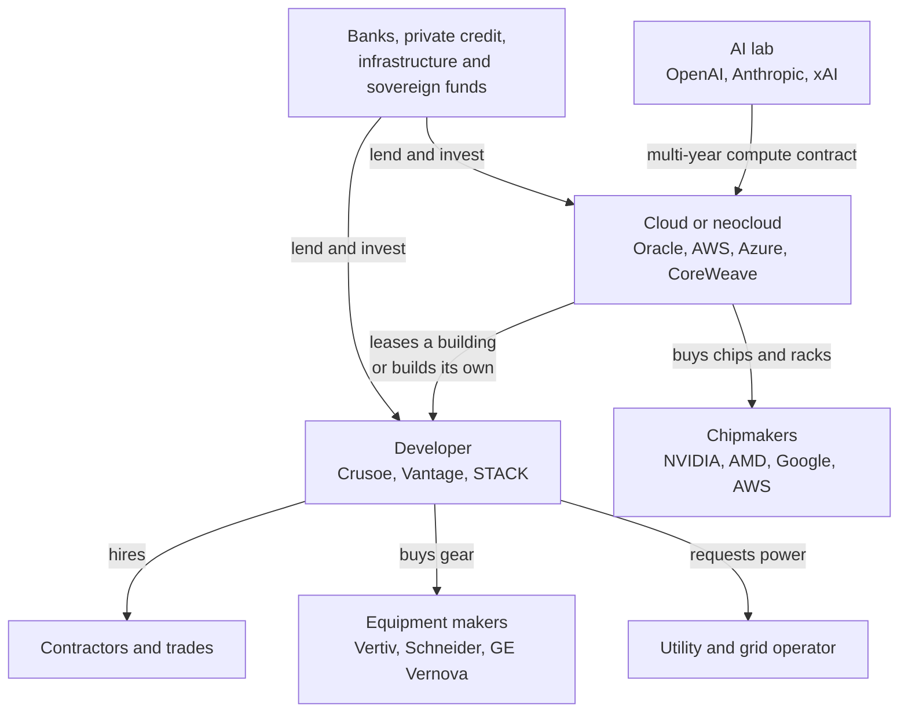
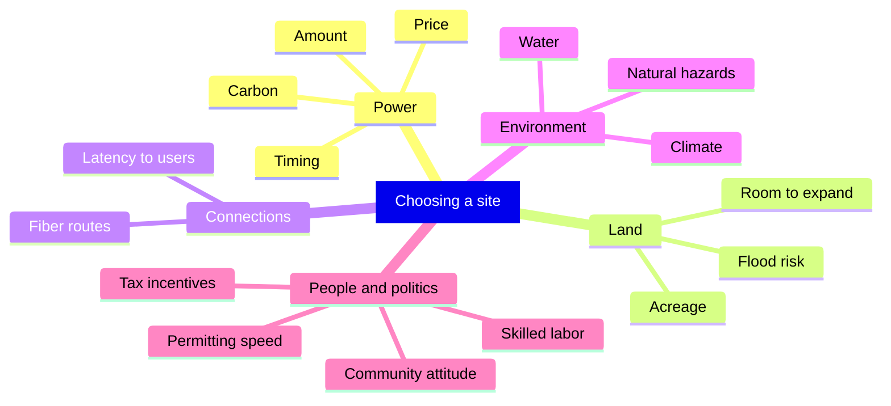
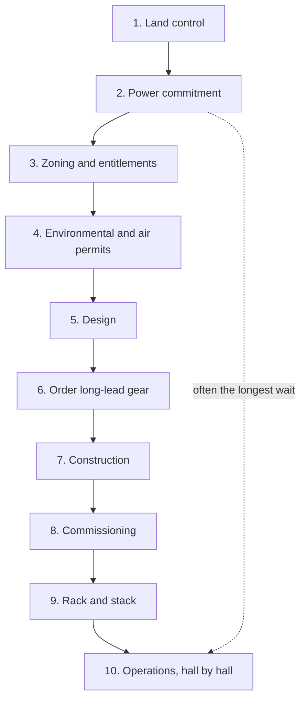
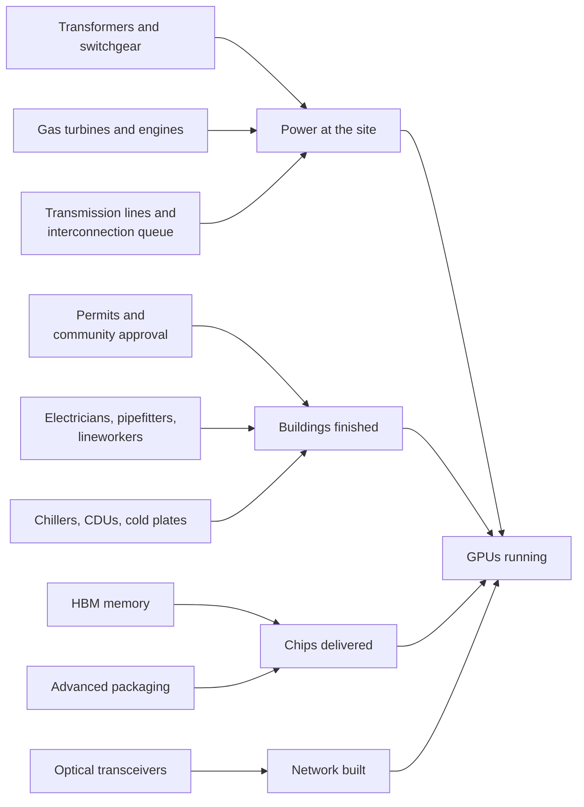
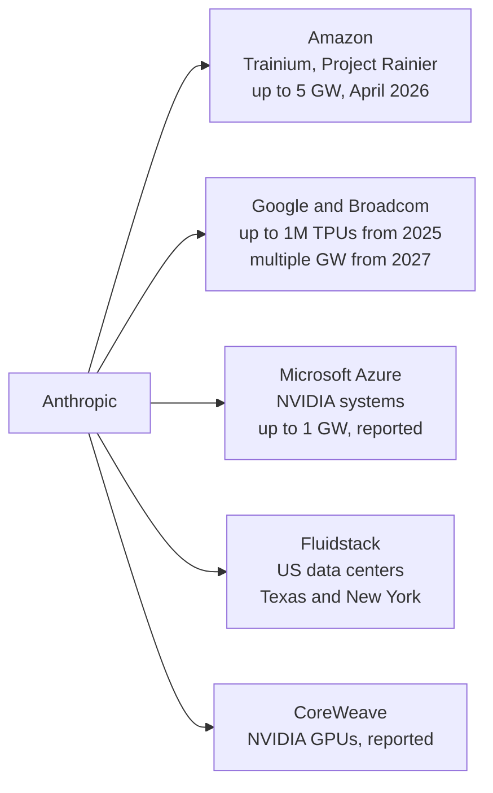
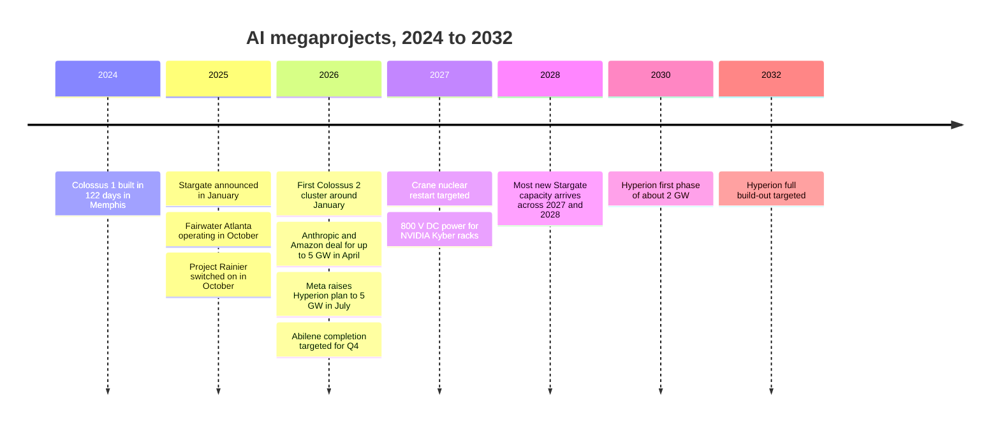

# Chapter 42: The Great Buildout: Hyperscalers, Neoclouds and Megaprojects

*This chapter shows you who is building the giant AI campuses of 2024 to 2026, how a site goes from empty field to running GPUs, what slows it down, and how to read every gigawatt headline with a clear head.*

## What you'll learn

- How big the AI construction boom is in late 2026, in gigawatts, chips and homes' worth of electricity
- Who builds AI data centers: hyperscalers, neoclouds, developers, AI labs and their financiers
- How companies choose a site, with a scoring worksheet you can reuse
- The development lifecycle from land deal to "rack and stack," and why power, not the building, sets the timeline
- The bottlenecks: transformers, turbines, electricians, memory chips, packaging, optics, transmission lines and permits
- The megaprojects as stories: OpenAI's Stargate, xAI's Colossus, Meta's Prometheus and Hyperion, Microsoft's Fairwater, Amazon's Project Rainier, Google's builds and Anthropic's multi-vendor compute
- Why countries want "sovereign AI," and what data residency means for you
- What comes next (megawatt racks, nuclear power, grid-aware and multi-site training, data centers in orbit and under the sea) and how feasible each idea really is

## Before you start

This chapter pulls together the whole of Part VII. Chapter 38 (Inside a Data Center) walked you through the buildings and the business models. Chapter 39 (Power: From the Grid to the GPU) explained watts, watt-hours and the power chain. Chapter 40 (Cooling: Where the Heat Goes) covered liquid cooling and water. Chapter 41 (Energy for AI: Grids, Gas, Nuclear and Renewables) explained the grid, interconnection queues and energy sources. Chapter 34 (Wiring Thousands of Chips Together) and Chapter 35 (The AI Chip Industry) explained the racks and chips that fill these buildings. The money side (what it costs, who pays, and whether it is a bubble) is Chapter 43.

## The biggest construction project of the decade

The next time you ask Claude, ChatGPT or Gemini a question, picture where the answer is computed. It is not "in the cloud" in any airy sense. It is in a windowless building the size of several football fields, often in a small town you have never heard of, drawing as much electricity as a city. Some of those buildings did not exist three years ago. One of them, in Memphis, Tennessee, is a converted appliance factory. Another, in rural Louisiana, is planned to draw more power than many countries.

This chapter is about that construction boom: the AI **buildout**.

> **Definition — Buildout:** The large-scale construction of data centers, power plants, transmission lines and supporting infrastructure needed to run AI. In 2025 and 2026 it became one of the largest private construction efforts in history.

How big is it? Several research groups track it, and their numbers are the best snapshot we have.

- **Epoch AI**, a research group that estimates AI data center capacity from satellite images, permits and company statements, tracked **95 large AI data centers** with about **14.2 GW of IT power** (about **18.5 GW including cooling and other overhead**) as of its October 20, 2026 update. Together they held roughly **14.8 million H100-equivalents** of computing power. Epoch estimates these sites cover about 44% of the world's AI compute, and notes that sites typically use 60 to 80% of their capacity on average.
- **JLL**, a commercial real-estate firm, expects global data center capacity of all kinds to roughly **double from about 103 GW to about 200 GW** between 2025 and 2030 (January 2026 outlook). AI was about a quarter of data center workloads in 2025 and could be half by 2030.

> **Definition — Gigawatt (GW):** One billion watts, a rate of electricity use. One gigawatt is about the output of a large nuclear reactor, or the average draw of roughly 800,000 US homes. Frontier AI campuses are now described in gigawatts.

> **Definition — IT power (IT load):** The electricity used by the computing equipment itself (GPUs, CPUs, memory, storage, network switches), not counting cooling, lighting and power-conversion losses. Data center sizes are often quoted in megawatts or gigawatts of IT power.

> **Definition — Facility power:** The total electricity a site draws from the grid or its own power plants, including IT power plus cooling and other overhead. Facility power equals IT power multiplied by the PUE (see Chapter 40).

> **Definition — H100-equivalent (H100e):** A way of counting computing power in units of one NVIDIA H100 GPU, the workhorse chip of 2023 to 2024. A newer chip that does three times the math of an H100 counts as about three H100-equivalents.

**Worked example: what 18.5 GW means.** Suppose all 95 tracked sites ran at 70% of their 18.5 GW of facility power, all year.

- Energy per year: 18.5 GW × 8,760 hours × 0.7 ≈ 113,000 GWh, or about **113 TWh**.
- Compare: all US data centers (not just AI) used about 176 TWh in 2023, according to Lawrence Berkeley National Laboratory, and all data centers worldwide used about 415 TWh in 2024, according to the International Energy Agency.
- In homes: an average US home draws about 1.2 kW averaged over a year, so 18.5 GW is the average draw of about 18.5 billion ÷ 1,200 ≈ **15 million homes**.

And that covers only the large AI sites Epoch tracks. A boom on this scale touches every part of the economy: steel, copper, concrete, transformers, gas turbines, electricians, local politics and the price of electricity.

> **Key idea:** AI has become a heavy industry. The chatbot on your phone depends on gigawatt campuses that take years to plan, billions of dollars to build, and the electricity of a mid-sized city to run.

> **Definition — Megaproject:** A construction project costing billions of dollars, taking years, and involving many companies and governments. The largest AI campuses of 2025 and 2026 are megaprojects on the scale of airports or dams.

### Reading capacity numbers without getting fooled

Before the stories, a warning about the numbers. Three different quantities get called "the size" of a data center, and headlines mix them up.

| What is quoted | What it means | Example |
|---|---|---|
| Planned capacity | The eventual maximum, often years away and sometimes never built | Stargate: "up to 10 GW" by 2029 |
| Facility power | Total power the site can draw, including cooling | Abilene: a 1.2 GW campus |
| IT power | Power for the computing equipment only | Colossus 2: about 946 MW of IT power (Epoch) |
| Running today | What is actually switched on now | Prometheus: about 471 MW of IT power running in October 2026 (Epoch) |

*Table 42.1: Four different numbers that all get called "the size" of an AI data center.*

A "5 GW campus" headline might describe a site with a few hundred megawatts running today, a gigawatt by 2028 and the rest by the early 2030s, if the power arrives. That is not dishonest; it is how infrastructure is planned. But you should always ask: planned or running? IT or facility? By when?

> **Watch out:** "A 1 GW data center" does not use 1 GW all the time. The gigawatt is a maximum rate (nameplate capacity). Actual energy use depends on how hard the site runs, typically 60 to 80% of capacity on average according to Epoch.

> **Definition — Nameplate capacity:** The maximum power a facility is designed to draw or a power plant is designed to produce. It is the ceiling, not the average.

## Who builds the AI factories

When you read "OpenAI's data center in Texas," it is rarely true that OpenAI owns the building. A typical megaproject involves half a dozen companies, each carrying a different slice of the work and the risk.

> **Definition — Hyperscaler:** One of the giant cloud and internet companies that build and run data centers at enormous scale: Amazon (AWS), Microsoft (Azure), Google, Meta and Oracle.

> **Definition — Neocloud:** A newer cloud company specializing in renting AI chips by the hour or by multi-year contract, such as CoreWeave, Nebius, Lambda, Crusoe, Nscale or Fluidstack.

> **Definition — Data center developer:** A company that finds land, secures power, gets permits and builds data centers, then leases them to tenants or sells them. Examples include Vantage, STACK, QTS, Aligned and Related Digital.

> **Definition — Colocation:** Renting space, power and cooling in someone else's data center. Retail colocation means a few racks; wholesale colocation means whole halls or buildings.

The main players fall into five groups.

1. **Hyperscalers** build their own campuses (self-build) and also lease from developers. Google and Meta self-build heavily; Microsoft, Amazon and Oracle do both.
2. **Neoclouds** rent GPUs to AI labs and companies. CoreWeave, the largest, ran about 51 AI data centers in 2026 and reportedly earned about two-thirds of its 2025 revenue from one customer, Microsoft. Nebius signed a Microsoft contract reported at $17.4 billion (up to $19.4 billion) in September 2025, and has sites in Finland, New Jersey (a 300 MW site in Vineland), Kansas City and Birmingham, Alabama. Several former bitcoin miners (IREN, Cipher, TeraWulf, Core Scientific) converted their power-rich mining sites into AI data centers.
3. **Developers and landlords** (Equinix, Digital Realty, QTS, Vantage, Aligned, STACK, CyrusOne, Related Digital and others) build and lease. Crusoe both develops and operates; it built Stargate's Abilene campus.
4. **AI labs** (OpenAI, Anthropic, xAI, Google DeepMind, Meta's labs) are the end customers. Most sign multi-year compute contracts rather than owning buildings, though xAI built Colossus itself.
5. **Suppliers and financiers**: chipmakers (NVIDIA, AMD, Broadcom), electrical and cooling equipment makers (Vertiv, Schneider Electric, Eaton, ABB, Siemens, GE Vernova, Hitachi Energy), utilities, and the banks, private-credit funds, infrastructure funds and sovereign wealth funds that lend the money.



*Figure 42.1: Who does what in a typical AI megaproject. The lab rarely owns the building; it signs a long contract with a cloud, which leases from a developer, which borrows from financiers.*

### The business models in one paragraph each

Chapter 38 covered these in detail; here is the short version you need for the stories ahead.

> **Definition — Build-to-suit:** A deal in which a developer builds a data center to one tenant's exact design and the tenant signs a long lease, often 10 to 20 years.

> **Definition — Powered land:** A plot of land that already has a secured power connection (or a firm promise of one). In 2026 powered land is one of the most valuable things a developer can own, because power is the scarcest input.

> **Definition — Powered shell:** A building delivered with utility power and basic structure but without the tenant's computing equipment and fit-out.

> **Definition — Take-or-pay contract:** A contract in which the customer pays for reserved capacity whether or not it uses it. These contracts are what lenders rely on when they finance data centers.

The risk travels along the chain. If an AI lab's demand falls, its take-or-pay contracts with the cloud still bind it. If the cloud cannot pay, the developer's lease income stops. If the developer defaults, its lenders lose. Chapter 43 follows the money through this chain.

> **Analogy:** A hyperscaler is a city that owns its own buildings. A neocloud is a hotel chain that rents rooms (GPUs) by the night or by the year. A colocation landlord is a self-storage company: you rent the unit and bring your own stuff. A developer is the builder who puts up the hotel and then sells or leases it.

> **Definition — Campus:** A site with several data center buildings sharing one substation, one cooling plant and one security perimeter. The largest AI campuses cover hundreds to thousands of acres.

## Choosing a site

Imagine you have been asked to find a home for a 1 GW AI campus. Where do you even start?

Ten years ago the answer was "near a big city with lots of fiber," which is why Northern Virginia became the world's largest data center market. Today the first question is different: **where can I get a gigawatt of power, soon?**

> **Definition — Site selection:** The process of choosing where to build a data center by weighing power, land, fiber, water, climate, taxes, permitting, labor and community attitudes.

> **Definition — Speed to power:** How quickly a site can get the electricity it needs. In 2025 and 2026 it became the data center industry's top priority, often more important than the price of power.

JLL reports that the average wait for a new grid connection in primary data center markets now exceeds **four years**. A building takes two to three. So developers chase sites where power is available sooner: near existing power plants, near gas pipelines where they can build their own generation, or in regions with spare transmission capacity.

> **Definition — Interconnection:** The physical and contractual connection between a large customer (or power plant) and the grid. Getting one requires engineering studies, often new substations or lines, and an agreement with the utility.

> **Definition — Interconnection queue:** The waiting line of projects asking to connect to the grid. Each must be studied before it can connect, and in many regions the line is years long (see Chapter 41).

### The factors, one by one

Here is what a site selector weighs, roughly in order of importance for an AI campus in 2026.

- **Power: amount, timing, price and carbon.** Can the utility deliver hundreds of megawatts, and when? Can you build your own generation? What will it cost per megawatt-hour, and how clean is it?
- **Land.** Hundreds to thousands of acres, flat, outside flood zones, with room for substations, cooling yards and future expansion. Meta's Hyperion site covers 2,250 acres.
- **Fiber.** Diverse fiber routes to the internet and to the company's other campuses.
- **Water and climate.** Cooler, drier climates allow more "free cooling." Evaporative cooling needs water; dry cooling needs more electricity on hot days (Chapter 40).
- **Latency to users.** Matters for inference (answering users), much less for training.
- **Taxes and incentives.** Sales-tax exemptions on equipment and property-tax deals can be worth hundreds of millions of dollars.
- **Permitting speed and community attitude.** Some counties welcome data centers for their tax base; others pass moratoriums.
- **Labor.** Thousands of electricians, pipefitters and other trades are needed during construction.
- **Natural hazards.** Earthquakes, hurricanes, wildfires, floods.



*Figure 42.2: The factors a site selector weighs. In 2026, power sits at the top of every list.*

### Training sites and inference sites want different things

> **Definition — Latency:** The time it takes for a message to travel from one place to another. Light in optical fiber covers about 1 kilometer every 5 microseconds, so 1,000 km of fiber adds about 5 milliseconds each way.

A **training** campus mostly talks to itself. The GPUs exchange enormous amounts of data with each other, but very little with the outside world, so it can sit far from any city. That is why training campuses appear in West Texas, rural Louisiana and the Wisconsin countryside.

An **inference** site answers users. But even here, distance matters less than you might think. Suppose your message travels 3,000 km to a data center: that adds about 15 milliseconds each way, 30 milliseconds round trip. A chatbot answer takes a second or more to generate, so you would never notice. Distance matters more for voice agents, which need fast back-and-forth, and for coding agents that make hundreds of quick round trips. And for some customers, the law says the data must stay inside a country, which we'll come to under sovereign AI.

> **Definition — Data residency:** A requirement, set by law or by contract, that data be stored and processed inside a particular country or region. It pushes companies to build or rent data centers in many countries.

### A site-scoring worksheet

Real site selectors use weighted scorecards. Here is a simple one you can copy into a spreadsheet. Score each factor from 1 (poor) to 5 (excellent), multiply by its weight, add up, and divide by 5 to get a score out of 100. The three sites below are **hypothetical**, but their trade-offs are typical.

- **Site A:** a plains county next to a major gas pipeline. Plenty of cheap land; you can build your own gas generation; thin fiber; hot summers.
- **Site B:** an established data center hub near a big city. Superb fiber and workforce; a multi-year grid queue; local pushback.
- **Site C:** a cool northern site near hydroelectric dams. Clean, cheap power, but limited new capacity; fewer skilled workers nearby.

| Factor | Weight | Site A | Site B | Site C |
|---|---|---|---|---|
| Power available soon | 30 | 5 | 1 | 3 |
| Power price and carbon | 10 | 3 | 3 | 5 |
| Land and hazards | 10 | 5 | 2 | 4 |
| Fiber | 10 | 2 | 5 | 3 |
| Water and climate | 10 | 3 | 3 | 5 |
| Permitting and community | 15 | 4 | 2 | 4 |
| Skilled labor | 5 | 2 | 5 | 2 |
| Taxes and incentives | 10 | 4 | 3 | 3 |
| **Weighted score (out of 100)** | 100 | **78** | **49** | **72** |

*Table 42.2: A weighted site-selection scorecard for three hypothetical sites. The weights reflect a company in a hurry.*

**Worked example.** Site A: (5×30 + 3×10 + 5×10 + 2×10 + 3×10 + 4×15 + 2×5 + 4×10) ÷ 5 = (150 + 30 + 50 + 20 + 30 + 60 + 10 + 40) ÷ 5 = 390 ÷ 5 = **78**. Site B's terrible power timing sinks it to 49 despite its fiber and workforce. Site C scores 72.

Now change the weights the way a company with strict clean-energy goals might: drop "power available soon" to 20 and raise "power price and carbon" to 20. Site A falls to 74 and Site C rises to 76. The winner flips. That is the real lesson of the worksheet: **the answer depends on what you value**, and in 2025 and 2026 most builders valued speed above everything, which is why so many projects ended up next to gas pipelines.

> **Try it:** Ask a chatbot: "Act as a data center site selector. Using public information you know, score my county from 1 to 5 on power availability, fiber, water, climate, land, permitting, labor and taxes for a 300 MW AI data center, and explain each score." Then check two of its claims against your county's own website or local news. You'll learn how much (and how little) a chatbot knows about local infrastructure.

> **Watch out:** Cheap electricity is not the same as available electricity. A region with the lowest power prices in the country is useless to a builder if the grid can't connect a new 500 MW load until 2031. In the 2020s, "available soon" usually beats "cheap."

## From empty field to running GPUs: the development lifecycle

Every data center, from a 5 MW enterprise room to a 5 GW campus, goes through roughly the same steps. Knowing them lets you read a project announcement and estimate when the GPUs will really switch on.

**Step 1: Land control.** The developer secures the land, usually with an option to buy so it doesn't pay full price before it knows the project will work.

> **Definition — Land option:** A contract that gives a buyer the right, but not the obligation, to purchase land at an agreed price within a set period. It lets developers lock up sites cheaply while they check power and permits.

**Step 2: Power commitment.** The developer files a large-load request with the utility, pays for studies, and negotiates an agreement. For big projects this is the longest and least certain step. Many developers now also plan their own on-site generation.

> **Definition — Behind-the-meter:** Generation located on the customer's side of the utility meter, usually on site, so the data center makes some or all of its own power instead of drawing it from the grid.

> **Definition — Bridge power:** Temporary on-site generation, often gas turbines or engines, that runs a data center until its permanent grid connection is ready.

> **Definition — Microgrid:** A self-contained local power system, with its own generators and often batteries, that can run independently of the main grid.

**Step 3: Zoning and entitlements.** The county or city must approve the land use. This can mean public hearings, rezoning votes and negotiations over taxes, roads, noise and water.

> **Definition — Zoning:** Local rules that say what kind of buildings and activities are allowed on each piece of land. A farm field usually has to be rezoned before a data center can be built on it.

> **Definition — Entitlements:** The full set of government approvals (zoning, site plans, variances, development agreements) that give a developer the legal right to build.

**Step 4: Environmental and air permits.** Wetlands, endangered species, stormwater, water withdrawals and, increasingly, air permits for backup generators and on-site turbines.

> **Definition — Air permit:** A government permit that limits how much pollution an engine, turbine or other source may emit, and often how many hours it may run. Backup generators and on-site gas turbines need them.

**Step 5: Design.** Engineers write the "basis of design" and draw the single-line diagram of the power system, the mechanical plans for cooling, and the layouts for racks and network.

> **Definition — Basis of design:** The document that sets a data center's key requirements: IT capacity, rack density, redundancy level, cooling method, target efficiency and so on. Every later drawing follows from it.

> **Definition — Single-line diagram:** The engineering map of how electricity flows through a site, from the utility connection to every rack, drawn with one line per circuit.

**Step 6: Procurement of long-lead gear.** Transformers, switchgear, generators, turbines and chillers are ordered, often before the design is final, because they take years to arrive.

> **Definition — Long-lead item:** Equipment that takes many months or years to manufacture and deliver, such as large power transformers, high-voltage switchgear and gas turbines. Data center schedules are built around them.

**Step 7: Construction.** Site work and roads, foundations and piles, structural steel, roof, then the mechanical, electrical and plumbing fit-out.

> **Definition — MEP (mechanical, electrical and plumbing):** The systems inside a building that move air, water and electricity. In an AI data center, MEP is most of the construction cost and complexity.

**Step 8: Commissioning.** Every system is tested, from factory tests of single components (Level 1) to a full "pull the plug" integrated systems test with fake loads running (Level 5).

> **Definition — Commissioning:** Systematic testing that every system in a building works as designed before it goes live, usually organized in five levels from factory tests to whole-site tests.

> **Definition — Integrated systems test:** The final commissioning step, in which the whole site is run under simulated full load and then stressed, for example by cutting utility power, to prove backup systems take over correctly.

> **Definition — Load bank:** A large box of electrical resistors that turns electricity into heat, used to imitate the power draw of IT equipment while testing power and cooling systems.

**Step 9: Rack and stack.** Racks arrive, often pre-built and tested at the factory, are rolled into place, connected to power, liquid cooling and the network, and "burned in" with test workloads.

> **Definition — Rack and stack:** The installation of IT equipment: placing racks, connecting power, cooling and network cables, and testing everything. For pre-built AI racks this can take days per hall instead of months.

**Step 10: Operations.** The site goes live, often hall by hall, while construction continues elsewhere on the campus.



*Figure 42.3: The development lifecycle of a data center. In practice the steps overlap heavily, and the power commitment usually decides when the last step can begin.*

### How long it takes

Typical timelines, as of 2026:

- **The building:** about 18 to 36 months from start of construction to operation.
- **The whole project, if new grid power is needed:** 3 to 7 years or more.
- **A gigawatt-scale AI site:** Epoch AI estimates about two years to build, for the fastest movers.

Here is the same project drawn as a timeline chart. Each `#` is two months.

```
Month:            0     12    24    36    48    60
                  |-----|-----|-----|-----|-----|
Land control      #
Zoning, permits    ###
Design              ###
Long-lead gear       #########
Construction          #########
Commissioning                 ##
Rack and stack                  ##
                  Building ready: about month 32
New grid power    ##############################
                  Grid ready: often month 48 to 60+
```

*Figure 42.4: A timeline (Gantt-style) chart of a typical large data center. The building can be ready in under three years; new grid power often takes four to five or more. The longest chain of dependent steps, the critical path, runs through power.*

> **Definition — Critical path:** The longest chain of tasks in a project that depend on each other. Any delay on the critical path delays the whole project; delays elsewhere may not matter.

That gap between the two bottom bars explains most of the strange behavior in the 2025 and 2026 buildout: on-site gas turbines, batteries, sites next to power plants, bitcoin mines converted to AI, and phased openings where the first buildings run on temporary power while the grid catches up.

**The outliers.** Two projects show what is possible when the rules are bent or the starting point is unusual.

- **xAI's Colossus 1** in Memphis was built in **122 days** in 2024, with about 100,000 H100 GPUs. It reused a former Electrolux appliance factory that already had a building and some power. The grid initially supplied only about 8 MW, later upgraded toward about 150 MW, and xAI filled the gap with temporary gas turbines and Tesla Megapack batteries, according to public reports. That shortcut became a legal fight (see the Colossus story below).
- **Amazon's Project Rainier** in Indiana came online in under a year with about 500,000 Trainium2 chips at launch in October 2025, according to Amazon.

**Phased delivery.** Big campuses open in stages. Stargate's Abilene, Texas campus has eight buildings planned for about 1.2 GW in total. Epoch AI estimated in April 2026 that about 0.3 GW of facility power (about 200 MW of IT) was running, with completion expected in the fourth quarter of 2026; Oracle reportedly said in September 2026 that six of the eight buildings (about 618 MW) had been delivered.

**Worked example: the materials in one campus.** Microsoft published the construction quantities for its Fairwater campus in Mount Pleasant, Wisconsin: 46.6 miles of deep foundation piles, 26.5 million pounds of structural steel, 120 miles of medium-voltage underground cable and 72.6 miles of mechanical piping. Convert the steel: 26.5 million lb × 0.4536 kg/lb ≈ 12 million kg, or about **12,000 tonnes**. The Eiffel Tower's iron structure weighs about 7,300 tonnes, so the steel alone is roughly **one and a half Eiffel Towers**, before counting the cable, pipe, concrete and chips.

> **Key idea:** The building is no longer the slow part. Power is. A modern AI hall can go from foundation to running racks in well under three years, but a new gigawatt grid connection often takes four to seven, which is why builders improvise with on-site gas, batteries and phased openings.

## Bottlenecks: why you can't just buy a gigawatt

If a company has the money, why can't it simply build faster? Because a gigawatt campus needs thousands of specialized items and people, and many of them are scarce. The slowest one sets the pace.

> **Analogy:** A convoy moves at the speed of its slowest truck. You can buy faster trucks for the rest of the convoy, but until you fix the slowest one, the convoy doesn't arrive any sooner. Data center builders spend their days hunting for the slowest truck.

### Electrical equipment

> **Definition — Large power transformer:** A huge device, often weighing hundreds of tonnes, that steps transmission voltage down for a campus substation (or up at a power plant). Each one is custom-built, and few factories make them, so lead times run to years.

> **Definition — Switchgear:** Cabinets of breakers and switches that route electricity and cut it off safely when something goes wrong. Medium-voltage switchgear for data centers is a classic long-lead item.

Transformers, switchgear and high-voltage circuit breakers have all been in short supply since the boom began. Domestic manufacturing of large transformers in the US is limited, so many are imported.

### Power generation

Because grid connections are slow, builders want their own generation, and that created a second queue: for gas turbines.

> **Definition — Combined-cycle gas turbine (CCGT):** A gas power plant in which a gas turbine's hot exhaust also makes steam to drive a second turbine. It is efficient (about 60%) but takes years to build.

> **Definition — Reciprocating engine:** A large piston engine driving a generator, like a giant car engine. Engines are modular and quick to install, which makes them popular for on-site data center power.

The big turbine makers (GE Vernova, Siemens Energy and Mitsubishi Power) report multi-year order backlogs. Large turbines ordered in 2025 and 2026 are often reported to arrive around 2029 to 2030 (treat this as a reported range; makers' quarterly results in late October 2026 may update it). That is why the first wave of on-site power uses smaller units: aeroderivative turbines adapted from jet engines, and banks of reciprocating engines. Stargate's Shackelford County site, for example, plans about 700 MW of behind-the-meter gas engines from VoltaGrid.

### Cooling equipment

Chillers, dry coolers, coolant distribution units (CDUs) and cold plates are all needed in huge quantities because every Blackwell-class rack is liquid-cooled (Chapter 40). Cooling makers expanded factories quickly, but rack designs change every year, so the equipment must change with them.

### People

The workforce is a bottleneck that money alone cannot fix quickly. A gigawatt campus needs thousands of construction workers at its peak, and the scarcest are licensed electricians (especially "inside wiremen" who wire buildings), pipefitters for liquid cooling, high-voltage lineworkers and commissioning technicians. The US Bureau of Labor Statistics counts about 821,000 electrician jobs and projects 9% growth from 2025 to 2035, citing data centers among the drivers. Big projects pay large premiums, per diems and overtime to attract crews from other states.

### Chips and their parts

Even with a finished building, you need chips, and the chip supply chain has its own bottlenecks (Chapters 33, 35 and 36):

- **HBM memory**, the stacked memory next to every AI chip, comes from only three suppliers (SK hynix, Samsung and Micron). Memory makers shifting capacity to HBM tightened supplies of ordinary memory in 2025 and 2026, and Amazon cited higher memory prices when it raised its 2026 spending plan.
- **Advanced packaging**, especially TSMC's CoWoS, which bonds GPU dies and HBM onto one package, has been the gating capacity for AI accelerators since 2023.
- **Optical transceivers**, the plug-in modules that turn electrical signals into light for the network, are needed by the hundreds of thousands per campus.

> **Definition — HBM (High Bandwidth Memory):** Memory chips stacked on top of each other and placed right next to an AI processor, giving it very fast access to data. Only three companies make it, so its supply limits how many AI chips can be built (see Chapter 33).

> **Definition — Optical transceiver:** A plug-in module that converts electrical signals into pulses of light for fiber-optic cables, and back again. A large AI cluster uses hundreds of thousands of them.

### Grid and transmission

New high-voltage transmission lines take many years to plan, permit and build, often longer than the data centers they serve. Interconnection queues are long (Chapter 41). Who pays for upgrades is fought over in rate cases; Meta, for example, agreed to fund new transmission for its Hyperion site.

### Permits and communities

Not everyone wants a data center next door. The group Data Center Watch counted **$64 billion** of US projects blocked ($18 billion) or delayed ($46 billion) between May 2024 and March 2025, with 142 local activist groups in more than 24 states, and found the opposition was bipartisan. Compiled news reports suggest that in 2026 many local governments passed moratoriums on new data centers. Lordstown, Ohio, reportedly banned future data centers, and a planned Stargate site in Saline Township, Michigan faced local opposition. Typical concerns are noise, water, electricity bills, diesel and gas pollution, lost farmland, and tax breaks that reduce the local benefit.

> **Definition — Moratorium:** A temporary ban, usually by a local or state government, on approving a type of project, such as new data centers, while rules are studied or written.



*Figure 42.5: The bottlenecks that decide when an AI campus switches on. All four streams must arrive; the slowest one sets the date.*

| Bottleneck | Why it's scarce | Typical workaround |
|---|---|---|
| Grid connection | Studies, upgrades and new lines take years | On-site gas, batteries, sites near power plants |
| Large transformers, switchgear | Few factories, custom designs | Order years early, standardize designs |
| Gas turbines | Multi-year factory backlogs | Smaller turbines, piston engines, fuel cells |
| Skilled trades | Training takes years | Premium pay, factory-built modules, travel crews |
| HBM and packaging | Three memory makers, one dominant packager | Long-term supply deals, alternative chips |
| Community approval | Local opposition, moratoriums | Community benefit deals, quieter and drier designs |

*Table 42.3: The main bottlenecks of the AI buildout and how builders work around them.*

> **At the frontier (2026):** Builders are trying to turn construction into manufacturing. Pre-built power skids, factory-assembled cooling modules and fully tested racks that roll off a truck and plug in all move labor from the muddy site to the factory, where it is faster, safer and less dependent on scarce local electricians.

## The megaprojects, one story at a time

Now the stories. For each, ask the same questions: who, where, how much power, where the power comes from, which chips, when, and what went wrong. All figures are as of October 2026 unless dated otherwise, and many come from Epoch AI's estimates or from news reports rather than company filings.

> **Definition — OSINT (open-source intelligence):** Analysis based on publicly available information such as satellite images, permit filings, power-company documents and job postings. Epoch AI and others use OSINT to estimate how much AI capacity is really running at each site.

### OpenAI's Stargate

**The announcement.** On January 21, 2025, at the White House, OpenAI and partners announced "Stargate," a plan described as "up to $500 billion" and 10 GW of US AI infrastructure by 2029. The partners have included Oracle, SoftBank, MGX (an Abu Dhabi investment firm), Crusoe, Vantage, SB Energy, Related Digital and STACK.

**Abilene, Texas: the flagship.** Crusoe built the campus; Oracle operates it for OpenAI. It is a 1.2 GW campus with eight buildings, filled with NVIDIA GPUs. As noted above, Epoch AI estimated about 200 MW of IT running in April 2026 with completion targeted for the fourth quarter of 2026, and Oracle reportedly reported six of eight buildings (about 618 MW) delivered by September 2026. A planned expansion to about 2.1 GW was cancelled; Microsoft later partnered with Crusoe on an adjacent site of about 900 MW.

**The other US sites.** Epoch AI's April 2026 review listed:

- **Shackelford County, Texas:** Vantage's "Frontier" campus, about 1.4 GW of IT (2.0 GW total), with an on-site gas microgrid including about 700 MW of behind-the-meter gas engines from VoltaGrid.
- **Doña Ana County, New Mexico:** STACK's "Project Jupiter," 2.2 GW initially, with two gas microgrids.
- **Milam County, Texas:** SB Energy, 1.2 GW, with co-located solar.
- **Port Washington, Wisconsin:** Vantage's "Lighthouse," about 1.3 GW of grid draw.
- **Saline Township, Michigan:** Related Digital's "The Barn," about 1.4 GW, powered from the DTE grid plus batteries.
- **Lordstown, Ohio:** under 0.3 GW.

Epoch projects **over 9 GW** across these sites by about 2029, with most new capacity arriving in 2027 and 2028. OpenAI also reportedly announced a site at a former Department of Energy facility in Pike County, Ohio ("PORTS-Pike") in August 2026, with a first 800 MW expected in 2028; treat that as a reported plan.

**Overseas.** Stargate UAE is a planned 1 GW cluster inside a planned 5 GW UAE–US AI campus in Abu Dhabi, built with G42, Oracle, NVIDIA, Cisco and SoftBank; its first 200 MW was targeted for 2026 (announced May 2025). Stargate Norway, in Narvik with Nscale and Aker, was announced in July 2025 with about 230 MW of initial capacity. Stargate Argentina had reportedly not progressed beyond a letter of intent as of May 2026, and OpenAI reportedly paused Stargate UK in April 2026, citing energy costs.

> **Definition — Letter of intent:** A document stating that parties plan to make a deal on certain terms, which is not yet a binding contract. Many headline AI infrastructure "deals" begin as letters of intent and some never become contracts.

**What it teaches.** Stargate is a brand over many separately financed projects with different partners, power sources and fates. Some are running; some are being built; one expansion was cancelled; some overseas sites stalled. Gas microgrids feature in several sites because they are the fastest firm power available. Read every "Stargate" headline by asking which site and which stage.

### xAI and SpaceX: Colossus

**Colossus 1** (Memphis, Tennessee) is the speed record: built in 122 days in 2024 in a former Electrolux factory, with about 100,000 H100s, and bridged with temporary gas turbines and Tesla Megapacks while grid power was upgraded.

**Colossus 2** (Memphis and nearby Southaven, Mississippi) is the scale record. Its first cluster of about 110,000 GB200 GPUs (about 210 MW) came online around January 2026, and reports in late September 2026 counted about 440,000 GB300 GPUs in use. Epoch AI lists Colossus 2 at about **946 MW of IT power**, the largest site in the world by compute at about **1.1 million H100-equivalents**.

**The power fight.** To get power fast, xAI ran dozens of gas turbines without permanent permits, according to environmental groups. Mississippi approved a permanent plant of about 1.2 GW with 41 turbines in Southaven in March 2026. In April 2026 the NAACP, represented by the Southern Environmental Law Center and Earthjustice, sued under the Clean Air Act. Memphis has become the leading case study of how fast-built AI power affects nearby neighborhoods, and environmental-justice advocates point to it as an example of new pollution landing on communities that already carry a heavy share.

> **Definition — Clean Air Act:** The main US federal law limiting air pollution. It requires permits for large sources such as power plants and turbines, and lets citizens sue when they believe permits were not obtained.

**Corporate changes.** SpaceX acquired xAI in an all-stock deal on February 2, 2026, valuing xAI at $250 billion, and the AI business was later rebranded SpaceXAI.

**What it teaches.** Speed is possible when you reuse an existing building and bring your own power, but the shortcuts carry legal, health and reputational costs that can follow a project for years.

### Meta: Prometheus and Hyperion

**Prometheus** in New Albany, Ohio was targeted at about 1 GW for 2026. Epoch AI lists about 471 MW of IT running in October 2026. On-site gas plants reportedly supplement the grid.

**Hyperion** in Richland Parish, Louisiana is Meta's giant. The site covers 2,250 acres. On July 13, 2026, Meta said Hyperion will scale to **5 GW** with investment above $50 billion, with a first phase of about 2 GW by 2030 and full build-out around 2032. The local utility, Entergy, is building combined-cycle gas plants and has proposed 1.5 GW of new solar and solar-plus-storage on top of 3 GW previously approved; Meta funds the new transmission. Epoch projects Hyperion at about 3.7 million H100-equivalents by January 2028; because newer chips each count as several H100-equivalents, that projection is compatible with a site still growing toward its full gigawatts. Meta financed Hyperion through a joint venture with funds managed by Blue Owl, a structure Chapter 43 dissects.

> **Worked example:** How many homes is Hyperion? 5 GW ÷ 1.2 kW per average US home ≈ **4.2 million homes'** worth of average power. That is more than twice the number of households in the entire state of Louisiana, all drawn by one fenced campus at full build-out.

**Nuclear.** On January 9, 2026, Meta announced nuclear deals totaling up to **6.6 GW by 2035**: more than 2.1 GW from Vistra's Perry and Davis-Besse plants plus 433 MW of uprates; two TerraPower Natrium reactors (690 MW) as early as 2032 with rights to six more; and up to 1.2 GW from Oklo in Pike County, Ohio as early as 2030. Meta said the deals support the grids serving Prometheus. They add to a 2025 deal for Constellation's Clinton nuclear plant.

> **Definition — Power purchase agreement (PPA):** A long-term contract, often 10 to 20 years, to buy electricity from a specific power plant at an agreed price. It gives the plant's owner the guaranteed income needed to build or keep running it.

> **Definition — Uprate:** An increase in an existing power plant's output through equipment upgrades, a fast and relatively cheap way to add capacity.

**What it teaches.** The biggest campuses blur into utility planning: a single company's data center now drives a state utility's choice of new power plants and transmission lines. Gas comes first; nuclear comes in the 2030s.

### Microsoft: Fairwater

**Mount Pleasant, Wisconsin.** Microsoft calls it an "AI superfactory": 315 acres, three buildings, about 1.2 million square feet, and "hundreds of thousands" of NVIDIA GB200 GPUs in a two-story rack layout that shortens cable runs. More than 90% of capacity uses a **closed-loop liquid cooling** system filled once, served by what Microsoft calls the "second-largest water-cooled chiller plant on the planet" and 172 twenty-foot fans. Microsoft quotes each 72-GPU rack at **865,000 tokens per second**.

> **Definition — Closed-loop cooling:** A cooling system in which coolant circulates in sealed pipes and is reused, so very little water is consumed on site. The heat still has to be rejected to the air by chillers or dry coolers.

**Atlanta (Fayetteville, Georgia).** The second Fairwater site has operated since October 2025, with racks of about 140 kW (reported); Epoch lists about 636 MW of IT. It is linked to Wisconsin over a dedicated "AI WAN," so the two sites can work as one system.

> **Definition — AI WAN (scale-across network):** A long-distance, very high-capacity fiber network that links AI data centers hundreds of miles apart so they can share one large training job. Microsoft's Fairwater sites are the best-known example.

**Nuclear.** Microsoft signed a 20-year PPA for the output of Three Mile Island Unit 1, being restarted as the Crane Clean Energy Center (about 835 MW according to Constellation). The restart was targeted for 2027, supported by a $1 billion Department of Energy loan in November 2025, according to public reports.

> **Definition — Nuclear restart:** Returning a closed nuclear power plant to service after it was shut down, usually requiring years of inspection, repairs and regulatory approval.

**Scale.** On its late-July 2026 earnings call, Microsoft's CEO said the company "added another gigawatt of capacity this quarter," and that demand still exceeded supply.

**What it teaches.** Multi-site design is a way around the power limits of any single site. If you can't get 3 GW in one place, link several 1 GW sites with fiber.

### Amazon and Anthropic: Project Rainier

Amazon built Project Rainier in St. Joseph County (New Carlisle), Indiana for Anthropic, the maker of Claude. It came online in under a year, with about 500,000 Trainium2 chips at launch in October 2025, and Anthropic was to use more than a million Trainium2 chips. Amazon quotes AWS's water efficiency at 0.15 liters per kWh against an industry average of 0.375. By October 2026, Epoch AI listed "Anthropic-Amazon New Carlisle" at about **1,037 MW of IT**, the largest tracked site by power.

On April 20, 2026, Anthropic and Amazon announced a deal for **up to 5 GW**, with nearly 1 GW of Trainium2 and Trainium3 capacity online by the end of 2026; reported terms included more than $100 billion committed to AWS over ten years.

**What it teaches.** Custom chips change the economics. Rainier runs on Amazon's own Trainium, not NVIDIA GPUs (Chapter 35), so Amazon captures more of the value chain and Anthropic gets capacity that doesn't depend on a single chip supplier.

### Google: the quiet self-builder

Google builds mostly for itself and runs mostly its own TPU chips. Its big self-builds include Pryor, Oklahoma (ranked fourth by compute in Epoch's tracker), Ohio, Texas (a reported $40 billion through 2027), Arkansas and Indiana, plus a reported ~1 GW, ~$15 billion hub in Visakhapatnam, India and a reported ~€13 billion commitment in Finland (September 2026). Its reported energy deals include Kairos small modular reactors (500 MW, 2030 to 2035), the restart of Iowa's Duane Arnold nuclear plant by 2029, enhanced geothermal with Fervo, and a reported record 12 GW of clean-energy contracts in 2025. Its fleet's reported PUE of about 1.09 compares with an industry average around 1.56.

**What it teaches.** Owning the whole stack (chips, buildings, energy deals, models) lets Google optimize everything together, which is one reason it gets less attention: fewer press-release megadeals, more steady building.

### Anthropic: compute from every vendor

Anthropic does not build its own data centers. Instead it assembled one of the most diversified compute portfolios in the industry, buying from three chip families and several clouds.

- **Amazon:** Project Rainier and the April 2026 deal for up to 5 GW of Trainium capacity.
- **Google:** in October 2025, access to up to one million TPUs, bringing "well over a gigawatt" online in 2026. On April 6, 2026, a new agreement with Google and Broadcom for "multiple gigawatts" of next-generation TPUs from 2027; a Broadcom filing implies about 3.5 GW.
- **Microsoft and NVIDIA:** in November 2025, a reported commitment of about $30 billion of Azure compute, with up to 1 GW of NVIDIA Grace Blackwell and Vera Rubin systems.
- **Fluidstack:** $50 billion of US data centers in Texas and New York, announced in November 2025.
- **CoreWeave:** a multi-year NVIDIA GPU deal reported in April 2026.



*Figure 42.6: Anthropic's multi-vendor compute portfolio as of 2026. Three chip families (Trainium, TPU, NVIDIA GPUs) and several providers.*

Why spread out? Supply security (no single shortage can stop you), bargaining power (vendors compete on price), and matching chips to jobs (some chips suit training, others serving). The cost is engineering: the same models must run well on three very different chip families, which takes large compiler and kernel teams (Chapter 35). Anthropic reported run-rate revenue above $30 billion in April 2026, up from about $9 billion at the end of 2025, which shows why it needed so much capacity so quickly.

### The stories side by side

| Project | Who | Where | Power (as of Oct 2026) | Energy source | Chips |
|---|---|---|---|---|---|
| Stargate Abilene | OpenAI, Oracle, Crusoe | Abilene, TX | 1.2 GW planned; about 618 MW delivered (reported, Sept 2026) | Not detailed in public summaries | NVIDIA GPUs |
| Other Stargate US sites | OpenAI with Vantage, STACK, SB Energy, Related | TX, NM, WI, MI, OH | Over 9 GW projected by about 2029 (Epoch) | Gas microgrids, grid, solar, batteries | Various |
| Colossus 2 | xAI (SpaceX) | Memphis, TN and Southaven, MS | About 946 MW IT (Epoch) | Gas turbines; 1.2 GW plant approved Mar 2026 | GB200, GB300 |
| Prometheus | Meta | New Albany, OH | About 471 MW IT running; 1 GW target | Grid plus on-site gas; nuclear deals for the region | Not detailed |
| Hyperion | Meta with Blue Owl funds | Richland Parish, LA | 5 GW plan; about 2 GW by 2030 | Entergy gas plants plus solar and storage | Not detailed |
| Fairwater | Microsoft | Mount Pleasant, WI and Atlanta, GA | Atlanta about 636 MW IT (Epoch) | Grid; Microsoft's company-wide deals include the Crane nuclear PPA | GB200 |
| Project Rainier | Amazon for Anthropic | New Carlisle, IN | About 1,037 MW IT (Epoch) | Not detailed in public summaries | Trainium2, Trainium3 |
| Pryor | Google | Pryor, OK | Fourth by compute (Epoch) | Not detailed; Google has company-wide clean-energy contracts | TPUs |

*Table 42.4: The 2026 megaprojects compared. Figures mix company statements, Epoch AI estimates and news reports, and change month to month.*



*Figure 42.7: A timeline of the AI megaprojects, from announcements to planned completions. Dates after October 2026 are plans, not facts.*

### Patterns across the stories

1. **Power decides everything.** Every project's timeline, location and controversy trace back to how it got its electricity.
2. **Gas now, nuclear later.** Near-term power is gas, often on site. Nuclear restarts and uprates help this decade; new reactors mostly arrive in the 2030s.
3. **Phases, not ribbon cuttings.** Campuses open building by building, and headline gigawatts arrive years after the announcement.
4. **Plans change.** Abilene's expansion was cancelled, Stargate UK reportedly paused, Hyperion grew from its first plan to 5 GW. Read announcements as intentions.
5. **Communities push back.** Memphis, Saline Township and Lordstown show that permission is a resource as scarce as power.
6. **Deals are layered.** The lab, the cloud, the developer, the chipmaker and the financiers are usually different companies, which spreads both the risk and the credit.

> **Watch out:** A campus "for OpenAI" or "for Anthropic" is usually owned and operated by someone else (Oracle, Crusoe, Amazon) and financed by yet others. When a project struggles or succeeds, check which company actually carries the cost.

> **Try it:** Open Epoch AI's data center hub at epoch.ai/data/data-centers. Find the three largest sites by power and by compute, and note whether the two lists match. Then look at one site's satellite images over time. You'll see how analysts estimate capacity from rooftops, cooling units and turbines.
