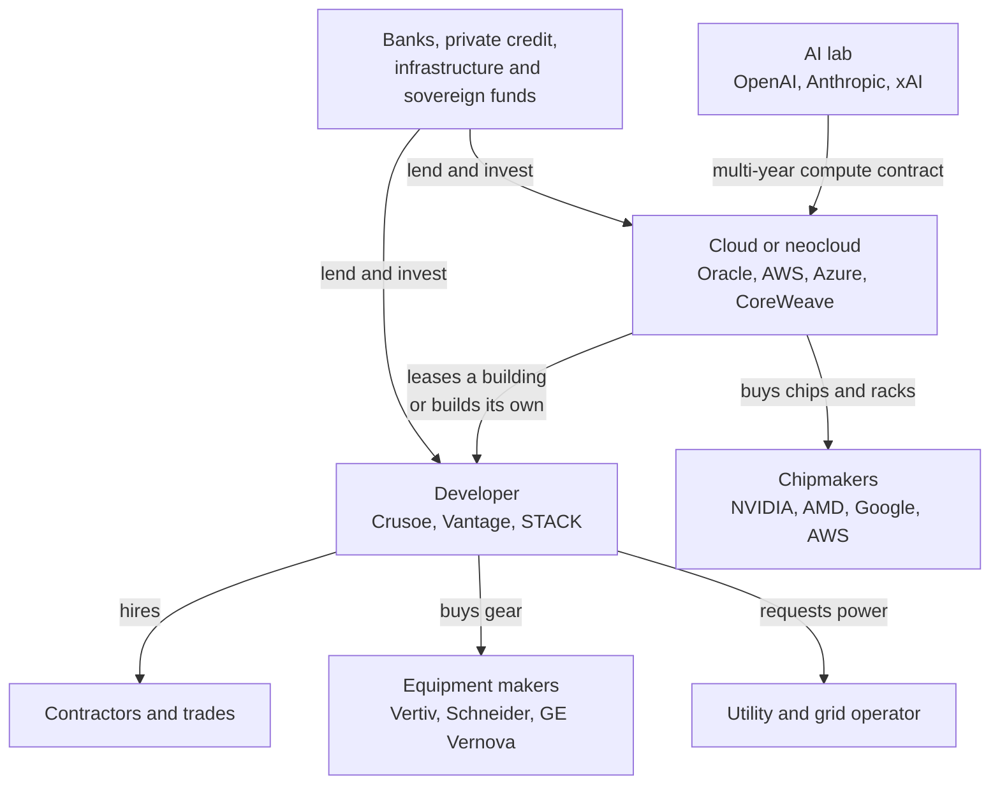
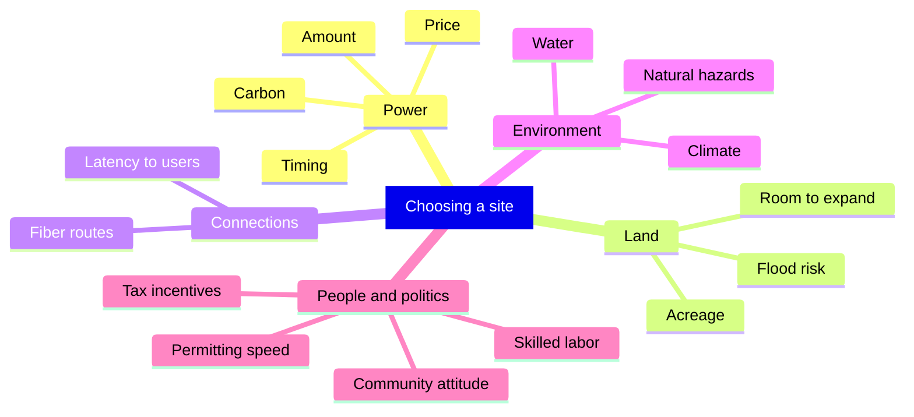
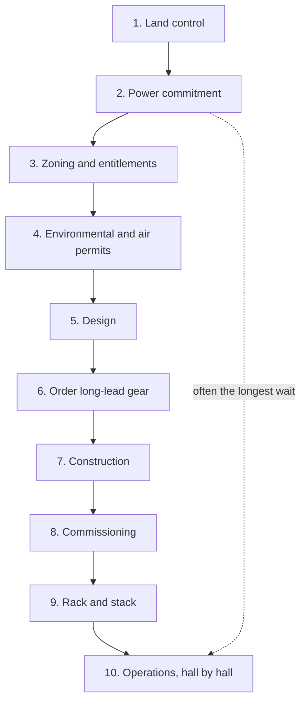
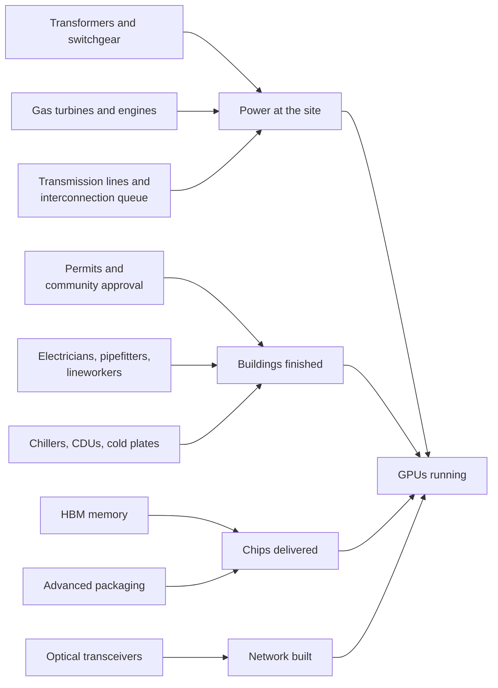
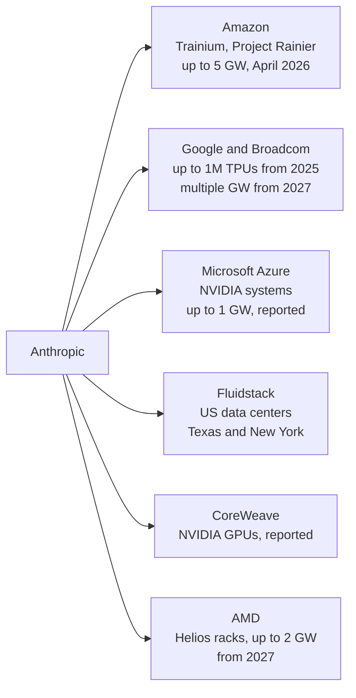
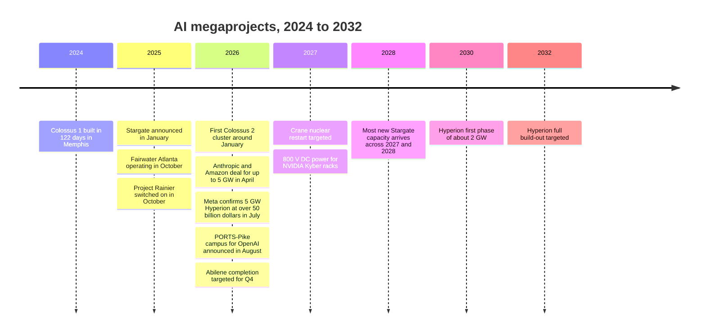
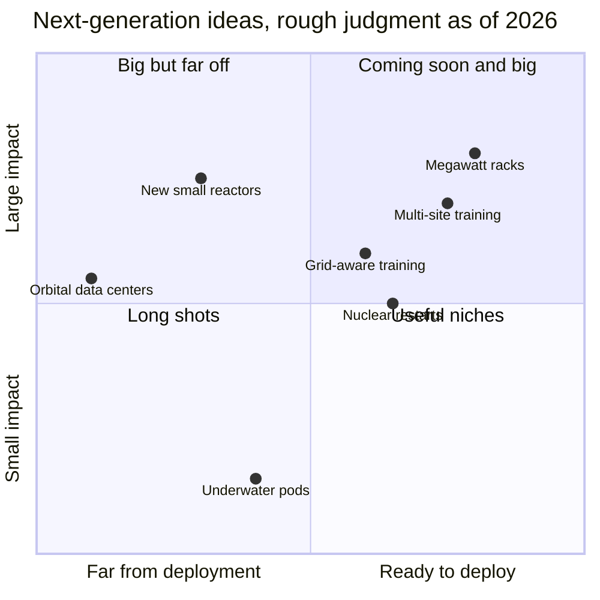

# Chapter 42: The Great Buildout: Hyperscalers, Neoclouds and Megaprojects

*This chapter shows you who is building the giant AI campuses of 2024 to 2026, how a site goes from empty field to running GPUs, what slows it down, and how to read every gigawatt headline with a clear head.*

## What you'll learn

- How big the AI construction boom is in late 2026, in gigawatts, chips and homes' worth of electricity
- Who builds AI data centers: hyperscalers, neoclouds, developers, AI labs and their financiers
- How companies choose a site, with a scoring worksheet you can reuse
- The development lifecycle from land deal to "rack and stack," and why power, not the building, sets the timeline
- The bottlenecks: transformers, turbines, electricians, memory chips, packaging, optics, transmission lines and permits
- The megaprojects as stories: OpenAI's Stargate, xAI's Colossus, Meta's Prometheus and Hyperion, Microsoft's Fairwater, Amazon's Project Rainier, Google's builds and Anthropic's multi-vendor compute
- Why countries want "sovereign AI," and what data residency means for you
- What comes next (megawatt racks, nuclear power, grid-aware and multi-site training, data centers in orbit and under the sea) and how feasible each idea really is

## Before you start

This chapter pulls together the whole of Part VII. Chapter 38 (Inside a Data Center) walked you through the buildings and the business models. Chapter 39 (Power: From the Grid to the GPU) explained watts, watt-hours and the power chain. Chapter 40 (Cooling: Where the Heat Goes) covered liquid cooling and water. Chapter 41 (Energy for AI: Grids, Gas, Nuclear and Renewables) explained the grid, interconnection queues and energy sources. Chapter 34 (Wiring Thousands of Chips Together) and Chapter 35 (The AI Chip Industry) explained the racks and chips that fill these buildings. The money side (what it costs, who pays, and whether it is a bubble) is Chapter 43.

## The biggest construction project of the decade

The next time you ask Claude, ChatGPT or Gemini a question, picture where the answer is computed. It is not "in the cloud" in any airy sense. It is in a windowless building the size of several football fields, often in a small town you have never heard of, drawing as much electricity as a city. Some of those buildings did not exist three years ago. One of them, in Memphis, Tennessee, is a converted appliance factory. Another, in rural Louisiana, is planned to draw more power than many countries.

This chapter is about that construction boom: the AI **buildout**.

> **Definition — Buildout:** The large-scale construction of data centers, power plants, transmission lines and supporting infrastructure needed to run AI. In 2025 and 2026 it became one of the largest private construction efforts in history.

How big is it? Several research groups track it, and their numbers are the best snapshot we have.

- **Epoch AI**, a research group that estimates AI data center capacity from satellite images, permits and company statements, tracked **95 large AI data centers** with about **14.2 GW of IT power** (about **18.5 GW including cooling and other overhead**) as of its October 20, 2026 update. Together they held roughly **14.8 million H100-equivalents** of computing power. Epoch estimates these sites cover about 44% of the world's AI compute, and notes that sites typically use 60 to 80% of their capacity on average.
- **JLL**, a commercial real-estate firm, expects global data center capacity of all kinds to roughly **double from about 103 GW to about 200 GW** between 2025 and 2030 (January 2026 outlook). AI was about a quarter of data center workloads in 2025 and could be half by 2030.

> **Definition — Gigawatt (GW):** One billion watts, a rate of electricity use. One gigawatt is about the output of a large nuclear reactor, or the average draw of roughly 800,000 US homes. Frontier AI campuses are now described in gigawatts.

> **Definition — IT power (IT load):** The electricity used by the computing equipment itself (GPUs, CPUs, memory, storage, network switches), not counting cooling, lighting and power-conversion losses. Data center sizes are often quoted in megawatts or gigawatts of IT power.

> **Definition — Facility power:** The total electricity a site draws from the grid or its own power plants, including IT power plus cooling and other overhead. Facility power equals IT power multiplied by the PUE (see Chapter 40).

> **Definition — H100-equivalent (H100e):** A way of counting computing power in units of one NVIDIA H100 GPU, the workhorse chip of 2023 to 2024. A newer chip that does three times the math of an H100 counts as about three H100-equivalents.

**Worked example: what 18.5 GW means.** Suppose all 95 tracked sites ran at 70% of their 18.5 GW of facility power, all year.

- Energy per year: 18.5 GW × 8,760 hours × 0.7 ≈ 113,000 GWh, or about **113 TWh**.
- Compare: all US data centers (not just AI) used about 176 TWh in 2023, according to Lawrence Berkeley National Laboratory, and all data centers worldwide used about 415 TWh in 2024, according to the International Energy Agency.
- In homes: an average US home draws about 1.2 kW averaged over a year, so 18.5 GW is the average draw of about 18.5 billion ÷ 1,200 ≈ **15 million homes**.

And that covers only the large AI sites Epoch tracks. A boom on this scale touches every part of the economy: steel, copper, concrete, transformers, gas turbines, electricians, local politics and the price of electricity.

> **Key idea:** AI has become a heavy industry. The chatbot on your phone depends on gigawatt campuses that take years to plan, billions of dollars to build, and the electricity of a mid-sized city to run.

> **Definition — Megaproject:** A construction project costing billions of dollars, taking years, and involving many companies and governments. The largest AI campuses of 2025 and 2026 are megaprojects on the scale of airports or dams.

### Reading capacity numbers without getting fooled

Before the stories, a warning about the numbers. Three different quantities get called "the size" of a data center, and headlines mix them up.

| What is quoted | What it means | Example |
|---|---|---|
| Planned capacity | The eventual maximum, often years away and sometimes never built | Stargate: "up to 10 GW" by 2029 |
| Facility power | Total power the site can draw, including cooling | Abilene: a 1.2 GW campus |
| IT power | Power for the computing equipment only | Colossus 2: about 946 MW of IT power (Epoch) |
| Running today | What is actually switched on now | Prometheus: about 471 MW of IT power running in October 2026 (Epoch) |

*Table 42.1: Four different numbers that all get called "the size" of an AI data center.*

A "5 GW campus" headline might describe a site with a few hundred megawatts running today, a gigawatt by 2028 and the rest by the early 2030s, if the power arrives. That is not dishonest; it is how infrastructure is planned. But you should always ask: planned or running? IT or facility? By when?

> **Watch out:** "A 1 GW data center" does not use 1 GW all the time. The gigawatt is a maximum rate (nameplate capacity). Actual energy use depends on how hard the site runs, typically 60 to 80% of capacity on average according to Epoch.

> **Definition — Nameplate capacity:** The maximum power a facility is designed to draw or a power plant is designed to produce. It is the ceiling, not the average.

## Who builds the AI factories

When you read "OpenAI's data center in Texas," it is rarely true that OpenAI owns the building. A typical megaproject involves half a dozen companies, each carrying a different slice of the work and the risk.

> **Definition — Hyperscaler:** One of the giant cloud and internet companies that build and run data centers at enormous scale: Amazon (AWS), Microsoft (Azure), Google, Meta and Oracle.

> **Definition — Neocloud:** A newer cloud company specializing in renting AI chips by the hour or by multi-year contract, such as CoreWeave, Nebius, Lambda, Crusoe, Nscale or Fluidstack.

> **Definition — Data center developer:** A company that finds land, secures power, gets permits and builds data centers, then leases them to tenants or sells them. Examples include Vantage, STACK, QTS, Aligned and Related Digital.

> **Definition — Colocation:** Renting space, power and cooling in someone else's data center. Retail colocation means a few racks; wholesale colocation means whole halls or buildings.

The main players fall into five groups.

1. **Hyperscalers** build their own campuses (self-build) and also lease from developers. Google and Meta self-build heavily; Microsoft, Amazon and Oracle do both.
2. **Neoclouds** rent GPUs to AI labs and companies. CoreWeave, the largest, reportedly ran about 51 AI data centers in 2026 and earned about two-thirds of its 2025 revenue from one customer, Microsoft. Nebius signed a Microsoft contract reported at $17.4 billion (up to $19.4 billion) in September 2025, and has sites in Finland, New Jersey (a 300 MW site in Vineland), Kansas City and Birmingham, Alabama. Several former bitcoin miners (IREN, Cipher, TeraWulf, Core Scientific) converted their power-rich mining sites into AI data centers.
3. **Developers and landlords** (Equinix, Digital Realty, QTS, Vantage, Aligned, STACK, CyrusOne, Related Digital and others) build and lease. Crusoe is both a developer and a neocloud; it built Stargate's Abilene campus.
4. **AI labs** (OpenAI, Anthropic, xAI, Google DeepMind, Meta's labs) are the end customers. Most sign multi-year compute contracts rather than owning buildings, though xAI built Colossus itself.
5. **Suppliers and financiers**: chipmakers (NVIDIA, AMD, Broadcom), electrical and cooling equipment makers (Vertiv, Schneider Electric, Eaton, ABB, Siemens, GE Vernova, Hitachi Energy), utilities, and the banks, private-credit funds, infrastructure funds and sovereign wealth funds that lend the money.



*Figure 42.1: Who does what in a typical AI megaproject. The lab rarely owns the building; it signs a long contract with a cloud, which leases from a developer, which borrows from financiers.*

### The business models in one paragraph each

Chapter 38 covered these in detail; here is the short version you need for the stories ahead.

> **Definition — Build-to-suit:** A deal in which a developer builds a data center to one tenant's exact design and the tenant signs a long lease, often 10 to 20 years.

> **Definition — Powered land:** A plot of land that already has a secured power connection (or a firm promise of one). In 2026 powered land is one of the most valuable things a developer can own, because power is the scarcest input.

> **Definition — Powered shell:** A building delivered with utility power and basic structure but without the tenant's computing equipment and fit-out.

> **Definition — Take-or-pay contract:** A contract in which the customer pays for reserved capacity whether or not it uses it. These contracts are what lenders rely on when they finance data centers.

The risk travels along the chain. If an AI lab's demand falls, its take-or-pay contracts with the cloud still bind it. If the cloud cannot pay, the developer's lease income stops. If the developer defaults, its lenders lose. Chapter 43 follows the money through this chain.

> **Analogy:** A hyperscaler is a city that owns its own buildings. A neocloud is a hotel chain that rents rooms (GPUs) by the night or by the year. A colocation landlord is a self-storage company: you rent the unit and bring your own stuff. A developer is the builder who puts up the hotel and then sells or leases it.

> **Definition — Campus:** A site with several data center buildings sharing one substation, one cooling plant and one security perimeter. The largest AI campuses cover hundreds to thousands of acres.

## Choosing a site

Imagine you have been asked to find a home for a 1 GW AI campus. Where do you even start?

Ten years ago the answer was "near a big city with lots of fiber," which is why Northern Virginia became the world's largest data center market. Virginia's legislative watchdog, JLARC (the Joint Legislative Audit and Review Commission), put the region at about 13% of the world's reported operating data center capacity in 2024 and credited five things: a strong fiber network, a supply of reliable and cheap energy, available land, nearness to major national customers, and a state sales-and-use tax exemption on data center equipment (servers, cooling gear, generators) offered since 2010, worth about $928 million to the industry in fiscal 2023 (the state's budget year) alone. Once a cluster forms, it attracts more: every new building wants to sit next to the networks and customers already there. Today the first question is different: **where can I get a gigawatt of power, soon?**

> **Definition — Site selection:** The process of choosing where to build a data center by weighing power, land, fiber, water, climate, taxes, permitting, labor and community attitudes.

> **Definition — Speed to power:** How quickly a site can get the electricity it needs. In 2025 and 2026 it became the data center industry's top priority, often more important than the price of power.

JLL reports that the average wait for a new grid connection in primary data center markets now exceeds **four years**. A building takes two to three. So developers chase sites where power is available sooner: near existing power plants, near gas pipelines where they can build their own generation, or in regions with spare transmission capacity.

> **Definition — Interconnection:** The physical and contractual connection between a large customer (or power plant) and the grid. Getting one requires engineering studies, often new substations or lines, and an agreement with the utility.

> **Definition — Interconnection queue:** The waiting line of projects asking to connect to the grid. Each must be studied before it can connect, and in many regions the line is years long (see Chapter 41).

### The factors, one by one

Here is what a site selector weighs, roughly in order of importance for an AI campus in 2026.

- **Power: amount, timing, price and carbon.** Can the utility deliver hundreds of megawatts, and when? Can you build your own generation? What will it cost per megawatt-hour, and how clean is it?
- **Land.** Hundreds to thousands of acres, flat, outside flood zones, with room for substations, cooling yards and future expansion. Meta's Hyperion site covers 2,250 acres.
- **Fiber.** Diverse fiber routes to the internet and to the company's other campuses.
- **Water and climate.** Cooler, drier climates allow more "free cooling." Evaporative cooling needs water; dry cooling needs more electricity on hot days (Chapter 40).
- **Latency to users.** Matters for inference (answering users), much less for training.
- **Taxes and incentives.** Sales-tax exemptions on equipment and property-tax deals add up to large sums over a project's life, because the equipment is so expensive.
- **Permitting speed and community attitude.** Some counties welcome data centers for their tax base; others pass moratoriums.
- **Labor.** Thousands of electricians, pipefitters and other trades are needed during construction.
- **Natural hazards.** Earthquakes, hurricanes, wildfires, floods.



*Figure 42.2: The factors a site selector weighs. In 2026, power sits at the top of every list.*

### Training sites and inference sites want different things

> **Definition — Latency:** The time it takes for a message to travel from one place to another. Light in optical fiber covers about 1 kilometer every 5 microseconds, so 1,000 km of fiber adds about 5 milliseconds each way.

A **training** campus mostly talks to itself. The GPUs exchange enormous amounts of data with each other, but very little with the outside world, so it can sit far from any city. That is why training campuses appear in West Texas, rural Louisiana and the Wisconsin countryside.

An **inference** site answers users. But even here, distance matters less than you might think. Suppose your message travels 3,000 km to a data center: that adds about 15 milliseconds each way, 30 milliseconds round trip. A chatbot answer takes a second or more to generate, so you would never notice. Distance matters more for voice agents, which need fast back-and-forth, and for coding agents that make hundreds of quick round trips. And for some customers, the law says the data must stay inside a country, which we'll come to under sovereign AI.

> **Definition — Data residency:** A requirement, set by law or by contract, that data be stored and processed inside a particular country or region. It pushes companies to build or rent data centers in many countries.

### A site-scoring worksheet

Real site selectors use weighted scorecards. Here is a simple one you can copy into a spreadsheet. Score each factor from 1 (poor) to 5 (excellent), multiply by its weight, add up, and divide by 5 to get a score out of 100. The three sites below are **hypothetical**, but their trade-offs are typical.

- **Site A:** a plains county next to a major gas pipeline. Plenty of cheap land; you can build your own gas generation; thin fiber; hot summers.
- **Site B:** an established data center hub near a big city. Superb fiber and workforce; a multi-year grid queue; local pushback.
- **Site C:** a cool northern site near hydroelectric dams. Clean, cheap power, but limited new capacity; fewer skilled workers nearby.

| Factor | Weight | Site A | Site B | Site C |
|---|---|---|---|---|
| Power available soon | 30 | 5 | 1 | 3 |
| Power price and carbon | 10 | 3 | 3 | 5 |
| Land and hazards | 10 | 5 | 2 | 4 |
| Fiber | 10 | 2 | 5 | 3 |
| Water and climate | 10 | 3 | 3 | 5 |
| Permitting and community | 15 | 4 | 2 | 4 |
| Skilled labor | 5 | 2 | 5 | 2 |
| Taxes and incentives | 10 | 4 | 3 | 3 |
| **Weighted score (out of 100)** | 100 | **78** | **49** | **72** |

*Table 42.2: A weighted site-selection scorecard for three hypothetical sites. The weights reflect a company in a hurry.*

**Worked example.** Site A: (5×30 + 3×10 + 5×10 + 2×10 + 3×10 + 4×15 + 2×5 + 4×10) ÷ 5 = (150 + 30 + 50 + 20 + 30 + 60 + 10 + 40) ÷ 5 = 390 ÷ 5 = **78**. Site B's terrible power timing sinks it to 49 despite its fiber and workforce. Site C scores 72.

Now change the weights the way a company with strict clean-energy goals might: drop "power available soon" to 20 and raise "power price and carbon" to 20. Site A falls to 74 and Site C rises to 76. The winner flips. That is the real lesson of the worksheet: **the answer depends on what you value**, and in 2025 and 2026 most builders valued speed above everything, which is why so many projects ended up next to gas pipelines.

> **Try it:** Ask a chatbot: "Act as a data center site selector. Using public information you know, score my county from 1 to 5 on power availability, fiber, water, climate, land, permitting, labor and taxes for a 300 MW AI data center, and explain each score." Then check two of its claims against your county's own website or local news. You'll learn how much (and how little) a chatbot knows about local infrastructure.

> **Watch out:** Cheap electricity is not the same as available electricity. A region with the lowest power prices in the country is useless to a builder if the grid can't connect a new 500 MW load until 2031. In the 2020s, "available soon" usually beats "cheap."

## From empty field to running GPUs: the development lifecycle

Every data center, from a 5 MW enterprise room to a 5 GW campus, goes through roughly the same steps. Knowing them lets you read a project announcement and estimate when the GPUs will really switch on.

**Step 1: Land control.** The developer secures the land, usually with an option to buy so it doesn't pay full price before it knows the project will work.

> **Definition — Land option:** A contract that gives a buyer the right, but not the obligation, to purchase land at an agreed price within a set period. It lets developers lock up sites cheaply while they check power and permits.

**Step 2: Power commitment.** The developer files a large-load request with the utility, pays for studies, and negotiates an agreement. For big projects this is the longest and least certain step. Many developers now also plan their own on-site generation.

> **Definition — Behind-the-meter:** Generation located on the customer's side of the utility meter, usually on site, so the data center makes some or all of its own power instead of drawing it from the grid.

> **Definition — Bridge power:** Temporary on-site generation, often gas turbines or engines, that runs a data center until its permanent grid connection is ready.

> **Definition — Microgrid:** A self-contained local power system, with its own generators and often batteries, that can run independently of the main grid.

**Step 3: Zoning and entitlements.** The county or city must approve the land use. This can mean public hearings, rezoning votes and negotiations over taxes, roads, noise and water.

> **Definition — Zoning:** Local rules that say what kind of buildings and activities are allowed on each piece of land. A farm field usually has to be rezoned before a data center can be built on it.

> **Definition — Entitlements:** The full set of government approvals (zoning, site plans, variances, development agreements) that give a developer the legal right to build.

**Step 4: Environmental and air permits.** Wetlands, endangered species, stormwater, water withdrawals and, increasingly, air permits for backup generators and on-site turbines.

> **Definition — Air permit:** A government permit that limits how much pollution an engine, turbine or other source may emit, and often how many hours it may run. Backup generators and on-site gas turbines need them.

**Step 5: Design.** Engineers write the "basis of design" and draw the single-line diagram of the power system, the mechanical plans for cooling, and the layouts for racks and network.

> **Definition — Basis of design:** The document that sets a data center's key requirements: IT capacity, rack density, redundancy level, cooling method, target efficiency and so on. Every later drawing follows from it.

> **Definition — Single-line diagram:** The engineering map of how electricity flows through a site, from the utility connection to every rack, drawn with one line per circuit.

**Step 6: Procurement of long-lead gear.** Transformers, switchgear, generators, turbines and chillers are ordered, often before the design is final, because they take years to arrive.

> **Definition — Long-lead item:** Equipment that takes many months or years to manufacture and deliver, such as large power transformers, high-voltage switchgear and gas turbines. Data center schedules are built around them.

**Step 7: Construction.** Site work and roads, foundations and piles, structural steel, roof, then the mechanical, electrical and plumbing fit-out.

> **Definition — MEP (mechanical, electrical and plumbing):** The systems inside a building that move air, water and electricity. In an AI data center, MEP is most of the construction cost and complexity.

**Step 8: Commissioning.** Every system is tested, from factory tests of single components (Level 1) to a full "pull the plug" integrated systems test with fake loads running (Level 5).

> **Definition — Commissioning:** Systematic testing that every system in a building works as designed before it goes live, usually organized in five levels from factory tests to whole-site tests.

> **Definition — Integrated systems test:** The final commissioning step, in which the whole site is run under simulated full load and then stressed, for example by cutting utility power, to prove backup systems take over correctly.

> **Definition — Load bank:** A large box of electrical resistors that turns electricity into heat, used to imitate the power draw of IT equipment while testing power and cooling systems.

**Step 9: Rack and stack.** Racks arrive, often pre-built and tested at the factory, are rolled into place, connected to power, liquid cooling and the network, and "burned in" with test workloads.

> **Definition — Rack and stack:** The installation of IT equipment: placing racks, connecting power, cooling and network cables, and testing everything. For pre-built AI racks this can take days per hall instead of months.

**Step 10: Operations.** The site goes live, often hall by hall, while construction continues elsewhere on the campus.



*Figure 42.3: The development lifecycle of a data center. In practice the steps overlap heavily, and the power commitment usually decides when the last step can begin.*

### How long it takes

Typical timelines, as of 2026:

- **The building:** about 18 to 36 months from start of construction to operation.
- **The whole project, if new grid power is needed:** 3 to 7 years or more.
- **A gigawatt-scale AI site:** Epoch AI estimates about two years to build, for the fastest movers.

Here is the same project drawn as a timeline chart. Each `#` is two months.

```
Month:            0     12    24    36    48    60
                  |-----|-----|-----|-----|-----|
Land control      #
Zoning, permits    ###
Design              ###
Long-lead gear       #########
Construction          #########
Commissioning                 ##
Rack and stack                  ##
                  Building ready: about month 32
New grid power    ##############################
                  Grid ready: often month 48 to 60+
```

*Figure 42.4: A timeline (Gantt-style) chart of a typical large data center. The building can be ready in under three years; new grid power often takes four to five or more. The longest chain of dependent steps, the critical path, runs through power.*

> **Definition — Critical path:** The longest chain of tasks in a project that depend on each other. Any delay on the critical path delays the whole project; delays elsewhere may not matter.

That gap between the two bottom bars explains most of the strange behavior in the 2025 and 2026 buildout: on-site gas turbines, batteries, sites next to power plants, bitcoin mines converted to AI, and phased openings where the first buildings run on temporary power while the grid catches up.

**The outliers.** Two projects show what is possible when the rules are bent or the starting point is unusual.

- **xAI's Colossus 1** in Memphis was built in **122 days** in 2024, with about 100,000 H100 GPUs. It reused a former Electrolux appliance factory that already had a building and some power. The grid initially supplied only about 8 MW, later upgraded toward about 150 MW, and xAI filled the gap with temporary gas turbines and Tesla Megapack batteries, according to public reports. That shortcut became a legal fight (see the Colossus story below).
- **Amazon's Project Rainier** in Indiana came online in under a year with about 500,000 Trainium2 chips at launch in October 2025, according to Amazon.

**Phased delivery.** Big campuses open in stages. Stargate's Abilene, Texas campus has eight buildings planned for about 1.2 GW in total. Epoch AI estimated in April 2026 that about 0.3 GW of facility power (about 200 MW of IT) was running, with completion expected in the fourth quarter of 2026; Oracle reportedly said in September 2026 that six of the eight buildings (about 618 MW) had been delivered.

**Worked example: the materials in one campus.** Microsoft published the construction quantities for its Fairwater campus in Mount Pleasant, Wisconsin: 46.6 miles of deep foundation piles, 26.5 million pounds of structural steel, 120 miles of medium-voltage underground cable and 72.6 miles of mechanical piping. Convert the steel: 26.5 million lb × 0.4536 kg/lb ≈ 12 million kg, or about **12,000 tonnes**. The Eiffel Tower's iron structure weighs about 7,300 tonnes, so the steel alone is roughly **one and a half Eiffel Towers**, before counting the cable, pipe, concrete and chips.

> **Key idea:** The building is no longer the slow part. Power is. A modern AI hall can go from foundation to running racks in well under three years, but a new gigawatt grid connection often takes four to seven, which is why builders improvise with on-site gas, batteries and phased openings.

## Bottlenecks: why you can't just buy a gigawatt

If a company has the money, why can't it simply build faster? Because a gigawatt campus needs thousands of specialized items and people, and many of them are scarce. The slowest one sets the pace.

> **Analogy:** A convoy moves at the speed of its slowest truck. You can buy faster trucks for the rest of the convoy, but until you fix the slowest one, the convoy doesn't arrive any sooner. Data center builders spend their days hunting for the slowest truck.

### Electrical equipment

> **Definition — Large power transformer:** A huge device, often weighing hundreds of tonnes, that steps transmission voltage down for a campus substation (or up at a power plant). Each one is custom-built, and few factories make them, so lead times run to years.

> **Definition — Switchgear:** Cabinets of breakers and switches that route electricity and cut it off safely when something goes wrong. Medium-voltage switchgear for data centers is a classic long-lead item.

Transformers, switchgear and high-voltage circuit breakers have all been in short supply since the boom began. Domestic manufacturing of large transformers in the US is limited, so many are imported.

### Power generation

Because grid connections are slow, builders want their own generation, and that created a second queue: for gas turbines.

> **Definition — Combined-cycle gas turbine (CCGT):** A gas power plant in which a gas turbine's hot exhaust also makes steam to drive a second turbine. It is efficient (about 60%) but takes years to build.

> **Definition — Reciprocating engine:** A large piston engine driving a generator, like a giant car engine. Engines are modular and quick to install, which makes them popular for on-site data center power.

The big turbine makers (GE Vernova, Siemens Energy and Mitsubishi Power) report multi-year order backlogs. Large turbines ordered in 2025 and 2026 are often reported to arrive around 2029 to 2030 (treat this as a reported range; makers' quarterly results in late October 2026 may update it). That is why the first wave of on-site power uses smaller units: aeroderivative turbines adapted from jet engines, and banks of reciprocating engines. Stargate's Shackelford County site, for example, plans an on-site gas microgrid, reportedly including about 700 MW of behind-the-meter gas engines from VoltaGrid.

### Cooling equipment

Chillers, dry coolers, coolant distribution units (CDUs) and cold plates are all needed in huge quantities because every Blackwell-class rack is liquid-cooled (Chapter 40). Cooling makers expanded factories quickly, but rack designs change every year, so the equipment must change with them.

### People

The workforce is a bottleneck that money alone cannot fix quickly. A gigawatt campus needs thousands of construction workers at its peak, and the scarcest are licensed electricians (especially "inside wiremen" who wire buildings), pipefitters for liquid cooling, high-voltage lineworkers and commissioning technicians. The US Bureau of Labor Statistics counts about 821,000 electrician jobs and projects 9% growth from 2025 to 2035, citing data centers among the drivers. Big projects pay large premiums, per diems (daily allowances for travel, food and lodging) and overtime to attract crews from other states.

### Chips and their parts

Even with a finished building, you need chips, and the chip supply chain has its own bottlenecks (Chapters 33, 35 and 36):

- **HBM memory**, the stacked memory next to every AI chip, comes from only three suppliers (SK hynix, Samsung and Micron). Memory makers shifting capacity to HBM reportedly tightened supplies of ordinary memory in 2025 and 2026, and Amazon reportedly cited higher memory prices when it raised its 2026 spending plan.
- **Advanced packaging**, especially TSMC's CoWoS, which bonds GPU dies and HBM onto one package, has been the gating capacity for AI accelerators since 2023.
- **Optical transceivers**, the plug-in modules that turn electrical signals into light for the network, are needed by the hundreds of thousands per campus.

> **Definition — HBM (High Bandwidth Memory):** Memory chips stacked on top of each other and placed right next to an AI processor, giving it very fast access to data. Only three companies make it, so its supply limits how many AI chips can be built (see Chapter 33).

> **Definition — Optical transceiver:** A plug-in module that converts electrical signals into pulses of light for fiber-optic cables, and back again. A large AI cluster uses hundreds of thousands of them.

> **Definition — SK hynix:** A South Korean memory-chip maker, part of the SK business group, that leads the market for the high-bandwidth memory (HBM) stacked beside AI chips and has been NVIDIA's main HBM supplier since HBM3. Samsung and Micron are the other two HBM makers.

> **Definition — TSMC (Taiwan Semiconductor Manufacturing Company):** The Taiwanese company that is the world's largest contract chipmaker (foundry) and manufactures nearly all advanced AI chips to their designers' blueprints. Its customers include NVIDIA and AMD, and its CoWoS packaging lines, which join each AI chip to its HBM memory, have been a key limit on AI chip supply.

### Grid and transmission

New high-voltage transmission lines take many years to plan, permit and build, often longer than the data centers they serve. Interconnection queues are long (Chapter 41). Who pays for upgrades is fought over in rate cases; Meta, for example, agreed to fund new transmission for its Hyperion site.

### Permits and communities

Not everyone wants a data center next door. The group Data Center Watch counted **$64 billion** of US projects blocked ($18 billion) or delayed ($46 billion) between May 2024 and March 2025, with 142 local activist groups in more than 24 states, and found the opposition was bipartisan. Its later quarterly tracking counted at least 45 projects worth about $68 billion blocked or delayed in April to June 2026 alone. Compiled news reports suggest that in 2026 many local governments passed moratoriums on new data centers. Lordstown, Ohio, reportedly banned future data centers, and a planned Stargate site in Saline Township, Michigan faced local opposition. Typical concerns are noise, water, electricity bills, diesel and gas pollution, lost farmland, and tax breaks that reduce the local benefit.

> **Definition — Moratorium:** A temporary ban, usually by a local or state government, on approving a type of project, such as new data centers, while rules are studied or written.



*Figure 42.5: The bottlenecks that decide when an AI campus switches on. All four streams must arrive; the slowest one sets the date.*

| Bottleneck | Why it's scarce | Typical workaround |
|---|---|---|
| Grid connection | Studies, upgrades and new lines take years | On-site gas, batteries, sites near power plants |
| Large transformers, switchgear | Few factories, custom designs | Order years early, standardize designs |
| Gas turbines | Multi-year factory backlogs | Smaller turbines, piston engines, fuel cells |
| Skilled trades | Training takes years | Premium pay, factory-built modules, travel crews |
| HBM and packaging | Three memory makers, one dominant packager | Long-term supply deals, alternative chips |
| Community approval | Local opposition, moratoriums | Community benefit deals, quieter and drier designs |

*Table 42.3: The main bottlenecks of the AI buildout and how builders work around them.*

> **At the frontier (2026):** Builders are trying to turn construction into manufacturing. Pre-built power skids, factory-assembled cooling modules and fully tested racks that roll off a truck and plug in all move labor from the muddy site to the factory, where it is faster, safer and less dependent on scarce local electricians.

## The megaprojects, one story at a time

Now the stories. For each, ask the same questions: who, where, how much power, where the power comes from, which chips, when, and what went wrong. All figures are as of October 2026 unless dated otherwise, and many come from Epoch AI's estimates or from news reports rather than company filings.

> **Definition — OSINT (open-source intelligence):** Analysis based on publicly available information such as satellite images, permit filings, power-company documents and job postings. Epoch AI and others use OSINT to estimate how much AI capacity is really running at each site.

### OpenAI's Stargate

**The announcement.** On January 21, 2025, at the White House, OpenAI and partners announced "Stargate," a plan described as "up to $500 billion" and 10 GW of US AI infrastructure by 2029. The partners have included Oracle, SoftBank (the Japanese technology investment group), MGX (an Abu Dhabi investment firm), Crusoe, Vantage, SB Energy (SoftBank's solar, storage and power developer), Related Digital and STACK.

> **Definition — MGX:** An Abu Dhabi investment firm backed by the government of the United Arab Emirates, founded in 2024 to invest in AI and AI infrastructure. It is a partner in OpenAI's Stargate project.

**Abilene, Texas: the flagship.** Crusoe built the campus; Oracle operates it for OpenAI. It is a 1.2 GW campus of eight buildings filled with NVIDIA GPUs, opening in phases as described above. A planned expansion to about 2.1 GW was cancelled; Microsoft later partnered with Crusoe on an adjacent site of about 900 MW.

**The other US sites.** Epoch AI's April 2026 review listed:

- **Shackelford County, Texas:** Vantage's "Frontier" campus, about 1.4 GW of IT (2.0 GW total), with an on-site gas microgrid (reports put it at about 700 MW of behind-the-meter gas engines from VoltaGrid).
- **Doña Ana County, New Mexico:** STACK's "Project Jupiter," 2.2 GW initially, with two gas microgrids.
- **Milam County, Texas:** SB Energy, 1.2 GW, with new on-site generation and storage planned for most of its power.
- **Port Washington, Wisconsin:** Vantage's "Lighthouse," about 1.3 GW of grid draw.
- **Saline Township, Michigan:** Related Digital's "The Barn," about 1.4 GW, powered from the grid of DTE Energy (the Detroit-area utility) plus batteries.
- **Lordstown, Ohio:** under 0.3 GW.

Epoch projects **over 9 GW** across these sites by about 2029, with most new capacity arriving in 2027 and 2028. A further giant site was announced on August 17, 2026: SoftBank's SB Energy will build, own and run the PORTS-Pike campus at the decommissioned Portsmouth uranium enrichment plant in Pike County, Ohio, and lease it to OpenAI for 20 years. NVIDIA says the campus is planned for 8 GW of IT capacity, with an initial phase designed for about 4.25 GW coming online in stages from 2028, and that it is providing credit support for that first phase's land, power and buildings (Reuters reported a guarantee of up to about $105 billion). Treat the gigawatts as a plan, not a fact.

**Overseas.** Stargate UAE, in the United Arab Emirates (UAE), is a planned 1 GW cluster inside a planned 5 GW UAE–US AI campus in Abu Dhabi, built with G42 (an Abu Dhabi AI company), Oracle, NVIDIA, Cisco and SoftBank; its first 200 MW was targeted for 2026 (announced May 2025). Stargate Norway, in Narvik with Nscale and Aker, was announced in July 2025 with about 230 MW of initial capacity. Stargate Argentina had reportedly not progressed beyond a letter of intent as of May 2026, and OpenAI reportedly paused Stargate UK in April 2026, citing energy costs.

> **Definition — Letter of intent:** A document stating that parties plan to make a deal on certain terms, which is not yet a binding contract. Many headline AI infrastructure "deals" begin as letters of intent and some never become contracts.

**What it teaches.** Stargate is a brand over many separately financed projects with different partners, power sources and fates. Some are running; some are being built; one expansion was cancelled; some overseas sites stalled. Gas microgrids feature in several sites because they are the fastest firm power available. Read every "Stargate" headline by asking which site and which stage.

### xAI and SpaceX: Colossus

**Colossus 1** (Memphis, Tennessee) is the speed record: built in 122 days in 2024 in a former Electrolux factory, with about 100,000 H100s, and bridged with temporary gas turbines and Tesla Megapacks while grid power was upgraded.

**Colossus 2** (Memphis and nearby Southaven, Mississippi) is the scale record. Its first cluster of about 110,000 GB200 GPUs (about 210 MW) came online around January 2026, and reports in late September 2026 counted about 440,000 GB300 GPUs in use. Epoch AI lists Colossus 2 at about **946 MW of IT power**, the largest site in the world by compute at about **1.1 million H100-equivalents**.

**The power fight.** To get power fast, xAI ran dozens of gas turbines without permanent permits, according to environmental groups. Mississippi approved a permanent plant of about 1.2 GW with 41 turbines in Southaven in March 2026. In April 2026 the NAACP, represented by the Southern Environmental Law Center and Earthjustice, sued under the Clean Air Act. Memphis has become the leading case study of how fast-built AI power affects nearby neighborhoods, and environmental-justice advocates point to it as an example of new pollution landing on communities that already carry a heavy share.

> **Definition — Clean Air Act:** The main US federal law limiting air pollution. It requires permits for large sources such as power plants and turbines, and lets citizens sue when they believe permits were not obtained.

**Corporate changes.** SpaceX acquired xAI in an all-stock deal (a share exchange, per SpaceX's filings) on February 2, 2026, reportedly valuing xAI at $250 billion. The AI business was later rebranded SpaceXAI (reported in July 2026) and then SpaceXSI, for SpaceX Super Intelligence (October 2026; SpaceX now reports it as its "Super Intelligence" segment, and the legal company name is still SpaceXAI).

**What it teaches.** Speed is possible when you reuse an existing building and bring your own power, but the shortcuts carry legal, health and reputational costs that can follow a project for years.

### Meta: Prometheus and Hyperion

**Prometheus** in New Albany, Ohio was targeted at about 1 GW for 2026. Epoch AI lists about 471 MW of IT running in October 2026. On-site gas plants reportedly supplement the grid.

**Hyperion** in Richland Parish, Louisiana is Meta's giant. The site covers 2,250 acres. On July 13, 2026, Meta said Hyperion will scale to **5 GW** (a goal Mark Zuckerberg first floated in July 2025) and raised the planned investment above $50 billion, from about $27 billion, with a first phase of about 2 GW by 2030 and full build-out around 2032. The local utility, Entergy, is building combined-cycle gas plants and has proposed 1.5 GW of new solar and solar-plus-storage on top of 3 GW previously approved; Meta funds the new transmission. Epoch projects Hyperion at about 3.7 million H100-equivalents by January 2028; because newer chips each count as several H100-equivalents, that projection is compatible with a site still growing toward its full gigawatts. Meta reportedly financed Hyperion through a joint venture with funds managed by the investment firm Blue Owl, a structure Chapter 43 dissects.

> **Worked example:** How many homes is Hyperion? 5 GW ÷ 1.2 kW per average US home ≈ **4.2 million homes'** worth of average power. That is more than twice the number of households in the entire state of Louisiana, all drawn by one fenced campus at full build-out.

**Nuclear.** On January 9, 2026, Meta announced nuclear deals totaling up to **6.6 GW by 2035**: more than 2.1 GW from Vistra's Perry and Davis-Besse plants plus 433 MW of uprates; two TerraPower Natrium reactors (690 MW) as early as 2032 with rights to six more; and up to 1.2 GW from Oklo in Pike County, Ohio as early as 2030. Meta said the deals support the grids serving Prometheus. They add to a 2025 deal for Constellation's Clinton nuclear plant.

> **Definition — Power purchase agreement (PPA):** A long-term contract, often 10 to 20 years, to buy electricity from a specific power plant at an agreed price. It gives the plant's owner the guaranteed income needed to build or keep running it.

> **Definition — Uprate:** An increase in an existing power plant's output through equipment upgrades, a fast and relatively cheap way to add capacity.

**What it teaches.** The biggest campuses blur into utility planning: a single company's data center now drives a state utility's choice of new power plants and transmission lines. Gas comes first; nuclear comes in the 2030s.

### Microsoft: Fairwater

**Mount Pleasant, Wisconsin.** Microsoft calls it an "AI superfactory": 315 acres, three buildings, about 1.2 million square feet, and "hundreds of thousands" of NVIDIA GB200 GPUs in a two-story rack layout that shortens cable runs. More than 90% of capacity uses a **closed-loop liquid cooling** system filled once, served by what Microsoft calls the "second-largest water-cooled chiller plant on the planet" and 172 twenty-foot fans. Microsoft quotes each 72-GPU rack at **865,000 tokens per second**.

> **Definition — Closed-loop cooling:** A cooling system in which coolant circulates in sealed pipes and is reused, so very little water is consumed on site. The heat still has to be rejected to the air by chillers or dry coolers.

**Atlanta (Fayetteville, Georgia).** The second Fairwater site has operated since October 2025, with racks of about 140 kW (reported); Epoch lists about 636 MW of IT. It is linked to Wisconsin over a dedicated "AI WAN," so the two sites can work as one system.

> **Definition — AI WAN (scale-across network):** A long-distance, very high-capacity fiber network that links AI data centers hundreds of miles apart so they can share one large training job. Microsoft's Fairwater sites are the best-known example.

**Nuclear.** Microsoft signed a 20-year PPA for the output of Three Mile Island Unit 1, being restarted as the Crane Clean Energy Center (about 835 MW according to Constellation). The restart was targeted for 2027, supported by a $1 billion Department of Energy loan in November 2025, according to public reports.

> **Definition — Nuclear restart:** Returning a closed nuclear power plant to service after it was shut down, usually requiring years of inspection, repairs and regulatory approval.

**Scale.** On its late-July 2026 earnings call, Microsoft's CEO said the company "added another gigawatt of capacity this quarter," and that demand still exceeded supply.

**What it teaches.** Multi-site design is a way around the power limits of any single site. If you can't get 3 GW in one place, link several 1 GW sites with fiber.

### Amazon and Anthropic: Project Rainier

Amazon built Project Rainier for Anthropic, the maker of Claude, across several US data centers, the biggest in St. Joseph County (New Carlisle), Indiana. It came online in under a year, with about 500,000 Trainium2 chips at launch in October 2025, and by April 2026 Anthropic said it was using over a million Trainium2 chips. Amazon quotes AWS's water efficiency at 0.15 liters per kWh against an industry average of 0.375. By October 2026, Epoch AI listed "Anthropic-Amazon New Carlisle" at about **1,037 MW of IT**, the largest tracked site by power.

On April 20, 2026, Anthropic and Amazon announced a deal for **up to 5 GW**, with nearly 1 GW of Trainium2 and Trainium3 capacity online by the end of 2026; Anthropic said it would commit more than $100 billion to AWS over ten years.

**What it teaches.** Custom chips change the economics. Rainier runs on Amazon's own Trainium, not NVIDIA GPUs (Chapter 35), so Amazon captures more of the value chain and Anthropic gets capacity that doesn't depend on a single chip supplier.

### Google: the quiet self-builder

Google builds mostly for itself and runs mostly its own TPU chips. Its big self-builds include Pryor, Oklahoma (ranked fourth by compute in Epoch's tracker), Ohio, Texas (a reported $40 billion through 2027), Arkansas and Indiana, plus a reported ~1 GW, ~$15 billion hub in Visakhapatnam, India and a €13 billion commitment in Finland announced in September 2026. Its reported energy deals include Kairos small modular reactors (500 MW, 2030 to 2035), the restart of Iowa's Duane Arnold nuclear plant by 2029 and enhanced geothermal with Fervo, and its 2026 environmental report says it signed contracts for over 12 GW of new clean energy in 2025, a record. It reports a 2025 fleet PUE of 1.09, against an industry average of about 1.54 in the Uptime Institute's 2025 survey.

**What it teaches.** Owning the whole stack (chips, buildings, energy deals, models) lets Google optimize everything together, which is one reason it gets less attention: fewer press-release megadeals, more steady building.

### Anthropic: compute from every vendor

Anthropic does not build its own data centers. Instead it assembled one of the most diversified compute portfolios in the industry, buying from four chip families and several clouds.

- **Amazon:** Project Rainier and the April 2026 deal for up to 5 GW of Trainium capacity.
- **AMD:** on July 22, 2026, a partnership to deploy up to 2 GW of AMD Instinct MI455X GPUs in AMD's Helios racks, the first gigawatt starting in the first half of 2027, with AMD committing up to $5 billion of equity investment in Anthropic.
- **Google:** in October 2025, access to up to one million TPUs, bringing "well over a gigawatt" online in 2026. On April 6, 2026, a new agreement with Google and Broadcom for "multiple gigawatts" of next-generation TPUs from 2027; a Broadcom filing implies about 3.5 GW.
- **Microsoft and NVIDIA:** in November 2025, a reported commitment of about $30 billion of Azure compute, with up to 1 GW of NVIDIA Grace Blackwell and Vera Rubin systems.
- **Fluidstack:** $50 billion of US data centers in Texas and New York, announced in November 2025.
- **CoreWeave:** a multi-year NVIDIA GPU deal reported in April 2026.



*Figure 42.6: Anthropic's multi-vendor compute portfolio as of 2026. Four chip families (Trainium, TPU, NVIDIA GPUs and, from 2027, AMD GPUs) and several providers.*

Why spread out? Supply security (no single shortage can stop you), bargaining power (vendors compete on price), and matching chips to jobs (some chips suit training, others serving). The cost is engineering: the same models must run well on several very different chip families, which takes large compiler and kernel teams (Chapter 35). Anthropic reported run-rate revenue above $30 billion in April 2026, up from about $9 billion at the end of 2025, which shows why it needed so much capacity so quickly.

### The stories side by side

| Project | Who | Where | Power (as of Oct 2026) | Energy source | Chips |
|---|---|---|---|---|---|
| Stargate Abilene | OpenAI, Oracle, Crusoe | Abilene, TX | 1.2 GW planned; about 618 MW delivered (reported, Sept 2026) | Grid plus on-site gas (Epoch) | NVIDIA GPUs |
| Other Stargate US sites | OpenAI with Vantage, STACK, SB Energy, Related | TX, NM, WI, MI, OH | Over 9 GW projected by about 2029 (Epoch) | Gas microgrids, grid, solar, batteries | Various |
| Colossus 2 | xAI (SpaceX) | Memphis, TN and Southaven, MS | About 946 MW IT (Epoch) | Gas turbines; 1.2 GW plant approved Mar 2026 | GB200, GB300 |
| Prometheus | Meta | New Albany, OH | About 471 MW IT running; 1 GW target | Grid plus on-site gas; nuclear deals for the region | Not detailed |
| Hyperion | Meta with Blue Owl funds | Richland Parish, LA | 5 GW plan; about 2 GW by 2030 | Entergy gas plants plus solar and storage | Not detailed |
| Fairwater | Microsoft | Mount Pleasant, WI and Atlanta, GA | Atlanta about 636 MW IT (Epoch) | Grid; Microsoft's company-wide deals include the Crane nuclear PPA | GB200 |
| Project Rainier | Amazon for Anthropic | New Carlisle, IN | About 1,037 MW IT (Epoch) | Not detailed in public summaries | Trainium2, Trainium3 |
| Pryor | Google | Pryor, OK | Fourth by compute (Epoch) | Not detailed; Google has company-wide clean-energy contracts | TPUs |

*Table 42.4: The 2026 megaprojects compared. Figures mix company statements, Epoch AI estimates and news reports, and change month to month. States use US postal abbreviations: TX Texas, NM New Mexico, WI Wisconsin, MI Michigan, OH Ohio, TN Tennessee, MS Mississippi, LA Louisiana, GA Georgia, IN Indiana, OK Oklahoma.*



*Figure 42.7: A timeline of the AI megaprojects, from announcements to planned completions. Dates after October 2026 are plans, not facts.*

### Patterns across the stories

1. **Power decides everything.** Every project's timeline, location and controversy trace back to how it got its electricity.
2. **Gas now, nuclear later.** Near-term power is gas, often on site. Nuclear restarts and uprates help this decade; new reactors mostly arrive in the 2030s.
3. **Phases, not ribbon cuttings.** Campuses open building by building, and headline gigawatts arrive years after the announcement.
4. **Plans change.** Abilene's expansion was cancelled, Stargate UK reportedly paused, Hyperion grew from its first plan to 5 GW. Read announcements as intentions.
5. **Communities push back.** Memphis, Saline Township and Lordstown show that permission is a resource as scarce as power.
6. **Deals are layered.** The lab, the cloud, the developer, the chipmaker and the financiers are usually different companies, which spreads both the risk and the credit.

> **Watch out:** A campus "for OpenAI" or "for Anthropic" is usually owned and operated by someone else (Oracle, Crusoe, Amazon) and financed by yet others. When a project struggles or succeeds, check which company actually carries the cost.

> **Try it:** Open Epoch AI's data center hub at epoch.ai/data/data-centers. Find the three largest sites by power and by compute, and note whether the two lists match. Then look at one site's satellite images over time. You'll see how analysts estimate capacity from rooftops, cooling units and turbines.

## Sovereign AI: countries want their own compute

So far this chapter has been mostly American, because most of the world's AI compute sits in the United States. But governments everywhere have noticed that AI runs on physical machines in specific places, and they want some of those machines inside their own borders.

> **Definition — Sovereign AI:** A country's effort to own or control AI computing capacity, data and models within its own borders, so that it does not depend entirely on foreign companies or governments.

Four motives drive it.

1. **Data residency.** Laws and customers increasingly require that sensitive data (health records, government files, bank data) be processed in-country. You can see this in API price lists: OpenAI charges a 10% uplift for regional-processing endpoints on models released from March 2026, so keeping your data in a particular region literally costs more.
2. **National security.** Governments don't want their defense, intelligence or critical services to depend on compute that another country could switch off.
3. **Energy.** Places with abundant, cheap power (the Gulf states with gas and sun, the Nordic countries with hydro and wind and cold air) see AI as a new way to export their energy, in the form of computation.
4. **Access to chips.** The United States restricts exports of the most advanced AI chips (Chapter 36). Countries that want them must strike deals that satisfy US rules, and countries that can't get them, like China, build their own.

> **Definition — Export controls:** Government rules limiting which goods and technologies can be sold to which countries. The US uses them to restrict access to its most advanced AI chips and chipmaking tools.

### Around the world

**The Gulf.** The United Arab Emirates is home to Stargate UAE, a planned 1 GW cluster inside a planned 5 GW UAE–US AI campus in Abu Dhabi, with G42, Oracle, NVIDIA, Cisco and SoftBank; its first 200 MW was targeted for 2026. Saudi Arabia's **Humain**, founded in May 2025 and owned by the Public Investment Fund (the kingdom's sovereign wealth fund), reportedly plans "several gigawatts" and has announced partnerships with NVIDIA, AMD and Qualcomm. Abu Dhabi's MGX is also an investor in Stargate itself.

**Europe.** The European Union's InvestAI initiative plans several "AI gigafactories," large public-private compute facilities meant to give European researchers and companies frontier-scale capacity. Stargate Norway in Narvik, with Nscale and Aker, launched with about 230 MW planned initially, using the region's clean hydropower and cold climate. Google reportedly committed about €13 billion in Finland in September 2026. Nordic sites also lead in reusing data center heat for district heating (Chapter 40).

**The United Kingdom.** The UK government has designated "AI Growth Zones" meant to speed planning and grid access for data centers. But high energy costs bite: OpenAI reportedly paused Stargate UK in April 2026, citing energy prices.

**India.** Google reportedly plans a hub of about 1 GW and about $15 billion in Visakhapatnam, and the government runs national programs to provide GPUs to local researchers and startups.

**Asia more broadly.** Malaysia's Johor state, just across the border from Singapore, has become a major hub; DayOne's Nusajaya campus (about 473 MW of IT) ranks among Epoch AI's top five sites worldwide. Japan is investing in domestic compute alongside its effort to rebuild leading-edge chipmaking (Chapter 36). China, cut off from NVIDIA's best chips, is building on Huawei's Ascend chips, with a 256,000-card Ascend "SuperCluster" being deployed in 2026.

| Region | Main efforts (as of 2026) | Main driver |
|---|---|---|
| United Arab Emirates | Stargate UAE, 1 GW within a planned 5 GW campus | Energy, investment, partnership with the US |
| Saudi Arabia | Humain, reportedly "several gigawatts" planned | Energy, economic diversification |
| European Union | InvestAI "AI gigafactories" | Independence from US clouds, data rules |
| Norway, Finland | Stargate Norway; Google's reported Finland commitment | Clean power, cold climate |
| United Kingdom | AI Growth Zones; Stargate UK reportedly paused | Growth policy, held back by energy costs |
| India | Google's reported Visakhapatnam hub; national GPU programs | Huge user base, data residency |
| Malaysia | Johor cluster near Singapore | Land and power next to a constrained hub |
| China | Huawei Ascend clusters | Export controls force a domestic stack |

*Table 42.5: Sovereign AI efforts around the world, as of 2026. Many figures are announcements or reports, not running capacity.*

### The sovereignty debate

The strongest case **for** sovereign AI: compute is becoming as basic as electricity, and no country wants its hospitals, courts and armed forces to depend on a service another government could restrict. Local compute also keeps citizens' data under local law and builds local skills. The building's location is not the whole story, though. Under the US CLOUD Act of 2018, a US-based provider must disclose data in its possession, custody or control when served with a valid US legal order, whether that data is stored inside or outside the United States. A data center in Paris run by an American company is in Europe, but its operator still answers to American law, which is why some governments care about who runs the machines as well as where they stand.

> **Definition — CLOUD Act:** The Clarifying Lawful Overseas Use of Data Act, a US law enacted in March 2018. It requires US-based communications and cloud providers to hand over data they control in response to valid US legal orders, wherever in the world the data is stored.

The strongest case **against**: AI compute has huge economies of scale. Splitting it into dozens of national clusters means smaller, less efficient sites, duplicated costs and, often, the same American chips and software anyway, so the "sovereignty" may be thinner than it looks. A country might get more benefit from cheap access to the world's best models plus strong data-protection law.

Most countries are landing in between: a modest national cluster for sensitive uses, plus deals that bring global hyperscalers to build locally under local rules.

> **Key idea:** Sovereign AI is about control, not just capacity. Countries build or attract data centers so that data, security and access to chips depend less on decisions made elsewhere, and countries with cheap energy see AI compute as a new export.

## What comes next, and how feasible it is

The buildout is still accelerating, and engineers are working on ideas that range from nearly certain to science-fiction-adjacent. Here they are, with honest notes.

### Megawatt racks and 800 V DC power

A rack held about 5 to 10 kW in 2015 and about 120 to 140 kW in a 2026 NVIDIA GB200 or GB300 NVL72. NVIDIA is designing for **more than 1 MW per rack**, with **800 V DC** power distribution entering production alongside its Kyber racks in **2027**.

> **Definition — 800 V DC distribution:** NVIDIA's announced power architecture for 2027-era AI racks, which sends 800-volt direct current to the racks instead of alternating current (AC). The higher voltage cuts copper, conversion losses and space.

**Worked example: why the voltage must rise.** Power = voltage × current (Chapter 39). For a 1 MW rack:

- At today's 54 V rack power: current = 1,000,000 W ÷ 54 V ≈ **18,500 amps**.
- At 800 V: current = 1,000,000 ÷ 800 = **1,250 amps**, about 15 times less.

The thickness of copper you need grows with current, so at 54 V a 1 MW rack would need about 200 kg of copper busbar, according to NVIDIA. NVIDIA says 800 V DC carries 85% more power through the same conductor than today's 415 V AC, cuts copper by about 45% and improves end-to-end efficiency by up to 5%.

**Feasibility: high.** This is hard engineering (safety at 800 V, cooling a megawatt in a refrigerator-sized cabinet, floors that hold several tonnes, servicing such dense racks), but the companies involved have the money, the motive and a published roadmap.

### Nuclear power for AI

Nuclear is attractive because it is firm (runs day and night), carbon-free and compact. The timeline is the catch.

- **This decade:** restarts and uprates of existing plants. Microsoft's Crane (Three Mile Island Unit 1) restart targeted 2027; Google's Duane Arnold restart by 2029; Meta's Vistra uprates; Amazon's reported deal with Talen at the Susquehanna plant (about 1.9 GW).
- **Around 2030 and after:** new designs. In late September 2026 (announced September 29), the US Nuclear Regulatory Commission approved the first US construction permit for a BWRX-300 small modular reactor, at the Tennessee Valley Authority's Clinch River site; in March it had approved construction of TerraPower's first Natrium plant in Wyoming. Meta's Oklo deal targets 2030 at the earliest; its TerraPower units 2032; Google's Kairos reactors 2030 to 2035. As of 2026, only China and Russia operate small modular reactors, according to public sources.

> **Definition — SMR (small modular reactor):** A nuclear reactor of up to about 300 MW designed to be built largely in factories as standard modules, which could make reactors cheaper and faster to build. The first US units are expected around 2030 at the earliest.

**Feasibility: real but slow.** Expect existing plants to supply AI this decade and new reactors to matter in the 2030s. A reactor inside a data center's fence, powering it directly, is further off still, because of licensing, security and the need to keep the reactor running even when the data center doesn't need the power.

### Grid-aware training

Training runs are flexible in a way most factories are not: you can save a checkpoint (Chapter 37), slow down, and resume. That opens an idea: let AI campuses connect sooner by promising to cut their power use during the few hours a year when the grid is stressed.

> **Definition — Demand response:** An arrangement in which a large electricity user reduces its consumption when the grid is under stress, usually in exchange for payment or a faster connection. Data centers that do this are called flexible loads.

Texas already requires large loads (75 MW and up) to be curtailable in grid emergencies under its 2025 law SB 6 (Senate Bill 6; see Chapter 41). The engineering challenge is that synchronized GPUs can swing a site's power by tens of megawatts in seconds, so slowing down must be done smoothly, with batteries and software.

**Worked example: the cost of pausing.** Chapter 43 shows that one GPU's purchase price alone works out to roughly $1.14 per hour of its life. A 100,000-GPU cluster that pauses for 1% of the year (about 88 hours) leaves about 100,000 × 88 × $1.14 ≈ **$10 million** of hardware idle. That sounds like a lot, until you compare it with getting connected to the grid years earlier.

**Feasibility: medium.** Technically straightforward, economically attractive when it buys faster connection, but it requires new contracts and trust between utilities and operators.

### Multi-site training

If no single site can get enough power, train across several. Microsoft's two Fairwater sites, about 700 miles apart, are linked by a dedicated AI WAN, and Google says its software (JAX and Pathways) can scale one training cluster past a million TPU chips.

**Worked example: the speed-of-light tax.** About 1,200 km of fiber between Wisconsin and Atlanta at about 5 microseconds per km gives about **6 milliseconds** one way. GPUs inside one rack exchange data in a few microseconds, a thousand times faster. So engineers split the job so that the chattiest communication (tensor and expert parallelism, which exchange data in every layer, Chapter 37) stays inside each site, and only less frequent exchanges, such as averaging updates between whole copies of the model (data parallelism), cross the long link.

**Feasibility: already happening** for some workloads, and likely to become standard for the largest runs.

### Data centers in space

In November 2025, Google described **Project Suncatcher**: solar-powered satellites carrying TPUs in a dawn-dusk sun-synchronous orbit (where the satellite almost always sees the Sun), linked to each other by laser beams. A bench demonstration of the laser links reached 1.6 terabits per second, and a Trillium TPU survived radiation tests well beyond the dose expected over five years. Google estimated that the economics roughly work only if launch costs fall below about $200 per kilogram in the mid-2030s, and planned two prototype satellites with Planet by early 2027. Separately, the NVIDIA-backed startup Starcloud reportedly flew an H100 in orbit in November 2025, and SpaceX, which now owns xAI, has publicly promoted orbital AI compute.

> **Definition — Sun-synchronous orbit:** An orbit around Earth's poles that keeps a satellite at the same angle to the Sun. A "dawn-dusk" version rides the line between day and night, so the satellite's solar panels are almost always in sunlight.

**Worked example: the radiator problem.** Space is cold, but it is a vacuum, and a vacuum is an insulator: heat can leave only by radiating away as infrared light. A flat radiator panel at about 57 °C (330 kelvin; the kelvin scale starts at absolute zero, so kelvin = °C + 273), radiating from both sides, sheds at most about 1,200 watts per square meter (from the Stefan–Boltzmann law of physics, which says the heat a surface radiates rises with the fourth power of its kelvin temperature, ignoring sunlight that falls on it). So:

- **1 MW** of chips needs roughly **800 to 1,000 square meters** of radiator, about two basketball courts, and more once sunlight is counted.
- The same 1 MW needs about **3,000 square meters** of solar panels (sunlight in orbit delivers about 1,361 watts per square meter, and panels convert roughly a quarter of it).
- A **1 GW** orbital data center would need on the order of a square kilometer of radiators and three square kilometers of solar panels, all launched, assembled and kept working with no technician to swap a failed GPU.

> **Analogy:** A solar-powered satellite data center is a laptop in a thermos. It gets all the power it wants, but it has a very hard time getting rid of its heat.

**Feasibility: low in this decade.** The physics allows it; the economics depend on launch costs falling severalfold, and repair, radiation and data links to the ground remain unsolved. Small demonstrations, yes; gigawatts, not soon.

### Under the sea and offshore

Microsoft's **Project Natick** sank sealed data center pods off California and then off Scotland in trials from 2015 to 2020, then ended the program. China has deployed commercial underwater data center modules off Hainan. The appeal is free cooling from cold seawater; the drawbacks are maintenance (you can't walk in to replace a part), corrosion, permits and power cables. **Feasibility: niche.** Expect small deployments, not gigawatt campuses.



*Figure 42.8: A rough judgment of how ready and how important each next-generation idea is, as of late 2026. Positions are the author's assessment from the evidence in this chapter, not measurements.*

> **At the frontier (2026):** The leading builders are combining several of these ideas at once: megawatt-class racks on 800 V DC, campuses designed as multi-site systems from day one, on-site gas today with nuclear deals for the 2030s, and contracts that let the grid curtail them in emergencies in exchange for faster connection.

> **Watch out:** "Space data centers will solve AI's energy problem" mixes up power and heat. Orbit offers abundant sunlight, but every watt a chip uses must still be radiated away, launch is expensive, and nobody can drive out to fix a failed server. Treat orbital compute as a long-term research bet, not a near-term answer.

## In plain English

AI chatbots run on real buildings, and since 2024 companies have been building them at a pace not seen since the great railroad and telecom booms. By October 2026, Epoch AI tracked 95 big AI sites drawing up to about 18.5 gigawatts, as much as about 15 million American homes.

These projects involve many companies at once. An AI lab like OpenAI or Anthropic signs a long contract with a cloud company like Oracle or Amazon, which leases buildings from a developer, which borrows from banks and funds and buys equipment from dozens of suppliers. Choosing a site now starts with one question: where can we get lots of electricity soon? Grid connections often take four or more years, while the building takes two or three, so builders turn to on-site gas turbines, batteries and sites next to power plants. Transformers, turbines, electricians, memory chips and permits are all in short supply, and local communities increasingly push back.

The big stories show the same patterns: OpenAI's Stargate spread across many sites with mixed progress; xAI's Colossus built at record speed with controversial gas turbines; Meta's Hyperion in Louisiana planned at 5 gigawatts; Microsoft linking distant Fairwater sites into one system; Amazon's Rainier running Anthropic's work on Amazon's own chips. Countries want their own AI compute too, for control over data and security. Next come megawatt racks, nuclear power in the 2030s, training that flexes with the grid, and long-shot ideas like data centers in orbit.

## Key terms

Buildout, Gigawatt (GW), IT power (IT load), Facility power, H100-equivalent (H100e), Megaproject, Nameplate capacity, Hyperscaler, Neocloud, Data center developer, Colocation, Build-to-suit, Powered land, Powered shell, Take-or-pay contract, Campus, Site selection, Speed to power, Interconnection, Interconnection queue, Latency, Data residency, Land option, Behind-the-meter, Bridge power, Microgrid, Zoning, Entitlements, Air permit, Basis of design, Single-line diagram, Long-lead item, MEP (mechanical, electrical and plumbing), Commissioning, Integrated systems test, Load bank, Rack and stack, Critical path, Large power transformer, Switchgear, Combined-cycle gas turbine (CCGT), Reciprocating engine, HBM (High Bandwidth Memory), Optical transceiver, SK hynix, TSMC (Taiwan Semiconductor Manufacturing Company), Moratorium, OSINT (open-source intelligence), MGX, Letter of intent, Clean Air Act, Power purchase agreement (PPA), Uprate, Closed-loop cooling, AI WAN (scale-across network), Nuclear restart, Sovereign AI, Export controls, CLOUD Act, 800 V DC distribution, SMR (small modular reactor), Demand response, Sun-synchronous orbit

## Exercises

1. **[Easy] How many homes is a gigawatt?** (1) Find your household's yearly electricity use on a bill, or use the US average of about 10,500 kWh per year. (2) Divide by 8,760 hours to get your average draw in kW. (3) Divide 1,000,000 kW (1 GW) by your number to get homes per gigawatt. (4) Repeat for Hyperion's 5 GW and Stargate's 10 GW plan. (5) Compare with the number of households in your city or state (search "[your state] number of households"). **What you'll learn:** what a gigawatt means in human terms, and that it measures a rate, not an amount.

2. **[Easy] Spot a data center from the sky.** (1) Open Google Maps in satellite view, or a public map such as datacentermap.com. (2) Search for a data center near you or a famous one (try searching for the Stargate campus in Abilene, Texas, or Meta's campus in New Albany, Ohio). (3) Find the substation (a fenced yard of transformers and wires), the generator yard (rows of identical boxes), the cooling yard (rows of fans on the roof or ground), and the buildings. (4) Estimate the roof area with the map's measuring tool. **What you'll learn:** to recognize the physical anatomy of an AI campus.

3. **[Medium] Score three sites.** (1) Copy Table 42.2 into a spreadsheet with columns for factor, weight and three sites. (2) Pick three real counties (for example one in Texas, one in Virginia, one in Wyoming). (3) Score each factor from 1 to 5 using public sources: state electricity prices from the EIA, water stress from the Aqueduct map of the WRI (World Resources Institute, an environmental research group), climate, local news for community attitudes, and state economic-development pages for tax incentives. (4) Compute the weighted score with `=SUMPRODUCT(weights, scores)/5`, replacing the two words with cell ranges: for example, if the weights are in B2:B9 and the first site's scores in C2:C9, type `=SUMPRODUCT(B2:B9,C2:C9)/5`. SUMPRODUCT multiplies each weight by its score and adds the results, exactly as in the worked example. (5) Change the weights twice (once for a company in a hurry, once for a company with strict carbon goals) and see whether the winner changes. **What you'll learn:** the multi-factor trade-off real site selectors make, and how weights drive the answer.

4. **[Medium] Watch a megaproject grow.** (1) Install Google Earth Pro (free) on a computer, or use the Sentinel Hub EO Browser online (EO stands for Earth observation). (2) Go to Abilene, Texas or Richland Parish, Louisiana. (3) View the site each year from 2023 to the most recent image: in Google Earth Pro, click the clock icon (Historical Imagery) in the top toolbar and drag the slider; in EO Browser, change the date. (4) Count buildings, cooling units and any turbines in each image. (5) Compare your count with Epoch AI's published estimates. **What you'll learn:** how open-source intelligence analysts estimate AI capacity, and how fast these sites rise.

5. **[Medium] Build a megaproject tracker.** (1) Open Epoch AI's data center hub (epoch.ai/data/data-centers). (2) Copy the ten largest sites into a spreadsheet with columns for owner, location, IT power (MW) and H100-equivalents. (3) Add a column computing H100-equivalents per MW. (4) Sort by each column and note which sites rank high on compute but lower on power, and why newer chips would explain that. (5) Add a "source and date" column, and set a calendar reminder to update it in three months. **What you'll learn:** to work with real infrastructure data and to date every number.

6. **[Medium] Find the critical path.** (1) In a spreadsheet, list the ten lifecycle steps from this chapter with a start month and a duration in months (use Figure 42.4 as a guide, where each `#` is two months). Treat step 2, the power commitment, as the "new grid power" bar: start it at month 0 with a duration of 24 months for now. (2) Add a column for "end month": if the start month is in column B and the duration in column C, type `=B2+C2` in D2 and copy it down. (3) Make a simple bar chart (a stacked bar chart with the start column formatted invisible works as a Gantt chart). (4) Now change only the grid power duration from 24 to 60 months and see which step decides the go-live date. (5) Add a "bridge power" row of 12 months and see how it changes the answer. **What you'll learn:** why power, not construction, sets data center timelines.

7. **[Medium] Hold a planning board hearing.** (1) Ask a chatbot: "Role-play a county planning board hearing on a proposed 500 MW AI data center on farmland. Play four speakers: the developer, a farmer neighbor, the county finance director and an environmental advocate. Each speaks for one paragraph." (2) Write down the three strongest arguments on each side. (3) Draft five conditions (on water, noise, tax payments, power costs and jobs) that might win approval. (4) Check one fact each speaker used against a real source. **What you'll learn:** the community politics that now decide many projects, and how to argue both sides fairly.

8. **[Challenge] Write an energy-source memo.** You need 500 MW of firm power by 2028. (1) Make a table comparing four options: on-site gas turbines or engines, a new grid connection, solar plus 4-hour batteries plus gas backup, and waiting for small modular reactors. (2) For each, estimate time to first power, carbon, cost risk and permitting risk, using Chapter 41 and this chapter. (3) Write a one-page recommendation. (4) Ask a chatbot to critique it as a skeptical utility regulator, then revise. **What you'll learn:** why gas wins the near term despite climate goals, and what would change that.

9. **[Challenge] Napkin-design an orbital data center.** (1) In a spreadsheet, set chip power P (start with 1 MW = 1,000,000 W). (2) Radiator area = P ÷ (2 × 0.9 × 5.67e-8 × T^4), with T = 330 kelvin. Here 2 is for the panel's two sides, 0.9 is how well the panel radiates compared with a perfect radiator, 5.67e-8 (5.67 × 10^−8) is the Stefan–Boltzmann constant and T^4 means T × T × T × T. If P is in cell A2, type `=A2/(2*0.9*5.67E-8*330^4)`; you should get about 830 square meters for 1 MW. (3) Solar area = P ÷ (1,361 × 0.25), where 1,361 is the watts of sunlight per square meter in orbit and 0.25 the share the panels convert. (4) Repeat for 1 GW, and for a hotter radiator (T = 350 K) which needs hotter-running chips. (5) Assume a mass of 10 kg per square meter of panels and radiators, and a launch cost of $200 per kg; compute the launch bill and compare it with Epoch AI's estimate of about $38 billion for a 1 GW ground site. **What you'll learn:** how physics and launch costs, not just enthusiasm, decide whether space compute makes sense.

10. **[Challenge] Budget the speed of light.** (1) Measure the straight-line distance between Mount Pleasant, Wisconsin and Atlanta, Georgia (in Google Maps, right-click one city, choose "Measure distance" and click the other), and assume the fiber route is about 1.15 to 1.2 times that distance, because cables follow roads and railways rather than a straight line. (You should land near the chapter's figure of about 1,200 km.) (2) Compute the one-way latency at 5 microseconds per km. (3) If a training step takes 2 seconds, what fraction of it is one round trip across the link? (4) If GPUs must exchange data 1,000 times per step, what happens? (5) Write two sentences on which kinds of parallelism (Chapter 37) can cross the link and which can't. **What you'll learn:** why multi-site training works for some kinds of communication and not others.

## Areas of opportunity

- **Skilled trades.** Electricians, pipefitters, high-voltage lineworkers, controls technicians and fiber splicers are the most direct bottleneck in the buildout. Megaprojects pay large premiums and per diems, and registered apprenticeships are the fastest entry route.
- **Site selection and land development.** Companies pay well for people who can find "powered land": sites with a realistic path to hundreds of megawatts. The skills are energy-market knowledge, GIS (geographic information system) mapping, land law and patience with utilities.
- **Permitting, community relations and public affairs.** Projects now succeed or fail on local approval. Developers and labs hire community engagement managers, environmental consultants and negotiators of community benefit agreements.
- **Construction and project management.** Schedulers who can manage critical paths through long-lead gear, procurement managers who can secure transformers and turbines, and commissioning agents are all scarce.
- **Bridge and behind-the-meter power.** Businesses that rent mobile turbines, engines, fuel cells or batteries to data centers waiting for the grid have customers lined up; so do microgrid developers.
- **Electrical and cooling equipment manufacturing.** Domestic transformer, switchgear, CDU and 800 V DC power-shelf manufacturing is undersupplied, and governments offer incentives to build it.
- **OSINT and infrastructure analytics.** Investors, journalists and policymakers pay for independent estimates of what is really being built, the kind of work Epoch AI does from satellite images and permits.
- **Sovereign AI advisory.** Governments and national champions need help designing national compute programs, data-residency rules and deals with hyperscalers that satisfy export controls.
- **Grid flexibility software.** Tools that let training jobs throttle smoothly on grid-stress days, and contracts that turn that flexibility into faster connections, are an open problem worth solving.
- **Open problem: community-friendly design.** Quiet, water-free, low-emission campuses that pay their way in local taxes would remove one of the biggest brakes on the buildout.

## Check your understanding

1. Why do headline "gigawatt" numbers for a campus often differ from what is running today? Name the four quantities from Table 42.1.
2. In a typical megaproject, which companies are involved besides the AI lab, and what does each do?
3. Why has "speed to power" overtaken "cheap power" as the top site-selection factor?
4. Why can a training campus sit far from cities, and why does distance matter less than you might think even for chatbot answers?
5. What is the critical path of a large data center project today, and what three workarounds do builders use to shorten it?
6. Name four bottlenecks outside the chip itself that limit how fast AI capacity can be built.
7. What did xAI's Colossus show about the trade-off between speed and permits?
8. Why is an orbital data center harder to cool than one on the ground, even though space is cold?

<details><summary>Answers</summary>

1. Planned capacity is the eventual maximum, sometimes years away; facility power includes cooling and overhead; IT power counts only the computing equipment; and "running today" is what is actually switched on. Campuses open in phases, so the gap between the planned figure and the running figure can be years and several gigawatts.
2. Usually a cloud or neocloud (which signs the contract with the lab and runs the computers), a developer (which secures land, power and permits and builds the buildings), contractors and trades, equipment makers, the utility and grid operator, and financiers (banks, private credit, infrastructure and sovereign funds). Chipmakers supply the racks.
3. Because new grid connections in major markets now take four years or more, while a building takes two to three. Power that is cheap but unavailable until 2031 is worthless to a builder who wants GPUs running in 2027.
4. Training GPUs mostly talk to each other, not to users, so the site can be anywhere with power and fiber. Light in fiber adds only about 5 milliseconds per 1,000 km, so even 3,000 km adds about 30 ms round trip, tiny next to the seconds a chatbot takes to answer. Distance matters more for voice agents, chatty coding agents and data-residency rules.
5. Power: the grid connection, which often takes four to seven years. Builders use on-site (behind-the-meter) gas generation and bridge power, batteries, and sites next to existing power plants or converted power-rich sites such as bitcoin mines. They also open in phases.
6. Any four of: large power transformers and switchgear, gas turbines, chillers and CDUs, skilled electricians and pipefitters, HBM memory, advanced packaging, optical transceivers, transmission lines and interconnection queues, permits and community approval.
7. That reusing a building and bringing your own power can cut build time to months (122 days for Colossus 1), but running dozens of gas turbines without permanent permits led to a Clean Air Act lawsuit and became a case study in environmental justice. Speed can carry long-lasting legal and community costs.
8. Space is a vacuum, which insulates. Heat can leave only by radiation, so you need very large radiators (roughly 1,000 square meters per megawatt at about 57 °C), plus solar panels, all launched at high cost and impossible to service by hand.

</details>

## Going deeper

- **Epoch AI, Data on AI Data Centers** (epoch.ai/data/data-centers). The best public tracker of large AI sites, with power, compute and satellite-based estimates updated regularly.
- **Epoch AI, "OpenAI's Stargate: where the US sites stand"** (epoch.ai, April 2026). A site-by-site status report that shows how to read a megaproject announcement critically.
- **Microsoft, "Inside the world's most powerful AI datacenter"** (blogs.microsoft.com, September 2025). A rare first-party description of a frontier AI campus, with construction quantities and cooling design.
- **International Energy Agency, *Energy and AI*** (iea.org, 2025). The standard global reference on data center electricity use and forecasts.
- **Lawrence Berkeley National Laboratory, *2024 United States Data Center Energy Usage Report*** (eta.lbl.gov). The most cited US numbers on data center electricity, past and projected.
- **JLL, *Data Center Outlook*** (jll.com). An industry view of capacity, construction costs, grid wait times and financing through 2030.
- **Google Research, "Exploring a space-based, scalable AI infrastructure system design"** (research.google, November 2025). The Project Suncatcher paper: a serious, numbers-first look at orbital compute and its unsolved problems.
- **Data Center Watch report** (datacenterwatch.org). Documents local opposition to data centers across the US and what drives it.
- **Gretchen Bakke, *The Grid*** (2016). A readable history of the US electric grid that explains why connecting new loads is so slow.
