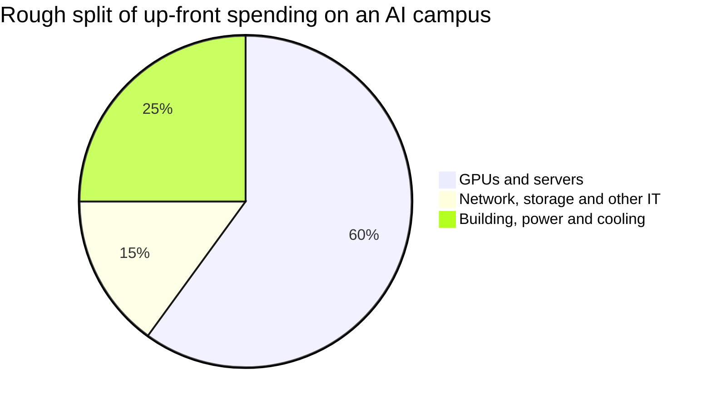
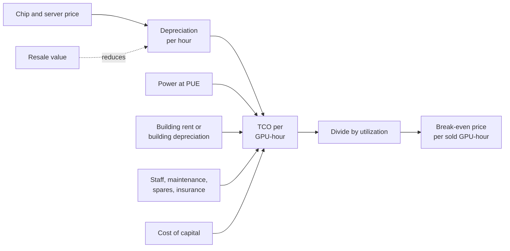

# Chapter 43: The Economics of AI Compute

*This chapter follows the money behind AI compute, from the cost of a megawatt to the price of a token, so you can work out for yourself whether a GPU pays for itself and judge whether the boom is built to last.*

## What you'll learn

- The difference between capex and opex, and why depreciation is the most important number in AI infrastructure
- What a data center costs per megawatt and per gigawatt, and why the chips are most of the bill
- What renting a GPU costs per hour in late 2026, and how utilization decides whether that price makes money
- The 4, 5 or 6-year depreciation debate, and a full worked example of whether one GPU pays for itself
- How a cost per million tokens is built up, and why API prices sit far above raw compute cost
- Who earns what along the chain from chipmaker to app, with real 2026 margins
- How the buildout is financed (bonds, equity, leases, joint ventures, private credit, GPU-backed loans, vendor financing and circular deals) and what each one risks
- The bubble debate, with the strongest bull and bear cases and the lessons of railways and fiber, plus a spreadsheet model of a 100 MW AI data center

## Before you start

Chapter 37 (Training and Serving at Scale) showed how to turn a GPU's hourly cost into a cost per million tokens. Chapter 38 (Inside a Data Center) introduced the business models: self-build, leasing, GPU-as-a-service and take-or-pay. Chapter 39 (Power: From the Grid to the GPU) worked out a 100 MW site's electricity bill. Chapter 42 (The Great Buildout) told the stories of the megaprojects whose money this chapter follows. Chapter 35 (The AI Chip Industry) listed the chip mega-deals. For the wider industry map (who makes money at every layer, including apps and services) see Chapter 61; for AI's effect on the whole economy, see Chapter 60. Basic spreadsheet skills (typing a formula like `=A1*B1`) are all the math you need.

## Why your chatbot has a price tag

Open any AI company's API price list and you'll see prices per million tokens. As of October 2026, Anthropic lists Claude Opus 5.5 at $4 per million input tokens and $20 per million output tokens, and Claude Haiku 5.5 at $0.10 and $0.50. OpenAI lists gpt-6.1-sol at $2 and $10. Consumer subscriptions to ChatGPT, Claude or Gemini typically start around $20 a month.

**Worked example.** A 500-token answer from Opus 5.5 costs a developer 500 ÷ 1,000,000 × $20 = **$0.01**, one cent. Where does that cent go? Some pays for electricity. Some pays for the building. Most pays, one way or another, for chips that cost tens of thousands of dollars each and will be worth much less in a few years. Some pays for the researchers who built the model, and some (if the company is lucky) is profit.

This chapter traces that cent backward, all the way to the concrete and silicon. The key tool is **unit economics**.

> **Definition — Unit economics:** The profit or loss on a single unit of a business: one customer, one query, one GPU-hour, one token. If each unit loses money, growing bigger makes the losses bigger.

> **Key idea:** Every AI answer has a real cost made of chips, buildings, power and people. Whether AI companies make money depends on how the price of each token compares with that cost, and the cost is dominated by expensive chips that lose value quickly.

## Capex and opex: two kinds of spending

Businesses split their spending into two buckets.

> **Definition — Capex (capital expenditure):** Money spent on long-lived things, such as buildings, chips, servers and power equipment, that will be used for years.

> **Definition — Opex (operating expenditure):** Ongoing costs of running the business, such as electricity, salaries, maintenance and rent, that are used up as you go.

> **Analogy:** A restaurant's ovens are capex: you buy them once and cook with them for years. The flour, gas and the cooks' wages are opex: you pay for them every week. An AI data center's GPUs are the ovens, and its electricity and staff are the flour and wages.

Capex creates a puzzle. If a company spends $50 billion on chips this year, did it "lose" $50 billion? Accountants say no: it swapped cash for an asset that will produce revenue for years. So they spread the cost over the asset's expected life. That spreading is **depreciation**, and in AI it is the single most important number on the income statement.

> **Definition — Depreciation:** Spreading the cost of a long-lived asset over the years it is expected to be useful, so each year's profit carries a share of the cost. A $50,000 GPU depreciated over 5 years adds a $10,000 expense to each of those years.

> **Definition — Useful life:** The number of years a company expects an asset to be productive, which sets how fast it is depreciated. Hyperscalers use about 5 to 6 years for servers and 15 to 25 years for buildings.

> **Definition — Straight-line depreciation:** The simplest depreciation method: the same amount every year. Cost ÷ useful life = yearly expense.

> **Definition — Residual value:** What an asset is still worth at the end of its useful life, for example the resale price of a used GPU. Higher residual value means lower true cost.

**Worked example: a GPU's cost per hour of its life.** Suppose one AI GPU slot (the GPU plus its share of the server, network and storage) costs **$50,000**, and you depreciate it straight-line over **5 years** with no residual value.

- Per year: $50,000 ÷ 5 = **$10,000**.
- Per hour: a year has 8,760 hours, so 5 years is 43,800 hours. $50,000 ÷ 43,800 ≈ **$1.14 per hour**.

That $1.14 is charged every hour of the GPU's life, whether it is busy or idle. Hold onto it; we'll use it all chapter.

Cash and profit are different things. When a company buys chips, the cash leaves immediately, even though the profit-and-loss statement only sees a slice each year. So investors also watch cash measures.

> **Definition — Operating cash flow:** The cash a business brings in from its normal operations in a period, before spending on new long-lived assets.

> **Definition — Free cash flow:** Operating cash flow minus capex. Negative free cash flow means a company is spending more on new assets than its business generates, so it must use savings or raise outside money.

> **Watch out:** Huge capex does not show up as a huge loss on the income statement, because depreciation spreads it out. A company can report rising profits while its free cash flow turns negative. In 2026 several hyperscalers were in exactly this position, which is why they started borrowing (more on that below).

## What it costs to build: dollars per megawatt

Data center builders price everything per megawatt of IT capacity. There are two big pieces: the building with its power and cooling equipment, and the IT equipment that goes inside.

### The building and its equipment

> **Definition — Shell-and-core:** The basic data center building plus its core electrical and mechanical systems, before tenant-specific fit-out.

> **Definition — Fit-out:** The equipment and finishing a specific tenant installs inside a building, such as liquid-cooling distribution, extra power gear and racks. AI fit-outs are far denser and costlier than ordinary ones.

Industry estimates for the building side, as of 2026:

- **JLL** puts the global average shell-and-core cost at **$10.7 million per MW in 2025** and forecasts **$11.3 million per MW for 2026**, up from $7.7 million in 2020. AI tenant fit-out can reach about **$25 million per MW**.
- **Cushman & Wakefield's** 2026 guide puts the average greenfield cost of the most modern facilities at **$17.6 million per MW**, up 21% from its previous report.

Call it roughly **$10 to 18 million per MW** for the building and its electromechanical systems, before the chips.

### The IT equipment

The chips cost several times more than the building. Prices are rarely published, but reported figures give the scale: an H100 reportedly sold for about $25,000 to $40,000, and a GB200 or GB300 NVL72 rack (72 GPUs plus CPUs, switches and cooling) reportedly for about $3 to 4 million. Third-party estimates (low confidence) put a Vera Rubin NVL72 rack at about $5 to 7 million.

**Worked example: IT cost per MW.** A Blackwell-class GPU with its share of the server, network and storage draws a bit over 2 kW of IT power, so a megawatt holds roughly **450 GPU slots**. At about **$50,000 per slot** all-in, that is 450 × $50,000 ≈ **$22.5 million per MW**, more than the building.

| Component | Cost per MW of IT (rough, 2025–26) | Lifespan |
|---|---|---|
| Shell-and-core building and power/cooling systems | $10–18 million | 15–25+ years |
| AI-specific fit-out (where counted separately) | Up to about $25 million (JLL) | 10–15+ years |
| GPUs, servers, network, storage (about 450 GPU slots) | About $22 million and rising with each generation | About 4–6 years |

*Table 43.1: What an AI data center costs per megawatt of IT capacity. Ranges come from JLL, Cushman & Wakefield and reported chip prices; the GPU line is an estimate built from this chapter's assumptions.*

### All-in cost per gigawatt

> **Definition — All-in cost:** The total cost of a project including everything needed to make it work: land, building, power and cooling equipment, chips, network and installation.

**Worked example: one gigawatt.** Multiply by 1,000 MW:

- Building and electromechanical: $10–18 million × 1,000 = **$10 to 18 billion**.
- IT equipment: $22.5 million × 1,000 = **about $22.5 billion**.
- Total: about **$33 to 41 billion** per gigawatt of IT.

Compare with outside estimates. Epoch AI estimates about **$38 billion of up-front capital per gigawatt** of IT power. NVIDIA's CEO has reportedly cited about $50 to 60 billion per gigawatt, which fits the newest, priciest chips. Forbes described Anthropic's $50 billion data center commitment with Fluidstack as roughly the cost of one gigawatt. So when you read "a 5 GW campus," translate it to **roughly $200 to 300 billion** of eventual spending.



*Figure 43.1: An illustrative split of the up-front cost of an AI data center. Industry estimates put the building and power gear at roughly 20 to 30% and IT equipment at the large majority; the split within IT varies.*

> **Key idea:** In an AI data center, the chips are most of the money and the shortest-lived part. The building lasts 20 years or more; the GPUs inside it are replaced every few years. That is why the economics of AI compute are mostly the economics of depreciating chips.

## Running costs: power, people and everything else

Once built, a data center costs money every hour.

**Electricity.** Take a 100 MW (IT) site with a PUE of 1.2 (so the facility draws 120 MW at full load), running at an average 80% load, buying power at $70 per megawatt-hour.

- Energy: 100 MW × 1.2 × 8,760 h × 0.8 ≈ **841,000 MWh** a year.
- Cost: 841,000 × $70 ≈ **$59 million a year**.
- Per GPU: one slot drawing about 2 kW at $0.08 per kWh costs about **$0.16 per hour**.

Now compare with the chips. 45,000 GPU slots at $50,000 each, depreciated over 5 years, cost **$450 million a year**, over seven times the power bill. This is a striking fact: **power is a small share of an AI data center's annual cost, yet it is the main limit on how many can be built** (Chapter 42). Operators would happily pay more for electricity if they could get more of it sooner.

Efficiency still matters at this scale. Running that 100 MW site at PUE 1.5 instead of 1.1 wastes 100 MW × 0.4 × 8,760 h ≈ 350,000 MWh a year at full load, about **$25 million** at $70 per MWh, which is why operators fight over decimal points of PUE (Chapter 40).

**Everything else.** Staff (critical-facility technicians, security, network operators), maintenance and spare parts, insurance, property taxes, network transit, software licenses and, if you don't own the building, rent. Companies rarely publish these figures. Tenants who lease space typically pay a monthly rate per kilowatt of capacity; in this chapter's worked examples we assume **$180 per kW per month**, an illustrative figure used in industry-style models (real rates vary widely and are mostly private).

> **Watch out:** "AI data centers are expensive because of electricity" is mostly wrong. Electricity is large in absolute terms and decisive for siting, but for a GPU-filled building, chip depreciation is several times the power bill. The exceptions are older chips, which are cheap to own but burn the same power, and places with very expensive electricity.

## Renting compute: the price of a GPU-hour

Most companies don't own GPUs. They rent them.

> **Definition — GPU-hour:** The use of one GPU for one hour, the basic unit of AI cloud pricing. Renting 1,000 GPUs for 10 hours is 10,000 GPU-hours.

> **Definition — On-demand pricing:** Pay-as-you-go rental by the hour with no commitment. It is the most flexible and the most expensive way to rent.

> **Definition — Reserved pricing:** A lower hourly rate in exchange for committing to rent capacity for months or years, often paying whether you use it or not. Big AI labs rent this way, at prices that are not public.

> **Definition — Spot pricing:** Cheap rental of spare capacity that the provider can take back at short notice. It suits jobs that can pause and restart.

Here are published on-demand list prices as of October 2026:

| Chip | Lambda on-demand ($/GPU-hour) | RunPod on-demand ($/GPU-hour) |
|---|---|---|
| A100 80 GB (launched 2020) | $1.99–2.79 | about $1.19–1.79 |
| H100 SXM (2022) | $3.99–4.29 | about $2.69 (community) to $3.99 (secure) |
| H200 (2024) | not listed here | about $3.59–5.29 |
| B200 (2024–25) | $6.69–6.99 | about $5.98–7.99 |
| B300 (2025) | not listed here | about $6.94–8.99 |
| H100 in Lambda's 1-Click Clusters | $5.54–6.16 | |
| B200 in Lambda's 1-Click Clusters | $8.87–9.86 | |

*Table 43.2: On-demand GPU rental list prices in October 2026, from Lambda's and RunPod's pricing pages. Reserved contract prices for large customers are lower and not published.*

**How prices have moved.** In 2025, H100s were widely available for roughly $2 to 3 per hour on demand from many providers. By October 2026, list prices at several providers were higher, consistent with reports of tight supply and higher memory costs. That is unusual: normally an older chip gets cheaper every year as newer ones arrive. Rising prices for a 2022 chip are a sign that demand for compute was outrunning supply in 2026.

Notice also the **cluster premium**: an H100 in Lambda's pre-wired multi-node clusters costs about 40% more per hour than a single on-demand H100, because the fast network that ties GPUs together for training is expensive. And notice the **A100**, launched in 2020, still renting for about $1.20 to $2.80 an hour six years later. That fact will matter in the depreciation debate.

**Neoclouds versus hyperscalers.** Neoclouds (CoreWeave, Lambda, Nebius, RunPod and others) compete on price, availability and simplicity. Hyperscalers (AWS, Azure, Google Cloud, Oracle) usually charge more for on-demand GPUs but bundle storage, security, databases and enterprise contracts. For the biggest customers, every provider negotiates private multi-year deals, and those prices are what really drive the industry.

**Worked example: renting a cluster.**

- 8 H100s for one week at $3.99: 8 × 168 hours × $3.99 ≈ **$5,360**.
- 1,000 H100s for one month (730 hours) at $3.99: 1,000 × 730 × $3.99 ≈ **$2.9 million**. At the community rate of $2.69, about $2.0 million.

> **Try it:** Open lambda.ai/pricing and runpod.io/pricing. Find today's price for an H100 and a B200, and compare with Table 43.2. Has the price gone up or down since October 2026? A price rise means demand is outrunning supply; a fall means supply is catching up, or a newer chip has arrived.

## Utilization: the hotel occupancy of AI

A GPU costs the same every hour whether it is working or not. So the share of hours it does paid or useful work is everything.

> **Definition — Utilization:** The share of time a GPU (or a data center) is doing paid or useful work. A GPU rented out for 70% of the hours in a year has 70% utilization.

> **Analogy:** Utilization is hotel occupancy. An empty room still costs the hotel its mortgage, staff and heating. A hotel at 50% occupancy must charge almost twice as much per night as one at 95% just to cover the same costs.

**Worked example.** From the depreciation example, a GPU slot costs about $1.79 per hour of its life once you add power and building rent (worked out in full below). If it is busy every hour, each busy hour must earn $1.79. At 70% utilization, each busy hour must earn $1.79 ÷ 0.7 ≈ **$2.56**. At 50%, $1.79 ÷ 0.5 ≈ **$3.59**. Halving utilization doubles the break-even price.

How busy are real sites? Epoch AI notes that large AI sites typically consume 60 to 80% of their power capacity on average. Chatbot demand also follows the clock: people sleep, so traffic dips at night. Providers fill the troughs with work that can wait, which is why both Anthropic and OpenAI sell **batch** processing at half the normal price: off-peak work at a discount is better than idle GPUs.

> **Watch out:** Utilization (are the GPUs rented or busy?) is not the same as MFU, model FLOPs utilization (how much of the chip's math capacity a job actually uses, Chapter 37). A GPU can be 100% rented while doing math at only 40% of its peak speed. Both matter, but they answer different questions.

## Depreciation: the 4, 5 or 6-year debate

How long does an AI GPU stay economically useful? That question is worth tens of billions of dollars of reported profit every year.

**What companies do.** As of 2026, hyperscalers depreciate servers, including GPU servers, over about 5 to 6 years. Amazon shortened the life of some servers from 6 to 5 years in early 2025. Microsoft went the other way for buildings, extending data center building lives from 15 to 25 years from its 2027 fiscal year.

**Worked example: why the choice matters.** Suppose a company owns $100 billion of AI servers.

| Useful life | Yearly depreciation | Per GPU slot ($50,000) per hour |
|---|---|---|
| 4 years | $25.0 billion | $1.43 |
| 5 years | $20.0 billion | $1.14 |
| 6 years | $16.7 billion | $0.95 |

*Table 43.3: The same $100 billion of servers produces very different yearly expenses depending on the assumed useful life.*

Moving from a 4-year to a 6-year life raises reported profit by about **$8.3 billion a year** with no change in the business. Nothing is hidden (the choice is disclosed), but it shows why investors argue about it.

> **Definition — Economic life:** How long an asset remains worth using compared with the alternatives, which can be shorter than its physical life. A GPU that still works may be economically obsolete if a newer chip does far more work for the same power.

> **Definition — Opportunity cost:** The value of the best alternative you give up by using a resource one way. In a power-limited data center, the real cost of running an old GPU is the newer, more productive GPU that could use that power instead.

**The case for long lives (5 to 6 years or more).**

- Old chips keep earning. A100s from 2020 still rented for $1.20 to $2.80 an hour in October 2026.
- Work cascades down: the newest chips train frontier models; last generation's serve popular models; older ones run smaller models, batch jobs and research.
- Software keeps improving old hardware: better batching, quantization and serving engines (Chapter 23) squeeze more tokens out of the same chip.

**The case for short lives (3 to 4 years).**

- NVIDIA now ships a major new generation every year: Blackwell (2024–25), Blackwell Ultra (late 2025), Vera Rubin (2026), Rubin Ultra (2027), Feynman (2028).
- Each generation gives much more work per watt. Epoch AI measures AI-chip performance per dollar improving about 1.49× a year and energy efficiency about 1.34× a year.
- When power is the binding limit, the opportunity cost argument bites: a site with fixed megawatts earns far more by replacing old chips with new ones, so old chips get retired before they wear out.
- Hard use wears chips. In Meta's Llama 3 training run, GPU and memory faults caused most of 419 unexpected interruptions in 54 days (Chapter 37).

Both sides are partly right, and the answer may differ by use: chips in frontier training clusters may have short economic lives, while chips that cascade into inference may last longer. The honest summary is that **nobody knows yet**, because the first big generation of AI GPUs (H100s, from 2022 to 2023) has not yet reached the end of a 5 or 6-year life.

> **Analogy:** GPU depreciation is like a new car losing value when a newer model comes out every year. The old car still drives fine, and someone will buy it, but at a lower price, and a taxi company with limited parking spaces may prefer to replace it early with a model that carries more passengers per gallon.

## Worked example: does a GPU pays for itself?

Now put everything together for one GPU slot. These are **assumptions** for teaching, chosen to sit inside the ranges in this chapter; change them in your own spreadsheet.

| Assumption | Value |
|---|---|
| All-in cost of one GPU slot (GPU plus share of server, network, storage) | $50,000 |
| Depreciation | Straight-line over 5 years, no residual value |
| Power draw, all-in at the IT level | 2 kW |
| Electricity price | $0.08 per kWh |
| Facility rent (space, cooling, backup power) | $180 per kW per month |
| Rental price charged to customers | $3.00 per GPU-hour |
| Utilization | 70% of hours sold |

*Table 43.4: Assumptions for the GPU payback example.*

**Step 1: capital cost per hour of life.** $50,000 ÷ 43,800 hours ≈ **$1.14**.

**Step 2: power per hour.** 2 kW × $0.08 = **$0.16**. (We assume the GPU draws this all the time, a simplification: idle GPUs draw less, but not zero.)

**Step 3: facility rent per hour.** $180 × 2 kW = $360 a month; a month is about 730 hours, so $360 ÷ 730 ≈ **$0.49**.

**Step 4: total cost per hour of life.** $1.14 + $0.16 + $0.49 ≈ **$1.79**.

**Step 5: break-even price per sold hour.**

- At 100% utilization: $1.79.
- At 70%: $1.79 ÷ 0.7 ≈ $2.56.
- At 50%: $1.79 ÷ 0.5 ≈ $3.59.

> **Definition — Break-even:** The price (or volume) at which revenue exactly covers costs, so profit is zero.

At our $3.00 price and 70% utilization, the GPU covers its costs with about $0.44 per sold hour to spare. At 50% utilization it would lose money even at $3.00.

**Step 6: payback.** Look at cash rather than accounting profit.

- Revenue per year: $3.00 × 0.7 × 8,760 hours ≈ **$18,400**.
- Cash running costs per year (power plus rent): ($0.16 + $0.49) × 8,760 ≈ **$5,720**.
- Net cash per year: about **$12,670**.
- Payback: $50,000 ÷ $12,670 ≈ **3.9 years**.

> **Definition — Payback period:** How long it takes for the cash an investment brings in to repay what it cost. Shorter is safer, especially for assets that may become obsolete.

So the GPU earns back its price in just under four years, and makes about $13,400 of cash in total over five. Is that good? It depends on the cost of the money used to buy it.

> **Definition — Cost of capital:** The return that lenders and shareholders expect for providing money, used as the minimum return an investment must beat. For a large company it might be roughly 8 to 10% a year; for a risky startup, much more.

> **Definition — IRR (internal rate of return):** The yearly percentage return an investment earns over its life, taking into account when the cash comes in. Spreadsheets compute it with the `=IRR()` function. An investment is worthwhile if its IRR beats the cost of capital.

Paying $50,000 now and receiving $12,670 a year for five years gives an IRR of about **8.5% a year**. That only just beats a cost of capital of 8%. It's a business, but a thin one, and we haven't counted staff, maintenance, failures, insurance, sales costs or software, which all push the true break-even higher.

**Step 7: what if rental prices fall?** Newer chips arrive every year, so suppose the rental price for this GPU falls 20% a year: $3.00, $2.40, $1.92, $1.54, $1.23.

- Five-year revenue at 70% utilization: about $61,800.
- Five-year cash running costs: about $28,600.
- Net cash: about **$33,200**, which is **less than the $50,000 the GPU cost**. It never pays back. The IRR is about **−16% a year**.

```
Cumulative cash per GPU, in thousands of dollars
Each # is $2,500. Zero is the | line.

Yr 0 flat ####################|       -50.0
Yr 0 fall ####################|       -50.0
Yr 1 flat      ###############|       -37.3
Yr 1 fall      ###############|       -37.3
Yr 2 flat           ##########|       -24.7
Yr 2 fall          ###########|       -28.3
Yr 3 flat                #####|       -12.0
Yr 3 fall            #########|       -22.3
Yr 4 flat                     |       +0.7
Yr 4 fall              #######|       -18.6
Yr 5 flat                     |#####  +13.4
Yr 5 fall              #######|       -16.8
```

*Figure 43.2: Cumulative cash from one $50,000 GPU slot at 70% utilization. "Flat" keeps the rental price at $3.00; "fall" cuts it 20% a year. The same chip either pays back in year 4 or never pays back.*

**Step 8: what if it lives longer?** Keep the flat $3.00 price and let the GPU earn for a sixth year: the IRR rises from about 8.5% to about **13.5%**. One extra year of useful life turns a thin business into a decent one.

> **Key idea:** Whether a GPU pays for itself depends far more on the future rental price, utilization and useful life than on its purchase price or electricity. The depreciation debate is really a debate about how fast the value of compute falls.

> **Watch out:** This example shows a GPU *renter's* economics. An AI lab that runs its own models doesn't sell GPU-hours; it sells tokens and subscriptions. Its question is the same, though: does the revenue from what the GPU produces beat the GPU's cost per hour?

## Total cost of ownership

The payback example is a simplified **total cost of ownership** calculation.

> **Definition — TCO (total cost of ownership):** All the costs of owning and running something over its whole life: purchase, installation, power, cooling, space, networking, staff, maintenance, financing and disposal, minus any resale value. In AI it is usually expressed per GPU-hour or per million tokens.



*Figure 43.3: How the total cost of ownership of a GPU is built up, and how utilization turns it into a break-even rental price.*

TCO is also why the biggest buyers design their own chips. NVIDIA's gross margin was 75.0% in its quarter ending July 2026: for every dollar of NVIDIA products, about 25 cents was the direct cost of making them. A hyperscaler that designs its own chip with a partner such as Broadcom pays its own design costs (hundreds of millions of dollars per chip) and the partner's fee, but avoids most of that margin. The claimed savings, all from interested parties:

- Meta reported in a 2025 research paper that its MTIA chips had 44% lower TCO than GPUs on specific inference tasks.
- Microsoft claims its Maia 200 has 30% better performance per dollar than its existing fleet.
- AMD claims its Helios rack delivers up to 30% more tokens per dollar than an NVIDIA Vera Rubin NVL72.

> **Try it:** Ask a chatbot: "Build me a table of every cost that goes into the total cost of ownership of an AI GPU over five years, and mark which ones are usually left out of simple estimates." Compare its list with Figure 43.3. Which costs did it add that this chapter skipped?
