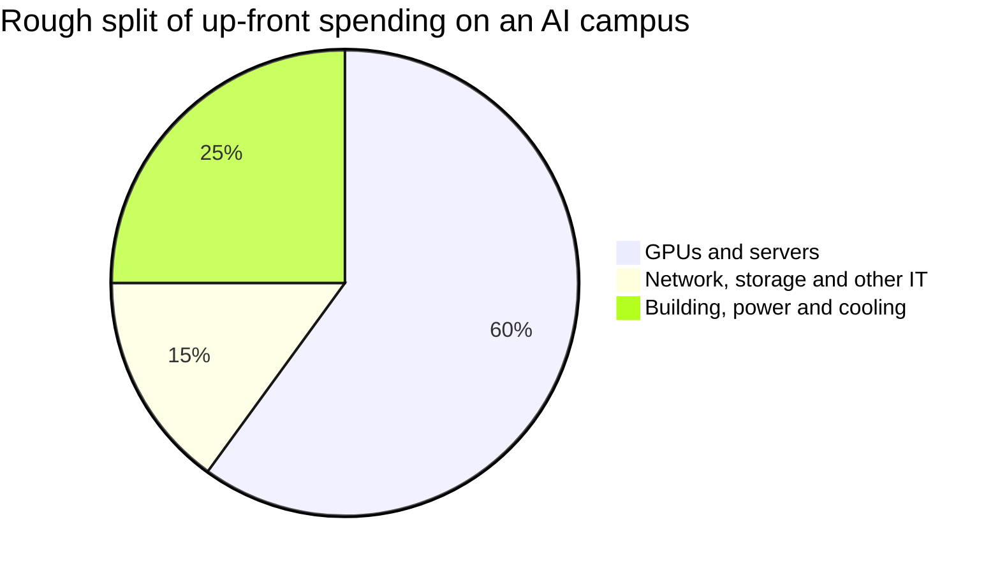
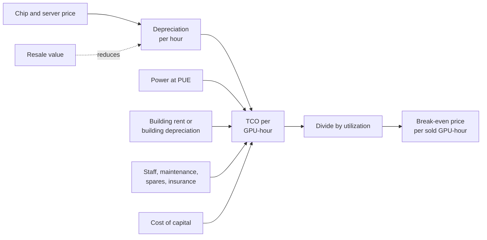
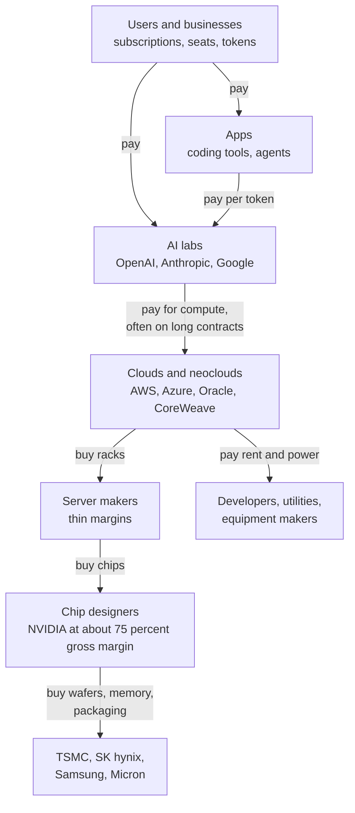
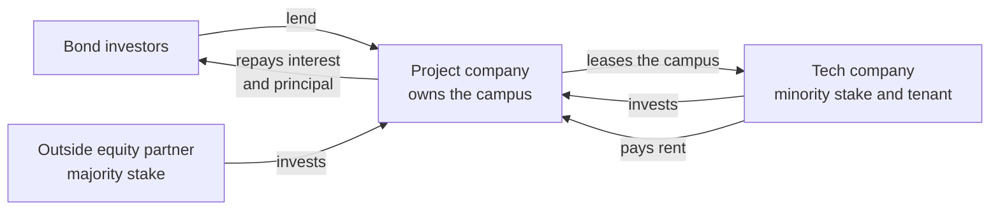
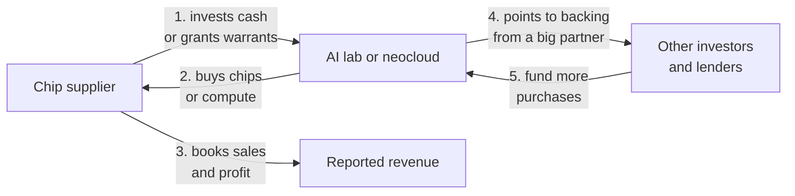
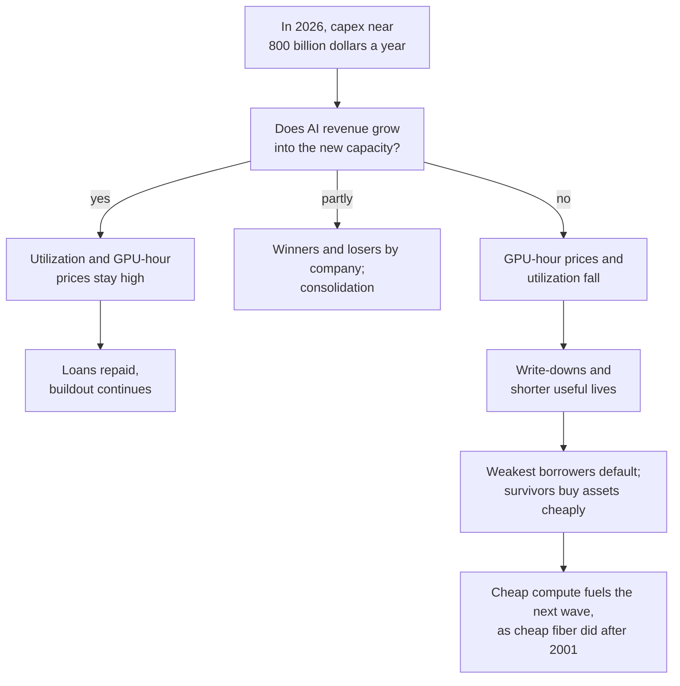

# Chapter 43: The Economics of AI Compute

*This chapter follows the money behind AI compute, from the cost of a megawatt to the price of a token, so you can work out for yourself whether a GPU pays for itself and judge whether the boom is built to last.*

## What you'll learn

- The difference between capex and opex, and why depreciation is the most important number in AI infrastructure
- What a data center costs per megawatt and per gigawatt, and why the chips are most of the bill
- What renting a GPU costs per hour in late 2026, and how utilization decides whether that price makes money
- The 4, 5 or 6-year depreciation debate, and a full worked example of whether one GPU pays for itself
- How a cost per million tokens is built up, and why API prices sit far above raw compute cost
- Who earns what along the chain from chipmaker to app, with real 2026 margins
- How the buildout is financed (bonds, equity, leases, joint ventures, private credit, GPU-backed loans, vendor financing and circular deals) and what each one risks
- The bubble debate, with the strongest bull and bear cases and the lessons of railways and fiber, plus a spreadsheet model of a 100 MW AI data center

## Before you start

Chapter 37 (Training and Serving at Scale) showed how to turn a GPU's hourly cost into a cost per million tokens. Chapter 38 (Inside a Data Center) introduced the business models: self-build, leasing, GPU-as-a-service and take-or-pay. Chapter 39 (Power: From the Grid to the GPU) worked out a 100 MW site's electricity bill. Chapter 42 (The Great Buildout) told the stories of the megaprojects whose money this chapter follows. Chapter 35 (The AI Chip Industry) listed the chip mega-deals. For the wider industry map (who makes money at every layer, including apps and services) see Chapter 61; for AI's effect on the whole economy, see Chapter 60. Basic spreadsheet skills (typing a formula like `=A1*B1`) are all the math you need.

## Why your chatbot has a price tag

Open any AI company's API price list and you'll see prices per million tokens. As of October 2026, Anthropic lists Claude Opus 5.5 at $4 per million input tokens and $20 per million output tokens, and Claude Haiku 5.5 at $0.10 and $0.50. OpenAI lists gpt-6.1-sol at $2 and $10. Consumer subscriptions to ChatGPT, Claude or Gemini typically start around $20 a month.

**Worked example.** A 500-token answer from Opus 5.5 costs a developer 500 ÷ 1,000,000 × $20 = **$0.01**, one cent. Where does that cent go? Some pays for electricity. Some pays for the building. Most pays, one way or another, for chips that cost tens of thousands of dollars each and will be worth much less in a few years. Some pays for the researchers who built the model, and some (if the company is lucky) is profit.

This chapter traces that cent backward, all the way to the concrete and silicon. The key tool is **unit economics**.

> **Definition — Unit economics:** The profit or loss on a single unit of a business: one customer, one query, one GPU-hour, one token. If each unit loses money, growing bigger makes the losses bigger.

> **Key idea:** Every AI answer has a real cost made of chips, buildings, power and people. Whether AI companies make money depends on how the price of each token compares with that cost, and the cost is dominated by expensive chips that lose value quickly.

## Capex and opex: two kinds of spending

Businesses split their spending into two buckets.

> **Definition — Capex (capital expenditure):** Money spent on long-lived things, such as buildings, chips, servers and power equipment, that will be used for years.

> **Definition — Opex (operating expenditure):** Ongoing costs of running the business, such as electricity, salaries, maintenance and rent, that are used up as you go.

> **Analogy:** A restaurant's ovens are capex: you buy them once and cook with them for years. The flour, gas and the cooks' wages are opex: you pay for them every week. An AI data center's GPUs are the ovens, and its electricity and staff are the flour and wages.

Capex creates a puzzle. If a company spends $50 billion on chips this year, did it "lose" $50 billion? Accountants say no: it swapped cash for an asset that will produce revenue for years. So they spread the cost over the asset's expected life. That spreading is **depreciation**, and in AI it is the single most important number on the income statement.

> **Definition — Depreciation:** Spreading the cost of a long-lived asset over the years it is expected to be useful, so each year's profit carries a share of the cost. A $50,000 GPU depreciated over 5 years adds a $10,000 expense to each of those years.

> **Definition — Useful life:** The number of years a company expects an asset to be productive, which sets how fast it is depreciated. Hyperscalers use about 5 to 6 years for servers and 15 to 25 years for buildings.

> **Definition — Straight-line depreciation:** The simplest depreciation method: the same amount every year. Cost ÷ useful life = yearly expense.

> **Definition — Residual value:** What an asset is still worth at the end of its useful life, for example the resale price of a used GPU. Higher residual value means lower true cost.

**Worked example: a GPU's cost per hour of its life.** Suppose one AI GPU slot (the GPU plus its share of the server, network and storage) costs **$50,000**, and you depreciate it straight-line over **5 years** with no residual value.

- Per year: $50,000 ÷ 5 = **$10,000**.
- Per hour: a year has 8,760 hours, so 5 years is 43,800 hours. $50,000 ÷ 43,800 ≈ **$1.14 per hour**.

That $1.14 is charged every hour of the GPU's life, whether it is busy or idle. Hold onto it; we'll use it all chapter.

Cash and profit are different things. When a company buys chips, the cash leaves immediately, even though the profit-and-loss statement only sees a slice each year. So investors also watch cash measures.

> **Definition — Operating cash flow:** The cash a business brings in from its normal operations in a period, before spending on new long-lived assets.

> **Definition — Free cash flow:** Operating cash flow minus capex. Negative free cash flow means a company is spending more on new assets than its business generates, so it must use savings or raise outside money.

> **Watch out:** Huge capex does not show up as a huge loss on the income statement, because depreciation spreads it out. A company can report rising profits while its free cash flow turns negative. In 2026 several hyperscalers were in exactly this position, which is why they started borrowing (more on that below).

## What it costs to build: dollars per megawatt

Data center builders price everything per megawatt of IT capacity. There are two big pieces: the building with its power and cooling equipment, and the IT equipment that goes inside.

### The building and its equipment

> **Definition — Shell-and-core:** The basic data center building plus its core electrical and mechanical systems, before tenant-specific fit-out.

> **Definition — Fit-out:** The equipment and finishing a specific tenant installs inside a building, such as liquid-cooling distribution, extra power gear and racks. AI fit-outs are far denser and costlier than ordinary ones.

Industry estimates for the building side, as of 2026:

- **JLL** puts the global average shell-and-core cost at **$10.7 million per MW in 2025** and forecasts **$11.3 million per MW for 2026**, up from $7.7 million in 2020. AI tenant fit-out can reach about **$25 million per MW**.
- **Cushman & Wakefield's** 2026 guide puts the average greenfield cost of the most modern facilities at **$17.6 million per MW**, up 21% from its previous report.

Call it roughly **$10 to 18 million per MW** for the building and its electromechanical systems, before the chips.

### The IT equipment

The chips cost several times more than the building. Prices are rarely published, but reported figures give the scale: an H100 reportedly sold for about $25,000 to $40,000, and a GB200 or GB300 NVL72 rack (72 GPUs plus CPUs, switches and cooling) reportedly for about $3 to 4 million. Third-party estimates (low confidence) put a Vera Rubin NVL72 rack at about $5 to 7 million.

**Worked example: IT cost per MW.** A Blackwell-class GPU slot draws about 1.8 kW as its share of an NVL72 rack (Chapter 39). Add its share of the network switches, storage and other gear outside the rack, plus some headroom, and plan on about 2.2 kW of IT capacity per slot, so a megawatt holds roughly **450 GPU slots**. At about **$50,000 per slot** all-in, that is 450 × $50,000 ≈ **$22.5 million per MW**, more than the building.

| Component | Cost per MW of IT (rough, 2025–26) | Lifespan |
|---|---|---|
| Shell-and-core building and power/cooling systems | $10–18 million | 15–25+ years |
| AI-specific fit-out (where counted separately) | Up to about $25 million (JLL) | 10–15+ years |
| GPUs, servers, network, storage (about 450 GPU slots) | About $22 million and rising with each generation | About 4–6 years |

*Table 43.1: What an AI data center costs per megawatt of IT capacity. Ranges come from JLL, Cushman & Wakefield and reported chip prices; the GPU line is an estimate built from this chapter's assumptions.*

### All-in cost per gigawatt

> **Definition — All-in cost:** The total cost of a project including everything needed to make it work: land, building, power and cooling equipment, chips, network and installation.

**Worked example: one gigawatt.** Multiply by 1,000 MW:

- Building and electromechanical: $10–18 million × 1,000 = **$10 to 18 billion**.
- IT equipment: $22.5 million × 1,000 = **about $22.5 billion**.
- Total: about **$33 to 41 billion** per gigawatt of IT.

Compare with outside estimates. Epoch AI estimates about **$38 billion of up-front capital per gigawatt** of IT power. NVIDIA's CEO has reportedly cited about $50 to 60 billion per gigawatt, which fits the newest, priciest chips. Forbes described Anthropic's $50 billion data center commitment with Fluidstack as roughly the cost of one gigawatt. So when you read "a 5 GW campus," translate it to **roughly $200 to 300 billion** of eventual spending.



*Figure 43.1: An illustrative split of the up-front cost of an AI data center. Industry estimates put the building and power gear at roughly 20 to 30% and IT equipment at the large majority; the split within IT varies.*

> **Key idea:** In an AI data center, the chips are most of the money and the shortest-lived part. The building lasts 20 years or more; the GPUs inside it are replaced every few years. That is why the economics of AI compute are mostly the economics of depreciating chips.

## Running costs: power, people and everything else

Once built, a data center costs money every hour.

**Electricity.** Take a 100 MW (IT) site with a PUE of 1.2 (so the facility draws 120 MW at full load), running at an average 80% load, buying power at $70 per megawatt-hour.

- Energy: 100 MW × 1.2 × 8,760 h × 0.8 ≈ **841,000 MWh** a year.
- Cost: 841,000 × $70 ≈ **$59 million a year**.
- Per GPU: one slot drawing about 2 kW at $0.08 per kWh costs about **$0.16 per hour**.

Now compare with the chips. 45,000 GPU slots at $50,000 each, depreciated over 5 years, cost **$450 million a year**, over seven times the power bill. This is a striking fact: **power is a small share of an AI data center's annual cost, yet it is the main limit on how many can be built** (Chapter 42). Operators would happily pay more for electricity if they could get more of it sooner.

Efficiency still matters at this scale. Running that 100 MW site at PUE 1.5 instead of 1.1 wastes 100 MW × 0.4 × 8,760 h ≈ 350,000 MWh a year at full load, about **$25 million** at $70 per MWh, which is why operators fight over decimal points of PUE (Chapter 40).

**Everything else.** Staff (critical-facility technicians, security, network operators), maintenance and spare parts, insurance, property taxes, network transit, software licenses and, if you don't own the building, rent. Companies rarely publish these figures. Tenants who lease space typically pay a monthly rate per kilowatt of capacity; in this chapter's worked examples we assume **$180 per kW per month**, an illustrative figure used in industry-style models (real rates vary widely and are mostly private).

> **Watch out:** "AI data centers are expensive because of electricity" is mostly wrong. Electricity is large in absolute terms and decisive for siting, but for a GPU-filled building, chip depreciation is several times the power bill. The exceptions are older chips, which are cheap to own but burn the same power, and places with very expensive electricity.

## Renting compute: the price of a GPU-hour

Most companies don't own GPUs. They rent them.

> **Definition — GPU-hour:** The use of one GPU for one hour, the basic unit of AI cloud pricing. Renting 1,000 GPUs for 10 hours is 10,000 GPU-hours.

> **Definition — On-demand pricing:** Pay-as-you-go rental by the hour with no commitment. It is the most flexible and the most expensive way to rent.

> **Definition — Reserved pricing:** A lower hourly rate in exchange for committing to rent capacity for months or years, often paying whether you use it or not. Big AI labs rent this way, at prices that are not public.

> **Definition — Spot pricing:** Cheap rental of spare capacity that the provider can take back at short notice. It suits jobs that can pause and restart.

Here are published on-demand list prices as of October 2026:

| Chip | Lambda on-demand ($/GPU-hour) | RunPod on-demand ($/GPU-hour) |
|---|---|---|
| A100 80 GB (launched 2020) | $1.99–2.79 | about $1.19–1.79 |
| H100 SXM (2022) | $3.99–4.29 | about $2.69 (community) to $3.99 (secure) |
| H200 (2024) | not listed here | about $3.59–5.29 |
| B200 (2024–25) | $6.69–6.99 | about $5.98–7.99 |
| B300 (2025) | not listed here | about $6.94–8.99 |
| H100 in Lambda's 1-Click Clusters | $5.54–6.16 | |
| B200 in Lambda's 1-Click Clusters | $8.87–9.86 | |

*Table 43.2: On-demand GPU rental list prices in October 2026, from Lambda's and RunPod's pricing pages. Reserved contract prices for large customers are lower and not published.*

**How prices have moved.** In 2025, H100s were widely available for roughly $2 to 3 per hour on demand from many providers. By October 2026, list prices at several providers were higher, consistent with reports of tight supply and higher memory costs. That is unusual: normally an older chip gets cheaper every year as newer ones arrive. Rising prices for a 2022 chip are a sign that demand for compute was outrunning supply in 2026.

Notice also the **cluster premium**: an H100 in Lambda's pre-wired multi-node clusters costs about 40% more per hour than a single on-demand H100, because the fast network that ties GPUs together for training is expensive. And notice the **A100**, launched in 2020, still renting for about $1.20 to $2.80 an hour six years later. That fact will matter in the depreciation debate.

**Neoclouds versus hyperscalers.** Neoclouds (CoreWeave, Lambda, Nebius, RunPod and others) compete on price, availability and simplicity. Hyperscalers (AWS, Azure, Google Cloud, Oracle) usually charge more for on-demand GPUs but bundle storage, security, databases and enterprise contracts. For the biggest customers, every provider negotiates private multi-year deals, and those prices are what really drive the industry.

**Worked example: renting a cluster.**

- 8 H100s for one week at $3.99: 8 × 168 hours × $3.99 ≈ **$5,360**.
- 1,000 H100s for one month (730 hours) at $3.99: 1,000 × 730 × $3.99 ≈ **$2.9 million**. At the community rate of $2.69, about $2.0 million.

> **Try it:** Open lambda.ai/pricing and runpod.io/pricing. Find today's price for an H100 and a B200, and compare with Table 43.2. Has the price gone up or down since October 2026? A price rise means demand is outrunning supply; a fall means supply is catching up, or a newer chip has arrived.

## Utilization: the hotel occupancy of AI

A GPU costs the same every hour whether it is working or not. So the share of hours it does paid or useful work is everything.

> **Definition — Utilization:** The share of time a GPU (or a data center) is doing paid or useful work. A GPU rented out for 70% of the hours in a year has 70% utilization.

> **Analogy:** Utilization is hotel occupancy. An empty room still costs the hotel its mortgage, staff and heating. A hotel at 50% occupancy must charge almost twice as much per night as one at 95% just to cover the same costs.

**Worked example.** From the depreciation example, a GPU slot costs about $1.79 per hour of its life once you add power and building rent (worked out in full below). If it is busy every hour, each busy hour must earn $1.79. At 70% utilization, each busy hour must earn $1.79 ÷ 0.7 ≈ **$2.56**. At 50%, $1.79 ÷ 0.5 ≈ **$3.59**. Halving utilization doubles the break-even price.

How busy are real sites? Epoch AI notes that large AI sites typically consume 60 to 80% of their power capacity on average. Chatbot demand also follows the clock: people sleep, so traffic dips at night. Providers fill the troughs with work that can wait, which is why both Anthropic and OpenAI sell **batch** processing at half the normal price: off-peak work at a discount is better than idle GPUs.

> **Watch out:** Utilization (are the GPUs rented or busy?) is not the same as MFU, model FLOPs utilization (how much of the chip's math capacity a job actually uses, Chapter 37). A GPU can be 100% rented while doing math at only 40% of its peak speed. Both matter, but they answer different questions.

## Depreciation: the 4, 5 or 6-year debate

How long does an AI GPU stay economically useful? That question is worth tens of billions of dollars of reported profit every year.

**What companies do.** As of 2026, hyperscalers depreciate servers, including GPU servers, over about 5 to 6 years. Amazon shortened the life of some servers from 6 to 5 years in early 2025. Microsoft went the other way for buildings, extending data center building lives from 15 to 25 years from its 2027 fiscal year.

**Worked example: why the choice matters.** Suppose a company owns $100 billion of AI servers.

| Useful life | Yearly depreciation | Per GPU slot ($50,000) per hour |
|---|---|---|
| 4 years | $25.0 billion | $1.43 |
| 5 years | $20.0 billion | $1.14 |
| 6 years | $16.7 billion | $0.95 |

*Table 43.3: The same $100 billion of servers produces very different yearly expenses depending on the assumed useful life.*

Moving from a 4-year to a 6-year life raises reported profit by about **$8.3 billion a year** with no change in the business. Nothing is hidden (the choice is disclosed), but it shows why investors argue about it.

> **Definition — Economic life:** How long an asset remains worth using compared with the alternatives, which can be shorter than its physical life. A GPU that still works may be economically obsolete if a newer chip does far more work for the same power.

> **Definition — Opportunity cost:** The value of the best alternative you give up by using a resource one way. In a power-limited data center, the real cost of running an old GPU is the newer, more productive GPU that could use that power instead.

**The case for long lives (5 to 6 years or more).**

- Old chips keep earning. A100s from 2020 still rented for $1.20 to $2.80 an hour in October 2026.
- Work cascades down: the newest chips train frontier models; last generation's serve popular models; older ones run smaller models, batch jobs and research.
- Software keeps improving old hardware: better batching, quantization and serving engines (Chapter 23) squeeze more tokens out of the same chip.

**The case for short lives (3 to 4 years).**

- NVIDIA now ships a major new generation every year: Blackwell (2024–25), Blackwell Ultra (late 2025), Vera Rubin (2026), Rubin Ultra (2027), Feynman (2028).
- Each generation gives much more work per watt. Epoch AI measures AI-chip performance per dollar improving about 1.49× a year and energy efficiency about 1.34× a year.
- When power is the binding limit, the opportunity cost argument bites: a site with fixed megawatts earns far more by replacing old chips with new ones, so old chips get retired before they wear out.
- Hard use wears chips. In Meta's Llama 3 training run, hardware faults, led by GPU and memory problems, caused about 78% of 419 unexpected interruptions in 54 days (Chapter 37).

Both sides are partly right, and the answer may differ by use: chips in frontier training clusters may have short economic lives, while chips that cascade into inference may last longer. The honest summary is that **nobody knows yet**, because the first big generation of AI GPUs (H100s, from 2022 to 2023) has not yet reached the end of a 5 or 6-year life.

> **Analogy:** GPU depreciation is like a new car losing value when a newer model comes out every year. The old car still drives fine, and someone will buy it, but at a lower price, and a taxi company with limited parking spaces may prefer to replace it early with a model that carries more passengers per gallon.

## Worked example: does a GPU pay for itself?

Now put everything together for one GPU slot. These are **assumptions** for teaching, chosen to sit inside the ranges in this chapter; change them in your own spreadsheet.

| Assumption | Value |
|---|---|
| All-in cost of one GPU slot (GPU plus share of server, network, storage) | $50,000 |
| Depreciation | Straight-line over 5 years, no residual value |
| Power draw, all-in at the IT level | 2 kW |
| Electricity price | $0.08 per kWh |
| Facility rent (space, cooling, backup power) | $180 per kW per month |
| Rental price charged to customers | $3.00 per GPU-hour |
| Utilization | 70% of hours sold |

*Table 43.4: Assumptions for the GPU payback example.*

**Step 1: capital cost per hour of life.** $50,000 ÷ 43,800 hours ≈ **$1.14**.

**Step 2: power per hour.** 2 kW × $0.08 = **$0.16**. (We assume the GPU draws this all the time, a simplification: idle GPUs draw less, but not zero.)

**Step 3: facility rent per hour.** $180 × 2 kW = $360 a month; a month is about 730 hours, so $360 ÷ 730 ≈ **$0.49**.

**Step 4: total cost per hour of life.** $1.14 + $0.16 + $0.49 ≈ **$1.79**.

**Step 5: break-even price per sold hour.**

- At 100% utilization: $1.79.
- At 70%: $1.79 ÷ 0.7 ≈ $2.56.
- At 50%: $1.79 ÷ 0.5 ≈ $3.59.

> **Definition — Break-even:** The price (or volume) at which revenue exactly covers costs, so profit is zero.

At our $3.00 price and 70% utilization, the GPU covers its costs with about $0.44 per sold hour to spare. At 50% utilization it would lose money even at $3.00.

**Step 6: payback.** Look at cash rather than accounting profit.

- Revenue per year: $3.00 × 0.7 × 8,760 hours ≈ **$18,400**.
- Cash running costs per year (power plus rent): ($0.16 + $0.49) × 8,760 ≈ **$5,720**.
- Net cash per year: about **$12,670**.
- Payback: $50,000 ÷ $12,670 ≈ **3.9 years**.

> **Definition — Payback period:** How long it takes for the cash an investment brings in to repay what it cost. Shorter is safer, especially for assets that may become obsolete.

So the GPU earns back its price in just under four years, and makes about $13,400 of cash in total over five. Is that good? It depends on the cost of the money used to buy it.

> **Definition — Cost of capital:** The return that lenders and shareholders expect for providing money, used as the minimum return an investment must beat. For a large company it might be roughly 8 to 10% a year; for a risky startup, much more.

> **Definition — IRR (internal rate of return):** The yearly percentage return an investment earns over its life, taking into account when the cash comes in. Spreadsheets compute it with the `=IRR()` function. An investment is worthwhile if its IRR beats the cost of capital.

Paying $50,000 now and receiving $12,670 a year for five years gives an IRR of about **8.5% a year**. That only just beats a cost of capital of 8%. It's a business, but a thin one, and we haven't counted staff, maintenance, failures, insurance, sales costs or software, which all push the true break-even higher.

**Step 7: what if rental prices fall?** Newer chips arrive every year, so suppose the rental price for this GPU falls 20% a year: $3.00, $2.40, $1.92, $1.54, $1.23.

- Five-year revenue at 70% utilization: about $61,800.
- Five-year cash running costs: about $28,600.
- Net cash: about **$33,200**, which is **less than the $50,000 the GPU cost**. It never pays back. The IRR is about **−16% a year**.

```
Cumulative cash per GPU, in thousands of dollars
Each # is $2,500. Zero is the | line.

Yr 0 flat ####################|       -50.0
Yr 0 fall ####################|       -50.0
Yr 1 flat      ###############|       -37.3
Yr 1 fall      ###############|       -37.3
Yr 2 flat           ##########|       -24.7
Yr 2 fall          ###########|       -28.3
Yr 3 flat                #####|       -12.0
Yr 3 fall            #########|       -22.3
Yr 4 flat                     |       +0.7
Yr 4 fall              #######|       -18.6
Yr 5 flat                     |#####  +13.4
Yr 5 fall              #######|       -16.8
```

*Figure 43.2: Cumulative cash from one $50,000 GPU slot at 70% utilization. "Flat" keeps the rental price at $3.00; "fall" cuts it 20% a year. The same chip either pays back in year 4 or never pays back.*

**Step 8: what if it lives longer?** Keep the flat $3.00 price and let the GPU earn for a sixth year: the IRR rises from about 8.5% to about **13.5%**. One extra year of useful life turns a thin business into a decent one.

> **Key idea:** Whether a GPU pays for itself depends far more on the future rental price, utilization and useful life than on its purchase price or electricity. The depreciation debate is really a debate about how fast the value of compute falls.

> **Watch out:** This example shows a GPU *renter's* economics. An AI lab that runs its own models doesn't sell GPU-hours; it sells tokens and subscriptions. Its question is the same, though: does the revenue from what the GPU produces beat the GPU's cost per hour?

## Total cost of ownership

The payback example is a simplified **total cost of ownership** calculation.

> **Definition — TCO (total cost of ownership):** All the costs of owning and running something over its whole life: purchase, installation, power, cooling, space, networking, staff, maintenance, financing and disposal, minus any resale value. In AI it is usually expressed per GPU-hour or per million tokens.



*Figure 43.3: How the total cost of ownership of a GPU is built up, and how utilization turns it into a break-even rental price.*

TCO is also why the biggest buyers design their own chips. NVIDIA's gross margin was 75.0% in its quarter ending July 2026: for every dollar of NVIDIA products, about 25 cents was the direct cost of making them. A hyperscaler that designs its own chip with a partner such as Broadcom pays its own design costs (hundreds of millions of dollars per chip) and the partner's fee, but avoids most of that margin. The claimed savings, all from interested parties:

- Meta reported in a 2025 research paper that its MTIA chips had 44% lower TCO than GPUs on specific inference tasks.
- Microsoft claims its Maia 200 has 30% better performance per dollar than its existing fleet.
- AMD claims its Helios rack delivers up to 30% more tokens per dollar than an NVIDIA Vera Rubin NVL72.

> **Try it:** Ask a chatbot: "Build me a table of every cost that goes into the total cost of ownership of an AI GPU over five years, and mark which ones are usually left out of simple estimates." Compare its list with Figure 43.3. Which costs did it add that this chapter skipped?

## Putting it together: a 100 MW AI data center

Now scale up from one GPU to a whole building. This model is the core of this chapter's spreadsheet exercise (Exercise 6); here are its inputs and results so you can check your own.

| Input | Value | Reasoning |
|---|---|---|
| IT capacity | 100 MW | A large single hall or small campus |
| GPU slots per MW | 450 | About 2.2 kW of IT capacity per Blackwell-class slot, including gear outside the rack |
| GPU slots | 45,000 | 100 × 450 |
| Building and electromechanical cost | $15 million per MW, so $1.5 billion | Between JLL's and Cushman & Wakefield's figures |
| IT cost | $50,000 per slot, so $2.25 billion | Reported chip and rack prices |
| Total capex | $3.75 billion | That is $37.5 billion per GW, close to Epoch AI's $38 billion |
| Useful lives | Building 20 years, IT 5 years | Within the ranges hyperscalers use |
| Power | PUE 1.2, 80% average load, $70 per MWh | Typical of a modern liquid-cooled site |
| Other operating costs | $60 million a year | A placeholder; real figures are rarely disclosed |
| Rental price | $2.50 per GPU-hour | A blended contract price, below on-demand list prices |
| Utilization | 75% | Within Epoch AI's 60 to 80% range |

*Table 43.5: Inputs for a model of a 100 MW AI data center that rents out its GPUs. All are assumptions for teaching.*

**Results.**

- Revenue: 45,000 × 8,760 hours × 0.75 × $2.50 ≈ **$739 million a year**.
- Depreciation: building $1.5 billion ÷ 20 = $75 million, plus IT $2.25 billion ÷ 5 = $450 million, so **$525 million**.
- Power: 100 × 1.2 × 8,760 × 0.8 ≈ 841,000 MWh × $70 ≈ **$59 million**.
- Other operating costs: **$60 million**.
- Total costs: about **$644 million**.
- Operating profit: about **$95 million**, a margin of about 13%.
- Break-even rental price: $644 million ÷ (45,000 × 8,760 × 0.75) ≈ **$2.18 per GPU-hour**.

Is a $95 million profit on a $3.75 billion investment good? Measure it the way an investor would. Over five years the site generates about $620 million of cash a year (revenue minus power and other running costs), and at the end of five years the building still has three-quarters of its life left. Those cash flows give an IRR of only about **3.5% a year**, well below an 8% cost of capital. To earn 8%, the rental price would need to be about **$2.93**.

| Operating profit ($ million a year) | $2.00 per GPU-hour | $2.50 per GPU-hour | $3.00 per GPU-hour |
|---|---|---|---|
| 60% utilization | −171 | −53 | +66 |
| 75% utilization | −53 | +95 | +243 |
| 90% utilization | +66 | +243 | +420 |

*Table 43.6: Sensitivity of the 100 MW model's yearly operating profit to rental price and utilization. Small changes swing the business from loss to large profit.*

Three lessons jump out.

1. **The business is thin and very sensitive.** A 50-cent change in price or a 15-point change in utilization moves profit by about $150 million a year. Selling GPU-hours is closer to running an airline than a software company.
2. **This is why contracts come before concrete.** A neocloud that signs a multi-year take-or-pay contract before building locks in both price and utilization, which turns this fragile business into something a lender will finance. It also moves the risk onto the customer, usually an AI lab.
3. **Life is the hidden lever.** Stretch the IT life from 5 to 6 years and yearly depreciation falls by $75 million, lifting profit at $2.50 and 75% from about $95 million to about $170 million.

> **Key idea:** Owning AI compute is a capital-heavy, low-margin business whose profits swing wildly with price, utilization and useful life. That is why builders demand long contracts, why lenders care so much about who the customer is, and why the depreciation debate matters.

## From GPU-hours to the price of a token

AI labs don't usually sell GPU-hours; they sell tokens and subscriptions. Chapter 37 showed the conversion:

`cost per million tokens = (cost per GPU-hour) ÷ (tokens per second × 3,600) × 1,000,000`

> **Definition — Cost per million tokens:** The cost (or price) of generating one million tokens, the basic unit of AI inference economics. It is the hourly cost of the hardware divided by the number of millions of tokens it produces in an hour.

> **Definition — Throughput:** The total amount of work a system completes per unit of time; for a chatbot server, the total tokens per second it produces across all users at once.

**Worked example: a Fairwater rack.** Microsoft quotes one GB200 NVL72 rack (72 GPUs) at **865,000 tokens per second**. Suppose each GPU costs **$4 per hour** all-in.

- Rack cost per hour: 72 × $4 = **$288**.
- Tokens per hour: 865,000 × 3,600 ≈ **3.1 billion**, or 3,114 million.
- Cost per million tokens: $288 ÷ 3,114 ≈ **$0.09** at full throughput.
- At 50% of that throughput on average: about **$0.19**. At 25%: about **$0.37**.

Now compare with prices. As of October 2026, Claude Opus 5.5 output tokens list at $20 per million, gpt-6.1-sol at $10, and gpt-6-astra at $50. Even small models such as Claude Haiku 5.5 list at $0.50 per million output tokens. Frontier prices sit **50 to 500 times** above our raw compute estimate. Why such a gap?

- **Model size.** A vendor's tokens-per-second figure reflects one particular model and setup. Frontier models are much larger and produce far fewer tokens per GPU.
- **Speed for users.** You want answers fast. Serving each user quickly means smaller batches, and smaller batches mean fewer total tokens per GPU (the throughput-versus-interactivity trade-off in Chapter 37).
- **Long inputs and memory.** Long conversations and documents fill GPU memory with the KV cache, which limits how many users share a GPU.
- **Hidden tokens.** Reasoning models think in tokens you never see, and agents send many requests per task.
- **Peaks and free users.** Fleets are sized for peak demand, so average utilization is lower, and free users consume compute without paying.
- **Everything besides serving.** Training runs (Chapter 37 estimated a single frontier run at hundreds of millions of dollars or more), research, safety work, staff and sales must all be paid from token revenue.
- **Margin.** And finally, some of it is profit.

How much is profit? Less than you might think. The research firm Sacra estimates OpenAI's gross margin at about 33%, meaning roughly two-thirds of revenue goes to the direct cost of serving, with projected inference costs of $14.1 billion for 2026. Treat those as outside estimates, not company figures.

**Prices fall fast.** Epoch AI found that the price of reaching a fixed level of capability fell between 9 and 900 times per year depending on the benchmark: GPT-4-level performance on one knowledge test went from $37.50 per million tokens in March 2023 to $0.18 by February 2025. So the revenue a GPU can earn from any given task shrinks quickly, which is the same force that pushes GPU rental prices down in Step 7 of the payback example, and why demand for ever more capable (and expensive) models keeps the fleet busy (the Jevons paradox, Chapter 37).

> **Watch out:** An API's list price is not its cost. Prices bundle serving costs, training and research costs and profit, and they are set strategically (some products are priced to win market share). You can't infer a lab's profitability from its price list alone.

## Who earns what along the chain

Follow the money from your subscription back to the silicon. Each layer takes its share, and the size of each share tells you where the bottleneck is.

> **Definition — Gross margin:** Revenue minus the direct cost of delivering the product, as a percentage of revenue. NVIDIA's 75% gross margin means each dollar of sales cost about 25 cents to produce.

> **Definition — Operating margin:** What remains after all operating costs (including research, sales and administration, not just direct costs), as a percentage of revenue.

> **Definition — Run-rate:** Recent revenue multiplied up to a full year, for example one month's revenue × 12. It shows the current pace of a fast-growing business but is not money already earned, and companies calculate it differently.

> **Definition — Backlog (remaining performance obligations, RPO):** Revenue from signed contracts that has not yet been delivered or recognized. A large backlog signals future demand but is not cash in hand.

> **Definition — Customer concentration:** When a large share of a company's revenue comes from a few customers. It is a risk: losing one customer can sink the business.

**Layer 1: chips.** NVIDIA is the clearest winner of the buildout so far. In its quarter ending July 26, 2026, it reported revenue of **$96.2 billion** (up 106% from a year earlier), of which **$89.0 billion** was data center revenue, a GAAP gross margin of **75.0%** and net income of **$59.7 billion**. It guided to about $108 billion for the next quarter. Margins this high are a sign of scarcity and of the CUDA software moat (Chapter 35). Memory makers (SK hynix, Samsung, Micron) also benefit from tight HBM supply, and TSMC from manufacturing nearly all of the chips (Chapter 36).

**Layer 2: servers and racks.** Contract manufacturers such as Foxconn, Quanta, Wistron and Wiwynn, and brands such as Supermicro and Dell, assemble racks. They handle enormous volumes but keep a much thinner slice of each dollar, because most of a rack's value is the chips they buy.

**Layer 3: clouds and neoclouds.** They earn rental income on huge capital bases, as the 100 MW model showed. CoreWeave, the largest neocloud, reported 2025 revenue of about $5.1 billion and in August raised its 2026 guidance to $12.4 to 13.2 billion, with a backlog of about $104 billion as of June 30, 2026, but with about two-thirds of 2025 revenue from Microsoft (customer concentration) and debt of about $35 billion by mid-2026, according to public reports. Among hyperscalers, Amazon reported an AWS backlog of about $496 billion in mid-2026 (reported).

**Layer 4: AI labs.** Revenue is growing at historic speed, alongside very large costs. Reported figures, all from outside sources and best treated as estimates:

- **OpenAI** recognized about $13.1 billion of revenue in 2025 and reportedly expected about $36 billion in 2026, with a run-rate around $50 billion by September 2026. The Financial Times reported projections of about $278 billion of cumulative negative free cash flow over 2026 to 2030.
- **Anthropic** reported run-rate revenue of more than $65 billion by the end of July 2026, up from about $9 billion at the end of 2025. Reported recognized revenue was $4.8 billion, $11.5 billion and $16.8 billion in the first three quarters of 2026, with an adjusted operating margin of 11% (excluding stock-based compensation) in the third quarter. Sacra cites about $1.70 of revenue per $1 of compute in that quarter, which is not the same as a gross margin, and Anthropic books cloud-reseller sales gross, which raises its reported revenue compared with companies that book them net.

**Layer 5: applications.** Apps built on top of models (coding tools, legal assistants, customer-service agents) pay model providers for every token, so their gross margins are usually lower than traditional software's, and they face the risk that the model provider builds their feature (Chapter 61 covers this).

**Layer 6: you.** Consumers pay subscriptions (ChatGPT had more than 50 million consumer subscribers as of February 2026, reportedly), and businesses pay per seat, per token or per outcome.



*Figure 43.4: How money flows down the AI value chain. The thickest margins in 2026 sit at the scarcest layer, the chips.*

> **Key idea:** Profits pool where the bottleneck is. In 2025 and 2026 that was AI chips and the memory and packaging behind them. If chips become plentiful, the bottleneck, and the profits, could shift to power, to the labs with the best models, or to the apps closest to customers.

## The spending: capex in 2025 and 2026

Here is what the five biggest spenders said they would spend, as of their earnings calls in late July 2026. Definitions differ between companies (some include finance leases, some include non-AI spending), so compare trends rather than exact figures. Third-quarter results due the week of October 27 to 30, 2026 will update these.

| Company | 2025 capex (approx.) | 2026 plan (as of late July 2026) |
|---|---|---|
| Alphabet (Google) | About $91.5 billion | $195–205 billion, raised twice during 2026 |
| Amazon | About $131–135 billion | About $220 billion, including non-AI spending; higher memory prices cited |
| Meta | About $72.2 billion | $130–145 billion |
| Microsoft | About $118 billion (calendar basis unclear) | About $175 billion for calendar 2026; $41 billion including finance leases in April–June 2026 alone, about two-thirds on short-lived assets such as GPUs |
| Oracle | Financed fiscal 2026 with about $43 billion of debt and $5 billion of equity | Plans about $40 billion more debt in fiscal 2027 |

*Table 43.7: Big Tech capital spending, 2025 and 2026 plans. 2025 figures and several 2026 figures come from news reports; company definitions vary.*

The data firm FactSet estimated in July 2026 that the five companies' combined 2026 capex would be **close to $800 billion**, including finance leases and customer prepayments, plus about **$820 billion of lease commitments** that don't appear as debt on their balance sheets. Other trackers put the four largest (excluding Oracle) at about $720 to 745 billion.

Around it: NVIDIA said at its March 2026 developer conference that it targets about **$1 trillion** of Blackwell and Vera Rubin orders through 2027. JLL estimates about $1.2 trillion of data center real-estate value creation and about $870 billion of new debt financing through 2030, with tenants spending $1 to 2 trillion more on fit-out, nearly **$3 trillion** in all.

**Worked example: how much capacity does $800 billion buy?** At $38 to 50 billion per gigawatt, $800 billion a year is roughly **16 to 21 GW** of AI capacity a year, if it all went to AI data centers (it doesn't; some is for ordinary cloud, offices, satellites and robots). Compare that with the 14.2 GW of IT power in all the large AI sites Epoch tracked in October 2026. Spending at this rate would add more than the whole tracked fleet every year.

**Worked example: the capex–revenue gap.** OpenAI's and Anthropic's combined run-rates were roughly $100 billion or more by late 2026 (reported). Hyperscaler capex was close to $800 billion for the year. The capex buys assets that last years, and cloud revenue from other AI customers adds more, so the comparison is not one to one. But it shows the bet: the industry is spending many dollars of capital per dollar of current AI revenue, betting that revenue keeps growing fast enough to earn a return.

## Financing the buildout

For years, Big Tech paid for data centers out of profits. In 2026 that stopped being enough. FactSet reported that capex at several hyperscalers rivaled or exceeded their operating cash flow; Amazon's capex reportedly exceeded its operating cash flow in the second quarter of 2026. So the industry reached for every financing tool there is.

| Tool | How it works | 2025–26 example | Main risk |
|---|---|---|---|
| Cash from operations | Pay from profits | Most hyperscaler capex until 2025 | Spending outgrows cash |
| Bonds | Borrow from investors at a fixed interest rate | Amazon's $25 billion bond, 2.5× oversubscribed | Interest cost, credit downgrades |
| New shares | Sell ownership for cash | Alphabet's $80 billion equity program, June 2026 | Dilutes existing owners |
| Leases | Rent buildings and equipment instead of buying | About $820 billion of off-balance-sheet lease commitments (FactSet) | Fixed payments that look like debt |
| Joint ventures and SPVs | A separate company owns the asset and borrows | Meta's Hyperion venture with Blue Owl funds (reported) | Complexity, guarantees |
| Private credit | Loans from investment funds instead of banks | Construction and GPU loans | Less transparency |
| GPU-backed loans | Chips and rental contracts as collateral | CoreWeave's $2.3 billion H100-backed facility (2023) | Collateral loses value fast |
| Vendor financing | Suppliers invest in customers | NVIDIA's investments in OpenAI, Anthropic, CoreWeave, Nebius | Inflated apparent demand |
| Sovereign wealth funds | State investment funds | MGX in Stargate; GIC led an Anthropic round | Political strings |
| Private funding rounds | Sell private shares to investors | OpenAI's $122 billion round (March 2026) | Valuation risk |

*Table 43.8: How the AI buildout is financed, with examples from 2025 and 2026. Several examples come from news reports.*

### Bonds, credit ratings and new shares

> **Definition — Bond:** A loan from investors to a company or government, repaid with interest on a fixed schedule. Big Tech has issued tens of billions of dollars of bonds to fund data centers.

> **Definition — Credit rating:** An agency's grade (from AAA down) of how likely a borrower is to repay. "Investment grade" (BBB- or better at S&P) lets a company borrow cheaply; below that, interest costs jump.

Amazon placed a $25 billion bond that was 2.5 times oversubscribed, meaning investors offered to lend far more than it asked for. Oracle financed its fiscal 2026 buildout with about $43 billion of debt and $5 billion of equity, and on July 9, 2026 S&P cut Oracle's rating to **BBB-**, the lowest investment-grade step.

> **Definition — Equity offering:** Selling new shares to raise cash. An "at-the-market" program sells shares gradually into the stock market over time instead of all at once.

On June 1, 2026, Alphabet announced an **$80 billion equity program**: $30 billion of underwritten public offerings, a $40 billion at-the-market program, and a $10 billion private placement to Berkshire Hathaway, with proceeds for general purposes including AI infrastructure, according to its SEC filings. A company that used to buy back its own shares was now selling new ones.

### Leases, joint ventures and SPVs

> **Definition — Finance lease vs. operating lease:** Two accounting categories for renting. A finance lease is treated much like owning (the asset and the debt appear on the balance sheet, and some companies count it as capex); an operating lease is treated more like ordinary rent.

> **Definition — Off-balance-sheet:** Obligations, such as some leases or debts of separate companies, that don't appear as debt on a company's main balance sheet, even though the company may be committed to pay them.

> **Definition — Joint venture (JV):** A company jointly owned by two or more partners to carry out one project, sharing its costs, risks and profits.

> **Definition — SPV (special purpose vehicle):** A separate company created to own one project and borrow against it, so the project's debt sits in the SPV rather than on the sponsor's main balance sheet.

Meta's Hyperion campus is the prime example. According to public reports, it is owned through an 80/20 joint venture with "Beignet Investors," an entity managed by Blue Owl, in which Meta is the minority partner and the tenant. Construction is funded by bonds that are repaid from Meta's lease payments, with an initial four-year lease from 2029, renewable for up to 20 years. Arrangements like this often include a **residual value guarantee**.

> **Definition — Residual value guarantee:** A promise by a tenant to make up the difference if the asset is worth less than an agreed amount when the lease ends. It reassures lenders, but it leaves the tenant exposed if the asset loses value.



*Figure 43.5: A simplified SPV structure of the kind reported for Meta's Hyperion campus. The debt sits with the project company; the tech company's commitment is its lease.*

Why do this? The tech company gets a giant campus without putting tens of billions of dollars of new debt on its own balance sheet, and investors get bonds backed by rent from a highly rated tenant. Critics point out that the tech company is still committed to the rent, so the economic obligation hasn't disappeared, only moved.

### Private credit and GPU-backed loans

> **Definition — Private credit:** Loans made by investment funds rather than banks or public bond markets. Private credit funds have become major lenders to data centers and neoclouds.

> **Definition — Collateral:** An asset a borrower pledges to a lender, which the lender can seize if the loan isn't repaid.

> **Definition — GPU-backed loan:** A loan secured by GPUs and the contracts that rent them out. If the borrower defaults, the lender can take the chips and the rental income.

CoreWeave's 2023 facility of $2.3 billion, secured by H100 GPUs, was reportedly the first loan of its kind. In 2026 CoreWeave reportedly took a $2 billion investment from NVIDIA (January), sought an $8.5 billion loan secured by its Meta contracts (February), and issued $3.5 billion of convertible notes (April), reaching about $35 billion of total debt by June 30, 2026.

> **Definition — Convertible note:** A loan that the lender can later convert into shares of the company, usually at a set price. It lets young companies borrow at lower interest by offering a share of the upside.

The weakness of GPU collateral is the depreciation debate again: if GPUs lose value faster than the loan is repaid, the lender's protection shrinks. That's why lenders care most about the rental contract behind the chips, and about the customer who signed it.

### Vendor financing and circular deals

> **Definition — Vendor financing:** When a supplier lends to or invests in a customer so that the customer can buy the supplier's products.

> **Definition — Circular deal:** An arrangement in which money flows in a loop, for example a chipmaker investing in an AI lab that then spends the money on that chipmaker's chips. It is legal and can be sensible, but it can make demand look bigger and more independent than it is.

> **Definition — Warrant:** A right to buy a company's shares at a set price in the future. Granting warrants is a way for a company to give a partner a share of its upside.

Examples from 2025 and 2026:

- **NVIDIA and OpenAI.** In September 2025 NVIDIA signed a letter of intent to invest "up to $100 billion" as OpenAI deployed 10 GW of NVIDIA systems. That plan was reportedly shelved in favor of a **$30 billion** NVIDIA equity investment in OpenAI's 2026 funding round. OpenAI's round closed on March 31, 2026 at **$122 billion** and an $852 billion post-money valuation, with Amazon reportedly committing $50 billion (of which $35 billion was contingent on an IPO or a technical milestone) and NVIDIA and SoftBank $30 billion each.
- **AMD and OpenAI.** In October 2025, alongside a 6 GW GPU purchase, AMD gave OpenAI warrants for up to about 10% of AMD.
- **Microsoft, NVIDIA and Anthropic.** In November 2025, Microsoft and NVIDIA committed up to $5 billion and $10 billion respectively to Anthropic, as Anthropic committed about $30 billion to Azure compute.
- **NVIDIA and neoclouds.** NVIDIA invested $2 billion in CoreWeave (January 2026) and $2 billion in Nebius (March 2026), both large NVIDIA customers.



*Figure 43.6: The loop in a circular deal. Each step is legitimate on its own; the risk is that the loop makes independent demand look larger than it is.*

**The strongest case for these deals:** suppliers know the technology best, so their investments are informed bets; investments secure long-term demand and give customers scarce capacity; and both sides share the upside. **The strongest case against:** if the customer's business falters, the supplier loses twice (the investment and the future sales), and outsiders reading revenue figures can't easily tell how much demand is self-funded. A store lending you money to buy its products is real business, but its sales figures are only as good as your ability to repay.

### Sovereign funds and mega-rounds

> **Definition — Sovereign wealth fund:** An investment fund owned by a national government, usually funded by oil revenue or trade surpluses. Funds from Abu Dhabi, Singapore and Saudi Arabia are major AI investors.

Abu Dhabi's MGX is a Stargate partner and invested in OpenAI's 2026 round; Singapore's GIC co-led Anthropic's $30 billion Series G in February 2026 (reported); Saudi Arabia's Public Investment Fund owns Humain (Chapter 42). Private rounds reached sizes once seen only in public markets: Anthropic's Series H was reported at $65 billion at a $965 billion post-money valuation in May 2026.

> **Definition — Valuation (post-money):** The value investors assign to a whole company immediately after a funding round, based on the price they paid for a small slice. It is an agreed estimate of future value, not cash the company holds.

Public markets opened too. SpaceX, which owns xAI, listed on June 12, 2026, raising about $75 billion; OpenAI and Anthropic both reportedly filed confidentially for IPOs in June 2026, and Anthropic was reported in October 2026 to be targeting a mid-November listing.

> **Watch out:** "Up to" figures are maximums, not commitments. When a headline says a company will invest "up to $100 billion," look for the conditions, the timeline, and whether the money flows back to the investor as purchases. Several 2025 headline deals were later restructured or shelved.

## Is it a bubble?

Every great infrastructure boom raises the same question. It deserves a fair hearing from both sides.

> **Definition — Bubble:** A period when asset prices or investment rise far above what the assets' future earnings can justify, usually driven by enthusiasm and easy money, and usually followed by a sharp fall.

> **Definition — Overbuild (glut):** Building more capacity than demand can profitably use, which drives prices and utilization down until demand catches up or capacity is written off.

### The bull case, at its strongest

- **Demand is visible today.** Microsoft said in July 2026 that demand still exceeded supply. AWS reported a backlog of about $496 billion. Rental prices for 2022-era H100s rose in 2026 instead of falling. NVIDIA guided to further growth.
- **Revenue is growing at unprecedented speed.** Anthropic's reported run-rate rose about sevenfold in seven months; OpenAI's roughly 2.5 times in nine. Enterprise spending on generative AI more than tripled from 2024 to 2025, according to Menlo Ventures (a venture firm with portfolio interests).
- **Cheaper compute creates more demand.** Each tenfold fall in token prices unlocks new uses (reasoning, agents, video), the Jevons pattern of Chapter 37.
- **The spenders are strong.** Most capex comes from some of the most profitable companies in history, and much of it is backed by take-or-pay contracts with creditworthy customers.
- **The long-lived parts keep value.** Buildings, grid connections, substations and power plants last decades. Even in a glut, they'd be refilled with newer chips.

### The bear case, at its strongest

- **Spending far outruns revenue.** Close to $800 billion of capex in a single year, against AI lab revenues in the tens of billions; OpenAI's projected cumulative negative free cash flow of about $278 billion over 2026 to 2030 (FT, reported).
- **Debt is rising and hiding.** Oracle's downgrade to the edge of junk, about $820 billion of off-balance-sheet lease commitments, SPVs, private credit and GPU-backed loans spread risk into places that are hard to see.
- **Circular money inflates demand.** Suppliers funding customers who buy from them makes revenue look more independent than it is.
- **Depreciation may be too generous.** If GPUs' economic lives are three or four years rather than five or six, today's reported profits are overstated, and Step 7 of the payback example shows how falling rental prices can make a GPU never pay back.
- **Prices fall fast.** Token prices for a given capability fall roughly tenfold or more per year, so each unit of compute earns less over time.
- **Adoption is not the same as profit.** An MIT study in 2025 found only about 5% of enterprise generative-AI pilots produced measurable profit-and-loss impact (often misreported as "95% fail").
- **Concentration.** A handful of labs account for much of the demand. CoreWeave depended on Microsoft for about two-thirds of its 2025 revenue. If one major buyer stumbles, the shock travels down the chain.

### What history says

> **Definition — Railway Mania:** A speculative boom in British railway shares in the mid-1840s. Investors poured money into hundreds of proposed lines; share prices collapsed in 1847, ruining many investors, yet much of the network was built and served Britain for over a century.

The United States had its own railroad booms and busts. The Panic of 1873 began when the bank Jay Cooke & Company, heavily committed to financing the Northern Pacific Railway, failed, triggering a long depression. Yet the railroads built in those booms knit the country together.

> **Definition — Dark fiber:** Optical fiber that has been laid but is not in use ("unlit"). After the telecom bust of the early 2000s, vast amounts of dark fiber sat idle and was later bought cheaply.

In the late 1990s, telecom companies borrowed heavily to lay fiber-optic cable, encouraged by a widely repeated claim that internet traffic was doubling every hundred days, which researchers later showed was exaggerated. Bandwidth prices collapsed, and companies such as WorldCom and Global Crossing went bankrupt in 2002. But the cheap fiber left behind carried the next two decades of broadband, video streaming and cloud computing.

The pattern: **transformative technologies often attract more investment than they can repay in the short run. Investors in the bust lose; society keeps the infrastructure.** Whether the AI buildout follows that pattern depends on three differences:

1. **Asset life.** Rails and fiber lasted decades. GPUs last years. A glut of chips loses value far faster than a glut of fiber, though the buildings, substations and power plants would keep their value.
2. **Who is spending.** The fiber boom was led by heavily indebted upstarts. Today's leaders are cash-rich giants, but debt is growing, and neoclouds and some partners look more like the fiber builders.
3. **Evidence of demand.** Fiber was laid against forecasts. AI compute in 2026 is being rented out as fast as it is built, at rising prices. The question is whether that continues.



*Figure 43.7: Three paths from the 2026 spending boom. History suggests even the bad path leaves useful infrastructure behind, but investors on that path lose heavily.*

### Signals to watch

You don't have to guess. Watch these numbers each quarter:

- **GPU rental prices** for one- and two-generation-old chips (Table 43.2). Falling fast means a glut; rising means shortage.
- **Backlogs and RPO** at the clouds, and whether they keep growing.
- **Lab revenue versus compute spending**: recognized revenue, not just run-rate.
- **Useful-life changes**: a company shortening its server depreciation life is admitting chips age faster.
- **Credit signals**: ratings, bond interest rates for data center borrowers, and any GPU-backed loan in trouble.
- **Cancellations and pauses**, such as the cancelled Abilene expansion or the reportedly paused Stargate UK (Chapter 42).

> **At the frontier (2026):** Finance has become as inventive as engineering. NVIDIA's mid-2026 results mention platforms aiming to mobilize hundreds of billions of dollars of third-party capital for AI infrastructure, and lenders are experimenting with "compute" as an asset class, from GPU-backed loans to long-term capacity contracts traded between companies. How these instruments behave in a downturn has never been tested.

> **Key idea:** The bubble question comes down to whether AI revenue grows fast enough to cover the cost of rapidly depreciating chips plus the debt used to buy them. Bulls point to real, visible demand; bears point to debt, circular money and fast-falling prices. Both can be partly right: the industry can be transformative and some investors can still lose.

## In plain English

AI costs money in two ways. First, companies spend enormous sums up front on buildings, power equipment and, above all, chips; that is capital spending. Then they pay every year for electricity, staff and upkeep. Because chips are expensive and replaced every few years, the cost of an AI data center is mostly the cost of chips wearing out in value, not electricity.

A rough rule: a gigawatt of AI capacity costs around $35 to 60 billion, with the building and power gear only a quarter or so of that. Renting one top GPU costs a few dollars an hour in 2026. Whether owning one makes money depends on three things: how many hours you can rent it out, what price you get, and how many years it stays useful. Change any of them a little and a profitable GPU becomes a money-loser. A whole 100 MW data center works the same way: thin margins that swing with price and utilization, which is why builders insist on long contracts before they build.

Token prices sit far above the raw cost of the chips because frontier models are large, users want fast answers, and labs must pay for training, research and staff. The biggest profits in 2026 sit with the chipmakers, because chips are the bottleneck.

Big Tech planned close to $800 billion of spending in 2026, more than its cash flow, so it borrowed, sold shares, leased and used side companies. Some suppliers invest in their own customers. Whether this is a bubble depends on whether AI revenue keeps growing fast enough; history shows booms can overshoot and still leave useful infrastructure behind.

## Key terms

Unit economics, Capex (capital expenditure), Opex (operating expenditure), Depreciation, Useful life, Straight-line depreciation, Residual value, Operating cash flow, Free cash flow, Shell-and-core, Fit-out, All-in cost, GPU-hour, On-demand pricing, Reserved pricing, Spot pricing, Utilization, Economic life, Opportunity cost, Break-even, Payback period, Cost of capital, IRR (internal rate of return), TCO (total cost of ownership), Cost per million tokens, Throughput, Gross margin, Operating margin, Run-rate, Backlog (remaining performance obligations, RPO), Customer concentration, Bond, Credit rating, Equity offering, Finance lease vs. operating lease, Off-balance-sheet, Joint venture (JV), SPV (special purpose vehicle), Residual value guarantee, Private credit, Collateral, GPU-backed loan, Convertible note, Vendor financing, Circular deal, Warrant, Sovereign wealth fund, Valuation (post-money), Bubble, Overbuild (glut), Railway Mania, Dark fiber

## Exercises

1. **[Easy] Read a GPU price list.** (1) Open lambda.ai/pricing and runpod.io/pricing. (2) Make a table of today's on-demand price per GPU-hour for the A100, H100, H200, B200 and B300 where listed. (3) Compute the cost of renting 8 H100s for one week (8 × 168 × price) and 1,000 H100s for one month (1,000 × 730 × price). (4) Compare with Table 43.2 and note whether prices rose or fell since October 2026. **What you'll learn:** how on-demand pricing works, the size of AI compute budgets, and how to read price changes as signals of shortage or glut.

2. **[Easy] Capex or opex?** (1) Write down ten things your household spends money on (a car, a laptop, groceries, rent, a phone bill, a fridge, and so on). (2) Label each capex or opex, and give each capex item a guessed useful life. (3) Do the same for ten data center items: GPUs, electricity, the building, technicians' wages, transformers, water, network switches, insurance, software licenses, cooling towers. (4) Ask a chatbot to check your labels and explain any disagreements. **What you'll learn:** the capex/opex split and why useful life matters for each item.

3. **[Medium] Does a GPU pay for itself?** (1) In a spreadsheet, put the assumptions from Table 43.4 in cells B1 to B7 (cost 50000, life 5, power kW 2, price per kWh 0.08, rent per kW-month 180, rental price 3, utilization 0.7). (2) Capital per hour: `=B1/(B2*8760)`. (3) Power per hour: `=B3*B4`. (4) Rent per hour: `=B5*B3/730`. (5) Total cost per hour of life: the sum of the three. (6) Break-even price: `=total/B7`. (7) Yearly net cash: `=(B6*B7-(power+rent))*8760`; payback years: `=B1/net`. (8) Try utilization 0.5 and 0.9, life 4 and 6, and a GPU cost of $70,000. Check your base answers against this chapter: $1.79 per hour, $2.56 break-even, about 3.9 years payback. **What you'll learn:** that utilization, price and life matter more than electricity for GPU economics.

4. **[Medium] Depreciation and reported profit.** (1) Suppose a company with $30 billion of yearly operating profit before depreciation owns $100 billion of AI servers. (2) Compute its profit after server depreciation with 4-, 5- and 6-year lives (straight-line). (3) Compute the percentage difference between the 4-year and 6-year profit. (4) Write two sentences on why investors argue about this choice, using the A100's 2026 rental prices as evidence for one side and NVIDIA's yearly product cadence for the other. **What you'll learn:** how an accounting assumption moves billions of dollars of reported profit.

5. **[Medium] From GPU-hours to token prices.** (1) Use Microsoft's figure of 865,000 tokens per second per 72-GPU rack. (2) In a spreadsheet, compute the cost per million tokens at $2, $4 and $6 per GPU-hour, and at 100%, 50% and 25% of that throughput. (3) Look up the current API price list of two model providers (for example Anthropic's and OpenAI's pricing pages) and record output prices for a large and a small model. (4) Compute the ratio of price to your cost estimate. (5) List the five biggest reasons for the gap from this chapter, and rank them by how much you think each matters. **What you'll learn:** how raw compute cost compares with what you pay, and why the gap is mostly not profit.

6. **[Challenge] Model a 100 MW AI data center.** Build the model from Table 43.5 yourself. (1) Inputs in column B: B1 IT MW (100), B2 GPU slots per MW (450), B3 building cost per MW (15000000), B4 cost per GPU slot (50000), B5 building life (20), B6 IT life (5), B7 PUE (1.2), B8 average load (0.8), B9 power price per MWh (70), B10 other operating costs per year (60000000), B11 rental price per GPU-hour (2.5), B12 utilization (0.75). (2) Calculations: B15 slots `=B1*B2`; B16 building capex `=B1*B3`; B17 IT capex `=B15*B4`; B18 total capex `=B16+B17`; B19 revenue `=B15*8760*B12*B11`; B20 depreciation `=B16/B5+B17/B6`; B21 energy in MWh `=B1*B7*8760*B8`; B22 power cost `=B21*B9`; B23 total cost `=B20+B22+B10`; B24 operating profit `=B19-B23`; B25 margin `=B24/B19`; B26 yearly cash flow `=B19-B22-B10`; B27 break-even price `=B23/(B15*8760*B12)`. (3) In D1 to D6 put the cash flows: D1 `=-B18`, D2 to D5 `=B26`, D6 `=B26+B16*(1-B6/B5)` (the building's remaining value). (4) In D8, `=IRR(D1:D6)`. (5) Check: revenue about $739 million, operating profit about $95 million, break-even price about $2.18, IRR about 3.5%. (6) Build the sensitivity grid of Table 43.6 by changing B11 and B12. (7) Extension: assume each GPU produces 2,000 tokens per second while busy, and compute the cost per million tokens as `=B23/(B15*2000*3600*8760*B12/1000000)` (about $0.30). **What you'll learn:** how capex, depreciation, power, price and utilization combine into the economics of a real facility, and how to use IRR to judge an investment.

7. **[Challenge] When prices fall.** (1) Set up yearly cash flows for one $50,000 GPU slot over 5 years: year 0 is −50,000. (2) Each later year's cash is price × 0.7 × 8,760 − 5,722 (the yearly cost of power and rent). (3) Case A: price stays at $3.00. Case B: price falls 20% a year ($3.00, $2.40, $1.92, $1.54, $1.23). Case C: falls 35% a year. (4) Compute `=IRR()` for each and the cumulative cash by year. (5) Find the yearly price decline at which the GPU exactly breaks even over five years (the IRR is zero). **What you'll learn:** why the speed at which compute gets cheaper decides whether today's GPUs are good investments.

8. **[Medium] Build a capex tracker.** (1) Go to the investor relations pages of Alphabet, Amazon, Meta, Microsoft and Oracle. (2) From the latest quarterly earnings releases or 10-Q filings, record each company's capital expenditures, revenue and operating cash flow for the last four quarters. (3) Compute capex as a percentage of operating cash flow. (4) Update Table 43.7 with the newest figures and note any company whose capex exceeds its operating cash flow. **What you'll learn:** to read primary financial disclosures and see how close the buildout is to the limits of Big Tech's cash.

9. **[Medium] Decode a financing headline.** (1) Find a recent news story about an AI compute deal, funding round or data center financing. (2) Answer: Is the number revenue, run-rate, backlog, valuation or an "up to" commitment? Who is the source and what do they gain? Is there a primary document (an SEC filing or company post)? Does money flow back to the investor as purchases? What conditions or timeline apply? (3) Rewrite the headline so it is accurate. (4) Ask a chatbot to critique your rewrite. **What you'll learn:** to read AI money news like an analyst instead of a fan or a cynic.

10. **[Medium] Bubble debate worksheet.** (1) Make two columns: bull and bear. (2) Fill each with the five strongest arguments from this chapter, plus one current number for each from a source you check yourself. (3) Pick one historical analogy (Railway Mania, the 1873 railroad panic or the 1990s fiber boom) and write three sentences on how it ended. (4) Write down two specific numbers that, if they changed, would change your mind, for example H100 rental prices or a hyperscaler's server useful life. (5) Set a reminder to check them in six months. **What you'll learn:** to hold a balanced, evidence-based view and to update it as facts change.

## Areas of opportunity

- **GPU FinOps and capacity planning.** Many organizations run GPUs at low utilization or overpay for on-demand capacity. Analysts and software that track utilization, match workloads to the cheapest suitable chip and negotiate reserved contracts can save companies a large share of their AI bills.
- **Compute brokerage and marketplaces.** Matching companies that have spare GPU capacity with those that need it, and standardizing contracts so capacity can be traded, is a growing niche as compute becomes a commodity.
- **Private credit and GPU-loan underwriting.** Lenders need people who can value GPUs, model their depreciation and judge the strength of the rental contracts behind them. Financial modeling plus hardware literacy is a rare and well-paid combination.
- **Residual value and the secondary GPU market.** Refurbishing, reselling, leasing and recycling older accelerators as they cascade down from frontier work is an open business, and better data on used-GPU prices would help the whole industry price risk.
- **TCO benchmarking and advisory.** Independent measurement of tokens per dollar and tokens per watt across NVIDIA, AMD, TPUs, Trainium and inference chips helps buyers cut through vendor claims.
- **Infrastructure investing and equity research.** Funds and banks hire analysts who can read capex disclosures, lease footnotes and backlog figures and build models like this chapter's 100 MW example.
- **Energy procurement for data centers.** Because power is the binding constraint, people who can secure electricity contracts and on-site generation create outsized value for builders.
- **Insurance for GPU fleets and data centers.** Insuring very expensive, fast-depreciating equipment against failure, fire and business interruption is a young market with little historical data.
- **Open problem: measuring economic life.** Nobody yet has good public data on how long AI GPUs stay economically useful. Whoever builds trusted indices of rental prices, utilization and resale values will shape how the industry is financed.
- **Skills in demand.** Spreadsheet financial modeling (capex, opex, IRR, sensitivity tables), reading SEC filings, understanding leases and credit, and enough hardware knowledge to translate gigawatts into GPUs and dollars.

## Check your understanding

1. Why can a company report rising profits while its free cash flow is negative during a buildout?
2. Roughly what does a gigawatt of AI capacity cost in total, and what share of that is the building and power equipment?
3. Electricity is the main limit on building data centers, yet only a small share of an AI data center's yearly cost. Explain both halves of that statement.
4. A GPU slot costs $1.79 per hour of its life to own and run. What price per sold hour does it need at 50% utilization, and why?
5. Give the strongest argument for depreciating AI GPUs over 6 years and the strongest argument for 3 or 4 years.
6. Why are API prices for frontier models far above the raw compute cost of generating tokens? Give at least four reasons.
7. What is a circular deal, and what is the main risk it creates for someone reading a supplier's revenue figures?
8. Name one way the AI buildout resembles the 1990s fiber boom and one important way it differs.

<details><summary>Answers</summary>

1. Because capex is not expensed immediately. The cash leaves when chips and buildings are bought, but the income statement only records depreciation, a slice of the cost each year. So profit can rise while capex exceeds operating cash flow, making free cash flow negative.
2. Roughly $35 to 60 billion: Epoch AI estimates about $38 billion per gigawatt of IT power, and NVIDIA's CEO has reportedly cited $50 to 60 billion. The building, power and cooling equipment are roughly 20 to 30%; chips and other IT equipment are the large majority.
3. Electricity is the main limit because grid connections and generation take years to add, so the amount of power available sets how many GPUs can run. But for a site full of expensive GPUs, the yearly depreciation of the chips is several times the electricity bill (in the 100 MW example, $450 million versus about $59 million), so power is a small share of total cost.
4. $1.79 ÷ 0.5 ≈ $3.59 per sold hour. The GPU costs the same every hour whether or not it is rented, so the busy hours must pay for the idle ones; halving utilization doubles the break-even price.
5. For 6 years: older chips keep earning (A100s from 2020 still rented for $1.20 to $2.80 an hour in 2026), work cascades from training to inference to smaller jobs, and software keeps improving old hardware. For 3 to 4 years: NVIDIA ships a new generation every year with much better performance per watt, so in a power-limited site the opportunity cost of keeping an old chip is high, and heavy use wears chips out.
6. Frontier models are much larger than the models behind vendor throughput figures; serving users quickly means smaller batches; long contexts fill memory; reasoning and agents generate many hidden tokens; fleets are sized for peaks and serve free users; and token revenue must also pay for training runs, research, safety, staff and sales, plus some profit. Estimates such as Sacra's 33% gross margin for OpenAI suggest most of the gap is cost, not profit.
7. A circular deal is one in which money flows in a loop, such as a chipmaker investing in an AI lab that then buys the chipmaker's products. The risk is that part of the supplier's revenue is effectively funded by the supplier itself, so demand looks larger and more independent than it is, and the supplier loses twice if the customer fails.
8. Similarity: enormous debt-financed investment in capacity ahead of proven demand, by companies convinced the technology is transformative. Differences: GPUs lose value in years while fiber lasted decades; today's leading spenders are mostly cash-rich giants rather than indebted upstarts; and in 2026 AI compute is being rented out as fast as it is built, at rising prices, whereas much 1990s fiber went unused.

</details>

## Going deeper

- **Epoch AI, Trends and data hub** (epoch.ai/trends and epoch.ai/data/data-centers). Independent estimates of compute costs, chip price-performance, inference price declines and data center capital costs per gigawatt.
- **JLL, *Data Center Outlook*** (jll.com). Construction costs per megawatt, financing needs and capacity forecasts through 2030, from a firm that builds and leases data centers.
- **Cushman & Wakefield, *Data Center Development Cost Guide*** (cushmanwakefield.com). City-by-city construction costs per megawatt and how they are changing.
- **FactSet Insight, "Hyperscalers tap external financing as AI capex outruns cash flow"** (insight.factset.com, July 2026). A clear look at how Big Tech's capex compares with its cash and how it is borrowing.
- **NVIDIA quarterly results** (investor.nvidia.com) and **SEC EDGAR** (sec.gov/edgar). Primary sources for chip revenue and margins, and for neocloud filings such as CoreWeave's, including debt and customer concentration.
- **David Cahn, "AI's $600B Question"** (Sequoia Capital, 2024). An influential short essay on the gap between AI infrastructure spending and revenue, worth rereading against 2026's much larger numbers.
- **Carlota Perez, *Technological Revolutions and Financial Capital*** (2002). A classic account of how financial bubbles accompany every great technology wave, and what happens after.
- **Edward Chancellor, *Devil Take the Hindmost: A History of Financial Speculation*** (1999). Readable history of speculative manias, including Britain's Railway Mania.
- **Andrew Odlyzko's papers on the British Railway Mania and the internet bubble** (available on his University of Minnesota website). A scholar's careful comparison of past infrastructure booms with the internet era, including how traffic growth was exaggerated.
